# 料单元系统·总览与主流程（`AKRS.ZX2200/TransportUnitSystem/`）

> 一句话定位：`TransportUnitSystem` 定义"一片料从进机到出机"的**全部对象、状态与坐标**，是固晶/点胶两大工位共同的数据底座——生产、示教、Mapping、统计、视觉纠偏都在操作这里定义的同一批对象。
>
> 代码规模：**104 个 `.cs`**（68 个非 Designer / 19,876 行 ＋ 36 个 Designer / 12,017 行），合计 31,893 行。
>
> **这是一篇"图解版"文档。** 同一套代码在 `19-料单元系统-界面层.md`（`Controls/`）与 `20-料单元系统-模型与服务.md`（`Model/`、`Module/`、`Service/`）里已按模块写过一遍散文版；本篇不重复那些内容，而是**用流程图 / 状态图 / 时序图把同一批逻辑重画一遍**，让"谁调谁、什么时候调、状态怎么变"一眼可见。三篇的分工见附录 C。
>
> 📌 **想逐个按钮看实现细节，看 `43-料单元系统按钮与交互流程详解.md`。** 本篇是**全景**：结构、模型与数据流、异形树、示教框架骨架、风险总表（`R-01`~`R-77`）。43 号是同目录的**按钮与交互逐条详解版**，把本目录 **243 个按钮处理器逐个**展开成「入口 → 调用链（带行号）→ 读了什么 / 写了什么 → 分支（校验失败 / 异常 / 用户取消 / 重入）→ 最终效果（界面变化 / 内存变更 / 落盘 / 下发硬件）」，并收录本篇之后新查实的 10 项发现。**想知道"点这个按钮之后到底发生了什么"，直接看 43 号。**

---

## 0. 阅读指南（含 Mermaid 渲染说明）

### 0.1 怎么打开这篇文档

文档里绝大多数图是 **Mermaid** 代码块（形如 ` ```mermaid ` 开头）。它是一段**文本**，需要支持 Mermaid 的工具才能渲染成图形：

| 工具 | 做法 | 说明 |
|---|---|---|
| **Typora** | 直接打开 `.md` | 默认支持 Mermaid，最省事；推荐 |
| **VS Code** | 装扩展 `Markdown Preview Mermaid Support`，再按 `Ctrl+Shift+V` 预览 | 你如果已经在用 VS Code 写 C#，这是成本最低的选择 |
| **浏览器在线版** | 打开 <https://mermaid.live>，把 ` ```mermaid ` 和 ` ``` ` 之间的内容粘进去 | 不需要装任何东西，适合临时看某一张图 |
| **GitHub / GitLab 网页** | 上传后直接看 | 原生渲染 |
| **语雀 / 飞书 / Obsidian** | 直接粘贴 | 均支持 Mermaid |

**如果你的工具不渲染 Mermaid**：看到的是图表的源码文本（不是乱码，是可读的）。为了不卡住，本篇的**核心图都额外给了 ASCII 等价版**，标记为「ASCII 版」，用纯文本框画出同样的走向，任何编辑器都能看。哪些图有 ASCII 版，见 §0.3。

### 0.2 图的图例约定

- 图中出现的方法名/字段名与源码**完全一致**，可在源码里直接搜索。
- 图下方的表格给出每一步的 `文件:行号`；**行号取自实际读取**，可直接跳转。
- 标 🔴 的是**已在源码中确认的缺陷**（不是猜测）；标 ⚠️ 的是**静态推导出的风险，未做运行时验证**。全文沿用这两个记号。
- 流程图中 `[...]` 是动作，`{...}` 是判断，`((...))` 是关键节点。

### 0.3 图的索引

| 图号 | 图名 | 位置 | ASCII 版 |
|---|---|---|---|
| 图 1 | 料单元系统在整机中的位置（上下文图） | §1 | ✅ |
| 图 2 | 目录结构 → 职责分布 | §2 | — |
| 图 3 | 四层实体组合关系 + 配置注入 | §3.1 | ✅ |
| 图 4 | 四套互不相干的状态概念 | §3.2 | ✅ |
| 图 5 | 配置类继承层次 | §3.3 | — |
| 图 6 | `TransportUnit` 生命周期状态图 | §4.1 | ✅ |
| 图 7 | 22 个 `new TransportUnit` 调用点（4 条路径） | §4.2 | — |
| 图 8 | `TransportUnit.Init()` 内部展开（坐标系树构建） | §4.3 | ✅ |
| 图 9 | `BaseMatter.GetConfigByType` 配置分派 | §4.4 | — |
| 图 10 | 制程步骤注入 `InjectSteps`（S1/S2 两套） | §4.5 | — |
| 图 11 | 焊点完成判定 `IsFinishedInSystem1/2` | §4.6 | ✅ |
| 图 12 | 视觉纠偏 `UpdateEntity` 全流程 | §4.7 | ✅ |
| 图 13 | 两点距离检查：S1 与 S2 的分支差异 | §4.8 | — |
| 图 14 | 两套 Mapping 绘制系统并存 | §4.9 | — |
| 图 15 | `UcTransportShow` 绘制管线（16 步） | §4.10 | — |
| 图 16 | 坐标变换链（mm → 归一化 → 屏幕） | §4.10 | ✅ |
| 图 17 | Mapping 落盘：三种网格布局 | §4.11 | — |
| 图 18 | Mapping 读回：反序列化重建 TU | §4.11 | — |
| 图 19 | 示教入口分派（树形 / 扁平两套 UI） | §4.12 | — |
| 图 20 | `AssistantConfig` 步骤机 + 三条示教流程 | §4.12 | — |
| 图 21 | 右键改制程状态：两条完全不同的路径 | §4.13 | — |
| 图 22 | "清空记忆"与"保存"的三条路径对照 | §4.13 | — |
| 图 23 | 对象树编辑：新增 / 删除 / 复制 | §4.14 | ✅ |
| 图 24 | 编辑 → 落盘的保存链路（漏保存全景） | §4.14 | — |
| 图 25 | 本目录与外部模块的依赖关系 | §6 | ✅ |

---

## 1. 模块定位

### 1.1 一句话

`TransportUnitSystem` = **料单元（载具/基板/基岛/焊点）的对象模型 + 配置模型 + 坐标模型 + Mapping 显示与存取**。

它是整台设备里唯一一个"**同时被固晶区和点胶区使用**"的数据模型层：

- 固晶区（系统2）用 `Substrate`/`Module`/`BondPosition` 定位每一颗芯片要贴到哪里；
- 点胶区（系统1）用同一批对象定位每一滴胶要点到哪里；
- 两个工位各自往同一批 `BondPosition` 上写"我在这个点上做完了几步"（`S1RemainingSteps` / `S2RemainingSteps`）。

因此这一层的对象**一旦改字段，会同时牵动固晶、点胶、视觉、统计四条链**（详见 §6.2）。

### 1.2 上下文图

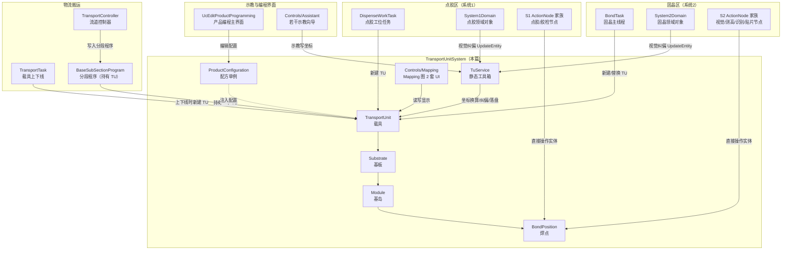

**ASCII 版**

```
           固晶区(S2)                 点胶区(S1)              物流搬运
   ┌──────────────────────┐  ┌──────────────────────┐  ┌────────────────────┐
   │ BondTask  固晶主线程  │  │ DispenseWorkTask     │  │ TransportTask      │
   │ System2Domain        │  │ System1Domain        │  │ TransportController│
   │ S2 ActionNode 家族   │  │ S1 ActionNode 家族   │  │ BaseSubSection     │
   │                      │  │                      │  │  Program(持有TU)   │
   └───────┬──────────────┘  └───────┬──────────────┘  └─────────┬──────────┘
           │ 新建/替换 TU            │ 新建/替换 TU              │ 上下线新建 TU
           │ 视觉纠偏 UpdateEntity   │ 视觉纠偏 UpdateEntity     │ 写入分段程序
           └───────────────┬─────────┴───────────────┬──────────┘
                           ▼                         ▼
        ┌──────────────────────────────────────────────────────────────┐
        │                TransportUnitSystem（本篇）                    │
        │                                                              │
        │   TransportUnit ──含──▶ Substrate ──含──▶ Module ──含──▶ BondPosition
        │        ▲                                                  ▲   │
        │        │ 注入配置(GetConfigByType)                        │   │ 直接操作
        │   ProductConfiguration(配方单例)          TuService(静态工具箱)│
        │        ▲                                     ▲               │
        │        │ 编辑                                │ 归一化/纠偏/落盘│
        │   ┌────┴─────┐                        ┌──────┴──────┐        │
        │   │ 示教界面 │                        │Mapping 图 2套│◀───────┘
        │   │ 产品编程 │                        │ UcTransportShow / MappingDraw
        └───┴──────────┴────────────────────────┴─────────────┘
```

### 1.3 三条最重要的"事实"

在往下读之前，先记住这三条——本层的绝大多数"坑"都是它们的衍生：

1. **配置与实体是分离的**。`TransportUnit`/`Substrate`/`Module`/`BondPosition` 这些**实体**不携带自己的工艺参数；参数在 `ProductConfiguration` 单例里的 `TransportUnitConfig`/`SubstrateConfig`/`ModuleConfig`/`BondPositionConfig` 中，实体通过 `GetConfigByType()`（`Module/Matter/BaseMatter.cs:111`）**现场去取**。所以"改实体"与"改配置"是两件事。
2. **一个焊点的"做完了没有"存在两个独立的字典里**（`BondPositionInfo.S1RemainingSteps` / `S2RemainingSteps`），且**S2 的状态会反作用于 S1 的判定**（`Module/Information/BondPositionInfo.cs:125-128`）。
3. **同一份数据有三套显示/存取实现**（实时图 `UcTransportShow`、新版 Mapping `FrmTuMappingNew`、旧版 Mapping `FrmTuMapping`），三者的行为**互不一致**，且旧版才是现役（`TransportUnitConfig.UseNewMappingUi` 默认 `false`，见 `UcTransportConfig.cs:107`）。

---

## 2. 目录结构

| 子目录 | 文件数（含 Designer） | 非 Designer 行数 | 说明 |
|---|---|---|---|
| `ProductConfiguration.cs`（根） | 1 | 130 | 配方单例：所有配置的入口与落盘点 |
| `Model/` | 3 | 656 | `TuEnum.cs`（17 个枚举）、`TransportUnitStorage.cs`（死代码）、`VisionResult.cs` |
| `Module/Matter/` | 5 | 1,853 | 实体：`BaseMatter` / `TransportUnit` / `Substrate` / `Module` / `BondPosition` |
| `Module/Config/` | 14 | 2,409 | 配置：`TransportUnitConfig`、`SubstrateConfig`、`ModuleConfig`、`BondPositionConfig`、`OtherConfig`、`LocateConfig`、`OppositeSex*` 等 |
| `Module/Information/` | 6 | 433 | 实体的"信息"部分：`BondPositionInfo`、`LocateResultInfo`、`TransportUnitInfo` 等 |
| `Service/` | 1 | 2,081 | `TuService.cs`——**全模块最大的单文件**，32 个静态方法 |
| `Controls/Mapping/` | 11 | 2,858 | Mapping 显示与存取（两套系统都在这里） |
| `Controls/TransportUnitEdit/` | 14 | 2,680 | 树形"载具单元编辑"（异性基板模式） |
| `Controls/Assistant/` | 19 | 2,951 | 示教向导总目录 + 6 个测高窗体 |
| `Controls/Assistant/CarrierTeach/` | 4 | 555 | 载具示教 |
| `Controls/Assistant/SubstrateTeach/` | 6 | 735 | 基板示教 |
| `Controls/Assistant/ModuleTeach/` | 6 | 778 | 基岛示教 |
| `Controls/Setting/` | 10 | 1,478 | 扁平三页签设置（非异性基板模式） |
| `Controls/Tool/` | 2 | 253 | `FrmLocateUseInfo`（定位使用信息） |
| `Controls/Running/` | 2 | 26 | `FrmTUInfo`——空壳，**零调用点** |
| **合计** | **104** | **19,876** | 含 Designer 共 31,893 行 |

> 目录结构的**结构特征是干净的**：104 个 `.cs` 与 `.csproj` 的条目**一一对应，零孤儿文件**（对比 `AKRS.ZX2200` 其它目录存在 20 个未注册文件）。`Controls/` 与 `Module/` 自身不放 `.cs`，只作分组。

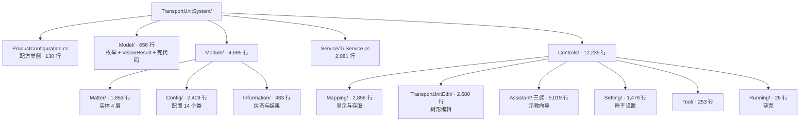

---

## 3. 关键类型索引

### 3.1 实体层：四层组合 + 配置"注入"（图 3）

实体只有 5 个类，构成一棵**四层组合树**。注意：**实体自己不携带工艺参数**——参数全部挂在 `ProductConfiguration` 单例上，实体通过 `Config` 属性现场去取。

| 类 | 文件:行 | 基类 | 子集合 | 独有的关键成员 |
|---|---|---|---|---|
| `BaseMatter` | `Module/Matter/BaseMatter.cs:22` | — （`abstract`） | — | `Config`(`:33`, `[JsonIgnore]`)、`OppositeSex`(`:38`)、`BaseInfo`(`:43`)、`EntityState`(`:48`，默认 `Process`)、`MatterProductState`(`:53`, `virtual`)、`MatterTypeEnum`(`:58`)、`CoordinateSystem`(`:64`, `[JsonIgnore]`)、`EditState`(`:74`，默认 `NewCreate`)、4 个 `abstract` 的 `SetMatterXxx()`(`:89-104`)、`GetConfigByType()`(`:111-140`) |
| `TransportUnit` | `Module/Matter/TransportUnit.cs:37` | `BaseMatter` | `Substrates : List<Substrate>` | `TransportUnitConfig`(`:49`)、`TransportUnitInfo`(`:54`)、两个 `Init` 系列（`InitTransportUnitCoordinateSystem()` `:261`、`InitSubstrateCoordinateSystem()` `:285`）、`GetSubstrateCount()`/`GetModuleCount()`(`:243`/`:253`) |
| `Substrate` | `Module/Matter/Substrate.cs:21` | `BaseMatter` | `Modules : List<Module>` | `SubstrateConfig`(`:33`)、`SubstrateInfo`(`:44`)、**聚合状态** `MatterProductState`(`:39`)、`GetSubstrateProductState()`(`:286-318`) |
| `Module` | `Module/Matter/Module.cs:19` | `BaseMatter` | `BondPositions : List<BondPosition>` | `ModuleConfig`(`:31`)、`ModuleInfo`(`:36`)、`SubstrateNum`(`:41`)、**聚合状态** `MatterProductState`(`:47`)、`CreateBondPosition()`(`:107`)、`CreateBondPositionByOppositeSex()`(`:128`)、`ChangeBondPositionProductInformation()`(`:180`) |
| `BondPosition` | `Module/Matter/BondPosition.cs:15` | `BaseMatter` | — （叶子） | `SingleBondPositionConfig`(`:27`)、`BondPositionInfo`(`:109`)、`IsMirror`(`:32`)、`TuName`/`SubstrateNum`/`ModuleNum`(`:114/119/124`)、完成判定 `IsFinishedInSystem1/2`(`:129/137`)、`IsProduct()`(`:146`)、`IsS1NeedStep()`/`IsS2NeedStep()`(`:187/197`)、4 个补偿取值方法(`:254-292`) |

**图 3：四层实体组合 + 配置注入**

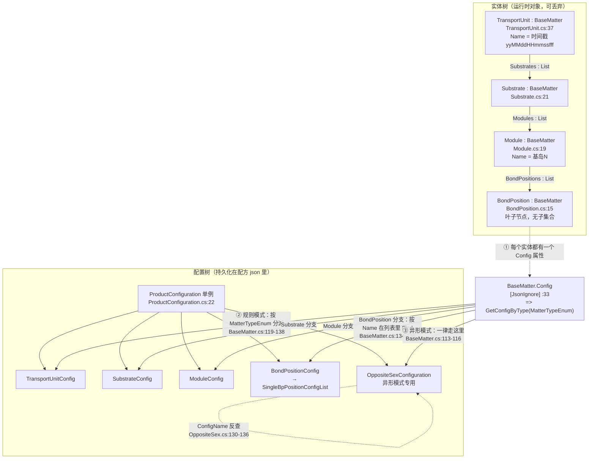

**ASCII 版**

```
  实体树（内存，一次生产一份，可丢）        配置树（磁盘 json，一份配方一套，长期存活）
  ═══════════════════════════════         ═══════════════════════════════════════════
   TransportUnit .........................  ProductConfiguration（单例）
       │  Substrates : List<Substrate>      │
       ▼                                    ├── TransportUnitConfig
   Substrate ──────────────────────────────┤   （IsOppositeSex 决定全局走哪套！）
       │  Modules : List<Module>            ├── SubstrateConfig   （ArrayConfig）
       ▼                                    ├── ModuleConfig      （ArrayConfig）
   Module ─────────────────────────────────┤   （BondPositionConfig   裸类容器）
       │  BondPositions : List<BondPosition>│    └─ SingleBpPositionConfigList : List<SingleBondPositionConfig>
       ▼                                    └── OppositeSexConfiguration（异形专用，与上四者平行）
   BondPosition（叶子）

      每个实体都有一个 Config 属性： BaseMatter.cs:33
          Config => GetConfigByType(MatterTypeEnum)
                      │
              ┌───────┴────────────────────────────────────┐
              │ IsOppositeSex == true                      │ IsOppositeSex == false
              ▼                                            ▼
         OppositeSex.Config                          按 MatterTypeEnum 分派：
         （ConfigName 反查配置池                          TransportUnit → TransportUnitConfig
           OppositeSex.cs:130-136，                         Substrate    → SubstrateConfig
           查不到就 new 一个并立刻 Save()）                  Module       → ModuleConfig
                                                          BondPosition → 在单焊点配置**列表**里按 Name 找
                                                                         BaseMatter.cs:134-135
                                                                         （★ 这一行旁边写着"这个地方有问题"）
```

> **三条要点**
> 1. **`Config` 是 `[JsonIgnore]` 的**——它不进 json。json 里只有实体自己的字段（`Name`/`Index`/`Rectangle`/`BaseInfo`…），配置是"算出来的"。
> 2. **分派入口只有一处**：`BaseMatter.GetConfigByType()`（`:111-140`）。同一个逻辑在 `ProductConfiguration.GetConfigByType()`（`ProductConfiguration.cs:106-128`）里有一份**逐行重复**的拷贝，两处都写着注释 `// 这个地方有问题`（`BaseMatter.cs:133`、`ProductConfiguration.cs:122`）。
> 3. **异形模式是个开关**：`TransportUnitConfig.IsOppositeSex`（`TransportUnitConfig.cs:30`）为 `true` 时，`GetConfigByType` 在**第一行就返回**（`:113-116`），后面那四个 `if` 全部成为死分支——也就是说**一个 TU 内不可能混合两种模式**。

### 3.2 状态：四套互不相干的状态概念（图 4）

新手最容易踩的坑：本模块里"状态"这个词对应**四个完全不同的枚举**，它们之间没有任何转换关系，各自被不同的代码读写。

| 枚举 | 定义 | 取值 | 谁在用 |
|---|---|---|---|
| `EntityState` | `Model/TuEnum.cs:256` | `Process`(0) / `Success`(1) / `Fail`(2) | `BaseMatter.EntityState`（`BaseMatter.cs:48`，默认 `Process`）。表示**这颗料做完了没有**（注释：`Success` = 所有制程全部完成） |
| `MatterProductState` | `Model/TuEnum.cs:278` | `Enable`(0) / `EnableInSystem1`(1，只点胶) / `EnableInSystem2`(2，只贴片) / `Disable`(3) | **产品级别**的"这个点要不要做"。`BaseMatter.cs:53` 声明为 `virtual`，**在 `Substrate` 和 `Module` 上被重写成只读的聚合计算属性** |
| `EditStateEnum` | `Model/TuEnum.cs:116` | `NewCreate`(0) / `NotYetFinished`(1) / `ChangedOutside`(2) / `Completely`(3) | 配置是否"改过还没存"。定义在三层不同的类上：`ProductConfiguration.EditState`(`:61`)、`SubstrateConfig.EditState`(`:35`)、`SingleBondPositionConfig.EditState`(`:110`) |
| `BondPositionStateEnum` | `Model/TuEnum.cs:337` | `Normal` / `Working` / `Success` / `Failed` | 焊点的**实时加工**状态（带中文 `Description`），用于 Mapping 图上色 |

**图 4：`MatterProductState` 的权威只在焊点层，上面两层都是"算出来的"**

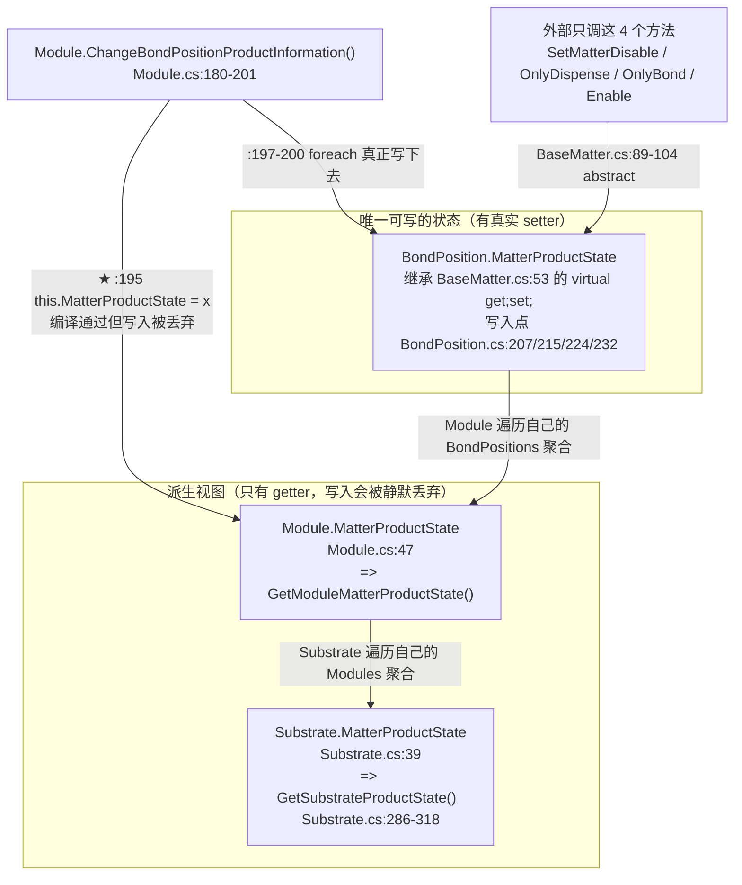

**ASCII 版**

```
   外部调用（只有这 4 个入口）：
     SetMatterDisable() / SetMatterOnlyDispense() / SetMatterOnlyBond() / SetMatterEnable()
                            │
                            │  BondPosition 上是真的赋值： BondPosition.cs:207/215/224/232
                            ▼
        ┌────────────────────────────────────────────────────────┐
        │  BondPosition.MatterProductState   ← 唯一权威（可写）   │
        └────────────────────────┬───────────────────────────────┘
                                 │  Module 遍历自己的 BondPositions 聚合
                                 │  GetModuleMatterProductState()
                                 ▼
        ┌────────────────────────────────────────────────────────┐
        │  Module.MatterProductState        ← 只读（Module.cs:47）│
        └────────────────────────┬───────────────────────────────┘
                                 │  Substrate 遍历自己的 Modules 聚合
                                 │  GetSubstrateProductState()  Substrate.cs:286-318
                                 ▼
        ┌────────────────────────────────────────────────────────┐
        │  Substrate.MatterProductState     ← 只读（Substrate.cs:39）│
        └────────────────────────────────────────────────────────┘

   ★ 注意 Module.cs:195 这一行：
        this.MatterProductState = matterProductState;      // 编译通过
     但 Module.MatterProductState 是只有 getter 的 override，
     写进去的值**读不回来**（已用最小样例经 csc 编译实测：写后读仍是原计算值）。
     本例后果被"属性是派生值"掩盖 —— 真正生效的是紧随其后的 :197-200 循环。
     但它意味着：**"单独给某个 Module 设状态"这条路是走不通的**，必须落到 BondPosition。
```

`Substrate.GetSubstrateProductState()`（`:286-318`）的判定顺序值得单独记住，它是"上层状态怎么算出来"的完整规则：

```
① 只要有一个 Module 是 Enable            → 返回 Enable            (:288-291)
② 否则若有 Module 是 EnableInSystem1      → 若没有 EnableInSystem2 的 Module → EnableInSystem1
                                          否则                           → Enable   (:292-302)
③ 否则若有 Module 是 EnableInSystem2      → 若没有 EnableInSystem1 的 Module → EnableInSystem2
                                          否则                           → Enable   (:303-313)
④ 都不满足                                → Disable               (:314-317)
```

**含义**：只要这颗基板上**同时存在**"只点胶"和"只贴片"的基岛，整块基板就被升格成 `Enable`（两个系统都做）。这就是"混排产品"的实现方式。

而焊点级的"做完了没有"是另一套逻辑，和 `MatterProductState` 并列判断（`BondPosition.cs:129-139`）：

```csharp
// BondPosition.cs:129
public bool IsFinishedInSystem1 => this.MatterProductState == MatterProductState.EnableInSystem2   // 只贴片 → S1 当然算做完
                                   || this.MatterProductState == MatterProductState.Disable         // 不启用 → 也算做完
                                   || this.BondPositionInfo.IsFinishedInSystem1();                 // 否则查那本字典

// BondPosition.cs:137  —— 完全镜像
public bool IsFinishedInSystem2 => this.MatterProductState == MatterProductState.EnableInSystem1
                                   || this.MatterProductState == MatterProductState.Disable
                                   || this.BondPositionInfo.IsFinishedInSystem2();
```

> 🔴 `BondPosition.IsS1NeedStep()`（`:187-190`）/ `IsS2NeedStep()`（`:197-200`）用的是**索引器**而不是 `ContainsKey`：
> ```csharp
> return !this.BondPositionInfo.S1RemainingSteps[stepName];   // :189
> ```
> 字典里没有这个 step 键时**抛 `KeyNotFoundException`**。而这两个方法是 `IsProduct()`（`:156`）的必经之路，`IsProduct()` 又被固晶/点胶主流程调用——**只要"步骤字典"与"实际步骤名"对不上，就是运行期异常**。

### 3.3 配置类继承层次（图 5）

配置是**两棵互不继承的树**：一棵管"规则矩阵"（`SingleConfig` / `ArrayConfig` 二分法），一棵管"异形排布"（`OppositeSex` 自引用树）。两棵树的类**没有任何共同的配置基类**（除了最顶上的 `BaseConfig`）。

**图 5：配置类继承层次**

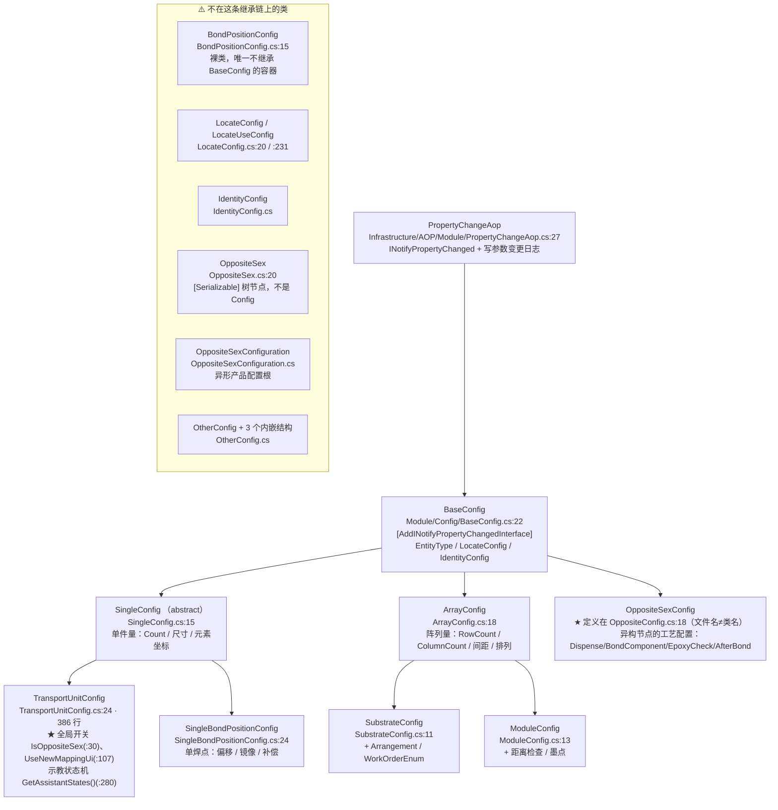

**配置类一览**

| 类 | 文件:行 | 基类 | 一句话职责 |
|---|---|---|---|
| `BaseConfig` | `BaseConfig.cs:22` | `PropertyChangeAop` | 所有配置的根：`EntityType`、`LocateConfig`（定位）、`IdentityConfig`（ID 识别）、`SaveInformation()` |
| `SingleConfig` | `SingleConfig.cs:15` | `BaseConfig` | `abstract`。单个实体的规格：`Count`、尺寸、`ElementCoordinate` |
| `TransportUnitConfig` | `TransportUnitConfig.cs:24` | `SingleConfig` | **全模块最重要的配置**：`IsOppositeSex`、`UseNewMappingUi`、`LagerNumber`、`SafeHeight`、示教步骤机 |
| `SingleBondPositionConfig` | `SingleBondPositionConfig.cs:24` | `SingleConfig` | 单个焊点：`BondPosOffset`、`RotaryPosition`、`DispensePosOffset`、`IsMirror`、`TeachModuleNum` |
| `ArrayConfig` | `ArrayConfig.cs:18` | `BaseConfig` | N×M 阵列：`RowCount`、`ColumnCount`、`RowSpacing`、`ColumnSpacing`、`ElementCoordinates` |
| `SubstrateConfig` | `SubstrateConfig.cs:11` | `ArrayConfig` | 基板：`+ Arrangement`（含蛇形）、`WorkOrderEnum`、`IsMultiple` |
| `ModuleConfig` | `ModuleConfig.cs:13` | `ArrayConfig` | 基岛：`+ IsDistanceCheck`/`DistanceTolerance`、`IsModuleInkDot` |
| `OppositeSexConfig` | `OppositeConfig.cs:18` | `BaseConfig` | 异形节点的工艺配置 |
| `BondPositionConfig` | `BondPositionConfig.cs:15` | **无** | 裸容器，只装 `SingleBpPositionConfigList` + `IsBpAssistanceFinish()` |
| `LocateConfig` | `LocateConfig.cs:20` | 无 | Mark 定位：`P1..P4PRName`、`AdjustType`、两点/三点/圆拟合开关 |
| `LocateUseConfig` | `LocateConfig.cs:231` | 无 | 单个 Mark 的"用不用、用不用角度" |
| `IdentityConfig` | `IdentityConfig.cs` | 无 | ID 识别 PR 名 |
| `OppositeSex` | `OppositeSex.cs:20` | 无（`[Serializable]`） | 异形**树节点**：`MatterTypeEnum`、`DownConfigs`、`ElementCoordinate`、`AbsoluteCoordinate` |
| `OppositeSexConfiguration` | `OppositeSexConfiguration.cs` | 无 | 异形配置根：`OppositeSexConfigs`（几何树）+ `BaseConfigs`（工艺配置池） |
| `OtherConfig` | `OtherConfig.cs` | 无 | 载具信息：`MatterProductInfo`、`ChangeBpName()`、`ClearInformation()` |

> 🔴 **文件名 ≠ 类名**（两处，都容易找错文件）：
> - `Module/Config/OppositeConfig.cs` 里定义的类叫 **`OppositeSexConfig`**（`:18`）。
> - 全仓搜索 `OppositeConfig` 这个词 **0 命中**——按文件名去找类会直接找空。
> - 反过来 `OppositeSex` 类在 `OppositeSex.cs:20`，它是**树节点**不是 Config，但它有一个 `Config` 属性反查 `OppositeSexConfig`（`OppositeSex.cs:120`）。

### 3.4 关键类型速查（按职责）

| 类型 | 文件:行 | 职责 | 详见 |
|---|---|---|---|
| `ProductConfiguration` | `ProductConfiguration.cs:22` | 配方单例（`Singleton<T>`）。6 个子配置 + `EditState`。`GetConfigByType()`(:106)、`IsTransportUnitReady()`(:89)、`InitProductConfiguration()`(:71) | §7.1 |
| `TuService` | `Service/TuService.cs:39` | **全模块最大单文件（2,081 行）**，`static` 类，**没有任何字段**，32 个静态方法：坐标创建、索引换算、视觉纠偏、落盘、程式复制 | §4.3 / §4.4 / §4.7 |
| `TuEnum.cs` | `Model/TuEnum.cs` | 17 个枚举（`EditStateEnum`:116、`EntityState`:256、`MatterProductState`:278、`EntityTypeEnum`:307、`BondPositionStateEnum`:337 …） | §3.2 |
| `VisionResult` | `Model/VisionResult.cs:11` | 单次定位结果。**无反序列化保护**：无 `[Serializable]`、`Bitmap` 无 `[JsonIgnore]` | §8.2 |
| `TransportUnitStorage` | `Model/TransportUnitStorage.cs` | TU 落盘/读回。**整类是死代码，零外部调用点** | §8.2 |
| `TransportUnitInfo` | `Module/Information/TransportUnitInfo.cs` | 运行时信息：`IsVisioned`、`IsProduct`、`IsSystem1Offset`/`IsSystem2Offset`、`LocateResultInfo` | §7.3 |
| `SubstrateInfo` | `Module/Information/SubstrateInfo.cs` | `System1Finished`/`System2Finished`/`IsVisioned`/`IsIdentity`/`Test` | §7.3 |
| `ModuleInfo` | `Module/Information/ModuleInfo.cs` | 基岛级运行时信息 | §7.3 |
| `BondPositionInfo` | `Module/Information/BondPositionInfo.cs:18` | **两本步骤字典**（`S1RemainingSteps`:107 / `S2RemainingSteps`:112）+ 视觉结果 + 力值 + `ComponentOffSet` | §4.5 / §4.6 |
| `LocateResultInfo` | `Module/Information/LocateResultInfo.cs:13` | `P1Info`~`P4Info` 四个 `VisionResult` + 两点距离 | §4.8 |
| `BaseInformation` | `Module/Information/BaseInformation.cs` | `abstract`，实体"信息"部分的基类，靠 `$type` 多态落盘 | §7.2 |

---

## 4. 核心流程

这一节是全篇的重点。每个流程的格式统一为：**触发点 → 关键方法（`文件:行`）→ 结果**，并配流程图。

### 4.1 `TransportUnit` 的生命周期（图 6）

一片料在软件里的一生只有 4 个阶段：**新建 → 初始化 → 生产中被修改 → 落盘/丢弃**。关键点：**TU 从不被"加载"来继续用**——每次开机、每个料、每次 Mapping 导入，都是 `new` 一个新的（见 §4.2）。

**图 6：`TransportUnit` 生命周期状态图**

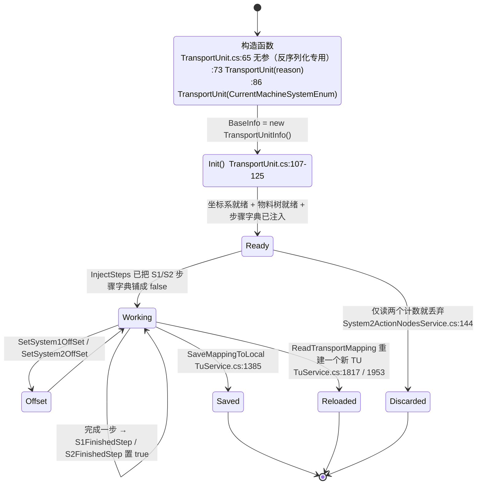

**ASCII 版**

```
                        ┌──────────────────────────────────────────────┐
                        │ ① 新建：永远不"加载旧 TU"，只 new 新的        │
                        │   TransportUnit.cs:65  无参（仅反序列化用）    │
                        │   TransportUnit.cs:73  TransportUnit(reason)  │
                        │   TransportUnit.cs:86  TransportUnit(system)  │
                        └───────────────────┬──────────────────────────┘
                                            │ BaseInfo = new TransportUnitInfo()
                                            ▼
                        ┌──────────────────────────────────────────────┐
                        │ ② Init()   TransportUnit.cs:107-125           │
                        │   坐标系 + 物料树 + 屏蔽回灌 + 步骤字典        │
                        └───────────────────┬──────────────────────────┘
                                            ▼
    ┌───────────────────────────────── ③ 生产中 ─────────────────────────────────┐
    │                                                                            │
    │  视觉纠偏 UpdateEntity ──▶ 就地改 CoordinateSystem.Distance / .Degree       │
    │  完成一步 S1FinishedStep ─▶ S1RemainingSteps["步骤名"] = true               │
    │  完成一步 S2FinishedStep ─▶ S2RemainingSteps["步骤名"] = true               │
    │  SetSystem1OffSet / SetSystem2OffSet ─▶ 只改标志位，不改坐标                 │
    │  System1MoveDistance / BackMoveDistance ─▶ 分段点胶时平移整棵坐标系          │
    │                                                                            │
    └──────────┬───────────────────────────────────────────────┬─────────────────┘
               │                                               │
               ▼ ④a 落盘                                        ▼ ④b 读回
   SaveMappingToLocal  TuService.cs:1385              ReadTransportMapping  TuService.cs:1817
   → D:\ZX2200存储数据\<配方>\<基板号>.txt              → **再 new 一个 TU**，按 txt 回灌状态
                                                       → 替换程序里持有的那一个
                                                       FrmTransportUnitMapping.cs:114 / :210
```

> 🔴 **别把 TU 当成"持久化实体"**。`TransportUnit` 的 `CoordinateSystem`（`BaseMatter.cs:63`）与 `Config`（`:32`）都是 `[JsonIgnore]`，`Model/TransportUnitStorage.cs` 那条"存 TU json"的路**整类是死代码**（零调用点）。也就是说：**TU 只能通过 `Init()`/`Refresh()` 从配置重建**——凡是重建遗漏的字段，就是永久丢失。

### 4.2 22 个 `new TransportUnit(...)` 调用点：4 条路径（图 7）

全项目共 22 处直接 `new TransportUnit(`。它们分成 4 条语义完全不同的路径——**看懂这 4 条，就看懂了"料是怎么进系统的"**。

**图 7：4 条创建路径**

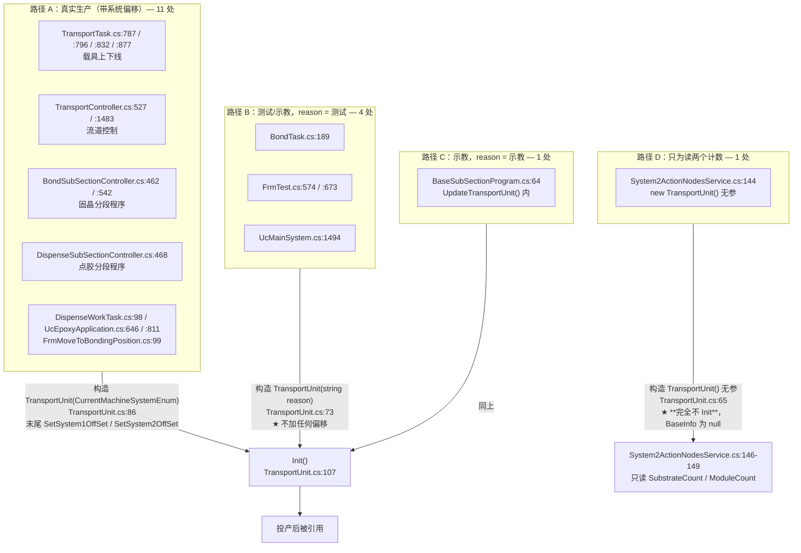

> 🔴 路径 D 的 `new TransportUnit()`（`System2ActionNodesService.cs:144`）走的是**无参构造函数**（`TransportUnit.cs:65-67`）：不设 `BaseInfo`、不 `Init()`。它只被用来读两个计数（`:146-149`），随后丢弃。**代价是三条完全不同的失败原因共用同一句报错**——`:141`、`:148`、`:159` 三处都抛 / 提示 `"ActionNode Sort Error"`，出问题时无法从日志区分是哪种。
>
> ⚠️ 路径 B 的 `"测试"` 与路径 C 的 `"示教"` **不加系统偏移**（`TransportUnit.cs:92-100` 只在 `CurrentMachineSystemEnum` 构造里执行）。所以"测试时看着正、生产时偏了"是这个设计的必然表现，不是故障。

### 4.3 `Init()` 内部：一棵坐标系的树是怎么长出来的（图 8）

`TransportUnit.Init()` 只有 6 行，但它是**整个料单元系统的装配线**：配置 → 物料树 → 坐标系 → 屏蔽状态 → 步骤字典，全在这里接上。

**图 8：`Init()` 展开（`TransportUnit.cs:107-125`）**

```mermaid
graph TB
    START["Init()  TransportUnit.cs:107"] --> S1["① this.OppositeSex = ...OppositeSexConfiguration.OppositeSexConfigs<br/>TransportUnit.cs:109<br/>⚠️ 规则模式下也照赋（值用不上）"]
    S1 --> S2["② InitTransportUnitCoordinateSystem()<br/>TransportUnit.cs:110 → :261-280<br/>从 MachineCoordinateSystem 里找名为<br/>TransportCoordinateSystem 的坐标系作为上层"]
    S2 --> S3{"③ TransportUnitConfig.IsOppositeSex ?<br/>TransportUnit.cs:112"}
    S3 -->|true| S4A["InitSubstrateByOppositeSex()  :348-357<br/>按 OppositeSex.DownConfigs 逐个 new Substrate"]
    S3 -->|false| S4B["InitSubstrateCoordinateSystem()  :285-343<br/>★ :291-298 若 !IsMultiple 就**就地改写全局配置**<br/>★ :306-325 IsAssistanceDistanceByInput 时<br/>   按 RowSpacing/ColumnSpacing 重算整张 ElementCoordinates<br/>★ :327-342 逐个 new Substrate"]
    S4A --> S5
    S4B --> S5["④ TuService.ModifyMatter(this, OtherConfig)<br/>TransportUnit.cs:121 → TuService.cs:887-957<br/>把"焊点屏蔽"回灌到每个 BondPosition"]
    S5 --> S6["⑤ System2Domain.ActionNodesService.InjectSteps(this)<br/>TransportUnit.cs:123 → S2ActionNodeController.cs:1410<br/>铺 S2RemainingSteps"]
    S6 --> S7["⑥ System1Domain.ActionNodeController.InjectSteps(this)<br/>TransportUnit.cs:124 → S1ActionNodeController.cs:859<br/>铺 S1RemainingSteps"]
    S7 --> DONE["TU 可用"]
```

**ASCII 版（连同每层的坐标系依赖）**

```
  MachineCoordinateSystem（全局机器坐标系，单例）
        │  里面有一个叫 "TransportCoordinateSystem" 的坐标系
        │  TransportUnit.cs:263-264
        ▼
  TransportUnit.CoordinateSystem ────────────────────────────── 第 1 层
        │  TuService.CreateMatterCoordinate(...)   TransportUnit.cs:268 / :275
        ├──────────────► Substrate.CoordinateSystem ─────────── 第 2 层
        │                     │   TuService.CreateMatterCoordinate(...)  Substrate.cs:68/96/188/199
        │                     ├────► Module.CoordinateSystem ── 第 3 层
        │                     │            │  Module.cs:69/97/154/164
        │                     │            └────► BondPosition.CoordinateSystem ─ 第 4 层
        │                     │                        BondPosition.cs:50/76/92/99
        │                     │
        │            每层都只存"相对上层的平移 + 旋转"：
        │              Distance（AKRSPoint3D）+ Degree（double）
        │             → 要转成机器坐标必须沿链累加（GeneralCoordinateSystem.DegreeInG0()）
        ▼
   注意：整条链都是 [JsonIgnore]（BaseMatter.cs:63），**不进 json**
        因此每次 new TU 都要靠 Init()/Refresh() 重新长出来
```

> 🔴 装配线上有两个"顺手改全局配置"的动作，都在第 3 步里：
> - `TransportUnit.cs:291-298`：`!substrateConfig.IsMultiple` 时把 `Count/ColumnCount/RowCount` 强制改成 1 **并清空 `ElementCoordinates`**。
> - `Substrate.cs:106-115`：对 `ModuleConfig` 做同样的事。
>
> 也就是说 **`new TransportUnit(...)` 这个"只读"动作会修改全局配方对象**（`ProductConfiguration` 单例里的配置）。只要之后有任何一次 `Save()`（全仓 53 处），**配方就被永久改写**。
>
> ⚠️ 同族风险在 `Refresh` 链路上（`TransportUnit.Refresh()` `:135-143` → `RefreshSubstrate()` `:362-368` → `Substrate.Refresh()` `:182-209` → `Module.Refresh()` `:148-174`）：`Substrate.Refresh` 用 `this.SubstrateConfig.ElementCoordinates[index - 1]`（`Substrate.cs:202`）、`Module.Refresh` 用 `this.ModuleConfig.ElementCoordinates[index - 1]`（`Module.cs:167`）——**只要 `ElementCoordinates` 的个数少于实体个数就越界**（`IndexOutOfRangeException`）。而 `ElementCoordinates` 恰恰会被上面那个"清空后只留 1 个"的动作改小。

### 4.4 配置是怎么被取到的：`GetConfigByType` 调用时序（图 9）

§3.1 已经画了静态结构，这里补的是**运行时序**——一个 `BondPosition` 从构造到拿到自己的配置，中间经过谁。

**图 9：以 `Module` 构造一个 `BondPosition` 为例**

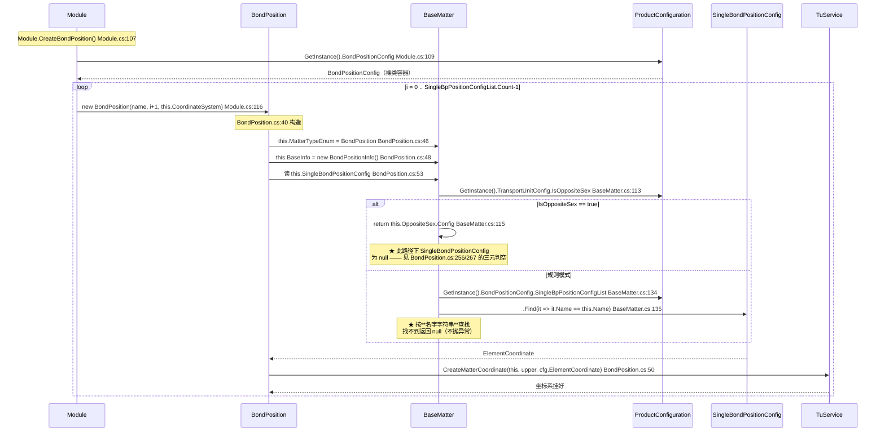

> 🔴 **三次读同一个属性 = 三次遍历查找**。`BaseMatter.Config` 是**表达式体属性**（`:33`），没有缓存——`BondPosition` 构造里 `SingleBondPositionConfig` 被读了 2 次（`:53`、`:55`），每次都走一遍 `GetConfigByType` → `ProductConfiguration.GetInstance()` → `Find(...)`。在"物料树 × 每次 new"的量级上，这是可观的重复开销，也是**改配置后旧实体立刻看到新值**的原因（既是"特性"也是坑）。

### 4.5 制程步骤是怎么进到焊点里的：`InjectSteps`（图 10）

每个焊点身上有两本字典（`BondPositionInfo.S1RemainingSteps` / `S2RemainingSteps`），它们**不是配置、不是常量，而是运行时被"注入"进去的**。

**图 10：两套独立的 `InjectSteps`**

```mermaid
graph TB
    TU["TransportUnit"] --> L1{"foreach Substrate in transportUnit.Substrates"}
    L1 --> L2{"foreach Module in substrate.Modules"}
    L2 --> L3{"foreach BondPosition in module.BondPositions"}
    L3 --> L4{"foreach SingleProcessStep in this.ProcessSteps"}
    L4 --> CMP{"singleProcessStep.BondPositionName<br/>== bondPosition.Name ?"}
    CMP -->|"是"| ADD1["S2ActionNodeController.cs:1422-1427<br/>if !ContainsKey → S2RemainingSteps.Add(name, false)"]
    CMP -->|"否"| SKIP["什么都不做"]

    S1C["S1ActionNodeController.cs:859-882  ← 完全同构的另一份"] -.->|"同一个四层循环，写的是 S1RemainingSteps"| L1

    ADD1 --> EMPTY["★ 后果：名字对不上 → 字典为空"]
    SKIP --> EMPTY
    EMPTY --> CONSEQ["BondPositionInfo.cs:120-123<br/>S1RemainingSteps.Count == 0 → return true<br/>= **这个焊点被当成"已完成"，静默跳过**"]
```

> 🔴 **`InjectSteps` 用"焊点名"这个字符串当连接键**（`S2ActionNodeController.cs:1420`、`S1ActionNodeController.cs:869`）。往上游追一步：`SingleProcessStep.BondPositionName` 来自工艺步配置，`BondPosition.Name` 来自 `BondPositionConfig.SingleBpPositionConfigList[i].Name`（`Module.cs:117`）——**两处只要有一处改了名，注入就不发生，字典为空，而这个焊点会被判定为"已完成"并跳过**（`BondPositionInfo.cs:120-123`）。它不报错、不打日志、不上报统计，只是**不贴片**。
>
> 而"改名"这个操作本身也是坏的：`OtherConfig.ChangeBpName()`（`OtherConfig.cs:62-89`）**改不动 `MatterProductInfo`**，还把局部列表 `list` 追加到自己身上（`:88`），函数结束时 `this.MatterProductInfo` 未被更新。

### 4.6 "这个焊点做完了没有"：`IsFinishedInSystem1/2`（图 11）

这是全模块**最容易被误判、也是后果最重**的一个判定。它有两个入口层：实体层的 `BondPosition.IsFinishedInSystemX`（先看 `MatterProductState`）与字典层的 `BondPositionInfo.IsFinishedInSystemX`（再看字典）。

**图 11：判定链（注意 S1 与 S2 的分支数不同）**

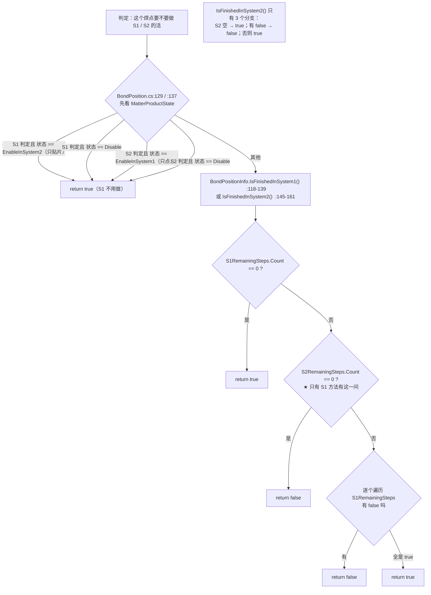

**ASCII 版：两条链的对照**

```
   BondPosition.IsFinishedInSystem1            BondPosition.IsFinishedInSystem2
   BondPosition.cs:129                         BondPosition.cs:137
   ────────────────────────────────            ────────────────────────────────
   状态 == EnableInSystem2（只贴片）→ true      状态 == EnableInSystem1（只点胶）→ true
   状态 == Disable               → true        状态 == Disable              → true
   否则 ↓                                       否则 ↓
        BondPositionInfo.IsFinishedInSystem1()      BondPositionInfo.IsFinishedInSystem2()
        BondPositionInfo.cs:118-139                 BondPositionInfo.cs:145-161
   ┌──────────────────────────────┐            ┌──────────────────────────────┐
   │ ① S1RemainingSteps.Count == 0│ → true     │ ① S2RemainingSteps.Count == 0│ → true
   │ ② S2RemainingSteps.Count == 0│ → false ★  │                              │
   │ ③ 遍历 S1：有 false          │ → false    │ ② 遍历 S2：有 false          │ → false
   │ ④ 全 true                    │ → true     │ ③ 全 true                    │ → true
   └──────────────────────────────┘            └──────────────────────────────┘
              ▲                                          ▲
              └── ★ 只有 S1 有第 ② 问；                     │
                  S2 的字典为空一律算"做完了" ──────────────┘
```

> 🔴 **两处不对称，都会造成静默跳过**：
> 1. `IsFinishedInSystem1()` 的 `:125-128` 是 S2 方法里**没有**的：`S2RemainingSteps` 为空时 S1 判定为 `false`（"S2 没初始化好，S1 不算完"）。
> 2. `IsFinishedInSystem2()` 的 `:147-150`：`S2RemainingSteps` 为空 → **直接 `true`**。
>
> 把两者叠起来看：**若某个焊点的两本字典都空**（典型原因就是 §4.5 的名字对不上），S1 判定会先被 `:120-123` 拦下返回 `true`——**S2 那边也是 `true`**——于是这颗焊点**在固晶和点胶两个工位都被当作"已完成"跳过**。
>
> 更麻烦的是 `IsS1NeedStep()` / `IsS2NeedStep()`（`BondPosition.cs:187-200`）用的是**索引器** `S1RemainingSteps[stepName]` 而不是 `ContainsKey`：字典里没这个键就**抛 `KeyNotFoundException`**，而它是 `IsProduct()`（`:146`）的必经之路。

### 4.7 视觉纠偏 `UpdateEntity`：整个系统里最精密的 60 行（图 12）

这是本模块**唯一"会失败得很响"**的流程：坐标算错要抛异常，异常会穿透到任务线程。

**图 12：`UpdateEntity` 全流程（`TuService.cs:553-609`）**

```mermaid
graph TB
    PREP["上游准备：System2Domain.System2VisionByPos()  System2Domain.cs:444<br/>或 System1Domain.System1VisionByPos()  System1Domain.cs:205"] --> SAVE["拍照 → SaveInfo 填 LocateResultInfo.PxInfo<br/>System2Domain.cs:582-584 / System1Domain.cs:354-356"]

    SAVE --> GATE{"调用方门槛（在各自 Domain 里判）<br/>S2: AdjustType 匹配  System2Domain.cs:311/335/399/422<br/>S1: 额外要求 EntityState != EntityState.Fail  System1Domain.cs:122/135/170/186"}
    GATE -->|通过| E1["① 释放图：P1Info~P4Info.Bitmap = null<br/>TuService.cs:555-558<br/>⚠️ type 参数整段方法体**从未被读取**"]
    E1 --> E2["② oldPoint = CalculateOldPoint(LocateConfig)  TuService.cs:561 → :721-819<br/>按 UseX/UseY + AdjustType 门槛，取 P1..P4 示教相对点的**算术平均**"]
    E2 --> E3["③ newPoint = CalculateNewPoint(LocateResultInfo, LocateConfig)<br/>TuService.cs:562 → :617-714<br/>同构，数据源换成 PxInfo.ResultPoint3D（**可能为 null → NRE**）"]
    E3 --> E4["④ newDegree = **-**CalculateUpdateAngle(...)  TuService.cs:566<br/>负号原因：海康坐标系顺时针（注释 :565）<br/>内部 :827-864 取 MatchResult.Angle 平均 × π/180<br/>🔴 :852 判 LocateUseConfig3 却取 P4Info"]
    E4 --> E5["⑤ oldDegree = CoordinateSystem.Degree  TuService.cs:570<br/>🔴 **赋值后从未使用**（死变量）"]
    E5 --> E6["⑥ upperSystemAngle = upperSystem.DegreeInG0()  TuService.cs:573-574<br/>沿链向上累加各级 Degree（含自身）"]
    E6 --> E7["⑦ updateDegree = newDegree - upperSystemAngle - 0<br/>TuService.cs:577<br/>🔴 注释说"减示教角度"，代码写死 -0"]
    E7 --> BR{"分支 A：IsCalculateAngleByTwoPoint<br/>且 AdjustType >= TwoPoints ?  :579"}
    BR -->|是| BA["用 P1P2 的 Atan2 现算角度<br/>:581-589  **覆盖** ⑦ 的 updateDegree<br/>注意 :589 用的是 Math.Atan 而非 Atan2"]
    BR -->|否| BR2{"分支 B：IsThreePointFittingCircle<br/>且 AdjustType 是 ThreePoints / FourPoints ?  :592"}
    BA --> BR2
    BR2 -->|是| BB["用 P1P2P3 拟合圆心 MathHelper.GetCentre<br/>:595-603 **覆盖** oldPoint / newPoint<br/>⚠️ 即便 FourPoints 也只拟合 P1P2P3"]
    BR2 -->|否| APPLY
    BB --> APPLY["⑧ CoordinateSystem.UpdateCoordinateSystem(oldPoint, newPoint, updateDegree)<br/>TuService.cs:606"]
    APPLY --> DEEP["AKRS.Galaxy2.CoordinateSystems 里的实现  BaseCoordinateSystem.cs:204-237<br/>🔴 |ΔX|>10 或 |ΔY|>10 或 |ΔZ|>10 → throw "坐标系矫正XYZ超出范围"  :217-220<br/>🔴 |degree|>0.2 弧度（≈11.46°）→ throw "坐标系矫正角度超出范围"  :222-225<br/>然后绕 upperNewPoint3D 旋转并累加 Degree / Distance.Z"]
    DEEP --> FIN["⑨ BaseInfo.IsVisioned = true  TuService.cs:608"]
    FIN --> END["终点：该实体的 CoordinateSystem.Distance 与 .Degree 被就地修改<br/>此后所有 SelfPosToG0 / G0PosToSelf 都随之平移旋转"]
```

**ASCII 版（要点压缩）**

```
  [上游拍照] System2Domain.System2VisionByPos / System1Domain.System1VisionByPos
        │  ① 取示教点位 + PR 名 + Autofocus : TuService.GetVisionInfo  :472
        │  ② SelfPosToG0 → 减 HeadToCameraOffset → 拍 → 加回 → G0PosToSelf
        │     System2Domain.cs:451,454,465,575,578,580
        │  ③ SaveInfo 写进 LocateResultInfo.PxInfo
        ▼
  [纠偏] UpdateEntity  TuService.cs:553
        │
        ├─ 释放 P1~P4 的 Bitmap（避免落盘膨胀）        :555-558
        ├─ oldPoint  = 示教点的算术平均                :561 → :721
        ├─ newPoint  = 实测点的算术平均                :562 → :617
        ├─ newDegree = -（匹配角平均 × π/180）         :566 → :827
        ├─ updateDegree = newDegree - 上层角度 - 0     :577   ← ★ 那个 "0"
        │
        ├─ 分支 A：两点定角（IsCalculateAngleByTwoPoint）→ 覆盖 updateDegree  :579-590
        ├─ 分支 B：三点拟合圆心（IsThreePointFittingCircle）→ 覆盖 old/new 点 :592-604
        │
        └─ CoordinateSystem.UpdateCoordinateSystem(oldPoint, newPoint, updateDegree)  :606
                 │
                 ▼  实现在 DLL 源码仓外：BaseCoordinateSystem.cs:204-237
            ┌──────────────────────────────────────────────────────────┐
            │  ΔXYZ 任一 > 10            → throw "坐标系矫正XYZ超出范围" │
            │  |degree| > 0.2 rad(≈11.5°) → throw "坐标系矫正角度超出范围"│
            └──────────────────────────────────────────────────────────┘
                 │
                 ▼  ★ 这两个 throw **穿透 UpdateEntity（无 try/catch）**
                    也穿透 System1Domain / System2Domain 的调用点（同样无 catch）
                    → 冒泡到 Task / 线程 → 由上层任务框架处理
```

> 🔴 **`UpdateEntity` 没有 `try/catch`**（`TuService.cs:553-609` 通读确认），两处 `throw` 会直接冒泡。这是本模块**唯一一处"参数超出物理范围就整机报错"**的设计，也是排查"坐标系矫正失败"报错时唯一要看的两个阈值：**10mm / 0.2 弧度**。
>
> 🔴 **`type` 参数在方法体里从未被读取**（`:555-608` 全段只用了 `baseEntity.Config.LocateConfig` 与 `baseEntity.BaseInfo.LocateResultInfo`）。所以传 `P1Vision` 还是 `P4Vision` 对结果**毫无影响**——这解释了为什么"多点定位"实际用的是同一套 P1..P4 全量平均，而不是"针对某个点"。

### 4.8 两点距离检查：S1 与 S2 的行为不一样（图 13）

同一个物理校验（"两次拍照的间距和示教时差太多就报警"），固晶侧和点胶侧的处理**完全不同**。

**图 13：`VisionService.DistanceCheck` 返回值的分流**

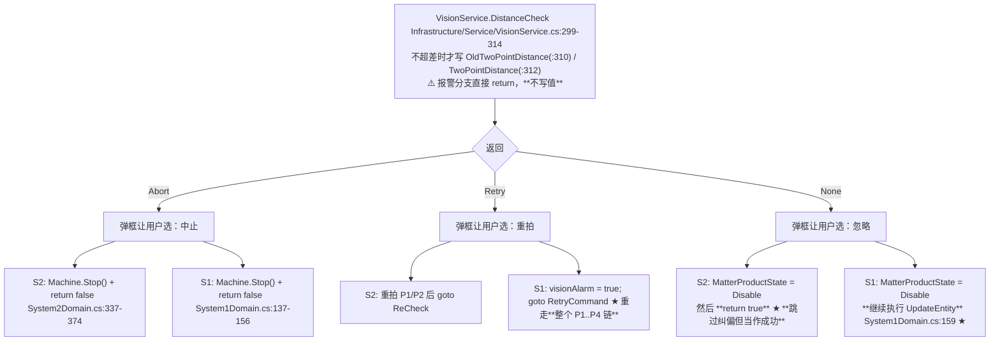

> 🔴 三处差异，都会让"同一批料走两个工位行为不一致"：
> 1. **`None` 分支**：S2 **直接 `return true`**（跳过纠偏、当作成功）；S1 **继续做纠偏**（`System1Domain.cs:159`）。前者等于"放弃这一颗但流程照走"，后者是"屏蔽掉但不放弃"。
> 2. **`Retry` 分支**：S2 只重拍 P1/P2；S1 用 `goto RetryCommand` **从 P1 重走整条链**，代价更大但更彻底。
> 3. **日志可信度**：`DistanceCheck` 只在**不超差**时写 `OldTwoPointDistance`/`TwoPointDistance`（`VisionService.cs:310/312`），报警分支不写值——所以 `System2Domain.cs:373` 打的日志在报警场景下**打印的是上一轮的旧值或 0**，不能用它来诊断。

### 4.9 两套 Mapping 绘制系统：不是"新旧"，是两套独立实现（图 14）

`Controls/Mapping/` 里有 **2 套完全独立的绘图体系**，它们**不共享画布、不共享坐标变换、不共享落盘格式**，只是读写同一批 `BaseMatter`。走哪一套由 `TransportUnitConfig.UseNewMappingUi`（默认 `false`，`TransportUnitConfig.cs:107`）二选一——**默认走的是"旧版"**。

**图 14：三个窗体的关系与各自的"画布语义"**

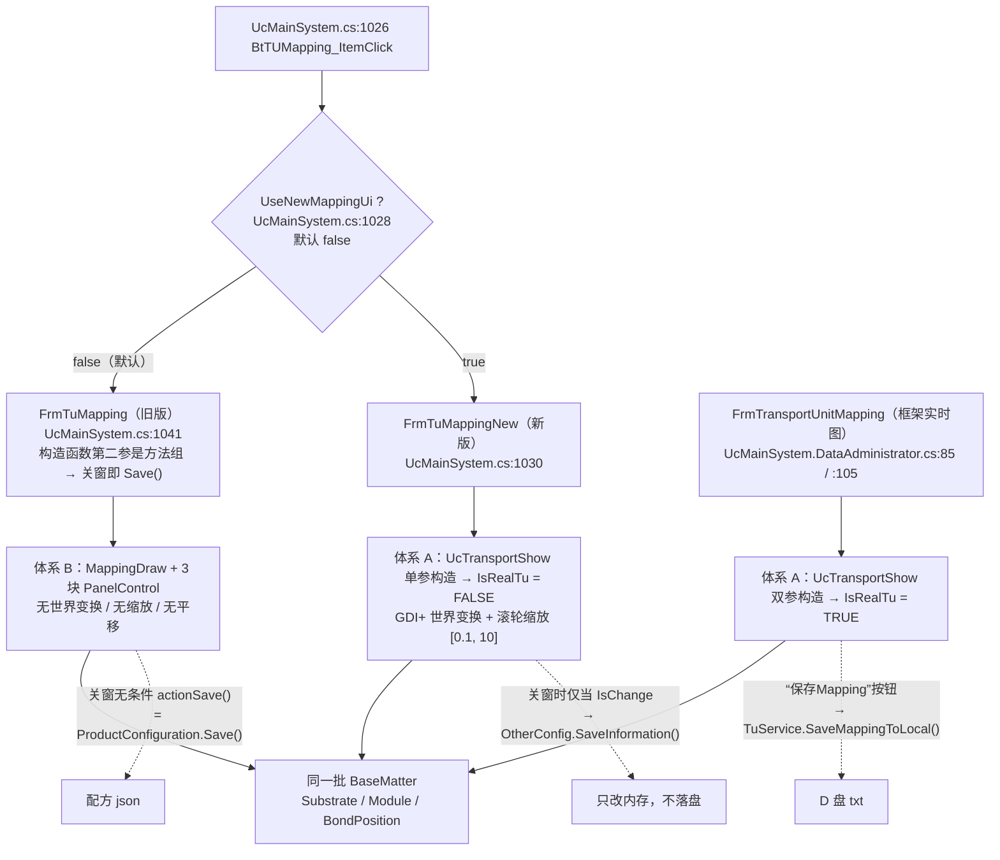

| 维度 | 体系 B（`FrmTuMapping` 旧版） | 体系 A（`UcTransportShow`：新版 + 实时图） |
|---|---|---|
| 画布 | 3 块 `PanelControl`（`PnSubstrateMapping` / `PnModuleMapping` / `PnBondPositionMapping`，各 965×625） | 1 块 `PlControl`（1136×654） |
| 单元格尺寸 | **恒定 30×20 像素**（`TuService.cs:335-336`）——与实体数量、间距、控件大小**完全无关** | 随格子数自适应：`sizeRation = Count==1 ? 1 : 0.7`（`:253-256`），焊点层 `0.5`（`:284-289`） |
| 坐标变换 | 无（`Rectangle.X/Y` 直接当客户区像素） | `TranslateTransform` + `ScaleTransform`，最终 `Screen = Logical × ratio + translate`（`:523-524`） |
| 缩放 | **完全没有**（连 `MouseWheel` 都没挂） | 滚轮 ×1.1/÷1.1，夹在 `[0.1, 10]`，双击复位（`:366-374`、`:739-740`） |
| 平移 | 无 | 无（只有滚轮围绕鼠标点的补偿） |
| "已完成"着色 | 无此分支 | 有：`BondPositionInfo.IsFinishedInSystemX()` 且 system 匹配 → `Color.Green`（`:325-334`） |
| 落盘 | 关窗 `ProductConfiguration.Save()` | 实时图走 `SaveMappingToLocal()` 写 txt；新版只写内存 |

> 🔴 **实时图把系统号硬编码成了 `System2`**：`FrmTransportUnitMapping.cs:65`（Load 时 `new UcTransportShow(this.Transport, CurrentMachineSystemEnum.System2)`）与 `:118`（导入 Mapping 后重建又写一次 `System2`）。而系统1 的入口（`UcMainSystem.DataAdministrator.cs:85`）传进来的**本来就是点胶侧的分段程序**——于是**在系统1 的实时图上，绿色"已完成"是按系统2 的完成标志画的**。
>
> 🔴 **导入 Mapping 时写错了持有者**：`BtImportMapping_Click` 里 `:114` 写的是 `TransportProgram.GetInstance().BondSubSectionProgram.TransportUnit`（**硬编码 Bond/系统2**）；而扫码入口 `BtInputID_Click` 里 `:210` 写的是 `this.baseSubSectionProgram.TransportUnit`（**跟随本窗体**）。同一件事两个入口，一个无脑改系统2 的 TU，一个改本窗体的。
>
> ⚠️ **画笔颜色形参没用上**：`PaintBondPosition` 的 `color` 形参（调用方传 `Color.Coral`，`:579`）在方法体内从未被读取——5 个分支全部内联 `Color.XXX`（`:301-338`）。

### 4.10 `UcTransportShow` 的重绘管线（图 15）与坐标变换链（图 16）

**图 15：一次 `PlControl_Paint` 的 16 步（`UcTransportShow.cs:508-626`）**

```mermaid
graph TB
    P0["0. :510-514 transportUnit == null ?<br/>→ labelControl1.Visible = true; return<br/>（空载短路，什么都不画）"]
    P0 --> P1["1. :516 隐藏 labelControl1"]
    P1 --> P2["2. :518 graphics = e.Graphics（缓存到字段供其它方法复用）"]
    P2 --> P3["3. :520 graphics.Clear(this.BackColor)"]
    P3 --> P4["4. :523 TranslateTransform(translate.X, translate.Y)"]
    P4 --> P5["5. :524 ScaleTransform(ratio, ratio)"]
    P5 --> P6["6. :527 PaintFramework()<br/>画 BurlyWood 主框架 + 算 frameworkStart/EndPointF<br/>+ subColumnSpace / subRowSpace<br/>框架 = (40,40) ~ (W-40, H-40)"]
    P6 --> P7["7. :530-535 PaintScaleX<br/>下排 X 刻度 + 列号"]
    P7 --> P8["8. :538-543 PaintScaleY<br/>左排 Y 刻度 + 行号"]
    P8 --> P9["9. :546-552 PaintEntity(Substrates ...)<br/>第 1 层：基板"]
    P9 --> P10["10. :555-564 foreach substrate → PaintEntity(Modules ...)<br/>第 2 层：基岛"]
    P10 --> P11["11. :567-581 foreach substrate→module → PaintBondPosition<br/>第 3 层：焊点（实心填充 + 按状态着色）"]
    P11 --> P12["12. :583-591 给 selectedBaseMatters 画 Color.Blue 宽 3 的框"]
    P12 --> P13["13. :593-596 isSelecting ? DrawSelected(Color.Aqua, 5/ratio)"]
    P13 --> P14["14. :598-604 性能短路：Substrates.Count &gt; 2500 且 ratio &lt; 2.5 → return"]
    P14 --> P15["15. :606 size = 8 / ratio（字号随缩放反比）"]
    P15 --> P16["16. :609-625 每个基板矩形中心写基板序号（Arial / Brushes.DarkRed）"]
```

**层级顺序**：清屏 → 外框 → 刻度尺 → 基板 → 基岛 → 焊点 → 选中框 → 拖拽框 → 序号文字。**后画的盖住先画的**，所以序号文字会压在焊点色块上，而 `Brushes.DarkRed` 压在 Crimson（只贴片）色块上几乎看不见。

**图 16：坐标变换链（mm → 归一化 → 屏幕）**

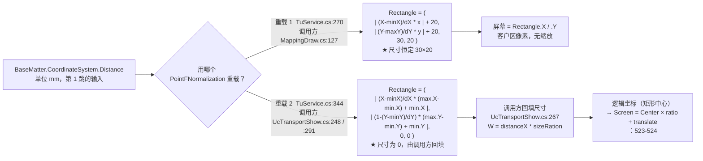

**ASCII 版（要点）**

```
  物理 mm（CoordinateSystem.Distance，可能为负、可能被 System1MoveDistance 平移过）
        │
        │  TuService.PointFNormalization  ── 两个重载语义不同，别混用
        │
   ┌────┴──────────────────────────────┬──────────────────────────────────────┐
   │ 重载 1（旧版 Mapping 用）           │ 重载 2（实时图用）                     │
   │ 目标框：0..W-100, 0..H-80          │ 目标框：调用方给 min / max             │
   │ X 正向映射；Y 用 (Y - maxY) 翻转    │ X 正向映射；Y 用 1.0 - … 翻转          │
   │ 尺寸恒为 30×20                     │ 尺寸恒为 0×0，靠调用方回填              │
   │ 退化保护：dX = x/2（画布一半）      │ 退化保护：dX = (max.X+min.X)/2 ★量纲错 │
   └────┬──────────────────────────────┴──────────────────────────────────────┘
        │
        ▼
   屏幕像素
   ┌──────────────────────────────────────────┬───────────────────────────────┐
   │ 体系 B：Screen = Rectangle.X / .Y 直接落笔 │ 体系 A：再乘 ratio + 加 translate│
   └──────────────────────────────────────────┴───────────────────────────────┘
```

> 🔴 两处**只在退化分支才出现的除零**：`TuService.cs:329-330` 与 `:415-416`。重载 1 里若 `x == 0`（`MappingDraw.cs:129` 传 `panelControl.Width - 100`，面板宽 ≤ 100 时成立）**且** `distanceX` 退化（`x/2 = 0`）→ 除零 → `(int)` 转换出巨大值 → 实体飞出画面。
>
> 🔴 重载 2 的退化保护 `distanceX = (max.X + min.X) / 2`（`:403-406`）**量纲是错的**：这是"坐标中点"，被当成"跨度"当分母用。对照重载 1 的 `x/2`（画布尺寸的一半），两者本应一致。附带风险：以原点对称的面板会让 `max.X + min.X == 0`，直接除零。

**滚轮缩放的"围绕鼠标点"数学**（`:361-372`）是一段写对了的逆变换，可直接当模板读：

```
virtualPos = (mouse - translate) / ratio     // 缩放前，该屏幕点对应的逻辑点
ratio     *= zoom                            // zoom = Delta>0 ? 1.1 : 1/1.1
ratio      = clamp(ratio, 0.1, 10)
translate  = mouse - virtualPos * ratio      // 保证 virtualPos 重新映射回同一屏幕点
鼠标反变换：logical = (e.Location - translate) / ratio     (:762-763 / :827-829)
```

> ⚠️ **滚轮事件挂在了错误的控件上**：`this.MouseWheel += ...` 挂在 `UcTransportShow`（`UserControl`）上（`:48` / `:72`），而鼠标实际悬停在其子控件 `PlControl` 上。WinForms 的 `MouseWheel` 只发给**有焦点的控件**，`PanelControl` 通常不会把它冒泡给父控件——**所以滚轮缩放很可能要先"点一下画布"才生效**。这条是**静态推导，未做运行时验证**（标 ⚠️）。

### 4.11 Mapping 的落盘与读回（图 17、图 18）

`TuService` 里的 Mapping 磁盘格式是一份**纯文本表格**，写和读是**两段手写镜像代码**，靠"行号偏移量"对齐。这是本模块最脆弱的地方。

**图 17：写盘三分支（`SaveMappingToLocal`，`TuService.cs:1385-1572`）**

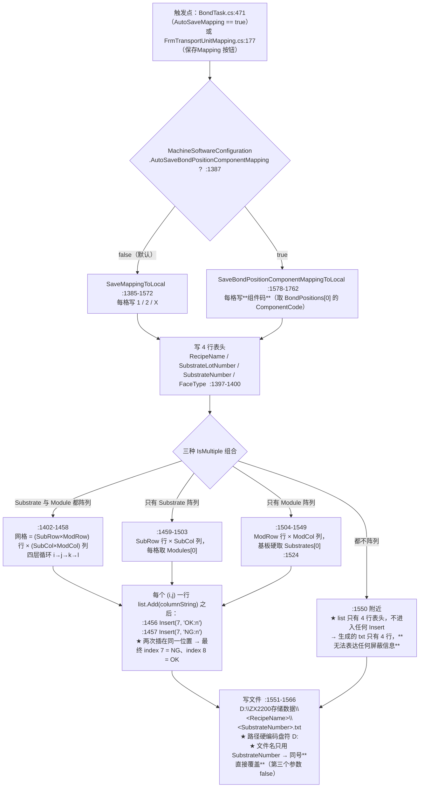

**每格内容的三个分支**（`:1436-1448` 等三处同构）：`module.IsFail()` → `"X"`；`module.IsModuleProcessFinishedInSystem2` → `"2"` 且 `successCount++`；否则 → `"1"`。

**图 18：读回（`ReadTransportMapping`，`TuService.cs:1817-1946`）**

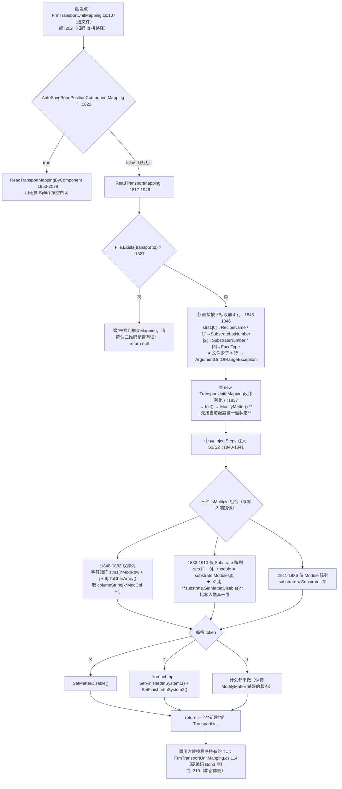

> 🔴 **读回的 `try/catch` 被整段注释掉了**：`TuService.cs:1819-1820` 的 `//try` / `//{` 与 `:1939-1945` 的 `//} //catch (Exception e) { ... return null; }`；组件码版同样在 `:1955-1956` 与 `:2072-2078` 被注释。**作者原本写了容错，后来关掉了**。结果是任何格式问题都会**直接抛到 UI 线程**。
>
> 🔴 **行号偏移 `+9` 是硬编码的**：读取端用 `strs1[i * ModuleConfig.RowCount + j + 9]`（`:1855`）与写入端的两次 `Insert(7, ...)` 严格对应。**写入端或表头行数一旦增删一行，读取端就整体错位**——两边是两份独立的手写代码，没有任何共享常量。
>
> ⚠️ 写入端 `:1568-1571` 的 `catch (Exception e) { AKRSXtraMessageBox.Show(e.Message + "保存失败"); }` **弹框后继续正常返回**，调用方 `BondTask.cs:471-473` 仍会打印"Mapping 成功保存"并把 TU 置 null（`:476`）——**用户可能没看到框，而数据已经丢了**。

### 4.12 示教：一个分发器 + 一个步骤机（图 19、图 20）

示教界面有 19 个文件，但**抽象只有一个 POCO 类 + 每个窗体自建 `List<AssistantConfig>` 的约定**——没有接口、没有基类、没有统一服务层。

**图 19：示教入口分派与顺序门禁（`UcEditProductProgramming.cs`）**

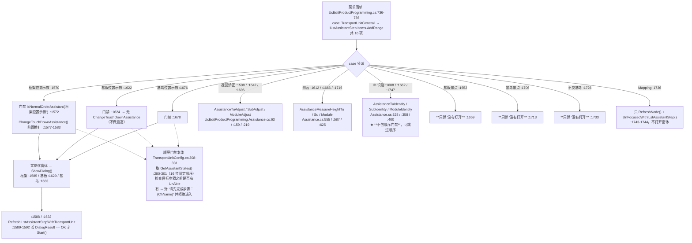

> 🔴 **三个菜单项是空壳**：基板墨点示教（`:1659`）、基岛墨点示教（`:1713`）、不良基岛示教（`:1733`）的 `case` 分支里**只有一句弹框 `"没有打开"`**。菜单上看得见、点了没反应，会让人以为是软件故障。
>
> 🔴 **门禁漏掉了 ID 识别**：`IsNormalOrderAssistant` 只包在位置示教/视觉矫正/测高/墨点等分支上（`:1572, :1600, :1614, :1624, :1644, :1654, :1668, :1678, :1698, :1708, :1718, :1728, :1738`），**ID 识别示教的三个分支（`:1608-1609`、`:1662-1663`、`:1747-1749`）没有包**。

**图 20：`AssistantConfig` 步骤机（每个示教窗体的共同骨架）**

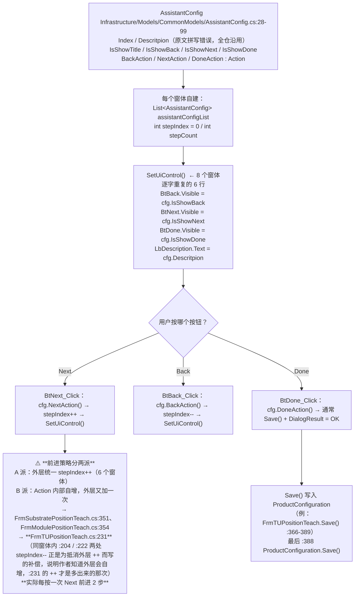

**三条示教流程的骨架（对照用）**

| 窗体 | 步骤数 | "找原点"几步 | 独有动作 | 关键 `文件:行` |
|---|---|---|---|---|
| `FrmTUPositionTeach`（框架/载具） | `stepCount = 5`（`:48`），实际列了 6 条文案 | 找原点 1~4（index 2/3/5） | **唯一的自动测高** `AssistantMeasureHeight(args.type)`（`:184-185`）+ 弹 `FrmEditSafeHeight`（`:210`）；**双自增（`:231` 与 `BtNext_Click` `:433`）使正向流程永远跳过 `index: 1`「输入安全高度」（`:239-254`）**，只有从 index 2 按 Back（`BtBack_Click` `:418-421` 的 `stepIndex--`）回退时才看得到 | `FrmTUPositionTeach.cs:92-117`（Load）、`:122-361`（InitControl）、`:366-389`（Save） |
| `FrmSubstratePositionTeach`（基板） | `stepCount = 9`（`:41`），`assistantConfigList` 只有 8 项 | 找原点 1~4（index 0~3） | `!IsMultiple` 直接弹 `"please choose MultipleSubstrates"` 关窗（`:451-456`）；`Multiplication == Configurable` 时问基板数量（`:460`） | `FrmSubstratePositionTeach.cs:441-490`（Load）、`:190-424`（列表） |
| `FrmModulePositionTeach`（基岛） | 同构 | 同构 | — | `FrmModulePositionTeach.cs:445`（Load） |

> 🔴 **示教的"保存"是唯一写入点，中途关窗是安全的**（`FrmTUPositionTeach.Save()` 只在 DoneAction 里被调）。这一点是设计得好的地方：**进度会丢，但不会留半成品配方**。
>
> 🔴 但**失败提示几乎是空的**：框架位置示教的测高失败分支（`FrmTUPositionTeach.cs:202-206`）只做 `this.stepIndex--; return;`——**停留在原步，不弹框、不写日志**。操作员看到的现象是"按了下一步没反应"。
>
> 🔴 `TUAssistantHelper` 是全模块引用最广的类（**70 个 `.cs` 文件**、`GetPosBySystem` 全仓 84 次调用），但它是**纯静态、零字段、零状态**的（`TUAssistantHelper.cs:46`，805 行里没有任何静态字段）。真正的共享状态在三个单例上：`MachineStateModel`（决定所有分支走向）、`ProductConfiguration`（落点）、`TransportProgram`。
>
> 🔴 **`JudgeTuExist()` 有副作用却被当纯查询用**：`TUAssistantHelper.cs:392-455` 在有料时会 **`new` 一个 `TransportUnit` 覆盖 `BondSubSectionProgram.TransportUnit`**（`:420-421`）。4 个窗体的 Load 里都把它当"有没有料"来判（`FrmTUPositionTeach.cs:95`、`FrmSubstratePositionTeach.cs:443`、`FrmModulePositionTeach.cs:445`、`FrmAssistantHeightPoints.cs:272`）——**打开示教界面这个动作本身就会替换掉程序里持有的载具对象**。这就是 §4.2 里路径 A/B/C 之外的第 4 类创建点。

### 4.13 右键改制程：两条完全不同的路径（图 21）+ 三种保存（图 22）

同一份数据、同一个右键菜单语义，在旧版 Mapping 和实时图/新版里走的是**两套完全不同的代码**——连"改完存不存"都不一样。

**图 21：右键"改成 XX 状态"的两条路径**

```mermaid
graph TB
    subgraph PATH1["路径 1：UcTransportShow（实时图 / 新版 Mapping）"]
        M1["popupMenu1 的 3 个 ItemClick<br/>Designer :87 / :94 / :101"] --> H1{"MachineStateModel.MachineState<br/>== Working ?  :903-912"}
        H1 -->|是| R1["弹 '当前机器正在运行，无法修改状态'<br/>→ 清空选中 → Refresh() → **IsChange = true** → return<br/>★ 拒绝了修改，却仍把 IsChange 置真"]
        H1 -->|否| W1["foreach matter in selectedBaseMatters：<br/>matter.SetMatterDisable() 等<br/>若是 BondPosition → SetUnFinishedInSystem1/2()  :914-924"]
        W1 --> F1["清空选中 → Refresh() → IsChange = true  :926-930"]
    end
    subgraph PATH2["路径 2：FrmTuMapping（旧版 Mapping）"]
        M2["contextMenuStrip1 的 4 个 Click<br/>Designer :131 / :138 / :145 / :152<br/>★ 三块画布共用同一个菜单"] --> W2["mappingDraw.ChangeMatterProduct(<br/>GetSelectSubs(), GetSelectModules(), GetSelectBondPositions(), state)  :623-627"]
        W2 --> ORDER["★ 三个实参的求值顺序 = 副作用顺序：<br/>GetSelectSubs() :527 → selectedSubstrateList.Clear()<br/>GetSelectModules() :552 → selectedModuleList.Clear()<br/>GetSelectBondPositions() :588 → bondPositions.Clear()"]
        ORDER --> W3["写 OtherConfig<br/>LagerNumber ? MatterProductInfoMax（**全量表**）<br/>: 否则 MatterProductInfo（**稀疏表**，Enable = 删记录）  :314-352"]
        W3 --> RB["this.transportUnit = new TransportUnit('Mapping图')  :629<br/>→ 重建 TU → ModifyMatter 把刚写入的记录重新套上"]
        RB --> RF["PnMapping.Refresh()  :630"]
    end
    F1 --> OUT1["只改内存 + IsChange<br/>★ FrmTransportUnitMapping **完全不消费 IsChange**<br/>→ 实时图里改的状态不会被保存"]
    RF --> OUT2["写 OtherConfig（内存）<br/>关窗时 FrmTuMapping_FormClosed:391 → actionSave()<br/>= ProductConfiguration.Save() → **持久化**"]
```

**右键菜单项与作用范围的对照（旧版按 Tab 决定范围，很反直觉）**

| 当前 Tab | `GetSelectSubs()` | `GetSelectModules()` | `GetSelectBondPositions()` |
|---|---|---|---|
| 0 基板 | 选中的基板列表，然后清空（`:529-541`） | **返回全部基岛 `1..ModuleConfig.Count`**（`:558-563`） | `CmbBondPosition == "All"` → **返回全部焊点名**；否则返回那一个（`:598-612`） |
| 1 基岛 | 只返回 `{selectSubstrateIndex}`（`:544`） | 选中的基岛列表，然后清空（`:565-577`） | 同上 |
| 2 焊点 | 只返回 `{selectSubstrateIndex}` | 只返回 `{selectModuleIndex}`（`:580`） | 选中的焊点名列表，然后清空（`:592-594`） |

> 🔴 **在"基板"页右键 = 对全部基板 × 全部基岛 × 全部焊点执行**（`:558-563` + `:600-607`）。配方一大就是 `Count × ModuleCount × BpCount` 次 `List.RemoveAll`（每次 O(n)）→ **O(n²) 级卡顿**。
>
> 🔴 **菜单弹出后切换 Tab，会改错层级**：范围是在 Click 时才按 `PnMapping.SelectedTabPageIndex` 求值的，用户在"弹菜单 → 点菜单项"之间切了页，作用范围就跟着变了。
>
> 🔴 **两个菜单项从未被绑定**：`BtOnlyBond_ItemClick`（`:1012`，只贴片）与 `BtOnlyDispense_ItemClick`（`:1040`，只点胶）**在 Designer 里没有挂到任何菜单项上**——是死代码。而 `UcTransportShow.cs:76` 又用 `popupMenu1.LinksPersistInfo.RemoveAt(2)` 按**下标**移除了一项，菜单项顺序一变就会移错。

**图 22：三种"保存 / 清空记忆"的对照**

```mermaid
graph TB
    subgraph CLEAR["清空记忆：三个窗体三种做法"]
        C1["FrmTuMapping  BtClearAll_Click:698<br/>ClearSelect() → OtherConfig.ClearInformation() :701<br/>→ new TransportUnit('Mapping图') :702 → Refresh() :703"]
        C2["FrmTuMappingNew  BtClearAll_Click:112<br/>OtherConfig.ClearInformation() :114<br/>→ new TransportUnit('mapping') :115<br/>→ ucTransportShow.ReFreshUi() :116<br/>→ **productConfig.Save() :117**"]
        C3["FrmTransportUnitMapping  BtInit_Click:133<br/>三重遍历 SetMatterEnable() + SetProcessUnable()<br/>→ ReFreshUi()<br/>★ **无 Transport == null 检查**"]
        C3 -.->|NRE| NRE["未放载具时点它必 NRE"]
    end
    subgraph SAVE["保存：三条互不相同的路径"]
        S1["旧版关窗  FrmTuMapping.cs:391<br/>actionSave() = ProductConfiguration.Save()"]
        S2["新版关窗  FrmTuMappingNew.cs:180<br/>**仅当 IsChange == true**<br/>OtherConfig.SaveInformation(TransportUnit)<br/>★ 不调 Save() → 只改内存，重启即丢"]
        S3["实时图按钮  FrmTransportUnitMapping.cs:175<br/>TuService.SaveMappingToLocal(Transport)<br/>→ D 盘 txt（与配方 json **不是**同一份数据）"]
    end
    C1 --> S1
    C2 --> S2
    C3 --> S3
```

> 🔴 **"清空记忆"在实时图上不落盘**：`BtInit_Click` 只改内存里的 TU（`:133`），既不动 `OtherConfig` 也不 `Save()`。用户点了"清空记忆"、看到图全变绿、然后关窗——**下次开机记忆还在**。
>
> 🔴 **`OtherConfig.ClearInformation()` 是 `MatterProductInfoMax` 唯一的正规初始化点**（`OtherConfig.cs:38-55`，把锯齿数组重建成"全 Enable"）。这就是 §4.1 里那个"`LagerNumber == true` 但没清过记忆 → `MatterProductInfoMax` 为 `null` → 一改状态就 NRE"的根因。

---

### 4.14 对象树的增删改与落盘（图 23、图 24）

树形编辑器（`FrmTransportUnitEdit`，仅 `IsOppositeSex == true` 时才出现，见 §4.12）上的**每一个动作**都是同一套三段式：

```
改内存对象  →  InitOppositeSexConfigIndex() 重排 Id/ParentId  →  ProductConfiguration.Save()
```

第三段"落盘"就是图 24 要讲的问题：**它是每个动作各自调一次，而不是集中一处**。

#### 4.14.1 图 23：新增 / 删除 / 复制

```mermaid
flowchart TB
    subgraph ADD["① 新增（BtAdd_Click, FrmTransportUnitEdit.cs:114 / 右键 UcTransportUnitView.cs:379）"]
        A1["new FrmAddObject()<br/>把聚焦节点塞进 SelectOppositeSexConfig<br/>FrmTransportUnitEdit.cs:116-118"]
        A2["FrmAddObject_Load<br/>填 CmbType/CmbSubstrate/CmbModule<br/>按父节点类型预选类型 + 生成默认名<br/>FrmAddObject.cs:151-188"]
        A3{"BtSure_Click<br/>重名？<br/>FrmAddObject.cs:67"}
        A4["非法字符校验<br/>Path.GetInvalidFileNameChars()<br/>FrmAddObject.cs:73-80"]
        A5["算偏移：绝对/相对两分支<br/>绝对：Point = SpOffset * -父.AbsoluteCoordinate.Point<br/>FrmAddObject.cs:82-109"]
        A6["SizeX = 父.SizeX/2, SizeY = 父.SizeY/2<br/>FrmAddObject.cs:111-112"]
        A7["按 Type 挂到 DownConfigs<br/>基板→OppositeSexConfigs.DownConfigs<br/>基岛→SubstrateOppositeSexConfig<br/>焊点→ModuleOppositeSexConfig<br/>并写 MatterTypeEnum / EntityType<br/>FrmAddObject.cs:114-131"]
        A8["FrmTransportUnitEdit.Init()<br/>:127"]
        A9["InitOppositeSexConfigIndex()<br/>重排 Id/ParentId/SubstrateId/ModuleId/BondPositionId<br/>:57 → OppositeSexConfiguration.cs:64-108"]
        A10["ProductConfiguration.Save()<br/>:129"]
        A11["FindNodeByKeyID(新 Id) → SetFocusedNode<br/>→ 手动重绑 ucObjectFunctionEdit<br/>:131-134"]
        A1 --> A2 --> A3
        A3 -- 重名 --> A3X["提示后停留<br/>FrmAddObject.cs:69"]
        A3 -- 通过 --> A4 --> A5 --> A6 --> A7 --> A8 --> A9 --> A10 --> A11
    end

    subgraph DEL["② 删除（BtDelete_Click, FrmTransportUnitEdit.cs:142）"]
        D1{"IsLock？<br/>:151"}
        D1 -- 是 --> D1X["提示「需要解锁才能删除」<br/>:151-155"]
        D1 -- 否 --> D2["AKRSXtraMessageBox 确认<br/>:157-162"]
        D2 --> D3["RemoveOppositeSexConfig(节点)<br/>:166 → OppositeSexConfiguration.cs:236-279<br/>三层循环按引用相等摘除"]
        D3 --> D4["若已无节点引用该 ConfigName：<br/>从 BaseConfigs 移除<br/>+ PREntity.DeletePREntity(Mark1..4)<br/>+ PRVisionList 移除<br/>OppositeSexConfiguration.cs:267-278"]
        D4 --> D5["Init() :169 → Save() :171"]
    end

    subgraph CPY["③ 复制（两条独立实现）"]
        C0{"选中了节点？"}
        C0 -- 否 --> C0X["提示「请先选择需要复制的单元」<br/>UcTransportUnitView.cs:343-347"]
        C0 -- 是 --> C1["new FrmObjectCopy(源节点)<br/>FrmTransportUnitEdit.cs:189 / UcTransportUnitView.cs:349"]
        C1 --> C2["读 行列数 + 行列间距<br/>FrmObjectCopy.cs:65-68"]
        C2 --> C3{"勾了「中心距」？"}
        C3 -- 否 --> C3Y["间距 += 源.SizeX / 源.SizeY<br/>改成边到边<br/>FrmObjectCopy.cs:70-74"]
        C3 -- 是 --> C4
        C3Y --> C4
        C4["双重循环 j∈[0,col) × i∈[0,row)，跳过 (0,0)<br/>FrmObjectCopy.cs:76-91"]
        C4 --> C5["ObjectHelper.Clone(源)<br/>= BinaryFormatter 深拷贝<br/>FrmObjectCopy.cs:85 → ObjectHelper.cs:109-119"]
        C5 --> C6["ElementCoordinate.Point += (colSpace·j, rowSpace·i, 0)<br/>FrmObjectCopy.cs:87"]
        C6 --> C7{"源是根节点？<br/>ParentId == 0（根 Id == 1）"}
        C7 -- 是 --> C7X["🔴 Find(it => it.Id == 0) 返回 null<br/>→ oppositeSexConfigUp 为 null<br/>→ :201 / :361 空引用异常"]
        C7 -- 否 --> C8["按源 ParentId 找父节点<br/>FrmTransportUnitEdit.cs:199 / UcTransportUnitView.cs:359"]
        C8 --> C9["父.DownConfigs.AddRange(克隆体)<br/>:201 / :361"]
        C9 --> C10["逐个改名 —— 两条路径策略不同<br/>树：GetDefaultName(源.Name) :206<br/>视图：GetDefaultName(类型描述) :366"]
        C10 --> C11["refreshAction() = FrmTransportUnitEdit.Init()<br/>:223 接线 · UcTransportUnitView.cs:369<br/>内部 InitOppositeSexConfigIndex() 修掉重复 Id"]
        C11 --> C12["ProductConfiguration.Save()<br/>:371"]
    end

    SHARE["🔴 克隆体与原件的 Config 是同一实例<br/>OppositeSex.cs:120-122 [JsonIgnore] 计算属性<br/>靠 ConfigName 在 BaseConfigs.Find 得到同一个 OppositeSexConfig<br/>—— 克隆把 ConfigName 也复制了"]
    C5 -.-> SHARE
    SHARE -.->|"后果：在克隆体上改配置/做 PR 示教<br/>会写到原件同一批 PR 实体<br/>PR 名 = Recipe + LocateConfig.Name + MarkN<br/>LocateConfig.cs:43/56/69/82"| C10

    LOCK["🔴 IsLock 默认 true（OppositeSex.cs:85）<br/>新增与复制都不解锁<br/>→ BtDelete.Enabled = !IsLock（FrmTransportUnitEdit.cs:102）<br/>新建完删除按钮就是灰的"]
    A7 -.-> LOCK
    C5 -.-> LOCK
```

**ASCII 版（图 23 骨架）**

```
                       ┌──────────────── 三者共用的尾段 ────────────────┐
新增 ─┐                │                                              │
      │  ① 建临时对象  │  ② Init()  ③ InitOppositeSexConfigIndex()     │
删除 ─┤  FrmAddObject  │     重建树    重排 Id/ParentId（根=1，count从2起）│
      │  FrmObjectCopy │                                              │
复制 ─┘                │  ④ ProductConfiguration.Save()  ⑤ 定位/重绑聚焦 │
                       └──────────────────────────────────────────────┘
                              ▲                        ▲
                    新增：有 FindNodeByKeyID   删除/复制：没有重新定位聚焦
                    （:131-134）               （:169 / :209）
                    → 反例：删完 Init() 重建数据源，聚焦行丢失，
                      FocusedNodeChanged 会以新聚焦行重新触发，
                      ucObjectFunctionEdit 可能绑到另一个对象
```

**三个必须记住的点**

> 1. **"复制"是深拷贝，但"配置"不是。** `ObjectHelper.Clone` 走 `BinaryFormatter`（`ObjectHelper.cs:109-119`），所以 `ElementCoordinate` / `AbsoluteCoordinate` / `AbsoluteCenterCoordinate` / `DownConfigs`（**整棵子树**）都不共享——复制一块基板会连它的基岛和焊点一起复制。但 `OppositeSex.Config` 是 `[JsonIgnore]` 的**计算属性**（`OppositeSex.cs:120-122`），靠 `ConfigName` 在 `BaseConfigs` 里 `Find`（`:130`）拿到**同一个** `OppositeSexConfig` 实例。克隆把 `ConfigName` 原样带过去了，于是克隆体和原件共享同一个配置对象，其中包括 `LocateConfig`——而 `LocateConfig.Name` 正是 PR 名的前缀（`LocateConfig.cs:43/56/69/82`：`RecipeName + Name + "Mark1"`）。**在克隆体上做视觉示教或改定位，改的是原件的 PR。** 这解释了 `UcObjectFunctionEdit.cs:270-273` 那段"改名时把所有同 `ConfigName` 的节点一起改"的反常代码——它是为共享配置配套写的，代价是"改一个焊点名字，所有共享配置的焊点名字全变"。

> 2. **`IsLock` 的默认值是 `true`，而没有任何新增/复制路径把它置 `false`。** `OppositeSex.cs:85` `public bool IsLock { get; set; } = true;`；`FrmTransportUnitEdit.cs:102` `BtDelete.Enabled = !oppositeSexConfig.IsLock`。所以"新建完想删掉重来"这个最自然的操作，按钮是灰的，必须先点「解锁」——而「解锁」自己不落盘（见下）。

> 3. **删除与复制的聚焦行丢失。** 新增路径在 `Save()` 之后有 `FindNodeByKeyID(新节点.Id)` → `SetFocusedNode`（`:131-134`），删除（`:169`）和复制（`:209`）都只调 `Init()`。`Init()` 会 `TreeTransportUnit.DataSource = list` 整树重建，随后的 `FocusedNodeChanged` 会以新的聚焦行为参数触发 `ucObjectFunctionEdit.Init(...)`（`:104`）——**右侧功能编辑面板会静默地绑到另一个对象上**。

#### 4.14.2 图 24：编辑 → 落盘的保存链路（漏保存全景）

本组**没有任何 `BindingSource` / `DataBindings`**，全部是"手工赋值 + 事件回写"两段式。回写分三种时机，这是所有"改了没生效"问题的根：

| 时机 | 例子 | 后果 |
|---|---|---|
| **即时 + 立即落盘** | `UcObjectFunctionEdit.cs:985/1011`（下拉切换 → 写 `Config.*Name` → `Save()`）、`:436/:476`（示教前写名字再 `ProductConfiguration.Save()`）、`UcSubstrate.cs` 的 4 个事件（`:139/:218/:246/:292` 等） | 正确 |
| **即时 + 不落盘** | `UcObjectFunctionEdit.cs:569/588`（测高开关 → 只写 `MeasureHeightInSystem1/2`）、`UcSubstrate.cs:364-367` / `UcModule.cs:311-314`（`ChkManualDistance`） | 值在内存对象里，**等下一个别人触发的 `Save()` 顺带写盘**；窗口期掉电/换配方即丢 |
| **只改 UI，不写模型** | `UcTransportUnit.cs:199-209` / `:258-264` / `:271-277`（`ChkDistanceCheck` / `ChkIsSymmetrical` / `ChkIsCommonDataSet`）、`:363-397` / `:421-455`（左右定位方式联动）、`:404/:462`（左右距离检查） | 模型要等 `Save()`；**因为 `Save()` 是"UI → 整个 Config 对象"的全量覆盖，这些联动产生的中间态会被覆盖掉**（详见图 24 下方第 1 条） |

```mermaid
flowchart TB
    PC["ProductConfiguration（单例）<br/>ProductConfiguration.cs:22<br/>落盘 <exe>\Settings\RecipeParams\<RecipeGuid>\ProductConfiguration.json<br/>ProductConfiguration.cs:27-30"]

    subgraph WRITERS["20+ 个处理器各自调 Save()（多入口、非幂等）"]
        W1["UcObjectFunctionEdit.Save()<br/>:790-812"]
        W2["UcTransportUnit.Save()<br/>:105-137（22 个字段全量覆盖）<br/>被 :191/:233/:481/:495/:507/:538/:565/:583 共 8 处调用"]
        W3["UcSubstrate.Save()<br/>:114-130（14 个控件全量写回）"]
        W4["UcModule.Save()<br/>:95-110"]
        W5["FrmTransportUnitEdit：BtAdd :129 / BtDelete :171 / BtCopy :209<br/>BtClear :293"]
        W6["FrmLocateUseInfo.BtOK_Click :137"]
    end

    subgraph GATE["唯一的集中落盘口（外部宿主调）"]
        G1["UcTransportUnitFrame.Confirm() :49-56<br/>依次调 UcTransportUnit.Save() · UcSubstrate.Save() · UcModule.Save()<br/>再调 ProductConfiguration.Save()"]
    end

    subgraph MISS["🔴 改了但不落盘的 11 处"]
        M1["UcObjectFunctionEdit.SaveOppositeSexConfig 改名路径<br/>:260-301 —— 只调 VisionEntityRepository.Save()（:297）<br/>没有 ProductConfiguration.Save()"]
        M2["UcObjectFunctionEdit 测高开关 :569/:588"]
        M3["UcObjectFunctionEdit.BtAssistantMeasureHeight_Click :387-427<br/>写了 IsMeasureHeightAssistant = true（:425）<br/>既不落盘也不 refreshAction()"]
        M4["UcObjectFunctionEdit.LueAdjustType_EditValueChanged :537-560<br/>:557 先刷新、:559 才写 AdjustType —— 顺序反了"]
        M5["FrmTransportUnitEdit.BtLock_Click :300-309<br/>翻转 IsLock 后完全没有 Save()"]
        M6["UcSubstrate.ChkManualDistance_CheckedChanged :364-367"]
        M7["UcModule.ChkManualDistance_CheckedChanged :311-314"]
        M8["FrmMeasureHeightPoints（全类）<br/>无任何保存按钮，lambda 直接写 HeightMeasurementPoints[i].X/Y/Z<br/>:47/:58/:69"]
        M9["UcTransportUnit 的 6 个只联动不写模型的处理器<br/>:199-209 / :258-264 / :271-277 / :363-397 / :421-455 / :404/:462"]
        M10["UcTransportUnit.ChkAllRotation / ChkAllHeight / ChkAllForce<br/>:63-65 / :108-110 没有接线任何事件<br/>只在 Save() 里被读 → 自己永远不触发保存"]
        M11["删除路径的 PR 清理<br/>OppositeSexConfiguration.cs:267-278 删了 PREntity 与 PRVisionList<br/>但没有 VisionEntityRepository.Save()（对比 UcObjectFunctionEdit.cs:297 有）"]
    end

    CALLER["外部宿主：UcEditProductProgramming.cs:731<br/>new UcTransportUnitFrame()"]
    CALLER -.->|"若宿主不调 Confirm()"| GATE
    GATE --> PC
    W1 --> PC
    W2 --> PC
    W3 --> PC
    W4 --> PC
    W5 --> PC
    W6 --> PC
    M1 -.->|"等别的动作顺带 Save()"| PC
    M2 -.-> PC
    M3 -.-> PC
    M4 -.-> PC
    M5 -.-> PC
    M6 -.-> PC
    M7 -.-> PC
    M8 -.-> PC
    M9 -.-> PC
    M10 -.-> PC
    M11 -.-> PC
```

**逐条要点**

> 1. 🔴 **`UcTransportUnit.Save()` 存在"读一处、写另一处"的复制粘贴漏改**（这是本组最严重的可验证缺陷）。`:85-90` 读的是 `transportUnitConfig.LocateConfig`（中间那份），`:132-137` 写的却是 `transportUnitConfig.RightLocateConfig`（右侧那份）：`AdjustType` / `SearchType` / `DistanceCheck` / `DistanceTolerance` / `IsSymmetric` / `CommonDataSet` 六个字段。对比左组（`:78-83` 读 `LeftLocateConfig` → `:125-130` 写 `LeftLocateConfig`）完全自洽。**后果：`Save()` 每被调一次（8 处 + `UcTransportUnitFrame.Confirm()` :51），用户对右侧定位的 6 项设置就被"中间那份"的值覆盖一次——右侧定位设置永远存不下来。** 这是"多入口 + 全量覆盖"组合出的真实数据丢失。

> 2. ⚠️ **`UcTransportUnit.cs:564` 把系统 2 的测高开关写进了系统 1 的字段**：`BtMeasureHeight2_CheckedChanged` 末尾是 `this.transportUnitConfig.MeasureHeightInSystem1 = this.BtMeasureHeight2.Checked;`（应为 `MeasureHeightInSystem2`）。侥幸无害——`Save()`（`:112-113`）随后会把两个字段都按各自控件重写一遍，`:564` 成了死写。同族的 `UcSubstrate.cs:337`、`UcModule.cs:284` 都写对了，佐证这是笔误；但顺序稍有变化就会变成真 bug。

> 3. ⚠️ **`UcTransportUnit.cs:531-533` 同一状态连写两次**：`:531` 写 `TUHeightMeasurement.State = Able`，`:533` 写 `UnAble`——第一行是死代码（`BtMeasureHeight2_CheckedChanged :560` 只有一行，是对的）。

> 4. ⚠️ **`UcSubstrate.cs:236` 用控件 `Enabled` 反推业务值**：`this.substrateConfig.IsMultiple = this.LueSubstrateMultiplication.Enabled;`，而 `Save()` `:114` 用的是 `ChkIsMultipleSubstrates.Checked`。两者语义不同——一旦 `LueSubstrateMultiplication.Enabled` 被别的逻辑改过，`Save()` 前的那次赋值就是错的。

> 5. ⚠️ **硬件不支持测高时只置灰、不清零**：`UcSubstrate.cs:105-106`、`UcModule.cs:84-85` 只做 `Enabled = false`，但 `LoadData()` 已经从旧配置读出 `Checked = true`，`Save()`（`UcSubstrate.cs:127-128`）又原样写回 → 不可用硬件上残留 `MeasureHeightInSystem1 = true`。

> 6. ⚠️ **`Confirm()` 是外部宿主的责任**：`UcTransportUnitFrame.Confirm()`（`:49-56`）是三个页签唯一的集中落盘口。页签内的 `Save()` 只做"控件 → Config 对象"，**不落盘**。宿主不调 `Confirm()`，页签里的所有编辑都停在内存里。

> 7. ⚠️ **配置引用在构造函数里被固化，换配方后不刷新**：`UcSubstrate.cs:54` `substrateConfig = ProductConfiguration.GetInstance().SubstrateConfig`、`UcModule.cs:45` 同理，都在构造函数里取一次存进字段；而 `ProductConfiguration.InitProductConfiguration()`（`ProductConfiguration.cs:71-74`）会把单例置空换配方。对比 `UcTransportUnit.cs:310` 是在 `Load` 时才取——**三者策略不一致**。附带一条无效兜底：`UcModule.cs:63` 的 `if (ProductConfiguration.GetInstance() == null) return;` 毫无意义，因为 `:45` 已经无条件取过了。

> 8. ⚠️ **`FrmMeasureHeightPoints` 是全组唯一"没有保存按钮"的窗体**：`RefreshData()`（`:40-71`）给 `SpX/SpY/SpZ` 各挂一个匿名 lambda，闭包捕获 `this`，直接写 `baseConfig.HeightMeasurementPoints[Index].X/Y/Z`。而且这些 lambda **每次 `Load` 都再挂一次且从不摘除**。`:94` 直接用 `CmbPoint.SelectedIndex` 索引——列表为空时 `SelectedIndex == -1` → `ArgumentOutOfRangeException`。

> 9. ⚠️ **`FrmLocateUseInfo` 把 `DialogResult = OK` 写在数据回写之前**：`:116` 先设 `DialogResult`（对 `ShowDialog` 的窗体，赋值即关窗），`:118-127` 才回写 `locateConfig` 字段，`:128-135` 还在改控件可见性。靠"同步代码继续执行"侥幸成立，是明显的时序脆弱点。另有 `:147-150` 在 `Load` 里设 `DialogResult`（`AdjustType == None` 时等价于立刻关窗）。

> 10. ⚠️ **`UcObjectFunctionEdit.cs:805-808` 开测高时偷偷塞一个原点**：`if ((MeasureHeightInSystem1 || MeasureHeightInSystem2) && HeightMeasurementPoints.Count == 0) Add(new AKRSPoint3D())`。用户在没示教的情况下点「保存」，会得到一个 (0,0,0) 的测高点——这与 `UcTransportUnit.cs:575-579` / `UcSubstrate.cs:348-352` / `UcModule.cs:295-299` 的"请先在配置界面开启测高并示教点位！"提示语义直接冲突。

> 11. 🔴 **`UcObjectFunctionEdit.cs:912` 的 `RemoveAll` 用错字段**：`BtNewCreateEpoxyCheck_Click` 里 `RemoveAll(it => it.Name == name || it.Name == this.baseConfig.EpoxyCheckName)` 是对的（判重用新名、要用旧名）；但 `BtNewCreateDispense_Click`（`:911-919`）**照抄了同一行**，用 `EpoxyCheckName` 去筛点胶程序（应为 `DispenseName`）→「新建胶型」会误删掉点胶仓库里的同名程序。同文件 `:440` 与 `:480` 两句提示语完全一样（都是"请先选择焊后名称"），胶检那条是复制粘贴残留。

> 12. ⚠️ **示教类按钮的图标刷新不一致**：`BtAssistantEpoxyCheck_Click`（`:465`）与 `BtAssistantAfterBond_Click`（`:505`）**不看 `frmAssistant.DialogResult`**，无条件把图标置为"已成功"的第 0 张图；而 `BtAssistantVision_Click`（`:370-378`）有判断。`BtAssistantMeasureHeight_Click`（`:387-427`）则相反——走完后只改图标，**没有调 `refreshAction()`**，而另外 4 个示教方法（`:379/:466/:506/:772`）都调了。

---
## 5. 关键实现细节

本章讲"它是怎么运转的"——不是坑，而是接手时必须先建立起来的几个心智模型。坑统一放 §8。

### 5.1 坐标系：一棵树上三套坐标，且三级算法并不一致

每个 `OppositeSex` 节点（异性模式下的"载具/基板/基岛/焊点"）带三套坐标，全在 `Module/Config/OppositeSex.cs`：

| 属性 | 定义 | 谁写 | 谁读 |
|---|---|---|---|
| `ElementCoordinate`（`:90`） | **相对父节点的增量**（偏移 + 角度），用户编辑的就是它 | `UcObjectFunctionEdit.SaveOppositeSexConfig`（`UcObjectFunctionEdit.cs:303-311`，deg→rad 后写回）、`FrmAddObject.cs:82-109`（新增时算） | 下面两个的计算输入 |
| `AbsoluteCoordinate`（`:95`） | 从根累加出来的绝对位置 | `InitOppositeSexConfigPosition()`（`OppositeSexConfiguration.cs:118-119` 一级、`:131-133` 二级） | **只有 `FrmAddObject.cs:91-93`**（"绝对偏移"勾选时用父节点的绝对值反算） |
| `AbsoluteCenterCoordinate`（`:100`） | 绝对位置 + 中心偏移 | 同上（`:122-124` / `:137-139` / `:151-154`） | `UcTransportUnitView` 的全部绘制（`:161/172/193`）与包络计算（`:264-273`） |

**累加规则：`父.Absolute + 自己.ElementCoordinate`**，三级嵌套一次性把整棵树算完。但三级之间有两处**不对称**，读代码时必须知道：

> ⚠️ **① 焊点的 `AbsoluteCoordinate` 根本没人算。** 看 `OppositeSexConfiguration.cs:143-157` 的第三层循环——它**只写 `AbsoluteCenterCoordinate`**（`:151-154`），**没有任何一行写 `AbsoluteCoordinate`**。一级（`:118-119`）和二级（`:131-133`）都写了。所以焊点节点的 `AbsoluteCoordinate` 永远是它的默认值 `new ElementCoordinate()`（`OppositeSex.cs:95`），也就是原点。好在本目录里读 `AbsoluteCoordinate` 的只有 `FrmAddObject.cs:91-93`，而那里读的是"当前聚焦的父节点"（加焊点时父节点是基岛＝二级，有值），所以暂时没暴露。**但"焊点的绝对坐标恒为 0"这个事实本身是真的。**

> ⚠️ **② 一级的中心坐标基准与二、三级不一致。** 一级 `:122-124`：`基板.AbsoluteCenter = 基板.AbsoluteCoordinate + offset`（基准是**基板自己的绝对坐标**）；二级 `:137-139`：`基岛.AbsoluteCenter = 基板.AbsoluteCenter + 基岛.Element + offset`（基准是**父的中心坐标**）；三级 `:151-154` 同二级。也就是说 `offset` 在三个层级的语义相同（都是"自己与父的中心偏移之差"，`:120-121` / `:135-136` / `:149-150`），但**加在哪里**一级与二三级不一样。除非整棵树里 `CenterOffset` 全为 0，否则基板的中心坐标会偏掉一个 `基板.Element` 的量。

另有一套**运行时**的坐标（`Module/Matter/*` 里的 `TransportUnit` / `Substrate` / `Module` / `BondPosition`），它走的是另一条链：`TransportUnit.InitTransportUnitCoordinateSystem()`（`TransportUnit.cs:110`）→ `Substrate.Refresh()`（`Substrate.cs:182-209`）→ `Module.Refresh()`（`Module.cs:148-174`）。这条链读的是**另一棵树上的** `ElementCoordinates`（复数）数组，且用 `[index - 1]` 索引：

```csharp
// Substrate.cs:202
... SubstrateConfig.ElementCoordinates[index - 1] ...
// Module.cs:167
... ModuleConfig.ElementCoordinates[index - 1] ...
```

> 🔴 这个 `index - 1` 没有边界保护。它假设"数组长度 ≥ 节点数"。"清空并只留 1 个元素"这类操作会破坏这个假设——详见 §4.3。

最后，**往坐标系统写值有一道硬门禁**：`BaseCoordinateSystem.UpdateEntity` 在 `BaseCoordinateSystem.cs:217-220` / `:222-225` 检查 `|ΔX|,|ΔY|,|ΔZ| > 10mm` 或 `|Δ角度| > 0.2 rad`（≈11.46°）就抛异常。

### 5.2 两棵树的桥：`Config` / `BaseInfo`，以及"按名字共享配置"

`BaseMatter`（`Module/Matter/BaseMatter.cs:22`）同时挂着两棵树：

```csharp
[JsonIgnore]
public BaseConfig Config => this.GetConfigByType(this.MatterTypeEnum);   // :32-33
public BaseInformation BaseInfo { get; set; }                            // :43
```

- `Config` 是**计算属性**，每次访问都现场查一遍（`GetConfigByType`，`:111-140`）。查法：先看 `IsOppositeSex`——是则走 `this.OppositeSex.Config`（异性模式，`OppositeSexConfiguration.BaseConfigs` 里按 `Name` 找）；否则按 `EntityTypeEnum` 从 `ProductConfiguration` 的四个全局配置里选。
- `BaseInfo` 是**普通字段**，反序列化时就填好了。

**"按名字共享"是本模块最重要的一个语义**：`OppositeSex.Config`（`OppositeSex.cs:120-140`）靠 `ConfigName` 在 `BaseConfigs` 里 `Find`。因此**多个 `OppositeSex` 节点可以指向同一个 `OppositeSexConfig` 实例**——它们的"功能"（点胶/胶检/贴片/焊后开关、四个程序名、测高、定位）是共享的。这就是复制节点会联动的根因（§4.14），也是 `UcObjectFunctionEdit.cs:270-273` 那段"改名时把同 `ConfigName` 的节点一起改"存在的原因。

顺带一个**有副作用的 getter**：`OppositeSex.cs:135-136`，当 `ConfigName` 查不到时会**新建一个 `OppositeSexConfig` 并立刻 `ProductConfiguration.Save()`**。也就是说"读一下属性"可能触发一次落盘。

**分发入口只有一处，但被抄了两份**：`BaseMatter.cs:111-140` 的 `GetConfigByType` 与 `ProductConfiguration.cs:106-128` 逐字重复，两处都带着同一句注释 `// 这个地方有问题`（`BaseMatter.cs:133` / `ProductConfiguration.cs:126`）。改一处不会影响另一处。

### 5.3 属性变更通知（AOP）

配置类的继承链最顶端是 `PropertyChangeAop`（`Infrastructure/AOP/Module/PropertyChangeAop.cs:27`，在 `Infrastructure` 里，不在本目录），`BaseConfig` 上标了 `[AddINotifyPropertyChangedInterface]`（`Module/Config/BaseConfig.cs:21`）：

```
[AddINotifyPropertyChangedInterface]        BaseConfig.cs:21
BaseConfig : PropertyChangeAop              BaseConfig.cs:22
 ├─ SingleConfig : BaseConfig               SingleConfig.cs:15   （抽象）
 │   ├─ TransportUnitConfig : SingleConfig   TransportUnitConfig.cs:24
 │   └─ SingleBondPositionConfig : SingleConfig  SingleBondPositionConfig.cs:24
 └─ ArrayConfig : BaseConfig                 ArrayConfig.cs:18
     ├─ SubstrateConfig : ArrayConfig        SubstrateConfig.cs:11
     └─ ModuleConfig : ArrayConfig           ModuleConfig.cs:13
```

> ⚠️ **但本目录一行 `DataBindings` 都没有**（§4.14 已述：全是"手工赋值 + 事件回写"）。所以这套 AOP 通知在本目录的 UI 上是**空转**的——它的消费者在本目录之外。诚实说明：`[AddINotifyPropertyChangedInterface]` 是 Fody 的织入属性，**它是否被派生类继承，本仓库源码里看不到**（织入逻辑在 DLL 里）。注意不在上面这条链上的 6 个类：`BondPositionConfig`、`LocateConfig`、`LocateUseConfig`、`IdentityConfig`、`OppositeSex`、`OppositeSexConfig`——它们**不继承 `BaseConfig`**，因此没有这套通知。

### 5.4 JSON 序列化：`$type` 元数据 + "缺字段就保留构造函数默认值"

落盘路径：`<exe>\Settings\RecipeParams\<RecipeGuid>\ProductConfiguration.json`（`ProductConfiguration.cs:27-30`）。

**仓库源码里 0 处** `TypeNameHandling` / `JsonSerializerSettings` / `[JsonProperty]` / `ShouldSerializeXxx` / 自定义 `JsonConverter`（全仓 grep 0 命中）。**但磁盘上的 json 里 `$type` 无处不在**，实测样本：

```json
"$type": "AKRS.ZX2200.TransportUnitSystem.ProductConfiguration, AKRS.ZX2200",
  "$type": "AKRS.ZX2200.TransportUnitSystem.Module.Config.TransportUnitConfig, AKRS.ZX2200",
    "$type": "AKRS.ZX2200.TransportUnitSystem.Module.Config.LocateConfig, AKRS.ZX2200",
      "$type": "AKRS.Galaxy2.Infrastructure.CommonModel.AKRSPoint3D, AKRS.Galaxy2.Infrastructure",
"$type": "System.Collections.Generic.List`1[[...OppositeSex, AKRS.ZX2200]], mscorlib",
```

结论：序列化统一由 **DLL 内的 `JsonFormatHelper`** 完成，它内部配了"写程序集限定全名"的 `TypeNameHandling`。`$type` 里写死了三段信息：**命名空间 · 类名 · 程序集名**。

| 事实 | 含义 |
|---|---|
| JSON 键名 = 属性名（大小写完全一致） | 因为全仓没有 `[JsonProperty]` 重命名 |
| **完全没有版本号字段、没有迁移代码** | 本目录搜 `Upgrade|Migrate|Version|兼容|旧版本|??=` → 0 命中；全仓唯一叫"迁移"的是 `Machine.SelfCheck.cs:563 JudgeDataMigrated()`，只比对机器名/网卡 MAC，与配置模型无关 |
| 老 json 缺字段时，靠 `Newtonsoft.Json` 默认语义 | 先用无参构造函数造对象（**构造函数里的初始化器全部生效**），再只覆盖 json 里出现的键——**没出现的键保留构造函数给的默认值** |
| 改类名/命名空间/程序集名 → 老 json 反序列化失败 | 这正是独立离线工具 `Akrs.ChangeJson`（`E:\项目\ZX2200标机\trunk\Akrs.ChangeJson\`，`UcChangeNameSpace.cs:142`）存在的原因：它读 json 文本，用正则匹配 `"type": "... <ClassName>, AKRS.ZX2200"` 再替换。**这个工具的存在本身就证明"改命名空间会打断老数据"是已知问题。** 注意它的正则只处理 `, AKRS.ZX2200` 结尾的条目，对 `AKRS.Galaxy2.*` / `mscorlib` 的 `$type` 无能为力 |

### 5.5 `[JsonIgnore]` 清单（本目录 8 处 / 5 文件）

| 位置 | 成员 | 为什么 |
|---|---|---|
| `Module/Config/TransportUnitConfig.cs:248` | `IsAssistantSucceed` | 只读计算属性 |
| `Module/Config/SingleBondPositionConfig.cs:70` | `TeachModuleNum` | 界面参数传递，不持久化 |
| `Module/Config/SingleBondPositionConfig.cs:77` | `TeachSubstrateNum` | 同上 |
| `Module/Config/SingleBondPositionConfig.cs:177` | `IsAssistantSucceed` | 只读计算属性 |
| `Module/Config/OppositeConfig.cs:78` | `IsEpoxyCheckAssistant` | 只读计算属性 |
| `Module/Config/OppositeConfig.cs:84` | `IsAfterBondAssistant` | 只读计算属性 |
| `Module/Config/OppositeSex.cs:120` | `Config` | 只读反查属性，且 getter 有副作用（会 `Save()`） |

（`Module/Matter/*` 另有 11 处，如 `BaseMatter.cs:32` 的 `Config`、`BaseMatter.cs:63`。）

> ⚠️ `BaseInfo` 那条链**没有做这个保护**：`BaseMatter.BaseInfo`（`BaseMatter.cs:43`）是基类型 `BaseInformation`，其多态靠 `$type` 支撑，`SubstrateInfo.Test`（`SubstrateInfo.cs:24`，默认 `1`）这种疑似遗留字段会一并落盘。

### 5.6 主键重排：`InitOppositeSexConfigIndex()` 是唯一权威

`OppositeSexConfiguration.cs:64-108` 用三层嵌套给整棵树重排 `Id` / `ParentId` / `SubstrateId` / `ModuleId` / `BondPositionId`：**根节点 `Id = 1`（`:66`），`count` 从 2 递增**；只给子层写 `ParentId`（`:73` / `:85` / `:100`）——根节点的 `ParentId` 保持默认 `0`。

这一点带出两个连锁事实：

> 1. **所有"新建/复制出来的重复 `Id`"都靠它救**。`FrmObjectCopy.cs:85` 的深拷贝把原件的 `Id` 一起复制了，克隆体与被克隆者 `Id` 完全相同，直到 caller 走完 `refreshAction()`（= `FrmTransportUnitEdit.Init`）里的这一步才修好。**任何绕过 `Init()` 的新调用方都会留下重复主键。**
> 2. **`ParentId == 0` 意味着"这是根"，但代码把它当"向上去找 `Id == 0` 的父节点"**——根 `Id` 是 1，所以查找必然返回 `null`。这是复制根节点时空引用异常的直接原因（`FrmTransportUnitEdit.cs:199-201`、`UcTransportUnitView.cs:359-361`，详见 §4.14）。

### 5.7 静态服务与单例：谁有状态、谁没有

本模块对外暴露的三个"服务"全是**静态类且零实例字段**，这决定了它们天然线程无关但也无法持有缓存：

| 类型 | 规模 | 状态 | 说明 |
|---|---|---|---|
| `TuService`（`Service/TuService.cs`，`static` 在 `:39`） | 2,081 行 / 32 个方法 | **一个字段都没有** | 所有方法都是"传参进、传参出"的纯函数风格。它是本模块最厚的文件 |
| `TUAssistantHelper`（`Controls/Assistant/TUAssistantHelper.cs`） | 805 行 | 零字段 | 被 70 个文件消费，是本模块对外的示教工具门面 |
| `TransportUnitStorage` | — | `static readonly` 路径字段，**进程内只求值一次** | **死代码**，无调用点 |

唯一的**真单例**是 `ProductConfiguration`（`ProductConfiguration.cs:22`，`Singleton<ProductConfiguration>`），持有 6 个子配置（`:35-36` / `:41` / `:46` / `:51` / `:56` / `:66`）+ `EditState`（`:61`）。

> ⚠️ **`Singleton<T>.Save()` 的实现不在本仓库里**。全仓 grep `class Singleton` 只命中 `WaferSubSystem\...\WaferSubDevicePara.cs:59` 的 `SingletonJson<T>`（无关）。因此"`Save()` 具体写到哪个文件、是否同步、是否只写脏字段、是否走 AOP"都是**推断**——依据只有 `ProductConfiguration.cs:29` 的 `FilePath` 赋值。`ThreadSafeSave` / `JsonFormatHelper<T>` 同样在 DLL 内。

### 5.8 硬件能力驱动的 UI 门禁

本目录有一类"配置项在界面上可见但被置灰"的逻辑，判断依据是硬件配置：

| 判断 | 位置 | 影响 |
|---|---|---|
| `MachineHardwareConfiguration.IsSystem1Configrated` / `IsSystem2ConfigLaserMh` | `UcTransportUnit.cs:96-97`、`UcSubstrate.cs:105-106`、`UcModule.cs:84-85` | 不支持测高的系统上把测高开关 `Enabled = false` |

> ⚠️ 只置灰、**不清零**：`LoadData()` 已经从旧配置读出 `Checked = true`，`Save()` 又原样写回 → 不可用硬件上残留 `MeasureHeightInSystem1 = true`（详见 §4.14 要点 5）。

另一类是**菜单项整体不可用**：`UcObjectFunctionEdit` 的三个右键菜单项 `:1659` / `:1713` / `:1733` 的处理函数只弹"没有打开"（§4.12）。

---

## 6. 依赖关系

### 6.1 依赖规模（实测）

| 指标 | 数值 | 测法 |
|---|---|---|
| 引用了 `using AKRS.ZX2200.TransportUnitSystem`（含其子命名空间）前缀的 `.cs` | **224** 个 | 全 `AKRS.ZX2200` 目录 `grep -rl "using AKRS.ZX2200.TransportUnitSystem" --include=*.cs` |
| 其中位于本目录内 | 55 个 | 同上，限定 `./TransportUnitSystem` |
| **本目录之外依赖本模块的 `.cs`** | **169** 个 | 224 − 55 |
| 引用了 `TUAssistantHelper` 标识符的 `.cs` | **80** 个 | 全目录 grep。本模块被外部引用最多的单个类型 |

**结论：这不是一个"内部模块"，而是一个被大半个主程序引用的横向模块。** 169 个外部文件里既有界面层（`Infrastructure\Controls\Feature\EditProgram\`、`BondSystem\Controls\`、`WaferSubSystem\Controls\`），也有运行态（`Main\Machine\Process\` 的 `S1/S2ActionNodeController`）。改本模块的公开成员 = 全项目重编译风险。

### 6.2 图 25：本目录与外部模块的依赖关系

```mermaid
flowchart LR
    subgraph IN["外部 → 本目录（入口只有 5 个）"]
        I1["Infrastructure\\Controls\\Feature\\EditProgram\\<br/>UcEditProductProgram\\UcEditProductProgramming.cs:722<br/>new FrmTransportUnitEdit()"]
        I2["同文件 :731<br/>new UcTransportUnitFrame()"]
        I3["WaferSubSystem\\Controls\\Setting\\Component\\<br/>UcComponentEdit.cs:1318<br/>new FrmLocateUseInfo(AdjustConfig, AdjustTypeEnum)"]
        I4["BondSystem\\Controls\\Setting\\BondPosition\\<br/>UcBondPositionEdit.cs:423<br/>new FrmLocateUseInfo(LocateConfig)"]
        I5["同文件 :446<br/>new FrmMeasureHeightPoints(BondPositionConfig)"]
        I6["Main\\Controls\\Ucmain\\UcMainSystem.cs:1978<br/>ShowForm&lt;FrmTransportUnitEdit&gt;() —— 已注释"]
        I7["Main\\Controls\\Ucmain\\UcMainSystem.cs:205<br/>new UcModule() ⚠️ 另一个同名类<br/>Main\\Controls\\UcModule.cs，不是本组的"]
        I8["无 —— Running\\FrmTUInfo 零调用点（死代码）"]
    end

    subgraph SELF["TransportUnitSystem（104 .cs / 31,893 行）"]
        S_UI["Controls\\<br/>TransportUnitEdit · Mapping · Assistant · Setting · Tool · Running"]
        S_MDL["Module\\<br/>Matter · Config · Information"]
        S_SVC["Service\\TuService<br/>Model\\TuEnum"]
        S_CFG["ProductConfiguration（单例）"]
    end

    subgraph OUT["本目录 → 外部"]
        O1["ProductDomain.GetInstance().ProductConfig<br/>UcObjectFunctionEdit.cs:264"]
        O2["PREntity.CopyPREntity / DeletePREntity<br/>VisionEntityRepository.Save()<br/>UcObjectFunctionEdit.cs:284-297"]
        O3["System1Domain.System1Program.EpoxyApplicationProgram<br/>UcObjectFunctionEdit.cs:145"]
        O4["System2Domain.BondModuleController.CameraMoveToG0Pos<br/>System2ObjectVision · System2Controller<br/>UcObjectFunctionEdit.cs:362/396/404"]
        O5["WaferSystemProgram.GetInstance().GetCarriers()<br/>UcObjectFunctionEdit.cs:153"]
        O6["BondProgram.PostBondProgram.PostBondInspections<br/>UcObjectFunctionEdit.cs:162"]
        O7["PostBondInspectionRepository / EpoxyApplicationRepository<br/>UcObjectFunctionEdit.cs:612/660/911"]
        O8["MachineConfigContext.RecipeName / RecipeID<br/>MachineHardwareConfiguration<br/>UcObjectFunctionEdit.cs:285 · UcTransportUnit.cs:96"]
        O9["ObjectHelper.Clone（BinaryFormatter 深拷贝）<br/>FrmObjectCopy.cs:85"]
        O10["BaseCoordinateSystem.UpdateEntity（±10mm / ±0.2rad 门禁）"]
        O11["界面窗体：FrmEditPRs · FrmAssistantDefect ·<br/>FrmMeasureHeight · FrmEditSafeHeight · UcGuideMove"]
        O12["刷新示教步骤列表：<br/>UcEditProductProgramming.RefreshILstAssistantStepWithTuAction<br/>UcTransportUnit.cs:190/232/527/534/556/561"]
        O13["弹框：AKRSXtraMessageBox（全目录）"]
    end

    I1 --> S_UI
    I2 --> S_UI
    I3 --> S_UI
    I4 --> S_UI
    I5 --> S_UI
    I6 -.->|已废弃| S_UI
    I7 -.->|同名不同类，无关系| S_UI
    S_UI --> S_MDL
    S_UI --> S_SVC
    S_MDL --> S_CFG
    S_SVC --> S_CFG
    S_CFG --> O1
    S_UI --> O2
    S_UI --> O3
    S_UI --> O4
    S_UI --> O5
    S_UI --> O6
    S_UI --> O7
    S_UI --> O8
    S_UI --> O9
    S_MDL --> O10
    S_UI --> O11
    S_UI --> O12
    S_UI --> O13

    EXT["⚠️ 本模块还挂在运行态主链上：<br/>Main\\Machine\\Process\\S1/S2ActionNodeController.InjectSteps<br/>在 TransportUnit.Init()（TransportUnit.cs:123-124）里被调用<br/>→ 本模块的实体图是固晶制程的数据源"]
    S_MDL -.-> EXT
    EXT -.-> O4
```

**ASCII 版（图 25 简化）**

```
                       ┌──────────────────────────────┐
   5 个外部入口 ──────►│                              │
   UcEditProductProgramming :722/:731                 │
   UcComponentEdit :1318                              │
   UcBondPositionEdit :423/:446                       │
                       │      TransportUnitSystem     │─────► ProductDomain / PREntity /
                       │                              │       VisionEntityRepository
   169 个外部 .cs ────►│  （104 .cs / 31,893 行）     │─────► System1Domain / System2Domain
   直接 using 其命名空间│                              │─────► WaferSystemProgram / BondProgram
                       │                              │─────► MachineConfigContext / 硬件配置
                       └──────────┬───────────────────┘─────► ObjectHelper / BaseCoordinateSystem
                                  │
                                  ▼  反向：本模块是运行态制程的数据源
                       Main\Machine\Process\
                         S1ActionNodeController.InjectSteps  :859
                         S2ActionNodeController.InjectSteps  :1410
                       （由 TransportUnit.Init() 在 TransportUnit.cs:123-124 调用）
```

### 6.3 本目录 → 外部（按用途分组，附 `文件:行号`）

| 用途 | 调用点 | 被调方 |
|---|---|---|
| **反查/迁移 PR 实体** | `UcObjectFunctionEdit.cs:284` / `:290` / `:291` | `PREntity.CopyPREntity` / `PREntity.DeletePREntity` / `VisionEntityRepository` |
| | `UcObjectFunctionEdit.cs:285-286` | `MachineConfigContext.GetInstance().RecipeName`（拼 PR 名前缀） |
| **读外部程序名（下拉数据源）** | `UcObjectFunctionEdit.cs:145` | `System1Domain…System1Program.EpoxyApplicationProgram.EpoxyApplicationNames` |
| | `UcObjectFunctionEdit.cs:153` | `WaferSystemProgram.GetInstance().GetCarriers()` |
| | `UcObjectFunctionEdit.cs:162` | `BondProgram.GetInstance().PostBondProgram.PostBondInspections` |
| **新建外部程序对象** | `UcObjectFunctionEdit.cs:612-621` / `:660-669` | `PostBondInspectionRepository` + `BondProgram` |
| | `UcObjectFunctionEdit.cs:911-919` | `EpoxyApplicationRepository` + `System1Program` |
| **相机 / 视觉 / touchdown** | `UcObjectFunctionEdit.cs:362/409/723/896/1055` | `System2Domain…BondModuleController.CameraMoveToG0Pos` |
| | `UcObjectFunctionEdit.cs:396/1110` | `System2Domain.GetInstance().System2ObjectVision` |
| | `UcObjectFunctionEdit.cs:404/701/1039` | `System2Domain…System2Controller.ChangeTouchDownAssistance` |
| **切换机器系统（编胶形时要切到 System1）** | `UcObjectFunctionEdit.cs:951` / `:964` | `MachineStateModel.CurrentMachineSystem` |
| **打开外部窗体** | `UcObjectFunctionEdit.cs:364-369` | `BondSystem.Controls.Assistant.FrmEditPRs` |
| | `UcObjectFunctionEdit.cs:411-416` | `Infrastructure.Controls.Currency.FrmMeasureHeight` |
| | `UcObjectFunctionEdit.cs:457/497` | `BondSystem.Controls.Assistant.FrmAssistantDefect` |
| | `UcObjectFunctionEdit.cs:762-766` | `Infrastructure.Controls.Currency.FrmEditSafeHeight` + `…TransportUnitConfig.SafeHeight` |
| | `UcObjectFunctionEdit.cs:956-962` | `DispenseSystem…UcEpoxyApplication`（内嵌胶形编辑） |
| **示教工具（本模块被引用最多的类型）** | `UcObjectFunctionEdit.cs:337/389/444/484/695/879/1026` | `TUAssistantHelper.JudgeTuExist()` |
| | `FrmAssistantSizeAndCenter.cs:126/145/151`、`FrmAssistantHeight.cs` | `TUAssistantHelper.GetPosBySystem` / `AssistantMeasureHeight` / `AutoFocus` |
| **刷新示教步骤列表** | `UcTransportUnit.cs:190/232/527/534/556/561` | `UcEditProductProgramming.RefreshILstAssistantStepWithTuAction` |
| **硬件能力** | `UcTransportUnit.cs:96-97`、`UcSubstrate.cs:105-106`、`UcModule.cs:84-85` | `MachineHardwareConfiguration.IsSystem1Configrated / IsSystem2ConfigLaserMh` |
| **深拷贝** | `FrmObjectCopy.cs:85` | `ObjectHelper.Clone`（`ObjectHelper.cs:109-119`） |
| **坐标写入门禁** | `Module/Matter/*` 写坐标系统时 | `BaseCoordinateSystem.UpdateEntity`（`:217-225`） |
| **运行态制程** | `TransportUnit.cs:123` | `System2Domain…ActionNodesService.InjectSteps` |
| | `TransportUnit.cs:124` | `System1Domain…ActionNodeController.InjectSteps` |
| **全局提示** | 全目录 | `AKRSXtraMessageBox` |

> ⚠️ **一条不一致的取用路径**：`UcObjectFunctionEdit.cs:264-265` 用的是 `ProductDomain.GetInstance().ProductConfig.OppositeSexConfiguration`，而同一个文件的 `:437/:477/:773/:811` 用的是 `ProductConfiguration.GetInstance()`。**两者是否同一个实例，本目录无法确认**（`ProductDomain` 在 `Main/Machine/Product`，不在扫描范围内）。如果不是同一个，改名逻辑就作用在另一份对象上，§4.14 的"共享配置"结论需要重估。

### 6.4 外部 → 本目录（入口清单）

| 外部调用点 | 被调方 | 前置条件 / 说明 |
|---|---|---|
| `Infrastructure\Controls\Feature\EditProgram\UcEditProductProgram\UcEditProductProgramming.cs:722` | `new FrmTransportUnitEdit()` | 仅当 `ProductConfiguration…TransportUnitConfig.IsOppositeSex == true`（`:719`）。**这是树形编辑器唯一的入口** |
| `UcEditProductProgramming.cs:731` | `new UcTransportUnitFrame()` | `IsOppositeSex == false` 时。三个页签 |
| `WaferSubSystem\Controls\Setting\Component\UcComponentEdit.cs:1318` | `new FrmLocateUseInfo(AdjustConfig, AdjustTypeEnum)` | `:1310-1313` 要求 `AccuracyMode != Off`；`:1315-1316` 由 `IsTwoPointAdjust` 决定 1 点/2 点，**永远不会是 `None`** |
| `BondSystem\Controls\Setting\BondPosition\UcBondPositionEdit.cs:423` | `new FrmLocateUseInfo(LocateConfig)` | 焊点定位使用信息 |
| `BondSystem\Controls\Setting\BondPosition\UcBondPositionEdit.cs:446` | `new FrmMeasureHeightPoints(BondPositionConfig)` | 焊点测高点编辑 |
| `Main\Controls\Ucmain\MainControls\UcMainSystem.cs:1978` | `ShowForm<FrmTransportUnitEdit>()` | **已注释**（曾经的主界面入口） |
| `Main\Controls\Ucmain\MainControls\UcMainSystem.cs:205` | `new UcModule()` | ⚠️ **同名不同类**——这是 `AKRS.ZX2200.Main.Controls.UcModule`（`Main\Controls\UcModule.cs`），与本组的 `Setting\UcModule` 无关。看代码时极易看错 |
| 无 | `Running\FrmTUInfo` | **零调用点**：全仓库（含 `.Designer.cs`）搜 `FrmTUInfo` 只命中它自己的两个文件 → 死代码 |

### 6.5 与文档 19 / 20 的分工

本文是**图解版**，覆盖整个 `TransportUnitSystem` 目录，重点在"流程怎么走、数据怎么流"：

| 文档 | 覆盖范围 | 侧重 |
|---|---|---|
| `19-料单元系统-界面层.md` | `Controls/` 全部子目录 | 逐个窗体的控件、事件、布局 |
| `20-料单元系统-模型与服务.md` | `Model/` + `Module/` + `Service/` + `ProductConfiguration.cs` | 类型定义、字段清单、服务方法 |
| **本文（31）** | 整个目录（104 个 `.cs`） | **流程图 + 跨层调用链 + 落盘链路**，以及与外部模块的依赖 |

三者的行号口径以各自写作时的实际 `Read` 为准，可能因版本不同而略有差异。

---

## 7. 配置与数据

### 7.1 落盘文件与路径

| 文件 | 路径 | 谁写 | 谁读 |
|---|---|---|---|
| **`ProductConfiguration.json`** | `<exe>\Settings\RecipeParams\<RecipeGuid>\ProductConfiguration.json`（`ProductConfiguration.cs:29`） | 53 处 `Save()`（见 7.4） | 惰性反序列化（见 7.3） |
| PR 实体 + 索引 | `PREntity` / `VisionEntityRepository` 管理 | `UcObjectFunctionEdit.cs:284-297`、`OppositeSexConfiguration.cs:275-276` | `LocateConfig.cs:213` |
| `BondProgram.json` / `TransportSystemProgram.json` | `ZX2200PathConfig.cs:71` 等 | `UcObjectFunctionEdit.cs:634/678` | 胶检/焊后/贴片程序下拉 |
| 数据库日志 | `StatisticsService.DbEntityBlockingCollection`（`PropertyChangeAop.cs:91`） | `BaseConfig.cs:47-91` 的属性变更 AOP | — |

### 7.2 六个子配置：`ProductConfiguration` 的全部成员

`ProductConfiguration`（`ProductConfiguration.cs:22`，`Singleton<ProductConfiguration>`）就是一个数据袋，**全部公开属性都在构造函数初始化器里建好了**：

| 属性 | 行 | 类型 | `EntityType` 初值 | 承载什么 |
|---|---|---|---|---|
| `TransportUnitConfig` | `:35-36` | `TransportUnitConfig : SingleConfig` | `TransportUnit` | 左右定位、安全高度、TU 级 17 个 `AssistantState`、Mapping 开关 |
| `SubstrateConfig` | `:41` | `SubstrateConfig : ArrayConfig` | `Substrate` | 基板墨点、多基板、排列/工作顺序、`LocateConfig`、`IdentityConfig`、测高 |
| `ModuleConfig` | `:46` | `ModuleConfig : ArrayConfig` | `Module` | 基岛墨点、距离检查/容差、排列/工作顺序、同样继承来的定位/身份/测高 |
| `BondPositionConfig` | `:51` | `BondPositionConfig`（**不继承 `BaseConfig`**） | — | `SingleBpPositionConfigList`（焊点级配置列表）+ 33 个全局字段 |
| `OtherConfig` | `:56` | `OtherConfig` | — | **全量焊点状态三维表 `MatterProductInfoMax`**（`OtherConfig.cs:33`，无初始化器 → 默认 `null`）+ `ClearInformation()`（`:38-55`） |
| `EditState` | `:61` | `EditStateEnum` | `NewCreate` | `NewCreate / NotYetFinished / ChangedOutside / Completely` |
| `OppositeSexConfiguration` | `:66` | `OppositeSexConfiguration` | — | **异性模式的全部内容**：根 `OppositeSexConfigs` + `BaseConfigs` 清单 |

**`IsOppositeSex` 是全局总开关**（`TransportUnitConfig.cs:30`）：它为 `true` 时，非异性模式的那三个配置（`TransportUnitConfig` / `SubstrateConfig` / `ModuleConfig`）在语义上被 `OppositeSexConfiguration` 取代——**但落盘路径不变**。同一份 `ProductConfiguration.json` 里，两种模式写着**完全不同的字段集合**：

```
IsOppositeSex == false  →  写 TransportUnitConfig / SubstrateConfig / ModuleConfig / BondPositionConfig
IsOppositeSex == true   →  写 OppositeSexConfiguration（DownConfigs 递归树 + BaseConfigs 清单）
```

> ⚠️ 这个设计意味着**同一份 json 兼容两种模式**。切换 `IsOppositeSex` 不会清掉另一模式的字段，它们继续留在 json 里（反序列化时按构造函数默认值 + json 覆盖的规则重建）。这也是 §5.4 那条"缺字段就保留构造函数默认值"的实际价值所在。

### 7.3 加载时机：三个触发点，且有一处全局静态路径隐患

**惰性加载**：本仓库**没有任何显式加载语句**。靠基类 `Singleton<T>.GetInstance()`：`instance == null` 时读 `FilePath` 指向的 json 反序列化。

**触发点 A —— 切换/新建产品配方**

```
UcMainSystem.cs:322 (新建产品 FrmAddRecipe) / :805 (加载产品 FrmLoadRecipe)
  → 改 MachineConfigContext.RecipeID
  → UcMainSystem.Production.cs:149 ReLoadRecipe()
      → :126 InitProgramNodes()
          → ProductConfiguration.GetInstance().InitProductConfiguration()          ★
                → ProductConfiguration.cs:73  FilePath = <RecipeDir>\ProductConfiguration.json
                → ProductConfiguration.cs:74  instance = null        ← 只置空，不马上读
          → :127 TransportProgram / :128 BondProgram / :129 System1Program /
            :130 WaferSystemProgram / :131 ProcessDomain 依次 Init
  → 之后第一次访问 ProductConfiguration.GetInstance()
      → 基类 Singleton<T>.GetInstance()：instance == null → 读 FilePath 的 json
      → 若文件不存在 / 反序列化失败 → 行为由 DLL 决定（本仓库无 fallback）
```

**触发点 B —— 复刻/删除程式时临时切到别的配方**（`Service/TuService.cs`，整段在 `#region 复制程式，弃用` `:1032` 内）

`CopyOldRecipePR` `:1081` 的步骤是：`①` `:1093` **改全局静态 `FilePath`** 指向旧配方 → `②` `:1095` 置空 `instance` → `③` `:1097` `GetInstance()` 才真正反序列化旧配方 → `④` `:1140` 把 `FilePath` 恢复成当前配方 → `⑤` `:1141` 再置空。

> 🔴 **失败路径是真实隐患**：`:1091` 或 `:1086` 抛异常时，第 ④ 步"路径恢复"不会执行，**全局静态 `FilePath` 永久停留在旧配方**。此后任何 `ProductConfiguration.GetInstance()` 都会把**旧配方**载进全局单例。这段代码**没有 try/catch**。`DeleteOldRecipePR`（`:1169-1254`）是镜像结构（`:1181` 设旧路径 → `:1183` 置空 → `:1185` 载旧配方 → `:1228` 恢复 → `:1229` 置空 → `:1249-1251` 删 PR → `:1254` `VisionEntityRepository.Save()`），同样没有保护。

**触发点 C —— 编辑/示教界面直接访问**：各种 `ProductConfiguration.GetInstance().XxxConfig`，如 `FrmModuleSelect.cs:91`、`FrmMoveToBondingPosition.cs:162`。

> 失败处理的不对称：`MachineConfigContext.GetInstance()` 侧有 try/catch 并弹"读取 `MachineConfig.json` 出错"（`MachineConfigContext.cs:65-68`），**`ProductConfiguration` 侧完全没有**。

### 7.4 保存时机：53 处 / 29 个文件

统一出口是 `ProductConfiguration.GetInstance().Save()` → 基类 `Singleton<T>` 里 `JsonFormatHelper<ProductConfiguration>.SaveGenericObject(instance, FilePath)`，**整文件覆盖写**。

| 分类 | 数量 | 代表性行号 |
|---|---|---|
| `Main` —— 用户点"保存" | 1 | `UcMainSystem.cs:661`（`BtSave_ItemClick` `:632`） |
| `Main` —— 退出软件全量落盘 | 1 | `Machine.cs:379`（`DataSave()` `:349`）← `MainForm.cs:297` 关窗 ← `Machine.Operate.cs:706 ExitSoftware()` → `:712 DataSave()` |
| `TransportUnitSystem/Controls/TransportUnitEdit/` | 12 | `FrmTransportUnitEdit.cs:129, 171, 211, 292`；`UcObjectFunctionEdit.cs:437, 477, 773, 811`；`UcTransportUnitView.cs:371, 393, 411, 423` |
| `TransportUnitSystem/Controls/Assistant/` | 12 | `FrmEditPRs.cs:146, 188, 229, 260, 478`；`FrmAssistanceIdentity.cs:113`；`FrmAdjustDegree.cs:170`；`FrmMeasureHeight.cs:159`；`FrmAssistantHeightPoints.cs:183`；`FrmTUPositionTeach.cs:388`；`FrmSubstratePositionTeach.cs:557`；`FrmModulePositionTeach.cs:586` |
| `TransportUnitSystem/Controls/Mapping/` | ≥6 | `FrmTuMapping.cs:803, 859`；`FrmTuMappingNew.cs:67, 82, 104, 117, 137` |
| `TransportUnitSystem/Controls/Setting/` | 1 | `UcTransportUnitFrame.cs:55`（`Confirm()`，由 `UcEditProductProgramming.cs:873` 触发） |
| `TransportUnitSystem/Controls/Tool/` | 1 | `FrmLocateUseInfo.cs:137` |
| **`Module/Config/` 里的"读时写"** | 2 | `OppositeSex.cs:136`（`GetConfig()` 懒创建配置后立即存）；`OppositeSexConfiguration.cs:55`（`GetOppositeSexConfig()` 懒创建后立即存） |
| `TransportUnitSystem/Service/` | 1 | `TuService.cs:955`（catch 兜底：`config.ClearInformation(); Save();`，`:952-956`） |
| `BondSystem/` | 11 | `UcAddBondPosition.cs:176, 206, 268, 287, 392`；`UcBondPositionEdit.cs:302`；`FrmTeachBondingPosition.cs:393`；`FrmRelativeBondTeach.cs:188`；`FrmMoveToBondingPosition.cs:254`；`FrmModuleSelect.cs:806`；`FrmBondPositionHeightTeach.cs:155` |
| `Infrastructure/` | 10 | `UcEditProductProgramming.cs:979, 1021`；`UcEditProductProgramming.Assistance.cs:91, 125, 315, 486`；`UcAddOffset.cs:296, 309, 345, 358` |
| `SupportFeature/` | 1 | `DefectCompensate.cs:179` |

**本目录自己占 27 处**（12 + 12 + 6 + 1 + 1 + 2 + 1 = 35，其中 Mapping 计 ≥6）。也就是说：**本模块既是这份 json 的主要读者，也是主要写者。**

失败路径：基类 `Save()` **无 try/catch 包裹**（本仓库内不可见）。唯一的显式容错在 `OtherConfig.SaveInformation()`（`OtherConfig.cs:145-148`，异常弹框）和 `TuService.cs:952-956`（catch 后清空重存）。

**典型链路（示教一个 Mark 点）：**

```
① 用户点"示教" → FrmEditPRs.cs:140-146 P1 定位成功
② FrmEditPRs.cs:146  ProductConfiguration.GetInstance().Save()
③ → Singleton<T>.Save() → JsonFormatHelper<ProductConfiguration>.SaveGenericObject(this, FilePath)
④ → FilePath = <RecipeDir>\ProductConfiguration.json   整文件覆盖写（含 $type）
⑤ → 磁盘 json
```

### 7.5 本目录的隐含数据一致性约束

下面这些**代码没有断言、没有校验**，但一旦破坏就会静默出错。接手时应当把它们当作设计契约：

| 约束 | 谁在依赖它 | 破坏后果 |
|---|---|---|
| **`OppositeSex.Id` 全树唯一** | `TreeTransportUnit.KeyFieldName = "Id"`、`ParentFieldName = "ParentId"`（`FrmTransportUnitEdit.cs:66-67`） | 树形控件组错父子；`Find(it => it.Id == ...)` 命中错节点 |
| **`OppositeSex.ParentId` 能指向一个真实存在的 `Id`** | 新增/复制的"找父节点"（`FrmTransportUnitEdit.cs:199`、`UcTransportUnitView.cs:359`） | `null` → `NullReferenceException`（根节点就是这种情况） |
| **`Name` ↔ `ConfigName` ↔ `BaseConfigs[].Name` 三者一致** | `OppositeSex.Config` 的 `Find`（`OppositeSex.cs:130`）；`LocateConfig.Name` 拼 PR 名（`LocateConfig.cs:43/56/69/82`） | 配置读不到（→ 懒创建 + 落盘，产生垃圾配置）或 PR 名错乱 |
| **`Name` 全局唯一** | `FrmAddObject.cs:67` `IsExistName` 查重；`FrmTransportUnitEdit.cs:271` `RefreshImage` 按显示文本反查模型 | 同名节点的图标状态互相串 |
| **`SubstrateConfig.ElementCoordinates.Count` ≥ 基板数（`ModuleConfig` 同理）** | `Substrate.cs:202` / `Module.cs:167` 的 `[index - 1]` | `IndexOutOfRangeException` |
| **`BaseConfig.HeightMeasurementPoints.Count` > 0 且与 `MeasureHeightInSystem1/2` 一致** | `FrmMeasureHeightPoints.cs:94` 用 `SelectedIndex` 直接索引 | `ArgumentOutOfRangeException`（列表空时 `SelectedIndex == -1`）；或得到 (0,0,0) 的假测高点（`UcObjectFunctionEdit.cs:805-808`） |
| **`OtherConfig.MatterProductInfoMax` 非 `null`**（即已经 `ClearInformation()` 过一次） | `TuService.cs:915` 读；`:41-54/100-121/131` 写 | `NullReferenceException`。**`LagerNumber == true` 但没清过记忆**就是这个状态 |
| **`MatterProductInfoMax` 的三维尺寸 = [基板数][基岛数][焊点数]** | `TuService` 的坐标换算 | 越界（`GetAllBondPositionConfigs` 的 `[j]` 笔误属于同类问题，`OppositeSexConfiguration.cs:215-230`） |
| **`TransportUnitConfig.IsOppositeSex` 一旦为 `true`，全树必须都已转成 `OppositeSex` 结构** | `BaseMatter.cs:115` 的 `IsOppositeSex` 短路 | 分派到空配置；`GetConfigByType` 返回 `null` |
| **`LocateConfig.AdjustType != None` 才允许示教** | `FrmLocateUseInfo.cs:147-150`（`None` 直接关窗）；`UcObjectFunctionEdit.cs:539-545`（`None` 时把 `IsPrAssistant` 强制置 `true`） | 示教步骤永久停在 `ForBidden`，界面上点不动 |

### 7.6 Information 树：运行时态，与 Config 树无关

`Module/Information/` 里的四个类型（`BaseInformation` / `TransportUnitInfo` / `SubstrateInfo` / `ModuleInfo` / `BondPositionInfo`）是**一次生产过程**里的运行时数据，与配方无关：

- `BondPositionInfo` 持两个字典：`S1RemainingSteps`（`BondPositionInfo.cs:107`）与 `S2RemainingSteps`（`:112`），**键是步骤名字符串**。
- **两个字典的完成判定不对称**（这是 §4.6 的核心）：
  - `IsFinishedInSystem1()`（`:118-131`）：`S1RemainingSteps.Count == 0` → `true`；`S2RemainingSteps.Count == 0` → **`false`**（只有这里）；否则要求全部 `true`。
  - `IsFinishedInSystem2()`（`:145-158`）：`S2RemainingSteps.Count == 0` → `true`；否则要求全部 `true`。
  - → **"系统 1 完成但系统 2 没配步骤"会被判成"没完成"**，而"系统 2 完成但系统 1 没配步骤"会被判成"完成"。
- `BaseMatter.BaseInfo`（`BaseMatter.cs:43`）是 `BaseInformation` 基类型，多态靠 `$type` 支撑；`SubstrateInfo.Test`（`SubstrateInfo.cs:24`，默认 `1`）这种疑似遗留字段会一并落盘。

> 🔴 **`S1RemainingSteps` / `S2RemainingSteps` 是纯内存字典，不随 `ProductConfiguration.json` 落盘。** 它们的填充完全依赖 `InjectSteps`（`TransportUnit.cs:123-124` 调用的那两个），而 `InjectSteps` **按名字匹配** `singleProcessStep.BondPositionName == bondPosition.Name`。名字对不上 → 字典是空的 → 上述判定返回 `true` → **焊点被静默跳过，无报错、无日志**（详见 §4.5）。

---

## 8. 注意事项与风险

本章把全部 5 份原始报告里的坑**合并去重、按"后果类型"重排**，只保留能给出 `文件:行号` 的条目。编号 `R-xx` 可跨章引用。

### 8.1 🔴 静默产生错误结果（无报错、无日志）——最危险的一类

| 编号 | 问题 | 位置 | 后果 |
|---|---|---|---|
| **R-01** | **`InjectSteps` 按**名字字符串**匹配**：`singleProcessStep.BondPositionName == bondPosition.Name` | `S2ActionNodeController.cs:1410`（4 层循环）、`S1ActionNodeController.cs:859`（同构） | 名字对不上 → 字典为空 → `IsFinishedInSystem1/2` 返回 `true` → **焊点被静默跳过**。改焊点名/改过程步骤名的任何操作都可能触发（§4.5） |
| **R-02** | **`BondPositionInfo` 两个完成判定的空集合分支不对称**：`IsFinishedInSystem1` 有 `S2RemainingSteps.Count == 0 → false`（`:125-128`），`IsFinishedInSystem2` 没有对应分支 | `BondPositionInfo.cs:118-131` / `:145-158` | **仅点胶模式（系统 2 未配步骤）下，所有焊点都被判成"系统 1 未完成"**（§4.6、§7.6） |
| **R-03** | **`UcTransportUnit.Save()` 读一处、写另一处**：`:85-90` 读 `transportUnitConfig.LocateConfig`，`:132-137` 写 `transportUnitConfig.RightLocateConfig`（6 个字段） | `UcTransportUnit.cs:85-90` vs `:132-137` | `Save()` 每被调一次（8 处 + `Confirm()`），**右侧定位的 6 项设置就被"中间那份"的值覆盖一次，永远存不下来**。左组（`:78-83`/`:125-130`）自洽，佐证这是右组的复制粘贴漏改（§4.14） |
| **R-04** | **三个示教菜单项是空壳**：`case` 分支里只有一句弹框 `"没有打开"` | `UcObjectFunctionEdit.cs:1659` / `:1713` / `:1733`（基板墨点、基岛墨点、不良基岛） | 菜单看得见、点了没反应，会被当成软件故障（§4.12） |
| **R-05** | **示教图标无条件置"成功"**，不看 `frmAssistant.DialogResult` | `UcObjectFunctionEdit.cs:465` / `:505` | 示教失败也显示成功。对比 `BtAssistantVision_Click`（`:370-378`）有判断（§4.14） |
| **R-06** | **测高示教结束时缺 `refreshAction()`** | `UcObjectFunctionEdit.cs:387-427`（其余 4 个示教方法 `:379/:466/:506/:772` 都有） | 树上图标不刷新（§4.14） |
| **R-07** | **`BtNewCreateDispense_Click` 照抄了胶检的 `RemoveAll`**：`RemoveAll(it => it.Name == name \|\| it.Name == this.baseConfig.EpoxyCheckName)` | `UcObjectFunctionEdit.cs:911-914`（胶检版 `:912` 是对的） | **新建胶型会误删点胶仓库里的同名程序**（§4.14） |
| **R-08** | **`OppositeSexConfiguration.GetAllBondPositionConfigs()` 取错层级**：最内层 `list.Add(...DownConfigs[i].DownConfigs[j])` 用的是 `[j]` 而非 `[k]` | `OppositeSexConfiguration.cs:215-230`（`:224`） | 方法名说"焊点"，返回的却是"基岛"节点，**且长度是 Σ基岛数**。当前唯一调用点已被注释（`ProcessDomain.cs:217`），属埋雷式死代码（§7.5） |
| **R-09** | **`LocateConfig.GetPrNames()` 漏掉 P4**：只 Add 了 P1/P2/P3 | `LocateConfig.cs:159-179`（`:165/170/175`），而 P4 在 `:82` 定义、`:202` 被 `IsUseCircleAngel()` 使用 | 调用点 `System2CommonService.cs:68-70` 收集"全部 PR"时**漏掉 P4 Mark**，影响 PR 的收集/清理/复制 |
| **R-10** | **`SubstrateConfig.GetSubstrateIndex()` 是永远返回空集合的死方法**：`for (int i = 0; i < list.Count; i++)` 里的 `list` 刚 `new` 出来 | `SubstrateConfig.cs:155-171`（`:158` 建空表、`:160` 用 `list.Count` 当条件、`:162` 永远到不了） | 循环体永不执行，后面的 `Snake` 分支（`:165-168`）作用于空列表 |
| **R-11** | **`OtherConfig.ChangeBpName()` 改的是局部变量**，还把列表拼到自己身上 | `OtherConfig.cs:62-89`（`:87` 对新建的 `list` 再删旧名——必然删 0 条；`:88` `list.AddRange(list)` 让元素翻倍；**函数结束 `this.MatterProductInfo` 从未被更新**） | 焊点名**改不掉**。调用点 `UcAddBondPosition.cs:382`。而 `MatterProductInformation.BondPositionIndex` 硬编码为 0（ctor `:171` / `:221`）→ **锚定焊点全靠名字当外键，焊点一改名就断链**（放大 R-01 的后果） |
| **R-12** | **`GetSubstrateProductState()` 的 4 分支规则不对称** | `Substrate.cs:286-318` | `MatterProductState` 是**派生聚合值**，间接影响 `IsFinishedInSystem1/2`（§3.2） |
| **R-13** | **`Module.cs:195` 的赋值是编译合法的静默空操作**（`MatterProductState` 在该类里是 get-only override） | `Module.cs:47`（只读 override）、`:195`（赋值） | 本例后果被"属性是派生值 + `:197-200` 向子级传播"掩盖，**但换个人改就会变成真 bug**（§3.2） |
| **R-14** | **`UcObjectFunctionEdit.cs:440` 胶检分支的提示语是抄来的**：与 `:480` 的焊后分支一字不差（"请先选择焊后名称"） | `UcObjectFunctionEdit.cs:440` | 用户按提示找错东西（§4.14） |

### 8.2 🔴 直接抛异常（崩溃）

| 编号 | 问题 | 位置 | 触发条件 |
|---|---|---|---|
| **R-15** | **复制根节点 → `NullReferenceException`**：`Find(it => it.Id == oppositeSexConfig.ParentId)`，根 `Id == 1` 而 `ParentId` 从未赋值（默认 0） | `FrmTransportUnitEdit.cs:198-201`、`UcTransportUnitView.cs:358-361` | 选中根节点后点「复制」。`BtCopy` 没有任何"是否根节点"判断（对比 `BtAdd.Enabled` 在 `:98` 有类型判断） |
| **R-16** | **右键「屏蔽」「开启」未判空**：`this.SelectOppositeSex.SetMatterProductState(...)` 直接解引用 | `UcTransportUnitView.cs:409` / `:421`；菜单文案见 `UcTransportUnitView.Designer.cs:94`（`BtOpen.Caption = "开启"`） | 右键菜单在 `MouseUp`（`:326-332`）里任何时候都能弹出，**未选中即崩**。同文件 `:343-347` 的复制路径有判空 → 明显遗漏 |
| **R-17** | **`OppositeSexConfiguration.GetModuleCount()` 在空集合上抛 `InvalidOperationException`**：`.Max(it => it.DownConfigs.Count)` | `OppositeSexConfiguration.cs:311` | 异形模式新建后**尚未加任何基板**时。调用点 `S1ActionNodeController.cs:161` / `S2ActionNodeController.cs:148`（仅 `IsOppositeSex == true` 时走到） |
| **R-18** | **`FrmMeasureHeightPoints.cs:94` 用 `CmbPoint.SelectedIndex` 直接索引** `HeightMeasurementPoints` | `FrmMeasureHeightPoints.cs:94`（`RefreshData` 的三个 lambda `:40-71` 也用它） | 列表为空时 `SelectedIndex == -1` → `ArgumentOutOfRangeException`（§4.14） |
| **R-19** | **`FrmAddObject.cs:130` 空引用**：`Type == "焊点"` 且 `CmbModule` 未选 → `ModuleOppositeSexConfig` 为 `null` | `FrmAddObject.cs:130` | 未选基岛就建焊点（§4.14） |
| **R-20** | **`UcTransportUnitView.Paint` 的 `ratioX/ratioY` 可能是 `Infinity/NaN`** | `UcTransportUnitView.cs` 视图包络计算 | 节点数为 0 或 `maxX == minX`（§4.14） |
| **R-21** | **`UcTransportUnit.cs:345` 硬编码三层父级**：`(UcTransportUnitFrame)this.Parent.Parent.Parent` | `UcTransportUnit.cs:345`（依赖 `UcTransportUnitFrame.cs:41` / `.Designer.cs:32/58/84` 的嵌套结构） | 一旦这个控件被挂到别处，300ms 的 `timer1` 立刻抛 `InvalidCastException`。**更干净的做法是在 `UcTransportUnitFrame.cs:37-43` 构造时就注入依赖**——那里已经持有 `ucSubstrate`（`GetSubstrateProcessingEnable` 在 `:62-65` 转调它），说明注入模式在本文件里已经用过了 |
| **R-22** | **`UpdateEntity` 的硬门禁**：`\|ΔX\|,\|ΔY\|,\|ΔZ\| > 10mm` 或 `\|Δ角度\| > 0.2 rad`（≈11.46°）即抛异常 | `BaseCoordinateSystem.cs:217-220` / `:222-225` | 大偏移的示教/补偿操作会被拒绝（这是设计意图，但要预知） |
| **R-23** | **`IsS1NeedStep` / `IsS2NeedStep` 的字典索引器会抛 `KeyNotFoundException`** | `BondPosition.cs:189` / `:199`（底层 `BondPositionInfo.cs:107/112`） | 传入未注册的步骤名（§3.2） |

### 8.3 🔴 数据丢失 / 配方被改写

| 编号 | 问题 | 位置 | 后果 |
|---|---|---|---|
| **R-24** | **`LagerNumber == true` 但没清过记忆 → `MatterProductInfoMax` 为 `null`**（`OtherConfig.cs:33` 无初始化器）。只有 `ClearInformation()`（`:38-55`）或 `SaveInformation()`（`:95`）才会造出 `[基板数][基岛数]` 的交错数组 | `OtherConfig.cs:33`、读点 `TuService.cs:915` | 任何 `MatterProductInfoMax[i][j]` 索引都 `NullReferenceException`。实测 5/7 份 `LagerNumber == false` 的老配方**没有该键**。兜底在 `TuService.cs:952-956`（`catch` 后 `ClearInformation(); Save();`——**连异常对象 `e` 都没用**）（§7.5） |
| **R-25** | **11 处"改了但没保存"** | 见 §4.14 图 24 的 `M1`–`M11` 清单（`UcObjectFunctionEdit.cs:260-301` 改名路径、`:569/:588` 测高开关、`:387-427`、`:537-560`、`FrmTransportUnitEdit.cs:300-309`、`UcSubstrate.cs:364-367`、`UcModule.cs:311-314`、`FrmMeasureHeightPoints` 全类、`UcTransportUnit` 的 6 个纯联动处理器、`ChkAllRotation/Height/Force`、删除路径的 PR 清理） | 改动停在内存；窗口期掉电、换配方、或**宿主不调 `Confirm()`** 就全丢 |
| **R-26** | **`BtClear_Click` 无二次确认**：一条命令 `Clear()` 掉 `OppositeSexConfigs.DownConfigs` 与 `BaseConfigs` 两个集合 | `FrmTransportUnitEdit.cs:286-293`（`:288-289`） | **且不删对应的 PR 实体**（对比 `RemoveOppositeSexConfig` 会删）（§4.14） |
| **R-27** | **删除路径删了 PR 却不 `Save()` 仓库** | `OppositeSexConfiguration.cs:275-276`（由 `FrmTransportUnitEdit.cs:166` 的 `BtDelete_Click` 走到） | 而同性质操作在 `UcObjectFunctionEdit.cs:297` 调了 `VisionEntityRepository.GetInstance().Save()` → **两处保存逻辑不一致**（§4.14 `M11`） |
| **R-28** | **"清空记忆"在实时图上不落盘**：`BtInit_Click` 只改内存里的 TU | `BondTask.cs` 侧 `BtInit_Click:133` | 用户看到图全变绿、关窗后**下次开机记忆还在**（§4.13） |
| **R-29** | **Mapping 保存失败被吞**：写入端 `catch` 弹框后继续正常返回 | `FrmTuMapping.cs:1568-1571` | 调用方 `BondTask.cs:471-473` 仍会打印"Mapping 成功保存"并把 TU 置 `null`（`:476`）→ **用户可能没看到框，数据已经丢了**（§4.11） |
| **R-30** | **运行时改写全局配方配置**：`!IsMultiple` 时把 `SubstrateConfig.Count/ColumnCount/RowCount` 强制改 1 并 `ElementCoordinates.Clear()` 后只留 1 个元素 | `TransportUnit.cs:291-298`；`Substrate.cs:106-115` 对 `ModuleConfig` 做同样的事（`:113-114` 清空、`:118-126` 只留 1 个） | **运行时会改掉全局配方**，用户原先填的 `ElementCoordinates` 被清空；若之后触发 `Save()`，**配方被永久改写**。而 `Substrate.cs:202` / `Module.cs:167` 用 `[index - 1]` 索引该数组且**无边界保护** → 清空后再增节点即 `IndexOutOfRangeException`（§4.3） |
| **R-31** | **未保存的隐藏改动**：`OppositeSex.Config` 与 `OppositeSexConfiguration.GetOppositeSexConfig()` 在查不到时会 **new 一个配置 + 立即 `Save()`** | `OppositeSex.cs:130-136`、`OppositeSexConfiguration.cs:48-59`（`:55`） | **"判断示教是否完成"这种纯查询会触发全量落盘**——`AssistantSuccess()`（`OppositeSex.cs:180-198`）在只读路径里连调 `this.Config` 4 次（`:184-186`）。这两处贡献了 §7.4 表里"读时写"的 2 处 |
| **R-32** | **改名路径全程不落盘**：`SaveOppositeSexConfig` 只调了 `VisionEntityRepository.Save()` | `UcObjectFunctionEdit.cs:260-301`（`:297`） | 改名结果要等**下一次别的动作**触发 `Save()` 才落盘（§4.14 `M1`） |
| **R-33** | **`BtLock_Click` 完全不落盘** | `FrmTransportUnitEdit.cs:300-309`（`:304` 翻转，无 `Save()`） | 锁状态丢失（§4.14 `M5`） |
| **R-34** | **`IsLock` 默认 `true` 且新增/复制都不解锁** | `OppositeSex.cs:85`；`FrmTransportUnitEdit.cs:102` `BtDelete.Enabled = !IsLock`；`FrmAddObject.cs:84-108` 构造时未写 `IsLock`；根节点（`OppositeSexConfiguration.cs:26-36`）也没设 | **新建完删除按钮就是灰的**（§4.14） |
| **R-35** | **复制后克隆体与原件的 `Config` 是同一实例**：`ConfigName` 被深拷贝原样带走 | `FrmObjectCopy.cs:85-89`；`OppositeSex.cs:120-140`；`LocateConfig.cs:43/56/69/82`（PR 名 = `Recipe + Name + MarkN`） | 在克隆体上做 PR 示教/改定位 → **改到原件同一批 PR 实体**（§4.14 要点 1） |
| **R-36** | **改一个名字，所有共享配置的节点名字全变** | `UcObjectFunctionEdit.cs:270-273`（找出所有同 `ConfigName` 的节点一起改） | 这是为共享配置配套写的，但用户不知道共享关系（§4.14 要点 1） |
| **R-37** | **`FrmAddTuInfo` 的 `Load` 漏回填 `TxSubstrateLotNumber`，而 `BtSure_Click:51` 会清空它** | `FrmAddTuInfo`（Mapping 组） | 打开对话框点确定 = 批次号被清空（§4.11） |
| **R-38** | **`UcTransportUnit.cs:564` 把系统 2 的测高开关写进系统 1 字段**（`:531/533` 同一状态连写两次） | `UcTransportUnit.cs:564`、`:531-533` | 侥幸无害（`Save()` `:112-113` 随后会按各自控件重写）。同族 `UcSubstrate.cs:337` / `UcModule.cs:284` 都写对了（§4.14） |
| **R-39** | **硬件不支持测高时只置灰不清零** | `UcSubstrate.cs:105-106`、`UcModule.cs:84-85` | `LoadData()` 已读出 `Checked = true`，`Save()`（`UcSubstrate.cs:127-128`）又写回 → 不可用硬件上残留 `MeasureHeightInSystem1 = true`（§4.14） |

### 8.4 ⚠️ 反序列化与老数据兼容

| 编号 | 问题 | 位置 | 说明 |
|---|---|---|---|
| **R-40** | **`$type` 写死了"命名空间.类名, 程序集名"** | 证据：磁盘 json 实测样本（§5.4）；修复工具 `Akrs.ChangeJson`（`UcChangeNameSpace.cs:142/168`） | **改类名/命名空间/程序集名任何一个 → 老 json 反序列化失败。** 为这个问题专门造了工具，说明它真的发生过。注意工具的正则只处理 `, AKRS.ZX2200` 结尾的条目，对 `AKRS.Galaxy2.*` / `mscorlib` 的 `$type` 无能为力（§5.4） |
| **R-41** | **完全没有版本号字段、没有迁移代码** | 本目录搜 `Upgrade\|Migrate\|Version\|兼容\|旧版本\|??=` → 0 命中；全仓唯一叫"迁移"的 `Machine.SelfCheck.cs:563 JudgeDataMigrated()` 只比对机器名/网卡 MAC | 老 json 缺字段时靠 `Newtonsoft.Json` 默认语义：**构造函数初始化器先跑，json 里没出现的键保留默认值**（§5.4） |
| **R-42** | **`BaseConfig.EntityType` 默认值是 `TransportUnit` 而不是"未设置"** | `BaseConfig.cs:60`；`EntityTypeEnum.TransportUnit = 0`（`TuEnum.cs:313`）。`SingleBondPositionConfig` 全仓**从未给它赋值**；`OppositeSexConfiguration.GetOppositeSexConfig()`（`:53`）`new OppositeSexConfig()` **也未设**（而 `OppositeSex.GetConfig()` `:134` 却设了 → **两条创建路径行为不一致**） | `ProcessDomain.cs:294`（`FindAll(it => it.EntityType == BondPosition)`）、`UcProcessStep.cs:290`、`FrmEntityOffsetChange.cs:84` 按 `EntityType` 过滤时，会把"没赋过值的配置"**误判成传输单元**。典型"看似有值其实是默认值" |
| **R-43** | **实测 json 里焊点层的 `Id`/`ParentId` 都是 0** | 证据：`48cad6ba-.../ProductConfiguration.json:94126-94127`；与 `InitOppositeSexConfigIndex()`（`OppositeSexConfiguration.cs:64-108`，焊点层 `Id = count` `:99`、`ParentId = 上层.Id` `:100`）不一致 | 说明那份数据**不是**该函数产生的（或之后被重置）。`GetParentOppositeSex(node)`（`:319-322`）靠 `it.Id == oppositeSex.ParentId` 找父节点，`ParentId = 0` 时**匹配不到任何节点**（无节点 `Id` 为 0）；TreeList 靠 `KeyFieldName="Id"` 建树，`Id` 重复为 0 会让树结构错乱（§5.6） |
| **R-44** | **只读计算属性写进了 json 却读不回来** | `LocateConfig.P1PRName/P2PRName/P3PRName/P4PRName`（`:43/56/69/82`）、`IdentityConfig.P1PRName`（`:31`）都是 `=>` 表达式 | `Newtonsoft.Json` 默认会序列化只读属性（json 里确有 `"P1PRName": "2号机现场Mark1"`），但**没有 setter → 值被静默丢弃**，运行时永远按公式重算。**json 里的 PR 名会随配方改名而失效，却看起来像权威数据**——排查"PR 找不到"时极易被误导 |
| **R-45** | **`TransportUnitConfig` 的构造函数是空的，`ResetAssistantStates()` 被注释掉** | `TransportUnitConfig.cs:158-161`（`:160` 注释掉）；而 `SingleBondPositionConfig` 的构造函数（`:144-147`）**真的调**（`:146`） | 两个兄弟类初始化策略不一致。TU 侧示教状态只能靠 json 的值或显式调用（`UcEditProductProgramming.cs:979` 附近） |
| **R-46** | **`LocateConfig.AdjustType` 默认 `None` → 示教步骤永久 `ForBidden`** | `ResetAssistantStates()`：`TransportUnitConfig.cs:347` / `:357` / `:369` 三处 `= (AdjustType == None) ? ForBidden : UnAble`；`AdjustType` 默认 `None`（`LocateConfig.cs:31`） | 因为 `IsAssistantSucceed` 只检查 `UnAble`（`:266`），**`ForBidden` 不算未完成** → "没配校正类型"静默地把"基板视觉矫正示教"标成禁用，**用户看不到该做这个步骤，流程会跳过它**（§7.5） |
| **R-47** | **`BaseInformation` 没有 `[JsonIgnore]` 也没有版本控制** | `BaseMatter.cs:43`（`BaseInfo` 是基类型，多态靠 `$type`）；`SubstrateInfo.Test`（`SubstrateInfo.cs:24`，默认 1）等疑似遗留字段会一并落盘 | `TransportUnitStorage` 虽是死代码，一旦启用，`BaseInfo` 的多态就要靠 `$type` 支撑（同 R-40） |
| **R-48** | **全局静态 `FilePath` 是可变共享状态，恢复动作无 `try/finally`** | `ProductConfiguration.cs:29/73`；改写点 `TuService.cs:1093/1140/1181/1228` | 抛异常时"路径恢复"不执行 → **全局单例永久指向旧配方的 json**（§7.3 触发点 B）。`docs/20-料单元系统-模型与服务.md:408` 也标注了同一隐患 |

### 8.5 ⚠️ 结构与命名的一致性陷阱（不影响运行，但会让人读错代码）

| 编号 | 问题 | 位置 |
|---|---|---|
| **R-49** | **文件名 ≠ 类名**：`Module/Config/OppositeConfig.cs` 里定义的是 **`OppositeSexConfig`**（`:18`）；`OppositeSex.cs` 里定义的是 **`OppositeSex`**（`:20`）。**`OppositeConfig` 这个名字在全仓 0 次出现** | `OppositeConfig.cs:18` / `OppositeSex.cs:20`。按文件名找类会直接找错（§3.3） |
| **R-50** | **同名不同类**：`Setting\UcModule` vs `Main\Controls\UcModule`（`UcMainSystem.cs:205` 用的是后者） | 极易看错（§6.4） |
| **R-51** | **属性名与类型名同名**：`FrmTransportUnitEdit.cs:36` `private ProductConfiguration ProductConfiguration => ProductConfiguration.GetInstance();` | `:57` 的 `ProductConfiguration.OppositeSexConfiguration` 能编译通过，但访问的是**实例属性**而非静态成员。同理 `SingleBondPositionConfig.cs:139` 的属性 `AKRSPoint3D` 与类型同名（json 键就是 `"AKRSPoint3D"`） |
| **R-52** | **控件名与处理器名不符**：`UcObjectFunctionEdit.Designer.cs:548` 把 `BtAssistantSizeAndCenter.Click` 接到 `UcObjectFunctionEdit.cs:693` 的 `BtAssistantSize_Click` | 看代码时找不到按钮 |
| **R-53** | **大量 `groupControlN` / `labelControlN` 无语义名，中文含义只存在于 Designer；且按钮标题被当状态判据** | `UcObjectFunctionEdit.Designer.cs:154-168`（`groupControl2` = 「配置」、`:204` `groupControl6` = 「焊后」、`:339` `groupControl8` = 「点胶」、`:287` `groupControl9` = 「胶检」、`:254` `groupControl10` = 「贴焊点所需的芯片」、`:389` `groupControl4` = 「测高」、`:430` `groupControl3` = 「定位」、`:514` `groupControl1` = 「基本信息」）。注意两处方向相反的事实：①`UcObjectFunctionEdit.cs:135-139` 是把已算好的 `isBondPosition` **回写**到 `groupControl8/9/10/6.Enabled`（**方向是模型→界面**，不是"用控件判业务"），但 4 个分组共用一个开关，光看代码无法判断哪个分组对应哪项业务；②真正"拿界面文案当判据"的是 `UcObjectFunctionEdit.cs:221` —— `if (this.BtEdit.Text == "编辑")` 用它区分「编辑态/保存态」，该标题由 `:131`（「编辑」）、`:238`（「保存」）、`:313`（「编辑」）三处维护。**改一次按钮文案就等于改一次逻辑**（可读性极差，且 ② 是实实在在的名不副实） |
| **R-54** | **两个下拉框永远空白且无事件**：`CmbType`、`CmbStateType` 在 `.cs` 里从未被引用 | `UcObjectFunctionEdit.Designer.cs:897` / `:898` |
| **R-55** | **四个"Dead Handler"空方法** | `FrmLocateUseInfo.cs:246-252`、`UcTransportUnit.cs:284-301`、`UcObjectFunctionEdit.cs:527-530`、`UcSubstrate.cs:369-372` |
| **R-56** | **`TransportUnitInfo` 注释与字段名不符**：字段 `IsSystem1Offset` 的注释写的是「系统 2 是否发生偏移」 | `TransportUnitInfo.cs:31-34`（`:36-39` 的 `IsSystem2Offset` 注释也是"系统 2"，前者是复制粘贴错误） |
| **R-57** | **两处代码注释直接写着"这个地方有问题"，且两处代码完全重复** | `BaseMatter.cs:133` vs `ProductConfiguration.cs:126`；`BaseMatter.cs:111-140` vs `ProductConfiguration.cs:106-128` 逐字重复 |
| **R-58** | **`FrmAssistantSizeAndCenter.cs:81/86` 的 `OffsetX`/`OffsetY` 属性全文件未赋值、未读取** | 死属性 |
| **R-59** | **`UcModule.cs:63` 是无效兜底**：`if (ProductConfiguration.GetInstance() == null) return;` 而 `:45` 已经无条件取过了 | 若可能为 `null`，`:45` 就已经挂了 |

### 8.6 ⚠️ 设计层面的重复与不一致（改动时的风险点）

| 编号 | 问题 | 位置 |
|---|---|---|
| **R-60** | **同一概念有多个字段**：`IsSymmetric` ×3（`SubstrateConfig.cs:23` / `ModuleConfig.cs:37` / `LocateConfig.cs:107`）、`CommonDataSet` ×3（`SubstrateConfig.cs:29` / `ModuleConfig.cs:44` / `LocateConfig.cs:113`）、`IdSearchNumber`+`IdPreSearch` ×2（`TransportUnitConfig.cs:83/89` / `SubstrateConfig.cs:41/47`）、`Arrangement` ×2（`SubstrateConfig.cs:59` / `ModuleConfig.cs:50`）、`WorkOrderEnum` ×2（`SubstrateConfig.cs:65` / `ModuleConfig.cs:57`）、`IsMirror` ×2（`SingleBondPositionConfig.cs:59` / `OppositeConfig.cs:157`）、距离检查 ×2（`ModuleConfig.cs:25/31` / `LocateConfig.cs:95/101`）、位置/角度补偿三套（`OppositeConfig.cs:136/141` vs `SingleBondPositionConfig.cs:35/41/47/53`） |
| **R-61** | **"配置"容器有两套形态**：`BondPositionConfig` 是**唯一不继承 `BaseConfig` 的容器类**（`BondPositionConfig.cs:15`），导致 `GetConfigByType` 的 4 个分支里只有 `BondPosition` 需要 `name` 参数（`ProductConfiguration.cs:120-125`） |
| **R-62** | **"同一概念两套模型"**：异形模式的 `OppositeSex` 树**完全不复用** `BaseConfig` 的字段，导致规则模式的 `TransportUnitConfig/SubstrateConfig/ModuleConfig/BondPositionConfig` 与异形模式的 `OppositeSexConfiguration` 是一套平行替代结构 |
| **R-63** | **`SingleBondPositionConfig` 缺 `[AddINotifyPropertyChangedInterface]`**（`BaseConfig.cs:21` 有，它自身 `:24` 没有） | ⚠️ **此条为推断**：报告依据"Fody 的特性只在标注的类上织入"，**未实测编译产物**。若为真，则 `PropertyChangeAop.OnPropertyChanged`（`:100-103`）→ 参数变更日志（`StatisticsService`，`:91`）只覆盖 `BaseConfig` 自己的属性 |
| **R-64** | **`UcObjectFunctionEdit.cs:232-235` 的 `TxName.Enabled = false` 写在 `foreach` 里面** | 对 `TransportUnit` 类型反复执行；结果等价但像刻意放在循环外 |
| **R-65** | **`FrmObjectCopy.cs:76-91` 行列都填 1 时静默无操作** | 仍返回 `OK`，caller 会走一遍"找父节点 → `AddRange(空)` → 改名循环(空) → `Init()` → `Save()`" |
| **R-66** | **`FrmAddObject.cs:222` `ChkAbsoluteOffset` 未勾选时禁用整个 `groupControl1`**，但 `SpOffsetX/Y/Z` 仍会被 `:104-107` 读取 | 用户以为"没填就是 0"，实际是"上次填过的值" |
| **R-67** | **`FrmLocateUseInfo` 的时序问题**：`:116` 先设 `DialogResult = OK`（对 `ShowDialog` 窗体即关窗），`:118-127` 才回写，`:128-135` 还在改控件可见性；另有 `:147-150` 在 `Load` 里设 `DialogResult` | 靠"同步代码继续执行"侥幸成立 |
| **R-68** | **`SpAroundDistance` 被 `(int)` 强转** | `FrmLocateUseInfo.cs:122` → 小数半径被截断 |
| **R-69** | **`UcObjectFunctionEdit.cs:805-808` 开测高时偷偷塞一个原点**：`Add(new AKRSPoint3D())` | 用户在没示教时点「保存」会得到 (0,0,0) 的测高点，与三处"请先…示教点位！"提示语义冲突（§4.14 要点 10） |
| **R-70** | **`UcSubstrate.cs:236` 用控件 `Enabled` 反推业务值**：`this.substrateConfig.IsMultiple = this.LueSubstrateMultiplication.Enabled;` | 而 `Save()` `:114` 用的是 `ChkIsMultipleSubstrates.Checked`——两处语义不同（§4.14 要点 4） |
| **R-71** | **构造期固化配置引用 vs 加载期取，三者策略不一致** | `UcSubstrate.cs:54` 与 `UcModule.cs:45`（构造函数里取，换配方不刷新）vs `UcTransportUnit.cs:310`（`Load` 时取）。`ProductConfiguration.InitProductConfiguration()`（`:71-75`）会把单例置空 |
| **R-72** | **`UcTransportUnitView.cs:261` 在 `Paint` 里改模型**；`:29-30` 的 `List` 属性每次访问都 `GetOppositeSexConfigs()` 新建 `List` | 每次重绘重算全树绝对坐标（`OppositeSexConfiguration.cs:113-158`，三层嵌套 × 每帧）；`:281`、`:312`、`MouseSelectOppositeSexConfig` 各新建一次 → 一次点击重建十几次列表 |
| **R-73** | **两套 Mapping 绘制系统并存**，由 `TransportUnitConfig.UseNewMappingUi` 选（默认 `false` → **旧版是活的**） | 两个 🔴 接线 bug：`FrmTransportUnitMapping.cs:65`/`:118` 硬编码 `System2`；`:114` 写 `BondSubSectionProgram` 而 `:210` 写 `this.baseSubSectionProgram`（§4.9） |
| **R-74** | **`FrmObjectCopy` 不做 `Id/ParentId` 处理，靠 caller 的 `Init()` 补救** | `FrmObjectCopy.cs:65-91` → `UcTransportUnitView.cs:369` 的 `refreshAction()` = `FrmTransportUnitEdit.Init`（接线见 `FrmTransportUnitEdit.cs:223`）。**任何绕过 `Init()` 的新调用方都会留下重复主键**（§5.6） |
| **R-75** | **两条「复制」实现的默认命名策略不同** | `FrmTransportUnitEdit.cs:206` `GetDefaultName(源.Name)` vs `UcTransportUnitView.cs:366` `GetDefaultName(MatterTypeEnum.GetDescription())`——同一个动作，名字风格完全不同 |
| **R-76** | **删除/复制后不重新定位聚焦节点**（新增有 `:131-134`） | `FrmTransportUnitEdit.cs:169`（删除后）/ `:209`（复制后）→ `ucObjectFunctionEdit` 可能静默绑到另一个对象（§4.14 要点 3） |
| **R-77** | **`RefreshImage` 按显示文本（`Name`）而非 `Id` 反查模型** | `FrmTransportUnitEdit.cs:271` → 同名节点共用同一个图标状态 |

### 8.7 ✅ 看起来像坑、但经核实无害（诚实标注，避免浪费排查时间）

| 条目 | 结论 |
|---|---|
| `Substrate.Refresh()` 是否有写盘副作用 | **没有**。曾怀疑它会读 `TransportUnitConfig.ResetAssistantStates()`，实际读 `Substrate.cs:180-249` 后确认无写盘动作。真实风险是 `SubstrateConfig.ElementCoordinates[index - 1]`（`Substrate.cs:202`）的越界，不是落盘 |
| `ObjectHelper.Clone` 是否浅拷贝 | **是深拷贝**。`ObjectHelper.cs:109-119` 用 `BinaryFormatter` 序列化/反序列化；`ElementCoordinate` / `AbsoluteCoordinate` / `AbsoluteCenterCoordinate` / `DownConfigs`（整棵子树）都**不共享**（`OppositeSex` 有 `[Serializable]`，`OppositeSex.cs:19`）。真正共享的只有 `Config`（R-35） |
| `Module.cs:195` 的赋值 | 编译合法的静默空操作，但**本例后果被"属性是派生值 + `:197-200` 向子级传播"掩盖**（R-13） |
| `UcTransportUnit.cs:564` 写错字段 / `:531-533` 连写两次 | 都因 `Save()`（`:112-113`）随后全量重写而**侥幸无害**，属死写（R-38） |
| `Running\FrmTUInfo` | **死代码**，零调用点（§6.4） |
| `TransportUnitStorage` | **死代码**，且其 `static readonly` 路径在进程内只求值一次（§5.7） |
| `docs/20-料单元系统-模型与服务.md` 是否与本文行号冲突 | 两份文档的行号以各自写作时的实际 `Read` 为准，**可能因版本不同而略有差异**。有冲突时以**在源码里 grep 到的实际行**为准 |

### 8.8 接手的阅读顺序建议

1. **§1 模块定位 + §3 关键类型索引** —— 先建立"四层实体 + 两棵平行树"的心智模型，否则后面全是乱码。
2. **§5.1 坐标系 + §5.2 两棵树的桥** —— 这两节解释了这个模块 80% 的"为什么这样写"。
3. **§3.2 四个状态枚举** —— 特别是 `MatterProductState` 的"只有 `BondPosition` 可写、`Module`/`Substrate` 是派生值"。
4. **§4.5 `InjectSteps` + §4.6 完成判定** —— 这是本模块与生产制程的唯一接口，也是**最容易静默出错**的地方（R-01 / R-02）。
5. **§4.14 落盘链路** —— 在动手改任何一个编辑界面之前，先搞清楚"我这次改动到底会不会被保存"。
6. **§7.4 保存时机表 + §7.5 数据一致性约束** —— 改数据前先确认没有破坏那 10 条隐含契约。
7. **§8.1 ~ §8.3** —— 动手前扫一遍，避免踩已知的静默错误。

---

## 附录 A：文件明细（全部 104 个 `.cs`）

**度量口径**：行数 = `wc -l` 实测；`N` = 手写代码，`D` = `*.Designer.cs`（设计器）。**104 个 `.cs` ↔ `.csproj` 条目一一对应，零孤儿文件**（§2）。
**排列**：每个目录先列 `N` 文件（逐个说明），再一行汇总该目录的 `D` 文件。

### A.1 根目录（1）

| 文件 | 行 | 说明 |
|---|---|---|
| `ProductConfiguration.cs` | 130 | **单例产品配置**（`:22` `Singleton<ProductConfiguration>`）。6 个子配置属性 + `EditState`（`:61`）。`GetConfigByType`（`:106-128`）与 `Module/Matter/BaseMatter.cs:111-140` **逐字重复**，两处都带注释 `// 这个地方有问题`（R-57）。`InitProductConfiguration()`（`:71-75`）重置路径 + 置空单例；`IsTransportUnitReady()`（`:89-99`）是启动门禁 |

### A.2 `Model/`（3）

| 文件 | 行 | 说明 |
|---|---|---|
| `TuEnum.cs` | 487 | 本模块全部 **17 个枚举**。四个关键状态枚举的成员与默认值：`EditStateEnum`（`:116`）、`EntityState`（`:256`）、`MatterProductState`（`:278`）、`BondPositionStateEnum`（`:337`）；`EntityTypeEnum`（`:307`）的默认值是 `TransportUnit = 0`（R-42） |
| `VisionResult.cs` | 81 | 视觉结果载体 |
| `TransportUnitStorage.cs` | 88 | **死代码**。`static readonly` 路径字段在进程内只求值一次（§5.7） |

### A.3 `Module/Matter/`（5）—— 四层实体

| 文件 | 行 | 说明 |
|---|---|---|
| `BaseMatter.cs` | 142 | 抽象基类（`:22`）。`Config`（`:32-33`，`[JsonIgnore]`）与 `BaseInfo`（`:43`）是两棵树唯一的桥。`GetConfigByType`（`:111-140`）是分派入口。四个抽象 `SetMatterXxx()`（`:89-104`） |
| `TransportUnit.cs` | 683 | 顶层实体（`:37`）。`Init()`（`:107-125`）是全部初始化链的入口。`GetAllBondPositions`（`:217-236`）两层循环用 `<` 而非 `<=`（**单基板/单基岛时返回空列表**）。`:291-298` 运行时就地覆写全局 `SubstrateConfig`（R-30） |
| `Substrate.cs` | 364 | 基板（`:21`）。`:39` 是**只读 override** 的 `MatterProductState`；`Refresh()`（`:182-209`）用 `ElementCoordinates[index - 1]`（`:202`）；`GetSubstrateProductState()`（`:286-318`）是 4 分支聚合 |
| `Module.cs` | 370 | 基岛（`:19`）。`:47` 只读 override；`CreateBondPosition()`（`:107-123`）与 `CreateBondPositionByOppositeSex()`（`:128-141`）；`ChangeBondPositionProductInformation()`（`:180-201`）里 `:195` 是**静默空操作**（R-13） |
| `BondPosition.cs` | 294 | 叶子节点（`:15`）。`MatterProductState` **唯一可写**的四个 setter（`:207/215/224/232`）。`IsFinishedInSystem1`（`:129-131`）/ `IsFinishedInSystem2`（`:137-139`）；`IsS1NeedStep`（`:189`）/ `IsS2NeedStep`（`:199`）的字典索引器会抛 `KeyNotFoundException`（R-23） |

### A.4 `Module/Config/`（14）—— 两棵配置树

| 文件 | 行 | 说明 |
|---|---|---|
| `BaseConfig.cs` | 86 | 配置树基类（`:21-22`，`[AddINotifyPropertyChangedInterface]` + `: PropertyChangeAop`）。持 `LocateConfig`（`:27`）、`IdentityConfig`、测高组、`EntityType`（`:60`） |
| `SingleConfig.cs` | 22 | 抽象中间层（`:15`）。持 `ElementCoordinate`（`:20`） |
| `ArrayConfig.cs` | 69 | 矩阵配置（`:18`）。`IsMultiple` / `Multiplication` / `Count` / `ElementCoordinates`（`:38`，`List<ElementCoordinate>`）/ 行列间距 |
| `TransportUnitConfig.cs` | 386 | TU 级配置（`:24`）。**`IsOppositeSex` 是全局总开关**（`:30`）；`ResetAssistantStates()`（`:347/357/369` 三处 `ForBidden` 规则，R-46）；构造函数是空的且 `ResetAssistantStates()` 被注释（`:158-161`，R-45） |
| `SubstrateConfig.cs` | 173 | 基板级（`:11`）。`GetSubstrateIndex()`（`:155-171`）**永远返回空集合**（R-10） |
| `ModuleConfig.cs` | 59 | 基岛级（`:13`）。`IsDistanceCheck`（`:25`）/ `DistanceTolerance`（`:31`） |
| `BondPositionConfig.cs` | 40 | **唯一不继承 `BaseConfig` 的容器类**（`:15`，R-61）。持 `SingleBpPositionConfigList` + 33 个全局字段 |
| `SingleBondPositionConfig.cs` | 252 | 焊点级配置（`:24`）。`[JsonIgnore]` 三处（`:70/77/177`）。**自身缺 Fody 标注**（R-63，推断）。构造函数"真的调"`ResetAssistantStates()`（`:146`） |
| `LocateConfig.cs` | 253 | 定位配置（`:20`）。`AdjustType` 默认 `None`（`:31`）→ R-46 的源头；PR 名公式（`:43/56/69/82`）；`GetPrNames()` 漏 P4（`:159-179`，R-09）；`IsUseCircleAngel()`（`:197-223`） |
| `IdentityConfig.cs` | 40 | ID 识别配置。`P1PRName`（`:31`）是只读计算属性（R-44） |
| `OppositeConfig.cs` | 159 | ⚠️ **文件名 ≠ 类名**：这里定义的是 **`OppositeSexConfig`**（`:18`。"`OppositeConfig`"这个名字全仓 0 次出现，R-49）。`Dispense/EpoxyCheck/BondComponent/AfterBond`（`:28/33/38/43`）+ 四个 `*Name` + 测高标注 |
| `OppositeSex.cs` | 249 | 异形树的**节点**（`:20`）。`Id/ParentId`（`:40`）；`IsLock` 默认 `true`（`:85`，R-34）；三套坐标（`:90/95/100`）；`Config` 反查属性（`:120-140`，**getter 有 `Save()` 副作用**，R-31） |
| `OppositeSexConfiguration.cs` | 324 | 异形配置根。`GetOppositeSexConfig()`（`:48-59`）懒创建 + 落盘；`InitOppositeSexConfigIndex()`（`:64-108`）**主键重排的唯一权威**；`InitOppositeSexConfigPosition()`（`:113-158`）**三级坐标累加**（一级与二三级基准不一致，且焊点的 `AbsoluteCoordinate` 从未被赋值，§5.1）；`GetAllBondPositionConfigs()`（`:215-230`）取错层级（R-08）；`RemoveOppositeSexConfig()`（`:236-279`）删节点但**不存 PR 仓库**（R-27）；`GetModuleCount()`（`:311`）在空集合上抛异常（R-17） |
| `OtherConfig.cs` | 297 | **`MatterProductInfoMax` 的家**（`:33`，无初始化器 → 默认 `null`，R-24）；`ClearInformation()`（`:38-55`）是它唯一的正规初始化点；`ChangeBpName()`（`:62-89`）**改的是局部变量**（R-11）；`SaveInformation()`（`:95`） |

### A.5 `Module/Information/`（6）—— 运行时态

| 文件 | 行 | 说明 |
|---|---|---|
| `BaseInformation.cs` | 44 | 运行时态基类（多态靠 `$type`，无 `[JsonIgnore]` 与版本控制 → R-47） |
| `BondPositionInfo.cs` | 231 | **§4.6 的核心**。`S1RemainingSteps`（`:107`）/ `S2RemainingSteps`（`:112`）两个**按步骤名索引**的字典；`IsFinishedInSystem1()`（`:118-131`）与 `IsFinishedInSystem2()`（`:145-158`）**空集合分支不对称**（R-02） |
| `LocateResultInfo.cs` | 45 | 定位结果。与 `LocateConfig` 名字撞车（§8.6 R-60 注释） |
| `ModuleInfo.cs` | 26 | 基岛运行时态 |
| `SubstrateInfo.cs` | 26 | 基板运行时态。`Test`（`:24`，默认 1）疑似遗留字段会落盘（R-47） |
| `TransportUnitInfo.cs` | 61 | TU 运行时态。`IsSystem1Offset` 的注释写成"系统 2"（`:31-34`，R-56） |

### A.6 `Service/`（1）

| 文件 | 行 | 说明 |
|---|---|---|
| `TuService.cs` | 2081 | **本目录最厚的文件**。`static`（`:39`），**一个字段都没有**，32 个方法全是"传参进、传参出"。含 `#region 复制程式，弃用`（`:1032`，内含改写全局静态 `FilePath` 的 `CopyOldRecipePR` `:1081` / `DeleteOldRecipePR` `:1169`，R-48）；`catch` 兜底 `ClearInformation(); Save();`（`:952-956`，R-24） |

### A.7 `Controls/Assistant/`（19）

| 文件 | 行 | 说明 |
|---|---|---|
| `TUAssistantHelper.cs` | 805 | **本模块被外部引用最多的类型**（80 个 `.cs` 引用）。静态、零字段。`JudgeTuExist()`（`:420-421`）内部会 **`new TransportUnit`**（副作用）；`GetPosBySystem` / `AssistantMeasureHeight` / `AutoFocus` |
| `FrmEditPRs.cs` | 481 | PR 示教窗体。5 处 `Save()`（`:146/188/229/260/478`）；`:140-146` 是 §7.4 那条"示教一个 Mark 点"的典型链起点 |
| `FrmMeasureHeight.cs` | 371 | 测高窗体。`Save()` `:159` |
| `FrmAssistantHeightPoints.cs` | 312 | 测高点位窗体。`Save()` `:183`；`:252-258` 读 `BaseConfig.EntityType` 作提示文案 |
| `FrmAdjustDegree.cs` | 275 | 角度调整。`Save()` `:170` |
| `FrmAssistanceHeight.cs` | 248 | 辅助测高 |
| `FrmAssistanceIdentity.cs` | 241 | ID 识别示教。`Save()` `:113` |
| `FrmEditSafeHeight.cs` | 98 | 安全高度示教。被 `UcObjectFunctionEdit.cs:762-766` 调用 |
| `FrmChooseMeasureHeightType.cs` | 68 | 测高方式选择 |
| `FrmInputMatrixInfo.cs` | 52 | 矩阵信息输入（手填行列） |
| `CarrierTeach/FrmTUPositionTeach.cs` | 507 | TU 定位示教。`Save()` `:388` |
| `CarrierTeach/FrmTUIdentificationTeach.cs` | 48 | TU 身份识别示教 |
| `SubstrateTeach/FrmSubstratePositionTeach.cs` | 695 | 基板定位示教。`Save()` `:557` |
| `SubstrateTeach/FrmSubstrateInkDotTeach.cs` | 20 | **空壳**（对应 `UcObjectFunctionEdit.cs:1659` 的"没有打开"，R-04） |
| `SubstrateTeach/FrmSubstrateIdentificationTeach.cs` | 20 | 同族薄壳 |
| `ModuleTeach/FrmModulePositionTeach.cs` | 738 | 基岛定位示教。`Save()` `:586` |
| `ModuleTeach/FrmModuleInkDotTeach.cs` | 20 | **空壳**（对应 `:1713`，R-04） |
| `ModuleTeach/FrmBadModuleTeach.cs` | 20 | **空壳**（对应 `:1733`，R-04） |

> **`Assistant/` 整棵树下共 17 个 `D` 文件**（根 9 个：`FrmAdjustDegree`(384) · `FrmAssistanceHeight`(311) · `FrmAssistanceIdentity`(371) · `FrmAssistantHeightPoints`(332) · `FrmChooseMeasureHeightType`(112) · `FrmEditPRs`(417) · `FrmEditSafeHeight`(303) · `FrmInputMatrixInfo`(335) · `FrmMeasureHeight`(324)；`CarrierTeach/` 2 个：`FrmTUIdentificationTeach`(527) · `FrmTUPositionTeach`(394)；`SubstrateTeach/` 3 个：`FrmSubstrateIdentificationTeach`(37) · `FrmSubstrateInkDotTeach`(45) · `FrmSubstratePositionTeach`(521)；`ModuleTeach/` 3 个：`FrmBadModuleTeach`(46) · `FrmModuleInkDotTeach`(37) · `FrmModulePositionTeach`(470)）。
> **其中 8 个示教窗体共用同一套骨架**（§4.12）：都有一份逐字重复的 6 行 `SetUiControl`，且 A 派 / B 派对 `stepIndex` 的处理方式不同。

### A.8 `Controls/Mapping/`（11）

| 文件 | 行 | 说明 |
|---|---|---|
| `UcTransportShow.cs` | 1063 | **绘制系统 A**（旧版，默认启用）。`PlControl` 画布 + GDI+ `TranslateTransform`/`ScaleTransform`（`Screen = Logical × ratio + translate`，ratio ∈ [0.1,10]）。16 步 `PlControl_Paint` 管线（图 15）；滚轮以鼠标点为中心缩放、无拖拽平移、双击复位。两个除零 🔴（§4.10） |
| `MappingDraw.cs` | 425 | **绘制系统 B**（新版）。三个 `PanelControl`，**无坐标变换**；`PointFNormalization` 重载 1 → 固定 30×20 矩形 |
| `FrmTuMapping.cs` | 889 | 绘制系统 B 的窗体。`Save()` `:803` / `:859`；**保存失败被 `catch` 吞掉**（`:1568-1571`，R-29） |
| `FrmTuMappingNew.cs` | 188 | 绘制系统 B 的新版窗体。`Save()` 5 处（`:67/82/104/117/137`） |
| `FrmTransportUnitMapping.cs` | 215 | 另一种 Mapping 窗体。两个 🔴 接线 bug：`:65`/`:118` 硬编码 `System2`；`:114` 写 `BondSubSectionProgram` 而 `:210` 写 `this.baseSubSectionProgram`（R-73） |
| `FrmAddTuInfo.cs` | 78 | 新增 TU 信息。`Load` 漏回填 `TxSubstrateLotNumber`，而 `BtSure_Click:51` 会清空它（R-37） |

> **本目录的 `D` 文件（5 个）**：`FrmAddTuInfo`(164) · `FrmTransportUnitMapping`(164) · `FrmTuMapping`(636) · `FrmTuMappingNew`(297) · `UcTransportShow`(185)。

**两个系统的切换开关**：`TransportUnitConfig.UseNewMappingUi`，**默认 `false` → 旧版（`UcTransportShow`）是活的**（§4.9）。

### A.9 `Controls/Running/`（2）

| 文件 | 行 | 说明 |
|---|---|---|
| `FrmTUInfo.cs` | 26 | **死代码**。全仓库（含 `.Designer.cs`）搜 `FrmTUInfo` 只命中它自己的两个文件 → 零调用点（§6.4） |

> `D` 文件：`FrmTUInfo.Designer.cs`(124)。

### A.10 `Controls/Setting/`（10）—— 非异性模式的三页签

| 文件 | 行 | 说明 |
|---|---|---|
| `UcTransportUnitFrame.cs` | 67 | **三页签宿主**。`Confirm()`（`:49-56`）是三个页签**唯一的集中落盘口**（依次 3 个 `Save()` + `ProductConfiguration.Save()`），由外部宿主 `UcEditProductProgramming.cs:873` 调用。`:37-43` 构造时创建并挂载三个 `Uc*` |
| `UcTransportUnit.cs` | 586 | TU 页签。`InitControl()`（`:60-90`）读 22 个控件、`Save()`（`:105-137`）写 22 个字段。**R-03（读 `LocateConfig`、写 `RightLocateConfig`）就在这里**；另有 R-38 两处死写、R-21 硬编码三层父级、`:345` 的 300ms `timer1` |
| `UcSubstrate.cs` | 374 | 基板页签。`LoadData()`（`:88-103`）把配方写进 **14 个控件**，另按硬件配置置 `ChkMeasureHeight1/2.Enabled`（`:105-106`）；`Save()`（`:114-130`）读**同样这 14 个控件**写回配方（两侧一一对应，无漏项）；4 个事件顺手维护 `AssistantState`；**`ChkManualDistance_CheckedChanged`（`:364-367`）是唯一漏掉 `Save()` 的处理器**；`:54` 构造期固化配置引用（R-71）；`:236` 用控件 `Enabled` 反推业务值（R-70） |
| `UcModule.cs` | 341 | 基岛页签。初始化**全在构造函数里**（`:41-56` + `InitControl()` `:61-88`），**没有 `Load` 接线**；`:45` 构造期固化配置引用；`:63` 无效兜底（R-59） |
| `FrmMeasureHeightPoints.cs` | 110 | **全组唯一"没有保存按钮"的窗体**。`RefreshData()`（`:40-71`）挂匿名 lambda 直接写 `HeightMeasurementPoints[Index].X/Y/Z`，且**每次 `Load` 都再挂一次且从不摘除**；`:94` 用 `SelectedIndex` 直接索引（R-18） |

> **本目录的 `D` 文件（5 个）**：`FrmMeasureHeightPoints`(199) · `UcModule`(472) · `UcSubstrate`(583) · `UcTransportUnit`(824) · `UcTransportUnitFrame`(101)。

### A.11 `Controls/Tool/`（2）

| 文件 | 行 | 说明 |
|---|---|---|
| `FrmLocateUseInfo.cs` | 253 | 「定位使用信息」窗体。两个构造函数（`:19-34` 存 4 个 `LocateUseConfig` **引用**；`:40-49` 只绑 1、2 两组且 `locateConfig` 为 `null`）。`BtOK_Click`（`:86-138`）**把 `DialogResult = OK` 写在数据回写之前**（`:116`，R-67）；`:137` 落盘。`:246-252` 是空方法（R-55） |

> `D` 文件：`FrmLocateUseInfo.Designer.cs`(446)。全部控件无"第 N 组"语义名（`groupControl1..4` = 定位点 1..4，R-53）。

### A.12 `Controls/TransportUnitEdit/`（14）—— 异形模式专用（树形编辑器）

| 文件 | 行 | 说明 |
|---|---|---|
| `UcObjectFunctionEdit.cs` | 1124 | **本目录最大的界面类**。编辑"树上一个节点"的全部功能（没有 `Function` 类——功能 = 一个共享 `OppositeSexConfig` 上的一堆开关 + 外部程序名字符串，§4.14）。`Save()`（`:790-812`）；改名路径（`:260-301`，R-32）；`:232-235` 的 `TxName.Enabled` 写在 `foreach` 里（R-64）；`:805-808` 偷偷塞原点（R-69）；`:912` 用错字段的 `RemoveAll`（R-07）；三个空壳菜单项（R-04） |
| `UcTransportUnitView.cs` | 446 | 异形树的**可视化视图**（节点图标 + 包络矩形）。`Paint` 里调 `InitOppositeSexConfigPosition()` **改模型**（`:261`，R-72）；`List` 属性每次访问都新建（`:29-30`）；右键 `:409`/`:421` 未判空（R-16）；复制根节点空引用（`:358-361`，R-15） |
| `FrmTransportUnitEdit.cs` | 310 | **树形编辑器主窗体**（异形模式唯一的入口，§6.4）。`Init()`（`:57-76`）；四个动作：`BtAdd`（`:114`）/ `BtDelete`（`:142`）/ `BtCopy`（`:179-212`）/ `BtClear`（`:286-293`）/ `BtLock`（`:300-309`）。`:36` 属性名与类型名同名（R-51）；`:271` 按显示文本反查模型（R-77） |
| `FrmAddObject.cs` | 225 | 新增节点对话框。`:67` 查重；`:73-80` 非法字符校验；`:82-109` 绝对/相对偏移两分支；`:113` 局部变量未使用但**有落盘副作用**（§4.14 注）；`:222` 禁用 `groupControl1` 但 `SpOffset*` 仍被读（R-66） |
| `FrmObjectCopy.cs` | 97 | 复制对话框。`:65-68` 读行列数/间距；`:70-74` 中心距→边到边；`:76-91` 双重循环（跳过 `(0,0)`）；`:85` `ObjectHelper.Clone`（**深拷贝**，§5.1/8.7）；`:87` 偏移；`:95` 返回 `OK` |
| `FrmAssistantSizeAndCenter.cs` | 281 | 示教"大小与中心"。`:81/86` 的 `OffsetX`/`OffsetY` 是死属性（R-58）；`:183` 失败时 `stepIndex--`，但 `BtDone_Click`（`:240-244`）调完 `DoneAction()` 后**不调 `SetUiControl()`**（`BtNext_Click`/`BtBack_Click` 都调了）→ **失败回退后 UI 不更新，用户看不到步骤回退**；`:271-280` 在 `Load` 里 `RemoveAt(2)` 改向导步骤数，而 `InitControl()`（`:101-192`）在构造函数里已经把 3 步全建好并挂上了 `UcGuideMove` → 中间存在"3 步配置 + 界面 DPI 已按 3 步布局"的窗口 |
| `FrmAssistantHeight.cs` | 197 | 示教测高。`TUAssistantHelper.AssistantMeasureHeight`（`:106-107`）、`AutoFocus`（`:195`） |

> **本目录的 `D` 文件（7 个）**：`FrmAddObject`(371) · `FrmAssistantHeight`(385) · `FrmAssistantSizeAndCenter`(386) · `FrmObjectCopy`(343) · `FrmTransportUnitEdit`(246) · `UcObjectFunctionEdit`(947) · `UcTransportUnitView`(178)。
> ⚠️ **`UcObjectFunctionEdit.Designer.cs`（947 行）是读代码时最容易被忽略却最必需的一份**：`:154-168` / `:204` / `:254` / `:287` / `:339` / `:389` / `:430` / `:514` 定义了 `groupControl1..10` 与中文标题的对应关系（R-53），`:548` 是 `BtAssistantSizeAndCenter.Click` → `BtAssistantSize_Click` 的错位接线（R-52），`:897`/`:898` 是两个永不使用的下拉框（R-54）。

### A.13 合计核对

| 目录（物理目录） | `N` 文件 | `N` 行 | `D` 文件 | `D` 行 | 文件 | 行 |
|---|---|---|---|---|---|---|
| 根 | 1 | 130 | 0 | 0 | 1 | 130 |
| `Model/` | 3 | 656 | 0 | 0 | 3 | 656 |
| `Module/Matter/` | 5 | 1,853 | 0 | 0 | 5 | 1,853 |
| `Module/Config/` | 14 | 2,409 | 0 | 0 | 14 | 2,409 |
| `Module/Information/` | 6 | 433 | 0 | 0 | 6 | 433 |
| `Service/` | 1 | 2,081 | 0 | 0 | 1 | 2,081 |
| `Controls/Assistant/`（根） | 10 | 2,951 | 9 | 2,889 | 19 | 5,840 |
| `Controls/Assistant/CarrierTeach/` | 2 | 555 | 2 | 921 | 4 | 1,476 |
| `Controls/Assistant/SubstrateTeach/` | 3 | 735 | 3 | 603 | 6 | 1,338 |
| `Controls/Assistant/ModuleTeach/` | 3 | 778 | 3 | 553 | 6 | 1,331 |
| `Controls/Mapping/` | 6 | 2,858 | 5 | 1,446 | 11 | 4,304 |
| `Controls/TransportUnitEdit/` | 7 | 2,680 | 7 | 2,856 | 14 | 5,536 |
| `Controls/Setting/` | 5 | 1,478 | 5 | 2,179 | 10 | 3,657 |
| `Controls/Tool/` | 1 | 253 | 1 | 446 | 2 | 699 |
| `Controls/Running/` | 1 | 26 | 1 | 124 | 2 | 150 |
| **合计** | **68** | **19,876** | **36** | **12,017** | **104** | **31,893** |

**与 §2 完全一致**：68 个手写文件 19,876 行 + 36 个设计器文件 12,017 行 = **104 个文件 31,893 行**，且与 `.csproj` 条目数一一对应（零孤儿）。

> 说明：`Controls/Assistant/` 的三个子目录（`CarrierTeach/` / `SubstrateTeach/` / `ModuleTeach/`）在这里**单独成行**，因此本表的 104 与 §2 逐行相等。**注意其中 `Controls/Assistant/` 根目录只有 10 个手写文件，但总文件数是 19**——`TUAssistantHelper.cs` 没有配套的设计器文件，其余 9 个窗体各有一个。

---

## 附录 B：未读清单（诚实声明）

以下内容**没有读到**，本文中涉及它们的结论均为**推断**（已在正文标注）：

| # | 未读内容 | 影响哪条结论 |
|---|---|---|
| 1 | **`Singleton<T>` 基类源码**。它在 `AKRS.Galaxy2.Infrastructure.dll`（`AKRS.ZX2200/libs/` 与 `bin/Debug/` 各有副本），仓库根下**没有对应源码目录**（已 `ls` 确认） | §5.7 / §7.4：`Save()` 具体写哪个文件、是否同步、是否只写脏字段、是否走 AOP，**全部是从调用点行为反推** |
| 2 | **`JsonFormatHelper<T>`**（同样在 DLL 内） | §5.4：`TypeNameHandling` 的确切取值（`Objects` 还是 `Auto`）、`MissingMemberHandling`、`NullValueHandling`、是否存在 `SerializationBinder`，**未从源码确认**。所有 `$type` 结论均来自**实测磁盘 json 的内容** |
| 3 | **`AKRSPoint3D` 源码**（`namespace AKRS.Galaxy2.Infrastructure.CommonModel`，在 DLL 内） | §5.1：只从 json 确认它有 `X/Y/Z/IsEmpty`，且 `IsEmpty` 会被序列化 |
| 4 | **`PropertyChangeAop` 的织入行为** | R-63：Fody 的 `[AddINotifyPropertyChangedInterface]` 是否沿继承链生效于派生类，**未实测编译产物**（该条已明确标注为推断） |
| 5 | **`ProductDomain.GetInstance().ProductConfig` 与 `ProductConfiguration.GetInstance()` 是否同一实例** | §6.3 的 ⚠️ 与 R-36：`UcObjectFunctionEdit.cs:264-265` 用前者，`:437/:477/:773/:811` 用后者。若不同实例，"共享配置"的结论需要重估。`ProductDomain` 在 `Main/Machine/Product`，不在扫描范围内 |
| 6 | **全部 `.Designer.cs` 只做了定向 grep**（事件接线、控件声明、`Controls.Add` 分组、`imageCollection1` 键名、`timer1` 参数），**未通读布局代码** | 附录 A 里 Designer 的说明集中在"接线与命名"上；`UcObjectFunctionEdit.Designer.cs` 有 947 行，只提取了字段声明与关键 `Controls.Add` |
| 7 | **全部 `.resx` 跳过** | 含 Designer 引用的图片流内容（`imageCollection1` 的图标），未读 |
| 8 | **未运行程序** | §8.4 的"反序列化失败表现"（R-40）是**推断**，未做实测复现 |
| 9 | **五个报告以外的外部类型只读了"被本组用到的成员"** | 如 `MachineHardwareConfiguration`、`BondProgram`、`System1Program`、`EPRID` 等，未读全 |
| 10 | **`docs/19` / `docs/20` 未逐条比对** | 附录 C 的分工说明基于文档标题与范围，**行号口径可能因版本不同而不同**。有冲突时**以在源码里 grep 到的实际行**为准 |

---

## 附录 C：图表索引（25 张）

| 图号 | 图名 | 位置 | Mermaid 类型 | ASCII 版 |
|---|---|---|---|---|
| 图 1 | 料单元系统在整机中的位置（上下文图） | §1 | `flowchart` | ✅ |
| 图 2 | 目录结构 → 职责分布 | §2 | `flowchart` | — |
| 图 3 | 四层实体组合关系 + 配置注入 | §3.1 | `flowchart`（含 subgraph） | ✅ |
| 图 4 | 四套互不相干的状态概念 | §3.2 | `flowchart` | ✅ |
| 图 5 | 配置类继承层次 | §3.3 | `flowchart` | — |
| 图 6 | `TransportUnit` 生命周期状态图 | §4.1 | `stateDiagram-v2` | ✅ |
| 图 7 | 22 个 `new TransportUnit` 调用点（4 条路径） | §4.2 | `flowchart` | — |
| 图 8 | `TransportUnit.Init()` 内部展开（坐标系树构建） | §4.3 | `flowchart` | ✅ |
| 图 9 | `BaseMatter.GetConfigByType` 配置分派 | §4.4 | `sequenceDiagram` | — |
| 图 10 | 制程步骤注入 `InjectSteps`（S1/S2 两套） | §4.5 | `flowchart` | — |
| 图 11 | 焊点完成判定 `IsFinishedInSystem1/2` | §4.6 | `flowchart` | ✅ |
| 图 12 | 视觉纠偏 `UpdateEntity` 全流程 | §4.7 | `flowchart` | ✅ |
| 图 13 | 两点距离检查：S1 与 S2 的分支差异 | §4.8 | `flowchart` | — |
| 图 14 | 两套 Mapping 绘制系统并存 | §4.9 | `flowchart` | — |
| 图 15 | `UcTransportShow` 绘制管线（16 步） | §4.10 | `flowchart` | — |
| 图 16 | 坐标变换链（mm → 归一化 → 屏幕） | §4.10 | `flowchart` | ✅ |
| 图 17 | Mapping 落盘：三种网格布局 | §4.11 | `flowchart` | — |
| 图 18 | Mapping 读回：反序列化重建 TU | §4.11 | `flowchart` | — |
| 图 19 | 示教入口分派（树形 / 扁平两套 UI） | §4.12 | `flowchart` | — |
| 图 20 | `AssistantConfig` 步骤机 + 三条示教流程 | §4.12 | `flowchart` | — |
| 图 21 | 右键改制程状态：两条完全不同的路径 | §4.13 | `flowchart` | — |
| 图 22 | "清空记忆"与"保存"的三条路径对照 | §4.13 | `flowchart` | — |
| 图 23 | 对象树编辑：新增 / 删除 / 复制 | §4.14 | `flowchart`（3 个 subgraph） | ✅ |
| 图 24 | 编辑 → 落盘的保存链路（漏保存全景） | §4.14 | `flowchart`（4 个 subgraph） | — |
| 图 25 | 本目录与外部模块的依赖关系 | §6 | `flowchart LR` | ✅ |

**渲染提示**：图 1、3、8、11、12、16、19、23、24、25 的 `flowchart` 里含 `subgraph`，用 Typora / mermaid.live 查看效果最好。若你的工具不渲染 Mermaid，见 §0.1 的工具表。

**与文档 19 / 20 的分工**见 §6.5。

---

*本文由静态阅读 `E:\项目\ZX2200标机\trunk\AKRS.ZX2200\TransportUnitSystem\` 下全部 104 个 `.cs`（31,893 行）与 5 份原始扫描报告撰写。所有 `文件:行号` 取自实际读取；标注为"推断"的结论未做运行时验证。*
