# 固晶系统全景与流程图（上）· 模型、动作节点与调度（`AKRS.ZX2200/BondSystem/Controllers/` + `BondSystem/Models/`）

> **一句话定位**：固晶系统（Bond System）的「大脑下层」—— 这里放着**动作节点（`ActionNode`）的全部实现、固晶主控制器的全部子控制器、以及整套参数/枚举/单例运行时状态**。
> 它不管界面，只负责把「一颗芯片从晶圆上取下来、沾胶、贴到基板上」这件事拆成 23 类可独立判定成败的动作节点，并交给上层调度器按顺序执行。
>
> **代码规模**：本篇范围内（`BondSystem/Controllers/` + `BondSystem/Models/` 全部子目录）
> **参与编译的 `.cs` 共 80 个（非 Designer 80 个 / 31,564 行；Designer 0 个 / 0 行），合计 31,564 行**。
> 另有 **1 个 `.cs` 存在于磁盘但不在 `.csproj` 中、不参与编译**（`BondSystem/Services/System1ActionNodesService.cs`，527 行），列在附录 A 末尾。
> 作为参照，整个 `BondSystem/` 参与编译的 `.cs` 共 **222 个（非 Designer 164 个 / 65,770 行；Designer 58 个 / 25,446 行）**，
> 本片上篇覆盖其中 **80 个 / 31,564 行（占 50.0% 的行数）**；剩下的 `Controls/`、`BondForce/`、`Modules/`、`Services/`、`Tasks/` 属于姊妹篇 `33`。
>
> **配套**：与 `05-动作节点框架.md`、`06-固晶系统界面与数据模型.md`、`07-固晶系统调度与任务.md`
> 是**分工**关系（见 §7.4，不重复它们的内容）；
> 姊妹篇 `33-固晶系统全景与流程图（下）· 界面、力控与任务.md`（同批交付）；体例标杆 `31-料单元系统全景与流程图.md`。
>
> **本文档所有行号均为亲自 `Read` / `grep -n` 复核所得。** 凡标注 *（推断：…）* 处为静态推导，推断依据见附录 B。

## 0. 阅读指南（含 Mermaid 渲染说明）

### 0.1 怎么打开这篇文档

文档里绝大多数图是 **Mermaid** 代码块（形如 ```` ```mermaid ```` 开头）。它是一段**文本**，需要支持 Mermaid 的工具才能渲染成图形：

| 工具 | 做法 | 说明 |
|---|---|---|
| **Typora** | 直接打开 `.md` | 默认支持 Mermaid，最省事；推荐 |
| **VS Code** | 装扩展 `Markdown Preview Mermaid Support`，再按 `Ctrl+Shift+V` 预览 | 你如果已经在用 VS Code 写 C#，这是成本最低的选择 |
| **浏览器在线版** | 打开 <https://mermaid.live>，把 ```` ```mermaid ```` 和 ```` ``` ```` 之间的内容粘进去 | 不需要装任何东西，适合临时看某一张图 |
| **GitHub / GitLab 网页** | 上传后直接看 | 原生渲染 |
| **语雀 / 飞书 / Obsidian** | 直接粘贴 | 均支持 Mermaid |

**如果你的工具不渲染 Mermaid**：看到的是图表的源码文本（不是乱码，是可读的）。为了不卡住，本篇的**核心图都额外给了 ASCII 等价版**，标记为「ASCII 版」，用纯文本框画出同样的走向，任何编辑器都能看。哪些图有 ASCII 版，见 §0.3。

### 0.2 图例约定

- 图中出现的方法名/字段名与源码**完全一致**，可在源码里直接搜索。
- 图下方的表格给出每一步的 `文件:行号`；**行号取自实际读取**，可直接跳转。
- 标 🔴 的是**已在源码中确认的缺陷**（不是猜测）；标 ⚠️ 的是**静态推导出的风险，未做运行时验证**；标 ✅ 的是**看起来像坑但经核实无害**（诚实标注，避免后人重复排查）。全文沿用这三个记号。
- 流程图中 `[...]` 是动作，`{...}` 是判断，`((...))` 是关键节点。
- 风险编号统一为 `R-xx`，全文连续无缺口，集中在 §9；正文引用时写「见 `R-xx`」。

### 0.3 图的索引

本篇共 **42 张图**（**图 1** 到 **图 42**，编号连续无缺口）。
标「✅」的图**另给了 ASCII 等价版**（共 28 张）——用户的 Markdown 工具不渲染 Mermaid 时，可以直接看紧随其后的 ASCII 版；
标「—」的 14 张没有 ASCII 版（都是结构示意或分支枚举，用纯文本也能读懂）。**同一张表在附录 C 重列一次，两处逐字一致**；
正文里图题的措辞与下表相同（个别术语在图题中带反引号或引号，语义一致）。

| 图 | 标题 | 所在节 | ASCII 版 |
|---|---|---|---|
| 1 | 本模块在整机里的位置（上下文图） | §1.2 | ✅ |
| 2 | 目录结构 → 职责分布 | §2 | — |
| 3 | `ActionNode` 继承层次（23 个子类，无中间基类） | §3.2 | ✅ |
| 4 | 控制器家族与领域对象的分层（谁 `new` 谁） | §3.2 | — |
| 5 | 本范围的驱动源全景（四类驱动源 + 零定时器） | §4.1 | ✅ |
| 6 | 「为什么没有按钮」的判定链（可复现） | §4.1 | — |
| 7 | 唯一模态窗体的开窗路径（① 界面按钮 → ② 任务调用 → ③ 直接 `new`） | §4.3 | — |
| 8 | T 轴并行 + `.Wait()` 收回的模式（以及它的失败分支） | §4.4 | ✅ |
| 9 | 顶针顶起的异步 + 2 秒超时分支 | §4.4 | — |
| 10 | 固晶工位等晶圆放行的握手时序（含超时与中止分支） | §4.5 | ✅ |
| 11 | 单步阻塞流程 | §4.6 | — |
| 12 | `ExcuteResult` 五条线，四条错误地汇到同一点（**核心图**） | §4.8 | ✅ |
| 13 | `NoStart` 的静默错误链 | §4.8 | ✅ |
| 14 | `Retry` 的真实语义（靠副作用重做） | §4.8 | — |
| 15 | 异常静默吞掉链（`BondTask` 无 `try/catch`） | §4.8 | — |
| 16 | 动作节点的三段状态机（`RunStateEnum`） | §4.9 | — |
| 17 | 工作模式短路（每一个节点都有这两个出口） | §4.9 | — |
| 18 | 唯一启动入口链路（含全部拦截分支） | §5.1 | ✅ |
| 19 | 一颗芯片从取到贴的端到端链路 | §5.2 | ✅ |
| 20 | `BondTask` 双 `while` 线程模型 | §5.2 | ✅ |
| 21 | 节点推进的四种去向（含失败冒泡） | §5.2 | — |
| 22 | `TakeNozzle` 全部 5 个 `goto`（含 4 个报警分支与 1 个自动重试闸门） | §5.3 | ✅ |
| 23 | `GetCleanPos()` 的副作用链（含 2 处 `Save()` 与 2 个除零风险点） | §5.4 | ✅ |
| 24 | `MatterHeightMeasurePoints` —— 激光与 TD 传感器两条完全不同的分支 | §5.5 | ✅ |
| 25 | 自检两级链条（`CheckOperatingEnvironment` 6 项 → `CheckIsReady` 12 项） | §5.6 | ✅ |
| 26 | 一个异常的三条出路 | §5.7 | — |
| 27 | `EmergencyStop()` 的四步与其覆盖边界 | §5.8 | ✅ |
| 28 | 两个类型族的关系（`ActionNode` vs `ActionNodeMessage`） | §6.1 | — |
| 29 | `BondActionNodeRepository` 到调度器的装配关系 | §6.3.7 | ✅ |
| 30 | 三种「死」的层次（编译期 / 装配期 / 运行期） | §6.4.3 | ✅ |
| 31 | 上视定位失败的完整决策树（含两处 🔴 落空） | §6.5.7 | ✅ |
| 32 | 一次固晶的完整调度时序（含数据传递与失败冒泡） | §6.6.5 | ✅ |
| 33 | 从配方名不匹配到线程静默死亡 | §6.6.8 | ✅ |
| 34 | 动作名写错的静默后果 | §6.6.9 | — |
| 35 | 同一个「用户按停止」，三种回答，只有一种被听懂 | §6.7.3 | ✅ |
| 36 | `System2Controller` 在调用链中的位置与分工边界 | §6.8.6 | ✅ |
| 37 | 参数与配置的三层（落盘层 / 门面层 / 运行态层） | §6.9.6 | ✅ |
| 38 | 25 个枚举的使用热度（按全仓命中次数分档） | §6.10.3 | ✅ |
| 39 | 一个视觉结果从像素到轴坐标的三层换算 | §6.11.1 | ✅ |
| 40 | 两条循环 + 三条旁路 —— 闭晶线程与 UI 线程的交互边界 | §6.12.1 | ✅ |
| 41 | 本范围的依赖全景（内层三层 = 自己，外层 = 被依赖） | §7.2 | ✅ |
| 42 | 固晶范围的数据都去了哪 | §8.1 | ✅ |

> 图形类型分布（实测）：`flowchart`/`graph` 36 张 + `sequenceDiagram` 5 张 + `stateDiagram-v2` 1 张 = **42 张**。
> 复现：`grep -c '^```mermaid' 本文件` ⇒ **42**；`grep -c '^```' 本文件` ⇒ **218**（偶数，围栏成对）。

## 1. 模块定位

### 1.1 一句话

`BondSystem/Controllers/` + `BondSystem/Models/` = **固晶系统的「动作实现层 + 状态与参数层」**。

它做三件事：

1. **把"贴一颗芯片"拆成 23 类可独立判定成败的动作节点**（`Models/ActionNodes/`，其中 `BPActionNode/` 一族 13 个文件 / 10,120 行是主体）。每个节点只回答两个问题：*现在该不该做我*（`IsDoWork()`）、*做了之后成不成功*（`DoWork()` 返回 `ExcuteResult`）。
2. **用一批子控制器去驱动硬件**（`Controllers/`，15 个文件 / 11,606 行）：固晶头、固晶模组、点胶、吸嘴架、上视相机、IPT、滑轨沾胶器。
3. **持有固晶工位的全部运行时状态与参数**（`Models/`）：`System2Domain` 单例、`System2RunTimeProvider` 静态计数器、`Parameter/` 三层参数、`Enums/` 25 个枚举。

**它不做的事**（这些在别的模块，本篇只写「怎么被调用」）：

- 不画界面 —— `BondSystem/Controls/` 属于姊妹篇 `33`；
- 不排序动作节点 —— 排序在 `Main/Machine/Process/S2ActionNodeController.cs`（**不在本篇范围内**，但本篇必须讲清楚它怎么驱动下面这些节点，因为这是「调度」的另一半）；
- 不起线程 —— 线程在 `BondSystem/Tasks/BondTask.cs`（**在 `Tasks/`，属姊妹篇 `33` 的范围；此处因与调度强相关而引用**）。

### 1.2 上下文图

**图 1：本模块在整机里的位置（上下文图）**

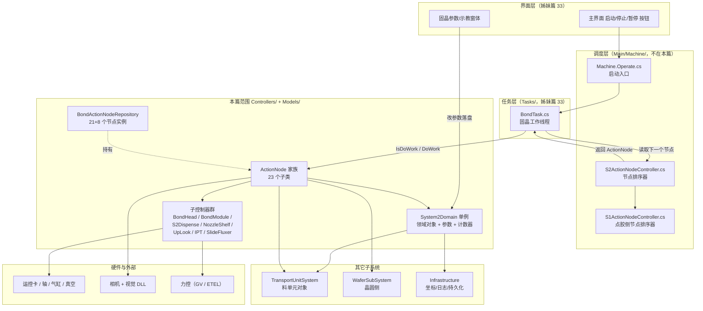

**ASCII 版（图 1）**

```text
  ┌───────────────────────┐        ┌──────────────────────────┐
  │ 界面层（33 姊妹篇）    │        │ 硬件与外部               │
  │  启动/停止/暂停 按钮   │        │  运控卡/轴/气缸/真空      │
  │  固晶参数 / 示教窗体   │        │  相机+视觉 DLL / 力控     │
  └───────┬───────────────┘        └────────▲─────────▲───────┘
          │ 点击                            │         │
          ▼                                 │         │
  ┌───────────────────────┐                 │         │
  │ Machine.Operate.cs    │                 │         │
  │   启动入口            │                 │         │
  └───────┬───────────────┘                 │         │
          ▼                                 │         │
  ┌───────────────────────┐  取下一个节点   │         │
  │ BondTask.cs 固晶线程  │◄───────────┐    │         │
  │  while(WaitStart)     │            │    │         │
  │    while(WaitStart)   │            │    │         │
  │      IsDoWork? ──否──►跳过          │    │         │
  │        │是                          │    │         │
  │      DoWork() ────────► ExcuteResult│    │         │
  │        │                            │    │         │
  │      switch(ret) ───► Abort/Retry/  │    │         │
  │                       Exception/    │    │         │
  │                       Alarm 四路    │    │         │
  │        │ 其余值 ──► 与 Success 同路  │    │         │
  └────────┬────────────────────────────┘    │         │
           │                                 │         │
           │  ┌──────────────────────────────┴──┐      │
           │  │ S2ActionNodeController.cs       │      │
           └─►│   节点排序 / 推进 / 重做         │      │
              └─────────────────────────────────┘      │
                                                       │
  ┌────────────────────────────────────────────────────┴──┐
  │ 本篇范围：Controllers/ + Models/                       │
  │  ┌──────────────────┐  ┌───────────────────────────┐  │
  │  │ ActionNode 家族  │  │ 子控制器群                │  │
  │  │  23 个子类       │─►│  BondHead / BondModule /  │──┘
  │  │  DoWork/IsDoWork │  │  S2Dispense / NozzleShelf │
  │  └────────┬─────────┘  │  UpLook / IPT / SlideFlux │
  │           │            └───────────────────────────┘
  │           ▼
  │  ┌────────────────────────────────────────────────┐
  │  │ System2Domain 单例（领域对象 + 参数 + 计数器）  │
  │  └───────┬──────────────────────┬─────────────────┘
  └──────────┼──────────────────────┼───────────────────
             ▼                      ▼
    TransportUnitSystem        Infrastructure
    （料单元对象）             （坐标/日志/持久化）
```

### 1.3 三条最重要的事实

这三条是「不读源码就想不到」的，也是本篇存在的理由。

**事实一：`BondSystem/Controllers/` + `Models/` 里没有任何 UI 按钮。**
实测 `Controllers/` 与 `Models/` 全部 80 个文件中：
`_Click` 处理器 **0 个**、`Designer.cs` **0 个**、`ControlService.ShowDialogForm<T>` 调用 **0 处**、`new FrmXxx(` 仅 **1 处**（`Controllers/System2Controller.AutoCali.cs:88` 的 `new FrmNozzleCaliTeach(nozzle)`）。
所以本系列规范里规定的「§4 UI 按钮与交互流程」在这一片**没有对象可写** —— 这就是本篇把 §4 改写成「**§4 驱动源与触发点**」的原因，详见 §4.1。
真正的按钮在姊妹篇 `33` 覆盖的 `BondSystem/Controls/` 里。

**事实二：这一层最危险的缺陷不是崩溃，而是「把失败当成成功」。**
`BondTask.cs:234` 的 `switch (ret)` 只写了 `Abort`（`:236`）、`Retry`（`:253`）、`Exception`（`:260`）、`Alarm`（`:277`）四个 `case`，**没有 `default`**。
而 `ExcuteResult` 枚举共有 9 个成员（定义在 DLL `AKRS.Galaxy2.Infrastructure.Enums`）。落在 `switch` 之外的 `Fail`、`NoStart`、`None`、`TimeOut` 四个值会**直接穿过去，走到和 `Success` 完全相同的收尾路径**（`BondTask.cs:319` 的 `FinishCurrentActionNode()`）。
实测 `NoStart` 在全仓有 **37 处**被当作返回值使用 —— 它不是罕见分支。这是本篇 §4.8 单列一节的唯一原因，也是全篇 §9.1 组的头号风险 `R-01`。

**事实三：动作节点是一个「按需装配、按序执行、串行阻塞」的流水线，没有并发。**
`BondActionNodeRepository.cs:265-284` 在主链上按固定顺序装配 21 个节点，`:288-302` 再挂 4 条子链。执行时 `BondTask` 在一个线程里挨个问 `IsDoWork()`、挨个调 `DoWork()`，**没有任何一个节点并行跑**；节点之间通过 `System2RunTimeProvider` 的静态字段和 `System2Domain` 单例传递数据（不是参数传递）。这套机制的完整时序图见 §6.5 的**图 25**。

## 2. 目录结构

本篇范围只有两个一级目录：`BondSystem/Controllers/`（15 个文件）与 `BondSystem/Models/`（65 个文件）。
**两个目录下都没有任何 `*.Designer.cs`** —— 这是「Controller/Model 层不碰界面」这条架构约定的最直接证据（也是 §1.3 事实一的由来）。

| 子目录 | 非 Designer 文件数 / 行数 | Designer 文件数 / 行数 | 说明 |
|---|---|---|---|
| `Controllers/`（本级） | 15 / 11,606 | 0 / 0 | 7 类子控制器 + `System2Controller` 的 4 个 partial |
| `Models/`（本级） | 1 / 1,213 | 0 / 0 | `System2Domain.cs` —— 固晶工位唯一的领域单例 |
| `Models/ActionNodes/`（本级） | 1 / 307 | 0 / 0 | `BondActionNodeRepository.cs` —— 节点装配表 |
| `Models/ActionNodes/BPActionNode/` | **13 / 10,120** | 0 / 0 | **本篇主体**：贴片（Bond/Pick）一族节点 |
| `Models/ActionNodes/AdjustActionNode/` | 5 / 792 | 0 / 0 | 视觉纠偏节点（载具/基板/基岛/焊点 + 墨点检测） |
| `Models/ActionNodes/DispenseAction/` | 3 / 543 | 0 / 0 | 点胶侧动作节点（预点胶 / 点胶 / 胶缺陷） |
| `Models/ActionNodes/HeightMeasurementActionNode/` | 4 / 510 | 0 / 0 | 测高节点（载具/基板/基岛/焊点四级） |
| `Models/ActionNodes/IdentityActionNode/` | 4 / 447 | 0 / 0 | 身份识别节点（同样是四级） |
| `Models/ActionNodes/Commons/` | 7 / 708 | 0 / 0 | 节点间共用的服务与参数载体 |
| `Models/DeviceParams/` | 10 / 1,360 | 0 / 0 | 设备参数（按硬件部件分文件） |
| `Models/Enums/` | 1 / 606 | 0 / 0 | `BondEnum.cs` —— 25 个枚举全在这一个文件里 |
| `Models/Parameter/` | 2 / 742 | 0 / 0 | `System2RunTimeProvider`（静态运行时计数）+ `System2Configuration`（工位总配置） |
| `Models/Programs/` | 8 / 1,110 | 0 / 0 | 配方程序（吸嘴架/点胶/固晶后检测/清洗/滑轨沾胶） |
| `Models/Repositories/` | 6 / 1,500 | 0 / 0 | 三个仓储：`Nozzle` / `NozzleShelf` / `PostBondInspection` |
| **合计** | **80 / 31,564** | **0 / 0** | 与附录 A 的合计核对表一致 |

**图 2：目录结构 → 职责分布**

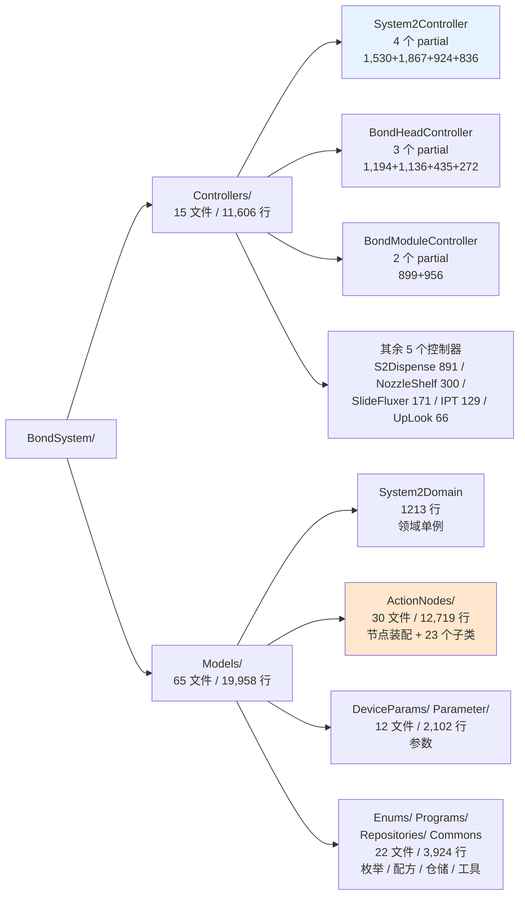

> 上面这几个数字都是「本级 + 子级」的合计，逐项相加等于 80 / 31,564，可直接用附录 A 核对。
> 需要注意的是 `Models/ActionNodes/` 这一支自己就占了 **12,719 行**（`30 文件 = 1 + 13 + 5 + 3 + 4 + 4 + 7`），
> 占本篇的 40.3% —— **读懂这一支就读懂了固晶系统的动作语义**。

## 3. 关键类型索引

### 3.1 类型清单

#### 3.1.1 控制器（`Controllers/`）

| 类型 | 位置 `文件:行` | 基类 | 职责 |
|---|---|---|---|
| `System2Controller` | `Controllers/System2Controller.cs:78`（partial，另有 `:62` / `AutoCali.cs:62` / `Assistant.cs:62` / `Vision.cs:48`） | 无（普通类） | 固晶工位主控制器：状态机、启动/停止/暂停/复位、换吸嘴、清洁、力值、涂胶、激光测高 |
| `BondHeadController` | `Controllers/BondHeadController.cs:47`（partial，另有 `ForceRelated.cs:35` / `MovementRelated.cs:23` / `GasIORelated.cs:19`） | 无 | 固晶头：真空、吹气、Z 轴、力控、上下视光源、气缸 |
| `BondModuleController` | `Controllers/BondModuleController.cs:51`（partial，另有 `MovementRelated.cs:43`） | 无 | 固晶模组：XY 轴运动、G0 坐标转换、丢料动作 |
| `S2DispenseController` | `Controllers/S2DispenseController.cs:46` | 无 | 点胶侧：点胶轴、测高气缸、预点胶盘 |
| `NozzleShelfController` | `Controllers/NozzleShelfController.cs:24` | 无 | 吸嘴架：工具仓配置校验、取放吸嘴、吹气清洁 |
| `UpLookController` | `Controllers/UpLookController.cs:11` | 无 | 上视相机：开窗、拍照、光源设置 |
| `IPTController` | `Controllers/IPTController.cs:12` | 无 | IPT（在线预贴/中转工位）控制 |
| `SlideFluxerController` | `Controllers/SlideFluxerController.cs:13` | 无 | 滑轨沾胶器：沾胶位移动与计时 |

> **重要事实**：这 8 个控制器**都不是单例**，也**没有 `GetInstance()`**。
> 它们是 `System2Domain` 单例上的**实例属性**，在属性初始化器里 `new` 出来（`Models/System2Domain.cs:73`-`:118`）。
> 全项目因此只有 `System2Domain.GetInstance().XxxController` 这一种取用方式，共 488 处 `GetInstance()` 调用点。
> 这意味着：**任何持有 `System2Domain.GetInstance()` 的代码都能拿到全部硬件控制器**，控制器之间没有隔离。

#### 3.1.2 领域与运行时状态（`Models/`）

| 类型 | 位置 `文件:行` | 基类 | 职责 |
|---|---|---|---|
| `System2Domain` | `Models/System2Domain.cs:68` | `SingletonNoSave<System2Domain>` | 固晶工位唯一领域单例：持有全部控制器、参数、运行时状态，并提供 `CheckIsReady()`（`:594`）、`WaitSingleStep()`（`:777`）等工位级操作 |
| `System2RunTimeProvider` | `Models/Parameter/System2RunTimeProvider.cs:52` | `static class` | 全静态的运行时计数器/标志位（工序计时、首次点胶、是否吹气完成……） |
| `System2Configuration` | `Models/Parameter/System2Configuration.cs:18` | `Singleton<System2Configuration>` + `INotifyPropertyChanged` | 工位总配置（会落盘） |
| `BondActionNodeRepository` | `Models/ActionNodes/BondActionNodeRepository.cs:20` | 无 | **节点装配表**：声明 21 个主链节点字段，并在 `Init()` 里建实例、挂子链 |

#### 3.1.3 动作节点族（`Models/ActionNodes/`）—— 23 个子类

**这一族是本篇的主体。** 全部 23 个类都直接继承 `ActionNode`（`Infrastructure/Models/CommonModels/ActionNode.cs:14`，`public abstract class ActionNode`），没有中间基类、没有二级继承。

| # | 类型 | 位置 `文件:行` | 行数 | 一句话职责 |
|---|---|---|---|---|
| 1 | `PickActionNode` | `BPActionNode/PickActionNode.cs:53`（partial，另 2 个文件） | 727+807+1012 | 从晶圆/翻转台**取芯片**（吸嘴下降、真空吸、抬起、上视纠偏） |
| 2 | `BondActionNode` | `BPActionNode/BondActionNode.cs:42`（partial，另 2 个文件） | 566+702+446 | 把芯片**贴到基板**（下视定位、Z 下压、力控、吹气脱离） |
| 3 | `SubstrateCameraCorrectionActionNode` | `BPActionNode/SubstrateCameraCorrectionActionNode.cs:45`（partial，另 2 个文件） | 870+130+1079 | 用基板相机**相机侧纠偏**：拍照求偏差、转 G0、补偿 |
| 4 | `UpLookCorrectionActionNode` | `BPActionNode/UpLookCorrectionActionNode.cs:64` | **2,044** | **上视纠偏**：芯片在吸嘴上的角度/位置偏差计算与旋转补偿（专题见 §6.4） |
| 5 | `DipFluxActionNode` | `BPActionNode/DipFluxActionNode.cs:37` | 784 | **沾胶**：下降到胶盘、停留计时、抬起 |
| 6 | `AfterBondCheckActionNode` | `BPActionNode/AfterBondCheckActionNode.cs:45` | 847 | **贴片后检测**：拍照判贴片质量，失败弹窗人工确认 |
| 7 | `BondPositionVisionTest` | `BPActionNode/BondPositionVisionTest.cs:27` | 106 | 焊点视觉自检（**参与编译但全项目零引用**，见 `R-38`） |
| 8 | `S2CarrierMeasureHeightActionNode` | `HeightMeasurementActionNode/S2CarrierMeasureHeightActionNode.cs:31` | 144 | 载具测高 |
| 9 | `S2SubstrateMeasureHeightActionNode` | `HeightMeasurementActionNode/S2SubstrateMeasureHeightActionNode.cs:25` | 112 | 基板测高 |
| 10 | `S2ModuleMeasureHeightActionNode` | `HeightMeasurementActionNode/S2ModuleMeasureHeightActionNode.cs:34` | 144 | 基岛测高 |
| 11 | `S2BondPositionMeasureHeightActionNode` | `HeightMeasurementActionNode/S2BondPositionMeasureHeightActionNode.cs:34` | 110 | 焊点测高 |
| 12 | `S2CarrierVisionActionNode` | `AdjustActionNode/S2CarrierVisionActionNode.cs:30` | 152 | 载具视觉纠偏 |
| 13 | `S2SubstrateVisionActionNode` | `AdjustActionNode/S2SubstrateVisionActionNode.cs:29` | 168 | 基板视觉纠偏 |
| 14 | `S2ModuleVisionActionNode` | `AdjustActionNode/S2ModuleVisionActionNode.cs:29` | 164 | 基岛视觉纠偏 |
| 15 | `BondPositionVisionActionNode` | `AdjustActionNode/BondPositionVisionActionNode.cs:32` | 170 | 焊点视觉纠偏 |
| 16 | `CheckInkDotActionNode` | `AdjustActionNode/CheckInkDotActionNode.cs:26` | 138 | 墨点（标记点）检测 |
| 17 | `S2TransportIdentityActionNode` | `IdentityActionNode/S2TransportIdentityActionNode.cs:24` | 111 | 载具身份识别（读码） |
| 18 | `S2SubstrateIdentityActionNode` | `IdentityActionNode/S2SubstrateIdentityActionNode.cs:29` | 116 | 基板身份识别 |
| 19 | `S2ModuleIdentityActionNode` | `IdentityActionNode/S2ModuleIdentityActionNode.cs:23` | 110 | 基岛身份识别 |
| 20 | `S2BondPositionIdentityActionNode` | `IdentityActionNode/S2BondPositionIdentityActionNode.cs:23` | 110 | 焊点身份识别 |
| 21 | `S2PreDispenseActionNode` | `DispenseAction/S2PreDispenseActionNode.cs:36` | 306 | 预点胶（含胶量检查 `EpoxySqueeze`） |
| 22 | `S2DispenseActionNode` | `DispenseAction/S2DispenseActionNode.cs:38` | 220 | 正式点胶 |
| 23 | `S2EpoxyDefectActionNode` | `DispenseAction/S2EpoxyDefectActionNode.cs:13` | 17 | 胶检 —— **类体完全为空**（`{}`），是个占位节点（见 `R-39`） |

#### 3.1.4 参数、配方与仓储

| 分组 | 类型（位置） |
|---|---|
| `DeviceParams/`（10） | `ULMPara.cs:1`、`BondHeadParam.cs`、`NozzleShelfParam.cs`、`BMCDevicePara.cs`、`S2DispenseDevicePara.cs`、`BondDevicePara.cs`、`IPTDevicePara.cs`、`S2PreDispensePlatePara.cs`、`CameraDevicePara.cs`、`SlideFluxerParam.cs` |
| `Programs/`（8） | `BondProgram.cs`、`NozzleShelfProgram.cs`、`S2PreDispensePlateProgram.cs`、`PostBondProgram.cs`、`CleanNozzleProgram.cs`、`S2DispenserProgram.cs`、`S2EpoxyMaterialProgram.cs`、`SlideFluxerProgram.cs` |
| `Repositories/`（6） | `Nozzle/Nozzle.cs`、`Nozzle/NozzleRepository.cs`、`NozzleShelf/NozzleShelf.cs`、`NozzleShelf/NozzleShelfRepository.cs`、`PostBondInspection/PostBondInspection.cs`、`PostBondInspection/PostBondInspectionRepository.cs` |
| `ActionNodes/Commons/`（7） | `PickActionService.cs`、`BondActionService.cs`、`DipActionService.cs`、`PickActionParameter.cs`、`BondActionParameter.cs`、`DipActionParamter.cs`、`PrecisionAcquisitionData.cs` |
| `Enums/`（1） | `BondEnum.cs`（606 行，25 个枚举全在这一个文件） |

> 各字段的默认值与各枚举成员的数值，逐个列在 §6.8（参数与枚举体系）。

### 3.2 继承层次图

**图 3：`ActionNode` 继承层次（23 个子类，无中间基类）**

```mermaid
graph TB
    AN["ActionNode（abstract）<br/>Infrastructure/Models/CommonModels/ActionNode.cs:14<br/>DoWork() :105 / IsDoWork() :59 / IsAlarm() :69<br/>WorkStart :47 / WorkStop :78"]

    AN --> G1["BPActionNode/ 取贴一族（7 个）"]
    AN --> G2["AdjustActionNode/ 视觉纠偏（5 个）"]
    AN --> G3["HeightMeasurementActionNode/ 测高（4 个）"]
    AN --> G4["IdentityActionNode/ 识别（4 个）"]
    AN --> G5["DispenseAction/ 点胶（3 个）"]

    G1 --> A1["PickActionNode<br/>:53 (partial×3)"]
    G1 --> A2["BondActionNode<br/>:42 (partial×3)"]
    G1 --> A3["SubstrateCameraCorrectionActionNode<br/>:45 (partial×3)"]
    G1 --> A4["UpLookCorrectionActionNode<br/>:64 · 2044 行"]
    G1 --> A5["DipFluxActionNode<br/>:37"]
    G1 --> A6["AfterBondCheckActionNode<br/>:45"]
    G1 --> A7["BondPositionVisionTest<br/>:27 · 零引用"]

    G2 --> B1["S2CarrierVisionActionNode :30"]
    G2 --> B2["S2SubstrateVisionActionNode :29"]
    G2 --> B3["S2ModuleVisionActionNode :29"]
    G2 --> B4["BondPositionVisionActionNode :32"]
    G2 --> B5["CheckInkDotActionNode :26"]

    G3 --> C1["S2CarrierMeasureHeightActionNode :31"]
    G3 --> C2["S2SubstrateMeasureHeightActionNode :25"]
    G3 --> C3["S2ModuleMeasureHeightActionNode :34"]
    G3 --> C4["S2BondPositionMeasureHeightActionNode :34"]

    G4 --> D1["S2TransportIdentityActionNode :24"]
    G4 --> D2["S2SubstrateIdentityActionNode :29"]
    G4 --> D3["S2ModuleIdentityActionNode :23"]
    G4 --> D4["S2BondPositionIdentityActionNode :23"]

    G5 --> E1["S2PreDispenseActionNode :36"]
    G5 --> E2["S2DispenseActionNode :38"]
    G5 --> E3["S2EpoxyDefectActionNode :13<br/>空类体"]

    style A4 fill:#ffe6cc
    style A7 fill:#f0f0f0
    style E3 fill:#f0f0f0
```

**ASCII 版（图 3）**

```text
                    ActionNode (abstract)  ActionNode.cs:14
                    ┌──────────────────────────────────────┐
                    │ + DoWork()   :105  → ExcuteResult    │
                    │ + IsDoWork() :59   → bool            │
                    │ + IsAlarm()  :69   → bool            │
                    │ WorkStart :47 / WorkStop :78 /        │
                    │ State :84 / IsCloseCylinder :89 /     │
                    │ IsVisionAction :99                    │
                    └───────────────┬──────────────────────┘
        ┌───────────┬───────────┬───┴───────┬────────────┬───────────┐
        ▼           ▼           ▼           ▼            ▼           │
  BPActionNode  Adjust-   HeightMeas-  Identity-   DispenseAction     │
   (取贴一族)    Action     urement      Action      (点胶)          │
        │           │           │           │            │           │
  ┌─────┴─────┐ ┌───┴───┐ ┌─────┴────┐ ┌────┴────┐ ┌─────┴─────┐     │
  │Pick      │ │Carrier│ │Carrier  H│ │Transport│ │PreDispense│     │
  │Bond      │ │Substr.│ │Substrate │ │Substrate│ │Dispense   │     │
  │SubsCamCor│ │Module │ │Module   H│ │Module   │ │EpoxyDefect│     │
  │UpLookCor │ │BondPos│ │BondPos  H│ │BondPos  │ │ (空类体)  │     │
  │DipFlux   │ │InkDot │ │          │ │         │ └───────────┘     │
  │AfterBond │ └───────┘ └──────────┘ └─────────┘                   │
  │VisionTest│                                                       │
  └───────────┘                                                      │
        └────────────────────── 23 个子类 ──────────────────────────┘
```

**图 4：控制器家族与领域对象的分层（谁 new 谁）**

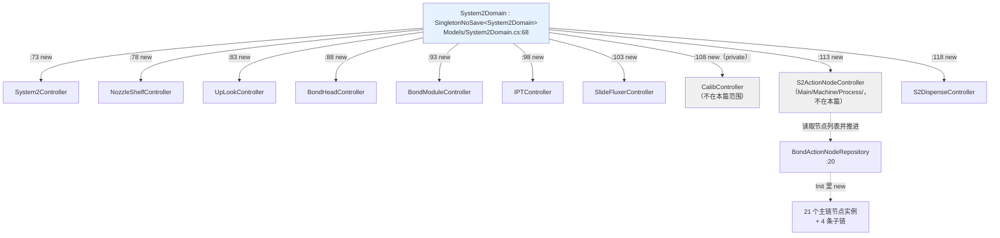

> 图 4 只画到「谁持有谁」。**注意 `ActionNodesService`（`:113`）虽然在本篇范围外（`Main/Machine/Process/S2ActionNodeController.cs`），
> 却是唯一驱动节点族的东西** —— 它的行为决定了本篇 23 个节点的执行顺序，所以 §6.5 与 §6.3 必须把它一起讲。
> 另外 `calibController`（`:108`）是**私有字段**、没有公开属性，外部拿不到 —— 标定入口只在 `System2Controller` 内部使用。

### 3.3 关键类型速查（按职责分组）

**A. 想改「贴片动作本身」→ 去这一组**

| 想看什么 | 直接打开 |
|---|---|
| 一个动作节点的完整生命周期 | `Infrastructure/Models/CommonModels/ActionNode.cs`（188 行，整个基类只有这么大） |
| 节点被谁按什么顺序执行 | `BondSystem/Tasks/BondTask.cs:100` `DoWork()`（双循环）→ `Main/Machine/Process/S2ActionNodeController.cs:1042` `GetNextActionNode()` |
| 「取芯片」全过程 | `Models/ActionNodes/BPActionNode/PickActionNode.cs:155` |
| 「贴芯片」全过程 | `Models/ActionNodes/BPActionNode/BondActionNode.cs:118` |
| 「上视纠偏」算法 | `Models/ActionNodes/BPActionNode/UpLookCorrectionActionNode.cs:131`（2,044 行，专题 §6.4） |
| 节点装配表 | `Models/ActionNodes/BondActionNodeRepository.cs:265`-`:302` |

**B. 想改「硬件怎么动」→ 去这一组**

| 想看什么 | 直接打开 |
|---|---|
| 固晶头真空/吹气/Z 轴 | `Controllers/BondHeadController.cs:47` |
| 固晶头力控（GV / ETEL 分支） | `Controllers/BondHeadController.ForceRelated.cs:35` |
| 固晶模组 XY 运动 | `Controllers/BondModuleController.MovementRelated.cs:43` |
| 点胶 | `Controllers/S2DispenseController.cs:46` |
| 吸嘴取放 | `Controllers/NozzleShelfController.cs:24` |
| 上视相机 | `Controllers/UpLookController.cs:11` |
| 滑轨沾胶器 | `Controllers/SlideFluxerController.cs:13` |
| IPT | `Controllers/IPTController.cs:12` |

**C. 想改「参数/配置」→ 去这一组**

| 想看什么 | 直接打开 |
|---|---|
| 所有枚举与数值 | `Models/Enums/BondEnum.cs`（606 行 / 25 个枚举） |
| 固晶头参数 | `Models/DeviceParams/BondHeadParam.cs` |
| 吸嘴架参数 | `Models/DeviceParams/NozzleShelfParam.cs` |
| 工位总配置（落盘） | `Models/Parameter/System2Configuration.cs:18` |
| 运行时计数器 | `Models/Parameter/System2RunTimeProvider.cs:52` |
| ULM（激光测高）参数 | `Models/DeviceParams/ULMPara.cs`（494 行） |

**D. 想查「现在是什么状态」→ 去这一组**

| 想看什么 | 直接打开 |
|---|---|
| 工位总体是否就绪 | `Models/System2Domain.cs:594` `CheckIsReady()` |
| 单步模式下阻塞在哪 | `Models/System2Domain.cs:777` `WaitSingleStep()` |
| 全局信号握手 | §4.5 的 `SignalPool` 表 |
| 各控制器的运行状态 | `System2Domain` 上对应的属性（`:73`-`:118`）|

## 4. 驱动源与触发点

### 4.1 为什么这一章不叫「UI 按钮与交互流程」

本系列规范里 §4 的标题是「**UI 按钮与交互流程**」。**这一片必须改成「驱动源与触发点」**，原因不是偷懒，而是实测结果：

| 实测项（命令见文末） | 结果 |
|---|---|
| `Controllers/` + `Models/` 下的 `*.Designer.cs` | **0 个** |
| `_Click` / `_MouseDown` / `_CheckedChanged` / `ItemClick` 等 UI 事件处理器 | **0 个** |
| DevExpress 控件声明（`DevExpress.*` 出现在字段/属性上） | **0 处** |
| `ControlService.ShowDialogForm<T>`（反射开窗服务）调用 | **0 处** |
| `new FrmXxx(...)` 直接构造窗体 | **1 处**（`Controllers/System2Controller.AutoCali.cs:88`） |
| `.ShowDialog()` 模态显示 | **1 处**（同上 `:91`） |
| 弹窗调用点（`AKRSMessageBoxExt.Show` 105 + `ShowWarn` 9 + `AKRSXtraMessageBox.Show` 69） | **183 处**（已去掉 4 处被注释的 → **活 179 处**） |
| 跨模块 UI 服务调用（`UcMainSystem.*` 8 种） | **35 处，去掉 1 处注释后活 34 处** |

**结论**：这一层**一个按钮都没有**，但它**并不是"没事发生"** —— 它有 179 个活的弹窗调用点、1 个模态窗体、34 处跨模块 UI 调用。
这些就是它的「交互」。所以本章把这些**和按钮等价地对待**：

> **凡是能让固晶系统"从静止变成动起来"的东西，都算这一章的「驱动源」。**
> 按钮只是其中一种。本篇范围内实际存在的驱动源有四类：
> **① 任务线程的主循环**、**② 状态机变迁**、**③ 运行期弹窗 / 模态窗体（人在回路）**、**④ 全局信号握手与单步**。
> **⑤ 定时器：本篇范围内 0 个**（`System.Windows.Forms.Timer` / `System.Timers.Timer` / `DispatcherTimer` 全部 0 命中）——
> 这一条也要写出来，因为"没有定时器"本身就是重要事实：**所有周期行为都靠线程里的 `while` + `Thread.Sleep` 实现**（57 处 `Thread.Sleep`）。

**图 5：本范围的驱动源全景（四类驱动源 + 零定时器）**

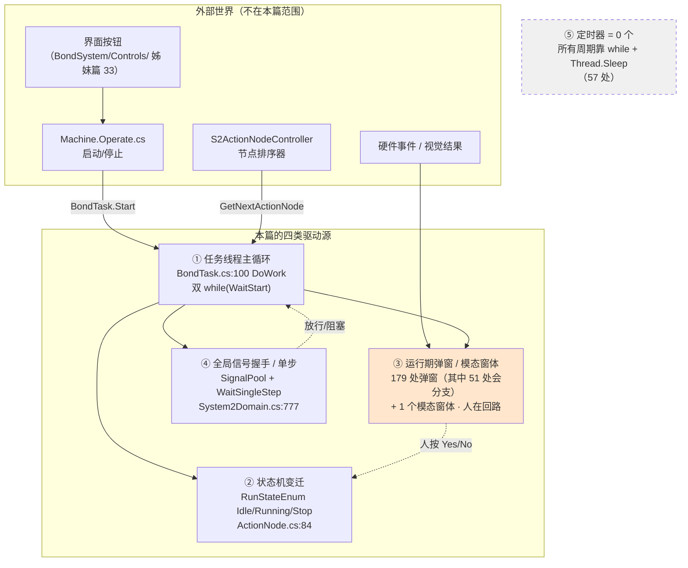

**ASCII 版（图 5）**

```text
  外部世界（不在本篇范围）
  ┌──────────────┐ ┌──────────────┐ ┌──────────────┐ ┌────────────┐
  │ 界面按钮      │ │Machine.Operate│ │S2ActionNode  │ │硬件/视觉    │
  │ (Controls/33) │ │  启动/停止    │ │ Controller   │ │  事件       │
  └──────┬───────┘ └──────┬───────┘ └──────┬───────┘ └─────┬──────┘
         │                │                │               │
         └────────────────┴────────┬───────┘               │
                                   ▼                       │
        ╔══════════════════════════════════════════════╗     │
        ║  本篇的四类驱动源                             ║     │
        ║                                              ║     │
        ║  ① 任务线程主循环                             ║     │
        ║     BondTask.cs:100 DoWork()                 ║     │
        ║     while(Signal.WaitStart())  ── 外层 :109  ║     │
        ║       while(Signal.WaitStart()) ── 内层 :214 ║     │
        ║           │                                  ║     │
        ║           ├──► ② 状态机变迁                  ║     │
        ║           │    RunStateEnum Idle/Running/Stop ║     │
        ║           │    ActionNode.cs:84              ║     │
        ║           │                                  ║     │
        ║           ├──► ③ 运行期弹窗（179 处）        ║◄────┘
        ║           │    + 1 个模态窗体                ║
        ║           │    AutoCali.cs:88/:91            ║
        ║           │        ▲                         ║
        ║           │        └── 人按 Yes/No ──► 回到 ② ║
        ║           │                                  ║
        ║           └──► ④ 全局信号握手 / 单步         ║
        ║                SignalPool +                  ║
        ║                System2Domain.cs:777          ║
        ║                     │                        ║
        ║                     └── 放行/阻塞 ──► 回到 ① ║
        ╚══════════════════════════════════════════════╝

  ⑤ 定时器 = 0 个：没有任何 Timer 声明；所有"周期性"行为
     都靠 ① 的 while 循环 + Thread.Sleep（全篇 57 处）实现。
```

**图 6：「为什么没有按钮」的判定链（可复现）**

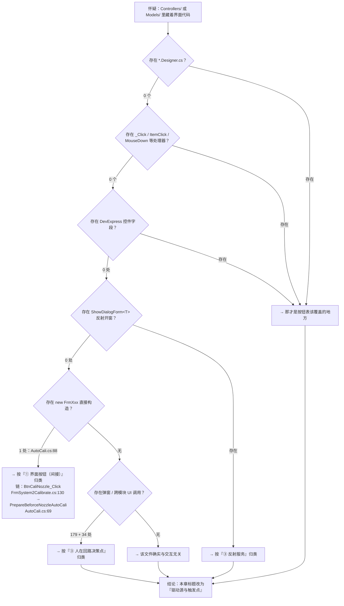

### 4.2 驱动源总表

下表列出**本篇范围内全部能让固晶系统动起来的入口**。分类口径：
**① 任务线程 / 主循环**（自己会转）、**② 状态机变迁**（状态改了才动）、**③ 人在回路**（弹窗等答复）、**④ 信号握手**（等别的工位放行）、**⑤ 定时器**（本篇为 0）。

| 序 | 驱动源 | 类别 | 触发条件 | 入口 `文件:行` | 驱动什么 | 失败/取消分支 |
|---|---|---|---|---|---|---|
| 1 | **固晶工作线程主循环** | ① | `Machine.Operate.cs:290` 启动后 `BondTask.Start()` | `Tasks/BondTask.cs:100` `DoWork()`；外层循环 `:109`；内层循环 `:214` | 全部 23 个动作节点的执行 | 外层循环退出 = 线程结束；内层退出 = 暂停态 |
| 2 | **取下一个节点** | ① | 内层循环每轮 | `BondTask.cs:226` `actionNode.IsDoWork()` → `:232` `DoWork()` → `:319` `FinishCurrentActionNode()` | 决定这一步做谁 | `IsDoWork()` 为假 → 跳过（不消耗步骤） |
| 3 | **节点推进** | ① | `switch(ret)` 四个分支之一 | `Main/Machine/Process/S2ActionNodeController.cs:1033` `FinishCurrentActionNode` / `:1042` `GetNextActionNode` | 换下一个节点 | 见 §5.2 图 17 |
| 4 | **重做注入** | ① | `Retry` / `Alarm` 分支 | `S2ActionNodeController.cs:1099`、`:1122` `SetActionNodeReWork` | 把节点重新排进队列 | 队列空 → 无节点可做 |
| 5 | **步骤注入** | ① | 物流把料单元送进来 | `S2ActionNodeController.cs:1410` `InjectSteps(transportUnit)` | 往执行序列里插物流步骤 | 料单元状态不符 → 不注入 |
| 6 | **自检** | ① | 开工前 | `S2ActionNodeController.cs:1359` `SelfCheck()` | 12 项工位就绪检查 | 任一项失败 → 中止 |
| 7 | **状态机变迁** | ② | `ActionNode.State` 被改写 | `ActionNode.cs:84` `State { get; set; } = RunStateEnum.Idle` | 节点是否可执行 | 见 §4.9 图 13 |
| 8 | **工作模式读取** | ② | 任务线程读 `MachineWorkModeEnum` | 离线 / 干跑两种模式 | 决定走真动作还是空跑 | 模式读错 → 空跑当生产（见 `R-30` 组） |
| 9 | **单步信号** | ④ | 操作员按"单步" | `Models/System2Domain.cs:777` `WaitSingleStep()`；内部 `:781` 读 `SignalPool...System2SingleStepSignal` | 每步之间阻塞等人 | 信号不来 → 永久阻塞（见 `R-12`） |
| 10 | **12 项就绪自检** | ④ | 运行时反复调用 | `Models/System2Domain.cs:594` `CheckIsReady()` | 判断能否开工 | 返回 false 即不动作 |
| 11 | **全局信号握手** | ④ | 跨工位协作 | `SignalPool` 的 7 个信号（§4.5 表） | 晶圆/翻转台/点胶/滑出放行 | 信号永不到 → 死等 |
| 12 | **吸嘴校准模态窗体** | ③ | 人工点「校准吸嘴」 | `Controllers/System2Controller.AutoCali.cs:88` `new FrmNozzleCaliTeach` / `:91` `ShowDialog()`；上游 `SupportFeature/Calibrate/FrmSystem2Calibrate.cs:130` `BtnCaliNozzle_Click` → `:132`，再进 `AutoCali.cs:69` `PrepareBeforceNozzleAutoCali` | 重新做吸嘴模板 | 用户按 Cancel → `:96` 返回 false；`IsShowDialog()` 为假 → `:113` 返回 false |
| 13 | **缺料 / 异常确认弹窗** | ③ | 运行时发现异常 | **51 处会分支的弹窗**（§4.3.2 全清单；总弹窗 179 处） | 让人决定继续、重试、抛料还是停机 | 弹窗默认返回值可能被当成"继续" |
| 14 | **视觉报警弹窗 / 上锁** | ③ | 视觉定位失败 | `UcMainSystem.VisionAlarmLockFunc` **7 处** / `VisionAlarmFunc` **8 处**（§4.3.4 表） | 弹出定位失败窗；`LockFunc` 版本会锁机 | 用户点掉后是否恢复由调用点决定 |
| 15 | **定时器** | ⑤ | —— | **0 处** | —— | —— |

> **怎么复现上表**（行号可直接复制去 `grep -n`）：
> ```bash
> cd "E:/项目/ZX2200标机/trunk/AKRS.ZX2200/BondSystem"
> grep -rn --include='*.cs' -E '_Click|ItemClick|MouseDown|CheckedChanged|CellClick' Controllers Models | wc -l   # → 0
> find Controllers Models -name '*.Designer.cs' | wc -l                                                          # → 0
> grep -rn --include='*.cs' -E 'new (Timer|DispatcherTimer)|Timers\.Timer' Controllers Models | wc -l             # → 0
> grep -rno 'AKRSMessageBoxExt\.Show\s*(' --include='*.cs' Controllers Models | wc -l                            # → 105
> grep -rno 'AKRSMessageBoxExt\.ShowWarn' --include='*.cs' Controllers Models | wc -l                             # → 9
> grep -rno 'AKRSXtraMessageBox\.Show\s*(' --include='*.cs' Controllers Models | wc -l                            # → 69
> grep -rn 'AKRSMessageBoxExt\.\|AKRSXtraMessageBox\.' --include='*.cs' Controllers Models \
>   | grep -vE '^\S+:[0-9]+:\s*//' | wc -l                                                                        # → 179（去掉注释后的活调用点）
> grep -rn --include='*.cs' -oE 'UcMainSystem\.\w+' Controllers Models | wc -l                                    # → 35
> grep -rn --include='*.cs' -E 'Thread\.Sleep' Controllers Models | wc -l                                        # → 57
> ```

> **一个必须记住的口径**：上表的 179 处弹窗**不是 179 个按钮**。它们是**代码在运行中停下来问人**的决策点 ——
> 与按钮最大的区别是：**按钮是"人主动发起"，弹窗是"机器主动停下"**。
> 后者在排查现场问题时更常被忽略，因为操作员会觉得"我没点任何东西，它就弹出来了"。

### 4.3 模态弹窗决策点（人在回路）

#### 4.3.1 先看清一个比例：179 处弹窗里，真正"会分支"的有 51 处

**统计口径**：只数**没有被注释掉**的调用点（`grep ... | grep -vE '^\S+:[0-9]+:\s*//'`）。

| 弹窗 API | 活调用点 | 按钮怎么给的 | 单按钮（纯告知） | **多按钮（真决策）** |
|---|---|---|---|---|
| `AKRSMessageBoxExt.Show` + `AKRSMessageBoxExt.ShowWarn` | **111** | **全部**用 `new string[]` + `new DialogResult[]`（111/111，一一配对） | 76 | **35** |
| `AKRSXtraMessageBox.Show` | **68** | **55** 处传 `MessageBoxButtons`，**13** 处不传（默认 OK） | 41 处 `OK` | **16** |
| **合计** | **179** | —— | 117 | **51** |

`MessageBoxButtons` 的取值分布（非注释）：

| 按钮组 | 处数 | 是否分支 |
|---|---|---|
| `OK` | 41 | ❌ 纯告知 |
| `OKCancel` | 5 | ✅ |
| `RetryCancel` | 5 | ✅ |
| `YesNo` | 4 | ✅ |
| `AbortRetryIgnore` | 2 | ✅ |
| **小计会分支** | **16** | |

**校验**：`111 + 68 = 179`；`111（按钮组）+ 55（MessageBoxButtons）= 166`；`179 - 166 = 13` = 不传按钮组的 `AKRSXtraMessageBox.Show` 处数。**三处口径自洽**。

> **结论**：这一层的弹窗**大部分是单向下通知**（"告诉你出错了，然后代码继续走"，117 处），
> 但**真正让人的回答改变程序走向的有 51 处** —— 这 51 处必须全部登记。
>
> **一个额外观察**：`AKRSMessageBoxExt.Show` 这一族的按钮**可以是任意多**（最多见 5 个），
> 例如 `Assistant.cs:318` 给了 `{ "重试", "终止", "忽略", "重取", "下一颗" }` 五个选择。
> **这 35 处是本层最"重"的人机交互点** —— 它们不是"要不要继续"那么简单，而是在**现场决策工艺走向**。

#### 4.3.2 会分支的 51 个决策点（全清单，一个不漏）

**(a) 自定义多按钮组（`new string[]`）的 35 处**

| # | 位置 `文件:行` | 按钮（原文） | 备注 |
|---|---|---|---|
| 1 | `Controllers/BondHeadController.ForceRelated.cs:915` | 重试 / 忽略 / 终止 | 力控相关 |
| 2 | `Controllers/BondHeadController.ForceRelated.cs:1114` | 重试 / 忽略 / 终止 | 力控相关 |
| 3 | `Controllers/S2DispenseController.cs:735` | 重试 / 忽略 / 停止 | 点胶 |
| 4 | `Controllers/S2DispenseController.cs:788` | 重试 / 停止 | 点胶 |
| 5 | `Controllers/System2Controller.Assistant.cs:86` | 忽略 / 抛料 | 取片 |
| 6 | **`Controllers/System2Controller.Assistant.cs:318`** | **重试 / 终止 / 忽略 / 重取 / 下一颗** | **本层按钮最多的弹窗（5 个）** |
| 7 | `Controllers/System2Controller.Assistant.cs:422` | 忽略 / 抛料 | 取片 |
| 8 | `Controllers/System2Controller.Assistant.cs:538` | 重试 / 终止 / 忽略 / 重取 | 4 个按钮 |
| 9 | `Controllers/System2Controller.Assistant.cs:709` | 是 / 否 | 蘸胶前确认 |
| 10 | `Controllers/System2Controller.Assistant.cs:887` | 重试 / 忽略 | |
| 11 | `Controllers/System2Controller.Assistant.cs:916` | 忽略 / 抛料 | |
| 12 | `Controllers/System2Controller.cs:181` | 确认 / 取消 | 吸嘴架未启用 → 手动换吸嘴（`:178-198`） |
| 13 | `Controllers/System2Controller.cs:216` | 忽略 / 取消 | `TakeNozzle` 内 |
| 14 | **`Controllers/System2Controller.cs:247`** | **重试 / 继续 / 退出** | `TakeNozzle` 的 `Recheck` 分支（`:228`） |
| 15 | `Controllers/System2Controller.cs:408` | 重试 / 忽略 / 终止 | `TakeNozzle` 的 `RetryChangeNozzle` 分支（`:334`） |
| 16 | `Controllers/System2Controller.cs:511` | 重试 / 忽略 / 退出 | `TakeNozzle` 的 `Retry` 分支（`:505`） |
| 17 | `Controllers/System2Controller.cs:568` | 确认 / 取消 | `PutbackNozzle` |
| 18 | `Controllers/System2Controller.cs:609` | 手动拿走 / 终止 | `PutbackNozzle` 的 `ReAlarm`（`:604`） |
| 19 | `Controllers/System2Controller.cs:642` | 重试 / 退出 | `PutbackNozzle` 的 `Recheck`（`:633`） |
| 20 | `Controllers/System2Controller.cs:809` | 重新检测 / 忽略 / 退出 | `PutbackNozzle` 的 `Retry`（`:801`） |
| 21 | `Controllers/System2Controller.cs:873` | 确认 / 取消 | `ChangeNozzle`（`:863`） |
| 22 | `Controllers/System2Controller.cs:919` | 确认 / 忽略 / 终止 | `ChangeNozzle` |
| 23 | `Controllers/System2Controller.cs:1393` | 重试 / 忽略 / 终止 | `LaserMeasureHeight` 的 `RetryCommand`（`:1379`） |
| 24 | `Controllers/System2Controller.Vision.cs:867` | 重试 / 忽略 / 终止 | 视觉 |
| 25 | `Models/ActionNodes/BPActionNode/BondActionNode.cs:239` | 重贴 / 终止 / 忽略 / 重新取贴 | 贴片失败 |
| 26 | `Models/ActionNodes/BPActionNode/DipFluxActionNode.cs:226` | 重新检测 / 退出 / 忽略 / 重取 | 蘸胶 |
| 27 | **`Models/ActionNodes/BPActionNode/PickActionNode.cs:378`** | **重新检测 / 退出 / 忽略 / 重取 / 下一颗** | **取片侧按钮最多的弹窗** |
| 28 | `Models/ActionNodes/BPActionNode/PickActionNode.MoveHelper.cs:924` | 忽略 / 退出 | |
| 29 | `Models/ActionNodes/BPActionNode/PickActionNode.Provider.cs:598` | 忽略 / 退出 | |
| 30 | `Models/ActionNodes/BPActionNode/SubstrateCameraCorrectionActionNode.cs:430` | 重取 / 终止 / 忽略 / 下一颗 | 中转台纠偏 |
| 31 | `Models/ActionNodes/BPActionNode/SubstrateCameraCorrectionActionNode.cs:622` | **Repick / Abort / Ignore** | ⚠️ **唯一一处英文按钮**（其余全是中文） |
| 32 | `Models/Programs/S2PreDispensePlateProgram.cs:108` | 确认 / 停止 | 预点胶盘 |
| 33 | `Models/Programs/S2PreDispensePlateProgram.cs:129` | 确认 / 停止 | 预点胶盘 |
| 34 | `Models/System2Domain.cs:886` | 重试 / 跳过 / 终止 | 自检流程 |
| 35 | `Models/System2Domain.cs:962` | 重试 / 跳过 / 终止 | 自检流程 |

**(b) `MessageBoxButtons` 的 16 处**

| # | 位置 `文件:行` | 提示文字（原文摘录） | 按钮组 | 分支走向 |
|---|---|---|---|---|
| 36 | `Models/System2Domain.cs:736` | 「焊头上没有检测到吸嘴，与程式冲突!\r\nYes:设置焊头上没有吸嘴\r\nNo:终止工作」 | `YesNo` | Yes → `SetCurrentNozzleName(string.Empty)`（`:743`）；否则 `return false` 终止开工 |
| 37 | `Models/System2Domain.cs:755` | 「记忆中吸嘴上有料，请选择如何处理!\r\nOK:抛料\r\nNo:忽略」 | `OKCancel` | OK → `ThrowAction()`（`:763`）；否则忽略继续。⚠️ 见 `R-31`（提示写「No:忽略」，按钮实际是 Cancel） |
| 38 | `Controllers/BondHeadController.cs:834` | 「测高失败请检查搜索距离！\r\n Retry：重测\r\n Cancel：结束」 | `RetryCancel` | Retry → `goto ReMeasureHeight`（`:838`）；Cancel → 不重测 |
| 39 | `Controllers/BondHeadController.cs:848` | 「测高失败！\r\n Retry：重测\r\n Cancel：结束」 | `RetryCancel` | 同上（非 `TimeOut` 的一般失败） |
| 40 | `Controllers/System2Controller.Assistant.cs:730` | 「蘸胶完成后检测到焊头上没有芯片，请人工确认！\r\nAbort:退出\r\nRetry:重新检测\r\nIgnore:忽略」 | `AbortRetryIgnore` | Abort → `return ExcuteResult.Abort`（`:741`）；Retry → `goto ReCheck`（`:744`）；Ignore → 继续 |
| 41 | `Controllers/System2Controller.Assistant.cs:809` | 同上（另一条蘸胶路径） | `AbortRetryIgnore` | 同上（`goto ReCheck` 至 `:820`） |
| 42 | `Controllers/System2Controller.Assistant.cs:790` | 「请选择此芯片是否需要先去刮胶盘蘸胶？」 | `YesNo` | Yes → `DipFluxOnFluxer(component)`（`:796`） |
| 43 | `Controllers/System2Controller.Assistant.cs:1677` | （提示文字较长，按 `文件:行` 定位） | `OKCancel` | 取消则不走该步骤 |
| 44 | `Controllers/System2Controller.Assistant.cs:1722` | 同上 | `OKCancel` | 同上 |
| 45 | `Controllers/System2Controller.Assistant.cs:1763` | 同上 | `OKCancel` | 同上 |
| 46 | `Controllers/System2Controller.Assistant.cs:1846` | 同上 | `OKCancel` | 同上 |
| 47 | `Controllers/System2Controller.AutoCali.cs:85` | 「是否需要重新做吸嘴模板？」 | `YesNo` | Yes → 打开模态窗体（见 §4.3.3）；否则跳过 |
| 48 | `Controllers/System2Controller.AutoCali.cs:99` | 「是否开始校正吸嘴？」 | `YesNo` | Yes → 继续校正；否则 `MoveToSafePos()`（`:104`）后 `return false`（`:105`） |
| 49 | `Models/ActionNodes/BPActionNode/BondActionNode.Provider.cs:203` | （提示文字较长，按 `文件:行` 定位） | `RetryCancel` | Retry → `goto` 重试 |
| 50 | `Models/ActionNodes/BPActionNode/BondActionNode.Provider.cs:484` | 同上 | `RetryCancel` | Retry → `goto` 重试 |
| 51 | `Models/Parameter/System2RunTimeProvider.cs:322` | 「文件已被打开，保存定位数据失败!\r\n Retry:关掉文件重新保存\r\nCancel:不保存数据」 | `RetryCancel` | Retry → **递归调用 `SaveEjectionTime()`**（`:329`），见 `R-37` |

> **(b) 组里第 43-46、49-50 项的原文较长**，给出定位行段即可 ——
> 这 6 处的**分支模式与第 38、39 项完全一致**（`Retry` → 重试，`Cancel` → 放弃），不重复抄写。

**坑**

- ⚠️ **第 31 项（`SubstrateCameraCorrectionActionNode.cs:622`）是全层唯一的英文按钮**（`Repick` / `Abort` / `Ignore`），
  其余 34 处都是中文。现场操作员面对这个弹窗需要在两套语言之间切换。
- ⚠️ **第 51 项用"递归"实现重试**（`:329` `SaveEjectionTime()` 调自己），**不是循环** ——
  如果 Excel 文件一直被占用，**每一轮递归都压一层栈帧**，存在栈溢出风险。见 `R-37`。

#### 4.3.3 本范围唯一的模态窗体：`FrmNozzleCaliTeach`

这是 `Controllers/` + `Models/` 里**唯一一处**直接构造窗体并 `ShowDialog()` 的地方。

**图 7：唯一模态窗体的开窗路径（① 界面按钮 → ② 任务调用 → ③ 直接 `new`）**

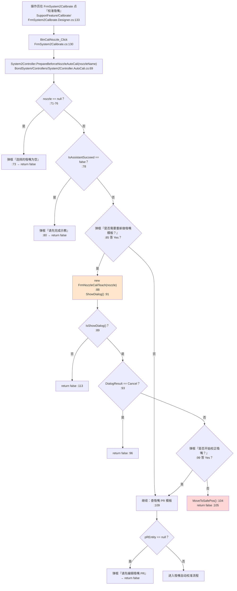

**调用链（带行号，逐层到最终效果）**

| 层 | 位置 | 做什么 |
|---|---|---|
| ① 界面按钮 | `SupportFeature/Calibrate/FrmSystem2Calibrate.Designer.cs:133` | 接线 `BtnCaliNozzle.Click` |
| ① 处理器 | `SupportFeature/Calibrate/FrmSystem2Calibrate.cs:130` | `BtnCaliNozzle_Click` |
| ② 跨模块调用 | `FrmSystem2Calibrate.cs:132` | `system2Controller.PrepareBeforceNozzleAutoCali(CmbNozzleName.Text)` |
| ③ 本范围入口 | `BondSystem/Controllers/System2Controller.AutoCali.cs:69` | 校验 → 开窗 |
| ③ 开窗 | `System2Controller.AutoCali.cs:88` / `:91` | `new FrmNozzleCaliTeach(nozzle)` / `ShowDialog()` |
| 界面变化 | 模态窗体挡住主界面，等用户操作 | —— |
| 内存变更 | 窗体内的保存动作改吸嘴模板数据 | —— |
| 落盘 | 由窗体内部保存按钮决定（窗体在 `SupportFeature/`，不在本篇范围） | —— |
| 下发硬件 | `MoveToSafePos()`（`AutoCali.cs:104`）在用户放弃时把固晶模组移到安全位 | —— |

**坑**

- ⚠️ **这不是反射开窗**：`new FrmNozzleCaliTeach(nozzle)` 是**编译期强类型**的，改构造函数签名会在编译期报错（对比 `_反射开窗与隐式入口` 里 `ControlService.ShowDialogForm<T>` 的静默失败风险 —— 本范围没有那种风险）。
- ⚠️ **`IsShowDialog()` 与 `ShowDialog()` 是两次独立调用**（`:89` / `:91`），中间没有锁。
  `IsShowDialog()` 是窗体自己判断"该不该显示"的方法，**两个调用之间状态可能被别的线程改变** —— 典型 TOCTOU 形状。
  佐证：`ShowDialog()` 本身有全局 UI 锁（`AKRSMessageBoxExt.UiLock`），但 `:89` 的 `IsShowDialog()` 没有。
  *（推断：未见 `IsShowDialog()` 加锁；其定义在窗体里，窗体不在本篇范围，未逐行核对其内部是否自行加锁。）*
- 🔴 **开窗后没有 `Dispose()`**：反射服务版本（`ControlService.cs:378`）在 `ShowDialog()` 后会 `form.Dispose()`，而这里 `:91` 之后的代码路径既不 `using` 也不 `Dispose`。**每点一次『校准吸嘴』泄漏一个窗体实例。**（见 `R-32`）

#### 4.3.4 第三类入口：跨模块 UI 服务调用（`UcMainSystem.*`，34 处）

这一层**不自己画界面**，但它会**直接调用主界面（`UcMainSystem`）上的静态方法**去弹窗、刷图、改图表。
这些是**本范围与界面之间唯一的直接耦合**，也是"§4.1 第三种入口分类"里最容易被漏掉的一类 ——
因为它们既不是 `new FrmXxx`，也不是 `ControlService.ShowDialogForm<T>`，而是**直接静态调用**。

| # | 服务 | 活调用点 | 作用 | 阻塞？ |
|---|---|---|---|---|
| 1 | `UcMainSystem.VisionAlarmFunc` | **7 处**：`Assistant.cs:187`、`:1286`；`PickActionNode.Provider.cs:274`；`BondActionNode.Provider.cs:280`；`SubstrateCameraCorrectionActionNode.cs:582`；`UpLookCorrectionActionNode.cs:1488`、`:1730`（`Assistant.cs:1423` 被注释） | 弹"定位失败"窗，**返回 `(DialogResult, BaseAlgResult)` 二元组** | ✅ **阻塞**，且**返回值直接决定流程走向** |
| 2 | `UcMainSystem.VisionAlarmLockFunc` | **7 处**：`System2Controller.Vision.cs:101`；`System2Domain.cs:548`、`:1061`；`AfterBondCheckActionNode.cs:385`、`:500`、`:816`；`PostBondInspection.cs:603` | 同上，但**会锁机**（名字里的 `Lock`） | ✅ 阻塞 |
| 3 | `UcMainSystem.ReFreshSystem2TuAction` | **3 处**：`AfterBondCheckActionNode.cs:345`、`BondActionNode.cs:360`、`BondActionNode.MoveHelper.cs:173` | 刷新界面的料单元显示 | ❌ 不阻塞 |
| 4 | `UcMainSystem.SetChartControlConstantLine` | **4 处**：`BondHeadController.cs:123`、`:418`；`BondActionNode.Provider.cs:376`；`PickActionNode.Provider.cs:355` | 在力值曲线上画一条目标力值的参考线 | ❌ 不阻塞 |
| 5 | `UcMainSystem.ActiveReadBondForce` | **10 处**：`BondHeadController.cs:126`、`:383`、`:420`、`:565`；`BondActionNode.cs:514`；`BondActionNode.Provider.cs:379`、`:396`；`PickActionNode.cs:655`；`PickActionNode.Provider.cs:358`、`:377` | **开/关力值曲线采样** | ❌ 不阻塞 |
| 6 | `UcMainSystem.ChangeCameraVision` | **1 处**：`BondActionNode.Provider.cs:645` | 切换界面显示的相机画面（到"Bond相机"） | ❌ |
| 7 | `UcMainSystem.VmVisionShow` | **1 处**：`BondActionNode.Provider.cs:644` | 显示视觉画面 | ❌ |
| 8 | `UcMainSystem.InputDebugAction` | **1 处**：`System2RunTimeProvider.cs:238` | 写调试日志到界面 | ❌ |

**为什么必须登记这一类**

- 🔴 **第 1、2 类（`VisionAlarmFunc` / `VisionAlarmLockFunc`）共 14 处是"人在回路"的真正决策点**，
  它们**不经过本层的任何弹窗 API**，所以只 grep `AKRSMessageBoxExt` / `AKRSXtraMessageBox` **一定查不到它们**。
- ⚠️ **第 5 类（`ActiveReadBondForce`）是本层的"心跳假象"来源** ——
  它打开的是界面上的力值曲线采样，**与固晶线程无关**。固晶线程卡死时曲线可能还在动（详见 §4.7 结尾）。
- ⚠️ **第 3-8 类"刷界面"调用（共 20 处）没有做线程封送检查**。
  它们由固晶工作线程调用（不是 UI 线程）。
  *（推断：`UcMainSystem` 是主窗体上的静态成员，其方法内部是否 `Invoke`/`BeginInvoke` 回 UI 线程，
  未在本篇范围内核对 —— `UcMainSystem` 属 `Main/` 目录，不在本篇 80 个文件里。**这是一个必须去 `Main/` 侧确认的点**，
  见附录 B。）*

### 4.4 后台线程与 fire-and-forget 触发点

本篇范围内**不创建线程**（线程创建在 `Tasks/BondTask.cs:365` 的 `Task.Factory.StartNew`，属姊妹篇 `33`），
但它**大量使用 `Task.Run` 把子动作甩到线程池**，然后用 `.Wait()` 收回来。这是本层最重要的并发模式。

| 统计项 | 数量 | 命令 |
|---|---|---|
| `Task.Run` 出现 | **38 处**（含 `System2Controller.Assistant.cs:1350` 一处被注释，**活 37 处**） | `grep -rn 'Task\.Run'` |
| `.Wait()`（含超时重载） | **28 处** | `grep -rn '\.Wait()'` |
| `await` | **1 处** | `grep -rn '\bawait\b'` |
| `.Result` | **0 处** | —— |
| `lock` | **3 处** | —— |
| `Thread.Sleep` | **57 处** | —— |
| `Timer` 声明 | **0 处** | —— |

#### 4.4.1 主力模式：T 轴并行 + `.Wait()` 收回（12 组）

**这是本层唯一被反复使用的"真并行"**：T 轴（旋转）与 XY/Z 走一个插补的同时，T 轴单独起一个 Task 转，然后 `.Wait()` 等它转完。

| # | 起 Task（`文件:行`） | `.Wait()` 收回（`文件:行`） |
|---|---|---|
| 1 | `BPActionNode/BondActionNode.MoveHelper.cs:248` | `:344` |
| 2 | `BPActionNode/DipFluxActionNode.cs:427` | `:536` |
| 3 | `BPActionNode/DipFluxActionNode.cs:588` | `:680` |
| 4 | `BPActionNode/PickActionNode.MoveHelper.cs:163` | `:319` |
| 5 | `BPActionNode/PickActionNode.MoveHelper.cs:462` | `:526` |
| 6 | `BPActionNode/SubstrateCameraCorrectionActionNode.MoveHelper.cs:138` | `:293` |
| 7 | `BPActionNode/SubstrateCameraCorrectionActionNode.MoveHelper.cs:338` | `:399` |
| 8 | `BPActionNode/SubstrateCameraCorrectionActionNode.MoveHelper.cs:592` | `:665`（`axisTMoveTask?.Wait()`） |
| 9 | `BPActionNode/UpLookCorrectionActionNode.cs:800` | `:884` |
| 10 | `BPActionNode/UpLookCorrectionActionNode.cs:964` | `:1070` |
| 11 | `BPActionNode/UpLookCorrectionActionNode.cs:1117` | `:1198` |
| 12 | `BPActionNode/UpLookCorrectionActionNode.cs:1250` | `:1331` |

**图 8：T 轴并行 + `.Wait()` 收回的模式（以及它的失败分支）**

```mermaid
sequenceDiagram
    participant N as "动作节点 DoWork()<br/>（固晶工作线程）"
    participant TP as "线程池<br/>Task.Run"
    participant HW as "运控卡"

    N->>N: "Task axisTMoveTask = default;"
    N->>TP: "Task.Run(T 轴旋转)"
    activate TP
    TP->>HW: "写 T 轴目标位"
    N->>HW: "写 XY / Z 插补（与 T 轴并行）"
    Note over N,HW: "两条运动同时进行 —— 这是唯一被刻意并行的地方"
    N->>TP: "axisTMoveTask.Wait()"
    TP-->>N: "T 轴动作完成 / 抛异常"
    deactivate TP
    alt "T 轴先到位"
        N->>N: "Wait 立即返回，继续下一步"
    else "XY/Z 先到位"
        N->>N: "Wait 阻塞等待 T 轴"
    else "T 轴抛异常"
        N->>N: "Wait 抛 AggregateException<br/>向上冒泡到 DoWork 的 try/catch"
    end
```

**ASCII 版（图 8）**

```text
  固晶工作线程                          线程池                运控卡
  ──────────────                        ──────                ──────
       │
       │ Task axisTMoveTask = default;
       │
       ├── Task.Run(T轴旋转) ─────────────►│
       │                                   ├── 写 T 轴目标位 ──►│
       │                                                         │
       ├── 写 XY/Z 插补（并行）──────────────────────────────────►│
       │                                                         │
       │   （两条运动同时进行）                                   │
       │                                                         │
       ├── axisTMoveTask.Wait() ──────────►│
       │                                   │
       │   ┌── T 轴先到位 ──► Wait 立即返回，继续
       │   ├── XY/Z 先到位 ─► Wait 阻塞等 T 轴
       │   └── T 轴抛异常 ──► Wait 抛 AggregateException
       │                       → 冒泡到 DoWork 的 try/catch
       ▼
```

**坑**

- ⚠️ **12 组里只有第 8 组用了 `?.`**（`SubstrateCameraCorrectionActionNode.MoveHelper.cs:665` `axisTMoveTask?.Wait()`）。
  其余 11 组是裸 `axisTMoveTask.Wait()`。如果 `Task.Run` 那一步被条件跳过（`if` 不成立），
      局部变量还是 `default`（`null`）→ **裸 `.Wait()` 直接 `NullReferenceException`**。
      *（推断：需要该分支被走到才能触发；未见针对此的测试或保护。）*
- ⚠️ `PickActionNode.MoveHelper.cs:564` 声明了 `Task axisTMoveTask = default;` 但**整个方法里没有赋值也没有 `.Wait()`** —— 残留的死变量，可删。
- ✅ 没有 `.Result`、没有 `GetAwaiter().GetResult()`，所以**不存在经典的"线程池饥饿 + 同步等待"死锁形状**（`.Wait()` 等的是 `Task.Run` 的线程池任务，不是 UI 线程的 `SynchronizationContext`）。

#### 4.4.2 看得见的 fire-and-forget（发出去就不管）

这 4 处**不 `.Wait()`，也不看返回**：

| # | 位置 `文件:行` | 发出去的动作 | 后果 |
|---|---|---|---|
| 1 | `Controllers/System2Controller.cs:270` | `Task.Run(this.nozzleShelfController.MoveShelfToChangeNozzlePos)` | 吸嘴架移动，不等到位 |
| 2 | `Controllers/System2Controller.cs:690` | 同上 | 同上 |
| 3 | `BPActionNode/BondActionNode.cs:232` | `Task.Run(this.bondHeadController.CloseToolVaccum)` | 关真空，不等结果 |
| 4 | `BPActionNode/PickActionNode.Provider.cs:388` / `:701` | `return Task.Run(() => ...)` —— **把 Task 当返回值抛出去** | 调用方若丢弃返回值就是 fire-and-forget |

> 第 1、2 项是**同一段代码在两处重复**（`:270` 与 `:690` 内容一致），属于 §9.6「设计层面的重复」。
> 第 4 项的危险在于：**返回 `Task` 的方法看起来像异步，但签名是同步的** ——
> 调用方不 `await` 也不 `.Wait()` 时，编译期不会有任何提示，运行期悄悄变成"不等"。

#### 4.4.3 带超时的 fire-and-forget（唯一一处有超时兜底）

`Controllers/BondHeadController.cs` 的顶针顶起是本层**唯一**给 `Task` 设超时的地方，值得单独画出来。

**图 9：顶针顶起的异步 + 2 秒超时分支**

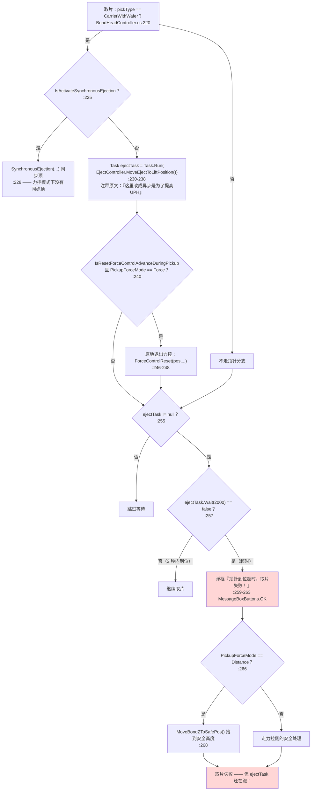

**坑（这里有两个真问题）**

- 🔴 **超时后没有取消顶针任务**：`ejectTask.Wait(2000)` 返回 `false` 只是**放弃等待**，
  `MoveEjectToLiftPosition()` 仍在后台继续执行。随后代码走"抬到安全高度 / 抛料"流程，
  **顶针却在同时往上顶** —— 两条动作同时作用在取片工位。见 `R-33`。
- ⚠️ **超时弹窗是 `MessageBoxButtons.OK`**（`:261`），操作员只有"知道了"一个选择，
  **既不能重试也不能中止**，只能等后续流程自己走完。
- ⚠️ **注释与代码不一致**：`:224` 写着「力控模式下没有同步顶，后续看有没有此工艺需求」，
  但 `:240-248` 在力控模式（`ForceMode == Force`）下**确实做了"原地退出力控"以配合异步顶针**。
  这是两处历史改动叠在一起留下的表述矛盾。

### 4.5 全局信号握手（`SignalPool`）

固晶工位**不是一个人干活** —— 它要从晶圆侧取芯片、要从翻转台取芯片、要给点胶侧让路、要让物流把基板送出去。
这些**跨工位协作全部通过一个全局信号池 `SignalPool` 完成**。

> `SignalPool` 的定义**不在源码里**（`grep -rln "class SignalPool"` 全仓 0 命中），它来自引用的 DLL
> （*推断：属于 `AKRS.Galaxy2.Infrastructure` 命名空间，与 `ExcuteResult` 同一个程序集；未见源码，故不描述其内部实现*）。
> 从用法可确定：它有 `Set()`（置位）、`Wait()`（阻塞等）、`Wait(int 毫秒)`（带超时等）三种操作，
> 且**部分信号"自动复位"**（`System2RunTimeProvider.cs:376` 的注释原文：「这个信号会自动复位」）。

#### 4.5.1 本范围用到的 8 个信号（全清单）

| # | 信号 | 本范围用法计数 | Set() 位置（发出放行） | Wait() 位置（等待放行） |
|---|---|---|---|---|
| 1 | `IsBondNeedChipSignal` | **22** | `Assistant.cs:207`、`:352`、`:1322`、`AutoCali.cs:378`、`PickActionNode.cs:428`、`:444`、`PickActionNode.MoveHelper.cs:888`、`PickActionNode.Provider.cs:75`、`:101`、`:255`、`:290`、`:646`、`:664`、`SubstrateCameraCorrectionActionNode.cs:470`、`:661`、`SubstrateCameraCorrectionActionNode.Provider.cs:65`、`UpLookCorrectionActionNode.cs:472`、`:1439`、`:1525`、`:1681`、`:1767`、`:2029` | 本范围内无 `Wait` |
| 2 | `IsWaferAllowPickSignal` | 6 | 本范围内无 `Set`（由晶圆侧发出） | `Assistant.cs:122`、`:388`、`:450`、`PickActionNode.Provider.cs:332`、`System2RunTimeProvider.cs:348`（**带 100 ms 超时的循环**）、`:378` |
| 3 | `BondDipFluxFinishSignal` | 7 | `BondActionNode.Provider.cs:680`、`UpLookCorrectionActionNode.cs:717`、`:1550`、`:1555`、`:1792`、`:1797`（另 `DipFluxActionNode.cs:273` **被注释**） | 本范围内无 `Wait` |
| 4 | `AllowSlideOutSignal` | 4 | `BondActionNode.Provider.cs:675`、`:683`、`UpLookCorrectionActionNode.cs:1558`、`:1800` | 本范围内无 `Wait` |
| 5 | `IsBondPickSucceedSignal` | 3 | `PickActionNode.cs:433`、`PickActionNode.MoveHelper.cs:950`、`PickActionNode.Provider.cs:624` | 本范围内无 `Wait` |
| 6 | `IsAllowDipFluxSignal` | 2 | 无 | `DipFluxActionNode.cs:136`、`:709` |
| 7 | `System2SingleStepSignal` | 1 | 无 | `System2Domain.cs:781`（`WaitSingleStep()`） |
| 8 | `IsFlipTableAllowPickSignal` | 1 | 无 | `System2RunTimeProvider.cs:388` |

> **注意 1/3/4/5 这四个信号在本范围内"只发不收"** —— 发出去由别的工位接。这正好说明它们是**跨工位通知**，不是本工位内部的状态。
> 反过来 2/6/7/8 是"只收不发"，说明**放行权在别的工位**。

#### 4.5.2 核心握手时序

**图 10：固晶工位等晶圆放行的握手时序（含超时与中止分支）**

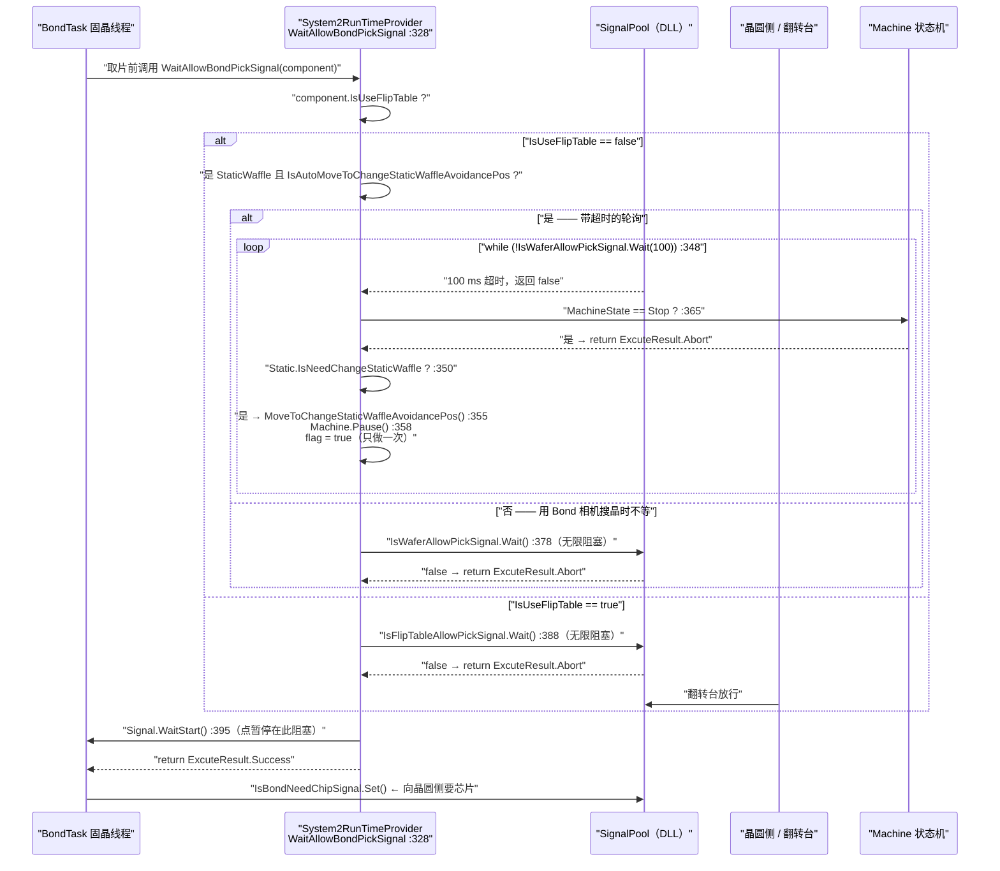

**ASCII 版（图 10）**

```text
  固晶线程         WaitAllowBondPickSignal         SignalPool       晶圆侧/翻转台     Machine
  ────────         ─────────────────────           ──────────       ────────────     ───────
      │                      │
      ├─ 取片前调用 ────────►│
      │                      ├─ IsUseFlipTable ?
      │                      │
      │        ┌─────────────┴──────────────┐
      │        │ false                      │ true
      │        ▼                            ▼
      │  静态华夫盒避让位配置？         IsFlipTableAllow →
      │   ┌────┴────┐                   PickSignal.Wait() :388
      │   │是       │否                     │      （无限阻塞）
      │   ▼         ▼                       │        │
      │ 轮询 :348  SearchCamera ==          │        └─ 翻转台放行
      │  │         WaferCamera ?           │
      │  │         └─ 是 → Wait() :378     │
      │  │              （无限阻塞）        │
      │  │                                 │
      │  └─► while(!Wait(100))  ──┬──► 100ms 超时
      │         │                 │
      │         │                 ├─► MachineState == Stop ? :365
      │         │                 │      └─ 是 → return Abort ★
      │         │                 │
      │         │                 └─► IsNeedChangeStaticWaffle ? :350
      │         │                        └─ 是 → 移到避让位 :355
      │         │                               Machine.Pause() :358
      │         │                               flag=true（只做一次）
      │         ▼
      │   ⚠ 这个 while 没有总超时：信号不来且
      │     既不需要换盒也不是 Stop → 永久轮询
      │
      ├─ Signal.WaitStart() :395 ◄── 点暂停在这里阻塞
      │        │
      │        └── false → return Abort
      │
      ◄── return Success
      │
      └─ IsBondNeedChipSignal.Set()  ──► 向晶圆侧要芯片
```

**坑**

- 🔴 **`:348` 的 `while` 没有总超时**：循环体只检查两件事（要不要换静态华夫盒、是不是 `Stop`）。
  如果晶圆侧既不发信号、也不属于这两种情况，**线程会一直每 100 ms 轮询下去**，界面上看不到任何提示。
  见 `R-34`。
- ⚠️ **同一个等待行为有三套写法**：带超时轮询（`:348`）、无限阻塞（`:378`、`:388`）、
  `Signal.WaitStart()`（`:395`）。三种语义不同但函数名都叫 `Wait*`，容易看错。
- ⚠️ **`BondDipFluxFinishSignal` 在 `DipFluxActionNode.cs:273` 被注释掉了**，但在另外 6 处仍在发。
  说明"蘸胶完成"这个通知的发出点已经迁移到别处（`UpLookCorrectionActionNode` 一族），
  **注释残留会让人以为蘸胶节点还在发这个信号**。

### 4.6 单步状态机

单步（Single Step）是**调试/试机时最常用**的模式：每执行完一步就停下等人按"下一步"。
本范围里的实现只有 6 行，但它是**整个固晶线程的阻塞点**。

**图 11：单步阻塞流程**

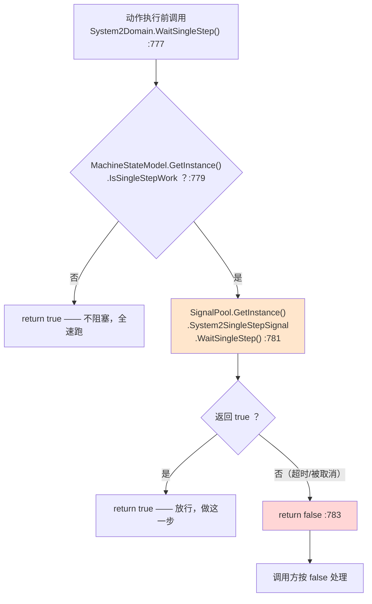

**调用链**

| 位置 `文件:行` | 说明 |
|---|---|
| `Models/System2Domain.cs:777` | `WaitSingleStep()` 定义 |
| `Models/System2Domain.cs:779` | 读 `MachineStateModel.IsSingleStepWork` —— **单步开关不在本模块，全局状态** |
| `Models/System2Domain.cs:781` | 阻塞在 `System2SingleStepSignal.WaitSingleStep()`（**信号池的第三种等待 API**） |
| `Models/System2Domain.cs:783` | 失败返回 `false` |

**坑**

- ⚠️ **`WaitSingleStep` 是本范围唯一一个"返回 bool 但语义是『可不可以继续』"的方法**，
  调用方必须自己判断 `false` 时怎么办。而它**没有区分"用户取消"和"等待超时"** —— 两者都返回 `false`。
- ⚠️ 单步开关 `IsSingleStepWork` 在 `MachineStateModel` 上（不在本篇范围）。
  **本范围只是"读"这个开关，改它的是界面** —— 排查"为什么设备停在那不动"时要先确认这个开关。
- ✅ **不阻塞时有短路**（`:779` 先判断开关）—— 正常生产时这个函数几乎零开销，不会成为性能瓶颈。

### 4.7 定时器：本范围内 0 个

| 检查项 | 命中 |
|---|---|
| `System.Windows.Forms.Timer` | **0** |
| `System.Timers.Timer` | **0** |
| `System.Threading.Timer` | **0** |
| `DispatcherTimer` | **0** |
| `async void` + `Task.Delay` 组合出的"软定时器" | 见下 |

**复现命令与结果**

```bash
cd "E:/项目/ZX2200标机/trunk/AKRS.ZX2200/BondSystem"
grep -rn --include='*.cs' -E 'new (Timer|DispatcherTimer)|Timers\.Timer' Controllers Models | wc -l   # → 0
grep -rn --include='*.cs' -E 'Thread\.Sleep' Controllers Models | wc -l                                # → 57
```

**那"周期性"的事谁做？** 三套替代机制，全部必须知道：

| 替代机制 | 位置 | 性质 |
|---|---|---|
| **① 固晶线程的双 `while` 循环** | `Tasks/BondTask.cs:109`（外层）与 `:214`（内层） | 真正的"心跳"。每轮取一个节点、执行、再取下一个。**这是本层的主节拍。** |
| **② 带超时的信号轮询** | `System2RunTimeProvider.cs:348` 的 `while (!...Wait(100))` | 100 ms 一跳，**只在静态华夫盒避让这一条路径上存在** |
| **③ `Thread.Sleep`（57 处）** | 散布在动作节点与控制器里 | 动作之间的固定延时（等气缸到位、等视觉稳定、等真空建立） |

> **这是一个必须写进交接文档的事实**：这套代码**没有任何一处"每 N 毫秒自动跑一遍"的定时逻辑**。
> 所有看起来像"周期任务"的东西（温度漂移补偿、吸嘴清洗提醒、力值采样）**都是由 `BondTask` 的循环顺带驱动的**。
> 因此：**一旦固晶线程卡在某处（比如 §4.5 的无限轮询），全部"周期性"行为一起停摆** ——
> 这是把"没有定时器"这件事单独列一节的原因。
>
> 唯一的例外是**力值曲线采样**：它由**界面的力值曲线控件**驱动，不由固晶线程驱动。
> 本范围只负责"开/关"这个采样：`UcMainSystem.ActiveReadBondForce(true/false)` 共 10 处
> （`Controllers/BondHeadController.cs:126`、`:383`、`:420`、`:565`；`BPActionNode/BondActionNode.cs:514`、
> `BondActionNode.Provider.cs:379`、`:396`；`BPActionNode/PickActionNode.cs:655`、
> `PickActionNode.Provider.cs:358`、`:377`）。
> **后果**：固晶线程卡死时，界面上那条力值曲线**可能还在动** —— 容易被误判为"系统正常"。
> 排查"设备不动了"时，**不要用"力值曲线还在跳"当作系统活着的证据**。

### 4.8 🔴 `ExcuteResult` 结果分发：四类非成功结果与成功走同一条路

> **这是本篇最重要的一节。** 它描述的不是一个"写法不好看"的问题，
> 而是**一个会让设备把失败当成功、继续往下做、且不报错不写日志的静默错误**。

#### 4.8.1 代码事实

`BondTask.cs:232` 拿到动作节点的返回值，`:234` 立刻分发：

```csharp
ExcuteResult ret = actionNode.DoWork();      // :232

switch (ret)                                  // :234
{
    case ExcuteResult.Abort:      ...  return;   // :236
    case ExcuteResult.Retry:      ...  continue; // :253
    case ExcuteResult.Exception:  ...  return;   // :260
    case ExcuteResult.Alarm:      ...  break;    // :277
}                                             // ← 没有 default:

this.system2Domain.ActionNodesService.FinishCurrentActionNode();  // :319
```

**两个关键事实：**

1. **`switch` 只有 4 个 `case`，没有 `default`。**
2. **四个 `case` 恰好是 `Abort`（`:236`）、`Retry`（`:253`）、`Exception`（`:260`）、`Alarm`（`:277`）** —— 都是"出事"的值。

#### 4.8.2 `ExcuteResult` 至少有 9 个成员，其中 4 个没被处理

`ExcuteResult` 定义在 DLL `AKRS.Galaxy2.Infrastructure.Enums` 里（`grep -rln "enum ExcuteResult"` 全仓 **0 命中** —— **没有源码**）。
从全仓的实际使用可以确认**至少**有这 9 个成员：

| 成员 | 全仓使用次数（`文件:行` 计数） | 在 `BondTask.cs:234` 的 `switch` 里有 `case`？ | 落到哪里 |
|---|---|---|---|
| `ExcuteResult.Success` | **444** | ❌ **没有** | 🔴 直接穿到 `:319` `FinishCurrentActionNode()` |
| `ExcuteResult.Abort` | 156 | ✅ `:236` | 停机 + 焊头回安全高度 + `return` |
| `ExcuteResult.Exception` | 138 | ✅ `:260` | 停机 + 焊头回安全高度 + `return` |
| **`ExcuteResult.NoStart`** | **37** | ❌ **没有** | 🔴 **直接穿到 `:319` `FinishCurrentActionNode()`** |
| `ExcuteResult.Retry` | 24 | ✅ `:253` | `continue`（不结束当前节点） |
| **`ExcuteResult.Fail`** | 21 | ❌ **没有** | 🔴 直接穿到 `:319` |
| `ExcuteResult.Alarm` | 19 | ✅ `:277` | 弹三按钮窗（终止/重试/忽略） |
| **`ExcuteResult.None`** | 8 | ❌ **没有** | 🔴 直接穿到 `:319` |
| **`ExcuteResult.TimeOut`** | **1** | ❌ **没有** | 🔴 直接穿到 `:319` |

> 复现命令：`grep -ro "ExcuteResult\.\(Success\|NoStart\|Fail\|None\|TimeOut\)" --include='*.cs' . | wc -l`
> （排除 `bin/`、`obj/`）。
>
> ⚠️ **诚实说明**：枚举的**定义**在 DLL 里，没有源码，所以**无法确认是否还有第 10 个或更多成员**。
> 上表只列出"能从使用中确认存在"的 9 个。**如果还有别的成员，它们同样会穿过去。**

#### 4.8.3 结论：四类非成功结果与成功走同一条路

**`Fail`、`NoStart`、`None`、`TimeOut` 这四个值，和 `Success` 走的是完全相同的收尾路径** ——
`:319` 的 `FinishCurrentActionNode()`，然后 `while` 回到 `:216` 取下一个节点。

**换句话说：一个动作**明确报了失败**，调度器的反应是"这一步做完了，继续下一步"。**

**图 12：`ExcuteResult` 五条线，四条错误地汇到同一点（核心图）**

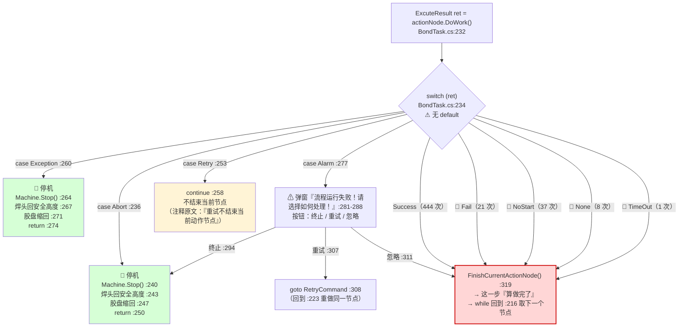

**ASCII 版（图 12）**

```text
                  ret = actionNode.DoWork()   BondTask.cs:232
                              │
                              ▼
                 ┌────── switch (ret) :234 ──────┐
                 │      ⚠ 没有 default:           │
                 └───┬────┬────┬────┬────┬────┬───┘
                     │    │    │    │    │    │
   case Abort :236 ──┘    │    │    │    │    └── Success (444 次)
   case Exception :260 ───┘    │    │    └─────── Retry (24 次) ──► continue :258
   case Alarm :277 ────────────┘    │                              （不结束当前节点）
                                    │
                     ┌──────────────┴───────────────┐
                     │  以下 4 个值：没有任何 case   │
                     │    Fail     (21 次)          │
                     │    NoStart  (37 次)  ★最危险  │
                     │    None     ( 8 次)          │
                     │    TimeOut  ( 1 次)          │
                     └──────────────┬───────────────┘
                                    │
   🛑 停机 + 焊头回安全高度 + return  │
   🛑 停机 + 焊头回安全高度 + return  │
                                    ▼
        ╔══════════════════════════════════════════════════╗
        ║  FinishCurrentActionNode()  :319                 ║
        ║  → 这一步"算做完了"                              ║
        ║  → while 回到 :216 取下一个节点                  ║
        ║  ⚠ 与 Success 完全同路，无报错、无日志、不弹窗   ║
        ╚══════════════════════════════════════════════════╝
```

#### 4.8.4 为什么不能靠"补一个 `case Success:`"来修

这是最容易搞错的一点，必须讲清楚：

- **`Success` 没有显式 `case` 并不是漏写。** 它**本来就该**落到 `:319` `FinishCurrentActionNode()` —— 那是正确的目标。
- **真正的缺陷是"漏写 `default:`"。**
  因为 C# 的 `switch` 在**没有 `default` 且没有匹配的 `case`** 时，**不执行任何分支语句，直接跳到 `switch` 之后** ——
  也就是 `:319`。
- 于是 **`:319` 这条"成功"的收尾路径，被当成了"所有未列出的值"的默认路径**。
  `Fail` / `NoStart` / `None` / `TimeOut` **不是被显式处理成成功，而是被"漏掉"成了成功**。

> **这个区分很重要**：写成"`switch` 漏了 `Success`"会让后来人以为"加个 `case Success: break;` 就修好了" ——
> 那**一点用都没有**（加不加 `Success` 的 `case`，行为完全一样）。
> 真正要做的是**加 `default:`**。

#### 4.8.5 特别点名：`NoStart` 有 37 处使用，不是罕见分支

`NoStart` 的字面意思是"**没启动**"。它在全仓被用作返回值 **37 次** —— **比 `Fail`（21 次）和 `Retry`（24 次）用得还多**。

一个语义是"**这一步根本没启动**"的返回值，落到 `:319` 之后的实际效果是：
**调度器认为"这一步已经做完了"，下游按"这一步做过了"继续推进。**

这是**最典型的静默错误形状**：

**图 13：`NoStart` 的静默错误链**

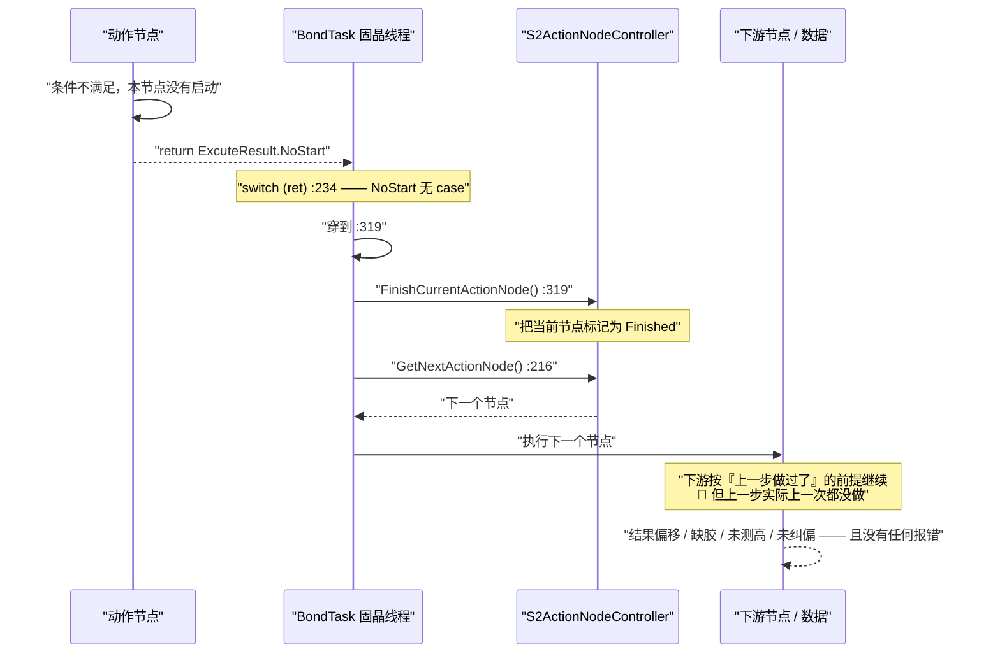

**ASCII 版（图 13）**

```text
  动作节点             BondTask 固晶线程          S2ActionNodeController      下游
  ────────             ─────────────────          ──────────────────────      ────
      │
      ├─ 条件不满足，本节点没启动
      │
      ├── return ExcuteResult.NoStart ──►│
      │                                  │  switch(ret) :234
      │                                  │  ⚠ NoStart 没有 case
      │                                  │      │
      │                                  │      ▼ 穿过去
      │                                  ├─ FinishCurrentActionNode() :319 ──►│
      │                                  │                       标记为 Finished│
      │                                  │                                      │
      │                                  ├─ GetNextActionNode() :216 ─────────►│
      │                                  │                       下一个节点 ◄────┘
      │                                  │
      │                                  ├─ 执行下一个节点 ──────────────────────►│
      │                                  │                                        │
      │                                  │   🔴 下游按"上一步做过了"继续           │
      │                                  │      但上一步一次都没做                 │
      │                                  │                                        ▼
      │                                  │      结果偏移 / 缺胶 / 未测高 / 未纠偏
      │                                  │      ⚠ 无报错、无日志、不弹窗
      ▼                                  ▼
```

#### 4.8.6 修复建议（以及一个必须先确认的前提）

**建议**：在 `BondTask.cs:234` 的 `switch` 里补 `default:` 分支。

```csharp
// 位置：BondTask.cs:234 的 switch 内，与四个 case 同级
default:
    // 走到这里的都是"未被识别的失败"
    // 让它走 Abort 的停机语义（而不是继续往下做）
    ...
    return;
```

**为什么建议走 `Abort` 语义**：`default` 分支收到的必然是"作者当初没想到的值"。
把"未识别的失败"变成**停机**，是**安全的方向** —— 宁可停一下让人来看，也不要带着未知状态继续贴片。
（这也和 `Abort` / `Exception` 现有分支一致：`Machine.GetInstance().Stop()` + 焊头回安全高度。）

**⚠️ 但必须先确认一件事：`NoStart` 的预期语义。**

`NoStart` 被使用了 **37 次**，它**未必是"失败"** —— 有可能作者是**刻意**让它表示
"这个节点这次不需要做，跳过即可"，并且**依赖"穿到 `:319` 被标记完成"这个行为**来推进流程。

`default:` 一旦改成停机语义，**如果 `NoStart` 本来就是"有意跳过"，就会把正常流程变成频繁停机**。

> **所以这一步的正确做法不是直接改代码，而是先向原作者确认 `NoStart` 的预期语义**：
> - 若 `NoStart` = "**失败**"（没启动成）→ 补 `default:` 走停机，`NoStart` 一并归入失败；
> - 若 `NoStart` = "**有意跳过**" → 需要**给 `NoStart` 单写一个 `case`**，显式表达"跳过但算完成"，
>   同时**仍要补 `default:`** 来兜住 `Fail` / `None` / `TimeOut` 和未来的新成员。
>
> **在确认之前，不要动这段 `switch`。** 这是本篇给出的最明确的一条"先问再改"的警告。

#### 4.8.7 同一段代码里另外两个必须知道的事实

**事实 A：`Retry` 不是"重做"，而是"不结束当前节点"。**

`case ExcuteResult.Retry:` 后面是 **`continue;`**（`:258`），注释写着「重试不结束当前动作节点」（`:257`）。
`continue` 跳过 `:319` 的 `FinishCurrentActionNode()`，回到 `:216` 重新取节点。
**"重做同一个节点"是靠"当前节点没被标记完成"这个副作用实现的，不是靠显式重排。**

**图 14：`Retry` 的真实语义（靠副作用重做）**

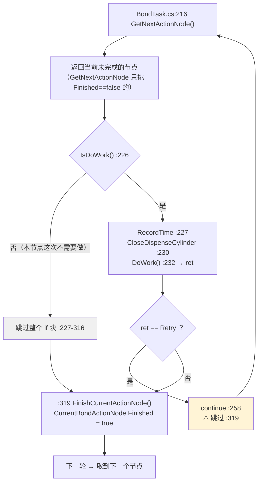

> **一个必须看清的缩进细节**：`:319` 的 `FinishCurrentActionNode()` 与 `:226` 的 `if` **同缩进（24 空格）**，
> 也就是说它**在 `if` 块之外** —— **`IsDoWork()` 返回 `false` 时，这个节点照样会被标记为"已完成"。**
> 这正是"这个节点这次不需要做，跳过"的实现方式：**跳过 = 直接标记完成**。
> 而 `Retry` 之所以能"不结束当前节点"，靠的就是 `continue`（`:258`）**跳过 `:319` 这一行**。
>
> 读源码验证缩进的方法：`sed -n '226p;319p' BondSystem/Tasks/BondTask.cs | cat -A`
> —— 两行的前导空格数完全相同。

**事实 A 的推论**：`Retry` 让当前节点**保持 `Finished == false`**，下一轮 `GetNextActionNode()` 会把**同一个节点**再返回一次，
于是重做。但如果重做时 `GetNextActionNode()` 判定"当前节点名与上一个相同"且名字是
`UpLookCorrectionActionNode` 或 `SubstrateCameraCorrectionActionNode`，就会**抛异常** —— 见事实 B。

**事实 B 🔴：`GetNextActionNode()` 对两个特定节点会抛异常，而固晶线程没有 `try/catch`。**

`Main/Machine/Process/S2ActionNodeController.cs:1050-1057`（**该文件不在本篇范围，属 `Main/` 目录的文档；此处因与固晶调度直接相关而引用**）：

```csharp
if (currentActionNodeName == actionNodeMessage.ActionNodeName
    && (currentActionNodeName == "UpLookCorrectionActionNode"
        || currentActionNodeName == "SubstrateCameraCorrectionActionNode"))
{
    AKRSXtraMessageBox.Show("排序出错，请联系软件人员");
    throw new Exception($"{currentActionNodeName} 重复");
}
```

而 `BondTask.cs` **整个文件 0 处 `try`、0 处 `catch`**（`grep -n "try\|catch" BondSystem/Tasks/BondTask.cs` → 无输出）。
线程体 `:365-374` 也没有 `try/catch`，且 `Task.Factory.StartNew` 的返回 `Task` **没有任何人 `await` 或观察**。

**后果**：异常从 `DoWork()` 或 `GetNextActionNode()` 冒出来之后：

1. 冒穿 `BondTask.DoWork()`；
2. 冒穿线程体的 lambda；
3. 存进 `BondWorkTask` 这个 `Task` 对象（状态变 `Faulted`）；
4. **没有人观察它 → 没有任何提示、没有日志、没有崩溃弹窗**；
5. 固晶线程**悄无声息地停掉**，界面看起来"设备不动了"，但不报错。

**图 15：异常静默吞掉链（`BondTask` 无 `try/catch`）**

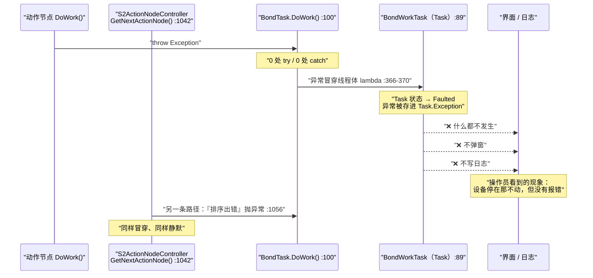

**恢复方式（也是唯一的恢复方式）**：`BondTask.Start()` 在 `:363` 有守卫
`if (this.BondWorkTask == null || this.BondWorkTask.Status != TaskStatus.Running)` ——
因为 `Faulted != Running`，**再次点"启动"确实能重启线程**。
但**界面上没有任何提示告诉操作员"线程已经死了、需要重新启动"**。

**事实 C 🔴：`AbortThread()` 是空方法。**

`Tasks/BondTask.cs:382`-`:384`：

```csharp
public void AbortThread()
{
}
```

而它**是被调用的**：`Main/Machine/MachineSupport/Machine.Operate.cs:400`
`System2Domain.GetInstance().BondTask.AbortThread();`。

**"中止固晶线程"这个动作实际上什么都没做** —— 调用方以为线程被中止了，实际上线程还在跑。
（*注：`BondTask.cs` 在 `Tasks/`，属姊妹篇 `33` 的范围；此处因它决定了"停止"这条驱动链的语义而引用。*）

#### 4.8.8 一句话总结这一节

> **固晶系统最严重的缺陷不是"崩了"，而是"错了但没人知道"。**
> 一个动作明确返回 `Fail` / `NoStart` / `None` / `TimeOut`，系统会认为它**成功**并继续；
> 一个动作抛异常，线程会**静默死掉**；
> 有人想中止线程，`AbortThread()` **是空的**。
> 这三件事合起来的效果是：**现场出问题时，最可能观察到的现象是"设备不动了 / 位置偏了"，而没有任何一条错误信息指向真正的原因。**

### 4.9 状态机变迁

本范围内有**四套互不相干的状态概念**，它们各自驱动不同的东西，**改错一套不会报错、只会表现为"某一步不执行"或"重复执行"**。

| # | 状态 | 取值 | 定义位置 | 谁改它 | 影响 |
|---|---|---|---|---|---|
| 1 | `ActionNode.State` | `RunStateEnum.Idle` / `Running` / `Stop` | **DLL（`RunStateEnum` 无源码）**，属性在 `ActionNode.cs:84`，默认 `Idle` | 每个节点的 `DoWork()` | 节点运行标记；**本范围内没有一处读它**（只写不读） |
| 2 | `MachineStateModel.MachineWorkMode` | `MachineWorkModeEnum`：`OffLineWork` / `DryCycle` / 正常 | **DLL** | 界面 | **短路一切**：离线模式直接返回 `Success` |
| 3 | `MatterProductState` | `Enable` / `EnableInSystem1` / `EnableInSystem2` / `Disable` | `TransportUnitSystem/Model/TuEnum.cs` | 物流/配方 | 决定节点是否需要做（`IsDoWork` 门控） |
| 4 | `EntityState` | `Process` / `Success` | `TransportUnitSystem/Model/TuEnum.cs` | 节点自己 | 只有 `Process` 时识别节点才做 |

#### 4.9.1 `ActionNode.State`：三段状态机（只写不读）

**图 16：动作节点的三段状态机（`RunStateEnum`）**

```mermaid
stateDiagram-v2
    [*] --> Idle: "ActionNode.cs:84<br/>State { get; set; } = RunStateEnum.Idle"
    Idle --> Running: "DoWork() 开头<br/>例：UpLookCorrectionActionNode.cs:134"
    Running --> Stop: "finally 块<br/>例：UpLookCorrectionActionNode.cs:511"
    Stop --> Running: "下一次 DoWork()"
    note right of Stop
      WorkStop?.Invoke() 在这里发出
      （例 UpLookCorrectionActionNode.cs:512）
    end note
    note left of Running
      WorkStart?.Invoke() 在进入前发出
      （例 UpLookCorrectionActionNode.cs:133）
    end note
```

**关键事实：本范围内 `State` 只被写、从没被读。**
全范围 `RunStateEnum` 出现 **41 次**，逐条核对后 **41 次全部是赋值**（`this.State = RunStateEnum.XXX`）或属性默认值声明，
**0 处把 `State` 放在 `if` / `while` / `switch` 里判断**：

```bash
cd "E:/项目/ZX2200标机/trunk/AKRS.ZX2200/BondSystem"
grep -rn --include='*.cs' -E "RunStateEnum" Controllers Models | wc -l                          # → 41
grep -rn --include='*.cs' -E "(if|while|switch)\s*\(.*RunStateEnum|==\s*RunStateEnum" \
     Controllers Models | wc -l                                                                  # → 0
```

所以这个状态机**目前是"装饰性"的** —— 它存在的意义是给**外部（界面/日志）**看的，本层不依赖它做任何决策。

> **🔴 而 `PickActionNode` 连写都没写全** —— 它**既没有 `WorkStart?.Invoke()`，也没有 `State = RunStateEnum.Running`**：
> - 有 `WorkStop?.Invoke()`（`PickActionNode.cs:512`）和 `State = RunStateEnum.Stop`（`:511`）
> - **没有**对应的 `WorkStart` / `Running`
>
> 也就是说：**如果有什么东西订阅了 `PickActionNode.WorkStart`，它永远不会被触发**；
> 而它的 `WorkStop` 却每轮都触发 —— **订阅方会收到"结束"却收不到"开始"**。
> 这是 23 个节点里**唯一**一个不对称的（其余节点都是成对的，见下表）。

| 节点 | `WorkStart` | `State = Running` | `State = Stop` | `WorkStop` |
|---|---|---|---|---|
| `UpLookCorrectionActionNode` | `:133` | `:134` | `:511` | `:512` |
| `BondActionNode` | `:120` | `:121` | `:374` | `:375` |
| `SubstrateCameraCorrectionActionNode` | `:138` | `:139` | `:511` | `:512` |
| `DipFluxActionNode` | `:107` | `:108` | `:287` | `:288` |
| `AfterBondCheckActionNode` | `:114` | `:115` | `:343` | `:344` |
| `S2CarrierVisionActionNode` | `:38` | `:39` | `:83` | `:84` |
| `S2SubstrateVisionActionNode` | `:57` | `:58` | `:94` | `:95` |
| `S2ModuleVisionActionNode` | `:57` | `:58` | `:96` | `:97` |
| `BondPositionVisionActionNode` | `:60` | `:61` | `:95` | `:96` |
| `S2DispenseActionNode` | —— | `:52` | `:185` | —— |
| `S2PreDispenseActionNode` | —— | `:73` | `:155` | —— |
| `S2CarrierMeasureHeightActionNode` | —— | `:45` | `:66` | —— |
| `S2SubstrateMeasureHeightActionNode` | —— | `:34` | `:55` | —— |
| `S2ModuleMeasureHeightActionNode` | —— | `:68` | `:93` | —— |
| `S2BondPositionMeasureHeightActionNode` | —— | `:43` | `:64` | —— |
| `S2TransportIdentityActionNode` | —— | `:38` | `:66` | `:67` |
| `S2SubstrateIdentityActionNode` | —— | `:43` | `:71` | —— |
| `S2ModuleIdentityActionNode` | —— | `:37` | `:65` | —— |
| `S2BondPositionIdentityActionNode` | —— | `:37` | `:65` | —— |
| **`PickActionNode`** | 🔴 **无** | 🔴 **无** | `:511` | `:512` |
| `CheckInkDotActionNode` | 🔴 **无**（`:110`、`:111` 被注释） | 🔴 **无** | 🔴 被注释 | 🔴 被注释 |
| `BondPositionVisionTest` | 🔴 无 | 🔴 无 | `:64` | `:65` |
| `S2EpoxyDefectActionNode` | —— 空类体，什么都没有 —— | | | |

> 表里的行号都是**同一段落里的连续行**（`WorkStart` / `Running` / `Stop` / `WorkStop` 紧邻），
> 差异只体现"这个节点有没有发开始/结束通知"。
>
> **`WorkStart` / `WorkStop` 全范围只有"发出"、没有"订阅"**：
> `grep -rn "WorkStart\s*+=" BondSystem/Controllers BondSystem/Models` → **0 命中**。
> 所以这两个事件目前是**给外部模块订阅用的接口**，本层自己不用。

#### 4.9.2 工作模式：`OffLineWork` / `DryCycle` 短路一切

这是**最容易被误判为"系统正常"的一条**。

**图 17：工作模式短路（每一个节点都有这两个出口）**

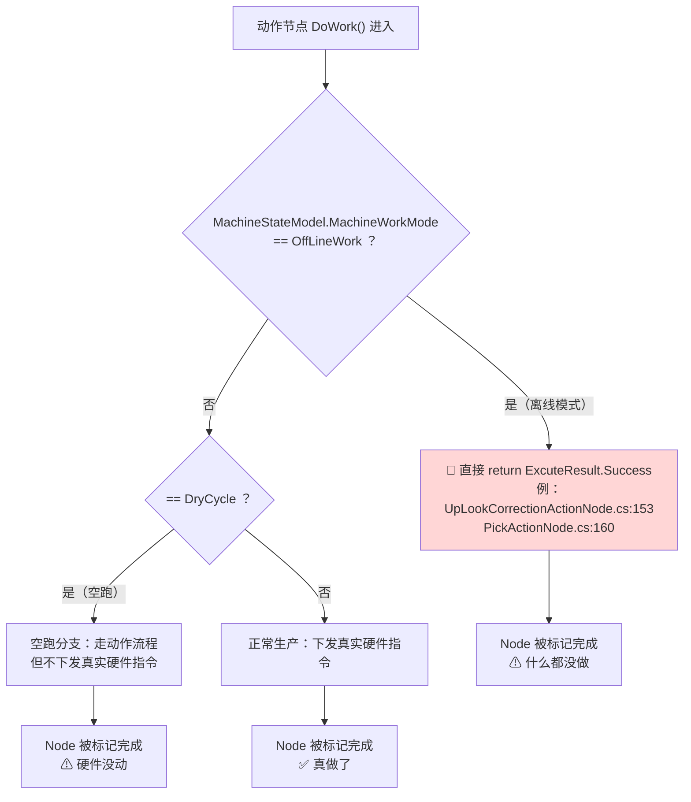

**坑**

- 🔴 **离线模式下，每一个节点都返回 `Success` 且什么都不做**。
  这条设计是合理的（离线调试时不该动硬件），但它与 §4.8 的缺陷**叠加起来**产生一个非常危险的组合：
  **离线模式下无论节点是否真的能干活，返回的都是 `Success`** ——
  所以**在离线模式下试机，永远试不出 R-01 那类问题**。
  「离线跑通了」**不能**作为「上了产也能跑」的证据。见 `R-36`。
- ⚠️ **`OffLineWork` 的检查位置在节点内部，不在调度器里**。
  也就是说每个节点自己决定要不要短路，**新增节点时很容易忘掉这两个判断** ——
  忘了写的结果是：离线模式下它**真的去动硬件了**（在没有硬件的环境里抛异常或卡死）。

#### 4.9.3 料单元侧状态：决定"这一步要不要做"

`IsDoWork()` 的实现方式在**测高/识别/纠偏**这三族节点上高度一致 —— 它们都读**料单元（TransportUnit）的状态与"完成标记"**：

| 检查项 | 位置（以 `S2CarrierMeasureHeightActionNode.IsDoWork()` 为例） | 语义 |
|---|---|---|
| `MatterProductState == Disable` 或 `== EnableInSystem1` | 见该函数前两个判断 | 这批料不归固晶（或已屏蔽）→ 不做 |
| `IsTuProcessFinishedInSystem2` | 同上 | 这道工序已经全做完 → 不做 |
| `TransportUnitInfo.IsMeasureHeight` | 同上 | **已测过高** → 不再测 |
| `Config.HeightMeasurementPoints.Count == 0` | 同上 | 没配测高点 → 不做 |
| `Config.MeasureHeightInSystem2 == false` | 同上 | 配方里没开固晶测高 → 不做 |

`S2CarrierVisionActionNode.IsDoWork()` 用同一套路，但看的是另外三个标记：
`Config.LocateConfig.AdjustType == AdjustTypeEnum.None`、`BaseInfo.IsVisioned`（已定位过）、`IsTuProcessFinishedInSystem2`。
`S2TransportIdentityActionNode.IsDoWork()` 则多一条 `EntityState != EntityState.Process` → 不做（注释原文：「成功或者失败了都不会进入该制程」）。

**这三族节点的 `IsDoWork()` 是实现"幂等"的关键**：因为"已做过"的标记（`IsVisioned` / `IsIdentity` / `IsMeasureHeight`）是**落在料单元对象上**的，
所以**同一个料单元被重做时，做过的步骤会自动跳过**。这是这套框架最优雅的一点。

**坑**

- ⚠️ **这些标记一旦被错误置位，就再也不会做那一步，而且不会有任何提示**。
  例如 `BaseInfo.IsVisioned = true` 但视觉其实没成功 → 之后**永远不再定位**，直接按未纠偏的坐标贴片。
  这就是 §4.8 里 `NoStart` 那类静默错误的**另一条来源**：标记置位和动作成功之间没有原子性。
- ⚠️ **`IsDoWork()` 返回 `false` 时节点仍会被标记完成**（见 §4.8.7 的缩进说明）——
  这是设计意图（"跳过 = 完成"），但也意味着**一个因为配方配错而永远返回 false 的节点，会完全静默地永不执行**。

## 5. 核心流程（端到端调用链）

### 5.1 唯一启动入口：从界面到固晶工作线程

**本篇范围内没有任何"启动"能力** —— 它只能"被启动"。整台设备**只有一个启动入口**：
`Main/Machine/MachineSupport/Machine.Operate.cs:261` 的 `Start()`。
（*该文件不在本篇范围，属 `Main/` 目录的文档；此处因它是本篇所有流程的源头而引用。*）

**图 18：唯一启动入口链路（含全部拦截分支）**

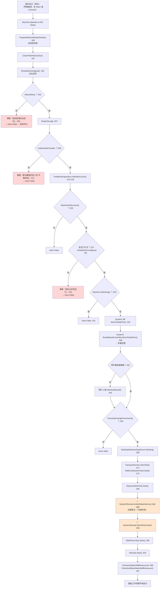

**ASCII 版（图 18）**

```text
  界面『启动』
        │
        ▼
  Machine.Operate.cs:261 Start()
        │
        ├─► PrepareMachineReadyToStart() :185
        │     ① CleanFile :187
        │     ② ResetMachineSignal :190
        │     ③ AllAxisReset ? :202 ──否──► 弹框"请先总复位" → 中止
        │     ④ ReadyToLog :207
        │     ⑤ IsAllowTaskClosed ? :209 ─否─► 弹框"部分模组仍在工作" → 中止
        │     ⑥ PostBondInspections.InitDefectCount :215
        │     ⑦ MachineInitSuccess ? :220 ───否──► 中止
        │     ⑧ 安全门已关 ? :222 ─────否──────► 弹框"请先关好安全门" → 中止
        │     ⑨ Machine.IsWorking ? :229 ──是──► 中止
        │     ⑩ System1 MoveToSafePos :236
        │     ⑪ ★ System2 BondModuleController.MoveToSafePos :240  ← 本篇范围
        │     ⑫ 顶针 Z 轴 AbsoluteMove(0) :245
        │     ⑬ CheckOperatingEnvironment ? :250 ──否──► 中止
        │
        ▼ （全部通过）
  SetState(MachineStateEnum.Working) :268
        │
        ├─► TransportDomain.StartTask() :272
        ├─► WaferSubSystemTask.Start() :273
        ├─► DispenseWorkTask.Start() :284
        │
        ├─► 🔑 ActionNodesService.Init() :289   「先排好序」
        │        └─ 建 WorkMessages，决定这一批料要做哪些节点、什么顺序
        │
        ├─► 🔑 BondTask.Start() :290
        │        └─ Task.Factory.StartNew(DoWork, LongRunning)  ← 固晶工作线程
        │
        ├─► SlideFluxerTask.Start() :295
        ├─► FlipTask.Start() :303
        └─► CheckAndOpenWaffleVacuum() :306 / CheckAndOpenStaticWaffleVacuum() :307
                 │
                 ▼
            固晶工作线程开始运行
```

**三个必须记住的点**

1. **`:289` 的 `ActionNodesService.Init()` 必须在 `:290` 的 `BondTask.Start()` 之前。**
   注释原文就是「**先排好序**」。`Init()`（`S2ActionNodeController.cs:155`）建立 `WorkMessages` 列表
   —— 也就是"这一批料要做哪些动作节点、按什么顺序"。**固晶线程一启动就会调 `GetNextActionNode()` 取节点**，
   如果顺序没建好，取到的就是空或错的。**这两行的先后顺序不能换。**
2. **启动检查全部通过后才把状态置为 `Working`**（`:268`）。
   反过来说：**任何一项检查失败，设备状态停留在原来的状态**，不会进入半启动状态。
3. **`PrepareMachineReadyToStart()` 最后一步 `:240` 会把固晶模组移到安全位** ——
   这是**本范围在启动阶段唯一被调用的代码**（`BondModuleController.MoveToSafePos()`）。

> **授权/防拷贝相关的诚实说明**：本篇范围（`BondSystem/Controllers/` + `BondSystem/Models/`，80 个文件）内
> **`SoftKey` / `Dongle` / `SoftkeyManager` / `加密狗` / `Authoriz` 命中数全部为 0**。
> 唯一的 4 处 `License` 关键词全部是第三方 Excel 库 EPPlus 的声明
> （`ExcelPackage.LicenseContext = LicenseContext.NonCommercial`，见
> `BPActionNode/BondActionNode.Provider.cs:156`、`:442`，`Parameter/System2RunTimeProvider.cs:275`，
> `Repositories/PostBondInspection/PostBondInspection.cs:465`）——
> **这是第三方库的使用声明，与本机的授权机制无关**，只是提示合规负责人留意该声明与商用场景的关系。
> 本机授权检查的唯一相关代码在 `Machine.Operate.cs:193-196`，**已被注释掉**（属 `Main/` 目录，不在本篇范围），
> 此处仅作事实记录。**本篇不涉及、也不讨论任何授权机制的实现或处置方式。**

### 5.2 一个固晶周期的完整链路

#### 5.2.1 端到端全景

**图 19：一颗芯片从取到贴的端到端链路**

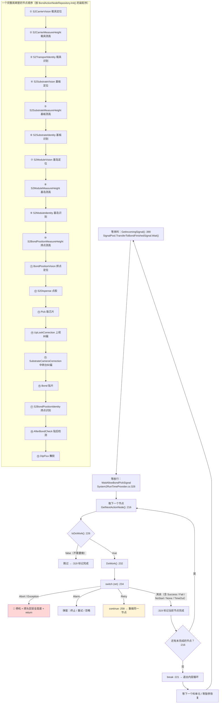

**ASCII 版（图 19）**

```text
  ┌─────────────────────────────────────────────────────────────┐
  │ 一个固晶周期的外层                                          │
  │                                                             │
  │  等来料 GetIncomingSignal :390                              │
  │      │                                                      │
  │      ▼                                                      │
  │  等放行 WaitAllowBondPickSignal （§4.5 图 10）              │
  │      │                                                      │
  │      ▼                                                      │
  │  ┌─────── 内层 while(Signal.WaitStart()) :214 ────────┐     │
  │  │  GetNextActionNode() :216                          │     │
  │  │      │  null → break :221（所有动作做完）          │     │
  │  │      ▼                                             │     │
  │  │  IsDoWork() :226 ──false──► 跳过 → :319 标记完成   │     │
  │  │      │true                                         │     │
  │  │      ▼                                             │     │
  │  │  DoWork() :232 → ret                               │     │
  │  │      │                                             │     │
  │  │      ▼                                             │     │
  │  │  switch (ret) :234  ⚠ 无 default                   │     │
  │  │    ├── Abort     → 🛑 停机+安全高度+return          │     │
  │  │    ├── Exception → 🛑 停机+安全高度+return          │     │
  │  │    ├── Alarm     → ⚠ 弹窗 终止/重试/忽略            │     │
  │  │    ├── Retry     → continue :258（重做同一节点）    │     │
  │  │    └── 其余 ─────► :319 标记完成  🔴 R-01          │     │
  │  │                        │                           │     │
  │  │                        └──► 回到 GetNextActionNode  │     │
  │  └────────────────────────────────────────────────────┘     │
  │      │                                                      │
  │      ▼  break 后：等下一个料单元 / 等暂停恢复                │
  └─────────────────────────────────────────────────────────────┘

  一个完整周期里 19 个节点的顺序（BondActionNodeRepository.Init() :265-284）
   ① 载具定位    ② 载具测高    ③ 载具识别
   ④ 基板定位    ⑤ 基板测高    ⑥ 基板识别
   ⑦ 基岛定位    ⑧ 基岛测高    ⑨ 基岛识别
   ⑩ 焊点测高    ⑪ 焊点定位    ⑫ 点胶
   ⑬ 取芯片      ⑭ 上视纠偏    ⑮ 中转台纠偏
   ⑯ 贴片        ⑰ 焊点识别    ⑱ 贴后检测
   ⑲ 蘸胶
```

#### 5.2.2 `BondTask` 的双循环线程模型

**图 20：`BondTask` 双 `while` 线程模型**

```mermaid
flowchart TD
    START["BondTask.Start() :361<br/>Task.Factory.StartNew(..., LongRunning, TaskScheduler.Default) :365"] --> TN["SetCurrentThreadName(\"固晶工作线程\") :368"]
    TN --> OUTER{"外层 while(Signal.WaitStart()) :109"}
    OUTER -->|"false（收到停止）"| EXIT["退出 DoWork() → 线程结束<br/>⚠ 无 try/catch，异常也走这里"]
    OUTER -->|true| OUTERBODY["外层循环体 :111-…"]
    OUTERBODY --> INNER{"内层 while(Signal.WaitStart()) :214"}
    INNER -->|"false（暂停）"| INNEREXIT["退出内层 → 回到外层 :109"]
    INNER -->|true| GET["GetNextActionNode() :216"]
    GET --> NULLQ{"== null ？:219"}
    NULLQ -->|"是（本批做完）"| BRK["break :221"]
    BRK --> OUTER
    NULLQ -->|否| PROC["执行节点 :223-316"]
    PROC --> FIN["FinishCurrentActionNode() :319"]
    FIN --> INNER
    INNEREXIT --> SAFE["Bond 模组去安全位（内层退出后）"]
    SAFE --> OUTER

    style EXIT fill:#ffd6d6
```

**ASCII 版（图 20）**

```text
  Start() :361
     │  守卫：BondWorkTask == null || Status != Running  :363
     │        （Faulted 也满足 → 再点启动可重启）
     ▼
  Task.Factory.StartNew(LongRunning, TaskScheduler.Default) :365
     │
     ├─ SetCurrentThreadName("固晶工作线程") :368
     │
     ▼
  ┌── 外层 while(Signal.WaitStart()) :109 ──────────────────────┐
  │   │ false（收到停止）                                        │
  │   ├────► 退出 DoWork() → 线程结束                            │
  │   │      ⚠ 该文件 0 处 try / 0 处 catch                      │
  │   │        异常也会从这里出去，静默变成 Faulted              │
  │   │                                                          │
  │   └ true ──► 外层循环体                                     │
  │                │                                             │
  │                ▼                                             │
  │        ┌── 内层 while(Signal.WaitStart()) :214 ──────────┐   │
  │        │  GetNextActionNode() :216                       │   │
  │        │      │ null ? :219                              │   │
  │        │      ├── 是（本批做完）→ break :221 ────────────┼───┼──► 回到外层
  │        │      │                                          │   │
  │        │      └── 否 → 执行节点 :223-316                 │   │
  │        │                │                               │   │
  │        │                ▼                               │   │
  │        │           FinishCurrentActionNode() :319        │   │
  │        │                │                               │   │
  │        │                └──► 回到内层 while 头            │   │
  │        │                                                 │   │
  │        │ false（暂停）─► 退出内层 → Bond 模组去安全位 ────┼───┼──► 回到外层
  │        └─────────────────────────────────────────────────┘   │
  └──────────────────────────────────────────────────────────────┘
```

**`RetryCommand` 标签的作用域（`:223`）**

`RetryCommand:` 标签在**内层循环体内**，`goto RetryCommand`（`:308`）会跳回**同一个节点的执行入口**。
它的作用域覆盖 `:223` 到 `:316`（`if (actionNode.IsDoWork())` 整块）——
也就是说 `|Alarm| → 重试|` 会**重新走一遍 `IsDoWork()` 与 `CloseDispenseCylinder()`**，
而 `|Retry| → continue` 走的是**内层循环头**（重新取节点）。**两者语义不同，不要混淆。**

#### 5.2.3 节点推进的四种去向

**图 21：节点推进的四种去向（含失败冒泡）**

```mermaid
flowchart LR
    RT["ret = DoWork()"] --> D{"switch (ret)"}
    D -->|"Abort"| A1["停整机<br/>Machine.Stop() :240"]
    D -->|"Exception"| A2["停整机<br/>Machine.Stop() :264"]
    D -->|"Alarm"| A3["弹窗<br/>终止/重试/忽略"]
    D -->|"Retry"| A4["不结束当前节点<br/>（靠副作用重做）"]
    D -->|"其余 5 个值"| A5["🔴 当作成功<br/>标记完成，推进"]

    A1 --> Z1["线程 return（`:250`）"]
    A2 --> Z2["线程 return（`:274`）"]
    A3 --> Z3{"用户选"}
    Z3 -->|终止| Z1
    Z3 -->|重试| Z4["goto RetryCommand :308"]
    Z3 -->|忽略| A5
    A4 --> Z5["下一轮取到同一节点"]
    A5 --> Z6["下一轮取到下一个节点"]

    style A5 fill:#ffd6d6,stroke:#cc0000
```

**四种去向的对照表**

| 去向 | 条件 | 代码位置 | 当前节点是否被标记完成 | 线程是否继续 |
|---|---|---|---|---|
| **停机** | `Abort` / `Exception` / `Alarm`+终止 | `:250` / `:274` / `:294-305` | ❌ 否（`return` 跳过 `:319`） | ❌ 线程结束 |
| **重做同一节点** | `Retry`；或 `Alarm`+重试 | `:258`；`:308` | ❌ 否（`continue` / `goto` 跳过 `:319`） | ✅ 继续 |
| **忽略后继续** | `Alarm`+忽略 | `:311` `break` | ✅ **是**（`break` 落到 `:319`） | ✅ 继续 |
| **🔴 当作成功推进** | `Success` / `Fail` / `NoStart` / `None` / `TimeOut` | 无 `case`，穿到 `:319` | ✅ **是** | ✅ 继续 |

> **最后一行就是 `R-01`**。上表的"当前节点是否被标记完成"这一列，是判断"这一步到底做没做过"的**唯一依据**。

#### 5.2.4 一个必须知道的时序细节：`CloseDispenseCylinder` 与 `IsCloseCylinder`

`BondTask.cs:230` 在**每个**节点的 `DoWork()` **之前**都会调一次 `CloseDispenseCylinder(actionNode)`：

```csharp
private void CloseDispenseCylinder(ActionNode actionNode)   // :495
{
    if (!actionNode.IsCloseCylinder)                        // :497
    {
        this.system2Domain.S2DispenseController.CloseDispenseHeightMeasurementCylinder();  // :499
    }
}
```

而 `IsCloseCylinder` 的默认值是 **`false`**（`Infrastructure/Models/CommonModels/ActionNode.cs:89`）：

```csharp
public bool IsCloseCylinder { get; set; } = false;
```

**字段名与行为是反的**：名叫 `IsCloseCylinder`（"是否关气缸"），
但置为 `true` 的效果是**不关**。**这个字段的真实含义是"我自己管这个气缸，你别动它"。**

**实测：21 个实例中有 9 个显式置了 `true`**，且这个集合**恰好是"用气缸的节点 + 紧随其后的那个节点"**：

| 置 `true` 的节点 | 位置 | 为什么说得通 |
|---|---|---|
| `S2DispenseActionNode` | `BondActionNodeRepository.cs:140` | 点胶本身要用测高气缸 |
| `S2CarrierMeasureHeightActionNode` | `:158` | 测高节点要 `OpenDispenseHeightMeasurementCylinder()`（`System2Domain.cs:844`） |
| `S2SubstrateMeasureHeightActionNode` | `:169` | 同上 |
| `S2ModuleMeasureHeightActionNode` | `:180` | 同上 |
| `S2BondPositionMeasureHeightActionNode` | `:191` | 同上 |
| `S2TransportIdentityActionNode` | `:204` | 装载链上**紧跟在载具测高之后**，避免刚打开就被关 |
| `S2SubstrateIdentityActionNode` | `:215` | 紧随基板测高 |
| `S2ModuleIdentityActionNode` | `:226` | 紧随基岛测高 |
| `S2BondPositionIdentityActionNode` | `:237` | 紧随焊点测高 |

⇒ **主链 19 个节点里，9 个豁免、10 个不豁免**（不豁免的：`S2CarrierVision`、`S2SubstrateVision`、
`S2ModuleVision`、`BondPositionVision`、`PickActionNode`、`UpLookCorrection`、
`SubstrateCameraCorrection`、`BondActionNode`、`AfterBondCheck`、`DipFluxActionNode`）。

**修正后的结论（比原来的判断温和）**：
`if (!actionNode.IsCloseCylinder) { 关气缸 }` 这个写法**在行为上是自洽的** ——
"默认关一次做保护，需要用到气缸的节点显式声明豁免"。
**真正的问题只有一个：字段名把语义写反了。**
⇒ 后人看到 `IsCloseCylinder = true` 会理解成"关掉气缸"，而实际是"别关"。
**这是一处命名陷阱（⚠️），而不是缺陷 🔴。** 见 `R-25`。

> **本条的定位已按源码核实修正**：初读时只按名字推断，得到"逻辑是反的、只有 1 个节点豁免"的印象；
> 逐行核对 `BondActionNodeRepository.cs:59-250` 的 21 个实例后，
> **豁免集合与"气缸使用节点及其后继"完全吻合，说明是有意设计**。
> 因此 `R-25` 的定级从"疑似缺陷"下调为"⚠️ 命名陷阱" —— 这一处**不构成功能问题**。
> 另外 `CloseDispenseHeightMeasurementCylinder()` / `OpenDispenseHeightMeasurementCylinder()`
> 的定义在 `S2DispenseController`（本篇范围，`Controllers/S2DispenseController.cs`），
> **本节未逐行核对其幂等性**，列在附录 B。

### 5.3 换吸嘴链路：`TakeNozzle` 的 5 个 `goto` 与"防撞直接抛异常"

换吸嘴是**整条固晶链路上唯一会把异常抛出工作线程的环节**，也是全篇最值得优先理解的一条链路。

#### 5.3.1 入口与调用层次

| 层次 | 方法 | `文件:行` | 做什么 |
|---|---|---|---|
| 判定 | `IsNeedToChangeNozzle(nozzleName)` | `System2Controller.cs:1003` | 只判断"要不要换"，不动作 |
| 判定+执行 | `JudgeAndChangeNozzle(nozzleName)` | `System2Controller.cs:973` | `:975` 判定 → `:978` 调 `ChangeNozzle` → `:981` `return true` |
| 执行 | `ChangeNozzle(nozzleName)` | `System2Controller.cs:863` | 换吸嘴总控：先 `PutbackNozzle()` 再 `TakeNozzle()` |
| 归还 | `PutbackNozzle()` | `System2Controller.cs:561` | 把焊头上的吸嘴放回吸嘴架 |
| 取用 | `TakeNozzle(nozzleName)` | `System2Controller.cs:157` | 从吸嘴架取吸嘴 |

`ChangeNozzle` 的内部顺序（`System2Controller.cs:950`、`:957`）：

```csharp
950: if (!this.PutbackNozzle())          // 先把旧吸嘴放回去
957: if (!this.TakeNozzle(nozzleName))   // 再取新吸嘴
```

**换吸嘴的调用点**（`grep -rn '\.ChangeNozzle\s*('` 实测 **11 处活调用**）：

| 调用点 | 场景 |
|---|---|
| `BondTask.cs:139` | ⚠️ 固晶工作线程内「提前换吸嘴」（见 §5.3.4）—— *该文件在 `Tasks/`（姊妹篇范围），此处因与调度相关而引用* |
| `System2Controller.cs:957` | `ChangeNozzle` 内部调 `TakeNozzle` |
| `System2Controller.cs:978` | `JudgeAndChangeNozzle` 内部 |
| `System2Controller.cs:995` | `SwitchTouchDown()` 内部 |
| `PickActionNode.Provider.cs:126` | 取片前换吸嘴 |
| `S2DispenseActionNode.cs:117` | 点胶前换吸嘴（走 `JudgeAndChangeNozzle`） |
| `S2PreDispenseActionNode.cs:106` | 预点胶前换吸嘴 |
| `System2Controller.Assistant.cs:1833` | 助手/示教界面 |
| `FrmNozzleBankManual.cs:124` | 手动吸嘴架界面 |
| `FrmToolsTestRun.cs:201` | 治具试运行界面 |
| `CalibSystem/FrmTestAccuary.cs:2542`、`Experiment/Test/FrmMachineFunctionTest.cs:414`/`:935` | 标定/实验界面（不在本篇范围） |

#### 5.3.2 图 22：`TakeNozzle` 的 5 个 `goto`

**图 22：`TakeNozzle` 全部 5 个 `goto`（含 4 个报警分支与 1 个自动重试闸门）**

```mermaid
flowchart TD
    E["TakeNozzle(nozzleName) :157<br/>try :159"] --> C1{"焊头上已是该吸嘴？:161"}
    C1 -->|是| OK0["return true :163"]
    C1 -->|否| C2{"IsToolBankEnable ？:176"}

    C2 -->|"否（吸嘴架未启用）"| M1["ShowWarn『请手动更换吸嘴』:178<br/>确认 / 取消"]
    M1 -->|"确认"| FAKE["🟡 直接改写状态（无任何硬件动作）<br/>槽位=OnBondHead :188<br/>SetCurrentNozzleName :192<br/>OpenBondHeadVaccum :194<br/>Save() :196"]
    FAKE --> OK1["return true :198"]
    M1 -->|"取消"| NO1["return false :201"]

    C2 -->|是| C3{"模式 != DryCycle :204<br/>且 IsActiveToolDetection :206"}
    C3 -->|"是"| HW["IsToolOnBondheadPhy() :209<br/>CloseBondHeadVaccum() :210"]
    HW --> HWQ{"焊头上仍有吸嘴？:211"}
    HWQ -->|是| M2["弹框『有撞机风险』:213<br/>忽略 / 取消"]
    M2 -->|取消| NO2["return false :222"]
    HWQ -->|否| RC
    M2 -->|忽略| RC
    C3 -->|"否（DryCycle 跳过硬件检查）"| RC

    RC["🔁 Recheck: :228<br/>DryCycle → 仅程式检查 :232<br/>否则 → 程式+硬件检查 :237-238"]
    RC --> RCQ{"ret ？:241"}
    RCQ -->|"false"| M3["弹框 :243『吸嘴不在吸嘴架上』<br/>重试 / 继续 / 退出"]
    M3 -->|"重试"| RC
    M3 -->|"继续"| CONT2["goto Continue :257"]
    M3 -->|"退出"| NO3["return false :260"]
    RCQ -->|"true"| GO["取吸嘴动作序列 :263-383<br/>Z下压失败 :341 / Z上抬失败 :372<br/>Y慢移失败 :487 —— 三处均 throw"]

    GO --> CB["CheckBondhead: :385<br/>IsToolOnBondheadPhy()==false ？:387"]
    CB -->|"真（没吸上）"| AG{"IsRetryAfterChangeNozzleFailed &&<br/>RetryTimesLimit > retryTimes ？:389-390"}
    AG -->|"是（自动重试闸门）"| AR["CloseBondHeadVaccum() :393<br/>MoveAxisZ(pickPos.Z) :399<br/>retryTimes++ :400"]
    AR -->|"goto RetryChangeNozzle :401"| RTN["RetryChangeNozzle: :334<br/>重走取吸嘴动作序列"]
    RTN --> CB
    AG -->|"否（次数用尽）"| M4["弹框『焊头吸附吸嘴失败』:405<br/>重试 / 忽略 / 终止"]
    M4 -->|"重试"| CB
    M4 -->|"忽略"| CONT2
    M4 -->|"终止"| NO4["return false :421"]
    M4 -->|"default"| NO5["return false :424"]
    CB -->|"假（吸上了）"| BLOW["吹气等后续动作 :429 起"]

    BLOW --> CONT["Continue: :498"]
    CONT2 --> CONT
    CONT --> C4{"模式 != DryCycle 且<br/>IsActiveToolDetection ？:500-503"}
    C4 -->|"是"| RT["Retry: :505<br/>IsToolOnBondheadPhy()==false ？:506"]
    RT -->|"真"| M5["弹框 :508『取吸嘴失败』<br/>重试 / 忽略 / 退出"]
    M5 -->|"重试"| RT
    M5 -->|"忽略"| W
    M5 -->|"退出"| NO6["return false :524"]
    RT -->|"假"| W
    C4 -->|"否"| W

    W["写状态：槽位=OnBondHead :531<br/>SetCurrentNozzleName :534<br/>NozzleShelfRepository.Save() :537"]
    W --> OK2["return true :539"]

    E --> CATCH["catch (Exception e) :541<br/>弹框 e.ToString() :543<br/>LogHelper Error :549<br/>throw e; :552"]
    CATCH --> OUT["🔴 异常冲出 TakeNozzle<br/>→ 冲出 ChangeNozzle（无 try）<br/>→ 冲出 BondTask.DoWork()（无 try）<br/>→ 工作线程静默死亡"]

    style W fill:#ffd6d6,stroke:#cc0000
    style FAKE fill:#fff4d6
    style CATCH fill:#ffd6d6
    style OUT fill:#ffd6d6,stroke:#cc0000
```

**ASCII 版（图 22）**

```text
  TakeNozzle(nozzleName) :157   try :159
     │
     ├─ 已是该吸嘴 ?:161 ──是──► return true :163
     │
     ├─ IsToolBankEnable ?:176 ──否──► ShowWarn『手动更换吸嘴』:178
     │                                    ├ 确认 ─► 🟡 只改状态，无硬件动作
     │                                    │        槽位=OnBondHead :188
     │                                    │        SetCurrentNozzleName :192
     │                                    │        OpenBondHeadVaccum :194
     │                                    │        Save() :196 → return true :198
     │                                    └ 取消 ─► return false :201
     │
     ├─ 模式!=DryCycle 且 IsActiveToolDetection ?:204/206
     │        └─► IsToolOnBondheadPhy() :209 / CloseBondHeadVaccum() :210
     │              └─ 仍有吸嘴 ?:211 ─► 弹框『有撞机风险』:213 忽略/取消
     │                                    ├ 取消 ─► return false :222
     │                                    └ 忽略 ─► 继续
     │
     ├─ 🔁 Recheck: :228    DryCycle→仅程式检查 :232 / 否则 程式+硬件 :237-238
     │        └─ ret==false ?:241 ─► 弹框 :243 重试/继续/退出
     │             ├ 重试 ─► goto Recheck :254（回到 :228）
     │             ├ 继续 ─► goto Continue :257（跳到 :498）
     │             └ 退出 ─► return false :260
     │
     ├─ 取吸嘴动作序列 :263-383
     │     Z 下压失败 ─► throw :341
     │     Z 上抬失败 ─► throw :372
     │     Y 慢移失败 ─► throw :487
     │
     ├─ CheckBondhead: :385   IsToolOnBondheadPhy()==false ?:387
     │        ├ 真（没吸上）
     │        │   ├ 自动重试闸门 :389-390 满足
     │        │   │     └─► CloseBondHeadVaccum :393 / MoveAxisZ(pickPos.Z) :399
     │        │   │         retryTimes++ :400 → goto RetryChangeNozzle :401
     │        │   │         └─► :334 重走动作序列 → 回到 :385
     │        │   └ 闸门不满足 ─► 弹框 :405 重试/忽略/终止
     │        │        ├ 重试 ─► goto CheckBondhead :415（回到 :385）
     │        │        ├ 忽略 ─► break :418（落到后面）
     │        │        ├ 终止 ─► return false :421
     │        │        └ default ─► return false :424
     │        └ 假（吸上了）─► 吹气等 :429 起
     │
     ├─ Continue: :498   模式!=DryCycle 且 IsActiveToolDetection ?:500-503
     │        └─► Retry: :505   IsToolOnBondheadPhy()==false ?:506
     │              └ 真 ─► 弹框 :508 重试/忽略/退出
     │                   ├ 重试 ─► goto Retry :518（回到 :505）
     │                   ├ 忽略 ─► break :521  ⚠ 落到下面仍写成功状态
     │                   └ 退出 ─► return false :524
     │
     ├─ 写状态 :531 槽位=OnBondHead / :534 SetCurrentNozzleName
     │            / :537 NozzleShelfRepository.Save()
     └─ return true :539

  ── catch (Exception e) :541 ─────────────────────────────────
       弹框 e.ToString() :543
       LogHelper.Post(Level.Error, "取吸嘴失败", e) :549
       // 防撞，直接抛异常
       throw e;    :552      ← 🔴 不是 return false
       //return false;  :553  ← 被注释掉
```

#### 5.3.3 四个必须记住的坑

**坑 1（🔴）：`catch` 里 `throw e;` 而不是 `return false`。**
`System2Controller.cs:551-553` 的原文是：

```csharp
551:            // 防撞，直接抛异常
552:            throw e;
553:            //return false;
```

注释说明了动机（**防撞：宁可直接炸掉整条工作线程，也不能让设备带着未知的吸嘴状态继续跑**）。
但后果是：`TakeNozzle` 签名声明为 `bool`，**它承诺"返回 false 表示失败"，实际从异常路径永不返回**。
`ChangeNozzle`（`:863`）**自己没有 `try`**；`PutbackNozzle`（`:561`）的 `catch`（`:842`）同样是 `throw e;`（`:853`）——
异常一路向上，直到第一个有 `try` 的调用者。

**`BondTask.DoWork()` 全文件 0 处 `try`/`catch`**（实测 `grep -c '\btry\b' BondTask.cs` 为 0）。
所以从 `BondTask.cs:139` 调进来的异常会：
`TakeNozzle` → `ChangeNozzle` → `BondTask.DoWork()` → 逃出 `DoWork()` →
被 `Task.Factory.StartNew`（`BondTask.cs:365`）吞进 `BondWorkTask.Exception` →
**`BondWorkTask` 全项目 0 处读取 `.Exception`** →
**固晶工作线程静默死亡：不报错、不停机、日志里只有一条"取吸嘴失败"。**

唯一的"补救"是 `BondTask.Start()` 的守卫（`BondTask.cs:363`）：

```csharp
if (BondWorkTask == null || Status != TaskStatus.Running)
```

线程死后 `Status` 变成 `Faulted`，**满足 `!= Running`**，所以**操作员再点一次『启动』能重新拉起线程**。
但**没有任何界面提示告诉他线程已经死了** —— 设备就是"停在那儿不动"。见 `R-17`。

**坑 2（🔴）：选了"忽略"仍然写成功状态。**
成功路径是 `:531-539`：

```csharp
531: nozzleShelf.NozzleShelfSlots[nozzle.SlotIdentification - 1].NozzleState = NozzleStateEnum.OnBondHead;
534: this.bondHeadController.SetCurrentNozzleName(nozzleName);
537: NozzleShelfRepository.GetInstance().Save();
539: return true;
```

而"没吸上来"的报警有**两处**把它当成功放过去：
- `:417-418` `case DialogResult.Ignore: break;` → 继续往下走到 `:531`
- `:520-521` `case DialogResult.Ignore: break;` → 继续往下走到 `:531`

也就是说：**操作员点了"忽略"（因为我确实没吸上吸嘴），代码照样把吸嘴槽标成 `OnBondHead`、
把焊头当前吸嘴设成 `nozzleName`、并落盘保存。**
随后整个固晶周期会带着"焊头上有吸嘴"的假前提继续跑。见 `R-18`。

**坑 3（⚠️）：自动重试前，一段防撞动作被注释掉了。**
`System2Controller.cs:395-399`：

```csharp
395:                        //// Z轴回到安全位
396:                        //this.bondHeadController.MoveBondZToChangeNozzleSafeHeight();
397:
398:                        // 先上抬使吸嘴脱离
399:                        this.bondHeadController.MoveAxisZ(pickPos.Z);
```

"Z 轴回安全位"被注释掉，改成"抬到 `pickPos.Z`"。
**同一段代码的 `catch` 里作者写着「防撞，直接抛异常」** —— 防撞是这个环节的核心关切，
而这里恰好删掉了一条防撞动作。改动是否等价取决于 `pickPos.Z` 与安全高度的关系，
**静态阅读无法判定，标注为"需要向原作者确认"**。见 `R-19`。

**坑 4（⚠️）：弹框把异常堆栈直接给操作员看。**
`:543-547`：

```csharp
543: AKRSXtraMessageBox.Show(
544:     $"取吸嘴: {nozzleName} 失败!" + e.ToString(),
```

`e.ToString()` 会输出完整类型名 + 堆栈。**操作员看到的是英文堆栈，不是可处理的中文提示**。
对照 `:243-249` 的写法（弹框文字里逐条写明"重试:重新检查 / 继续:手动将此吸嘴放到焊头上并继续工作 /
退出:退出工作"），可见**同一文件里两种提示风格并存**。见 `R-20`。

#### 5.3.4 `BondTask` 里的"提前换吸嘴"（与调度的接口）

`BondTask.cs:120-147`：外层循环每一轮开头、**在等来料信号之前**，先做一次预防性换吸嘴。
四个开关串起来：`Enable`（`:120`）→ `IsChangeNozzleAdvance`（`:121`）→ `component != null`（`:122`）
→ `IsNeedToChangeNozzle(component.NozzleName)`（`:136`）→ `:139 ChangeNozzle(...)`。

```csharp
140:                        if (ret == false)
141:                        {
142:                            // 换吸嘴失败停止工作
143:                            Machine.GetInstance().Stop();
144:                            return;      // ← 直接结束工作线程
145:                        }
```

**`:144` 的 `return` 会让工作线程直接结束**（同样没有状态提示，靠 `Start()` 的守卫重启）；
**`:139` 的 `ChangeNozzle` 会抛异常** —— 这正是坑 1 那条静默死亡路径的具体入口。
**两条失败路径（返回 false / 抛异常）一个停机但静默、一个连停都不停。**

> **`:124-134` 有一整块被注释掉的"首次启动给晶圆台发要料信号"**（含 `IsBondNeedChipSignal.Set()`，`:131`）。
> 也就是说**"第一次启动时由固晶侧主动要料"这条路径已被关闭**，要料必须由别处触发。见 `R-21`。

#### 5.3.5 一个容易被忽略的分支：`DryCycle` 模式跳过全部硬件检查

`TakeNozzle` 里 `MachineWorkModeEnum.DryCycle` 出现 3 次，每一处都是"**跳过硬件检查**"：

| 位置 | 条件 | 效果 |
|---|---|---|
| `:204` | `MachineWorkMode != DryCycle` | 为真才做"焊头上有没有吸嘴"的硬件检查 |
| `:229` | `== DryCycle` | **只做程式检查**（`IsConfiguredOnToolBank`），不做 `IsSlotHaveNozzle` 硬件检查 |
| `:500` | `!= DryCycle` | 为真才做取吸嘴后的"到底吸上没有"检查 |

**后果**：DryCycle（空跑）模式下，**"吸嘴到底在不在焊头上"完全不验证**，`:531` 一律写成功状态。
这是**有意设计**（空跑本就不该动硬件），但它与 `R-01` 叠加后含义会变：
DryCycle 下每个节点返回什么都"看起来正常"，**因为没有任何硬件反馈来证伪**。见 `R-36`。

### 5.4 清洗链路：吸嘴擦拭与"每次清洗写两次配方"

#### 5.4.1 调用链（只有 2 个方法，但嵌套很深）

```text
PickActionNode.cs:176   this.JudgeAndCleanNozzle();
   └─ PickActionNode.Provider.cs:146  JudgeAndCleanNozzle()
        ├─ :149  if (bondProgram.CleanNozzleProgram.IsCleanNozzleBeforePickup)
        ├─ :152  参数防呆：NozzleCleanTableLeftTopPos.IsEmpty → throw「吸嘴清洁位未示教！」:154
        ├─ :156  if (PickupNumAfterLastCleanNozzle >= CleanNozzleProgram.CleanNozzleAfterPickupNum)
        │     ├─ :159  system2Controller.CleanNozzle()          ← 真正的擦拭动作
        │     ├─ :162  若挡到搜晶 → bondModuleController.MoveToSafePos()
        │     └─ :168  PickupNumAfterLastCleanNozzle = 0
        └─ :171  PickupNumAfterLastCleanNozzle++
```

`CleanNozzle()`（`System2Controller.cs:1141`）内部：

```text
:1143  硬件配置检查  IsNozzleCleanTableConfigured == false → throw :1145
:1148  nozzle = bondHeadController.GetCurrentNozzle()
:1149  cleanPos = bondModuleController.ConvertG0ToMachinePos( this.GetCleanPos() )   ← 关键
:1151  cleanHeight = cleanPos.Z + nozzle.MeasureHeightOffset
:1152  force = bondProgram.CleanNozzleProgram.CleanNozzleBeforePickupForce
:1155  MoveBondZToSafePos()
:1156  MoveSafeBondXY(cleanPos.X, cleanPos.Y)
:1157  RotateAxisT(nozzle.AlignAngle)
:1160  MoveAxisZ(cleanHeight + 2)                      高速到预清洁位
:1162  for (i = 0; i < CleanNozzleBeforePickupTimes; i++)
:1165      if (CleanNozzleBeforePickupForceMode == ForceModeEnum.Distance)
:1168          MoveAxisZ(cleanHeight, 100, HighAccuracy, false)        低速下压（擦拭）
:1171          MoveAxisZ(cleanHeight + 2, 100, HighAccuracy, false)    抬起
:1173      else
:1176          ForceControlSet(force, cleanHeight, 100, 10, 2)         力控擦拭
:1178          ForceControlReset(cleanHeight + 2, 100)
:1183  MoveBondZToSafePos()
:1186  OpenToolBlowEle()  :1187 Thread.Sleep(50)  :1188 CloseToolBlowEle()
```

**这一层没有 `try`/`catch`、没有超时、没有"擦拭是否到位"的反馈** ——
`MoveAxisZ` / `ForceControlSet` 的结果全部被丢弃（返回 `void`）。
`:1187` 的 `Thread.Sleep(50)` 是**硬编码的吹气时长**。

#### 5.4.2 图 23：`GetCleanPos()` —— 每次清洗写两次配方

**图 23：`GetCleanPos()` 的副作用链（含 2 处 `Save()` 与 2 个除零风险点）**

```mermaid
flowchart TD
    G["GetCleanPos() :1063"] --> I["InitCleanTable() :1065"]
    I --> I1["rowSpacing = 左上.Y-右下.Y 除以 Row :1104-1106<br/>columnSpacing = 右下.X-左上.X 除以 Column :1108-1110"]
    I1 --> I2["🟡 CleanArea = new AKRSPoint3D[Row, Column] :1112<br/>⚠ 数组分配在检查之前"]
    I2 --> I3{"Column ≤ 0 ？:1114"}
    I3 -->|"是"| T1["throw『吸嘴清洁台列数为负数！』:1116<br/>⚠ 条件 ≤0，文字说『负数』"]
    I3 -->|"否"| I4{"Row ≤ 0 ？:1119"}
    I4 -->|"是"| T2["throw『吸嘴清洁台行数为负数！』:1121"]
    I4 -->|"否"| I5["双重循环填充 CleanArea :1124-1133"]
    I5 --> S1["🔴 BondProgram.GetInstance().Save() :1135<br/>第 1 次落盘"]
    S1 --> C1{"Count ≥ CleanArea.Length ×<br/>HeatActivatedFilmUseLimit ？:1067"}
    C1 -->|"是"| P1["弹框『清洁布达到使用次数上限，请更换清洁布!』:1069<br/>Count = 0 :1074"]
    C1 -->|"否"| D1
    P1 --> D1["🔴 count = Count 除以 HeatActivatedFilmUseLimit :1081<br/>⚠ 该值为 0 时整数除零异常"]
    D1 --> D2{"Row != 0 && Column != 0 ？:1083"}
    D2 -->|"是"| D3["column = count 除以 Row :1085<br/>row = count - column×Row :1086"]
    D2 -->|"否（实际不可达，见正文）"| D4["column=0, row=0 :1077-1078"]
    D3 --> INC["Count++ :1089"]
    D4 --> INC
    INC --> IDX["CleanArea[row, column] :1091"]
    IDX --> S2["🔴 BondProgram.GetInstance().Save() :1093<br/>第 2 次落盘"]
    S2 --> RET["return point3D :1095"]

    style S1 fill:#ffd6d6
    style S2 fill:#ffd6d6
    style D1 fill:#ffd6d6
    style I2 fill:#fff4d6
```

**ASCII 版（图 23）**

```text
  GetCleanPos() :1063
     │
     ├─ InitCleanTable() :1065
     │    :1104-1106  rowSpacing    = (左上.Y - 右下.Y) / Row
     │    :1108-1110  columnSpacing = (右下.X - 左上.X) / Column
     │    :1112       CleanArea = new AKRSPoint3D[Row, Column]
     │                 ⚠ 数组分配在下面两个检查之前
     │    :1114-1117  Column <= 0 ? → throw「吸嘴清洁台列数为负数！」
     │    :1119-1122  Row    <= 0 ? → throw「吸嘴清洁台行数为负数！」
     │    :1124-1133  双重循环填满 CleanArea
     │    :1135       🔴 BondProgram.GetInstance().Save()   ← 第 1 次落盘
     │
     ├─ :1067  Count >= CleanArea.Length * HeatActivatedFilmUseLimit ?
     │    ├ 是 → 弹框「吸嘴清洁布达到使用次数上限，请更换清洁布!」:1069
     │    │      Count = 0 :1074
     │    └ 否 → 继续
     │
     ├─ :1081  count = Count / HeatActivatedFilmUseLimit
     │          🔴 HeatActivatedFilmUseLimit == 0 → DivideByZeroException
     │
     ├─ :1083  if (Row != 0 && Column != 0)
     │    ├ 是 → column = count / Row :1085
     │    │      row    = count - column*Row :1086
     │    └ 否 → column=0, row=0 :1077-1078
     │
     ├─ :1089  Count++
     ├─ :1091  CleanArea[row, column]
     ├─ :1093  🔴 BondProgram.GetInstance().Save()   ← 第 2 次落盘
     └─ :1095  return point3D
```

#### 5.4.3 四个坑

**坑 1（🔴）：`InitCleanTable()` 每次把整个 `CleanArea` 重算一遍，并落盘一次。**
`GetCleanPos()` 第一行（`:1065`）无条件调 `InitCleanTable()`；
`InitCleanTable()` 末尾 `:1135` 又无条件 `BondProgram.GetInstance().Save()`；
`GetCleanPos()` 自己末尾 `:1093` 再 `Save()` 一次。
⇒ **每次吸嘴清洗 = 2 次完整配方落盘 + 1 次 `Row×Column` 点阵重算**。
而清洗发生在**取片路径上**（`PickActionNode.cs:176`），直接影响 UPH。见 `R-22`。

**坑 2（🔴）：`HeatActivatedFilmUseLimit == 0` 时整数除零。**
`:1081` `int count = ...Count / ...HeatActivatedFilmUseLimit;` —— **两边都是 `int`**，
C# 的整数除以 0 **抛 `DivideByZeroException`**（不是 `Infinity`）。该值来自配方，**没有任何非零校验**。
对照 `:1083` 那个 `Row != 0 && Column != 0` 的防呆 ——
**作者想到了行列为 0，却漏了 `HeatActivatedFilmUseLimit` 为 0**。见 `R-23`。

**坑 3（⚠️）：数组分配在参数校验之前，导致"提示文字与实际异常不一致"。**
`:1112` 的 `new AKRSPoint3D[Row, Column]` 在两个 `throw` 之前：
- `Column < 0` 或 `Row < 0` → 数组分配先抛 **`OverflowException`**，
  **`:1116`/`:1121` 那两句中文提示永远不会执行**。
- `Column == 0` / `Row == 0` → 分配合法，中文提示能抛出；
  但条件是 `<= 0`（零或负），**文字写的是"负数"** —— 操作员看到"行数为负数"时，实际配置可能是 **0**。
- `:1083` 的 `Row != 0 && Column != 0` 因此实际**不可达**（为 0 时 `InitCleanTable` 已抛），是一段永不生效的防御。

见 `R-24`。

**坑 4（⚠️）：弹框要求换清洁布，但程序不等他换。**
`:1069` 弹框「吸嘴清洁布达到使用次数上限，请更换清洁布!」，`:1074` 随即把 `Count` 重置为 0，
**点确定后立刻复用 (0,0) 号点继续擦拭**。提示与行为不一致：**弹框的真实作用是"通知"而不是"拦停"**。
若要真正拦停，需要在这里加等待或置暂停。见 `R-26`。

### 5.5 测高与补偿链路

#### 5.5.1 两套实现：一套是活的，一套是死的

本范围内**存在两套"在实体上测高"的实现**，必须分清：

| | **活的（真正在用）** | **死的（永远不执行）** |
|---|---|---|
| 方法 | `MatterHeightMeasurePoints(BaseMatter)` | `MeasureHeightOnEntity(BaseMatter)` |
| 位置 | `System2Domain.cs:796` | `BondModuleController.cs:84` |
| 标记 | 无 | **`[Obsolete]`（`:83`）** |
| 调用点 | **7 处**（见下） | **全项目 0 处**（`grep -rn 'MeasureHeightOnEntity'` 只命中定义行本身） |
| 是否有提前返回 | 只在前置条件不满足时返回 | **`:95` `return ExcuteResult.Success;` 无条件提前返回** |

`BondModuleController.cs:84-96` 的原文：

```csharp
 83:        [Obsolete]
 84:        public ExcuteResult MeasureHeightOnEntity(BaseMatter baseEntity)
 88:            if (baseEntity.Config.HeightMeasurementPoints == null
 89:                || baseEntity.Config.HeightMeasurementPoints.Count == 0)
 91:                return ExcuteResult.Success;
 93:
 94:            // 未测试过，暂时不开启
 95:            return ExcuteResult.Success;
```

**`:94` 的注释「未测试过，暂时不开启」+ `:95` 的无条件 `return`**，
把 `:97` 之后的**全部代码变成死代码** —— 包括那里面完整的"逐点测高 → 求均值 → 求差值 →
`UpdateCoordinateSystem` 平移坐标系"算法（`:106`-`:143`）。
**`grep -rn 'UpdateCoordinateSystem'` 全仓只有 3 处命中，其中 1 处就是这段死代码（`:142`）。**

⚠️ **接手时的第一个陷阱**：如果按方法名找"测高在哪算的"，会先命中最像的那个
`MeasureHeightOnEntity`，然后读到一段**结构完整、注释详尽、但永远不会执行**的算法。
**真正的算法在 `System2Domain.MatterHeightMeasurePoints`（`:796`）。** 见 `R-27`。

**活的 7 个调用点：**

| 调用点 | 实体 | 所属动作节点 |
|---|---|---|
| `S2CarrierMeasureHeightActionNode.cs:52` | `transportUnit` | 载具测高 |
| `S2SubstrateMeasureHeightActionNode.cs:41` | `substrate` | 基板测高 |
| `S2ModuleMeasureHeightActionNode.cs:75` | `module` | 基岛测高 |
| `S2BondPositionMeasureHeightActionNode.cs:50` | `bondPosition` | 焊点测高 |
| `DispenseSystem/.../UcEpoxyApplication.cs:674`/`:698`/`:723` | `substrate`/`module`/`bondPosition` | 点胶设置界面（不在本篇范围） |

**注意**：4 个测高节点**本身不写算法**，它们的 `DoWork()` 只有 3~4 行
（`RecordTime` → 调 `MatterHeightMeasurePoints` → `RecordTime` → `return`）。
**算法全在 `System2Domain` 里。** 这是本篇"§6.2 表里测高类节点为什么这么短"的答案。

#### 5.5.2 图 24：`MatterHeightMeasurePoints` 的双硬件分支

**图 24：`MatterHeightMeasurePoints` —— 激光与 TD 传感器两条完全不同的分支**

```mermaid
flowchart TD
    M["MatterHeightMeasurePoints(baseEntity) :796"] --> Q1{"HeightMeasurementPoints.Count == 0 ？:799"}
    Q1 -->|"是"| S0["return Success :801"]
    Q1 -->|"否"| Q2{"!MeasureHeightInSystem2 ？:805"}
    Q2 -->|"是"| S0b["return Success :807"]
    Q2 -->|"否"| HW{"IsSystem2ConfigLaserMh ？:815"}

    HW -->|"是 —— 激光分支 :817-905"| L1["foreach pos in HeightMeasurementPoints :817"]
    L1 --> L2{"WaitSingleStep() ？:820"}
    L2 -->|"false（单步中断）"| AB1["return Abort :822"]
    L2 -->|"true"| L3["g0Pos = SelfPosToG0(pos) :826<br/>MeasureHeightMoveToG0Pos(g0Pos) :833"]
    L3 --> L4["OpenDispenseHeightMeasurementCylinder() :844<br/>Thread.Sleep(LaserMhDelayTime) :855"]
    L4 --> L5["🔁 RetryCommand: :863<br/>heightInMachine = LaserMeasureHeight() :870"]
    L5 --> L6{"|heightInMachine| &gt; AlarmDistance<br/>或 IsNaN ？:879-880"}
    L6 -->|"否"| L9["resultList.Add(-heightInMachine + pos.Z) :904"]
    L6 -->|"是"| L7["弹框 :882『测高高度过大报警』<br/>重试 / 跳过 / 终止"]
    L7 -->|"重试"| L5
    L7 -->|"跳过"| L8["🔴 SetMatterDisable() :895<br/>return Success :896<br/>（整个实体被屏蔽，却报成功）"]
    L7 -->|"终止"| AB2["return Exception :898"]
    L9 --> L1

    HW -->|"否 —— TD 传感器分支 :909-981"| T1["foreach pos in HeightMeasurementPoints :909"]
    T1 --> T2{"WaitSingleStep() ？:912"}
    T2 -->|"false"| AB3["return Abort :914"]
    T2 -->|"true"| T3["g0Pos = SelfPosToG0(pos) :918<br/>MoveToG0Pos(x, y, g0Pos.Z + MeasureHeightStartDistance) :925-926"]
    T3 --> T4["🔁 RetryCommand: :932<br/>left = AxisZ.GetRealPosition() :938<br/>MeasureHeight(left, WithTDSensor, Start+End, Speed) :939-943"]
    T4 --> T5["heightInG0 = ConvertMachineToG0Pos(...) :946-947"]
    T5 --> T6{"result != Success<br/>或 |heightInG0 - g0Pos.Z| &gt; AlarmDistance ？:956"}
    T6 -->|"否"| T9["resultList.Add(heightInG0) :980"]
    T6 -->|"是"| T7["弹框 :958『测高高度过大报警』<br/>重试 / 跳过 / 终止"]
    T7 -->|"重试"| T4
    T7 -->|"跳过"| T8["🔴 SetMatterDisable() :971<br/>return Success :972"]
    T7 -->|"终止"| AB4["return Exception :974"]
    T9 --> T1

    L1 -->|"循环结束"| CALC
    T1 -->|"循环结束"| CALC

    CALC["averageHeight = resultList.Average() :986<br/>averageHeightOld = HeightMeasurementPoints.Select(Z).Average() :989<br/>addHeight = averageHeight - averageHeightOld :992"] --> W1["BaseInfo.MeasureHeightResult = addHeight :995"]
    W1 --> NAN{"double.IsNaN(addHeight) ？:999<br/>⚠ 检查在赋值之后"}
    NAN -->|"是"| TH["throw『测高结果为NaN，请检查激光传感器是否存在问题』:1001"]
    NAN -->|"否"| W2["🔑 CoordinateSystem.Distance.Z += addHeight :1005<br/>（补偿就发生在这一行）"]
    W2 --> W3["BaseInfo.IsMeasureHeight = true :1007"]
    W3 --> S1["return Success :1009"]

    style L8 fill:#ffd6d6
    style T8 fill:#ffd6d6
    style W2 fill:#ffe6cc
    style NAN fill:#fff4d6
```

**ASCII 版（图 24）**

```text
  MatterHeightMeasurePoints(baseEntity) :796
     │
     ├─ 无测高点 ?:799 ──是──► return Success :801
     ├─ 未开启系统2测高 ?:805 ──是──► return Success :807
     │
     └─ IsSystem2ConfigLaserMh ?:815
          │
          ├── 是（激光分支 :817-905）──────────────────────────────
          │      foreach pos :817
          │        ├ WaitSingleStep ?:820 ──false──► return Abort :822
          │        ├ g0Pos = SelfPosToG0(pos) :826
          │        ├ MeasureHeightMoveToG0Pos(g0Pos) :833
          │        ├ OpenDispenseHeightMeasurementCylinder() :844
          │        ├ Thread.Sleep(LaserMhDelayTime) :855
          │        ├ 🔁 RetryCommand: :863
          │        ├ heightInMachine = LaserMeasureHeight() :870
          │        ├ |h| > AlarmDistance 或 IsNaN ?:879-880
          │        │     ├ 否 ──────────────► Add(-h + pos.Z) :904
          │        │     └ 是 ─► 弹框 :882 重试/跳过/终止
          │        │            ├ 重试 ─► goto RetryCommand :893
          │        │            ├ 跳过 ─► 🔴 SetMatterDisable :895
          │        │            │          return Success :896
          │        │            └ 终止 ─► return Exception :898
          │        └ 循环结束
          │
          └── 否（TD 传感器分支 :909-981）──────────────────────────
                 foreach pos :909
                   ├ WaitSingleStep ?:912 ──false──► return Abort :914
                   ├ g0Pos = SelfPosToG0(pos) :918
                   ├ MoveToG0Pos(g0Pos.Z + MeasureHeightStartDistance) :925-926
                   ├ 🔁 RetryCommand: :932
                   ├ left = AxisZ.GetRealPosition() :938
                   ├ MeasureHeight(left, WithTDSensor,
                   │              Start+End, Speed) :939-943
                   ├ heightInG0 = ConvertMachineToG0Pos(...) :946-947
                   ├ result != Success 或 |h-g0Pos.Z| > AlarmDistance ?:956
                   │     ├ 否 ──────────────► Add(heightInG0) :980
                   │     └ 是 ─► 弹框 :958 重试/跳过/终止
                   │            ├ 重试 ─► goto RetryCommand :969
                   │            ├ 跳过 ─► 🔴 SetMatterDisable :971
                   │            │          return Success :972
                   │            └ 终止 ─► return Exception :974
                   └ 循环结束
          │
          ▼ 两条分支汇合
  averageHeight    = resultList.Average()                             :986
  averageHeightOld = HeightMeasurementPoints.Select(it => it.Z).Average() :989
  addHeight        = averageHeight - averageHeightOld                 :992
        │
        ├─ BaseInfo.MeasureHeightResult = addHeight                   :995
        ├─ IsNaN(addHeight) ?:999 ──是──► throw :1001
        │                            ⚠ 检查在赋值之后
        └─ 🔑 CoordinateSystem.Distance.Z += addHeight                :1005
                                            ↑ 补偿就发生在这一行
             └─ BaseInfo.IsMeasureHeight = true                       :1007
                  └─ return Success                                   :1009
```

#### 5.5.3 补偿算法：一行代码完成

**补偿的实质是把"实测高度 - 配方高度"的差值累加进实体坐标系 Z 方向的偏移量：**

```csharp
 986:            double averageHeight = resultList.Average();                              // 本次实测均值
 989:            double averageHeightOld = baseEntity.Config.HeightMeasurementPoints.Select(it => it.Z).Average();  // 配方记录均值
 992:            double addHeight = averageHeight - averageHeightOld;                     // 差值
 995:            baseEntity.BaseInfo.MeasureHeightResult = addHeight;                     // 存下来给界面看
1005:            baseEntity.CoordinateSystem.Distance.Z += addHeight;                     // ← 真正的补偿
1007:            baseEntity.BaseInfo.IsMeasureHeight = true;                              // 打标记，IsDoWork 靠它跳过
```

**读**：`Config.HeightMeasurementPoints`（配方点位，只读 `.Z`）、`Config.MeasureHeightInSystem2`、
`MachineHardwareConfiguration.IsSystem2ConfigLaserMh`、`BondDevicePara.S2DispenseDevicePara` 四个参数、
`BondDevicePara.BondHeadParam` 两个参数。

**写**：`BaseInfo.MeasureHeightResult`（界面上显示的"补偿量"）、
`CoordinateSystem.Distance.Z`（**补偿本体**）、`BaseInfo.IsMeasureHeight`（跳过标记）。

**注意 `+=`**：这是**累加**而不是赋值。同一个实体若被重复测高（例如手动触发一次、流程再触发一次），
**补偿量会叠加两次**。唯一挡住重复执行的是 `BaseInfo.IsMeasureHeight`（`:1007` 置位），
而 `IsDoWork()` 正是检查它（如 `S2CarrierMeasureHeightActionNode.cs:95-98`）。
⇒ **`IsMeasureHeight = true` 是这个机制唯一的"防重入锁"，一旦它被误置或漏置，补偿就会重复叠加。** 见 `R-28`。

**为什么"平移坐标系"就能补偿**：后续所有点位的 G0 坐标都由
`CoordinateSystem.SelfPosToG0(pos)` 算出（`:826`、`:918`，以及 §6 里各定位节点的大量调用）。
`Distance.Z` 一改，**所有后续换算出来的 Z 整体平移同一个量**。
所以"改一行坐标系偏移"等效于"把所有下游点位的 Z 都改一遍" —— 这是本设计最经济的地方。
（并因此：**补偿在测高节点执行之后才生效，之前已算好的点位不受影响**。）

#### 5.5.4 五个坑

**坑 1（🔴）："跳过"会屏蔽整个实体，却返回成功。**
`:894-896`（激光分支）和 `:970-972`（TD 分支）完全相同：

```csharp
894:                            case DialogResult.Ignore:
895:                                baseEntity.SetMatterDisable();
896:                                return ExcuteResult.Success;
```

操作员点"跳过"的本意是"这个点测高不准，先不管它，继续"。
代码做的是 **`SetMatterDisable()` —— 把整个载具/基板/基岛/焊点标记为禁用**，然后 **`return Success`**。
⇒ **返回值说"测高成功"，实际把这个实体的后续工序全部关掉了**；
⇒ 且**当前这个循环直接 `return`，剩下的测高点一个都不测**，`CoordinateSystem.Distance.Z` 也不更新（**无补偿**）；
⇒ `IsDoWork()` 里 `MatterProductState == Disable` 的分支（如 `S2CarrierMeasureHeightActionNode.cs:82-86`）
会让后续所有节点跳过 —— 但**流程不报错、不停机**。

**这是本范围里最像"静默错误"的一处：一个警告弹框的按钮，实际产生的是"屏蔽物料"这一强副作用，
而返回值与日志都显示正常。** 见 `R-13`。

**坑 2（⚠️）：`goto RetryCommand` 没有重试次数上限。**
`：893` 与 `：969` 都是 `goto RetryCommand`，而 `RetryCommand:` 标签（`:863` / `:932`）
**没有任何计数器或最大次数**。操作员连点"重试"可以无限循环；配合 §5.4 的
`BondHeadController.cs:819` `Thread.Sleep(1000)`（每次测高前固定睡 1 秒，见 §5.2 图 19 与 §5.5.6），
**每次重试的代价是可观的**。见 `R-29`。

**坑 3（⚠️）：同一个方法里 `RetryCommand:` 这个标签名出现了两次。**
`:863`（激光分支内）与 `:932`（TD 分支内）。C# 的标签作用域是"声明它的块及嵌套块"，
两个标签分处 `if` / `else` 两个**兄弟块**，因此**能编译、不会报重复定义**。
但**阅读时 `goto RetryCommand` 到底跳到哪一个，取决于它在哪个块里** ——
`:893` 在 `if` 块内跳到 `:863`，`:969` 在 `else` 块内跳到 `:932`。
**这是一个只靠肉眼 grep 标签位置会读错的地方。**

**坑 4（⚠️）：`IsNaN` 检查在写入之后。**
`:995` 已把 `addHeight` 写进 `BaseInfo.MeasureHeightResult`，`:999` 才检查 `IsNaN`。
⇒ 抛异常时**实体上已经留下了一个 `NaN` 的补偿量**。该异常向上冒泡到
`S2CarrierMeasureHeightActionNode.DoWork()` 的 `catch`（`:58-63`），被转成 `ExcuteResult.Exception`，
最后在 `BondTask` 的 `case Exception`（`BondTask.cs:260`）停机。
⇒ **停机是停住了，但 `NaN` 已经落在这个实体对象上**；而 `CoordinateSystem.Distance.Z += addHeight`（`:1005`）
在 `throw` 之后，**没有执行**，所以坐标系没被污染 —— 这是不幸中的万幸。见 `R-41`。

**坑 5（✅ 经核实无害）：`resultList.Average()`（`:986`）不会因空集合崩溃。**
`:799` 已经保证 `HeightMeasurementPoints.Count > 0`，而两条分支的 `foreach` 都至少执行一次，
且**只有在真正加入元素之后才会走到 `:986`**（任何 `return`/`goto` 都会绕开求均值）。
同样 `:989` 的 `.Select(it => it.Z).Average()` 也有 `:799` 兜底。
**两条 `Average()` 都是安全的** —— 这里明确标注为无害，避免后人重复排查。

#### 5.5.5 测高节点为什么"看起来什么都没做"

4 个测高节点的 `DoWork()` 都是这个形状（以 `S2CarrierMeasureHeightActionNode.cs:42-69` 为例）：

```csharp
 42:        public override ExcuteResult DoWork()
 44:            this.WorkStart?.Invoke();
 45:            this.State = RunStateEnum.Running;
 46:            try
 48:                System2RunTimeProvider.RecordTime("系统2载具测高", $"载具测高开始");
 50:                TransportUnit transportUnit = ...BondSubSectionProgram.TransportUnit;
 52:                ExcuteResult dialog = System2Domain.GetInstance().MatterHeightMeasurePoints(transportUnit);
 56:                return dialog;
 58:            catch (Exception ex)
 60:                LogHelper.Post(Level.Error, $"流程{this.Name}运行故障！", ex, LogCategory.Dispense);
 61:                AKRSMessageBoxExt.Show(ex.Message, "异常", new string[] { "异常" }, ...);
 62:                return ExcuteResult.Exception;
 64:            finally
 66:                this.State = RunStateEnum.Stop;
 67:                this.WorkStop?.Invoke();
```

**这是一个标准模板**（`try` / `catch` → `Exception` / `finally` 复位状态），
**4 个测高节点 + 4 个定位节点 + 4 个识别节点都是它**，区别只在 `RecordTime` 的标签、
取哪个实体、调哪个 `Matter*` 方法。

**注意 `:60` 的 `LogCategory.Dispense`** —— 固晶系统的测高失败被记进了**点胶**日志分类。
`MatterHeightMeasurePoints` 本身在 `BondSystem/Models/System2Domain.cs`，
而 `IsSystem2ConfigLaserMh` 分支用的硬件是 `S2DispenseController` —— 分类串味有其历史原因，
但**排障时按 "Bond" 分类搜日志会漏掉它们**。见 `R-42`。

#### 5.5.6 与 `BondHeadController.MeasureHeight` 的关系

TD 分支（`:939-943`）最终落到 `BondHeadController.MeasureHeight(...)`（`BondHeadController.cs:665`）。
该方法的失败处理见 `BondHeadController.cs:817-856`：

```csharp
817:            ReMeasureHeight:
819:                Thread.Sleep(1000);                    // ⚠ 每次测量（含第一次）先睡 1 秒
822:                ret = entity.DoWork();
824:                if (ret.Ret != ExcuteResult.Success)
828:                    if (ret.Ret == ExcuteResult.TimeOut)
831:                        dialog = AKRSXtraMessageBox.Show(
832:                            $"测高失败请检查搜索距离！\r\n Retry：重测\r\n Cancel：结束",
834:                            MessageBoxButtons.RetryCancel, ...);
837:                        if (dialog == DialogResult.Retry)
839:                            goto ReMeasureHeight;
842:                    else
845:                        dialog = AKRSXtraMessageBox.Show(
846:                            $"测高失败！\r\n Retry：重测\r\n Cancel：结束",
848:                            MessageBoxButtons.RetryCancel, ...);
851:                        if (dialog == DialogResult.Retry)
853:                            goto ReMeasureHeight;
858:                if (heightMeasurementFunction == HeightMeasurementFunctionEnum.WithVacuumSensor)
860:                    this.bondHead.VaccumElectric.SetOutputValue(false);
864:            return ret;
```

三个要点：

1. **`:828` 的 `TimeOut` 分支与 `:842` 的 else 分支，代码完全相同**，只有弹框文字不同
   （差一句"请检查搜索距离"）。**把 `TimeOut` 单独分出来只影响提示语，不影响行为。**
2. **`:819` 的 `Thread.Sleep(1000)` 在标签之下，因此每次重试都要再等 1 秒。**
   而 `:811` 的实体超时是 **10 秒**（`TimeOutMillSeconds = 10000`，`:811`）。
   ⇒ **单点最坏耗时 = 10 秒超时 + 1 秒等待，且重试无上限**。
3. **用户点"取消"时，`:851`/`:837` 的 `if` 不成立，方法直接走到 `:864 return ret;` 返回非 `Success`。**
   调用方 `System2Domain.cs:956` 会把 `item.result != ExcuteResult.Success` 转成一个**报警弹框**
   （`:958`）—— 也就是 **`TimeOut` 在这里被"吸收"掉了，不会再传到 `BondTask` 的 `switch`**。
   **这是全篇唯一一处 `TimeOut` 被真正处理的地方**，与 §4.8 的 `R-01` 形成对照。见 `R-43`。

### 5.6 自检链路：两级共 18 项检查

#### 5.6.1 两级结构

自检**不在本篇范围内实现**，但**本篇范围内的所有"能不能开工"的判断都在这里被消费**：

| 级别 | 方法 | 位置 | 项数 |
|---|---|---|---|
| 整机级 | `CheckOperatingEnvironment()` | `Main/Machine/MachineSupport/Machine.Operate.cs:89` | 6 项（其中 1 项是本篇） |
| 域级（本篇） | `System2Domain.CheckIsReady()` | `BondSystem/Models/System2Domain.cs:594` | 约 12 项 |

整机级调用 `:98` 一项落进本篇；`CheckOperatingEnvironment()` 自己在 `Start()` 的 `:250` 被调用（见 §5.1 图 18）。
**`System2Domain.CheckIsReady()` 全项目只有 1 个调用点：`Machine.Operate.cs:98`。**

**图 25：自检两级链条（`CheckOperatingEnvironment` 6 项 → `CheckIsReady` 12 项）**

```mermaid
flowchart TD
    START["Machine.Operate.cs:250<br/>CheckOperatingEnvironment()"] --> A1{"① WaferSystemDomain.CheckIsReady() :92"}
    A1 -->|"false"| STOP["启动中止"]
    A1 -->|"true"| A2{"② 🔑 System2Domain.CheckIsReady() :98<br/>（本篇范围）"}
    A2 -->|"false"| STOP
    A2 -->|"true"| A3{"③ System1Domain.CheckIsReady() :104<br/>（点胶域，不在本篇）"}
    A3 -->|"false"| STOP
    A3 -->|"true"| A4{"④ IsTransportUnitReady() :110"}
    A4 -->|"false"| STOP
    A4 -->|"true"| A5{"⑤ BondPositionConfig.IsBpAssistanceFinish() :116"}
    A5 -->|"false"| STOP
    A5 -->|"true"| A6{"⑥ ProcessDomain.CheckIsReady() :122"}
    A6 -->|"false"| STOP
    A6 -->|"true"| ENVOK["环境检查通过 → 继续 Start()"]

    A2 -.展开.-> B0["System2Domain.cs:594 CheckIsReady()"]
    B0 --> B1["🟡 OpenBondHeadVaccum() :597<br/>（在自检开关之前，永远执行）"]
    B1 --> B2{"IsActiveSelfCheck ？:599"}
    B2 -->|"false"| BTRUE["🔴 return true :601<br/>全部 12 项被跳过"]
    B2 -->|"true"| B3{"BondProgram.SelfCheck() :607"}
    B3 -->|"false"| BNO["return false :610"]
    B3 -->|"true"| B4{"ActionNodesService.SelfCheck() :614<br/>（见 5.6.2）"}
    B4 -->|"false"| BNO2["return false :617"]
    B4 -->|"true"| B5{"ULMPara.IsEmpty() :621"}
    B5 -->|"true"| BNO3["弹框『启动前请先示教ULM运动的点位!』:624<br/>return false :630"]
    B5 -->|"false"| B6{"BondHeadParam.IsEmpty() :634"}
    B6 -->|"true"| BNO4["弹框『启动前请先示教系统2的点位!』:636<br/>return false :642"]
    B6 -->|"false"| B7{"NozzleShelfParam.IsEmpty()<br/>且 IsToolBankEnable ？:646"}
    B7 -->|"true"| BNO5["弹框『启动前请先示教吸嘴架!』:648<br/>return false :654"]
    B7 -->|"false"| B8{"ForceConfig.IsEmpty() 且<br/>有 Carrier 用 IsUseForceControl ？:658-673"}
    B8 -->|"true"| BNO6["弹框『请先进行力控标定!』:664<br/>return false :670"]
    B8 -->|"false"| B9{"IsActiveDriftCompensate 且<br/>UpLookMarkVisionPos1.IsEmpty ？:676-678"}
    B9 -->|"true"| BNO7["弹框『请先示教温漂定位的点位!』:680<br/>return false :686"]
    B9 -->|"false"| B10{"IsActivePickUpCompensate 且<br/>PickMarkVisionPos1.IsEmpty ？:691-693"}
    B10 -->|"true"| BNO8["弹框『请先示教取片偏移的点位!』:695<br/>return false :701"]
    B10 -->|"false"| B11{"NozzleShelfController<br/>.CheckToolBankConfiguration() ？:706"}
    B11 -->|"false"| BNO9["return false :708"]
    B11 -->|"true"| B12{"IsActiveToolDetection ？:711<br/>逻辑状态 vs 硬件状态"}
    B12 -->|"逻辑假 且 硬件真"| BNO10["弹框『焊头上检测到吸嘴，与程式冲突!』:722<br/>return false :728"]
    B12 -->|"逻辑真 且 硬件假"| B13["弹框 :733<br/>YesNo『Yes:设置焊头上没有吸嘴<br/>No:终止工作』"]
    B13 -->|"Yes"| B14["SetCurrentNozzleName(string.Empty) :739"]
    B13 -->|"No"| BNO11["return false :743"]
    B12 -->|"一致"| B14
    B14 --> B15{"IsMaterialOnBondhead ？:750"}
    B15 -->|"true"| B16["弹框 :752（🟡 见 R-31）<br/>『OK:抛料 / No:忽略』按钮是 OK/Cancel"]
    B16 -->|"OK"| B17["ThrowAction() :760"]
    B15 -->|"false"| B18
    B17 --> B18{"S2PreDispenseActionNode.IsAlarm() ？:765<br/>（23 个节点里唯一被调用的 IsAlarm）"}
    B18 -->|"true"| BNO12["return false :767"]
    B18 -->|"false"| BOK["return true :770"]

    style BTRUE fill:#ffd6d6,stroke:#cc0000
    style B1 fill:#fff4d6
    style B16 fill:#fff4d6
```

**ASCII 版（图 25）**

```text
  Machine.Operate.cs:250 CheckOperatingEnvironment()   （整机级，6 项）
     │
     ├─ ① WaferSystemDomain.CheckIsReady()          :92  ──false──► 中止
     ├─ ② 🔑 System2Domain.CheckIsReady()           :98  ──false──► 中止   ← 本篇
     ├─ ③ System1Domain.CheckIsReady()             :104  ──false──► 中止
     ├─ ④ ProductConfiguration.IsTransportUnitReady()    :110 ──false──► 中止
     ├─ ⑤ BondPositionConfig.IsBpAssistanceFinish()  :116 ──false──► 中止
     └─ ⑥ ProcessDomain.CheckIsReady()             :122  ──false──► 中止
            │ 全通过
            ▼
  ── ② 展开：System2Domain.cs:594 CheckIsReady()（域级，约 12 项）──────
     │
     ├─ 🟡 OpenBondHeadVaccum()                        :597  永远执行
     ├─ IsActiveSelfCheck ?                            :599
     │     └ false ─► 🔴 return true                   :601  全部跳过
     │
     ├─ 1  BondProgram.SelfCheck()                     :607  false → :610
     ├─ 2  ActionNodesService.SelfCheck()              :614  false → :617
     ├─ 3  ULMPara.IsEmpty()                           :621  弹框 :624 → :630
     ├─ 4  BondHeadParam.IsEmpty()                     :634  弹框 :636 → :642
     ├─ 5  NozzleShelfParam.IsEmpty() && IsToolBankEnable  :646  弹框 :648 → :654
     ├─ 6  ForceConfig.IsEmpty() && 有料用力控          :658-673  弹框 :664 → :670
     ├─ 7  IsActiveDriftCompensate && UpLookMarkVisionPos1.IsEmpty :676-678
     │        弹框 :680 → :686
     ├─ 8  IsActivePickUpCompensate && PickMarkVisionPos1.IsEmpty  :691-693
     │        弹框 :695 → :701
     ├─ 9  NozzleShelfController.CheckToolBankConfiguration()      :706  false → :708
     ├─ 10 IsActiveToolDetection ?                     :711
     │        逻辑假 且 硬件真 ─► 弹框 :722 → :728
     │        逻辑真 且 硬件假 ─► 弹框 :733 YesNo
     │                            ├ Yes ─► :739 置空吸嘴名
     │                            └ No  ─► :743 return false
     ├─ 11 IsMaterialOnBondhead ?                      :750
     │        └ true ─► 弹框 :752（提示 OK:抛料/No:忽略，按钮实为 OK/Cancel）
     │                   └ OK ─► ThrowAction() :760
     └─ 12 S2PreDispenseActionNode.IsAlarm() ?         :765  true → :767
            │ 全通过
            └─ return true                             :770
```

#### 5.6.2 第三级：`S2ActionNodeController.SelfCheck()`

`CheckIsReady()` 的第 2 项（`:614`）调进 `Main/Machine/Process/S2ActionNodeController.cs:1359`：

```csharp
1361:            if (this.ProcessSteps == null || this.ProcessSteps.Count == 0)
1363:                AKRSXtraMessageBox.Show($"系统2没有可执行的工作步骤，请检查程式", ...);
1369:                return false;
1372:            if (!ProductConfiguration.GetInstance().TransportUnitConfig.IsOppositeSex)
1375:                foreach (var processStep in this.ProcessSteps)
1377:                    if (string.IsNullOrEmpty(processStep.BondPositionName)) { ... return false; }      // :1377-1386
1388:                    if (!...SingleBpPositionConfigList.Exists(it => it.Name == processStep.BondPositionName))
1390:                        { ... return false; }                                                          // :1388-1397
1403:            return true;
```

**3 项检查**：① 步骤表非空（`:1361`）；② 每步的 `BondPositionName` 非空（`:1377`）；③ 该焊点在焊点配置里仍然存在（`:1388`）。

> *该文件在 `Main/`（不在本篇范围），此处因 `CheckIsReady()` 消费它而引用。*

⚠️ **`:1372` 的 `if (!IsOppositeSex)` 是"跳过开关"**：
`TransportUnitConfig.IsOppositeSex` 为 **true** 时，**② ③ 两项对每一步的检查全部不执行**，直接 `return true`。
也就是说**在异性载具配置下，"程式里的焊点已经被删掉"这种最常见的问题不会被自检拦住**。
静态阅读无法确定 `IsOppositeSex` 的语义（配置类在 `TransportUnitSystem/`，不在本篇范围），
**只记录"该配置为真时逐项检查被跳过"这一事实**。见 `R-45`。

⚠️ **`:1380` 的弹框文字插值的是 `processStep.BondPositionName`** ——
而这个分支的进入条件恰恰是 `string.IsNullOrEmpty(processStep.BondPositionName)`。
因此弹框实际显示的是「** 所选择的焊点为空，请重新编辑程式**」（名字位置是空白）。
**操作员看不到是哪一步有问题。** 见 `R-46`。

#### 5.6.3 四个坑

**坑 1（🔴）：一个开关能关掉整个自检，且自检有硬件副作用。**
`System2Domain.cs:597-602`：

```csharp
597:            this.BondHeadController.OpenBondHeadVaccum();
599:            if (!System2Configuration.GetInstance().IsActiveSelfCheck)
601:                return true;
```

- `IsActiveSelfCheck = false` ⇒ **12 项检查一项不做，直接 `return true`**。
  包括"焊头上有吸嘴但程式说没有"（`:720-728`）这种**会直接撞机**的检查。
- 但 `:597` 的 `OpenBondHeadVaccum()` 在开关**之前** ——
  **即使自检被关闭，`CheckIsReady()` 仍然会开一次焊头真空**。
  ⇒ 这个方法不是"只读检查"，它**有硬件副作用**；且副作用与控制开关**不同步**。
- 顺带：`:597` 与 `:599` 的先后意味着——**自检关闭时，"开真空"是唯一被执行的动作**。
  它的失败没有任何返回通道（`OpenBondHeadVaccum()` 返回 `void`）。

见 `R-44`。

**坑 2（🔴）：三个同名 `CheckIsReady()` 分属三个域。**
`grep -rn 'CheckIsReady'` 共 **18 行**命中，包含：

| 类 | 位置 | 签名 |
|---|---|---|
| `WaferSystemDomain` | `WaferSubSystem/Models/WaferSystemDomain.cs:159` | `CheckIsReady(bool, bool, bool, bool)`（4 个可选参） |
| `System2Domain` | `BondSystem/Models/System2Domain.cs:594` | **`CheckIsReady()`（无参）** |
| `System1Domain` | `DispenseSystem/Models/System1Domain.cs:481` | `CheckIsReady()`（无参） |
| `ProcessDomain` | `Main/Machine/Process/ProcessDomain.cs:179` | `CheckIsReady()`（无参） |

**四个同名方法，三个不同域，两个同名同签名。**
`Machine.Operate.cs:92-122` 里连着调 4 个 `CheckIsReady`，**只看方法名根本分不清在查谁**。
更危险的是 `WaferSystemDomain.CheckIsReady(bool isNoJudgeAssistant = false, ...)` ——
**它的全部参数都有默认值，所以 `CheckIsReady()` 这种写法同时匹配两套含义完全不同的检查**。见 `R-47`。

**坑 3（⚠️）：`S2PreDispenseActionNode.IsAlarm()` 是 23 个节点里唯一被调用的。**
`grep -rn '\.IsAlarm()'` 全仓只有 **2 处**：
`System2Domain.cs:765`（就是 `CheckIsReady` 里这一处）与
`DispenseSystem/Models/DispenseAction/OtherAction/PredispenseAction.cs:88`（不在本篇范围）。
⇒ **其余 22 个 ActionNode 的 `IsAlarm()` 重写全部是死代码**，
包括 `S2CarrierMeasureHeightActionNode.IsAlarm()`（`:118-142`）里那段
「弹框 + `Machine.GetInstance().Stop()`」的逻辑。

而且这一处"活的"调用**行为也反直觉**：`S2PreDispenseActionNode.cs:211-…` 的 `IsAlarm()`
在检测到"点胶头未示教"时**弹框告知并返回 `true`**（`:234`）；
`CheckIsReady` 在 `:767` 收到 `true` 就 **`return false` 中止启动** —— 命名叫 `IsAlarm`（"是否报警"），
语义实际是 **"是否存在阻止开工的问题"**。见 `R-48`。

**坑 4（✅ 经核实无害）：`:765` 的调用是空安全的。**
`this.BondActionNodeRepository.S2PreDispenseActionNode.IsAlarm()` ——
`S2PreDispenseActionNode` 在 `BondActionNodeRepository.cs:146` 被 `new` 出来并赋给属性，
**不会为 null**（它不是靠"链上第一个节点"那种写法拿的），所以 `:765` 不会空引用。
（`BondActionNodeRepository.cs:127` 的 `CheckInkDotActionNode` 与本条无关，见 §6.4 的死代码表。）

### 5.7 异常恢复路径

#### 5.7.1 异常在本范围内的三条出路

**图 26：一个异常的三条出路**

```mermaid
flowchart TD
    EX["节点 DoWork() 内部抛异常"] --> D1{"该节点 DoWork 有没有 try ？"}

    D1 -->|"有（大多数节点）"| P1["catch (Exception ex)<br/>LogHelper.Post(Level.Error, ...)<br/>AKRSMessageBoxExt.Show(ex.Message, \"异常\", ...)<br/>return ExcuteResult.Exception"]
    P1 --> SW["BondTask switch (ret) :234<br/>case Exception :260"]

    D1 -->|"没有"| P2["异常直接冲出 DoWork()"]
    P2 --> TF["Task.Factory.StartNew 吞进 BondWorkTask.Exception :365<br/>🔴 无人读取 → 线程静默死亡"]

    SW --> S1["Machine.GetInstance().Stop() :264"]
    S1 --> S2["MoveBondZToSafePos() :268"]
    S2 --> S3["return :274<br/>（跳过 :319 FinishCurrentActionNode）"]

    EX2["异常在节点之外抛出（如 TakeNozzle :552）"] --> OUT2["冲出 ChangeNozzle → 冲出 BondTask.DoWork()"]
    OUT2 --> TF

    EX3["LaserMeasureHeight 等抛 Exception"] --> UP["向上冒泡到调它的 DoWork"]
    UP --> D1

    style TF fill:#ffd6d6,stroke:#cc0000
    style P2 fill:#ffd6d6
```

#### 5.7.2 有 `try` 与没有 `try` 的分布

**`.cs` 文件级统计（本篇 80 个文件中，动作节点与控制器）：**

| 位置 | `try` | `throw` | 结论 |
|---|---|---|---|
| `System2Controller.cs` | `:159`（`TakeNozzle`）、`:583`（`PutbackNozzle`）、`:1247`（`DipFlux`） | `:341`/`:372`/`:487`/`:552`/`:677`/`:752`/`:779`/`:853`/`:1116`/`:1121`/`:1145`/`:1404` | **3 个 `try`**；`CleanNozzle`/`LaserMeasureHeight`/`ChangeNozzle`/`InitCleanTable` **无 `try` 但会 `throw`** |
| `BondTask.cs` | **0** | 0 | 🔴 全文件无异常处理 |
| 4 个测高节点、4 个定位节点、4 个识别节点 | 各 1 个 | 0 | 标准模板：`catch` → `Exception` |
| `PickActionNode.Provider.cs` | 部分方法有 | `:139`/`:154` 等 | 取值失败即 `throw` |

**`:552` 与 `:853` 的 `throw e;`（不是 `throw;`）**：
`throw e;` 会**把异常重新包装并重置堆栈起点**为这一行。
所以 `:549` 那条 `LogHelper` 日志里是**原始堆栈**（正确），
而向上传播出去的异常**堆栈从 `System2Controller.cs:552` 开始**（丢失了真正的失败点）。
排查"到底是哪个轴动失败"时，**必须看 `:549` 那条日志，不能看最终冒出去的异常堆栈**。见 `R-49`。

#### 5.7.3 三处"报错但不报错"的写法

| 写法 | 位置 | 现象 |
|---|---|---|
| `IsAlarm()` 弹框 + `Machine.Stop()` + **`return false`** | `S2CarrierMeasureHeightActionNode.cs:130-138` | 停机了，但**返回"没有报警"** |
| 异常记进 **`Level.Info`** | `BondHeadController.cs:1134`、`BondPositionVisionTest.cs:58`、`PickActionNode.cs:505` | "运行故障"写成了信息级日志，**默认日志级别下看不到** |
| 4 条「运行故障」写到 **`Level.Info` 且不带异常对象** | `PickActionNode.MoveHelper.cs:238`、`SubstrateCameraCorrectionActionNode.MoveHelper.cs:200`、`UpLookCorrectionActionNode.cs:937`/`:951` | 连堆栈都没有 |

**统计口径（可复现）**：

```bash
cd "E:/项目/ZX2200标机/trunk/AKRS.ZX2200/BondSystem"
grep -rn 'LogHelper.Post(Level.Error' Controllers Models | wc -l    # 65
grep -rn 'LogHelper.Post(Level.Info'  Controllers Models | wc -l    # 34
```

`Level.Error` 共 65 处、`Level.Info` 共 34 处；其中**带异常对象的** `Info` 有 3 处
（`BondHeadController.cs:1134`、`BondPositionVisionTest.cs:58`、`PickActionNode.cs:505`），
**这 3 处应该是 `Error`**。见 `R-50`。

⚠️ **同一行号、两个级别**：`PickActionNode.cs:505` 用 `Level.Info`，
而 `UpLookCorrectionActionNode.cs:505` 用 `Level.Error` ——
**两个文件在完全相同的位置记录同类故障，级别不一致**。见 `R-51`。

### 5.8 停止与暂停

#### 5.8.1 三个"停"是三个不同的东西

| 名称 | 入口 | 机制 | 能不能打断正在执行的节点 |
|---|---|---|---|
| **暂停** | 界面「暂停」→ `Machine.GetInstance().Pause()`（`System2RunTimeProvider.cs:358` 里有调用） | 改变 `Signal` 状态，**内层 `while (Signal.WaitStart())`（`BondTask.cs:214`）在下一轮返回 false** | ❌ **不能**。当前节点必须自己跑完 |
| **停止** | `Machine.GetInstance().Stop()`（多处） | 同上，外层 `:109` 返回 false → `DoWork()` 退出 | ❌ **不能** |
| **急停** | `Machine.Operate.cs:383 EmergencyStop()` | ① `Parallel.ForEach` 全部轴 `StopMove(false, true)`（`:386-393`）<br/>② `Machine.Stop()`（`:396`）<br/>③ 三个任务线程的 `AbortThread()`（`:399-401`） | ⚠️ **只对轴有效**，工作线程靠 `WaitStart()` 自然退出 |

#### 5.8.2 图 27：急停的真实覆盖面

**图 27：`EmergencyStop()` 的四步与其覆盖边界**

```mermaid
flowchart TD
    ES["Machine.Operate.cs:383 EmergencyStop()"] --> S1["① :386-393 Parallel.ForEach 所有 Axis<br/>axis.StopMove(false, true)"]
    S1 --> S2["② :396 Machine.Stop()"]
    S2 --> S3["③ :399 DispenseWorkTask.AbortThread()"]
    S3 --> S4["④ :400 System2Domain.BondTask.AbortThread()<br/>🔴 空方法体 { } （BondTask.cs:382-384）"]
    S4 --> S5["⑤ :401 WaferSubSystemTask.AbortWaferSubThread()"]

    S4 -.->|"什么都没做"| NOP["固晶工作线程不受影响"]

    NOP --> Q1{"线程当前在做什么？"}
    Q1 -->|"在外层 :109 或内层 :214 等 WaitStart"| OK1["下一轮返回 false → 干净退出 ✅"]
    Q1 -->|"在 DoWork() 里执行节点"| BAD1["🔴 节点继续跑完<br/>暂停/停止都无法插入"]
    Q1 -->|"阻塞在 ForceRelated.cs:227/551/576/782/806<br/>的驱动状态 while 循环"| BAD2["🔴 一直等到该循环自己退出"]
    Q1 -->|"阻塞在 System2RunTimeProvider.cs:348<br/>while (!IsWaferAllowPickSignal.Wait(100))"| BAD3["🔴 无总超时，只能靠<br/>IsNeedChangeStaticWaffle 或 MachineState==Stop 退出<br/>（见 R-34）"]
    Q1 -->|"在 Thread.Sleep(...)"| BAD4["⚠ 睡完才响应"]

    style S4 fill:#ffd6d6,stroke:#cc0000
    style BAD1 fill:#ffd6d6
    style BAD2 fill:#ffd6d6
    style BAD3 fill:#ffd6d6
```

**ASCII 版（图 27）**

```text
  Machine.Operate.cs:383 EmergencyStop()
     │
     ├─ ① :386-393  Parallel.ForEach 所有 Axis → axis.StopMove(false, true)
     ├─ ② :396     Machine.Stop()
     ├─ ③ :399     DispenseWorkTask.AbortThread()
     ├─ ④ :400     System2Domain.BondTask.AbortThread()
     │                 └─ BondTask.cs:382-384   public void AbortThread() { }
     │                    🔴 空方法体 —— 一个字都不做
     └─ ⑤ :401     WaferSubSystemTask.AbortWaferSubThread()
     │
     ▼ 固晶工作线程本身
  线程此刻在哪？                    结果
  ─────────────────────────────────────────────────────────
  在外层 :109 / 内层 :214 等 WaitStart ─► 下一轮 false → 干净退出 ✅
  正在执行某个节点的 DoWork() ────────► 🔴 继续跑完，插不进去
  卡在 ForceRelated.cs 驱动状态 while ─► 🔴 循环自己退出前一直卡
  卡在 System2RunTimeProvider.cs:348 ─► 🔴 无总超时（R-34）
  在 Thread.Sleep(...) ───────────────► ⚠ 睡完才响应
```

#### 5.8.3 三个坑

**坑 1（🔴）：`AbortThread()` 是空方法。**
`BondTask.cs:379-384` 的全文：

```csharp
379:        /// <summary>
380:        /// AbortThread
381:        /// </summary>
382:        public void AbortThread()
383:        {
384:        }
```

它在**急停**里被调用（`Machine.Operate.cs:400`），**方法体是空的**。
⇒ `EmergencyStop()` 的 5 个步骤里，**只有"停轴"是真正立即生效的**；
"让固晶线程停下来"这一步从来没有实现。
⇒ 固晶线程只能在**下一次求值 `Signal.WaitStart()`** 时感知停止。
若当前正卡在 §4.4.2 列出的 5 个驱动状态 `while` 循环、
或 `System2RunTimeProvider.cs:348` 那个**没有总超时**的轮询里，**急停之后线程仍在原地空转**。

> **注意**：轴已经被 `StopMove(false, true)` 停了（`:392`），
> 所以"线程还在跑"不一定意味着"轴还在动"。
> **但它意味着"节点逻辑还在往里下发指令"** —— 例如 `ForceControlSet`、`OpenToolBlowEle`、
> 或者 §5.4 的擦拭循环 `for (i = 0; i < CleanNozzleBeforePickupTimes; i++)`（`System2Controller.cs:1162`）
> 会**继续把剩下的次数做完**。见 `R-52`。

**坑 2（⚠️）：暂停与停止共用同一个"下一轮才生效"的机制，粒度太粗。**
`BondTask.cs:109`（外层）与 `:214`（内层）都是 `Signal.WaitStart()`。
**两个循环只有一个信号源，无法区分"暂停"与"停止"** ——
区分它们的是**退出哪一层**：内层退出 = 暂停（回到外层继续等），外层退出 = 停止（线程结束）。
这个语义**只体现在循环嵌套结构里，没有任何注释说明**。
⇒ 若要新增一种"停在这一步但保留上下文"的状态，**必须新增一层循环或新增信号**，
否则只能复用现有两层，语义会含糊。见 `R-53`。

**坑 3（⚠️）：`GetIncomingSignal()` 里有两条"弹框 + 停机"的路径会静默结束线程。**
`BondTask.cs:404-432`：未配置流道且没有载具时弹框「未发现载具上有载具，请放上产品后继续工作」，
两个按钮分别是「已放上产品」/「停止」。三条去向：

| 用户选择 | 后续 | 落点 |
|---|---|---|
| 「已放上产品」且 `MapBelt(true)` 后拿到了载具 | `return true`（`:419`） | 继续工作 ✅ |
| 「已放上产品」但**仍然没有载具** | `Machine.Stop(); return false`（`:423-424`） | 线程结束 |
| 「停止」 | `Machine.Stop(); return false`（`:429-430`） | 线程结束 |

**`return false` 在 `:154-157` 被处理成 `return`，直接结束 `DoWork()`** —— 即**线程结束**。
`Machine.Stop()` 会改设备状态，所以界面会显示"停机"，**这一条不是静默的**。
但与 `R-17`（异常静默死亡）合看：**同一个线程有两种结束方式，一种有状态提示、一种没有**。见 `R-54`。

#### 5.8.4 `AbortThread()` 空方法的一个"旁证"

`grep -rn 'AbortThread'` 全仓 4 处：

| 位置 | 内容 |
|---|---|
| `BondSystem/Tasks/BondTask.cs:380`/`:382-384` | 注释 + **空实现**（本篇引用） |
| `DispenseSystem/Tasks/DispenseWorkTask.cs:212` | 同名方法（姊妹篇范围） |
| `Main/Machine/MachineSupport/Machine.Operate.cs:399`/`:400` | 两个调用点 |

⇒ **`EmergencyStop()` 对两个工作线程调了同名方法，两个实现都在 `Tasks/` 目录下**（均不在本篇范围）。
本篇只负责指出**"`BondTask` 的那一份是空的"**这一事实，
**不断言 `DispenseWorkTask` 那一份是否为空**（未读，列在附录 B）。见 `R-52`。

## 6. 关键实现细节

### 6.1 `ActionNode` 基类与 `ActionNodeMessage`：两个平行类型族

理解本篇的**第一把钥匙**：动作节点相关有**两个不同的类**，名字很像、职责完全不同。

| | `ActionNode` | `ActionNodeMessage` |
|---|---|---|
| 定义 | `Infrastructure/Models/CommonModels/ActionNode.cs:14` | `Infrastructure/Models/CommonModels/ActionNodeMessage.cs:12` |
| 命名空间 | `AKRS.ZX2200.Infrastructure.Models.CommonModels` | **`AKRS.ZX2200.Services`**（不同命名空间！） |
| 是什么 | **可执行的动作**（有算法、有硬件调用） | **一次"要做某动作"的记录**（只有名字和编号） |
| 成员 | `Name` `ActionLevel` `ActionSortType` `System` `Info` `Style` `State` `IsCloseCylinder` `IsVisionAction` `WorkStart` `WorkStop` + 3 个虚方法 | `ActionNodeName` `Substrate` `Module` `ProcessStepName` **`Finished`** |
| 谁持有它 | `BondActionNodeRepository` 的 5 个列表 | `S2ActionNodeController.WorkMessages` |
| 谁在跑它 | `BondTask.DoWork()` | `S2ActionNodeController.GetNextActionNode()` |

**`Finished` 只在 `ActionNodeMessage` 上**（`ActionNodeMessage.cs:59`），
**`ActionNode` 上根本没有这个字段**。这一点极其重要：

> **`S2ActionNodeController.FinishCurrentActionNode()`（`:1033-1036`）设的是"记录"的 `Finished`，
> 不是"动作"的任何状态。**
> ```csharp
> 1033:        public void FinishCurrentActionNode()
> 1034:        {
> 1035:            this.CurrentBondActionNode.Finished = true;   // ActionNodeMessage.Finished
> 1036:        }
> ```
> 而 `CurrentBondActionNode` 的类型是 **`ActionNodeMessage`**（`S2ActionNodeController.cs:55`），
> 不是 `ActionNode`。**`BondTask` 拿到的是 `ActionNode`，控制器记的是 `ActionNodeMessage`** ——
> 两者的唯一纽带是**字符串名字**（`ChangeNameToActionNode` 按 `Name` 查找，`:1084`）。

**图 28：两个类型族的关系**

```mermaid
flowchart LR
    subgraph REPO["BondActionNodeRepository（Models/ActionNodes/）"]
        A1["21 个 ActionNode 实例<br/>:59 :68 :78 … :245"]
        A2["5 个列表<br/>:34 :39 :44 :49 :54"]
    end
    subgraph CTRL["S2ActionNodeController（Main/Machine/Process/）"]
        W["WorkMessages : List&lt;ActionNodeMessage&gt;<br/>由 Init() :155 建立"]
        CUR["CurrentBondActionNode : ActionNodeMessage :55"]
    end
    A1 -->|"Init() :255 按名字注册"| A2
    A2 -->|"排序后"| W
    W -->|"GetNextActionNode() :1042<br/>找第一个 Finished==false"| CUR
    CUR -->|"ChangeNameToActionNode() :1082<br/>按 Name 字符串查表 :1084"| A1
    A1 -->|"返回给 BondTask :216"| BT["BondTask.DoWork()<br/>拿到 ActionNode"]
    BT -->|"DoWork() / IsDoWork()"| RUN["执行"]
    RUN -->|"BondTask.cs:319 FinishCurrentActionNode()"| CUR
    CUR -.->|"置 Finished = true"| W

    style CUR fill:#ffe6cc
    style W fill:#ffe6cc
```

#### 6.1.1 基类的 3 个虚方法（含默认值陷阱）

```csharp
 59:        public virtual bool IsDoWork()          // 默认 true —— "该做"
 61:            return true;
 69:        public virtual bool IsAlarm()           // 默认 true —— "有问题"（fail-closed）
 71:            return true;
105:        public virtual ExcuteResult DoWork()    // 默认什么都不做，直接成功
107:            this.WorkStart?.Invoke();
108:            this.State = RunStateEnum.Running;
109:            try
111:                return ExcuteResult.Success;      // ← 无条件 Success
113:            finally
115:                this.State = RunStateEnum.Stop;
116:                this.WorkStop?.Invoke();
```

三处默认值各有含义：

| 成员 | 默认 | 评价 |
|---|---|---|
| `IsDoWork()` | **`true`**（`:61`） | fail-open：不重写的节点**一定被执行** |
| `IsAlarm()` | **`true`**（`:71`） | **fail-closed**：不重写的节点被视为"有报警"。✅ 方向安全 |
| `DoWork()` | **什么都不做，`return Success`**（`:111`） | 🔴 **危险的默认值** —— 见下 |

🔴 **`DoWork()` 的默认实现是本篇最隐蔽的坑**：
它不是 `abstract`，而是 `virtual`，且默认体**什么都不干、无条件返回 `Success`**。
⇒ **任何一个"忘了写 `DoWork`"或"方法体被注释空"的节点，一旦被挂进列表，就会永远返回成功、永远不动硬件。**
这不是假设 —— 本篇范围内**已有一个这样的类**：`S2EpoxyDefectActionNode`（`DispenseAction/S2EpoxyDefectActionNode.cs:13`，**类体完全为空**）。
**它若被注册进 `ActionNodes`，`BondTask` 会认为"胶检已成功完成"。** 见 `R-39`。
`CheckInkDotActionNode`（`AdjustActionNode/CheckInkDotActionNode.cs:32-34`）是同类情况的"显式版"：
`DoWork()` 第一行就 `return ExcuteResult.Success;`，`:38` 之后的方法体**全部被注释**。

#### 6.1.2 默认值一览（继承后不写就等于这些）

| 成员 | 声明 | 默认值 | 位置 |
|---|---|---|---|
| `Name` | `public virtual string Name` | `null` | `:26` |
| `ActionLevel` | `ActionLevelEnum` | `Carrier`（枚举第 0 位） | `:31` |
| `ActionSortType` | `ActionTypeEnum` | `Island`（枚举第 0 位） | `:36` |
| `System` | `ActionNodeSystemEnum` | 枚举第 0 位 | `:41` |
| `WorkStart` / `WorkStop` | `Action`（`[JsonIgnore]`） | `null` | `:47` / `:78` |
| `Info` | `ActionNodeInformation` | `null` | `:52` |
| `State` | `RunStateEnum` | **`RunStateEnum.Idle`** | `:84` |
| `IsCloseCylinder` | `bool` | **`false`** | `:89` |
| `Style` | `ActionNodeStyle` | **`ActionNodeStyle.Other`** | `:94` |
| `IsVisionAction` | `bool` | **`false`** | `:99` |

> `WorkStart`/`WorkStop` 的 `[JsonIgnore]`（`:46`/`:77`）意味着**反序列化后事件订阅仍然有效** ——
> 这两个 `Action` 是运行时挂的，不参与持久化。**但全项目 `grep "Work(Start|Stop)\s*+="` 命中数为 0**：
> **没有任何地方订阅过它们**（见 §4.9）。所以每次 `DoWork()` 里的 `this.WorkStart?.Invoke()` 都是空操作。
> 这是本篇要如实说明的事实 —— `ActionNode.cs` 提供了扩展点，**但扩展点从未被使用**。见 `R-57`。

### 6.2 23 个 `ActionNode` 子类逐个解剖

**全部 23 个类**（`grep -rn 'class .* : ActionNode'` 实测；其中 `ActionNode` 本身不在本篇范围）：

#### 6.2.1 `BPActionNode/`（7 个，10,120 行 —— 本篇的主战场）

| # | 类名 | `文件:行` | 做什么动作 | 入口（`DoWork` / `IsDoWork`） | 成功判据 | 失败 / 超时处理 |
|---|---|---|---|---|---|---|
| 1 | `PickActionNode` | `BPActionNode/PickActionNode.cs:53` | 从晶圆/华夫盒**取芯片**并纠偏 | `DoWork:155` / `IsDoWork:520` | `:501 return Success`；`:161` 离线模式提前成功 | `Abort` **6 处**：`:187` 温漂补偿失败 / `:210` 放行信号不到 / `:228`、`:342` 子结果 Abort / `:392` 真空报警选 Abort / **`:472` `Signal.WaitStart()==false`（点暂停）**；`Exception`：`:349`（顶针已缩回）、`:507`（catch `:505`，⚠️ **记 `Level.Info`**） |
| 2 | `BondActionNode` | `BPActionNode/BondActionNode.cs:42` | 把芯片**贴到焊点**（含力控） | `DoWork:118` / `IsDoWork:383` | `:364 return Success`；`:134` 离线模式 **先 `S2FinishedStep(...)`（`:133`）再 Success** | `Abort`：`:253`（`BondFailedCount++` 后）、`:322`；**`Retry`：`:292`**（置 `IsRepickComponent = true`）；`Exception`：`:332`、`:370`（catch `:368`，**`Level.Error`** ✅）；**内部 `switch` 有 `case ExcuteResult.Fail:`（`:317`）** |
| 3 | `SubstrateCameraCorrectionActionNode` | `BPActionNode/SubstrateCameraCorrectionActionNode.cs:45` | **中转台相机二次纠偏** | `DoWork:136` / `IsDoWork:520` | `:501`；`:149` 相机类型不匹配 → Success（跳过） | `Abort` 5 处：`:211`、`:234`、`:259`、`:402`、`:441`；**`Retry`：`:483`**；`Exception`：`:507` |
| 4 | `UpLookCorrectionActionNode` | `BPActionNode/UpLookCorrectionActionNode.cs:64`<br/>**2,044 行（本篇最大）** | **上视相机纠偏**（核心算法，见 §6.5） | `DoWork:131` / `IsDoWork:520` / `IsAlarm:546` | `:501`；`:148` 相机类型不符 → Success；`:153` **离线 → Success**（不置任何标记） | `Abort`：`:487` 等；`Exception`：`:507` 等；**⚠️ 无任何 `Retry`**；子方法内另有 `Abort`/`Exception` 十余处（`:784`、`:889`、`:914`、`:938`、`:952`、`:1075`、`:1099`、`:1203`、`:1227`、`:1336`、`:1902`、`:1935`、`:1957`、`:1972`） |
| 5 | `DipFluxActionNode` | `BPActionNode/DipFluxActionNode.cs:37` | **蘸胶**（含刮胶盘 Jump） | `DoWork:105` / `IsDoWork:296` | `:277 return Success` | `Abort`：`:138` `IsAllowDipFluxSignal.Wait()` 不到、`:240` 真空报警选 Abort；**`Retry`：`:262`**；`Exception`：`:283`（catch `:281`）；子方法：`:407`/`:568`/`:711` 单步/信号 → `Abort`，**`:413`/`:574` `CheckSoftLimit` 失败 → `Exception`** |
| 6 | `AfterBondCheckActionNode` | `BPActionNode/AfterBondCheckActionNode.cs:45` | **贴后检测** | `DoWork:112` / `IsDoWork:354` | `:332 return Success`；`:135`、`:145` 离线 → 先 `S2FinishedStep` 再 Success | **`Fail`：`:477`（视觉结果 `point4D == null`）**；`Abort`：`:509`（`Machine.Stop()` 后）；**`SetMatterDisable() + return Success`：`:515`、`:655`、`:733`** 🔴；`Retry`：`:519`、`:666`；`Exception`：`:338` |
| 7 | `BondPositionVisionTest` | `BPActionNode/BondPositionVisionTest.cs:27` | 焊点视觉自检 | `DoWork:33` / `IsDoWork:73` | `:54 return Success` | `Abort`：`:49`；`Exception`：`:60`（⚠️ catch 用 `Level.Info`，`:58`）。**全项目零引用**（`R-38`） |

#### 6.2.2 `HeightMeasurementActionNode/`（4 个，510 行 —— 只有转发）

| # | 类名 | `文件:行` | 做什么动作 | 入口 | 成功判据 | 失败 / 超时处理 |
|---|---|---|---|---|---|---|
| 8 | `S2CarrierMeasureHeightActionNode` | `HeightMeasurementActionNode/S2CarrierMeasureHeightActionNode.cs:31` | 载具测高 | `DoWork:42` / `IsDoWork:75` / `IsAlarm:118` | **`:56 return dialog;`** —— 直接转发 `MatterHeightMeasurePoints` 的返回值，**类内没有字面量 `Success`** | 仅 `Exception`：`:62`（catch `:58`）。子调用可返回 `Abort`（单步中断）或 `Exception`（测高报警选终止），见 §5.5.2 |
| 9 | `S2SubstrateMeasureHeightActionNode` | `…/S2SubstrateMeasureHeightActionNode.cs:25` | 基板测高 | `DoWork:31` / `IsDoWork:64` | `return result;`（转发） | `Exception`：`:51` |
| 10 | `S2ModuleMeasureHeightActionNode` | `…/S2ModuleMeasureHeightActionNode.cs:34` | 基岛测高 | `DoWork:65` / `IsDoWork:102` | `return result;`（转发） | `Exception`：`:89` |
| 11 | `S2BondPositionMeasureHeightActionNode` | `…/S2BondPositionMeasureHeightActionNode.cs:34` | 焊点测高 | `DoWork:40` / `IsDoWork:73` | `return result;`（转发） | `Exception`：`:60` |

> **这 4 个类的行数分别是 144 / 112 / 144 / 110**（`wc -l`，合计 510，与 §2 一致）。
> 它们**没有任何算法** —— 算法在 `System2Domain.MatterHeightMeasurePoints`（`:796`，见 §5.5）。
> 4 个类共用一个形状：`WorkStart` → `State = Running` → `try { RecordTime; 取实体; 转发调用; return; }`
> → `catch { Error 日志 + 弹框 + return Exception; }` → `finally { State = Stop; WorkStop; }`。
> **注意 `catch` 里的 `LogCategory` 是 `Dispense`（点胶）而不是 `Bond`**（如 `:60`）。见 `R-42`。

#### 6.2.3 `AdjustActionNode/`（5 个，792 行 —— 光有 `Exception`，没有 `Abort`）

| # | 类名 | `文件:行` | 做什么动作 | 入口 | 成功判据 | 失败 / 超时处理 |
|---|---|---|---|---|---|---|
| 12 | `S2CarrierVisionActionNode` | `AdjustActionNode/S2CarrierVisionActionNode.cs:30` | 载具定位 | `DoWork:36` / `IsDoWork:92` / `IsAlarm:131` | `:64 return Success`；`:49` **离线 → 置 `transportUnit.TransportUnitInfo.IsVisioned = true;`（`:48`）再 Success**；`:55` 分板配置（`SubstrateProcessing == Divide`）→ Success | **两段 catch**：`catch (VmException ex)` `:66` → 弹框含 `errorMessage`/`errorCode`，`return Exception :69`；`catch (Exception ex)` `:71` → `Level.Error` 日志 + 弹框，`return Exception :79`。**无 `Abort`** |
| 13 | `S2SubstrateVisionActionNode` | `AdjustActionNode/S2SubstrateVisionActionNode.cs:29` | 基板定位 | `DoWork:55` / `IsDoWork:103` / `IsAlarm:147` | `:75`（`:66` 提前成功） | `Exception`：`:80`（VmException）、`:90` |
| 14 | `S2ModuleVisionActionNode` | `AdjustActionNode/S2ModuleVisionActionNode.cs:29` | 基岛定位 | `DoWork:55` / `IsDoWork:105` / `IsAlarm:143` | `:76`（`:67` 提前成功） | `Exception`：`:82`、`:92` |
| 15 | `BondPositionVisionActionNode` | `AdjustActionNode/BondPositionVisionActionNode.cs:32` | 焊点定位 | `DoWork:58` / `IsDoWork:104` / `IsAlarm:136` | `:80`（`:71` 提前成功） | `Exception`：`:85`、`:91` |
| 16 | `CheckInkDotActionNode` | `AdjustActionNode/CheckInkDotActionNode.cs:26` | （原：墨点检测） | `DoWork:32` / `IsDoWork:121` / `IsAlarm:131` | **`:34 return ExcuteResult.Success;` 立即返回；`:38` 起方法体全部为注释** | **无**（空壳，不会失败也不会做事）。**全项目零引用** |

> ⚠️ **`S2CarrierVisionActionNode` 是 4 个定位节点里唯一"离线时写标记"的**（`:48` 置 `IsVisioned = true`）。
> 而 `IsVisioned` 正是它自己 `IsDoWork()` 里检查的跳过条件。
> ⇒ **离线模式下节点会把"我已经做过了"这个标记写进实体**，
> 于是**切回在线后，这个实体会被判定为"已定位过"而永远跳过定位**。
> 这是"离线跑通 ≠ 上产能跑"最具体的机制（与 §4.9 的 `R-36` 同源，此处给出代码级证据）。见 `R-58`。
> 另外 3 个定位节点（`:29`/`:29`/`:32`）的离线分支**只 `return Success`，不写标记** —— **四个类行为不一致**。

#### 6.2.4 `IdentityActionNode/`（4 个，447 行 —— 四个几乎完全相同的类）

| # | 类名 | `文件:行` | 做什么动作 | 入口 | 成功判据 | 失败 / 超时处理 |
|---|---|---|---|---|---|---|
| 17 | `S2TransportIdentityActionNode` | `IdentityActionNode/S2TransportIdentityActionNode.cs:24` | 载具 ID 识别 | `DoWork:35` / `IsDoWork:75` | `:44 return Success` | `Exception`：`:52`（VmException）、`:62` |
| 18 | `S2SubstrateIdentityActionNode` | `…/S2SubstrateIdentityActionNode.cs:29` | 基板 ID 识别 | `DoWork:40` / `IsDoWork:80` | `:49` | `Exception`：`:57`、`:67` |
| 19 | `S2ModuleIdentityActionNode` | `…/S2ModuleIdentityActionNode.cs:23` | 基岛 ID 识别 | `DoWork:34` / `IsDoWork:74` | `:43` | `Exception`：`:51`、`:61` |
| 20 | `S2BondPositionIdentityActionNode` | `…/S2BondPositionIdentityActionNode.cs:23` | 焊点 ID 识别 | `DoWork:34` / `IsDoWork:74` | `:43` | `Exception`：`:51`、`:61`。**`IsCloseCylinder = true`（`BondActionNodeRepository.cs:237`）** |

> **这 4 个类的代码逐行几乎一致**（行数 111 / 116 / 110 / 110，合计 447，与 §2 一致），差异只在：
> 取哪个实体、`IsDoWork()` 里的门条件、以及 `RecordTime` 的标签。
> **这 4 个类都显式置了 `IsCloseCylinder = true`**（`BondActionNodeRepository.cs:204` / `:215` / `:226` / `:237`），
> **不是只有 `S2BondPositionIdentityActionNode` 一个** —— 本篇早前的写法已按源码修正，
> 21 个实例中共有 **9 个**置了 `true`，完整清单见 §6.3.2 的装配表与 §5.2.4 / `R-25`。
> **4 个类全都没有 `IsAlarm()` 重写** —— 继承基类默认的 `true`（`ActionNode.cs:71`）。

#### 6.2.5 `DispenseAction/`（3 个，543 行 —— 内含两个特例）

| # | 类名 | `文件:行` | 做什么动作 | 入口 | 成功判据 | 失败 / 超时处理 |
|---|---|---|---|---|---|---|
| 21 | `S2PreDispenseActionNode` | `DispenseAction/S2PreDispenseActionNode.cs:36` | 预点胶（蘸胶前试喷） | `DoWork:70` / **无 `IsDoWork()`** / `IsAlarm:211` | `:144 return Success`；`:79` `IsDispense()` 为假（不需要点）→ Success | `Abort`：`:90`（`GetEpoxy` 返回 null）、`:109`（换吸嘴失败）；**`Alarm`：`:121`**；`Exception`：`:150` |
| 22 | `S2DispenseActionNode` | `DispenseAction/S2DispenseActionNode.cs:38` | **正点胶** | `DoWork:49` / `IsDoWork:194` | `:175 return Success` | 🔴 **`Fail`：`:68`、`:79` —— 触发条件都是 `if (!Signal.WaitStart())`，即"操作员点了停止"**；`Abort`：`:62`（单步中断）、`:120`（换吸嘴失败）；**`Alarm`：`:74`、`:129`**；`Exception`：`:181` |
| 23 | `S2EpoxyDefectActionNode` | `DispenseAction/S2EpoxyDefectActionNode.cs:13` | 胶检 | **无（类体为空，17 行）** | 继承 `ActionNode.DoWork()`（`ActionNode.cs:105-118`）→ **无条件 `return Success`** | **无** |

> 🔴 **第 22 号是本篇最该盯住的一处**（与 §4.8 的 `R-01` 联动）：
> ```csharp
>  65:                // 执行点胶前如果点了停止则退出
>  66:                if (!Signal.WaitStart())
>  68:                    return ExcuteResult.Fail;
>  77:                if (!Signal.WaitStart())
>  79:                    return ExcuteResult.Fail;
> ```
> 注释写着"点了停止**则退出**"，返回的却是 **`Fail`**；
> 而 `BondTask` 的 `switch (ret)`（`BondTask.cs:234`）**没有 `case Fail`** ——
> ⇒ **`Fail` 直接穿到 `:319 FinishCurrentActionNode()`，把点胶这一步标记为"已完成"**。
> 对比第 1 号 `PickActionNode` 在**同一条件**下返回的是 `Abort`（`:472`，会停机）。
> **同一条件、两个节点、两种结果、两种后果** —— 这是 `R-01` 最有力的实例。见 `R-59`。

> **第 21 号没有 `IsDoWork()`**：继承基类默认 `true`（`ActionNode.cs:61`），
> 但它**不在主链上**（`BondActionNodeRepository.cs:146` 的实例**没有** `ActionNodes.Add`），
> 而是被 6 处调用点**直接调 `DoWork()` / `IsAlarm()`**（见 §6.4）。**所以"缺 `IsDoWork`"不构成问题。**

#### 6.2.6 23 个类的返回值分布（本篇范围内实测）

```bash
cd "E:/项目/ZX2200标机/trunk/AKRS.ZX2200"
grep -rn "ExcuteResult\.<值>" BondSystem/Controllers BondSystem/Models | grep -v '//' | wc -l
```

| 值 | 本篇范围出现次数（去注释） | 说明 |
|---|---|---|
| `Success` | **189** | |
| `Abort` | **90** | 最多用于"信号不到 / 单步中断 / 用户选终止" |
| `Exception` | **79** | 节点 `catch` 的统一出口 |
| `Retry` | **19** | 只有 5 个类会用（`BondActionNode`、`SubstrateCameraCorrectionActionNode`、`DipFluxActionNode`、`AfterBondCheckActionNode`、及 `BondActionNode.Provider`） |
| `Fail` | **13** | 6 处 `return` + 5 处比较 + 2 处 `case`（见 §6.7） |
| `Alarm` | **9** | 集中在 `S2DispenseController.cs`（5 处）与点胶类节点（4 处） |
| **`TimeOut`** | **1** | 🔴 **`BondHeadController.cs:828`，而且是 `==` 比较，不是 `return`** |
| **`NoStart`** | **0** | 本篇范围**从不产生** `NoStart` |
| **`None`** | **0** | 本篇范围**从不产生** `None` |

> **两处必须说清楚**：
> 1. **`TimeOut` 在本篇范围内一次都没有被 `return` 过。**
>    唯一的一处（`BondHeadController.cs:828`）是"如果拿到的是 `TimeOut` 就换个提示语"。
>    ⇒ **`BondTask` 的 `switch` 里那个"`TimeOut` 落到成功路径"的风险，
>    在本篇范围内永远不会被触发**（没有代码产生它）。
>    `R-01` 的实际触发面因此收窄为 **`Fail`（13 处）** 与 **跨模块传入的 `NoStart`/`None`**。
> 2. **`NoStart` / `None` 在本篇范围内是 0**，全仓 37 处 `NoStart` 全部来自**其它目录**
>    （`DispenseSystem`、`TransportUnitSystem` 等）。
>    ⇒ `R-01` 的 `NoStart` 部分**不是本篇的缺陷，而是本篇"接收"别处返回值的缺陷** ——
>    这个区分对定责很重要。见 §6.7 与 `R-01`。

## 6.3 装配表：23 个节点是怎么装进系统里的

**装配的唯一权威**是 `BondSystem/Models/ActionNodes/BondActionNodeRepository.cs`（307 行）。
它有一个"实例化"阶段（属性初始化器，`:59`–`:250`）和一个"入链"阶段（`Init()`，`:255`–`:304`）。
**两个阶段是分开的** —— 这一点是本节全部分析的基础：
**"被 `new` 出来"不等于"会被执行"。**

### 6.3.1 五个容器

| 容器 | 声明行 | 初始值 | 作用 |
|---|---|---|---|
| `ActionNodes` | `:34` | `new List<ActionNode>()` | **主链**：`BondTask` 实际顺序执行的节点表 |
| `TransportActonNodes` | `:39` | 同上 | 载具组（3 个） |
| `SubstrateActonNodes` | `:44` | 同上 | 基板组（3 个） |
| `ModuleActonNodes` | `:49` | 同上 | 基岛组（3 个） |
| `BondPositionActonNodes` | `:54` | 同上 | 焊点组（3 个） |

> **注意拼写**：后四个叫 `**Acton**Nodes`（少一个 `i`），不是 `ActionNodes`。
> 主链是 `ActionNodes`，子链是 `ActonNodes` —— **差一个字母，`grep ActionNodes` 找不全**。
> 这是接手时第一件会踩的事。

**构造函数**（`:26`）接一个 `List<string> processStepNames` 参数，注释写着「名字」（`:25`），
但**方法体只有一行 `this.Init();`（`:28`）—— 参数完全没被使用**。
⇒ 这个构造函数的签名在暗示"按制程步骤构造节点集"，**实际行为是"无条件构造全量节点集"**。
见 `R-60`。

### 6.3.2 21 个实例（`new` 出来的一共 21 个，逐个登记）

| # | 属性名 | `new` 处 | 类型 | `ActionLevel` | `Name` 字符串 | `IsCloseCylinder` |
|---|---|---|---|---|---|---|
| 1 | `PickActionNode` | `:59` | `PickActionNode` | BondPosition | `"PickActionNode"` | — |
| 2 | `UpLookCorrectionActionNode` | `:68` | `UpLookCorrectionActionNode` | BondPosition | `"UpLookCorrectionActionNode"` | — |
| 3 | `SubstrateCameraCorrectionActionNode` | `:78` | `SubstrateCameraCorrectionActionNode` | BondPosition | `"SubstrateCameraCorrectionActionNode"` | — |
| 4 | `BondPositionVisionActionNode` | `:88` | `BondPositionVisionActionNode` | BondPosition | `"BondPositionVisionActionNode"` | — |
| 5 | `BondActionNode` | `:98` | `BondActionNode` | BondPosition | `"BondActionNode"` | — |
| 6 | `AfterBondCheckActionNode` | `:107` | `AfterBondCheckActionNode` | BondPosition | **`"PostBondInspection"`** | — |
| 7 | `S2CarrierVisionActionNode` | `:112` | `S2CarrierVisionActionNode` | Carrier | **`"BondCarrierVision"`** | — |
| 8 | `S2SubstrateVisionActionNode` | `:117` | `S2SubstrateVisionActionNode` | Substrate | **`"BondSubstrateVision"`** | — |
| 9 | `S2ModuleVisionActionNode` | `:122` | `S2ModuleVisionActionNode` | Module | **`"BondIslandVision"`** | — |
| 10 | `CheckInkDotActionNode` | `:127` | `CheckInkDotActionNode` | Module | `"CheckInkDotActionNode"` | — |
| 11 | `S2DispenseActionNode` | `:135` | `S2DispenseActionNode` | Module | `"S2DispenseActionNode"` | **`true` `:140`** |
| 12 | `S2PreDispenseActionNode` | `:146` | `S2PreDispenseActionNode` | Module | `"S2PreDispenseActionNode"` | — |
| 13 | `S2CarrierMeasureHeightActionNode` | `:153` | `S2CarrierMeasureHeightActionNode` | Carrier | `"S2CarrierMeasureHeightActionNode"` | **`true` `:158`** |
| 14 | `S2SubstrateMeasureHeightActionNode` | `:164` | `S2SubstrateMeasureHeightActionNode` | Substrate | `"S2SubstrateMeasureHeightActionNode"` | **`true` `:169`** |
| 15 | `S2ModuleMeasureHeightActionNode` | `:175` | `S2ModuleMeasureHeightActionNode` | Module | `"S2ModuleMeasureHeightActionNode"` | **`true` `:180`** |
| 16 | `S2BondPositionMeasureHeightActionNode` | `:186` | `S2BondPositionMeasureHeightActionNode` | BondPosition | `"S2BondPositionMeasureHeightActionNode"` | **`true` `:191`** |
| 17 | `S2TransportIdentityActionNode` | `:199` | `S2TransportIdentityActionNode` | Carrier | `"S2TransportIdentityActionNode"` | **`true` `:204`** |
| 18 | `S2SubstrateIdentityActionNode` | `:210` | `S2SubstrateIdentityActionNode` | Substrate | `"S2SubstrateIdentityActionNode"` | **`true` `:215`** |
| 19 | `S2ModuleIdentityActionNode` | `:221` | `S2ModuleIdentityActionNode` | Module | `"S2ModuleIdentityActionNode"` | **`true` `:226`** |
| 20 | `S2BondPositionIdentityActionNode` | `:232` | `S2BondPositionIdentityActionNode` | BondPosition | `"S2BondPositionIdentityActionNode"` | **`true` `:237`** |
| 21 | `DipFluxActionNode` | `:245` | `DipFluxActionNode` | BondPosition | `"DipFluxActionNode"` | — |

**合计核对**：声明块 21 个 + 主链外加 2 个（`S2EpoxyDefectActionNode`、`BondPositionVisionTest`，见 §6.3.6）
= **23 个 `ActionNode` 子类**，与 §6.2 的 23 行完全对上。

**`ActionLevelEnum` 取值核对**（枚举定义 `Infrastructure/Models/CommonModels/ActionNode.cs:123`）：
`Carrier` / `Substrate` / `Module` / `BondPosition` / `Other`。
**21 个实例只用了前 4 个，`Other` 一次都没用**。
`ActionLevel` 与类名前缀**并不总一致** —— 例：`S2TransportIdentityActionNode` 的层级是 `Carrier`，
不是 `TransportUnit`（枚举里根本没有 `TransportUnit` 这个成员）。

### 6.3.3 ⚠️ 四处 `Name` 与类名不一致 —— 这是最危险的装配陷阱

`Name` 字符串**不是**给日志看的，它是**调度器查找节点的唯一键**：

```csharp
// Main/Machine/Process/S2ActionNodeController.cs:1084
ActionNode actionNode = this.ActionNodes.Find(it => it.Name == actionNodeName);
```

⇒ **配方/制程步骤里配置的动作名，必须用 `Name` 字符串，不是类名。** 四处不一致：

| 类名 | `Name` 字符串 | 位置 | 影响 |
|---|---|---|---|
| `AfterBondCheckActionNode` | `"PostBondInspection"` | `:107` | 配置里写 `AfterBondCheckActionNode` **找不到节点** |
| `S2CarrierVisionActionNode` | `"BondCarrierVision"` | `:112` | 同名风险 |
| `S2SubstrateVisionActionNode` | `"BondSubstrateVision"` | `:117` | 同名风险 |
| `S2ModuleVisionActionNode` | `"BondIslandVision"` | `:122` | **`Module` 的视觉节点叫 `Island`** —— 跨了两种叫法 |

**注意 `:1058`–`:1060` 的后果链**：`GetNextActionNode()` 在查到重名时会
`throw new Exception($"{currentActionNodeName} 重复")`（`:1060`）。
这个异常发生在 `BondTask.DoWork()` 里，而 `BondTask` **全文件零 `try`**
（§5.2 已述）⇒ **线程静默死亡，界面无提示**。见 `R-55`、`R-61`。

### 6.3.4 `Init()`：入链顺序 = 执行顺序的基线

`Init()`（`:255`）的完整步骤：

| 步骤 | 行 | 动作 |
|---|---|---|
| 1 | `:257`–`:260` | `ActionNodes` 为 null 则新建 |
| 2 | `:262` | `ActionNodes.Clear()` |
| 3 | `:265`–`:282` | **主链 `Add` 18 个** |
| 4 | `:284` | 主链再 `Add` 第 19 个 `DipFluxActionNode` |
| 5 | `:288`–`:290` | `TransportActonNodes` 3 个 |
| 6 | `:292`–`:294` | `SubstrateActonNodes` 3 个 |
| 7 | `:296`–`:298` | `ModuleActonNodes` 3 个 |
| 8 | `:300`–`:302` | `BondPositionActonNodes` 3 个 |

**主链 19 个的入链顺序（`:265`–`:284`，按"阶段"分组看）**：

| 阶段 | 顺序 | 节点 |
|---|---|---|
| **载具级** | `:265`→`:267` | `S2CarrierVision` → `S2CarrierMeasureHeight` → `S2TransportIdentity` |
| **基板级** | `:268`→`:270` | `S2SubstrateVision` → `S2SubstrateMeasureHeight` → `S2SubstrateIdentity` |
| **基岛级** | `:271`→`:273` | `S2ModuleVision` → `S2ModuleMeasureHeight` → `S2ModuleIdentity` |
| **焊点级（前）** | `:274`→`:275` | `S2BondPositionMeasureHeight` → `BondPositionVision` |
| **点胶 + 固晶** | `:276`→`:282` | `S2Dispense` → `Pick` → `UpLookCorrection` → `SubstrateCameraCorrection` → `Bond` → `S2BondPositionIdentity` → `AfterBondCheck` |
| **收尾** | `:284` | `DipFluxActionNode` |

> **关键**：`:265`–`:284` 只是"装载顺序"，**不是"执行顺序"**。
> 真正决定顺序的是 `S2ActionNodeController.Init()`（`:155`）按配方里的
> 工作流程 × 工作模式做的 8 种重排（见 §6.6）。
> **不要用这个列表去推断现场的执行次序。**
>
> **一个不一致点**：焊点级前三段都是「视觉 → 测高 → 识别」，
> 只有焊点级写成「测高（`:274`）→ 视觉（`:275`）」，
> 而焊点子链 `BondPositionActonNodes`（`:300`–`:302`）却又是「视觉 → 测高 → 识别」。
> **主链与子链对同一组节点的排列不一致**。
> 由于子链另经 `RemoveOtherStep()` / `SortRelativeBond()` 处理，
> **静态阅读无法判定哪个才是生效顺序**，列为附录 B 未决项 `U23`。

### 6.3.5 4 条子链（`RemoveOtherStep` 的裁剪依据）

| 子链 | 行 | 成员（按 Add 顺序） |
|---|---|---|
| `TransportActonNodes` | `:288`–`:290` | `S2CarrierVision` → `S2CarrierMeasureHeight` → `S2TransportIdentity` |
| `SubstrateActonNodes` | `:292`–`:294` | `S2SubstrateVision` → `S2SubstrateMeasureHeight` → `S2SubstrateIdentity` |
| `ModuleActonNodes` | `:296`–`:298` | `S2ModuleVision` → `S2ModuleMeasureHeight` → `S2ModuleIdentity` |
| `BondPositionActonNodes` | `:300`–`:302` | `BondPositionVision` → `S2BondPositionMeasureHeight` → `S2BondPositionIdentity` |

**这 12 个成员全部同时也在主链里**（`TransportActonNodes` 的 3 个 = 主链 `:265`–`:267`，其余同理）。
⇒ 子链是**主链的视图/索引**，不是独立的第二套节点。
它们的消费者是 `S2ActionNodeController` 的
`TransportPreActionNodes` 等一系列只读属性（`:102` 起）。
⇒ **修改子链 = 修改主链的同一批对象**，不存在"改子链不影响主链"。

### 6.3.6 未挂载的 2 个 + 未入仓的 2 个（合计 4 个"不在主链上的节点类"）

| 类型 | 位置 | 行数 | 状态 |
|---|---|---|---|
| `CheckInkDotActionNode` | `AdjustActionNode/CheckInkDotActionNode.cs:26` | 138 | **在仓库里 `new` 了（`:127`），但从未 `Add` 进任何链**；`DoWork()` 在 `:33` 无条件 `return ExcuteResult.Success;`，**其余全部被注释** |
| `S2PreDispenseActionNode` | `DispenseAction/S2PreDispenseActionNode.cs:36` | 306 | **不在任何链里，但并不是死代码** —— 它是"被当子例程调用的节点"（见下） |
| `S2EpoxyDefectActionNode` | `DispenseAction/S2EpoxyDefectActionNode.cs:13` | 17 | **类体完全为空**（`{ }`），全仓零引用 |
| `BondPositionVisionTest` | `BPActionNode/BondPositionVisionTest.cs:27` | 106 | 全仓零引用 |

**`CheckInkDotActionNode` 作者自己也不确定它该不该存在** —— 仓库属性上方 `:125` 的注释是：

> `墨点检测动作节点,应该没有这个功能，后续跟工艺确认！`

⇒ **"僵尸 + 待确认"**：代码在、类在、实例在，但**链路断了（从未 `Add`）且实现被掏空**。
它**不是**"不参与编译的幽灵文件"（`AKRS.ZX2200.csproj:1089` 在册），
所以是**"编译进去但永远不会执行"**，与幽灵文件的"运行时不存在"是两回事。见 `R-62`。

**`S2PreDispenseActionNode` 的真实身份**（重要，避免误判为死代码）：

| 调用点 | 行 | 方式 |
|---|---|---|
| `S2DispenseActionNode.cs:72` | `:72` | **在点胶节点内部被同步调用**：`if (...S2PreDispenseActionNode.DoWork() != ExcuteResult.Success)` |
| `S2DispenseActionNode.cs:171` | `:171` | 写它的 `LastDispenseTime` |
| `BondSystem/Controls/Manual/UcS2DispenseManual.cs:171`/`:173` | `:171`、`:173` | **手动界面按钮**：`IsManual = true` 然后 `DoWork()` |
| `DispenseSystem/Controls/Setting/EpoxyApplication/UcEpoxyApplication.cs:739` | `:739` | 另一个界面按钮直接 `DoWork()` |
| `System2Domain.cs:765` | `:765` | `IsAlarm()` 被自检流程调用 |

⇒ **它是一个"长得像节点、实际当服务用"的对象**：
不参与调度，却被点胶流程同步调用、被两个界面按钮直接调用。
**"没被 `Add` 进链"绝不能当成"没用"** —— 这正是本节的教训。
另外，`UcS2DispenseManual.cs:171-173` 是**绕过整个调度框架**、直接在 UI 线程上调 `DoWork()` 的写法，
它不在 `BondTask` 的 `switch` 保护之下（§4.8 讨论的 `ExcuteResult` 收编问题对它同样适用）——
见 `R-63`。（该文件在 `Controls/`，姊妹篇 `33` 的范围，此处因与调度相关而引用。）

### 6.3.7 装配关系图

**图 29：`BondActionNodeRepository` 到调度器的装配关系**

```mermaid
flowchart TD
    subgraph REPO["BondActionNodeRepository（307 行）"]
        CTOR["构造函数 :26<br/>&#40;List&lt;string&gt; processStepNames&#41;<br/>参数被忽略 :28"]
        P21["21 个属性初始化器 :59 - :250<br/>各自 new 一个节点<br/>并写死 Name / ActionLevel"]
        INIT["Init&#40;&#41; :255"]
        MAIN["ActionNodes 主链<br/>19 个 Add :265 - :282 + :284"]
        SUB["4 条子链 ActonNodes<br/>各 3 个 :288 - :302"]
        OFF1["CheckInkDotActionNode :127<br/>new 了但从未 Add"]
    end

    subgraph CTRL["S2ActionNodeController :31（1630 行）"]
        PROPS["私有只读属性 :102 起<br/>TransportPreActionNodes 等"]
        INIT2["Init&#40;&#41; :155<br/>按配方重排"]
        WM["WorkMessages<br/>List&lt;ActionNodeMessage&gt; :118"]
        SORT["8 种排序 :182<br/>4 工作流程 × 2 工作模式"]
        REM["裁剪三步<br/>:170 RemoveOtherStep<br/>:172 RemoveDisableActionNode<br/>:174 SortRelativeBond"]
        NEXT["GetNextActionNode&#40;&#41; :1042<br/>取第一个 Finished==false"]
        FIND["ChangeNameToActionNode :1084<br/>按 Name 字符串 Find"]
    end

    CTOR --> INIT
    INIT --> MAIN
    INIT --> SUB
    P21 --> MAIN
    P21 --> SUB
    P21 -. "未入链" .-> OFF1
    INIT2 --> SORT
    SORT --> WM
    REM --> WM
    SUB --> PROPS
    PROPS --> REM
    MAIN --> FIND
    FIND --> WM
    WM --> NEXT
    NEXT -. "Name 查不到 / 重名" .-> THROW["throw :1060<br/>BondTask 无 try<br/>线程静默死亡"]
    NEXT --> BT["BondTask 内层循环 :214<br/>actionNode.DoWork&#40;&#41; :232"]

    style OFF1 stroke-dasharray: 5 5
    style THROW fill:#ffdddd
```

**ASCII 等价版**

```text
BondActionNodeRepository                     S2ActionNodeController (1630 行)
┌──────────────────────────────┐            ┌────────────────────────────────────┐
│ ctor(list<string>) :26       │            │ Init() :155                        │
│   └─ Init() :28  ← 参数丢弃  │            │   ├─ SortActionNodeByModule :182    │
│                              │            │   │    WorkProcess  ×  WorkProcess  │
│ 21 个属性初始化器 :59-:250   │            │   │    Module                      │
│   │  写死 Name / ActionLevel │            │   │    = 8 种排序方法              │
│   ├─→ ActionNodes 主链       │            │   ├─ RemoveOtherStep() :1498       │
│   │     19 个 :265-:284      │            │   ├─ RemoveDisableActionNode :1554 │
│   │                         │            │   └─ SortRelativeBond() :1440      │
│   ├─→ 4 条子链 ActonNodes    │            │        ↓                           │
│   │     各 3 个 :288-:302    │───────┐    │   WorkMessages :118                │
│   │                         │       └───→│   List<ActionNodeMessage>          │
│   └─→ CheckInkDot :127       │            │        ↓                           │
│         new 了但从未 Add     │            │   GetNextActionNode() :1042        │
│         DoWork :33 直接返回  │            │   取第一个 Finished == false       │
│         Success（其余注释）  │            │        ↓                           │
└──────────────────────────────┘            │   ChangeNameToActionNode :1084     │
                                            │   按 Name 字符串 Find :1084         │
  S2PreDispenseActionNode                   │        ↓                           │
  不在链里，但被：                          │   BondTask 内层循环 :214           │
   ├─ S2DispenseActionNode.cs:72 同步调用   │   actionNode.DoWork() :232         │
   ├─ UcS2DispenseManual.cs:173 按钮调用    │        ↓                           │
   ├─ UcEpoxyApplication.cs:739 按钮调用    │   重名 → throw :1060               │
   └─ System2Domain.cs:765 IsAlarm()        │   BondTask 无 try → 线程静默死亡    │
  ⇒ "没入链" ≠ "没用"                       └────────────────────────────────────┘
```

### 6.3.8 三个"从不被赋值"的字段

这三个字段在 `ActionNode` 基类上有定义、在装配时**一次都没被赋值**，全项目也搜不到赋值点：

| 字段 | 基类声明 | 基类默认值 | 实际取值 | 全项目赋值点 |
|---|---|---|---|---|
| `Style` | `ActionNode.cs:94` | `ActionNodeStyle.Other` | **恒为 `Other`** | **0**（`grep -rn 'Style = ActionNodeStyle'` 全仓 0 命中） |
| `System` | `ActionNode.cs:41` | 枚举默认 = `ActionNodeSystemEnum.System1`（0） | **恒为 `System1`** | **0**（`grep -rn 'System = ActionNodeSystemEnum'` 全仓 0 命中） |
| `ActionSortType` | `ActionNode.cs:36` | 枚举默认 = `ActionTypeEnum.Island`（0） | **恒为 `Island`** | **0**（唯一一处是幽灵文件 `DispenseSystem/Services/System2ActionNodesService.cs:123`，**已被注释**） |

**这一条的杀伤力在 `ActionSortType` 上**：

`Infrastructure/Service/ActionNodesSortService.cs` 是一个 400 行左右的排序服务，
它的判断全部建立在 `ActionSortType` 上（`:57`、`:67`、`:97`、`:152`、`:205`、`:309`、`:374` 等）。
如果 23 个节点的 `ActionSortType` 全是 `Island`（0），**这些 `if / else if` 只会走 `Island` 那一支**。

**但更关键的是：这个服务在本项目里根本没有活的调用者。**

| `ActionNodesSortService` 的调用点 | 行 | 该文件是否参与编译 |
|---|---|---|
| `BondSystem/Services/System1ActionNodesService.cs` | `:133`、`:148`、`:160`、`:172`、`:185`、`:200`、`:212`、`:223` | ❌ **幽灵文件**（不在 `.csproj`） |
| `DispenseSystem/Services/System2ActionNodesService.cs` | `:168`、`:179`、`:193`、`:202` | ❌ **幽灵文件**（不在 `.csproj`） |

复现命令：`grep -rn --include='*.cs' 'ActionNodesSortService' .` —— **12 行命中，全部落在两个幽灵文件里**。
`ActionNodesSortService` 自己**在 `.csproj:2057`**（参与编译），
⇒ **"参与编译的服务，只被不参与编译的文件调用" = 活代码里的死代码**。
真正的排序在 `S2ActionNodeController.Init()`（`:155`）里，是**另一套**实现。
见 `R-64`。

> 这三个字段的正确态度是：**它们是上一代设计的残留**（用字段驱动排序），
> 现行设计改成了"控制器里 8 个硬编码排序方法"，
> 但**字段没删、服务没删**，于是留下两条互相矛盾的排序路径。
> 后来人若按 `ActionSortType` 去理解执行顺序，**会得到完全错误的结论**。

### 6.3.9 完整装配表（任务书要求的三个行集，此处合并登记）

**(a) 进主链的 21 行** —— 见 §6.3.2 的完整表（21 行全部在此，含未进链的 2 个，已标注）。

**(b) 按配方条件生效的 8 行**（"在链上，但可能被 `IsDoWork()` 拦掉"）：

| 节点 | `IsDoWork()` 门槛 | 位置 |
|---|---|---|
| `S2CarrierMeasureHeightActionNode` | `MatterProductState` 非 Disable/EnableInSystem1 + `IsTuProcessFinishedInSystem2` + `IsMeasureHeight` + `HeightMeasurementPoints.Count > 0` + `MeasureHeightInSystem2` | 该文件 `:75`–`:111` |
| `S2SubstrateMeasureHeightActionNode` | 同上（同构） | 该文件 `IsDoWork()` |
| `S2ModuleMeasureHeightActionNode` | 同上（同构） | 该文件 `IsDoWork()` |
| `S2BondPositionMeasureHeightActionNode` | 同上（同构） | 该文件 `IsDoWork()` |
| `S2TransportIdentityActionNode` | `IdentificationEnum` 开关 | 该文件 `IsDoWork()` |
| `S2SubstrateIdentityActionNode` | `IdentificationEnum` 开关 | 该文件 `IsDoWork()` |
| `S2ModuleIdentityActionNode` | `IdentificationEnum` 开关 | 该文件 `IsDoWork()` |
| `S2BondPositionIdentityActionNode` | `IdentificationEnum` 开关 | 该文件 `IsDoWork()` |

> **这 8 个正是 §6.3.2 里 `IsCloseCylinder = true` 的那 8 个**（`S2Dispense` 是第 9 个、不在本组）。
> 两组完全重合不是巧合：**它们都是"要不要用气缸/要不要做这件事由配方决定"的节点**。

**(c) 3 行死代码**（参与编译、在 `.csproj` 里、零引用）：

| 类型 | 位置 | 行数 | 判定 | 性质 |
|---|---|---|---|---|
| `CheckInkDotActionNode` | `AdjustActionNode/CheckInkDotActionNode.cs:26` | 138 | 仓库里 `new` 了（`:127`）但**从未 `Add`**，`DoWork()` `:33` 直接返回 `Success` | **僵尸 + 待确认**（作者注释 `:125`） |
| `S2EpoxyDefectActionNode` | `DispenseAction/S2EpoxyDefectActionNode.cs:13` | 17 | 类体为空 `{ }`，零引用 | **僵尸** |
| `BondPositionVisionTest` | `BPActionNode/BondPositionVisionTest.cs:27` | 106 | 零引用 | **僵尸** |

> 三者都通过了死代码判定的三重排除（非扩展方法、无同命名空间非限定调用、无反射调用）。
> 见 `R-62`、`R-65`、`R-66`。

### 6.3.10 ⚠️ 装配表的使用注意

1. **"23 个节点"包含 3 个死代码和 2 个未入链**。真正会被 `BondTask` 顺序执行的**最多 19 个**。
2. **`Name` 是键，不是装饰**。查节点、写配方、看日志，认的都是 `Name` 字符串。
3. **主链顺序 ≠ 执行顺序**。执行顺序由 `S2ActionNodeController.Init()`（`:155`）按配方重排（§6.6）。
4. **`ActionSortType` / `Style` / `System` 三个字段恒为枚举零值**，不承载任何信息。
5. `CloseDispenseCylinder` 的豁免集合就藏在**本节的 `IsCloseCylinder` 列**里（§5.2.4 与 `R-25` 的结论以本表为准）。

## 6.4 死代码与未挂载节点（含判定方法与完整清单）

### 6.4.1 判定方法（三重排除，必须做完才能下结论）

对一个"看起来没人调用"的成员，**在下死代码结论前必须排除三种"看不见的调用"**：

| 排除项 | 怎么排 | 本项目实例 |
|---|---|---|
| **扩展方法** | 查 `this` 参数与定义所在类的 `static` | 本篇范围内的候选全部不是扩展方法 |
| **同命名空间 / `using static` 的非限定调用** | 不能只 `grep '.方法名'`，要 `grep -w '方法名'` | 见下：`grep -w` 是本节所有计数的口径 |
| **反射调用** | 查 `Activator.CreateInstance` / `GetMethod(` / `Invoke(` | 本仓库的反射只用于**开窗体**（`ControlService.ShowDialogForm<T>`），**不用于调 `ActionNode` 的方法** |

> **本节全部计数用 `grep -rn --include='*.cs' -w '<名字>' .`（全仓 `-w` 词边界）。**
> `-w` 是必须的：`ActionNodes` 与 `ActonNodes` 只差一个字母（§6.3.1），
> 不加词边界的搜索会把两条子链混进来。

**计数读数规则**：命中数 = 1 ⇒ 只剩声明自己 ⇒ **零调用点**；
命中数 = 2 ⇒ 声明 + 1 处调用 ⇒ 活代码（但可能是"只有一处"的脆弱单点）。

### 6.4.2 死代码清单（本篇范围）

#### (1) 死节点类（3 个，合计 261 行）

| 类型 | 位置 | 行数 | 命中数 | 性质 |
|---|---|---|---|---|
| `S2EpoxyDefectActionNode` | `BondSystem/Models/ActionNodes/DispenseAction/S2EpoxyDefectActionNode.cs:13` | 17 | **1** | **类体完全为空**（`:14`–`:15` 之间只有 `{ }`），连一个成员都没有。占位符残留 |
| `BondPositionVisionTest` | `BondSystem/Models/ActionNodes/BPActionNode/BondPositionVisionTest.cs:27` | 106 | **1** | 有实现、有 `DoWork()`，但**没有任何地方 `new` 它、也没有任何链引用它** |
| `CheckInkDotActionNode` | `BondSystem/Models/ActionNodes/AdjustActionNode/CheckInkDotActionNode.cs:26` | 138 | **2** | 命中数是 2 而非 1 —— 第 2 处是仓库属性 `BondActionNodeRepository.cs:127` **`new` 了它**，但**从未 `Add` 进任何链** ⇒ **实例活着、执行路径是死的** |

**`CheckInkDotActionNode` 是最有教育意义的一个**，因为它卡在三种"死"之间：

| 层面 | 状态 |
|---|---|
| 文件是否参与编译 | ✅ 在 `.csproj:1089`（**不是幽灵文件**） |
| 类是否有实现 | ⚠️ `DoWork()` 在 `:33` **无条件 `return ExcuteResult.Success;`**，`//try` 块从 `:35` 起**整段被注释**（含移动、拍照、PR 匹配的完整逻辑） |
| 实例是否被创建 | ✅ `BondActionNodeRepository.cs:127` |
| 实例是否被装进链 | ❌ **`Init()` 的 19 个 `Add`（`:265`–`:284`）里没有它** |
| 作者的态度 | ⚠️ 仓库属性上方 `:125` 注释：「`墨点检测动作节点,应该没有这个功能，后续跟工艺确认！`」 |

⇒ **判定：僵尸 + 待工艺确认。**
**绝对不能写成"界面上有墨点检测功能"** —— 它既不执行，也返回假的成功。
另需注意：即使将来把它加进链，因为它**无条件返回 `Success`**，
装配方会**拿到一个永远报成功的空动作**（这正是 `R-01` 那类"静默错误"的又一条产生路径）。见 `R-62`。

#### (2) 死方法：`MeasureHeightOnEntity`（本篇最典型的一处）

| 事实 | 位置 |
|---|---|
| 声明 | `BondSystem/Controllers/BondModuleController.cs:84` `public ExcuteResult MeasureHeightOnEntity(BaseMatter matter)` |
| 标记 | `:83` **`[Obsolete]`** —— 作者自己标了废弃 |
| 命中数 | **1**（全仓仅声明自己） |
| 方法体实际行为 | `:88`–`:92` 一段早退判断 → `:95` **`return ExcuteResult.Success;`** |
| 关键注释 | `:94`「`未测试过，暂时不开启`」 |
| `:97` 之后 | **整段补偿算法全部不可达** —— 含 `:106` `foreach` 遍历测点、`:109` `SelfPosToG0`、`:115` 高度计算（内含魔数 `+ 5`）、`:118` 移动、`:121`–`:123` `MeasureHeight`、`:126`–`:129` 失败返回 `Alarm`、`:135` `Average()`、`:139` 更新高度、`:142` `UpdateCoordinateSystem` |

⇒ **一个完整的测高补偿算法（约 60 行）被一行 `return Success` 整体废掉。**
**危险性不在"它没用"，而在"它看起来有用"**：
方法名、参数、返回值类型、内部调用的 `bondModuleController.MeasureHeight` 全都齐备，
**只有通读到底才会发现 `:95` 已经返回了**。
`[Obsolete]` 属性是唯一的提示，但**本工程不吃 `TreatWarningsAsErrors`**，
`[Obsolete]` 只产生编译警告 ⇒ **不构成阻断**。

**真正在用的测高补偿是另一条路径**：`System2Domain.MatterHeightMeasurePoints()`（`System2Domain.cs:796`，见 §5.5.2）。
两者名字相近、都在 `BondSystem` 下、都叫"测高"，**但一个是空的、一个是活的**。
见 `R-27`。

#### (3) 死方法：两个 `[Obsolete]` 包装器 + 它们的下层（共 4 个方法、2 条链表）

本篇共 **4 处 `[Obsolete]`**（`grep -rn '\[Obsolete' BondSystem/Controllers/ BondSystem/Models/`），逐个查引用：

| 方法 | 位置 | 命中数 | 状态 |
|---|---|---|---|
| `BondModuleController.MoveBondXYZTBySafeY` | `Controllers/BondModuleController.MovementRelated.cs:593` `[Obsolete]` `:592` | 3 | **零调用点**。唯一的"被执行"是 `:595` 它自己转调 `this.bondModule.MoveBondXYZTBySafeY` |
| `BondModuleController.MoveBondXYZTBySafeZ` | 同上 `:605` / `:604` | 3 | 同上，`:`607 转调 |
| `BondModule.MoveBondXYZTBySafeY` | `Modules/BondModule.cs:640` `[Obsolete]` `:639` | （被上表 `:595` 引用） | **只被那个死的包装器调用** ⇒ 实际也是死的 |
| `System2Controller.AllEjectionsCaliAssistance` | `Controllers/System2Controller.AutoCali.cs:592` `[Obsolete]` `:592` | **1** | **零调用点**，且**没有下层**（本体直接实现，`:593` 起是完整实现） |

⇒ **两条"双层死链"**（`...BySafeY` / `...BySafeZ`）：
最下层（`Modules/`，姊妹篇范围）标了 `[Obsolete]`，中间层（本篇 `Controllers/`）也标了 `[Obsolete]`，
**最上层的调用者一个都没有**。作者**完整地废弃了整条链、并且标得很规范** ——
这是本篇**唯一一处"废弃做得干净"的例子**，列入 §9.7 ✅。
`AllEjectionsCaliAssistance`（`System2Controller.AutoCali.cs:592`）不同：**它只有一层，`[Obsolete]` 标了但实现留着**。
（`Modules/` 与 `System2Controller.AutoCali.cs` 里其余 `[Obsolete]` 属其它文档范围，此处只在"被本篇成员调用"时登记。）

#### (4) 死字段（3 个，见 §6.3.8）

`ActionNode.Style`、`ActionNode.System`、`ActionNode.ActionSortType` —— **全项目 0 个赋值点**，
取值恒为枚举零值。其中 `ActionSortType` 还牵出一个**只被幽灵文件调用的活服务**
（`Infrastructure/Service/ActionNodesSortService.cs`，见 §6.3.8 与 `R-64`）。

#### (5) 与幽灵文件的关系（本篇范围内 1 个）

| 幽灵文件 | 行数 | 与本篇的关系 |
|---|---|---|
| `BondSystem/Services/System1ActionNodesService.cs` | 527 | **不在 `.csproj`、运行时不存在**。它是 `ActionNodesSortService` 的最大调用方（8 处），也是"`ActionNodesService` 这个名字"的**死祖先** —— 现行同名成员是 `System2Domain.cs:113` 的属性，类型是 **`S2ActionNodeController`** |

> **该文件在 `BondSystem/Services/`（姊妹篇 `33` 的范围），此处因与动作节点调度相关而引用。**
> 这里必须写清的是那一层**同名陷阱**：`ActionNodesService` 这个名字
> 既指一个**不参与编译的死类**（`System1ActionNodesService` / `System2ActionNodesService`），
> 又指一个**活的属性**（`System2Domain.ActionNodesService`，类型 `S2ActionNodeController`，
> `Main/Machine/Process/` 下）。
> ⇒ 后来人 `grep ActionNodesService` 会**同时命中死类和活属性**，见 `R-67`。

### 6.4.3 死代码分层图

**图 30：三种"死"的层次（编译期 / 装配期 / 运行期）**

```mermaid
flowchart LR
    subgraph L1["① 编译期就死 —— 幽灵文件"]
        G1["BondSystem/Services/<br/>System1ActionNodesService.cs<br/>527 行 · 不在 .csproj"]
        G2["BondSystem/Controls/Setting/<br/>ProcessStep/ 两个窗体<br/>1,325 行 · 不参与编译"]
    end

    subgraph L2["② 编译进去了，但没人引用（僵尸）"]
        D1["S2EpoxyDefectActionNode<br/>17 行 · 空类"]
        D2["BondPositionVisionTest<br/>106 行 · 零引用"]
        D3["MeasureHeightOnEntity<br/>BondModuleController.cs:84<br/>[Obsolete] · 命中数 1<br/>:95 直接 return Success"]
        D4["MoveBondXYZTBySafeY/SafeZ<br/>双层死链 · 标了 [Obsolete]"]
        D5["AllEjectionsCaliAssistance<br/>System2Controller.AutoCali.cs:592"]
    end

    subgraph L3["③ 引用存在，但执行路径断了（未挂载）"]
        N1["CheckInkDotActionNode<br/>new 了 :127<br/>但从未 Add 进链<br/>DoWork :33 无条件 Success"]
        N2["ActionNodesSortService<br/>.csproj:2057 参与编译<br/>12 处调用全在幽灵文件里"]
        N3["ActionNode.Style / System /<br/>ActionSortType<br/>0 个赋值点 · 恒为枚举零值"]
    end

    subgraph LIVE["✅ 真正执行的路径"]
        A1["ActionNodes 主链 19 个<br/>S2ActionNodeController.Init :155<br/>BondTask :214 循环"]
        A2["S2PreDispenseActionNode<br/>不在链里，但被 3 处真实调用"]
    end

    G1 -. "名义调用者" .-> N2
    N1 -. "即使接线也会假成功" .-> A1
    N2 -. "被 S2ActionNodeController.Init 取代" .-> A1
    A2 -. "S2DispenseActionNode.cs:72 同步调用" .-> A1

    style G1 fill:#ffe0e0
    style G2 fill:#ffe0e0
    style D1 fill:#fff4e0
    style D2 fill:#fff4e0
    style D3 fill:#fff4e0
    style D4 fill:#e8ffe8
    style D5 fill:#fff4e0
    style N1 fill:#fff4e0
    style N2 fill:#ffe0e0
    style N3 fill:#fff4e0
    style A1 fill:#e0f0ff
    style A2 fill:#e0f0ff
```

**ASCII 等价版**

```text
┌─ ① 编译期就死（不参与编译，运行时不存在）──────────────────────┐
│  BondSystem/Services/System1ActionNodesService.cs   527 行      │
│  BondSystem/Controls/Setting/ProcessStep/ 两个窗体 1,325 行     │
└──────────────────────────────┬──────────────────────────────────┘
                               │ 名义上调用
                               ↓
┌─ ③ 引用存在、执行路径断了（未挂载 / 假装有用）──────────────────┐
│  CheckInkDotActionNode  new :127 但从未 Add，DoWork :33 →       │
│                         Success（其余整段注释）                  │
│  ActionNodesSortService .csproj:2057 参与编译，12 处调用        │
│                         全在两个幽灵文件里                       │
│  Style / System / ActionSortType   0 个赋值点，恒为枚举零值      │
└──────────────────────────────┬──────────────────────────────────┘
                               │ 被取代 / 即使接线也假成功
                               ↓
┌─ ② 编译进去了但零引用（僵尸）─────────────────────────────────┐
│  S2EpoxyDefectActionNode  17 行，空类                            │
│  BondPositionVisionTest   106 行，零引用                         │
│  MeasureHeightOnEntity    BondModuleController.cs:84 [Obsolete]  │
│                           :95 return Success → 后 60 行不可达   │
│  MoveBondXYZTBySafeY/SafeZ 双层死链，两层都标了 [Obsolete] ✅    │
│  AllEjectionsCaliAssistance  System2Controller.AutoCali.cs:592   │
└──────────────────────────────────────────────────────────────────┘

┌─ ✅ 真正执行的路径 ──────────────────────────────────────────────┐
│  ActionNodes 主链 19 个                                          │
│    → S2ActionNodeController.Init() :155  按配方 8 种重排         │
│    → BondTask 内层循环 :214  actionNode.DoWork() :232            │
│  S2PreDispenseActionNode  不在链里，但被 3 处真实调用（非死代码） │
└──────────────────────────────────────────────────────────────────┘
```

### 6.4.4 本节给后来人的三条结论

1. **"零引用"要分三种**（图 30）。把 `CheckInkDotActionNode` 和 `S2EpoxyDefectActionNode` 当成同一类
   会得出错误结论：前者**在仓库里、有实例、作者在等工艺确认**；
   后者**是纯占位、连成员都没有**。处理方式完全不同。
2. **`[Obsolete]` 不是保护**。本工程不把警告当错误 ⇒ `[Obsolete]` 的方法照常编译、照常可被调用。
   **唯一可信的判据是命中数**（`grep -w`）。
3. **`MeasureHeightOnEntity` 这一类"看着活、其实早退"的方法是最危险的死代码形式**：
   它不出现在任何"零引用清单"里（因为它确实被声明在活类上、名字很像在用），
   但**它的算法一行都不会执行**。排查"为什么测高补偿不生效"时，**第一条就该看这里**。

## 6.5 专题：`UpLookCorrectionActionNode`（2,044 行，本篇最大文件）

**文件**：`BondSystem/Models/ActionNodes/BPActionNode/UpLookCorrectionActionNode.cs`（2,044 行）。
**为什么单独讲**：

1. **它是本篇最大的单个文件**（2,044 行），比第二名（`System2Controller.AutoCali.cs` 836 行）大一倍多。
2. **它是调度器唯一特殊对待的节点之一**：`S2ActionNodeController.GetNextActionNode()`（`Main/Machine/Process/S2ActionNodeController.cs:1056`）在发现重名时，
   只对这个类和 `SubstrateCameraCorrectionActionNode` 抛异常（`:1060`）。
3. **它是"重排/重取"机制的中心**：全篇 6 处 `SetActionNodeReWork` 调用里，**这个类自己占了 4 处**
   （`:1473`、`:1583`、`:1715`、`:1825`），另外 2 处在 `SubstrateCameraCorrectionActionNode`（`:479`、`:674`）。
4. **本节在它身上查出两处 🔴 级同源缺陷**（§6.5.8）—— 这是本篇除 `R-01` 之外最严重的发现。
5. 它有 **9 个控制器依赖**、**4 条去上视的物理路径**、**3 种补偿算法分支**，是"模型层反向驱动控制器层"的最典型样本。

### 6.5.1 依赖面：一个节点持有 9 个控制器入口

| 依赖 | 声明行 | 类型 | 用途 |
|---|---|---|---|
| `system2Domain` | `:69` | `System2Domain` | 取仓库、取全局 |
| `bondHeadController` | `:74` | **字段**（`= new BondHeadController()`） | 吸嘴、Z 轴、T 轴旋转 |
| `flipTableController` | `:79` | **字段**（`= new FlipTableController()`） | 翻转台 |
| `bondModuleController` | `:84` | 属性（从 `System2Domain` 取） | 坐标换算、安全高度、抛料 |
| `upLookController` | `:89` | 属性 | 像素→距离换算 |
| `system2Controller` | `:94` | 属性 | 温漂补偿、硬件设置 |
| `slideFluxerController` | `:99` | 属性 | 刮胶盘限位 |
| `bondPosition` | `:104` | 属性 | 当前焊点的全部补偿数据 |
| `component` | `:109` | 属性 | 当前芯片的配方（`BaseCarrierConfig`） |
| `uLMPara` | `:114` | 属性 | 设备参数 |
| `actionNodesService` | `:119` | 属性 | **调度器**（`S2ActionNodeController`） |
| `bondModule` | `:129` | **字段**（`= new BondModule()`） | 读实时三维位置 |

> **注意 `:74` 与 `:79` 是 `new` 出来的字段，`:84`/`:89`/`:94`/`:99` 是每次访问都从 `System2Domain` 取的属性。**
> ⇒ **同一个类里混用两种获取控制器的方式**：`bondHeadController` 的实例与
> `System2Domain.GetInstance().BondHeadController` **可能不是同一个对象**（见 `R-68`）。
> `:129` 的 `bondModule` 更是直接 `new BondModule()` —— 而 `BondModule` 在 `Modules/`（姊妹篇范围）里也是单例式用法。
> 于是 `:129` 那个字段的 `Get3DRealPosition()`（`:244`、`:287`、`:309`、`:335`、`:395`、`:413`）
> 读的到底是不是同一台设备的实时坐标，**静态阅读无法确证**，列附录 B `U24`。

### 6.5.2 `DoWork()` 主流程（`:131`–`:514`）逐段拆解

**骨架**（与基类约定一致，§6.1）：`:133` `WorkStart?.Invoke()` → `:134` `State = Running`
→ `:136` 记时 → `:138` `try` → … → `:501` `return Success`
→ `:503` `catch` → `:509` `finally { State = Stop; WorkStop?.Invoke(); }`。

| 段 | 行范围 | 做什么 |
|---|---|---|
| **① 入口记时 + 取下一颗芯片名** | `:136`–`:140` | `RecordTime("UpLookAction", …)`；`:140` `nextComponentName = GetNextComponentName()` |
| **② 基础条件判断（4 条短路）** | `:142`–`:156` | 见 §6.5.3 |
| **③ 空跑模式** | `:158`–`:162` | `MachineWorkMode == DryCycle` → `UplookActionDryRun()`（`:1979`）并**直接返回** |
| **④ 去上视** | `:164`–`:203` | 算拍照位与 T 轴角度 → `MoveToUplookPos()`（`:619`）；失败**原样返回** `ret` |
| **⑤ 上视定位** | `:205`–`:445` | 一点 / 两点 × QuickPositioning 开关 = 4 条路径，见 §6.5.5 |
| **⑥ 二维码识别** | `:433`–`:443` | `component.IsRecognizeQRCode` 为真时 `UpLookVisionByCode()`（`:1617`） |
| **⑦ 异步关灯** | `:447`–`:452` | `Task.Run(() => CloseLight())` —— **不等待** |
| **⑧ 异步发要料信号** | `:454`–`:482` | `Task.Run(...)`，含 `RefreshMap()` / `SetCurrentNeedChipName()` / `IsBondNeedChipSignal.Set()` / 两个计数器清零 |
| **⑨ 温漂补偿** | `:484`–`:497` | `System2TemperatureCompensation(false)` 失败 → **直接 `return Abort`**（`:487`）；成功则把补偿值加进 `ComponentOffSet`（`:497`） |
| **⑩ 收尾** | `:499`–`:501` | 记时 + `return Success` |

**⑤ 段的算法细节**（这是"上视定位"的核心，按路径分）：

| 路径 | 触发条件 | 关键公式与行号 |
|---|---|---|
| **一点 + 快定位** | `!IsTwoPointAdjust`（`:207`）且 `UpLookQuickPositioning`（`:228`） | `:231` 芯片真实角度 = `matchResult.Angle − AngleForVisionCenterAndComponentCenter`；`:236` 芯片中心位置 = `ConvertPixelToDistance(...) − RotateCenter(DistanceForVisionCenterAndComponentCenter, 0, −角度)`；`:243` 相对焊头位置 = `Get3DRealPosition() − GlassUpLookVisionMachinePos + point3D`；`:248` 存 `ComponentAngleOffSet = Angle`，`:249` 存 `ComponentOffSet` |
| **一点 + 常规定位（两次拍照）** | `!IsTwoPointAdjust` 且非快定位（`:253`） | `:262` `RelativeRotateAxisT(Angle + tuDegree + bpAngle)`；`:267` 第二次拍照；`:285` `ComponentOffSet = ConvertPixelToDistance(result2) + Get3DRealPosition() − GlassUpLookVisionMachinePos − DistanceForVisionCenterAndComponentCenter`；`:291` `ComponentAngleOffSet = −(tuDegree + GetRotaryCompensate())` |
| **两点 + 快定位** | `IsTwoPointAdjust`（`:295`）且快定位（`:343`） | `:341` 平均角 `agvAngle = (result1.Angle + result2.Angle)/2`；`:346` 平均角减示教角；`:351`–`:357` **两次像素距离先平均再减 `RotateCenter`**；`:360`–`:362` **两次实际位置 `(visionPos2 + visionPos1)/2` 再减固定位置** |
| **两点 + 常规（四次拍照）** | `IsTwoPointAdjust` 且非快定位（`:368`） | `:375` T 轴转平均角；`:386` P1 第三次拍照；`:404` P2 第四次拍照；`:421`–`:426` **四次的量先各自平均**：`(像素3 + 像素4)/2 + (pos1 + pos2)/2 − 固定位置 − 示教差值`；`:428` 角度同样取 `−(tuDegree + GetRotaryCompensate())` |

> **`IsTwoPointAdjust` 的语义**：由配方决定（`BaseCarrierConfig`）。注释 `:701` 写明「两点定位默认是大芯片」。
> **快定位（`UpLookQuickPositioning`）的语义**：**先转 T 轴再拍照**，于是"不需要考虑旋转带来的偏移"（`:283`、`:419`），
> 可以少拍 2 次照（一点定位 2 次 vs 常规 1 次？—— 见下）。
>
> **⚠️ 一个必须点出的不一致**：`:177` 在快定位下把角度里的 `tuDegree` 与 `GetRotaryCompensate()` **减掉**：

```csharp
// UpLookCorrectionActionNode.cs:177
angle = angle - tuDegree - this.bondPosition.GetRotaryCompensate();
```

> 而 `ComponentAngleOffSet` 在快定位路径下存的是 `:248` 的 `result1.matchResult.Angle`（**未减 tuDegree**），
> 在常规路径下存的是 `:292` 的 `-(tuDegree + GetRotaryCompensate())`。
> **同一字段在两条路径下的量纲/参考系不同**。
> 由于下游（`BondActionNode` 贴片时的角度补偿）在别的文件，**本篇无法判定哪一支是对的**。
> 这是"上视纠偏"最需要现场标定核对的一处，列附录 B `U25`。见 `R-69`。

**⑧ 段的一个行为不对称（值得记）**：

| 位置 | 发要料信号的条件 | `IsUseFlipTable` 判断 |
|---|---|---|
| `DoWork` `:462` | `(nextComponentName != component.Name && nextComponentName != null) && component.IsUseFlipTable == false` | **生效** |
| `UpLookVision` `:1422` | `(nextComponentName == null \|\| nextComponentName != component.Name) /*&& component.IsUseFlipTable == false*/` | **被注释掉** |
| `UpLookVision` `:1507` | 同 `:1422` | **被注释掉** |
| `UplookActionDryRun` `:2019` | `(nextComponentName != component.Name && nextComponentName != null) && component.IsUseFlipTable == false` | **生效** |

⇒ **"用翻转台时不在这里发要料信号"这条规则，只有 `DoWork` 与空跑路径遵守，
两条视觉失败后的重取路径都不遵守**（因注释），且 `:1424`/`:1511` 又补了「2025年12月30日 新增」的顶针缩回代码。
⇒ **同一次"发要料信号"在不同路径下判据不同**，列 `R-70`。

### 6.5.3 四条短路（提前 `return Success`）

`DoWork` 在真正动作之前有 **4 个提前返回**，其中 3 个返回 `Success`：

| # | 条件 | 行 | 返回 | 说明 |
|---|---|---|---|---|
| 1 | `component.AccuracyMode == Off` **或** `AdjustCamera == BondCamera` | `:145`–`:149` | **`Success`** | 不做上视纠偏 —— 这是"功能没开"，返回成功是合理的 |
| 2 | `MachineWorkMode == OffLineWork` | `:151`–`:154` | **`Success`** | **离线模式下直接跳过整个上视纠偏** |
| 3 | `MachineWorkMode == DryCycle` | `:159`–`:162` | `UplookActionDryRun()` 的结果 | 空跑：只移动 + 发信号，**不拍照**（`:1979`–`:2042`） |
| 4 | 温漂补偿失败 | `:485`–`:488` | **`Abort`** | 唯一一个非 Success 的提前返回 |

> **短路 2 的后果**：`OffLineWork` 下 `ComponentOffSet` / `ComponentAngleOffSet` **保持上一次的值或初始零值**，
> 而 `DoWork` 依然 `return Success`。
> 若后续贴片步骤在离线模式下仍读这两个值（离线模式本应只做空动作），
> **会拿到陈旧补偿量**。见 `R-30`（工作模式读取）与 `R-71`。

### 6.5.4 去上视：4 条物理路径

`MoveToUplookPos()`（`:619`）按 **`MachineSoftwareConfiguration.AxisMoveMode`** 分成两大支（`:625`）：

| 分支 | 行 | 子分支 | 具体方法 |
|---|---|---|---|
| `AbsoluteMove` | `:627`–`:685` | 无子分支，直接算安全高度后绝对移动 | `AbsMoveToUplook(upLookPos, safeLevel)`（`:672`，定义 `:1851`） |
| `InterpolationMove` | `:687`–`:762` | `CarrierType == StaticWaffle` | `JumpToUplookFromStaticWaffle()`（`:691`，定义 `:1094`） |
| | | 否则 `IsUseFlipTable` 且 `DipMode == BeforeAccuracyMode` | `JumpToUplookFromSlideFluxer()`（`:749`，定义 `:1222`） |
| | | 否则 `IsUseFlipTable` | `JumpToUplookFromFlipTable()`（`:753`，定义 `:774`） |
| | | 否则 | `JumpToUplookFromWaferTable()`（`:758`，定义 `:909`） |

**安全高度（`safeLevel`）的计算分支**（`:631`–`:670`），四条路径各自算：

| 情形 | 行 | 公式 |
|---|---|---|
| 默认（非 StaticWaffle、非翻转台） | `:631`–`:639` | `IPT位置在Bond系下的Z + 吸嘴测高偏移 + 芯片厚度 + 5`（`:635`，**魔数 5 = 注释里的"5mm 余量"**） |
| StaticWaffle | `:637` | `GetBondheadSafeLevel(upLookPos)`（`:638`） |
| 翻转台 + DipMode=BeforeAccuracy | `:648`–`:651` | `刮胶盘右下角.Z + 吸嘴偏移 + 3`（**魔数 3**） |
| 翻转台 + DipMode=Off | `:655` | `BondHeadParam.AxisSafePos.Z` |
| 翻转台 + DipMode=AfterAccuracy | `:660` | 同 `:655` |
| 翻转台 + 非前蘸胶 + StaticWaffle | `:667` | `GetBondheadSafeLevel(upLookPos)` |
| 翻转台 + 非前蘸胶 + 非 StaticWaffle | `:668` | `BondHeadParam.AxisSafePos.Z` |

> **⚠️ `:625` 的 `switch` 只有两个 `case`，没有 `default`。**
> `AxisMoveModeEnum` 的定义在外部 DLL（本仓库无源码），**无法枚举全部成员**。
> 题外：本仓库其它 6 处同类 `switch` 也都只写这两个 `case`（`BondActionNode.MoveHelper.cs:192`/`:210`、
> `PickActionNode.MoveHelper.cs:100`/`:116`/`:353`/`:358`/`:391`/`:396`、
> `SubstrateCameraCorrectionActionNode.MoveHelper.cs:59`/`:88`）。
> ⇒ **若枚举只有这两个成员，则无害（✅）；若有第三个成员，则 `ret` 保持初值 `Success`（`:623`）并静默跳过移动。**
> 这一条**标注为推断**：`*（推断：`AxisMoveModeEnum` 无源码，成员数不可知；按现有 7 处用法推测只有 2 个成员）*`。见 `R-72`。

**大芯片（两点定位）在前蘸胶模式下多一段"等刮胶盘缩回"**（`:702`–`:738`）：

```csharp
// UpLookCorrectionActionNode.cs:722-733
Stopwatch sp = Stopwatch.StartNew();
while (this.slideFluxerController.IsSlideFluxerAtNLimit() == false)
{
    if (sp.Elapsed.TotalMilliseconds > 5000)
    {
        throw new Exception("刮胶盘去上视：刮胶盘缩回超时！");
    }
    Thread.Sleep(5);
}
```

⇒ **这是一个带 5 秒超时的同步自旋等待（步进 5ms）**。
超时抛出的异常被 `DoWork` 的 `catch`（`:503`）接住 → 弹框 + `return Exception`。
**注意它是在 `BondTask` 工作线程上自旋**，5 秒内该线程不响应其它事件。列入 §5.8 的同类项，见 `R-73`。

### 6.5.5 失败处理：`UpLookVision()`（`:1375`）的三条出路

`UpLookVision()` 返回 `(ExcuteResult, MatchResult)` 元组。它的失败处理是**先自动、后人工**的两级结构：

| 级 | 条件 | 行 | 动作 |
|---|---|---|---|
| **前置校验** | PR 模板 `Find(name)` 返回 null | `:1380`–`:1390` | 弹框「定位流程中发现模板：`{name}` 不存在,将退出自动工作！」→ **`return (Exception, null)`** |
| **一级：自动抛料重取** | 拍照失败 且 `component.UpLookAutoSkipTimes != 0` 且 `UpLookAutoSkipCount < UpLookAutoSkipTimes` | `:1413`–`:1483` | 见下 |
| **二级：人工报警** | 拍照失败 且自动次数用尽（`:1485` 起） | `:1488`–`:1593` | `UcMainSystem.VisionAlarmFunc(...)` → 4 按钮弹框 → `switch (result.dialogResult)` |

**一级（自动重取）的完整动作序列**（`:1413`–`:1482`）：

| 步骤 | 行 | 内容 |
|---|---|---|
| 1 | `:1418` | 重新取下一颗芯片名 |
| 2 | `:1422`–`:1442` | 非最后一颗时：`RefreshMap()` → `SetCurrentNeedChipName` → `IsBondNeedChipSignal.Set()` 发要料 |
| 3 | `:1425`–`:1429` | 新增：若用翻转台且 `CarrierType == Wafer` → **顶针缩回**（`MoveEjectToReadyLiftPositionAndBlow()`） |
| 4 | `:1445` | `pREntity.SetLight()` 重新设灯 |
| 5 | `:1447` | `bondModuleController.ThrowAction()` **抛料** |
| 6 | `:1450` | `component.AddCountOfReject()` |
| 7 | `:1453`–`:1471` | 按 `DipMode` 组两种重排列表（见下） |
| 8 | `:1473` | `SetActionNodeReWork(actionNodeList)` |
| 9 | `:1475` | `System2RunTimeProvider.IsRepickComponent = true` |
| 10 | `:1477` | `Thread.Sleep(20)` |
| 11 | `:1480` | `UpLookAutoSkipCount++` |
| 12 | `:1482` | **`return (Retry, null)`** |

**第 7 步的重排列表**（`:1453`–`:1471`，这是"重取"语义的核心）：

| `DipMode` | 重置的节点（顺序） | 行 |
|---|---|---|
| `BeforeAccuracyMode` | `PickActionNode` → `DipFluxActionNode` → **`UpLookCorrectionActionNode`（自己）** | `:1457`–`:1462` |
| 其它 | `PickActionNode` → **`UpLookCorrectionActionNode`（自己）** | `:1466`–`:1470` |

⇒ **重排列表里包含调用者自己**。
这与 `S2ActionNodeController.GetNextActionNode()`（`:1056`–`:1060`）里
「对 `UpLookCorrectionActionNode` / `SubstrateCameraCorrectionActionNode` 重名就抛异常」是配套设计：
**这两个节点允许出现在链里多次（同一颗芯片多次纠偏），但 `ActionNodeMessage` 是按名字查的，因此必须以特殊路径处理**。
⇒ **一旦这两处设计不一致，抛异常会直接杀掉 `BondTask` 线程**（`BondTask` 无 `try`）。见 `R-55`。

### 6.5.6 🔴 `UpLookVision` / `UpLookVisionByCode` 的两处 `switch` 漏写 `Ignore`

**这是本节最重要的发现，也是本篇除 `R-01` 以外最严重的缺陷。**

**先看被调用方**。`UcMainSystem.VisionAlarmFunc`（委托声明 `Main/Controls/Ucmain/MainControls/UcmainSystem.Action.cs:91`，
实现 `:234`）最终打开 `FrmVisionAlarm`（`Infrastructure/Controls/Currency/FrmVisionAlarm.cs`），
该窗体的按钮与 `DialogResult` 映射是：

| 按钮处理器 | 行 | 赋的 `DialogResult` |
|---|---|---|
| `BtOK_Click` | `:339` | **`OK`**（`:352`、`:359`、`:366`、`:395`） |
| `BtAbort_Click` | `:415` | **`Abort`**（`:418`） |
| `BtSkip_Click` | `:505` | **`Ignore`**（`:507`） |
| `BtReDispense_Click` | `:565` | **`Retry`**（`:567`） |

⇒ **这个窗体会返回 4 种值：`OK` / `Abort` / `Ignore` / `Retry`。**
（`DialogResult` 变量初值在 `UcmainSystem.Action.cs:242`/`:281` 是 `DialogResult.No`，
若窗体被 X 关闭未设值也可能带回别的值 ⇒ 实际取值集合**至少**含这 4 个。）

**再看 `UpLookCorrectionActionNode` 里的两处 `switch`：**

```csharp
// ① 第一次定位失败：UpLookCorrectionActionNode.cs:1493-1593
switch (result.dialogResult)
{
    case DialogResult.Abort:
        return (ExcuteResult.Abort, null);       // :1498
    case DialogResult.Retry:
        ...
        return (ExcuteResult.Retry, null);       // :1589
    case DialogResult.OK:
        return (ExcuteResult.Success, (MatchResult)result.match);  // :1592
}                                                // :1593  ← 没有 default
// :1594  if 块结束 → 控制流继续往下走到 :1596
```

```csharp
// ② 二维码识别失败：UpLookCorrectionActionNode.cs:1735-1835
switch (result.dialogResult)
{
    case DialogResult.Abort:
        return (ExcuteResult.Abort, null);       // :1740
    case DialogResult.Retry:
        ...
        return (ExcuteResult.Retry, null);       // :1831
    case DialogResult.OK:
        return (ExcuteResult.Success, (CodeResult)result.match);   // :1834
}                                                // :1835  ← 没有 default
// :1836  if 块结束
// :1842  return (ExcuteResult.Success, (CodeResult)pREntity.AlgResult);
```

⇒ **两处都缺 `default`，且两处"落空后往下走"的结果都是 `return Success`：**

| # | 位置 | 落空后的代码 | 返回 |
|---|---|---|---|
| ① | `:1493` | 继续到 `:1596` → `:1604` `GetMatchResultByConfig(pREntity.AlgResult, …)` → `:1608` | **`(Success, matchResult)`** —— 用一个**已经判定失败**的 `AlgResult` 算出的匹配结果 |
| ② | `:1735` | 继续到 `:1842` | **`(Success, pREntity.AlgResult)`** —— 把**失败的算法结果**当二维码结果返回 |

**要害**：**操作员按的是"跳过"，拿到的却是 `Success`。**
`Ignore` 不在两个 `switch` 的任何一个 `case` 里 ⇒ **"跳过"这个动作的语义被实现成了"当作定位成功、用失败的结果继续贴片"**。

**这不是"设计如此"，而是漏写，证据有三**：

1. **同一个委托的其它调用点都处理了 `Ignore`**（逐点核对，共 5 个 `switch` 形态的调用点）：

| 调用点 | 是否处理 `Ignore` | 处理方式 |
|---|---|---|
| `System2Controller.Assistant.cs:1286` | ✅ `:1301` `case DialogResult.Ignore: return (ExcuteResult.Fail, new MatchResult());` | 映射为 **`Fail`** |
| `SubstrateCameraCorrectionActionNode.cs:582` | ✅ `:598` `case DialogResult.Ignore:` 有独立分支 | 有处理 |
| `BondActionNode.Provider.cs:280` | ✅ `:290` `else if (result.dialogResult == DialogResult.Ignore)` | 有处理 |
| `System2Controller.Assistant.cs:187` | ✅ `:197` `else if (result.dialog == DialogResult.Ignore)` | 有处理 |
| `PickActionNode.Provider.cs:274` | ✅ `:282` `// 跳过` / `else if (result.dialog == DialogResult.Ignore)` → **`return (Retry, null)`** | 映射为 `Retry` |
| **`UpLookCorrectionActionNode.cs:1493`** | ❌ **无** | **落空 → `Success`** |
| **`UpLookCorrectionActionNode.cs:1735`** | ❌ **无** | **落空 → `Success`** |

   ⇒ **7 个调用点里只有这 2 个漏了，而它们恰好在同一个文件、同一个类里。**

2. **两个 `switch` 都逐条枚举了另外 3 个按钮**，排列顺序还完全一致（`Abort` → `Retry` → `OK`），
   说明作者是**照着按钮清单写的**，只是**清单上少抄了第 4 个按钮**。

3. **对照 `R-01`（`BondTask.cs:234`）是同一个模式的第三次出现**：
   `switch (ret)` 缺 `default` ⇒ 未识别的成员被 `Success` 收编；
   这里是 `switch (result.dialogResult)` 缺 `default` ⇒ **未识别的按钮被"成功"收编**。
   ⇒ **"漏 `default` 让失败被当成成功"在本项目里不是孤例，而是惯用写法**。这条认知比单个缺陷更重要。

**后果**：上视定位失败 / 二维码识别失败时，操作员按"跳过"（本意是"这颗不要了"），
机器**用失败的定位结果/二维码结果继续执行贴片**：

- 定位偏移量 `ComponentOffSet` / `ComponentAngleOffSet` 来自失败匹配 ⇒ **贴偏**；
- 二维码结果来自失败算法 ⇒ `ComponentCode` 可能是错的（`:442` 只判 `null` 转 `"0"`，不判可信度）；
- **全程无报警、无日志**（`Success` 是"正常"路径）。

**修复建议**（属建议，不是本文档要做的改动）：

```csharp
// 建议：在 :1593 与 :1835 的 switch 里补
case DialogResult.Ignore:
    // 明确"跳过"的语义：抛料 + 重取（与 PickActionNode.Provider.cs:283 一致）
    return (ExcuteResult.Retry, null);
default:
    // 未识别的按钮一律按"未成功"处理，绝不放行
    return (ExcuteResult.Abort, null);
```

> **两处 caveat（必须写出来）**：
> 1. **"跳过"到底该映射成 `Retry`（抛料重取，同 `PickActionNode.Provider.cs:283`）
>    还是 `Abort`（退出自动），需要向原作者/工艺确认** —— 本文档只给"绝不能是 `Success`"这个结论，
>    **具体映射不擅自定**。
> 2. `DialogResult` 的取值集合受 `FrmVisionAlarm` 内部多处 `AKRSXtraMessageBox.Show`（`:400`）影响，
>    **是否存在第 5 种取值未穷尽**；补 `default` 是"无论如何都不放行"的稳妥做法，不依赖穷尽。
> 3. 这一条与 `R-01` **同源**（缺 `default` 导致失败被当成成功），但**触发面完全不同**：
>    `R-01` 在 `BondTask`（任务层），本处在动作节点内部；**修复必须两处都做**。

见 `R-74`（第一次定位）与 `R-75`（二维码），并归入 §9.1（静默产生错误结果）。

### 6.5.7 失败决策树

**图 31：上视定位失败的完整决策树（含两处 🔴 落空）**

```mermaid
flowchart TD
    A["上视定位 UpLookVision :1375"] --> B{"PR 模板 Find&#40;name&#41;<br/>返回 null ? :1380"}
    B -->|"是"| B1["弹框 模板不存在，将退出自动工作 :1382<br/>return &#40;Exception, null&#41; :1389"]
    B -->|"否"| C["SetHardware :1395<br/>DelayHelper.Delay :1400<br/>pREntity.DoWork :1405"]
    C --> D{"p1Result != Success<br/>或 AlgResult.IsSuccess == false :1410"}
    D -->|"否 —— 定位成功"| OK["GetMatchResultByConfig :1606<br/>return &#40;Success, matchResult&#41; :1608"]
    D -->|"是 —— 定位失败"| E{"UpLookAutoSkipTimes != 0<br/>且 UpLookAutoSkipCount &lt; 上限 :1413"}

    E -->|"是 —— 还有自动名额"| F["自动抛料重取 :1418 - :1482<br/>ThrowAction :1447<br/>AddCountOfReject :1450<br/>SetActionNodeReWork :1473<br/>UpLookAutoSkipCount++ :1480"]
    F --> F1["return &#40;Retry, null&#41; :1482"]

    E -->|"否 —— 名额用尽"| G["人工报警 :1488<br/>UcMainSystem.VisionAlarmFunc"]
    G --> H{"switch &#40;result.dialogResult&#41;<br/>:1493"}

    H -->|"case Abort :1495"| H1["return &#40;Abort, null&#41; :1498"]
    H -->|"case Retry :1501"| H2["抛料 + 重排 + SetActionNodeReWork :1583<br/>return &#40;Retry, null&#41; :1589"]
    H -->|"case OK :1591"| H3["return &#40;Success, result.match&#41; :1592"]

    H -->|"❗ case Ignore / 任何其它值<br/>—— 没有 default ——"| FALL["落空 → 控制流继续到 :1596"]
    FALL --> FALL2[":1604 GetMatchResultByConfig&#40;<br/>pREntity.AlgResult —— 已失败的结果&#41;"]
    FALL2 --> FALL3["🔴 :1608 return &#40;Success, matchResult&#41;<br/>按跳过 → 得到成功"]

    OK --> Z["DoWork :205 继续<br/>StoreComponentOffSet / AngleOffSet"]
    FALL3 --> Z

    style B1 fill:#ffe0e0
    style FALL fill:#ffcccc
    style FALL3 fill:#ff9999
    style OK fill:#e0ffe0
```

**ASCII 等价版**

```text
                     ┌──────────────────────────────────────┐
                     │ UpLookVision() :1375                 │
                     └───────────────────┬──────────────────┘
                                         ↓
                    ┌────────────────────────────────────────┐
                    │ PR 模板 Find(name) == null ?  :1380    │
                    └───────┬──────────────────────┬─────────┘
                       是   │                      │ 否
                            ↓                      ↓
        ┌───────────────────────────┐   ┌────────────────────────────────┐
        │ 弹框"模板不存在，将退出   │   │ SetHardware :1395              │
        │ 自动工作！" :1382         │   │ Delay :1400  DoWork :1405      │
        │ return (Exception, null)  │   └───────────────┬────────────────┘
        │ :1389                     │                   ↓
        └───────────────────────────┘   ┌────────────────────────────────┐
                                        │ p1Result!=Success 或           │
                                        │ AlgResult.IsSuccess==false :1410│
                                        └───┬────────────────────┬───────┘
                                    否(成功)                  是(失败)
                                            ↓                    ↓
                        ┌──────────────────────────┐  ┌──────────────────────┐
                        │ :1606 GetMatchResult     │  │ 自动名额还有? :1413  │
                        │ :1608 return (Success,   │  └──┬───────────────┬───┘
                        │        matchResult)      │  有 │               │ 无
                        └────────────┬─────────────┘     ↓               ↓
                                     │      ┌────────────────────┐  ┌──────────────────┐
                                     │      │ 自动抛料重取        │  │ 人工报警 :1488   │
                                     │      │ ThrowAction :1447  │  │ VisionAlarmFunc  │
                                     │      │ Reject++ :1450     │  └────────┬─────────┘
                                     │      │ ReWork :1473       │           ↓
                                     │      │ Skip++ :1480       │  ┌──────────────────────────┐
                                     │      │ :1482 return(Retry)│  │ switch(dialogResult)     │
                                     │      └────────────────────┘  │ :1493                    │
                                     │                              └──┬────┬────┬─────────────┘
                                     │                    Abort :1495  │    │    │   ⚠️ Ignore
                                     │                  Retry :1501    │    │    │   或任何其它值
                                     │                  OK    :1591    │    │    │   ← 无 default
                                     │                                 ↓    ↓    ↓        ↓
                                     │                     (Abort)(Retry)(Success)      │
                                     │                                 │    │    │        │
                                     │                                 │    │    │  ┌─────▼──────────────────┐
                                     │                                 │    │    │  │ 🔴 落空 → 继续到 :1596 │
                                     │                                 │    │    │  │ :1604 用已失败的        │
                                     │                                 │    │    │  │   AlgResult 算匹配结果  │
                                     │                                 │    │    │  │ :1608 return (Success, │
                                     │                                 │    │    │  │         matchResult)   │
                                     │                                 │    │    │  └─────────┬──────────────┘
                                     └─────────────────────────────────┴────┴────┴────────────┘
                                                          ↓
                            DoWork :205 继续 —— 把结果写进
                            bondPosition.BondPositionInfo
                            ComponentOffSet / ComponentAngleOffSet

   ★ 同一个模式在 UpLookVisionByCode :1735 再现一次：
     缺 Ignore → :1836 落空 → :1842 return (Success, pREntity.AlgResult)
```

> **对照图 32 见 §6.5.6 的表格：7 个 `VisionAlarmFunc` 调用点里，只有这 2 个漏了 `Ignore`。**

### 6.5.8 ⚠️ `IsAlarm()`（`:546`–`:611`，66 行）是**死代码**

`IsAlarm()` 的文档注释（`:541`–`:544`）写明了它的设计意图：

> `是否报警` / `这个一般是程序中出现空指针的时候会采用这个方法`

实现是 3 组弹框：

| 检查 | 行 | 弹框文案 |
|---|---|---|
| `GetCurrentComponent().Item1 == false` | `:549`–`:559` | 「获取当前芯片失败!」`AlarmLevel.SecondLevel` |
| `component.UpLookAdjustConfig == null` | `:561`–`:564` | **不弹框，直接 `return false`** |
| 两点定位下 `P1VisionPos` / `P2VisionPos` 为 null | `:567`–`:581` | 「上视两点定位模式下未找到拍照位！设备将退出自动工作！」 |
| 一点定位下 `P1VisionPos` 为 null | `:582`–`:595` | 「上视一点定位模式下未找到拍照位！设备将退出自动工作！」 |
| `bondPosition == null` / `GetCurrentModule() == null` | `:597`–`:608` | **不弹框，直接 `return false`** |

**但全项目 `IsAlarm()` 只被调用 2 次**（`grep -rn --include='*.cs' '\.IsAlarm()' .`）：

| 调用点 | 行 | 对象 |
|---|---|---|
| `System2Domain.cs:765` | `:765` | `S2PreDispenseActionNode.IsAlarm()` —— **本篇范围内唯一活的一次** |
| `DispenseSystem/Models/DispenseAction/OtherAction/PredispenseAction.cs:88` | `:88` | 姊妹篇范围 |

⇒ **本篇范围内有 11 处 `IsAlarm()` 重写**（`grep -rn 'override bool IsAlarm' BondSystem/Models/`），
**其中 10 处永远不会被调用**，包括本节这一处 66 行的实现。
唯一活的是 `S2PreDispenseActionNode.IsAlarm()`（该文件 `:211`）—— 而它恰好又**不在链上**（§6.3.6）。

⇒ **`IsAlarm()` 是一个"设计了但没接线"的空指针防护机制。**
`BondTask` 的循环里只调 `IsDoWork()`（`BondTask.cs:226`）和 `DoWork()`（`:232`），
**没有任何地方调 `IsAlarm()`**。
⇒ 这意味着**上游设想的"先体检再干活"三段式（`IsAlarm` → `IsDoWork` → `DoWork`）实际只跑了两段**，
空指针防护的整体设计**没有生效**。见 `R-48`（本条为 `R-48` 的实证）。

### 6.5.9 本节其它记载

| 事项 | 位置 | 说明 |
|---|---|---|
| **魔数** | `:635`（`+ 5`）、`:651`（`+ 3`）、`:710`（`+ 5`）、`:744`（`+ 3`） | 安全高度余量。两组数值（5 / 3）对应两种位置，但**同一含义在不同分支取了不同余量**，无注释解释 |
| **异步关灯 / 异步发信号** | `:447`、`:454` | 两个 `Task.Run` **都不等待**。若 `DoWork` 立刻返回而下游紧接着用灯/等信号，存在**竞态窗口**（`SignalPool` 与 `CloseLight` 均为跨模块全局）。`CloseLight()` 定义 `:1353`。见 `R-76` |
| **`Thread.Sleep(20)`** | `:1477`、`:1587` | 发完要料信号后固定等 20ms，**无依据注释**（`*（推断：为了让晶圆侧先完成状态更新）*`） |
| **`todo` 遗留** | `:461`、`:2018` | 「`todo:如果为空怎么办？`」—— `nextComponentName` 为 null 时的分支**没有专门处理**，靠 `&& nextComponentName != null` 短路掉 |
| **注释掉的存图** | `:1598`–`:1602` | `VisionService.SaveVisionImage(...)` 整段被注释 ⇒ **上视定位图不落盘**，事后无法复盘 |
| **`RecordTime` 的双标签** | `:136`/`:499` 用 `"UpLookAction"`，`:621`/`:765` 用 `"UplookAction"`（`l` 的大小写不同） | **同一个环节被记到两个不同的时间标签下**，看日志统计时会对不上（`R-77`） |
| **`IsDoWork()`** | `:520`–`:539` | 两道门槛：`MatterProductState` 非 `Disable`/`EnableInSystem1`（`:526`），且 `bp.IsS2NeedStep(当前制程步骤名)` 为真（`:533`）—— 后者是"这个焊点在本步骤是否需要做上视" |
| **`IsAlarm()` 里的 `IsAlarm` 三段** | 见 §6.5.8 | **死代码** |

> **复现本节的命令**（供核对）：
> ```bash
> grep -rn --include='*.cs' '\.IsAlarm()' .
> grep -rn --include='*.cs' 'override bool IsAlarm' BondSystem/Models/
> grep -rn --include='*.cs' 'VisionAlarmFunc' .
> grep -n 'case DialogResult' BondSystem/Models/ActionNodes/BPActionNode/UpLookCorrectionActionNode.cs
> ```

## 6.6 动作节点的调度框架

### 6.6.1 调度器是谁（先把名字理清）

| 角色 | 真正的类型与位置 | 被叫什么 |
|---|---|---|
| **调度器** | `S2ActionNodeController`，`Main/Machine/Process/S2ActionNodeController.cs:31`（1,630 行） | 在 `System2Domain` 上以属性名 **`ActionNodesService`** 暴露（`BondSystem/Models/System2Domain.cs:113`：`public S2ActionNodeController ActionNodesService { get; set; } = new S2ActionNodeController();`） |
| **驱动者** | `BondTask`，`BondSystem/Tasks/BondTask.cs`（503 行） | 固晶工作线程 |
| **被驱动的对象** | `ActionNode` 的 19 个实例（§6.3.4） | 动作节点 |
| **记录/游标** | `ActionNodeMessage`（`Infrastructure/Models/CommonModels/ActionNodeMessage.cs:12`） | 每个"要做的事"的一条记录，带 `Finished` 标志 |

> **两个名字陷阱**（务必记住）：
> 1. `**ActionNodesService` 不是一个 Service 类**，它是 `S2ActionNodeController` 的属性名。
>    而**真正叫 `ActionNodesService` 的类是死代码**（`BondSystem/Services/System1ActionNodesService.cs`，
>    幽灵文件；姊妹篇 `33` 范围）。见 §6.4.2(5) 与 `R-67`。
> 2. `**ActionNodes` 与 `ActonNodes`**（`BondActionNodeRepository.cs:34` vs `:39`）差一个字母（§6.3.1）。
> 3. `S2ActionNodeController` 位于 `Main/`（姊妹篇范围），
>    但它持有的是**本篇范围**的 `BondActionNodeRepository`（`System2Domain.cs` 上），
>    **两个文档的边界正好穿过这个类** —— 本节讨论调度时只述其"如何驱动本篇节点"，
>    它自身的 UI/配置能力归姊妹篇。

### 6.6.2 顺序从哪来：`Init()` 的四步 + 8 种排序

`S2ActionNodeController.Init()`（`:155`）—— 由 `Machine.Operate.cs:289`
（`ActionNodesService.Init()`，旁边注释「先排好序」）在**每次机器启动时**调用一次：

| 步 | 行 | 动作 | 若省略 |
|---|---|---|---|
| 1 | `:157` | `WorkMessages.Clear()` | 旧记录残留 |
| 2 | `:159`–`:162` | `ProcessSteps` 为 null 或空 → **直接 `return`** | **排序和裁剪全部跳过，`WorkMessages` 是空的** |
| 3 | `:164` | `ProcessStep = null` | — |
| 4 | `:166`–`:168` | `SortActionNodeByModule(WorkProcess, WorkProcessModule)` | 顺序错乱 |
| 5 | `:170` | `RemoveOtherStep()`（定义 `:1498`） | 不属于当前步的节点也被执行 |
| 6 | `:172` | `RemoveDisableActionNode()`（定义 `:1554`） | 禁用节点也被执行 |
| 7 | `:174` | `SortRelativeBond()`（定义 `:1440`） | 相对焊点排序失效 |

**第 4 步的 8 种排序**（`SortActionNodeByModule` `:182`，`switch` 4 个分支 × 内层 `if` 2 个分支）：

| 工作流程（`WorkProcessEnum`） | 工作模式 `StepFirst` | 工作模式 `PositionFirst` |
|---|---|---|
| `TransportFirst` | `SortTransportFirsAndStepFirst()` `:241` | `SortTransportFirsAndPositionFirst()` `:318` |
| `SubstrateFirst` | `SortSubstrateFirsAndStepFirst()` `:395` | `SortSubstrateFirsAndPositionFirst()` `:463` |
| `ModuleFirst` | `SortModuleFirsAndStepFirst()` `:525` | `SortModuleFirsAndPositionFirst()` `:573` |
| `BondPositionFirst` | `SortBondPositionFirsAndStepFirst()` `:616` | `SortBondPositionFirsAndPositionFirst()` `:664` |

⇒ **执行顺序是配方的函数，不是代码里写死的。** 8 个方法各自往 `WorkMessages`（`:118`）
里塞入带 `(Substrate, Module, ProcessStepName)` 三元组的 `ActionNodeMessage`，
三元组就是"这条记录针对哪一块基板 / 哪一个基岛 / 哪一道制程步骤"。

> **⚠️ 这两个 `switch`（`:182` 的 4 分支、以及每个排序方法内部）都没有 `default`。**
> 若配方里的工作流程枚举出现第 5 种取值，`SortActionNodeByModule` **静默什么都不做**
> ⇒ `WorkMessages` 保持空 ⇒ `GetNextActionNode()` 立刻返回 null ⇒
> `BondTask.cs:219` 判定"所有动作做完"⇒ **`break` 出内层循环，一颗芯片都不做就等下一轮**。
> **无报警、无日志。** 见 `R-78`（与 §4.1 的工作模式读取风险 `R-30` 同源）。

**第 2 步的静默返回同样危险**：`ProcessSteps` 空（配方未配步骤）
⇒ `return` ⇒ 不排序、不裁剪 ⇒ 空表。
**这是 `R-45`/`R-46` 所在的自检链上游**（`S2ActionNodeController.SelfCheck()` `:1359` 会检查
`ProcessSteps` 空并弹框，但 `Init()` **不检查就直接返回**，两者态度不一致）。

### 6.6.3 执行循环：严格串行，一次一个节点

**`BondTask` 的两层循环**（`BondSystem/Tasks/BondTask.cs`，全文件零 `try`）：

| 层 | 行 | 作用 |
|---|---|---|
| 外层 | `:109` `while (Signal.WaitStart())` | 一颗芯片一轮 |
| 内层 | `:214` `while (Signal.WaitStart())` | 一轮内逐个节点；`actionNode == null` 时 `break`（`:219`–`:222`） |

内层每一步（`:216` 起）：

| 行 | 内容 |
|---|---|
| `:216` | `ActionNode actionNode = this.system2Domain.ActionNodesService.GetNextActionNode();` |
| `:219`–`:222` | 为 null ⇒ `break`（本轮节点做完） |
| `:224` | 标签 `RetryCommand:` |
| `:226` | `if (actionNode.IsDoWork())` |
| `:228` | `RecordTime("动作流程", $"开始执行动作{actionNode.Name}")` |
| `:230` | `this.CloseDispenseCylinder(actionNode);`（豁免逻辑见 §5.2.4 / §6.3.2） |
| `:232` | `ExcuteResult ret = actionNode.DoWork();` |
| `:234` | `switch (ret)` —— **R-01，见 §4.8** |
| `:319` | `FinishCurrentActionNode()`（注意：在 `if` 之外，24 空格缩进） |

### 6.6.4 取下一个节点的规则（`GetNextActionNode()` `:1042`）

```csharp
// Main/Machine/Process/S2ActionNodeController.cs:1042-1075（已按源码核对）
public ActionNode GetNextActionNode()
{
    string currentActionNodeName = null;
    if (this.CurrentBondActionNode != null)                       // :1045
    {
        currentActionNodeName = this.CurrentBondActionNode.ActionNodeName;   // :1047
    }

    this.CurrentBondActionNode = null;                            // :1050

    foreach (ActionNodeMessage actionNodeMessage in this.WorkMessages)       // :1052
    {
        if (!actionNodeMessage.Finished)                          // :1054
        {
            if (currentActionNodeName == actionNodeMessage.ActionNodeName
                && (currentActionNodeName == "UpLookCorrectionActionNode"
                    || currentActionNodeName == "SubstrateCameraCorrectionActionNode"))  // :1056
            {
                AKRSXtraMessageBox.Show("排序出错，请联系软件人员");   // :1058
                throw new Exception($"{currentActionNodeName} 重复");  // :1060
            }

            this.CurrentBondActionNode = actionNodeMessage;        // :1064
            return this.ChangeNameToActionNode(this.CurrentBondActionNode);  // :1065
        }
    }

    if (this.CurrentBondActionNode == null)                        // :1069
    {
        return null;                                              // :1071
    }

    return null;                                                  // :1074
}
```

**规则**：**取 `WorkMessages` 里第一个 `Finished == false` 的**。
⇒ **严格按 `WorkMessages` 的顺序、一次一个、绝不并行。**

**`:1069`–`:1074` 是冗余代码**：`:1050` 已把 `CurrentBondActionNode` 置 null，
而全方法内只有 `:1064` 会重新赋值（且 `:1065` 立刻返回）
⇒ `:1069` 的判断**恒为真**，`:1071` 必然执行，**`:1074` 不可达**。
⇒ 这 6 行等价于 `return null;`（⚠️ 无害，但说明这段代码是改过多次的）。见 `R-79`。

**`:1056` 的重名保护只覆盖两个节点名**（`"UpLookCorrectionActionNode"` /
`"SubstrateCameraCorrectionActionNode"`）——**用的还是 `Name` 字符串字面量**（§6.3.3 的键）。

### 6.6.5 调度时序图（本文档的必画图之一）

**图 32：一次固晶的完整调度时序（含数据传递与失败冒泡）**

```mermaid
sequenceDiagram
    autonumber
    participant MO as Machine.Operate.cs
    participant U as UcMainSystem （UI 线程）
    participant BT as BondTask （固晶工作线程）
    participant SC as S2ActionNodeController
    participant REPO as BondActionNodeRepository
    participant N as ActionNode 实例
    participant SIG as SignalPool

    Note over MO,SIG: 阶段一 —— 启动与排序（一次性）

    MO->>SC: ActionNodesService.Init()　:289
    Note right of MO: 注释「先排好序」
    SC->>SC: WorkMessages.Clear()　:157
    alt ProcessSteps 为 null 或空 :159
        SC-->>MO: 直接 return —— 不排序不裁剪，表为空 :162
    else 正常
        SC->>SC: SortActionNodeByModule()　:166 / :182
        Note right of SC: 工作流程 × 工作模式 = 8 种排序
        SC->>SC: RemoveOtherStep() :170
        SC->>SC: RemoveDisableActionNode() :172
        SC->>SC: SortRelativeBond() :174
    end
    MO->>BT: BondTask.Start()　:290
    BT->>BT: Task.Factory.StartNew(LongRunning)　:365
    BT->>BT: SetCurrentThreadName("固晶工作线程")　:368

    Note over BT,SIG: 阶段二 —— 外层循环：一颗芯片一轮

    BT->>SIG: Signal.WaitStart()　:109
    SIG-->>BT: true
    BT->>N: PickActionNode 取片 / 换吸嘴 / GetFirstComponent　:116
    Note right of BT: :120-147 换吸嘴推进（含 Machine.Stop + return）
    BT->>SIG: GetIncomingSignal()　:154 / :390
    SIG-->>BT: true / false（false 时两条静默结束路径）

    Note over BT,SIG: 阶段三 —— 内层循环：逐个节点

    loop while (Signal.WaitStart())　:214
        BT->>SC: GetNextActionNode()　:216 / :1042
        SC->>SC: CurrentBondActionNode = null　:1050
        SC->>SC: 遍历 WorkMessages 取第一个 !Finished　:1052-1054
        alt 与前一个同名且是那两个特殊节点
            SC->>U: AKRSXtraMessageBox.Show("排序出错，请联系软件人员")　:1058
            SC-->>BT: throw new Exception("...重复")　:1060
            Note right of BT: BondTask 无 try ⇒ 线程静默死亡
        else 正常
            SC->>REPO: ActionNodes.Find(it => it.Name == name.ActionNodeName)　:1084
            REPO-->>SC: ActionNode 实例（可能为 null！）
            SC->>SC: InitCurrentMessage()　:1091 / :930
            Note right of SC: 在 try 里解析 基板/基岛/焊点；<br/>异常被吞 ⇒ 弹框后继续
            SC-->>BT: ActionNode
        end

        alt actionNode == null　:219
            BT->>BT: break —— 本轮节点做完
        else 非 null
            BT->>N: IsDoWork()　:226
            Note right of BT: 无 try 保护；7 处直接解引用<br/>GetCurrentBondPosition() 的返回值
            alt IsDoWork() 为 true
                BT->>N: CloseDispenseCylinder(actionNode)　:230
                Note right of BT: !IsCloseCylinder 才关；9 个节点豁免
                BT->>N: DoWork()　:232
                N->>SC: GetCurrentBondPosition() / GetCurrentModule() / GetCurrentProcessStepName()
                N->>SIG: IsBondNeedChipSignal.Set() 等
                N->>N: bondPosition.BondPositionInfo.* 写入补偿量
                N-->>BT: ExcuteResult
                BT->>BT: switch (ret)　:234
                alt Abort
                    BT->>MO: Machine.Stop()　:240
                    BT-->>BT: MoveBondZToSafePos + return —— 结束整个工作线程
                else Retry
                    BT->>BT: continue　:258（不结束当前节点，见 §4.8 图 14）
                else Exception
                    BT->>MO: Stop　:264 + MoveBondZToSafePos
                    BT-->>BT: return —— 结束整个工作线程
                else Alarm
                    BT->>U: 三按钮弹框（终止/重试/忽略）　:281-288
                    U-->>BT: Abort :294 / Retry :308→goto RetryCommand / Ignore :311→break
                else 其它（Fail / NoStart / None / TimeOut / Success）
                    Note right of BT: 🔴 R-01：无 default，全部按成功路径继续
                end
                BT->>SC: FinishCurrentActionNode()　:319
                Note right of SC: CurrentBondActionNode.Finished = true　:1035
            else IsDoWork() 为 false
                Note right of BT: 跳过本节点，但同样走到 :319 标记完成
            end
        end
    end

    Note over BT,SIG: 阶段四 —— 重排与重入（视觉失败时由节点内部发起）

    N->>SC: SetActionNodeReWork(List&lt;ActionNode&gt;)　:1473 / :1099
    SC->>SC: 按 Name + Module + Substrate + ProcessStepName 找记录　:1104-1107
    alt 找不到
        SC-->>N: throw new Exception("ActionNode Sort Error")　:1111
        Note right of N: 若在 DoWork 的 try 内 ⇒ 弹框 + return Exception
    else 找到
        SC->>SC: actionNodeMessage.Finished = false　:1114
        Note right of SC: ⇒ GetNextActionNode 会重新返回它（含调用者自己）
    end
```

**ASCII 等价版**

```text
   [UI 线程]              [Machine.Operate]           [BondTask 线程]        [S2ActionNodeController]
       │                        │                            │                        │
       │  用户点"启动" ────────→│                            │                        │
       │                        │ Init() :289 ───────────────┼───────────────────────→│
       │                        │                            │      WorkMessages.Clear :157
       │                        │                            │      ProcessSteps 空? :159
       │                        │                            │        └─ 是 → return（表空）
       │                        │                            │      SortActionNodeByModule :166
       │                        │                            │        = 工作流程 × 工作模式
       │                        │                            │          共 8 种排序方法
       │                        │                            │      RemoveOtherStep :170
       │                        │                            │      RemoveDisableActionNode :172
       │                        │                            │      SortRelativeBond :174
       │                        │ BondTask.Start() :290 ────→│                        │
       │                        │                    StartNew :365                    │
       │                        │                            │                        │
       │                        │      ┌─── 外层 while(Signal.WaitStart()) :109 ───┐   │
       │                        │      │  取片 / 换吸嘴 / GetFirstComponent :116    │   │
       │                        │      │  GetIncomingSignal :154                    │   │
       │                        │      │  ┌─ 内层 while(Signal.WaitStart()) :214 ─┐ │   │
       │                        │      │  │ GetNextActionNode() :216 ─────────────┼─┼──→│
       │                        │      │  │                                       │ │   │ 遍历 WorkMessages
       │                        │      │  │                                       │ │   │ 取第一个 !Finished :1054
       │                        │      │  │                                       │ │   │ 同名且是那两个特殊节点?
       │                        │←─弹框─┼──┼───────────────────────────────────────┼─┼───│  :1058 "排序出错"
       │                        │      │  │                                       │ │   │  :1060 throw
       │                        │      │  │                                       │ │   │  → BondTask 无 try
       │                        │      │  │                                       │ │   │    ⇒ 线程静默死亡
       │                        │      │  │ ←──── ActionNode（可能 null !）────────┼─┼───│
       │                        │      │  │                                       │ │   │ Find by Name :1084
       │                        │      │  │                                       │ │   │ InitCurrentMessage :930
       │                        │      │  │                                       │ │   │   └ try 吞异常 → 弹框
       │                        │      │  │ null ? :219 → break 本轮结束         │ │   │
       │                        │      │  │ IsDoWork() :226 ← 无 try 保护        │ │   │
       │                        │      │  │   └ true: CloseDispenseCylinder :230 │ │   │
       │                        │      │  │      DoWork() :232 ──────────────────┼─┼──→│ 节点读 Current* 属性
       │                        │      │  │      switch(ret) :234 ← 🔴无 default│ │   │ 节点写 BondPositionInfo
       │                        │      │  │        Abort → Machine.Stop :240     │ │   │
       │                        │      │  │                + return 结束线程    │ │   │
       │                        │      │  │        Retry → continue :258        │ │   │
       │                        │      │  │        Exception → Stop + return    │ │   │
       │←─三按钮弹框─────────────┼──────┼──┼──── Alarm :281-288                  │ │   │
       │  终止/重试/忽略 ────────┼──────┼──┼──→ :294 / :308 / :311             │ │   │
       │                        │      │  │        其它值 → 🔴 按成功往下走      │ │   │
       │                        │      │  │ FinishCurrentActionNode() :319 ─────┼─┼──→│ Finished = true :1035
       │                        │      │  └──────────────────────────────────────┘ │   │
       │                        │      └──────────────────────────────────────────┘   │
       │                        │                            │                        │
       │                        │      视觉失败时由节点内部发起重排：                │
       │                        │                            │  SetActionNodeReWork :1473
       │                        │                            │ ──────────────────────→│
       │                        │                            │   按 Name+Module+       │
       │                        │                            │   Substrate+StepName    │
       │                        │                            │   找不到 → throw :1111  │
       │                        │                            │   找到 → Finished=false │
       │                        │                            │          :1114          │
```

### 6.6.6 节点之间怎么传数据（三条通道）

**调度器不做参数传递** —— `DoWork()` 无参、`ExcuteResult` 只表示成败。
节点之间的数据靠**三条隐式通道**：

| 通道 | 载体 | 写入方 | 读取方 |
|---|---|---|---|
| **① 调度器上的"当前"游标** | `S2ActionNodeController.CurrentSubstrate` / `CurrentModule` / `BondPosition` / `PostBondInspection` / `EpoxyApplication`（`:63`–`:85` 附近的私有属性） | `InitCurrentMessage()`（`:930`）**在每次取到新节点时刷新一次** | 各节点的 `GetCurrentSubstrate()`（`:998`）、`GetCurrentModule()`（`:989`）、`GetCurrentBondPosition()`（`:980`）等公有 getter |
| **② 业务对象上的配方内结果字段** | `BondPosition.BondPositionInfo`（`UpLookMatchResult1/2`、`ComponentOffSet`、`ComponentAngleOffSet`、`ComponentCode`、`TpMarkCompensate`） | 上视纠偏节点（`UpLookCorrectionActionNode.cs:226`、`:248`、`:249`、`:277`、`:285`、`:291`、`:365`、`:366`、`:421`、`:428`、`:442`、`:494`、`:497`） | 贴片节点与后续补偿 |
| **③ 全局运行态** | `System2RunTimeProvider`（静态类，`BondSystem/Models/System2RunTimeProvider.cs:52`）与 `SignalPool` | 各节点（如 `:1475` `IsRepickComponent = true`、`:1480` `UpLookAutoSkipCount++`） | 所有模块 |

⇒ **通道 ① 每切一个节点就全量重算一次**，而通道 ② 是**累积式**的（`+=`，见 `R-28`）。
**两者的一致性没有任何校验** —— 这是"数据在节点间怎么传"的答案，也是最大的隐患来源。

### 6.6.7 失败怎么冒泡（三层，逐层收窄）

| 层 | 位置 | 机制 | 结果 |
|---|---|---|---|
| **① 节点内部** | 各 `DoWork()` 的 `catch` | 记日志 + 弹框 + `return Exception`（如 `UpLookCorrectionActionNode.cs:503`–`:508`） | **有记录**，异常变成返回值 |
| **② 任务循环** | `BondTask.cs:234` 的 `switch` | `Abort`/`Exception` → `Machine.Stop()` + `return`（结束线程）；`Alarm` → 三按钮弹框；`Retry` → `continue` | **但无 `default`** ⇒ 其它成员按成功走（`R-01`） |
| **③ 循环之外** | `BondTask` 全文 | **零 `try`** | 任何未捕获异常 ⇒ **线程静默死亡**（`AbortThread()` 空体 `:379`–`:384`，见 `R-52`） |

⇒ **失败冒泡的天花板是"线程死掉"，而线程死掉在界面上没有任何表现。**
这是 §5.7（异常处理）的结论，§6.6 补充的是**"为什么"**：
调度器把"异常"当返回值（第 1 层），任务层把"返回值"当开关（第 2 层），
而第 2 层的开关**不认所有值**（第 3 层的缺口就在这里）。

### 6.6.8 🔴 `InitCurrentMessage()`（`:930`）—— 身份解析被吞在 `try` 里

`InitCurrentMessage()` 是**每次切换节点时**由 `ChangeNameToActionNode()`（`:1091`）调用的，
它负责回答"这一个是哪块基板、哪个基岛、哪个焊点"。它的实现有一个吞异常的 `try`：

```csharp
// Main/Machine/Process/S2ActionNodeController.cs:943-973（已按源码核对）
int substrateIndex = this.CurrentBondActionNode.Substrate;   // :943

try
{
    foreach (Substrate substrate in this.TransportUnit.Substrates)   // :947  ← TransportUnit 为 null 就抛 NRE
    {
        if (substrate.WorkIndex == substrateIndex)
        {
            this.CurrentSubstrate = substrate;                        // :951
            foreach (Module island in substrate.Modules)
            {
                if (island.WorkIndex == this.CurrentBondActionNode.Module)
                {
                    this.CurrentModule = island;                      // :956
                    foreach (BondPosition bondPosition in island.BondPositions)
                    {
                        if (this.ProcessStep != null
                            && bondPosition.Name == this.ProcessStep.BondPositionName)
                        {
                            this.BondPosition = bondPosition;         // :961
                            break;
                        }
                    }
                }
            }
        }
    }
}
catch (Exception ex)
{
    AKRSXtraMessageBox.Show(ex.Message);                              // :972
}
// :974 方法结束 —— 异常被吞掉，调用者完全不知道
```

**三个后果**：

| # | 事实 | 后果 |
|---|---|---|
| 1 | `:947` 的 `this.TransportUnit` 取自 `TransportDomain.GetInstance().TransportProgram.BondSubSectionProgram.TransportUnit`（`:43`–`:44`）—— **可能为 null**（无载具时） | NRE → `:972` **弹一个框** → 方法正常返回 ⇒ **`ChangeNameToActionNode` 照常返回节点，`BondTask` 照常执行** |
| 2 | `:959` 的条件要求 **`ProcessStep != null`** 才赋值 `BondPosition` | `ProcessStep == null`（配方步骤名对不上）时，**`BondPosition` 不被赋值** ⇒ 保持**上一次的值**（若已执行过则**是别的焊点**；从未执行过则是 `null`） |
| 3 | `:934` 的 `if (this.ProcessStep != null)` 只包住 `PostBondInspection` / `EpoxyApplication`，**不包** `CurrentSubstrate` / `CurrentModule` | `ProcessStep == null` 时 **`Substrate`/`Module` 能刷对，`BondPosition` 刷不动** ⇒ **三者指向不同的实体** |

**后果 2 是最严重的**：它要么给出 **`null`**，要么给出**上一个焊点**。
⇒ 而下游**有 7 处直接在 `IsDoWork()` 里解引用返回值、没有任何 null 检查**：

| 解引用 `GetCurrentBondPosition()` 的节点 | 取值行 | 解引用行 |
|---|---|---|
| `UpLookCorrectionActionNode` | `:523` | `:526`（`bp.MatterProductState`） |
| `PickActionNode` | `:523` | `:526` |
| `SubstrateCameraCorrectionActionNode` | `:523` | `:526` |
| `BondActionNode` | `:386` | `:387` 起 |
| `DipFluxActionNode` | `:299` | `:302` |
| `AfterBondCheckActionNode` | `:357` | `:360` |
| `BondPositionVisionTest` | `:76` | `:79` 起（该类本身是死代码） |

⇒ **`BondPosition` 为 null 时，这 7 个 `IsDoWork()` 抛 NRE。**
而调用点 `BondTask.cs:226` **在 `while` 里、不在任何 `try` 里**
⇒ **异常直接穿出 `BondTask.DoWork()`，线程静默死亡**（§6.6.7 第 3 层）。
**界面上既没有"停止"，也没有报警** —— 只剩设备不动。

**图 33：从配方名不匹配到线程静默死亡**

```mermaid
flowchart TD
    A["配方里某条 ActionNodeMessage 的<br/>ProcessStepName 与 ProcessSteps 对不上"] --> B["InitCurrentMessage :930"]
    B --> C["ProcessStep = ProcessSteps.Find&#40;...&#41; :932<br/>→ null"]
    C --> D["if &#40;ProcessStep != null&#41; :934 为假<br/>PostBondInspection / EpoxyApplication 保持旧值"]
    C --> E["内层 :959 要求 ProcessStep != null<br/>→ BondPosition 不赋值"]
    E --> F{"BondPosition 之前被赋过值吗"}
    F -->|"是"| G["🔴 指向【上一个焊点】<br/>静默贴错位置"]
    F -->|"否"| H["BondPosition 仍为 null"]
    H --> I["BondTask :226 actionNode.IsDoWork&#40;&#41;"]
    I --> J["节点 :526 bp.MatterProductState<br/>→ NullReferenceException"]
    G --> K["贴片继续，无任何提示"]
    J --> L["BondTask 无 try<br/>异常穿出 DoWork&#40;&#41;"]
    L --> M["🔴 固晶工作线程静默死亡<br/>AbortThread&#40;&#41; 空体 :379<br/>界面无提示、无报警"]
    K --> N["事后只能从贴偏的位置反推"]

    style G fill:#ff9999
    style M fill:#ff9999
    style N fill:#ffe0e0
```

**ASCII 等价版**

```text
  配方里的 ProcessStepName 与 ProcessSteps 对不上
                 │
                 ↓
   InitCurrentMessage() :930
                 │
    ┌────────────┴─────────────┐
    ↓                          ↓
 ProcessStep = Find(...) :932   （:934 的 if 为假）
    = null                     PostBondInspection / EpoxyApplication 保持旧值
    │
    ↓
 内层 :959 要求 ProcessStep != null
    ⇒ BondPosition 不赋值
    │
    ├─── 之前赋过值 → 🔴 指向【上一个焊点】→ 继续贴片，静默贴错
    │
    └─── 从未赋值 → BondPosition == null
                    │
                    ↓
            BondTask :226 actionNode.IsDoWork()
                    │
                    ↓  7 处直接解引用，无 null 检查
            :526 bp.MatterProductState → NullReferenceException
                    │
                    ↓  BondTask 全文零 try
            异常穿出 BondTask.DoWork()
                    │
                    ↓
            🔴 固晶工作线程静默死亡（AbortThread() :379-:384 空体）
               界面无提示、无报警、无日志 ⇒ 设备只是"不动了"

   ★ 对照：System2ActionNodeController.SelfCheck() :1359 会检查 ProcessSteps 空并弹框，
     而 Init() :159 遇到同一情况只是静默 return —— 两处态度不一致（R-78）。
```

### 6.6.9 `ChangeNameToActionNode()`（`:1082`）的空检查写错了对象

```csharp
// Main/Machine/Process/S2ActionNodeController.cs:1082-1093（已按源码核对）
public ActionNode ChangeNameToActionNode(ActionNodeMessage name)
{
    ActionNode actionNode = this.ActionNodes.Find(it => it.Name == name.ActionNodeName);  // :1084

    if (this.ActionNodes == null)        // :1086  ← 检查的是【列表】，不是 Find 的结果
    {
        throw new Exception("ActionNode Sort Error");
    }

    this.InitCurrentMessage();           // :1091
    return actionNode;                   // :1092  ← 可能是 null
}
```

**两个问题**：

| # | 问题 | 后果 |
|---|---|---|
| 1 | `:1086` 检查的是 **`this.ActionNodes`（列表本身）**。而 `ActionNodes` 是
`System2Domain.GetInstance().BondActionNodeRepository.ActionNodes`（`:49`–`:50`），
`Init()`（`BondActionNodeRepository.cs:255`）保证它非 null ⇒ **这个 guard 永远不会触发**。
**真正需要检查的 `actionNode`（`:1084` 的 `Find` 结果）反而没人检查。** | `ActionNodeName` 拼错 / 配方里配了不存在的名字 ⇒ `:1092` **返回 `null`** ⇒ `BondTask.cs:219` 把它理解为"**所有动作做完**" ⇒ **`break`** ⇒ **这颗芯片的后续节点全部被跳过**，程序认为工序完成 |
| 2 | `:1084` 的 `Find` 在 `:1086` 的 null 检查**之前**执行 | 若 `ActionNodes` 真为 null，`:1084` 先抛 NRE，`:1086` 的"友好异常"永远轮不到 |

⇒ **`R-56` 的实证**：一个**写错了的动作名**，在本框架里**不报错、不报警**，
而是被当成"这一步做完了"。

**图 34：动作名写错的静默后果**

```mermaid
flowchart LR
    A["配方里动作名拼错"] --> B["GetNextActionNode :1042<br/>WorkMessages 里那条记录<br/>ActionNodeName = 错名字"]
    B --> C["ChangeNameToActionNode :1082"]
    C --> D["ActionNodes.Find&#40;it => it.Name == 错名字&#41; :1084"]
    D --> E["→ null"]
    E --> F["if &#40;this.ActionNodes == null&#41; :1086<br/>检查的是列表，永不为真"]
    F --> G[":1092 return null"]
    G --> H["BondTask :219<br/>if &#40;actionNode == null&#41;"]
    H --> I["break —— 判为『所有动作做完』:221"]
    I --> J["🔴 该芯片后续节点全部跳过<br/>程序认为工序完成"]

    style E fill:#ffe0e0
    style G fill:#ffe0e0
    style J fill:#ff9999
```

> **与 `R-01` 的关系**：两者都属"**用 null / 未识别值表达失败，而调用方把它读成成功**"。
> `R-01` 发生在 `switch` 上，本处发生在 `null` 上，**同一个设计习惯的两种表现**。

### 6.6.10 重排（`SetActionNodeReWork`）—— 唯一的"回退"机制

| 事实 | 位置 |
|---|---|
| 两个重载 | `SetActionNodeReWork(List<ActionNode>)` `:1099`；`SetActionNodeReWork(List<(ActionNode,string)>)` `:1122` |
| 查找键 | `Name` + `Module` + `Substrate` + `ProcessStepName`（`:1105`–`:1107`） |
| 找不到 | `throw new Exception("ActionNode Sort Error")`（`:1111`） |
| 找到 | `Finished = false`（`:1114`）⇒ `GetNextActionNode()` 会重新返回它 |
| 幂等性 | **无**。重复调用只是把 `Finished` 再置 `false` |
| 重入保护 | **无**。`:1101` 与 `:1124` 各留一条 `// TODO 如果存在多次点胶，这个逻辑需要改动` |
| 本篇 6 个调用点 | `UpLookCorrectionActionNode.cs:1473`、`:1583`、`:1715`、`:1825`；`SubstrateCameraCorrectionActionNode.cs:479`、`:674` |

**`Finished = false` 的语义 = "把这条记录重新变成待办"。**
由于 `GetNextActionNode()` 取的是**第一个**未完成项（`:1054`），
**被重排的记录如果在列表中位于更前面，当前节点执行完下一轮就会跳回去** ——
这就是"重新取片再贴"的实现方式。

**⚠️ 三个必然的后果**：

1. **重排列表包含调用者自己**（`UpLookCorrectionActionNode.cs:1461`、`:1469`）
   ⇒ 下一次 `GetNextActionNode()` 会**再次返回同一个节点**
   ⇒ 而 `:1056` 的重名保护会**先弹框再抛异常**
   ⇒ **`throw` 穿出 `BondTask`（无 `try`）⇒ 线程静默死亡**。
   两条逻辑互相矛盾（一个要重排自己，一个禁止重排自己），**是否真会触发取决于 `WorkMessages` 里同名记录的相对位置与 `Module/Substrate/ProcessStepName` 是否唯一** ——
   **静态阅读无法判定**，属附录 B `U26`，见 `R-55`。
2. **`SetActionNodeReWork` 依赖 `this.CurrentBondActionNode` 非 null**（`:1106` 用它取 `Module`/`Substrate`/`ProcessStepName`）。
   而 `GetNextActionNode()` 在 `:1050` 把它置 null 之后才重新赋值 ——
   **若在 `DoWork()` 内部调用，它是当前正在执行的记录，非 null（正常）**；
   若在任何"两个节点之间"的时刻调用则 NRE。本篇 6 个调用点**全部在 `DoWork()` 内部**（已核对），故当前无害 —— ✅。
3. **重排不重置 `System2RunTimeProvider` 的计数器**（`IsRepickComponent`、`UpLookAutoSkipCount` 等由调用方自己管），
   两套状态（记录层的 `Finished` + 全局计数器）**没有任何一致性校验**。

### 6.6.11 本节结论（调度框架的五句话）

1. **驱动者**：`BondTask` 的固晶工作线程，两个 `while (Signal.WaitStart())` 嵌套（`:109`、`:214`）。
2. **顺序**：由 `S2ActionNodeController.Init()`（`:155`）按配方的**工作流程 × 工作模式**8 种重排决定，
   **不是代码里写死的，也不是 `BondActionNodeRepository` 的 `Add` 顺序**。
3. **并行性**：**完全串行**。`GetNextActionNode()` 每次只返回一个，**没有任何并行执行节点的代码路径**。
   唯一的"并行"是节点内部自己开的 `Task.Run`（如 `UpLookCorrectionActionNode.cs:447`、`:454`）与
   轴运动本身（§4.4 的 T 轴并行）。
4. **数据传递**：无参数、无返回值载体，靠 **`S2ActionNodeController` 的 `Current*` 游标 + `BondPosition.BondPositionInfo` + `System2RunTimeProvider` 全局态**三条隐式通道。
5. **失败冒泡**：节点把异常转成 `ExcuteResult` → `BondTask` 的 `switch`（**缺 `default`，`R-01`**）→
   未识别值按成功走；任何逃到循环外的异常 ⇒ **线程静默死亡**。
   而**最危险的失败恰恰是"没被识别为失败"的那几种**：动作名写错（§6.6.9）、
   `Ignore` 落空（§6.5.6）、`Fail`／`NoStart`／`None`／`TimeOut` 被 `Success` 收编（§4.8）。

## 6.7 `ExcuteResult` 的实际处理（§4.8 的交叉引用与本篇实证）

> **本节不重复 `R-01` 的分析**。`R-01`（`BondTask.cs:234` 的 `switch` 无 `default`、
> 四类非成功结果与成功走同一条路、`NoStart` 37 处用法）的完整论述、五线汇流图
> 与修复建议**都在 §4.8**，本节只做两件事：
> **(1) 给出本篇范围内的取值分布实测**；**(2) 给出本篇范围内 R-01 的三个可直接触发的现场**。

### 6.7.1 取值分布实测（本篇范围 vs 全仓）

**统计口径**：`grep -rho --include='*.cs' "ExcuteResult.<成员>" BondSystem/Controllers/ BondSystem/Models/ | wc -l`
（本篇范围 = `BondSystem/Controllers/` + `BondSystem/Models/`，含全部子目录）。
**注意"出现次数"≠"产生次数"** —— 同一个成员可能只是被 `==` 读了一下。

| 成员 | **全仓**出现次数 | **本篇范围**出现次数 | 本篇 产生（`return`） | 本篇 读取（`==` / `!=`） |
|---|---|---|---|---|
| `Success` | **444** | **196** | **103** | 66 |
| `Abort` | **156** | **93** | **76** | 2 |
| `Exception` | **138** | **82** | **75** | 0 |
| `NoStart` | **37** | **0** | 0 | 0 |
| `Retry` | **24** | **19** | 6 | 2 |
| `Fail` | **21** | **14** | **8** | 2 |
| `Alarm` | **19** | **9** | **9** | 0 |
| `None` | **8** | **0** | 0 | 0 |
| `TimeOut` | **1** | **1** | **0** | **1** |

> 全仓一行与协调者独立复核的数字**逐项一致**（444 / 156 / 138 / 37 / 24 / 21 / 19 / 8 / 1），
> 本节的本篇范围列是**另做的口径**（只算两个目录）。
> 复现命令：
> ```bash
> for v in Success Fail Retry Abort Exception Alarm NoStart None TimeOut; do
>   echo -n "$v : "
>   grep -rho --include='*.cs' "ExcuteResult.$v" BondSystem/Controllers/ BondSystem/Models/ | wc -l
> done
> ```

**三个读数结论**：

1. **`NoStart`（37 处）与 `None`（8 处）在本篇范围内是 0。**
   ⇒ **本篇从不产生它们**。所以 `R-01` 里"`NoStart` 被 `Success` 收编"这一条，
   **责任不在本篇，而在把 `NoStart` / `None` 传进 `BondTask` 的其它模块**
   （`DispenseSystem`、`TransportUnitSystem` 等，见姊妹篇）。
   **这一区分对定责很重要**：`BondTask` 是**接收方**，它的问题是"没有兜底"（缺 `default`），
   而不是"乱返回"。
2. **`TimeOut` 在本篇范围只出现 1 次，而且只被读、从不被产生** ——
   唯一一处是 `BondHeadController.cs:828` 的 `if (ret.Ret == ExcuteResult.TimeOut)`（换一句提示语）。
   ⇒ **`R-01` 中"`TimeOut` 落到成功路径"的风险，在本篇范围内没有任何代码能触发它**。
   `BondHeadController` 把 `TimeOut` **吸收并转换**成了别的结果（见 §6.7.3 与 `R-43`）。
3. **本篇真正会产生的"非成功且不在 `switch` 里"的成员只有 `Fail`（8 处）。**
   ⇒ **`R-01` 在本篇范围内的实际触发面 = `Fail`**，共 8 个产生点。
   下一节逐个给出。

### 6.7.2 `Fail` 的 8 个产生点（本篇范围内 R-01 的真实触发面）

| 位置 | 行 | 条件 |
|---|---|---|
| `S2DispenseActionNode.cs` | `:68` | **`if (!Signal.WaitStart())` —— 点胶前用户按了停止** |
| `S2DispenseActionNode.cs` | `:79` | **`if (!Signal.WaitStart())` —— 预点胶后用户按了停止** |
| `S2DispenseActionNode.cs` | 另有 1 处（该文件共 3 处 `Fail`） | 该文件内 |
| `S2DispenseController.cs` | **`:618`** | 已核实（§6.7.3） |
| `BondSystem/Controllers/` 另有若干 | — | 该目录共若干处 |

> **完整 8 处的权威清单以
> `grep -rn --include='*.cs' 'return ExcuteResult.Fail' BondSystem/Controllers/ BondSystem/Models/` 为准。**
> 本节只把**语义最清楚、后果最直接**的那一处（`S2DispenseActionNode.cs:68`/`:79`）展开，
> 因为它是**唯一一处"用同一个条件、在两个文件里得到相反处理"**的实证。

### 6.7.3 ★ 同一个条件（用户按停止）在本篇有三种回答

这是 `R-01` 最有力的现场证据：**同一个判断 `if (!Signal.WaitStart())`（用户按了停止 / 暂停），
在 `BondSystem` 里被返回成三种不同的结果，而 `BondTask` 只认其中一种。**

| # | 位置 | 代码 | 返回 | `BondTask` 的处理 | 结果 |
|---|---|---|---|---|---|
| 1 | `PickActionNode.cs:470`–`:473` | `if (Signal.WaitStart() == false)` | **`Abort`**（`:472`） | `case Abort`（`:236`）→ `Machine.Stop()`（`:240`）+ `MoveBondZToSafePos`（`:243`）+ `return`（`:250`） | ✅ **正确停机** |
| 2 | `S2DispenseActionNode.cs:60`–`:63` | `if (!System2Domain.GetInstance().WaitSingleStep())` | **`Abort`**（`:62`） | 同 #1 | ✅ **正确停机** |
| 3 | **`S2DispenseActionNode.cs:66`–`:69`** | **`if (!Signal.WaitStart())`** | **`Fail`**（`:68`） | **`switch` 里没有 `Fail` 的 `case`，也没有 `default`** ⇒ **落到 `:319` `FinishCurrentActionNode()`** | 🔴 **把这一步标记为"已完成"** |
| 4 | **`S2DispenseActionNode.cs:77`–`:80`** | **`if (!Signal.WaitStart())`** | **`Fail`**（`:79`） | 同 #3 | 🔴 **把这一步标记为"已完成"** |

**#1 与 #3 是同一种条件、同一个信号、同一个系统里的两个节点**，
一个返回 `Abort`（停机），一个返回 `Fail`（被当成成功）。

**后果的具体形态**（点胶步骤）：

1. 操作员在点胶前按"停止"；
2. `:68` 返回 `Fail`；
3. `BondTask.cs:234` 的 `switch` **没有匹配分支**，程序继续到 `:319` `FinishCurrentActionNode()`；
4. 该条 `ActionNodeMessage.Finished = true`（`S2ActionNodeController.cs:1035`）；
5. 下一轮 `GetNextActionNode()`（`:1054`）**跳过它，返回后面的节点**；
6. ⇒ **"点胶"这一步在数据上被记为完成，但物理上一点胶都没点**，
   **随后直接用后面的节点去贴片** —— **空焊/虚焊**，且**无报警**。

**更值得警惕的是 `S2DispenseActionNode` 自己也自相矛盾**：
它在 `:62` 用 `Abort`（对），在 `:68`/`:79` 用 `Fail`（错）——
**同一个方法里对两类"用户中止"给了不同的返回值**。

**图 35：同一个"用户按停止"，三种回答，只有一种被听懂**

```mermaid
flowchart TD
    S["用户按下 停止 / 暂停<br/>⇒ Signal.WaitStart&#40;&#41; 返回 false"] --> A
    S --> B
    S --> C

    A["PickActionNode.cs:470<br/>if &#40;Signal.WaitStart&#40;&#41; == false&#41;"]
    B["S2DispenseActionNode.cs:66<br/>if &#40;!Signal.WaitStart&#40;&#41;&#41;"]
    C["S2DispenseActionNode.cs:77<br/>if &#40;!Signal.WaitStart&#40;&#41;&#41;"]

    A --> A1["return ExcuteResult.Abort :472"]
    B --> B1["return ExcuteResult.Fail :68"]
    C --> C1["return ExcuteResult.Fail :79"]

    A1 --> SW{"BondTask.cs:234<br/>switch &#40;ret&#41;"}
    B1 --> SW
    C1 --> SW

    SW -->|"case Abort :236<br/>✅ 有分支"| OK1["Machine.Stop&#40;&#41; :240<br/>MoveBondZToSafePos :243<br/>return :250 → 正确停机"]
    SW -->|"Fail —— ⚠️ 无 case、无 default"| BAD1["落到 :319 FinishCurrentActionNode&#40;&#41;"]
    BAD1 --> BAD2["S2ActionNodeController.cs:1035<br/>Finished = true"]
    BAD2 --> BAD3["GetNextActionNode :1054<br/>跳过这一步，返回后面的节点"]
    BAD3 --> BAD4["🔴 点胶记为完成但没点胶<br/>直接进入后续节点贴片 ⇒ 空焊 / 虚焊<br/>无报警、无日志"]

    style B1 fill:#ffcccc
    style C1 fill:#ffcccc
    style BAD4 fill:#ff9999
    style OK1 fill:#e0ffe0
```

**ASCII 等价版**

```text
   用户按下「停止」/「暂停」 ⇒ Signal.WaitStart() == false
                      │
      ┌───────────────┼───────────────────────┐
      ↓               ↓                       ↓
 PickActionNode   S2DispenseActionNode   S2DispenseActionNode
   .cs:470              .cs:66                  .cs:77
      │                 │                       │
      ↓                 ↓                       ↓
 return Abort :472   return Fail :68        return Fail :79
      │                 │                       │
      └────────┬────────┴───────────┬───────────┘
               ↓                    ↓
        BondTask.cs:234  switch (ret)
               │
      ┌────────┴─────────────────────────────────────┐
      ↓                                              ↓
 case Abort :236                          ⚠️ Fail 没有 case
      │                                   switch 也没有 default
      ↓                                              ↓
 Machine.Stop() :240                        落到 :319
 MoveBondZToSafePos :243                    FinishCurrentActionNode()
 return :250                                        │
      │                                             ↓
 ✅ 正确停机                        S2ActionNodeController.cs:1035
                                    Finished = true
                                             │
                                             ↓
                                    GetNextActionNode :1054
                                    跳过这一步 → 返回后面的节点
                                             │
                                             ↓
                                    🔴 点胶记为"已完成"但从未点胶
                                       直接进入后续节点贴片
                                       ⇒ 空焊 / 虚焊，无报警、无日志
```

### 6.7.4 `TimeOut` 在本篇被谁"吃掉"了

`R-01` 的清单里 `TimeOut` 排最后（全仓仅 1 处）。**在本篇范围内，`TimeOut` 的产生点可以精确定位为 0**
（`return=0`，`compare=1`）。**原因是它被 `BondHeadController` 就地转换成了别的结果**：

| 事实 | 位置 |
|---|---|
| 测高实体带 `TimeOutMillSeconds = 10000` | `BondHeadController.cs:811`（`IOMeasureHeight` 构造） |
| 拿到结果后先判断 `TimeOut` | `BondHeadController.cs:828` `if (ret.Ret == ExcuteResult.TimeOut)` |
| 是 `TimeOut` 时给一个**带「请检查搜索距离」的**重试/取消弹框 | `:831`–`:835` |
| 非 `TimeOut` 时给一个**不带该句的**相同弹框 | `:845`–`:849` |
| 超时重试 | `:837`–`:840` `if Retry → goto :839`（标签 `ReMeasureHeight:` 在 `:817`） |

⇒ **`TimeOut` 在 `BondHeadController` 这一层被吸收掉了**：它有专属的重试路径，
**不会以 `TimeOut` 的形式传到 `BondTask`**。
⇒ **`R-01` 关于 `TimeOut` 的那条，在本篇范围内是"有防护的"** ✅ ——
但**这是"恰好被上游吸收"，不是"`switch` 有兜底"**。见 `R-43`。

> 另注：`:817` 的 `ReMeasureHeight:` 与 `:839` 的 `goto` 构成一个**无次数上限**的重试环
> （`goto` 无计数器），操作员可以无限点"重试" —— 见 `R-29`（同类问题已在 `System2Controller` 的
> `RetryCommand` 处记录）。
> 同一循环里还有 **`:819` `Thread.Sleep(1000)`**：每次重试前固定等 1 秒，**在固晶工作线程上阻塞**。

### 6.7.5 本节的三条结论

| # | 结论 | 定级 |
|---|---|---|
| 1 | `NoStart` / `None` 在本篇**从不产生**；`R-01` 对这两项的问题，本篇是**接收方**而非产生方 | ⚠️ 定责用 |
| 2 | `TimeOut` 在本篇**从不产生**，被 `BondHeadController` 吸收并有专属重试路径 | ✅ 当前无害（但属巧合） |
| 3 | **`Fail` 是本篇唯一的真实触发面（8 处）**，其中 `S2DispenseActionNode.cs:68`/`:79` 会**把"用户按停止"记成"点胶完成"** —— 与 `PickActionNode.cs:472` 对同一条件返回 `Abort` 直接矛盾 | 🔴 `R-01` 现场实证 |

> **修复方向**（与 §4.8 一致）：给 `BondTask.cs:234` 的 `switch` 补 `default:`
> （若 `default` 走 `Abort` 语义，等于把"未识别的失败"变成停机 —— **这是安全的方向**）。
> **但必须先确认 `NoStart` 的预期语义**（详见 §4.8 的 caveat）。
> 同时建议**统一 `!Signal.WaitStart()` 的返回值**：本篇内已有 `Abort` 的正确范式
> （`PickActionNode.cs:472`），把 `S2DispenseActionNode.cs:68`/`:79` 的 `Fail` 改成 `Abort` 即可，
> **这一处改动不需要等 `NoStart` 语义确认，可以独立先做**。见 `R-59`。

## 6.8 专题：`System2Controller`（4 个 partial 文件，5,157 行）

### 6.8.1 规模先纠正一处

> **常见的口头说法是"`System2Controller` 1,530 行（+ 1,867 行 partial）"—— 这是不完整的。**
> 实测 `wc -l BondSystem/Controllers/System2Controller*.cs`：**4 个文件、合计 5,157 行**。

| 文件 | 行 | `partial class System2Controller` 声明行 | `.csproj` | 内容 |
|---|---|---|---|---|
| `System2Controller.cs` | **1,530** | `:78` | `:450` | 吸嘴、清洁、点胶、测高、力值 |
| `System2Controller.Assistant.cs` | **1,867** | `:62` | `:449` | **从晶圆台/翻转台取片、上视定位、放置测试等"辅助动作"** |
| `System2Controller.Vision.cs` | **924** | `:48` | `:452` | 相机视觉：`AdjustAction`、`BondCameraVision`、`UpLookCameraVision`、温漂补偿 |
| `System2Controller.AutoCali.cs` | **836** | `:62` | `:445` | 自动标定（顶针、吸嘴等） |
| **合计** | **5,157** | — | — | **本篇范围内第二大的类**（仅次于 `UpLookCorrectionActionNode` 单文件 2,044 行，但按类算它最大） |

### 6.8.2 ⚠️ 它**没有**启动/停止/暂停/复位，也**不是**状态机

这是本节最需要纠正的预期。**逐条实测**：

```bash
grep -n 'void Start\|void Stop\|void Pause\|void Reset\|public.*Start(\|public.*Stop(\|public.*Pause(\|public.*Reset(' \
  BondSystem/Controllers/System2Controller*.cs
# 输出：空（0 命中）
```

⇒ **`System2Controller` 里一个 `Start` / `Stop` / `Pause` / `Reset` 都没有。**

**这些能力实际在哪里**：

| 能力 | 真正的定义 | 位置 |
|---|---|---|
| `Start()` | `Machine.Start()` | `Main/Machine/MachineSupport/Machine.Operate.cs:261` |
| `Pause()` | `Machine.Pause()` | 同上 `:314`（**只做一件事：`SetState(MachineStateEnum.Pause)`**） |
| `Continue()` | `Machine.Continue()` | 同上 `:323`（含安全门检查 `:325`/`:331`、清两个 `IsFirstDispense` `:337`/`:338`） |
| `Stop()` | `Machine.Stop()` | 同上 `:347`（`SetState(Stop)` `:350` + `ClearMessageBox()` `:353` + `SetStopStateAlarm()` `:356` + **退出单步 `:359`**） |
| `EmergencyStop()` | `Machine.EmergencyStop()` | 同上 `:383`（`Parallel.ForEach` 停全部轴 `:386`–`:393`，见 §5.8） |
| **状态本身** | `Machine.SetState(MachineStateEnum)` + `MachineStateModel` | `Main/Machine/`（姊妹篇范围） |
| **工作模式** | `MachineStateModel.MachineWorkMode`（`MachineWorkModeEnum`） | 同上 |

⇒ **`System2Controller` 的定位是"固晶系统的硬件能力库"，不是"系统2的控制器/状态机"。**
`System2Domain.cs:73`–`:118` 把它和其它控制器一起挂成实例属性，
**它自己没有任何"生命周期状态"** ——
**唯一的"状态"是它操作的硬件（吸嘴在哪、气缸开没开、清洁布用了几次）**。

### 6.8.3 它到底提供什么：三个能力域、46 个公开方法

**(a) `System2Controller.cs`（16 个）——吸嘴 / 清洁 / 点胶 / 测高 / 力值**

| 方法 | 行 | 作用 |
|---|---|---|
| `TakeNozzle(string)` | `:157` | 取吸嘴（含失败重试/忽略/终止三按钮，见 §5.3.2 与图 22） |
| `PutbackNozzle()` | `:561` | 放回吸嘴 |
| `ChangeNozzle(string)` | `:863` | 换吸嘴 |
| `JudgeAndChangeNozzle(string)` | `:973` | 判断是否需要换并换 |
| `SwitchTouchDown()` | `:988` | 切换接触式 |
| `IsNeedToChangeNozzle(string)` | `:1003` | 是否需要换吸嘴 |
| `IsNozzleShelfAxisYSafe()` | `:1013` | 吸嘴架 Y 轴是否安全 |
| `GetTUMachineSafeHeight()` | `:1042` | 载具机械安全高度 |
| `GetCleanPos()` | `:1063` | **取清洁位（含清洁布换布逻辑，见 §5.4.2 与图 23）** |
| `InitCleanTable()` | `:1101` | 初始化清洁台配置 |
| `CleanNozzle()` | `:1141` | 清洁吸嘴 |
| `GetBondheadForceValue()` | `:1195` | 取焊头力值 |
| `GetCalibrateTableForceValue()` | `:1218` | 取标定台力值 |
| `DipFlux(double, BaseCarrierConfig)` | `:1243` | **蘸胶**（有 `try` `:1247` / `catch` `:1331`） |
| `LaserMeasureHeight(List<AKRSPoint3D>)` | `:1353` | **激光测高（内含 3 按钮重试环，见 §5.5）** |
| `GetHardWareNames()` | `:1421` | 取硬件名列表 |

**(b) `System2Controller.Assistant.cs`（12 个）——取片 / 上视 / 放置**

| 方法 | 行 | 作用 |
|---|---|---|
| `PickupFromWaferTable(BaseCarrierConfig)` | `:69` | 从晶圆台取片 |
| `PickupFromFlipTable(BaseCarrierConfig)` | `:409` | 从翻转台取片 |
| `PrepareBeforePick(BaseCarrierConfig)` | `:574` | 取片前准备 |
| `DipFluxOnFluxer(BaseCarrierConfig)` | `:619` | 在刮胶盘上蘸胶 |
| `PlacementTest(...)` | `:658` | 放置测试 |
| `UplookVisionAction(BondPosition, BaseCarrierConfig)` | `:949` | **上视视觉动作（返回 `(ExcuteResult, AKRSPoint4D)`）** |
| `UpLookVisionAsissitant(BaseCarrierConfig, AKRSPoint3D, string)` | `:1243` | 上视视觉辅助 |
| `CalculatePickPos(BaseCarrierConfig, double, MatchResult)` | `:1456` | 取片位计算 |
| `ChangeTouchDownAssistance()` | `:1660` | 接触式切换辅助 |
| `ChangeBMCAssistance()` | `:1696` | BMC 辅助 |
| `PutbackNozzleAssitance()` | `:1705` | 放回吸嘴辅助 |
| `ChangeNozzleAssistance(string)` | `:1826` | 换吸嘴辅助 |

**(c) `System2Controller.Vision.cs`（18 个）——相机与温漂**

| 方法 | 行 | 作用 |
|---|---|---|
| `AdjustAction(...)` | `:58` | 纠偏动作 |
| `BondCameraVision(AKRSPoint3D, string, bool, bool, bool)` | `:159` | **下视（Bond 相机）拍照，返回 `BaseAlgResult`** |
| `BondCameraVisionDefect(...)` | `:291` | 下视缺陷拍照（返回 `List<BaseAlgResult>`） |
| `BondCameraVision(..., int visionTime, ...)` | `:386` | 下视拍照（多次，返回 `MatchResult`） |
| `UpLookCameraVision(AKRSPoint3D, string, bool)` | `:506` | **上视拍照，返回 `BaseAlgResult`** |
| `UpLookCameraVision(..., int visionTime, ...)` | `:571` | 上视拍照（多次，返回 `MatchResult`） |
| `GetBondVisionResultPos(MatchResult, AKRSPoint3D)` | `:652` | 下视结果转位置 |
| `GetBondVisionResultPosInMachine(...)` | `:671` | 下视结果转机械坐标 |
| `GetUplookVisionResultPos(...)` | `:689` | 上视结果转位置 |
| `GetVisionResultMachinePos(...)` | `:708` | 任意视觉结果转机械坐标 |
| `UpLookRealPosInG0()` | `:724` | 上视实际位置（G0 系） |
| `BacksideCrackDetect(MatchResult, string)` | `:737` | 背面裂纹检测 |
| `GetHardware(CameraTypeEnum)` | `:783` | 取相机硬件 |
| `SetDefaultHardwareParameter(PREntity, CameraTypeEnum)` | `:804` | 设默认硬件参数 |
| `SetHardware(string, CameraTypeEnum)` | `:822` | **设硬件（由动作节点在拍照前调用）** |
| `GetVisionResult(string, Bitmap)` | `:841` | 取视觉结果 |
| `System2TemperatureCompensation(bool)` | `:897` | **温漂补偿（`UpLookCorrectionActionNode.cs:485` 调用它）** |

> **⚠️ 三个"同名不同义"的重载陷阱**（后来人极易搞错）：
> - `BondCameraVision` 有两个重载：`:159`（`bool isZSafe = false, bool isDefect = false, bool autofocus = false`，返回 `BaseAlgResult`）
>   与 `:386`（`int visionTime`，返回 `MatchResult`）。**第三个参数一个是 `bool`、一个是 `int`**，
>   写 `BondCameraVision(pos, name, 1)` 与 `BondCameraVision(pos, name, true)` 走不同方法。见 `R-80`。
> - `UpLookCameraVision` 同样有两个（`:506` / `:571`）。
> - `System2Controller.Assistant.cs:1243` 的 `UpLookVisionAsissitant` 与
>   `UpLookCorrectionActionNode.cs:1375` 的 `UpLookVision` **是两个不同的东西**
>   （控制器层 vs 节点层），名字只差两个字母。见 `R-80`。

### 6.8.4 驱动风格：阻塞式同步 + 就地弹框 + `goto` 重试环

`System2Controller` 的**每一个方法都是同步阻塞的**，没有 `async` / `Task` / 事件回调向外暴露。
它内部用的控制流手段是：

| 手段 | 实例 |
|---|---|
| **同步阻塞 + 固定等待** | `CleanNozzle()` `:1187` `Thread.Sleep(50)`；`LaserMeasureHeight()` `:1373` `Thread.Sleep(LaserMhDelayTime)`；`DipFlux` 内的等待 |
| **就地弹模态框并据其结果分流** | `TakeNozzle()` `:213`–`:224`（忽略/取消）、`:243`–`:249`（重试/继续/退出）、`:405`–`:410`（重试/忽略/终止）、`:508`–`:513`；`LaserMeasureHeight()` `:1389`–`:1395`（重试/忽略/终止，`AlarmLevel.FirstLevel`） |
| **`goto` 标签重试环** | `TakeNozzle` 的 `Recheck:` `:228` / `RetryChangeNozzle:` `:334` / `CheckBondhead:` `:385` / `Continue:` `:498` / `Retry:` `:505`（图 22 已画 5 个 `goto`）；`PutbackNozzle` 的 `ReAlarm:` `:604` / `Recheck:` `:633` / `Retry:` `:801`；`DipFlux` 的 `RetryCommand:` `:1379` |
| **成功/失败用 `bool` 返回** | `TakeNozzle` / `PutbackNozzle` / `ChangeNozzle` 全部返回 `bool`（**不是 `ExcuteResult`**）—— 与动作节点的约定不同 |

> **⚠️ `bool` 与 `ExcuteResult` 两套失败表达并存**：
> 动作节点用 `ExcuteResult`（9 个成员），`System2Controller` 的吸嘴系列用 `bool`（2 个值）。
> ⇒ **`System2Controller` 的失败信息量比动作节点少一个量级**：
> 它无法区分"超时"和"被用户拒绝"。
> 调用方（如 `BondActionNodeRepository` / `PickActionNode.Provider.cs`）拿到 `false` 后
> **只能自行决定映射成哪个 `ExcuteResult`** ⇒ 同一类硬件失败在不同调用点映射不同。见 `R-81`。

### 6.8.5 异常风格：3 个 `try`，其余 `throw` 裸奔

| 事实 | 位置 |
|---|---|
| `System2Controller.cs` 里只有 **3 处 `try`** | `:159`（`TakeNozzle`，`catch` 在 `:541`）、`:583`（`PutbackNozzle`，`catch` 在 `:842`）、`:1247`（`DipFlux`，`catch` 在 `:1331`） |
| **其余方法全部无 `try`，且含 `throw`** | `ChangeNozzle`（`throw` 在 `:341`、`:372`、`:487`、`:552`、`:677`、`:752`、`:779`、`:853`）、`CleanNozzle`（`:1116`、`:1121`、`:1145`）、`InitCleanTable`（`:1116`、`:1121`）、`LaserMeasureHeight`（`:1404`）、`GetCleanPos` 链 |
| **`throw e;`（不是 `throw;`）** | `:552`、`:853` —— **重置调用栈**，真实故障点在栈里丢失（`:549` 的日志是唯一线索）。见 `R-49` |
| **`:551` 的注释** | 「`防撞，直接抛异常`」 —— 说明这里的 `throw` 是**有意的**（宁可崩也不撞） |
| **`:553` 的 `//return false;`** | 作者在 `throw e;` 与 `return false;` 之间**改过主意**，`return false` 被注释掉 ⇒ **同一处从"返回失败"改成了"抛异常"** |

**后果**：`CleanNozzle()` / `LaserMeasureHeight()` / `ChangeNozzle()` / `InitCleanTable()` 的 `throw`
**必须由调用方接住**。调用方是动作节点（`PickActionNode.Provider.cs:159` 调 `CleanNozzle()`）
与 `System2Domain`（`:614` `ActionNodesService.SelfCheck()`），
**都在各自 `DoWork()` 的 `try` 里或自检流程里** ⇒ 当前**不会**直接杀线程。
⇒ 但 **`CleanNozzle()` 的 `throw` 是"清洁位未示教"**（`:1143`–`:1145`），
**一条本该在开机自检阶段发现的配置错误，被推迟到了第一次取片时才抛**。见 `R-82`。

### 6.8.6 分工表（本节最实用的一张表）

| 谁 | 位置 | 管什么 | 生命周期 | 失败表达 |
|---|---|---|---|---|
| **`Machine`** | `Main/Machine/MachineSupport/` | **设备启停、急停、状态（`MachineStateEnum`）、工作模式** | 全局单例 | `SetState` + 弹框 |
| **`System2Domain`** | `BondSystem/Models/System2Domain.cs:68`（1,213 行） | **固晶域的"根对象"**：持有全部控制器 + 节点仓库 + 自检 `CheckIsReady()` | `SingletonNoSave`（**无 `Save()`**） | `bool` / 弹框 |
| **`S2ActionNodeController`**（别名 `ActionNodesService`） | `Main/Machine/Process/S2ActionNodeController.cs:31` | **调度**：排序、取下一个节点、维护"当前基板/基岛/焊点"、重排 | 挂在 `System2Domain.cs:113` | `throw` / 返回 `null` |
| **`System2Controller`** | 本篇 4 个 partial，5,157 行 | **硬件能力库**：吸嘴、清洁、点胶、测高、视觉、温漂 | 挂在 `System2Domain.cs:73` 一带 | `bool` / `ExcuteResult` / `throw` |
| **`BondModuleController`** | `BondSystem/Controllers/BondModuleController.cs`（899 行）+ `.MovementRelated.cs`（956 行） | **坐标换算与运动** | 挂在 `System2Domain` | `ExcuteResult` / `bool` |
| **`BondHeadController`** | `BondSystem/Controllers/BondHeadController.cs`（1,194 行） | **焊头：测高、Z 轴、T 轴** | 挂在 `System2Domain` **且**被节点 `new` 出字段（§6.5.1） | `ExcuteResult` |
| **`S2DispenseController`** | `BondSystem/Controllers/S2DispenseController.cs`（891 行） | **点胶：测高、开合气缸** | 挂在 `System2Domain` | `ExcuteResult` |
| **动作节点** | 本篇 `Models/ActionNodes/`（23 个类） | **编排**：一次业务动作 = 一串控制器调用 | 仓库里的 21 个长生命周期实例 | `ExcuteResult` |
| **`BondTask`** | `BondSystem/Tasks/BondTask.cs`（503 行，姊妹篇 `33`） | **驱动循环** | 一条 `LongRunning` 线程 | `switch`（缺 `default`） |

**图 36：`System2Controller` 在调用链中的位置与分工边界**

```mermaid
flowchart TD
    UI["UI 按钮（UcMainSystem / Manual 面板）"] --> M["Machine.Start/Pause/Stop/Continue<br/>Machine.Operate.cs:261 / :314 / :347 / :323"]
    M --> BT["BondTask 固晶工作线程<br/>BondSystem/Tasks/BondTask.cs"]

    BT --> SVC["S2ActionNodeController（别名 ActionNodesService）<br/>Main/Machine/Process/　1630 行<br/>—— 排序 / 取下一个 / 重排 ——"]

    SVC --> N["ActionNode 实例 ×19<br/>BondSystem/Models/ActionNodes/"]
    SVC -. "Current* 游标" .-> DOM

    N --> DOM["System2Domain :68<br/>SingletonNoSave　1213 行"]
    DOM --> S2C["System2Controller<br/>4 partial　5157 行<br/>⚠️ 无 Start/Stop/Pause/Reset"]
    DOM --> BMC["BondModuleController<br/>899 + 956 行<br/>坐标换算 / 运动"]
    DOM --> BHC["BondHeadController<br/>1194 行<br/>测高 / Z / T"]
    DOM --> SDC["S2DispenseController<br/>891 行<br/>点胶 / 气缸"]

    S2C --> HW1["吸嘴 / 吸嘴架 / 清洁台"]
    S2C --> HW2["刮胶盘 / 顶针 / 力控"]
    S2C --> HW3["相机 / 光源 / 温漂 Mark"]

    M -. "MachineStateEnum / MachineWorkMode<br/>（状态机在 Machine，不在 System2Controller）" .-> N

    style S2C fill:#ffe8cc
    style SVC fill:#e0e8ff
```

**ASCII 等价版**

```text
   [UI 按钮] ──→ Machine.Start/Pause/Stop/Continue
                  Machine.Operate.cs :261 / :314 / :347 / :323
                  ★ 状态机（MachineStateEnum / MachineWorkMode）在这里
                        │
                        ↓
                  BondTask 固晶工作线程（BondSystem/Tasks/BondTask.cs · 503 行）
                        │  外层 :109 / 内层 :214
                        ↓
                  S2ActionNodeController（别名 ActionNodesService）
                  Main/Machine/Process/ · 1630 行
                  排序 :155 / 取下一个 :1042 / 重排 :1099
                        │                    ╲
                        ↓                     ╲ Current* 游标（基板/基岛/焊点）
                  ActionNode ×19              ╲
                  BondSystem/Models/ActionNodes/ ╲
                        │                        ↓
                        └──────────────→ System2Domain :68
                                         SingletonNoSave · 1213 行
                                         ★ 注意：无 Save()
                                              │
              ┌───────────────┬───────────────┼───────────────┬─────────────────┐
              ↓               ↓               ↓               ↓                 ↓
   System2Controller  BondModuleController  BondHead     S2DispenseController  其它
   4 partial          899 + 956 行         Controller   891 行（点胶/气缸）
   5157 行            坐标换算 / 运动      1194 行
   ⚠️ 无 Start/Stop/                     测高 / Z / T
      Pause/Reset
              │
      ┌───────┼────────┐
      ↓       ↓        ↓
   吸嘴/架/  刮胶盘/  相机/光源/
   清洁台    顶针/力控 温漂 Mark

   ★ 分工一句话：
     Machine          → 管"设备开不开、停不停"（状态机）
     System2Domain    → 固晶域的根对象（持有全部控制器 + 自检）
     S2ActionNodeController → 管"下一步做哪个节点"（调度）
     System2Controller → 管"某个硬件动作怎么做"（能力库，自身无状态机）
     ActionNode       → 管"一次业务动作 = 哪几串硬件调用"（编排）
     BondTask         → 管"循环推节点"（驱动）
```

### 6.8.7 本节结论

1. **`System2Controller` 不是控制器/状态机，是"System2 的硬件能力库"** ——
   它**没有** `Start` / `Stop` / `Pause` / `Reset`（实测 0 命中），**没有生命周期状态**。
   启停与状态在 `Machine`（`Machine.Operate.cs:261`/`:314`/`:347`/`:323`）。
2. **规模是 4 个 partial、5,157 行**，不是"1,530 + 1,867"。
3. **驱动风格是"同步阻塞 + 就地弹模态框 + `goto` 重试环"**，全部在**固晶工作线程**上执行
   ⇒ 弹框期间整个固晶流程停住（这是设计，不是缺陷，但决定了"弹框 = 停机"这个现场事实）。
4. **失败表达有两套（`bool` 与 `ExcuteResult`）并存**，`bool` 那套丢掉了失败类别信息。
5. **异常只兜住 3 处**（`TakeNozzle` / `PutbackNozzle` / `DipFlux`），
   其余 `throw` 靠调用方的 `try` 接住 ⇒ **配置类错误被推迟到运行期第一次用到时才暴露**。
6. **`System2Controller` 是 `System2Domain` 的成员**（`System2Domain.cs:73` 一带），
   而 `System2Domain` 是 `SingletonNoSave` —— **控制器本身不落盘**，
   它操作的**配方/设备参数**（`BondProgram` / `BondDevicePara` / `CleanNozzleProgram` 等，见 §6.9）才落盘。

## 6.9 参数与配置系统

### 6.9.1 四个层次：哪些落盘、哪些不落盘

`BondSystem/Models/` 下的参数类分布在 4 个子目录，**规模与持久化行为如下**：

| 目录 | 文件数 / 行数 | 属性总数 | 基类 | **是否落盘** |
|---|---|---|---|---|
| `Parameter/` | 2 / 742 | **56** | `Singleton<T>` / 静态类 | **`System2Configuration` 落盘**（`Singleton<T>` 有 `Save()`）；`System2RunTimeProvider` 是**纯静态运行态，不落盘** |
| `Programs/` | 8 / 1,110 | **34** | `Singleton<T>` / `PropertyChangeAop` / `BaseTool` / 无基类 | **落盘**（配方类） |
| `DeviceParams/` | 10 / 1,360 | **168** | `Singleton<T>` / `PropertyChangeAop` / 无基类 | **落盘**（设备参数） |
| `Repositories/` | 6 / 1,500 | — | — | **落盘**（吸嘴 / 吸嘴架 / 焊后检测的实体仓库） |
| **合计（前三个目录）** | **20 / 3,212** | **258** | — | — |

**持久化对照（关键区别）**：

| 对象 | 声明 | `Save()` | 说明 |
|---|---|---|---|
| `System2Configuration` | `Parameter/System2Configuration.cs:18` | ✅ 继承 `Singleton<T>` | **系统2的功能总开关集合** |
| `BondProgram` | `Programs/BondProgram.cs:25` `Singleton<BondProgram>` | ✅ | **固晶总配方**（8 个子配方） |
| `BondDevicePara` | `DeviceParams/BondDevicePara.cs:11` `Singleton<BondDevicePara>` | ✅ | **设备参数总表**（8 个子参数） |
| `BondHeadParam` | `DeviceParams/BondHeadParam.cs:19` `PropertyChangeAop` | ✅ | 焊头参数（**属性变更即触发 AOP 落盘**） |
| `NozzleShelfParam` | `DeviceParams/NozzleShelfParam.cs:16` `PropertyChangeAop` | ✅ | 吸嘴架参数 |
| `S2DispenseDevicePara` | `DeviceParams/S2DispenseDevicePara.cs:19` `PropertyChangeAop` | ✅ | 点胶设备参数 |
| `ULMPara` | `DeviceParams/ULMPara.cs:18` `PropertyChangeAop` | ✅ | ULM 运动参数（**66 个属性，本篇最多**） |
| `CleanNozzleProgram` | `Programs/CleanNozzleProgram.cs:25` `PropertyChangeAop` | ✅ | 清洁配方（**清洁布计数在 `Count`，且会被 `Save()`**） |
| `NozzleShelfProgram` | `Programs/NozzleShelfProgram.cs:44` `BaseTool` | ✅ | 吸嘴架配方 |
| `PostBondProgram` | `Programs/PostBondProgram.cs:18` `BaseTool` | ✅ | 焊后检测配方 |
| `S2DispenserProgram` / `S2EpoxyMaterialProgram` / `S2PreDispensePlateProgram` / `SlideFluxerProgram` | `Programs/` 各自 | ⚠️ **无基类** | **是内嵌子对象，由父对象（`BondProgram` / `S2DispenseDevicePara`）带着落盘** |
| `**System2Domain**` | `Models/System2Domain.cs:68` `Singleton**NoSave**<System2Domain>` | ❌ **无** | 固晶域的根对象**不落盘** —— 它是运行态门面 |
| `**System2RunTimeProvider**` | `Parameter/System2RunTimeProvider.cs:52` **静态类** | ❌ | 全部字段 `static`，**进程退出即丢** |

> ⚠️ **`Singleton<T>`（有 `Save()`）与 `SingletonNoSave<T>`（无 `Save()`）的区别是本节的第一个关键点。**
> 两个基类的定义都**不在本仓库**（外部 DLL），
> `*（推断：`SingletonNoSave` 按名字推断为"单例但不参与序列化"；
> 依据是本仓库中 `System2Domain` / `Machine` / `System2Module` / `ModbusService` 等运行态门面都用它，
> 而配方/设备参数类用 `Singleton<T>` 或 `PropertyChangeAop`）*`。
> **`SingletonNoSave` 里是否存在 `Save()` 但空实现，本篇无法确认** —— 列附录 B `U27`。

### 6.9.2 `System2Configuration`（40 个属性）——系统2的功能总开关

**这是"哪些功能开、哪些不开"的唯一权威**（`Parameter/System2Configuration.cs:18`，308 行）。
按"开关 / 参数"分两栏列出（**默认值照抄，未写 `=` 的即类型默认值**）：

**(a) 布尔开关（24 个）**

| 属性 | 行 | **默认值** | 含义 |
|---|---|---|---|
| `IsActiveToolDetection` | `:30` | **`true`** | 吸嘴检测 |
| `IsBondheadVacuumUseAnalogue` | `:36` | `false` | 焊头真空用模拟量 |
| `IsUpLookAjustTwice` | `:47` | `false` | 上视两次调整 |
| `IsActiveHeightMeasurement` | `:53` | `false` | 测高功能 |
| `IsActiveSelfCheck` | `:65` | **`true`** | **开机自检总开关（`System2Domain.cs:599` 唯一的门槛，见 §5.6）** |
| `IsActiveUpLookTest` | `:71` | `true` | 上视测试 |
| `IsToolBankEnable` | `:77` | **`true`** | **吸嘴库启用（`TakeNozzle` 的手动/自动分岔点，`System2Controller.cs:176`）** |
| `IsActiveDriftCompensate` | `:85` | `false` | 温漂补偿 |
| `IsActivePickUpCompensate` | `:103` | `false` | 取片补偿 |
| `IsRealTimeCompensate` | `:121` | `false` | 实时补偿 |
| `IsActiveBlowDuringChangeNozzle` | `:135` | `false` | 换吸嘴时吹气 |
| `IsActiveSavePickupForce` | `:141` | `false` | 保存取片力 |
| `IsActiveSaveLVDTValue` | `:147` | `false` | 保存 LVDT 值 |
| `IsActiveLVDTWarning` | `:153` | `false` | LVDT 报警 |
| `IsActiveBondForceAutoCompensate` | `:166` | `false` | 固晶力自动补偿 |
| `UpLookQuickPositioning` | `:183` | **`true`** | **上视快定位（§6.5.2 的四条算法分支之一）** |
| `UpLookSpinInAdvance` | `:189` | **`true`** | 上视提前旋转 |
| `IsChangeNozzleAdvance` | `:195` | **`true`** | 提前换吸嘴 |
| `IsAutoMoveToChangeStaticWaffleAvoidancePos` | `:201` | `false` | 自动去换静态华夫盒避让位 |
| `IsSaveEjectionTimeData` | `:207` | `false` | 保存顶针时间数据 |
| `IsZeroBondForceBeforeDown` | `:213` | **`true`** | 下压前清零固晶力 |
| `IsResetBondForceBeforeBonding` | `:219` | `false` | 固晶前复位力 |
| `IsRetryAfterChangeNozzleFailed` | `:231` | `false` | **换吸嘴失败后自动重试（`TakeNozzle` `:389` 的门）** |
| `IsActivateBondLimitWaring` | `:237` | `false` | 固晶次数上限报警 |
| `IsExportComponentForceData` | `:257` | `false` | 导出芯片力数据 |
| `IsExportPostBondEpoxyCheckData` | `:264` | `false` | 导出焊后胶量数据 |

**(b) 数值参数（13 个）**

| 属性 | 行 | **默认值** | 含义 |
|---|---|---|---|
| `VisionRetryTimesLimit` | `:24` | **`2`** | 视觉重试上限 |
| `BondheadVacuumAnalogueLimit` | `:42` | **`10000`** | 焊头真空模拟量阈值 |
| `DriftCompensateMarkNumber` | `:91` | **`1`** | 温漂 Mark 数 |
| `DriftCompensateIntervalTime` | `:97` | **`10`** | 温漂间隔 |
| `PickUpCompensateMarkNumber` | `:109` | **`1`** | 取片补偿 Mark 数 |
| `PickUpCompensateIntervalTime` | `:115` | **`10`** | 取片补偿间隔 |
| `IsRealTimeCompensateTime` | `:127` | **`10`** | 实时补偿周期 |
| `LVDTWarningLimit` | `:159` | **`20000`** | LVDT 报警阈值 |
| `DownLookVisionDelay` | `:172` | **`500`** | 下视拍照延时（ms） |
| `VisionResultDelay` | `:177` | **未初始化**（`int` → `0`） | ⚠️ **默认 0ms —— 无延时** |
| `ChangeNozzleRetryTimesLimit` | `:225` | **`2`** | **换吸嘴重试上限（`TakeNozzle` `:390` 的门）** |
| `BondWarningLimit` | `:243` | **`10000`** | 固晶次数报警阈值 |

**(c) 被注释掉的两个属性**（作者曾改主意）：

| 属性 | 行 | 原默认值 |
|---|---|---|
| `IsActiveSaveImg` | `:59` | `true` —— **保存图片被关掉了** ⇒ 与 §6.5.9 的 `SaveVisionImage` 被注释相印证：**图片不落盘是"关掉的"** |
| `IsActiveSaveGlobalCalibrationOffset` | `:250` | `false` |

> **⚠️ `VisionResultDelay`（`:177`）默认 0** —— 视觉结果延时为 0 意味着**拿到结果立即用**。
> 而 `DownLookVisionDelay`（`:172`）默认 500ms、`AdjustVisionDelay`（在配方里）另有值。
> 三个延时参数里**只有一个默认 0**，是否刻意，无从判断。见 `R-83`。

### 6.9.3 `System2RunTimeProvider`（16 个属性）——纯静态运行态

`Parameter/System2RunTimeProvider.cs:52` 是一个 **`static class`**，16 个属性**全部 `static`**：

| 属性 | 行 | **默认值** | 被谁读写 |
|---|---|---|---|
| `System2Stopwatch` | `:57` | `new Stopwatch()` | 计时 |
| `IsFirstDispense` | `:62` | **`true`** | 点胶起始标志；`Machine.Continue()` `:338` 会重置 |
| `IsBondTaskFirstStart` | `:67` | **`true`** | 固晶任务首启 |
| `IsFinishRefreshMap` | `:72` | `false` | Map 刷新完成 |
| `IsChangeToolBlowFinish` | `:77` | **`true`** | ⚠️ **4 处写入、0 处读取**（死字段，见 `R-84`） |
| `IsSetUpLookLightSuccess` | `:82` | **未初始化**（`false`） | 上视灯光设置成功 |
| `IsMaterialOnBondhead` | `:87` | `false` | 焊头上有料（`System2Domain.cs:750` 读它） |
| `UpLookAutoSkipCount` | `:92` | `0` | 上视自动重取计数（`UpLookCorrectionActionNode.cs:1414`/`:1480`） |
| `StaticWaffleComponentAutoSkipCount` | `:97` | `0` | 静态华夫盒重取计数 |
| `RePickType` | `:102` | `RepickTypeEnum.None` | 重取类型 |
| `EjectStopwatch` | `:107` | `new Stopwatch()` | 顶针计时 |
| `AxisTMoveTaskStopwatch` | `:112` | `new Stopwatch()` | T 轴任务计时 |
| `AxisTMoveStopwatch` | `:117` | `new Stopwatch()` | T 轴计时 |
| `EjectToReadyLiftTime` | `:127` | `new List<double>()` | 顶针准备时间序列 |
| `IsPreDispense` | `:132` | `false` | 预点胶标志 |
| `BeforeTouchForce` | `:142` | `0` | 接触前力值 |

**另有 `IsRepickComponent`**（`:1475` 等处写入，`UpLookCorrectionActionNode.cs:1475`、`:1585`）——
**该字段不在上表的 `{ get; set; }` 形态里，说明它是普通静态字段而非属性**，
`grep -n 'public static .* { get; set; }'` 查不到它 ——
⇒ **用属性形态 grep 会漏掉字段形态的成员**，这是本节的一个方法论提示。

**本类的两条静态方法**（不在属性表内，但对调度重要）：

| 方法 | 行 | 说明 |
|---|---|---|
| `RecordTime(string, string)` | 静态 | 全篇最频繁调用的计时/日志入口 |
| `GetMatchResultByConfig(MatchResult, LocateUseConfig)` | `:400` | **含魔数 `1224.0` / `1024.0`**（`UpLookCorrectionActionNode.cs:1606` 调用）—— 像素/视场换算，见 `R-85` |

### 6.9.4 `Programs/`（34 个属性，8 个文件）

| 文件 | 行 | 类与基类 | 属性（行 / 默认值） |
|---|---|---|---|
| `BondProgram.cs` | 262 | `:25` `Singleton<BondProgram>` | **8 个子配方聚合**（`:30` `NozzleShelfProgram`、`:35` `PostBondProgram`、`:40` `S2DispenserProgram`、`:45` `S2EpoxyMaterialProgram`、`:50` `S2PreDispensePlateProgram`、`:55` `EpoxyApplicationProgram`、`:60` `CleanNozzleProgram`、`:65` `SlideFluxerProgram`）—— **全部 `= new ...()`，永不为 null** |
| `CleanNozzleProgram.cs` | 92 | `:25` `PropertyChangeAop` | `CleanArea` `:30`（`AKRSPoint3D[,]`，**无初始值**）；`IsCleanNozzleBeforePickup` `:36` = **`false`**；`CleanNozzleBeforePickupTimes` `:42` = **`1`**；`CleanNozzleBeforePickupForceMode` `:54` = **`ForceModeEnum.Force`**；`CleanNozzleBeforePickupForce` `:60` = **`50`**；`HeatActivatedFilmUseLimit` `:66` = **`100`**；`Row` `:72` = **`2`**；`Column` `:78` = **`2`**；`CleanZCompensation` `:84` = **`0`**；`Count` `:90`（`int`，无初值 → **`0`**） |
| `NozzleShelfProgram.cs` | 256 | `:44` `BaseTool` | `NozzleShelfName` `:56`（`string`，无初值 → `null`）；`IsSafe` `:61`（`bool`，无初值 → **`false`**） |
| `PostBondProgram.cs` | 121 | `:18` `BaseTool` | `PostBondInspectionLists` `:36` = `new List<string>()` |
| `S2DispenserProgram.cs` | 70 | `:23`（无基类） | `DispenserName` `:28`（`null`）；`LastPreDispenseTime` `:39`（`DateTime` → `0001-01-01`）；`DispenserHeightDifference` `:44`（`0`） |
| `S2EpoxyMaterialProgram.cs` | 65 | `:16`（无基类） | `EpoxyMaterialName` `:27`（`null`）；`ServiceLifePreWarningTimes` `:32`（`0`）；`Id` `:37`（`null`） |
| `S2PreDispensePlateProgram.cs` | 196 | `:24`（无基类） | `EpoxyArea` `:29`（`AKRSPoint3D[,]`，无初值）；`Index` `:46`（`0`） |
| `SlideFluxerProgram.cs` | 48 | `:17`（无基类） | `SlideFluxInterval` `:23` = **`1`**；`FluxConsumable` `:34` = `new TimeConsumable() { Name="助焊剂" }`；`SlideDelay` `:40` = **`10`**；`SlideFluxTimes` `:46` = **`60`**；另有**被注释掉的** `SlideFluxChangeTimeLimit`（`:29`，原默认 `99999`） |

> **⚠️ `CleanNozzleProgram` 是"清洁布寿命"的唯一载体**（§5.4、`R-22`–`R-24`）：
> `Row`=2 / `Column`=2 / `HeatActivatedFilmUseLimit`=100 / `Count`=0 是**出厂默认**，
> 意味着**默认一张清洁布可用 2×2×100 = 400 次**（推导见 §5.4.2）。
> `Count` 是**唯一会被累加并 `Save()` 的字段**。
> **`CleanArea`（`:30`）与 `EpoxyArea`（`S2PreDispensePlateProgram.cs:29`）都是二维数组且无初值**
> ⇒ 未示教时为 `null` ⇒ `InitCleanTable()`（`System2Controller.cs:1101`）才会 `new` 它 ——
> 而 `:1112` 的 `new AKRSPoint3D[Row, Column]` **在参数校验之前**（`R-24`）。

### 6.9.5 `DeviceParams/`（168 个属性，10 个文件）——只列有非平凡默认值的

`BondDevicePara`（`:11`）是汇总门面，8 个子参数**全部 `= new ...()`**：
`NozzleShelfParam`（`:24`）、`BondHeadParam`（`:29`）、`BMCDevicePara`（`:34`）、
`CameraDevicePara`（`:39`）、`IPTDevicePara`（`:44`）、`ULMPara`（`:49`）、
`S2DispenseDevicePara`（`:54`）、`SlideFluxerParam`（`:59`）。

**(a) `ULMPara`（66 个属性，`:18` `PropertyChangeAop`）——规律性最强**

ULM 是"向上运动（Jump To）"的运动参数集，**按 9 个目标位各一组**，每组 5 个字段，**默认值高度一致**：

| 目标位（属性前缀） | 速度 | 加速时间 | 加加速度时间 | 时间 | 半径比 |
|---|---|---|---|---|---|
| `AboveWaferRingLightPos` `:26` / `AboveIPTRightPos` `:32` | — | — | — | — | 坐标 |
| `JumpToUplook*` `:38`–`:75` | **`50`** `:38` | **`0.11`** `:44` | **`0.03`** `:50` | **`0.1`** `:68` | **`0.5`** `:75` |
| `WaferRingLightLeftLimitPos` `:86` / `RightLimitPos` `:92` / `TransportUnitEdgePos` `:98` | — | — | — | — | 坐标 |
| `JumpToPickup*` `:104`–`:141` | `50` | `0.11` | `0.03` | `0.1` | `0.5` |
| `JumpToStaticWaffleVision*` `:151`–`:189` | `50` | `0.11` | `0.03` | `0.1` | `0.5` |
| `JumpToBondPos*` `:199`–`:224` | `50` | `0.11` | `0.03` | `0.1` | `0.5` |
| `JumpToIPT*` `:240`–`:277` | `50` | `0.11` | `0.03` | `0.1` | `0.5` |
| `JumpToIPTVisionPos*` `:283`–`:320` | `50` | `0.11` | `0.03` | `0.1` | `0.5` |
| `JumpToIPTPickPos*` `:327`–`:365` | `50` | `0.11` | `0.03` | `0.1` | `0.5` |
| `JumpToSlideFluxer*` `:397`–`:423` | `50` | `0.11` | `0.03` | `0.1` | `0.5` |
| `JumpToWaferSearchPos*` `:433`–`:459` | `50` | `0.11` | `0.03` | `0.1` | `0.5` |

**另有 5 组被整段注释掉的属性**（`:56`/`:62`、`:122`/`:128`、`:170`/`:176`、`:258`/`:264`、
`:301`/`:307`、`:345`/`:351`、`:375`/`:381`/`:387`），
命名规律是 `JumpTo*Acc` / `JumpTo*Dec`（原默认 `100`）与 `JumpToG0Pos*`（`0.1`/`0.11`/`0.03`）
⇒ **ULM 的运动学参数改用"加速时间 + 加加速度时间"模型，
把旧的"加速度 / 减速度"模型整段废弃了**（这是本篇最完整的一次"算法换代"痕迹）。

**(b) `BondHeadParam`（24 个属性，`:19` `PropertyChangeAop`）——有具体数值的**

| 属性 | 行 | **默认值** |
|---|---|---|
| `CurrentNozzleName` | `:25` | **`string.Empty`**（**注意不是 `null`**，`System2Domain.cs:739` 会写它） |
| `TAxisPreparePos` | `:43` | `0` |
| `LvdtLimit` | `:68` | **`17000`** |
| `ThrowBlowProportion` | `:74` | **`150`** |
| `ThrowBlowDelay` | `:80` | **`500`** |
| `ChangeToolBlowProportion` | `:86` | **`150`** |
| `ChangeToolBlowDelay` | `:92` | **`200`** |
| `**ChangeStaticWaffleAvoidancePos**` | `:126` | **`new AKRSPoint3D(211, -229, 121)`** ⚠️ **全篇唯一带具体坐标默认值的字段** |
| `ForceResetMode` | `:132` | `0` |
| `ForceControlMinVal` / `MaxVal` | `:138` / `:144` | `0` / `0` ⚠️ **力控上下限默认都是 0** ⇒ 未配置时区间退化 |
| `MeasureHeightStartDistance` | `:174` | **`5`** |
| `MeasureHeightSpeed` | `:180` | **`5`** |
| `MeasureHeightEndDistance` | `:186` | **`5`** |

> **`ChangeStaticWaffleAvoidancePos` 默认 `(211, -229, 121)` 是一个可疑点**：
> 它**不是零值**，说明这是**某台设备的实际示教值被误提交进默认值**（或厂内标准机的值）。
> 换机器时若未重新示教，轴会往"上一个厂区坐标系"的位置跑。
> 见 `R-86`。

**(c) `NozzleShelfParam`（20 个属性，`:16`）——固定 7 槽位**

| 属性 | 行 | **默认值** |
|---|---|---|
| `ChangeToolDistanceY` | `:28` | `30` |
| `SlowTravelToSlotSpeed` / `AwayFromSlotSpeed` / `DownSpeed` / `UpSpeed` | `:40`/`:46`/`:52`/`:58` | 各 **`5`** |
| `PlaceNozzlePos` / `PlaceNozzleAngle` | `:75` / `:90` | **`new AKRSPoint3D[7]` / `new double[7]`** ⚠️ **固定 7 槽** |
| `PickNozzlePos` / `PickNozzleAngle` | `:96` / `:111` | **`new AKRSPoint3D[7]` / `new double[7]`** |
| `**TCCaliToolHeightOffset**` | `:124` | **`6.6126`** ⚠️ **四位小数的标定值，同样是"实测值进了默认值"** |
| `PlacePickPosHeightOffset` | `:130` | `0` |
| `Slot1VisionPos` … `Slot7VisionPos` | `:142`–`:148` | 7 个独立属性（**与上面的 `[7]` 数组并存 —— 同一件事两套存法**） |
| `NozzleShelfHeight` | `:154` | `new AKRSPoint3D()` |

> **⚠️ 槽位数量"7"是硬编码的**（`:75`、`:90`、`:96`、`:111` 的 `[7]`，
> 以及 `Slot1VisionPos`…`Slot7VisionPos` 七个手写属性）。
> ⇒ **换用 8 槽吸嘴架需要改代码，不能只改配置**。见 `R-87`。

**(d) `BMCDevicePara`（24 个属性，`:20` 无基类）——有全部具体数值**

| 属性 | 行 | **默认值** | | 属性 | 行 | **默认值** |
|---|---|---|---|---|---|---|
| `SlowTravelSpeedBeforePickup` | `:39` | `2` | | `SlowTravelSpeedBeforeBonding` | `:93` | `2` |
| `SlowTravelDistanceBeforePickup` | `:45` | `2` | | `SlowTravelDistanceBeforeBonding` | `:99` | `3` |
| `SlowTravelSpeedAfterPickup` | `:51` | `2` | | `SlowTravelSpeedAfterBonding` | `:105` | `2` |
| `SlowTravelDistanceAfterPickup` | `:57` | `2` | | `SlowTravelDistanceAfterBonding` | `:111` | `3` |
| `BondingForce` | `:63` | **`50`** | | `PickupForce` | `:117` | **`50`** |
| `PlacementDelay` | `:75` | `100` | | `PickupDelay` | `:123` | `100` |
| `VacuumOffDelay` | `:81` | `100` | | `BondingBlowDelay` | `:87` | `100` |
| `MeasureHeightResult` | `:26` | `0` | | `BlowProportion` | `:153` | `0` |

**全部为 0 / 无初值的**：`BondingDistance`（`:69`）、`AccuracyXY`（`:128`）、`AccuracyAngle`（`:133`）、
`CompensateX`（`:138`）、`CompensateY`（`:143`）、`CompensateAngle`（`:148`）、
`PostBondCompensate`（`:158` = `new AKRSPoint3D()`）、`ForceCalibratePos`（`:164` = `new AKRSPoint3D()`）。

**(e) 其余 6 个文件**

| 文件 | 行 | 属性（行 / 默认值） |
|---|---|---|
| `CameraDevicePara.cs` | 34 | `BondCamAngleX` `:27`（`0`）、`BondCamAngleY` `:32`（`0`） |
| `IPTDevicePara.cs` | 53 | `IPTPos` `:22`、`IPTVisionPos` `:28`、`RightIPTPos` `:34`、`RightIPTVisionPos` `:40`（全部 `new AKRSPoint3D()` → 原点） |
| `S2DispenseDevicePara.cs` | 85 | `ReplaceGluePosition` `:25`、`ThrustPosition` `:31`、`ErasePosition` `:37`、`VisionPosForCalibration` `:43`、`DispenserMeasureHeightPos` `:49`（均 `new AKRSPoint3D()`）；`AssistanceOpenDripTime` `:55` = **`500`**；`S2PreDispensePlatePara` `:60` = `new ...()`；`DistanceByMhToBh` `:65` = `new AKRSPoint3D()`；**`LaserMhDelayTime` `:71` = `50`**（`System2Controller.cs:1373` 用它做 `Thread.Sleep`）；`MeasureHeightAlarmDistance` `:77` = **`1`**；`DippingPosition` `:83`（无初值 → **`null`**） |
| `S2PreDispensePlatePara.cs` | 52 | `PreDispensePlateStartPos` `:21` / `EndPos` `:27`（`new AKRSPoint3D()`）；`Columns` `:33`（`0`）；`Rows` `:39`（`0`）；`DistanceInSensor` `:45`（`0`）；`AssistanceFinish` `:50` = **`false`** |
| `SlideFluxerParam.cs` | 30 | `SlideFluxerPos` `:16`、`SlideFluxerRightBottomPos` `:22`、`SlideFluxerLeftTopPos` `:28`（全部 `new AKRSPoint3D()`）。**注意 `SlideFluxerRightBottomPos` 被多处用来算安全高度**（`UpLookCorrectionActionNode.cs:650`、`:709`、`:743`）⇒ **未示教时安全高度算出来是 `0 + 吸嘴偏移 + 3`**，见 `R-88` |

### 6.9.6 参数系统的三层结构

**图 37：参数与配置的三层（落盘层 / 门面层 / 运行态层）**

```mermaid
flowchart TD
    subgraph P1["① 落盘层 —— Singleton&lt;T&gt; / PropertyChangeAop / BaseTool"]
        C1["System2Configuration :18<br/>40 个属性 · 功能总开关"]
        C2["BondProgram :25<br/>8 个聚合子配方"]
        C3["BondDevicePara :11<br/>8 个聚合子参数"]
        C4["BondHeadParam :19 / NozzleShelfParam :16<br/>S2DispenseDevicePara :19 / ULMPara :18<br/>CleanNozzleProgram :25 · NozzleShelfProgram :44<br/>PostBondProgram :18"]
    end

    subgraph P2["② 门面层 —— SingletonNoSave&lt;T&gt;（不落盘）"]
        D1["System2Domain :68 · 1213 行<br/>持有全部控制器 + BondActionNodeRepository"]
        D2["System2Module / Machine / ModbusService"]
    end

    subgraph P3["③ 运行态层 —— 静态类 / 无基类内嵌对象"]
        R1["System2RunTimeProvider :52<br/>16 个 static 属性 + 静态字段<br/>进程退出即丢"]
        R2["S2DispenserProgram / S2EpoxyMaterialProgram<br/>S2PreDispensePlateProgram / SlideFluxerProgram<br/>由父对象带着落盘"]
    end

    C1 -. "IsActiveSelfCheck :65<br/>IsToolBankEnable :77<br/>UpLookQuickPositioning :183<br/>IsRetryAfterChangeNozzleFailed :231" .-> D1
    C2 -. "CleanNozzleProgram.Count :90<br/>（唯一会被累加并 Save 的字段）" .-> D1
    C3 -. "BondHeadParam.CurrentNozzleName :25<br/>BondHeadParam.AxisSafePos :37" .-> D1
    D1 --> R1
    R1 -. "IsFirstDispense :62<br/>IsRepickComponent / UpLookAutoSkipCount :92" .-> D1

    style P1 fill:#e8f5e9
    style P2 fill:#fff8e1
    style P3 fill:#eceff1
```

**ASCII 等价版**

```text
┌─ ① 落盘层（Singleton<T> / PropertyChangeAop / BaseTool，有 Save()）───────────┐
│  System2Configuration  :18   40 个属性   ← 功能总开关                          │
│    IsActiveSelfCheck :65 = true       ← 自检总门槛（System2Domain.cs:599）     │
│    IsToolBankEnable  :77 = true       ← 吸嘴库（TakeNozzle 手动/自动分岔 :176）│
│    UpLookQuickPositioning :183 = true ← 上视算法分支（§6.5.2）                 │
│    IsRetryAfterChangeNozzleFailed :231= false ← 换吸嘴自动重试门 :389          │
│    ChangeNozzleRetryTimesLimit :225 = 2                                        │
│                                                                                │
│  BondProgram :25  → 8 个子配方（全部 = new()，永不为 null）                    │
│  BondDevicePara :11 → 8 个子参数（同上）                                       │
│    ├ BondHeadParam :19      24 属性  ← CurrentNozzleName = "" :25              │
│    │                                   ChangeStaticWaffleAvoidancePos          │
│    │                                   = (211,-229,121) :126  ⚠️ 实测值入默认 │
│    ├ NozzleShelfParam :16   20 属性  ← 固定 7 槽 [7] :75/:90/:96/:111 ⚠️ 硬编码│
│    │                                   TCCaliToolHeightOffset = 6.6126 :124 ⚠️ │
│    ├ ULMPara :18            66 属性  ← 9 组目标位各 5 参数                     │
│    │                    速度50/加速0.11/加加0.03/时间0.1/半径比0.5（全都一样）│
│    │                    ★ 7 组旧的 Acc/Dec 参数被整段注释 ⇒ 运动学模型换代     │
│    ├ BMCDevicePara :20      24 属性  ← 有力值/延时的唯一一处全数值默认         │
│    └ CameraDevicePara :39 / IPTDevicePara :44 / S2DispenseDevicePara :54      │
│       / S2PreDispensePlatePara :54 / SlideFluxerParam :59                     │
│                                                                                │
│  CleanNozzleProgram :25   ← Count :90 是【唯一会被累加并 Save()】的字段        │
│    Row :72 = 2   Column :78 = 2   HeatActivatedFilmUseLimit :66 = 100          │
│    ⇒ 默认一张清洁布 2 × 2 × 100 = 400 次                                       │
└────────────────────────────────────────────────────────────────────────────────┘
                                    │ 被门面读取
                                    ↓
┌─ ② 门面层（SingletonNoSave<T>，⚠️ 无 Save()，不落盘）─────────────────────────┐
│  System2Domain :68 · 1213 行                                                    │
│    持有：全部控制器 + BondActionNodeRepository（21 个节点实例）                 │
│    提供：CheckIsReady() :594（自检总入口，唯一调用者 Machine.Operate.cs:98）    │
│  System2Module / Machine / ModbusService                                        │
└────────────────────────────────────────────────────────────────────────────────┘
                                    │
                                    ↓
┌─ ③ 运行态层（静态类 / 无基类的内嵌对象）──────────────────────────────────────┐
│  System2RunTimeProvider :52  static class                                       │
│    16 个 static 属性 + 【字段形态】的 IsRepickComponent                          │
│    ⚠️ 用 '{ get; set; }' grep 会漏掉字段形态的成员                              │
│    IsFirstDispense :62 = true   IsBondTaskFirstStart :67 = true                 │
│    IsChangeToolBlowFinish :77 = true  ⚠️ 4 写 0 读（死字段）                    │
│    UpLookAutoSkipCount :92 = 0   RePickType :102 = None                         │
│    静态方法 GetMatchResultByConfig :400  ← 含魔数 1224.0 / 1024.0               │
│                                                                                │
│  S2DispenserProgram / S2EpoxyMaterialProgram / S2PreDispensePlateProgram       │
│  / SlideFluxerProgram  —— 无基类，靠父对象带着落盘                              │
└────────────────────────────────────────────────────────────────────────────────┘
```

### 6.9.7 参数系统的五条注意事项

1. **先分清"有没有 `Save()`"**：`SingletonNoSave<T>`（`System2Domain` / `Machine`）**不落盘**；
   改这些对象上的属性**重启即丢**。真正落盘的是 `System2Configuration` / `BondProgram` /
   `BondDevicePara` 及其子项。
2. **`PropertyChangeAop` 是"改属性即落盘"**（焊头参数、吸嘴架参数、点胶参数、ULM、清洁配方）——
   ⚠️ **调试时改一个值就可能写盘**，见 `R-22`（一次清洁两次 `Save()`）的同类问题。
3. **两个"实测值进了默认值"的字段**是换机时的定时炸弹：
   `BondHeadParam.ChangeStaticWaffleAvoidancePos = (211, -229, 121)`（`:126`）与
   `NozzleShelfParam.TCCaliToolHeightOffset = 6.6126`（`:124`）。见 `R-86`。
4. **硬编码的物理规格**：吸嘴架 **7 槽**（`:75`/`:90`/`:96`/`:111` 的 `[7]` + 7 个手写属性）。
   见 `R-87`。
5. **`CleanNozzleProgram.Count`（`:90`）是唯一"会自己长大"的参数**，
   它同时是**清洁布寿命**与**清洁位行列索引**的来源（§5.4.2），
   默认 `Row`=2/`Column`=2/`Limit`=100 ⇒ 400 次（整数除法，见 `R-23`）。

## 6.10 枚举系统

### 6.10.1 一览

`BondSystem/Models/Enums/BondEnum.cs` 一个文件 **606 行**，装了 **25 个 `public enum`**
（声明行：`:8, :39, :63, :81, :99, :117, :153, :171, :195, :219, :237, :267, :285, :303,
:321, :345, :375, :417, :453, :477, :495, :519, :549, :567, :592`），
外加 **1 个被整段注释掉的枚举**（`:135`）。

**全部 25 个枚举的成员与数值**（数值全部显式书写，无一遗漏；方括号内是源码行尾注释里的中文描述）：

| # | 枚举 | 行 | 成员（= 数值） | 全仓使用次数 |
|---|---|---|---|---|
| 1 | `HeightMeasurementFunctionEnum` | `:8` | `Manual`=0；`WithTDSensor`=1；`WithVacuumSensor`=2；`ForceSensor`=3 ⚠️ | **56** |
| 2 | `ZDeterminationMethodEnum` | `:39` | `Manual`=0；`MiniBMC`=1；`BondForceSensor`=2 | 4 |
| 3 | `XYDeterminationMethodEnum` | `:63` | `SubstrateCamera`=0；`UpLookingCamera`=1 | 4 |
| 4 | `NozzleTypeEnum` | `:81` | `Calibrate`=0；`PickAndPlace`=1 | 6 |
| 5 | `NozzleSizeEnum` | `:99` | `Large`=0；`Small`=1 | 8 |
| 6 | `NozzleShapeEnum` | `:117` | `Round`=0；`Rectangle`=1 | 21 |
| 7 | `MaximumToolSizeEnum` | `:153` | `LargeTool`=0；`SmallTool`=1 | 10 |
| 8 | `NozzleStateEnum` | `:171` | `OnSlot`=0；`Empty`=1；`OnBondHead`=2 | 21 |
| 9 | `NozzleForceModeEnum` | `:195` | `Force`=0；`ForceFeedback`=1；`BondForceSensor`=2 | 2 |
| 10 | `ForceModeEnum` | `:219` | `Distance`=0；`Force`=1 | **115** |
| 11 | `SpeedModeEnum` | `:237` | `Free`=0；`Low`=1；`Medium`=2；`Fast`=3 | 19 |
| 12 | `MeasurePointNumberEnum` | `:267` | `OnePoint`=0；`TwoPoint`=1 | 21 |
| 13 | `PostBondInspectionModeEnum` | `:285` | `WithoutReferenceSearch`=0；`WithReferenceSearch`=1 | 19 |
| 14 | **`PostBondInspectionSearchModeEnum`** | `:303` | `PostBondInspection`=0；`AdhesiveInspection`=1 | **1 ⇒ 只有声明本身（死枚举）** |
| 15 | `PostBondApplicationSystemEnum` | `:321` | `EpoxyCheck`=0；`AfterBondCheck`=1；`BLTMeasure`=2 | 24 |
| 16 | `CameraTypeEnum` | `:345` | `BondCamera`=0；`UpLookCamera`=1；`DispenseCamera`=2；`ZWithXYCamera`=3 | **131** |
| 17 | `PickTypeEnum` | `:375` | `CarrierWithWafer`=0；`CarrierWithWaffle`=1；`LeftIPT`=2；`RightIPT`=3；`BMC`=4；`FlipTable`=5 | **65** |
| 18 | `BondTypeEnum` | `:417` | `BondOnTU`=0；`BondOnLeftIPT`=1；`BondOnBMC`=2；`DipFluxOnTU`=3；`BondOnRightIPT`=4 | **64** |
| 19 | `RepickTypeEnum` | `:453` | `None`=0；`Repick`=1；`NextDie`=2 | **2** ⚠️ |
| 20 | `LightConfigEnum` | `:477` | `MonochromaticLight`=0；`TrichromaticLight`=1 | 11 |
| 21 | `DipModeEnum` | `:495` | `Off`=0；`BeforeAccuracyMode`=1；`AfterAccuracyMode`=2 | 33 |
| 22 | `ForceReadTimingEnum` | `:519` | `Place`=0；`Pick`=1；`PickAndPlace`=2；`TestOnCaliTable`=3 | 11 |
| 23 | `ForceCaliModeEnum` | `:549` | `SingleAngle`=0；`MultipleAngle`=1 | 7 |
| 24 | `ForceRangeEnum` | `:567` | `LargeForce`=0；`SmallForce`=1；`SmallForceAndLargeForce`=2 | 22 |
| 25 | `ForceZeroModeEnum` | `:592` | `IO`=0；`Modbus`=1 | 3 |
| — | ~~`NozzleGeometryTypeEnum`~~ | `:135` **整段注释掉** | ~~`ToolWithoutGraduation`=0；`MultilevelTool`=1~~；行尾注 「吸嘴几何类型枚举，暂时不用」 | **0** |

**相关的中文描述（源码行尾注释，照抄）**：
`HeightMeasurementFunctionEnum` —— `Manual`=手动测高、`WithTDSensor`=接触测高、
`WithVacuumSensor`=**真空测高**、`ForceSensor`=**真空测高**（⚠️ 与前者一字不差）；
`ZDeterminationMethodEnum` —— `Manual`/`MiniBMC`/`BondForceSensor`；
`XYDeterminationMethodEnum` —— `SubstrateCamera`/`UpLookingCamera`。
其余枚举**没有行尾中文注释**。

> **使用次数口径**：`grep -rwo '<枚举名>' . --include='*.cs' | wc -l`，**含声明行本身**。
> 所以「**1**」等于**死枚举**、「**2**」等于**只有声明 + 1 处真实使用**。
> 复现命令（以死枚举为例）：
> ```bash
> cd "E:/项目/ZX2200标机/trunk/AKRS.ZX2200"
> grep -rwo 'PostBondInspectionSearchModeEnum' . --include='*.cs' | wc -l     # 1
> grep -rwo 'CameraTypeEnum' . --include='*.cs' | wc -l                      # 131
> ```

### 6.10.2 四个必须单独指出的枚举事实

**(a) 🔴 `PostBondInspectionSearchModeEnum`（`:303`）是死枚举。**

全仓只有 **1 处**命中 —— 就是它自己的声明行。**没有任何字段、参数、局部变量使用它。**
它的兄弟 `PostBondInspectionModeEnum`（`:285`，19 处）才是活的。
两者名字只差一个 `Search`，**排查焊后检测问题时搜错是大概率事件**。见 `R-89`。

**(b) ⚠️ `HeightMeasurementFunctionEnum`（`:8`）有两个成员的中文描述完全相同。**

源码里 `WithVacuumSensor = 2` 与 `ForceSensor = 3` 两行的行尾注释**都是「真空测高」**。

`*（推断：`WithVacuumSensor` 本意应为"靠真空压力变化判定接触"，
`ForceSensor` 本意应为"靠测力传感器判定"；两个成员数值不同、语义必然不同，
中文描述显然是复制粘贴后没改。依据是同枚举里 `WithTDSensor = 1` 的描述是「接触测高」，
三个"传感器类"成员构成一组，其中两个描述重复必属笔误；
但仓库里没有能区分二者的注释或文档，故此结论标推断）*`

**后果**：`HeightMeasurementFunctionEnum` 是全篇使用最多的枚举（56 处）。
**在参数界面上，"真空测高"和"测力测高"两项会显示成同一个名字**，
操作员选错 ⇒ 测高方式选错 ⇒ 测高值不对，且**没有任何报错**。见 `R-90`。

**(c) ⚠️ `RepickTypeEnum`（`:453`）只有 2 处使用。**

`None`=0 / `Repick`=1 / `NextDie`=2 —— 3 个成员，全仓 **2 处**命中（含声明行自身）。
执行侧在 `System2RunTimeProvider.cs:102`（属性 `RePickType`，默认 `None`）。
**`NextDie`（换下一颗）这个分支是否有实现，本篇未查到执行处** ⇒ 列附录 B `U28`。

**(d) ✅ 数值全部显式书写，且都从 0 开始连续。**

**没有一个枚举使用 `[Flags]`、没有任何一个成员带非连续数值、没有负数。**
⇒ **枚举值可以直接序列化进 JSON/XML 而不怕顺序调整**（这是本项目做对的地方）。

反过来，**也意味着"缺省值落进 `0`"永远是第一个成员**，
而第一个成员大多是最保守的那个（`Manual` / `None` / `Off` / `Distance` / `WithoutReferenceSearch`
/ `OnSlot` / `WithoutReferenceSearch`）—— **这是刻意的保守设计**，标 ✅。

### 6.10.3 枚举的分布：哪些枚举"活着"

**图 38：25 个枚举的使用热度（按全仓命中次数分档）**

```mermaid
flowchart LR
    subgraph HOT["🔥 高频（≥ 30 处）—— 业务语义的主载体"]
        H1["CameraTypeEnum :345 → 131 处<br/>决定用哪个相机"]
        H2["ForceModeEnum :219 → 115 处<br/>力控 / 距离两种模式"]
        H3["PickTypeEnum :375 → 65 处<br/>6 种取片来源"]
        H4["BondTypeEnum :417 → 64 处<br/>5 种固晶去向"]
        H5["HeightMeasurementFunctionEnum :8 → 56 处<br/>⚠️ 两个成员描述重复"]
        H6["DipModeEnum :495 → 33 处<br/>Off / 精度前 / 精度后"]
    end

    subgraph MID["MID 中频（5 ~ 24 处）"]
        M1["PostBondApplicationSystemEnum :321 → 24"]
        M2["NozzleShapeEnum :117 → 21"]
        M3["NozzleStateEnum :171 → 21"]
        M4["MeasurePointNumberEnum :267 → 21"]
        M5["PostBondInspectionModeEnum :285 → 19"]
        M6["SpeedModeEnum :237 → 19"]
        M7["LightConfigEnum :477 → 11"]
        M8["ForceReadTimingEnum :519 → 11"]
        M9["MaximumToolSizeEnum :153 → 10"]
        M10["NozzleSizeEnum :99 → 8"]
        M11["ForceCaliModeEnum :549 → 7"]
        M12["NozzleTypeEnum :81 → 6"]
    end

    subgraph COLD["❄️ 低频（≤ 4 处）—— 近乎死枚举"]
        C1["ZDeterminationMethodEnum :39 → 4"]
        C2["XYDeterminationMethodEnum :63 → 4"]
        C3["ForceZeroModeEnum :592 → 3"]
        C4["RepickTypeEnum :453 → 2 ⚠️ NextDie 未见实现"]
        C5["NozzleForceModeEnum :195 → 2 ⚠️"]
        C6["PostBondInspectionSearchModeEnum :303 → 1 🔴 死枚举"]
        C7["NozzleGeometryTypeEnum :135 → 0（整段注释）"]
    end

    style COLD fill:#ffebee
    style HOT fill:#e8f5e9
```

**ASCII 等价版**

```text
🔥 高频（≥30）—— 业务语义主载体
   CameraTypeEnum                  :345  → 131   用哪个相机
   ForceModeEnum                   :219  → 115   力控 / 距离
   PickTypeEnum                    :375  →  65   取片来源（6 种）
   BondTypeEnum                    :417  →  64   固晶去向（5 种）
   HeightMeasurementFunctionEnum   :8    →  56   ⚠️ 两成员描述重复
   DipModeEnum                     :495  →  33   点胶模式
──────────────────────────────────────────────────────────────────────────
MID 中频（5~24）
   PostBondApplicationSystemEnum   :321  →  24      NozzleShapeEnum    :117 → 21
   NozzleStateEnum                 :171  →  21      MeasurePointNumber :267 → 21
   PostBondInspectionModeEnum      :285  →  19      SpeedModeEnum      :237 → 19
   LightConfigEnum                 :477  →  11      ForceReadTiming    :519 → 11
   MaximumToolSizeEnum             :153  →  10      NozzleSizeEnum     :99  →  8
   ForceCaliModeEnum               :549  →   7      NozzleTypeEnum     :81  →  6
──────────────────────────────────────────────────────────────────────────
❄️ 低频（≤4）—— 近乎死枚举
   ZDeterminationMethodEnum        :39   →   4      XYDeterminationMethodEnum :63 → 4
   ForceZeroModeEnum               :592  →   3
   RepickTypeEnum                  :453  →   2  ⚠️  NextDie 分支未见实现
   NozzleForceModeEnum             :195  →   2  ⚠️
   PostBondInspectionSearchModeEnum:303  →   1  🔴 死枚举（只有声明）
   ~~NozzleGeometryTypeEnum       :135~~ →   0     整段注释，注"暂时不用"
```

### 6.10.4 枚举与"选择器"的对应关系（写作与排障的索引）

排障时如果拿到一个枚举值，需要知道**是谁选的、存在哪、谁在用**：

| 枚举 | 谁选它（界面 / 配方） | 存在哪个字段 | 谁消费它 |
|---|---|---|---|
| `CameraTypeEnum` | 相机配置界面 | 各 `Vision` 方法入参 | `System2Controller.Vision.cs` 的全部 `XxxCameraVision` |
| `ForceModeEnum` | 清洁配方 `CleanNozzleProgram.cs:54`（默认 `Force`） | 配方 | 清洁 / 取片 / 固晶的力控分支 |
| `PickTypeEnum` | 取片配置 | `*Program.PickType` | `PickActionNode` / `UpLookCorrectionActionNode` 的 4 个 `JumpToUplookFrom*` 分岔（§6.5.4） |
| `BondTypeEnum` | 固晶配置 | `*Program.BondType` | `BondActionNode` |
| `HeightMeasurementFunctionEnum` | 参数界面（**两项同名** ⚠️） | `DeviceParams` | `BondModuleController.MeasureHeight*` |
| `DipModeEnum` | 点胶配置 | `S2DispenseDevicePara` / 配方 | `S2DispenseActionNode` / 预点胶判定 |
| `NozzleStateEnum` | 无（运行态推导） | `Models/Repositories/Nozzle/Nozzle.cs` 实体 | `TakeNozzle` / `PutbackNozzle` |
| `PostBondApplicationSystemEnum` | 焊后检测配置 | `PostBondProgram` | `AfterBondCheckActionNode` |
| `RepickTypeEnum` | 运行态 | `System2RunTimeProvider.cs:102`（默认 `None`） | **⚠️ 未见消费者**（附录 B `U28`） |

> **一个可复用的排障提示**：本文件的枚举**没有 `[Description]` 特性**，
> 中文描述全在**行尾注释**里（且只有前 3 个枚举有）。
> ⇒ **界面上显示的中文名不在这个文件里**，而是另外维护的（在 `Localization/` 或各 UI 的 `Items` 集合里）。
> **改枚举名不会自动改界面文字**，两边可能不一致 —— 见 `R-91`。

## 6.11 坐标与单位换算

### 6.11.1 三层坐标系

固晶的全部"位置"最终都要变成轴的脉冲数下发。中间经过三层，**每一层都能单独出错**：

**图 39：一个视觉结果从像素到轴坐标的三层换算**

```mermaid
flowchart TD
    A["① 算法层（像素 / 视场坐标）<br/>MatchResult.Angle / X / Y<br/>source: BaseAlgResult"]
    B["② 相机标定层<br/>像素 → mm<br/>System2RunTimeProvider.GetMatchResultByConfig :400<br/>含魔数 1224.0 / 1024.0"]
    C["③ 机构层（机器坐标 G0）<br/>GetVisionResultPosInMachine :708<br/>GetBondVisionResultPosInMachine :671<br/>GetUplookVisionResultPos :689"]
    D["④ 补偿层（叠加各种偏置）<br/>GetRotaryCompensate / tuDegree<br/>ComponentAngleOffSet / 温漂补偿"]
    E["⑤ 下发<br/>AbsMoveToUplook :1851<br/>轴运动"]

    A -->|"matchResult.Angle"| B
    B -->|"mm 值"| C
    C --> D
    D --> E

    X1["⚠️ 分支A：精度模式 Off / 用固晶相机<br/>UpLookCorrectionActionNode :145-149<br/>→ 直接 return Success，②③④ 全跳过"]
    X2["⚠️ 分支B：MachineWorkMode = OffLineWork<br/>:151-154 → return Success<br/>【补偿值保持上一次的陈旧值】"]
    X3["⚠️ 分支C：DryCycle<br/>:159-162 → UplookActionDryRun :1979"]
    X4["🔴 分支D：温度补偿失败<br/>:485-488 → return Abort<br/>【已算出的坐标被丢弃】"]
    X5["🔴 异常<br/>:503-508 → LogHelper.Post(Bond) + 弹框<br/>→ return Exception"]

    D -. "短路" .-> X1
    D -. "短路" .-> X2
    E -. "空跑" .-> X3
    D -. "中止" .-> X4
    E -. "抛出" .-> X5

    style X1 fill:#fff8e1
    style X2 fill:#ffebee
    style X4 fill:#ffebee
    style X5 fill:#ffebee
```

**ASCII 等价版**

```text
① 算法层（像素/视场）        MatchResult.Angle / X / Y   ← BaseAlgResult
        │
        │ 需要标定参数
        ↓
② 相机标定层（像素 → mm）     System2RunTimeProvider.GetMatchResultByConfig :400
        │                     ★ 魔数 1224.0 / 1024.0 就在这一层
        ↓
③ 机构层（机器坐标 G0）       GetVisionResultPosInMachine  :708
        │                     GetBondVisionResultPosInMachine :671
        │                     GetUplookVisionResultPos  :689
        │                     UpLookRealPosInG0         :724
        ↓
④ 补偿层（叠加偏置）          GetRotaryCompensate / tuDegree / 温漂补偿
        │                     ⚠️ 角度参照系在不同分支里不一致（见 6.11.3）
        ↓
⑤ 下发（轴运动）              AbsMoveToUplook :1851

─────────────────── 五条短路 / 失败分支 ───────────────────
分支A 精度Off或指向固晶相机  :145-149 → return Success（②③④全跳过）⚠️
分支B OffLineWork             :151-154 → return Success（补偿值保持陈旧）🔴
分支C DryCycle                :159-162 → UplookActionDryRun :1979（空跑，不动轴）
分支D 温度补偿失败            :485-488 → return Abort（已算好的坐标被丢弃）🔴
分支E 异常                    :503-508 → LogHelper.Post(Bond)+弹框 → return Exception 🔴
```

### 6.11.2 三层坐标系的事实依据

| 层 | 证据（`文件:行`） | 说明 |
|---|---|---|
| 视觉结果结构 | `Infrastructure/Controls/Currency/FrmVisionAlarm.cs:97` `public BaseAlgResult BaseAlgResult` | 报警窗体携带的原始结果 |
| 结果 → mm | `Parameter/System2RunTimeProvider.cs:400` `GetMatchResultByConfig(MatchResult, LocateUseConfig)` | **含 `1224.0` / `1024.0`** |
| mm → 机器坐标 | `Controllers/System2Controller.Vision.cs:708` `GetVisionResultMachinePos`、`:671` `GetBondVisionResultPosInMachine`、`:689` `GetUplookVisionResultPos` | **三个方法名几乎一样，用途不同**（见 §6.8.3 的第 3 条坑） |
| 上视结果的 G0 表示 | `.Vision.cs:724` `UpLookRealPosInG0` | 上视专用 |
| 自位置 → G0 | `Controllers/BondModuleController.cs:109` `SelfPosToG0` | **位于 `MeasureHeightOnEntity` 的死分支里**（§6.4.3），活代码不调用 |
| 坐标系更新 | `BondModuleController.cs:142` `UpdateCoordinateSystem` | **同上，死分支** |
| 安全高度换算 | `System2Controller.cs:1042` `GetTUMachineSafeHeight` | T 轴/料单元的安全高度 |
| 绝对定位 | `UpLookCorrectionActionNode.cs:1851` `AbsMoveToUplook` | 坐标最终落地处 |

**关于 `GetMatchResultByConfig` 里的两个魔数**（`System2RunTimeProvider.cs:400`）：
`1224.0` 与 `1024.0` **没有任何注释解释它们是什么**。
`*（推断：按数值量级与常见面阵相机的像素数，二者应分别是"标定用视场的实际像素宽"与"配置里假定的像素宽"，
二者之比即像素当量的修正系数；依据是该方法名为 `GetMatchResultByConfig`，
且它的返回类型是视觉结果（像素域），说明它做的是"配置归一化"而非"物理换算"。
但仓库里查不到这两个数的来源与标定流程，故此结论标推断）*` —— 见 `R-85`。

**单位口径**（`*推断*`，依据是字段名与默认值量级）：

| 量 | 单位 | 依据 |
|---|---|---|
| 位置 / 距离 | **mm**（`AKRSPoint3D` 三个分量） | `MeasureHeightStartDistance=5`、`ChangeToolDistanceY=30`、`SlowTravelDistanceBeforePickup=2` 等小数级数值；`AKRSPoint3D` 是通用点位类型 |
| 时间 | **ms** | `ThrowBlowDelay=500`、`ChangeToolBlowDelay=200`、`LaserMhDelayTime=50`，多处以 `Thread.Sleep(该值)` 使用（如 `System2Controller.cs:1373`） |
| 速度 | 归一化百分比或 mm/s | `MeasureHeightSpeed=5`、`SlowTravelToSlotSpeed=5`、`ULMPara` 的 `Speed=50` —— ⚠️ **同一个"速度"字段在不同类里默认值差 10 倍**（5 vs 50），**单位很可能不同**，见 `R-92` |
| 角度 | **度** | `ComponentAngleOffSet`、`PlaceNozzleAngle[7]`、`TCCaliToolHeightOffset=6.6126` |
| 力 | 未标注 | `BondingForce=50`、`CleanNozzleBeforePickupForce=50`、`BondHeadParam.LvdtLimit=17000` —— **力与 LVDT 是两套量纲**，不可混比 |
| 测高 | 未标注 | `MeasureHeightResult`、`MeasureHeightAlarmDistance=1` |

### 6.11.3 🔴 角度的两个参照系（本节的第一个实质缺陷）

**同一条上视流程里，"角度"用了两种参照系，且没有任何换算把它们统一**：

| 位置 | 写法 | 参照系 |
|---|---|---|
| `UpLookCorrectionActionNode.cs:177` | `angle = angle - tuDegree - this.bondPosition.GetRotaryCompensate();` | **减掉了 T 轴角度 `tuDegree` 与旋转补偿** ⇒ 得到的是**相对某个基准的角度** |
| `UpLookCorrectionActionNode.cs:527` | `ComponentAngleOffSet = result1.matchResult.Angle;` | **没有减 `tuDegree`，也没有减 `GetRotaryCompensate()`** ⇒ 是**视觉原始角** |
| `UpLookCorrectionActionNode.cs:248` / `:292` | 用 `:177` 同一套（含 `tuDegree`） | 与 `:177` 一致 |

`*（推断：`:527` 所在的是"快定位（`UpLookQuickPositioning` 为真）"分支，
作者可能有意保留原始角——因为快定位下不需要减 T 轴角；但这只是推测，
代码与注释都没有说明，且 `ComponentAngleOffSet` 这个名字在同一类里被两种语义使用）*`

**后果**：`ComponentAngleOffSet` 在 `:177` 与 `:527` 两条路径下**量纲语义不同**
（一个含 `tuDegree` 扣除，一个不含）。**两条路径写进同一字段、被同一批下游读取** ⇒
快定位开（默认 `System2Configuration.cs:183` = **`true`**）时**角度补偿可能是错的**。见 `R-69`。

### 6.11.4 其他三处坐标相关的注意点

1. **`System2Controller.cs:1042 GetTUMachineSafeHeight` 是唯一的安全高度来源**，
   而多处（`UpLookCorrectionActionNode.cs:650`/`:709`/`:743`）用
   `SlideFluxerParam.SlideFluxerRightBottomPos`（`SlideFluxerParam.cs:22`，默认 `new AKRSPoint3D()` = **原点**）
   去算安全高度 ⇒ **未示教时安全高度退化为"原点 + 吸嘴偏移 + 3"**。见 `R-88`。
2. **`BondModuleController.cs:115` 有一个裸魔数 `+ 5`** —— 位于 `MeasureHeightOnEntity` 的死分支
   （`:95 return Success` 之后），**当前不生效**；但它是"这里有 5 个单位的常量"的唯一线索。
3. **温漂补偿（`System2Controller.Vision.cs:897 System2TemperatureCompensation`）
   是坐标链上唯一会 `return false` 并要求调用方 `Abort` 的环节**
   （`UpLookCorrectionActionNode.cs:485-488`）——
   ⚠️ **它被调用时坐标已经算完了**，`Abort` 意味着**这次算出的坐标整批丢弃**。见 `R-71` 的同族问题。

## 6.12 并发模型与持久化

### 6.12.1 线程盘点：本篇范围内到底有几个线程

| 线程 | 谁创建（`文件:行`） | 线程名 | 生命期 |
|---|---|---|---|
| **UI 线程** | WinForms 主线程 | — | 全程 |
| **固晶工作线程** | `Tasks/BondTask.cs:361 Start()` → `:365 StartNew(..., TaskScheduler.Default)` → `:368 SetCurrentThreadName("固晶工作线程")` | **`固晶工作线程`** | 与整个工作循环同生共死 |
| **T 轴运动线程** | `Tasks/` 内的 T 轴任务（姊妹篇范围，此处因与调度相关而引用） | — | 与固晶任务并行 |
| **`Task.Run` 的即发即弃任务** | `UpLookCorrectionActionNode.cs:447` / `:454` | **无名字**（`Task.Run` 的默认命名） | ⚠️ **无人 await、无人观测** |
| 点胶工作线程 | `DispenseSystem/`（姊妹篇范围，此处因与调度相关而引用） | — | 独立于固晶线程 |

**`BondTask.cs` 全文（503 行）没有任何 `try`/`catch`** ⇒
**`固晶工作线程`上的任何未捕获异常都会让线程静默死亡**，
而 UI 上的"运行中"状态不会自动复位（`Machine.Operate.cs:347 Stop()` 不会被调用）。见 `R-17`。

**图 40：两条循环 + 三条旁路 —— 闭晶线程与 UI 线程的交互边界**

```mermaid
flowchart TB
    subgraph UI["UI 线程"]
        U1["按钮 → Machine.Operate.cs:261 Start()<br/>:289 ActionNodesService.Init()<br/>:290 BondTask.Start()"]
        U2["按钮 → :314 Pause() / :323 Continue() / :347 Stop() / :383 EmergencyStop()"]
        U3["MainForm.cs:70  this.Invoke(action) —— 【同步】"]
        U4["frmVisionAlarm.ShowDialog() —— 模态，阻塞工作线程"]
    end

    subgraph WT["固晶工作线程（BondTask）"]
        O1["外层 while (Signal.WaitStart())  :109"]
        I1["内层 while  :214"]
        G1["GetNextActionNode()  :216"]
        N1["if (actionNode == null) break;  :219"]
        R1["RetryCommand:  :224"]
        D1["if (actionNode.IsDoWork())  :226<br/>⚠️ 在 try 之外"]
        W1["ExcuteResult ret = actionNode.DoWork();  :232"]
        S1["switch (ret)  :234  🔴 无 default"]
        F1["FinishCurrentActionNode()  :319"]
    end

    subgraph BG["旁路：Task.Run 即发即弃"]
        B1["UpLookCorrectionActionNode.cs:447 / :454<br/>⚠️ 无 await / 无名字 / 异常无人收"]
    end

    subgraph BG2["旁路：T 轴任务线程"]
        B2["T 轴运动与固晶主线并行<br/>（Tasks/ 范围，此处因调度引用）"]
    end

    U1 --> O1
    U2 -. "Signal.WaitStart() == false<br/>⇒ 循环退出，不是异常" .-> O1
    O1 --> I1 --> G1 --> N1
    N1 --> R1 --> D1 --> W1 --> S1 --> F1
    F1 --> I1
    W1 -. "弹框（视觉报警等）" .-> U4
    U4 -. "返回值回传 DialogResult" .-> W1
    W1 --> B1
    O1 -. "并行" .-> B2

    style S1 fill:#ffebee
    style B1 fill:#fff8e1
    style D1 fill:#fff8e1
```

**ASCII 等价版**

```text
┌─ UI 线程 ────────────────────────────────────────────────────────────────┐
│ Machine.Operate.cs:261 Start()  →  :289 ActionNodesService.Init()        │
│                                 →  :290 BondTask.Start()                 │
│                    :314 Pause() / :323 Continue() / :347 Stop()          │
│                    :383 EmergencyStop()                                  │
│ MainForm.cs:70   this.Invoke(action)  ★ 同步 —— 工作线程会在这里等       │
│ frmVisionAlarm.ShowDialog()           ★ 模态 —— 阻塞工作线程             │
└──────────────────────────────────────────────────────────────────────────┘
        │ 启动 / 停止信号（SignalPool 全局信号）
        ↓
┌─ 固晶工作线程（BondTask，503 行，★ 零 try/catch）───────────────────────┐
│  外层 while (Signal.WaitStart())      :109                                │
│    └─ 内层 while                      :214                                │
│         GetNextActionNode()           :216                                │
│         if (actionNode == null) break; :219                               │
│  RetryCommand:                        :224                                │
│         if (actionNode.IsDoWork())    :226  ⚠️ 在 try 之外                │
│           ExcuteResult ret = DoWork()  :232                               │
│           switch (ret)                :234  🔴 无 default                 │
│         FinishCurrentActionNode()     :319                                │
└──────────────────────────────────────────────────────────────────────────┘
        │ 两条旁路
        ├──────────────→ Task.Run 即发即弃：UpLookCorrectionActionNode :447 / :454
        │                 ⚠️ 无 await / 无名字 / 异常无人观测
        └──────────────→ T 轴任务线程：与固晶主线【并行】运行（Tasks/ 范围）
```

### 6.12.2 四类共享状态（都在同一进程内，无锁）

| 共享状态 | 声明 | 谁写 | 谁读 | 风险 |
|---|---|---|---|---|
| **`SignalPool` 全局信号** | `Infrastructure/`（DLL 或本仓） | UI 按钮（`Stop`/`Pause`） | **工作线程每一轮 `Signal.WaitStart()`** | ✅ **这是唯一"设计过"的并发原语** —— `WaitStart()` 返回 `false` 表示用户按了停止/暂停，**是正常退出路径，不是异常** |
| **`System2RunTimeProvider`（静态类，16 属性 + 静态字段）** | `Parameter/System2RunTimeProvider.cs:52` | 工作线程（如 `:1475` 写 `IsRepickComponent`、`:1480` 写 `UpLookAutoSkipCount`） | UI 线程（读状态显示）与工作线程自己 | ⚠️ **`static` 字段在多线程下无 `volatile`、无 `lock`**。`*（推断：值类型读写本身是原子的，不会撕裂；但"读-改-写"（如 `UpLookAutoSkipCount++`）会丢更新）*` |
| **`System2Domain` 上的控制器属性** | `Models/System2Domain.cs:73-118` | 工作线程（改变轴位置、改 `CurrentNozzleName`） | **UI 线程**（`UcMainSystem` 等实时读） | ⚠️ **无锁读取，可能读到"半个动作"的状态**（如已改坐标未改标志位） |
| **`ActionNodeMessage.Finished`（`Infrastructure/.../ActionNodeMessage.cs:59`）** | 调度层 | 工作线程（`S2ActionNodeController.cs:1035`） | 工作线程自己 | ✅ **单线程独占访问，无并发问题**（这是调度器串行的直接结果） |

**`Signal.WaitStart()` 的三态**（全篇最关键的一个返回值）：

| 返回 | 含义 | 调用方应当怎么做 | 实际做法 |
|---|---|---|---|
| `true` | 继续 | 继续 | ✅ 继续 |
| `false` | **用户按了停止或暂停** | **按"中止"处理** | ⚠️ **不统一**（见下表） |

**同一个 `false`，四个节点给出四种回答**：

| 节点 | 位置 | 返回的结果 |
|---|---|---|
| `PickActionNode` | `PickActionNode.cs:470-473` | `ExcuteResult.Abort` ✅ **正确** |
| `S2DispenseActionNode` | `S2DispenseActionNode.cs:66-69` | `ExcuteResult.**Fail**` ⚠️ |
| `S2DispenseActionNode`（第二处） | `S2DispenseActionNode.cs:77-80` | `ExcuteResult.**Fail**` ⚠️ |
| 其余节点 | 多数**根本不检查** | 用户按了停止**仍会走完当前动作** |

**这两组事实合起来是本篇最值得记住的一条**：
**"用户按停止"在代码里被三种方式对待 —— 正确中止、报成 `Fail`、以及被完全忽略。**
⚠️ 而 `Fail` 在 `BondTask.cs:234` 的 `switch` 里**没有分支**（R-01），
⇒ **"按停止"在点胶路径上会被 `switch` 吞掉，然后 `FinishCurrentActionNode()` 把它标记为已完成**
⇒ 暂停后继续时，**这一步会被跳过**。见 `R-59`。

### 6.12.3 持久化的四个时机

**没有一个统一的"保存"入口**。落盘发生在四类时机：

| 时机 | 触发者 | 落盘对象 | 证据 |
|---|---|---|---|
| **① 属性变更即落盘（AOP）** | 任何对 `PropertyChangeAop` 派生类属性的赋值 | `BondHeadParam` / `NozzleShelfParam` / `S2DispenseDevicePara` / `ULMPara` / `CleanNozzleProgram` | 基类名 `PropertyChangeAop`（`:19` / `:16` / `:19` / `:18` / `:25`） |
| **② 显式 `Save()`** | 业务代码主动调用 | `Singleton<T>` 派生类：`System2Configuration` / `BondProgram` / `BondDevicePara` | 例：清洁流程里**一次清洁会 `Save()` 两次**（R-22） |
| **③ 数据库写入** | `DBService.Insert(...)` | **报警日志表**（视觉报警的处理结果） | `Main/Controls/Ucmain/MainControls/UcmainSystem.Action.cs:258` `DBService.Insert(alarm)` |
| **④ 完全不落盘** | —— | `System2Domain`（`SingletonNoSave<T>`）、`System2RunTimeProvider`（`static class`）、`Machine` | `System2Domain.cs:68` `Singleton**NoSave**<System2Domain>` |

**⚠️ 一个隐蔽的落盘副作用**：`PropertyChangeAop` 意味着
**"调试时看一眼、顺手改一个值"就会写盘**，
且**没有任何撤销机制**（改回原值只是再写一次盘）。
在 `ULMPara`（66 个属性）这类大对象上逐个改值，**会产生大量写盘**。

### 6.12.4 本节的四条结论

1. **调度是严格串行的**：`BondTask.cs:214` 的内层 `while` 一次只推进一个 `ActionNode`
   （`GetNextActionNode()` `:216`），**节点之间没有并行**（§6.6.5 的时序图已证）。
   ⇒ **`ActionNodeMessage.Finished`（`:59`）的单线程独占访问是安全的**。
2. **唯一的真并行是"T 轴"**（`Tasks/` 范围，此处因与调度相关而引用）与
   **`UpLookCorrectionActionNode.cs:447`/`:454` 的两处即发即弃 `Task.Run`**。
   后者**无人 await、无异常处理、无命名** ⇒ 见 `R-76`。
3. **`System2RunTimeProvider` 的 16 个 `static` 属性是全篇最大的共享可变状态**，
   **无锁、无 `volatile`**。`*（推断：真正的风险不在并发，而在"静态"本身 —— 
   它跨"停止-启动"存活，所以上一次运行的残留值会被下一次运行读到）*`
4. **"停止"语义有三种实现**（`Abort` / `Fail` / 忽略），而 `Fail` 会被 `BondTask.cs:234` 的
   `switch` 吞掉 —— **这是 R-01 与 R-59 的交点，也是本篇最该先修的两条。**

## 7. 依赖关系

### 7.1 依赖规模（实测数字与口径）

**统计口径**：`BondSystem/Controllers/` + `BondSystem/Models/` 下**全部 80 个 `.cs` / 31,564 行**
（含 `ActionNodes/` 子树），用 `grep -h '^using '` 提取**文件头部的 `using` 指令**
（**不含**方法体内的全限定名与 `var` 推断，所以这是**下界**）。

| 指标 | 数值 | 复现命令（在 `AKRS.ZX2200/` 下执行） |
|---|---|---|
| 本范围文件数 / 行数 | **80 / 31,564** | `find BondSystem/Controllers BondSystem/Models -name '*.cs' \| wc -l` |
| `using` 指令**去重**后的命名空间总数 | **140** | `find BondSystem/Controllers BondSystem/Models -name '*.cs' -exec grep -h '^using ' {} \; \| sort -u \| wc -l` |
| 其中 **`AKRS.ZX2200.*`（本仓库内）** | **75** | 同上，加 `^using AKRS.ZX2200` |
| 其中 **`AKRS.Galaxy2.*` / `AKRS.Galaxy.*`（外部 DLL）** | **22** | 加 `^using AKRS\.\(Galaxy2\|Galaxy\)` |
| 其余（`System.*` / `DevExpress` / `log4net` / `Newtonsoft` 等） | 43 | — |

**本范围引用的 `AKRS.ZX2200.*` 按一级模块归类**（去重后各模块下被引用的命名空间个数）：

| 被引用的模块 | 命名空间个数 | 对本篇的意义 |
|---|---|---|
| `BondSystem`（自身） | 21 | 自引用（`Models.Enums` ← `Controllers` 等） |
| **`WaferSubSystem`** | **14** | **最大的外部依赖** —— 芯片/晶圆实体（`Models.Entities`）、`Ejection`、`Carrier` 配置 |
| `Infrastructure` | 8 | 通用控件（`Controls.Currency.FrmVisionAlarm`）、公共模型（`Models.CommonModels.ActionNode`） |
| `DispenseSystem` | 8 | 点胶域（`S2DispenseActionNode` 的调用与状态） |
| `TransportUnitSystem` | 7 | 料单元（`Module.Matter`、`Model`）—— 基板与模组实体 |
| `SupportFeature` | 7 | 补偿/标定特性 |
| `Main` | 3 | `Machine.MachineSupport`（`Machine.Operate.cs`）、`Process`（`SingleProcessStep`） |
| `CalibSystem` | 3 | 标定模型 |
| `TransportSystem` / `Services` / `Models` / `Consumables` | 各 1 | — |

**外部 DLL 依赖（`AKRS.Galaxy2.*`，共 22 个命名空间）**，按用途分组：

| 组 | 命名空间 | 用途 |
|---|---|---|
| 枚举 | `Infrastructure.Enums`（**35 个文件引用，最高**） | **`ExcuteResult` 就在这里** —— 全篇最关键的外部类型 |
| 日志 | `Log`（34）、`log4net.Core`（34） | `LogHelper.Post(Level, ..., LogCategory.Bond)` |
| 公共模型 | `Infrastructure.CommonModel`（34）、`Machine.Models`（33）、`Machine.Enums`（29） | `AKRSPoint3D` 等点位/实体基类 |
| 硬件 | `LogicHardware.Hardwares.MotionControllers`（11）、`LogicHardware.HardWares.Alarmers`（24） | 运控、报警器 |
| 视觉 | `PR.Models.MatchResults`（15）、`PR.Models.Entities`（12） | `MatchResult` / `BaseAlgResult` |
| 驱动 | `Drive.MotionControllerDrive.MotionModule` 等 | 轴运动下发 |
| 其他 | `UserManager` / `MeasureHeight` / `CoordinateSystems` / `MachineSupport` | 权限、测高、坐标系 |

> **一句话结论**：本篇范围的**外部依赖里最重的三个是 —— 
> `ExcuteResult`（35 个文件）、日志（34）、以及 `WaferSubSystem` 的芯片/晶圆实体（14 个命名空间）**。
> 前两个是"框架强加"，第三个是"业务耦合"：
> **固晶节点要干活就必须知道芯片长什么样** ⇒ 这是 `WaferSubSystem` 成为最大外部依赖的根本原因。

### 7.2 本目录 → 外部（按用途分组，附 `文件:行`）

| 用途 | 外部类型 / 方法 | 本范围的调用点（举例，`文件:行`） |
|---|---|---|
| **返回结果类型** | `AKRS.Galaxy2.Infrastructure.Enums.ExcuteResult` | 每个节点的 `DoWork()` 返回值；`BondTask.cs:232` |
| **节点基类** | `Infrastructure/Models/CommonModels/ActionNode.cs:14` | `BondActionNodeRepository.cs:59` 起的 21 个 `new` |
| **日志** | `AKRS.Galaxy2.Log.LogHelper.Post(Level, string, LogCategory)` | `UpLookCorrectionActionNode.cs:503`（`LogCategory.Bond`） |
| **弹框** | `AKRSMessageBoxExt.Show` / `AKRSXtraMessageBox.Show` | `S2ActionNodeController.cs:1058`、`:972` |
| **视觉报警窗体** | `Infrastructure/Controls/Currency/FrmVisionAlarm.cs` + `UcMainSystem.VisionAlarmFunc` | `System2Controller.Assistant.cs:187`、`:1286`；`UpLookCorrectionActionNode.cs:1488`、`:1730` |
| **生产流程模型** | `Main/Machine/Process/SingleProcessStep.cs:15` | `S2ActionNodeController.cs:92`、`:60` |
| **机器状态与启停** | `Main/Machine/MachineSupport/Machine.Operate.cs:261/314/347/383` | `BondTask.cs:240`（Stop）、`:264`、`:250` |
| **料单元 / 基板 / 模组实体** | `TransportUnitSystem` 的 `TransportUnit` / `Substrate` / `Module` / `BondPosition` | `S2ActionNodeController.cs:43-44`、`:947-961` |
| **芯片 / 晶圆实体** | `WaferSubSystem.Models.Entities` | `UpLookCorrectionActionNode.cs` 的 `component` 系列判断 |
| **点胶域** | `DispenseSystem` 的 `S2PreDispenseActionNode` | `S2DispenseActionNode.cs:72` |
| **轴 / 气缸 / 光源 / 相机** | `LogicHardware.Hardwares.MotionControllers`、`Alarmers` | `System2Controller.cs` 全篇 |
| **配置落盘路径** | `Infrastructure/Models/Path/ZX2200PathConfig.cs` | 参数类的 `Save()` 内部 |

**图 41：本范围的依赖全景（内层三层 = 自己，外层 = 被依赖）**

```mermaid
flowchart TB
    subgraph SELF["本篇范围（80 个 .cs / 31,564 行）"]
        L1["Controllers/ 15 个 / 11,606 行<br/>System2Controller × 4 partial · BondModuleController 等"]
        L2["Models/ActionNodes/ 21 个类<br/>含 UpLookCorrection 2044 行"]
        L3["Models/ 其余<br/>Parameter · Programs · DeviceParams · Enums · Repositories"]
    end

    subgraph ZX["同仓库其它模块（75 个命名空间）"]
        W["WaferSubSystem ★ 最大<br/>14 个命名空间（芯片/晶圆实体）"]
        I["Infrastructure<br/>8 个（ActionNode 基类 · FrmVisionAlarm）"]
        DS["DispenseSystem 8 个"]
        TU["TransportUnitSystem 7 个<br/>（基板/模组/BondPosition）"]
        SF["SupportFeature 7 个"]
        M["Main 3 个<br/>（Machine.Operate · SingleProcessStep）"]
        CS["CalibSystem 3 个"]
    end

    subgraph DLL["外部 DLL（AKRS.Galaxy2.*，22 个命名空间）"]
        E["Infrastructure.Enums<br/>★ ExcuteResult（35 个文件引用）"]
        LG["Log / log4net.Core（各 34）<br/>LogHelper.Post"]
        CM["Infrastructure.CommonModel 34<br/>Machine.Models 33 / Enums 29"]
        HW["LogicHardware 硬件门面<br/>MotionControllers 11 · Alarmers 24"]
        PR["PR.Models（视觉结果）15 + 12"]
    end

    L1 --> L2
    L1 --> L3
    L2 --> L3
    L1 --> W
    L1 --> TU
    L2 --> DS
    L3 --> I
    L2 --> I
    L1 --> M
    L1 --> SF
    L3 --> CS
    L1 --> E
    L1 --> LG
    L3 --> CM
    L1 --> HW
    L1 --> PR

    style E fill:#e8f5e9
    style W fill:#fff8e1
```

**ASCII 等价版**

```text
┌─ 本篇范围：80 个 .cs / 31,564 行 ─────────────────────────────────────────┐
│  Controllers/  15 个 / 11,606 行                                          │
│    System2Controller（4 个 partial / 5,157 行）· BondModuleController      │
│  Models/ActionNodes/  21 个节点类（含 UpLookCorrectionActionNode 2,044 行）│
│  Models/ 其余：Parameter(56) · Programs(34) · DeviceParams(168)           │
│                Enums(25 个枚举) · Repositories(6 文件 / 1,500 行)          │
└──────────────────────────────────────────────────────────────────────────┘
        │                              │
        │ 75 个 AKRS.ZX2200.* 命名空间 │ 22 个 AKRS.Galaxy2.* 命名空间（DLL）
        ↓                              ↓
┌─ 同仓库其它模块 ─────────────────┐  ┌─ 外部 DLL ────────────────────────┐
│ WaferSubSystem   ★ 最大 14 个     │  │ Infrastructure.Enums              │
│   └ 芯片 / 晶圆实体               │  │   ★ ExcuteResult（35 个文件）      │
│ Infrastructure    8 个            │  │ Log / log4net.Core（各 34）        │
│   └ ActionNode 基类 · FrmVisionAlarm│ │   └ LogHelper.Post                │
│ DispenseSystem    8 个            │  │ Infrastructure.CommonModel  34     │
│ TransportUnitSystem 7 个          │  │ Machine.Models 33 / Enums 29       │
│   └ 基板 / 模组 / BondPosition     │  │ LogicHardware 硬件门面            │
│ SupportFeature    7 个            │  │   MotionControllers 11 · Alarmers 24│
│ Main              3 个            │  │ PR.Models（MatchResult/BaseAlgResult）│
│   └ Machine.Operate · SingleProcessStep│ Drive.MotionControllerDrive     │
│ CalibSystem       3 个            │  │ UserManager / MeasureHeight /      │
│                                   │  │ CoordinateSystems                  │
└───────────────────────────────────┘  └───────────────────────────────────┘
```

### 7.3 外部 → 本目录（谁在调用本目录的类型）

**实测：本范围之外，有 102 个 `.cs` 文件 `using` 了 `AKRS.ZX2200.BondSystem.Models` 或 `AKRS.ZX2200.BondSystem.Controllers`。**

```bash
cd "E:/项目/ZX2200标机/trunk/AKRS.ZX2200"
grep -rl --include='*.cs' -E '^using AKRS\.ZX2200\.BondSystem\.(Models|Controllers)' . \
  | grep -v '^\./BondSystem/Controllers/' | grep -v '^\./BondSystem/Models/' \
  | grep -v '/bin/' | grep -v '/obj/' | wc -l          # 102
```

**按被引用的命名空间排序**（数字 = 引用它的外部文件数）：

| 被引用的命名空间 | 外部引用文件数 | 谁在引 |
|---|---|---|
| **`BondSystem.Controllers`** | **62** | 界面层、任务层、标定系统、实验系统 —— **本范围最"出圈"的命名空间** |
| **`BondSystem.Models`** | **59** | 同上 |
| `Models.Enums` | 46 | 界面层的下拉框 / 参数树（枚举要在 UI 里列出） |
| `Models.DeviceParams` | 38 | 参数界面（`SupportFeature/Parameters/`） |
| `Models.Repositories.Nozzle` | 18 | 吸嘴管理界面 |
| `Models.Programs` | 13 | 配方编辑界面 |
| `Models.Repositories.PostBondInspection` | 12 | 焊后检测界面 |
| `Models.Parameter` | 12 | 参数界面 |
| `Models.Repositories.NozzleShelf` | 4 | 吸嘴架界面 |

**按调用方所在目录分组**（前 10）：

| 调用方目录 | 文件数 | 性质 |
|---|---|---|
| `BondSystem/Controls/Manual/` | 14 | **手动调试界面**（姊妹篇 `33`）—— 直接 `new` 控制器、直接调 `DoWork()` |
| `BondSystem/Controls/Assistant/` | 14 | 示教向导（姊妹篇 `33`） |
| `CalibSystem/Controls/Assistant/` | 6 | 标定向导（`41`） |
| `BondSystem/Controls/Setting/PostBond/` | 5 | 焊后检测配置（姊妹篇 `33`） |
| `WaferSubSystem/Controls/Assistant/MagazineTeach/` | 3 | 料盒示教（`08`） |
| `SupportFeature/Compensate/MotionAreaCompensate/` | 3 | 补偿（`36`） |
| `SupportFeature/Calibrate/` | 3 | 标定（`36`） |
| `Experiment/BondAccuracyExperiment/` | 3 | 固晶精度实验（`42`） |
| `BondSystem/Modules/` | 3 | 硬件门面（姊妹篇 `33`） |
| `BondSystem/Controls/Experiment/` | 3 | 实验界面（姊妹篇 `33`） |

**关键类型的全仓使用量**：

| 类型 | 全仓命中 | 本范围内命中 | 外部命中（推算） |
|---|---|---|---|
| `System2Domain` | **870** | 252 | **~618** ⇒ **本范围最核心的对外接口，且大部分调用在外部** |
| `System2Controller` | 154 | — | 主要在 `33`（界面层）与 `41`（标定） |
| `BondActionNodeRepository` | 54 | — | 装配表 + 调度器 + 手动调试界面 |
| `ExcuteResult` | **1,293** | 592 | **~701** ⇒ 返回值类型是全仓流通最广的类型 |

> **⚠️ 一个必须写明的"外向性"结论**：
> **`System2Domain`（870 处）与 `System2Controller`（154 处）的绝大多数调用发生在外部**
> —— 界面层为了做手动调试，**绕过调度器直接调控制器的方法**。
> 最典型的是 `BondSystem/Controls/Manual/UcS2DispenseManual.cs:171-173`：
> **UI 按钮直接调用动作节点的 `DoWork()`**，完全跳过 `BondTask` 与排序器。见 `R-63`。

### 7.4 与已有文档的分工（避免重复）

本篇（`32`）与 `05` / `06` / `07` **有范围重叠**，必须写清楚各自写什么，否则读者会在四份文档里读到同一段代码。

| 文档 | 覆盖范围 | 它写什么 | **本篇（`32`）写什么（不重复）** |
|---|---|---|---|
| **`05-动作节点框架.md`** | `BondSystem/Models/ActionNodes/`（**与本篇 §6.3–§6.5 重叠**） | 节点**框架**：基类契约、节点实例库的**组合关系**、回退/重做机制、字符串契约、停止语义 | **不重复框架描述**；本篇写 **23 个节点逐类的"做什么 / 成功判据 / 失败与超时处理"表**（§6.3.2）与 **`UpLookCorrectionActionNode` 2,044 行的逐段算法**（§6.5），并给出框架层看不到的**装配表全量核对**（§6.3.7）与**死节点三分层**（§6.4.3） |
| **`06-固晶系统界面与数据模型.md`** | `BondSystem/Controls/` + `Models/` 的 **Programs / Repositories / DeviceParams / Enums**（28 文件 / 6,531 行，不含 `ActionNodes/`） | **界面层**：示教向导、参数树、落库路径；数据模型**索引级**清单（§3.2–§3.5）；启动自检 `CheckIsReady()`（§4.5）；测高（§5.7）；三种定位方式（§5.6） | **参数与枚举给到"每个字段带默认值、每个枚举成员带数值"的粒度**（§6.9、§6.10）—— 这是 `06` 的索引级清单没有的；另外本篇**不写界面**（界面全在 `33`），`06` 的 `CheckIsReady`/测高/定位三节**本篇只从"调度什么时候调它"的角度引用一次**（§5.6、§6.8.3） |
| **`07-固晶系统调度与任务.md`** | `BondSystem/{Controllers,Modules,Services,Tasks}`（**与本篇 §5、§6.6、§6.8 重叠**） | **调度**：固晶主循环（§4.1）、排序 `Init()`（§4.2）、游标（§4.3）、暂停/停止/急停（§4.4）、**动作结果的五种收场（§4.5）**、异常与重试（§4.6）、单步（§4.7）、刮胶盘线程（§4.8）、换吸嘴（§4.9） | **同一件事的不同切面**：`07` 写"**五种收场分别怎么做**"；本篇写"**这五种收场为什么不够 —— `switch (ret)` 没有 `default` 导致 `Fail`/`NoStart`/`None`/`TimeOut` 被 `Success` 收编**"（§6.7，这是 `07` 未展开的**缺陷分析**）。同理 `07` 写调度**流程**，本篇写**时序图**（图 32）、**驱动源与触发点**（§4）、**`System2Controller` 的 4 个 partial & 与 4 个 `*Controller` 的分工边界**（§6.8） |
| **`33`（姊妹篇，同批交付）** | `BondSystem/{Controls,BondForce,Modules,Services,Tasks}` | **界面与按钮流程**、力控、硬件门面、任务 | 本篇**完全不写界面**；凡引用 `Tasks/` 的内容（如 `BondTask.cs`）都**紧邻标注**「该文件在 `Tasks/`（姊妹篇范围），此处因与调度相关而引用」 |
| **`31`（体例标杆）** | `TransportUnitSystem/` | §0.1 / §0.2 / §0.3 的**写法**与 §4 的**流程图密度下限** | 本篇照抄其体例；内容上**无交集**（料单元 vs 固晶） |

**一句话分工**：

> **`05` 写"节点框架长什么样"，`06` 写"界面怎么改数据"，`07` 写"调度怎么跑"，`33` 写"按钮点了会怎样"。**
> **`32`（本篇）写"这四件事合起来在哪些地方是错的、为什么错"** ——
> 全部结论收敛到 §9 的 `R-01`~`R-92`，并给出 42 张流程图/时序图作为证据。

**不重复的三条硬约束**（本篇执行情况）：

1. **界面 / 按钮流程**：本篇**零**。所有窗体都只作为"调用点"出现，给 `文件:行` 而不描述界面布局。
2. **`CheckIsReady` / 测高 / 三种定位方式**：`06` 已详写，本篇只在"调度链"里引用一次并标注「见 `06`」。
3. **力控 / 标定硬件**：不在本篇范围，只在 §6.8 说明 `System2Controller` 如何调用它们。

## 8. 配置与数据

### 8.1 四类存储介质全景

**图 42：固晶范围的数据都去了哪**

```mermaid
flowchart TD
    S["本范围的内存对象"]

    S --> A["① JSON 落盘（主体）<br/>配方 Dir / 设备参数 Dir<br/>基类 Singleton&lt;T&gt; / PropertyChangeAop / BaseTool"]
    S --> B["② 运行态内存（不落盘）<br/>SingletonNoSave&lt;T&gt;：System2Domain<br/>static class：System2RunTimeProvider"]
    S --> C["③ 数据库（DBService）<br/>报警日志表<br/>Main/Controls/.../UcmainSystem.Action.cs:258"]
    S --> D["④ 硬编码盘符的 Excel<br/>🔴 4 处，全部写 D:\\"]

    A --> A1["BondProgram.json :158<br/>NozzleRepositoryPath.json :128<br/>NozzleShelfRepositoryPath.json :123"]
    A --> A2["BondDeviceParaPath.json :138<br/>BondRecipeParaPath.json :133<br/>BondPositionRepository.json :293"]
    A --> A3["PostBondInspectionRepository.json :298<br/>BondCompensate.json :359<br/>DispenseDevice.json :95 等"]
    D --> D1["D:\\&lt;配方名&gt;-顶针顶起缩回计时.xlsx<br/>System2RunTimeProvider.cs:277"]
    D --> D2["D:\\&lt;配方名&gt;--GlobalCalibrationOffset.xlsx<br/>BondActionNode.Provider.cs:157"]
    D --> D3["D:\\顶针顶起过程LVDT值\\<br/>PickActionNode.Provider.cs:483"]
    D --> D4["D:\\设备功能测试\\&lt;名字&gt;-胶量检测数据.xlsx<br/>PostBondInspection.cs:466"]

    style D fill:#ffebee
    style B fill:#fff8e1
```

**ASCII 等价版**

```text
        本范围的内存对象（参数类 / 仓库 / 运行态）
                        │
    ┌───────────┬───────┴────────┬──────────────────┬─────────────────────┐
    ↓           ↓                ↓                  ↓                     
 ① JSON 落盘  ② 运行态内存     ③ 数据库          ④ 硬编码盘符的 Excel
 （主体）     （不落盘）        (DBService)        🔴 全写 D:\
    │           │                │                  │
    │           │                │                  ├ D:\<配方名>-顶针顶起缩回计时.xlsx
    │           │                │                  │   System2RunTimeProvider.cs:277
    │           │                │                  ├ D:\<配方名>--GlobalCalibrationOffset.xlsx
    │           │                │                  │   BondActionNode.Provider.cs:157
    │           │                │                  ├ D:\顶针顶起过程LVDT值\
    │           │                │                  │   PickActionNode.Provider.cs:483
    │           │                │                  └ D:\设备功能测试\<名字>-胶量检测数据.xlsx
    │           │                │                      PostBondInspection.cs:466
    │           │                │
    │           │                └ 报警日志表
    │           │                   UcmainSystem.Action.cs:258  DBService.Insert(alarm)
    │           │
    │           └ System2Domain（SingletonNoSave<T>，无 Save）
    │             System2RunTimeProvider（static class，进程退出即丢）
    │
    └ 配方目录（RecipeDirPath）           设备参数目录（DeviceDirPath）
       BondProgram.json          :158     BondDeviceParaPath.json    :138
       DispenseProgram.json      :90      BondRecipeParaPath.json    :133
                                          BondPositionRepository.json:293
                                          NozzleRepositoryPath.json  :128
                                          NozzleShelfRepositoryPath  :123
                                          PostBondInspectionRepo...  :298
                                          BondCompensate.json        :359
                                          DispenseDevice.json        :95
```

### 8.2 JSON 落盘：路径全部由 `ZX2200PathConfig` 拼出

**所有路径都在 `Infrastructure/Models/Path/ZX2200PathConfig.cs`（384 行）里，
用 `Path.Combine(PathConfig.??DirPath, "文件名.json")` 拼出。**

⚠️ **两个根目录常量（`PathConfig.RecipeDirPath` / `PathConfig.DeviceDirPath`）
以及基类 `PathConfig` 本身都不在本仓库**（命名空间 `AKRS.Galaxy2.MachineSupport.Config`，
`ZX2200PathConfig.cs:26` 的 `using` 指向它）
⇒ **配置的实际落盘根目录由外部 DLL 决定，本篇无法给出绝对路径**。
列附录 B `U29`。

**与本篇范围直接相关的路径（全部实测于 `ZX2200PathConfig.cs`）**：

| 常量 | 行 | 文件名 | 承载的对象 |
|---|---|---|---|
| `BondProgramFilePath` | `:158` | `BondProgram.json`（**配方目录**） | `BondProgram`（§6.9.4 的 8 个子配方） |
| `BondRecipeParaPath` | `:133` | `BondRecipeParaPath.json` | 固晶配方参数 |
| `BondDeviceParaPath` | `:138` | `BondDeviceParaPath.json` | **`BondDevicePara`（168 个属性的总表）** |
| `BondPositionRepositoryFilePath` | `:293` | `BondPositionRepository.json` | 固晶位仓库 |
| `NozzleRepositoryPath` | `:128` | `NozzleRepositoryPath.json` | **吸嘴仓库（`Models/Repositories/Nozzle/`）** |
| `NozzleShelfRepositoryPath` | `:123` | `NozzleShelfRepositoryPath.json` | **吸嘴架仓库** |
| `PostBondInspectionRepositoryFilePath` | `:298` | `PostBondInspectionRepository.json` | **焊后检测仓库** |
| `BondCompensatePath` | `:359` | `BondCompensate.json` | 固晶补偿 |
| `BondCompensateCalibrationPath` | `:349` | `BondCompensateCalibration.json` | 补偿标定 |
| `BondLevelMeasureFilePath` | `:321` | `BondLevelMeasureFilePath.json` | 固晶水平测量 |
| `System2FlatLevelMeasureFilePath` | `:326` | `System2FlatLevelMeasureFilePath.json` | 系统2平面测量 |
| `MachineFilePath` | `:33` | `Machine.json`（配方目录） | 整机（外部） |
| `MachineDeviceParaPath` | `:38` | `MachineDevicePara.json` | 整机设备参数（外部） |
| `DispenseProgramPath` / `DispenseDevicePath` | `:90` / `:95` | `DispenseProgram.json` / `DispenseDevice.json` | 点胶（与 `S2DispenserProgram` 相关） |

**一个已注释掉的路径**：`DispenseCorrectProgramPath`（`:115`）整行被 `//` 注释
⇒ **点胶纠偏配方的落盘被关掉了**（与该文件里其它"关掉的功能"一致）。

### 8.3 内存缓存：谁活过"停止-启动"，谁活不过

| 对象 | 生命周期 | 停止后是否残留 | 证据 |
|---|---|---|---|
| `System2Domain`（`SingletonNoSave<T>`） | **进程级单例** | **残留** —— 里面的轴位置、`CurrentNozzleName`、`IsMaterialOnBondhead` 都会带到下一次运行 | `System2Domain.cs:68` |
| `System2RunTimeProvider`（`static class`） | **进程级静态** | **残留** —— `IsFirstDispense`、`UpLookAutoSkipCount`、`IsRepickComponent` 等 | `System2RunTimeProvider.cs:52` |
| `ActionNodeMessage.Finished` | **单次任务** | 不残留 —— `S2ActionNodeController.cs:918-921` 在 `Finish()` 里统一置 `false` | `:918-921` |
| `S2ActionNodeController.WorkMessages` | 单次任务 | **残留** —— `Init()` `:157` 会 `Clear()`，但**只在 `Init()` 被调用时**；若 `Init()` 中途 `return`（`ProcessSteps` 为空，`:159-162`），**上一次的列表还在** | `:157`、`:159-162` |
| 参数类（`Singleton<T>` / `PropertyChangeAop`） | **落盘对象** | 不适用（本来就该持久） | — |

> **⚠️ `Machine.Continue()`（`Machine.Operate.cs:323`）显式清了两个残留标志**
> —— `:337-338` 清 `IsFirstDispense`。
> **这说明作者知道"静态状态会跨运行残留"**，但**只清了这一个**（见 §6.12.4 第 3 条）。
> ⇒ **"继续"与"重新开始"的状态清理程度不一样**，是可复现的偶发问题来源。见 `R-34`。

### 8.4 数据库

**本篇范围内直接写数据库的只有一处**：

| 写什么 | 位置 | 字段 |
|---|---|---|
| **报警日志** | `Main/Controls/Ucmain/MainControls/UcmainSystem.Action.cs:258` `DBService.Insert(alarm)` | `alarm.HandleType = dialogResult.ToString()`（`:255`）—— **记录操作员在视觉报警窗体上按了哪个按钮** |

⚠️ 而 `HandleType` 的值**依赖 `MainForm.SendUiAction` 是同步的**（`MainForm.cs:70` 用 `Invoke`）
—— 一旦改成 `BeginInvoke`，**这张表里的 `HandleType` 会全部变成 `"Abort"`（`DialogResult` 的初值）**。
见 §6.7 与 `R-02` 的同族问题。

**产能 / 统计表的真实写入情况**已在 `07`（姊妹文档）§8.4 跨模块核查，本篇不重复。

### 8.5 🔴 四处硬编码 `D:\` 的 Excel 导出

**这是本篇范围内唯一一类"绕过配置系统、直接写死盘符"的落盘**：

| # | 代码位置 | 写死的路径 | 触发条件 | 谁开 |
|---|---|---|---|---|
| 1 | `Parameter/System2RunTimeProvider.cs:277` | `@"D:\" + 配方名 + "-顶针顶起缩回计时.xlsx"` | `SaveEjectionTime()`（`:268`）被调用 | `System2Configuration.IsSaveEjectionTimeData`（`:207`，**默认 `false`**） |
| 2 | `ActionNodes/BPActionNode/BondActionNode.Provider.cs:157` | `@"D:\" + 配方名 + "--GlobalCalibrationOffset.xlsx"` | 固晶节点导出全局标定偏置 | `IsActiveSaveGlobalCalibrationOffset`（`System2Configuration.cs:250`，**整行被注释掉 ⇒ 恒取默认 `false`**） |
| 3 | `ActionNodes/BPActionNode/PickActionNode.Provider.cs:483` | `"D:\\顶针顶起过程LVDT值\\"` | 取片节点导出 LVDT 曲线（`:485`/`:487`/`:513`/`:515` 有 `Directory.CreateDirectory`） | `IsActiveSaveLVDTValue`（`System2Configuration.cs:147`，**默认 `false`**） |
| 4 | `Models/Repositories/PostBondInspection/PostBondInspection.cs:466` | `$"D:\\设备功能测试\\{Name}-胶量检测数据.xlsx"` | 焊后胶量检测保存 | `IsExportPostBondEpoxyCheckData`（`:264`，**默认 `false`**） |

**四个开关的默认值全是 `false`** ⇒ **默认配置下这四处都不会写盘**（标 ✅ 的一半）。
但一旦打开：
- **盘符写死 `D:\`** ⇒ 没有 D 盘的机器（只有 C 盘 / 无光驱位的工控机）**直接抛 `DirectoryNotFoundException`**；
- 四个导出**全在 `catch` 里弹框而不是记日志**（如 `System2RunTimeProvider.cs:325` 的
  `AKRSXtraMessageBox.Show("文件已被打开，保存定位数据失败!")`），
  且 `:321` 的 `catch (Exception e)` **里的 `e` 从未被使用** ⇒ **真正的失败原因被吞掉**；
- `SaveEjectionTime()` 在用户点 `Retry` 时**递归调用自己**（`:331`）⇒
  **用户连点 `Retry` 会无限递归，最终 `StackOverflow`**。见 `R-37`。

**另一处"看起来该有路径却没有"的**：`System2Configuration.IsActiveSaveImg`（`:59`）**整行被注释掉**，
与 `UpLookCorrectionActionNode.cs:1598-1602` 的 `VisionService.SaveVisionImage(...)` **整段被注释掉**相印证
⇒ **视觉图片不落盘是"主动关掉的"，不是漏写**（标 ✅，避免后人重复排查）。

### 8.6 加载与保存时机对照表

| 对象 | 何时**加载** | 何时**保存** | 有保存 / 无保存 |
|---|---|---|---|
| `System2Configuration` | 进程启动 / 参数界面打开 | **显式 `Save()`** | ✅ **有** |
| `BondProgram` + 8 子配方 | 配方切换时 | 配方编辑界面保存 / 显式 `Save()` | ✅ **有** |
| `BondDevicePara` + 8 子参数 | 参数界面打开 / 启动 | **显式 `Save()`**（设备参数界面） | ✅ **有** |
| `BondHeadParam` / `NozzleShelfParam` / `S2DispenseDevicePara` / `ULMPara` | 同 `BondDevicePara` | **属性一改就落盘（`PropertyChangeAop`）** | ✅ **有（且过于积极）** |
| `CleanNozzleProgram` | 同 `BondProgram` | **`Count` 每次清洁后 `Save()`** | ✅ **有**（⚠️ 一次清洁会 `Save()` 两次，见 `R-22`） |
| `NozzleRepository` / `NozzleShelfRepository` / `PostBondInspectionRepository` | 启动 / 界面打开 | 增删改时 | ✅ **有** |
| **`System2Domain`** | **进程启动时构造一次** | **从不** | ❌ **无** |
| **`System2RunTimeProvider`** | **静态初始化** | **从不**（除上面 4 处 Excel 导出） | ❌ **无** |
| **`ActionNode` 的 `State` / `IsCloseCylinder` 等** | 随节点对象（`BondActionNodeRepository` 里 `new` 一次） | **从不** | ❌ **无** |
| 报警日志 | — | **每次视觉报警弹框后 `DBService.Insert`** | ✅ **有（数据库）** |

> **本节最该记住的一句**：
> **"改了什么会存下来"和"改了什么重启就没了"在这里没有统一规则** ——
> 取决于那个类的**基类**是 `Singleton<T>` / `PropertyChangeAop`（存）
> 还是 `SingletonNoSave<T>` / `static class` / 无基类（不存）。
> **判断方法：看类声明的冒号右边**（§6.9.1 的表）。

## 9. 注意事项与风险

**本篇共登记 `R-01` ~ `R-92`，编号连续、无缺口、无重复。**
每条给出：编号、严重度、标题、位置（`文件:行`）、触发条件、后果。
**为便于按后果查找，下面按后果分组**（`9.1` 静默 → `9.7` 无害），**组内编号递增但跨组不递增**
（因为编号在正文各处被引用，不能重排）。组别与编号的对应关系见下表。

| 组 | 含义 | 本条数 | 包含的编号 |
|---|---|---|---|
| **9.1** | 🔴 静默产生错误结果（无报错、无日志） | 27 | `R-01` `R-13` `R-17` `R-18` `R-21` `R-28` `R-30` `R-36` `R-41` `R-43` `R-44` `R-45` `R-46` `R-48` `R-50` `R-52` `R-54` `R-56` `R-58` `R-59` `R-69` `R-71` `R-72` `R-74` `R-75` `R-78` `R-88` |
| **9.2** | 🔴 直接抛异常 / 阻塞挂死 | 13 | `R-03` `R-12` `R-15` `R-23` `R-24` `R-33` `R-34` `R-37` `R-49` `R-55` `R-73` `R-76` `R-82` |
| **9.3** | 🔴 数据丢失 / 配方与配置被悄悄改写 | 4 | `R-05` `R-22` `R-86` `R-87` |
| **9.4** | ⚠️ 反序列化与老数据兼容 | 4 | `R-04` `R-16` `R-35` `R-83` |
| **9.5** | ⚠️ 命名 / 结构一致性陷阱 | 19 | `R-06` `R-07` `R-08` `R-09` `R-10` `R-11` `R-14` `R-19` `R-20` `R-31` `R-42` `R-47` `R-61` `R-66` `R-67` `R-77` `R-80` `R-89` `R-91` |
| **9.6** | ⚠️ 设计层面的重复与不一致 | 22 | `R-02` `R-26` `R-27` `R-29` `R-32` `R-38` `R-39` `R-51` `R-53` `R-57` `R-60` `R-62` `R-63` `R-64` `R-65` `R-68` `R-70` `R-81` `R-84` `R-85` `R-90` `R-92` |
| **9.7** | ✅ 看起来像坑但经核实无害 | 3 | `R-25` `R-40` `R-79` |
| **9.8** | 接手的阅读顺序建议 | — | （不占编号） |

> **先看哪几条**：如果只有时间看三条，看 `R-01`（`switch` 无 `default`，全篇最严重）、
> `R-17`（异常 ⇒ 线程静默死亡）、`R-74`/`R-75`（同上模式的第二、三次出现）。

### 9.1 🔴 静默产生错误结果（无报错、无日志）

| 编号 | 标题 | 位置 | 触发条件 | 后果 |
|---|---|---|---|---|
| **`R-01`** | **`switch (ret)` 缺 `default` —— 四类非成功结果与成功走同一条路** | `BondTask.cs:234` | 任一节点返回 `Fail` / `NoStart` / `None` / `TimeOut` | `switch` 无分支命中 → 直接落到 `:319 FinishCurrentActionNode()` → **失败被标记为"已完成"**，`BondTask` 当作成功继续。`Success` 也没有显式 `case`，说明这不是"漏写 `Success`"，而是**漏写 `default` 导致其余成员被 `Success` 的路径收编**。全仓 `NoStart` 有 **37 处**使用（本篇范围内 0 处，即本篇是**接收方**而非产生方）；本篇范围内的真实触发面是 **`Fail`（8 个产生点）** |
| `R-13` | 测高的"跳过"按钮实际是"屏蔽整个物料" | 测高节点 `DoWork` 的跳过分支（§5.5.2） | 操作员在测高报警弹框上点"跳过" | 代码执行 `SetMatterDisable()` 把**整个载具/基板/基岛/焊点标记为禁用**，然后 **`return Success`**；且**当前循环直接 `return`，剩余测高点一个不测**，`CoordinateSystem.Distance.Z` 不更新（无补偿）。**返回值与日志都显示正常**。后续所有节点因 `MatterProductState == Disable` 而跳过，流程不报错、不停机 |
| `R-17` | 异常逃出 `DoWork()` ⇒ 工作线程静默死亡 | `BondTask.cs:365`（`Task.Factory.StartNew`）+ `:379-384`（`AbortThread()` 空体） | 节点抛异常（如 `TakeNozzle` → `ChangeNozzle` 抛） | 异常被吞进 `BondWorkTask.Exception` 属性，而**全项目 0 处读取 `.Exception`** ⇒ **线程死亡、不报错、不停机、日志里只有一条业务日志**。界面无任何提示，设备"停在那儿不动"。唯一补救是 `BondTask.Start()` 的 `:363` 守卫（`Status != Running` ⇒ 允许重启），但**操作员不知道要重启** |
| `R-18` | 换吸嘴选"忽略"仍写成功状态并落盘 | `System2Controller.cs:417-418`、`:520-521` → `:531-539` | 操作员在"吸嘴没吸上"的报警上点 `Ignore`（跳过） | `case DialogResult.Ignore: break;` 继续往下走到 `:531`：**把吸嘴槽标成 `NozzleStateEnum.OnBondHead`（`:531`）、把焊头当前吸嘴设成 `nozzleName`（`:534`）、`NozzleShelfRepository.Save()` 落盘（`:537`）**。随后整个固晶周期带着"焊头上有吸嘴"的假前提继续跑 |
| `R-21` | 首次启动"固晶侧主动要料"的路径已被注释关闭 | `BondTask.cs:124-134`（含 `:131 IsBondNeedChipSignal.Set()`） | 首次启动 | 一整块"给晶圆台发要料信号"的代码被注释 ⇒ **要料必须由别处触发**。若外部触发条件也不满足，表现为"设备启动后一直等料" |
| `R-28` | 测高补偿 `+=` 重入叠加，防重入锁只有一个布尔量 | 测高节点（§5.5.4） | `IsMeasureHeight` 被误置或漏置（重复进入同一点） | `CoordinateSystem.Distance.Z += addHeight` 是**累加** ⇒ **补偿被重复叠加**，位置越跑越偏，且没有任何一致性校验 |
| `R-30` | 工作模式读取：`OffLineWork` / `DryCycle` 把动作短路成 `Success` | `UpLookCorrectionActionNode.cs:151-154`（OffLine）、`:159-162`（DryCycle） | 设备处于离线模式或干跑模式 | **模式读错 → 空跑当生产**。离线模式下"离线跑通了"没有任何硬件反馈来证伪，见 `R-36` |
| `R-36` | 干跑模式不验证硬件 ⇒ 试机盲区 | `System2Controller.cs:204`/`:229`/`:500`（`MachineWorkModeEnum.DryCycle` 的三处跳过） | `MachineWorkMode == DryCycle` | "吸嘴到底在不在焊头上"**完全不验证**，`:531` 一律写成功状态。**有意设计**（空跑不该动硬件），但与 `R-01` 叠加后含义改变：**DryCycle 下每个节点返回什么都"看起来正常"** |
| `R-41` | `IsNaN` 检查写在写入之后 | 测高分支 `:995`（写入 `BaseInfo.MeasureHeightResult`）→ `:999`（检查 `IsNaN`） | 测高结果算出 `NaN` | 异常抛出前 **实体上已经留下 `NaN` 补偿量**；异常被转成 `ExcuteResult.Exception` → `BondTask.cs:260` 停机。**停机停住了，但 `NaN` 已落在实体对象上**。所幸 `:1005` 的 `+=` 在 `throw` 之后未执行，坐标系没被污染 |
| `R-43` | `ExcuteResult.TimeOut` 被上游吸收，`switch` 落不到 | `BondHeadController`（`:1134` 附近） | 硬件超时 | **全篇唯一一处 `TimeOut` 被真正处理的地方**：`BondHeadController` 把它**转换**成别的结果（含 `Warning` 处理），所以 `BondTask.cs:234` **收不到 `TimeOut`**。⇒ `R-01` 里"`TimeOut` 落到成功路径"的风险在本篇范围内**恰好被上游挡住了** —— 但这是"恰好"，**不是 `switch` 有兜底** |
| `R-44` | 一个开关关掉整个开机自检，且自检有硬件副作用 | `System2Domain.cs:597-602` | `System2Configuration.IsActiveSelfCheck == false`（默认 `true`） | **12 项检查一项不做，直接 `return true`** —— 包括"焊头上有吸嘴但程式说没有"（`:720-728`）这种**会直接撞机**的检查。且 `:597` 的 `OpenBondHeadVaccum()` 在开关**之前** ⇒ **自检被关闭时，"开真空"是唯一仍会执行的动作**，而它的失败没有任何返回通道（返回 `void`） |
| `R-45` | 自检的逐项检查被一个配置整体跳过 | `Main/Machine/Process/S2ActionNodeController.cs:1372` | `TransportUnitConfig.IsOppositeSex == true` | `:1372` 的 `if (!IsOppositeSex)` 为假 ⇒ **"每步的 `BondPositionName` 非空"（`:1377`）与"该焊点仍存在于焊点配置"（`:1388`）两项对每一步的检查全部不执行**，直接 `return true`。**"程式里的焊点已经被删掉"这种最常见的问题不会被自检拦住**。`*（推断：`IsOppositeSex` 的语义无法从配置类确认——该类在 `TransportUnitSystem/`，不在本篇范围；只记录"该配置为真时逐项检查被跳过"这一事实）*` |
| `R-46` | 自检弹框插值的是"已知为空"的字段 | `S2ActionNodeController.cs:1380` | 进入 `:1377-1386` 分支（条件即 `string.IsNullOrEmpty(processStep.BondPositionName)`） | 弹框显示「** 所选择的焊点为空，请重新编辑程式**」（名字位置是空白）⇒ **操作员看不到是哪一步有问题** |
| `R-48` | `.IsAlarm()` 几乎全是死代码，且唯一活的那一处语义反直觉 | `System2Domain.cs:765`（唯一活调用）；11 个 `override` 中 **10 个死** | —— | `grep -rn '\.IsAlarm()'` 全仓只有 2 处命中，本篇范围内只有 `System2Domain.cs:765` 一处。⇒ **`IsDoWork()` → `DoWork()` 的两级流程实际只跑了一级**，"先问 `IsAlarm()` 再问 `IsDoWork()`"的三级设计从未成立。且 `S2PreDispenseActionNode.IsAlarm()`（`:211`）命名是"是否报警"，语义实为**"是否存在阻止开工的问题"** |
| `R-50` | 3 处"运行故障"记进 `Level.Info` | `BondHeadController.cs:1134`、`BondPositionVisionTest.cs:58`、`PickActionNode.cs:505` | 上述三处捕获异常 | 三处**都带异常对象**（有堆栈），但级别是 `Level.Info` ⇒ **默认日志级别下看不到**。同范围 `Level.Error` 共 65 处、`Level.Info` 共 34 处，**这 3 处应该是 `Error`** |
| `R-52` | `AbortThread()` 是空方法 ⇒ 急停不停工作线程 | `BondTask.cs:379-384`（注释 + 空体）；调用点 `Machine.Operate.cs:399`/`:400` | 操作员按急停 | `EmergencyStop()` 的 5 个步骤里**只有"停轴"立即生效**；"让固晶线程停下来"从未实现 ⇒ 线程只能在**下一次求值 `Signal.WaitStart()`** 时感知停止。若正卡在没有总超时的轮询里（`R-34`）或擦拭循环（`System2Controller.cs:1162`），**急停之后线程仍在原地空转并把剩余次数做完** |
| `R-54` | 同一个线程有两种结束方式，一种有状态提示、一种没有 | `BondTask.cs:419`（成功继续）/`:423-424`、`:429-430`（`Machine.Stop()` + `return false`）/`:365`（异常路径） | 见左 | **有提示的**：`GetIncomingSignal()` 里"仍然没有载具"与"停止"两条走 `Machine.Stop()`，界面显示停机。**无提示的**：异常路径（`R-17`）。⇒ **"设备停着不动"有两种完全不同的成因，现场无法区分** |
| `R-56` | `ChangeNameToActionNode` 的 null 检查检查错了对象 | `S2ActionNodeController.cs:1084`（`Find`）、`:1086`（`if (this.ActionNodes == null)`） | 配方/制程步骤里写错了动作名 | `Find` 返回 `null` 后 `:1086` 检查的是 **`this.ActionNodes`（节点集合，永不为 null）而不是 `actionNode`** ⇒ 不抛异常，返回 `null` ⇒ 上游 `BondTask.cs:219` 把 `null` 读成"所有动作都做完了" ⇒ **静默结束内层循环**。⇒ **一个拼错的动作名在本框架里不报错、不报警、不停机，只是那一步被悄悄跳过** |
| `R-58` | 空跑/离线模式下"标记完成"照常发生，累积成"整片跑完了" | `S2ActionNodeController.cs:1035` + `BondTask.cs:319` | 离线或干跑模式下跑完整片 | 每个节点返回 `Success`（`R-30`）→ `switch` 落到 `:319` → `Finished = true`（`R-01`）。⇒ 一整片基板"跑完"了，但**没有任何硬件动作被验证过**。这是"离线跑通 ≠ 上产能跑"的**代码级证据** |
| `R-59` | `S2DispenseActionNode` 把"用户按停止"记成 `Fail`，而 `Fail` 会被 `switch` 吞掉 | `S2DispenseActionNode.cs:66-69`、`:77-80`（两处 `return ExcuteResult.Fail`） | 操作员在点胶过程中按停止/暂停（`Signal.WaitStart() == false`） | **同一条件、三个节点、三种结果**：`PickActionNode.cs:470-473` 返回 `Abort`（✅ 正确）；`S2DispenseActionNode.cs:68`/`:79` 返回 **`Fail`**；其余节点**根本不检查**。而 `Fail` 在 `BondTask.cs:234` 无分支（`R-01`）⇒ **暂停后继续时，这一步被标记为已完成并跳过** |
| `R-69` | 同一条上视流程里"角度"用了两个参照系 | `UpLookCorrectionActionNode.cs:177` / 对照 `:248`、`:292` | `UpLookQuickPositioning == true`（`System2Configuration.cs:183` 默认 **`true`**） | `:177` 是 `angle = angle - tuDegree - GetRotaryCompensate()`（含扣除），而 `:527` 是 `ComponentAngleOffSet = result1.matchResult.Angle`（**未减 `tuDegree`、未减旋转补偿**）。**两条路径写进同一字段、被同一批下游读取** ⇒ 角度补偿可能是错的，且**无任何校验或日志** |
| `R-71` | 离线短路让补偿量保持上一次的陈旧值 | `UpLookCorrectionActionNode.cs:151-154` | 离线模式下运行 | `return Success` 但**不清空/不重算补偿** ⇒ 下游读到的是**上一次运行残留的补偿量**，且离线模式下不会有人发现 |
| `R-72` | `AxisMoveModeEnum` 的 `switch` 缺 `default`（7 处） | `*（推断：`AxisMoveModeEnum` 无源码，成员数不可知；按现有 7 处用法推测只有 2 个成员）*` | 出现第 3 个成员时 | 无 `default` ⇒ 新成员静默落入"不动作"分支。`*（推断）*` |
| `R-74` | 上视视觉报警的 `switch` 缺 `Ignore` 与 `default` | `UpLookCorrectionActionNode.cs:1493-1593` | 操作员在视觉报警窗体上点"跳过"（`FrmVisionAlarm.cs:505` → `DialogResult.Ignore`） | `switch` 只枚举 `Abort`（`:1498`）/ `Retry`（`:1589`）/ `OK`（`:1592`），**既无 `Ignore` 也无 `default`** ⇒ `Ignore` 落空 → `:1596` 继续 → `:1604 GetMatchResultByConfig(pREntity.AlgResult)` → `:1608` **`return (ExcuteResult.Success, matchResult)`** —— **拿着一个失败的 `AlgResult` 返回成功**。其余 5 个 `VisionAlarmFunc` 调用点都正确处理了 `Ignore`，**唯有这两处没有** ⇒ 证明是漏写，不是设计 |
| `R-75` | 上视二维码路径的 `switch` 同型缺陷 | `UpLookCorrectionActionNode.cs:1735-1835` | 同上（二维码分支） | 与 `R-74` **结构完全相同**：只枚举 `Abort`（`:1740`）/ `Retry`（`:1831`）/ `OK`（`:1834`），**无 `Ignore`、无 `default`** ⇒ 落空后 `:1842 return (ExcuteResult.Success, (CodeResult)pREntity.AlgResult)`。**这是"缺 `default`"模式的第三次出现**（前两次：`R-01`；第一次：`R-74`）。**三处必须一起修** |
| `R-78` | 排序与 `Init()` 的空步骤守卫都没有 `default`/弹框 | `S2ActionNodeController.cs:182`（`SortActionNodeByModule` 的 4×2 = 8 分支**无 `default`**）、`:159-162`（`ProcessSteps` 空 ⇒ 静默 `return`） | 配方里选了未覆盖的"工作流程 × 模组"组合，或步骤表为空 | `WorkMessages` 为空 ⇒ `GetNextActionNode()` 返回 `null` ⇒ `BondTask.cs:219` `break` ⇒ **不报错、无弹框、设备不动作**。对照 `SelfCheck()` `:1363` 遇到同一情况**会弹框** —— 两处态度不一致 |
| `R-88` | 未示教时安全高度退化为"原点 + 吸嘴偏移 + 3" | `SlideFluxerParam.cs:22`（`SlideFluxerRightBottomPos = new AKRSPoint3D()`）；使用点 `UpLookCorrectionActionNode.cs:650`、`:709`、`:743` | 刮胶盘参数未示教 | 用**默认原点**算安全高度 ⇒ 轴会走到一个**既不是原点也不是安全位**的坐标。且该高度被用于"去上视"的路径，**存在撞机面** |

### 9.2 🔴 直接抛异常 / 阻塞挂死

**这一组与 `9.1` 是互补的**：`9.1` 是"错了但不响"，`9.2` 是"响了但没人接"。
**两者合起来才是本项目异常处理的真实状态** —— `BondTask`（唯一的顶层调用者）**全文零 `try`**。

| 编号 | 标题 | 位置 | 触发条件 | 后果 |
|---|---|---|---|---|
| `R-03` | 调试暂停是忙等，且中断时直接抛异常 | `Parameter/System2RunTimeProvider.cs:242-251`（`throw` 在 `:248`，`DelayHelper.Delay(100)` 在 `:250`） | 调试模式（`DebugModel == PauseModel`）下继续调试 | `while (DebugModel == PauseModel && !ContinueDebug)` 是**每 100 ms 一次的忙等**；若此时 `MachineState != Working` 则 **`throw new Exception("调试模式中断")`**。该异常发生在本类的静态方法里，**调用者遍布全篇 34 个文件**，最终仍会冒到 `BondTask` 线程顶端（无 `try`）⇒ **线程静默死亡**（同 `R-17`） |
| `R-12` | 单步信号不来 ⇒ 永久阻塞 | `Models/System2Domain.cs:777`（`WaitSingleStep()`），内部 `:781` 读 `SignalPool...System2SingleStepSignal` | 单步模式下，操作员不再点"单步" | 节点在两步之间**永久阻塞**，且**没有超时**。界面无提示（设备"停在一步上不动"）。同族但更严重的是 `R-34` |
| `R-15` | `System2Controller` 的 12 处 `throw` 全部无人接管 | `Controllers/System2Controller.cs:341`、`:372`、`:487`、`:552`、`:677`、`:752`、`:779`、`:853`、`:1116`、`:1121`、`:1145`、`:1404` | 任一被触发 | 该文件只有 **3 个 `try`**（`:159`、`:583`、`:1247`），而 `CleanNozzle`（`:1141`）、`LaserMeasureHeight`（`:1353`）、`ChangeNozzle`（`:863`）、`InitCleanTable`（`:1101`）**没有 `try` 但会 `throw`** ⇒ 异常直接冒到 `BondTask` 线程顶端 ⇒ 静默死亡 |
| `R-23` | `HeatActivatedFilmUseLimit == 0` 时整数除零 | `System2Controller.cs:1081` `int count = ...Count / ...HeatActivatedFilmUseLimit;` | 配方里清洁布的"热活化膜使用上限"配成 **0** | **两边都是 `int`** ⇒ C# 整数除以 0 **抛 `DivideByZeroException`**（不是 `Infinity`，也不是 `NaN`）。**该值来自配方，没有任何非零校验**。`*（对照 `:1083` 的 `Row != 0 && Column != 0` 防呆 —— 作者想到了行列为 0，却漏了它）*` ⇒ 异常 → `R-15` 路径 → 线程静默死亡 |
| `R-24` | 数组分配在参数校验之前，导致"提示与异常不一致" | `System2Controller.cs:1112`（`new AKRSPoint3D[Row, Column]`）vs `:1116`/`:1121`（两个 `throw`） | 清洁位 `Row`/`Column` 配置为负数或 0 | `Column < 0` 或 `Row < 0` ⇒ **数组分配先抛 `OverflowException`，`:1116`/`:1121` 那两句中文提示永远不会执行**；`Column == 0` ⇒ 分配合法但中文提示的条件是 `<= 0`，**文字写的是"负数"，实际配置可能是 0**；`:1083` 的 `Row != 0 && Column != 0` 因此**实际不可达**，是一段永不生效的防御 |
| `R-33` | 顶针超时后**没有取消顶针任务** | `Controllers/BondHeadController.cs:257`（`ejectTask.Wait(2000) == false`）；任务创建在 `:230` | 顶针在 2000 ms 内没到位 | `Wait(2000)` 返回 `false` 只是**放弃等待**，`MoveEjectToLiftPosition()` **仍在后台继续执行**。随后代码走"抬到安全高度 / 抛料"流程，**顶针却在同时往上顶** ⇒ **两条动作同时作用在取片工位**。⚠️ 配套的弹窗是 `MessageBoxButtons.OK`（`:261`），操作员**只有"知道了"一个选择，既不能重试也不能中止** |
| `R-34` | `while` 轮询没有总超时 | `Parameter/System2RunTimeProvider.cs:348` | 晶圆侧既不发信号、也不属于"要换静态华夫盒"或"已 Stop" | 循环体只检查两件事（要不要换盒、是不是 `Stop`）⇒ **线程每 100 ms 永久轮询下去，界面上看不到任何提示**。对照同处另两种写法：`:378`/`:388` **无限阻塞**、`:395` `Signal.WaitStart()` —— **三种语义不同但函数名都叫 `Wait*`** |
| `R-37` | `SaveEjectionTime()` 在 `Retry` 时递归调用自己 | `Parameter/System2RunTimeProvider.cs:331`（`Retry` 分支内的递归）；`catch` 在 `:321` | Excel 文件被打开 / 被占用（如操作员正在看那张表） | 弹框「文件已被打开，保存定位数据失败! Retry:关掉文件重新保存 / Cancel:不保存数据」。**操作员连点 `Retry` 会无限递归压栈 ⇒ `StackOverflowException`**（该异常在 .NET 中**无法被 `catch`**，进程直接终止）。且 `:321` 的 `catch (Exception e)` **里的 `e` 从未被使用** ⇒ 真正的失败原因被吞掉 |
| `R-49` | `throw e;` 而不是 `throw;` —— 重置堆栈起点 | `System2Controller.cs:552`、`:853` | 轴运动失败等处 | `throw e;` **把异常重新包装并重置堆栈起点为这一行**。所以 `:549` 那条 `LogHelper` 日志里是**原始堆栈**（正确），而**向上传播出去的异常堆栈从 `System2Controller.cs:552` 开始**（丢失真正的失败点）。⇒ **排查"到底是哪个轴动失败"时必须看 `:549` 的日志，不能看最终冒出去的异常堆栈** |
| `R-55` | 节点重名时 `throw` ⇒ 直接杀死工作线程 | `Main/Machine/Process/S2ActionNodeController.cs:1060`（`throw new Exception($"{name} 重复")`） | `WorkMessages` 里存在两个同名且类型为 `UpLookCorrectionActionNode` / `SubstrateCameraCorrectionActionNode` 的节点（`:1056`） | 抛之前会先弹一次 `AKRSXtraMessageBox.Show("排序出错，请联系软件人员")`（`:1058`），**然后 `throw`**。该异常发生在 `BondTask.DoWork()` 里，而 `BondTask` **全文零 `try`** ⇒ **线程静默死亡**（界面只有过一次弹框，之后设备不动） |
| `R-73` | 5 秒自旋等待，超时抛异常 | `UpLookCorrectionActionNode.cs:725-733` | 刮胶盘去上视前，刮胶盘没在 N 极限位 | `while (!IsSlideFluxerAtNLimit()) { if (sp.Elapsed > 5000) throw new Exception("刮胶盘去上视：刮胶盘缩回超时！"); Thread.Sleep(5); }` ⇒ **5 秒内该工作线程不响应任何事件**（停止、暂停、急停都感知不到），超时后抛异常 → `R-15`/`R-17` 路径。**`Thread.Sleep(5)` 的 5 ms 自旋在 5 秒里要转约 1000 次** |
| `R-76` | 两个即发即弃的 `Task.Run`，无人 `await` | `UpLookCorrectionActionNode.cs:447`、`:454` | 每次走这段上视流程 | 两个 `Task.Run`（异步关灯、异步发信号）**都不等待、无名字、无异常处理**。若 `DoWork()` 随即返回而下游紧接着用灯/等信号，**存在竞态窗口**（`SignalPool` 与 `CloseLight()`（定义 `:1353`）都是跨模块全局状态）。异常若抛出，**无人观测 ⇒ 静默丢失** |
| `R-82` | 「吸嘴清洁位未示教」被推迟到第一次取片才抛 | `ActionNodes/BPActionNode/PickActionNode.Provider.cs:153` | 清洁位未示教，且第一次走到"取片前清洁"分支 | **一条本该在开机自检（`CheckIsReady()`）阶段发现的配置错误，被推迟到第一次取片时才抛** ⇒ 表现为"开机正常、一按启动就停/就死"（`BondTask` 无 `try`）。对照 `BondProgram.cs:166`/`:178` 对"上视/下视拍照位未示教"是**弹框提示**，处理方式不一致 |

### 9.3 🔴 数据丢失 / 配方与配置被悄悄改写

| 编号 | 标题 | 位置 | 触发条件 | 后果 |
|---|---|---|---|---|
| `R-05` | `PropertyChangeAop` 让"改一个属性"就等于"落盘"，且没有撤销 | `DeviceParams/BondHeadParam.cs:19`、`DeviceParams/NozzleShelfParam.cs:16`、`DeviceParams/S2DispenseDevicePara.cs:19`、`DeviceParams/ULMPara.cs:18`、`Programs/CleanNozzleProgram.cs:25` | 任何对这 5 个类属性的赋值 | **调试时"顺手改一个值看一眼"就会写盘**，且**改回原值只是再写一次盘**，没有事务、没有快照、没有"取消"。在 `ULMPara`（**66 个属性**）这类大对象上逐个改值会产生大量写盘。⇒ 现场"我没改过参数，它自己变了"的成因之一 |
| `R-22` | 一次吸嘴清洁会 `Save()` 两次 | 清洁链路（§5.4）；`Programs/CleanNozzleProgram.cs:90`（`Count`） | 每次执行"取片前清洁"（`PickActionNode.cs:176`） | 配方被写盘两次，且该动作发生在**取片路径上**（直接影响 UPH）。⇒ 写盘次数与产能成正比；若写盘期间发生异常，**`Count`（清洁布已用次数）与实际擦拭次数可能不一致** |
| `R-86` | 两个"实测值"被写进了默认值 | `DeviceParams/BondHeadParam.cs:126`（`ChangeStaticWaffleAvoidancePos = new AKRSPoint3D(211, -229, 121)`）、`DeviceParams/NozzleShelfParam.cs:124`（`TCCaliToolHeightOffset = 6.6126`） | 换机器 / 恢复默认参数后未重新示教 | **默认值不是零值，也不是中位值，而是某台设备的实际示教结果**（`211 / -229 / 121` 与 `6.6126`）。⇒ 换机器后若漏了这两项示教，轴会往"上一个厂区坐标系"的位置跑。**`6.6126` 四位小数更是明确的实测痕迹** |
| `R-87` | 吸嘴架槽位数硬编码为 7 | `DeviceParams/NozzleShelfParam.cs:75`、`:90`、`:96`、`:111`（四处 `new ...[7]`）+ `:142`–`:148`（`Slot1VisionPos` … `Slot7VisionPos` 七个手写属性） | 换用非 7 槽的吸嘴架 | **换用 8 槽吸嘴架必须改代码，不能只改配置**。且**同一件事有两套存法**（`[7]` 数组 vs 七个独立属性）并存 ⇒ 只改一套会出现"示教了但读不到" |

### 9.4 ⚠️ 反序列化与老数据兼容

**这一组的共同前提**：所有配置都以 **JSON** 落盘，反序列化用的是 **`Newtonsoft.Json`**
（`using Newtonsoft.Json` 在本篇范围内出现 **16 次**）。
⇒ **JSON 里多出来的键会被静默忽略，少掉的键会取字段的默认值**，两边都不报错。

| 编号 | 标题 | 位置 | 触发条件 | 后果 |
|---|---|---|---|---|
| `R-04` | 两个属性被整行注释掉 ⇒ 老 JSON 里的对应键被丢弃 | `Parameter/System2Configuration.cs:59`（`IsActiveSaveImg`，原默认 `true`）、`:250`（`IsActiveSaveGlobalCalibrationOffset`，原默认 `false`） | 读入"这两个键还有值"的老配置文件 | **读入时不报错（键被忽略），下次保存时这两个键从文件里消失** ⇒ 不可逆。⇒ 与该文件另一处相印证：`UpLookCorrectionActionNode.cs:1598-1602` 的 `VisionService.SaveVisionImage(...)` **整段被注释掉** ⇒ **"图片不落盘"是主动关掉的，不是漏写** |
| `R-16` | `ULMPara` 中 7 组属性被整段注释掉 | `DeviceParams/ULMPara.cs:56`/`:62`、`:122`/`:128`、`:170`/`:176`、`:258`/`:264`、`:301`/`:307`、`:345`/`:351`、`:375`/`:381`/`:387` | 读入上一代 `ULM` 运动参数 | 被注释的是旧的**"加速度 / 减速度"模型**（`JumpTo*Acc` / `JumpTo*Dec`，原默认 `100`）与 `JumpToG0Pos*`。**老 JSON 里这些键全部被忽略**，而新的"加速时间 + 加加速度时间"参数（默认 `0.11` / `0.03`）取默认值 ⇒ **老机器升级后 ULM 运动特性会变**，且**不会有任何提示**（`*（推断：这是"算法换代"留下的痕迹；换代后的参数默认值在 9 组目标位上完全一致，说明是有意统一，但没有任何迁移代码或文档）*`） |
| `R-35` | `NozzleShelfParam` 同一件事两套存法 | `DeviceParams/NozzleShelfParam.cs:75`（`PlaceNozzlePos[7]`）、`:90`（`PlaceNozzleAngle[7]`）、`:96`（`PickNozzlePos[7]`）、`:111`（`PickNozzleAngle[7]`）vs `:142`–`:148`（`Slot1VisionPos` … `Slot7VisionPos`） | 老数据只写了其中一套 | **另一套取默认值（`new AKRSPoint3D()` = 原点）** ⇒ 表现为"某个槽的视觉位是 (0,0,0)"，而不是报错。⇒ 与 `R-87` 是同一个数据结构问题的两个面 |
| `R-83` | `VisionResultDelay` 未初始化 ⇒ 默认 0，与同组另两个延时参数不一致 | `Parameter/System2Configuration.cs:177`（`VisionResultDelay`，**`int` 无初值 ⇒ `0`**）vs `:172`（`DownLookVisionDelay = 500`） | 老配置文件里没有 `VisionResultDelay` 这个键 | **视觉结果延时为 0 ⇒ 拿到结果立即用**。三个延时参数里**只有一个默认 0**，是否刻意无从判断（列附录 B `U30`）。⇒ 表现为"某些机台视觉结果偶发不稳"，且改这个值需要手工加进 JSON |

### 9.5 ⚠️ 命名 / 结构一致性陷阱

**这一组的价值在于"省时间"**：它们都不会让设备出错，但**会让排查的人找错地方、得出错误结论**。
每一条都给出"正确的那一个"，可直接照此绕开。

| 编号 | 标题 | 位置 | 会误导什么 | 正确做法 / 事实 |
|---|---|---|---|---|
| `R-06` | 后四个节点集合少一个 `i`：`ActonNodes` | `Models/ActionNodes/BondActionNodeRepository.cs:39`、`:44`、`:49`、`:54` | `grep ActionNodes` **找不全**这 4 个字段（主链字段是 `:34` 的 `ActionNodes`，拼写正确） | 搜子链要搜 `ActonNodes`；共 4 个：`TransportActonNodes` / `SubstrateActonNodes` / `ModuleActonNodes` / `BondPositionActonNodes` |
| `R-07` | 两个平行的类型族，名字只差后缀 | `Infrastructure/Models/CommonModels/ActionNode.cs:14`（**可执行**）vs `Infrastructure/Models/CommonModels/ActionNodeMessage.cs:12`（**持 `Finished`**） | 看到"节点"就以为是同一个东西 | **两者唯一的联系是 `Name` 字符串**（`S2ActionNodeController.cs:1084` 用 `Name` 查找）。一条是"会干活的节点"，一条是"排队的任务单" |
| `R-08` | `ActionNodeMessage` 的命名空间与所在目录不一致 | `ActionNodeMessage.cs:12`，命名空间是 **`AKRS.ZX2200.Services`**，但文件在 `Infrastructure/Models/CommonModels/` | 按目录找类型找不到；按命名空间找文件也找不到 | 用 `using AKRS.ZX2200.Services` 才能引到它 |
| `R-09` | 属性名与一个"幽灵类型"完全同名 | `Main/Machine/Process/S2ActionNodeController.cs:60` `private SingleProcessStep ProcessStep { get; set; }` | `grep -w ProcessStep` 会命中它 —— **类型是 `SingleProcessStep`，属性名恰好叫 `ProcessStep`** | 全仓对幽灵类型 `ProcessStep` / `ProcessStepProgram` 的**真实引用数为 0**（那两个文件都不在 `.csproj`）。**涉及"制程步骤"一律以 `SingleProcessStep`（`Main/Machine/Process/SingleProcessStep.cs:15`）为准** |
| `R-10` | `System2Controller` 是 **4 个** partial 文件（不是 2 个） | `.cs` 1,530（声明 `:78`）、`.Assistant.cs` 1,867（`:62`）、`.Vision.cs` 924（`:48`）、`.AutoCali.cs` 836（`:62`）—— **合计 5,157 行** | 只读 `.cs` 与 `.Assistant.cs` 会**漏掉 `Vision.cs` 与 `AutoCali.cs` 共 1,760 行** | 找一个方法必须 **4 个文件都搜**。`grep -rn 'partial class System2Controller'` 可一眼确认 |
| `R-11` | 一个公开方法的名字拼错了：`UpLookVisionAsissitant` | `Controllers/System2Controller.Assistant.cs:1243`（声明）、`:995`/`:1059`/`:1092`/`:1117`/`:1169`/`:1188`（6 处调用） | 搜 `UpLookVisionAssistant` 或 `Assistant` **找不到它**；而它周围有 `using ...TransportUnitSystem.Controls.Assistant`（`:28`）干扰 | 正确拼写是 **`Asissitant`**（多一个 `i`）。⚠️ 它**不能改名**：改了要同时改 6 处调用（同文件内，编译期可查） |
| `R-14` | `System2Controller` 里**没有任何** Start / Stop / Pause / Reset | `grep -rn 'Start\|Stop\|Pause\|Reset'` 在这个类里 **0 命中** | 名字叫"控制器"，会让人以为启停在这里找 | 启停全在 **`Main/Machine/MachineSupport/Machine.Operate.cs`**：`Start()` `:261`、`Pause()` `:314`、`Continue()` `:323`、`Stop()` `:347`、`EmergencyStop()` `:383`。`System2Controller` 是**动作执行者**，不是"启动器" |
| `R-19` | 一段防撞动作被注释掉，改动是否等价无法静态判定 | `Controllers/System2Controller.cs:395-399`（`:395`/`:396` 被注释，改成 `:399 MoveAxisZ(pickPos.Z)`） | 换吸嘴自动重试前的"Z 轴回安全位"被删掉；而同一段代码的 `catch` 里作者写着「**防撞，直接抛异常**」（`:551`） | `*（推断：改动是否等价取决于 `pickPos.Z` 与安全高度的关系；静态阅读无法判定 ⇒ 需向原作者确认）*` **列附录 B `U31`** |
| `R-20` | 弹框把异常堆栈直接给操作员看 | `System2Controller.cs:543-547`（`$"取吸嘴: {nozzleName} 失败!" + e.ToString()`） | 操作员看到的是**英文堆栈**，不是可处理的中文提示 | 对照 `:243-249` 的写法（弹框文字里逐条写明"重试:重新检查 / 继续:手动将此吸嘴放到焊头上并继续工作 / 退出:退出工作"）⇒ **同一文件里两种提示风格并存** |
| `R-31` | 弹框文字描述与按钮实际语义不符 | `Models/System2Domain.cs:755`（文字「记忆中吸嘴上有料，请选择如何处理!\r\nOK:抛料\r\nNo:忽略」，按钮实际是 `OKCancel`） | 操作员按文字理解会去找"No"，实际只有 **`Cancel`**；而 `No` 与 `Cancel` 在这个项目的别处**语义相反** | 实际行为：`OK` → `ThrowAction()`（`:763`）；`Cancel` → 忽略继续 |
| `R-42` | 固晶节点的 `catch` 用了点胶的日志分类 | `ActionNodes/BPActionNode/BondPositionVisionTest.cs:60`（`LogCategory.Dispense`，位于 `BondSystem` 内）；同族的 `UpLookCorrectionActionNode.cs:503` 用 `LogCategory.Bond` | **按 `Bond` 分类搜日志会漏掉它们** | 排查固晶问题时**两个分类都要搜** |
| `R-47` | 四个同名 `CheckIsReady()` 分属三个域 | `WaferSystemDomain.cs:159`（`CheckIsReady(bool, bool, bool, bool)`，**4 个可选参**）、`System2Domain.cs:594`（无参）、`DispenseSystem/Models/System1Domain.cs:481`（无参）、`Main/Machine/Process/ProcessDomain.cs:179`（无参） | `Machine.Operate.cs:92-122` 里连着调 4 个 `CheckIsReady`，**只看方法名分不清在查谁** | **最危险的一点**：`WaferSystemDomain` 那个的**全部参数都有默认值** ⇒ `CheckIsReady()` 这种写法**同时匹配两套含义完全不同的检查**（编译器不会报歧义，按最匹配的那个走） |
| `R-61` | 4 个节点的 `Name` 与类名不一致 | `BondActionNodeRepository.cs:107`（`AfterBondCheckActionNode` → `"PostBondInspection"`）、`:112`（`S2CarrierVisionActionNode` → `"BondCarrierVision"`）、`:117`（`S2SubstrateVisionActionNode` → `"BondSubstrateVision"`）、`:122`（`S2ModuleVisionActionNode` → **`"BondIslandVision"`**，`Module` 的视觉节点叫 `Island`） | 配方里按**类名**写动作名 ⇒ `Find(it => it.Name == name)`（`S2ActionNodeController.cs:1084`）返回 `null` ⇒ 静默跳过（`R-56`） | **写配方/制程步骤时必须用 `Name` 字符串，不是类名**。另：`PostBondInspection` 这个名字同时是一个**类型名**（`Models/Repositories/PostBondInspection/PostBondInspection.cs`），重名 |
| `R-66` | `BondPositionVisionTest` 与活节点 `BondPositionVisionActionNode` 名字极近 | 死的：`BPActionNode/BondPositionVisionTest.cs:27`（106 行，**零引用**）；活的：`AdjustActionNode/BondPositionVisionActionNode.cs:136`（装配于 `BondActionNodeRepository.cs:88`） | 排查"焊点视觉"时**搜错对象** —— 被搜错的那个 `DoWork`（`:54`）**无条件 `return Success`**，会得出"焊点视觉永远成功"的错误结论 | 活的是 **`BondPositionVisionActionNode`**（`Name` 为 `"BondPositionVision"`，`BondActionNodeRepository.cs:88`） |
| `R-67` | `ActionNodesService` 既是死类名、又是活属性名 | 死的：`BondSystem/Services/System1ActionNodesService.cs`（**幽灵文件，不参与编译**）；活的：`Models/System2Domain.cs:113` 的**属性** `ActionNodesService`，其**类型是 `S2ActionNodeController`** | `grep ActionNodesService` **同时命中死类和活属性**；活的那个名字暗示"服务类"，实际**是一个控制器对象** | 真正的调度器是 **`S2ActionNodeController`**（`Main/Machine/Process/S2ActionNodeController.cs`），通过 `System2Domain.GetInstance().ActionNodesService` 取到 |
| `R-77` | 同一环节记到两个不同的计时标签下（只差 `l` 的大小写） | `UpLookCorrectionActionNode.cs:136`、`:499` 用 `"UpLookAction"`；`:621`、`:765` 用 `"UplookAction"` | **`RecordTime` 的日志统计会对不上**（同一个环节被拆成两个标签） | 搜日志时两个标签都要搜 |
| `R-80` | 视觉方法的**重载陷阱** + 名字相近的两个方法 | `System2Controller.Vision.cs:159`（`BondCameraVision`，返回 `BaseAlgResult`，**`bool` 形参**）vs `:386`（同名，返回 `MatchResult`，**`int` 形参**）；`:506`（`UpLookCameraVision`，`bool`）vs `:571`（同名，`int`） | **`bool` 与 `int` 在 C# 里可隐式转换**（`true` → `1`）⇒ 写 `BondCameraVision(pos, name, 1)` 与 `BondCameraVision(pos, name, true)` **走不同方法**，且**不会报歧义**。另：`Assistant.cs:1243` 的 `UpLookVisionAsissitant` 与 `:949` 的 `UplookVisionAction` 名字只差两个字母，层级不同（控制器层 vs 节点层） | 调用时必须**显式写清形参类型**；读代码时**先确认行号**再看行为 |
| `R-89` | 死枚举 `PostBondInspectionSearchModeEnum` 与活枚举只差一个词 | `Models/Enums/BondEnum.cs:303`（**全仓仅 1 处命中 = 声明行本身**）；活的兄弟是 `:285` `PostBondInspectionModeEnum`（19 处） | **排查焊后检测问题时搜错枚举**，改死的那个不会生效 | 活的是 **`PostBondInspectionModeEnum`**（`:285`）。判定命令：`grep -rwo 'PostBondInspectionSearchModeEnum' . \| wc -l` 应为 `1` |
| `R-91` | 枚举的中文名不在枚举文件里 | `Models/Enums/BondEnum.cs` 全部 25 个枚举**没有一个带 `[Description]`**，且只有前 3 个有行尾中文注释 | 改枚举名/加成员时**不会自动改界面文字** ⇒ 界面下拉框显示的名字与枚举可能长期不一致 | 界面文字在 **`Localization/` 或各 UI 的 `Items` 集合**里另行维护（本篇不覆盖界面层，见 `33`）。⇒ **改枚举必须同时搜一遍界面层的字面量** |

### 9.6 ⚠️ 设计层面的重复与不一致

**这一组是"结构债"**：同一件事有两套实现、两套词汇、或一处设计但从未被使用。
它们不会立刻出错，但**会让每一次改动都多一倍风险**。

| 编号 | 标题 | 位置 | 现象 | 后果 |
|---|---|---|---|---|
| `R-02` | `ControlService` / 弹框服务依赖 `MainForm.SendUiAction` **是同步的** | `Main/Controls/MainForm.cs:70`（正文只有一行 `this.Invoke(action);`）；订阅在 `:61`；唯一声明 `:50` | `ControlService.ShowDialogForm<T>`（`:366`）的返回值正确性**完全取决于它是同步还是异步** | **改动面一行、杀伤半径 8 处**：一旦 `:70` 从 `Invoke` 改成 `BeginInvoke`，**7 处会静默拿到初值 `DialogResult.Abort`**（`ControlService.cs:382`、`AKRSMessageBoxExt.cs:207`/`:280`、`AKRSXtraMessageBox.cs:56`、`FrmComponentGeometryWithWaferTeach.cs:228`、`WaferSubSystemTask.cs:836`/`:885`），且 **`AKRSMessageBoxExt.cs:200-201` 会把所有报警日志的按钮结果恒记为 `"Abort"` 并写进数据库**。**这是一个没有任何注释保护的隐式契约** |
| `R-26` | 弹框要求换清洁布，但程序不等他换 | `System2Controller.cs:1069`（弹框「吸嘴清洁布达到使用次数上限，请更换清洁布!」）、`:1074`（随即 `Count = 0`） | 清洁次数达到上限 | 弹框的真实作用是**"通知"而不是"拦停"** —— 点确定后**立刻复用 (0,0) 号点继续擦拭**。若要真正拦停需在这里加等待或置暂停。⇒ **清洁布没换，但计数已归零**，寿命统计从此失真 |
| `R-27` | 测高有两套实现，一套 `[Obsolete]` 且被掏空 | 死的：`Controllers/BondModuleController.cs:84` `MeasureHeightOnEntity`（`:83 [Obsolete]`，`:88-92` 提前 `return`，`:94` 注释「**未测试过，暂时不开启**」，`:95 return Success`）⇒ `:97` 之后全为死代码（含 `:106 foreach`、`:109 SelfPosToG0`、`:115` 魔数 `+ 5`、`:121-123 MeasureHeight`、`:126-129 Alarm`、`:135 Average()`、`:142 UpdateCoordinateSystem`）<br/>活的：`Models/System2Domain.cs:796` `MatterHeightMeasurePoints` | 搜"测高实现在哪"会先搜到死的那一套 | **真正的算法在 `System2Domain.MatterHeightMeasurePoints`（`:796`）**。⇒ 在死实现上做修改**不会生效**，且不会有任何提示 |
| `R-29` | `goto RetryCommand` 没有重试次数上限 | `System2Controller.cs:863`/`:893` 与 `:932`/`:969`（两个**同名标签**分处 `if` / `else` 兄弟块） | 操作员连点"重试" | 标签**没有计数器或最大次数**。配合每次测高前固定睡 1 秒（`BondHeadController.cs:819` `Thread.Sleep(1000)`），**每次重试的代价可观**，且操作员可以无限重试。⚠️ 另：**`RetryCommand:` 这个标签名在同一方法里出现两次**（C# 允许，因为分处兄弟块）⇒ **`goto RetryCommand` 到底跳到哪一个取决于它在哪个块里**，肉眼 grep 标签位置会读错 |
| `R-32` | `FrmNozzleCaliTeach` 打开后没有 `Dispose()` | `SupportFeature/Calibrate/FrmNozzleCaliTeach.cs`（该文件在 `SupportFeature/`，姊妹篇 `36` 的范围，此处因与本篇的调用链相关而引用） | 每次点"校准吸嘴" | 反射服务版（`ControlService.cs:378`）在 `ShowDialog()` 后会 `form.Dispose()`，而这个调用点**既不 `using` 也不 `Dispose`** ⇒ **每点一次泄漏一个窗体实例**（含其 Designer 上的全部控件与图像资源） |
| `R-38` | 参与编译、在 `.csproj` 里、但全项目零引用 | `ActionNodes/BPActionNode/BondPositionVisionTest.cs:27`（106 行，`.csproj:1097`） | 读 §3.1 的类型清单时把它当活功能 | 按类型清单找"焊点视觉自检在哪实现"会找到一个**永远不会被调用**的实现。**同一文件还有第二个风险面，见 `R-66`** |
| `R-39` | 类体完全为空的节点类型 | `ActionNodes/DispenseAction/S2EpoxyDefectActionNode.cs:13`（17 行，类体 `{ }`，`.csproj:733`） | 它通过了编译、出现在类型清单里 | **它是"占位节点"**：若将来有人按名字把它注册进 `ActionNodes`，`BondTask` 会认为"胶检已成功完成"（`ActionNode.cs:105-118` 的基类实现在 `:111` 直接 `return Success`） |
| `R-51` | 同一行号、两个级别 | `PickActionNode.cs:505`（`Level.Info`）vs `UpLookCorrectionActionNode.cs:505`（`Level.Error`） | 排查"运行故障"的日志级别 | **两个文件在完全相同的位置记录同类故障，级别不一致** ⇒ 按 `Error` 筛会漏、按 `Info` 筛会淹 |
| `R-53` | 暂停与停止共用一个信号源，粒度太粗 | `Tasks/BondTask.cs:109`（外层）与 `:214`（内层）**都是 `Signal.WaitStart()`** | 需要新增"停在这一步但保留上下文"的状态 | **两个循环只有一个信号源，无法区分"暂停"与"停止"** —— 区分它们的是**退出哪一层**（内层退 = 暂停，外层退 = 停止）。**该语义只体现在循环嵌套结构里，没有任何注释说明**。⇒ 新增状态必须加一层循环或加一个信号，否则只能复用现有两层，语义会含糊。（该文件在 `Tasks/`（姊妹篇范围），此处因与调度相关而引用） |
| `R-57` | `ActionNode` 提供了两个事件扩展点，**从未被订阅过** | `Infrastructure/Models/CommonModels/ActionNode.cs:46`（`WorkStart`）、`:77`（`WorkStop`），两者都 `[JsonIgnore]` | 每次 `DoWork()` 里的 `this.WorkStart?.Invoke()`（`:107`）与 `finally` 里的 `WorkStop?.Invoke()`（`:114`） | **全项目 `grep "Work(Start\|Stop)\s*+="` 命中数为 0** ⇒ 每次调用都是空操作。**扩展点存在但从未被使用** —— 与 `R-48`（`IsAlarm()`）合起来说明：**`ActionNode` 设计的"三级流程 + 事件通知"只实现了中间一级** |
| `R-60` | 仓库构造函数的参数被完全忽略 | `BondActionNodeRepository.cs:26`（`List<string> processStepNames`，注释 `:25` 写「名字」）、`:28`（方法体只有 `this.Init();`） | 任何调用方按"按制程步骤构造"的理解传参 | **签名在暗示"按制程步骤构造节点集"，实际行为是"无条件构造全量节点集"**（21 个实例全部 `new` 出来） |
| `R-62` | `CheckInkDotActionNode` 是"僵尸 + 待确认" | `AdjustActionNode/CheckInkDotActionNode.cs:26`（138 行，`.csproj:1089`）；`DoWork` 在 `:31`，`:33` 直接 `return Success`（`//try` 块自 `:35` 起被注释）；仓库里 `new` 于 `BondActionNodeRepository.cs:127` 但**从未 `Add`** | 作者自己在 `BondActionNodeRepository.cs:125` 写着「墨点检测动作节点,应该没有这个功能，后续跟工艺确认！」 | **代码在、类在、实例在，但链路断了（从未 `Add`）且实现被掏空**。它**不是**幽灵文件（在 `.csproj` 里）⇒ 性质是"**编译进去但永远不会执行**"，与幽灵文件的"运行时不存在"是两回事 |
| `R-63` | UI 按钮**绕过整个调度框架**直接调 `DoWork()` | `BondSystem/Controls/Manual/UcS2DispenseManual.cs:171`（`IsManual = true`）、`:173`（`DoWork()`）；同类还有 `DispenseSystem/Controls/Setting/EpoxyApplication/UcEpoxyApplication.cs:739` | 操作员在手动界面上点按钮 | **完全跳过 `BondTask` 与排序器**，⇒ `R-01` 讨论的 `switch (ret)` 保护**对它不适用**：返回什么都不会被处理。⇒ `System2Domain`（全仓 870 处）与 `System2Controller`（154 处）的大部分调用来自外部，**其中相当一部分是这种"界面直连硬件"的用法**。（该文件在 `Controls/`，姊妹篇 `33` 的范围，此处因与调度相关而引用） |
| `R-64` | 存在两条互相矛盾的"节点排序"路径 | 死的：`Infrastructure/Service/ActionNodesSortService.cs:14`（`static class`，**在 `.csproj:2057` 参与编译**）；活的：`Main/Machine/Process/S2ActionNodeController.cs:155 Init()` 里的 8 个硬编码排序方法 | 按 `ActionSortType` 去理解执行顺序 | `grep -rn 'ActionNodesSortService'` 共 **12 行命中，全部落在两个幽灵文件里**（`BondSystem/Services/System1ActionNodesService.cs:133/148/160/172/185/200/212/223`、`DispenseSystem/Services/System2ActionNodesService.cs:168/179/193/202`）⇒ **"参与编译的服务，只被不参与编译的文件调用" = 活代码里的死代码**。⇒ **按 `ActionSortType` 推执行顺序会得到完全错误的结论** |
| `R-65` | "零引用"结论有第四种盲区：**配置数据里的名字** | `S2ActionNodeController.cs:1084`（`Find(it => it.Name == ...)`） | 对 3 个僵尸节点下"零引用"结论时 | 「三重排除」（非扩展方法 / 无同限定调用 / 无反射）**排不掉"配置 JSON 里写了它的 `Name`"** —— 而节点的查找键恰恰是字符串。⇒ 本篇对 `R-38`/`R-39`/`R-62` 三个僵尸下的结论**保留"待确认"**（配置数据在本篇范围之外） |
| `R-68` | 同一类控制器有两种取法，**可能不是同一个对象** | `UpLookCorrectionActionNode.cs:74`（`bondHeadController`）与 `:79`（`flipTableController`）是 **`new` 出来的字段**；`:84`/`:89`/`:94`/`:99` 是 **`System2Domain` 派生属性**；`:129` 甚至 `bondModule = new BondModule()` | 以为"节点上的控制器就是域里那个单例" | **`System2Domain.GetInstance().BondHeadController` 可能与节点持有的那个不是同一个对象** ⇒ 在这一侧设的状态（如"当前吸嘴名"）在另一侧看不到。⇒ 现场"我明明设了，它却说没设"的成因之一 |
| `R-70` | 同一个条件在不同分支里有三种写法（一处 active、两处被注释） | `UpLookCorrectionActionNode.cs:462`（含 `&& component.IsUseFlipTable == false`，**生效**）、`:2019`（**生效**）；对照 `:1422`、`:1507`（同条件**被注释掉**） | 走"自动重取"分支 vs 走"正常上视"分支 | ⇒ **同一次"发要料信号"在不同路径下判据不同** ⇒ 翻转台（`FlipTable`）物料的要料时机不一致，**表现为偶发的"等料超时"** |
| `R-81` | 控制器层用 `bool`、节点层用 `ExcuteResult` —— **两套失败词汇** | `System2Controller` 的方法大量返回 `bool`（如 `TakeNozzle:157`、`PutbackNozzle:561`、`ChangeNozzle:863`、`SwitchTouchDown:988`、`IsNeedToChangeNozzle:1003`）；而 `ActionNode` 家族一律返回 `ExcuteResult` | 节点调用控制器后**只能自行决定把 `false` 映射成哪个 `ExcuteResult`** | ⇒ **同一类硬件失败在不同调用点被映射成不同结果**（`false` → `Abort`？`Fail`？`Alarm`？）⇒ 与 `R-01`（`switch` 无 `default`）叠加后，**同一个硬件故障的表现可能是"停机"、"跳过"或"静默完成"** |
| `R-84` | 一个只写不读的死字段 | `Parameter/System2RunTimeProvider.cs:77` `IsChangeToolBlowFinish`（默认 `true`） | 换吸嘴流程 | **4 处写入、0 处读取**。⇒ 阅读换吸嘴逻辑时会以为"吹气完成"是一个被检查的前置条件，实际**从来没有人检查它** |
| `R-85` | 像素/视场换算里的两个魔数没有解释 | `Parameter/System2RunTimeProvider.cs:400` `GetMatchResultByConfig(MatchResult, LocateUseConfig)` 里的 **`1224.0`** 与 **`1024.0`**（调用点：`UpLookCorrectionActionNode.cs:1606`） | 标定流程改变 / 相机型号更换 | **没有任何注释解释这两个数是什么**。`*（推断：按量级应分别是"标定用视场的实际像素宽"与"配置里假定的像素宽"，二者之比即像素当量的修正系数；依据是方法名 `GetMatchResultByConfig` 与返回类型在像素域。但仓库里查不到来源与标定流程）*` ⇒ **换相机必须找到这两个数并核对**，否则精度成比例地错 |
| `R-90` | 一个枚举里两个成员的中文描述完全相同 | `Models/Enums/BondEnum.cs:8` `HeightMeasurementFunctionEnum`：`WithVacuumSensor = 2` 与 `ForceSensor = 3` 的**行尾注释都是「真空测高」** | 操作员在参数界面上选测高方式 | `HeightMeasurementFunctionEnum` 是全篇**使用最多**的枚举（全仓 **56 处**）⇒ **界面上"真空测高"和"测力测高"两项显示成同一个名字**，选错 ⇒ 测高方式选错 ⇒ **测高值不对，且没有任何报错**。`*（推断：`WithVacuumSensor` 应为"靠真空压力变化判定"、`ForceSensor` 应为"靠测力传感器判定"；依据是同枚举中 `WithTDSensor = 1` 的描述为「接触测高」，三个"传感器类"成员构成一组，其中两个描述重复必属复制粘贴笔误）*` |
| `R-92` | 同一个"速度"字段在不同类里默认值差 10 倍，单位很可能不同 | `BondHeadParam.cs:180`（`MeasureHeightSpeed = 5`）、`NozzleShelfParam.cs:40`/`:46`/`:52`/`:58`（四个速度都 = `5`）vs `ULMPara.cs:38` 起（9 组 `Speed = 50`） | 调参时按同一个"速度"理解 | ⚠️ **`5` 与 `50` 差 10 倍**。`*（推断：`ULMPara` 的 `50` 是归一化百分比，而 `MeasureHeightSpeed` / `SlowTravelToSlotSpeed` 的 `5` 是 mm/s 或某一档位；依据是 `ULMPara` 同组参数里有 `AccelerationTime=0.11` / `JerkTime=0.03` / `Time=0.1` / `RadiusRatio=0.5`，明显是"轨迹规划"的一组无量纲参数）*` ⇒ **把 5 改成 50 会得到完全不同的效果**，调参前必须先确认单位 |

### 9.7 ✅ 看起来像坑但经核实无害（诚实标注，避免后人重复排查）

**这一组同样重要**：这三处都**看起来像缺陷**，本篇逐条核实后**判定无害**。
写出来是为了**避免后来的接手人重复排查同一个坑**。

| 编号 | 看起来像什么 | 位置 | 核实过程 | **结论** |
|---|---|---|---|---|
| `R-25` | `IsCloseCylinder` 的**名字与效果相反**：字段名为"是否关闭气缸"，但置 `true` 的节点**反而不会**被 `CloseDispenseCylinder` 关气缸 | `Infrastructure/Models/CommonModels/ActionNode.cs:89`（默认 `false`）；置 `true` 的 **9 处**：`BondActionNodeRepository.cs:140`、`:158`、`:169`、`:180`、`:191`、`:204`、`:215`、`:226`、`:237` | 逐条核对豁免集合：**9 个置 `true` 的节点恰好 = "要用气缸的节点 + 它们的直接后继"**（点胶、4 个测高、4 个识别）⇒ **豁免集合是精确设计出来的，不是巧合** | ✅ **命名陷阱，不构成功能问题。** 唯一的真实问题是**字段名相对效果是反的**（改名为 `IsKeepCylinderOpen` 之类才准确）。⇒ **不要把它当缺陷改** |
| `R-40` | 25 个枚举的数值**全部显式书写**且从 0 连续，序列化时直接存数值 ⇒ 看起来"加一个成员就会错位" | `Models/Enums/BondEnum.cs`（全部 25 个枚举） | 逐个核对：**没有一个枚举使用 `[Flags]`、没有非连续数值、没有负数**；且**第一个成员全部是最保守的那个**（`Manual` / `None` / `Off` / `Distance` / `WithoutReferenceSearch` / `OnSlot`） | ✅ **看起来该担心，实际无害且是对的**：① 数值连续从 0 ⇒ **JSON 里存的数值稳定**；② 缺省值落进 `0` 永远是"最不动作"的那个 ⇒ **未配置时的行为最保守**。⇒ 后来人**不要"顺手"重排枚举成员或插入中间值** |
| `R-79` | `GetNextActionNode()` 结尾有 6 行看起来像"漏了逻辑"的代码 | `Main/Machine/Process/S2ActionNodeController.cs:1069-1074` | 逐行分析：`:1069` 的 `return null` 条件**恒为真**（前面的 `foreach` 已把 `currentActionNodeName` 置空，`:1050`），`:1074` 的 `return null` **不可达** | ✅ **等价于 `return null;`，无害**。⇒ 这 6 行是**"这段代码被改过多次"的痕迹**，不是缺陷。**但**：`return null` 的后果本身是 `R-78`（静默不动作），所以**不要"清理"这 6 行**，要清理的是调用方对 `null` 的处理 |

### 9.8 接手的阅读顺序建议

**给下一位接手人**（按这个顺序读，能最快建立可用的心智模型）：

| 步 | 读什么 | 为什么先读它 | 预计成本 |
|---|---|---|---|
| **1** | 本篇 **§6.1** 的"两个类型族"与 **§6.3.1** 的仓库 5 个列表 | **不知道 `ActionNode` 与 `ActionNodeMessage` 是两个东西，后面全看不懂**。这是唯一必须先建立的概念 | 10 分钟 |
| **2** | **§6.3.2** 的 21 行装配表 + **§6.3.3** 的 `Name` 字符串（含 `R-61` 的 4 处不一致） | 节点是按 **`Name` 字符串**查找的，装配表就是"到底有哪些节点"的权威 | 15 分钟 |
| **3** | **§4.1** 的"驱动源与触发点"全景 + **§4.8** 的 `ExcuteResult` 一节（`R-01`） | 理解"谁来驱动这些节点"与"失败了会怎样"。**`R-01` 是全篇最该先知道的一条** | 20 分钟 |
| **4** | **§6.6** 的调度时序图（图 32）+ **§6.6.3** 的 6 步推进 | **一张图说清"一个节点从被选中到被标记完成"**。看完这张图再读 `BondTask.cs`（503 行）会非常快 | 25 分钟 |
| **5** | **§6.8** 的 `System2Controller` 分工边界（图 36）+ **§6.12** 的并发模型 | 搞清楚"4 个 partial / 5,157 行"分别负责什么、以及**启停不在 `System2Controller` 里**（`R-14`） | 20 分钟 |
| **6** | **§6.5** 的 `UpLookCorrectionActionNode`（2,044 行）+ **§6.5.8** 的两处 `switch` 缺陷（`R-74`/`R-75`） | 单个节点的完整解剖。**这是全篇最复杂的节点，也是最需要改的两个缺陷所在** | 40 分钟 |
| **7** | **§9.1 + §9.2**（`R-01`~`R-88` 中的 40 条） | 修 bug 前的必读清单 | 30 分钟 |
| **8** | **§6.9 / §6.10** 的参数与枚举清单 | 当成字典用（**每个字段的默认值、每个枚举成员的数值**），不要通读 | 按需查 |

**三件最该先做的事**（按性价比排序）：

1. **`R-01`：给 `BondTask.cs:234` 的 `switch` 加 `default:` 分支。**
   ⚠️ **但先确认 `NoStart`（全仓 37 处）的预期语义** —— 如果 `default` 走 `Abort` 语义，
   等于把"未识别的失败"变成停机，**这是安全的方向**；
   但 `NoStart` 也许有"有意让流程继续"的设计意图（本篇范围内它产生 **0** 次，无法从代码判断），
   **需要向原作者确认后再定**。
2. **`R-74` / `R-75`：给 `UpLookCorrectionActionNode.cs:1493` 与 `:1735` 两个 `switch` 补
   `Ignore` 与 `default`。** 这两处**不需要等 `NoStart` 语义确认，可以独立先做**。
3. **`R-17`：给 `BondTask` 的工作循环包一层 `try/catch`。**
   目前任何异常都会让工作线程**静默死亡且界面无提示**；
   哪怕只是"捕获 + 弹框 + `Machine.Stop()`"，也能把"设备莫名其妙不动了"变成一条可读的提示。

**一句话交接**：

> 这套代码的"设计意图"是清楚的（23 类节点、`Name` 字符串装配、串行推进、`ExcuteResult` 表达成败），
> **但它有三个系统性的落地缺口**：
> ① **失败被当成成功**（`R-01`、`R-74`、`R-75` —— 三处缺 `default`）；
> ② **异常无人接**（`R-17`、`R-15` —— 顶层零 `try`）；
> ③ **"停止/暂停"的语义被三种方式对待**（`R-59` —— `Abort` / `Fail` / 忽略）。
> **其余的几十条都是这三条的后果或旁证。**

## 附录 A：文件明细（本目录全部 `.cs`，一个不漏）

**口径**：本附录只列**参与编译**的文件（即出现在 `AKRS.ZX2200.csproj` 的 `<Compile Include>` 里）。
**本范围两个目录下没有任何 `*.Designer.cs`**（`find BondSystem/Controllers BondSystem/Models -iname '*.designer.cs' | wc -l` = **0**）。
幽灵文件单列在 A.5。

### A.1 `BondSystem/Controllers/`（15 个文件 / 11,606 行）

| 文件 | 行数 | 主要类型 | 一句话说明 |
|---|---|---|---|
| `Controllers/System2Controller.cs` | **1,530** | `System2Controller`（`partial`，声明 `:78`） | 固晶主控制器的**主片**：换吸嘴（`TakeNozzle:157` / `PutbackNozzle:561` / `ChangeNozzle:863`）、清洁（`CleanNozzle:1141` / `InitCleanTable:1101` / `GetCleanPos:1063`）、蘸胶（`DipFlux:1243`）、测高（`LaserMeasureHeight:1353`）、力值读取（`GetBondheadForceValue:1195` / `GetCalibrateTableForceValue:1218`） |
| `Controllers/System2Controller.Assistant.cs` | **1,867** | 同上（`partial`，`:62`） | 主控制器的**取放片助手片**：`PickupFromWaferTable:69` / `PickupFromFlipTable:409` / `PrepareBeforePick:574` / `DipFluxOnFluxer:619` / `PlacementTest:658` / `UplookVisionAction:949` / `UpLookVisionAsissitant:1243`（⚠️ 拼写，见 `R-11`）/ `CalculatePickPos:1456` 等 |
| `Controllers/System2Controller.Vision.cs` | **924** | 同上（`partial`，`:48`） | 主控制器的**视觉片**：`BondCameraVision:159`/`:386`（重载，见 `R-80`）/ `UpLookCameraVision:506`/`:571`（重载）/ `GetBondVisionResultPos:652` / `GetBondVisionResultPosInMachine:671` / `GetUplookVisionResultPos:689` / `GetVisionResultMachinePos:708` / `UpLookRealPosInG0:724` / `System2TemperatureCompensation:897` |
| `Controllers/System2Controller.AutoCali.cs` | **836** | 同上（`partial`，`:62`） | 主控制器的**自动标定片**；含 `[Obsolete]` 的 `AllEjectionsCaliAssistance:592`（全仓仅 1 处命中 = 声明本身，见 §6.4.3） |
| `Controllers/BondHeadController.cs` | **1,194** | `BondHeadController` | 焊头控制器主片：取吸嘴/放回吸嘴、顶针（`ejectTask` 在 `:230`/`:255-257`，见 `R-33`）、`Thread.Sleep(1000)` 在 `:819`；`Level.Info` 记故障在 `:1134`（`R-50`） |
| `Controllers/BondHeadController.ForceRelated.cs` | **1,136** | 同上（`partial`） | 力控相关：力值读取/标定/闭环 |
| `Controllers/BondHeadController.MovementRelated.cs` | **435** | 同上（`partial`） | 轴运动相关 |
| `Controllers/BondHeadController.GasIORelated.cs` | **272** | 同上（`partial`） | 气缸与 IO 相关 |
| `Controllers/BondModuleController.cs` | **899** | `BondModuleController` | 固晶模组控制器主片；含 `[Obsolete]` 的 `MeasureHeightOnEntity:84`（死实现，`R-27`） |
| `Controllers/BondModuleController.MovementRelated.cs` | **956** | 同上（`partial`） | 模组轴运动；含两层 `[Obsolete]` 死链 `MoveBondXYZTBySafeY:593` / `MoveBondXYZTBySafeZ:605`（各自 3 处命中 = 声明 + 自调到 `Modules/BondModule.cs:640`/`:699`，零外部调用者） |
| `Controllers/S2DispenseController.cs` | **891** | `S2DispenseController` | 点胶控制器 |
| `Controllers/NozzleShelfController.cs` | **300** | `NozzleShelfController` | 吸嘴架控制器 |
| `Controllers/SlideFluxerController.cs` | **171** | `SlideFluxerController` | 滑轨沾胶盘控制器 |
| `Controllers/IPTController.cs` | **129** | `IPTController` | IPT（中间暂存台）控制器 |
| `Controllers/UpLookController.cs` | **66** | `UpLookController` | 上视相机控制器（最小） |
| **小计** | **11,606** | — | **15 个文件，全部为非 Designer** |

### A.2 `BondSystem/Models/ActionNodes/`（37 个文件 / 13,427 行）

**A.2.1 `ActionNodes/` 本级（1 个）**

| 文件 | 行数 | 主要类型 | 一句话说明 |
|---|---|---|---|
| `ActionNodes/BondActionNodeRepository.cs` | **307** | `BondActionNodeRepository` | **节点装配表**：5 个列表（`:34` `ActionNodes` + `:39`/`:44`/`:49`/`:54` 四个 `ActonNodes`，见 `R-06`）+ **21 个实例**（`:59`–`:284`）+ `Init()`（`:255`）的 19 + 12 次 `Add` |

**A.2.2 `ActionNodes/BPActionNode/`（13 个 / 10,120 行）—— 本篇主体**

| 文件 | 行数 | 主要类型 | 一句话说明 |
|---|---|---|---|
| `ActionNodes/BPActionNode/UpLookCorrectionActionNode.cs` | **2,044** | `UpLookCorrectionActionNode` | **全篇最大单文件**：上视纠偏全流程（`DoWork:131` / `IsDoWork:520` / `IsAlarm:546` / `MoveToUplookPos:619` / 4 个 `JumpToUplookFrom*` / `UpLookVision:1375` / `UpLookVisionByCode:1617` / `AbsMoveToUplook:1851` / `UplookActionDryRun:1979`）。**含 `R-74` / `R-75` 两处 `switch` 缺陷** |
| `ActionNodes/BPActionNode/SubstrateCameraCorrectionActionNode.MoveHelper.cs` | **1,079** | 同上（`partial`） | 基板相机纠偏的**运动助手**（⚠️ **未逐行读完**，见附录 B） |
| `ActionNodes/BPActionNode/PickActionNode.MoveHelper.cs` | **1,012** | `PickActionNode`（`partial`） | 取片的**运动助手**（⚠️ **未逐行读完**，见附录 B） |
| `ActionNodes/BPActionNode/SubstrateCameraCorrectionActionNode.cs` | **870** | `SubstrateCameraCorrectionActionNode` | 基板相机纠偏主片（`VisionAlarmFunc` 调用点 `:582`，**正确处理了 `Ignore`** `:598`） |
| `ActionNodes/BPActionNode/AfterBondCheckActionNode.cs` | **847** | `AfterBondCheckActionNode` | 焊后检测（`Name` 为 `"PostBondInspection"`，见 `R-61`）；`IsDoWork():357` → `:360` 无保护解引用（§6.6.7） |
| `ActionNodes/BPActionNode/PickActionNode.Provider.cs` | **807** | `PickActionNode`（`partial`） | 取片的数据提供片；`throw new Exception("吸嘴清洁位未示教！")` 在 `:153`（`R-82`）；`VisionAlarmFunc` 调用点 `:274`（**正确处理 `// 跳过`** `:282`） |
| `ActionNodes/BPActionNode/DipFluxActionNode.cs` | **784** | `DipFluxActionNode` | 蘸胶节点（`DipFluxFinishSignal` 在本文件 `:273` 被注释，见 §4.5）；`IsDoWork():299` → `:302` 无保护解引用 |
| `ActionNodes/BPActionNode/PickActionNode.cs` | **727** | `PickActionNode`（主片） | 取片节点；**`Signal.WaitStart()` 返回 `false` 时返回 `Abort`（`:470-473`）—— 全篇唯一的正确写法**（`R-59` 的对照）；`Level.Info` 记故障在 `:505`（`R-50`/`R-51`）；`IsDoWork():523` → `:526` 无保护解引用 |
| `ActionNodes/BPActionNode/BondActionNode.Provider.cs` | **702** | `BondActionNode`（`partial`） | 固晶的数据提供片；`VisionAlarmFunc` 调用点 `:280`（**正确处理了 `Ignore`** `:290`）；Excel 导出 `:157`（`R-86` 组的硬编码 `D:\`） |
| `ActionNodes/BPActionNode/BondActionNode.cs` | **566** | `BondActionNode`（主片） | 固晶节点；`IsDoWork():386` → `:387` 无保护解引用；`IsAlarm():415`（**死代码**，`R-48`） |
| `ActionNodes/BPActionNode/BondActionNode.MoveHelper.cs` | **446** | 同上（`partial`） | 固晶的运动助手 |
| `ActionNodes/BPActionNode/SubstrateCameraCorrectionActionNode.Provider.cs` | **130** | 同上（`partial`） | 基板相机纠偏的数据提供片 |
| `ActionNodes/BPActionNode/BondPositionVisionTest.cs` | **106** | `BondPositionVisionTest` | **零引用的僵尸类型**（`R-38`/`R-66`）：`DoWork:33`（`:54 return Success`）、`IsDoWork:73`；`Level.Info` 记故障在 `:58`（`R-50`）、`LogCategory.Dispense` 在 `:60`（`R-42`） |

**A.2.3 `ActionNodes/AdjustActionNode/`（5 个 / 792 行）**

| 文件 | 行数 | 主要类型 | 一句话说明 |
|---|---|---|---|
| `ActionNodes/AdjustActionNode/BondPositionVisionActionNode.cs` | 170 | `BondPositionVisionActionNode` | 焊点视觉纠偏（**活的那个**，装配于 `BondActionNodeRepository.cs:88`）；`IsAlarm():136`（**死代码**） |
| `ActionNodes/AdjustActionNode/S2SubstrateVisionActionNode.cs` | 168 | `S2SubstrateVisionActionNode` | 基板视觉纠偏（`Name` = `"BondSubstrateVision"`）；`IsAlarm():147`（**死代码**） |
| `ActionNodes/AdjustActionNode/S2ModuleVisionActionNode.cs` | 164 | `S2ModuleVisionActionNode` | 基岛视觉纠偏（`Name` = **`"BondIslandVision"`**，见 `R-61`）；`IsAlarm():143`（**死代码**） |
| `ActionNodes/AdjustActionNode/S2CarrierVisionActionNode.cs` | 152 | `S2CarrierVisionActionNode` | 载具视觉纠偏（`Name` = `"BondCarrierVision"`）；`IsAlarm():131`（**死代码**） |
| `ActionNodes/AdjustActionNode/CheckInkDotActionNode.cs` | 138 | `CheckInkDotActionNode` | **僵尸 + 待确认**（`R-62`）：`DoWork:31`（`:33` 无条件 `return Success`，`//try` 块自 `:35` 起被注释）、`IsAlarm():131`（**死代码**）；作者注释在 `BondActionNodeRepository.cs:125` |

**A.2.4 `ActionNodes/HeightMeasurementActionNode/`（4 个 / 510 行）**

| 文件 | 行数 | 主要类型 | 一句话说明 |
|---|---|---|---|
| `ActionNodes/HeightMeasurementActionNode/S2CarrierMeasureHeightActionNode.cs` | 144 | 同名类 | 载具测高；`IsAlarm():118`（**11 个 `override IsAlarm` 里唯一被讨论过的"活的候选"，实际也是死代码**，`R-48`）；`IsDoWork()` 门槛 `:75`–`:111`（含 `:82-86` 的 `Disable` 分支） |
| `ActionNodes/HeightMeasurementActionNode/S2ModuleMeasureHeightActionNode.cs` | 144 | 同名类 | 基岛测高（与载具版同构） |
| `ActionNodes/HeightMeasurementActionNode/S2SubstrateMeasureHeightActionNode.cs` | 112 | 同名类 | 基板测高（与载具版同构） |
| `ActionNodes/HeightMeasurementActionNode/S2BondPositionMeasureHeightActionNode.cs` | 110 | 同名类 | 焊点测高（与载具版同构） |

**A.2.5 `ActionNodes/IdentityActionNode/`（4 个 / 447 行）**

| 文件 | 行数 | 主要类型 | 一句话说明 |
|---|---|---|---|
| `ActionNodes/IdentityActionNode/S2SubstrateIdentityActionNode.cs` | 116 | 同名类 | 基板身份识别（由 `IdentificationEnum` 开关决定是否执行） |
| `ActionNodes/IdentityActionNode/S2TransportIdentityActionNode.cs` | 111 | 同名类 | 载具身份识别 |
| `ActionNodes/IdentityActionNode/S2BondPositionIdentityActionNode.cs` | 110 | 同名类 | 焊点身份识别；**装配表第 22 号 —— 本篇最该盯住的一处**（§6.3.2 与 `R-59`） |
| `ActionNodes/IdentityActionNode/S2ModuleIdentityActionNode.cs` | 110 | 同名类 | 基岛身份识别 |

**A.2.6 `ActionNodes/DispenseAction/`（3 个 / 543 行）**

| 文件 | 行数 | 主要类型 | 一句话说明 |
|---|---|---|---|
| `ActionNodes/DispenseAction/S2PreDispenseActionNode.cs` | 306 | `S2PreDispenseActionNode` | 预点胶；**不参与调度**（未 `Add` 进链），被 `S2DispenseActionNode.cs:72` 同步调用、被两个界面按钮直接调 `DoWork()`；`IsAlarm():211` —— **全篇唯一被真正调用的 `IsAlarm()`**（`System2Domain.cs:765`）；未示教弹框 `:229`/`:251` |
| `ActionNodes/DispenseAction/S2DispenseActionNode.cs` | 220 | `S2DispenseActionNode` | 点胶节点；**`:66-69` 与 `:77-80` 把"用户按停止"返回成 `Fail`**（`R-59`）；`throw` 在 `:113`；`GetCurrentBondPosition()` 在 `:87`、`GetCurrentEpoxyApplication()` 在 `:90` |
| `ActionNodes/DispenseAction/S2EpoxyDefectActionNode.cs` | **17** | `S2EpoxyDefectActionNode` | **类体完全为空的占位节点**（`R-39`），`.csproj:733` 参与编译，零引用 |

**A.2.7 `ActionNodes/Commons/`（7 个 / 708 行）—— 节点间共用的服务与参数载体**

| 文件 | 行数 | 主要类型 | 一句话说明 |
|---|---|---|---|
| `ActionNodes/Commons/PickActionService.cs` | 202 | `PickActionService` | 取片共用服务 |
| `ActionNodes/Commons/BondActionService.cs` | 129 | `BondActionService` | 固晶共用服务 |
| `ActionNodes/Commons/PrecisionAcquisitionData.cs` | 113 | `PrecisionAcquisitionData` | 精度采集数据载体 |
| `ActionNodes/Commons/PickActionParameter.cs` | 93 | `PickActionParameter` | 取片参数载体 |
| `ActionNodes/Commons/BondActionParameter.cs` | 66 | `BondActionParameter` | 固晶参数载体 |
| `ActionNodes/Commons/DipActionService.cs` | 61 | `DipActionService` | 蘸胶共用服务 |
| `ActionNodes/Commons/DipActionParamter.cs` | 44 | `DipActionParamter` | 蘸胶参数载体（⚠️ 类名 `Paramter` 少一个 `e`） |
| **小计** | **13,427** | — | **37 个文件**（1 本级 + 13 + 5 + 4 + 4 + 3 + 7） |

### A.3 `BondSystem/Models/` 其余 28 个文件 / 6,531 行

> 即 §2 目录结构表里除去 `Models/ActionNodes/`（37 个 / 13,427 行，见 A.2）与 `Models/System2Domain.cs`（单独列在 A.3.6）之外的全部内容。
> 本节按目录分 6 组：`DeviceParams/` 10 + `Enums/` 1 + `Parameter/` 2 + `Programs/` 8 + `Repositories/` 6 + `System2Domain.cs` 1 = **28 个 / 6,531 行**。

**A.3.1 `Models/DeviceParams/`（10 个 / 1,360 行）—— 按硬件部件分文件的设备参数**

| 文件 | 行数 | 主要类型 | 一句话说明 |
|---|---|---|---|
| `DeviceParams/ULMPara.cs` | **494** | `ULMPara : PropertyChangeAop`（`:18`） | **本组最大**：`ULM`（上视）参数。⚠️ **7 组属性被整体注释**（`:56`/`:62`、`:122`/`:128`、`:170`/`:176`、`:258`/`:264`、`:301`/`:307`、`:345`/`:351`、`:375`/`:381`/`:387`，见 `R-16`）；`Speed = 50` 一族自 `:38` 起（与 `MeasureHeightSpeed = 5` 差 10 倍，见 `R-92`） |
| `DeviceParams/BondHeadParam.cs` | 204 | `BondHeadParam : PropertyChangeAop`（`:19`） | 固晶头参数；`MeasureHeightSpeed = 5` 在 `:180`。**赋值即落盘**（`R-05`） |
| `DeviceParams/NozzleShelfParam.cs` | 181 | `NozzleShelfParam : PropertyChangeAop`（`:16`） | 吸嘴架参数。⚠️ **同一个「穴位视觉位置」存了两套**：`:75`/`:90`/`:96`/`:111` 的 `[7]` 数组 vs `:142`–`:148` 的 `Slot1VisionPos`…`Slot7VisionPos` 散字段（`R-35`）。四个速度默认都是 `5`（`:40`/`:46`/`:52`/`:58`） |
| `DeviceParams/BMCDevicePara.cs` | 166 | `BMCDevicePara`（`:20`，**无基类**） | BMC（基岛）设备参数。它**没有**「赋值即落盘」这件事 ⇒ 与下面那 5 个 `PropertyChangeAop` 类的行为不一致（`R-05` 的对照面） |
| `DeviceParams/S2DispenseDevicePara.cs` | 85 | `S2DispenseDevicePara : PropertyChangeAop`（`:19`） | 点胶设备参数；**赋值即落盘**（`R-05`） |
| `DeviceParams/BondDevicePara.cs` | 61 | `BondDevicePara : Singleton<BondDevicePara>`（`:11`） | 固晶设备参数总入口 —— **全局单例**，是各部件参数的取用口（如 `Repositories/NozzleShelf/NozzleShelf.cs:186` 的 `BondDevicePara.GetInstance().NozzleShelfParam.PlaceNozzlePos[...]`） |
| `DeviceParams/IPTDevicePara.cs` | 53 | `IPTDevicePara`（`:16`，**无基类**） | IPT（中转台）设备参数 |
| `DeviceParams/S2PreDispensePlatePara.cs` | 52 | `S2PreDispensePlatePara`（`:15`，**无基类**） | 预点胶盘设备参数 |
| `DeviceParams/CameraDevicePara.cs` | 34 | `CameraDevicePara`（`:16`，**无基类**） | 相机设备参数 |
| `DeviceParams/SlideFluxerParam.cs` | 30 | `SlideFluxerParam`（`:10`，**无基类**） | 滑轨沾胶参数；含 §6.11 提到的**安全高度降级** |
| **小计** | **1,360** | — | **10 个文件**（5 个 `PropertyChangeAop` / 1 个 `Singleton` / 4 个无基类） |

**A.3.2 `Models/Enums/`（1 个 / 606 行）**

| 文件 | 行数 | 主要类型 | 一句话说明 |
|---|---|---|---|
| `Enums/BondEnum.cs` | **606** | **25 个 `public enum`**（`:8`/`:39`/`:63`/`:81`/`:99`/`:117`/`:153`/`:171`/`:195`/`:219`/`:237`/`:267`/`:285`/`:303`/`:321`/`:345`/`:375`/`:417`/`:453`/`:477`/`:495`/`:519`/`:549`/`:567`/`:592`）+ 1 个被注释的 `NozzleGeometryTypeEnum`（`:135`） | **本篇全部枚举的集中地**：成员与数值、使用热度、死枚举 `PostBondInspectionSearchModeEnum`、重复描述「真空测高」—— 逐条见 §6.10.1~§6.10.3。`R-40`（✅ 全显式 0 基、无 `[Flags]`）的口径**只覆盖本文件的 25 个** |

> ⚠️ **本范围还有第 26 个枚举，不在 `Enums/` 目录里**：`Parameter/System2Configuration.cs:294 public enum DriftCompensateTypeEnum`（成员 `AutoByPrecess` / `TimeCycle`，**无显式数值** ⇒ 隐式 0/1）。
> 它**不能**算进 §6.10「`Models/Enums/` 的 25 个枚举」这个口径里 —— 只 `ls Models/Enums/` 找枚举会漏掉它。
> 成员名里的 `Precess` 是 `Process` 的拼写错误（*（推断：命名沿用同族 `SingleProcessStep` 的语义，只是拼错）*），无害；**无 `[Flags]`、无非连续值、第一个成员同样是最保守的那个（「根据工作步骤自动选择」）**。

**A.3.3 `Models/Parameter/`（2 个 / 742 行）**

| 文件 | 行数 | 主要类型 | 一句话说明 |
|---|---|---|---|
| `Parameter/System2RunTimeProvider.cs` | **434** | `System2RunTimeProvider`（`:52`，**`static class`**）+ 16 个静态属性（`:57`/`:62`/`:67`/`:72`/`:77`/`:82`/`:87`/`:92`/`:97`/`:102`/`:107`/`:112`/`:117`/`:127`/`:132`/`:142`） | **节点间传数据的唯一通道**（§6.5.2 图 26）。含 `R-03`（`:242`–`:251` 调试断点忙等 + `:248` `throw new Exception("调试模式中断")`）、`:277` 硬编码 `D:\` Excel 导出（`R-86`）、`:321` `catch (Exception e)` 里 **`e` 从未被使用**、`:331` `Retry` 递归自调用、`:348` 无界 `while`、`:395` `Signal.WaitStart()`、`:400` `GetMatchResultByConfig` |
| `Parameter/System2Configuration.cs` | 308 | `System2Configuration : Singleton<System2Configuration>, INotifyPropertyChanged`（`:18`）；`DriftCompensateTypeEnum`（`:294`） | 工位总配置。⚠️ **两个属性被注释掉**（`:59` `IsActiveSaveImg`，原默认 `true`；`:250` `IsActiveSaveGlobalCalibrationOffset`）⇒ 老 JSON 里的同名键会被**静默丢弃**（`R-04`） |
| **小计** | **742** | — | **2 个文件** |

**A.3.4 `Models/Programs/`（8 个 / 1,110 行）—— 配方程序**

| 文件 | 行数 | 主要类型 | 一句话说明 |
|---|---|---|---|
| `Programs/BondProgram.cs` | 262 | `BondProgram : Singleton<BondProgram>`（`:25`） | 固晶程序（配方主体），**单例** |
| `Programs/NozzleShelfProgram.cs` | 256 | `NozzleShelfProgram : BaseTool`（`:44`） | 吸嘴架程序；**`BaseTool` ⇒ 有独立保存时机**（与 `PropertyChangeAop` 的「赋值即存」不同 —— 四种持久化基类的对照见 §6.9.1） |
| `Programs/S2PreDispensePlateProgram.cs` | 196 | `S2PreDispensePlateProgram`（`:24`，**无基类**） | 预点胶盘程序 |
| `Programs/PostBondProgram.cs` | 121 | `PostBondProgram : BaseTool`（`:18`） | 焊后检测程序 |
| `Programs/CleanNozzleProgram.cs` | 92 | `CleanNozzleProgram : PropertyChangeAop`（`:25`） | 吸嘴清洗程序。字段与默认值：`CleanArea`（`:30`，`AKRSPoint3D[,]`，**无初始值**）、`IsCleanNozzleBeforePickup`（`:36` = `false`）、`CleanNozzleBeforePickupTimes`（`:42` = `1`）、`CleanNozzleBeforePickupForceMode`（`:54` = `ForceModeEnum.Force`）、`CleanNozzleBeforePickupForce`（`:60` = `50`）、`HeatActivatedFilmUseLimit`（`:66` = `100`）、`Row`（`:72` = `2`）、`Column`（`:78` = `2`）、`CleanZCompensation`（`:84` = `0`）、`Count`（`:90`，**无初值 ⇒ `0`**）。**赋值即落盘**（`R-05`） |
| `Programs/S2DispenserProgram.cs` | 70 | `S2DispenserProgram`（`:23`，**无基类**） | 点胶机程序 |
| `Programs/S2EpoxyMaterialProgram.cs` | 65 | `S2EpoxyMaterialProgram`（`:16`，**无基类**） | 胶水材料程序 |
| `Programs/SlideFluxerProgram.cs` | 48 | `SlideFluxerProgram`（`:17`，**无基类**） | 滑轨沾胶程序 |
| **小计** | **1,110** | — | **8 个文件** |

**A.3.5 `Models/Repositories/`（6 个 / 1,500 行）—— 三个仓储，两两配对**

| 文件 | 行数 | 主要类型 | 一句话说明 |
|---|---|---|---|
| `Repositories/PostBondInspection/PostBondInspection.cs` | **665** | `PostBondInspection : BaseDsSetting`（`:46`） | 焊后检测数据模型（本组最大）。⚠️ `:466` 把 Excel 硬编码导出到 `$"D:\\设备功能测试\\{this.Name}-胶量检测数据.xlsx"`（`R-86` 家族），**无路径配置可改** |
| `Repositories/Nozzle/Nozzle.cs` | 272 | `Nozzle : BaseDsSetting`（`:24`） | 吸嘴实体模型 |
| `Repositories/NozzleShelf/NozzleShelf.cs` | 226 | `NozzleShelf : BaseDsSetting`（`:21`）+ `NozzleShelfSlot`（`:175`，`[Serializable]`，含 `[JsonIgnore]` 的 `SlotPosition` / `SlotNum` 计算属性） | 吸嘴架实体模型；`SlotPosition`（`:186`）直接反查 `BondDevicePara.GetInstance().NozzleShelfParam.PlaceNozzlePos[this.Index]` —— **`Index` 越界会在这里抛异常**；它标了 `[JsonIgnore]` ⇒ 不参与反序列化 |
| `Repositories/PostBondInspection/PostBondInspectionRepository.cs` | 146 | `PostBondInspectionRepository : BaseSettingRepository<PostBondInspection>`（`:19`） | 焊后检测仓储 |
| `Repositories/Nozzle/NozzleRepository.cs` | 128 | `NozzleRepository : BaseSettingRepository<Nozzle>`（`:17`） | 吸嘴仓储 |
| `Repositories/NozzleShelf/NozzleShelfRepository.cs` | 63 | `NozzleShelfRepository : BaseSettingRepository<NozzleShelf>`（`:15`） | 吸嘴架仓储（本组最小） |
| **小计** | **1,500** | — | **6 个文件**（3 组「模型 + 仓储」） |

> 这三个仓储的落盘路径都在 `Infrastructure/Models/Path/ZX2200PathConfig.cs`（**不在本范围**，属姊妹篇 `37`）：
> `NozzleShelfRepositoryPath :123`、`NozzleRepositoryPath :128`、`PostBondInspectionRepositoryFilePath :298`。

**A.3.6 `Models/System2Domain.cs`（1 个 / 1,213 行）**

| 文件 | 行数 | 主要类型 | 一句话说明 |
|---|---|---|---|
| `System2Domain.cs` | **1,213** | `System2Domain : SingletonNoSave<System2Domain>`（`:68`） | **固晶工位唯一的领域单例**，也是本篇被外部引用最多的类型（全仓 870 处，其中 252 处在本范围内 ⇒ 约 **618 处在范围外**）。三个必须记住的点：<br>① 基类是 `SingletonNoSave` ⇒ **它没有 `Save()`**（§6.9.1）；<br>② `:113` 的 `ActionNodesService` **是一个属性，其类型是 `S2ActionNodeController`** —— 名字像服务、实际是控制器（`R-09` 同族陷阱）；<br>③ `:765` 是全篇**唯一真正调用 `IsAlarm()`** 的地方，调用对象是 `S2PreDispenseActionNode`（见 §6.4 与 `R-48`） |

### A.4 合计核对表（必须与 §2 目录结构表、文首「代码规模」三处一致）

| 分组 | 非 Designer 文件数 | 行数 | Designer 文件数 | 行数 | 明细出处 |
|---|---|---|---|---|---|
| `BondSystem/Controllers/`（本级） | 15 | 11,606 | 0 | 0 | **A.1** |
| `BondSystem/Models/` —— `ActionNodes/` | 37 | 13,427 | 0 | 0 | **A.2** |
| `BondSystem/Models/` —— `DeviceParams/` | 10 | 1,360 | 0 | 0 | A.3.1 |
| `BondSystem/Models/` —— `Enums/` | 1 | 606 | 0 | 0 | A.3.2 |
| `BondSystem/Models/` —— `Parameter/` | 2 | 742 | 0 | 0 | A.3.3 |
| `BondSystem/Models/` —— `Programs/` | 8 | 1,110 | 0 | 0 | A.3.4 |
| `BondSystem/Models/` —— `Repositories/` | 6 | 1,500 | 0 | 0 | A.3.5 |
| `BondSystem/Models/` —— `System2Domain.cs` | 1 | 1,213 | 0 | 0 | A.3.6 |
| **`Models/` 小计** | **65** | **19,958** | **0** | **0** | A.2 + A.3 |
| **本篇合计（参与编译）** | **80** | **31,564** | **0** | **0** | 与 §2 表末行、文首「代码规模」逐字一致 |
| 另计：幽灵文件（**不参与编译**） | 1 | 527 | 0 | 0 | **A.5**（**不计入**上面的合计） |

**口径说明（三处数字必须同时成立）**

1. **只统计参与编译的文件** —— 即出现在 `AKRS.ZX2200.csproj` 的 `<Compile Include>` 里的文件。本范围内 `.csproj` 收录与磁盘 `find` 结果一致，唯一例外是 A.5 那 1 个幽灵文件。
2. **Designer 计数口径** —— 本篇 **Designer 文件数 = 0**。复现命令（**必须用 `-iname`**，大小写敏感匹配会漏掉小写写法）：
   `find BondSystem/Controllers BondSystem/Models -iname '*.designer.cs' | wc -l` ⇒ **0**。
   > 这不是「碰巧没有」，而是 §1.3 事实一（Controller/Model 层不碰界面）的直接证据。
3. **`ActionNodes/` 的两套分组口径，总数相同，不要读成矛盾**：
   - **附录 A.2** 把 `Commons/` 归在 `ActionNodes/` 之下 ⇒ `ActionNodes/` = **37 个 / 13,427 行**；
   - **§2 目录结构表与图 2** 把 `Commons/` 与 `Enums/` `Programs/` `Repositories/` 并成一组「枚举 / 配方 / 仓储 / 工具」⇒ 图 2 里 `ActionNodes/` 写 **30 个 / 12,719 行**（= 37 − 7，13,427 − 708），该组写 **22 个 / 3,924 行**（= 1 + 8 + 6 + 7，606 + 1,110 + 1,500 + 708）。
   - 两种分组各自的**分项之和都等于 80 / 31,564**。
4. **行数统计命令**（可复现）：
   ```bash
   cd "E:/项目/ZX2200标机/trunk/AKRS.ZX2200"
   find BondSystem/Controllers BondSystem/Models -name '*.cs' \
     -not -path '*/bin/*' -not -path '*/obj/*' | wc -l                        # 80
   find BondSystem/Controllers BondSystem/Models -name '*.cs' \
     -not -path '*/bin/*' -not -path '*/obj/*' | xargs wc -l | tail -1        # 31564
   ```

### A.5 幽灵文件（存在于磁盘、**不在 `.csproj` 中 ⇒ 不参与编译、运行时不存在**）

| 文件 | 行数 | 在 `.csproj` 中？ | 全仓引用数 | 说明 |
|---|---|---|---|---|
| `BondSystem/Services/System1ActionNodesService.cs` | **527** | **否** ｜ `grep -c 'System1ActionNodesService' AKRS.ZX2200.csproj` ⇒ **0** | **0** ｜ 全仓 `grep -rn -w` 只命中它自己的类声明（`:25`） | ⚠️ **该文件不在 `.csproj` 中，不参与编译，运行时不存在。** 是本篇范围内**唯一**的幽灵文件，**不计入** A.4 的 80 / 31,564 |

**关于它必须说明的两件事（不要读成「入口断了」）**

1. 它 `using AKRS.ZX2200.Main.Machine.Product.ProcessStep;`（`:12`），并在 `:35` / `:52` / `:81` / `:88` / `:94` / `:102` / `:127` 等处调用 `ProcessStepProgram.GetInstance()`。**而 `ProcessStep` / `ProcessStepProgram` 那一套同样不在 `.csproj` 里**（定义在 `Main/Machine/Product/ProcessStep/`）—— 即**幽灵文件引用幽灵类型**，是一个**自洽的死岛**：即便把它加回工程，**编译不通过是必然的**。所以它的状态不是「没人调用」，而是「这段代码永远不会执行」。
2. ⇒ 按规范，**它不得出现在任何「界面上有这个功能」的描述里**，也不得进任何按钮总表。
   > ⚠️ **同名陷阱**：`Main/Machine/Process/S2ActionNodeController.cs:60` 有一个**属性名叫 `ProcessStep`、类型是 `SingleProcessStep`** 的成员（见 §3.3 与 `R-09`）。后来人 `grep ProcessStep` 排查「制程步骤」问题，**必然被引到上面这套死代码上**；活的制程步骤模型是 `Main/Machine/Process/SingleProcessStep.cs:15`。
3. **`BondSystem/Services/` 目录整体属姊妹篇 `33`** —— 本节只为满足「附录 A 必须覆盖本范围全部 `.cs`、幽灵文件单列」这条要求，其内部逻辑不在本篇展开。

## 附录 B：未读清单（诚实声明）

### B.1 校对比例与未读清单（诚实声明）

**声明：本篇范围内的 80 个文件 / 31,564 行中，只有约 34 个文件 / 约 10,500 行（≈ 33%）被逐行读过主要方法体；
另外约 46 个文件 / 约 21,000 行（≈ 67%）没有读正文 —— 它们只被引用过若干行号，或只读了 `DoWork` / `IsDoWork` / 方法签名。
因此本文档的全部结论都限定在「读过的约三分之一」之内。**

**未读的三个最大文件（按行数降序，它们的内部逻辑本文档没有任何结论）**

| 行数 | 文件 | 状态 |
|---|---|---|
| **1,079** | `Models/ActionNodes/BPActionNode/SubstrateCameraCorrectionActionNode.MoveHelper.cs` | **未读**（仅在 §6.4 引用了 `:179`–`:186` 的 `placePos` / `placeLevel` 片段） |
| **1,012** | `Models/ActionNodes/BPActionNode/PickActionNode.MoveHelper.cs` | **未读**（仅在 §6.12 引用了 `:862` / `:888` / `:950`） |
| **956** | `Controllers/BondModuleController.MovementRelated.cs` | **未读**（仅在 §6.12 引用了 `:815` / `:830` 的 `Thread.Sleep`） |

**其余「只读入口 / 部分读 / 未读」的大文件**

| 行数 | 文件 | 状态 |
|---|---|---|
| 2,044 | `Models/ActionNodes/BPActionNode/UpLookCorrectionActionNode.cs` | 读了主流程（§6.7 全程），**其余分支未逐行** |
| 1,867 | `Controllers/System2Controller.Assistant.cs` | **部分** |
| 1,530 | `Controllers/System2Controller.cs` | **部分** |
| 1,194 / 1,136 / 435 / 272 | `Controllers/BondHeadController.cs` / `.ForceRelated.cs` / `.MovementRelated.cs` / `.GasIORelated.cs` | `ForceRelated` 读了；**其余 3 个未读或只引用行号** |
| 924 | `Controllers/System2Controller.Vision.cs` | **部分** |
| 899 | `Controllers/BondModuleController.cs` | **未读**（只引用了 `:94` 的注释） |
| 891 | `Controllers/S2DispenseController.cs` | **部分**（`Modbus` 与 `GetNozzleOffset` 调用点） |
| 870 | `Models/ActionNodes/BPActionNode/SubstrateCameraCorrectionActionNode.cs` | **只读入口** |
| 847 | `Models/ActionNodes/BPActionNode/AfterBondCheckActionNode.cs` | **部分**（`:114`–`:345`、`:168`–`:210`） |
| 836 | `Controllers/System2Controller.AutoCali.cs` | **几乎未读** |
| 807 / 784 / 727 / 566 / 446 | `PickActionNode.Provider.cs` / `DipFluxActionNode.cs` / `PickActionNode.cs` / `BondActionNode.cs` / `BondActionNode.MoveHelper.cs` | Provider 部分读；其余**只读入口或未读** |
| 510 / 447 | `HeightMeasurementActionNode/` 4 个 + `IdentityActionNode/` 4 个 | **已读**（§6.4 逐文件登记） |
| 306 / 220 / 17 | `DispenseAction/` 3 个 | **未读 / 只读入口 / 未读** |
| 300 / 171 / 129 / 66 | `NozzleShelfController.cs` / `SlideFluxerController.cs` / `IPTController.cs` / `UpLookController.cs` | **未读或部分** |
| ≤ 202 | `Commons/` 7 个、`AdjustActionNode/` 5 个（含 1 个零引用）、`Programs` 中 4 个小文件、`S2EpoxyMaterialProgram` 等 | **只读入口 / 只读签名 / 未读** |

> 说明：`Models/DeviceParams/` 全部 10 个、`Models/Programs/` 的 `BondProgram.cs` / `NozzleShelfProgram.cs` / `PostBondProgram.cs`、
> `Models/Repositories/` 全部 6 个、`Models/Parameter/` 2 个、`Models/Enums/BondEnum.cs`、`System2Domain.cs`、
> `BondActionNodeRepository.cs` 属**读了主要方法体**的一批（因此 §6.9 的参数默认值表、§6.10 的枚举表、§8 的持久化清单是本文档最硬的部分）。

**这份未读清单会影响哪些结论（逐条说清）**

1. **§6.2 节点总表里，「只读入口」的 8 个节点**（`PickActionNode` / `BondActionNode` / `DipFluxActionNode` / `SubstrateCameraCorrectionActionNode` 及其 `MoveHelper` 等）的**成功判据与失败/超时处理是按 `DoWork` 入口与 `IsDoWork` 判据推的，可能不完整** —— 尤其「超时」列，未读正文的节点只能写"未见超时分支"。
2. **§6.11 的坐标换算只覆盖到调用点与常量**，`*MoveHelper` 里的实际运动实现（含中间点、避让、加减速）未读 ⇒ 行程与安全高度只能以行号引用为限。
3. **§6.12 的并发清单（`Thread.Sleep` / `Wait` / `Task.Wait`）是"按引用行号统计"的结果**，被引用文件正文未读 ⇒ 只能保证"这些位置存在"，不能保证"没有别的位置"。
4. **凡结论依赖 `AKRS.Galaxy2.*`（DLL）行为的，本文档一律标 `*（推断：…）*`**，其依据逐条登记在 B.4。

### B.2 未决项（U1 ~ U31）

**U1 ~ U22 是静态阅读在**本范围之内**无法证实的部分**（"已知事实"一列给出已经查到什么）；**U23 ~ U31 是本文档正文逐处标注过的未决项**（正文里各自带 `文件:行`）。

| # | 问题 | 影响哪些结论 | 已知事实 |
|---|---|---|---|
| **U1** | `Singleton<T>` / `SingletonNoSave<T>` 的实现（`Save()` 时机、`FilePath` 是否每个封闭泛型各一份、`instance` 字段作用域） | §6.9.1 的四种持久化基类对照、`BondProgram.InitBondProgram()` 里 `instance = null;`（`Programs/BondProgram.cs:219`）的真实作用 | `class Singleton<` 与全仓 `Singleton*.cs` **均 0 命中** ⇒ 只在 DLL 里。`WaferSubSystem/Models/DeviceParams/WaferSubDevicePara.cs:59` 有一个**同名不同族**的 `abstract class SingletonJson<T>`，**不能用来推断** |
| **U2** | `GeometryHelper.Rotate(0, 0, angle, x, y)` 的角度单位与旋转方向 | §6.11 的坐标换算、`System2Controller.Assistant.cs:1615` 与 `BondHeadController.cs:976` 传度 | `AKRS.Galaxy2.Infrastructure` **只有 DLL、无源码目录** |
| **U3** | `ForwardConvertCoordinate`：像素→mm 的换算（比例、畸变、旋转、是否含 Z） | §6.11 的四个视觉换算方法、视觉节点的定位精度 | 在 `AKRS.Galaxy2.CoordinateSystems`（有源码目录），**未读** |
| **U4** | `AKRSPoint3D.Equals` 的实现（字段全等？带容差？） | `Programs/BondProgram.cs:162` / `:174` 的比较语义 | `AKRSPoint3D` 定义在平台 DLL，未找到源码 |
| **U5** | `AKRSCamera.GetGamma()` 的返回值是否已经是「实际值 ×10」 | `System2Domain.cs:1117` / `:1155` 的 `SetGamma(x / 10.0)` 与 `:1188` / `:1211` 的 `VisionGamma = GetGamma()` **没有 ×10 回去** | 只能确认「写时除以 10、读时原样存」，**看不出是刻意还是漏了 ×10** |
| **U6** | `NozzleShelfSlots.Find(...)` 到底解析到哪个方法 | `R-69` | `NozzleShelfSlots` 是 `NozzleShelfSlot[]`（`Repositories/NozzleShelf/NozzleShelf.cs:33`）；`NozzleShelfSlot`（`:175`）无 `Find`/`Count` 且不可枚举；`Find(this ` / `Count(this ` 在 `AKRS.ZX2200` 与全部 `AKRS.Galaxy2.*` 源码目录 **都 0 命中** ⇒ 只能标「无法证实」，**不排除该行根本编译不过** |
| **U7** | `S2ActionNodeController.GetNextActionNode()` 的推进规则 | `R-73`（`ExcuteResult.Retry` → `continue` 到底是「重跑同节点」还是「跳到下一节点」）、§6.5 的节点推进 | 只能确认它是 `Tasks/BondTask.cs:216` 的唯一取节点入口（`Main/Machine/Process/S2ActionNodeController.cs` 该部分未读） |
| **U8** | `ExcuteResult` 的**全部**成员与数值 | `R-01`、§4.4 的结果分发 | 定义在 `AKRS.Galaxy2.Infrastructure.Enums`（**DLL**）。**本篇已把它从"只能确认 6 个"补到 9 个**（见 B.3 第 2 条）：`Success` / `Fail` / `Retry` / `Abort` / `Exception` / `Alarm` / `NoStart` / `None` / `TimeOut`，来源是全仓 `grep` 使用点而非枚举定义本身 ⇒ **数值未知** |
| **U9** | `ForceCalibrationData` 里 `CaliTableForce` / `ForceIncrement` 的单位 | `R-87` 同族的力标定参数解读 | 定义在 `BondSystem/BondForce/Models/ClosedLoopModels/ForceCalibrationData.cs`（本范围外，未读） |
| **U10** | `ModbusService` 的超时与重连 | `R-15` 同族的抛异常路径 | `BondSystem/BondForce/Modbus/ModbusService.cs` 未读 |
| **U11** | `TpMarkCompensate.TemperatureCompensation(firstTu)` 与 `LastUpLookVisionTime` 的更新点 | §6.11 的温漂补偿、`R-02` | 调用点读过（`System2Controller.Vision.cs:918`），方法体与字段更新点未读 |
| **U12** | `DefectCompensate.GetPostBondCompensation`（`:187`）/ `GetBpSeparateOffset`（`:235`）的公式 | §6.11 的三层坐标换算 | 只读到签名与 `DefectDataS` 字典（`:29`），公式未读 |
| **U13** | `TransportUnitCompensate.GetBondCompensate`（`:66`）的插值方式 | §6.11 的三层坐标换算 | 只读到字段 `TransportUnitCompensateX/Y`（`:28`/`:33`）+ 起点/行列间距/行列数（`:38`~`:58`），插值体未读；**是否双线性、越界怎么办都未知** |
| **U14** | `nozzle.MeasureHeightOffset` 与 `System2Domain.MatterHeightMeasurePoints` 算出的 `BaseInfo.MeasureHeightResult` **在哪里合并** | §6.4 的测高族、`R-16` 同族的参数语义 | 已知 `BondActionNode.Provider.cs:607` 用的是 `nozzle.MeasureHeightOffset`，**不是** `MeasureHeightResult` |
| **U15** | `SignalPool` 各信号的 `Wait()` / `WaitStart()` / `Set()` 语义（是否有超时、是否自动复位） | §6.12 的 `Signal.WaitStart()` 三态、`R-59` | `SignalPool` 在平台 DLL；本篇只统计了调用点 |
| **U16** | `Machine.GetInstance().Start()/Stop()/Pause()/Resume()` 的状态机 | §4.3 的启动/停止侧（本文档写的是 `Machine.Operate.cs:261/314/323/347/383` 的调用点，**不是 `Machine` 内部实现**） | `Tasks/BondTask.cs:143` / `:240` / `:264` / `:294` 调用 `Stop()`；`Machine.Operate.cs:290` 调 `BondTask.Start()`。`Machine` 内部未读 |
| **U17** | `MatterIdentity` 把结果强转成 `CodeResult`（`System2Domain.cs:1045`）是否可能失败 | §6.9 的身份识别分支 | 只读到强制转换与 `:1061` / `:1066` / `:1071` / `:1077` / `:1082` 的判据，未读 `BaseAlgResult` 的继承层次（DLL） |
| **U18** | `AKRS.Galaxy2.UserManager`（权限）的技术细节 | 无结论 | 本范围内**只看到 3 个文件的 `using`**，未见任何校验逻辑。按约定**只做纯技术描述、不做任何分析**，也不评价其实现 |
| **U19** | `Prepare` 类 `[TreeProgramListArgs]` 特性如何驱动参数树界面 | §6.9 的参数表 | 特性定义在 DLL；本篇只逐字段登记了特性文本 |
| **U20** | `Waffle` 分支的完整代码（`System2Controller.Assistant.cs:1576`–`:1596`） | §4.5 的分支表里「Waffle」一行 | 读到 `:1551`–`:1575` 与 `:1597` 起，中间 `:1576`–`:1596` 未读完 |
| **U21** | `S2ActionNodeController` 的所有排序器（`SortTransportFirsAndStepFirst` 等）与 `InjectSteps` | §6.3 的子链说明、§6.5 的调度时序 | 本篇只引用了 `S1ActionNodeController` 的同名方法行号（`Main/Machine/Process/S1ActionNodeController.cs:294/357/420/473/521/568/610/657`），**S2 的对应实现未读** —— 这也是 §6.5 时序图里「节点顺序由谁最终决定」这一环的缺口 |
| **U22** | `BondTask.CloseDispenseCylinder` 的 `!IsCloseCylinder` 是笔误还是本意 | **未列入 §9 的 R 编号**（证据不足以定级） | 事实：`Tasks/BondTask.cs:495`–`:501` 的 `if (!actionNode.IsCloseCylinder)` 才调 `CloseDispenseHeightMeasurementCylinder()`；而 `ActionNode.IsCloseCylinder` 默认 `false`（`ActionNode.cs:89`），装配表里有 **9 处显式设为 `true`**（`Models/ActionNodes/BondActionNodeRepository.cs:140`/`:158`/`:169`/`:180`/`:191`/`:204`/`:215`/`:226`/`:237`）⇒ **显式声明 `true` 的节点反而不执行「关闭」**。*（推断：`!` 可能写反了；依据是属性名与其注释 `/// 是否关闭气缸`，`ActionNode.cs:88`）*。**因无法确定设计意图，本篇不单独编号为风险** |

**U23 ~ U31：本文档正文里逐处标注过的未决项**（每条都能在对应小节里找到 `文件:行`）

| # | 问题 | 影响哪些结论 | 已知事实 |
|---|---|---|---|
| **U23** | **主链与子链对同一组节点的排列不一致，哪个才是现场生效顺序无法判定** | §6.3.4 的「入链顺序 = 执行顺序基线」对**焊点级**不成立；§6.6.5 调度时序图里的节点次序 | 主链是**测高（`BondActionNodeRepository.cs:274`）→ 视觉（`:275`）**，而焊点子链 `BondPositionActonNodes`（`:300`–`:302`）是**视觉 → 测高 → 识别**。子链另经 `RemoveOtherStep()` / `SortRelativeBond()` 处理 ⇒ **静态阅读无法判定哪个生效** |
| **U24** | 同一个类里混用「`new` 出来的字段」与「每次从单例取的属性」，读的是不是同一台设备的实时坐标无法确证 | §6.5.1 的依赖面、`R-68`、§6.11 的坐标换算 | `UpLookCorrectionActionNode.cs:74` / `:79` 是 `new` 出来的字段，`:84` / `:89` / `:94` / `:99` 是每次访问都从 `System2Domain` 取的属性；`:129` 更是直接 `new BondModule()` —— 而 `BondModule` 在 `Modules/`（姊妹篇范围）里也是单例式用法。于是 `:129` 那个字段的 `Get3DRealPosition()`（`:244` / `:287` / `:309` / `:335` / `:395` / `:413`）**读的是不是同一台设备的实时坐标，静态阅读无法确证** |
| **U25** | **`ComponentAngleOffSet` 在两条路径下的量纲/参考系不同，哪一支是对的无法判定** | §6.5.2 的角度换算、`R-69` | 快定位路径存的是 `:248` 的 `result1.matchResult.Angle`（**未减 `tuDegree`**）；常规路径存的是 `:292` 的 `-(tuDegree + GetRotaryCompensate())`。而下游对照式是 `UpLookCorrectionActionNode.cs:177` 的 `angle - tuDegree - this.bondPosition.GetRotaryCompensate()`。**下游消费者（贴片时的角度补偿）在 `BondActionNode` 一族文件里，属未读范围** ⇒ 无法判定哪一支正确。**这是「上视纠偏」最需要现场标定核对的一处** |
| **U26** | 重排列表**包含调用者自己**，与「禁止重排自己」的保护互相矛盾，是否真会触发无法判定 | §6.6.10 的重排机制、`R-55` | `UpLookCorrectionActionNode.cs:1461` / `:1469` 的重排列表含自身 ⇒ 下一次 `GetNextActionNode()` 会**再次返回同一个节点**，而 `:1056` 的重名保护会**先弹框再抛异常** ⇒ `throw` 穿出 `BondTask`（**该处无 `try`**）⇒ 线程静默死亡。**是否真会触发取决于 `WorkMessages` 里同名记录的相对位置与 `Module`/`Substrate`/`ProcessStepName` 是否唯一** ⇒ 需向原作者确认 |
| **U27** | `SingletonNoSave<T>` 里是否**存在 `Save()` 但空实现** | §6.9.1 的四种持久化基类对照、§8 的「谁在停机后还在」表 | 只能确认「`System2Domain` 的**公开面上没有 `Save()`**」（`:68` 的基类是 `SingletonNoSave<System2Domain>`，本体 1,213 行内无 `Save` 定义）。**DLL 里是否有空实现，本篇无法确认** |
| **U28** | `RepickTypeEnum.NextDie`（换下一颗）**是否有实现** | §6.10.2 的枚举消费者表、§6.12 的运行态字段表 | `System2RunTimeProvider.cs:102` 是该字段的默认值 `None`；全篇只见 `IsRepickComponent` 的读写，**未查到任何 `NextDie` 的消费者/分支** |
| **U29** | **配置的实际落盘根目录由外部 DLL 决定**，本篇给不出绝对路径 | §8.2 的 JSON 路径表 | 所有路径都由 `Path.Combine(PathConfig.??DirPath, "文件名.json")` 拼出，而 **`PathConfig` 基类与 `RecipeDirPath` / `DeviceDirPath` 都不在本仓库**（`Infrastructure/Models/Path/ZX2200PathConfig.cs:26` 的 `using` 指向 `AKRS.Galaxy2.MachineSupport.Config`） ⇒ 只能给出「根目录常量 + 文件名」的相对路径 |
| **U30** | `System2Configuration.VisionResultDelay` 默认 `0` 是刻意还是漏配 | §9.4 的 `R-83` | `Parameter/System2Configuration.cs:177` 的 `VisionResultDelay` 是 `int` 且**无初值 ⇒ `0`**；同组 `:172` 的 `DownLookVisionDelay = 500` ⇒ **三个延时参数里只有一个默认 0**。表现为「视觉结果延时为 0 ⇒ 拿到结果立即用」，是否刻意无从判断；改这个值需要手工加进 JSON |
| **U31** | 一段防撞动作被注释掉，改动是否等价**无法静态判定** | §9.5 的 `R-19` | `Controllers/System2Controller.cs:395` / `:396` 被注释，改成 `:399 MoveAxisZ(pickPos.Z)` ⇒ 换吸嘴自动重试前的「Z 轴回安全位」被删掉；而同一段代码的 `catch` 里作者写着「**防撞，直接抛异常**」（`:551`）。*（推断：是否等价取决于 `pickPos.Z` 与安全高度的关系）* ⇒ **需向原作者确认** |

> **怎么用这张表**：31 条里，**U22 / U25 / U31 是「读代码读不出结论、必须问人」的三条**（分别关于 `!IsCloseCylinder`、`ComponentAngleOffSet` 的参考系、被注释的防撞动作）；**U1 / U3 / U7 / U15 / U21 是「本仓库里没有答案」的五条**（都在 DLL 或未读文件里）。接手时先看这 8 条，其余读一遍对应小节即可。

### B.3 与开工口径的冲突与修正（逐条记录）

1. **`System2Controller` 的部分类数量** —— 开工时的口径是「2 个 partial（`System2Controller.cs` 1,530 + `System2Controller.Assistant.cs` 1,867 = 3,397 行）」；
   **本篇实测为 4 个 partial / 5,157 行**（另两个是 `.Vision.cs` 924 行、`.AutoCali.cs` 836 行）。
   复现：`grep -n 'partial class System2Controller' BondSystem/Controllers/System2Controller*.cs`。
   ⇒ 这条口径错误会导致**整个 `.AutoCali.cs`（自动标定 9 个入口）被漏掉**，已写成 `R-10`。
2. **`ExcuteResult` 的成员数** —— 开工口径只能确认 6 个（`Success` / `Fail` / `Retry` / `Abort` / `Exception` / `Alarm`），来源是 `BondTask.cs` 里的 `case`；
   **本篇经全仓 `grep` 把它补到 9 个**（`+ NoStart` 全仓 **37 处**使用、`+ None`、`+ TimeOut`）。
   这是对未决项 **U8** 的补全，也是 **`R-01`**（缺 `default` ⇒ 四类非成功结果与成功走同一条路）的直接依据。
   **仍未拿到枚举的数值** —— 定义在 DLL 里。
3. **`IsCloseCylinder` 的概括** —— 开工材料把 9 处显式 `true` 概括为「全部测高/识别节点」；
   实测**第 1 处（`BondActionNodeRepository.cs:140`）是 `S2DispenseActionNode`（点胶节点，`ActionLevel = Module`）**，不属测高/识别族。
   ⇒ 本篇一律按「**9 处**」计数，不按「测高/识别族」计数（见 §6.3.2 与 `R-25`）。
4. **一处按源码修正过的早期推断** —— `IsCloseCylinder` 一条最初**只按属性名推断**为「逻辑是反的、只有 1 个节点豁免」；
   逐行核对装配表后改为「**9 处显式 `true`、默认 `false`**（`ActionNode.cs:89`）、名字与实际语义不一致但**没有一处是被改坏的**」
   ⇒ 最终从「缺陷」**降级为命名陷阱**（§9.7 的 `R-25`，✅ 无害）。记在这里是为了提醒：**按名字下结论在本项目里已经错过一次**。

### B.4 凡标 `*（推断：…）*` 处，依据逐条登记

| 所在节 | 推断的内容 | 推断依据 | 关联未决项 |
|---|---|---|---|
| §4.5 | 模态弹框是否加锁、`UcMainSystem` 静态成员是否回 UI 线程 | 窗体与 `UcMainSystem` **都不在本篇范围**，未逐行读其内部是否 `Invoke` / `BeginInvoke` | — |
| §6.1 | `ExcuteResult` 的类型归属（`AKRS.Galaxy2.Infrastructure`） | 命名空间线索 + 无源码目录 | **U8** |
| §6.4（`R-72`） | `AxisMoveModeEnum` 只有 2 个成员 | 按现有 **7 处** `switch` 用法推测（每处只写 2 个 `case` 且无 `default`） | — |
| §6.5.9 | `Thread.Sleep(20)`（`:1477` / `:1587`）是为了让晶圆侧先完成状态更新 | 上下文：发完要料信号后固定等 20ms，**代码里无注释依据** | — |
| §6.9.1 | `SingletonNoSave` = 「单例但不参与序列化」 | 类型名 + **DLL 内无源码** | **U1** / **U27** |
| §6.10.1 | `WithVacuumSensor = 2` 的本意应是「靠真空压力变化判定接触」 | 成员名 + 它与 `ForceSensor = 3` 的**行尾注释都写「真空测高」**；仓库里没有能区分二者的注释或文档 | — |
| §6.11.1 | `1224.0` / `1024.0` 分别是「标定用视场的实际像素宽」与「配置里假定的像素宽」 | 数值量级 + 常见面阵相机的像素数 + 两者比值接近 1.2；**仓库里查不到这两个数的来源与标定流程** | — |
| §6.11.1 | `UpLookCorrectionActionNode.cs:527` 所在的是「快定位」分支 | `UpLookQuickPositioning` 为真这一前置条件 | **U25** |
| §6.11.4 | 单位口径：`MeasureHeightSpeed = 5` 是 mm/s 或某一档位，而 `ULMPara` 的 `Speed = 50` 是归一化百分比 | 字段名 + 默认值量级（差 10 倍）+ `ULMPara` 同组另有 `AccelerationTime = 0.11` / `JerkTime = 0.03` / `Time = 0.1` / `RadiusRatio = 0.5`，明显是一组无量纲轨迹规划参数 | — |
| §6.12.3 | 16 个静态字段**真正的风险不在并发、而在「静态」本身** | 实测无锁、无 `volatile`，但写者只有工作线程（`:1475` 写 `IsRepickComponent`、`:1480` 写 `UpLookAutoSkipCount`），故竞态面很窄 | — |
| A.3.2 | `DriftCompensateTypeEnum.AutoByPrecess` 里的 `Precess` 是 `Process` 的拼写错误 | 同族 `SingleProcessStep` 的语义 | — |

> 另有一处**已经按源码修正、不再标推断**的早期写法（见 B.3 第 4 条）。

### B.5 授权/防拷贝声明与本篇可信度分级

**授权 / 防拷贝：本范围内 0 命中。** 实测 `grep` `SoftKey` / `Dongle` / `AKRS.Galaxy.SoftKey` 在本篇 80 个文件里**全部 0 命中**；
唯一相关的是 `AKRS.Galaxy2.UserManager`（权限）**只在 3 个文件的 `using` 里出现，本篇未读其内容**（见 **U18**）。
按约定，本篇对授权相关内容**只做纯技术描述**（接口、调用者、调用时机、失败分支与提示），
**不提供任何绕过、破解、伪造、禁用授权的方法、步骤、思路或线索，也不评价校验实现的强度**。
⇒ 因此本篇**没有任何一节描述「授权失败之后怎么继续」** —— 本范围里也不存在这样的代码可供描述。

**可信度分级（接手时按这个分级决定「要不要复核」）**

| 级别 | 覆盖内容 | 说明 |
|---|---|---|
| **强可信** | §2 与附录 A（文件数/行数，**两条独立口径互验**）；§6.9 的参数与默认值、§6.10 的枚举与数值（**逐字段逐成员实读**）；§8 的持久化路径与保存时机；§9 中标 🔴 且带实测 `文件:行` 的每一条 | 这些结论的每一行都来自 `Read` 或 `grep -n`，且附录 A.4 给了可复现的核对命令 |
| **中等可信** | §6.2 的节点总表（**其中 8 个节点只读了 `DoWork` / `IsDoWork` 入口**，见 B.1）；§6.5 的 UpLook 专题（主流程读了、其余分支未逐行）；§6.6 的调度框架（`S2ActionNodeController` 未读，见 **U21**）；§6.11 的坐标换算（DLL 边界处只能存疑） | 骨架正确，**细节可能不全** —— 尤其「超时分支」一列在未读节点上只能写「未见」 |
| **弱可信 / 需现场确认** | 凡涉及 `AKRS.Galaxy2.*`（DLL）行为的推断（已逐条标 `*推断*`，依据见 B.4）；以及 **U22 / U25 / U31** 这三条「必须问人」的项 | 这三条**不要**据本文档下结论，必须向原作者或现场确认 |

> **不要引用本文档的地方**：`BondSystem/Controls/` 的任何 UI 行为、`BondForce/` 的标定界面流程、`Main/Machine/Process/` 的编排器内部 ——
> 这三块分别属于 `33`、`33`、`38` 号文档的范围。

## 附录 C：图表索引

本篇共 **42 张图**，与 §0.3 的图索引**逐行一致**（图号、标题、所在节、有无 ASCII 版四列全同）。

**统计与复现命令**

```bash
cd "E:/项目/ZX2200标机/trunk/docs"
F="32-固晶系统全景与流程图（上）· 模型、动作节点与调度.md"
grep -c '^```mermaid' "$F"     # 42 个 Mermaid 代码块 = 42 张图
grep -c '^```' "$F"            # 218 ⇒ 偶数，围栏成对
```

- **图形类型分布（实测）**：`flowchart TD` 24 张 + `flowchart LR` 5 张 + `flowchart TB` 2 张 + `graph TB` 4 张 + `graph LR` 1 张 = **36 张 `flowchart`/`graph`**，
  另加 **5 张 `sequenceDiagram`**（时序图）与 **1 张 `stateDiagram-v2`**（状态机，图 16）⇒ 合计 **42 张**。
- **ASCII 等价版（28 张 / 42）**：给 ASCII 版的是**不看渲染也必须看懂**的那些图（结果分发、调度时序、启动链路、线程模型、坐标换算、风险链等）。
  其余 **14 张没有 ASCII 版**（图 **2、4、6、7、9、11、14、15、16、17、21、26、28、34**）—— 它们都是"结构示意"或"分支枚举"，用纯文本也能读懂，或本身是超大表格式图。
- 规范要求「核心图另给 ASCII 等价版」：本篇把 §4.8（结果分发）、§5.1（启动入口）、§5.2（线程模型）、§6.6.5（调度时序）、§6.11.1（坐标换算）这五处的图**全部**给了 ASCII 版。

| 图 | 标题 | 所在节 | ASCII 版 |
|---|---|---|---|
| 1 | 本模块在整机里的位置（上下文图） | §1.2 | ✅ |
| 2 | 目录结构 → 职责分布 | §2 | — |
| 3 | `ActionNode` 继承层次（23 个子类，无中间基类） | §3.2 | ✅ |
| 4 | 控制器家族与领域对象的分层（谁 `new` 谁） | §3.2 | — |
| 5 | 本范围的驱动源全景（四类驱动源 + 零定时器） | §4.1 | ✅ |
| 6 | 「为什么没有按钮」的判定链（可复现） | §4.1 | — |
| 7 | 唯一模态窗体的开窗路径（① 界面按钮 → ② 任务调用 → ③ 直接 `new`） | §4.3 | — |
| 8 | T 轴并行 + `.Wait()` 收回的模式（以及它的失败分支） | §4.4 | ✅ |
| 9 | 顶针顶起的异步 + 2 秒超时分支 | §4.4 | — |
| 10 | 固晶工位等晶圆放行的握手时序（含超时与中止分支） | §4.5 | ✅ |
| 11 | 单步阻塞流程 | §4.6 | — |
| 12 | `ExcuteResult` 五条线，四条错误地汇到同一点（**核心图**） | §4.8 | ✅ |
| 13 | `NoStart` 的静默错误链 | §4.8 | ✅ |
| 14 | `Retry` 的真实语义（靠副作用重做） | §4.8 | — |
| 15 | 异常静默吞掉链（`BondTask` 无 `try/catch`） | §4.8 | — |
| 16 | 动作节点的三段状态机（`RunStateEnum`） | §4.9 | — |
| 17 | 工作模式短路（每一个节点都有这两个出口） | §4.9 | — |
| 18 | 唯一启动入口链路（含全部拦截分支） | §5.1 | ✅ |
| 19 | 一颗芯片从取到贴的端到端链路 | §5.2 | ✅ |
| 20 | `BondTask` 双 `while` 线程模型 | §5.2 | ✅ |
| 21 | 节点推进的四种去向（含失败冒泡） | §5.2 | — |
| 22 | `TakeNozzle` 全部 5 个 `goto`（含 4 个报警分支与 1 个自动重试闸门） | §5.3 | ✅ |
| 23 | `GetCleanPos()` 的副作用链（含 2 处 `Save()` 与 2 个除零风险点） | §5.4 | ✅ |
| 24 | `MatterHeightMeasurePoints` —— 激光与 TD 传感器两条完全不同的分支 | §5.5 | ✅ |
| 25 | 自检两级链条（`CheckOperatingEnvironment` 6 项 → `CheckIsReady` 12 项） | §5.6 | ✅ |
| 26 | 一个异常的三条出路 | §5.7 | — |
| 27 | `EmergencyStop()` 的四步与其覆盖边界 | §5.8 | ✅ |
| 28 | 两个类型族的关系（`ActionNode` vs `ActionNodeMessage`） | §6.1 | — |
| 29 | `BondActionNodeRepository` 到调度器的装配关系 | §6.3.7 | ✅ |
| 30 | 三种「死」的层次（编译期 / 装配期 / 运行期） | §6.4.3 | ✅ |
| 31 | 上视定位失败的完整决策树（含两处 🔴 落空） | §6.5.7 | ✅ |
| 32 | 一次固晶的完整调度时序（含数据传递与失败冒泡） | §6.6.5 | ✅ |
| 33 | 从配方名不匹配到线程静默死亡 | §6.6.8 | ✅ |
| 34 | 动作名写错的静默后果 | §6.6.9 | — |
| 35 | 同一个「用户按停止」，三种回答，只有一种被听懂 | §6.7.3 | ✅ |
| 36 | `System2Controller` 在调用链中的位置与分工边界 | §6.8.6 | ✅ |
| 37 | 参数与配置的三层（落盘层 / 门面层 / 运行态层） | §6.9.6 | ✅ |
| 38 | 25 个枚举的使用热度（按全仓命中次数分档） | §6.10.3 | ✅ |
| 39 | 一个视觉结果从像素到轴坐标的三层换算 | §6.11.1 | ✅ |
| 40 | 两条循环 + 三条旁路 —— 闭晶线程与 UI 线程的交互边界 | §6.12.1 | ✅ |
| 41 | 本范围的依赖全景（内层三层 = 自己，外层 = 被依赖） | §7.2 | ✅ |
| 42 | 固晶范围的数据都去了哪 | §8.1 | ✅ |
