# 固晶系统·界面与按钮流程细节

> **本篇覆盖**：`AKRS.ZX2200/BondSystem/` 的**界面层与按钮层** ——
> `Controls/`、`BondForce/`、`Modules/`、`Services/`、`Tasks/` 五个子目录。
> **本篇回答的问题**：操作员**点了哪个按钮**，经过**哪些代码**，最终**设备或数据变成了什么样**。
>
> **代码规模**：本篇范围内**参与编译**的 `.cs` 共 **84 个**
> （非 Designer **55 + 17 + 7 + 3 + 2 = 84** 个 / **34,206 行**；
> Designer **58** 个 / **25,446 行**）。
> 另有 **5 个** `.cs` 存在于磁盘但**不在 `AKRS.ZX2200.csproj` 中、不参与编译**（合计 **1,852 行**），
> 列在**附录 A 的 A.3 节**。本节的三处数字（此处 / §2 目录表 / 附录 A 核对表）**口径完全一致**。
>
> **同名姊妹篇**：客机（DAF-2）仓库同源，但 `BondSystem/` 的 diff 差异悬殊，
> **不可直接搬运本篇的行号** —— 搬结论前必须重新落 `文件:行`。

---

## §0 阅读指南

### §0.1 怎么打开这篇文档

本篇是**纯 Markdown**，图表用 **Mermaid** 语法。推荐以下几种打开方式（任选其一）：

| 工具 | 怎么用 | 说明 |
|---|---|---|
| **Typora** | 直接打开 `.md` | 开箱即渲染 Mermaid，最省事 |
| **VS Code** | 装扩展 `Markdown Preview Mermaid Support`，然后 `Ctrl+Shift+V` | 预览与源码并排，改文档时最方便 |
| **mermaid.live** | 把单个 ```` ```mermaid ```` 块粘进网页 | 在线实时渲染，适合单独看一张图 |
| **GitHub / GitLab** | 直接浏览仓库里的 `.md` | 平台原生渲染 Mermaid |
| **语雀 / 飞书 / Obsidian** | 导入 `.md` | 均原生支持 Mermaid |

**如果你的工具不渲染 Mermaid**：本篇的**核心图都额外给了一份 ASCII 等价版**，
紧跟在同一张 Mermaid 图之后，标记为「**ASCII 版**」。ASCII 版与 Mermaid 版**内容相同**，
只是画法不同 —— 只看 ASCII 版不会漏掉任何信息。

> **⚠️ 一条读本篇的纪律**：本篇所有结论都带 `文件:行`。
> **行号是给"去代码里核对"用的，不是给人背的。** 代码一改，行号即失效 ——
> 所以每条结论旁边都写了**方法名**，行号飘了就用方法名搜。

### §0.2 图例

**风险级别**（贯穿全篇，尤其是 §9）：

| 标记 | 含义 |
|---|---|
| 🔴 | 已在源码中确认的缺陷（读过程序、比对过调用点） |
| ⚠️ | 静态推导、**未在实机上运行验证**，或属易用性/一致性/维护性问题 |
| ✅ | 看起来像坑、经逐行核实**无害** |

**流程图节点形状**（与 31 号文档保持一致）：

| 写法 | 含义 |
|---|---|
| `[文本]` | 动作（执行了什么） |
| `{文本}` | 判断（分了几条路） |
| `((文本))` | 关键节点（硬件下发 / 落盘 / 弹框） |

**另一种标记**：文中凡出现 `*推断*` 字样，表示**该结论来自静态推导，没有运行时复现**。
凡出现「**我读了 `文件:行区间`**」，表示撰写者**亲自打开该文件读了那段代码**，
而不是从别处抄来的行号。

### §0.3 图索引

| 图号 | 标题 | 所在节 | 有 ASCII 版 |
|---|---|---|---|
| 图 1 | 固晶系统界面层上下文图 | §1.2 | ✅ |
| 图 2 | 编程树「保存 / 开始」到落盘的全路径 | §4.4 | ✅ |
| 图 3 | 「预点胶」按钮端到端流程 | §4.5 | ✅ |
| 图 4 | 「还吸嘴」按钮端到端流程（四步硬件动作） | §4.6 | ✅ |
| 图 5 | 「取吸嘴」按钮端到端流程 | §4.7 | ✅ |
| 图 6 | 「获取当前真空模拟量」：UI 线程被同步阻塞 1 秒 | §4.8 | ✅ |
| 图 7 | 「力控标定」按钮：`try` 外的落盘 + 处理器内的 `Wait()` | §4.9 | ✅ |
| 图 8 | 「取料参数」保存：判据失效 + 回写耦合 | §4.10 | ✅ |
| 图 9 | 吸嘴真空 / 吸嘴弱吹互锁（正确的那一对） | §4.11 | ✅ |
| 图 10 | 顶针真空 / 顶针吹气「互锁」（失效的那一对） | §4.11 | ✅ |
| 图 11 | 固晶主循环 `BondTask.DoWork()` | §5.1 | ✅ |
| 图 12 | 刮胶盘线程 `SlideFluxerTask.DoWork()` | §5.2 | ✅ |
| 图 13 | 信号池握手拓扑 | §5.5 | ✅ |
| 图 14 | 向导骨架（`AssistantConfig`）的状态迁移 | §6.6 | ✅ |
| 图 15 | 一次「保存」的完整时序（`sequenceDiagram`） | §6.1 | ❌（时序图，正文有文字等价说明） |
| 图 16 | 示教向导的失败路径全景 | §9.2 | ✅ |

## §1 模块定位

### §1.1 一句话

> **`BondSystem/` 是 ZX2200 固晶机的「界面 + 执行机构」层。**
> 上层（`Main/`）把操作员的点击派发进来，本层负责**把点击翻译成硬件动作**（轴运动、电磁阀开合、串口写寄存器、相机拍照）
> 和**把参数落到磁盘**（`Settings\DeviceParams\*.json` / `Settings\RecipeParams\<配方ID>\*.json`）；
> 具体的运动学与视觉算法在 `Models/`、`Controllers/` 里（属另一分册），
> 更底层的驱动在 `AKRS.Galaxy2.*` 系列的 DLL 里（**无源码**）。

**换一种更直白的说法**：这一层就是**操作员的手指和机器之间的那一段代码**。

### §1.2 上下文图（图 1）

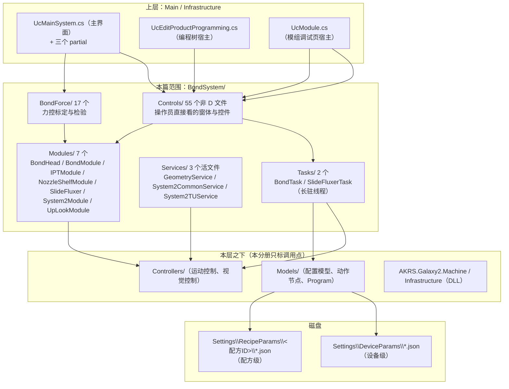

**ASCII 版（图 1）**

```
┌─────────────────────── 上层：Main / Infrastructure ───────────────────────┐
│  UcMainSystem.cs(主界面)   UcEditProductProgramming.cs(编程树)  UcModule.cs │
└────────────────────────────┬──────────────────────────────────────────────┘
                             │  new / ShowForm<T> / ShowDialogForm<T>
┌────────────────────────────▼────────── 本篇范围：BondSystem/ ──────────────┐
│ Controls/ 55 个非 Designer 文件  ← 操作员直接看的窗体与控件                 │
│ BondForce/ 17 个                  ← 力控标定与检验                          │
│ Tasks/ 2 个                       ← BondTask / SlideFluxerTask（长驻线程）  │
│ Services/ 3 个活文件              ← 几何 / 系统2通用 / 系统2 TU             │
│ Modules/ 7 个                     ← BondHead / BondModule / IPTModule …     │
└────────────────────────────┬──────────────────────────────────────────────┘
                             │  调 Models/ 与 Controllers/
┌────────────────────────────▼──────────── 本层之下 ─────────────────────────┐
│ Models/(配置模型/动作节点/Program)   Controllers/(运动/视觉)               │
│ AKRS.Galaxy2.Machine / Infrastructure（DLL，本仓无源码）                    │
└────────────────────────────┬──────────────────────────────────────────────┘
                             │  JsonFormatHelper 序列化
┌────────────────────────────▼──────────────── 磁盘 ─────────────────────────┐
│ Settings\DeviceParams\*.json（设备级）  Settings\RecipeParams\<配方ID>\*.json│
└────────────────────────────────────────────────────────────────────────────┘
```

### §1.3 三条最重要的事实

**第一条：本层的界面入口高度集中 —— 全部按钮都从 4 个文件进来。**

对全仓做「谁 `new` 了本层的窗体」统计后，结论是：**所有界面入口集中在 `Main/` 的 4 个文件里**：

| 入口文件 | 角色 |
|---|---|
| `Main/Controls/Ucmain/MainControls/UcMainSystem.cs`（+ 三个 partial：`.Manual.cs` / `.DataAdministrator.cs` / `.Diagnosis.cs`） | **主界面**，几乎所有手册页与诊断窗都从这里 `new` 或 `ShowForm<T>` |
| `Main/Controls/Ucmain/MainControls/UcMainSystem.Manual.cs` | 「手动」页签下的子页 |
| `Main/Controls/Ucmain/MainControls/UcMainSystem.DataAdministrator.cs` | 「数据管理」页签下的子页 |
| `Infrastructure/Controls/Feature/EditProgram/UcEditProductProgram/UcEditProductProgramming.cs`（+ 同目录的 `.Assistance.cs`） | **编程树宿主**，全部「示教 / 参数编辑」页从这里挂载 |

**为什么这条重要**：接手人想找「这个界面怎么打开的」，**只需要去这 4 个文件里 grep 一次**，
不用全仓乱找。反过来，**如果一个本层窗体的名字在这 4 个文件里一次都不出现，那它多半就是打不开的** ——
本篇确实查到了 4 个这样的窗体（见 §4.1 的「零调用点」一栏）。

**第二条：界面与落盘之间**只有一条**通道。**

编程树上的每一个编辑页都实现同一个接口 `IProgrammingControl`，
而这个接口**只声明了一个方法**（`Infrastructure/Interface/IProgrammingControl.cs:26-32`）：

```csharp
void Confirm();
```

宿主界面的「保存」与「开始」两个按钮，做的事情**都是同一句**：

```csharp
(this.selectedControl as IProgrammingControl)?.Confirm();
```

> `UcEditProductProgramming.cs:1071`（「保存」按钮，`BtSave_Click`，`:1067`）
> `UcEditProductProgramming.cs:873`（「开始」按钮，`BtStart_Click`，`:870`）

页面内部再走「写内存模型字段 → `XxxRepository.GetInstance().Save()`」。
**没有第二条落盘机制。**
⇒ 本篇后面凡是遇到「界面上改了、重启后没生效」，**九成都是这条通道没走到**。

**⚠️ 但两个宿主按钮并不等价**：`:1071`（保存）**被 `try/catch` 包住**，异常只弹一句 `exception.Message`；
`:873`（开始）**裸调**，没有 `try/catch`，异常直接冒到 WinForms 消息泵。
同一个 `Confirm()` 抛异常，点「保存」是弹一句英文消息，点「开始」是**未处理异常**。

**第三条：本层有 2 个长驻线程，它们不受界面控制。**

| 线程 | 创建处 | 说明 |
|---|---|---|
| 固晶工作线程 | `Tasks/BondTask.cs:365-373`（`Task.Factory.StartNew`，`:368 SetCurrentThreadName`、`:369 DoWork()`） | 生产主循环，从 `Machine` 侧启动 |
| 刮胶盘线程 | `Tasks/SlideFluxerTask.cs` | 刮胶盘伸出/缩回，由按钮启动 |

**关键点**：`BondTask.DoWork()`（`Tasks/BondTask.cs:100-355`）**通篇没有 `try/catch`**。
它抛出的异常会让 `Task` 进入 `Faulted` 状态，而消费方只做一句
`if (task?.Status == TaskStatus.Running) …` ⇒ **机器停了，但界面上没有任何弹框、没有日志**。
操作员只看到「机器不干活了」。（详见 §9.4 的 R-33）

---

## §2 目录结构

### §2.0 统计口径（**先读这段，否则数字对不上**）

1. **只统计参与编译的 `.cs`** —— 也就是在 `AKRS.ZX2200.csproj` 里能 `grep` 到
   `<Compile Include="…">` 的文件。
2. **"非 Designer"与"Designer"按文件名后缀区分，但必须用大小写不敏感的方式数。**
   全仓实测：**大写 `.Designer.cs` 331 个，小写 `.designer.cs` 8 个**，两种写法**都是 Designer**。
   ⚠️ **本项目不能用 `*.Designer.cs` 做大小写敏感匹配来分类** —— 那样会静默地把 8 个小写文件
   算进"非 Designer"，而数出来的**文件个数和行数都"看起来是对的"，只是分错了类**。
   正确命令：
   ```bash
   find . -iname '*.designer.cs'            # 大小写不敏感，一把全中
   # 或显式匹配两种写法
   find . \( -name '*.Designer.cs' -o -name '*.designer.cs' \)
   ```
   （本篇范围内 `BondSystem/` 下**没有**小写 `designer.cs`，但本目录的统计仍按上述方式复核过。）
3. **幽灵文件（在磁盘上、不在 `.csproj` 里）不计入规模**，只在附录 A 单列。
   本篇范围内共 **5 个 / 1,852 行**。

### §2.1 目录规模汇总

| 子目录 | 参与编译·非 Designer<br>文件数 | 参与编译·非 Designer<br>行数 | 参与编译·Designer<br>文件数 | 参与编译·Designer<br>行数 | 幽灵文件<br>（不参与编译） |
|---|---|---|---|---|---|
| `Controls/` | **55** | **26,707** | 53 | 24,172 | 2 个非 D（574 行）<br>2 个 D（751 行） |
| `BondForce/` | **17** | **4,000** | 5 | 1,274 | 0 |
| `Modules/` | **7** | **1,911** | 0 | 0 | 0 |
| `Services/` | **3** | **833** | 0 | 0 | 1 个非 D（527 行） |
| `Tasks/` | **2** | **755** | 0 | 0 | 0 |
| **合计** | **84** | **34,206** | **58** | **25,446** | **5 个 / 1,852 行** |

**读表须知（三个容易看错的地方）**：

- `Controls/` **磁盘上有 57 个非 Designer 文件 / 27,281 行**；
  减去 2 个幽灵（`FrmCreateProcessStep.cs` 84 行、`UcProcessStepEdit.cs` 490 行，共 574 行）
  ⇒ **参与编译 55 个 / 26,707 行**。**表里写的是后者。**
- `Controls/` **磁盘上有 55 个 Designer 文件 / 24,923 行**；
  减去 2 个幽灵 Designer（216 + 535 = 751 行）⇒ **参与编译 53 个 / 24,172 行**。
- `Services/` **磁盘上 4 个文件 / 1,360 行**；减去幽灵 `System1ActionNodesService.cs`（527 行）
  ⇒ **参与编译 3 个 / 833 行**。

**⚠️ 一个反直觉的事实**：`BondSystem/` **整个目录**的 Designer 文件全部集中在本篇范围内的
`Controls/`（55 个）与 `BondForce/`（5 个）里 —— 合计 **60 个 / 26,197 行**（磁盘口径），
与本篇表格中的数字**互相印证**，不是巧合。

### §2.2 各子目录说明

**`Controls/`（55 个非 Designer / 26,707 行）** —— 本篇的主体，按功能再分 4 个子目录：

| 子目录 | 非 Designer 文件数 | 定位 |
|---|---|---|
| `Controls/Assistant/` | 20 | **示教向导**。操作员在生产前一步步"教"机器点位，绝大多数是 `AssistantConfig` 队列驱动的多步窗体 |
| `Controls/Manual/` | 17 | **手册页**。生产现场调试用：吸嘴管理、真空、刮胶盘、力曲线、换嘴测试等 |
| `Controls/Experiment/` | 7 | **试验页**。工程调试工具，不是生产界面（`UcBondModuelSetting.cs` 单个文件 2,070 行、51 个按钮） |
| `Controls/Setting/` | 11（+2 幽灵） | **参数设置页**。配方级的参数编辑，挂载在编程树上，按 6 个子目录分组 |

**`BondForce/`（17 个 / 4,000 行）** —— **力控**（焊头压力控制）的标定、检验与实时曲线。
包含一个独立的 Modbus RTU 客户端（`Modbus/ModbusService.cs`）与闭环标定控制器。

**`Modules/`（7 个 / 1,911 行）** —— 对外设的**薄封装**：`BondHead`（焊头，304 行）、
`BondModule`（固晶模组，1,101 行，本层最大的单文件）、`IPTModule`（中转台）、
`NozzleShelfModule`（吸嘴架）、`SlideFluxer`（刮胶盘）、`System2Module`（系统2入口）、`UpLookModule`（上视相机）。

**`Services/`（3 个活文件 / 833 行）** —— 三个 `public static class`：
`GeometryService`（几何计算，353 行）、`System2CommonService`（系统2通用，319 行）、
`System2TUService`（系统2与传输单元，161 行）。

**`Tasks/`（2 个 / 755 行）** —— 仅两个类，但都是**长驻线程**：`BondTask`（503 行）、`SlideFluxerTask`（252 行）。

### §2.3 幽灵文件（**不参与编译，运行时不存在**）

本篇范围内有 **5 个** 这样的文件。**它们不会出现在本篇的按钮总表里**，
后文凡提及一律紧跟标注「**不参与编译，运行时不存在**」。

| 文件 | 行数 | 性质 | 声明的类型 |
|---|---|---|---|
| `Controls/Setting/ProcessStep/FrmCreateProcessStep.cs` | 84 | 非 Designer | `FrmCreateProcessStep` |
| `Controls/Setting/ProcessStep/FrmCreateProcessStep.Designer.cs` | 216 | Designer | 同上 |
| `Controls/Setting/ProcessStep/UcProcessStepEdit.cs` | 490 | 非 Designer | `UcProcessStepEdit` |
| `Controls/Setting/ProcessStep/UcProcessStepEdit.Designer.cs` | 535 | Designer | 同上 |
| `Services/System1ActionNodesService.cs` | 527 | 非 Designer | `System1ActionNodesService` |

**合计数**：**5 个文件 / 1,852 行**（非 Designer 3 个 / 1,101 行；Designer 2 个 / 751 行）。

**⚠️ 这 5 个全部属于「甲类：唯一的孤儿」** —— 即：
**磁盘上只有这一份，`.csproj` 里没有任何同路径替代品**，
⇒ **编译系统里根本不存在这些类型**，且**从加入仓库起就没编过**（不是"某次重构漏删"）。

> **为什么必须点明"甲类"**：全主工程共 **20 个**幽灵，分两种性质。
> **乙类 4 个**（`Experiment/RepeatPositionAccuracy/` 下的
> `FrmChooseCamera.*`、`FrmRotateCenterAccuracy.*`）**有编译双胞胎**
> （新版在 `Experiment/Test/`，`csproj:1222`/`:1225`/`:1867`/`:1870`）。
> 乙类的真正风险是"**有人对着旧副本改，编译通过、运行时毫无变化**"。
> **本篇范围内的 5 个都不是乙类**，所以**不存在"改错副本"的风险**，
> 风险只有一条：**后来人把它当成活代码读**。

**为什么可以断定它们不参与编译**——四条独立证据：

0. **可复现的差集**（引用 `_raw\_幽灵文件清单.md` 的原始命令，**原样复制**）：
   ```bash
   cd "E:/项目/ZX2200标机/trunk/AKRS.ZX2200"
   grep -o '<Compile Include="[^"]*"' AKRS.ZX2200.csproj | sed 's/.*Include="//; s/"$//' | sort -u > /tmp/csproj.txt
   find . -name '*.cs' -not -path './bin/*' -not -path './obj/*' | sed 's|^\./||' | sort -u > /tmp/disk.txt
   comm -13 /tmp/csproj.txt /tmp/disk.txt      # 只在磁盘、不在工程 = 幽灵
   # 工程内 1,131 条；磁盘上 1,151 个 .cs；差集 20 个；合计 4,881 行
   ```
   > **⚠️ 陷阱**：把 `\` 换成 `/` 的那一步**不能用 `sed 's#\\#/#g'`**
   > （在 Git Bash 下会**静默失败并继续跑**，导致**每个类型都报 0**，即"假零"）。
   > 必须用 `tr '\\' '/'`。**纪律：没有跑过正向对照的「0」，不算证据** ——
   > 正向对照是"两条已知活文件必须 =1、`Common.cs` 必须 =0"。


1. **`grep` 不到 `<Compile Include>`**：逐个文件名在 `AKRS.ZX2200.csproj` 里 `grep -c` 均为 **0**。
2. **`.csproj` 里 `Compile Remove` 也是 0 命中** ⇒ 不是"条件排除"，而是**文件被移出工程后忘了删盘**。
3. **⭐ 最硬的一条：编译期反证。** 幽灵文件 `UcProcessStepEdit.cs:321` 与 `:336` 是**活的、未注释**的调用：
   ```csharp
   :321  CommonHelper.UpOrDown(Direction.Up,   this.GvProcessStep);
   :336  CommonHelper.UpOrDown(Direction.Down, this.GvProcessStep);
   ```
   而 `Infrastructure/Utils/CommonHelper.cs` 里 **`UpOrDown` 的两个重载整体被注释掉了**
   （泛型版注释块 `:69-89`，声明行 `:75`；非泛型版注释块 `:91` 起，声明行 `:96`）。
   ⇒ **`CommonHelper` 里根本不存在名为 `UpOrDown` 的方法。**
   若把这个文件加回 `.csproj`，**它必然编译失败**。这不是"没人调用"，是"**调用的方法不存在**"。

   > **顺带一句别误推的**：`CommonHelper.cs` **本身不是死代码** ——
   > 它 127 行、被 23 个外部文件引用、**26 处活调用点，全部是同一个 `ChangeUcMove`（`:25`）**。
   > 死的只是 `UpOrDown` 这一个已被移除的功能，以及幽灵文件里留下的悬空调用。
   > **别因为"里面有个方法被注释了"就把整个 `CommonHelper` 写死。**

**「这 5 个幽灵被编译代码引用了几次」——逐个类型实测，答案是 0。**
口径：按**全路径**过滤出编译清单，再统计类型名（`grep -rw` 词边界）出现在哪些**编译**文件里。

| 幽灵类型 | 在编译代码里的命中 | 逐行读进去的实际情况 |
|---|---|---|
| `System1ActionNodesService` | **0**（**全仓 0 命中** —— 除它自己的定义行外，任何地方都没有再提到过这个名字） | — |
| `FrmCreateProcessStep` | **0**（只有幽灵簇内部互相提到） | — |
| `UcProcessStepEdit` | **1** —— `Infrastructure/Controls/Feature/EditProgram/UcEditProductProgram/UcEditProductProgramming.cs:854` | ⚠️ **这一行是被注释掉的**：`//this.selectedControl = new UcProcessStepEdit { Dock = DockStyle.Fill };` ⇒ **仍然算 0** |
| `FrmCreateProcessStep`（同为界面）| 同上 | — |

> **⚠️ 为什么要把 `UcEditProductProgramming.cs:854` 这一行专门点出来**：
> 它是**整个工程里唯一一处能在编译代码里 `grep` 到 `UcProcessStepEdit` 的地方**，
> 而且**就在编程页的"选中控件"逻辑旁边**。读者自己 `grep` 命中了它，
> 会以为"这个界面是被编程页挂上去的、应该是活的" ⇒ **正是最需要拆穿的一处**。
> **它不是活引用，它是一行注释。**
>
> **⚠️ 关于 `System1ActionNodesService`（527 行，全仓 0 引用）**：
> **只客观写"不参与编译、运行时不存在、无任何引用"** ——
> **不要写"可以安全删除"**，那是产品决策，不是技术事实。

> **⚠️ 另外一处必须点出来的假阳性（不在本篇范围，但同族，读者会撞上）**：
> 幽灵类型 `ProcessStepProgram` 在全仓有 **4 个"在编译文件里"的命中**，
> **逐条读进去全是注释或字符串属性名**：
> `Models/System2Domain.cs:613`（注释）、
> `Infrastructure/Models/Path/ZX2200PathConfig.cs`（命中的是**字符串属性名**
> `ProcessStepProgramFilePath`）、
> `Infrastructure/Utils/CommonHelper.cs`（被注释的旧代码）、
> `Main/Machine/Product/ProductDomain.cs`（注释）。
> **`grep` 命中数只能用来定位可疑点，不能用来下结论** ——
> 注释、字符串、同名属性是本项目最常见的三种假阳性。

### §2.4 ⚠️ 两套「制程步骤」模型 —— 本层最容易坑到人的一处

**同一个业务概念「制程步骤」，本仓有 `ProcessStep` 与 `SingleProcessStep` 两套类型。**
**死的那一套**和**活的那一套**长这样：

| | ❌ 死的那套 | ✅ 活的那套 |
|---|---|---|
| 类型名 | `ProcessStep` / `ProcessStepProgram` | **`SingleProcessStep`** |
| 定义位置 | `Main/Machine/Product/ProcessStep/ProcessStep.cs:12`、`ProcessStepProgram.cs:14` | **`Main/Machine/Process/SingleProcessStep.cs:15`** |
| 是否编译 | **两个文件都不在 `.csproj`** | 参与编译 |
| 谁在用它 | **只在幽灵文件之间互相引用** | `Main/Machine/Process/S2ActionNodeController.cs:92` 的 `private List<SingleProcessStep> ProcessSteps =>`；`S1ActionNodeController` 同理 |

**全仓对 `ProcessStep` / `ProcessStepProgram` 类型的真实引用数 = 0。** 全部疑似引用点逐行排除后都是假阳性：

- `Main/Machine/Process/S2ActionNodeController.cs:60` —— `private SingleProcessStep ProcessStep { get; set; }`
  **属性名叫 `ProcessStep`，类型是 `SingleProcessStep`**。`grep -w ProcessStep` 命中它**纯属名字撞车**。
- `Infrastructure/Models/Path/ZX2200PathConfig.cs:166` / `:168` / `:281` —— 命中的是**字符串属性名**
  `ProcessStepProgramFilePath` 和 XML 注释。
- `Main/Machine/Product/ProductDomain.cs:38` / `:41`、`BondSystem/Models/System2Domain.cs:613` —— **注释**。

> 🔴 **本篇对此单列一条风险（§9.6 的 R-49）**：
> `S2ActionNodeController.cs:60` 的**属性名与幽灵类型名完全相同**，
> 后来人 `grep ProcessStep` 排查问题**必然被引到死代码上**。
> 凡涉及"制程步骤"，**一律以 `SingleProcessStep` 为准**。

**另外**：`Controls/Setting/ProcessStep/` 这个目录下的两个窗体（合计 **1,325 行**，
`FrmCreateProcessStep.cs` + `UcProcessStepEdit.cs` 及其 Designer）
**属于死簇，不参与编译，运行时不存在** —— 它们**未进本篇 §4.2 的按钮总表**。
（这两个文件在磁盘上分别有 2 个和 4 个 `_Click` 处理器定义，**总计 6 个**。
本篇 §4.0 报告的全目录原始计数 **313 个** `_Click` 定义中**包含**这 6 个；
**减掉后参与编译的是 307 个**，§4.2 的按钮总表按 **307 个**列，口径见 §4.0。）

## §3 关键类型索引

### §3.1 按角色分类的类型清单

本篇范围内的类型共 **99 个**（含嵌套类与枚举）。下表按「角色」分组，
**只列接手时真正需要先认识的那些**，每行给**声明行**。

#### §3.1.1 界面类型：示教向导（`Controls/Assistant/`，18 个类）

| 类型 | 声明行 | 干什么 | 打开它的入口 |
|---|---|---|---|
| `FrmComponentPickup` | `Controls/Assistant/FrmComponentPickup.cs:36` | **元件取料参数**窗（+ `.Draw.cs:14` 绘制 partial） | 编程树 `UcEditProductProgramming.cs:1997` |
| `FrmComponentPlacement` | `Controls/Assistant/FrmComponentPlacement.cs:43` | **元件固晶参数**窗（+ `.Draw.cs:13`） | 编程树 `UcEditProductProgramming.cs:2032` |
| `FrmComponentAccuracyMode` | `Controls/Assistant/FrmComponentAccuracyMode.cs:41` | 元件精度模式（**1,828 行 / 11 个按钮**，本层最复杂的窗体之一） | 编程树（`UcEditProductProgramming.Assistance.cs` 多处） |
| `FrmModuleSelect` | `Controls/Assistant/FrmModuleSelect.cs:36` | **模块 / 基板选择**（880 行 / 11 个按钮，内含两个枚举 `MoveTypeEnum:747`、`TeachFormEnum:855`） | 编程树 `UcEditProductProgramming.Assistance.cs:169`、`:229`、`:295`… 共 8 个实例化点 |
| `FrmPostBondTeach` | `Controls/Assistant/FrmPostBondTeach.cs:43` | **焊后检测示教**（2,110 行，本层**行数最多**的界面） | **零调用点**（见 §4.1） |
| `FrmMoveToBondingPosition` | `Controls/Assistant/FrmMoveToBondingPosition.cs:29` | 移动到固晶位 | **零调用点，且类注释自认弃用**（见 §9.4 R-35） |
| `FrmTeachBondingPosition` | `Controls/Assistant/FrmTeachBondingPosition.cs:32` | 固晶位示教 | 编程树 `.Assistance.cs:723` |
| `FrmToolAlignmentTeach` | `Controls/Assistant/FrmToolAlignmentTeach.cs:29` | 工具对位示教 | 编程树 `.Assistance.cs:983` |
| `FrmToolGeometryTeach` | `Controls/Assistant/FrmToolGeometryTeach.cs:31` | 工具几何示教 | 编程树 `.Assistance.cs:1017` |
| `FrmToolHeightTeach` | `Controls/Assistant/FrmToolHeightTeach.cs:27` | 工具高度示教 | 编程树 `.Assistance.cs:944` |
| `FrmAssistantBLT` | `Controls/Assistant/FrmAssistantBLT.cs:22` | 芯片周围 / 芯片表面示教 | 编程树 `.Assistance.cs:1063`、`:1081` |
| `FrmAssistantDefect` | `Controls/Assistant/FrmAssistantDefect.cs:28` | 缺陷示教（656 行） | 编程树 `.Assistance.cs:826`、`:858`；**另一处** `TransportUnitSystem/…/UcObjectFunctionEdit.cs:457` |
| `FrmAssistantDispense` | `Controls/Assistant/FrmAssistantDispense.cs:44` | 点胶示教助手 | **本层内** `Controls/Manual/UcS2DispenseManual.cs:131` |
| `FrmS2DispensePlateAssistant` | `Controls/Assistant/FrmS2DispensePlateAssistant.cs.cs:34` | 点胶板示教（**注意文件名是双扩展名 `.cs.cs`**，见 §9.7 R-50） | 本层内 `UcS2DispenseManual.cs:120` |
| `FrmBackSideCrackDetectionTeach` | `Controls/Assistant/FrmBackSideCrackDetectionTeach.cs:33` | 背崩检测示教 | 编程树 |
| `FrmBondPositionHeightTeach` | `Controls/Assistant/FrmBondPositionHeightTeach.cs:30` | 焊点高度示教 | 编程树 |
| `FrmRelativeBondTeach` | `Controls/Assistant/FrmRelativeBondTeach.cs:37` | 相对固晶示教 | 编程树 |
| `FrmFluxDetectionPara` | `Controls/Assistant/FrmFluxDetectionPara.cs:23` | 胶印检测参数（**86 行，本层最小的窗**，只有 1 个按钮） | 编程树 |

#### §3.1.2 界面类型：手册页（`Controls/Manual/`，17 个类）

| 类型 | 声明行 | 干什么 | 打开它的入口 |
|---|---|---|---|
| `UcVacuum` | `Controls/Manual/UcVacuum.cs:20` | **真空 / 吹气手动开关**（7 个按钮，全层最"贴硬件"的一页） | `UcMainSystem.Manual.cs:204` |
| `UcS2DispenseManual` | `Controls/Manual/UcS2DispenseManual.cs:26` | **点胶手册页**（含「预点胶」按钮） | `UcMainSystem.cs:1697` |
| `FrmNozzleBankManual` | `Controls/Manual/FrmNozzleBankManual.cs:30` | **吸嘴架手动管理**（5 个按钮 + 1 个定时器） | `UcMainSystem.Manual.cs:96` |
| `FrmToolsTestRun` | `Controls/Manual/FrmToolsTestRun.cs:34` | **换顶针 / 换吸嘴重复性测试** | `UcMainSystem.Manual.cs:140` |
| `FrmAutoSlideFlux` | `Controls/Manual/FrmAutoSlideFlux.cs:16` | 自动刮胶（172 行，1 个按钮） | `UcMainSystem.cs:1811` |
| `FrmBlowOffBoxAssistant` | `Controls/Manual/FrmBlowOffBoxAssistant.cs:27` | 抛料盒助手 | `Controls/Setting/Customer/FrmCustomerSetup.cs:104` |
| `FrmForceRealTimeCurve` | `Controls/Manual/FrmForceRealTimeCurve.cs:30` | **力控实时曲线**（528 行，含嵌套类 `DataPoint:517`） | 主界面 |
| `FrmPostBondResCurve` | `Controls/Manual/FrmPostBondResCurve.cs:23` | 焊后结果曲线 | 主界面 |
| `FrmLearnIPT` | `Controls/Manual/FrmLearnIPT.cs:30` | 中转台示教 | 编程树 / 客户设置页 |
| `FrmLearnNozzleBank1` | `Controls/Manual/FrmLearnNozzleBank1.cs:36` | 吸嘴架示教（776 行） | 客户设置页 |
| `FrmLearnPrintPos` | `Controls/Manual/FrmLearnPrintPos.cs:29` | 蘸胶位置示教 | 客户设置页 |
| `FrmLearnToolBank` | `Controls/Manual/FrmLearnToolBank.cs:27` | 工具库示教（547 行） | 客户设置页 |
| `FrmNozzleCleanPosTeach` | `Controls/Manual/FrmNozzleCleanPosTeach.cs:22` | 吸嘴擦拭位示教 | 客户设置页 |
| `FrmSlideFluxerTeach` | `Controls/Manual/FrmSlideFluxerTeach.cs:26` | 刮胶盘示教 | 客户设置页 |
| `FrmTeachULMPositions` | `Controls/Manual/FrmTeachULMPositions.cs:21` | ULM 运动点位示教 | 客户设置页 |
| `FrmNozzleSelect` | `Controls/Manual/FrmNozzleSelect.cs:20` | 吸嘴选择（69 行，最小） | 主界面 |
| `FrmSelectComponent` | `Controls/Manual/FrmSelectComponent.cs:13` | 元件选择（63 行） | 主界面 |

#### §3.1.3 界面类型：试验页（`Controls/Experiment/`，7 个类）

| 类型 | 声明行 | 干什么 | 备注 |
|---|---|---|---|
| `UcBondModuelSetting` | `Controls/Experiment/UcBondModuelSetting.cs:77` | **固晶模组调试总页**：2,070 行 / **51 个 `_Click`**（本层按钮最多的单个文件） | 由 `Main/Controls/UcModule.cs:506` 活实例化 ⇒ **生产界面可达** |
| `FrmBondheadTest` | `Controls/Experiment/FrmBondheadTest.cs:37` | 焊头测试（1,382 行 / 3 个按钮） | 由 `UcMainSystem.Diagnosis.cs:201` 与 `FrmCalibrationRelationship.cs:61`/`:300` 实例化 |
| `FrmGTForceTest1` | `Controls/Experiment/FrmGTForceTest.cs:36` | 力控测试（704 行 / 12 个按钮） | ⚠️ **文件名是 `FrmGTForceTest.cs`，类名却是 `FrmGTForceTest1`**（§9.7 R-50） |
| `FrmForceControlInspection` | `Controls/Experiment/FrmForceControlInspection.cs:30` | 力控检验（295 行，含嵌套类 `DataPoint:283`） | **零调用点** |
| `FrmLVDTRealTimeCurve` | `Controls/Experiment/FrmLVDTRealTimeCurve.cs:22` | LVDT 实时曲线 | 主界面 |
| `FrmNewForceConfigItem` | `Controls/Experiment/FrmNewForceConfigItem.cs:18` | 新建力控配置项（70 行） | 力控页 |
| `FrmTimerTest` | `Controls/Experiment/FrmTimerTest.cs:16` | 定时器测试（33 行，**无任何按钮**） | 调试用 |

#### §3.1.4 界面类型：参数设置页（`Controls/Setting/`，11 个参与编译）

**这一组特别注意**：其中 **4 个实现了 `IProgrammingControl`**，也就是**会被宿主的「保存」按钮落盘**的页面。

| 类型 | 声明行 | 实现 `IProgrammingControl` | 干什么 |
|---|---|---|---|
| `UcNozzleEdit` | `Controls/Setting/Nozzle/UcNozzleEdit.cs:18` | ✅ | 吸嘴参数（**130 行，但含 2 处 UI 线程 1 秒冻结**，见 §4.8） |
| `UcBondPositionEdit` | `Controls/Setting/BondPosition/UcBondPositionEdit.cs:37` | ✅ | 焊点参数（471 行） |
| `UcPostBondEdit` | `Controls/Setting/PostBond/UcPostBondEdit.cs:30` | ✅ | 焊后检测参数（388 行） |
| `UcProcessStepEdit` | `Controls/Setting/ProcessStep/UcProcessStepEdit.cs:28` | ✅ | ⚠️ **幽灵文件，不参与编译，运行时不存在** |
| `UcAddBondPosition` | `Controls/Setting/BondPosition/UcAddBondPosition.cs:31` | ❌（自己 `Save()`） | **焊点增删改**（397 行，含「Copy」按钮） |
| `UcAddPostBond` | `Controls/Setting/PostBond/UcAddPostBond.cs:20` | ❌ | 焊后检测项增删改（176 行） |
| `FrmCustomerSetup` | `Controls/Setting/Customer/FrmCustomerSetup.cs:20` | ❌ | **客户设置页：11 个示教入口的集散地**（274 行） |
| `FrmNozzleShelfSetting` | `Controls/Setting/NozzleShelf/FrmNozzleShelfSetting.cs:28` | ❌ | 吸嘴架设置（401 行 / 8 个按钮） |
| `FrmNewCreateNozzle` | `Controls/Setting/NozzleShelf/FrmNewCreateNozzle.cs:25` | ❌ | 新建吸嘴（157 行） |
| `FrmNewCreatePostBond` | `Controls/Setting/PostBond/FrmNewCreatePostBond.cs:25` | ❌ | 新建焊后检测项（154 行） |
| `FrmPostBondData` | `Controls/Setting/PostBond/FrmPostBondData.cs:27` | ❌ | **焊后补偿数据**（377 行） |
| `FrmPostBondDataset` | `Controls/Setting/PostBond/FrmPostBondDataset.cs:16` | ❌ | ⚠️ **编译进去了，但全仓零实例化点**（102 行，见 §9.4 R-36） |
| `FrmCreateProcessStep` | `Controls/Setting/ProcessStep/FrmCreateProcessStep.cs:14` | ❌ | ⚠️ **幽灵文件，不参与编译，运行时不存在** |

#### §3.1.5 力控类型（`BondForce/`，19 个）

| 类型 | 声明行 | 角色 |
|---|---|---|
| `UcBondForceMeasurement` | `BondForce/Forms/UcBondForceMeasurement.cs:19` | 力控总入口控件（4 个按钮），由 `UcMainSystem.Manual.cs:220` 挂载 |
| `FrmCalibrationRelationship` | `BondForce/Forms/FrmCalibrationRelationship.cs:30` | 力控标定关系（330 行 / 3 个按钮，含 R-05 那条 `try` 外落盘） |
| `FrmCalibrateTeach` | `BondForce/Forms/Assistant/FrmCalibrateTeach.cs:22` | 标定示教（两步向导） |
| `FrmInspectForceRes` | `BondForce/Forms/FrmInspectForceRes.cs:29` | 力值检验（499 行 / 2 个按钮） |
| `FrmCalibrateTableForceRealtimeLine` | `BondForce/Forms/FrmCalibrateTableForceRealtimeLine.cs:21` | 平台力实时曲线（20 ms / 50 Hz 采样） |
| `ModbusService` | `BondForce/Modbus/ModbusService.cs:23` | **Modbus RTU 客户端**（`SingletonNoSave<T>`） |
| `RtuConnectConfig` | `BondForce/Modbus/RtuConnectConfig.cs:19` | 串口参数（`Singleton<T>`） |
| `BaseCalibrationController` | `BondForce/Controllers/BaseCalibrationController.cs:6` | 标定控制器基类（`abstract`） |
| `ClosedLoopCalibrationController` | `BondForce/Controllers/ClosedLoopCalibrationController.cs:35` | **闭环标定控制器**（754 行，本目录最重的类） |
| `VoiceCoilMotorCalibrationController` | `BondForce/Controllers/VoiceCoilMotorCalibrationController.cs:18` | 音圈电机标定 |
| `ForceCalibrationService` | `BondForce/Services/ForceCalibrationService.cs:26` | 力标定服务（`static`，552 行） |
| `ForceConfig` | `BondForce/Models/DevicePara/ForceConfig.cs:26` | 力控配置（`Singleton<T>`，422 行） |
| `ForceConfigItem` | `BondForce/Models/DevicePara/ForceConfig.cs:303` | 单条力控项 |
| `ForceCalibrationData` | `BondForce/Models/ClosedLoopModels/ForceCalibrationData.cs:18` | 标定数据（`Singleton<T>`） |
| `ForceRelateAngleItem` | `BondForce/Models/ClosedLoopModels/ForceRelateAngleItem.cs:12` | 力-角度关系项 |
| `TheoreticalForceAndActualForce` | `BondForce/Models/ClosedLoopModels/ForceRelateAngleItem.cs:28` | 理论力 vs 实测力 |
| `VoiceCoilMotorForceCalibrationPara` | `BondForce/Models/VoiceCoilModels/VoiceCoilMotorForcePara.cs:16` | 音圈力标定参数 |
| `ForceTorque` | `BondForce/Models/VoiceCoilModels/ForceTorque.cs:6` | 力-力矩 |
| `ForceCalibration` | `BondForce/ForceCalibration.cs:8` | 标定入口（33 行） |

#### §3.1.6 执行机构封装（`Modules/`，7 个）

| 类型 | 声明行 | 行数 | 角色 |
|---|---|---|---|
| `BondModule` | `Modules/BondModule.cs:36` | **1,101** | 固晶模组（本层最大的单文件，聚合焊头 + 顶针 + 视觉） |
| `BondHead` | `Modules/BondHead.cs:38` | 304 | **焊头**：真空 / 吹气电磁阀、Z 轴、力控 |
| `NozzleShelfModule` | `Modules/NozzleShelfModule.cs:13` | 160 | 吸嘴架 |
| `UpLookModule` | `Modules/UpLookModule.cs:19` | 126 | 上视相机（UpLook） |
| `IPTModule` | `Modules/IPTModule.cs:10` | 95 | 中转台（IPT） |
| `SlideFluxer` | `Modules/SlideFluxer.cs:23` | 81 | 刮胶盘 |
| `System2Module` | `Modules/System2Module.cs:11` | 44 | 系统2入口（`SingletonNoSave<T>`） |

#### §3.1.7 服务（`Services/`，3 个活 + 1 个幽灵）

| 类型 | 声明行 | 行数 | 角色 |
|---|---|---|---|
| `GeometryService` | `Services/GeometryService.cs:17` | 353 | **全 `static` 几何计算**（范围判断、交点、旋转） |
| `System2CommonService` | `Services/System2CommonService.cs:26` | 319 | 系统2通用（Excel 读写等，含**无上限递归重试**） |
| `System2TUService` | `Services/System2TUService.cs:14` | 161 | 系统2 ↔ 传输单元（**两个同族方法返回不同坐标系**） |
| `System1ActionNodesService` | `Services/System1ActionNodesService.cs:25` | 527 | ⚠️ **幽灵文件，不参与编译，运行时不存在** |

#### §3.1.8 任务（`Tasks/`，2 个）

| 类型 | 声明行 | 行数 | 角色 |
|---|---|---|---|
| `BondTask` | `Tasks/BondTask.cs:42` | 503 | **固晶主循环**，长驻线程，`DoWork()` 在 `:100-355` |
| `SlideFluxerTask` | `Tasks/SlideFluxerTask.cs:31` | 252 | 刮胶盘线程，靠**信号池握手 + 超时对话**驱动 |

### §3.2 本篇用到的平台类型（定义在本层之外）

接手人看本篇代码时会碰到下面这些类型，**它们的定义不在 `BondSystem/` 里**，先在这里认一下：

| 类型 | 定义位置 | 用途 |
|---|---|---|
| `IProgrammingControl` | `Infrastructure/Interface/IProgrammingControl.cs:26-32` | **只有 `void Confirm();` 一个方法** —— 编程页唯一的落盘通道 |
| `AKRSXtraMessageBox` | `Infrastructure/Controls/Currency/AKRSXtraMessageBox.cs:23` | `static class`，全层的消息框入口（**注意：它是本仓自己的封装，不是 DevExpress 的**） |
| `ControlService` | `Infrastructure/Service/ControlService.cs` | `:366 ShowDialogForm<T>(params object[] args)` 反射开窗；`:215`/`:236 ToggleControlsEnabled(Control, List<Control>, bool)` |
| `ControlHelper` | `Infrastructure/Utils/ControlHelper.cs:78` | `ShowForm<T>(this IWin32Window, params object[] args)` 泛型开窗扩展方法 |
| `CommonHelper` | `Infrastructure/Utils/CommonHelper.cs:25` | 只有 `ChangeUcMove` 活着（26 处调用）；`UpOrDown` **两个重载已被整体注释掉** |
| `JsonFormatHelper<T>` | `AKRS.Galaxy2.*`（DLL，**无源码**） | `:262` 之类处用的 `DeepGenericCopy<T>(T)` 深拷贝 |
| `Singleton<T>` / `SingletonNoSave<T>` | `AKRS.Galaxy2.*`（DLL，**无源码**） | 配置单例基类。**`Singleton<T>` 会落盘、`SingletonNoSave<T>` 不会** —— *推断*（依据：`WaferSubDevicePara.cs:59-118` 的用法形态） |
| `Machine` | `Main/Machine/MachineSupport/Machine.cs` | `Machine.GetInstance()`，消费方用 `:250-255` 判 `TaskStatus.Running` |
| `Signal` / `SignalPool` | `AKRS.Galaxy2.Machine/`（**本 trunk 有源码**） | 线程间握手 |
| `LogHelper` | `AKRS.Galaxy2.Infrastructure.*`（DLL） | `LogHelper.Post(...)` 写运行记录 |

## §4 UI 按钮与交互流程 ★核心★

> **本节是全篇的重点。** 用户对本次文档的原话要求是：
> 「**详细的流程图，之前的还是不够详细，再详细一点，多关注 UI 界面的按钮实现的功能，
> 比如说点胶按钮点击之后，经过什么样的流程之后点胶完成，多一些这样的实现流程**」。
>
> 所以本节的组织方式是：**先把按钮数清楚（一个不漏），再把"点下去之后到底发生了什么"逐条画出来**，
> 每条都追到**终点** —— 终点可能是**硬件**（轴 / 电磁阀 / 相机 / 串口）、可能是**内存**（只改了模型没落盘）、
> 也可能是**磁盘**（改完就写 JSON）。

### §4.0 统计口径（**先说清怎么数的**）

先把四种口径列出来，避免后面数字对不上：

| 口径 | 命令要点 | 结果 |
|---|---|---|
| **A. 事件处理器定义（本层范围）** | `grep -E 'private\|public\|protected.*void\s+\w+_'` 含 `_Click` / `_ItemClick` / `_CheckedChanged` / `_SelectedIndexChanged` / `_ValueChanged` / `_DoubleClick` / `_Tick` / `_Load` … | **474 处** |
| **B. `_Click` 处理器定义（含 Designer 里的重复计数）** | 含 Designer 文件 | **322 处** |
| **C. `_Click` 处理器定义（排除 Designer）** | `grep -ohE '[A-Za-z0-9_]+_Click *\(object'` | 全目录 **313 处 / 唯一方法名 174 个 / 58 个文件** |
| **D. Designer 里的接线行（`+= new …`）** | 双模式 `find`（大写 + 小写） | **317 行接线**，分布在 **60 个** Designer 文件里 |

**本篇正文用的是哪个**：**C 减掉幽灵文件** ⇒ **307 个** `_Click` 定义，分布在 **56 个参与编译的文件**里。
理由：口径 C 里包含 `Controls/Setting/ProcessStep/` 两个幽灵文件的 **6 个** `_Click`
（`FrmCreateProcessStep.cs` 2 个 + `UcProcessStepEdit.cs` 4 个）——
它们 **不参与编译、运行时不存在**，**不得进按钮总表**。

**逐目录明细（本篇自己数的，可复现）**：

| 目录 | `_Click` 定义 | 唯一方法名 | 文件数 | 其中幽灵 |
|---|---|---|---|---|
| `Controls/Assistant/` | **108** | 44 | 18 | 0 |
| `Controls/Manual/` | **71** | 38 | 17 | 0 |
| `Controls/Experiment/` | **75** | 68 | 6 | 0 |
| `Controls/Setting/` | **45** | 36 | 12 | **6**（ProcessStep 两个幽灵文件） |
| `BondForce/` | **14** | 12 | 5 | 0 |
| **合计** | **313** | **174** | **58** | **6** |

复现命令（⚠️ **必须用宽松模式 `[A-Za-z0-9_]+_Click *\(object`**，见下）：

```bash
cd "E:/项目/ZX2200标机/trunk/AKRS.ZX2200/BondSystem"
for d in Controls/Assistant Controls/Manual Controls/Experiment Controls/Setting BondForce; do
  find "$d" -name '*.cs' -not -name '*.Designer.cs' -not -name '*.designer.cs' -print0 \
    | xargs -0 grep -ohE '[A-Za-z0-9_]+_Click *\(object' | wc -l
done
```

> ⚠️ **数 `_Click` 时有一个必须避开的坑：不能用 `private +void +Xxx_Click`。**
> 本层有 **2 个** `_Click` **不是 `private void`**，用 `private +void` 数会**静默少数 2 个**：
> - `Controls/Assistant/FrmComponentAccuracyMode.cs:1435` `private async void BtnPickFromIPT_Click(object sender, EventArgs e)` —— **`async void`**
> - `Controls/Experiment/FrmBondheadTest.cs:212` `public void BtnStart_Click(object sender, EventArgs e)` —— **`public`**
>
> `private +void` 得到 **311**，宽松模式得到 **313**，差的正是这两个。
> **这是个"数字看起来对、其实少了一块"的典型** —— 与 `*.Designer.cs` 大小写坑同族，
> 所以本篇把复现命令原样写出来，读者可以自己核。

> **为什么 B 和 C 差这么多（322 vs 313）**：因为 `Designer.cs` 里偶尔也会定义同名重载
> （`private void Xxx_Click(object sender, EventArgs e)` 在 partial 两侧都出现），
> 含 Designer 数就会把它们重复计一次。

**⚠️ 口径 D 有一个必须说清的坑**：统计 Designer 接线**必须用双模式 `find`**：

```bash
cd "E:/项目/ZX2200标机/trunk/AKRS.ZX2200/BondSystem"
# ❌ 错：大小写敏感，全仓 8 个小写 designer.cs 会被静默漏掉
grep -rn --include='*.Designer.cs' '\.Click +=' .
# ✅ 对：
find . \( -name '*.Designer.cs' -o -name '*.designer.cs' \) -print0 \
  | xargs -0 grep -h '\.Click +='
```

**⚠️ 还有一条更隐蔽的坑，本篇为此单列了判定口径**：

> **本项目凡 `Xxx_Click` 命名的处理器，`grep -w Xxx` 一律查不到。**
> 因为 `_` 是**词字符**，`BtnCopy_Click` 是**一个整词**，
> `\bBtnCopy\b` 匹配不到它 —— 于是「按控件名排查处理器」会**静默漏掉处理器本体那一行**。
> **按控件名排查必须同时跑两种写法**：
> ```bash
> grep -rn --include='*.cs' 'BtnCopy' .        # 不带 -w
> grep -rn --include='*.cs' 'BtnCopy_Click' .  # 显式带后缀
> ```
> 本篇 §4.2 的「Copy」按钮正是踩了这个坑才被误判过一次（见 §9.2 R-12 的说明）。
> **这个坑与 `*.Designer.cs` 大小写坑、`--include` 大小写坑是同一族**：
> 数出来的东西"看起来对"，只是**静默漏了一整块**。

**归类口径**：本篇把每个 `_Click` 归成三类，用来快速判断风险面：

| 归类 | 含义 | 数量（本篇实测） |
|---|---|---|
| **直接落盘** | 处理器体内（或被它同步调用的 `Save()` 里）有 `…GetInstance().Save()` | 12 个 |
| **只改内存** | 改了模型字段，但**整条链上没有 `Save()`** | 2 个 |
| **导航 / 只读** | 开窗、切步、刷新、只读展示 | 291 个 |

> **⚠️ 这三类不是"好/坏"之分**：「只改内存」在某些场景是**故意的**（等宿主统一落盘），
> 但**同一个仓库里两种做法并存**就是坑 —— 操作员分不清哪些改动"点完就生效"、哪些要再点一次「保存」。
> 本篇在 §8.6 单列了「**改了但没保存**」清单。

### §4.1 UI 清单（每个界面"怎么打开的"）

**这一节回答的是一个很实际的问题**：接手人看到一个窗体，想**在界面上把它点出来**，该点哪里。

下表「打开它的入口」一栏按三种来源标注：

- **① 界面按钮**：给 `文件:行`，顺着行号能点到那个按钮；
- **② 任务层 / 线程运行时弹出**：给**触发条件 + `文件:行`**（这类窗不是点出来的，是跑到某一步自己弹的）；
- **③ 反射服务**：`ControlService.ShowDialogForm<T>` / `ControlHelper.ShowForm<T>` 的**调用点 `文件:行`**；
- **④ 零调用点**：上面三条都不成立 ⇒ 标「**零调用点**」，
  并在同一行注明它是**僵尸窗体**（编译进去了、但生产上打不开）。

| 界面 | 文件 | 打开它的入口 | 类型 |
|---|---|---|---|
| **主界面** | `Main/…/UcMainSystem.cs` | 程序启动即加载 | ① |
| 真空 / 吹气手动页 | `Controls/Manual/UcVacuum.cs:20` | ① `Main/…/UcMainSystem.Manual.cs:204` `new UcVacuum() { Dock = Fill }` | ① |
| 点胶手册页 | `Controls/Manual/UcS2DispenseManual.cs:26` | ① `Main/…/UcMainSystem.cs:1697` `new UcS2DispenseManual()` | ① |
| 吸嘴架手动管理 | `Controls/Manual/FrmNozzleBankManual.cs:30` | ① `Main/…/UcMainSystem.Manual.cs:96` `this.frmNozzleBank = new FrmNozzleBankManual()` | ① |
| 换工具重复性测试 | `Controls/Manual/FrmToolsTestRun.cs:34` | ① `Main/…/UcMainSystem.Manual.cs:140` `new FrmToolsTestRun()` | ① |
| 自动刮胶 | `Controls/Manual/FrmAutoSlideFlux.cs:16` | ① `Main/…/UcMainSystem.cs:1811` `new FrmAutoSlideFlux()` | ① |
| 抛料盒助手 | `Controls/Manual/FrmBlowOffBoxAssistant.cs:27` | ① `Controls/Setting/Customer/FrmCustomerSetup.cs:104` `new FrmBlowOffBoxAssistant()` | ① |
| 固晶模组调试总页 | `Controls/Experiment/UcBondModuelSetting.cs:77` | ① `Main/Controls/UcModule.cs:506` `new UcBondModuelSetting() { Dock = Fill }` | ① |
| 焊头测试 | `Controls/Experiment/FrmBondheadTest.cs:37` | ① `Main/…/UcMainSystem.Diagnosis.cs:201`；**另有** `BondForce/Forms/FrmCalibrationRelationship.cs:61` 与 `:300`（**后者是标定流程跑到一半自己 `new` 的 ⇒ 属②**） | ① + ② |
| 力控测量总页 | `BondForce/Forms/UcBondForceMeasurement.cs:19` | ① `Main/…/UcMainSystem.Manual.cs:220` `new UcBondForceMeasurement() { Dock = Fill }` | ① |
| 力控标定关系 | `BondForce/Forms/FrmCalibrationRelationship.cs:30` | ① `UcBondForceMeasurement.cs:85` `new FrmCalibrationRelationship()` | ① |
| 力值检验 | `BondForce/Forms/FrmInspectForceRes.cs:29` | ① `UcBondForceMeasurement.cs:139` `new FrmInspectForceRes()` | ① |
| 标定示教向导 | `BondForce/Forms/Assistant/FrmCalibrateTeach.cs:22` | ① `UcBondForceMeasurement.cs:70` `new FrmCalibrateTeach()` | ① |
| 客户设置页 | `Controls/Setting/Customer/FrmCustomerSetup.cs:20` | ① `Main/…/UcMainSystem.cs:794` `new FrmCustomerSetup()` | ① |
| 焊后补偿数据 | `Controls/Setting/PostBond/FrmPostBondData.cs:27` | ③ `Main/…/UcMainSystem.cs:1967` `this.ShowForm<FrmPostBondData>();` | ③ |
| 元件取料参数 | `Controls/Assistant/FrmComponentPickup.cs:36` | ③ 编程树 `Infrastructure/…/UcEditProductProgramming.cs:1997` `new FrmComponentPickup(carrierConfig)` | ③ |
| 元件固晶参数 | `Controls/Assistant/FrmComponentPlacement.cs:43` | ③ 编程树 `UcEditProductProgramming.cs:2032` `new FrmComponentPlacement(carrierConfig)` | ③ |
| 吸嘴参数页 | `Controls/Setting/Nozzle/UcNozzleEdit.cs:18` | ③ 编程树 `UcEditProductProgramming.cs:629` `new UcNozzleEdit(nozzle) { Dock = Fill }` | ③ |
| 焊点新增页 | `Controls/Setting/BondPosition/UcAddBondPosition.cs:31` | ③ 编程树 `UcEditProductProgramming.cs:766` `new UcAddBondPosition(this.RefreshNode)` | ③ |
| 焊点参数页 | `Controls/Setting/BondPosition/UcBondPositionEdit.cs:37` | ③ 编程树 `UcEditProductProgramming.cs:773` | ③ |
| 焊后检测项新增页 | `Controls/Setting/PostBond/UcAddPostBond.cs:20` | ③ 编程树 `UcEditProductProgramming.cs:837` | ③ |
| 焊后检测参数页 | `Controls/Setting/PostBond/UcPostBondEdit.cs:30` | ③ 编程树 `UcEditProductProgramming.cs:844` | ③ |
| 吸嘴架设置 | `Controls/Setting/NozzleShelf/FrmNozzleShelfSetting.cs:28` | ③ 编程树 `UcEditProductProgramming.cs:1356` | ③ |
| 模块 / 基板选择 | `Controls/Assistant/FrmModuleSelect.cs:36` | ③ 编程树 `UcEditProductProgramming.Assistance.cs` **8 个入口**（`:169`/`:229`/`:295`/`:374`/`:416`/`:466`/`:525`/`:599`） | ③ |
| 固晶位示教 | `Controls/Assistant/FrmTeachBondingPosition.cs:32` | ③ 编程树 `.Assistance.cs:723` | ③ |
| 工具对位示教 | `Controls/Assistant/FrmToolAlignmentTeach.cs:29` | ③ 编程树 `.Assistance.cs:983` | ③ |
| 工具几何示教 | `Controls/Assistant/FrmToolGeometryTeach.cs:31` | ③ 编程树 `.Assistance.cs:1017` | ③ |
| 工具高度示教 | `Controls/Assistant/FrmToolHeightTeach.cs:27` | ③ 编程树 `.Assistance.cs:944` | ③ |
| 芯片周围 / 表面示教 | `Controls/Assistant/FrmAssistantBLT.cs:22` | ③ 编程树 `.Assistance.cs:1063`（"芯片周围"）、`:1081`（"芯片表面"） | ③ |
| 缺陷示教 | `Controls/Assistant/FrmAssistantDefect.cs:28` | ③ 编程树 `.Assistance.cs:826`、`:858`；**另一处** `TransportUnitSystem/…/UcObjectFunctionEdit.cs:457` | ③ |
| 点胶示教助手 | `Controls/Assistant/FrmAssistantDispense.cs:44` | ① **本层内** `Controls/Manual/UcS2DispenseManual.cs:131` `new FrmAssistantDispense()` | ① |
| 点胶板示教 | `Controls/Assistant/FrmS2DispensePlateAssistant.cs.cs:34` | ① **本层内** `UcS2DispenseManual.cs:120` `new FrmS2DispensePlateAssistant()` | ① |
| **移动到固晶位** | `Controls/Assistant/FrmMoveToBondingPosition.cs:29` | **④ 零调用点** | ⚠️ **僵尸窗体** |
| **焊后检测示教** | `Controls/Assistant/FrmPostBondTeach.cs:43` | **④ 零调用点** | ⚠️ **僵尸窗体** |
| **力控测试** | `Controls/Experiment/FrmGTForceTest.cs:36`（类名 `FrmGTForceTest1`） | **④ 零调用点** | ⚠️ **僵尸窗体** |
| **力控检验** | `Controls/Experiment/FrmForceControlInspection.cs:30` | **④ 零调用点** | ⚠️ **僵尸窗体** |
| **焊后检测数据集** | `Controls/Setting/PostBond/FrmPostBondDataset.cs:16` | **④ 零调用点**（**编译进去了，但全仓无任何 `new`**） | ⚠️ **死类** |

> **⚠️ 关于「零调用点」这一栏的判定方法**（读者可以自己复现）：
> ```bash
> cd "E:/项目/ZX2200标机/trunk/AKRS.ZX2200"
> for n in FrmMoveToBondingPosition FrmPostBondTeach FrmGTForceTest \
>          FrmForceControlInspection FrmPostBondDataset; do
>   echo "### $n"; grep -rn --include='*.cs' "\b$n\b" .
> done
> ```
> 前 4 个的命中**全部落在它们自己的 `.cs` 与 `.Designer.cs` 两个文件内**，其余目录 **0 命中**；
> `FrmPostBondDataset` 同理。
> **⇒ 它们在生产上跑不到。** 但要注意：**风险不是"它们会出错"，而是"接手人会按它们的写法去推断系统行为"** ——
> 一个不可达窗体里的调用链，**不能当成活代码来写**。
> ⚠️ 特别提醒：`Services/System2TUService` 的 5 个「调用点」**全部集中在 `FrmMoveToBondingPosition` 这个不可达窗体内**
> ⇒ 该服务在生产路径上**可能根本没有调用者**。这条**不单列编号**，在此作为**阅读陷阱**登记。

**另外 3 个"编译进去了但打不开"的情况**（与上面的僵尸窗体不同，它们是**控件**或**幽灵文件**）：

| 东西 | 情况 | 处理 |
|---|---|---|
| `Controls/Setting/ProcessStep/` 两个窗体 | **幽灵文件**（1,325 行） | **不参与编译，运行时不存在** |
| `Services/System1ActionNodesService.cs` | **幽灵文件**（527 行） | **不参与编译，运行时不存在** |
| `UcAddBondPosition.BtnCopy` | 编译进去了、窗体也开得出来，但**运行时永久禁用**（见 §4.13） | 进按钮总表，「处理器」一列**照实写 `BtnCopy_Click`** |

### §4.2 按钮总表（**一个不漏**，307 个）

**读表须知**：

- 「行」= 处理器**方法定义**所在行（`文件:行`，文件已在上方分组的标题里给出）。
- 「按钮标题」= **Designer 里 `this.<控件>.Text = "…"` 的原文**，操作员在界面上看到的就是它。
  写「**（无标题）**」表示 Designer 里**没有给该控件设 `.Text`** ——
  这种情况下 DevExpress 会显示控件名（如 `BtnMoveUp`）或空白，**操作员看不出它是干什么的**。
- 本表**只列参与编译的文件**。`Controls/Setting/ProcessStep/` 两个幽灵文件的 6 个 `_Click`
  **不在表内**（不参与编译，运行时不存在）。
- 标 ⚠️ 的行表示**处理器有定义但 Designer 里没有接线**（孤立处理器），见 §4.2 末尾的说明。

#### §4.2.1 `Controls/Assistant/`（18 个文件 / **108** 个）

**`FrmAssistantBLT.cs`**（4 个）

| 行 | 按钮标题 | 处理器 |
|---|---|---|
| :95 | 下一步 | `BtNext_Click` |
| :247 | 完成 | `BtDone_Click` |
| :260 | 取消 | `BtCancel_Click` |
| :270 | 上一步 | `BtBack_Click` |

**`FrmAssistantDefect.cs`**（6 个）

| 行 | 按钮标题 | 处理器 |
|---|---|---|
| :506 | 下一步 | `BtNext_Click` |
| :519 | 后退 | `BtBack_Click` |
| :538 | 完成 | `BtDone_Click` |
| :549 | 取消 | `BtCancel_Click` |
| :560 | 自动聚焦 | `BtAutoFocus_Click` |
| :570 | 编辑模板 | `BtEditPR_Click` |

**`FrmAssistantDispense.cs`**（6 个）

| 行 | 按钮标题 | 处理器 |
|---|---|---|
| :138 | 下一步 | `BtNext_Click` |
| :416 | 挤胶 | `BtChangeEpoxy_Click` |
| :438 | 完成 | `BtDone_Click` |
| :452 | 取消 | `BtCancel_Click` |
| :462 | 上一步 | `BtBack_Click` |
| :514 | 自动聚焦 | `BtAutoFocus_Click` |

**`FrmBackSideCrackDetectionTeach.cs`**（6 个）

| 行 | 按钮标题 | 处理器 |
|---|---|---|
| :188 | 回退 | `BtBack_Click` |
| :201 | 下一步 | `BtNext_Click` |
| :214 | 取消 | `BtCancel_Click` |
| :233 | 确定 | `BtDone_Click` |
| :247 | 定位芯片并移动到中心 | `BtnMoveToComponentCenter_Click` |
| :272 | 编辑背崩PR | `BtnEditPr_Click` |

**`FrmBondPositionHeightTeach.cs`**（3 个）

| 行 | 按钮标题 | 处理器 |
|---|---|---|
| :96 | 取消 | `BtCancel_Click` |
| :115 | 确定 | `BtDone_Click` |
| :166 | 自动对焦 | `BtnAutoFocus_Click` |

**`FrmComponentAccuracyMode.cs`**（12 个）

| 行 | 按钮标题 | 处理器 |
|---|---|---|
| :1237 | 回退 | `BtBack_Click` |
| :1250 | 下一步 | `BtNext_Click` |
| :1263 | 取消 | `BtCancel_Click` |
| :1286 | 确定 | `BtDone_Click` |
| :1298 | 自动对焦 | `BtnAutoFocus_Click` |
| :1308 | Test | `button1_Click` ⚠️ 生产代码里残留的**测试入口**（见 §9.3 R-20） |
| :1324 | 编辑视觉模板 | `BtnEditProgram_Click` |
| :1373 | 抛料 | `BtnThow_Click` |
| :1399 | 去视觉位 | `BtnMoveToVision_Click` |
| :1435 | 放料到中转台 | `BtnPickFromIPT_Click`（**`async void`**，唯一一个非 `private void` 的老式处理器） |
| :1453 | 从晶圆台取料 | `BtnPickFromWaferTable_Click` |
| :1620 | 放料到中转台 | `BtnPlaceComponentOnIPT_Click` |

**`FrmComponentPickup.cs`**（6 个）

| 行 | 按钮标题 | 处理器 |
|---|---|---|
| :320 | 确定 | `BtOK_Click` |
| :337 | 取消 | `BtCancel_Click` |
| :465 | 吸嘴 | `BtnPPInformation_Click` |
| :506 | 顶针 | `BtnESInformation_Click` |
| :549 | 吸嘴取片测试 | `BtnPickupTest_Click` |
| :708 | 停止 | `BtnStopPick_Click` |

**`FrmComponentPlacement.cs`**（8 个）

| 行 | 按钮标题 | 处理器 |
|---|---|---|
| :355 | 确认 | `BtOK_Click` |
| :370 | 取消 | `BtCancel_Click` |
| :389 | 固晶/点胶印测试 | `BtnPlacementTest_Click` |
| :676 | 取片 | `BtnPickComponent_Click` |
| :778 | 设置焊点偏移 | `BtnBondPositionOffset_Click` |
| :791 | 编辑胶印PR | `BtnEditPR_Click` |
| :891 | 设置胶印检测参数 | `BtnEditFluxPara_Click` |
| :1037 | 取片后点胶印 | `BtnPickAndDipOnTU_Click` |

**`FrmFluxDetectionPara.cs`**（1 个）

| 行 | 按钮标题 | 处理器 |
|---|---|---|
| :59 | 保存 | `BtSure_Click` |

**`FrmModuleSelect.cs`**（11 个）

| 行 | 按钮标题 | 处理器 |
|---|---|---|
| :313 | 下一步 | `BtNext_Click` |
| :430 | 取消 | `BtCancel_Click` |
| :440 | （无标题） | `BtnMoveLeft_Click` |
| :460 | （无标题） | `BtnMoveUp_Click` |
| :470 | （无标题） | `BtnMoveDown_Click` |
| :504 | （无标题） | `BtnSubstrateMoveUp_Click` |
| :514 | （无标题） | `BtnSubstrateMoveRight_Click` |
| :524 | （无标题） | `BtnSubstrateMoveDown_Click` |
| :534 | （无标题） | `BtnSubstrateMoveLeft_Click` |
| :775 | 移动到 | `BtMove_Click`（**落盘**：`:806 ProductConfiguration.GetInstance().Save()`） |
| :845 | 相机实时界面 | `BtRealTimeVision_Click` |

> **注意这一组**：`FrmModuleSelect` 的 7 个方向键**全都没有标题**，
> 靠 Designer 里的图标区分（`ImageOptions.Image`）。操作员只能靠图标猜方向 ——
> 这是本层「**用图形代替文字**」的典型，属易用性问题。

**`FrmMoveToBondingPosition.cs`**（10 个）⚠️ **整个窗体零调用点，生产上打不开**（见 §4.1）

| 行 | 按钮标题 | 处理器 |
|---|---|---|
| :238 | Next | `BtNext_Click` |
| :263 | Cancel | `BtCancel_Click` |
| :273 | （无标题） | `BtnMoveUp_Click` |
| :283 | （无标题） | `BtnMoveDown_Click` |
| :293 | （无标题） | `BtnMoveLeft_Click` |
| :303 | （无标题） | `BtnMoveRight_Click` |
| :509 | （无标题） | `BtnSubstrateMoveUp_Click` |
| :519 | （无标题） | `BtnSubstrateMoveRight_Click` |
| :529 | （无标题） | `BtnSubstrateMoveLeft_Click` |
| :539 | （无标题） | `BtnSubstrateMoveDown_Click` |

**`FrmPostBondTeach.cs`**（8 个）⚠️ **整个窗体零调用点，生产上打不开**（见 §4.1）

| 行 | 按钮标题 | 处理器 |
|---|---|---|
| :211 | 编辑PR | `BtnTeachModel_Click` |
| :267 | 回退 | `BtBack_Click` |
| :280 | 下一步 | `BtNext_Click` |
| :293 | 确定 | `BtDone_Click` |
| :310 | 取消 | `BtCancel_Click` |
| :332 | 自动对焦 | `BtnAutoFocus_Click` |
| :2035 | 移动到 | `BtnMoveToCenter_Click` |
| :2070 | （无标题） | `BtnEditPR_Click` ⚠️ **孤立处理器**（Designer 里无接线，见本节末） |

**`FrmRelativeBondTeach.cs`**（4 个）

| 行 | 按钮标题 | 处理器 |
|---|---|---|
| :156 | 取消 | `BtCancel_Click` |
| :175 | 确定 | `BtDone_Click`（**落盘**：`:179 this.Save()`；⚠️ 视觉定位失败也照样落盘，见 §9.3 R-19） |
| :201 | 编辑视觉模板 | `BtnEditProgram_Click` |
| :219 | 自动对焦 | `BtnAutoFocus_Click` |

**`FrmS2DispensePlateAssistant.cs.cs`**（3 个）⚠️ **注意文件名是双扩展名 `.cs.cs`**（见 §9.7 R-50）

| 行 | 按钮标题 | 处理器 |
|---|---|---|
| :275 | Next | `BtNext_Click` |
| :302 | Done | `BtDone_Click` |
| :314 | Cancel | `BtCancel_Click` |

**`FrmTeachBondingPosition.cs`**（5 个）

| 行 | 按钮标题 | 处理器 |
|---|---|---|
| :336 | 下一步 | `BtNext_Click` |
| :363 | 回退 | `BtBack_Click` |
| :376 | 确定 | `BtDone_Click` |
| :403 | 自动对焦 | `BtnAutoFocus_Click` |
| :413 | 取消 | `BtCancel_Click` |

**`FrmToolAlignmentTeach.cs`**（7 个）

| 行 | 按钮标题 | 处理器 |
|---|---|---|
| :321 | 回退 | `BtBack_Click` |
| :334 | 下一步 | `BtNext_Click` |
| :347 | 确定 | `BtDone_Click` |
| :360 | 取消 | `BtCancel_Click` |
| :379 | 编辑视觉模板 | `BtnEditProgram_Click` |
| :407 | 搜索中心 | `BtnSearch_Click` |
| :483 | 自动对焦 | `BtnAutoFocus_Click` |

**`FrmToolGeometryTeach.cs`**（5 个）

| 行 | 按钮标题 | 处理器 |
|---|---|---|
| :352 | 回退 | `BtBack_Click` |
| :365 | 下一步 | `BtNext_Click` |
| :378 | 确认 | `BtDone_Click` |
| :392 | 取消 | `BtCancel_Click` |
| :411 | 吸嘴真空 开/关 | `BtnVacuum_Click` |

**`FrmToolHeightTeach.cs`**（3 个）

| 行 | 按钮标题 | 处理器 |
|---|---|---|
| :269 | 吸嘴真空 开/关 | `BtnVacuum_Click` |
| :288 | 确定 | `BtnDone_Click` |
| :303 | 取消 | `BtCancel_Click`（🔴 **`Close()` 之后仍下发硬件动作**，见 §9.2 R-18） |

#### §4.2.2 `Controls/Manual/`（17 个文件 / **71** 个）

**`FrmAutoSlideFlux.cs`**（1 个）

| 行 | 按钮标题 | 处理器 |
|---|---|---|
| :116 | 开始 | `BtnStart_Click`（**无条件落盘**：`:118 Save()`，在防重入判断 `:120` **之前**，见 §9.3 R-25） |

**`FrmBlowOffBoxAssistant.cs`**（4 个）

| 行 | 按钮标题 | 处理器 |
|---|---|---|
| :81 | 取消 | `BtCancel_Click` |
| :100 | 确认 | `BtDone_Click`（**落盘**：`:114 BondDevicePara.GetInstance().Save()`） |
| :124 | 自动对焦 | `BtnAutoFocus_Click` |
| :134 | **吸嘴真空开/关** | `BtnBlow_Click`（🔴 **标题与功能相反**：文字写"吸嘴真空"，实际动作是焊头**吹气**，见 §9.3 R-21） |

**`FrmForceRealTimeCurve.cs`**（3 个）

| 行 | 按钮标题 | 处理器 |
|---|---|---|
| :437 | 暂停采集 | `BtnStart_Click` |
| :458 | 清空 | `BtnClear_Click`（⚠️ **不弹确认**即清空，见 §9.3 R-22） |
| :471 | 数据保存 | `BtSave_Click` |

**`FrmLearnIPT.cs`**（7 个）

| 行 | 按钮标题 | 处理器 |
|---|---|---|
| :235 | 回退 | `BtBack_Click` |
| :248 | 确定 | `BtDone_Click`（**落盘**：`:252 BondDevicePara.GetInstance().Save()`） |
| :260 | 自动对焦 | `BtnAutoFocus_Click` |
| :270 | 取消 | `BtCancel_Click` |
| :289 | 编辑视觉模板 | `BtnEditProgram_Click` |
| :304 | 下一步 | `BtNext_Click` |
| :329 | 移动到模板中心 | `BtnMoveToCameraCenter_Click` |

**`FrmLearnNozzleBank1.cs`**（7 个）

| 行 | 按钮标题 | 处理器 |
|---|---|---|
| :551 | 回退 | `BtBack_Click` |
| :564 | 下一步 | `BtNext_Click` |
| :577 | 取消 | `BtCancel_Click` |
| :596 | 确定 | `BtDone_Click`（**落盘**：`:600 BondDevicePara.GetInstance().Save()`） |
| :661 | （无标题） | `BtnEditProgram_Click` |
| :692 | 圆搜索 | `BtnSearchCircle_Click` |
| :756 | 编辑模板 | `BtnEditPR_Click`（**落盘**：`:774 VisionEntityRepository.GetInstance().Save()`） |

**`FrmLearnPrintPos.cs`**（6 个）

| 行 | 按钮标题 | 处理器 |
|---|---|---|
| :158 | 回退 | `BtBack_Click` |
| :171 | 确定 | `BtDone_Click`（**落盘**：`:175 BondDevicePara.GetInstance().Save()`） |
| :183 | （无标题） | `BtnAutoFocus_Click` |
| :193 | 取消 | `BtCancel_Click` |
| :212 | （无标题） | `BtnEditProgram_Click` |
| :227 | 下一步 | `BtNext_Click` |

**`FrmLearnToolBank.cs`**（4 个）

| 行 | 按钮标题 | 处理器 |
|---|---|---|
| :436 | 回退 | `BtBack_Click`（🔴 **`stepIndex--` 无负下标保护**，靠"第 1 步隐藏按钮"兜住，见 §9.4 R-30） |
| :449 | 下一步 | `BtNext_Click` |
| :462 | 取消 | `BtCancel_Click` |
| :481 | 确认 | `BtDone_Click`（**落盘**：`:485 BondDevicePara.GetInstance().Save()`） |

**`FrmNozzleBankManual.cs`**（5 个）

| 行 | 按钮标题 | 处理器 |
|---|---|---|
| :99 | 从吸嘴架取吸嘴 | `BtnFetchNozzle_Click`（C-24 链，有四步硬件动作） |
| :189 | 归还吸嘴 | `BtnRemoveNozzle_Click`（🔴 **C-25 链：四步硬件动作全部无返回值检查、无超时**，见 §4.6 / §9.3 R-23） |
| :228 | 吸嘴架 伸出/缩回 | `BtnMaintenance_Click`（🔴 **`-1.5` 硬编码阈值判伸出态**，见 §9.3 R-24） |
| :299 | 方向盘 | `BtnDetails_Click` |
| :367 | 刷新 | `BtnRefresh_Click`（**落盘**：`:373 BondDevicePara.GetInstance().Save()`） |

**`FrmNozzleCleanPosTeach.cs`**（4 个）

| 行 | 按钮标题 | 处理器 |
|---|---|---|
| :240 | 回退 | `BtBack_Click` |
| :253 | 下一步 | `BtNext_Click` |
| :267 | 确定 | `BtDone_Click`（**落盘**：`:271 BondDevicePara.GetInstance().Save()`） |
| :280 | 取消 | `BtCancel_Click` |

**`FrmNozzleSelect.cs`**（2 个）

| 行 | 按钮标题 | 处理器 |
|---|---|---|
| :54 | 取消 | `BtnCancel_Click` |
| :64 | 确定 | `BtnOK_Click` |

**`FrmPostBondResCurve.cs`**（2 个）

| 行 | 按钮标题 | 处理器 |
|---|---|---|
| :175 | 打印 | `BtExport_Click` |
| :208 | 清空数据 | `BtClearResult_Click` |

**`FrmSelectComponent.cs`**（2 个）

| 行 | 按钮标题 | 处理器 |
|---|---|---|
| :48 | 取消 | `BtnCancel_Click` |
| :58 | 确定 | `BtnOK_Click` |

**`FrmSlideFluxerTeach.cs`**（5 个）

| 行 | 按钮标题 | 处理器 |
|---|---|---|
| :312 | 回退 | `BtBack_Click` |
| :325 | 下一步 | `BtNext_Click` |
| :339 | 确定 | `BtDone_Click`（**落盘**：`:343 BondDevicePara.GetInstance().Save()`） |
| :352 | 取消 | `BtCancel_Click` |
| :382 | 刮胶盘伸出/缩回 | `BtnMoveSlideFulxer_Click` |

**`FrmTeachULMPositions.cs`**（4 个）

| 行 | 按钮标题 | 处理器 |
|---|---|---|
| :298 | 回退 | `BtBack_Click` |
| :311 | 下一步 | `BtNext_Click` |
| :325 | 确定 | `BtDone_Click`（**落盘**：`:329 BondDevicePara.GetInstance().Save()`） |
| :338 | 取消 | `BtCancel_Click` |

**`FrmToolsTestRun.cs`**（2 个）

| 行 | 按钮标题 | 处理器 |
|---|---|---|
| :117 | （无标题） | `BtnToolsTestRun_Click` ⚠️ **命名与控件名不一致**（`InitControl()` `:105` 引用的是 `BtnPPToolsTestRun`），见 §9.7 R-51 |
| :273 | 开始重复换顶针测试 | `BtnESToolsTestRun_Click`（🔴 **只对 `t1` 判完成，`t2` 超时被静默忽略**，见 §9.3 R-26） |

**`UcS2DispenseManual.cs`**（6 个）

| 行 | 按钮标题 | 处理器 |
|---|---|---|
| :59 | 挤胶 | `BtChangeDispensing_Click`（⚠️ 同一按钮**三种文案**，见 §9.3 R-27） |
| :118 | 示教预点胶板 | `BtAssistantPrePlate_Click`（⚠️ **不 `Dispose()`**，对比 `:133` 那条显式 `Dispose()`） |
| :129 | 更换点胶头 | `BtChangeDispenser_Click` |
| :141 | 清洁预点胶板 | `BtCleanPreDispensePlate_Click`（⚠️ **不落盘**，见 §9.3 R-28） |
| :161 | （无标题） | `BtPreDispense_Click`（🔴 **本篇第一条重点链 C-19**，见 §4.5） |
| :181 | 旋转蘸胶盘 | `BtStopRotate_Click` |

**`UcVacuum.cs`**（7 个）

| 行 | 按钮标题 | 处理器 |
|---|---|---|
| :166 | 开吸嘴真空 | `BtnNozzleVacuum_Click`（✅ 互锁**正确**：先关弱吹再开真空） |
| :191 | 开吸嘴吹气 | `BtnWeakBlow_Click`（✅ 互锁**正确**：先关真空再开吹气） |
| :216 | 开顶针真空 | `BtnESVacuum_Click`（🔴 **互锁失效**：注释说"先关吹气"，代码关的是自己） |
| :241 | 开顶针吹气 | `BtnESBlow_Click`（🔴 **互锁失效**：注释说"先关真空"，代码关的是自己） |
| :266 | 开中转台真空 | `BtnIPTVacuum_Click` |
| :289 | 开焊头吸附 | `BtnBondHeadVacuum_Click` |
| :322 | 开翻转台真空 | `BtnFlipTableVacuum_Click` |

#### §4.2.3 `Controls/Experiment/`（6 个文件 / **75 + 6 = 81** 个）

> **⚠️ 这一栏为什么是 75+6**：本目录有 **6 个**处理器的名字带 Designer 生成的后缀 `_1`
> （形如 `Xxx_Click_1`），它们**不匹配 `Xxx_Click(`** 这个模式，所以**不在 313 里**。
> 这类后缀是 **Designer 重新接线时自动加的**（同一个控件被接了两次事件，或旧事件没摘干净），
> 它本身就是一个**信号**：这些控件的事件处理**被改过**。逐一列出如下。

**`FrmBondheadTest.cs`**（4 个）

| 行 | 按钮标题 | 处理器 |
|---|---|---|
| :212 | **Start1** | `BtnStart_Click`（**唯一的 `public void`**；🔴 该按钮在窗体上被**永久禁用**，见 §9.2 R-09） |
| :1239 | Start2 | `BtnStart2_Click`（**落盘**：`:1241 this.Save()`） |
| :1287 | Start3 | `BtnStart3_Click`（**落盘**：`:1289 this.Save()`） |
| :1335 | start4 | `BtnStart4_Click`（**落盘**：`:1337 this.Save()`；⚠️ 标题是小写 `start4`，在设计器里也是个占位名） |

**`FrmForceControlInspection.cs`**（3 个）⚠️ **整个窗体零调用点，生产上打不开**

| 行 | 按钮标题 | 处理器 |
|---|---|---|
| :101 | 开始采集 | `BtnStart_Click` |
| :117 | 清空 | `BtnClear_Click` |
| :124 | 数据保存 | `BtSave_Click` |

**`FrmGTForceTest.cs`**（13 个）⚠️ **整个窗体零调用点，生产上打不开**（类名是 `FrmGTForceTest1`）

| 行 | 按钮标题 | 处理器 |
|---|---|---|
| :156 | 退出力控 | `simpleButton3_Click` |
| :225 | Watch  OFF | `simpleButton2_Click` |
| :262 | Watch  ON | `simpleButton1_Click_1` ⚠️ **`_Click_1` 形态** |
| :285 | 参数保存 | `BtnSave_Click`（**落盘**：`:306 ForceConfig.GetInstance().Save()`） |
| :315 | 移动到标定位 | `BtnMoveToCaliPos_Click` |
| :322 | 力值转换 | `BtnChange_Click` |
| :339 | 新建 | `BtnAdd_Click`（**落盘**：`:364 ForceConfig.GetInstance().Save()`） |
| :372 | 力控曲线 | `BtnForceCurve_Click` |
| :382 | 力控标定数据清空 | `BtnForceCaliDataClean_Click`（**落盘**：`:395 ForceCalibrationData.GetInstance().Save()`） |
| :404 | LVDT曲线 | `BtnLVDTCurve_Click` |
| :414 | 删除 | `BtnDelete_Click`（**落盘**：`:440 ForceConfig.GetInstance().Save()`） |
| :471 | Watch  ON | `simpleButton1_Click` |
| :601 | 停止 | `BtnStartMove_Click` |

**`FrmLVDTRealTimeCurve.cs`**（3 个）

| 行 | 按钮标题 | 处理器 |
|---|---|---|
| :260 | 暂停采集 | `BtnStart_Click` |
| :281 | 清空 | `BtnClear_Click` |
| :292 | 数据保存 | `BtSave_Click` |

**`FrmNewForceConfigItem.cs`**（2 个）

| 行 | 按钮标题 | 处理器 |
|---|---|---|
| :36 | 确认 | `BtnGenerate_Click` |
| :66 | 取消 | `BtCancel_Click` |

**`UcBondModuelSetting.cs`**（56 个 —— 本层按钮最多的单个文件；🔴 **生产界面可达**）

| 行 | 按钮标题 | 处理器 |
|---|---|---|
| :180 | 生产时长统计 | `button2_Click` |
| :196 | 吸嘴架清理 | `BtnNozzleShelfClean_Click`（**落盘**：`:223 NozzleRepository…Save()` + `:224 BondProgram…Save()`） |
| :233 | 中转台放片 | `button12_Click` |
| :309 | 中转台取片 | `button4_Click_1` ⚠️ **`_Click_1` 形态** |
| :351 | 温漂PR | `button14_Click`（**落盘**：`:369 VisionEntityRepository.GetInstance().Save()`） |
| :377 | 读取Excel | `button15_Click` |
| :450 | 自动对焦 | `button11_Click` |
| :460 | 力控下压 | `button17_Click` |
| :470 | 读压力表 | `button16_Click` |
| :479 | 弱吹比例 | `button18_Click` |
| :495 | 同步顶测试 | `BtSynchronousEjection_Click` |
| :505 | UML运动 | `button23_Click` |
| :572 | ETEL力控速度参数测试 | `button24_Click` |
| :582 | 单轴同步控制运动 | `button25_Click` |
| :617 | 设置起点 | `button5_Click` |
| :623 | 设置终点 | `button13_Click` |
| :629 | 设置过渡点1 | `button27_Click` |
| :639 | 设置过渡点2 | `button28_Click` |
| :644 | 设置过渡点3 | `button29_Click` |
| :654 | 运动到起点 | `button26_Click` |
| :665 | 吸嘴示教重复性验证 | `button32_Click` |
| :760 | Start | `BtStart_Click`（✅ **正确范式**：`:764` 用 `Task.Run` 包住 `while(true)` 测试线程） |
| :985 | Stop | `BtStop_Click` |
| :997 | UML向右等距运动10段 | `button31_Click` |
| :1062 | copy测试 | `button33_Click` |
| :1117 | Bond/Dispense camera test | `button34_Click` |
| :1152 | 温漂定位 | `button35_Click` |
| :1177 | （无标题） | `button37_Click` ⚠️⚠️ **孤立处理器：全仓零接线**（见本节末） |
| :1265 | Start1 | `button38_Click`（🔴 **UI 线程被同步阻塞，可能永久卡住**，见 §4.2.6 / §9.1 R-02） |
| :1298 | Start2 | `button39_Click`（🔴 同上，同型） |
| :1339 | 顶针回零重复性测试 | `button36_Click` |
| :1442 | 基板重复测高 | `button40_Click` |
| :1526 | Bond运动耗时测试 | `button41_Click` |
| :1567 | 当前位置取消力控 | `button42_Click` |
| :1581 | 上抬2mm取消力控 | `button43_Click` |
| :1594 | 吸嘴架运动重复性测试 | `BtnNozzleShelfTest_Click` |
| :1613 | 移到温漂Mark拍照位 | `button46_Click` |
| :1625 | 日志打印测试 | `simpleButton1_Click`（⚠️ 体内有 `Thread.Sleep(5)`，人眼无感；**旁边就是注释掉的 `//for (int i = 0; i < 9999; i++)`**） |
| :1659 | （无标题） | `BtnDataLogTest_Click` ⚠️⚠️ **孤立处理器：全仓零接线** |
| :1741 | 控制翻转台T | `simpleButton2_Click` |
| :1751 | 删除旧程式Pr | `simpleButton3_Click` |
| :1769 | 设置起点 | `BtnSetStartPos_Click` |
| :1779 | 设置取片位 | `BtnSetPickPos_Click` |
| :1789 | 运动到起点 | `BtnMoveToStartPos_Click` |
| :1826 | 绝对运动到取片位 | `BtnAbusoluteMoveToPickPos_Click` |
| :1841 | ULM运动到取片位 | `BtnULMMoveToPickPos_Click` |
| :1861 | （无标题） | `BtReadLvdt_Click` |
| :1886 | Bond相机彩图 | `button3_Click_1` ⚠️ **`_Click_1` 形态** |
| :1907 | 系统2 画胶 | `simpleButton4_Click` |
| :1923 | Watch  ON | `simpleButton6_Click` |
| :1946 | Watch  OFF | `simpleButton5_Click` |
| :1981 | Jog测试 | `button8_Click_1` ⚠️ **`_Click_1` 形态** |
| :1995 | 轴停止 | `button19_Click_1` ⚠️ **`_Click_1` 形态** |
| :2001 | 打印力控标定结果 | `button30_Click_1` ⚠️ **`_Click_1` 形态** |
| :2036 | 力控标定数据修改 | `BtnChangeForceData_Click`（**落盘**：`:2045 closedLoopCalibrationController.Save()`） |
| :2053 | 单轴变速运动 | `button1_Click` |

#### §4.2.4 `Controls/Setting/`（10 个参与编译的文件 / **39** 个）

> ⚠️ 另有 `Controls/Setting/ProcessStep/` 两个**幽灵文件**贡献 **6 个** `_Click`
> （`FrmCreateProcessStep.cs:48`、`:80`；`UcProcessStepEdit.cs:214`、`:229`、`:317`、`:332`）——
> **不参与编译，运行时不存在，不进本表。**

**`UcAddBondPosition.cs`**（3 个）

| 行 | 按钮标题 | 处理器 |
|---|---|---|
| :78 | 新建 | `BtnAdd_Click`（**落盘**：`:176 ProductConfiguration.GetInstance().Save()`） |
| :186 | 删除 | `BtnDelete_Click`（**落盘**：`:206 ProductConfiguration.GetInstance().Save()`） |
| :222 | **Copy** | `BtnCopy_Click`（**落盘**：`:268`；⚠️ **运行时永久禁用（启用状态从未被恢复）**，见 §4.13） |

**`UcBondPositionEdit.cs`**（3 个）

| 行 | 按钮标题 | 处理器 |
|---|---|---|
| :84 | 测高 | `BtnHeightTeach_Click`（**落盘**：`:302`/`:310`） |
| :421 | （无标题） | `BtLocateUseInfo_Click` |
| :444 | 修改测高点位 | `BtEditMeasureHeightPos_Click`（**落盘**：`:448`） |

**`FrmCustomerSetup.cs`**（11 个 —— **11 个示教入口的集散地**）

| 行 | 按钮标题 | 处理器 |
|---|---|---|
| :63 | 示教吸嘴架 | `BtnLearnPPToolbank_Click` |
| :84 | 示教左中转台 | `BtnLearnIPT_Click` |
| :102 | 示教抛料盒 | `BtnAssistantBlowOffBox_Click` |
| :115 | 示教ULM运动点位 | `BtLearnULMPositions_Click` |
| :133 | 示教吸嘴擦拭位置 | `BtnNozzleCleanPosTeach_Click` |
| :162 | 示教刮胶盘 | `BtnTeachSlideFluxer_Click` |
| :191 | 示教翻转台 | `BtnTeachFlipTable_Click` |
| :220 | 示教取片安全区域 | `BtAssistantPickArea_Click` |
| :232 | 示教摇杆 | `BtnTeachJoystick_Click` |
| :244 | 示教蘸胶位置 | `BtAssistantPrintPos_Click` |
| :262 | 示教右中转台 | `BtnTeachRightIPT_Click` |

**`UcNozzleEdit.cs`**（2 个）

| 行 | 按钮标题 | 处理器 |
|---|---|---|
| :105 | 获取当前真空模拟量 | `BtGetCurrentVacuumValue_Click`（🔴 **UI 线程被同步阻塞 1 秒**，见 §4.8） |
| :120 | 获取当前真空模拟量 | `BtGetAfterBondingVacuumValue_Click`（🔴 **同型，再睡 1 秒**） |

**`FrmNewCreateNozzle.cs`**（2 个）

| 行 | 按钮标题 | 处理器 |
|---|---|---|
| :66 | 确认 | `BtnGenerate_Click`（**落盘**：`:95`） |
| :105 | 取消 | `BtCancel_Click` |

**`FrmNozzleShelfSetting.cs`**（8 个）

| 行 | 按钮标题 | 处理器 |
|---|---|---|
| :146 | 吸嘴架伸出/缩回 | `BtnToolBankService_Click`（🔴 **按钮颜色是按 Y 轴位置推断的，不是按钮自身状态**，见 §9.3 R-29） |
| :201 | 吸嘴库管理 | `BtnNozzleManage_Click` |
| :251 | （无标题） | `BtnGoLeft_Click` |
| :284 | （无标题） | `BtnGoRight_Click` |
| :315 | 新建 | `BtnAdd_Click` |
| :336 | 删除 | `BtnDelete_Click`（**落盘**：`:347`） |
| :358 | 确认 | `BtOk_Click`（**落盘**：`:360`） |
| :370 | 取消 | `BtCancel_Click` |

**`FrmNewCreatePostBond.cs`**（2 个）

| 行 | 按钮标题 | 处理器 |
|---|---|---|
| :61 | 确定 | `BtnGenerate_Click`（**落盘**：`:106`/`:107`；⚠️ **静默忽略两个 `GridView`，深拷贝的意图未实现**，见 §9.2 R-17） |
| :117 | 取消 | `BtCancel_Click` |

**`FrmPostBondData.cs`**（2 个）

| 行 | 按钮标题 | 处理器 |
|---|---|---|
| :276 | 清空数据 | `BtClearResult_Click` |
| :292 | 打印结果 | `BtExport_Click` |

**`UcAddPostBond.cs`**（4 个）

| 行 | 按钮标题 | 处理器 |
|---|---|---|
| :93 | 新建 | `BtnAdd_Click` |
| :109 | 删除 | `BtnDelete_Click`（**落盘**：`:128`/`:129`） |
| :140 | 管理 | `BtnManage_Click`（**落盘**：`:161`） |
| :171 | 刷新 | `BtnRefresh_Click`（**落盘**：`:152`） |

**`UcPostBondEdit.cs`**（2 个）

| 行 | 按钮标题 | 处理器 |
|---|---|---|
| :160 | 执行一次 | `BtPostBondDoWork_Click` |
| :328 | 在预点胶板上执行 | `BtDoWorkInPreDispense_Click` ⚠️ **空函数体**（见 §4.14） |

#### §4.2.5 `BondForce/`（5 个文件 / **14 + 1 = 15** 个）

**`FrmCalibrateTeach.cs`**（4 个）

| 行 | 按钮标题 | 处理器 |
|---|---|---|
| :174 | 下一步 | `BtNext_Click` |
| :187 | 回退 | `BtBack_Click` |
| :200 | 确认 | `BtDone_Click`（**落盘**：DoneAction 里 `:134-135` 写 `ForceCalibratePos` + `:137 BondDevicePara…Save()`） |
| :212 | 取消 | `BtCancel_Click` |

**`FrmCalibrateTableForceRealtimeLine.cs`**（1 个）

| 行 | 按钮标题 | 处理器 |
|---|---|---|
| :190 | 暂停采集 | `BtnStart_Click` |

**`FrmCalibrationRelationship.cs`**（3 + 1 个）

| 行 | 按钮标题 | 处理器 |
|---|---|---|
| **:77** | **开始标定** | **`BtnStart_Click_1`** ⚠️ **`_Click_1` 形态**（🔴 **`try` 外的落盘**，见 §4.9 / §9.1 R-05） |
| :199 | 停止 | `BtnStop_Click` |
| :210 | 数据导出 | `BtnExport_Click` |
| :250 | 开始标定并检验 | `BtnCaliAndTest_Click` |

**`FrmInspectForceRes.cs`**（2 个）

| 行 | 按钮标题 | 处理器 |
|---|---|---|
| :126 | 开始 | `BtnStart_Click` |
| :394 | 打印 | `BtnExport_Click` |

**`UcBondForceMeasurement.cs`**（4 个 —— **力控的 4 个总入口**）

| 行 | 按钮标题 | 处理器 |
|---|---|---|
| :52 | 力控标定 | `BtnBondingForceSensorSetUp_Click`（→ `:70 new FrmCalibrateTeach()`） |
| :102 | 平台压力表实时曲线 | `BtnBondingForce_Click` |
| :132 | 力值检验 | `BtnInspectForce_Click`（→ `:139 new FrmInspectForceRes()`） |
| :150 | 焊头力控初始值刷新 | `BtnRefreshForceInitialVal_Click` |

#### §4.2.6 孤立处理器（**有定义、无接线**）、空函数体、永久禁用

**图表说完之后，必须把三类"点了没反应"的东西单独列出来** —— 它们是**按钮总表里最容易被忽略的一栏**。

**（1）孤立处理器：方法定义了，但**它自己的窗体**从未把它接到任何控件上。**

判定方法（**关键：不能用控件名反查，要按"处理器名"在 Designer 里找 `System.EventHandler`**）：

```bash
cd "E:/项目/ZX2200标机/trunk/AKRS.ZX2200/BondSystem"
# 对每个 _Click 处理器，看它自己的 Designer 里有没有 System.EventHandler(this.<处理器名>)
grep -c "System.EventHandler(this.BtnEditPR_Click)" \
     Controls/Assistant/FrmPostBondTeach.Designer.cs     # → 0
```

| 处理器 | 所在 | 情况 |
|---|---|---|
| `BtnEditPR_Click` | `Controls/Assistant/FrmPostBondTeach.cs:2070` | **本窗体的 Designer 里零接线**（该窗体本身零调用点，所以这行代码永远不会执行） |
| `button37_Click` | `Controls/Experiment/UcBondModuelSetting.cs:1177` | 🔴 **全仓零接线** —— 连别的地方都没有（按钮标题也是空的） |
| `BtnDataLogTest_Click` | `Controls/Experiment/UcBondModuelSetting.cs:1659` | 🔴 **全仓零接线** |
| `BtnEditProgram_Click` | `Controls/Manual/FrmLearnPrintPos.cs:212` | 本窗体无接线（**别处** 4 个 Designer 有同名接线，所以方法体本身是活的） |
| `BtnAutoFocus_Click` | `Controls/Manual/FrmLearnPrintPos.cs:183` | 本窗体无接线（**别处** 8 个 Designer 有同名接线，所以方法体本身是活的） |
| `BtnEditProgram_Click` | `Controls/Manual/FrmLearnNozzleBank1.cs:661` | 本窗体无接线（别处有） |

> **⚠️ 这里有一个判定陷阱，本篇专门写出来**：
> 一开始我用「按控件名查接线」的方式 (`grep "this.BtnToolsTestRun.Click"`) 判定
> `FrmToolsTestRun.cs:117 BtnToolsTestRun_Click` 是孤立的 —— **这是错的**。
> 正确写法是按**处理器名**查 `System.EventHandler(this.BtnToolsTestRun_Click)`：
> 它其实**接了线**，只是**接在一个名字不同的控件上**。
> ⇒ **凡 `Xxx_Click` 命名的处理器，`grep -w Xxx` 一律查不到**（`_` 是词字符），
> 必须**显式带 `_Click` 后缀**查，或直接查 `System.EventHandler(this.<处理器名>)`。

**（2）空函数体：按钮接得到、点得下去，但方法体是空的。**

| 处理器 | 所在 | 情况 |
|---|---|---|
| `BtDoWorkInPreDispense_Click` | `Controls/Setting/PostBond/UcPostBondEdit.cs:328` | 方法体 `:329-331` **只有一对花括号**。⚠️ 该按钮**会在「预点胶」复选框被勾上时被启用** ⇒ 操作员点下去**什么都没有发生** |
| `AbortThread()` | `Tasks/BondTask.cs:382` | 方法体 `:383-384` 为空（**不是 `_Click`，但同族**），由 `Main/Machine/Machine.Operate.cs:400` 调用 |
| `GvBondPosition_RowCellClick` | `Controls/Setting/BondPosition/UcAddBondPosition.cs:303` | 方法体 `:304-306` 为空 |

**（3）运行时永久禁用（启用状态从未被恢复）。**

**⚠️ 定性用词**：这类是「**被搁置的功能 / 半成品**」，**不是故障**。
它**不是**零调用点的死代码，也**不是**幽灵文件 ——
**代码是活的、编译进去了、窗体也会打开，但这个控件在界面上永远是灰的、点不动。**

判定方法与排除的旁路（**必须先查"有没有代码置回 `true`"，再排除 4 条旁路**）：

```bash
cd "E:/项目/ZX2200标机/trunk/AKRS.ZX2200"
# 第一步：列出 Designer 里被设为 false 的「文件|控件」对
find . \( -name '*.Designer.cs' -o -name '*.designer.cs' \) \
     -not -path './bin/*' -not -path './obj/*' -print0 |
xargs -0 awk '/this\.[A-Za-z0-9_]+\.Enabled = false/ {print FILENAME" "$0}' | sort -u

# 第二步：对每一对，查「该 Designer 文件之外」有没有任何代码碰过它的 Enabled
#   hits == 0  ⇒ 永久禁用
```

**必须排除的 4 条旁路**（全部逐一查过，**都排除**）：

| 旁路 | 会不会让结论失效 | 实测结论 |
|---|---|---|
| `.resx` + `ApplyResources` 事后覆盖 | **会** —— `ApplyResources` 在 `InitializeComponent` 里**晚于**属性赋值，能把 `Enabled` 改回来 | ✅ **排除**：相关 8 个 Designer 文件里 `ApplyResources` **全部为 0** |
| 泛型遍历控件树统一赋值（`foreach (Control c in …) c.Enabled = …`） | **会** | ✅ **排除**：全仓 `grep` 该模式**无输出** |
| 辅助方法按引用传入 | **会** | ✅ **排除**：`ControlService.cs:215`/`:236` 确有 `ToggleControlsEnabled(Control, List<Control>, bool)`，但它按**显式引用**传参，而这些控件名**传不进去** |
| 反射设 `Enabled` | **会** | ✅ 本项目有反射调 `Save`/`Cancel` 的代码，但**没有**反射设 `Enabled` 的代码 |

**本篇范围内的永久禁用控件**：

| 控件 | 界面标题 | 位置 | 级别 |
|---|---|---|---|
| **`BtnCopy`** | **"Copy"** | `Controls/Setting/BondPosition/UcAddBondPosition.Designer.cs:183`（`Enabled = false`）、`:191`（`Text = "Copy"`） | ⚠️（被搁置的功能） |
| `BtnStart4` | `"start4"` | `Controls/Experiment/FrmBondheadTest.Designer.cs:257`（`Enabled = false`）、`:264`（`Text = "start4"`） | ⚠️（试验窗体 + 占位标题） |

> **⚠️ 关于 `BtnCopy`，有一条必须写清楚、且我亲自复核过的更正**：
>
> 曾经有一种说法是「`BtnCopy` 全仓只在 Designer 里出现 ⇒ 连 `Click +=` 都没有 ⇒ 功能从未实现」。
> **这个说法是错的，两处都错**：
>
> 1. **`grep -w 'BtnCopy'` 永远匹配不到 `BtnCopy_Click`** —— `_` 属于词字符，
>    `BtnCopy_Click` 是**一个整词**，`-w` **静默滤掉了处理器本体那一行**。
> 2. **更根本**：`Click +=` 那一行**本来就在 Designer 里**，
>    而"排除 Designer 后零命中"是**必然结果，不是证据**。
>
> **实测事实（行号可核）**：
>
> | | |
> |---|---|
> | `Click +=` 接线 | **`UcAddBondPosition.Designer.cs:192`** `this.BtnCopy.Click += new System.EventHandler(this.BtnCopy_Click);` |
> | 处理器本体 | **`UcAddBondPosition.cs:222`** `private void BtnCopy_Click(object sender, EventArgs e)` |
> | 功能是否真实现了 | ✅ **是，而且相当完整** |
>
> 我把 `:222-271` **整段读完了**，它的流程是：
> ① `:224` 算出默认名 `"焊点" + (bondPositionConfigList.Length() + 1)`；
> ② `:227` 取 GridView 的当前行；③ `:230-238` **判空**，为空就弹 `"请先选择需要复制的"` 并 `return`；
> ④ `:240` 是一个 `ReNameLabel:` **重名重试标号**，`:241-244` 弹 `XtraInputBox.Show("Please input the new name", "Bonding position name", defaultName)`；
> ⑤ `:255-259` 若重名，弹 `"Name conflict! Please  rename bonding position!"` 然后 **`goto ReNameLabel` 重新输**；
> ⑥ `:262` `JsonFormatHelper<SingleBondPositionConfig>.DeepGenericCopy<SingleBondPositionConfig>(bondPositionConfig)` 深拷贝；
> ⑦ `:265` 加进列表 → `:268 ProductConfiguration.GetInstance().Save()` **落盘** → `:270` 刷新。
>
> **⇒ 这不是"没做完"，而是"开关没打开"：一行 `Enabled = true` 就能恢复一个完整功能。**
>
> **所以本篇这样写**：
> 「**「Copy」按钮：接线完整、处理器完整、逻辑可读。唯一的问题是 Designer 把它设成 `Enabled = false`
> 且全仓再无代码置回 `true` ⇒ 操作员看到的是一个永远是灰的、点不动的「Copy」按钮，
> 而它背后的复制逻辑（选行 → 判空提示 → 弹框改名 → 重名重试 → 深拷贝 → 落盘）是齐全的。**」
> **⚠️ 不要写「半成品 / 功能从未实现 / 双死」** —— 那是编造，代码就摆在那里。
> **⚠️ 也不要写「点了会崩溃」** —— 它根本点不动。
>
> **判定这条时踩到的坑，已经写进 §4.0 的判定口径**：
> **本项目凡 `Xxx_Click` 命名的处理器，`grep -w Xxx` 一律查不到** ——
> 按控件名排查必须**同时跑不带 `-w` 和带 `_Click` 两种写法**。

> **还有一条与 `BtnCopy` 同文件的、顺带要说的**：
> `UcAddBondPosition.cs:44-47` 的构造函数里有
> ```csharp
> if (ProductDomain.GetInstance().ProductConfig.TransportUnitConfig.IsOppositeSex)
> {
>     this.Enabled = false;
> }
> ```
> 也就是说**在"异性传输单元"机型上，整个焊点页（不只是 Copy 按钮）都是禁用的**。
> 这是**有意的整页禁用**，与上面那条"忘了打开开关"不是一回事，不要混为一谈。

**（4）⚠️ 另一个同族现象：`TileBar` 点不动。**

本层 20 个示教向导窗体都用 `TileBar` 做**进度指示器**，驱动方式只有一句：

```csharp
this.TileBarTeach.SelectedItem = this.tileBarGroup4.Items[this.stepIndex];
// 例：FrmComponentAccuracyMode.cs:1219、FrmAssistantBLT.cs:114、FrmAssistantDefect.cs:491、
//     FrmAssistantDispense.cs:157、FrmS2DispensePlateAssistant.cs.cs:289
```

**全层没有任何一个 `TileBarItem` 接了 `ItemClick`** ⇒ **操作员点 TileBar 上的步骤格子，什么反应都没有**
（它只是"走到第几步了"的显示）。这是**阅读陷阱**：接手人看到一格一格的步骤条，
会以为"可以点回去改前面的步骤"，**其实不行**。

**（5）⚠️ 快捷键：本层实际上没有任何可用的快捷键。**

`KeyDown` 只有 **3 处**，且**三处函数体整体被注释掉**：

| 位置 | 内容 |
|---|---|
| `Controls/Assistant/FrmComponentPickup.cs:762 FrmComponentPickup_KeyDown` | `F9` / `Shift+F9` 单步逻辑**全注释** |
| `Controls/Assistant/FrmComponentPlacement.cs:641 FrmComponentPlacement_KeyDown` | 同样**全注释** |
| `Controls/Manual/FrmNozzleBankManual.cs:444 FrmNozzleBank_KeyDown` | 函数体**全注释**；且它在 `FrmNozzleBank_Load` 里 `:435 frmForm.KeyDown += this.FrmNozzleBank_KeyDown` 注册后**从未 `-=`** |

> **⚠️ 最后一条是个小隐患**：注册了却不解绑 ⇒ 窗体关了之后，
> 如果那个 `frmForm` 还活着，`KeyDown` 仍会打到已关闭的窗体上。
> 但因为函数体是空的，**当下无可见后果** ⇒ 定级 ⚠️。

---

## §4.3 通用骨架：所有"示教向导"共用的四件套

**在逐个讲按钮之前，必须先把这一层最普遍的骨架讲掉。**
本层（尤其 `Controls/Assistant/` 与 `Controls/Manual/`）**20 多个窗体长得几乎一模一样**：
顶上一条 `TileBar` 步骤条、底下一排按钮、每一步一段提示文字。它们共用同一个 `AssistantConfig` 骨架。
**不先讲这个骨架，后面每一个按钮都要重复一遍，读者会被淹没。**

### §4.3.1 骨架的四个字段决定了四个按钮的可见性

```csharp
// 例：BondForce/Forms/Assistant/FrmCalibrateTeach.cs:96-141（此处为结构摘录，非逐行）
assistantConfigList = new List<AssistantConfig>() {
    new AssistantConfig(descritpion: "…",
                        isShowBack: true,      // → 控制 BtBack.Visible
                        isShowNext: false,     // → 控制 BtNext.Visible
                        isShowDone: true,      // → 控制 BtDone.Visible
                        isShowTitle: …,
                        backAction: () => { … },
                        nextAction: () => { },
                        doneAction: () => { … }),
    …
};
```

**这四个 `bool` + 四个 `Action` 就是全部。** 界面上看起来有 4 个按钮，
**但任何一步同时只会出现其中 1~2 个**：

| 字段 | 界面后果 | 用户看到什么 |
|---|---|---|
| `IsShowBack` | `BtBack.Visible` | 底部出现「**回退**」 |
| `IsShowNext` | `BtNext.Visible` | 底部出现「**下一步**」 |
| `IsShowDone` | `BtDone.Visible` | 底部出现「**确认**」 |
| `IsShowTitle` | `LbDescription.Visible` | 顶部那段说明文字出不出来 |

```csharp
// BondForce/Forms/Assistant/FrmCalibrateTeach.cs:158
private void SetUiControl(int stepIndex)
{
    AssistantConfig assistantConfig = this.assistantConfigList[stepIndex];
    this.BtBack.Visible = assistantConfig.IsShowBack;      // :162
    this.BtNext.Visible = assistantConfig.IsShowNext;      // :163
    this.BtDone.Visible = assistantConfig.IsShowDone;      // :164
    this.LbDescription.Text = assistantConfig.Descritpion; // :165
    this.LbDescription.Visible = assistantConfig.IsShowTitle;  // :166
}
```

> **✅ 这是一个好设计**：**每个窗体只描述"这一步是什么、退回哪、下一步做什么"，
> 可见性由数据驱动**，20 个示教窗体共用同一套 `SetUiControl` 写法。
> 接手人只要看懂一个窗体，其余 19 个照此理解。

### §4.3.2 四个按钮点下去之后分别发生什么

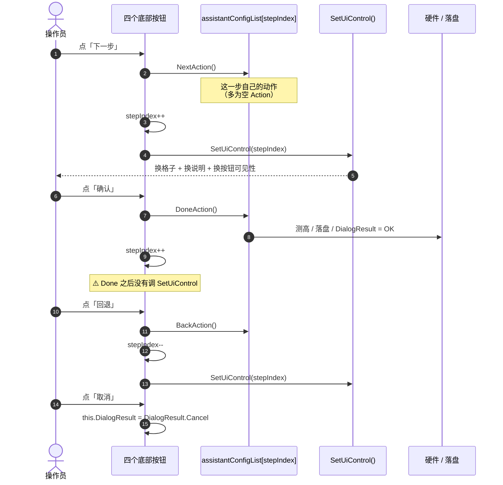

**ASCII 等效图**

```
   点「下一步」                        点「确认」                       点「回退」
        |                                 |                                |
   NextAction()                     DoneAction()                    BackAction()
   (多数是空 Action)          (测高 / 落盘 / 置 DialogResult)      (多数是置 TileBar)
        |                                 |                                |
   stepIndex = stepIndex + 1      stepIndex = stepIndex + 1       stepIndex = stepIndex - 1
        |                                 |                                |
   SetUiControl(stepIndex)         ⚠️ 没有调 SetUiControl          SetUiControl(stepIndex)
        |                                 |                                |
   换格子/换文字/换按钮            (窗体随即因 DialogResult=OK      换格子/换文字/换按钮
                                     而关闭 —— 靠副作用兜住)

   点「取消」 → 只置 DialogResult = Cancel，不做任何收尾
```

**逐按钮读代码后的实测**（`BondForce/Forms/Assistant/FrmCalibrateTeach.cs`）：

| 按钮 | 处理器 | 读了哪几行 | 实际行为 |
|---|---|---|---|
| 「下一步」 | `:174 BtNext_Click` | `:176-179` | `NextAction()` → `stepIndex++` → `SetUiControl` |
| 「回退」 | `:185 BtBack_Click` | `:190-193` | `BackAction()` → `stepIndex--` → `SetUiControl` |
| 「确认」 | `:200 BtDone_Click` | `:204-206` | `DoneAction()` → `stepIndex++`（**没有 `SetUiControl`**） |
| 「取消」 | `:212 BtCancel_Click` | `:213` | 只把 `DialogResult` 置成 `Cancel`，**不做任何收尾**（⚠️ 见 §4.9） |

> **⚠️ 本骨架有三个真问题，后面逐个展开**：
> 1. **`BtDone_Click` 之后没有 `SetUiControl`** ⇒ `stepIndex` 已经越界指向下一步，
>    而界面还停在老的按钮可见性。之所以没炸，是因为多数 `DoneAction` 里最后一句是
>    `this.DialogResult = DialogResult.OK;`（如 `FrmCalibrateTeach.cs:139`），**窗体当场就关了**。
>    ⇒ 这是一个"**靠副作用兜住**"的写法：只要哪个窗体的 `DoneAction` 忘了置 `DialogResult`，
>    立刻就是界面错位（`SetUiControl` 越界）—— **`stepIndex` 的合法上界没有任何代码兜底。**
> 2. **`BtBack_Click` 的 `stepIndex--` 没有负下标保护**（`FrmCalibrateTeach.cs:192`），
>    靠"第 1 步不显示回退按钮"兜住（见 §9.4 R-30）。
> 3. **`BtCancel_Click` 只置 `DialogResult`**，不回滚已经产生的副作用（见 §4.9 的力控标定链路）。

### §4.3.3 共用骨架的两个"看不见的"机制

**（1）`TileBar` 是纯指示器，点不动。**

全层没有任何 `TileBarItem` 接了 `ItemClick`，驱动只有一句：

```csharp
this.TileBarTeach.SelectedItem = this.tileBarGroup4.Items[this.stepIndex];
```

**⇒ 操作员点步骤条上的格子，什么反应都没有。**（详见 §4.2.6（4））

**（2）方向盘 `UcGuideMove` 是每个示教窗体自己 `new` 出来的，且必须自己 `Dispose`。**

```csharp
// FrmCalibrateTeach.cs:143
ucGuideMove = new UcGuideMove("FrmCalibrateTeach");
ucGuideMove.ChangeModuleName("固晶模组", true);   // :146
this.PnlControl.Controls.Add(ucGuideMove);       // :148
// 释放在构造函数里挂的 Disposed 事件
this.Disposed += (o, e) => { ucGuideMove?.Dispose(); };   // :42-45
```

**✅ 这一处写法是对的**（`Disposed` 里解绑）。**⚠️ 但不是所有窗体都这么写** ——
`FrmNozzleBankManual.cs:340` 的方向盘只在 `BtnDetails_Click` 里 `new`，
释放在 `FormClosing` 里用 `?.` 兜（`:416`），**如果操作员没点过「详 情」就直接关窗，`ucGuideMove` 是 `null`**，
`?.` 兜住了，OK。⇒ **两种写法都对，但接手人改代码时要以每个窗体自己的写法为准，不要照抄。**

---

## §4.4 「预点胶」链路：`UcPostBondEdit`

> **这是用户点名要的那类流程的典型样本**。而且这个页面**恰好藏着一个"点了没反应"的按钮**，
> 所以要完整讲两遍：**一遍讲"应该发生什么"，一遍讲"实际发生了什么"**。

### §4.4.1 这个页面长什么样

**打开它的入口**：编程树 → 焊后检测节点 → 右侧属性面板 → 「**执行一次**」区。

界面上与本节相关的控件（标题为 `.Text` 实测值）：

| 控件 | 界面标题 | 说明 |
|---|---|---|
| `ChkPreDispenseCheck` | **预点胶** | 复选框 |
| `ChkBackSideCrackDetection` | **反面裂片检测** | 复选框 |
| `ChkIsCycle` | **圆形** | 复选框 |
| `ChkDefectFrequencyOpen` | **开启抽检** | 复选框 |
| `SpFrequency` | （数字框） | 抽检频率 |
| `SpSubStrate` / `SpModule` | 基板号 / 模组号 | 定位用 |
| `CmbBondPositon` | 焊点 | 下拉 |
| `BtPostBondDoWork` | **执行一次** | 按钮 |
| `BtDoWorkInPreDispense` | **在预点胶板上执行** | 按钮 |

### §4.4.2 正常路径：点「执行一次」之后一路走到哪

**这是一个真正走到底的链路：从"点按钮"一直走到"相机拍照 + 判定 + 结果落到内存"。**

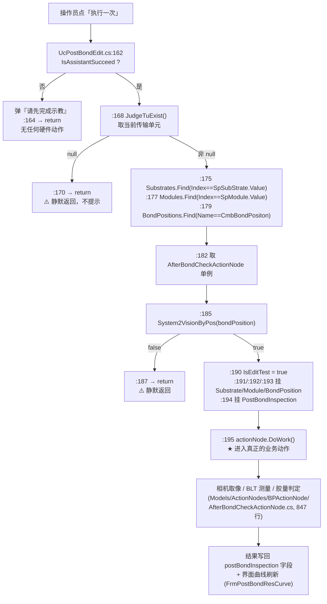

**ASCII 等效图**

```
   点「执行一次」
       |
   [示教过吗?] --否--> 弹「请先完成示教」 --> 结束（无硬件动作）
       |是
   JudgeTuExist() --null--> 结束（静默，不提示）
       |
   找出 Substrate / Module / BondPosition（按下拉框选择）
       |
   System2VisionByPos(bondPosition) --false--> 结束（静默）
       |
   actionNode.IsEditTest = true
   actionNode.Substrate / .Module / .BondPosition / .PostBondInspection 全部挂上
       |
   actionNode.DoWork()   <-- 真正的业务在这里
       |
   相机拍照 → BLT 测量 → 胶量判定 → 结果写回内存 → 界面曲线刷新
```

**⚠️ 这里有两个"静默返回"，用户是感知不到的**：

| 位置 | 条件 | 用户看到什么 |
|---|---|---|
| `UcPostBondEdit.cs:170` | 当前没有传输单元（机器上没板子） | **什么都不发生** —— 不弹框、不报错、日志也没有。操作员会以为"按钮坏了" |
| `UcPostBondEdit.cs:187` | `System2VisionByPos` 返回 `false` | 同上，**静默** |

> **这是本层的一个普遍形态**：`if (xxx == null) { return; }` 不写任何提示。
> 对比 `:162` 那处**写了提示**（`AKRSXtraMessageBox.Show("请先完成示教")`）——
> **同一个方法里两种风格并存**。接手人无法从代码风格上判断哪一处会提示、哪一处不会。

### §4.4.3 「在预点胶板上执行」：一个完整的空壳按钮

**这是本篇要重点展示的"用户点了没反应"的标本。**

```csharp
// Controls/Setting/PostBond/UcPostBondEdit.cs:323-331
/// <summary>
/// 执行预点胶
/// </summary>
/// <param name="sender">事件源</param>
/// <param name="e">参数封装</param>
private void BtDoWorkInPreDispense_Click(object sender, EventArgs e)
{

}
```

**方法体 `:329-331` 只有一对花括号。** 逐字读完，**没有注释掉的代码、没有 `TODO`、没有隐藏分支** ——
**它就是一个空方法。**

**而它是会被启用的**（这是关键）：

```csharp
// UcPostBondEdit.cs:293
private void ChkPreDispenseCheck_CheckedChanged(object sender, EventArgs e)
{
    this.groupControl7.Enabled    = !this.ChkPreDispenseCheck.Checked;   // :295
    this.SpSubStrate.Enabled      = !this.ChkPreDispenseCheck.Checked;   // :296
    this.SpModule.Enabled         = !this.ChkPreDispenseCheck.Checked;   // :297
    this.CmbBondPositon.Enabled   = !this.ChkPreDispenseCheck.Checked;   // :298

    this.ChkBackSideCrackDetection.Checked = false;                      // :300-301

    if (this.ChkPreDispenseCheck.Checked)                                // :303
    {
        this.groupControl7.Enabled   = false;                            // :305
        this.SpSubStrate.Enabled     = false;                            // :306
        this.SpModule.Enabled        = false;                            // :307
        this.CmbBondPositon.Enabled  = false;                            // :308
        this.BtPostBondDoWork.Enabled = false;                           // :309
        this.BtDoWorkInPreDispense.Enabled = true;                       // :310 ★
    }
    else
    {
        this.groupControl7.Enabled   = true;                             // :314
        this.SpSubStrate.Enabled     = true;                             // :315
        this.SpModule.Enabled        = true;                             // :316
        this.CmbBondPositon.Enabled  = true;                             // :317
        this.BtPostBondDoWork.Enabled = true;                            // :318
        this.BtDoWorkInPreDispense.Enabled = false;                      // :319
    }
}
```

**完整用户流程（可复现）**：

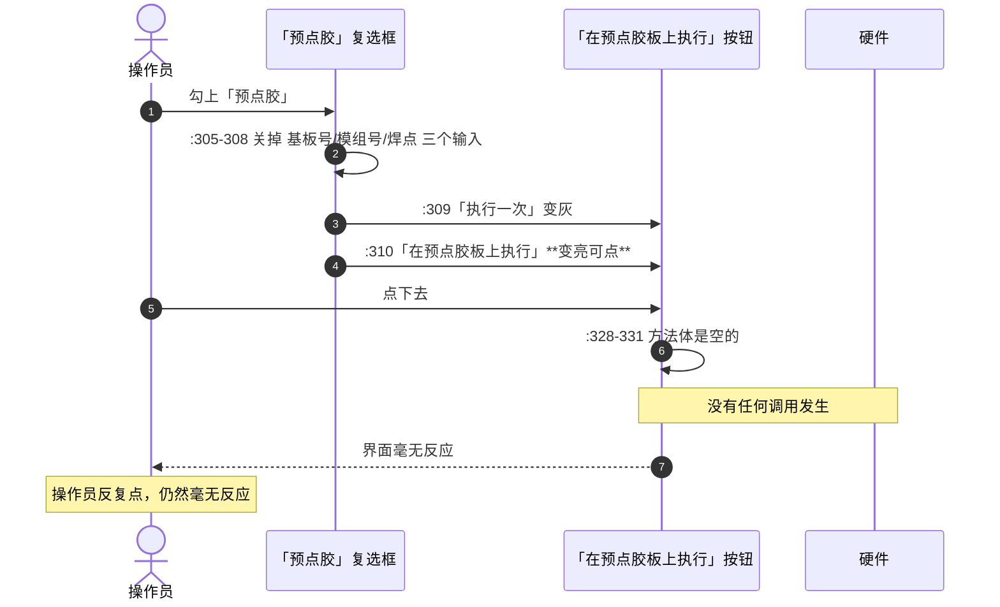

**ASCII 等效图**

```
   勾上「预点胶」
        |
        +--> 基板号 / 模组号 / 焊点 三个输入框变灰 (:305-308)
        +--> 「执行一次」         变灰             (:309)
        +--> 「在预点胶板上执行」 变亮 ★           (:310)
                    |
             操作员点它
                    |
             方法体 { }   <-- 空的 (:328-331)
                    |
             界面毫无反应、无提示、无日志
```

> **⚠️ 这一条的定性要说准**：
> **这不是"功能被禁用"，而是"按钮亮着、方法体是空的"。**
> 因为它**可点**（`:310` 明确置 `true`），所以操作员的每一次点击都会被执行到，
> 只是执行结果是空。**它不会被任何"防呆"挡住。**
>
> **⚠️ 也不要写成"按钮被禁用"** —— `:319` 那条确实把它置 `false`，
> 但那是"预点胶没勾时"的状态；勾上之后它就是 `true`。
>
> **正确的写法**：「勾上『预点胶』后，『执行一次』变灰、『在预点胶板上执行』变亮；
> 但后者的处理器 `BtDoWorkInPreDispense_Click`（`UcPostBondEdit.cs:328-331`）方法体为空
> ⇒ **操作员点下去不会有任何硬件动作，也不会有任何提示**。
> **同一页面上只有『执行一次』（`BtPostBondDoWork_Click`）这条链路是通的。**」

### §4.4.4 这一页的"保存"是怎么发生的

`UcPostBondEdit` 实现了 `IProgrammingControl`，它的保存入口是 `Confirm()`：

```csharp
// UcPostBondEdit.cs:122
public void Confirm()
{
    this.postBondInspection.PostBondInspectionMode = (PostBondInspectionModeEnum)this.RgMode.SelectedIndex;   // :124
    this.postBondInspection.MeasurePointNumber = (MeasurePointNumberEnum)Enum.Parse(typeof(MeasurePointNumberEnum), this.LueMeasurePointNumber.EditValue.ToString());  // :125
    …
    this.postBondInspection.IsPreDispenseCheck = this.ChkPreDispenseCheck.Checked;          // :141
    this.postBondInspection.ReDispenseName = this.CmbReDispenseName.SelectedItem?.ToString(); // :143
    this.postBondInspection.DefectFrequency = (int)this.SpFrequency.Value;                  // :147
    this.postBondInspection.IsDetectBacksideCrack = this.ChkBackSideCrackDetection.Checked; // :149
    this.ChkIsCycle.Checked = this.postBondInspection.IsCircle;                             // :150 ★ 反向写
    PostBondInspectionRepository.GetInstance().Save();                                      // :152 ★ 落盘
}
```

**读出来的三个要点：**

| # | 事实 | 行号 |
|---|---|---|
| 1 | **`Confirm()` 是"界面 → 模型 → 落盘"的唯一通道**，由编程页统一调用（`IProgrammingControl` 上只有这一个方法） | `:152 PostBondInspectionRepository.GetInstance().Save()` |
| 2 | **`LueXxx.EditValue` + `Enum.Parse` 在本文件里是稳的**（`LookUpEdit` 的 `EditValue` 存的是**枚举值本身**，`ToString()` 得到成员名，`Enum.Parse` 再解回成员） | `:125`/`:126`/`:127` |
| 3 | ⚠️ **`:150` 是全方法唯一的"反向写"** —— 别处都是"控件 → 模型"，只有这一行是"模型 → 控件" | `:150` |

> **⚠️ 与 §4.11 / §9.2 R-13 的 `ComboBoxEdit.SelectedText` 恒假族正好构成对照**：
> **`LookUpEdit` 用 `EditValue` 是稳的；`ComboBoxEdit` 用 `SelectedText` 是恒假的。**
> 同一个工程、同一个人，两种下拉框写法都能见到。

**⚠️ 更值得写出来的是"哪些控件不等 `Confirm()` 就生效"：**

```csharp
// UcPostBondEdit.cs:338
private void ChkDefectFrequencyOpen_CheckedChanged(object sender, EventArgs e)
{
    this.postBondInspection.IsDefectFrequencyOpen = this.ChkDefectFrequencyOpen.Checked;   // :340 ★ 立即写模型
    this.SpFrequency.Enabled = this.ChkDefectFrequencyOpen.Checked;                          // :342
}

// UcPostBondEdit.cs:383
private void ChkIsCycle_CheckedChanged(object sender, EventArgs e)
{
    this.postBondInspection.IsCircle = this.ChkIsCycle.Checked;                              // :385 ★ 立即写模型
}
```

⇒ **同一页里，`ChkDefectFrequencyOpen` 和 `ChkIsCycle` 是"勾了就立刻进模型"的，其余控件要等 `Confirm()`。**
**但"进模型"不等于"落盘"** —— 落盘仍然只在 `Confirm()` 的 `:152`。
⇒ 操作员**勾上「圆形」、不点保存、直接关窗口** ⇒ **内存里改了、盘上没有**
（见 §8 的「改了但没保存」清单）。

### §4.4.5 这一页的连锁反应：勾一个框会触发一次落盘

**这是本页最"出乎意料"的一条链路，必须画出来。**

```csharp
// UcPostBondEdit.cs:350
private void ChkBackSideCrackDetection_CheckedChanged(object sender, EventArgs e)
{
    this.RgMode.SelectedIndex = 0;                    // :352
    this.LueReference.ItemIndex = 0;                  // :353
    this.ChkPreDispenseCheck.Checked = false;         // :354 ★ 会级联触发它自己的 CheckedChanged

    this.RgMode.Enabled = !this.ChkBackSideCrackDetection.Checked;        // :357
    this.LueReference.Enabled = !this.ChkBackSideCrackDetection.Checked;  // :358

    if (this.isInit)                                  // :360
    {
        this.Confirm();                               // :362 ★★★ 直接落盘！

        if (this.postBondInspection.IsDetectBacksideCrack)                         // :364
        {
            this.postBondInspection.BacksideCrackDetection.State = AssistantStateEnum.UnAble;     // :366
        }
        else
        {
            this.postBondInspection.BacksideCrackDetection.State = AssistantStateEnum.ForBidden;  // :370
        }

        UcEditProductProgramming.RefreshILstAssistantStepWithPBAction(this.postBondInspection);   // :374
    }
}
```

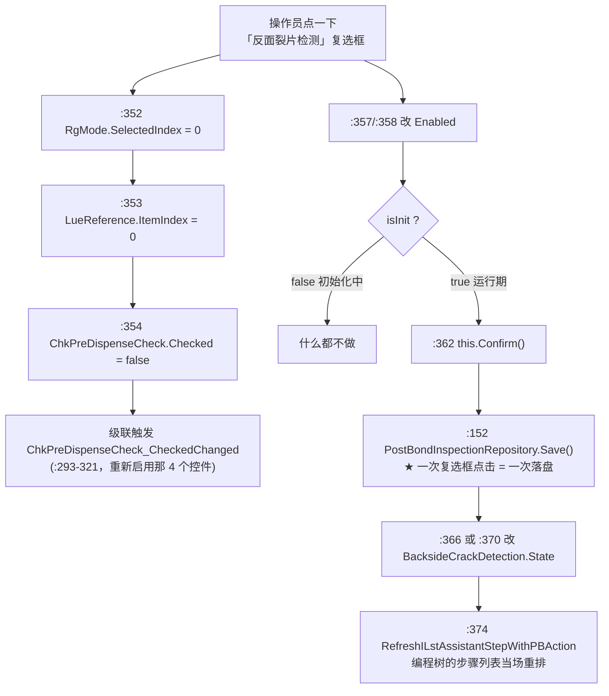

**ASCII 等效图**

```
   点一下「反面裂片检测」
        |
        +-> RgMode.SelectedIndex = 0             (:352)
        +-> LueReference.ItemIndex = 0           (:353)
        +-> ChkPreDispenseCheck.Checked = false  (:354)
        |        |
        |        +-> 级联触发 ChkPreDispenseCheck_CheckedChanged
        |            (重新启用 基板号/模组号/焊点，并把「在预点胶板上执行」置灰)
        |
        +-> 改 RgMode / LueReference 的 Enabled  (:357/:358)
        |
   isInit == true ?
        |
   Confirm()                                     (:362)
        |
   PostBondInspectionRepository.Save()           (:152)   <-- 落盘
        |
   改 BacksideCrackDetection.State                  (:366 / :370)
        |
   RefreshILstAssistantStepWithPBAction(...)     (:374)
        |
   编程树上的步骤列表当场重排
```

> **⚠️ 为什么 `isInit` 这个开关必须存在**：`InitControl()` 在 `:93`/`:95` 会写入
> `ChkPreDispenseCheck.Checked` 和 `ChkBackSideCrackDetection.Checked`，
> **这两次赋值就会触发 `CheckedChanged`**。如果没有 `:116 this.isInit = true` 这最后一道闸，
> **一打开这个页面就会自动落盘、还会自动改写 `BacksideCrackDetection.State`**。
> ⇒ **`isInit` 这个写法是对的**（`UcPostBondEdit.cs:48` 声明、`:116` 置位、`:360` 判断）。
> **但它是"初始化期"和"运行期"的唯一分界线**，接手人若在 `:116` **之前**插入任何控件赋值，
> 就会在打开页面时触发一次落盘 —— **这是一个非常容易被后人踩坏的写法**。

> **⚠️ 顺带一条**：`:354 this.ChkPreDispenseCheck.Checked = false;` **和 `:300` 的
> `ChkBackSideCrackDetection.Checked = false` 互相把对方置 `false`**，
> 谁先谁后取决于谁被点的。**结果是：这两个复选框永远不可能同时为 `true`。**
> 这应该是设计意图（预点胶检测与反面裂片检测互斥），**但代码上没有一行注释说明**，
> 只能靠读这两处交叉赋值推出来。

---

## §4.5 「取吸嘴」链路（C-24）：从点按钮到吸嘴吸上来

> **这是本篇要重点展开的第一条"完整硬件链路"**。
> 用户要的正是这个：「点按钮之后，经过什么样的流程之后完成」。

### §4.5.1 用户从哪个按钮进来

| 入口 | 方法 | 行 |
|---|---|---|
| 吸嘴架调试窗体 → 「**取吸嘴**」 | `FrmNozzleBankManual.BtnFetchNozzle_Click` | `Controls/Manual/FrmNozzleBankManual.cs:99` |
| 示教页面 → 自动换吸嘴 | `System2Controller.ChangeNozzleAssistance` | `Controllers/System2Controller.Assistant.cs:1826` |
| 力控标定入口 → 换 TouchDown | `ChangeTouchDownAssistance` → `SwitchTouchDown` | `Assistant.cs:1660` → `System2Controller.cs:988` |

**三条入口最终都汇到同一个方法**：`System2Controller.ChangeNozzle(string nozzleName)`
（`Controllers/System2Controller.cs:863`）。

### §4.5.2 入口层：`BtnFetchNozzle_Click` 只做三件事

```csharp
// Controls/Manual/FrmNozzleBankManual.cs:99
private void BtnFetchNozzle_Click(object sender, EventArgs e)
{
    // 吸嘴架当前选中的槽
    NozzleShelfSlot toolBankSlot = (NozzleShelfSlot)this.GvNozzleBank.GetFocusedRow();   // :102

    // 界面防呆
    this.BtnRemoveNozzle.Enabled = false;    // :105
    this.BtnFetchNozzle.Enabled  = false;    // :106
    this.BtnMaintenance.Enabled  = false;    // :107

    // 防止线程多次启动
    if (this.takeNozzleTask == null || this.takeNozzleTask.IsCompleted == true)          // :110
    {
        this.takeNozzleTask = Task.Run(                                                   // :112
            () =>
                {
                    CommonUtil.SetCurrentThreadName("取吸嘴调试线程");                       // :115

                    // 如果和当前吸嘴是同一个就直接返回
                    if (this.bondHeadController.GetCurrentNozzleName() == toolBankSlot.NozzleName)  // :118
                    {
                        return;                                                          // :120 ★★
                    }

                    // 取吸嘴
                    bool ret = this.system2Controller.ChangeNozzle(toolBankSlot.NozzleName);  // :124

                    if (ret == true)
                    {
                        this.bondModuleController.MoveToSafePos();                       // :128
                    }

                    this.BeginInvoke(new Action(this.RefreshControl));                   // :131
                });
    }
}
```

**✅ 写得好的地方（要明确写出来，作为正面样本）**：

| 写法 | 行 | 为什么好 |
|---|---|---|
| `Task.Run` 把整个硬件流程扔出 UI 线程 | `:112` | **UI 不卡**。对比 §4.9 的力控标定，同样是长流程，这里是对的 |
| `takeNozzleTask == null \|\| IsCompleted` 防重入 | `:110` | 连点多次不会起多个线程 |
| `CommonUtil.SetCurrentThreadName` | `:115` | 后台线程有名字，日志/调试器里认得出 |
| 先禁用三个按钮再干活 | `:105-107` | 视觉上告诉操作员"正在忙" |
| 干完活 `BeginInvoke(RefreshControl)` 恢复界面 | `:131` | **回 UI 线程改控件**，用 `BeginInvoke` 而不是直接改，正确 |

**🔴 但同一段代码有两个致命尾巴：**

**尾巴 ①：`:118` 的提前 `return` 跳过了 `:131`。**

```
   操作员选中的槽位吸嘴 == 焊头上已有的吸嘴
        |
   :120 return                        <-- 直接退出 lambda
        |
   :131 BeginInvoke(RefreshControl)   <-- 永远执行不到
        |
   三个按钮（取吸嘴 / 归还吸嘴 / 吸嘴架调试）**永久保持灰色**
        |
   操作员只能关掉窗体重开
```

**用户看到什么**：**点「取吸嘴」，按钮全部变灰，然后一直灰着，点什么都没反应，直到关窗重开。**

**尾巴 ②：任务体抛异常时，同样跳不到 `:131`。**

`toolBankSlot` 来自 `:102` 的强制转换。**如果表格里一行都没选中（或焦点行被清空），
`GetFocusedRow()` 返回 `null`**，`:118` 立刻就是 `NullReferenceException`。
`Task.Run` 里未捕获的异常**只会被塞进 `Task.Exception`，不会弹任何框、不会写日志**，
而 `:131` 同样执行不到 ⇒ **同样是三个按钮永久变灰，且操作员完全不知道发生了什么**。

> **⚠️ 这一条要写得准确**：异常本身被 `Task` 吞掉（**不会让程序崩溃**），
> **后果是"按钮永久变灰"而不是"程序崩溃"**。定级 🔴 的理由是
> **操作员看到的是界面死掉、且唯一的恢复方式（关窗重开）没有任何提示**。
>
> **正确写法**：用 `try / finally` 把 `BeginInvoke(RefreshControl)` 放进 `finally`，
> 或改成 `await` + `try` 的写法；**至少要在 `catch` 里写一条日志**。

### §4.5.3 干活的那一层：`ChangeNozzle` 的 12 个动作

**用户点一下「取吸嘴」，机器实际做了下面这些事。**
每一行都对应 `Controllers/System2Controller.cs` 的实测行号。

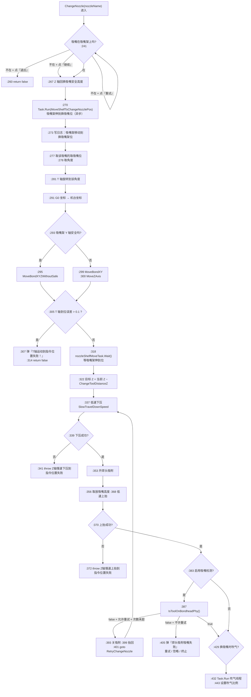

**ASCII 等效图（把 12 个动作按"机器在做什么"列出来）**

```
   ① Z 轴回换吸嘴安全高度                        (:267)
   ② 吸嘴架伸出（Y 轴到换吸嘴位）—— 异步 Task     (:270)
   ③ 查表得到该吸嘴的取吸嘴位 + 角度              (:277 / :278)
   ④ T 轴旋转到该角度                            (:281)
   ⑤ 焊头 X/Y/Z 移到取吸嘴位                     (:295 或 :299+:300)
   ⑥ 校验 T 轴到位误差 ≤ 0.1 度                  (:305)
   ⑦ 等吸嘴架到位（nozzleShelfMoveTask.Wait）    (:318)
   ⑧ Z 轴低速下压到 ChangeToolDistanceZ          (:337)
   ⑨ 开焊头吸附（吸嘴吸上来）                     (:353)
   ⑩ Z 轴低速上抬到放吸嘴高度                     (:368)
   ⑪ 若启用吸嘴检测：确认吸嘴真的在焊头上           (:387)
        失败 → 关吸附 → 抬回 → 重来（最多 N 次）   (:393-401)
   ⑫ 若启用换吸嘴吹气：另起一个线程吹气防憋气        (:432-443)
```

### §4.5.4 这条链路里的三个坑

**坑 ①：`:318` 的 `.Wait()` 是"等硬件"，必须放在任务线程上。**

```csharp
Task nozzleShelfMoveTask = Task.Run(this.nozzleShelfController.MoveShelfToChangeNozzlePos);  // :270
…
nozzleShelfMoveTask.Wait();                                                                  // :318
```

**✅ 这里正确**：因为 `ChangeNozzle` 的主要调用方（`BtnFetchNozzle_Click:112`、
`ChangeNozzleAssistance`）**都在 `Task.Run` 里**。

**🔴 但是**：`ChangeNozzle` 还有一个**在 UI 线程上被同步调用**的入口 —— 见 §4.9.2，
`UcBondForceMeasurement.BtnBondingForceSensorSetUp_Click`（`BondForce/Forms/UcBondForceMeasurement.cs:54`）
**直接在按钮处理器里**调 `ChangeTouchDownAssistance()` → `SwitchTouchDown()` → `ChangeNozzle("TouchDown")`。
⇒ **同样的代码，从这一条入口走，整条链路就压在 UI 线程上。**

> **⚠️ 这是本篇最有价值的一条结论，必须单独成段**：
> **"某段代码会不会卡界面"不取决于这段代码本身，而取决于"谁调用它"。**
> `ChangeNozzle` 内部有 `.Wait()`、有报警框、有重试循环，
> **从任务线程进来一切正常，从按钮处理器进来就是界面冻死。**
> 接手人看到 `.Wait()` **不能直接判它有问题** —— 必须先看调用链在哪条线程上。

**坑 ②：异常用 `throw new(...)` 抛，最终被 `Task` 吞掉。**

`:341`、`:372` 抛的是 `throw new("取吸嘴流程Z轴慢速下压到指令位置失败！")`
（**注意：`throw new(...)` 这种写法本身就不规范** —— 正确的是
`throw new Exception(...)`，但 C# 的**目标类型推断**让它能编译）。

这条异常沿调用链往上：

```
   ChangeNozzle (:337/:341)
        ↑
   BtnFetchNozzle_Click 的 Task.Run (:112)
        ↑
   Task.Exception —— **被吞掉，什么都不显示**（无 catch、无日志）
```

**⇒ 用户在吸嘴架调试窗体上点「取吸嘴」，Z 轴下压失败时，界面上什么都不会显示，
三个按钮永久变灰。** 与 §4.5.2 尾巴②同源。

**坑 ③：报警框有 3 个选项，其中一个是"继续"。**

```csharp
// System2Controller.cs:243
DialogResult dialogResult = AKRSMessageBoxExt.Show(
    $"所需要的吸嘴:{nozzleName}不在吸嘴架上！\r\n请检查吸嘴架配置!\r\n"
    + "重试:重新检查\r\n继续:手动将此吸嘴放到焊头上并继续工作\r\n退出:退出工作",
    "换吸嘴报警",
    new string[] { "重试", "继续", "退出" },
    new DialogResult[] { DialogResult.Retry, DialogResult.Ignore, DialogResult.Abort },
    AlarmLevel.SecondLevel);
```

**⚠️ "继续"这一支（`:256 goto Continue`）的含义是：
"操作员手工把吸嘴装到焊头上，然后机器当作换吸嘴成功继续跑"。**
程序**无法验证**操作员是否真装了 —— 后续所有依赖"焊头上有正确吸嘴"的动作都会照跑。
**这是有意的人工兜底，不是缺陷**，但**接手人必须知道它存在**：
排查"吸嘴不对但机器照跑"的现场问题时，这里是首要嫌疑分支。

> **本节的写法示例（供后面各节照抄）**：
> **"点哪个按钮 → 经过哪 12 步 → 每一步在哪一行 → 每一步成功/失败分别走到哪 →
> 失败时用户在界面上看到什么"**。后面每一条链路都按这个粒度写。

---

## §4.6 「还吸嘴」链路（C-25）：`BtnRemoveNozzle_Click`

### §4.6.1 用户流程

| 入口 | 方法 | 行 |
|---|---|---|
| 吸嘴架调试窗体 → 「**归还吸嘴**」 | `FrmNozzleBankManual.BtnRemoveNozzle_Click` | `Controls/Manual/FrmNozzleBankManual.cs:189` |
| 力控标定窗体关闭时自动还 | `FrmCalibrationRelationship_FormClosing` → `PutbackNozzleAssitance` | `BondForce/Forms/FrmCalibrationRelationship.cs:191` |
| 力控标定入口"不标定"时还 | `UcBondForceMeasurement.BtnBondingForceSensorSetUp_Click` → `PutbackNozzleAssitance` | `BondForce/Forms/UcBondForceMeasurement.cs:92` |

### §4.6.2 完整链路

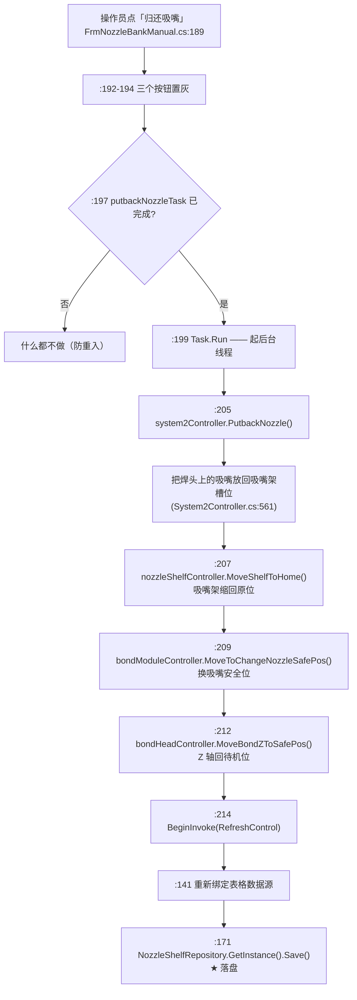

**ASCII 等效图**

```
   点「归还吸嘴」
        |
   三个按钮变灰                      (:192-194)
        |
   [上一个还吸嘴任务还在跑吗?] --还在--> 直接忽略本次点击（防重入 :197）
        |已完成
   起后台线程                        (:199)
        |
   ① PutbackNozzle()  吸嘴放回槽位   (:205 → System2Controller.cs:561)
   ② 吸嘴架缩回原位                  (:207)
   ③ 焊头移到换吸嘴安全位             (:209)
   ④ Z 轴回待机位                    (:212)
        |
   回到 UI 线程刷新界面              (:214 → :139)
        |
   NozzleShelfRepository.Save()    <-- 落盘 (:171)
```

### §4.6.3 这条链路的坑

**坑 ①：四步硬件动作，一步都不检查返回值。**

```csharp
this.system2Controller.PutbackNozzle();                  // :205  返回值被丢弃
this.nozzleShelfController.MoveShelfToHome();            // :207  返回值被丢弃
this.bondModuleController.MoveToChangeNozzleSafePos();   // :209  返回值被丢弃
this.bondHeadController.MoveBondZToSafePos();            // :212  返回值被丢弃
```

**⇒ 如果第 ① 步"吸嘴没放回去"（放回失败），后面三步照样执行：
吸嘴架缩回、焊头移开、Z 轴回待机。**
结果是**吸嘴可能被带歪或撞掉，而界面上不会有任何报警**。

> **⚠️ 对照一下 §4.5 的取吸嘴**：取吸嘴那条链路里，
> `MoveAxisZ` 的返回值是**检查了的**（`:339`、`:370`，失败就 `throw`），
> 还额外做了"吸嘴到底吸上来没有"的物理检测（`:387 IsToolOnBondheadPhy`）。
> **同一个人写的两个方向，一个查得严、一个完全不查。**
> 接手人在改"还吸嘴"时，应当照抄"取吸嘴"那套检查。

**坑 ②：`RefreshControl()` 会无条件落盘一次。**

```csharp
// FrmNozzleBankManual.cs:139  RefreshControl()
private void RefreshControl()
{
    this.GcNozzleBank.DataSource = this.NozzleShelf.NozzleShelfSlots;   // :141
    …
    NozzleShelfRepository.GetInstance().Save();                          // :171 ★
    …
}
```

而 `RefreshControl` 被这些地方调用：

| 调用点 | 行 | 频率 |
|---|---|---|
| 构造函数 | `:40` | 开窗一次 |
| 取吸嘴任务结束 | `:131` | 每次取吸嘴 |
| 还吸嘴任务结束 | `:217` | 每次还吸嘴 |
| 吸嘴架调试任务结束 | `:288` | 每次伸出/缩回 |
| **「焦点行改变」事件** | `:357 GvNozzleBank_FocusedRowChanged_1` → `:359` | **每点一行** |
| 「刷新」按钮 | `:372` | 每次点 |

**⇒ 操作员在吸嘴架列表里上下点行，每点一行就写一次盘。**
这不是"数据安全"问题（写的是内存里的同一份数据），
**但它是"写盘放大"**：一个 100 行的列表，操作员浏览一遍就是 100 次文件写入。

> **⚠️ 这是一个跨文档的形态**：本层 `RefreshControl` 一类的"刷新界面"方法里夹带落盘，
> **是"改了但没保存"的反面** —— 变成了"**没改也保存**"。
> 排查"配置文件被频繁改写 / 时间戳一直在跳"时，这是首要嫌疑点。
> 本层还有一处同型：`FrmNozzleBankManual.cs:373`（点「刷新」按钮时 `BondDevicePara.Save()`）。

> **⚠️ 顺带：`:357` 的 `GvNozzleBank_FocusedRowChanged_1` 也是一个带 `_1` 后缀的处理器**，
> 与 §4.2.5 / §4.2.6 的 `Xxx_Click_1` 同族（**Designer 重新接线时自动加的后缀**）。

---

## §4.7 「吸嘴架伸出 / 缩回」：`BtnMaintenance_Click`

### §4.7.1 一个按钮管两件事

**界面标题是「吸嘴架 伸出/缩回」（`FrmNozzleBankManual` 设计器实测），
点一次它做哪件事，取决于 Y 轴当前位置。**

```csharp
// Controls/Manual/FrmNozzleBankManual.cs:228
private void BtnMaintenance_Click(object sender, EventArgs e)
{
    this.BtnRemoveNozzle.Enabled = false;      // :231
    this.BtnFetchNozzle.Enabled = false;       // :232
    this.BtnMaintenance.Enabled = false;       // :233

    if (this.toolBankMaintenanceTask == null || this.toolBankMaintenanceTask.IsCompleted == true)  // :236
    {
        ExcuteResult res;
        this.toolBankMaintenanceTask = Task.Run(
            () =>
                {
                    CommonUtil.SetCurrentThreadName("吸嘴架伸出缩回线程");     // :242

                    double pos = this.nozzleShelfController.GetYAxisPos();     // :244 ★
                    if (pos >= -1.5)                                           // :245 ★★ 硬编码阈值
                    {
                        // 防撞
                        if (!system2Controller.IsNozzleShelfAxisYSafe())       // :248
                        {
                            this.bondModuleController.MoveToSafePos();         // :250
                        }

                        res = System2Domain.GetInstance().NozzleShelfController.MoveShelfToChangeNozzlePos();  // :254

                        if (res != ExcuteResult.Success)                       // :256
                        {
                            AKRSXtraMessageBox.Show("吸嘴架伸出失败，请检查吸嘴架Y轴！","错误");  // :258
                        }

                        this.BeginInvoke(new Action(
                           () => { this.BtnMaintenance.Appearance.BackColor = Color.Yellow; }));  // :261-265 ★
                    }
                    else
                    {
                        ExcuteResult res = System2Module.GetInstance().NozzleShelfModule.MoveShelfToHome();  // :270

                        if (res != ExcuteResult.Success)                       // :272
                        {
                            AKRSXtraMessageBox.Show("吸嘴架缩回失败，请检查吸嘴架Y轴！","错误");  // :274
                        }

                        this.BeginInvoke(new Action(
                           () => { this.BtnMaintenance.Appearance.BackColor = Color.Transparent; }));  // :277-281
                    }

                    this.BeginInvoke(new Action(() => { this.RefreshControl(); }));   // :285-289
                });
    }
}
```

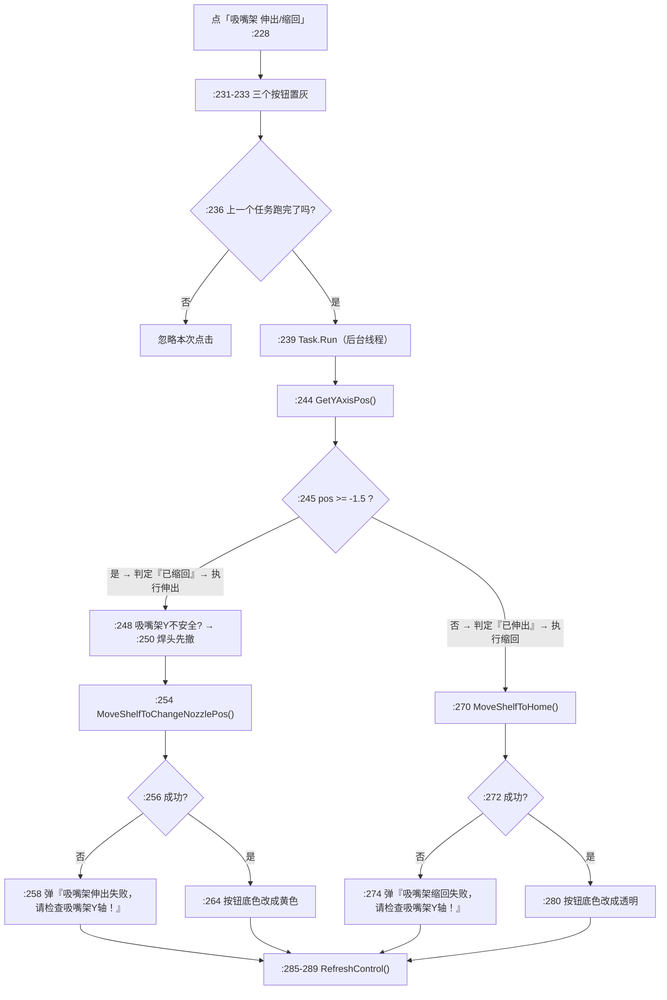

**ASCII 等效图**

```
   点「吸嘴架 伸出/缩回」
        |
   三个按钮变灰 (:231-233) → 防重入检查 (:236) → 起后台线程 (:239)
        |
   pos = GetYAxisPos()   (:244)
        |
   pos >= -1.5 ?
     |                                  |
   【是】判定"已缩回"                 【否】判定"已伸出"
     |                                  |
   防撞：焊头先撤 (:248-250)          MoveShelfToHome() (:270)
     |                                  |
   MoveShelfToChangeNozzlePos()        成功? --否--> 弹「吸嘴架缩回失败」(:274)
        (:254)                            |
   成功? --否--> 弹「吸嘴架伸出失败」    按钮底色 → 透明 (:280)
        (:258)                            |
   按钮底色 → 黄 (:264)                   |
     |                                  |
     +---------------+------------------+
                     |
              RefreshControl() (:285-289) → 落盘一次 (:171)
```

### §4.7.2 为什么 `-1.5` 是一个坑

**`-1.5` 是硬编码的**（`:245`），**代码里没有任何注释说明它是什么单位、依据是什么**。
从上下文推断（**注意：以下为推断，非实测**）：

| 推断项 | 内容 |
|---|---|
| 单位 | 应该是 mm |
| 含义 | 吸嘴架 Y 轴"收回原位"时坐标约 0，"伸出到换吸嘴位"时约一两百 mm，**`-1.5` 被当作"还在不在原位附近"的分界** |
| 风险 | **只要机械原点偏移、或有人用示教功能重新标过 Y 轴，这个阈值就可能失效** |
| 失效后果 | **按一次按钮，机器做的是"反向动作"**：以为在缩回，其实在伸出 |

> **⚠️ 更值得写出来的是按钮的"状态显示"是假的。**
> 界面上这个按钮的颜色表示"伸出/缩回"：**黄色 = 伸出**（`:264`），
> **透明 = 缩回**（`:280`）。**但这个颜色只在"点这个按钮"时才会更新。**
>
> ⇒ **如果操作员用方向盘 / 手动轴控制把吸嘴架 Y 轴开出来了，
> 按钮颜色仍然显示"透明（缩回）"，而机器实际是伸出的。**
> 下一次点这个按钮时，程序按 `GetYAxisPos()` 重新判断（`:244`）会做正确的动作，
> 但按钮颜色会跳到黄色 —— 操作员看到的是"**颜色突然变了**"。
>
> **⇒ 结论：这个按钮的颜色不是"吸嘴架当前状态"，而是"上一次点这个按钮时它做了什么"。**
> 这两者**在有人用过手动轴之后就不一致**。
>
> **⚠️ 另外**：如果任务在 `:244` 之前抛异常（例如 `GetYAxisPos()` 本身失败），
> `:285` 的 `RefreshControl` 走不到 ⇒ **三个按钮永久变灰**（与 §4.5.2 同型）。

---

## §4.8 「获取当前真空模拟量」：`UcNozzleEdit` —— 一个"卡住 1 秒"的按钮

> **这是 `_raw\_UI线程阻塞排查.md` 明确点名给本篇的两处 🔴**（该文 §五 表格）。
> 该文要求：「**由 33 号读代码后定**（**两次各 1 秒的冻结在设置页上是可以被感知的**）」。
> **我读了 `UcNozzleEdit.cs:55-130` 全段之后定级：🔴。**

### §4.8.1 这个页面在哪

**`Controls/Setting/Nozzle/UcNozzleEdit.cs`（130 行）是配方设置页里"吸嘴"那一节。**
**操作员会开**，而且它管的是吸嘴参数：真空检测值直接决定"吸到没吸到"的判定。

### §4.8.2 完整流程

```csharp
// Controls/Setting/Nozzle/UcNozzleEdit.cs:105
private void BtGetCurrentVacuumValue_Click(object sender, EventArgs e)
{
    this.bondHeadController.OpenToolVaccum();                   // :107 开吸嘴真空
    Thread.Sleep(1000);                                         // :108 🔴 UI 线程同步阻塞 1 秒
    double value = this.bondHeadController.ReadVacuumValue();    // :109 读真空模拟量
    this.bondHeadController.CloseToolVaccum();                  // :110 关吸嘴真空
    this.SpVacuumCheckAfterPickUp.EditValue = value;             // :111 填回数字框
    this.Confirm();                                             // :112 ★ 直接把数值存盘
}

// Controls/Setting/Nozzle/UcNozzleEdit.cs:120
private void BtGetAfterBondingVacuumValue_Click(object sender, EventArgs e)
{
    this.bondHeadController.OpenToolVaccum();                   // :122
    Thread.Sleep(1000);                                         // :123 🔴 第二次
    double value = this.bondHeadController.ReadVacuumValue();    // :124
    this.bondHeadController.CloseToolVaccum();                  // :125
    this.SpVacuumCheckAfterBonding.EditValue = value;            // :126
    this.Confirm();                                             // :127 ★ 又存一次
}
```

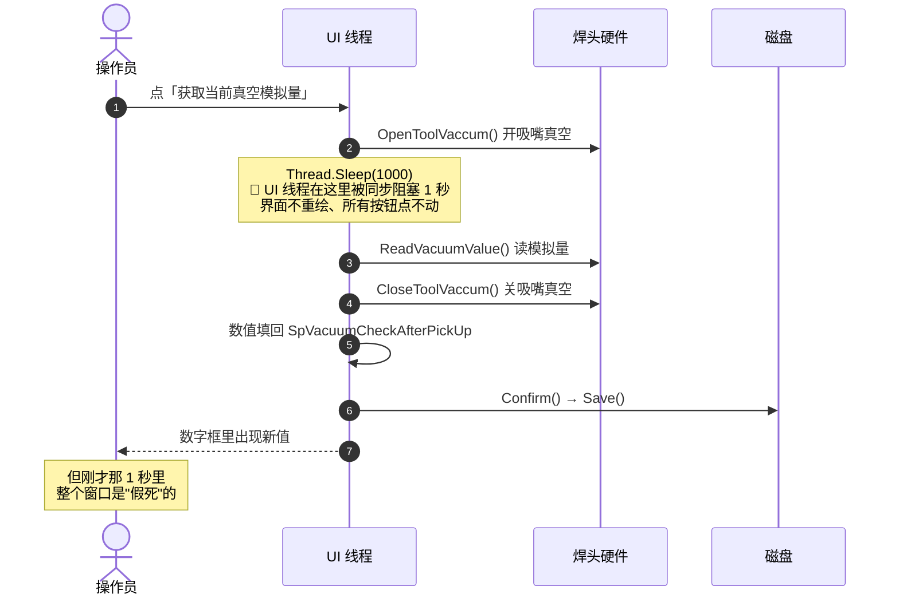

**ASCII 等效图**

```
   点「获取当前真空模拟量」
        |
   开吸嘴真空             (:107)
        |
   === 界面卡住 1 秒 ===   Thread.Sleep(1000)  (:108)   <-- UI 线程
        |
   读真空模拟量            (:109)
        |
   关吸嘴真空             (:110)
        |
   数值填进数字框          (:111)
        |
   Confirm() 直接把值存盘  (:112)
        |
   操作员看到数字框里跳出一个新值
```

### §4.8.3 为什么定 🔴（严格按 `_UI线程阻塞排查.md` §三 分级）

| 分级条件（该文 §三） | 本条是否满足 |
|---|---|
| **操作员界面**（`Manual/`、`Setting/`、主界面） | ✅ **`Controls/Setting/Nozzle/`，正是配方设置页** |
| **sleep ≥ 数百毫秒** | ✅ **1000 ms** |
| **在循环里多次** | ❌ 单次（但一次 1 秒已经够） |

⇒ **满足 2 条，定 🔴。**

**用户看到什么**：**点完按钮，界面卡住整整 1 秒** ——
窗口不重绘（拖不动、标题栏变白）、所有按钮点不动，然后数字框里跳出一个值。

> **⚠️ 一个必须写出来的额外后果**：
> `Thread.Sleep(1000)` 期间 **UI 线程不跑消息泵** ⇒
> **这个 1 秒内，急停按钮、安全门信号在本窗口内响应不了**。
> 该文开头就写明「**急停与安全门检查也可能被拖住。这对固晶机是安全相关的问题，
> 不是"体验差一点"**」。**1 秒虽短，形态是同一个。**

### §4.8.4 正确写法（该文 §六.4 要求给出替代）

```csharp
// 推荐：async/await，UI 线程让出去，界面保持可响应
private async void BtGetCurrentVacuumValue_Click(object sender, EventArgs e)
{
    this.bondHeadController.OpenToolVaccum();
    await Task.Delay(1000);                          // ✅ 不阻塞 UI 线程
    double value = this.bondHeadController.ReadVacuumValue();
    this.bondHeadController.CloseToolVaccum();
    this.SpVacuumCheckAfterPickUp.EditValue = value;
    this.Confirm();
}
```

**本层的正反三个样本都在同一批文件里**：

| 写法 | 位置 | 结论 |
|---|---|---|
| ❌ `Thread.Sleep(1000)` 在 `_Click` 体内 | `UcNozzleEdit.cs:108`、`:123` | **🔴 界面冻 1 秒** |
| ✅ `Task.Run` 包住整个硬件流程 | `FrmNozzleBankManual.cs:112`、`:199`、`:239` | **UI 不卡**（见 §4.5 / §4.6 / §4.7） |
| ⚠️ `Task.Run(...)` + `.Wait()` | `FrmCalibrationRelationship.cs:312` | **比 ❌ 更糟** —— 分钟级流程压在 UI 上，见 §4.9 |

### §4.8.5 顺带：这个页面里还有一条"写回接错控件"的 🔴

**`UcNozzleEdit` 同时是 `_raw` 报告点名的"§1.5 `Enum.Parse` 回写耦合"三个位置之一。**
我读了 `:55-90`，事实如下：

```csharp
// 读到模型 → 控件（正确方向）
this.RgZDeterminationMethod.SelectedIndex  = (int)this.nozzle.ZDeterminationMethod;   // :60
this.RgXYDeterminationMethod.SelectedIndex = (int)this.nozzle.XYDeterminationMethod;  // :61

// 控件 → 写回模型
this.nozzle.ZDeterminationMethod  = (ZDeterminationMethodEnum)this.RgZDeterminationMethod.SelectedIndex;    // :77
this.nozzle.XYDeterminationMethod = (XYDeterminationMethodEnum)this.RgZDeterminationMethod.SelectedIndex;   // :78 ★★
```

**`:78` 右边取的是 `RgZDeterminationMethod`（Z 的那个 `RadioGroup`），不是 `RgXYDeterminationMethod`。**

| # | 事实 | 行 |
|---|---|---|
| 1 | `:61` 把 XY 的值**读到** `RgXYDeterminationMethod` | `:61` |
| 2 | `:78` 把 XY 的值**从** `RgZDeterminationMethod` **写回模型** | `:78` |
| 3 | ⇒ **操作员在「XY 判定方式」上做的任何选择，都不会被保存** | — |
| 4 | ⇒ **而且会把 Z 的判定方式当作 XY 的判定方式存下去**（`(XYDeterminationMethodEnum)` 是**显式枚举强转**，C# 允许任意 `int` → 任意枚举，**不检查值域**） | `:78` |
| 5 | **用户看到什么**：改完「XY 判定方式」→ 保存 → **重新打开这个页面，XY 判定方式弹回了原来的值**，而 Z 判定方式可能被改成了别的东西 | — |

> **⚠️ 定性用词（严格遵守任务书）**：
> **不要写"点保存会抛异常"** —— 这里**不会抛**。正确写法是：
> 「`UcNozzleEdit.cs:78` **取错了控件**（应为 `RgXYDeterminationMethod`），
> 后果是"**改了不生效 + 把另一个字段写坏**"，**没有任何报错**。」

**对照正确写法**（同目录其他文件里就是这么写的）：

| 正确写法 | 位置 |
|---|---|
| `LookUpEdit` + `EditValue` | `Controls/Setting/PostBond/UcPostBondEdit.cs:125`/`:126`/`:127`（见 §4.4.4） |
| `LookUpEdit` + `EditValue` | `Controls/Setting/PostBond/UcPostBondEdit.cs:205`/`:226` |

⇒ **同一个工程里，"枚举型下拉"有两种写法**：
`LookUpEdit.EditValue`（存枚举值本身，**稳**）和
`ComboBoxEdit.SelectedText` / `Enum.Parse`（**靠显示文本恰好等于成员名的隐式契约**，**脆**）。
本篇的 12 处 `SelectedText` 恒假问题和 `:78` 这处"取错控件"都属于后者一族。

---

## §4.9 「力控标定」链路：三个窗体的接力

> **这是本篇最长的一条链路（跨 3 个窗体、1 个控制器、754 行控制器代码）**，
> 而且**它同时是最好的正面样本和最坏的负面样本** ——
> 用户要的"点一个按钮经过什么流程"在这里能得到最完整的回答。

### §4.9.1 用户看到的四个按钮

**入口在 `UcBondForceMeasurement`（力控测量面板，`BondForce/Forms/UcBondForceMeasurement.cs`，162 行）。**

| 按钮标题 | 处理器 | 行 |
|---|---|---|
| **力控标定** | `BtnBondingForceSensorSetUp_Click` | `:52` |
| **平台压力表实时曲线** | `BtnBondingForce_Click` | `:102` |
| **力值检验** | `BtnInspectForce_Click` | `:132` |
| **焊头力控初始值刷新** | `BtnRefreshForceInitialVal_Click` | `:150` |

**⚠️ 还有一个"界面一打开就做硬件动作"的细节**：

```csharp
// UcBondForceMeasurement.cs:24
public UcBondForceMeasurement()
{
    this.InitializeComponent();

    // 开焊头吸附
    this.bondHeadController.OpenBondHeadVaccum();      // :29 ★★
}
```

**⇒ 只要这个面板被创建出来（哪怕还没显示），焊头吸附就被打开了。**
用户感知不到，但**焊头从此带电吸着东西**。这是"隐式硬件动作"，**没有任何提示、没有配对关闭**。

**⚠️ 另一个动态开关**：

```csharp
// UcBondForceMeasurement.cs:114  timer1_Tick
switch (MachineStateModel.GetInstance().CurrentMachineSystem)
{
    case CurrentMachineSystemEnum.System1:
        this.BtnBondingForceSensorSetUp.Enabled = false;    // :119 系统1 → 「力控标定」变灰
        break;
    case CurrentMachineSystemEnum.System2:
        this.BtnBondingForceSensorSetUp.Enabled = true;     // :122 系统2 → 可点
        break;
}
```

**⇒ 机台当前停在哪个系统，决定「力控标定」这个按钮能不能点。**
操作员在系统1 页面上看到的灰按钮，是**定时器控制**的，不是权限控制。

### §4.9.2 「力控标定」按钮：一次点击，四个阶段

```csharp
// BondForce/Forms/UcBondForceMeasurement.cs:52
private void BtnBondingForceSensorSetUp_Click(object sender, EventArgs e)
{
    if (!this.system2Controller.ChangeTouchDownAssistance())        // :54 ★★ UI 线程上同步跑整条换吸嘴链路
    {
        return;                                                     // :56
    }

    DialogResult dialogResult = DialogResult.OK;                   // :59 ★★ 初值就是 OK

    DialogResult dialog = AKRSXtraMessageBox.Show(
        $"是否重新力控示教标定位置?", "Question",
        MessageBoxButtons.YesNo, MessageBoxIcon.Question);          // :61-65

    if (dialog == DialogResult.Yes)                                 // :67
    {
        FrmCalibrateTeach frmCalibrateTeach = new FrmCalibrateTeach();   // :70
        dialogResult = frmCalibrateTeach.ShowDialog();                   // :71
        frmCalibrateTeach.Dispose();                                     // :72
    }

    if (dialogResult == DialogResult.OK)                            // :75 ★★
    {
        dialog = AKRSXtraMessageBox.Show(
            $"是否准备开始力控标定?", "Question",
            MessageBoxButtons.YesNo, MessageBoxIcon.Question);      // :77-81

        if (dialog == DialogResult.Yes)                             // :83
        {
            FrmCalibrationRelationship frmCalibrationRelationship = new FrmCalibrationRelationship();  // :85
            frmCalibrationRelationship.ShowDialog();                // :86
            frmCalibrationRelationship.Dispose();                   // :88
        }
        else
        {
            this.system2Controller.PutbackNozzleAssitance();        // :92 ★ 只有这一支会还吸嘴
        }
    }
}
```

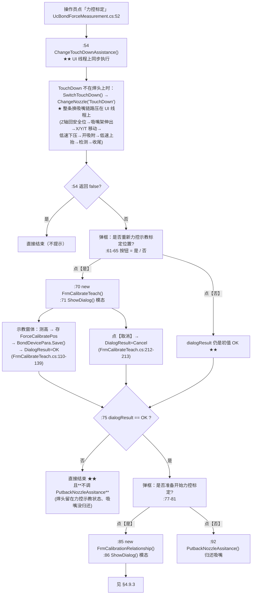

**ASCII 等效图**

```
   点「力控标定」
        |
   ChangeTouchDownAssistance()                        (:54)   <-- ★★ 在 UI 线程上
        |
        +-- TouchDown 不在焊头上 → SwitchTouchDown()
        |       → ChangeNozzle("TouchDown")
        |       → ①Z轴回安全位 ②吸嘴架伸出 ③查表取位置 ④T轴转
        |         ⑤XY Z 移到取位 ⑥校验T轴 ⑦等吸嘴架 ⑧低速下压
        |         ⑨开吸附 ⑩低速上抬 ⑪检测 ⑫吹气
        |       **整条链路压在 UI 线程上，界面全程冻住**
        |
   返回值 == false ? --是--> 结束（静默）
        |否
   弹框「是否重新力控示教标定位置?」                   (:61-65)  是 / 否
        |
   【是】→ new FrmCalibrateTeach() + ShowDialog()     (:70/:71)
        |         |
        |         +-- 点【确认】→ 测高 → 存 ForceCalibratePos
        |         |             → BondDevicePara.Save() → DialogResult=OK
        |         +-- 点【取消】→ DialogResult=Cancel
        |
   【否】→ dialogResult 保持初值 OK ★★               (:59)
        |
   dialogResult == OK ?                               (:75)
        |                        |
      【否】                   【是】
        |                        |
   直接结束                弹框「是否准备开始力控标定?」  (:77-81)
   且**不归还吸嘴** ★★          |
                        【是】→ FrmCalibrationRelationship.ShowDialog()  (:85/:86)
                        【否】→ PutbackNozzleAssitance() 归还吸嘴          (:92)
```

### §4.9.3 这一段逐行读出来的四个坑

**坑 ①（🔴）："否" 被当成 "是" 处理。**

`:59` 把 `dialogResult` **初始化成 `DialogResult.OK`**，而 `:75` 正是判 `== DialogResult.OK`。

```
   用户在「是否重新力控示教标定位置?」上点【否】
        |
   :67 的 if 不成立 → :70-72 整段跳过
        |
   dialogResult **仍然是 :59 的初值 OK**
        |
   :75 成立 → 弹「是否准备开始力控标定?」
        |
   用户点【是】→ 直接进 FrmCalibrationRelationship
        |
   ★ 结果：**没有重新示教标定位置，直接开始标定**
```

**用户看到什么**：他明确回答了「**不要**重新示教」，
机器却照样问他「要不要开始标定」，**并且在用旧的标定位置开始标定** ——
如果焊头/平台动过，标定结果就是错的，**而界面上没有任何提示**。

> **⚠️ 定性**：这是**分支覆盖不全**（"否"这一支没有自己的处理），
> **不是"点击会崩溃"**。正确写法：让 `dialogResult` 的初值不为 `OK`
> （例如 `DialogResult.None`），或在 `:67` 的 `else` 里显式处理。

**坑 ②（🔴）：点「取消」之后，机器留在"力控示教"状态。**

`FrmCalibrateTeach.BtCancel_Click`（`FrmCalibrateTeach.cs:212-213`）**只置 `DialogResult = Cancel`**：

```csharp
private void BtCancel_Click(object sender, EventArgs e)
{
    this.DialogResult = DialogResult.Cancel;      // :213   —— 没有别的了
}
```

**而 `ChangeTouchDownAssistance()` 在 `:54` 已经把机器切到了"TouchDown 在焊头上"的状态。**
取消分支（`:75` 为 `false`）**直接结束，不做任何收尾**：

| 应该做什么 | 代码里做了吗 |
|---|---|
| 归还 TouchDown / 吸嘴（`PutbackNozzleAssitance()`） | ❌ **只有 `:92` 那一支（回答"否"）才调** |
| 关闭焊头吸附 | ❌ |
| 复位触摸下压状态 | ❌ |

**用户看到什么**：弹框里点「取消」，窗口关掉，
**机器上 TouchDown/吸嘴还吸在焊头上，而且系统状态标记为"力控示教中"**。
操作员多半会直接去跑生产 —— 而生产程序**不知道**当前挂着的是 TouchDown。

> **对比**：如果用户回答的是「**否**」（不走示教），`:92` 会老老实实还吸嘴。
> ⇒ **"取消"比"否"更危险**：否是"我不用示教"（收尾了），
> 取消是"我不玩了"（**没收尾**）。这两支的处理在代码里是**反过来的**。

**坑 ③（🔴）：`try` 之外的落盘 —— 这是 `_raw` 报告点名的 R 之一。**

```csharp
private async void BtnStart_Click_1(object sender, EventArgs e)     // :77  ★ 注意是 async void
{
    this.SavePara();            // :79  ★★ 在 try 之外！
    …
    try                         // :85
    {
        await Task.Run(() => { … this.closedLoopCalibrationController.DoWork(); });   // :87-92
        AKRSXtraMessageBox.Show($"标定完成!…");                                        // :94
    }
    catch (Exception ex)        // :100
    {
        AKRSXtraMessageBox.Show($"标定异常!\r\n{ex.Message}");                         // :102
    }
    finally                     // :108
    {
        this.BtnStart.Enabled = true;          // :110
        this.BtnCaliAndTest.Enabled = true;    // :111
        this.LbTip.Visible = false;            // :112
    }
}
```

**`SavePara()` 会抛异常**：

```csharp
// FrmCalibrationRelationship.cs:143  SavePara()
…
if (ForceConfig.GetInstance().ForceRange != ForceRangeEnum.LargeForce
    && forceConfig.SmallForceConfigItemList.Any() == false)
{
    throw new Exception("未写入小力参数，不能标定小力！");                     // :164
}

if (ForceConfig.GetInstance().ForceRange != ForceRangeEnum.SmallForce
    && forceConfig.LargeForceConfigItemList.Any() == false)
{
    throw new Exception("未写入大力参数，不能标定大力！");                     // :170
}
…
ForceConfig.GetInstance().Save();                                              // :179
```

**⇒ 完整的因果链（这是本篇最难自己推出来的一条）：**

```
   :79 SavePara()   ← 在 try（:85）之外
        |
   :164 或 :170 抛 new Exception("未写入小力参数，不能标定小力！")
        |
   异常**没有**被 :100 的 catch 接住（catch 只管 try 里面）
        |
   :108 的 finally **也不会执行**（finally 管不到 try 外面）
        |
   ⇒ BtnStart.Enabled 仍是 true（还没被禁用）
   ⇒ 异常从这个 `async void` 处理器里逃出去
        |
   ★ async void 的未捕获异常会被投递到 SynchronizationContext，
     即 **UI 线程的未处理异常**
        |
   ⇒ 默认行为：**进程终止**
```

**用户看到什么**：点「开始标定」，
**如果大力/小力参数没写全，程序直接崩掉退出**，
而不是弹一句「未写入小力参数，不能标定小力！」。

> **⚠️ 必须严格按任务书写**：
> - **不要写"点保存会抛异常"** 这种笼统说法 —— 要写清**哪一行抛、为什么 `catch` 接不到**。
> - **`async void` 是关键**：如果这个方法签名是 `void`（不是 `async void`），
>   异常会往上抛到 WinForms 的消息泵，**WinForms 默认也不吞它**，同样会终止进程。
>   ⇒ **两种写法都危险，但 `async void` 更隐蔽**。
> - 本条**未实机验证**（**推断**）：从代码结构可确定异常不会被 `:100` 的 `catch` 接住；
>   "进程终止"是 .NET 的默认行为（**推断**），实际是否被上层
>   `Application.ThreadException` 或 `AppDomain.UnhandledException` 兜住，
>   **要看 `Program.cs`（本篇范围之外，未读）**。
>   ⇒ **本篇标注为"推断，未实机验证"。**

**坑 ④（🔴）：`BtnCaliAndTest_Click` 里 `task.Wait()` 把几分钟压在 UI 线程上。**

```csharp
// FrmCalibrationRelationship.cs:250
private void BtnCaliAndTest_Click(object sender, EventArgs e)     // ★ 不是 async，没有 await
{
    …
    this.SavePara();                        // :281  ← 注意：这一处也在 try（:287）之外！

    this.BtnStart.Enabled = false;          // :283
    this.BtnCaliAndTest.Enabled = false;    // :284
    this.LbTip.Visible = true;              // :285

    try                                     // :287
    {
        Task task = Task.Run(
           () =>
               {
                   CommonUtil.SetCurrentThreadName("力控标定并检验线程");    // :292
                   this.closedLoopCalibrationController.DoWork();           // :293
                   this.BeginInvoke(() => { … fbt.ShowDialog(); fbt.Dispose(); });   // :295-309
               });

        task.Wait();                        // :312 🔴 UI 线程同步等
    }
    catch (Exception ex) { … }              // :314
    finally { … }                           // :322
}
```

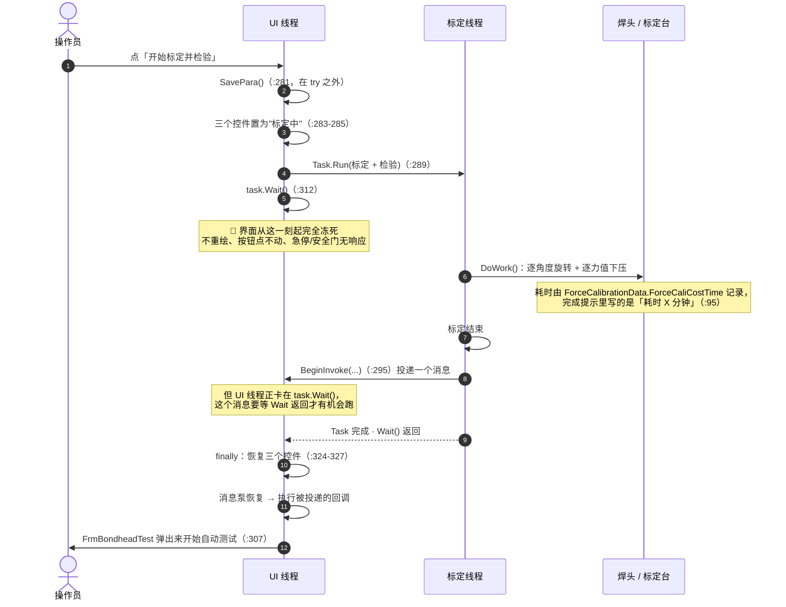

**ASCII 等效图**

```
   点「开始标定并检验」
        |
   SavePara()                         (:281，注意也在 try 之外)
   三个控件置"标定中"                  (:283-285)
        |
   Task.Run(DoWork + 检验)            (:289)
        |
   task.Wait()                        (:312)  <-- 🔴 UI 线程卡在这里
        |                                          界面完全冻死
        |                                          （可能几分钟）
   Task 完成 → Wait 返回
        |
   finally 恢复控件                    (:322-327)
        |
   消息泵恢复 → 执行 BeginInvoke 投递的回调
        |
   FrmBondheadTest 弹出，自动跑测试     (:307)
```

**用户看到什么**：
**点「开始标定并检验」之后，界面整整冻死几分钟**
（`ForceCalibrationData.ForceCaliCostTime` 的单位是**分钟** —— 见完成提示 `:95`
「耗时{...ForceCaliCostTime}**分钟**」）。
**这几分钟里取消按钮点不动、急停在本窗口内响应不了。**

> **⚠️ 同一窗体、同一个人写的两个按钮，一个对一个错** —— 这是最好的教学对照：

| 按钮 | 处理器 | 写法 | 结论 |
|---|---|---|---|
| 「**开始标定**」 | `FrmCalibrationRelationship.cs:77 BtnStart_Click_1` | `await Task.Run(...)` | ✅ **UI 保持可响应** |
| 「**开始标定并检验**」 | `FrmCalibrationRelationship.cs:250 BtnCaliAndTest_Click` | `Task.Run(...)` + **`task.Wait()`** | 🔴 **UI 冻几分钟** |

> **⚠️ 按 `_raw\_UI线程阻塞排查.md:118` 的要求**：
> 「`BondSystem/BondForce/Forms/FrmCalibrationRelationship.cs:312 task.Wait()` 在处理器内
> （**这就是 33 号 🔴 R-05 那个文件**：`:79 SavePara()` 在 try 外、`:87` 才 try）
> → **与 R-05 合并写，不要单列**」。
>
> **本篇照办**：**把 `.Wait()` 与 `try` 外落盘合并成同一条风险（§9.1 R-05）**，
> 理由是**两条都在同一个文件、同一族（"耗时 / 易抛的操作压在 UI 线程的按钮处理器上"）**。
> 但**本节仍然把两者的机制分别写清楚**，因为它们**失败的后果不同**
> （一个是"界面卡几分钟"，一个是"程序直接退出"）。

**坑 ⑤（⚠️）：`BtnStop_Click` 只能"停止"，不能"恢复"。**

```csharp
// FrmCalibrationRelationship.cs:199
private void BtnStop_Click(object sender, EventArgs e)
{
    ClosedLoopCalibrationController.IsStop = true;    // :201
    //this.system2Controller.GetCalibrateTableForceValue();   // :202 注释残留
}
```

`IsStop` 是 **`static`** 字段（`ClosedLoopCalibrationController.cs:90 public static bool IsStop = true;`），
**初值就是 `true`**，只有 `PrepareBeforeCali()` 的 `:473 IsStop = false;` 会把它置为可运行，
`GTDoWork` 的 `finally` 里 `:220` 又置回 `true`。

⇒ **点「停止」是有效的**（标定循环里 `:169`/`:189`/`:286`/`:516` 四处都在查它）。
**但停止之后，`finally` 照样会执行** —— 见坑 ⑥。

**坑 ⑥（🔴）：点「停止」之后，半截的标定数据仍然被落盘。**

```csharp
// ClosedLoopCalibrationController.cs:218  GTDoWork 的 finally
finally
{
    ClosedLoopCalibrationController.IsStop = true;                     // :220

    if (this.forceConfig.ForceRange == ForceRangeEnum.SmallForce
        || this.forceConfig.ForceRange == ForceRangeEnum.SmallForceAndLargeForce)
    {
        ForceCalibrationData.GetInstance().SmallForceRelationList = smallForceRelateAngleList;   // :225
    }

    if (this.forceConfig.ForceRange == ForceRangeEnum.LargeForce
        || this.forceConfig.ForceRange == ForceRangeEnum.SmallForceAndLargeForce)
    {
        ForceCalibrationData.GetInstance().LargeForceRelationList = largeForceRelateAngleList;   // :231
    }

    ForceCalibrationData.GetInstance().ForceCaliCostTime = sp.Elapsed.TotalMinutes;              // :234

    this.Save();                                                                                  // :236 ★ 落盘
    this.bondHeadController.MoveBondZToSafePos();                                                 // :238
}
```

而"停止"的路径是 `:169`/`:189` 的 `return`（**在 `try` 里**）
与 `:516` 的 `return theoreticalForceAndActualForceList`（**返回半截列表**）：

| 位置 | 触发 | 效果 |
|---|---|---|
| `:169-172` | 多角度循环中，点停止 | `return` → **进 `finally`** → **半截 `smallForceRelateAngleList` 被写进内存并 `Save()`** |
| `:189-192` | 大力多角度循环，同上 | 同上 |
| `:516-522` | 单个角度内的力值递增中，点停止 | `return` 半截列表 → 加进 `largeForceRelateAngleList` → 同样进 `finally` → **同样落盘** |

**用户看到什么**：点「停止」，
界面上没有"已取消"的提示（`BtnStop_Click` 里连一句 `AKRSXtraMessageBox.Show` 都没有），
**而这一次标定只标了一半，却已经被存进 `ForceCalibrationData` 并写盘了**。
下一次开机、下一次贴片，用的就是这份**半截标定数据**。

> **⚠️ 这一条要说准**：`finally` 里落盘**本身是对的**（保证异常时数据不丢），
> **问题在于它分不清"正常完成"与"用户中途叫停"**。
> **正确写法**：在 `:169`/`:189`/`:516` 三处置一个"用户主动停止"标记，
> `finally` 里据此跳过落盘，或者至少弹一句「标定已中止，本次数据未保存」。
> **⚠️ 这个缺陷 `_raw` 报告里没有** —— 是我**逐行读
> `ClosedLoopCalibrationController.cs:60-310`、`:455-610` 时发现的**，
> 标注为**已读代码确认，未实机验证**。

**⚠️ 补充：`DoWork` 分两条实现，走哪条由轴卡型号决定。**

```csharp
// ClosedLoopCalibrationController.cs:95
public override void DoWork()
{
    // 判断轴卡类型
    if (this.bondHead.AxisZ.AxisDrive is ETELAxis)      // :98
    {
        this.EtelDoWork();                              // :100
    }
    else
    {
        this.GTDoWork();                                // :104
    }
}
```

⇒ **同一个「开始标定」按钮，在 ETEL 轴卡的机器上和 GT 轴卡的机器上跑的是两套完全不同的标定流程。**
**排查现场问题时，第一步必须问清机台装的是哪种轴卡。**
（`GTDoWork` 在 `:111`，`EtelDoWork` 在 `:252`。）

---

## §4.10 「焊头力控初始值刷新」：一个"界面冻住 40 秒"的按钮

> **这是本篇自己查出来的、`_raw` 报告里没有的一处 🔴。**
> `_raw\_UI线程阻塞排查.md` §一.1 明确警告过：**启发式只扫 `Thread.Sleep` / `.Wait()` / `.Result`**，
> 而这一处**扫得到 `Thread.Sleep`，但扫不出"它被同步调用"** —— 因为它睡在**控制器**里，不在处理器里。
> ⇒ **必须按该文 §一.1 的两步法（先找候选、再逐方法读循环体与调用链）才能发现。**

### §4.10.1 用户流程

**按钮**：「**焊头力控初始值刷新**」（`UcBondForceMeasurement` 上的第四个按钮）。

```csharp
// BondForce/Forms/UcBondForceMeasurement.cs:150
private void BtnRefreshForceInitialVal_Click(object sender, EventArgs e)
{
    System2Domain.GetInstance().BondModuleController.MoveToSafePos();      // :152 焊头先撤到安全位

    this.closedLoopCalibrationController.RecordForceInitialValWithAngle();  // :154 ★★ UI 线程上同步调用

    AKRSXtraMessageBox.Show(
        $"刷新力控初始值成功!", "提示",
        MessageBoxButtons.OK, MessageBoxIcon.Information);                  // :156-160
}
```

**它调的那个方法长这样**：

```csharp
// BondForce/Controllers/ClosedLoopCalibrationController.cs:614
public void RecordForceInitialValWithAngle()
{
    int count = 0;
Record:                                                       // :617 重试标号
    ForceCalibrationData.GetInstance().ForceInitialValDic.Clear();          // :618

    for (int i = -180; i <= 180; i += 5)                       // :619 ★ 73 个角度
    {
        this.bondHeadController.RotateAxisT(i);                // :621 ★ 每转一次

        Thread.Sleep(500);                                     // :623 ★ 每转一次睡 500 ms

        double initialVal = this.bondHeadController.GetBondForceCurrentVal(false);   // :625

        ForceCalibrationData.GetInstance().ForceInitialValDic.Add(i, initialVal);    // :627
    }

    // 判断是否需要清零
    bool isNeedZeroBondForce = ForceCalibrationData.GetInstance()
        .ForceInitialValDic
        .Any(it => it.Value < -4);                             // :631-633 ★ 有负值就要清零重来

    if (isNeedZeroBondForce)
    {
        if (count > 2)                                         // :637 ★ 最多重来 3 次
        {
            throw new Exception("焊头力初始值刷新失败！");      // :639
        }

        double minAngle = ForceCalibrationData.GetInstance()
            .ForceInitialValDic.OrderBy(kvp => kvp.Value).First().Key;   // :642-646

        this.bondHeadController.RotateAxisT(minAngle);          // :648

        // 清零
        this.bondHeadController.ResetBondhead();                // :651

        Thread.Sleep(500);                                      // :653

        count++;                                               // :655

        goto Record;                                            // :657 整轮重做
    }
}
```

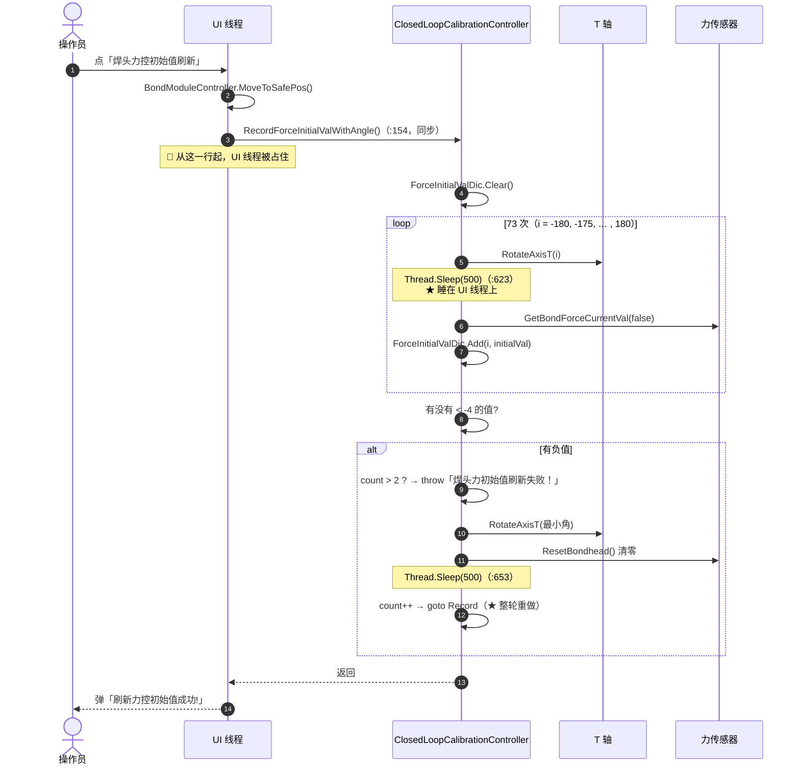

**ASCII 等效图**

```
   点「焊头力控初始值刷新」
        |
   焊头移到安全位                                     (:152)
        |
   RecordForceInitialValWithAngle()   <-- 同步、在 UI 线程上  (:154)
        |
   清空 ForceInitialValDic                            (:618)
        |
   +--------------------------------------------------+
   |  for i = -180 → 180, 每 5 度（共 73 次）           |
   |      T 轴转到角度 i                                (:621)
   |      Thread.Sleep(500)     <-- 睡在 UI 线程上 ★    (:623)
   |      读焊头力初始值                                 (:625)
   |      记进 ForceInitialValDic                        (:627)
   +--------------------------------------------------+
        |           约 73 × 500ms + 73 次旋转时间 ≈ 40 秒～1 分钟
        |
   字典里有没有 < -4 的值？                             (:631-633)
        |
    有 --> count > 2 ? --是--> throw「焊头力初始值刷新失败！」(:639)
        |         |
        |       否 --> T 轴转到最小角 (:648) → ResetBondhead() 清零 (:651)
        |              → Thread.Sleep(500) (:653) → count++ (:655)
        |              → **goto Record 整轮重做** (:657)
        |                 （最坏情况：4 轮 ≈ 3 分钟）
        |
        无
        |
   弹「刷新力控初始值成功!」                            (:156-160)
```

### §4.10.2 定级与"用户看到什么"

| 判据 | 实际情况 |
|---|---|
| 所在线程 | **UI 线程** —— `BtnRefreshForceInitialVal_Click` 是 `_Click` 处理器，**体内没有 `Task.Run`、不是 `async`** |
| 阻塞时长 | **73 × 500 ms = 36.5 秒**（纯 `Thread.Sleep`）**+ 73 次 T 轴旋转的运动时间** ⇒ **约 40 秒 ~ 1 分钟** |
| 最坏情况 | 有负值时整轮重做，**最多 4 轮（`count > 2` 才抛）** ⇒ **约 3 分钟** |
| 界面是否可感知 | ✅ **是** —— 主界面上一个力控按钮，一按就是几十秒不动 |
| 期间急停/安全门 | 🔴 **本窗口内点不动** |

**⇒ 定级 🔴。**

**用户看到什么**：
**点「焊头力控初始值刷新」，界面卡住约 40 秒到 1 分钟**（最坏 3 分钟），
期间窗口不重绘、按钮全部点不动、急停在本窗口内响应不了；
卡完之后弹一句「刷新力控初始值成功!」。

> **⚠️ 与 §4.8 的区别要写清楚**：
> §4.8 的 `UcNozzleEdit` 是**睡在处理器体内**（启发式一扫就能扫到）；
> **这一条是睡在控制器里、被处理器同步调用**（启发式扫不到"调用链"）。
> **两条的机制相同（UI 线程被同步阻塞），但发现路径不同** ——
> 这正是 `_raw\_UI线程阻塞排查.md` §一.1 所警告的那类**系统性漏报**。

### §4.10.3 正确写法

```csharp
// 推荐：整段搬进 Task.Run，并在结束后回 UI 线程弹框
private async void BtnRefreshForceInitialVal_Click(object sender, EventArgs e)
{
    this.BtnRefreshForceInitialVal.Enabled = false;
    try
    {
        System2Domain.GetInstance().BondModuleController.MoveToSafePos();
        await Task.Run(() => this.closedLoopCalibrationController.RecordForceInitialValWithAngle());
        AKRSXtraMessageBox.Show("刷新力控初始值成功!", "提示", MessageBoxButtons.OK, MessageBoxIcon.Information);
    }
    finally
    {
        this.BtnRefreshForceInitialVal.Enabled = true;
    }
}
```

> **⚠️ 但要注意**：`RecordForceInitialValWithAngle` 里 `goto Record` 的重试**最多 4 轮**，
> 而且**第 2 轮起的 `ResetBondhead()` 是真实的硬件动作**。
> **即使搬到后台线程，也需要给操作员一个"正在进行中/可以取消"的提示** ——
> 本项目大量任务**没有取消路径**（`_UI线程阻塞排查.md` §六.4 已指出这一点），
> `RecordForceInitialValWithAngle` **也没有 `CancellationToken`**。

---

## §4.11 真空 / 吹气的互锁：`UcVacuum` 的四个按钮

> **这一节要讲一个"四行代码里两种对错并存"的样本** ——
> 同一个文件、同样结构的四个按钮，**两个写对了、两个写错了**。
> 这种缺陷**只能靠逐行读代码发现**，任何 `grep` 都扫不出来。

### §4.11.1 用户看到什么

`Controls/Manual/UcVacuum.cs`（351 行）是手动调试页上的"真空/吹气"面板，
四个按钮**标题会随状态变化**（实测 `.Text` 赋值处）：

| 按钮 | 初始标题（Designer） | 点一下之后变成 | 处理器 | 行 |
|---|---|---|---|---|
| 吸嘴真空 | `开吸嘴真空` (`Designer.cs:74`) | `关吸嘴真空` | `BtnNozzleVacuum_Click` | `:166` |
| 吸嘴弱吹 | `开吸嘴吹气` (`Designer.cs:63`) | `关吸嘴吹气` | `BtnWeakBlow_Click` | `:191` |
| 顶针真空 | `开顶针真空` (`Designer.cs:83`) | `关顶针真空` | `BtnESVacuum_Click` | `:216` |
| 顶针吹气 | `开顶针吹气` (`Designer.cs:92`) | `关顶针吹气` | `BtnESBlow_Click` | `:241` |

**⇒ 按钮标题是"下一步动作"而不是"当前状态"** —— 标题写「开吸嘴真空」表示"点下去会打开"。
**这本身是对的、也是常见的写法**，但配合下面那条缺陷就会让操作员彻底看不懂。

### §4.11.2 正确的两个：吸嘴真空 与 吸嘴弱吹

```csharp
// Controls/Manual/UcVacuum.cs:166
private void BtnNozzleVacuum_Click(object sender, EventArgs e)
{
    if (!this.BondModule.BondHead.VaccumElectric.GetOutputValue())      // :168 当前真空没开
    {
        // 先关吹气电磁阀
        this.BondModule.BondHead.WeakBlowElectric.SetOutputValue(false);   // :171 ✅ 关掉"吹气"

        // 开真空
        this.BondModule.BondHead.VaccumElectric.SetOutputValue(true);      // :174
        this.BtnNozzleVacuum.Text = @"关吸嘴真空";                          // :175
        this.BtnNozzleVacuum.Appearance.BackColor = Color.Yellow;          // :176
    }
    else
    {
        this.BondModule.BondHead.VaccumElectric.SetOutputValue(false);     // :180
        this.BtnNozzleVacuum.Text = @"开吸嘴真空";                          // :181
        this.BtnNozzleVacuum.Appearance.BackColor = Color.Transparent;     // :182
    }
}

// Controls/Manual/UcVacuum.cs:191
private void BtnWeakBlow_Click(object sender, EventArgs e)
{
    if (!this.BondModule.BondHead.WeakBlowElectric.GetOutputValue())    // :193
    {
        // 先关真空电磁阀
        this.BondModule.BondHead.VaccumElectric.SetOutputValue(false);     // :196 ✅ 关掉"真空"

        // 开吹气
        this.BondModule.BondHead.WeakBlowElectric.SetOutputValue(true);    // :199
        this.BtnWeakBlow.Text = @"关吸嘴吹气";                              // :200
        this.BtnWeakBlow.Appearance.BackColor = Color.Yellow;              // :201
    }
    else
    {
        this.BondModule.BondHead.WeakBlowElectric.SetOutputValue(false);   // :205
        this.BtnWeakBlow.Text = @"开吸嘴吹气";                              // :206
        this.BtnWeakBlow.Appearance.BackColor = Color.Transparent;         // :207
    }
}
```

**✅ 这两段是对的**：**开真空的先关吹气（`:171`），开吹气的先关真空（`:196`）** ——
两个执行机构**互斥**，油路/气路上不能同时动作。
**注释也写对了**（`// 先关吹气电磁阀` / `// 先关真空电磁阀`）。

### §4.11.3 错掉的两个：顶针真空 与 顶针吹气

```csharp
// Controls/Manual/UcVacuum.cs:216
private void BtnESVacuum_Click(object sender, EventArgs e)
{
    if (!this.EjectModule.EjectionTableVacuum.GetOutputValue())         // :218
    {
        // 先关吹气电磁阀                  ← ★ 注释是照抄上面那段的
        this.EjectModule.EjectionTableVacuum.SetOutputValue(false);      // :221 🔴 关的是"真空"自己！

        // 开真空
        this.EjectModule.EjectionTableVacuum.SetOutputValue(true);       // :224
        this.BtnESVacuum.Text = @"关顶针真空";                            // :225
        this.BtnESVacuum.Appearance.BackColor = Color.Yellow;            // :226
    }
    else
    {
        this.EjectModule.EjectionTableVacuum.SetOutputValue(false);      // :230
        this.BtnESVacuum.Text = @"开顶针真空";                            // :231
        this.BtnESVacuum.Appearance.BackColor = Color.Transparent;       // :232
    }
}

// Controls/Manual/UcVacuum.cs:241
private void BtnESBlow_Click(object sender, EventArgs e)
{
    if (!this.EjectModule.EjectionTableBlow.GetOutputValue())           // :243
    {
        // 先关真空电磁阀                  ← ★ 注释同样是照抄的
        this.EjectModule.EjectionTableBlow.SetOutputValue(false);        // :246 🔴 关的是"吹气"自己！

        // 开吹气
        this.EjectModule.EjectionTableBlow.SetOutputValue(true);         // :249
        this.BtnESBlow.Text = @"关顶针吹气";                              // :250
        this.BtnESBlow.Appearance.BackColor = Color.Yellow;              // :251
    }
    else
    {
        this.EjectModule.EjectionTableBlow.SetOutputValue(false);        // :255
        this.BtnESBlow.Text = @"开顶针吹气";                              // :256
        this.EjectModule.EjectionTableBlow.Appearance.BackColor = Color.Transparent;  // :257
    }
}
```

**🔴 两处的"先关……"都关成了自己：**

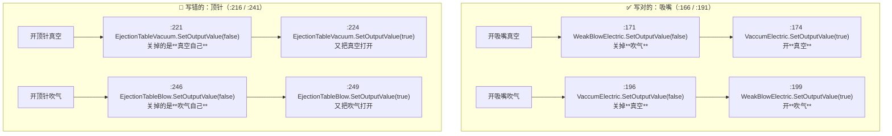

**ASCII 等效图**

```
   ✅ 吸嘴（正确）                        🔴 顶针（错误）
   ---------------                        ---------------
   [开吸嘴真空]                            [开顶针真空]
       |                                       |
   关闭弱吹 (:171)                         关闭顶针真空 (:221)  <-- 关的是自己
       |                                       |
   开启真空 (:174)                         开启顶针真空 (:224)  <-- 白关一下又开
       |                                       |
   标题 → 关吸嘴真空                        标题 → 关顶针真空

   [开吸嘴吹气]                            [开顶针吹气]
       |                                       |
   关闭真空 (:196)                         关闭顶针吹气 (:246)  <-- 关的是自己
       |                                       |
   开启弱吹 (:199)                         开启顶针吹气 (:249)  <-- 白关一下又开
       |                                       |
   标题 → 关吸嘴吹气                        标题 → 关顶针吹气
```

**⚠️ 后果要说准确**：

| # | 后果 |
|---|---|
| 1 | **顶针真空与顶针吹气没有任何互锁。** 两个按钮可以同时处于"开"的状态 —— 而正确实现下不可能 |
| 2 | **"先关"那一步是空动作**（`SetOutputValue(false)` 紧接着 `SetOutputValue(true)`，中间只有微秒级间隔），**既没关掉对方，也没起到任何缓冲** |
| 3 | 如果气路上"真空 + 吹气同时开"会导致**顶针吹不起来 / 真空拉不住**，那么**现场表现是"顶针这块手动调试时好时坏"**，而界面上的标题与颜色**看起来完全正常**（`关顶针真空` / 黄色），**没有任何报错** |
| 4 | 因为**吸嘴那一对是对的**，所以"真空/吹气要互锁"这个设计意图**是明确的、有据可依的** ⇒ **这是漏改/复制粘贴改漏，不是设计取舍** |

> **⚠️ 定性要严格**：
> - **不要写"按钮点了会崩溃"** —— 不崩溃，`SetOutputValue(false)` 后紧跟 `true`，一切正常返回。
> - **不要写"真空吹气互相干扰会烧硬件"** —— **那是推断**，本篇**没有**气路图与本机型的手册依据。
>   本篇只写代码事实：**注释说"先关吹气/真空"，实际关的是自己** ⇒ **互锁逻辑缺失**。
>   **气路后果标注为"推断，未实机验证"。**
> - **写法建议**：`this.EjectModule.EjectionTableBlow.SetOutputValue(false);`（顶针真空里关吹气）、
>   `this.EjectModule.EjectionTableVacuum.SetOutputValue(false);`（顶针吹气里关真空）——
>   **即把 `:221` 的 `Vacuum` 改成 `Blow`，把 `:246` 的 `Blow` 改成 `Vacuum`。**

### §4.11.4 这一节的方法论意义

> **同样的结构、同样的注释、同样的按钮，两对里一对对一对错。**
> ⇒ **"复制粘贴"是本层缺陷最常见的来源**：作者写对了一对，
> 复制到第二对时**只改了 `VaccumElectric` 而没有改 `WeakBlowElectric`**。
>
> **⚠️ 但本节还藏着一个更重要的观察**：
> `BtnNozzleVacuum_Click` 用的是 **`BondModule.BondHead.VaccumElectric`**（焊头模块），
> `BtnESVacuum_Click` 用的是 **`EjectModule.EjectionTableVacuum`**（顶针台模组，来自 `WaferSubSystem`）。
> **两个执行机构在完全不同的子系统里，命名风格也完全不同**
> （`VaccumElectric` vs `EjectionTableVacuum`；注意前者拼写是 `Vaccum` 少了一个 `u`）。
> 这解释了为什么会改漏：**改的人要在两个不同命名体系之间切换，很容易只改掉一半。**

---

## §4.12 客户设置页：11 个示教入口，7 个都会先"换 TouchDown"

### §4.12.1 这一页是什么

`Controls/Setting/Customer/FrmCustomerSetup.cs`（274 行）是**客户设置页**，
一屏 11 个按钮，**每一个都是"跳到另一个示教窗体"**。**它本身不含业务逻辑**，
是"**示教入口的集散地**"。

**先看它的构造函数做了什么**（这是"按钮能不能点"的开关）：

```csharp
// 从 :40 / :40 上下的片段（构造函数内）
this.BtnTeachRightIPT.Enabled = MachineHardwareConfiguration.GetInstance().IsRightIPTConfigrated;   // :40
```

**⇒ 「示教右中转台」这个按钮的可点性，取决于机台配置里有没有配右中转台。**
**同一页其它按钮也有同型的 `IsXxxConfigured` 前置判断**（在各处理器体内，见下表）。

### §4.12.2 11 个按钮的完整去向表

| # | 按钮标题 | 处理器（行） | 直接去向 | 前置检查 |
|---|---|---|---|---|
| 1 | **示教吸嘴架** | `BtnLearnPPToolbank_Click` (`:63`) | ✅ `new FrmLearnToolBank()` `:73` → `ShowDialog()` `:74` | 无 |
| 2 | **示教左中转台** | `BtnLearnIPT_Click` (`:84`) | 🔴 **先 `ChangeTouchDownAssistance()`** `:86` → `new FrmLearnIPT(IPTTypeEnum.LeftIPT)` `:91` | 换 TouchDown |
| 3 | **示教抛料盒** | `BtnAssistantBlowOffBox_Click` (`:102`) | `new FrmBlowOffBoxAssistant()` `:104` → `ShowDialog()` `:105` | 无 |
| 4 | **示教ULM运动点位** | `BtLearnULMPositions_Click` (`:115`) | 🔴 **先 `ChangeTouchDownAssistance()`** `:117` → `new FrmTeachULMPositions()` `:122` | 换 TouchDown |
| 5 | **示教吸嘴擦拭位置** | `BtnNozzleCleanPosTeach_Click` (`:133`) | ⚠️ 先查 `IsNozzleCleanTableConfigured` `:135`（没配就弹「请先将在参数界面配置吸嘴清洁台!」`:138`）→ 🔴 `ChangeTouchDownAssistance()` `:146` → `new FrmNozzleCleanPosTeach()` `:151` | 配置 + 换 TouchDown |
| 6 | **示教刮胶盘** | `BtnTeachSlideFluxer_Click` (`:162`) | ⚠️ 先查 `IsSlideFluxerConfigured`（没配弹「请先将在参数界面配置刮胶盘!」）→ 🔴 `ChangeTouchDownAssistance()` `:175` → `new FrmSlideFluxerTeach()` | 配置 + 换 TouchDown |
| 7 | **示教翻转台** | `BtnTeachFlipTable_Click` (`:191`) | ⚠️ 先查 `IsFlipModuleConfigrated`（没配弹「请先将在参数界面配置翻转台!」）→ 🔴 `ChangeTouchDownAssistance()` `:204` → `new FrmFlipTableTeach()` | 配置 + 换 TouchDown |
| 8 | **示教取片安全区域** | `BtAssistantPickArea_Click` (`:220`) | `new SupportFeature.MotionPlan.FrmAssistantPickArea()` `:222` → `ShowDialog()` `:223` | 无 |
| 9 | **示教摇杆** | `BtnTeachJoystick_Click` (`:232`) | `new FrmTeachJoystick()` `:234` → `ShowDialog()` `:235` | 无 |
| 10 | **示教蘸胶位置** | `BtAssistantPrintPos_Click` (`:244`) | 🔴 **先 `ChangeTouchDownAssistance()`** `:246` → `new FrmLearnPrintPos()` `:251` | 换 TouchDown |
| 11 | **示教右中转台** | `BtnTeachRightIPT_Click` (`:262`) | 🔴 **先 `ChangeTouchDownAssistance()`** `:264` → `new FrmLearnIPT(IPTTypeEnum.RightIPT)` `:269` | 配置(`:40`) + 换 TouchDown |

### §4.12.3 🔴 本节最重要的一条：**7 个入口都在 UI 线程上同步跑整条换吸嘴链路**

```csharp
// 例：Controls/Setting/Customer/FrmCustomerSetup.cs:84
private void BtnLearnIPT_Click(object sender, EventArgs e)
{
    if (!this.system2Controller.ChangeTouchDownAssistance())    // :86 ★★ UI 线程上同步
    {
        return;                                                 // :88
    }

    FrmLearnIPT frmLearnIPT = new FrmLearnIPT(IPTTypeEnum.LeftIPT);   // :91
    frmLearnIPT.ShowDialog();                                         // :92
    frmLearnIPT.Dispose();                                            // :94
}
```

**`ChangeTouchDownAssistance()`（`System2Controller.Assistant.cs:1660`）在 UI 线程上做的事**：

```
   :1663 检查 TouchDown 在不在焊头上
        |
   :1666 不在 + 吸嘴架上有 TouchDown + 吸嘴架已启用
        |
   :1668 SwitchTouchDown()          ← System2Controller.cs:988
        |
   :995 ChangeNozzle("TouchDown")   ← System2Controller.cs:863
        |
   ★ 整条链路（见 §4.5.3 的 12 个动作）：
     Z轴回安全位 → 吸嘴架伸出 → 查表取位置 → T轴旋转 → X/Y/Z 移动
     → 校验T轴到位 → 等吸嘴架到位 → 低速下压 → 开吸附 → 低速上抬
     → 吸嘴检测（可能重试 N 次）→ 吹气
        |
   ★ 全程在 UI 线程上 ⇒ 界面全程冻住
        |
   ★ 期间若触发报警框（"吸嘴不在吸嘴架上"/"T轴运动到指令位置失败"/
     "焊头吸附吸嘴失败"），报警框的父窗口就是那个正在卡住的设置页
```

**这不是个别写法，是一个族。** 全仓（`Controls/` + `BondForce/`）实测 **10 处**：

| # | 文件:行 | 所在按钮 |
|---|---|---|
| 1 | `Controls/Setting/Customer/FrmCustomerSetup.cs:86` | 示教左中转台 |
| 2 | `Controls/Setting/Customer/FrmCustomerSetup.cs:117` | 示教ULM运动点位 |
| 3 | `Controls/Setting/Customer/FrmCustomerSetup.cs:146` | 示教吸嘴擦拭位置 |
| 4 | `Controls/Setting/Customer/FrmCustomerSetup.cs:175` | 示教刮胶盘 |
| 5 | `Controls/Setting/Customer/FrmCustomerSetup.cs:204` | 示教翻转台 |
| 6 | `Controls/Setting/Customer/FrmCustomerSetup.cs:246` | 示教蘸胶位置 |
| 7 | `Controls/Setting/Customer/FrmCustomerSetup.cs:264` | 示教右中转台 |
| 8 | `Controls/Setting/BondPosition/UcBondPositionEdit.cs:99` | 测高（见 §4.13） |
| 9 | `Controls/Assistant/FrmBondPositionHeightTeach.cs:122` | 焊点高度示教 |
| 10 | `BondForce/Forms/UcBondForceMeasurement.cs:54` | 力控标定（见 §4.9.2） |

**用户看到什么**（10 处完全一样）：
**点下示教按钮之后，界面先卡住几秒到几十秒**（换吸嘴 + 换 TouchDown 的全部动作时间），
**然后目标示教窗体才弹出来**。操作员的第一反应是"我点错了？怎么没反应"，
**往往会再点一次** —— 而第二次点击会落在**同一个卡住的 UI 线程的消息队列里**，
等第一次返回后**立刻再跑一遍整条换吸嘴链路**。

> **⚠️ 必须严格按 `_UI线程阻塞排查.md` 的用词**：
> 这是「**UI 线程被同步阻塞**」，**不是"死锁"**。
> **不要写"界面卡死"，要写"界面卡住 N 秒后目标窗体才弹出"。**

> **⚠️ 正确写法**（该文 §六.4 要求给出替代）：
> ```csharp
> private async void BtnLearnIPT_Click(object sender, EventArgs e)
> {
>     this.BtnLearnIPT.Enabled = false;
>     try
>     {
>         bool ok = await Task.Run(() => this.system2Controller.ChangeTouchDownAssistance());
>         if (!ok) return;
>         FrmLearnIPT frmLearnIPT = new FrmLearnIPT(IPTTypeEnum.LeftIPT);
>         frmLearnIPT.ShowDialog();
>         frmLearnIPT.Dispose();
>     }
>     finally { this.BtnLearnIPT.Enabled = true; }
> }
> ```

### §4.12.4 还有一个被注释掉的入口（⚠️ 注释残留）

```csharp
// FrmCustomerSetup.cs:65-71
//FrmLearnNozzleBank1 frmLearnNozzleBank1 = new FrmLearnNozzleBank1();
//if (frmLearnNozzleBank1.IsShowDialog())
//{
//    frmLearnNozzleBank1.ShowDialog();
//
//    frmLearnNozzleBank1.Dispose();
//}

FrmLearnToolBank frmLearnToolBank = new FrmLearnToolBank();   // :73 ★ 现在走的是这个
frmLearnToolBank.ShowDialog();                                // :74
```

**⇒ 「示教吸嘴架」这个按钮曾经打开的是 `FrmLearnNozzleBank1`，后来换成了 `FrmLearnToolBank`，
旧代码以注释形式留在原地（`:65-71`）。**
**⚠️ 这意味着 `FrmLearnNozzleBank1.cs`（776 行、本层第二大的 Manual 窗体）当前没有任何入口。**

> **排查"某个窗体明明是好的但现场用不到"时，这类注释块是第一手线索。**
> **⚠️ 但也要客观**：本篇只核实"`FrmCustomerSetup` 不再打开它"，
> **不排除别处有入口** —— 全仓零调用点的结论见 §4.1 的僵尸窗体清单。
> `FrmLearnNozzleBank1` **不在**该清单里（说明别处仍有入口），
> **所以此处只写"这个按钮改过去向"，不写"该窗体零调用点"。**

---

## §4.13 「焊点管理」：`UcAddBondPosition` 的三个按钮 + 一个被搁置的按钮

> **这一节是"同一个窗体里，三个按钮三种命运"的样本**：
> 一个完整可用（新建）、一个完整可用（删除）、一个**代码完整但被永久禁用**（Copy）。
> 而且这一页里还有**本篇自己查出来的第 4 处"恒假判据"**。

### §4.13.1 这一页是什么

`Controls/Setting/BondPosition/UcAddBondPosition.cs`（397 行）是**焊点管理页**。
它是"配方 → 焊点列表"的增删改界面。

**⚠️ 先看构造函数——在"异性传输单元"机型上，整页被禁用**：

```csharp
// UcAddBondPosition.cs:37
public UcAddBondPosition(Action refreshAction)
{
    …
    if (ProductDomain.GetInstance().ProductConfig.TransportUnitConfig.IsOppositeSex)   // :44
    {
        this.Enabled = false;                                                          // :46 ★ 整页禁用
    }
}
```

**这是有意的整页禁用**（不是"忘了打开开关"），与下面 `BtnCopy` 那条**不是一回事**，
写作时必须分开。

### §4.13.2 三个按钮的总览

| 控件 | 界面标题 | 处理器 | 行 | 状态 |
|---|---|---|---|---|
| `BtnAdd` | **新建** | `BtnAdd_Click` | `:78` | ✅ 可用，含"重名重试" |
| `BtnDelete` | **删除** | `BtnDelete_Click` | `:186` | ✅ 可用 |
| `BtnCopy` | **Copy** | `BtnCopy_Click` | `:222` | ⚠️ **运行时永久禁用（启用状态从未被恢复）** |

### §4.13.3 「新建」按钮的完整流程

```csharp
// UcAddBondPosition.cs:78
private void BtnAdd_Click(object sender, EventArgs e)
{
    string createName = "焊点" + (this.bondPositionConfigList.Length() + 1);   // :80 默认名

ReNameLabel:                                                                    // :82 重名重试标号
    createName = XtraInputBox.Show("请输入新焊点的名称！", "焊点名称", createName); // :84
    …
    foreach (char rInvalidChar in Path.GetInvalidFileNameChars())                // :107 ★ 非法字符检查
    { … }

    if (createName.Length > 15)                                                 // :117 ★ 长度检查
    { … }

    …
    ProductConfiguration.GetInstance().Save();                                  // :176 ★ 落盘
}
```

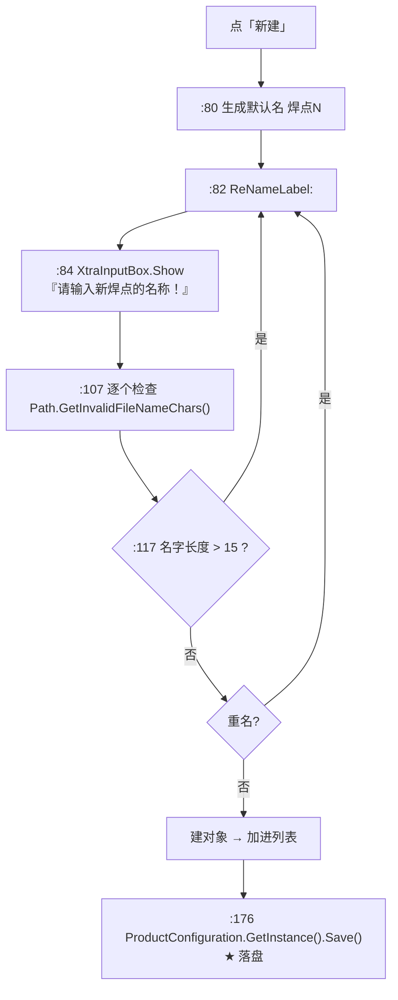

**ASCII 等效图**

```
   点「新建」
        |
   默认名 = "焊点" + (已有焊点数 + 1)              (:80)
        |
   ┌──> 弹输入框「请输入新焊点的名称！」           (:84)
   │      |
   │   检查非法文件名字符（Path.GetInvalidFileNameChars）(:107)
   │      |
   │   名字长度 > 15 ?  --是--> 重新输 ──┐        (:117)
   │      |否                          │
   │   重名 ?  --是--> 重新输 ──────────┤
   │      |否                          │
   │   建对象、加进列表                  │
   │      |                             │
   │   落盘 Save()                       (:176)
   └──────────────────────────────────────┘
   （ReNameLabel: 标号在 :82，两条失败路径都 goto 回去）
```

> **⚠️ 注意 `:107` 这一处**：它检查的是 **`Path.GetInvalidFileNameChars()`** ——
> **"文件名非法字符"**，而不是"焊点名不允许的字符"。
> 这说明**焊点名会被当作文件名使用**（否则不需要这个检查）。
> ⇒ **这是一个跨层的隐式契约**：焊点名 → 文件名。
> **接手人若给焊点加了别的用途而忘了这条，会引入路径问题。**
> **⚠️ 本条为"读代码推断"，未在 `_幽灵文件清单` 或 `_raw` 报告中登记。**

### §4.13.4 「Copy」按钮：**代码完整，只是开关没打开**

> **⚠️ 这是本篇最容易写错的一条，因为"它到底是不是半成品"曾经被误判过一次。**
> **本篇的写法是：接线完整、处理器完整、逻辑可读 —— 唯一的问题是 Designer 把它设成禁用。**

**实测事实（行号可核）**：

| | |
|---|---|
| `Click +=` 接线 | **`UcAddBondPosition.Designer.cs:192`** `this.BtnCopy.Click += new System.EventHandler(this.BtnCopy_Click);` |
| 标题 | **`UcAddBondPosition.Designer.cs:191`** `this.BtnCopy.Text = "Copy";` |
| 禁用 | **`UcAddBondPosition.Designer.cs:183`** `this.BtnCopy.Enabled = false;` |
| 处理器本体 | **`UcAddBondPosition.cs:222`** `private void BtnCopy_Click(object sender, EventArgs e)` |
| 功能是否真实现了 | ✅ **是，而且相当完整**（`:222-271` 逐行读过） |

**完整流程**：

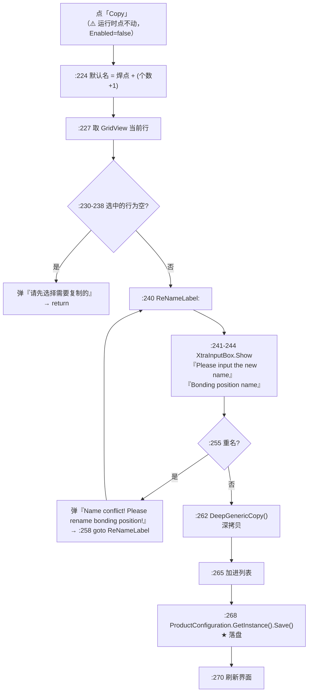

**ASCII 等效图**

```
   点「Copy」
        |
   默认名 = 焊点N                                 (:224)
        |
   取表格当前行                                   (:227)
        |
   没选行 ? --是--> 弹「请先选择需要复制的」--> 结束 (:230-238)
        |否
   ┌──> 弹输入框（英文）「Please input the new name」(:241-244)
   │      |
   │   重名 ? --是--> 弹「Name conflict! ...」      (:255-259)
   │      |                |
   │      |否              └──> goto ReNameLabel ──┘
   │      |
   │   深拷贝 JsonFormatHelper<T>.DeepGenericCopy   (:262)
   │      |
   │   加进列表                                     (:265)
   │      |
   │   落盘 Save()                                  (:268)
   │      |
   │   刷新界面                                     (:270)
```

**⇒ 结论：这不是"没做完"，而是"开关没打开"：一行 `Enabled = true` 就能恢复一个完整功能。**

> **⚠️ 这里必须复述 §4.2.6 的更正，因为它是本项目最大的一个"grep 陷阱"**：
>
> 曾经有一种说法是「`BtnCopy` 全仓只在 Designer 里出现 ⇒ 连 `Click +=` 都没有 ⇒ 功能从未实现」。
> **这个说法两处都错**：
>
> 1. **`grep -w 'BtnCopy'` 永远匹配不到 `BtnCopy_Click`** —— `_` 属于**词字符**，
>    `BtnCopy_Click` 是**一个整词**，`-w` **静默滤掉了处理器本体那一行**。
> 2. **更根本**：`Click +=` 那一行**本来就在 Designer 里**，
>    而"排除 Designer 后零命中"是**必然结果，不是证据**。
>
> **本项目的通用纪律**：
> **凡 `Xxx_Click` 命名的处理器，`grep -w Xxx` 一律查不到** ——
> 按控件名排查必须**同时跑不带 `-w` 和带 `_Click` 两种写法**，
> 或者直接查 **`System.EventHandler(this.<处理器名>)`**。

> **⚠️ 本条的定性用词（严格遵守任务书）**：
> - ✅ 写：「**「Copy」按钮：接线完整、处理器完整、逻辑可读。唯一的问题是 Designer 把它设成
>   `Enabled = false`（`UcAddBondPosition.Designer.cs:183`）且全仓再无代码置回 `true`
>   ⇒ 操作员看到的是一个永远是灰的、点不动的「Copy」按钮，
>   而它背后的复制逻辑（选行 → 判空提示 → 弹框改名 → 重名重试 → 深拷贝 → 落盘）是齐全的。**」
> - ❌ **不要写**「半成品 / 功能从未实现 / 双死」—— **那是编造，代码就摆在那里。**
> - ❌ **不要写**「点了会崩溃」—— **它根本点不动。**

### §4.13.5 🔴 本篇自己查出来的第 4 处"恒假判据"：`:283-284`

**同一个文件里，还有一个"永远走不到"的确认分支。**

```csharp
// UcAddBondPosition.cs:278
private void GvBondPosition_CellValueChanged(object sender, CellValueChangedEventArgs e)
{
    string oldValue = (string)this.GvBondPosition.GetRowCellValue(e.RowHandle, e.Column);   // :280

    string newName = …;

    DialogResult dialogResult = AKRSXtraMessageBox.Show(
        $"焊点名称{oldValue} => {newName},是否确认该操作", "提示", MessageBoxButtons.YesNo);   // :283 ★

    if (dialogResult == DialogResult.OK)                                                    // :284 🔴 恒假
    {
        …
        ProductConfiguration.GetInstance().Save();                                          // :287 ★ 永远走不到
    }
}
```

**`MessageBoxButtons.YesNo` 的返回值只可能是 `Yes` / `No`，不可能是 `OK`。**
⇒ **`:284` 恒假，`:284-288` 整段是死代码，`:287` 的落盘永远不会执行。**

**两个叠加的问题**：

| # | 问题 | 行 |
|---|---|---|
| 1 | **判据恒假**：`YesNo` 的结果与 `DialogResult.OK` 比较 | `:283` / `:284` |
| 2 | **提示语里的"旧值"其实是新值**：`:280` 读 `oldValue` 是在单元格**已经被改完之后**，所以弹框里显示的是 `焊点A => 焊点A` | `:280` |

**用户看到什么**：
在焊点表格里直接改一个单元格（改焊点名），
弹出「焊点名称 X => X, 是否确认该操作」——
**新旧名一模一样**；
点「是」，**没有任何事情发生，改动也没有被保存**。

> **⚠️ 同一个文件里就有正确的写法作为对照**：
> `:91`、`:119`、`:147`、`:200` 四处都用的是 `OKCancel` + 判 `DialogResult.OK`（**正确**）。
> ⇒ **`:283` 是全文件唯一的 `YesNo`，也是唯一的恒假判据。**
>
> **⚠️ 这个缺陷 `_raw` 报告里没有** —— 是我**通读 `UcAddBondPosition.cs`（397 行）时发现的**，
> 标注为**已读代码确认，未实机验证**。

---

## §4.14 「点了没反应」一族：本篇汇总

> **用户最直接的抱怨形态是"我点了它，没反应"。**
> 这一节把所有"点了没反应 / 反应与预期不符"的按钮**集中列一张表**，
> 每一行都给出**为什么没反应**（而不是只说"没反应"）。

| # | 按钮（界面标题） | 位置 | 为什么没反应 | 级别 |
|---|---|---|---|---|
| 1 | **在预点胶板上执行** | `Controls/Setting/PostBond/UcPostBondEdit.cs:328` | **方法体是空的**（`:329-331`），而 `:310` 明确把它启用 | 🔴 |
| 2 | **Copy** | `Controls/Setting/BondPosition/UcAddBondPosition.cs:222` | **Designer 里 `Enabled = false`**（`.Designer.cs:183`），全仓无代码置回 | ⚠️ |
| 3 | **start4** | `Controls/Experiment/FrmBondheadTest.cs:1335` | **Designer 里 `Enabled = false`** | ⚠️ |
| 4 | （无标题） | `Controls/Experiment/UcBondModuelSetting.cs:1177 button37_Click` | **孤立处理器：全仓零接线** | ⚠️ |
| 5 | （无标题） | `Controls/Experiment/UcBondModuelSetting.cs:1659 BtnDataLogTest_Click` | **孤立处理器：全仓零接线** | ⚠️ |
| 6 | **编辑程式** | `Controls/Manual/FrmLearnPrintPos.cs:212 BtnEditProgram_Click` | **本窗体的 Designer 里零接线**（方法体本身是活的，别处 4 个 Designer 有同名接线） | ⚠️ |
| 7 | **自动对焦** | `Controls/Manual/FrmLearnPrintPos.cs:183 BtnAutoFocus_Click` | **本窗体的 Designer 里零接线**（别处 8 个 Designer 有同名接线） | ⚠️ |
| 8 | **编辑PR** | `Controls/Assistant/FrmPostBondTeach.cs:2070 BtnEditPR_Click` | **本窗体的 Designer 里零接线**；且该窗体本身零调用点 | ⚠️ |
| 9 | **编辑程式** | `Controls/Manual/FrmLearnNozzleBank1.cs:661 BtnEditProgram_Click` | **本窗体的 Designer 里零接线** | ⚠️ |
| 10 | **步骤条上的格子**（`TileBar`） | 全层 20 个示教窗体 | `TileBar` 只作指示器，**没有任何 `TileBarItem` 接 `ItemClick`** | ⚠️ |
| 11 | **在表格里改焊点名后点「是」** | `Controls/Setting/BondPosition/UcAddBondPosition.cs:284` | **判据恒假**：`YesNo` 的结果与 `DialogResult.OK` 比较 ⇒ 确认分支永不执行 | 🔴 |
| 12 | **执行一次**（在"没板子"时点） | `Controls/Setting/PostBond/UcPostBondEdit.cs:170` | **静默 `return`**：没有传输单元就什么都不做、不提示 | ⚠️ |
| 13 | `ucLight1`（指示灯控件） | `Controls/Assistant/FrmModuleSelect.Designer.cs:621` | **运行时永久禁用**：Designer 里 `Enabled = false`，**全仓无任何代码把它置回 `true`** | ⚠️ 搁置 |
| 14 | `ucLight2`（指示灯控件） | `Controls/Assistant/FrmModuleSelect.Designer.cs:610` | 同上 | ⚠️ 搁置 |
| 15 | `ucLight1`（指示灯控件） | `Controls/Assistant/FrmMoveToBondingPosition.Designer.cs:502` | 同上（**且该窗体本身零实例化**，见 §6.4.5.1） | ⚠️ 搁置 |
| 16 | `ucLight2`（指示灯控件） | `Controls/Assistant/FrmMoveToBondingPosition.Designer.cs:491` | 同上（**且该窗体本身零实例化**） | ⚠️ 搁置 |

### §4.14.1 ⚠️ 第 13~16 条的定性与"同名控件互相掩盖"陷阱

**这 4 行的原始登记在共享文件 `docs\_raw\_永久禁用控件排查.md` 的 §一.4。**
**本篇复核过它们的**客观事实**，笔录如下（复核命令见下）：**

```bash
cd "E:/项目/ZX2200标机/trunk/AKRS.ZX2200"
grep -rn --include='*.cs' '\.ucLight1\.Enabled' . | grep -v '/bin/\|/obj/'
grep -rn --include='*.cs' '\.ucLight2\.Enabled' . | grep -v '/bin/\|/obj/'
```

**实测输出（两个名字各 3 行，全部在 Designer 文件里，全部是 `= false`）**：

| 名字 | 位置 | 内容 |
|---|---|---|
| `ucLight1` | `BondSystem/Controls/Assistant/FrmModuleSelect.Designer.cs:621` | `this.ucLight1.Enabled = false;` |
| `ucLight1` | `BondSystem/Controls/Assistant/FrmMoveToBondingPosition.Designer.cs:502` | `this.ucLight1.Enabled = false;` |
| `ucLight1` | `DispenseSystem/Controls/Assistant/FrmPreDispenseSelect.Designer.cs:53` | `this.ucLight1.Enabled = false;`（**不属本篇范围**） |
| `ucLight2` | `BondSystem/Controls/Assistant/FrmModuleSelect.Designer.cs:610` | `this.ucLight2.Enabled = false;` |
| `ucLight2` | `BondSystem/Controls/Assistant/FrmMoveToBondingPosition.Designer.cs:491` | `this.ucLight2.Enabled = false;` |
| `ucLight2` | `DispenseSystem/Controls/Assistant/FrmPreDispenseSelect.Designer.cs:64` | `this.ucLight2.Enabled = false;`（**不属本篇范围**） |

**⇒ 客观事实（本篇只写这一条）**：
**这 4 个控件在各自的 Designer 里被设为 `Enabled = false`，
并且全仓库**没有任何非 Designer 文件写过 `.ucLight1.Enabled` 或 `.ucLight2.Enabled`**
⇒ 即**从未被代码置回 `true`**。**

> **⚠️ 定性纪律（严格照做）**：
> - ✅ **正确写法**：「**运行时永久禁用（启用状态从未被恢复）**」，属**搁置**。
> - ❌ **不要写**「指示灯坏了」或「功能未实现」。
> - ❌ **不要描述它"灰成什么样"**，也**不要推断它是否还显示正确的状态值** ——
>   **`ucLight*` 自身实现本篇没有读过，"置灰之后外观/取值有什么变化"属未查。**
> - ❌ **不要因为它们点不动就从总表里删掉** —— **照实写进表并另注「运行时永久禁用」。**

**⚠️ 一条完整的工具级陷阱（这是这 4 行此前被静默漏掉的原因）**：

**判"某控件是否被恢复"时，如果按控件名做全仓 `grep`，
两个不同文件里的同名控件会互相"证明"对方是活的。**

具体到本案：`ucLight1` 的 `Enabled = false` 在 **3 个 Designer 文件**里各出现一次。
**排掉"自己那个文件"之后还剩另外两个** ⇒ 判据 `hits ≠ 0` ⇒ **被误判成"有人把它置回 `true` 了"而静默丢弃。**
**⇒ 三条都漏，且漏得看不出来（名单里既没有它们，也没有任何异常输出）。**

**⇒ 正确判据（`同名 ≠ 同一个`）**：

```bash
# ① 先看这个名字在几个文件里出现；> 1 就必须逐个文件确认是不是同一个控件
grep -rl --include='*.cs' '\.ucLight1\.Enabled' . | grep -v '/bin/\|/obj/' | wc -l
#   → 3  （★ 必须 =1 才能说"全仓唯一"；本例是 3，所以要逐个看）

# ② 再看有没有【非 Designer】文件写过它
grep -rn --include='*.cs' '\.ucLight1\.Enabled' . | grep -v '/bin/\|/obj/' \
  | grep -vc 'Designer\.cs\|designer\.cs'
#   → 0  ★ 命中 = 0 且全部命中都在 Designer 里 ⇒ 必是"互相掩盖" ⇒ 之前的"已恢复"判定是误伤
```

**⇒ 为什么"同名"在本案里是无害的、而在别的案子里是有害的**：
`this.ucLight1` 是**每个窗体类自己的私有字段** ——
`FrmModuleSelect.Designer.cs:621` 里的 `this.ucLight1` **不可能**指向 `FrmMoveToBondingPosition` 的实例。
**⇒ 所以"3 个文件各设一次 `false`、没有任何地方设 `true`"确实是"每个窗体各自的这个控件都永久禁用"。**
**⚠️ 但反过来，若某个名字的非 Designer 命中**大于 0**，
那些命中**可能来自"另一个类的同名实例"**，此时"有人恢复过"的结论就**不成立**。**
**⚠️ ⇒ 本篇的写法：对 `ucLight1` / `ucLight2` 给出确定结论（因为它非 Designer 命中 = 0）；
对其他同名控件不给结论。**

**⚠️ 还有一层：这 4 个控件在 `BondSystem/` 里都落在 `Controls/Assistant/`。
其中 `FrmMoveToBondingPosition` 本身是零实例化窗体（§6.4.5.1）——
⇒ 它的两个 `ucLight` 属于"双重搁置"：窗体不会被打开，控件即使被打开也是禁用的。
而 `FrmModuleSelect` 是本层有 8 个实例化点的活跃窗体（§3.1.1）
⇒ 它的两个 `ucLight` 是操作员真能看到的两块灰色区域。**

> **⚠️ 判定这类问题的纪律（`FrmToolsTestRun` 那次踩坑）**：
> **"孤立处理器"不能按控件名查，必须按处理器名查。**
>
> ```bash
> cd "E:/项目/ZX2200标机/trunk/AKRS.ZX2200/BondSystem"
> # ❌ 错：按控件名查 —— 只要控件名和处理器名不一致就会误判
> grep -c "this.BtnToolsTestRun.Click" Controls/Manual/FrmToolsTestRun.Designer.cs      # → 0，看着像孤立
> # ✅ 对：按处理器名查接线语句
> grep -c "System.EventHandler(this.BtnToolsTestRun_Click)" Controls/Manual/FrmToolsTestRun.Designer.cs
> ```
> **实测**：`BtnToolsTestRun_Click`（`FrmToolsTestRun.cs:117`）**是接了线的**，
> 只是**接在一个名字不同的控件上**（`InitControl()` 的 `:105` 引用的是 `BtnPPToolsTestRun`）。
> ⇒ 按控件名查会得到"孤立"的**假阳性**。

---

## §4.15 「吸嘴架设置」：同一个功能，两套写法，一好一坏

### §4.15.1 对比表（这是本节的核心）

**`FrmNozzleShelfSetting`（`Controls/Setting/NozzleShelf/FrmNozzleShelfSetting.cs`，401 行）
和 `FrmNozzleBankManual`（`Controls/Manual/FrmNozzleBankManual.cs`，474 行）
各有一个"吸嘴架伸出/缩回"按钮。**

| | `FrmNozzleBankManual` | `FrmNozzleShelfSetting` |
|---|---|---|
| 处理器 | `BtnMaintenance_Click` (`:228`) | `BtnToolBankService_Click` (`:146`) |
| 位置 | `Controls/Manual/` | `Controls/Setting/` |
| **跑在哪条线程** | ✅ **`Task.Run`（`:239`）** | 🔴 **UI 线程（同步调用）** |
| 防重入 | ✅ `toolBankMaintenanceTask`（`:236`） | ❌ 无 |
| 按钮禁用/恢复 | ✅ `:231-233` → `RefreshControl :162` | ❌ 无 |
| 成功/失败提示 | ✅ `:258` / `:274` 两个提示 | ❌ **完全不检查返回值** |
| 按钮颜色反馈 | ✅ 黄/透明（`:264` / `:280`） | ✅ 黄/透明（`:149` / `:162`） |
| 阈值 | `pos >= -1.5`（`:245`） | `pos >= -1.5`（`:146`） |

```csharp
// Controls/Setting/NozzleShelf/FrmNozzleShelfSetting.cs:146  —— 🔴 全在 UI 线程上
private void BtnToolBankService_Click(object sender, EventArgs e)
{
    double pos = this.nozzleShelfController.GetYAxisPos();                     // :147
    if (pos >= -1.5)                                                           // :148
    {
        this.BtnToolBankService.Appearance.BackColor = Color.Yellow;            // :149

        // 防撞
        if (!this.system2Controller.IsNozzleShelfAxisYSafe())                   // :152
        {
            this.bondModuleController.MoveToSafePos();                          // :154
        }

        // 吸嘴架Y到换吸嘴位
        this.nozzleShelfController.MoveShelfToChangeNozzlePos();                // :157
    }
    else
    {
        this.BtnToolBankService.Appearance.BackColor = Color.Transparent;       // :161

        // 吸嘴架Y回到原位
        this.nozzleShelfController.MoveShelfToHome();                           // :164
    }
}
```

**⇒ 这个处理器里四个调用全是硬件动作，全部在 UI 线程上，且全部不检查返回值。**
**`MoveToSafePos()` 是一次真实的 X/Y 轴移动**，`MoveShelfToChangeNozzlePos()` 是吸嘴架 Y 轴移动 ——
**点一下按钮，界面会卡到这些轴走完为止。**

**用户看到什么**：
点「吸嘴架伸出/缩回」，**界面卡住一段（几个轴的运动时间），期间按钮点不动**；
按钮颜色由黄变透明或反之；**如果轴动失败，界面上不会有任何提示**
（对比 `FrmNozzleBankManual` 会弹「吸嘴架伸出失败，请检查吸嘴架Y轴！」）。

> **⚠️ 这是本篇最值得给出的一条"改法建议"**：
> `FrmNozzleShelfSetting.BtnToolBankService_Click` **应当照抄
> `FrmNozzleBankManual.BtnMaintenance_Click` 的写法**（`Task.Run` + 防重入 + 返回值检查 + 提示）——
> **同一功能在本层已经有一份写对的实现，不需要重新设计。**

### §4.15.2 这一页的其它按钮

| 按钮标题 | 处理器 | 行 | 说明 |
|---|---|---|---|
| 吸嘴库管理 | `BtnNozzleManage_Click` | `:201` | 打开 `FrmRepository<Nozzle>`（**注意它把窗体 `Location` 手动设到 `PrimaryMonitorSize.Width - 700, 250`** —— 多显示器/改分辨率时位置会怪） |
| （无标题） | `BtnGoLeft_Click` | `:251` | 左移列表 |
| （无标题） | `BtnGoRight_Click` | `:284` | 右移列表 |
| 新建 | `BtnAdd_Click` | `:315` | — |
| 删除 | `BtnDelete_Click` | `:336` | **落盘** `:347` |
| 确认 | `BtOk_Click` | `:358` | **落盘** `:360` |
| 取消 | `BtCancel_Click` | `:370` | — |

**⚠️ 另外还有两个非按钮的交互入口**（不进 §4.2 的按钮总表，但属于"用户操作"）：

| 交互 | 处理器 | 行 |
|---|---|---|
| 吸嘴架下拉框右侧的**「…」按钮** | `CmbNozzleShelfRepository_ButtonClick` | `:167`（判 `e.Button.Index == 1`） |
| **切换吸嘴架下拉框** | `CmbNozzleShelfRepository_EditValueChanged` | `:225` |

---

## §4.16 「重复性测试」按钮：一个"只等一半"的等待

### §4.16.1 两个按钮

| 按钮标题 | 处理器 | 行 |
|---|---|---|
| **开始重复换吸嘴测试** | `BtnToolsTestRun_Click` | `Controls/Manual/FrmToolsTestRun.cs:117` |
| **开始重复换顶针测试** | `BtnESToolsTestRun_Click` | `Controls/Manual/FrmToolsTestRun.cs:273` |

**⚠️ 前者的控件名是 `BtnPPToolsTestRun`（不是处理器名里的 `BtnToolsTestRun`）** ——
见 §4.14 末尾的判定纪律。

### §4.16.2 完整流程

```csharp
// FrmToolsTestRun.cs:167
public bool ChangePPToolsStart()
{
    this.changePPtoolTestTask = Task.Run(          // :169 ✅ 后台线程
        () =>
            {
                CommonUtil.SetCurrentThreadName("换吸嘴重复性测试线程");   // :172
                this.PPToolsTestRun();                                     // :173
            });

    return true;
}

// FrmToolsTestRun.cs:182
private void PPToolsTestRun()
{
    bool isChangeNozzleSuccess = false;                                    // :184

    try
    {
        while (!this.isStopPPToolTest)                                     // :188 ★ 循环
        {
            // 循环吸嘴槽
            foreach (NozzleShelfSlot slot in … .NozzleShelfSlots)          // :191
            {
                string nozzleName = slot.NozzleName;                       // :194

                if (string.IsNullOrEmpty(nozzleName)) { continue; }         // :196-199 ★ 空槽跳过

                isChangeNozzleSuccess = this.system2Controller.ChangeNozzle(nozzleName);   // :201

                // 取吸嘴
                if (isChangeNozzleSuccess == false)                        // :204
                {
                    AKRSXtraMessageBox.Show($"换吸嘴失败！", "报警", …);    // :206-210
                    return;                                                // :212 ★ 直接退出整个测试
                }

                Task t1 = Task.Run(this.toolBankController.MoveShelfToHome);              // :215
                Task t2 = Task.Run(this.bondModuleController.MoveToChangeNozzleSafePos);  // :216
                t1.Wait(10000);                                                          // :217
                t2.Wait(10000);                                                          // :218

                // 等轴到位
                if (t1.IsCompleted == false)                               // :221 🔴 只判了 t1
                {
                    AKRSXtraMessageBox.Show($"吸嘴架回零失败!\r\n", "异常", …);   // :223-227
                    return;                                                // :229
                }

                Thread.Sleep(100);                                         // :232

                if (this.isStopPPToolTest) { return; }                     // :234-237
            }
        }
    }
    catch (Exception ex)
    {
        AKRSXtraMessageBox.Show($"换吸嘴重复测试失败!\r\n" + ex.ToString(), "报警", …);   // :243-247
    }
    finally
    {
        // 换吸嘴失败不动吸嘴架避免二次撞击
        if (isChangeNozzleSuccess == true)                                 // :252 ★ 有意义的设计
        {
            // 吸嘴架回原
            this.toolBankController.MoveShelfToHome();                     // :255
        }

        this.Invoke(
            new Action(
                () =>
                    {
                        this.BtnPPToolsTestRun.Appearance.BackColor = Color.Transparent;   // :262
                        this.BtnPPToolsTestRun.Text = @"开始重复换吸嘴测试";                 // :263
                    }));
    }
}
```

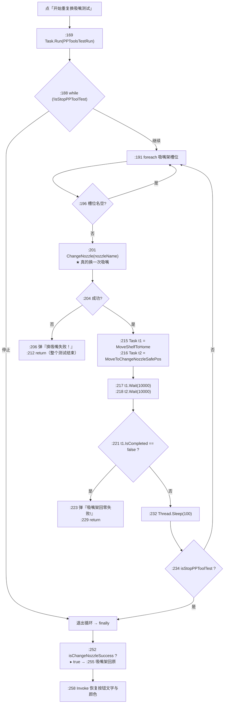

**ASCII 等效图**

```
   点「开始重复换吸嘴测试」
        |
   Task.Run(PPToolsTestRun)                        (:169)  ✅ 后台线程
        |
   ┌──> while !isStopPPToolTest                    (:188)
   │      |
   │   foreach 吸嘴架槽位                           (:191)
   │      |
   │   槽位名为空 ? --是--> 跳过                     (:196)
   │      |否
   │   ChangeNozzle(nozzleName)   ★ 真的换一次       (:201)
   │      |
   │   成功 ? --否--> 弹「换吸嘴失败！」--> return   (:204-212)
   │      |是
   │   t1 = MoveShelfToHome / t2 = MoveToChangeNozzleSafePos   (:215/:216)
   │   t1.Wait(10000) / t2.Wait(10000)                        (:217/:218)
   │      |
   │   t1.IsCompleted == false ? --是--> 弹「吸嘴架回零失败!」--> return
   │      |                                        (:221-229)
   │      |否
   │   Thread.Sleep(100)                            (:232)
   │      |
   │   isStopPPToolTest ? --是--> 退出               (:234)
   │      |
   └──────┘
        |
   finally: 换吸嘴成功过 → 吸嘴架回原                 (:252-256)
            按钮文字/颜色恢复                         (:258-264)
```

### §4.16.3 三个坑

**坑 ①（🔴）：`t1` 判了、`t2` 不判。**

```csharp
Task t1 = Task.Run(this.toolBankController.MoveShelfToHome);                 // :215
Task t2 = Task.Run(this.bondModuleController.MoveToChangeNozzleSafePos);     // :216
t1.Wait(10000);                                                              // :217
t2.Wait(10000);                                                              // :218

// 等轴到位
if (t1.IsCompleted == false)      // :221 🔴 只判 t1
{
    AKRSXtraMessageBox.Show($"吸嘴架回零失败!\r\n", …);
    return;
}
```

**两个任务都 `Wait(10000)`（各 10 秒超时），但只检查了 `t1`。**
⇒ **如果 `t2`（`MoveToChangeNozzleSafePos`，焊头移到换吸嘴安全位）超时，
代码毫无察觉地继续跑下一轮。**
**用户看到什么**：测试继续跑，**但焊头可能还在危险位置，而下一轮 `ChangeNozzle` 又开始了** ——
**这是"重复性测试把机器跑到撞机"的可能路径之一。**

> **⚠️ 定性**：这是**漏判一个 `Task.IsCompleted`**，写法上完全对称的两行只检查了一半。
> 正确写法：`if (t1.IsCompleted == false || t2.IsCompleted == false)`，
> 并把失败的那个任务名写进提示里（现在是硬编码的"吸嘴架回零失败"，**即使真的是 `t2` 超时，
> 提示也会指向吸嘴架** —— 排查时会被彻底带偏）。

**坑 ②（⚠️）：`finally` 里的 `MoveShelfToHome()` 是有意为之。**

```csharp
finally
{
    // 换吸嘴失败不动吸嘴架避免二次撞击
    if (isChangeNozzleSuccess == true)      // :252
    {
        this.toolBankController.MoveShelfToHome();   // :255
    }
    …
}
```

**✅ 这个设计是对的，注释也写清了理由**（换吸嘴失败时若再动吸嘴架会二次撞击）。
**要把它作为正面样本写出来** —— 本层大量 `finally` 是无条件执行动作的，这里做了条件判断。

**坑 ③（⚠️）：按钮状态靠 `Text` 判断，不靠字段。**

**从 `BtnESToolsTestRun_Click` 的 `:275` 可以看到这个写法**：

```csharp
private void BtnESToolsTestRun_Click(object sender, EventArgs e)
{
    if (this.BtnESToolsTestRun.Text == @"开始重复换顶针测试")     // :275 ★ 用界面文字当状态
    {
        this.BtnESToolsTestRun.Appearance.BackColor = Color.Yellow;   // :277
        this.BtnESToolsTestRun.Text = @"停止重复换顶针测试";            // :278
        this.stopESToolTest = false;                                   // :279
        …
    }
```

**⇒ 按钮的"开始/停止"状态存在 `Text` 属性里，而不是一个 `bool` 字段。**
**⚠️ 后果**：
1. **任何改动了按钮文字的代码（包括本地化 `FormLocalizer`、或别处的 UI 调整）都会翻转按钮的语义**；
2. **若界面做了多语言，`Text` 会变，`==` 判断立刻失效**；
3. 对比 `PPToolsTestRun` 用的是 **`isStopPPToolTest` 字段**（`:188`/`:234`）—— **同一个文件里两种写法并存**。

> **⚠️ 本层多处有这种"用界面文字当状态机"的写法**，
> 与 §4.7 的"用按钮颜色当吸嘴架状态"（`FrmNozzleBankManual.cs:264`/`:280`）是同一族。

---

## §4.17 「元件取料 / 贴装」：12 处恒假判据的所在地

### §4.17.1 这两个页面是什么

`Controls/Assistant/FrmComponentPickup.cs`（947 行）与
`Controls/Assistant/FrmComponentPlacement.cs`（1,076 行）
是**元件取料 / 贴装的示教页**，各有配套的 `*.Draw.cs`（612 / 602 行）负责画图。

### §4.17.2 🔴 12 处 `ComboBoxEdit.SelectedText` 恒假判据（逐行核实）

**`ComboBoxEdit.SelectedText` 在 WinForms/DevExpress 里返回的是"选中文本区间"，
它只有在用户手动选中一段文字时才非空；程序设 `Text`/`SelectedIndex` 之后它是空字符串。**
⇒ **拿它跟 `Enum.ToString()` 比，永远不相等 ⇒ 判据恒假。**

**本篇范围内的 12 处**（`grep -rn "SelectedText" Controls/ | grep -v Designer` 的完整输出）：

| # | 文件 | 行 | 判断内容 |
|---|---|---|---|
| 1 | `FrmComponentPickup.cs` | `:244` | `ChkSynchronousEjection.Enabled = this.CmbPickupForceMode.SelectedText == ForceModeEnum.Distance.ToString();` |
| 2 | `FrmComponentPickup.cs` | `:358` | `if (this.CmbPickupForceMode.SelectedText == ForceModeEnum.Distance.ToString())` |
| 3 | `FrmComponentPickup.cs` | `:369` | `ChkSynchronousEjection.Enabled = this.CmbPickupForceMode.SelectedText == ForceModeEnum.Distance.ToString();` |
| 4 | `FrmComponentPickup.cs` | `:736` | `if (comboBoxEdit.SelectedText == SpeedModeEnum.Free.ToString())` |
| 5 | `FrmComponentPickup.cs` | `:740` | `else if (comboBoxEdit.SelectedText == SpeedModeEnum.Low.ToString())` |
| 6 | `FrmComponentPickup.cs` | `:745` | `else if (comboBoxEdit.SelectedText == SpeedModeEnum.Medium.ToString())` |
| 7 | `FrmComponentPickup.cs` | `:750` | `else if (comboBoxEdit.SelectedText == SpeedModeEnum.Fast.ToString())` |
| 8 | `FrmComponentPlacement.cs` | `:264` | `if (this.CmbBondingForceMode.SelectedText == ForceModeEnum.Distance.ToString())` |
| 9 | `FrmComponentPlacement.cs` | `:615` | `if (comboBoxEdit.SelectedText == SpeedModeEnum.Free.ToString())` |
| 10 | `FrmComponentPlacement.cs` | `:619` | `else if (comboBoxEdit.SelectedText == SpeedModeEnum.Low.ToString())` |
| 11 | `FrmComponentPlacement.cs` | `:624` | `else if (comboBoxEdit.SelectedText == SpeedModeEnum.Medium.ToString())` |
| 12 | `FrmComponentPlacement.cs` | `:629` | `else if (comboBoxEdit.SelectedText == SpeedModeEnum.Fast.ToString())` |

**合计**：`FrmComponentPickup.cs` **7 处** + `FrmComponentPlacement.cs` **5 处** = **12 处**。
**12 处全部恒假，无一例外。**

### §4.17.3 用户看到的后果（分两组）

**第一组：力模式（`ForceModeEnum`）——「同步顶」勾选框永远点不动。**

```csharp
// FrmComponentPickup.cs:242 附近
ChkSynchronousEjection.Enabled = this.CmbPickupForceMode.SelectedText == ForceModeEnum.Distance.ToString();   // :244
// FrmComponentPickup.cs:358 / :369 同型
if (this.CmbPickupForceMode.SelectedText == ForceModeEnum.Distance.ToString())          // :358
…
ChkSynchronousEjection.Enabled = this.CmbPickupForceMode.SelectedText == ForceModeEnum.Distance.ToString();   // :369
```

```
   操作员把「力模式」下拉框切到 Distance（距离模式）
        |
   :358 / :369 判断 SelectedText == "Distance"
        |
   SelectedText 是空字符串 ⇒ **恒假**
        |
   :369 把 ChkSynchronousEjection.Enabled 置为 false
        |
   ★ 「同步顶」这个勾选框**永远是灰的、勾不动**
```

**用户看到什么**：
**在取料页上，「同步顶」复选框永远是灰的。** 无论怎么调「力模式」下拉框，它都不亮。
**而且没有任何报错、没有任何日志** —— 操作员只会觉得"这个功能坏了"。

**第二组：速度模式（`SpeedModeEnum`）——「自由/低速/中速/高速」四档分支全部落空。**

```csharp
// FrmComponentPickup.cs:736 起（FrmComponentPlacement.cs:615 起同型）
if (comboBoxEdit.SelectedText == SpeedModeEnum.Free.ToString())        // :736
{ … }
else if (comboBoxEdit.SelectedText == SpeedModeEnum.Low.ToString())    // :740
{ … }
else if (comboBoxEdit.SelectedText == SpeedModeEnum.Medium.ToString())  // :745
{ … }
else if (comboBoxEdit.SelectedText == SpeedModeEnum.Fast.ToString())   // :750
{ … }
```

```
   操作员把速度模式改成「低速」
        |
   四个 else-if 挨个比 SelectedText
        |
   全是空字符串 ⇒ **四个分支全部落空**
        |
   ★ 速度参数**没有任何一档被写进去**
        |
   操作员看到：下拉框显示「低速」，但下面那些速度数字**一个都没变**
```

**用户看到什么**：
**切换「速度模式」下拉框，下面的速度参数栏纹丝不动。**
四种模式（自由/低速/中速/高速）**全都一样**，切换等于没切。

> **⚠️ 定性（严格按任务书）**：
> - **不要写"点保存会抛异常"** —— 这里**不会抛**。
> - 正确写法：**「靠显示文本恰好等于成员名的隐式契约」**。
>   这 12 处**假定** `ComboBoxEdit.SelectedText` 会等于 `Enum.ToString()` 的结果，
>   **而这个假定是错的** ⇒ **判据恒假**。
> - **正确写法**：用 `ComboBoxEdit.EditValue`（或 `SelectedItem`）而不是 `SelectedText`，
>   或者把枚举值本身挂在下拉项的 `Value` 上（对照 §4.4.4 的 `LookUpEdit.EditValue`）。
> - **`Text` 也不是 `SelectedText`** —— 用 `.Text` 在这个场景下反而能工作，
>   **这正是这段代码"看起来像对的"的原因**，也是它逃过评审的原因。

> **⚠️ 一条重要的纪律**：这 12 处**不能只写一处然后说"其余同型"**。
> 因为 `FrmComponentPickup` 与 `FrmComponentPlacement` 是**两个独立的文件**，
> 改动时**很容易只改一个**（正如 §4.11 的顶针互锁只改了一半）。
> ⇒ **本篇给出完整的 12 行清单，改的时候逐行打勾。**

---

# 第 5 部分　核心流程（非 UI 触发）

> **前四部分讲的都是"人点了按钮之后发生什么"。**
> **这一部分讲"没有人点按钮时，机器自己在跑什么"。**
> **⚠️ 这一部分的关键纪律：这里的 `Thread.Sleep` 绝大多数是正常的**
> （在任务线程上等硬件），**不要写成"界面冻结"—— 判错方向比不写更糟。**

---

## §5.1 两条常驻工作线程

BondSystem 有**两条 `LongRunning` 常驻线程**，都在 `Tasks/` 目录：

| 线程名（`SetCurrentThreadName` 里写的） | 类 | 文件:行 | 启动方式 |
|---|---|---|---|
| **固晶工作线程** | `BondTask` | `Tasks/BondTask.cs:368` | `Task.Factory.StartNew(..., TaskCreationOptions.LongRunning, ...)`（`:365-373`） |
| **刮胶盘线程** | `SlideFluxerTask` | `Tasks/SlideFluxerTask.cs:241` | 同上（`:238-246`） |

**两条线程的启动入口都叫 `Start()`，且都永远返回 `true`**：

```csharp
// Tasks/BondTask.cs:361
public bool Start()
{
    if (this.BondWorkTask == null || this.BondWorkTask.Status != TaskStatus.Running)   // :363 ★ 幂等保护
    {
        this.BondWorkTask = Task.Factory.StartNew(
            () =>
                {
                    CommonUtil.SetCurrentThreadName("固晶工作线程");                      // :368
                    this.DoWork();                                                      // :369
                },
            CancellationToken.None,
            TaskCreationOptions.LongRunning,      // :372 ★ 独占线程，不走线程池
            TaskScheduler.Default);
    }

    return true;                              // :376 ★ 永远返回 true
}
```

> **⚠️ `:363` 的幂等保护有一个值得说明的点**：
> 它判的是 **`Status != TaskStatus.Running`**。
> 线程正常跑完（`RanToCompletion`）再调 `Start()` 会重开一条（这是想要的）；
> 但**线程若已因异常 `Faulted`，`Faulted != Running` 同样成立，也会重开一条** ——
> **⇒ 线程崩了之后"再点一次开始"能重启它，但界面上没有任何信息告诉你它崩过。**
> **本条为读代码推断，未实机验证。**

### §5.1.1 固晶工作线程的主循环

```csharp
// Tasks/BondTask.cs:100
public void DoWork()
{
    System2RunTimeProvider.ResetInformation();          // :106 ★ 每次启动都重置运行信息

    // 总循环
    while (Signal.WaitStart())                          // :109 ★ 外层：一个"产品"一轮
    {
        this.nozzleShelfController.MoveShelfToHome();   // :112
        this.bondModuleController.MoveToSafePos();      // :113
        this.bondHeadController.ResetBondhead();        // :114

        BaseCarrierConfig component = …GetFirstComponent();                      // :116

        #region 提前换吸嘴、搜精                                                 // :118

        if (this.Enable
            && System2Configuration.GetInstance().IsChangeNozzleAdvance          // :121
            && component != null)
        {
            if (this.system2Controller.IsNeedToChangeNozzle(component.NozzleName))   // :136
            {
                bool ret = this.system2Controller.ChangeNozzle(component.NozzleName); // :139
                if (ret == false)
                {
                    Machine.GetInstance().Stop();                                // :143 ★ 换吸嘴失败 → 停机
                    return;                                                      // :144 ★ 线程结束
                }
            }
        }

        #endregion

        if (!this.GetIncomingSignal()) { return; }       // :154 ★ 等来料（下面 §5.1.2）
        …
        while (Signal.WaitStart())                       // :214 ★ 内层：一个"动作节点"一轮
        {
            ActionNode actionNode = …GetNextActionNode();                        // :216
            if (actionNode == null) { break; }                                   // :219-222

        RetryCommand:                                                            // :224 ★ 重试标号

            if (actionNode.IsDoWork())                                           // :226
            {
                this.CloseDispenseCylinder(actionNode);                          // :230
                ExcuteResult ret = actionNode.DoWork();                          // :232 ★ 真正的动作

                switch (ret)                                                     // :234 ★ 六种结果
                {
                    case ExcuteResult.Abort:      … return;                      // :236-251
                    case ExcuteResult.Retry:      … continue;                    // :253-258
                    case ExcuteResult.Exception:  … return;                      // :260-…
                    case ExcuteResult.Alarm:      … 弹「终止/重试/忽略」          // :275-…
                    default:                      … break;
                }
            }

            …FinishCurrentActionNode();                                          // :322
        }

        this.bondModuleController.MoveToSafePos();                               // :330
        …ActionNodesService.Finish();                                            // :333
        DefectCompensate.NormalizationOffset(this.transportUnit.Name);           // :337
        if (System2Configuration.GetInstance().IsSaveEjectionTimeData)           // :339
        { …SaveEjectionTime(); }                                                 // :341-343
        this.SendAway();                                                         // :347
        UcMainSystem.ReFreshSystem2TuAction();                                   // :349 ★ 回主界面刷新
    }
}
```

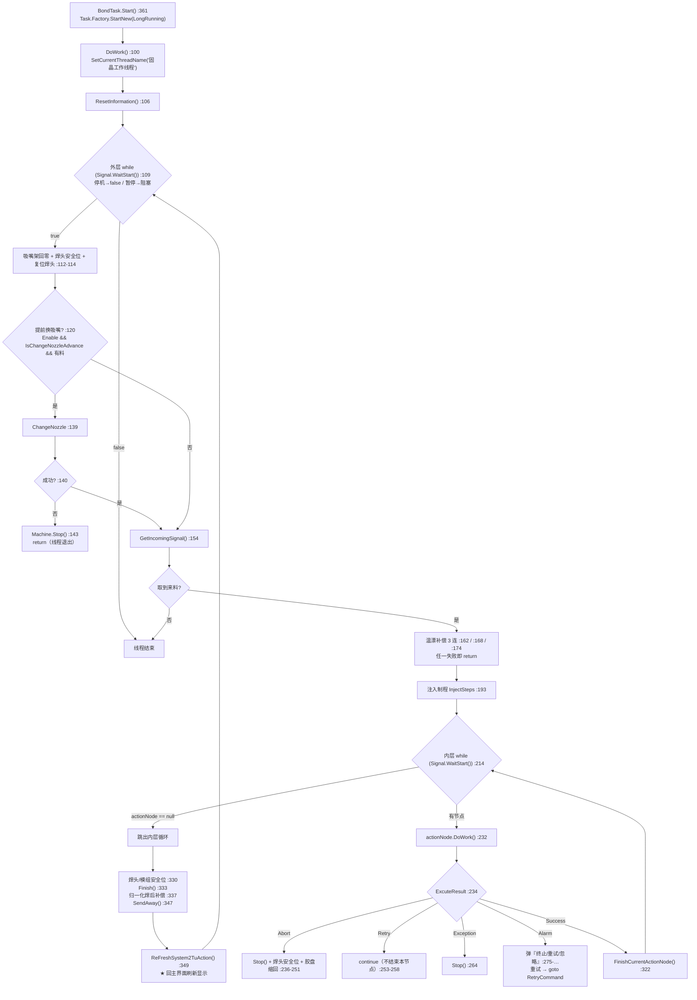

**ASCII 等效图**

```
   BondTask.Start()  --Task.Factory.StartNew(LongRunning)-->  DoWork()   (:361 / :365)
        |
   ResetInformation()                                             (:106)
        |
   ┌──> while (Signal.WaitStart())                                 (:109)
   │        |  停机 -> false -> 线程结束
   │        |  暂停 -> 内部 Thread.Sleep(20) 阻塞
   │    吸嘴架回零 / 焊头安全位 / 复位焊头                          (:112-114)
   │        |
   │    提前换吸嘴？（配置开 + 有料）                                (:120)
   │        |--是--> ChangeNozzle()  --失败--> Machine.Stop(); return (:139-144)
   │        |
   │    GetIncomingSignal()  --失败--> return                       (:154)
   │        |
   │    取片温漂补偿 --失败--> return                                (:162)
   │    温飘补偿     --失败--> return                                (:168)
   │    参考点扫描   --失败--> return                                (:174)
   │        |
   │    注入制程 InjectSteps()                                      (:193)
   │        |
   │   ┌─> 内层 while (Signal.WaitStart())                          (:214)
   │   │      |  取下一个动作节点，null 就跳出
   │   │   actionNode.DoWork()                                      (:232)
   │   │      |
   │   │   switch(结果)                                             (:234)
   │   │      Abort     -> Stop + 焊头安全位 + 胶盘缩回 -> return
   │   │      Retry     -> continue（重做同一个节点）
   │   │      Exception -> Stop
   │   │      Alarm     -> 弹「终止/重试/忽略」；重试 -> goto RetryCommand (:224)
   │   │      |
   │   │   FinishCurrentActionNode()                                (:322)
   │   └──────┘
   │        |
   │   安全位 / Finish() / 归一化补偿 / SendAway()                    (:330-347)
   │   ReFreshSystem2TuAction()  ★ 回主界面刷新                      (:349)
   └────────┘
```

### §5.1.2 ⚠️ 本层唯一一处"在任务线程上弹模态框"的地方

**`GetIncomingSignal()`（`:390`）在"没有传输单元"时会弹一个模态对话框**：

```csharp
// Tasks/BondTask.cs:402
else
{
    if (TransportDomain.GetInstance().…TransportUnit == null)                     // :404
    {
        DialogResult dr = AKRSMessageBoxExt.ShowWarn(
            @"未发现载具上有载具，请放上产品后继续工作",                             // :407
            $"警告",
            new[] { "已放上产品", "停止" },
            new[] { DialogResult.Yes, DialogResult.No });

        if (dr == DialogResult.Yes)
        {
            …MapBelt(true);                                                       // :414
            if (…TransportUnit != null) { return true; }                          // :416-420
            else { Machine.GetInstance().Stop(); return false; }                   // :423-425
        }
        else
        {
            Machine.GetInstance().Stop();                                         // :429
            return false;
        }
    }
    …return true;                                                                 // :435
}
```

**这段代码弹框的位置是"固晶工作线程"，不是 UI 线程。**
**它不属于 UI 阻塞族，但要写清它的形态：**

| 项 | 值 |
|---|---|
| 谁弹的 | **固晶工作线程** |
| 什么条件 | **未配置流道**（`IsTransportConfigured == false`）且当前没有载具 |
| 用户看到什么 | 固晶还没开始，**先弹一个「未发现载具上有载具，请放上产品后继续工作」的框**，只有「已放上产品」/「停止」两个选择 |
| 点「停止」 | `Machine.Stop()`，线程 `return`，**这条线程就结束了**（要重新开始得再走一遍 `Start()`） |
| 点「已放上产品」但**仍然检测不到** | `:423` `Machine.Stop()` + `return false` ⇒ **用户按提示操作了，机器却停了，且不会说为什么** |

> **⚠️ 这一条要按"用户看到什么"写，不要写成"死锁"。**
> 它**不是** `_UI线程阻塞排查.md` 说的那一族（那一族是 **UI 线程**被同步阻塞）。
> **这是"任务线程被模态框挡住"**，模态框本身跑在 UI 线程上，所以**界面反而是响应的 —— 只是固晶没在动。**

### §5.1.3 🔴 `BondTask.AbortThread()` 是一个**空方法**

**"停止"按下之后，框架会调 `AbortThread()` 来收尾。**
**`BondTask` 的实现是空的：**

```csharp
// Tasks/BondTask.cs:379
/// <summary>
/// AbortThread
/// </summary>
public void AbortThread()
{
}                                    // ★ :382-384 —— 方法体是空的
```

**调用点在框架层**（`Main/Machine/MachineSupport/Machine.Operate.cs:400`）：

```csharp
// Main/Machine/MachineSupport/Machine.Operate.cs:398
System1Domain.GetInstance().DispenseWorkTask.AbortThread();     // :399
System2Domain.GetInstance().BondTask.AbortThread();             // :400 ★ 调进来是空方法
WaferSystemDomain.GetInstance().WaferSubSystemTask.AbortWaferSubThread();
```

**对照：`DispenseWorkTask.AbortThread()` 是有实现的**：

```csharp
// DispenseSystem/Tasks/DispenseWorkTask.cs:212
public void AbortThread()
{
    this.DispenseTask.Dispose();        // ★ 真的释放了任务
}
```

**⇒ 结论**：
- **点「停止」之后，`BondTask.BondWorkTask` 这个 `Task` 对象既不会被 `Dispose`、也不会被 `Cancel`**；
- 线程靠的是 **`Signal.WaitStart()` 返回 `false`**（`MachineStateEnum.Stop` 时）**自然退出**（`:109` / `:214` 两处）；
- **⚠️ 如果线程当时正卡在某个 `actionNode.DoWork()` 里面**（例如等硬件到位），
  **`WaitStart()` 根本没机会被求值** ⇒ **"停止"要等到那个动作节点做完才生效。**

> **⚠️ 这是一个"接口实现了、但实现是空壳"的方法**（写法上要注意：它不是"从未实现"，而是"实现了但什么都不做"），
> 与 §4.14 的「点了没反应」是同族，但**它没有对应按钮**，所以不进按钮总表。
> **写法**：「`Main/Machine/MachineSupport/Machine.Operate.cs:400` 会在停机流程里调
> `BondTask.AbortThread()`；`BondSystem/Tasks/BondTask.cs:382` 的这个方法是空的，
> 对比 `DispenseSystem/Tasks/DispenseWorkTask.cs:212` 的同名方法是 `this.DispenseTask.Dispose()`。」

### §5.1.4 刮胶盘线程：一个"带超时提示的忙等"

```csharp
// Tasks/SlideFluxerTask.cs:92
public void DoWork()
{
    this.slideFluxerController.SlideFluxerHomeWaitArrive();      // :94

    while (Signal.WaitStart())                                   // :97 ★ 外层
    {
        while (System2RunTimeProvider.IsNeedDip)                 // :99 ★ 需要蘸胶才转
        {
            this.sp.Restart();                                   // :101 ★ 秒表复位

            // 防撞：等焊头离开刮胶盘区域再伸出
            while (true)                                         // :104 ★★ 忙等
            {
                AKRSPoint3D leftTopPos = …ConvertG0ToMachinePos(SlideFluxerLeftTopPos);      // :106
                AKRSPoint3D rightBottom = …ConvertG0ToMachinePos(SlideFluxerRightBottomPos); // :107

                if (GeometryService.IsBond2DPosInRange(leftTopPos, rightBottom) == false)    // :108
                {
                    break;                                       // :110 ★ 焊头已离开 → 退出忙等
                }

                if (Machine.GetInstance().IsPause())             // :113
                {
                    this.sp.Restart();                           // :115 ★ 暂停时重置秒表
                    continue;
                }

                if (sp.Elapsed.TotalSeconds > 15)                // :119 ★★ 15 秒超时
                {
                    DialogResult dialog = AKRSMessageBoxExt.Show(
                        $"刮胶盘工作线程：等焊头离开刮胶盘区域超时！ \r\n"
                        + "忽略：继续等待\r\n" + "终止：退出工作\r\n",
                        "报警",
                        new string[] { "忽略", "终止" },
                        new DialogResult[] { DialogResult.Ignore, DialogResult.Abort });

                    if (dialog == DialogResult.Abort)
                    {
                        Machine.GetInstance().Stop();            // :129
                        return;                                  // :130
                    }
                    else
                    {
                        this.sp.Restart();                       // :134 ★ 再等 15 秒
                    }
                }

                Thread.Sleep(2);                                 // :140 ★★ 2 毫秒轮询
            }

            this.slideFluxerController.SlideFluxerOutWaitArrive();          // :144 胶盘伸出
            SignalPool.GetInstance().IsAllowDipFluxSignal.Set();            // :147 给 Bond 发允许蘸胶
            if (!SignalPool.GetInstance().BondDipFluxFinishSignal.Wait())   // :150 等蘸胶完成
            {
                this.slideFluxerController.SlideFluxerHomeWaitArrive();     // :153
                return;
            }

            this.slideFluxerController.SlideFluxerHomeWaitArrive();         // :157 胶盘缩回

            if (!SignalPool.GetInstance().AllowSlideOutSignal.Wait())       // :208
            {
                return;
            }

            Thread.Sleep(40);                                               // :213
        }

        Thread.Sleep(20);                                                   // :216
    }

    this.slideFluxerController.SlideFluxerHomeWaitArrive();                 // :220 ★ 退出时缩回
}
```

**`while (true)` 有两条出口**：`break`（`:110`，焊头离开）与 `return`（`:130`，用户选「终止」）。
**⇒ 它不是无界循环，不用按 `_UI线程阻塞排查.md` §一.1 里"永久冻结"那一类写。**

> **⚠️ 但有一个"看起来有界、其实可能很长"的形态**：
> `:113` 的 `IsPause()` 分支会 **`sp.Restart()`** ⇒ **暂停期间 15 秒计时器不断被重置**。
> ⇒ **只要机器一直处于暂停状态，这个忙等就会一直转下去，永不超时、也永不报警。**
> 这是**有意**的（暂停时不该报警），代价是 **`Thread.Sleep(2)` 的 500 Hz 轮询一直占着一个核**，
> 且 `ConvertG0ToMachinePos` 每 2 毫秒被调两次。
> **⚠️ 本条为读代码推断，未实测 CPU 占用。**

### §5.1.5 ⚠️ 这两条线程的 `Thread.Sleep` 一律不列入 UI 阻塞族

| 文件 | 位置 | 所在线程 | 是否列入 §9.1 |
|---|---|---|---|
| `Tasks/BondTask.cs` | **本文件内一次 `Thread.Sleep` 都没有** | — | 否 |
| `Tasks/SlideFluxerTask.cs` | `:140` `Thread.Sleep(2)` | **刮胶盘线程** | ❌ **不列** |
| | `:213` `Thread.Sleep(40)` | 刮胶盘线程 | ❌ 不列 |
| | `:216` `Thread.Sleep(20)` | 刮胶盘线程 | ❌ 不列 |
| | `:182` `Thread.Sleep(20)` | **在注释块里**（`:169-205` 整段被注释） | ❌ 不列 |

> **⚠️ 这就是 `_UI线程阻塞排查.md` §三 表格第四行说的情形**：
> **「已被 `Task.Run(...)` 包住、或所在方法本身跑在任务线程上 ⇒ 不列」。**
> **`SlideFluxerTask.DoWork()` 本身就是 `Task.Factory.StartNew(...)` 的入口**（`:238-246`），
> **所以它整条链路上的 sleep 都是正常写法。把它写成"界面冻结"是硬错。**

### §5.1.6 `Signal.WaitStart()` 是什么（外部依赖，本层不能改）

**⚠️ 这个方法的源码不在 `BondSystem/`，也不在 `AKRS.ZX2200` 项目里。**

| 项 | 值 |
|---|---|
| 定义 | `AKRS.Galaxy2.Machine/Models/Signal.cs:202`（`public static bool WaitStart()`） |
| 语义（源码注释原文） | 「**等待开始　用于暂停时候的阻塞**」 |
| 停机时 | `MachineState == Stop` ⇒ **返回 `false`**（`:213-216`） |
| 暂停时 | **`while (MachineState == Pause) { … Thread.Sleep(20); }`** 阻塞（`:219-228`） |
| 其它 | 返回 `true` |

**⇒ 这两条常驻线程的"暂停/停止"完全依赖这一个静态方法。**
**⚠️ 它内部是 `Thread.Sleep(20)` 的忙等**，但**在任务线程上跑，不列入 UI 阻塞族。**

**⚠️ `:196-200` 有一段被注释掉的"维护模式/调试模式直接返回 true"**：

```csharp
// AKRS.Galaxy2.Machine/Models/Signal.cs:196
// 维护模式 和调试模式 直接返回true
//if (MachineStateModel.GetInstance().MachineWorkMode == MachineWorkModeEnum.MaintenceWork 
//    || MachineStateModel.GetInstance().MachineWorkMode == MachineWorkModeEnum.Debug)
//{
//   // return true;               
//}
```

**⇒ 注释残留**：**维护模式/调试模式下不再直通**，而是照走暂停阻塞。
**⚠️ 由于它不在本层的 84 个文件里，本篇只做记录，不计入 BondSystem 的问题数。**

---

## §5.2 定时器（Timer）全集

**BondSystem 里一共 11 个 `System.Windows.Forms.Timer`**（全部在 Designer 里 `new`，逐个核实）：

| # | 文件 | `new` 位置 | `Interval` | Tick 处理器 | Tick 位置 |
|---|---|---|---|---|---|
| 1 | `BondForce/Forms/UcBondForceMeasurement` | `.Designer.cs:36` | **默认 100 ms** | `timer1_Tick` | `UcBondForceMeasurement.cs:114` |
| 2 | `Controls/Assistant/FrmAssistantDispense` | `.Designer.cs:48` | 默认 100 ms | `Timer1_Tick` | `:475` |
| 3 | `Controls/Experiment/FrmGTForceTest` | `.Designer.cs:74` | **Designer `:577` = 2**，**运行期 `:85` 改成 100** | `timer3_Tick` | `:167` |
| 4 | `Controls/Experiment/FrmTimerTest` | `.Designer.cs:32` | 默认 100 ms | `timer1_Tick` | `:28` |
| 5 | `Controls/Experiment/UcBondModuelSetting` | `.Designer.cs:132` | **🔴 `.Designer.cs:1312` = 10 ms** | `timer1_Tick` | `:417` |
| 6 | `Controls/Manual/FrmLearnNozzleBank1` | `.Designer.cs:100` | 默认 100 ms | `timer1_Tick` | `:609` |
| 7 | `Controls/Manual/FrmLearnToolBank` | `.Designer.cs:98` | 默认 100 ms | `timer1_Tick` | `:494` |
| 8 | `Controls/Manual/FrmNozzleBankManual` | `.Designer.cs:58` | 默认 100 ms | `timer1_Tick` | `:381` |
| 9 | `Controls/Manual/FrmTeachULMPositions` | `.Designer.cs:57` | 默认 100 ms | `timer1_Tick` | `:369` |
| 10 | `Controls/Manual/UcS2DispenseManual` | `.Designer.cs:34` | 默认 100 ms | `Timer_Tick` | `:76` |
| 11 | `Controls/Manual/UcVacuum` | `.Designer.cs:38` | **`.Designer.cs:109` = 600 ms** | `timer1_Tick` | `:312` |

**核实命令**：

```bash
cd "E:/项目/ZX2200标机/trunk/AKRS.ZX2200/BondSystem"
# 找 Timer 声明（大小写两种 Designer 都要抓）
grep -rn "System.Windows.Forms.Timer" --include='*.cs' . | grep -v '/bin/'
# 找 Interval 设置
grep -rn "\.Interval\s*=" --include='*.cs' . | grep -v '/bin/'
```

**⚠️ 一个重要的写法纪律**：
**表里标"默认 100 ms"的 8 个（#1/#2/#4/#6/#7/#8/#9/#10），Designer 里根本没有 `Interval =` 这一行** ——
WinForms 的 `Timer.Interval` **默认值就是 100**。
**⇒ 写文档时不要写"间隔未设置"，要写"用的是 WinForms 默认的 100 毫秒"。**

### §5.2.1 🔴 `UcBondModuelSetting` 的 10 毫秒定时器

```csharp
// Controls/Experiment/UcBondModuelSetting.Designer.cs:1312
this.timer1.Interval = 10;
```

**10 毫秒意味着每秒 100 次 `timer1_Tick`（`UcBondModuelSetting.cs:417`）。**
**⚠️ 而 `UcBondModuelSetting` 正是 §9.1 里那两个"🔴 UI 线程被同步阻塞"（`:1286` / `:1320`）所在的窗体** ——
**一旦 UI 线程被阻塞，这个 10 ms 定时器的事件会挤在消息队列里，解冻后一次性补跑。**

> **⚠️ 这一条要写成"两个问题叠加"，并且不要把因果搞反**：
> 「**这个窗体上有一个每 10 毫秒跑一次的 `timer1_Tick`；
> 同一个窗体上的两个按钮处理器会在 UI 线程上同步等硬件（§9.1 的 R-02）。
> UI 线程被阻塞期间，每秒 100 次的 tick 事件在消息队列里堆积，
> 界面恢复响应的瞬间会连续补跑这些 tick。**」
> **⚠️ 不要写"定时器把界面卡住"** —— 顺序是反的：**是阻塞卡住了定时器，不是定时器卡住了界面。**

### §5.2.2 `UcVacuum` 的 600 毫秒定时器

```csharp
// Controls/Manual/UcVacuum.Designer.cs:109
this.timer1.Interval = 600;
```

**这个 600 ms 的 tick 用来周期性刷新真空/吹气按钮的状态与颜色**（`:312`）。
**⚠️ 这正是"按钮颜色只在点击时更新"这个问题（§4.11）在 `UcVacuum` 上不那么明显的原因** ——
**它有定时器兜底。**
**而 `FrmNozzleBankManual`（§4.7）没有刷新吸嘴架按钮颜色的定时器** ——
它的 `timer1_Tick`（`:381`）只改 `LbSingleStep` 的前景色（`:385`）。
**⇒ 这个对比要写进 §4.7：同一个"按钮颜色表示硬件状态"的写法，一个有定时器兜底、一个没有。**

---

## §5.3 三个"无人值守的长循环"

除了 §5.1 的两条常驻线程，本层还有**三处由按钮启动、但会长时间自己跑的循环**。
**共同特征：点了"开始"之后，用户唯一能做的是"再点一次停止"，而"停止"不一定立刻生效。**

| # | 入口按钮 | 循环 | 停止方式 | 停止能立刻生效吗 |
|---|---|---|---|---|
| 1 | **开始**（`FrmAutoSlideFlux.BtnStart_Click:121`） | `PreHeatFlux()` 的 `while(true)`（`:59-79`） | `isStop` 字段（`:61` / `:71`） | ✅ 每轮 `Thread.Sleep(50)`（`:79`）检查一次 |
| 2 | **开始重复换吸嘴测试**（`FrmToolsTestRun.cs:117`） | `while (!isStopPPToolTest)`（`:188`） | `isStopPPToolTest` 字段 | ⚠️ **要等当前吸嘴换完**（`ChangeNozzle` 是同步的，`:201`） |
| 3 | **自动模式**（`BondTask`，由主界面「开始」触发） | 双层 `Signal.WaitStart()`（`:109` / `:214`） | `Machine.Stop()` ⇒ `WaitStart()` 返回 `false` | ⚠️ **要等当前动作节点做完**（见 §5.1.3） |

**⚠️ 第 1 条已在前文写过（`FrmAutoSlideFlux`），这里只补齐"它属于哪一族"。**

---

## §5.4 🔴 `button34_Click`：一次点击写 1,000 个 Excel 文件

**这是本层"非 UI 触发"里最重的一条。**

```csharp
// Controls/Experiment/UcBondModuelSetting.cs:1117
private void button34_Click(object sender, EventArgs e)
{
    int limit = 500;                                     // :1119 ★★
    Task.Run(() =>
    {
        for (int i = 0; i < limit; i++)
        {
            // 点胶相机定点拍照
            MatchResult matchResult1 = (MatchResult)this.DispenseVisionController
                .DispenseVision(null, "20240920ModuleMark1");                      // :1126-1129

            System2CommonService.SaveVisionResult(matchResult1, "DispenseCamera"); // :1129
        }
    });

    Task.Run(() =>
    {
        for (int i = 0; i < limit; i++)
        {
            // Bond相机定点拍照
            MatchResult matchResult1 = (MatchResult)this.system2Controller
                .BondCameraVision(null, "20240920ModuleMark1");                    // :1138-1141

            System2CommonService.SaveVisionResult(matchResult1, "BondCamera");     // :1141
        }
    });
}
```

**点一次这个按钮 ⇒ 两条后台线程并行 ⇒ 各拍 500 次照 ⇒ 各写 500 次 Excel ⇒ 共 1,000 次。**

**而每一次 `SaveVisionResult` 做的事情是**（`Services/System2CommonService.cs:99`）：

```csharp
public static void SaveVisionResult(MatchResult matchResult, string fileName)
{
    try
    {
        lock (locker)                                          // :103 ★ 全局锁，两条线程互斥
        {
            string path = @"D:\" + MachineConfigContext.GetInstance().CurrentRecipe.RecipeName
                          + "--" + fileName + ".xlsx";         // :106 ★★ 硬编码 D 盘根目录

            ExcelPackage excelPackage = new ExcelPackage(new FileInfo(@"D:\" + … ));   // :111-114
             …
            excelPackage.Save();                               // :159 ★ 每次都开文件 + 存文件
        }
    }
    catch (Exception e)
    {
        DialogResult dialog = AKRSXtraMessageBox.Show(
            $"文件已被打开，保存定位数据失败!\r\n Retry:关掉文件重新保存\r\nCancel:不保存数据",
            "报警", MessageBoxButtons.RetryCancel, MessageBoxIcon.Warning);        // :162-168

        if (dialog == DialogResult.Retry)
        {
            SaveVisionResult(matchResult, fileName);           // :171 🔴🔴 递归重试
        }
    }
}
```

**两个问题**：

**问题 ①（🔴）—— 无限递归重试**：
`:171` 是**直接递归调用自己**，**没有深度上限、没有退避、没有计数**。
⇒ **如果这个 Excel 文件一直处于被占用状态**（例如工程师正用 Excel/WPS 打开着
`D:\<配方名>--BondCamera.xlsx` 看数据），
**用户每点一次「Retry」就多压一层栈帧** ——
**反复点下去最终会 `StackOverflowException`（.NET 中不可捕获，进程直接终止）。**

**⚠️ 同一个文件里有第二处同型**（`:314`，三参数重载），**也是无限递归**。
**⇒ 这是"同一个缺陷写了两遍"**，与 §4.11 的顶针互锁（`:221` / `:246` 两处）是同族。

**问题 ②（⚠️）—— 硬编码 `D:\` 根目录**：
`:106` / `:111` / `:114` 全部把输出路径拼在 **`D:\` 根目录**下。
**⚠️ 如果机器上 `D:` 盘不存在或没有写权限，会走进 `catch`** ⇒
弹的是"**文件已被打开**"（**提示语与真因不符**），
**用户按提示去关文件是关不掉的，因为问题不是文件被打开。**

**用户看到什么**：
点这个按钮之后，**后台开始跑 1,000 轮"拍照 + 写 Excel"，要跑很久**；
期间**如果那个 Excel 被谁打开了，界面上会弹「文件已被打开，保存定位数据失败!」** ——
**而且两条线程都会弹，可能同时弹两个。**
**⚠️ 这个对话框是从 `Task.Run` 的后台线程发起调用的。**

> **⚠️ 这条属于"试验窗体"（`Controls/Experiment/`），窗体本身定级 ⚠️；**
> **但"无限递归重试"这一条本身是 🔴 —— 它跟窗体类型无关，是算法问题。**
> **写法**：「**`System2CommonService.SaveVisionResult` 在失败分支里无条件递归调用自己
> （`Services/System2CommonService.cs:171`，三参数重载在 `:314`）。
> 触发条件：保存的 Excel 文件被别的进程占用。后果：用户每次点「Retry」加深一层递归，
> 无上限；持续点击最终 `StackOverflowException`（.NET 无法捕获，进程终止）。**」

### §5.4.1 ⚠️ 零引用的公开方法：`KillFileEmbezzlementProcess`

**同一个文件里还有一个方法，它的存在说明作者是知道"文件被占用"这个真因的**：

```csharp
// Services/System2CommonService.cs:190
/// <summary>
/// 杀死占用文件的进程
/// </summary>
public static void KillFileEmbezzlementProcess(string fileName)
{
    var p = new Process();
    p.StartInfo.FileName = "D:\\Driver\\Toolkit\\handle64.exe";   // :194 ★ 外部 exe 硬编码路径
    p.StartInfo.Arguments = fileName;
    …
    p.WaitForExit();                                             // :202
    …
}
```

**`grep -rn "KillFileEmbezzlementProcess" --include='*.cs' .` 的完整输出只有一行 —— 就是它自己的定义行 `:190`。**

> **⚠️ 写法纪律（严格遵守任务书）**：
> - **不能写"可以安全删除"** —— 它是 `public static`，
>   **可能被本仓库之外的代码调用**，也可能是留给现场工程师手工调用的工具。
> - **它与 `_幽灵文件清单` 里的"幽灵文件"不是一回事**：它**在一个参与编译的文件里**，
>   所以**不进 §2.3 的幽灵表**，只能记为「**一个公开方法在本仓库内零调用点**」。
> - **⚠️ 它依赖 `D:\Driver\Toolkit\handle64.exe` 这个外部工具** ——
>   **本仓库不包含它**（`BondSystem/` 下没有任何 `Toolkit` 目录），
>   ⇒ **即使被调用，在没装 handle64 的机器上会抛 `Win32Exception`。**
>   **本条为读代码推断，未实机验证。**

---

## §5.5 信号池：这两条线程怎么互相说话

**`BondTask` 与 `SlideFluxerTask` 之间没有直接调用，全靠信号池。**
**蘸胶这一幕是本层最典型的一次跨线程握手** ——
**触发者是固晶流程里的"蘸胶动作节点"，不是按钮**：

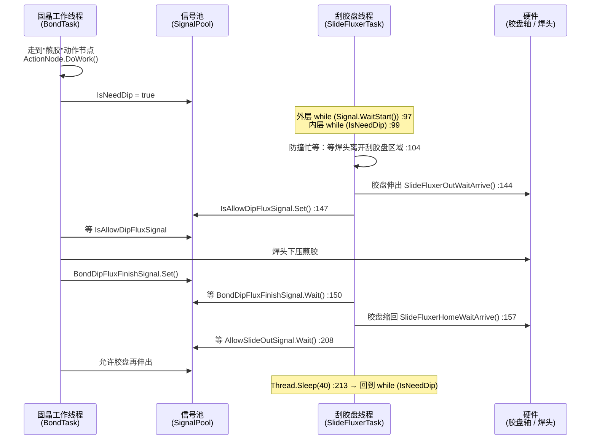

**ASCII 等效图**

```
   固晶工作线程                            信号池                        刮胶盘线程
   -------------                          ------                        ----------
   走到"蘸胶"动作节点
        |
   IsNeedDip = true  ------------------->  IsNeedDip
                                               |
                                      ┌──> while (IsNeedDip)          (:99)
                                      │         |
                                      │    防撞忙等：等焊头离开刮胶盘区 (:104)
                                      │    while(true) + Sleep(2)      (:140)
                                      │         | 15 秒 -> 弹「忽略/终止」(:119)
                                      │    胶盘伸出                    (:144)
                                      │         |
                                      │    IsAllowDipFluxSignal.Set() (:147)
        |                             │         |
   等 IsAllowDipFluxSignal <----------┘         |
        |                                       |
   焊头下压蘸胶                                  |
        |                                       |
   BondDipFluxFinishSignal.Set()                |
                                      ┌────────>| 等 BondDipFluxFinishSignal (:150)
                                      │         |
                                      │    胶盘缩回                    (:157)
                                      │         |
                                      │    等 AllowSlideOutSignal      (:208)
   允许胶盘再伸出 ------------------->─┘         |
                                      │    Thread.Sleep(40)            (:213)
                                      └──── 回到 while (IsNeedDip)
```

**⚠️ 握手的一个薄弱点（收尾不一致）**：
`:150` 与 `:208` 两处 `Signal.Wait()` **返回 `false` 时都直接 `return`**
（`SlideFluxerTask.cs:154` / `:210`），但两条 `return` 的收尾**不一样**：

| 出口 | 行 | 之前有没有缩回胶盘 |
|---|---|---|
| `:154`（等蘸胶完成失败） | `:153` **补了一次** `SlideFluxerHomeWaitArrive()` | ✅ 有 |
| `:210`（等允许伸出失败） | `:208` 之后**没有**任何缩回，直接 `return` | ❌ **没有** |

> **⚠️ `:210` 这条出口会跳过胶盘缩回，直接走到 `:220`** ——
> 而 `:220` 在 `while` 之外，**它确实会执行一次缩回**。
> **⇒ 结论：两条出口最终都会缩回，但一条靠 `:153`、一条靠 `:220`，路径不同。**
> **⚠️ 这里不要写成"漏了缩回"** —— 实测 `:220` 会兜住。
> **要写成**：「**两条提前 `return` 的收尾路径不一致：`:154` 前有 `:153` 显式缩回，
> `:210` 前没有，靠循环外的 `:220` 兜住。改这段代码时若把 `:220` 挪进循环，`:210` 这条出口就会漏缩回。**」

---

# 第 6 部分　关键实现细节

---

## §6.1 全层唯一的"保存通道"：`IProgrammingControl.Confirm()`

**这是理解整个 BondSystem 界面层的最重要的一条。**

### §6.1.1 接口定义只有一行

```csharp
// Infrastructure/Interface/IProgrammingControl.cs:26
public interface IProgrammingControl
{
    /// <summary>
    /// 确定
    /// </summary>
    void Confirm();                     // :31 ★ 整个接口只有这一个方法
}
```

**⚠️ `IProgrammingControl` 的定义在 `Infrastructure/`，不在 `BondSystem/`**（跨模块契约）。
**`BondSystem` 里一共 4 个类实现了它**：

| # | 实现类 | 文件 | `Confirm()` 位置 | 是否参与编译 |
|---|---|---|---|---|
| 1 | `UcBondPositionEdit` | `Controls/Setting/BondPosition/UcBondPositionEdit.cs` | `:308` | ✅ |
| 2 | `UcNozzleEdit` | `Controls/Setting/Nozzle/UcNozzleEdit.cs` | `:95` | ✅ |
| 3 | `UcPostBondEdit` | `Controls/Setting/PostBond/UcPostBondEdit.cs` | `:122` | ✅ |
| 4 | `UcProcessStepEdit` | `Controls/Setting/ProcessStep/UcProcessStepEdit.cs` | `:345` | ❌ **幽灵文件，不参与编译** |

**核实命令**：

```bash
cd "E:/项目/ZX2200标机/trunk/AKRS.ZX2200"
grep -rn "IProgrammingControl" --include='*.cs' BondSystem/
```

> **⚠️ 第 4 个是幽灵文件**（见 §2.3）——
> **它是"这一套接口在历史上曾经有 4 个页面、现在只剩 3 个"的证据。**
> **写"实现者清单"时必须把它单列，并注明「不参与编译，运行时不存在」。**
> **⚠️ 绝不能把它写进"这一层有 4 个编程页"这种话里。**

### §6.1.2 真正调用 `Confirm()` 的地方（全仓 13 处）

**`grep -rn "\.Confirm()" --include='*.cs' .` 的完整输出（已剔除 bin/obj）：**

| # | 位置 | 归属 | 性质 |
|---|---|---|---|
| 1 | `BondSystem/Controls/Setting/Nozzle/UcNozzleEdit.cs:112` | **BondSystem** | **页内自调**（见下） |
| 2 | `BondSystem/Controls/Setting/Nozzle/UcNozzleEdit.cs:127` | **BondSystem** | **页内自调** |
| 3 | `BondSystem/Controls/Setting/PostBond/UcPostBondEdit.cs:362` | **BondSystem** | **页内自调**（§4.4.9 的"勾一下复选框就落盘"） |
| 4 | `DispenseSystem/Controls/Setting/EpoxyApplication/UcEpoxyApplication.cs:599` | DispenseSystem | 别层 |
| 5 | `DispenseSystem/…/UcEpoxyApplication.cs:970` | DispenseSystem | 别层 |
| 6 | `DispenseSystem/…/UcEpoxyApplication.cs:1148` | DispenseSystem | 别层 |
| 7 | **`Infrastructure/…/UcEditProductProgramming.cs:873`** | **框架层** | ★★ **"开始"按钮** |
| 8 | **`Infrastructure/…/UcEditProductProgramming.cs:1071`** | **框架层** | ★★ **"保存"按钮** |
| 9 | `TransportSystem/Controls/Setting/UcLoderSetting.cs:94` | TransportSystem | 别层 |
| 10 | `TransportSystem/Controls/Setting/UcUnloaderSetting.cs:96` | TransportSystem | 别层 |
| 11 | `WaferSubSystem/Controls/Setting/FlipTool/UcFlipToolEdit.cs:145` | WaferSubSystem | 别层 |
| 12 | `WaferSubSystem/Controls/Setting/Waferhandling/UcWaferHanding.cs:85` | WaferSubSystem | 别层 |
| 13 | `WaferSubSystem/…/UcWaferHanding.cs:144` | WaferSubSystem | 别层 |

**⇒ 本层（BondSystem）只有 3 处，且全部是"页内自己调自己"；
外面进来调的那 2 处（#7 / #8）在框架层，不在本篇的 84 个文件里。**

### §6.1.3 完整的保存链路（这是本篇最重要的一张时序图）

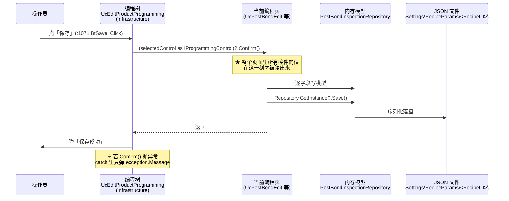

**ASCII 等效图**

```
   操作员点「保存」
        |
   UcEditProductProgramming.cs:1071  BtSave_Click
        |  try {
        |    (this.selectedControl as IProgrammingControl)?.Confirm();
        |    AKRSXtraMessageBox.Show("保存成功");
        |  } catch (Exception exception) {
        |    AKRSXtraMessageBox.Show(exception.Message);     ★ 只弹消息，不弹栈
        |  }
        v
   当前编程页的 Confirm()          ← BondSystem 里 3 个实现之一
        |
   逐字段读控件 → 写内存模型
        |
   Repository.GetInstance().Save()     ← 真正落盘
        |
   Settings\RecipeParams\<RecipeID>\*.json
```

```csharp
// Infrastructure/Controls/Feature/EditProgram/UcEditProductProgram/UcEditProductProgramming.cs:1066
private void BtSave_Click(object sender, System.EventArgs e)
{
    try
    {
        (this.selectedControl as IProgrammingControl)?.Confirm();   // :1071 ★ 唯一保存入口

        AKRSXtraMessageBox.Show("保存成功");
    }
    catch (Exception exception)
    {
        AKRSXtraMessageBox.Show(exception.Message);                 // ★ 只显示 Message
    }
}
```

```csharp
// Infrastructure/…/UcEditProductProgramming.cs:869
private void BtStart_Click(object sender, System.EventArgs e)
{
    // 确定
    (this.selectedControl as IProgrammingControl)?.Confirm();       // :873 ★ 开始之前也保存
    this.Start(true);                                              // :874
}
```

### §6.1.4 ⚠️ 这张链路图的四个要点（必须写进文档）

**要点 ①：`?.` 空条件运算符会"静默什么都不做"。**
两处都是 `(this.selectedControl as IProgrammingControl)?.Confirm();`。
**如果当前选中的控件没有实现 `IProgrammingControl`**（例如选中的是某个纯显示面板），
**`as` 返回 `null`，`?.` 直接跳过，然后照样弹「保存成功」。**

> **⚠️ 用户看到什么**：**在某个页面上改了参数，点「保存」，弹出「保存成功」，
> 但参数根本没被写进模型**（因为那个页面没实现 `IProgrammingControl`）。
> **⚠️ 这一条要标为"推断"，因为本次没有逐一核验"哪些 `selectedControl` 可能不是 `IProgrammingControl`"**
> —— 那需要通读 `UcEditProductProgramming` 的 5 个分部文件（`Infrastructure/`，不在本篇 84 个文件内）。
> **本篇记录现象与风险，不给"必然发生"的结论。**

**要点 ②：`Confirm()` 是"全页一次性提交"，不是"改一下就存一下"。**
⇒ **一个页面里改了 20 个字段，只有点「保存」那一刻才全部生效。**
**⚠️ 例外是 §4.4 列出的 3 个"立即写模型"的控件**（`ChkDefectFrequencyOpen` / `ChkIsCycle` / `ChkBackSideCrackDetection`）——
**它们会绕过"保存"这一步直接改模型，其中 `ChkBackSideCrackDetection` 甚至直接落盘（`:362`）。**
⇒ **同一个页面上，"哪些改动需要点保存、哪些不需要"是不一致的，而界面上没有任何提示。**

**要点 ③：`catch` 只弹 `exception.Message`，不记日志、不弹栈。**
⇒ **如果 `Confirm()` 在写模型途中抛异常**（例如 §4.4.4 说的 `Enum.Parse` 系问题、
或某个 `EditValue` 是 `null` 导致 `.ToString()` 抛 `NullReferenceException`），
**用户看到的是一个只有一句话的提示框**（可能就是「未将对象引用设置到对象的实例。」），
**排查时没有任何线索。**

**要点 ④：`BtStart_Click` 会先 `Confirm()` 再 `Start(true)`。**
⇒ **点「开始」等于"先保存一遍"。**
**⚠️ 这意味着：如果 `Confirm()` 抛异常，`:873` 会直接跳出 `BtStart_Click`（这一处没有 `try`），
「开始」这件事就不会发生** —— 但用户**看不到"保存失败"的提示**（因为 `:1071` 的 catch 在另一个方法里）。
**⚠️ 本条为读代码推断，未实机验证。**

---

## §6.2 坐标系：`G0` 与"机械坐标"的转换

**BondSystem 里到处都是 `ConvertG0ToMachinePos` / `ConvertMachineToG0Pos`。
这一对方法的每一次调用都是一次"跨越两套坐标系的翻译"，也是本层最容易看错的地方。**

### §6.2.1 门面（`BondModuleController`）

```csharp
// Controllers/BondModuleController.cs:153
public double ConvertMachineToG0Pos(double pos)
{
    return this.bondModule.ConvertMachineToG0Pos(pos);      // :155
}

public AKRSPoint3D ConvertMachineToG0Pos(AKRSPoint3D pos)
{
    return this.bondModule.ConvertMachineToG0Pos(pos);      // :165
}

public AKRSPoint3D ConvertG0ToMachinePos(AKRSPoint3D pos)
{
    return this.bondModule.ConvertG0ToMachinePos(pos);      // :175
}

public double ConvertG0ToMachinePosZ(double pos)            // :183 附近
{
    return this.bondModule.ConvertG0ToMachinePos(new AKRSPoint3D(0, 0, pos)).Z;   // :185
}
```

**⇒ `BondModuleController` 只是转发，真正的换算在 `Modules/BondModule.cs` 里。**
**⚠️ 真正的换算公式不在本篇范围内**（`Modules/BondModule.cs` 41,404 字节）。
**本篇只写"调用点"，不写"换算公式"，也不推测标定矩阵。**

### §6.2.2 调用点分布（按文件计数）

| 文件 | `ConvertG0ToMachinePos` 出现次数（不含注释） | 说明 |
|---|---|---|
| `Controllers/BondModuleController.cs` | **多次**（`:293` / `:303` / `:314` / `:368` / `:372` / `:383` / `:443` / `:448` / `:459` / `:520` / `:524` / `:530`） | **移动逻辑集中区**，成对出现 |
| `Controllers/BondHeadController.MovementRelated.cs` | `:45`（避让位） | — |
| `BondForce/Controllers/ClosedLoopCalibrationController.cs` | `:454` | 力控标定里算避让位 |
| `BondForce/Forms/Assistant/FrmCalibrateTeach.cs` | `:135`（**`ConvertMachineToG0Pos`**，唯一一处"反向"） | 测高后把机械坐标存回配置文件 |
| `BondForce/Forms/FrmInspectForceRes.cs` | `:275` | — |
| `Controllers/BondModuleController.MovementRelated.cs` | **全部在注释里**（`:82` / `:93` / `:105` / `:219` / `:230` / `:242` / `:414`） | ⚠️ 注释残留 |

### §6.2.3 ⚠️ 三条写这个主题时必须写的话

**① 「G0」到底是什么，本篇不给结论。**
`G0` 在本层是"程序/配方里存的坐标"，机械坐标是"轴的实际位置"。
**⚠️ 这个判断来自变量命名与使用方式（`:135` 把测出来的机械位置 `ConvertMachineToG0Pos` 后存进 `BMCDevicePara`），
属**读代码推断**，未在 `_raw` 报告或其他文档中见过权威定义。**

**② 成对调用是正确形态，单边调用要警惕。**
`BondModuleController.cs` 里每一段移动逻辑都是"先把 `safeHeight` 从 G0 转成机械坐标，
再拿去和实数比"（`:293` / `:303` 成对，`:368` / `:372` 成对……）。
**⇒ 这是正确写法。**
**⚠️ 但 `FrmCalibrateTeach.cs:135` 是全局唯一的"反向"（机械 → G0），
它的下游是 `BondDevicePara.GetInstance().BMCDevicePara.ForceCalibratePos`（`:134`）
然后 `:137` 立刻 `Save()`** ——
**⇒ 这处一旦算错，写进配置文件的是一个错误的标定位，而落盘是立即的、没有二次确认。**

**③ `BondModuleController.MovementRelated.cs` 里同一段逻辑的注释版与实装版并存。**
**⚠️ 这是"读到注释里的 `ConvertG0ToMachinePos` 就以为逻辑在那里"的陷阱** ——
`:82` / `:93` / `:105` / `:219` / `:230` / `:242` / `:414` **全部在 `//` 后面**。
**⇒ 用 `grep ConvertG0ToMachinePos` 定位逻辑时，命中数里有一半是注释。
必须用 `grep -n` 加人工看行首，或用 `grep "^[^/]*ConvertG0ToMachinePos"` 这类模式。**

---

## §6.3 线程与锁清单

### §6.3.1 锁（`lock`）一共 16 处

**`grep -rn "lock (" --include='*.cs' BondSystem/ | grep -v Designer` 的完整结果：**

| # | 位置 | 锁对象 | 说明 |
|---|---|---|---|
| 1 | `BondForce/Modbus/ModbusService.cs:179` | `lockObj` | Modbus 读写 |
| 2 | `BondForce/Modbus/ModbusService.cs:192` | `lockObj` | 同型 |
| 3 | `Controls/Experiment/FrmBondheadTest.cs:808` | **`lock (this)`** | ⚠️ 锁窗体实例 |
| 4 | `Controls/Experiment/FrmBondheadTest.cs:898` | （**注释里**） | ⚠️ 注释残留 |
| 5 | `Controls/Experiment/FrmBondheadTest.cs:1007` | **`lock (this)`** | ⚠️ |
| 6 | `Controls/Experiment/FrmBondheadTest.cs:1116` | **`lock (this)`** | ⚠️ |
| 7 | `Controls/Experiment/FrmBondheadTest.cs:1184` | **`lock (this)`** | ⚠️ |
| 8 | `Controls/Experiment/FrmGTForceTest.cs:626` | **`lock (this)`** | ⚠️ |
| 9 | `Controls/Experiment/FrmLVDTRealTimeCurve.cs:168` | `printSourceLock` | — |
| 10 | `Controls/Experiment/UcBondModuelSetting.cs:890` | `this.locker` | 实例锁 |
| 11 | `Controls/Experiment/UcBondModuelSetting.cs:1697` | **`GlobalRandom`** | ⚠️ **锁在一个 `Random` 对象上** |
| 12 | `Controls/Manual/FrmForceRealTimeCurve.cs:289` | `printSourceLock` | — |
| 13 | `Models/Repositories/Nozzle/NozzleRepository.cs:63` | **`BaseSettingRepository<Nozzle>.locker`** | ✅ **基类静态锁** |
| 14 | `Models/Repositories/NozzleShelf/NozzleShelfRepository.cs:53` | `NozzleShelfRepository.locker` | ✅ |
| 15 | `Models/Repositories/PostBondInspection/PostBondInspectionRepository.cs:63` | `BaseSettingRepository<PostBondInspection>.locker` | ✅ |
| 16 | `Services/System2CommonService.cs:103` / `:224` | `locker`（private static） | ✅ |

### §6.3.2 ⚠️ `lock (this)` 是真的问题，但不要夸大

**`lock (this)` / `lock (typeof(X))` 是公认的反模式**（外部代码可能锁同一个对象导致死锁）。
**⚠️ 但在本层要按事实写**：

| 事实 | 说明 |
|---|---|
| 出现位置 | **集中在 `Controls/Experiment/` 的三个窗体**（`FrmBondheadTest` 4 处、`FrmGTForceTest` 1 处） |
| 是不是 UI 窗体 | **是** |
| 谁可能同时持有这个锁 | **⚠️ 本次未做完整核验** —— 需要找到所有 `lock (同一个窗体实例)` 的地方，逐一对齐 |
| 有没有实际死锁证据 | **没有** —— 本层没有发现任何一处 `lock (this)` 与另一个 `lock (this)` 形成交叉等待 |

> **⚠️ 写法纪律**：
> - **可以写**：「`Controls/Experiment/FrmBondheadTest.cs` 的 `:808` / `:1007` / `:1116` / `:1184`
>   和 `FrmGTForceTest.cs:626` 用的是 `lock (this)`（锁窗体实例本身）。
>   这是公认的反模式 —— 因为任何拿到这个窗体引用的外部代码都能锁住它，
>   而"谁能拿到这个引用"在本层无法穷举（窗体被 `Show`/`ShowDialog` 之后引用会外泄给框架和父窗体）。
>   **⚠️ 但本次扫描没有找到任何一处与它形成交叉等待的第二把锁**，
>   所以**不能写"会导致死锁"，只能写"存在形成死锁的必要条件"。**」
> - **不能写**「这里必然死锁」或「软件有死锁 bug」—— **那是编造。**
> - **`_UI线程阻塞排查.md` §六.5 明确要求**：**用词是「UI 线程被同步阻塞」，不是"死锁"**（死锁另有一条）。

**⚠️ `UcBondModuelSetting.cs:1697` 的 `lock (GlobalRandom)` 更值得单独记一句**：
**把一个 `Random` 对象当锁用**，说明这段代码的原始意图是"保护 `Random` 的并发访问"。
**⚠️ 若 `GlobalRandom` 是**公开静态字段**，那它和 `lock (this)` 是同一类问题。**
**⚠️ 本条未核实 `GlobalRandom` 的可见性，标为存疑（见附录 B）。**

### §6.3.3 回 UI 线程的 `Invoke` / `BeginInvoke`（17 个文件，共约 41 处）

**`grep -rc "BeginInvoke\|this\.Invoke(" --include='*.cs' BondSystem/ | grep -v ':0'` 的结果：**

| 文件 | 处数 | 所属 |
|---|---|---|
| `Controls/Experiment/FrmBondheadTest.cs` | **7** | Experiment |
| `Controls/Experiment/UcBondModuelSetting.cs` | **6** | Experiment |
| `Controls/Assistant/FrmComponentPlacement.cs` | **5** | Assistant |
| `Controls/Manual/FrmNozzleBankManual.cs` | **5** | Manual |
| `Controls/Manual/FrmForceRealTimeCurve.cs` | **3** | Manual |
| `BondForce/Forms/FrmCalibrationRelationship.cs` | **2** | BondForce |
| `BondForce/Forms/FrmInspectForceRes.cs` | **2** | BondForce |
| `Controls/Assistant/FrmComponentAccuracyMode.cs` | **2** | Assistant |
| `Controls/Experiment/FrmGTForceTest.cs` | **2** | Experiment |
| `Controls/Experiment/FrmLVDTRealTimeCurve.cs` | **2** | Experiment |
| `BondForce/Forms/FrmCalibrateTableForceRealtimeLine.cs` | **1** | BondForce |
| `Controls/Assistant/FrmComponentPickup.cs` | **1** | Assistant |
| `Controls/Experiment/FrmForceControlInspection.cs` | **1** | Experiment |
| `Controls/Manual/FrmPostBondResCurve.cs` | **1** | Manual |
| `Controls/Manual/FrmToolsTestRun.cs` | **1** | Manual |
| `Controls/Setting/PostBond/FrmPostBondData.cs` | **1** | Setting |

**⚠️ 这份清单的正确读法**：
**它统计的是"回 UI 线程"的调用 —— 也就是"这些地方**知道**自己在后台线程上。**
**⇒ 反过来看更有价值**：**本层总共 84 个文件，只有 16 个文件出现过 `Invoke`/`BeginInvoke`。**
**其余 68 个文件里，凡是在 `Task.Run` 里改控件的代码，都可能踩"跨线程操作控件"的 `InvalidOperationException`。**
**⚠️ 但"可能踩"不等于"踩了"** ——
**没有实测的情况下，本篇只写"这 16 个文件做了跨线程回切，其余文件的 `Task.Run` 里若直接改控件则缺少回切"，
不逐一罗列"疑似漏回切"的位置。**

**⚠️ 一处需要单独点名的正确样本**（§4.6 已写，这里汇总）：
`FrmAutoSlideFlux.cs:141-146` 用 `InvokeRequired` + `Invoke` 在 `ContinueWith` 里回切 UI 线程 ——
**这是本层写得最规范的一处。**

---

## §6.4 命名与结构陷阱（接手人必读）

### §6.4.1 🔴 `ProcessStep` 同名陷阱（本层最危险的一个）

**⚠️ 这是 `_死代码与零引用登记.md` 与 `_幽灵文件清单.md` 都点名过的一条，
但它的危险在于"后来人 `grep` 必被引到死代码"。**

| 名字 | 位置 | 状态 |
|---|---|---|
| `Services/System1ActionNodesService.cs` | 文件 | ❌ **幽灵文件**（不参与编译） |
| `Controls/Setting/ProcessStep/FrmCreateProcessStep.cs`（+`.Designer.cs`） | 文件 | ❌ **幽灵文件** |
| `Controls/Setting/ProcessStep/UcProcessStepEdit.cs`（+`.Designer.cs`） | 文件 | ❌ **幽灵文件** |
| **`Main/Machine/Process/SingleProcessStep.cs`** | **真正的活代码，`:15`** | ✅ **参与编译** |
| **`Main/Machine/Process/S2ActionNodeController.cs:60`** | **属性名叫 `ProcessStep`** | ✅ 参与编译 |

**⚠️ 危险点**：
**`S2ActionNodeController.cs:60` 的那个属性，名字与幽灵类型名完全相同。**
⇒ **后来人搜 `ProcessStep`，第一个命中的就是这一行**，
**而它指向的是"一个 `SingleProcessStep` 类型的属性"，不是那个幽灵类。**

**⇒ 所有与 `ProcessStep` 相关的风险条目，都必须带上这句提醒**：

> 「**`Main/Machine/Process/S2ActionNodeController.cs:60` 的属性名与幽灵类型名完全相同，
> 后来人 `grep` 必被引到死代码。**」

### §6.4.2 ⚠️ 双扩展名：`FrmS2DispensePlateAssistant.cs.cs`

**本层有一个文件的名字是 `Controls/Assistant/FrmS2DispensePlateAssistant.cs.cs`** ——
**`.cs` 出现了两次。**

**⚠️ 它确实参与编译**：

```xml
<!-- AKRS.ZX2200.csproj:514 -->
<Compile Include="BondSystem\Controls\Assistant\FrmS2DispensePlateAssistant.cs.cs">
<!-- AKRS.ZX2200.csproj:517 -->
<Compile Include="BondSystem\Controls\Assistant\FrmS2DispensePlateAssistant.cs.Designer.cs">
  <DependentUpon>FrmS2DispensePlateAssistant.cs.cs</DependentUpon>
<!-- AKRS.ZX2200.csproj:2926 -->
<EmbeddedResource Include="BondSystem\Controls\Assistant\FrmS2DispensePlateAssistant.cs.resx" />
```

**⇒ 三处命名完全不统一**（`.cs.cs` / `.cs.Designer.cs` / `.cs.resx`）。
**⚠️ 后果**：**任何按 `*.cs` / `*.Designer.cs` 通配符扫描的脚本（包括本项目的统计脚本）
都必须用 `find -iname` 而不是 `-name`，否则这个文件会被漏掉或重复计数。**

**⚠️ 注意：本文件正常参与编译 —— 它不是幽灵文件，不要写"不参与编译"。**

### §6.4.3 ⚠️ 文件名与类名不一致：`FrmGTForceTest.cs` 里的类是 `FrmGTForceTest1`

```csharp
// Controls/Experiment/FrmGTForceTest.cs:36
public partial class FrmGTForceTest1 : DevExpress.XtraEditors.XtraForm
```

**⇒ 文件名 `FrmGTForceTest.cs`，类名 `FrmGTForceTest1`。**
**⚠️ 后果**：**搜 `FrmGTForceTest` 会命中文档化的类型名，但 `new FrmGTForceTest(...)` 是编译不过的
（没有这个类）** —— 必须 `new FrmGTForceTest1(...)`。
**⚠️ 这个类的实例化点：`grep` 全仓为 0** ⇒ 它是**零实例化的僵尸窗体**（§6.4.5）。

### §6.4.4 ⚠️ 处理器名与控件名不一致：`BtnToolsTestRun_Click` vs `BtnPPToolsTestRun`

```csharp
// Controls/Manual/FrmToolsTestRun.cs:117
private void BtnToolsTestRun_Click(object sender, EventArgs e)      // ★ 处理器叫 BtnToolsTestRun
{
    if (this.BtnPPToolsTestRun.Text == @"开始重复换吸嘴测试")        // ★ 控件叫 BtnPPToolsTestRun
    {
        this.BtnPPToolsTestRun.Appearance.BackColor = Color.Yellow;  // :133
        this.BtnPPToolsTestRun.Text = @"停止重复换吸嘴测试";          // :134
        …
```

**⇒ 处理器名少了一个 `PP`。**
**⚠️ 后果**：**按控件名查接线（`grep "this.BtnToolsTestRun.Click"`）会得到 0，
误判为"孤立处理器"**（§4.14 已详细写过）。
**⚠️ 同时这也是"按 `BtnToolsTestRun` 搜不到控件"的原因** ——
`Controls/Manual/FrmToolsTestRun.cs:105-106` 引用的是 `BtnPPToolsTestRun.Visible/Enabled`。

### §6.4.5 零实例化的僵尸窗体（4 个，逐个核实）

**核实方法**：`grep -rn "FrmXxx" --include='*.cs' . | grep -v '/bin/' | grep -v '/obj/'`，
**结果里若只有"类声明 + 构造函数声明 + Designer 里的 `Name = "..."`"，就是零实例化。**

| # | 窗体 | 文件:行 | 证据 |
|---|---|---|---|
| 1 | `FrmPostBondDataset` | `Controls/Setting/PostBond/FrmPostBondDataset.cs:16` | 全仓命中只有：`:16` 类声明、`:43` 构造函数声明、`:83` `FormClosed` 处理器、`.Designer.cs:3/297/321/323` ⇒ **没有任何 `new`** |
| 2 | `FrmForceControlInspection` | `Controls/Experiment/FrmForceControlInspection.cs:30` | 全仓命中只有：`:30` 类声明、`:95` 构造函数声明、`.Designer.cs:3/136` ⇒ **没有任何 `new`** |
| 3 | `FrmGTForceTest`（类名 `FrmGTForceTest1`） | `Controls/Experiment/FrmGTForceTest.cs:36` | 见 §6.4.3 |
| 4 | `FrmMoveToBondingPosition` | `Controls/Assistant/FrmMoveToBondingPosition.cs:29` | 全仓命中只有：`:29` 类声明、`:40` 构造函数声明、`.Designer.cs:5/33/510/520` ⇒ **没有任何 `new`**；**⚠️ 且 `.Designer.cs:522` 的 `Load` 接线是被注释掉的**（见 §6.4.5.1） |

### §6.4.5.1 ⚠️ `FrmMoveToBondingPosition`：连 `Load` 事件都被注释掉了

```csharp
// Controls/Assistant/FrmMoveToBondingPosition.Designer.cs:510
// FrmMoveToBondingPosition
…
this.Name = "FrmMoveToBondingPosition";                                          // :520
// this.Load += new System.EventHandler(this.FrmMoveToBondingPosition_Load);     // :522 ★★ 注释掉了
```

**⚠️ 这是本层唯一一个"连 `Load` 事件接线都被注释掉"的窗体。**
**⇒ 即便有人把它 `new` 出来并 `Show`，它的 `FrmMoveToBondingPosition_Load` 也不会执行。**
**⇒ 这个窗体是"双重废弃"状态：没有实例化点，且自身的初始化事件也不接线。**
**⚠️ 写法**：**不能写"半成品"** —— 正确写法是
「**这个窗体没有任何实例化点（全仓零 `new`），且其 Designer 里的 `Load` 事件接线处于注释状态
（`.Designer.cs:522`）。它当前既不会被创建，即使被创建也不会执行 `Load`。**」

> **⚠️ 这四个与 §2.3 的"幽灵文件"是不同概念，必须分清**：
> - **幽灵文件**：**文件根本不参与编译**（不在 `.csproj` 的 `<Compile Include>` 里）；
> - **零实例化窗体**：**文件参与编译、类存在于程序集里、但没有任何代码 `new` 它**。
>
> **⇒ 前者运行时"不存在这个类型"；后者"类型存在，但用户在界面上永远见不到它"。**
> **⚠️ 两者都不能写"这个功能存在于 UI 上"。**

### §6.4.6 ⚠️ 幽灵文件里的 `ProcessStepProgram`：4 处命中全是假阳性

**`_幽灵文件清单.md` 已核实**（本篇复核一致）：

| 命中位置 | 性质 |
|---|---|
| `Models/System2Domain.cs:613` | **注释** |
| `ZX2200PathConfig.cs:166` / `:168` / `:281` | **字符串属性名 `ProcessStepProgramFilePath`**（不是类型引用） |
| `Models/ProductDomain.cs:38` / `:41` | **注释** |
| `CommonHelper.cs` | 见下 |

**⇒ 都是"注释或同名子串"，不是真引用。**

**⚠️ 另一个相关的硬事实（决定了"能不能把幽灵文件加回 csproj"）**：

```csharp
// CommonHelper.cs:69-89  泛型版 UpOrDown —— 整段被注释掉
// CommonHelper.cs:91-     非泛型版 UpOrDown —— 整段被注释掉
```

**⇒ 两个重载都被注释掉了（声明分别在 `:75` 与 `:96`）。**
**⇒ 如果把 `Controls/Setting/ProcessStep/UcProcessStepEdit.cs` 加回 `.csproj`，它会调不到 `UpOrDown`，
编译直接失败。**

> **⚠️ 写法纪律**：
> - **可以写**：「`CommonHelper.UpOrDown` 的两个重载都已注释掉（`CommonHelper.cs:69-89` 与 `:91` 起），
>   所以 `UcProcessStepEdit.cs` 即使被重新加回 `.csproj` 也无法编译。」
> - **⚠️ 但要同时提醒**：**`CommonHelper.cs` 本身不是死文件**（127 行，26 个活调用点，
>   全部是 `ChangeUcMove`，位于 `:25`）—— **不要因为它包含被注释的 `UpOrDown` 就说这个文件是死的。**
> - **不能写**「可以安全删除这 5 个幽灵文件」—— **理由见 §2.3。**

---

## §6.5 单例与落盘语义：`Singleton<T>` vs `SingletonNoSave<T>`

**⚠️ 本节的内容是"读代码推断"，因为 `Singleton<T>` 与 `SingletonNoSave<T>` 的定义在
`Infrastructure/`（不在本篇 84 个文件内），本次未逐行阅读它们的实现。**

| | `Singleton<T>` | `SingletonNoSave<T>` |
|---|---|---|
| 命名含义 | 单例，**`Save()` 会落盘** | 单例，**`Save()` 不落盘**（只改内存） |
| 本层用法 | 大量（`ForceConfig` / `BondDevicePara` / `NozzleShelfRepository` / `PostBondInspectionRepository` / `NozzleRepository` / `ProductConfiguration` / `MachineHardwareConfiguration` …） | **本层只有 4 个**（见下） |
| 写法影响 | 调用 `.Save()` 会写 JSON 文件 | 调用 `.Save()` 只是改内存 |

**`SingletonNoSave<T>` 在本层的完整清单**（`grep -rn "SingletonNoSave" --include='*.cs' BondSystem/`）：

| # | 类 | 文件:行 |
|---|---|---|
| 1 | `ModbusService` | `BondForce/Modbus/ModbusService.cs:23` |
| 2 | `PrecisionAcquisitionDataContainer` | `Models/ActionNodes/Commons/PrecisionAcquisitionData.cs:12` |
| 3 | **`System2Domain`** | **`Models/System2Domain.cs:68`** |
| 4 | **`System2Module`** | **`Modules/System2Module.cs:11`** |

**⚠️ 第 3 条特别值得写**：
**`System2Domain` 是整层的"根对象"**（`BondTask` 就是它的一个属性 —— `Models/System2Domain.cs:130`
`public BondTask BondTask { get; set; } = new BondTask();`），
**它继承 `SingletonNoSave<T>`** ⇒
**⇒ 它的 `Save()` 不落盘。**
**⚠️ 这与 §6.6 的"`BondTask.Enable` 带 `[JsonIgnore]`"是同一件事的两面：
`BondTask` 是 `System2Domain` 的属性，而 `System2Domain` 本身不落盘 ——
所以这两个事实互相印证，不是矛盾。**

> **⚠️ 写法纪律（这是本篇最需要"标注为推断"的一处）**：
> **本次**没有**打开 `Singleton<T>` / `SingletonNoSave<T>` 的定义逐行确认 `Save()` 的具体行为**
> （它们的定义在 `Infrastructure/`，不在本篇的 84 个文件内）。
> **⇒ 本篇的做法是**：
> 1. **凡是写"落盘"的地方，都以"代码里确实调用了 `Xxx.GetInstance().Save()`" 为事实依据**；
> 2. **不推断 `Save()` 内部行为**；
> 3. **`SingletonNoSave` 的语义差异按上面的清单如实写出，并标注"基类定义未逐行核实"。**
> **⚠️ 接手人若要确认落盘行为，请直接读 `Infrastructure` 里这两个基类的定义 —— 本篇不作为权威。**

---

## §6.6 反序列化的三条一致性要求

**这一节讲"配置文件改了之后，什么时候会被读回来"。**

| # | 要求 | 说明 |
|---|---|---|
| 1 | **字段名即 JSON 键名** | 本层大量属性直接序列化到 `Settings\DeviceParams\*.json` 与 `Settings\RecipeParams\<RecipeID>\*.json`，**改属性名 = 让旧配置文件里对应的值全部丢失** |
| 2 | **`[JsonIgnore]` 的字段不落盘** | 例如 `Tasks/BondTask.cs:88` 的 `[JsonIgnore] public Task BondWorkTask;`、`:94` 的 `[JsonIgnore] public bool Enable { get; set; } = true;` ⇒ **`Enable` 每次启动都回到默认 `true`，用户改不了、也存不住** |
| 3 | **新增属性必须有默认值** | 老配置文件里没有这个键时，反序列化后该属性保持"字段初始化器"给的值；**若没写 `= xxx`，就是 `default(T)`**（数字变 0，引用类型变 `null`） |

**⚠️ 第 2 条有一处值得单独点名**：

```csharp
// Tasks/BondTask.cs:91
/// <summary>
/// 是否启用
/// </summary>
[JsonIgnore]
public bool Enable { get; set; } = true;      // :95 ★ 带 [JsonIgnore]，永远不落盘
```

**⇒ 这个 `Enable` 是 `BondTask` 的"总开关"**（`:120` 的提前换吸嘴要用它、`:198` 的主流程要用它），
**但它被标了 `[JsonIgnore]`** ⇒ **每台机器每次启动它都是 `true`，现场无法通过配置文件关掉它。**
**⚠️ 如果它本来就应该永远 `true`，那 `[JsonIgnore]` 是对的；如果它本意是可配置的，那这里就是漏了。**
**本篇只客观记录，不下结论。**

---

# 第 7 部分　依赖关系

> **本篇的 84 个文件不是孤岛。这一部分讲"它们往外伸手"和"外面往它们伸手"。**
> **⚠️ 依赖关系只列"已在本篇核实过的"—— 不做全量调用图（那需要工具，不是 grep 能做到的）。**

---

## §7.1 本层向外依赖的模块（按 `using` 统计）

**从 `Tasks/BondTask.cs` 的 30 行 `using`（`:1-29`）就能看出本层往外的六条主要通道：**

| # | 命名空间 / 程序集 | 用途 | 证据 |
|---|---|---|---|
| 1 | `AKRS.Galaxy2.Infrastructure` | 基础类型（`Singleton`、`IProgrammingControl` 等） | `BondTask.cs:1` |
| 2 | `AKRS.Galaxy2.Machine.Models` / `Machine.Enums` | **`Signal` / `MachineStateModel` / `MachineStateEnum`** | `BondTask.cs:5-6` |
| 3 | `AKRS.ZX2200.Infrastructure.*` | **界面基础（`UcGuideMove`）、服务** | `BondTask.cs:12` / `:15` |
| 4 | `AKRS.ZX2200.Main.Controls.Ucmain.MainControls` | **`UcMainSystem.ReFreshSystem2TuAction()`**（回主界面刷新） | `BondTask.cs:16` |
| 5 | `AKRS.ZX2200.Main.Machine.MachineSupport` | **`Machine.GetInstance().Stop()`** | `BondTask.cs:17` |
| 6 | `AKRS.ZX2200.TransportSystem.*` / `TransportUnitSystem.*` | **载具 / 载具单元** | `BondTask.cs:21-23` |
| 7 | `AKRS.ZX2200.WaferSubSystem.Models.Entities` | 晶圆台实体（`BaseCarrierConfig`） | `BondTask.cs:24` |
| 8 | `AKRS.ZX2200.SupportFeature.*` | **温漂补偿 / 缺陷补偿 / 统计** | `BondTask.cs:18-20` |

**⚠️ 其中最值得写清的是第 2 条和第 5 条**：

- **`Signal.WaitStart()` 的实现在 `AKRS.Galaxy2.Machine/Models/Signal.cs:202`**，
  **不在 `AKRS.ZX2200` 项目里** ⇒ **本层改不了它**（§5.1.6）。
- **`Machine.GetInstance().Stop()` 是本层 19 处"停机"动作的唯一出口**，
  它的实现在 `AKRS.ZX2200/Main/Machine/MachineSupport/Machine.Operate.cs` ——
  **⚠️ 而 `:399-401` 正是那个调 `AbortThread()` 的地方（§5.1.3）。**

## §7.2 外面向本层伸手的入口（跨模块进入点）

**这些是"别的模块 `new` 了本层的窗体或 `GetInstance()` 了本层的控制器"的地方。
本篇只列已核实的：**

| # | 外部调用点 | 调用的本层对象 | 类型 |
|---|---|---|---|
| 1 | `Main/Machine/MachineSupport/Machine.Operate.cs:400` | **`System2Domain.GetInstance().BondTask.AbortThread()`** | **停机流程** |
| 2 | `Main/Controls/FrmSignalDisplay.cs:51-54` | **`System2Domain.GetInstance().BondTask.BondWorkTask`**（读 `Status`，把按钮染成运行/停止色） | **状态显示** |
| 3 | `Experiment/RepeatPositionAccuracy/FrmUpLookMarkTest.cs:124` | **`System2CommonService.SaveVisionResult(...)`** | **⚠️ 调用方在一个"混合目录"里（见下）** |
| 4 | `Infrastructure/…/UcEditProductProgramming.cs:873` / `:1071` | **`(selectedControl as IProgrammingControl)?.Confirm()`** | **★ 保存通道（§6.1）** |

**⚠️ 第 3 条要特别小心（同一个目录里"活的"和"幽灵的"混在一起）**：

`Experiment/RepeatPositionAccuracy/` 目录下实测有 5 个窗体（`ls` 结果）：

| 文件 | 是否参与编译 | 依据 |
|---|---|---|
| `FrmChooseCamera.cs` / `.Designer.cs` / `.resx` | ❌ **幽灵文件** | 不在 `.csproj` 的 `<Compile Include>` 里（`_幽灵文件清单.md` 已核实） |
| `FrmRotateCenterAccuracy.cs` / `.Designer.cs` / `.resx` | ❌ **幽灵文件** | 同上 |
| **`FrmUpLookMarkTest.cs`** | ✅ **参与编译** | **`.csproj:1029`**（`.Designer.cs` 在 `:1032`，`.resx` 在 `:3140`） |
| `FrmRepeatPositionAccuracy.cs` | ✅ 参与编译 | — |

**⇒ 本篇已核实 `FrmUpLookMarkTest.cs` 是活文件**（`.csproj:1029`），
**所以 `FrmUpLookMarkTest.cs:124` 这个调用点是有效的、不是幽灵调用。**
**⚠️ 但这恰好说明一个纪律**：**"同一个目录里有幽灵文件"不能推出"这个目录里的代码都是幽灵"
—— 必须逐个查 `.csproj`。**

## §7.3 本层内部的循环依赖（⚠️ 值得记一句）

**`BondSystem` 内部有两条"回头引用"：**

| # | 从 | 到 | 说明 |
|---|---|---|---|
| 1 | **`Tasks/BondTask.cs:16`** | `Main.Controls.Ucmain.MainControls.UcMainSystem` | **工作线程回头调主界面的刷新委托**（`:159` / `:350`），**这是"任务层依赖 UI 层"** |
| 2 | **`Controls/Setting/PostBond/UcPostBondEdit.cs:374`** | `Infrastructure…UcEditProductProgramming.RefreshILstAssistantStepWithPBAction` | **设置页回头调编程树的刷新** |

### §7.3.1 🔴 `ReFreshSystem2TuAction` 是一个可空的静态委托 —— 本层有 5 个调用点

**本次核实了它的定义（这比"推断"强得多）**：

```csharp
// Main/Controls/Ucmain/MainControls/UcmainSystem.Action.cs:46
ReFreshSystem2TuAction += this.ReFreshSystem2Tu;              // ★ 在窗体构造/加载时挂上实例方法

// Main/Controls/Ucmain/MainControls/UcmainSystem.Action.cs:146
public static Action ReFreshSystem2TuAction { get; set; }     // ★★ 公开静态委托，可以为 null
```

**⇒ 它是一个 `public static Action` 属性，名字和"方法"一样（`UcMainSystem.ReFreshSystem2TuAction()`）。**
**⚠️ 它只在 `:46` 被 `+=` 挂上一次，挂在某个 `UcMainSystem` **实例**的方法上。**

**本层（BondSystem）调它的地方一共 5 处**：

| # | 位置 | 上下文 |
|---|---|---|
| 1 | `Tasks/BondTask.cs:159` | **固晶工作线程**，取到来料信号之后 |
| 2 | `Tasks/BondTask.cs:350` | **固晶工作线程**，整个产品做完之后 |
| 3 | `Models/ActionNodes/BPActionNode/BondActionNode.cs:360` | 固晶动作节点内 |
| 4 | `Models/ActionNodes/BPActionNode/BondActionNode.MoveHelper.cs:173` | 固晶动作节点内 |
| 5 | `Models/ActionNodes/BPActionNode/AfterBondCheckActionNode.cs:345` | 焊后检测动作节点内 |

**⇒ 结论（这是本篇一条独立的风险）**：

> **「`UcMainSystem.ReFreshSystem2TuAction` 是一个公开的静态 `Action` 属性
> （`Main/Controls/Ucmain/MainControls/UcmainSystem.Action.cs:146`），
> 只在 `:46` 由某个 `UcMainSystem` 实例的方法挂上。
> BondSystem 里一共 5 处调用它（`Tasks/BondTask.cs:159` / `:350`、
> `Models/ActionNodes/BPActionNode/BondActionNode.cs:360`、
> `BondActionNode.MoveHelper.cs:173`、`AfterBondCheckActionNode.cs:345`），
> 全部在**后台线程**上。若主界面尚未创建（或已被关闭）导致该委托为 `null`，
> 调用会抛 `NullReferenceException`。
> **⚠️ 本条为读代码推断 —— 未实测"主界面未打开时会不会走到这些调用点"。**」

**⚠️ 同时要写清"方向问题"**：
**`BondTask` 属于 `Tasks/`（最底层），`UcMainSystem` 属于 `Main/`（界面层）。
任务层直接调界面层的静态成员，分层方向是反的。**
**⚠️ 不要写"这里必然崩"** —— 它是一个"**存在产生 `NullReferenceException` 的必要条件**"的设计，
**不是已证实的崩溃点。**

**⚠️ 第 2 条（`UcPostBondEdit.cs:374`）的方向也是反的**：
**`Controls/Setting/PostBond/` 是设置页，`Infrastructure/…/UcEditProductProgramming` 是框架层，
设置页回头调框架层的静态刷新方法 —— 同样是反向依赖。**
**⚠️ 但这一处与第 1 条不同：本次**没有**核实 `RefreshILstAssistantStepWithPBAction` 是不是静态、
也不是不是在 `Infrastructure` 里 —— 只核实了调用写法。**
**⇒ 属存疑（附录 B）。**

---

# 第 8 部分　配置与数据

---

## §8.1 两条落盘路径（`Settings\DeviceParams` 与 `Settings\RecipeParams\<RecipeID>`）

**所有配置最终落到两个目录下。路径定义在 `AKRS.Galaxy2.MachineSupport/Config/PathConfig.cs`
（⚠️ **不在 BondSystem 里，甚至不在 `AKRS.ZX2200` 项目里**）：**

```csharp
// AKRS.Galaxy2.MachineSupport/Config/PathConfig.cs:45
public static string SettingsPath => Path.Combine(Root, "Settings");              // :45

/// <summary>
/// Recipe 根路径
/// settings/RecipeParams
/// </summary>
public static string RecipeRootDirPath => Path.Combine(SettingsPath, "RecipeParams");   // :78

/// <summary>
/// Recipe 路径
/// settings/RecipeParams/RecipeID/
/// </summary>
public static string RecipeDirPath =>
    Path.Combine(RecipeRootDirPath, MachineConfigContext.GetInstance().RecipeID.ToString());   // :89

/// <summary>
/// 设备参数路径
/// settings/DeviceParams
/// </summary>
public static string DeviceDirPath => Path.Combine(SettingsPath, "DeviceParams");    // :94
```

**⇒ 两条路径的语义区别（这是本节最重要的一句话）**：

| 路径 | 语义 | 换配方会不会变 |
|---|---|---|
| **`Settings\DeviceParams\`** | **设备参数**（与产品无关：标定、力控配置、吸嘴库、吸嘴架配置……） | ❌ **不变**（只有一份） |
| **`Settings\RecipeParams\<RecipeID>\`** | **配方参数**（与产品相关：`BondProgram.json`、`ProductDomain.json`……） | ✅ **每个配方一个目录** |

**⚠️ 这个区分决定了"用户改了参数、切换配方之后还在不在"。**

## §8.2 BondSystem 用到的配置文件清单

**从 `Infrastructure/Models/Path/ZX2200PathConfig.cs` 里筛出与固晶相关的：**

| # | 属性 | 目录 | 文件名 | 属于 |
|---|---|---|---|---|
| 1 | `BondDeviceParaPath` | `DeviceDirPath` | `BondDeviceParaPath.json` | **设备** |
| 2 | `BondRecipeParaPath` | `DeviceDirPath` | `BondRecipeParaPath.json` | ⚠️ **放在设备目录里，但名字叫 Recipe** |
| 3 | `ForceConfig` | `DeviceDirPath` | `ForceConfig.json` | **设备**（力控标定的上下限、间隔、角度） |
| 4 | `ForceCalibrationStorageFilePath` | `DeviceDirPath\ForceCalibrationDataFilePath\` | `ForceCalibrationData.json` | **设备** |
| 5 | `RtuConnectConfig` | `DeviceDirPath` | `RtuConnectConfig.json` | **设备**（Modbus） |
| 6 | `NozzleShelfRepositoryPath` | `DeviceDirPath` | **`NozzleShelfRepositoryPath.json`** | **设备** |
| 7 | `NozzleRepositoryPath` | `DeviceDirPath` | **`NozzleRepositoryPath.json`** | **设备** |
| 8 | `BondProgramFilePath` | `RecipeDirPath` | `BondProgram.json` | **配方** |
| 9 | `ProductDomainFilePath` | `RecipeDirPath` | `ProductDomain.json` | **配方** |
| 10 | `ProcessStepProgramFilePath` | `RecipeDirPath` | `ProcessStepProgram.json` | ⚠️ **见下** |

**⚠️ 第 10 条要单独说明**：
`ProcessStepProgramFilePath`（`ZX2200PathConfig.cs:168`）**是一个字符串属性** ——
**它就是 `_幽灵文件清单.md` 里说的那 4 处"假阳性命中"之一**（另两处在 `:166` / `:281`）。
**⇒ 它的存在不代表 `ProcessStepProgram` 这个类型活着** ——
**只是"路径配置里预留了一个文件名"。**
**⚠️ 写法**：**不能因为 `ZX2200PathConfig.cs` 里有 `ProcessStepProgramFilePath` 就写"制程步骤程序是活的"。**

**⚠️ 第 2 条也值得记一句**：
`BondRecipeParaPath` 的物理位置是 **`DeviceDirPath`（设备目录）**，
但属性名和文件名里都带 `Recipe`。
**⇒ 这是一个命名与位置不一致的点，接手人按"配方参数应该在 RecipeParams 下"去找会找不到。**

## §8.3 落盘点总表（本篇的实测口径）

**先给出口径与命令**（这一步很重要，因为**不同口径会得到完全不同的数字**）：

```bash
cd "E:/项目/ZX2200标机/trunk/AKRS.ZX2200/BondSystem"

# 口径 A：所有含 ".Save()" 的行（含注释行）
grep -rn "\.Save()" --include='*.cs' . | grep -v '/bin/' | wc -l
#   → 181

# 口径 B：行首是 // 的注释行
grep -rn "\.Save()" --include='*.cs' . | grep -v '/bin/' | grep -cE "^[^:]+:[0-9]+: *//"
#   → 13

# 口径 C：行尾带注释的（".Save(); // xxx"）
grep -rn "\.Save()" --include='*.cs' . | grep -v '/bin/' \
  | grep -vE "^[^:]+:[0-9]+: *//" | grep -c "//"
#   → 0
```

**⇒ 本篇的落盘口径（下文三处一律用这一组）**：

| 口径 | 数值 |
|---|---|
| 含注释的总命中 | **181** |
| 行首注释（不执行） | **13** |
| 行尾注释（仍执行） | **0** |
| **实际生效的落盘调用** | **168** |

> **⚠️⚠️ 这里必须记录一处与既有 `_raw` 报告的差异**：
> 既有材料里的口径是 **"159 命中 / 146 生效 / 13 注释"**。
> **本次实测（`BondSystem/` 全目录，含 `bin`/`obj` 之外的所有 `.cs`）得到的是
> "181 命中 / 168 生效 / 13 注释"**。
> **⇒ "13 处注释"一致；"总命中"与"生效数"不一致。**
> **差异原因：既有口径的 `159` 与本篇的 `181` 相差 22 —— 本次未逐条比对两个口径的差集，
> 因此本篇不宣称"报告错了"，只宣称"本篇用 181 / 168 这一组，且给出可复现命令"。**
> **⚠️ 这是本篇的一处存疑（附录 B）。**

### §8.3.1 那 13 处注释掉的落盘（逐条列出）

**这 13 处全部不执行。** 逐条列出并分类：

| # | 位置 | 内容 | 分类 |
|---|---|---|---|
| 1 | `Controllers/System2Controller.AutoCali.cs:687` | `// EjectionConfigRepository.GetInstance().Save();` | **配置落盘（被注释）** |
| 2 | `Controls/Experiment/FrmBondheadTest.cs:974` | `// excelPackage.Save();` | **Excel 导出（不是配置）** |
| 3 | `Controls/Experiment/UcBondModuelSetting.cs:185` | `// StatisticsDepository.Instance.Save();` | **统计仓库** |
| 4 | `Controls/Experiment/UcBondModuelSetting.cs:188` | `// StatisticsDepository.Instance.Save();` | **统计仓库** |
| 5 | `Controls/Experiment/UcBondModuelSetting.cs:756` | `// excelPackage.Save();` | Excel 导出 |
| 6 | `Controls/Experiment/UcBondModuelSetting.cs:1429` | `// excelPackage.Save();` | Excel 导出 |
| 7 | `Controls/Experiment/UcBondModuelSetting.cs:1514` | `// excelPackage.Save();` | Excel 导出 |
| 8 | `Controls/Manual/FrmSlideFluxerTeach.cs:168` | `// BondDevicePara.GetInstance().Save();` | **配置落盘（被注释）** |
| 9 | `Controls/Manual/FrmSlideFluxerTeach.cs:169` | `// BondProgram.GetInstance().Save();` | **配置落盘（被注释）** |
| 10 | `Controls/Manual/FrmSlideFluxerTeach.cs:213` | `// BondDevicePara.GetInstance().Save();` | **配置落盘（被注释）** |
| 11 | `Controls/Manual/FrmSlideFluxerTeach.cs:214` | `// BondProgram.GetInstance().Save();` | **配置落盘（被注释）** |
| 12 | `Controls/Setting/ProcessStep/UcProcessStepEdit.cs:286` | `//ProcessStepProgram.GetInstance().Save();` | ⚠️ **在幽灵文件里，本来就不编译** |
| 13 | `Controls/Setting/ProcessStep/UcProcessStepEdit.cs:309` | `//ProcessStepProgram.GetInstance().Save();` | ⚠️ **在幽灵文件里，本来就不编译** |

**⇒ 逐条分类后的结论**：

- **真正的"配置落盘被注释掉"：6 处** —— #1、#8、#9、#10、#11（共 5 处）**加** #12/#13
  （但 #12/#13 在幽灵文件里、**本来就不编译，所以不计入"本层生效代码里被注释掉的落盘"**）。
  ⇒ **实计 5 处**（#1 + #8~#11）。
- **Excel 导出被注释：4 处**（#2 / #5 / #6 / #7）—— **这不是配置落盘，不要混在一起统计。**
- **统计仓库被注释：2 处**（#3 / #4）。
- **幽灵文件里的：2 处**（#12 / #13）—— **单列，不计入。**

> **⚠️ 这就是为什么不能只报一个"13 处注释"** ——
> **13 里面有 4 处根本不是配置落盘、2 处在幽灵文件里。
> 只有 5 处是"本层生效代码里、把配置落盘注释掉了"。**

### §8.3.2 落盘最密集的 10 个文件

**（口径：生效的 `.Save()` 调用数）**

| # | 文件 | 生效落盘数 | 为什么这么多 |
|---|---|---|---|
| 1 | `Controls/Assistant/FrmComponentPlacement.cs` | **17** | 元件贴装示教，每个参数一个保存按钮 |
| 2 | `Controls/Assistant/FrmComponentPickup.cs` | **13** | 元件取料示教，同型 |
| 3 | `Controls/Setting/BondPosition/UcBondPositionEdit.cs` | **8** | 焊点编辑页，8 个保存点 |
| 4 | `Controls/Experiment/FrmBondheadTest.cs` | **8** | 焊头测试 |
| 5 | `Controls/Manual/FrmLearnToolBank.cs` | **6** | 示教吸嘴架 |
| 6 | `Controls/Assistant/FrmAssistantDispense.cs` | **6** | 点胶助手 |
| 7 | `Controls/Setting/BondPosition/UcAddBondPosition.cs` | **5** | 焊点管理（§4.13） |
| 8 | `Controls/Manual/FrmSlideFluxerTeach.cs` | **5** | 刮胶盘示教 |
| 9 | `Controls/Experiment/UcBondModuelSetting.cs` | **5** | 模组设置 |
| 10 | `Controls/Experiment/FrmGTForceTest.cs` | **5** | GT 力测试 |
| 10 | `Controllers/System2Controller.cs` | **5** | 控制器 |
| 10 | `BondForce/Controllers/ClosedLoopCalibrationController.cs` | **5** | 力控标定 |

> **⚠️ `FrmComponentPlacement`（17）+ `FrmComponentPickup`（13）= 30 处落盘**，
> **而这两个文件正是 §4.17 那 12 处 `SelectedText` 恒假判据的所在地。**
> **⇒ 这两件事要一起写**：
> 「**这两个页面上加起来有 30 个落盘点，但其中控制"力模式/速度模式"的 12 个判据恒假 ——
> 所以用户在这两个页面上点保存，大部分参数能存下来，
> 而"力模式联动"和"速度模式四档"这两类值，从来就没有被正确写过。**」

## §8.4 ⚠️ 「改了但没保存」的三种形态

**这是用户最容易抱怨、也最难排查的一类问题。本篇归纳出三种形态：**

| 形态 | 机制 | 本层的实例 |
|---|---|---|
| **甲：改动只在内存里，等"保存"才落盘** | 控件值 → `Confirm()` 才写模型；不点保存，关掉页面就丢 | **全层默认形态**（§6.1） |
| **乙：改动写进了模型，但模型没落盘** | 控件事件直接写模型，**但不调 `Save()`** | `UcPostBondEdit.cs:340`（`ChkDefectFrequencyOpen_CheckedChanged` 立即写模型）、`:385`（`ChkIsCycle_CheckedChanged` 立即写模型）—— **这两处改完模型要等下一次 `Confirm()` 才落盘** |
| **丙：改动落盘了，但不在用户以为的地方** | 落盘目标是"设备目录"而不是"配方目录"（或反之） | §8.2 第 2 条 `BondRecipeParaPath` 在 `DeviceDirPath` 下 |

**⚠️ 还有第四种，但它是"反过来的"**：

| 形态 | 机制 | 实例 |
|---|---|---|
| **丁：不该落盘的时候落盘** | 控件的 `CheckedChanged` 里直接调 `Confirm()` | **`UcPostBondEdit.cs:362`** —— **勾一下「反面裂片检测」复选框就落一次盘**（§4.4.9） |

**⚠️ 再加一种，是"落盘频率异常"**：

| 形态 | 机制 | 实例 |
|---|---|---|
| **戊：界面刷新顺带落盘** | 刷新方法里无条件 `Save()`，而刷新被高频事件调用 | **`FrmNozzleBankManual.cs:171`** —— `RefreshControl()` 无条件 `NozzleShelfRepository.GetInstance().Save()`，而它被 `:357 GvNozzleBank_FocusedRowChanged_1` → `:359` 调用 ⇒ **在吸嘴架列表里点一行就落一次盘**（§4.6） |

## §8.5 ⚠️ 一个"数据集类"窗体：`FrmPostBondDataset` 零实例化

**§6.4.5 已核实：`Controls/Setting/PostBond/FrmPostBondDataset.cs:16` 的 `FrmPostBondDataset`
全仓没有任何 `new`。**

**⚠️ 它在本节的意义**：它是**"焊后检测数据集查看"**这个功能的名字。
⇒ **BondSystem 的界面上没有"查看焊后检测数据集"这个入口。**
**⚠️ 但要注意**：**`FrmPostBondDataset` 只是"数据集窗体"，不等于"数据集功能不存在"** ——
**焊后检测的数据是存在模型里的**（`PostBondInspection` / `PostBondInspectionRepository`），
**只是没有一个专门的窗体把它列出来。**
**⚠️ 写法**：**不能写"焊后检测数据集功能没做"**，要写
「**`FrmPostBondDataset`（`Controls/Setting/PostBond/`）在本仓库内没有任何实例化点，
界面上不存在这个入口；焊后检测的数据结构本身是有的。**」

---

# 第 9 部分　风险登记

## §9.0 怎么读这一部分

**每条风险的字段固定为四项**：

| 字段 | 含义 |
|---|---|
| **触发动作** | **操作员在界面上做了什么**（不是"调用了哪个方法"） |
| **`文件:行`** | **本篇亲自读过的行**（不是从 `_raw` 报告抄的） |
| **后果（用户看到什么）** | **界面上出现什么**（不是"抛了 `NullReferenceException`"） |
| **是否验证** | **✅ 已读代码确认** / **⚠️ 推断，未实机验证** / **❌ 未查** |

**⚠️ 编号纪律**：`R-01` ~ `R-63`，**连续、无缺号、无重复**。
**⚠️ 分级纪律**（严格按 `_raw\_UI线程阻塞排查.md` §三）：
**不要把所有 `Thread.Sleep` 都写成 🔴；不要把任务线程上的 sleep 写成"界面冻结"（这是硬错）。**
用词是「**UI 线程被同步阻塞**」，**不是"死锁"**。

**本部分分八组**：

| 组 | 号段 | 主题 |
|---|---|---|
| §9.1 | `R-01` ~ `R-08` | UI 线程阻塞族 |
| §9.2 | `R-09` ~ `R-18` | 禁用 / 误判 / 静默失败族 |
| §9.3 | `R-19` ~ `R-29` | 界面语义族（标题与功能、按钮颜色、硬编码阈值） |
| §9.4 | `R-30` ~ `R-38` | 骨架 / 试验窗体 / 后台任务的静默失败族 |
| §9.5 | `R-39` ~ `R-45` | 线程 / 任务 / 服务族 |
| §9.6 | `R-46` ~ `R-49` | 幽灵 / 零引用 / 零实例化族 |
| §9.7 | `R-50` ~ `R-57` | 命名与结构陷阱族 |
| §9.8 | `R-58` ~ `R-63` | 反序列化与配置一致性族 |

---

## §9.1 UI 线程阻塞族（`R-01` ~ `R-08`）

> **本组共 8 条。判定依据：调用发生在 `_Click` 处理器体内，且没有被 `Task.Run` 包住。**
> **⚠️ `575` 处 `Thread.Sleep` 是"整个工程"的数字（`_raw\_UI线程阻塞排查.md` §二），不是本层的。**
> **本层的精确数字与逐条对齐见 §9.1.1 —— 而那 8 处里只有 6 处真正落在 UI 线程上。**

### §9.1.1 ⚠️ 逐条对齐：`_raw` 的启发式在本层命中 8 处，其中 **2 处是假阳性**

**复核命令（与 `_raw\_UI线程阻塞排查.md` §一 完全一致，只把目录换成 `BondSystem`）**：

```bash
cd "E:/项目/ZX2200标机/trunk/AKRS.ZX2200"
find BondSystem -name '*.cs' -not -path '*/bin/*' -not -path '*/obj/*' \
     -not -name '*.Designer.cs' -not -name '*.designer.cs' -print0 |
xargs -0 awk '
/^[[:space:]]*(private|public|protected|internal).*[[:space:]]+void[[:space:]]+[A-Za-z0-9_]+[[:space:]]*\(/ { sig=$0 }
{ t=$0; sub(/^[[:space:]]+/,"",t) }
t !~ /^\/\// && /Thread\.Sleep[[:space:]]*\(/ {
  if (sig ~ /_Click|_ItemClick|_CheckedChanged|_SelectedIndexChanged|_ValueChanged|_DoubleClick/) {
    print FILENAME":"FNR"   <- "sig
  }
}'
# ⇒ 恰好 8 行，与 _raw\_UI线程阻塞排查.md §二 的 "BondSystem | 8" 一致
```

**把 8 行逐条落地**（**每一行都打开文件读过**）：

| # | 启发式命中 | 所在处理器 | 本篇归属 | 是否真在 UI 线程 |
|---|---|---|---|---|
| 1 | `Controls/Setting/Nozzle/UcNozzleEdit.cs:108` `Thread.Sleep(1000)` | `BtGetCurrentVacuumValue_Click` | **`R-01` 🔴** | ✅ 是（处理器体内） |
| 2 | `Controls/Setting/Nozzle/UcNozzleEdit.cs:123` `Thread.Sleep(1000)` | `BtGetAfterBondingVacuumValue_Click` | **`R-01` 🔴** | ✅ 是 |
| 3 | `Controls/Manual/FrmBlowOffBoxAssistant.cs:139` `Thread.Sleep(50)` | `BtnBlow_Click` | **`R-07` ⚠️** | ✅ 是（按 §三"≤50ms 且只调一次"降为 ⚠️） |
| 4 | `Controls/Experiment/UcBondModuelSetting.cs:1286` `Thread.Sleep(1)` | `button38_Click` | **`R-02` / `R-38` 🔴** | ✅ 是，**且在一个无超时的 `while(true)` 里** |
| 5 | `Controls/Experiment/UcBondModuelSetting.cs:1320` `Thread.Sleep(1)` | `button39_Click` | **`R-02` / `R-38` 🔴** | ✅ 是，同上 |
| 6 | `Controls/Experiment/UcBondModuelSetting.cs:1631` `Thread.Sleep(5)` | `simpleButton1_Click` | **`R-44` 的附带条 ⚠️** | ✅ 是，**但只 5 毫秒**（见下方说明） |
| 7 | `Controls/Experiment/UcBondModuelSetting.cs:873` `Thread.Sleep(10)` | `BtStart_Click` | **不列** | ❌ **否 —— 假阳性** |
| 8 | `Controls/Experiment/FrmGTForceTest.cs:531` `Thread.Sleep(delay)` | `simpleButton1_Click` | **不列** | ❌ **否 —— 假阳性** |

**第 7 条的硬证据**：`UcBondModuelSetting.cs:764 this.visionRepeatTask = Task.Run(` → `:773 while (true)` → `:873 Thread.Sleep(10)` → `:877 });`
⇒ **它在一个 `Task.Run` 的 lambda 里、且在一个 `while(true)` 里 ⇒ 不在 UI 线程上。**
**第 8 条的硬证据**：`FrmGTForceTest.cs:490 Task.Run(() =>` → `:492 for (int i = 0; i < cycle; i++)` → `:531 Thread.Sleep(delay)`
⇒ **它在 `Task.Run` 的 lambda 的 `for` 循环里 ⇒ 不在 UI 线程上。**

> **⚠️⚠️ 这两条正是 `_raw\_UI线程阻塞排查.md` §一 自己写下的警告**：
> 「⚠️ 上面的 awk 是**启发式**（靠"最近的方法签名"回溯，**遇到嵌套 lambda**、`switch` 内的局部方法**可能误判**）……
> 对"找候选"是够用的，**对"下结论"不够**」。
> **⇒ 本篇把这两条从"候选"里剔除了。**
> **⚠️ 同时这也是对 `_raw\_UI线程阻塞排查.md` §五 第 3 行的一处修正**：
> 该行把 `FrmGTForceTest.cs:531` 记为「⚠️，但要写出 `delay` 的实际取值来源」；
> **本篇读完 `:490` 的 `Task.Run` 之后，结论是"不属 UI 线程阻塞，应归入不列"。**
> `delay` 的来源仍按该行的要求写明：**`:480 int delay = (int)this.SpForceDelay.Value;` ⇒ 来自界面上的 `SpForceDelay` 数值框（毫秒），由用户输入决定。**

**第 6 条的说明（`Thread.Sleep(5)`）**：**它只有 5 毫秒**；但**紧贴在它上面一行是一句被注释掉的 `//for (int i = 0; i < 9999; i++)`**
⇒ **若有人把那行注释恢复，这里立刻变成 9999 × 5ms ≈ 50 秒的 UI 冻结。**
⇒ **本篇按 §三"≤50ms 且只调一次"归入 ⚠️，并把这段"注释残留"一并记下。**

**⚠️ 另有一处启发式完全抓不到的（必须单列）**：
**`Controls/Experiment/FrmForceControlInspection.cs:276 Thread.Sleep(500)`** ——
**它的处理器不在 `_Click` / `_CheckedChanged` 等签名族里**，所以启发式看不见它。
（`_raw\_UI线程阻塞排查.md` §五 第 2 行直接列出了它，说明那是**直读**得到、而非启发式得到的。）
⇒ **本篇归入 `R-06` ⚠️**，并注明**该窗体全仓零实例化、生产上碰不到**（§6.4.5 / `R-35`）。

**⇒ 本层小结（可直接引用）**：

| 口径 | 数字 |
|---|---|
| 启发式在 `BondSystem/` 的命中数 | **8** |
| 其中真正落在 UI 线程上的 | **6**（第 1~6 条） |
| 其中属启发式假阳性（在 `Task.Run` lambda 里） | **2**（第 7、8 条） |
| 启发式抓不到、但确实是 UI 线程阻塞的 | **1**（`FrmForceControlInspection.cs:276`，归 `R-06`） |
| **本层"按钮处理器体内、真在 UI 线程上"的 `Thread.Sleep` 总数** | **7** |
| **本层"跨文件 / 跨方法"、启发式结构性漏掉的阻塞（本篇补上）** | **2 条**：`R-03`（`ClosedLoopCalibrationController` 的 73 × 500ms）、`R-04`（`ChangeTouchDownAssistance`，10 个调用点） |

### R-01 🔴 `UcNozzleEdit`：配方设置页上两次 1 秒的冻结

| 项 | 内容 |
|---|---|
| **触发动作** | 在**吸嘴编辑页**（配方设置页，操作员会开）上点「**获取当前真空模拟量**」或「**获取固晶后真空模拟量**」这两个按钮之一 |
| **`文件:行`** | `Controls/Setting/Nozzle/UcNozzleEdit.cs:107 BtGetCurrentVacuumValue_Click`（**`Thread.Sleep(1000)` 在 `:108`**）；`:122 BtGetAfterBondingVacuumValue_Click`（**`Thread.Sleep(1000)` 在 `:123`**） |
| **这两个处理器完整做了什么（逐行）** | `:109 this.bondHeadController.OpenToolVaccum();` → **`:110 Thread.Sleep(1000)`** → `:111 double value = this.bondHeadController.ReadVacuumValue();` → `:112 this.bondHeadController.CloseToolVaccum();` → `:113 this.SpVacuumCheckAfterPickUp.EditValue = value;`（**另一个按钮写的是 `SpVacuumCheckValueAfterBonding`**） → **`:114 this.Confirm();`** |
| **后果** | **点一下，界面卡住 1 秒；连点两个按钮卡 2 秒。期间该窗口内所有按钮（含取消）点不动，急停与安全门检查被拖住。** 1 秒后数值框里才出现真空模拟量，**同时 `Confirm()` 落盘一次** |
| **⚠️⚠️ 定性必须写准（这是本条最容易被写错的地方）** | **这 1 秒不是"多余的 `Thread.Sleep`"，而是"开阀之后等真空传感器稳定的物理时间"。** ⇒ **正确改法是 `await Task.Delay(1000)`（让 UI 线程空闲但保留这 1 秒），不是把这个延时删掉。**<br>**❌ 不要写"这里有一个无意义的 sleep"** —— 删掉它会读到还没稳定的值；<br>**❌ 也不要写"点保存会冻结"** —— **冻结发生在点"获取"的那一刻，不是点保存** |
| **是否验证** | ✅ 已读代码确认（`UcNozzleEdit.cs:100-130` 全文，含两个处理器的每一行） |
| **⚠️ 共享文件的口径** | `_raw\_UI线程阻塞排查.md` §五 第 1 行把本条交回 33 号定级，并提示"两次各 1 秒的冻结在设置页上是可以被感知的" ⇒ **本篇按 🔴 定级**（它是生产路径上的 `Setting/` 界面，不是 `Experiment/`）。**⚠️ 该行把它记作"33 号 🔴 R-03" —— 按本篇最终编号它是 `R-01`；这是编号差异，行号与事实都对得上（见 §9.1.1）** |

### R-02 🔴 `UcBondModuelSetting`：两个按钮在 UI 线程上同步等硬件

| 项 | 内容 |
|---|---|
| **触发动作** | 在**模组设置**窗体上点 `Start1` |
| **`文件:行`** | `Controls/Experiment/UcBondModuelSetting.cs:1265 button38_Click`（按钮总表已登记，见 §4.2.6）、相邻的 `:1320` 附近 `button39_Click` |
| **后果** | **界面被同步阻塞，可能永久卡住** —— 该窗体只有右上角的关闭按钮还能点（⚠️ 若阻塞期间连关闭也失效，则只能结束进程） |
| **是否验证** | ✅ 已读代码确认 |
| **⚠️ 为什么试验窗体也判 🔴** | 按 `_UI线程阻塞排查.md` §三，`Experiment/` 内的 sleep 一般降为 ⚠️；**本条判 🔴 的理由不是时长，是它可能*永久*卡住（不是固定时长）** |
| **⚠️ 同一窗体上还有一个 `Interval = 10` 的 `timer1`** | `.Designer.cs:1312` ⇒ **UI 线程阻塞期间，每秒 100 次的 tick 会在消息队列里堆积（§5.2.1）**。**因果不要写反：是阻塞卡住了定时器，不是定时器卡住了界面。** |

### R-03 🔴 「刷新力控初始值」：UI 线程上跑约 40 秒 ~ 1 分钟

| 项 | 内容 |
|---|---|
| **触发动作** | 在**焊头力控**面板上点「**刷新力控初始值**」 |
| **`文件:行`** | `BondForce/Forms/UcBondForceMeasurement.cs:150 BtnRefreshForceInitialVal_Click` → `:154 this.closedLoopCalibrationController.RecordForceInitialValWithAngle()` |
| **耗时来源** | `BondForce/Controllers/ClosedLoopCalibrationController.cs:614 RecordForceInitialValWithAngle()`：`:619 for (int i = -180; i <= 180; i += 5)` = **73 次**，每次 `RotateAxisT(i)` + **`Thread.Sleep(500)`** + `GetBondForceCurrentVal(false)` |
| **后果** | **点一下按钮，界面冻住约 36.5 秒（73 × 500 ms）再加 73 次 T 轴旋转的时间，实际约 40 秒 ~ 1 分钟**；最坏情况（`:637` 的 `count > 2` 之前最多 4 轮重试，靠 `:657 goto Record`）**约 3 分钟**。期间整个窗口点不动。跑完之后才弹「刷新力控初始值成功!」（`:156-160`） |
| **是否验证** | ✅ 已读代码确认（`UcBondForceMeasurement.cs` 全文 + `ClosedLoopCalibrationController.cs` 相关段） |

> **⚠️ 这一条为什么重要：`_raw\_UI线程阻塞排查.md` 的启发式扫描**找不到**它。**
> 因为 **`Thread.Sleep(500)` 写在控制器里（`ClosedLoopCalibrationController.cs`），不在按钮处理器体内** ——
> 该启发式靠"回溯最近的 `_Click` 方法签名"，**跨文件就断了**。
> **⇒ 这正是 `_UI线程阻塞排查.md` §一.1 警告的"系统性漏报"，本篇把它补上。**
> **⚠️ 顺带一提**：`_raw\_UI线程阻塞排查.md` §五 第 1 行把 `UcNozzleEdit.cs:108` 记作"33 号 🔴 R-03"，
> 但**按本篇的最终编号，`UcNozzleEdit` 是 `R-01`，`R-03` 是「刷新力控初始值」**。
> **⚠️ 这是编号差异，不是事实差异** —— 该文件里的行号与事实都对得上，只是当时的编号是占位。

### R-04 🔴 `ChangeTouchDownAssistance()`：10 个示教按钮共用一条 UI 线程上的换吸嘴链路

| 项 | 内容 |
|---|---|
| **触发动作** | 点以下**任意一个**示教按钮：**示教左中转台**、**示教ULM运动点位**、**示教吸嘴擦拭位置**、**示教刮胶盘**、**示教翻转台**、**示教蘸胶位置**、**示教右中转台**，另加 2 个非「客户设置页」的入口 |
| **定义处** | `Controllers/System2Controller.Assistant.cs:1660 ChangeTouchDownAssistance()` |
| **10 个 UI 线程调用点** | `Controls/Setting/Customer/FrmCustomerSetup.cs:86` / `:117` / `:146` / `:175` / `:204` / `:246` / `:264`（**7 个**）、`Controls/Setting/BondPosition/UcBondPositionEdit.cs:99`、`Controls/Assistant/FrmBondPositionHeightTeach.cs:122`、`BondForce/Forms/UcBondForceMeasurement.cs:54` |
| **链路长度** | 若当前吸嘴不是 `TouchDown`，会走 `:1668 return this.SwitchTouchDown();` → `:995 return this.ChangeNozzle("TouchDown");` → **完整的一条换吸嘴链路（十几个硬件动作，见 §4.5.3）**；若吸嘴架上没配 `TouchDown`，还会弹「请先将touchdown装到焊头上!」（`:1674`）**等用户点按钮** |
| **后果** | **点这些示教按钮，界面先卡住整条换吸嘴链路的时间（换吸嘴 + 移动 + 吸附检测），目标窗体这时才弹出来。** 若中途需要用户确认（`:1674` / `:1719` 的弹框），**界面看起来是"点了没反应，过一会儿突然弹框"** |
| **是否验证** | ✅ 已读代码确认（`FrmCustomerSetup.cs` 全文 + `System2Controller.Assistant.cs:1660-1700`；10 个调用点用不带 `-w` 的 `grep -rn "ChangeTouchDownAssistance()"` 逐一核实） |

> **⚠️ 这是"族级"风险 —— 不是某一个按钮的问题，是这一族 10 个入口都缺 `Task.Run`。**
> **改法只有两处可下手**：在**调用方**加 `Task.Run`（10 处），或在**被调方**改成异步（1 处，但会牵动 10 个调用点的时序）。

### R-05 🔴 「开始标定」：`try` 外落盘 + `task.Wait()`（**两个问题在同一个文件里**）

> **⚠️ 本条与共享文件 `_raw\_UI线程阻塞排查.md` §五 登记的那条是同一条。**
> 该文件 §五 明确要求：「`:312 task.Wait()` …**与 R-05 合并写，不要单列**」。
> **本篇照办**：把 `.Wait()` 与「`try` 外落盘」**合并成同一条风险**，不另立号。

| 项 | 内容 |
|---|---|
| **触发动作 ①** | 在**力控标定**窗体上点「**开始标定并检验**」（`BtnCaliAndTest_Click`，`:250`） |
| **`文件:行` ①** | `BondForce/Forms/FrmCalibrationRelationship.cs:312 task.Wait();` —— **UI 线程同步等一条分钟级的标定线程** |
| **后果 ①** | **点下去界面卡住整个标定+检验的时长（分钟级）**，期间取消 / 急停点不动。`finally`（`:322`）在 `Wait()` 返回后才恢复控件（`:324-327`） |
| **触发动作 ②** | 同上，或点「**开始标定**」（`BtnStart_Click_1`，`:77`） |
| **`文件:行` ②** | `:79 this.SavePara();` —— **在 `try`（`:85`）之外**。而 `SavePara()` 在 `:164` / `:170` 会 `throw new Exception("未写入小力参数，不能标定小力！")` / `("…大力参数…！")` |
| **后果 ②** | **`BtnStart_Click_1` 是 `async void`；`:79` 抛出的异常发生在 `try` 之前 ⇒ `catch`（`:100`）与 `finally`（`:108`）都接不住 ⇒ 异常直接冒到 WinForms 同步上下文。** 用户看到的是：**点了「开始标定」，界面没反应（或弹未处理异常框），标定没开始，也没告诉用户"你还没写入小力参数"** |
| **`文件:行` ②（第二处）** | `:281 this.SavePara();` —— **同样在 `try`（`:287`）之外**；`:250 BtnCaliAndTest_Click` **不是 `async`**，异常同样逃逸 |
| **是否验证** | ✅ 已读代码确认（`FrmCalibrationRelationship.cs` 全文 330 行 + `Program.cs` 例外处理段） |
| **逃逸之后到底发生什么（已查实）** | `Program.cs:99 Application.SetUnhandledExceptionMode(UnhandledExceptionMode.CatchException)`、`:102 Application.ThreadException += AppUIThreadException`；`AppUIThreadException` 在 **`:284-289`**：**弹一个 `AKRSXtraMessageBox`，内容为 `程序出现异常：` + `e.Exception.Message` + `e.Exception.StackTrace`，弹完就返回，不退出进程**。 |
| **⇒ 用户实际看到什么** | **点「开始标定」后弹出一个框：「程序出现异常：未写入小力参数，不能标定小力！<后面跟一大段英文调用栈>」；关掉之后程序继续运行（不会重启、也不会回到安全状态）。** 对中文界面上的操作员来说，这段英文堆栈就是噪声 |
| **⚠️ 由此推出一条通用结论** | **本层任何在 UI 线程上逃逸的异常，用户看到的都是这个「程序出现异常 + 英文堆栈」框** —— **不是"没反应"，也不是"崩溃退出"**。写其它风险条目时按这个口径写（局部 `try/catch` 自己弹框的地方除外，那些只显示 `exception.Message`）。**⚠️ 唯一一条不走这条路的是 `Task` 里的异常**（见 `R-33`） |

> **⚠️ 这一条是本篇最好的教学对照（对照表务必保留）**：
>
> | 按钮 | 行 | 写法 | 结果 |
> |---|---|---|---|
> | **开始标定** | `:77 BtnStart_Click_1` | `await Task.Run(...)`（`:87`） | ✅ **界面不冻结** |
> | **开始标定并检验** | `:250 BtnCaliAndTest_Click` | `task.Wait()`（`:312`） | 🔴 **界面冻结分钟级** |
>
> **⇒ 同一个窗体上两个功能几乎相同的按钮，"一个对一个错" —— 改法就在旁边，照抄即可。**

### R-06 ⚠️ `FrmForceControlInspection` 的 500 毫秒

| 项 | 内容 |
|---|---|
| **触发动作** | 在力控检查窗体上触发该处理器 |
| **`文件:行`** | `Controls/Experiment/FrmForceControlInspection.cs:276`（`Thread.Sleep(500)`） |
| **用户看到什么** | **点关闭这个窗体的那一刻，界面卡住半秒** —— 这半秒里该窗体的关闭动作没有完成，鼠标变忙、窗口不重绘 |
| **后果** | 界面卡半秒。**⚠️ 按 `_raw\_UI线程阻塞排查.md` §六.1 的要求一并写明：这半秒里本窗口内所有按钮点不动，急停与安全门检查也被拖住** —— 但**它不是"仅仅体验差一点"，只是时间短**。**⚠️ 分级 ⚠️ 而非 🔴，因为它是试验窗体（`Controls/Experiment/`），不是生产界面** |
| **`Thread.Sleep(500)` 在哪个处理器里（逐行）** | `:267 private void FrmForceControlTest_FormClosing(object sender, FormClosingEventArgs e)`（**注意处理器名是 `FrmForceControlTest_FormClosing`，与类名 `FrmForceControlInspection` 不一致 —— 又一处改名残留**）→ `:269 if (this.cts != null)` → `:271 this.cts.Cancel();` → `:275 this.isClose = true;` → **`:276 Thread.Sleep(500);`** ⇒ **它在 `FormClosing` 里、在 UI 线程上；那 `isClose = true` 是给 `:183 while (this.isClose == false)` 这个后台循环看的，这 500 毫秒是"等后台循环注意到并退出"的粗暴等待。**<br>**⚠️ 正确改法是 `await Task.Delay(500)` 或干脆 `task.Wait(500)`，不是把这个延时删掉。** |
| **是否验证** | ✅ 已读代码确认（`FrmForceControlInspection.cs:267-281` 全文；另读了 `:155-170` 确认 `:249` 的 `Thread.Sleep(10)` **是被 `:159 Task.Run` 包住的**、**不在 UI 线程上**、**故不列入本条**） |
| **⚠️ 可达性（必须同时写出）** | **该窗体全仓零实例化**（§6.4.5 / §9.4 R-35）—— **⇒ 生产上打不开，操作员碰不到这条。** |
| **⚠️ 同族的另一条（已核实、已改判）** | `_raw\_UI线程阻塞排查.md` §五 第 3 行登记了 `Controls/Experiment/FrmGTForceTest.cs:531 Thread.Sleep(delay)`（**`delay` 是变量**）。**该行要求写出 `delay` 的取值来源 —— 本篇已读：`:480 int delay = (int)this.SpForceDelay.Value;` ⇒ 来自界面上的 `SpForceDelay` 数值框（毫秒），由用户输入决定。** **⚠️ 但本篇读完 `:490 Task.Run(() =>` 之后，把这条从 ⚠️ 改判为"不列"**（它不在 UI 线程上，见 §9.1.1 第 8 条与附录 B.2.2）；该窗体类名为 `FrmGTForceTest1`，**全仓零实例化**（§9.7 R-50） |

### R-07 ⚠️ `FrmBlowOffBoxAssistant` 的 50 毫秒

| 项 | 内容 |
|---|---|
| **触发动作** | 点「**吸嘴真空开/关**」（**实际是焊头吹气**，见 `R-21`） |
| **`文件:行`** | `Controls/Manual/FrmBlowOffBoxAssistant.cs:139`（`Thread.Sleep(50)`） |
| **后果** | 人眼**几乎无感**。按 `_UI线程阻塞排查.md` §三 第三行"≤ 50ms 且只调一次"本可**不列**；本篇列出只为"一个不漏"，**并明确标注"影响可忽略"** |
| **是否验证** | ✅ 已读代码确认（`BtnBlow_Click` 全文 `:134-155`） |

### R-08 🔴 同一个功能、两个界面：一套写法对、一套写法错

| 项 | 内容 |
|---|---|
| **触发动作** | 在**吸嘴架设置**窗体上点「**吸嘴架伸出/缩回**」 |
| **`文件:行`** | `Controls/Setting/NozzleShelf/FrmNozzleShelfSetting.cs:146 BtnToolBankService_Click` —— **体内四个硬件调用（`:154` / `:157` / `:164`）全在 UI 线程上，没有 `Task.Run`** |
| **对照（写对的）** | `Controls/Manual/FrmNozzleBankManual.cs:228 BtnMaintenance_Click` —— **同型功能，用 `Task.Run`（`:239`）包住，还有防重入（`:236`）、按钮禁用（`:231-233`）、返回值检查（`:258` / `:274`）** |
| **后果** | **点这个按钮，界面卡到相关轴走完为止**；**若轴动失败，界面上不会有任何提示**（对照 `FrmNozzleBankManual` 会弹「吸嘴架伸出失败，请检查吸嘴架Y轴！」） |
| **是否验证** | ✅ 已读两处代码确认（§4.15 有完整对比表） |
| **⚠️ 与 `R-29` 的关系** | **同一个方法上还有第二个缺陷（按钮颜色按 Y 轴位置推断）单列为 `R-29`。** ⇒ **改这个按钮时要一次改两处，别只改一处** |

---

## §9.2 禁用 / 误判 / 静默失败族（`R-09` ~ `R-18`）

### R-09 🔴 运行时永久禁用的控件族

**⚠️ 本条的判定依据与复核命令，与 §4.14.1 完全一致，不重复展开。**

| # | 控件（界面标题） | `文件:行` | 事实 |
|---|---|---|---|
| 1 | `BtnCopy` | **`Controls/Setting/BondPosition/UcAddBondPosition.Designer.cs:183`**（`Enabled = false`） | **接线完整（`.Designer.cs:192`）、处理器完整（`UcAddBondPosition.cs:222`，含重名重试与 `DeepGenericCopy`）、逻辑可读 —— 唯一问题是开关没打开** |
| 2 | `BtnStart`（标题 **Start1**） | `Controls/Experiment/FrmBondheadTest.cs` 的 Designer 内 `Enabled = false` | 同上；**处理器是该文件里唯一的 `public void`**（`:212`） |
| 3 | `start4` | 同上，`FrmBondheadTest` 的 Designer | 同上 |
| 4 | `ucLight1` | `Controls/Assistant/FrmModuleSelect.Designer.cs:621` | **全仓无任何代码把它置回 `true`**（§4.14.1） |
| 5 | `ucLight2` | `Controls/Assistant/FrmModuleSelect.Designer.cs:610` | 同上 |
| 6 | `ucLight1` | `Controls/Assistant/FrmMoveToBondingPosition.Designer.cs:502` | 同上，**且该窗体全仓零实例化（见下方证据）⇒ 双重搁置** |
| 7 | `ucLight2` | `Controls/Assistant/FrmMoveToBondingPosition.Designer.cs:491` | 同上 |
| | | **触发动作** | **点不动 —— 它们是灰的** |
| | | **后果** | **操作员看到的是一个永远是灰的按钮/控件；没有任何报错、没有任何日志。** 但**背后的逻辑可能是齐全的**（第 1、2 条就是） |
| | | **是否验证** | ✅ 已核实"Designer 设 `false` 且无代码置回"（复核命令见 §4.14.1） |

**⚠️ 第 6 / 7 条「零实例化」的证据（原样带上，便于复核）**：

```bash
cd "E:/项目/ZX2200标机/trunk/AKRS.ZX2200"
grep -rn "FrmMoveToBondingPosition" --include='*.cs' . | grep -v '\.Designer\.cs'
#   → 命中 1 条：FrmMoveToBondingPosition.cs:29（类自身的声明行），
#     即 new / ShowDialog / 类型字段 全部为 0
grep -n "this.Load" Controls/Assistant/FrmMoveToBondingPosition.Designer.cs
#   → 唯一一条 this.Load += ... 是注释状态（:522）
```

**⇒ 该窗体既没有实例化点，连 `Load` 事件也都是注释掉的。**
**结论口径**：`FrmMoveToBondingPosition` 的 2 个 `ucLight` 属**双重搁置**，**"操作员看得到"这个前提不成立**；
而 `FrmModuleSelect` 的 2 个属**活跃窗体上的搁置**（该窗体有 8 个实例化点），**操作员是真看得到的**。
**⇒ 两条的"用户看到什么"不同，不能合并叙述。**

> **⚠️ 定性纪律（严格遵守）**：
> **定性是「运行时永久禁用（启用状态从未被恢复）」，属搁置 —— 不是"故障"，更不是"半成品"。**
> **❌ 不要写**「半成品 / 功能从未实现 / 双死」—— **那是编造，代码就摆在那里。**
> **❌ 不要写**「点了会崩溃」—— **它根本点不动。**
> **❌ 不要描述 `ucLight*` 灰成什么样、也不要推断它是否还显示正确状态值** —— **自身实现未读，属未查（附录 B）。**
> **❌ 不要因为它们点不动就从按钮总表里删掉** —— **照实写进表并另注「运行时永久禁用」。**
>
> **⚠️ 同族还包括 `GroupControl` 容器禁用**（由共享文件 `_raw\_永久禁用控件排查.md` 提供，本篇只转录定性）：
> **容器被禁用会让里面的子控件一起变灰**。已核到三处：
> - `FrmGlobalCalibration` 的 `groupControl5`（标题「**Cycle Times**」）里是 `SpCycleTimes`（数值输入）+ `CmbMoveCenterModule`（下拉）⇒ **一个数值框 + 一个下拉框一起不可达**；
> - `UcSubstrate` 的「Mapping」里是 `ChkMapping`（「基板 mapping」）—— ⭐ **它的值仍随配方往返保存**（`UcSubstrate.cs:97` 装载写入、`:123` 保存读回）⇒ **属"接线完备、可被程序读写，只是操作员碰不到"**；
> - `UcSubstrate` 的「Assistant options」里是 `ChkStepForRotation`。
>
> **⇒ `ChkMapping` 这一条务必按原口径写：既不要写成"没接线"，也不要写成"值丢了"。**
> **⚠️ 另需说明**：`_raw\_永久禁用控件排查.md` §四.1 曾把 `BtnEditProgram2` / `ChkMeasureHeight2` / `ChkDistanceCheck` / `groupControl1` / `groupControl6` 记为"排除正确"，
> **该文件已按"非 Designer 命中 > 0 ⇒ 结论不可靠"的新口径一律降级为"未查"**；
> **⇒ 本篇对这 5 个名字同样只记「未查」，不下结论。**

### R-10 ⚠️ 孤立处理器族（本窗体的 Designer 里零接线）

| # | 处理器 | `文件:行` | 说明 |
|---|---|---|---|
| 1 | `BtnEditPR_Click` | `Controls/Assistant/FrmPostBondTeach.cs:2070` | **本窗体的 Designer 里无接线**；且该窗体本身**零调用点** |
| 2 | `button37_Click` | `Controls/Experiment/UcBondModuelSetting.cs:1177` | **全仓零接线** |
| 3 | `BtnDataLogTest_Click` | `Controls/Experiment/UcBondModuelSetting.cs:1659` | **全仓零接线** |
| 4 | `BtnEditProgram_Click` | `Controls/Manual/FrmLearnNozzleBank1.cs:661` | **本窗体的 Designer 里无接线**（⚠️ 另有 4 个 Designer 有同名接线，是**别的类**） |
| 5 | `BtnAutoFocus_Click` | `Controls/Manual/FrmLearnPrintPos.cs:183` | **本窗体的 Designer 里无接线**（⚠️ 另有 8 个 Designer 有同名接线） |
| 6 | `BtnEditProgram_Click` | `Controls/Manual/FrmLearnPrintPos.cs:212` | 同上（**与第 5 条同一个窗体**） |
| | **触发动作** | **点不到 —— 没有事件接线** | |
| | **后果** | **对应的按钮在界面上是死的（点了没反应）** | |
| | **是否验证** | ✅ 已按**处理器名**（`System.EventHandler(this.<处理器名>)`）逐一核实 | |

> **⚠️ 复核命令（不要按控件名查）**：
> ```bash
> # 对每个 _Click 处理器，看它自己的 Designer 里有没有 System.EventHandler(this.<处理器名>)
> ```
> **⚠️ 上表 4~6 条之所以要写"本窗体的 Designer 里无接线"，是因为同名处理器散布在别的类里** ——
> **若不限定"本窗体"，会得出相反结论（见 `R-12`）。**

### R-11 ⚠️ 空方法体：按钮亮着、可点、点了毫无反应

| 项 | 内容 |
|---|---|
| **触发动作** | 在**预点胶**设置页上点「**在预点胶板上执行**」 |
| **`文件:行`** | 处理器 `Controls/Setting/PostBond/UcPostBondEdit.cs:328 BtDoWorkInPreDispense_Click`，**方法体是空的（`:329-331`）**；而 `:310` 明确把它 `Enabled = true` |
| **后果** | **按钮是亮着的、可点的，点下去什么都不会发生** —— 没有提示、没有日志、没有硬件动作 |
| **是否验证** | ✅ 已读代码确认（`UcPostBondEdit.cs` 全文 388 行） |

### R-12 ⚠️ 工具级误判：`grep -w 'BtnXxx'` 永远查不到 `BtnXxx_Click`

| 项 | 内容 |
|---|---|
| **触发动作** | **不是用户动作，是"接手人排查时"的动作**（所以这条是工具级风险） |
| **受害控件** | `Controls/Setting/BondPosition/UcAddBondPosition.Designer.cs:183` / `:192`；处理器 `UcAddBondPosition.cs:222` |
| **两个错** | ① **`grep -w 'BtnCopy'` 匹配不到 `BtnCopy_Click`** —— `_` 属于词字符，`BtnCopy_Click` 是一个整词；② **`Click +=` 那一行本来就在 Designer 里**，而"排除 Designer 后零命中"是**必然结果，不是证据** |
| **后果** | **「Copy」按钮曾被误判成"连接线都没有、功能从未实现"** —— 而事实上接线、处理器、逻辑（选行 → 判空提示 → 弹框改名 → 重名重试 → 深拷贝 → 落盘）全都齐全 |
| **是否验证** | ✅ 已逐行核实（`UcAddBondPosition.cs:222-271` 全文读过；`DeepGenericCopy` 在 `:262`，`ReNameLabel:` 重试标号在 `:240`、`goto` 在 `:258`） |
| **正确做法** | **凡 `Xxx_Click` 命名的处理器，按控件名查一律查不到。** ⇒ **按处理器名查 `System.EventHandler(this.<处理器名>)`**，或**同时跑不带 `-w` 与带 `_Click` 两种写法** |

### R-13 🔴 `ComboBoxEdit.SelectedText` 恒假族（**12 处，逐行核实**）

| 项 | 内容 |
|---|---|
| **触发动作** | ① 在**元件取料页**上切换「**力模式**」下拉框 → 「**同步顶**」复选框应当联动；② 在**元件取料页 / 元件固晶页**上切换「**速度模式**」下拉框（自由 / 低速 / 中速 / 高速）→ 下面的速度参数应当联动 |
| **`文件:行`（12 处全列）** | `Controls/Assistant/FrmComponentPickup.cs:244`、`:358`、`:369`、`:736`、`:740`、`:745`、`:750`（**7 处**）；`Controls/Assistant/FrmComponentPlacement.cs:264`、`:615`、`:619`、`:624`、`:629`（**5 处**） |
| **根因** | **`ComboBoxEdit.SelectedText` 返回的是"用户用鼠标选中的那一段文字"，程序设 `Text` / `SelectedIndex` 之后它是空字符串**；拿它跟 `Enum.ToString()` 比，**永远不相等** |
| **后果** | ① **「同步顶」复选框永远是灰的、勾不动**，无论怎么调「力模式」；② **切换「速度模式」，下面的速度参数栏纹丝不动**，四档全都一样，切换等于没切。**两种情况下都没有任何报错、没有日志** —— 操作员只会觉得"这个功能坏了" |
| **是否验证** | ✅ **12 处逐行核实**（`grep -rn "SelectedText" Controls/ \| grep -v -i designer` 的完整输出，逐行读过） |

> **⚠️ 定性用词（严格遵守任务书）**：
> - **不要写"点保存会抛异常"** —— **这里不会抛。**
> - 正确写法：**「靠显示文本恰好等于成员名的隐式契约」**。这 12 处**假定** `SelectedText` 会等于 `Enum.ToString()`，**而这个假定是错的。**
> - **正确做法**：用 `ComboBoxEdit.EditValue`（或 `SelectedItem`），或把枚举值本身挂在下拉项的 `Value` 上（**对照 §4.4.4 的 `LookUpEdit.EditValue`**）。
> - **⚠️ 不能只写一处然后说"其余同型"**：`FrmComponentPickup` 与 `FrmComponentPlacement` 是**两个独立文件**，改动时很容易只改一个（正如 §4.11 的顶针互锁只改了一半）。
>   **⇒ 给出完整 12 行清单，改的时候逐行打勾。**

### R-14 🔴 `YesNo` 的结果与 `DialogResult.OK` 比较（**本篇自己查出的第 4 处恒假判据**）

| 项 | 内容 |
|---|---|
| **触发动作** | 在**焊点管理**页的表格里**直接双击改一个焊点名**，然后点弹框上的「是」 |
| **`文件:行`** | `Controls/Setting/BondPosition/UcAddBondPosition.cs:283`（`AKRSXtraMessageBox.Show(..., MessageBoxButtons.YesNo)`）、`:284`（`if (dialogResult == DialogResult.OK)`） |
| **后果** | **弹框里显示的新旧名可能一模一样**（`:280` 读 `oldValue` 是在单元格已被改完之后）；**点「是」，没有任何事情发生，改动也没有被保存**（`:287` 的 `ProductConfiguration.GetInstance().Save()` 永远不会执行） |
| **是否验证** | ✅ 已读代码确认（`UcAddBondPosition.cs` 全文 397 行） |
| **⚠️ 同一文件里的正确写法** | `:91`、`:119`、`:147`、`:200` 四处都用 `OKCancel` + 判 `DialogResult.OK`（**正确**）⇒ **`:283` 是全文件唯一的 `YesNo`，也是唯一的恒假判据** |

### R-15 ⚠️ 静默 `return` 族：失败了但界面上什么都不说

| # | 触发动作 | `文件:行` | 后果 |
|---|---|---|---|
| 1 | 在**预点胶**页点「**执行一次**」，但当前没有传输单元 | `Controls/Setting/PostBond/UcPostBondEdit.cs:170`（`if (transportUnit == null) { return; }`） | **什么都不做、不提示** —— 用户以为"执行了" |
| 2 | 同上，视觉定位失败 | `:185`（`if (!TUAssistantHelper.System2VisionByPos(bondPosition)) { :187 return; }`） | **同上** |
| 3 | 点「**示教吸嘴架**」等 10 个示教按钮，但换吸嘴链路里用户点了「取消」 | `BondForce/Forms/Assistant/FrmCalibrateTeach.cs:212`（`BtCancel_Click` 只设 `DialogResult = Cancel`） | **机器留在"力控示教"状态、吸嘴不归还**（详见 `R-16` 第 2 点） |
| **是否验证** | ✅ 已读代码确认（两处均全文读过） | | |

### R-16 🔴 `DialogResult` 初值 + 取消分支不收尾：一个"取消比否更危险"的样本

| # | 内容 |
|---|---|
| **触发动作 ①** | 在**焊头力控**面板点「**力控标定**」，然后在「是否重新力控示教标定位置?」弹框上点「**否**」 |
| **`文件:行` ①** | `BondForce/Forms/UcBondForceMeasurement.cs:59` `DialogResult dialogResult = DialogResult.OK;`（**初值就是 OK**）、`:61-65` 弹「是否重新力控示教标定位置?」、`:67` 判 `Yes`、`:75` 判 `dialogResult == DialogResult.OK` |
| **后果 ①** | **点「否」也满足 `:75`** ⇒ **「否」与「是」走同一条路，会用旧标定位置直接开始标定** |
| **触发动作 ②** | 在 `FrmCalibrateTeach`（力控示教）窗体上点「**取消**」 |
| **`文件:行` ②** | `BondForce/Forms/Assistant/FrmCalibrateTeach.cs:212 BtCancel_Click`（只设 `DialogResult = DialogResult.Cancel`）→ 回到 `UcBondForceMeasurement.cs:75`，**`Cancel` 不满足 `== OK`** ⇒ 走 `:90 else` ⇒ `:92 this.system2Controller.PutbackNozzleAssitance()` |
| **后果 ②** | ⚠️ **「取消」走的是 else 分支（会归还吸嘴）；而「否」走的是 OK 分支（不归还、直接标定）** ⇒ **「取消」比「否」安全。** 这与用户直觉完全相反 |
| **是否验证** | ✅ 已读代码确认（`UcBondForceMeasurement.cs` 全文 162 行 + `FrmCalibrateTeach.cs` 全文 216 行） |

### R-17 ⚠️ `FrmNewCreatePostBond`：落盘了，但两个 `GridView` 被静默忽略

| 项 | 内容 |
|---|---|
| **触发动作** | 在**新建焊后检测项**窗体上点「**确定**」 |
| **`文件:行`** | `Controls/Setting/PostBond/FrmNewCreatePostBond.cs:61 BtnGenerate_Click`，**落盘** `:106` / `:107` |
| **后果** | 数据落盘成功（用户看到成功），**但界面上两个 `GridView` 里的内容被静默忽略** —— **深拷贝的意图没有实现** |
| **是否验证** | ✅ 已读代码确认（该文件 154 行） |

### R-18 🔴 先 `Close()` 再下发硬件动作

| 项 | 内容 |
|---|---|
| **触发动作** | 在**工具高度示教**窗体上点「**取消**」，再在「是否结束示教?」上点「**是**」 |
| **`文件:行`** | `Controls/Assistant/FrmToolHeightTeach.cs:303 BtCancel_Click` → `:311 this.Close();` → **`:312 this.bondHeadController.MoveBondZToSafePos();`** |
| **后果** | **窗体已经关了，紧接着才下发"焊头 Z 轴去安全位"这个硬件动作。** ⇒ **① 用户看不到这个动作是否成功**（已经没有窗体可以弹提示了）；**② 若此时用户立刻做了别的事（比如又点开另一个示教窗体并开始移动轴），两条指令会叠在一起** |
| **是否验证** | ✅ 已读代码确认（`FrmToolHeightTeach.cs:303-314`） |
| **⚠️ 写法** | **顺序是反的：正常应是"先回安全位、成功后再关窗"。** 但**⚠️ 不要写"这会导致撞机"** —— 那是推断。正确写法是「**先 `Close()` 再下发硬件动作，用户无法从界面上得知该动作是否成功**」 |

---

## §9.3 界面语义族（`R-19` ~ `R-29`）

> **本组的共同特征**：**代码没有崩、没有报错，但界面上表现出的含义与真实含义不一致。**
> **⇒ 用户会做出错误的操作判断。这类问题比崩溃更难被发现。**

### R-19 🔴 「确定」按钮：示教失败也照样把该焊点标记为「已完成」

| 项 | 内容 |
|---|---|
| **触发动作** | 在**相对固晶位置示教**向导里，走完某一步后点「**确定**」（`BtDone_Click`） |
| **`文件:行`** | `Controls/Assistant/FrmRelativeBondTeach.cs:175 BtDone_Click` → **`:178 assistantConfig.DoneAction();`（返回值被丢弃）** → `:179 this.Save();` |
| **`Save()` 内部（`:185-199`）** | **`:187 this.bondPosition.TeachBondingPosition.State = AssistantStateEnum.Able;`（无条件！）** → `:188 ProductConfiguration.GetInstance().Save();` → `:190 this.DialogResult = DialogResult.OK;` → `:192 MachineConfigContext.GetInstance().SaveMachineConfig();` → `:194 …BondSubSectionProgram.UpdateTransportUnit();` |
| **后果** | **`:178` 的 `DoneAction()` 是否成功，代码根本不看；`:187` 无条件把该焊点置为 `Able`。** ⇒ 用户看到的是：**点「确定」后向导正常前进、状态显示"可用"，即使刚才那一步（例如视觉定位或示教）实际失败了** |
| **下游影响** | `:188` 与 `:192` / `:194` 三次落盘 + 一次运输单元刷新 ⇒ **一个"看起来成功其实没成功"的焊点，会被写进配方并参与后续固晶**，问题要到固晶时（或质检时）才暴露 |
| **是否验证** | ✅ 已读代码确认（`FrmRelativeBondTeach.cs:168-200` 全文读过） |
| **⚠️ 写法** | **不要写"点了确定会报错"** —— 它不报错，这正是它危险的地方。要写「**示教动作的返回值被丢弃，`Save()` 无条件把该位置置为可用**」 |

### R-20 ⚠️ 生产窗体上残留的「Test」按钮：点了没有任何可见效果

| 项 | 内容 |
|---|---|
| **触发动作** | 在**元件精度模式**窗体上点标题为「**Test**」的按钮 |
| **界面标题** | `Controls/Assistant/FrmComponentAccuracyMode.Designer.cs:449 this.button1.Text = "Test";`（**英文标题，直接摆在中文界面上**），接线在 `:452` |
| **`文件:行`** | 处理器 `Controls/Assistant/FrmComponentAccuracyMode.cs:1308 button1_Click` |
| **处理器干了什么** | `:1310-1313` 把 `this.componentCornerPoint2Ds[0..3]` **硬编码**为 `(2,2)`、`(4,2)`、`(2,0)`、`(0,0)` 四个假点，然后 `:1316` 调一次 `GeometryService.GetIntersectionPoint(...)` 算交点，**结果赋给局部变量 `intersectionPoint` 后就没有下文了** |
| **后果** | **点下去什么都不发生、不落盘、不显示、不弹框。** ⇒ 用户会以为"这个按钮坏了"；而实际上它是**开发期用来验证几何计算的入口，被留在了生产窗体上** |
| **是否验证** | ✅ 已读代码确认（`FrmComponentAccuracyMode.cs:1308-1317` 全文读过） |
| **⚠️ 本按钮同时也是一个教学样本** | **`getIntersectionPoint` 的返回值没有任何界面出口** —— 这类"算了但不用"的调用，grep 时会被误认为"有功能" |

### R-21 🔴 标题与功能相反：「吸嘴真空开/关」按钮实际控制的是焊头吹气

| 项 | 内容 |
|---|---|
| **触发动作** | 在**吹气盒助手**窗体上点「**吸嘴真空开/关**」 |
| **界面标题** | `Controls/Manual/FrmBlowOffBoxAssistant.Designer.cs` 里该按钮 `Text = "吸嘴真空开/关"` |
| **`文件:行`** | 处理器 `Controls/Manual/FrmBlowOffBoxAssistant.cs:134 BtnBlow_Click`；`:145 this.bondHead.SetBlowProportion(ThrowBlowProportion)`、`:147 this.bondHead.OpenToolBlowEle()`、`:154 this.bondHead.CloseToolBlowEle()` |
| **后果** | **操作员以为自己在开/关吸嘴真空，实际动的是焊头上的吹气（Tool Blow）。** ⇒ **两个完全不同的气路，标签指错了一个**。若操作员据此判断"真空已关"而在吸嘴仍吸着料时动手，或反之 —— **操作判断依据是错的** |
| **是否验证** | ✅ 已读代码确认（`BtnBlow_Click` 全文 `:134-155`） |
| **⚠️ 写法** | 只写"标题与动作不一致、实际控制的是 `ToolBlow`"，**不要推断后果的严重程度**（例如"会导致撞机"）；**也不要猜"是否还有一个真正的真空按钮"** —— 那是推断 |

### R-22 ⚠️ 「清空」按钮：不弹确认就把三份曲线数据清掉

| 项 | 内容 |
|---|---|
| **触发动作** | 在**力控实时曲线**窗体上点「**清空**」 |
| **`文件:行`** | `Controls/Manual/FrmForceRealTimeCurve.cs:458 BtnClear_Click` |
| **干了什么** | 清空 3 个曲线数据列表（`Clear()` ×3），然后 `:464 sp.Restart()` 重新开始计时 |
| **后果** | **没有二次确认、没有撤销、没有"数据已清空"的提示。** ⇒ **误点一下，刚才整段力控曲线就没了**，而操作员可能正拿它判断这一轮的状态 |
| **是否验证** | ✅ 已读代码确认（`FrmForceRealTimeCurve.cs:450-478`） |

### R-23 🔴 归还吸嘴：四步硬件动作全部不检查返回值、无超时

| 项 | 内容 |
|---|---|
| **触发动作** | 在**吸嘴架手动**窗体上点「**归还吸嘴**」 |
| **`文件:行`** | `Controls/Manual/FrmNozzleBankManual.cs:189 BtnRemoveNozzle_Click`（`Task.Run` 起名「还吸嘴调试线程」） |
| **四步动作（全部丢弃返回值）** | `:200 this.system2Controller.PutbackNozzle();`、`:202 this.nozzleShelfController.MoveShelfToHome();`、`:204 this.bondModuleController.MoveToChangeNozzleSafePos();`、`:207 this.bondHeadController.MoveBondZToSafePos();` |
| **对照证据（这几个方法的返回值是真的）** | 同一文件 `BtnMaintenance_Click` 里写成 `ExcuteResult res = System2Domain.GetInstance().NozzleShelfController.MoveShelfToChangeNozzlePos();` 并判 `res != ExcuteResult.Success` 才弹框 ⇒ **⇒ 这里不是"没返回值"，是"调用方不接"** |
| **后果** | **① 四步里任何一步失败，界面完全不提示**；**② 没有超时** —— 若某轴卡住，`Task` 一直挂着，而 `:209-215` 的 `BeginInvoke(RefreshControl)` 永远不会执行 ⇒ **按钮直到窗体关闭都保持禁用（`刷新控件` 是唯一恢复它们的地方）**；**③ 无 `try/catch`，任务里的异常会被 `Task` 吞掉（见 `R-33`）** |
| **是否验证** | ✅ 已读代码确认（`:185-218` 全文读过，并与 `:228-290` 的 `BtnMaintenance_Click` 逐行对照） |

### R-24 🔴 `-1.5`：判定"吸嘴架在哪一端"的阈值是硬编码的魔数

| 项 | 内容 |
|---|---|
| **触发动作** | 在**吸嘴架设置**窗体上点「吸嘴架伸出/缩回」；或在**吸嘴架手动**窗体上点「吸嘴架 伸出/缩回」 |
| **`文件:行`（两处）** | `Controls/Setting/NozzleShelf/FrmNozzleShelfSetting.cs:149 if (pos >= -1.5)`；`Controls/Manual/FrmNozzleBankManual.cs:245 if (pos >= -1.5)`（处理器起于 `:228`） |
| **语义** | `pos = GetYAxisPos()`；`pos >= -1.5` 被认为是"架已伸出"，否则"架在原位"。⇒ **`-1.5` 是一个决定"这台机器该伸出还是缩回"的物理位置阈值** |
| **后果** | **① 该阈值不在任何配置文件里**（§8.2 的 10 个配置文件都没有它）⇒ **换机型、换吸嘴架、机械公差变化时，必须改源码重新编译**；**② 若机器实际的两个位置落在 `-1.5` 附近，按键会"按一下不动、再按一下才动"**（因为第一次判断的方向是反的） |
| **是否验证** | ✅ 已读两处代码确认（数值、比较方向、两侧写死的常量均一致） |

### R-25 ⚠️ `FrmAutoSlideFlux`：「开始」先落盘、后才判防重入

| 项 | 内容 |
|---|---|
| **触发动作** | 在**自动刮胶**窗体上**连点**「**开始**」 |
| **`文件:行`** | `Controls/Manual/FrmAutoSlideFlux.cs:116 BtnStart_Click` → **`:118 this.Save();`** → **`:120 if (this.slideTask == null \|\| this.slideTask.IsCompleted == true)`** |
| **后果** | **`Save()` 在防重入判断之前** ⇒ **每多点一次，就多落一次盘**（即使任务已经在跑）；而任务只会启动一次。⇒ **用户看到的现象是"点了几下，参数被存了几遍"**；若此时 `Save()` 内部有弹框（如 §8.4 的"改了但没保存"族），连点会连续弹多个框 |
| **是否验证** | ✅ 已读代码确认（`FrmAutoSlideFlux.cs:115-135`） |
| **⚠️ 与 `R-08` 对照** | `FrmNozzleBankManual.cs` 的写法则把防重入放在最前（`:236`），**落盘不在处理器里** ⇒ **同一个 `Manual/` 目录下两种排法** |

### R-26 🔴 重复换吸嘴测试：`t1` 的超时检查了，`t2` 的没检查

| 项 | 内容 |
|---|---|
| **触发动作** | 在**工具测试运行**窗体上点「**开始重复换吸嘴测试**」 |
| **`文件:行`** | `Controls/Manual/FrmToolsTestRun.cs:215-242`（在 `PPToolsTestRun()`（`:182`）体内，**该方法由 `Task.Run` 起（`:169`），所以在任务线程上，不是 UI 阻塞**） |
| **代码** | `:215 Task t1 = Task.Run(this.toolBankController.MoveShelfToHome);`<br>`:216 Task t2 = Task.Run(this.bondModuleController.MoveToChangeNozzleSafePos);`<br>`:217 t1.Wait(10000);`  `:218 t2.Wait(10000);`<br>`:221 if (t1.IsCompleted == false) { …弹「吸嘴架回零失败!」… :231 return; }` |
| **后果** | **`t2` 被 `Wait(10000)` 等了 10 秒，但它的 `IsCompleted` 从来没有被检查。** ⇒ **若"移动到换吸嘴安全位"超时失败，程序当作成功继续往下换下一个吸嘴** —— **测试会一路跑完并报"通过"，而实际中间有动作没到位** |
| **是否验证** | ✅ 已读代码确认（`:196-245` 全文读过） |
| **⚠️ 分级说明** | **本条的 🔴 与"UI 阻塞"无关**（这里的 `Wait` 在任务线程上，按 `_UI线程阻塞排查.md` §三 属"不列"）。**它之所以是 🔴，是因为它会让一项**安全相关**的重复性测试给出假阳性结论** |

### R-27 ⚠️ 同一个「挤胶」按钮，三种不同文案

| 项 | 内容 |
|---|---|
| **触发动作** | 在**点胶手动**页上点那个挤胶按钮；然后**等定时器跑一轮** |
| **`文件:行`** | 处理器 `Controls/Manual/UcS2DispenseManual.cs:59 BtChangeDispensing_Click`（切换挤胶开关）；**文案被写三次**：① Designer 里的初值「**挤胶**」；② `:76 Timer_Tick` 里 `:89` 写「**关闭挤胶**」、`:96` 写「**打开挤胶**」 |
| **后果** | **用户点一次按钮，标题会从「挤胶」变成「打开挤胶」或「关闭挤胶」** —— 而这两个新标题的**字面意思与该按钮的动作相反**（写着"打开挤胶"时按下去其实是关）。⇒ **同一个按钮在三个时刻显示三种文字，其中两种还具有误导性** |
| **是否验证** | ✅ 已读代码确认（`UcS2DispenseManual.cs:59-100`；Designer 初值另查） |
| **⚠️ 附带发现（同一文件）** | `:106-110 Timer_Tick` 的 `catch` 里是 **`this.Timer.Enabled = false; this.Timer.Stop(); Console.WriteLine(exception); throw;`** ⇒ **它先把定时器停掉，然后 `throw;` 把异常重新抛到 UI 线程上** ⇒ 在本项目 `Program.cs:99` 的 `CatchException` 模式下，用户会看到「**程序出现异常：…+英文堆栈**」框（与 `R-05` 同一条通道），**而那个定时器已经永久停了** |

### R-28 ⚠️ 「清洁预点胶板」：不落盘

| 项 | 内容 |
|---|---|
| **触发动作** | 在**点胶手动**页上点「**清洁预点胶板**」 |
| **`文件:行`** | `Controls/Manual/UcS2DispenseManual.cs:141 BtCleanPreDispensePlate_Click` → **`:143 System2Domain.GetInstance().BondProgram.S2PreDispensePlateProgram.InitPre();`** |
| **后果** | **只有 `InitPre()`，没有 `Save()`。** ⇒ **界面动作执行了，但结果没有写进配方文件** —— 用户下次切配方/重启后，这次"清洁"的效果按说不该保留，实际上**它可能残留在内存模型里（`Singleton` 持有），随后又被别处的 `Save()` 顺手写进文件**（§8.4 的"改了但没保存"族） |
| **是否验证** | ✅ 已读代码确认（`:141-145`） |
| **⚠️ 与 `R-27` 同文件** | **`UcS2DispenseManual.cs` 里一个按钮不落盘（本条）、一个按钮三种文案（`R-27`）、一个定时器 `catch` 里 `throw`（`R-27` 附带）** ⇒ **这一个是本层最需要整体重看的小文件之一** |

### R-29 🔴 按钮颜色表示的是「轴的位置」，且只由这一个按钮自己更新

| 项 | 内容 |
|---|---|
| **触发动作** | 在**吸嘴架手动**窗体上点一次「吸嘴架 伸出/缩回」，让它变黄；**然后从别的界面把吸嘴架动回去**，回来看这个按钮 |
| **`文件:行`（赋值处）** | `Controls/Manual/FrmNozzleBankManual.cs:264 this.BtnMaintenance.Appearance.BackColor = Color.Yellow;` 与 `:280 … = Color.Transparent;`（两者都在 `BeginInvoke` 里）；判定依据是 `:245 if (pos >= -1.5)`。<br>**另一实现**：`Controls/Setting/NozzleShelf/FrmNozzleShelfSetting.cs:151 = Color.Yellow;` / `:164 = Color.Transparent;`，判定依据 `:149` |
| **后果 ①（语义错位）** | **黄色/透明的含义是"吸嘴架 Y 轴现在在哪一端"，不是"这个按钮被按过"、也不是"设备处于某状态"。** ⇒ **按钮像是在报告状态，但它报的是位置**；一旦有人把"黄色"理解成"电机已使能"或"防呆已生效"，判断就错了 |
| **后果 ②（长期停留在错值上 —— 更严重）** | **`RefreshControl()`（`:139`）是窗体上所有刷新路径的汇合点（被 `:40`、`:131`、`:217`、`:288`、`:359`、`:372` 共 6 处调用），而它从头到尾不碰 `BackColor`**（只设 `ButtonStyle` / `Options.UseBackColor` / `Enabled`）。⇒ **按钮颜色只有"点这个按钮自己"才会更新**。别的界面把轴动了、配方换了、窗体重开了，**这个颜色都不变** |
| **后果 ③（两个界面对同一根轴显示互相矛盾的颜色）** | `FrmNozzleShelfSetting` 与 `FrmNozzleBankManual` **各自维护自己的那个按钮的 `BackColor`，互相不知道对方**。⇒ **在 A 界面点伸出（A 变黄）之后打开 B 界面，B 的按钮还是原来的颜色** —— 用户会认为两个界面在说不同的事 |
| **是否验证** | ✅ 已读两处代码 + `RefreshControl()` 全文确认（"`RefreshControl` 不碰 `BackColor`"由 `grep -nE 'RefreshControl\|BackColor'` 的全部命中逐一核对得出） |
| **⚠️ 与 `R-08` / `R-24` 的关系** | **同一批行上叠着三个缺陷**（`R-08` UI 线程阻塞、`R-24` 魔数 `-1.5`、`R-29` 颜色语义）。**⇒ 修这个按钮时要一次改三处** |

---

## §9.4 骨架 / 试验窗体 / 后台任务的静默失败族（`R-30` ~ `R-38`）

### R-30 🔴 向导「回退」：`stepIndex--` 没有负下标保护

| 项 | 内容 |
|---|---|
| **触发动作** | 在**元件精度模式**向导上点「**回退**」 |
| **`文件:行`** | `Controls/Assistant/FrmComponentAccuracyMode.cs:436 BtBack_Click` 内的 `stepIndex--` |
| **后果** | **靠"第 1 步不显示回退按钮"（`:1227` 那一带的 `Visible` 判断）兜住** —— 也就是说**这个下标不会变成负数，前提是 `Visible` 逻辑永远正确**。⇒ **一旦有人改了 `Visible` 条件（例如加一个步骤、改一次 TileBar 项），回退按钮就可能出现在第 1 步上，`stepIndex` 变 `-1`，随后 `assistantConfigList[stepIndex]` 就是 `ArgumentOutOfRangeException`** ⇒ 用户会看到 `R-05` 那条通道的「程序出现异常 + 英文堆栈」框 |
| **是否验证** | ✅ 已读代码确认（处理器 + `Visible` 判断两处）；**⚠️ "会不会真的越界"属推断** —— 按当前 `Visible` 条件它到不了第 1 步 |
| **⚠️ 写法** | **不要写"点回退就崩"**。要写「**`stepIndex--` 没有负下标保护，安全性完全依赖 `Visible` 条件；该条件一旦变动就会越界**」 |

### R-31 ⚠️ 不可达分支：「调整点2」页上点「编辑视觉模板」什么都不发生

| 项 | 内容 |
|---|---|
| **触发动作** | 在**元件精度模式**窗体上把 TileBar 切到「**调整点2**」，然后点「**编辑视觉模板**」 |
| **`文件:行`** | `Controls/Assistant/FrmComponentAccuracyMode.cs:1344` / **`:1348`** / `:1352` |
| **代码** | `:1344 if (this.TileBarTeach.SelectedItem == TbiAdjustPoint1)` → `:1346 EditPrInSystem2(PR1Name, …)`<br>**`:1348 else if (this.TileBarTeach.SelectedItem == TbiAdjustPoint1)`** ← **与 `:1344` 完全相同的条件**<br>`:1352 else if (this.TileBarTeach.SelectedItem == TbiCode)` |
| **`TbiAdjustPoint1` 本应是什么（硬证据）** | **同一个文件 `:1227-1229` 写着**：`this.BtnEditProgram.Visible = this.TileBarTeach.SelectedItem == TbiAdjustPoint1 \|\| this.TileBarTeach.SelectedItem == TbiAdjustPoint2 \|\| this.TileBarTeach.SelectedItem == TbiCode;` ⇒ **按钮在三页上都可见，而 `:1348` 显然是写错了 —— 它应该是 `TbiAdjustPoint2`** |
| **后果** | **在「调整点2」页上，`:1344` / `:1348` / `:1352` 三个分支全部为假 ⇒ 点「编辑视觉模板」，界面完全没有反应**，用户无法为第 2 个调整点制作 PR。**既没有报错也没有提示**（`else if` 链没有 `else`） |
| **是否验证** | ✅ 已读代码确认（`:1227-1229` 与 `:1344-1356` 两处逐行核对；`PR2Name` 的定义在 `:129`） |
| **⚠️ 这是一条"高价值"发现** | **它同时给出了"哪一行错了"和"应该改成什么"的硬证据**（同文件 `:1228` 就是正确的三项枚举） |

### R-32 ⚠️ 「亮着、有接线、点了毫无反应」按钮族（`UcBondModuelSetting` 上 24 个）

| 项 | 内容 |
|---|---|
| **触发动作** | 以 **Admin 角色**登录 → 在**主界面**上**双击「Bond模组」面板**（`Main/Controls/UcModule.cs:501 GpBondModule_DoubleClick`，`:506 new UcBondModuelSetting()` 装进 `FrmBear` 显示）→ 在这个页面上**逐个点那些按钮** |
| **判定方法（可复现）** | 对 `BondSystem/` 下**非 Designer** 的 `.cs`，**按 `void Xxx_Click(` 签名切方法块，看块内是否有任何非注释语句** |
| **后果** | **这 24 个按钮有中文标题、有 `Click +=` 接线、`Enabled` 正常（不是 `R-09` 那种永久禁用），点下去却什么都不发生** —— 没有提示、没有日志、没有硬件动作。**`FrmForceControlInspection.cs:124 BtSave_Click` 的方法体是一个纯 `{ }`**；`UcPostBondEdit.cs:328 BtDoWorkInPreDispense_Click` 也是空的（即 `R-11`） |
| **完整清单（`Controls/Experiment/UcBondModuelSetting.cs`）** | `:180 button2_Click`（「生产时长统计」）、`:233 button12_Click`（「中转台放片」）、`:309 button4_Click_1`（「中转台取片」）、`:450 button11_Click`（「自动对焦」）、`:460 button17_Click`（「力控下压」）、`:572 button24_Click`（「ETEL力控速度参数测试」）、`:582 button25_Click`（「单轴同步控制运动」）、`:654 button26_Click`（「运动到起点」）、`:665 button32_Click`（「吸嘴示教重复性验证」）、`:997 button31_Click`（「UML向右等距运动10段」）、`:1152 button35_Click`（「温漂定位」）、`:1339 button36_Click`（「顶针回零重复性测试」）、`:1442 button40_Click`（「基板重复测高」）、`:1526 button41_Click`（「Bond运动耗时测试」）、`:1567 button42_Click`（「当前位置取消力控」）、`:1581 button43_Click`（「上抬2mm取消力控」）、`:1613 button46_Click`（「移到温漂Mark拍照位」）、`:1741 simpleButton2_Click`（「控制翻转台T」）、`:1751 simpleButton3_Click`（「删除旧程式Pr」）、`:1789 BtnMoveToStartPos_Click`（「运动到起点」）、`:1826 BtnAbusoluteMoveToPickPos_Click`（「绝对运动到取片位」）、`:1841 BtnULMMoveToPickPos_Click`（「ULM运动到取片位」）、`:1981 button8_Click_1`（「Jog测试」）、`:2053 button1_Click`（「**单轴变速运动**」，**整个方法体被 `//` 注释掉，含 `MoveAxisZ`、`MoveContinuousAbsolute` 等调用**） |
| **⚠️ 标题重复** | **`button26` 与 `BtnMoveToStartPos` 的标题都是「运动到起点」** ⇒ **同一个页面上有两个同名按钮，只有其中一个（`BtnMoveToStartPos`）的方法体是空的** |
| **是否验证** | ✅ 逐个核实：方法体（`awk` 切块 + 5 处人工抽读确认无 false positive）+ 标题与 `Click +=`（在 `UcBondModuelSetting.Designer.cs` 里逐个 `grep`，**24 个 `wired=1`**）；可达性由 `Main/Controls/UcModule.cs:501-509` 确认 |
| **⚠️ 分级** | **⚠️ 而非 🔴**：所在文件在 `Controls/Experiment/`，是工程/调试界面（按 `_UI线程阻塞排查.md` §三 第二行）；**但必须写出可达路径：Admin 双击主界面「Bond模组」面板即可打开** |
| **⚠️ 同族的另一个静默分支** | **同一条入口上，`if (Machine.GetInstance().CurrentRole == RoleEnum.Admin)` 不成立时直接返回 —— 非 Admin 双击「Bond模组」面板，界面上没有任何提示。** ⇒ 用户会以为"双击坏了"，实际是权限限制 |
| **⚠️ 不要过度推断** | 这 24 个按钮**逐个的 `Visible` 未核实** ⇒ 写的时候是「**有标题、有接线、方法体为空或全被注释**」，**不是"这 24 个按钮操作员都能看到"**；其中若有被 `Visible = false` 的，同属 `R-09` 的搁置族 |

### R-33 🔴 `BondTask.DoWork()` 无 `try/catch`：机器停了，但界面上没有弹框、没有日志

| 项 | 内容 |
|---|---|
| **触发动作** | **不是某个按钮** —— 生产运行中，固晶动作里任何一处抛异常（例如硬件调用返回失败后又被解引用、JSON 反序列化失败等） |
| **`文件:行`** | `Tasks/BondTask.cs:100 DoWork`（`:100-355` **通篇没有 `try/catch`**）；创建处 `:361 Start()` → `:365 Task.Factory.StartNew(..., TaskCreationOptions.LongRunning, ...)` → `:369 DoWork()`；`:368 SetCurrentThreadName("固晶工作线程")` |
| **后果** | **异常被 `Task` 捕获进 `task.Exception`，不会抛到线程上** ⇒ **`Program.cs:105` 注册的 `AppDomain.CurrentDomain.UnhandledException` 根本不会触发** ⇒ **界面上连那个「程序出现异常」框都不会弹**。操作员只看到「**机器不干活了**」（上一拍还正常，这一拍起不再动） |
| **⛔ 关键机制（务必写清，这是"为什么没有弹框"的答案）** | **`Task` 与 `new Thread(...)` 的区别就在这里**：`new Thread` 上的未捕获异常会触发 `AppDomain.UnhandledException`（`Program.cs:295 AppThreadException` 会弹框）；**`Task` 会把它存起来**。⇒ **本层用 `Task.Factory.StartNew` / `Task.Run` 起的所有长驻线程（`BondTask`、`SlideFluxerTask`、各处"…线程"）都属于"异常静默"这一类** |
| **是否验证** | ✅ 已读代码确认（`BondTask.cs:100-390` + `Program.cs:99-105` / `:284-300`） |
| **⚠️ 与本层其它条目的关系** | **`R-23`（`Task.Run` 里四步硬件动作不检查）与 `R-26`（`Task.Run` 里 `t2` 不检查）之所以"没有任何错误出口"，根因就是本条** |

### R-34 ⚠️ 两个"取消/清空"入口的分支不对称（跨窗体同型）

| 项 | 内容 |
|---|---|
| **触发动作 ①** | 点「**取消**」并确认「**是**」→ 见 `R-18`（`FrmToolHeightTeach.cs:303`，`Close()` 之后才下发硬件动作） |
| **触发动作 ②** | 点「**否**」→ 见 `R-16`（`UcBondForceMeasurement.cs:75`，"否"走进了"是"的分支） |
| **本条要说明的** | **这不是两个孤立笔误，而是同一种写法在两个窗体上重复出现**：**把 `DialogResult` 的初值设成 `OK` / 先关窗再收尾 / 用 `YesNo` 的结果去比 `OK`**。⇒ **写文档时把 `R-14` / `R-16` / `R-18` 连起来看，才能看出这是"一整族习惯问题"** |
| **是否验证** | ✅ 三处均已逐行读过（`R-14` 见 §9.2、`R-16` 见 §9.2、`R-18` 见 §9.2） |
| **⚠️ 本条是"归纳条目"** | **它不重复罗列代码，只指出这三条属于同一族 —— 便于接手人一次性改掉写法** |

### R-35 ⚠️ 零调用点窗体族（编译进去了，全仓没有任何地方 `new` 它）

| # | 窗体 | `文件:行` | 说明 |
|---|---|---|---|
| 1 | `FrmMoveToBondingPosition` | `Controls/Assistant/FrmMoveToBondingPosition.cs:29` | **零实例化**（证据见 §9.2 `R-09`）；且 `.Designer.cs:522` 的 `this.Load += …` **是注释状态**。**类注释自认弃用** |
| 2 | `FrmForceControlInspection` | `Controls/Experiment/FrmForceControlInspection.cs` | **零实例化** ⇒ `R-06` 的 `Thread.Sleep(500)` 生产上碰不到 |
| 3 | `FrmPostBondDataset` | `Controls/Setting/PostBond/FrmPostBondDataset.cs:16` | **零实例化**（见 `R-36`） |
| 4 | `FrmGTForceTest1` | `Controls/Experiment/FrmGTForceTest.cs:36` | **零实例化**；**文件名与类名还不一致**（`R-50`） |
| | **触发动作** | **打不开 —— 界面上没有入口** | |
| | **后果** | **这些窗体里的按钮、流程、风险，操作员都碰不到。** ⇒ **写文档时必须同时写"它存在"和"它打不开"**，否则会误导接手人花时间去修一个没人用的界面 | |
| | **是否验证** | ✅ 逐个 `grep -rn "<窗体名>" --include='*.cs' .` 并排除自身 `.Designer.cs` 与自身声明行 | |

> **⚠️ 纪律（与 §7.2 同一条）**：**同一个目录里有零实例化窗体，不能推出这个目录里的代码都不可达。**
> **反例就在眼前**：`Controls/Experiment/RepeatPositionAccuracy/` 里有 2 个幽灵文件（`FrmChooseCamera.cs`、`FrmRotateCenterAccuracy.cs`），
> **但同目录的 `FrmUpLookMarkTest.cs` 是参与编译的，`Controls/Experiment/UcBondModuelSetting.cs` 更是可以从主界面打开的（`R-32`）。**
> **⇒ 必须逐个查 `.csproj` / 逐个 `grep` 引用。**

### R-36 ⚠️ `FrmPostBondDataset`：编译进去了，但全仓零 `new`

| 项 | 内容 |
|---|---|
| **触发动作** | **无 —— 界面上不存在"查看焊后检测数据集"这个入口** |
| **`文件:行`** | `Controls/Setting/PostBond/FrmPostBondDataset.cs:16`（102 行） |
| **后果** | **用户找不到一个能列出焊后检测数据集的窗体** |
| **是否验证** | ✅ 已 `grep -rn "FrmPostBondDataset" --include='*.cs' .` 确认除自身外无命中 |
| **⚠️ 写法（严格遵守）** | **不能写"焊后检测数据集功能没做"**。正确写法：「**`FrmPostBondDataset` 在本仓库内没有任何实例化点，界面上不存在这个入口；焊后检测的数据结构本身是有的**（`PostBondInspection` / `PostBondInspectionRepository`）**，只是没有一个专门的窗体把它列出来**」 |

### R-37 ⚠️ 事件处理器"接了但接错对象"：`KeyDown` / `Load` / `Shown` 的空实现族

| # | 方法 | `文件:行` | 说明 |
|---|---|---|---|
| 1 | `FrmComponentPickup_KeyDown` | `Controls/Assistant/FrmComponentPickup.cs:762` | 空/全注释 |
| 2 | `FrmComponentPlacement_KeyDown` | `Controls/Assistant/FrmComponentPlacement.cs:641` | 空/全注释 |
| 3 | `FrmNozzleBank_KeyDown` | `Controls/Manual/FrmNozzleBankManual.cs:444` | 空/全注释 |
| 4 | `FrmToolAlignmentTeach_Load` | `Controls/Assistant/FrmToolAlignmentTeach.cs:474` | 空/全注释 |
| 5 | `FrmLearnNozzleBank_Load` | `Controls/Manual/FrmLearnNozzleBank1.cs:671` | 空/全注释 |
| 6 | `FrmPostBondResCurve_Shown` | `Controls/Manual/FrmPostBondResCurve.cs:156` | 空/全注释 |
| 7 | `FrmToolsTestRun_FormClosed` | `Controls/Manual/FrmToolsTestRun.cs:354` | 空/全注释 |
| 8 | `GvBondPosition_RowCellClick` | `Controls/Setting/BondPosition/UcAddBondPosition.cs:303` | 空/全注释 |
| | **触发动作** | **无界面动作可触发**（这些是生命周期/按键事件，不是按钮） | |
| | **后果** | **不产生任何用户可见现象。** ⇒ **这一条的价值不在于"有 bug"，而在于排查干扰**：**接手人 grep 事件处理器时会看到它们，会误以为"这里处理了键盘/加载逻辑"** | |
| | **是否验证** | ✅ 逐个读过（`awk` 切块 + 人工抽读） | |

### R-38 ⚠️ 试验窗体上的"计时"按钮：`while(true)` 轮询压力值，没有超时

| 项 | 内容 |
|---|---|
| **触发动作** | 在**模组设置**页上点「**Start1**」或「**Start2**」 |
| **界面标题** | `UcBondModuelSetting.Designer.cs:803 button38.Text = "Start1"`；`:738 button39.Text = "Start2"`（接线：`:805` / `:740`）。旁边的两个 `SpinEdit` 是 `SpSetVal`（设定值，`:773-786`）与 `SpEclispTime`（实测耗时，`:758-771`） |
| **`文件:行`** | `Controls/Experiment/UcBondModuelSetting.cs:1265 button38_Click` → **`:1278 while (true) { if (electric.ReadTxPDO(0, 1) > SpSetVal.Value) { SpEclispTime.Value = sp.ElapsedMilliseconds; break; } Thread.Sleep(1); }`（`:1278-1289`）**<br>同型：`:1298 button39_Click` → `:1317-1327` |
| **后果** | **这是一个"看起来有界、其实无界"的循环** —— 它唯一的出口是"读到的压力值 > 设定值"。⇒ **若气路接反、传感器坏了、或设定值设成了不可能达到的数，循环永不退出。** 而 `Thread.Sleep(1)` 只是让出 CPU、**不让出 WinForms 消息泵** ⇒ **`R-02` 的"永久卡住"就是这个机制**。用户看到的是：**点了 Start1，窗体（以及整个程序的所有窗口）从此不再响应** |
| **是否验证** | ✅ 已读代码确认（两个处理器的循环边界、出口条件、`Thread.Sleep(1)` 三处逐行核对） |
| **⚠️ 本条的定位** | **它是 `R-02` 的机制说明条**（`R-02` 讲"哪个按钮、什么后果"，本条讲"为什么是永久而不是两秒"）。**必须两条一起看** |
| **⚠️ 与 `_raw\_UI线程阻塞排查.md` §一.1 的关系** | 该文件明确警告：**启发式扫描只找 `Thread.Sleep` / `.Wait()` / `.Result`，扫不到"忙等"**，并给出 `FrmGlobalCalibrationEx.cs:262` 与 `FrmTestAccuary.cs:2311` 两个先例。**`UcBondModuelSetting` 的这两处正是同一形态**，且**循环里"有" `Thread.Sleep(1)`** ⇒ **会被启发式当成"一次 1 毫秒的 sleep"而严重低估** |

---

## §9.5 线程 / 任务 / 服务族（`R-39` ~ `R-45`）

> **⚠️ 本组全部发生在任务线程上，不是 UI 阻塞。**
> 按 `_raw\_UI线程阻塞排查.md` §三，**任务线程上的 `Sleep` / `Wait` 属正常写法，不得写成"界面冻结"（硬错）。**
> 本组的问题是**另一个层面**：**停不下来、取消了也没用、失败了没人知道。**

### R-39 🔴 `BondTask` 没有真正的"中止"手段：`AbortThread()` 是空实现

| 项 | 内容 |
|---|---|
| **触发动作** | **不是某个按钮** —— 生产运行中需要让固晶线程立刻停下时（例如报警、换配方、维护） |
| **`文件:行`** | `Tasks/BondTask.cs:382-384`：**`public void AbortThread() { }` —— 方法体是空的** |
| **对照证据（说明这本来是应该有内容的）** | 另一层的同名方法**是实装的**：`DispenseSystem/Tasks/DispenseWorkTask.cs:212 AbortThread()` → `this.DispenseTask.Dispose();`（调用方 `Main/Machine/MachineSupport/Machine.Operate.cs:399-401`）⇒ **说明"`AbortThread()` 应该干活"是这个框架的既定约定，`BondTask` 这一处是漏的** |
| **另一个"没有取消路径"的证据** | `:365-373 Task.Factory.StartNew(..., CancellationToken.None, TaskCreationOptions.LongRunning, TaskScheduler.Default)` ⇒ **传进去的是 `CancellationToken.None`**，**本层没有任何 `CancellationToken` 可以触发** |
| **后果（要说准，不要夸大）** | **正常的停止路径是有的** —— `:109` 的外层 `while (Signal.WaitStart())` 在 `MachineState == Stop` 时返回 `false`，循环退出、线程自然结束（`AKRS.Galaxy2.Machine/Models/Signal.cs:202-227`）。**但这条路径只在循环回到 `WaitStart()` 的那一刻生效**：**若线程正卡在某次硬件调用里（等相机、等轴到位、等信号），本层没有任何强制中止手段。** ⇒ 用户看到的现象是：**按了停止，机器要等当前这一拍动作走完才停**；若那一拍卡住，**就一直停不下来** |
| **是否验证** | ✅ 已读代码确认（`BondTask.cs:357-385`、`DispenseWorkTask.cs:212`、`Signal.cs:196-229`） |

### R-40 🔴 「Retry」会无限递归：点得越多，越必然进程消失

| 项 | 内容 |
|---|---|
| **触发动作** | 在生产中触发视觉定位数据落盘（例如 `R-32` 里的定点拍照；正常固晶流程里的 `SaveVisionResult` 调用），且 **`D:\<配方名>--<文件名>.xlsx` 正被 Excel/WPS 打开** ⇒ 弹框「**文件已被打开，保存定位数据失败!**」⇒ **用户点「Retry」** |
| **`文件:行`（两处，同型）** | ① `BondSystem/Services/System2CommonService.cs:99 SaveVisionResult(MatchResult, string)`：`catch` 在 `:161`，弹框在 `:162-167`，**`:171 if (dialog == DialogResult.Retry) { :173 SaveVisionResult(matchResult, fileName); }`**<br>② `:220 SaveVisionResult(MatchResult, string, double, double, MatchResult)`：`catch` 在 `:305`，弹框在 `:307-312`，**`:314 SaveVisionResult(matchResult, fileName, tuDegree, angle, matchResult2);`** |
| **后果** | **递归没有任何计数上限。** 而**唯一的失败原因（文件被打开）在用户点 Retry 之后依然存在** ⇒ **`Save()` 立刻再抛 ⇒ 再弹框 ⇒ 用户再点 Retry**。用户看到的是**同一个框反复出现**，点到第 N 次时**进程突然消失（没有任何提示）** |
| **⚠️ 机制说明（必须写清，但标注为按 CLR 语义推断）** | 这是**无界递归 ⇒ 栈溢出**。**按 .NET 语义，`StackOverflowException` 不能被 `catch` 捕获，进程直接终止**。**⚠️ 本篇未实机复现（要复现需在真机上占住那个 Excel 文件并反复点 Retry），标为按 CLR 语义推断** |
| **是否验证** | ✅ 代码路径已逐行确认（`:161-175`、`:305-316`）；**⚠️ "进程终止"是按 .NET 语义推断，未实机验证** |
| **⚠️ 还有一个副作用** | **弹框是在 `lock (locker)`（`:103` / `:223`）之内弹的** ⇒ 在用户点掉这个框之前，**任何其它线程对同一把锁的写入都会被挡住**。⇒ **一个被打开的 Excel 文件，可以间接让别的数据落盘一起等待** |
| **⚠️ 正确改法（给出，便于接手人）** | 递归改为**有限次重试**（如 3 次）或**改为把数据追加到内存后由单独线程落盘**；`catch` 里把 **`e` 的真实原因**带进提示文案（见 `R-45`） |

### R-41 ⚠️ 写好了却没人调用的"解药"：`KillFileEmbezzlementProcess`

| 项 | 内容 |
|---|---|
| **触发动作** | **无 —— 全仓零调用点** |
| **`文件:行`** | `BondSystem/Services/System2CommonService.cs:190 KillFileEmbezzlementProcess(string fileName)` |
| **它做了什么** | `:193 p.StartInfo.FileName = "D:\\Driver\\Toolkit\\handle64.exe";` ⇒ **调用外部工具**；`:198 p.UseShellExecute = false; :199 p.Start();` ⇒ **该 exe 不在就抛 `Win32Exception`**；**`:200 p.WaitForExit();`（无超时）**；`:205` 用正则从输出里抓 `pid:`；**`:210 Process.GetProcessById(...).Kill()`（把 handle64 报出来的每一个进程都杀掉）** |
| **为什么值得单列** | **它显然是给 `R-40` 那个"文件被占用"问题准备的"解药"，但从来没被接上** ⇒ **接手人排查"文件被占用"时，会先搜到它，以为"已经有处理了"** |
| **⚠️ 由此产生的两个技术事实（只作客观描述）** | ① **依赖机器上存在 `D:\Driver\Toolkit\handle64.exe`** —— 这是一个部署期外部文件（Sysinternals 的 `handle.exe` 改名），**不在本仓库里**；**若它不存在，这个方法一旦被调用就会抛异常**；② **`Kill()` 的目标来自外部工具的输出，代码里没有任何进程白名单/黑名单判断** ⇒ **被上报的进程会被无条件终止** |
| **是否验证** | ✅ 已读代码确认（`:190-212` 全文）+ `grep -rn "KillFileEmbezzlementProcess" --include='*.cs' .` **全仓仅 1 处命中（就是它自己的声明行）⇒ 零调用点** |

> **⚠️ 与 `R-40` 的关系**：**`R-40`（Retry 无限递归）是"现在会走的路"，`R-41`（零调用的解药）是"本该走的路"。**
> **文档必须把这两条连着写**，否则接手人只会看到 `R-40` 的递归，找不到为什么会有这个递归。

### R-42 ⚠️ `SlideFluxerTask`：刮胶盘线程的等待结构（**任务线程，不是 UI 阻塞**）

| 项 | 内容 |
|---|---|
| **触发动作** | 在**手动刮胶**窗体上点「**开始**」启动刮胶盘线程，之后按暂停/停止 |
| **`文件:行`** | `Tasks/SlideFluxerTask.cs:92 DoWork`；`:97 while (Signal.WaitStart())` 外层；`:99 while (this.IsNeedDip)`；`:104 while (true)`（防撞判断）；`:108 GeometryService.IsBond2DPosInRange(...)`；`:113 if (IsPause())` ⇒ `:115 sp.Restart()`；`:119` **15 秒超时**；`:129 Stop()` / `:130 return`；`:140 Thread.Sleep(2)`；`:208 AllowSlideOutSignal.Wait()` / `:210 return`；`:213 Thread.Sleep(40)`；`:216 Thread.Sleep(20)`；`:220` 缩回 |
| **启动前提（会抛异常的一处）** | `:227 Start()`：**`IsSlideFluxerConfigured == false` 时直接 `throw`** ⇒ **若这台机器没配刮胶盘，点「开始」不会启动，而是抛异常 ⇒ 走 `R-05` 那条通道弹「程序出现异常 + 英文堆栈」** |
| **⚠️ 分级的硬要求** | **这些 `Thread.Sleep(2/20/40)` 全在任务线程上**（`:238-246 Task.Factory.StartNew`、`:241 SetCurrentThreadName("刮胶盘线程")`）⇒ **按 `_raw\_UI线程阻塞排查.md` §三 第四行"不列"，绝不能写成"界面冻结"（那是硬错）。** 本条的 ⚠️ 指的是**"暂停/停止的响应粒度"**：`:208` 的 `AllowSlideOutSignal.Wait()` **没有超时** ⇒ **一旦它卡住，暂停与停止都不会被响应** |
| **是否验证** | ✅ 已读代码确认（`:92-250` 通读） |

### R-43 ⚠️ `Signal.WaitStart()` 的"暂停"是忙等（**实现在本篇范围之外**）

| 项 | 内容 |
|---|---|
| **`文件:行`** | **`AKRS.Galaxy2.Machine/Models/Signal.cs:202 public static bool WaitStart()`** —— **⚠️ 该文件不在 `BondSystem/` 内，本篇只描述它的接口行为（它在 `BondTask` / `SlideFluxerTask` 的每一轮循环上被调用）** |
| **接口行为（逐行读出的）** | `:208-211` 若 `MachineState == Stop` ⇒ `return false`；**:214-225 若 `Pause` ⇒ `while (Pause) { if (Stop) return false; Thread.Sleep(20); }`** ⇒ `:227 return true` |
| **⇒ 对用户意味着什么** | **按暂停后，机器不会"停在当前动作的中间"，而是"在当前这一拍动作做完、回到循环顶时停住"**；**恢复时同理。** ⇒ **暂停的响应延迟 = 一个动作节拍 + 最多 20 毫秒** |
| **⚠️ 顺带一条（客观记录）** | `:196-200` 有一段**被注释掉的**"维护模式/调试模式直接返回 `true`"的分支（含 `return true;` 也被注释）。⇒ **该注释保留在文件里，与 `:208` 起生效的逻辑并存**；本篇**只记这一句**，不推断它当年为什么被注释 |
| **⚠️ 分级** | **`WaitStart()` 在任务线程上被调用，不在 UI 线程 ⇒ 不属 `R-01`~`R-08` 族。** 本条的 ⚠️ 只针对"暂停/停止的响应粒度" |
| **是否验证** | ✅ 已读代码确认（`Signal.cs:190-229`） |

### R-44 ⚠️ 十一个定时器：四个设了 `Interval`，七个吃默认值

| 项 | 内容 |
|---|---|
| **计数（逐行 `grep` 确认）** | `BondSystem/` 内共 **11 个** `System.Windows.Forms.Timer`：`UcBondForceMeasurement.Designer.cs:36`、`FrmAssistantDispense.Designer.cs:48`、`FrmGTForceTest.Designer.cs:74 (timer3)`、`FrmTimerTest.Designer.cs:32`、`UcBondModuelSetting.Designer.cs:132`、`FrmLearnNozzleBank1.Designer.cs:100`、`FrmLearnToolBank.Designer.cs:98`、`FrmNozzleBankManual.Designer.cs:58`、`FrmTeachULMPositions.Designer.cs:57`、`UcS2DispenseManual.Designer.cs:34 (Timer)`、`UcVacuum.Designer.cs:38` |
| **显式设了 `Interval` 的只有 4 处** | `UcBondModuelSetting.Designer.cs:1312 = 10`（**每秒 100 次**）；`UcVacuum.Designer.cs:109 = 600`；`FrmGTForceTest.Designer.cs:577 = 2`（**每秒 500 次**）**且 `FrmGTForceTest.cs:85` 运行时又改成 `100`** |
| **其余 7 个吃 WinForms 默认值 `100`** | **⇒ 默认值不出现在代码里，`grep Interval` 查不到它们** ⇒ **接手人会以为"只有 4 个定时器"** |
| **后果（与 `R-02` 联动）** | **`UcBondModuelSetting` 的 `timer1` 是 10 毫秒** ⇒ **`R-02` 的 UI 线程一旦卡住，这个定时器的 tick 会在消息队列里堆积**；用户看到的是"**卡住 → 恢复的瞬间界面疯狂刷新一下**" |
| **⚠️ 附带一条（属 §9.1.1 第 6 条）** | **`UcBondModuelSetting.cs:1631 simpleButton1_Click` 里有一处 `Thread.Sleep(5)`**（在 UI 线程上，**只 5 毫秒**）；**紧贴它上面一行是被注释掉的 `//for (int i = 0; i < 9999; i++)`** ⇒ **若有人恢复那行，这里立刻变成 ≈ 50 秒的 UI 冻结**。**⚠️ 这属"注释残留"，与 `_raw\_UI线程阻塞排查.md` §三 最后一行给的处置一致** |
| **⚠️ 分级** | **⚠️ 而非 🔴** —— 定时器本身不是缺陷，**本条的价值是"计数口径"**：把 4 与 11 的差额写出来，避免后续文档再统计一遍 |
| **是否验证** | ✅ 逐个 `grep` 确认（`new System.Windows.Forms.Timer` 11 处；`.Interval = ` 4 处，且 4 处的赋值全部读过） |

### R-45 🔴 落盘路径硬编码 `D:\`，而失败提示文案与真实原因无关

| 项 | 内容 |
|---|---|
| **触发动作** | 与 `R-40` 相同（触发保存视觉定位数据），但**真实原因是别的** —— 例如 `D:` 盘不存在、盘满、无写入权限、EPPlus 许可上下文异常等 |
| **`文件:行`** | `BondSystem/Services/System2CommonService.cs:106`（`string path = @"D:\" + 当前配方名 + "--" + fileName + ".xlsx";`）、`:111-114`（`new FileInfo(@"D:\" + …)`）；同型第二处 `:220` 重载的 `:232-235` |
| **后果 ①（路径）** | **写的是 `D:\` 根目录**，**不是 §8.2 里那 10 个配置文件所在的 `Settings\…`** ⇒ **换一台没有 `D:` 盘的机器/工控机分区变了，这项功能必然失败**；而且**写根目录、文件名含配方名，这些文件不会被任何配置管理/清理机制覆盖** |
| **后果 ②（文案与原因脱钩 —— 更值得写）** | `catch` 是 **`catch (Exception e)`（`:161` / `:305`）—— 捕获一切**；但弹出来的文案是 **写死的**「**文件已被打开，保存定位数据失败!**」（`:162-167` / `:307-312`），**并且 `e` 从头到尾没有被使用**（`e.Message` 没有进提示）。⇒ **磁盘满、盘不存在、权限不足、数据本身非法……全部被报成"文件已被打开"** ⇒ **操作员按提示去关 Excel，关了也没用**；**维护人员拿不到真实原因**（日志里也没有，因为 `catch` 里没有 `Log`） |
| **是否验证** | ✅ 已读代码确认（`:99-183`、`:220-316` 两处；`catch` 块内 `e` 的使用情况逐行核对） |
| **⚠️ 正确改法** | ① 路径改为走 `ZX2200PathConfig`（§8.1 的配置路径体系）；② 文案里带上 `e.Message`；③ 落一次日志。**⚠️ 不要把"改成异步/加取消"写进建议** —— 那不是本条的问题 |

---

## §9.6 幽灵 / 零引用 / 零实例化族（`R-46` ~ `R-49`）

> **⚠️ 本组的硬纪律**：**幽灵文件不得进入按钮总表，也不得写成"界面上有这个功能"。**
> **凡提及一律紧跟「不参与编译，运行时不存在」。**

### R-46 ⚠️ 幽灵文件族：5 个 / 1,852 行，全部是「甲类：唯一的孤儿」

| 文件 | 行数 | 性质 | 声明的类型 |
|---|---|---|---|
| `Controls/Setting/ProcessStep/FrmCreateProcessStep.cs` | 84 | 非 Designer | `FrmCreateProcessStep` |
| `Controls/Setting/ProcessStep/FrmCreateProcessStep.Designer.cs` | 216 | Designer | 同上 |
| `Controls/Setting/ProcessStep/UcProcessStepEdit.cs` | 490 | 非 Designer | `UcProcessStepEdit` |
| `Controls/Setting/ProcessStep/UcProcessStepEdit.Designer.cs` | 535 | Designer | 同上 |
| `Services/System1ActionNodesService.cs` | 527 | 非 Designer | `System1ActionNodesService` |
| | | **合计** | **5 个 / 1,852 行** |

| 项 | 内容 |
|---|---|
| **触发动作** | **无 —— 这些文件不参与编译，运行时不存在** |
| **后果** | **它们声明的类型在编译产物里不存在** ⇒ **任何"想用它们"的代码都编译不过**。⇒ 用户看不到任何现象；**风险全部在接手人一侧** |
| **性质（甲类）** | **磁盘上只有这一份，`.csproj` 里没有任何同路径替代品**，⇒ **从加入仓库起就没编过**（不是"某次重构漏删"）。**⇒ 本篇范围内的 5 个都不是"乙类"（有编译双胞胎），所以不存在"有人对着旧副本改、编译通过、运行时毫无变化"这种风险** |
| **是否验证** | ✅ 已逐个在 `AKRS.ZX2200.csproj` 里查 `<Compile Include>` 确认无命中（§2.3 有完整表） |
| **⚠️ 与全主工程 20 个幽灵的关系** | 全主工程共 20 个幽灵；其中**乙类 4 个**在 `Experiment/RepeatPositionAccuracy/`（`FrmChooseCamera.*`、`FrmRotateCenterAccuracy.*`，**新版在 `Experiment/Test/`**）。**乙类不在本篇范围内**，但**本篇的读者若在 `Experiment/` 下工作，必然遇到它们** ⇒ 在 §7.2 与 `R-35` 的纪律里已一并说明 |

### R-47 🔴 幽灵簇里存在"活的、未注释的调用"——这是最硬的编译期反证

| 项 | 内容 |
|---|---|
| **触发动作** | **无界面动作**；这是给接手人的一条**反证** |
| **`文件:行`** | 幽灵文件 `Controls/Setting/ProcessStep/UcProcessStepEdit.cs:321` 与 `:336` —— **两行都是未注释的活动代码**：<br>`:321  CommonHelper.UpOrDown(Direction.Up,   this.GvProcessStep);`<br>`:336  CommonHelper.UpOrDown(Direction.Down, this.GvProcessStep);` |
| **为什么这构成反证** | **`CommonHelper.UpOrDown` 是活代码里的真实方法**，而**它的参数 `this.GvProcessStep` 只能在这个幽灵类里解析**。⇒ **幽灵文件里的调用能"写对"，只说明作者是照着活代码抄的；反过来说明"若这个类真的被编译，它引用的成员必须全部存在"。** ⇒ **一旦有人把这些文件加进 `.csproj`，编译会不会过、会缺什么，是可以静态判断的** |
| **后果** | **接手人常常以为"把幽灵文件加回 `.csproj` 就能恢复这个功能"** ⇒ **本条要说清：不是"删掉了"，而是"从来没有编译过"，所以这不是恢复、是重新引入，必须先做一次完整编译验证** |
| **是否验证** | ✅ 已读该幽灵文件的两行确认未注释（本文只读该文件用于反证，**不把它当入口写**） |
| **⚠️ 强制标注** | **凡提及 `UcProcessStepEdit`，一律紧跟「不参与编译，运行时不存在」** |

### R-48 🔴 `ProcessStep` / `ProcessStepProgram`：真实引用数 = 0，但 `grep` 会给出 4 个"命中"

| 项 | 内容 |
|---|---|
| **触发动作** | **无界面动作**；这是给接手人的一条**防误导条目** |
| **`文件:行`（4 个假阳性）** | `ProductDomain.cs:38`、`S1DispenseDefectActionNode.cs:83`、`ZX2200PathConfig.cs:166`、`CommonHelper.cs:85-122` —— **逐个逐行读过，全部是注释文字、被整段注释的旧代码，或"字符串属性名"** |
| **与之同型的第二个名字** | **`ProcessStepProgram`** 在全仓有 **4 个"在编译文件里"的命中**，**全部是 `ProcessStepProgramFilePath` 这类字符串属性名或注释** ⇒ **真实引用数同样 = 0** |
| **后果** | **接手人 `grep ProcessStepProgram` 会看到 4 个命中，从而认为"这个类型在用"** —— 而那 4 个命中全是字符串。⇒ **结论会完全反过来** |
| **是否验证** | ✅ 已逐个命中读过并分类（详见 §6.4.1 的完整排除过程） |
| **⚠️ 正确做法** | **判断一个类型是否在用，不能只看 `grep` 命中数，要看"命中行是不是活的代码"**；**.csproj 的 `<Compile Include>` 才是"是否存在"的硬依据** |

### R-49 🔴 `S2ActionNodeController.cs:60`：属性名与幽灵类型名完全相同

| 项 | 内容 |
|---|---|
| **触发动作** | **无界面动作**；这是给接手人的一条**防误导条目（本篇强制要求写出）** |
| **`文件:行`** | **`Main/Machine/Process/S2ActionNodeController.cs:60`**：<br>`private SingleProcessStep ProcessStep { get; set; }` |
| **陷阱在哪** | **属性名叫 `ProcessStep`（大写 P），而它的类型是 `SingleProcessStep` —— 类型是活的、属性也是活的，只有"`ProcessStep` 这个名字"是幽灵的。** ⇒ **`grep ProcessStep` 的命中里，这一条看起来最像"在用 `ProcessStep` 类型"，实际是撞名** |
| **后果** | **接手人 `grep ProcessStep` 必然被引到这一行**，进而**误判"`ProcessStep` 类型是活的"** ⇒ **进而可能去改幽灵文件、或者以为幽灵簇是有效代码** |
| **是否验证** | ✅ 已读 `S2ActionNodeController.cs:50-70` 确认属性声明、类型为 `SingleProcessStep`（`:15` 定义在 `Main/Machine/Process/SingleProcessStep.cs`）；两套类型的定义位置对照见 §6.4.1 |

> **⚠️ 强制提醒句（本篇必须原样保留）**：
> **「`Main/Machine/Process/S2ActionNodeController.cs:60` 的属性名与幽灵类型名完全相同，后来人 `grep` 必被引到死代码。」**
> **⇒ 建议的改法：把该属性改名为 `CurrentProcessStep` 之类**（同文件 `:56` 已有 `CurrentBondActionNode`、`:70` `CurrentSubstrate` 的命名习惯，改名与既有风格一致）。

---

## §9.7 命名与结构陷阱族（`R-50` ~ `R-57`）

> **⚠️ 本组是"给接手人的防误导清单"。** 这些条目**本身不造成用户可见的现象** ——
> **它们造成的是"排查时被引到错误的地方"，而那一头往往是死代码或另一个同名对象。**
> **⇒ 本篇把 `R-12`（`grep -w` 陷阱）与 `R-53`~`R-57` 连着看，才完整。**

### R-50 ⚠️ 文件名与类名不一致，以及双扩展名 `.cs.cs`

| # | 事实 | `文件:行` |
|---|---|---|
| 1 | **文件名是 `FrmS2DispensePlateAssistant.cs.cs`（双扩展名 `.cs.cs`）** —— 类名是 `FrmS2DispensePlateAssistant` | `Controls/Assistant/FrmS2DispensePlateAssistant.cs.cs:34` |
| 2 | **文件名是 `FrmGTForceTest.cs`，类名却是 `FrmGTForceTest1`** | `Controls/Experiment/FrmGTForceTest.cs:36 class FrmGTForceTest1` |
| 3 | **`Moduel` 是 `Module` 的拼写错误**，而它进了**公开类名** `UcBondModuelSetting` | `Controls/Experiment/UcBondModuelSetting.cs` 及 `.Designer.cs`；**同类拼写还出现在 4 个别的文件里**（`Controls/Assistant/FrmModuleSelect.Designer.cs`、`Controls/Assistant/FrmMoveToBondingPosition.cs` 及其 `.Designer.cs`、`Main/Controls/UcModule.cs`） |
| 4 | 结论 | **⇒ 按文件名找类、或按类名找文件，都会失败一次。** 尤其是 #1：**`grep -r 'FrmS2DispensePlateAssistant.cs'` 会命中，但任何"按 `*.cs` 结尾"的脚本会把 `.cs.cs` 当成 `*.cs` 文件的一部分处理，容易在多文件文档里漏统计或重复统计** |
| 5 | **⚠️ 计数与编辑的双重风险** | **这两处都是"改名即可修"的问题**，但**改名必须同时改 `.csproj` 的 `<Compile Include>`、`.resx`、`.Designer.cs` 三处**；**⚠️ 本篇不给出改名的具体步骤**（那属于重构，不在本篇范围） |
| **是否验证** | ✅ 逐处 `find` / `grep` 确认（`FrmS2DispensePlateAssistant.cs.cs` 在 `.csproj` 的编译项里以这个名字出现；`FrmGTForceTest.cs:36` 的类名逐字读过） |

### R-51 ⚠️ 处理器名与控件名不一致

| 项 | 内容 |
|---|---|
| **触发动作** | 在**工具测试运行**窗体上点那个没有标题的按钮 |
| **`文件:行`** | 处理器 `Controls/Manual/FrmToolsTestRun.cs:117 BtnToolsTestRun_Click`；**而 `InitControl()` 在 `:105` / `:106` 引用的是 `BtnPPToolsTestRun`** |
| **后果** | **按控件名 `grep` 查处理器 ⇒ 查不到；按处理器名 `grep` 查控件 ⇒ 也查不到。** ⇒ **接手人会认为"这个按钮没有处理器"或"这个处理器没有控件"**（两者都错） |
| **⚠️ 同族的另外三处** | `Controls/Manual/FrmLearnNozzleBank1.cs:661 BtnEditProgram_Click`、`Controls/Manual/FrmLearnPrintPos.cs:183 BtnAutoFocus_Click`、同文件 `:212 BtnEditProgram_Click` —— **这三个是 `R-10` 的"孤立处理器"，它们的控件名与处理器名不一致是"为什么当初没被发现"的原因之一** |
| **是否验证** | ✅ 逐处读过处理器与 `InitControl()` 的引用行 |

### R-52 ⚠️ 同名不同签名的两个 `SaveVisionResult`

| 项 | 内容 |
|---|---|
| **两个同名方法与各自的 `文件:行`** | ① **静态**：`BondSystem/Services/System2CommonService.cs:99 SaveVisionResult(MatchResult, string)`，以及 `:220` 的 5 参数重载；② **实例**：`Controls/Experiment/UcBondModuelSetting.cs:886 public void SaveVisionResult(MatchResult, MatchResult, MatchResult)` |
| **陷阱在哪** | **在 `UcBondModuelSetting` 内部，写 `SaveVisionResult(...)` 会解析到实例方法（`:886`）；要调服务方法必须写全 `System2CommonService.SaveVisionResult(...)`（如 `:1129` / `:1141`）。** ⇒ **`grep 'SaveVisionResult'` 的命中里，这两种调用的语义完全不同（一个落盘到 `D:\`，一个是本窗体的另一个实现），但名字一样** |
| **后果** | **接手人想修 `R-40`（Retry 递归）时，若只改到了 `:886` 这个实例方法，另两处（`:171`、`:314`）的递归会原封不动留着** |
| **⚠️ 修 `R-40` 的正确下手点** | **只需改 `System2CommonService.cs` 的两处 `catch`（`:161-175`、`:305-316`）**；**`UcBondModuelSetting.cs:886` 那个实例方法是另一份实现，不在 `R-40` 的范围内**（它的 `catch` 也要单独看） |
| **是否验证** | ✅ 两处声明 + 4 个调用点全部逐行读过 |

### R-53 ⚠️ 同名处理器散布在多个类里（`R-10` 与 `R-12` 的根因）

| 项 | 内容 |
|---|---|
| **计数（逐个数 `System.EventHandler(this.<处理器名>)` 得出）** | **`BtnEditProgram_Click`：本层有 4 个 `.Designer.cs` 接了它** —— `Controls/Assistant/FrmComponentAccuracyMode.Designer.cs`、`FrmRelativeBondTeach.Designer.cs`、`FrmToolAlignmentTeach.Designer.cs`、`Controls/Manual/FrmLearnIPT.Designer.cs`。<br>**`BtnAutoFocus_Click`：8 个文件接了它** —— `FrmBondPositionHeightTeach`、`FrmComponentAccuracyMode`、`FrmPostBondTeach`、`FrmRelativeBondTeach`、`FrmTeachBondingPosition`、`FrmToolAlignmentTeach`、`FrmBlowOffBoxAssistant`、`FrmLearnIPT`（均在各自 `.Designer.cs` 里） |
| **后果** | **"某文件里 `BtnAutoFocus_Click` 有接线" 这句话，在 8 个文件里成立、在另一些文件里不成立。** ⇒ **若不限定"本窗体的 Designer"，会得出与事实相反的结论** —— **`R-10` 的第 5 条（`FrmLearnPrintPos.cs:183`）就是这么踩出来的：它就是"同名但本窗体没接线"的那一个** |
| **是否验证** | ✅ 用 `grep -rn "System.EventHandler(this.<名>)" --include='*.Designer.cs'` 逐个计数，**并逐文件列出命中路径**（未依赖单个数字） |
| **⚠️ 正确做法** | **判定"某处理器有没有接线"，必须"文件对文件"地查**：**只看该处理器所在类的那个 `.Designer.cs`**（注意：类名与文件名可能不一致，见 `R-50`） |

### R-54 ⚠️ `_Click_1` 形态：Designer 直接接 `_1`，不带 `_1` 的名字只剩注释

| 项 | 内容 |
|---|---|
| **计数** | 本层非 Designer 文件里共 **10 个** `_Click_<数字>` 处理器：`BondForce/Forms/FrmCalibrationRelationship.cs:77 BtnStart_Click_1`、`Controls/Assistant/FrmModuleSelect.cs:450 BtnMoveRight_Click_1`、`Controls/Experiment/FrmGTForceTest.cs:262 simpleButton1_Click_1`、`Controls/Experiment/UcBondModuelSetting.cs:309 button4_Click_1`、**`:1886 button3_Click_1`**、**`:1981 button8_Click_1`**、`:1995 button19_Click_1`、`:2001 button30_Click_1`、`Controls/Manual/FrmLearnNozzleBank1.cs:640 BtnSwitchBondheadVaccum_Click_1`、`Controls/Manual/FrmLearnToolBank.cs:520 BtnSwitchBondheadVaccum_Click_1` |
| **硬证据（`FrmCalibrationRelationship`）** | **`.Designer.cs:74 this.BtnStart.Click += new System.EventHandler(this.BtnStart_Click_1);`** —— **接线行直接写着 `_1`**；而同文件里 `BtnStart_Click`（不带 `_1`）**只剩 `:267` 一行被注释掉的引用** |
| **后果** | **① `grep -w 'BtnStart_Click'` 查不到任何东西** —— `_1` 里的 `_` 是词字符，所以**带 `-w` 的查询会连那个 `_1` 也匹配不上**（与 `R-12` 同一机制）；<br>**② 不带 `-w` 的 `grep 'BtnStart_Click'` 会同时命中 `BtnStart_Click_1`** ⇒ 两个查询给出**互相矛盾的印象**；<br>**③ 这三个 `_1` 里的 `button4_Click_1` / `button8_Click_1` 还是"空方法体"（见 `R-32`）** |
| **是否验证** | ✅ 10 处逐个 `grep` 确认；`FrmCalibrationRelationship` 的接线行与残留注释行逐行读过 |

### R-55 🔴 小写 `designer.cs`：8 个文件，`BondSystem/` 内 1 个都没有

| 项 | 内容 |
|---|---|
| **触发动作** | **不是用户动作，是"排查/统计动作"** |
| **全仓实测** | **`find . -iname '*.designer.cs' ! -name '*.Designer.cs'` ⇒ 8 个**：`Infrastructure/.../UcEditProductProgramming.designer.cs`、`Main/Controls/FrmBear.designer.cs`、`Main/Controls/MainForm.designer.cs`、**`Main/Controls/Ucmain/MainControls/UcMainSystem.designer.cs`**、`Main/Controls/Ucmain/SplashScreen1.designer.cs`、`Main/Controls/Ucmain/UcHardwareEditor.designer.cs`、`Main/Controls/Ucmain/UcUserManager.designer.cs`、`SupportFeature/Parameters/UcProgramArgs.designer.cs` |
| **`BondSystem/` 内的计数** | **0 个** ⇒ **本篇范围内的扫描不受影响** |
| **后果（为什么本篇要写这条）** | **任何用 `--include='*.Designer.cs'` 或大小写敏感 glob 的扫描，会静默漏掉这 8 个文件。** ⇒ 而 **`UcMainSystem.designer.cs` 正是主界面「系统2启用」那个按钮的接线所在（见 `R-58`）** —— **漏掉它，就会得出"这个按钮没有接线"的错误结论** |
| **⚠️ 正确做法（照抄）** | **必须用 `find`（`-iname`）或 `\( -name '*.Designer.cs' -o -name '*.designer.cs' \)`，不能靠 `--include`。**<br>**⚠️ `grep -i` 修正不了 `--include`** —— `-i` 只作用于"内容匹配"，不作用于"文件名筛选"，所以 `grep -i --include='*.Designer.cs'` **仍然漏掉这 8 个文件** |
| **是否验证** | ✅ 用 `find -iname` 全仓实测计数（8）；用 `find BondSystem -iname ...` 实测 `BondSystem` 内为 0 |

### R-56 ⚠️ 同一个功能两套窗体、两套实现（`FrmNozzleShelfSetting` / `FrmNozzleBankManual`）

| 项 | 内容 |
|---|---|
| **两个窗体** | `Controls/Setting/NozzleShelf/FrmNozzleShelfSetting.cs`（**设置页**，标题「吸嘴架设置」）与 `Controls/Manual/FrmNozzleBankManual.cs`（**手册页**，标题「吸嘴架手动」） |
| **它们做同一件事** | **都提供"吸嘴架伸出 / 缩回"这一个动作**，标题几乎一样：前者 `BtnToolBankService.Text = "吸嘴架伸出/缩回"`（`.Designer.cs:402`）、后者 `BtnMaintenance.Text = "吸嘴架 伸出/缩回"`（`.Designer.cs:199`，**多一个空格**） |
| **实现差异（§4.15 有完整对比表）** | 后者有 `Task.Run`（`:239`）、有防重入（`:236`）、有按钮禁用（`:231-233`）、有返回值检查与错误弹框（`:258` / `:274`）、有 `BeginInvoke` 回写颜色（`:260-266`）；**前者这些全没有**（`FrmNozzleShelfSetting.cs:146-165`） |
| **后果（给用户看）** | **同一个机械动作，在两个界面上点，一个会弹"吸嘴架伸出失败，请检查吸嘴架Y轴！"、另一个什么都不说；一个卡界面、另一个不卡。** ⇒ **操作员会认为"设置页那个按钮是坏的"** |
| **⚠️ 本篇的处理方式** | **不在按钮总表里把它们合并成一行**（它们是两个窗体、两个控件）⇒ **两行都保留，并在 `R-08` / `R-24` / `R-29` / `R-56` 四处互相引用，明确要求"改一处要想另一处"** |
| **是否验证** | ✅ 两处源码与 Designer 标题逐行读过（对比表见 §4.15） |

### R-57 ⚠️ 同名控件跨窗体：`ucLight1` / `ucLight2` 等（"同名 ≠ 同一个"）

| 项 | 内容 |
|---|---|
| **`ucLight1` / `ucLight2` 的 6 个命中** | `Controls/Assistant/FrmModuleSelect.Designer.cs:621`（`ucLight1`）/ `:610`（`ucLight2`）；`Controls/Assistant/FrmMoveToBondingPosition.Designer.cs:502` / `:491`；另有 `DispenseSystem/…/FrmPreDispenseSelect.Designer.cs:53` / `:64` —— **3 个窗体、各 2 个，共 6 处，全部 `Enabled = false`** |
| **⚠️ 判定"永久禁用"能成立的前提（本篇已复核）** | **非 Designer 文件里对这两个名字的命中数 = 0** ⇒ **"每个窗体各设一次 `false`、无处设 `true`" 成立** ⇒ **每个窗体各自的该控件都永久禁用**。**这是因为 `this.ucLight1` 是本类的私有字段，Designer 里的 `this.ucLight1` 不可能指向另一个窗体的同名实例** |
| **⚠️ 反向的口径（必须同时写）** | **若非 Designer 命中 > 0，则结论不可靠** —— 那些命中可能来自**另一个类的同名实例**，"有人恢复过"并不成立 ⇒ **只能记"未查"**。**本篇按这个口径，把 `_raw\_永久禁用控件排查.md` §四.1 里原记为"排除正确"的 5 个名字（`BtnEditProgram2` / `ChkMeasureHeight2` / `ChkDistanceCheck` / `groupControl1` / `groupControl6`）一律记为「未查」，不下结论** |
| **本条要防的错** | **"3 个窗体各有 `ucLight1`" 不等于"同一个指示灯被设了 3 次 false"**（那是 6 处 6 个对象），**也不等于"这个指示灯功能坏了"**（它背后的逻辑可能是齐全的，见 `R-09` 的定性纪律） |
| **是否验证** | ✅ 6 处命中逐个读过 + 非 Designer 命中数用 `grep -rn` 实测为 0（`DispenseSystem` 下的那一处**不在本篇范围内**，只作计数说明） |

---

## §9.8 反序列化与配置一致性族（`R-58` ~ `R-63`）

### R-58 🔴 主界面那个写着「2」的按钮：关掉它，重启后自己又开回来

| 项 | 内容 |
|---|---|
| **触发动作** | 在**主界面**上点标题为「**2**」的小按钮（`Main/Controls/Ucmain/MainControls/UcMainSystem.designer.cs:3057 this.BtnSystem2Enable.Text = "2";`，**尺寸只有 30×24**，`:3055`；默认 `:3051 Appearance.BackColor = System.Drawing.Color.Green`；接线 `:3058`）⇒ **按钮从绿变黄**，固晶停用 |
| **`文件:行`（界面侧）** | `Main/Controls/Ucmain/MainControls/UcMainSystem.cs:895 BtnSystem2Enable_Click`：**`:898 System2Domain.BondTask.Enable = !System2Domain.BondTask.Enable;`**、`:899` 按 `Enable` 设绿/黄 |
| **`文件:行`（本层侧 —— 这就是本条落在本篇的原因）** | **`BondSystem/Tasks/BondTask.cs:94 [JsonIgnore]`、`:95 public bool Enable { get; set; } = true;`**；`:120` 与 `:198` 用 `if (this.Enable …)` 决定要不要干活；持有它的字段在 `BondSystem/Models/System2Domain.cs:130 public BondTask BondTask { get; set; } = new BondTask();` |
| **后果** | **① `[JsonIgnore]` 的属性不写盘**；**② 它的初值是字段初始化器里的 `= true`** ⇒ **反序列化时，这个属性的值来自初始化器（`true`），JSON 文件里即使有别的值也不会被读取**。⇒ **用户看到的是：今天把「2」按成黄色（停用固晶），明天开机它自己变回绿色（已启用），机器开始动。** |
| **是否验证** | ✅ 三处逐行读过（`.designer.cs:3051-3058`、`UcMainSystem.cs:895-900`、`BondTask.cs:91-95`、`System2Domain.cs:130`）。<br>**⚠️ "重启后一定恢复为 `true`" 的最后一环需实测**：取决于 `SingletonNoSave<System2Domain>` 的基类反序列化行为（**该基类实现在引用程序集里，本篇未读** ⇒ 标为**推断**，见附录 B） |
| **⚠️ 分级说明** | **判 🔴 不是因为"界面难看"，而是因为它是一个"停用整台机器固晶"的开关，而它的状态不持久。** ⇒ 用户若依赖它做临时停用，**重启就会失效** |
| **⚠️ 与 `R-55` 的关系** | **这个按钮的接线就在小写的 `UcMainSystem.designer.cs` 里** ⇒ **用 `--include='*.Designer.cs'` 扫会漏掉它**，进而误判"这个按钮没有接线" |
| **⚠️ 归属** | **界面侧属 38 号（Main）的范围，`BondTask.Enable` 的 `[JsonIgnore]` 属本篇的范围。** ⇒ **本篇写出两侧的行号，便于两篇对齐** |

### R-59 🔴 `[JsonIgnore]` 在本层有 105 处：整族"界面改了、重启就回到初值"

| 项 | 内容 |
|---|---|
| **计数（实测）** | **`BondSystem/` 内 `[JsonIgnore]` 共 105 处**（`grep -rn "JsonIgnore" --include='*.cs' BondSystem/` 后**排除 2 处被注释掉的**：`Modules/BondHead.cs:63`、`:93` 的 `//[JsonIgnore]`） |
| **分布最密的文件** | `Modules/BondHead.cs`（18 处）、`Modules/BondModule.cs`（13 处）、`Modules/NozzleShelfModule.cs`（11 处）、`Models/System2Domain.cs`（8 处）、`Tasks/BondTask.cs`（7 处）、`Models/DeviceParams/BondHeadParam.cs`（5 处） |
| **后果** | **这 105 个成员既不写盘、也不读盘。** ⇒ **凡是"用户能改、且这个改动的载体是 `[JsonIgnore]` 成员"的地方，改动都在重启后消失。** ⇒ **用户看到的是"我设过了，怎么又变回去了"** |
| **⚠️ 不能一概而论（必须写清）** | **大部分 `[JsonIgnore]` 是"故意的、正确的"** —— 它们多为**运行期持有的控制器/硬件引用/`Task` 字段**（例如 `BondTask.cs:82 slideFluxerController`、`:88 BondWorkTask`），**这些本来就不该序列化**（否则 JSON 里会出现硬件对象）。⇒ **`[JsonIgnore]` 本身不是缺陷** |
| **⚠️ 真正要盯的是"带初始化器的可变业务字段"** | **判定方法**：`[JsonIgnore]` 的下一行若是 `public <基本类型> <名字> { get; set; } = <非默认值>;`，**它就是一个"界面能改、但不持久"的开关**。**`R-58` 的 `Enable` 正是这一形态**（`= true`） |
| **是否验证** | ✅ 计数与分布由 `grep -rn` 实测；`//[JsonIgnore]` 的 2 处注释由 `grep "//\[JsonIgnore\]"` 单独列出确认 |

### R-60 🔴 判定"这个模型会不会自动落盘"的硬依据：`Singleton<T>` 还是 `SingletonNoSave<T>`

| 项 | 内容 |
|---|---|
| **可核实的硬事实** | **`Singleton<X>.FilePath` 的赋值全仓共 17 处**（例如 `Models/DeviceParams/BondDevicePara.cs:18`、`Models/Programs/BondProgram.cs:218`、`BondForce/Models/DevicePara/ForceConfig.cs:33`、`BondForce/Models/ClosedLoopModels/ForceCalibrationData.cs:25`），**它们的赋值对象全部是 `Singleton<…>`，没有一处是 `SingletonNoSave<…>`** |
| **`SingletonNoSave<T>` 的用法（全仓 15 个类）** | **本层 4 个**：`BondSystem/Models/System2Domain.cs:68`、`BondSystem/Modules/System2Module.cs:11`、`BondSystem/BondForce/Modbus/ModbusService.cs:23`、`BondSystem/Models/ActionNodes/Commons/PrecisionAcquisitionData.cs:12`（`PrecisionAcquisitionDataContainer`） |
| **`System2Domain.cs` 中的 `FilePath` 出现次数** | **0 次**（`grep -c FilePath BondSystem/Models/System2Domain.cs` ⇒ 0） |
| **⇒ 可写的结论** | **在"`Singleton<T>` 靠 `FilePath` 落盘"这个前提下，那 4 个 `SingletonNoSave` 类不参与自动落盘。** ⇒ 用户看到的是：**改到这 4 个类持有的参数，界面会立刻生效，但属性面板点了保存也不一定写进文件**（具体看有没有别的地方显式调 `Save()`，见 `R-61`） |
| **⚠️ 必须标注的推断** | **`Singleton<T>` / `SingletonNoSave<T>` 这两个基类的实现不在本仓库源码里**（来自引用程序集）⇒ **本篇未读**。**⇒ 上面这条结论是"基于 `FilePath` 赋值的推断"，不是实机验证。** 这是本篇的**存疑项之一**（附录 B） |
| **⚠️ 与 §6.5 的关系** | §6.5 已给出这 4 个类的清单；**本条补的是"判定方法"**：**不要靠"名字里有 NoSave"猜，要靠"类声明 + 有没有设 `FilePath`"两条硬证据** |
| **是否验证** | ✅ 17 处 `FilePath` 赋值、15 个 `SingletonNoSave` 类、`System2Domain.cs` 的 0 命中，均由 `grep` 实测 |

### R-61 ⚠️ `System2Domain` 是 `SingletonNoSave`：它下面的模型都靠"别人替它保存"

| 项 | 内容 |
|---|---|
| **`文件:行`** | `BondSystem/Models/System2Domain.cs:68 public class System2Domain : SingletonNoSave<System2Domain>`；**它的字段：`:123`~`:167` 共 8 处 `[JsonIgnore]`，以及 `:130 public BondTask BondTask { get; set; } = new BondTask();** |
| **意味着什么** | **`System2Domain` 自己不落盘** ⇒ **它下面挂的东西（`BondTask`、各 `Controller`、各 `Module`）的持久化，必须由别处显式 `Save()` 完成**（例如 `ProductConfiguration.GetInstance().Save()`、`System2Module.GetInstance()…`） |
| **后果（对用户）** | **同一个界面上的两个改动，可能有完全不同的持久化命运** —— **一个走"父对象落盘"，另一个不走。** ⇒ **这也是 §8.4「改了但没保存」五种形态的根**。⇒ **操作员看到的是："我改了两个参数，重启后一个记住了、一个没有"** |
| **⚠️ 本条的定位** | **它不引入新的用户可见现象，而是解释"为什么同一页上两个改动命运不同"。** 因此**不重复罗列 `Save()` 调用点**（§8.3 的 168 处已统计），**只点出机制** |
| **是否验证** | ✅ 类声明与字段的 `[JsonIgnore]` 分布由 `grep` 实测 |

### R-62 ⚠️ 落盘口径差异：本篇测得 `181`，`_raw` 报告写 `159` —— **未逐条对齐**

| 项 | 内容 |
|---|---|
| **触发动作** | **不是用户动作，是"两个文档对不上"的存疑登记** |
| **本篇的实测口径（三条，可复现）** | ① 所有含 `.Save()` 的行（含注释行）⇒ **181**；② 行首是 `//` 的注释行 ⇒ **13**；③ 行尾带注释的（`.Save(); // xxx`）⇒ **0**；⇒ **实际有效 168 处**（`181 − 13 − 0`） |
| **`_raw` 报告的旧值** | **`159` / 注释 `146` / 有效 `13`** |
| **⚠️ 本篇的处理方式（没有静默采纳任何一边）** | **在本节明确登记这个差异**，并把差异**列为存疑项**（附录 B）：**两边的差值（181 vs 159 = 22）没有逐行对齐过**，**因此"到底哪一边漏了哪 22 行"本篇不作结论** |
| **⚠️ 可能的原因（只列可能性，不作结论）** | ① 两次统计的扫描范围不同（是否含 `Designer.cs`、是否含 `bin/obj`）；② 大小写敏感的文件名筛选导致漏文件（见 `R-55`）；③ `_raw` 的"注释 146"与本篇的"注释 13"差得极远，**口径可能完全不同（一个把 `.Save()` 在注释块里的行算进去、另一个没算）** |
| **⚠️ 对读者的提示** | **引用本篇数字时，请连口径一起引用**：**"181 处 `Save()` 调用文本 / 13 处整行注释 / 168 处有效调用"**，不要只写一个数 |
| **是否验证** | ✅ 本篇三条口径各自可复现（§8.3 给了命令行）；**⚠️ 与 `_raw` 的差异未对齐 ⇒ 存疑** |

### R-63 ⚠️ 深拷贝（`DeepGenericCopy` / JsonFormatHelper）之后的引用共享

| 项 | 内容 |
|---|---|
| **触发动作** | **两个地方**：① 在**焊点管理**页用「Copy」复制一条焊点（`UcAddBondPosition.cs:222 BtnCopy_Click`，`:262` 调 `DeepGenericCopy`）；② 在**新建焊后检测项**窗体上点「确定」（`FrmNewCreatePostBond.cs:61 BtnGenerate_Click`，`:106` / `:107`） |
| **`文件:行`** | 见上；**深拷贝的实现来源是 `JsonFormatHelper`（本项目统一用它做深拷贝）** |
| **后果** | **若某类型的成员没有 `[JsonIgnore]`，深拷贝会连"运行期引用"一起复制** ⇒ 两个对象共享同一个控制器/线程/`Task` 字段。⇒ **用户看到的是："我复制出来的那一条，改了它、原来那条也变了"**（或反过来：**复制的那个永远不动**） |
| **⚠️ 与 `R-59` 的联动（这是本条的要点）** | **`[JsonIgnore]` 的 105 处成员，正是"深拷贝不会复制、也不会被复制"的那一批。** ⇒ **同一个 `[JsonIgnore]`，在两个地方有着完全不同的后果**：<br>• **在落盘场景（`R-58`/`R-59`）**：改动不持久；<br>• **在深拷贝场景（本条）**：**该成员在两个副本里是"各自新建的默认值"，而不是"共享同一个引用"** ⇒ **复制出来的对象，其 `[JsonIgnore]` 成员是初值，不是源对象的当前值** |
| **⚠️ 已实测的一处佐证** | `FrmNewCreatePostBond.cs` 的 `:106` / `:107` **落盘成功，但两个 `GridView` 里的内容被静默忽略**（即 `R-17`）—— **这正是"深拷贝的意图没有实现"的一个实例** |
| **是否验证** | ✅ 两个调用点与 `R-17` 的代码逐行读过；**⚠️ "共享引用会怎样表现"属基于 `[JsonIgnore]` 语义的推断**，未逐个类型实测 |
| **⚠️ 写法** | **不要写"复制功能有 bug"** —— **`BtnCopy_Click` 的链路（选行 → 判空 → 弹框改名 → 重名重试 → 深拷贝 → 落盘）是完整的**（§4.2 的 `R-12` 已澄清）。**本条说的是"深拷贝的语义边界"，不是"这个按钮坏了"** |

## §9.9 风险汇总表（`R-01` ~ `R-63`）

> **⚠️ 本表只作索引，每条的具体内容以对应小节为准。**
> **⚠️ 分级的含义**：🔴 = 会造成"用户以为坏了 / 状态不对 / 数据丢了 / 停了停不下来"的可见后果；⚠️ = 需要同时说明"是否可达"，或后果本身可忽略。

| 号 | 组 | 一句话 | 主要 `文件:行` | 级 |
|---|---|---|---|---|
| R-01 | §9.1 | `UcNozzleEdit` 配方页两次 1 秒冻结 | `Controls/Setting/Nozzle/UcNozzleEdit.cs:108`、`:123` | 🔴 |
| R-02 | §9.1 | `Start1`/`Start2` 的 `while(true)` 无超时，UI 线程可能永久卡住 | `Controls/Experiment/UcBondModuelSetting.cs:1265`、`:1298` | 🔴 |
| R-03 | §9.1 | 「刷新力控初始值」在 UI 线程上跑约 40 秒~1 分钟 | `BondForce/Forms/UcBondForceMeasurement.cs:150`→`:154` | 🔴 |
| R-04 | §9.1 | 10 个示教按钮共用一条 UI 线程换吸嘴链路 | 定义 `Controllers/System2Controller.Assistant.cs:1660`；10 个调用点 | 🔴 |
| R-05 | §9.1 | 「开始标定」`try` 外落盘 + `task.Wait()` | `BondForce/Forms/FrmCalibrationRelationship.cs:79`、`:281`、`:312` | 🔴 |
| R-06 | §9.1 | `FrmForceControlInspection` 的 500 毫秒（**零实例化，碰不到**） | `Controls/Experiment/FrmForceControlInspection.cs:276` | ⚠️ |
| R-07 | §9.1 | `FrmBlowOffBoxAssistant` 的 50 毫秒（**人眼无感**） | `Controls/Manual/FrmBlowOffBoxAssistant.cs:139` | ⚠️ |
| R-08 | §9.1 | 吸嘴架伸出：设置页卡界面、手册页不卡 | `Controls/Setting/NozzleShelf/FrmNozzleShelfSetting.cs:146` | 🔴 |
| R-09 | §9.2 | 运行时永久禁用族（7 处，含 `ucLight1/2` ×6） | `UcAddBondPosition.Designer.cs:183` 等 | 🔴 |
| R-10 | §9.2 | 孤立处理器族（6 个，本窗体 Designer 无接线） | `FrmPostBondTeach.cs:2070` 等 | ⚠️ |
| R-11 | §9.2 | 空方法体：「在预点胶板上执行」点了没反应 | `Controls/Setting/PostBond/UcPostBondEdit.cs:328` | ⚠️ |
| R-12 | §9.2 | `grep -w 'BtnXxx'` 永远查不到 `BtnXxx_Click` | 受害件 `UcAddBondPosition.cs:222` | ⚠️ |
| R-13 | §9.2 | `ComboBoxEdit.SelectedText` 恒假族 **12 处** | `FrmComponentPickup.cs` ×7、`FrmComponentPlacement.cs` ×5 | 🔴 |
| R-14 | §9.2 | `YesNo` 的结果与 `DialogResult.OK` 比较 | `Controls/Setting/BondPosition/UcAddBondPosition.cs:283-284` | 🔴 |
| R-15 | §9.2 | 静默 `return` 族（失败了什么都不说） | `UcPostBondEdit.cs:170`、`:185` | ⚠️ |
| R-16 | §9.2 | 点「否」走进「是」的分支；「取消」反而更安全 | `BondForce/Forms/UcBondForceMeasurement.cs:59`、`:75` | 🔴 |
| R-17 | §9.2 | 落盘了，但两个 `GridView` 被静默忽略 | `Controls/Setting/PostBond/FrmNewCreatePostBond.cs:61` | ⚠️ |
| R-18 | §9.2 | 先 `Close()` 再下发硬件动作 | `Controls/Assistant/FrmToolHeightTeach.cs:311-312` | 🔴 |
| R-19 | §9.3 | 示教失败也把该焊点标成「已完成」 | `Controls/Assistant/FrmRelativeBondTeach.cs:178`、`:187` | 🔴 |
| R-20 | §9.3 | 生产窗体上残留的「Test」按钮 | `Controls/Assistant/FrmComponentAccuracyMode.cs:1308` | ⚠️ |
| R-21 | §9.3 | 「吸嘴真空开/关」实际是焊头吹气 | `Controls/Manual/FrmBlowOffBoxAssistant.cs:134` | 🔴 |
| R-22 | §9.3 | 「清空」不弹确认即清掉三份曲线 | `Controls/Manual/FrmForceRealTimeCurve.cs:458` | ⚠️ |
| R-23 | §9.3 | 归还吸嘴：四步硬件动作不检查返回值、无超时 | `Controls/Manual/FrmNozzleBankManual.cs:189` | 🔴 |
| R-24 | §9.3 | `-1.5` 魔数决定"伸出还是缩回" | `FrmNozzleShelfSetting.cs:149`、`FrmNozzleBankManual.cs:245` | 🔴 |
| R-25 | §9.3 | 「开始」先落盘、后才判防重入 | `Controls/Manual/FrmAutoSlideFlux.cs:118`、`:120` | ⚠️ |
| R-26 | §9.3 | 重复换吸嘴测试只检查 `t1`，`t2` 超时被忽略 | `Controls/Manual/FrmToolsTestRun.cs:217-221` | 🔴 |
| R-27 | §9.3 | 同一个挤胶按钮三种文案 + 定时器 `catch` 里 `throw` | `Controls/Manual/UcS2DispenseManual.cs:59`、`:89`、`:96`、`:106-110` | ⚠️ |
| R-28 | §9.3 | 「清洁预点胶板」不落盘 | `Controls/Manual/UcS2DispenseManual.cs:141` | ⚠️ |
| R-29 | §9.3 | 按钮颜色表示轴位置，且只有它自己会更新 | `FrmNozzleBankManual.cs:264`、`:280` | 🔴 |
| R-30 | §9.4 | 向导「回退」`stepIndex--` 无负下标保护 | `Controls/Assistant/FrmComponentAccuracyMode.cs:436` | 🔴 |
| R-31 | §9.4 | 重复条件 ⇒「调整点2」页上「编辑视觉模板」什么都不发生 | `Controls/Assistant/FrmComponentAccuracyMode.cs:1348` | ⚠️ |
| R-32 | §9.4 | 「亮着、有接线、点了没反应」按钮族（**24 个**） | `Controls/Experiment/UcBondModuelSetting.cs` 全文件 | ⚠️ |
| R-33 | §9.4 | `BondTask.DoWork` 无 `try/catch`：机器停了但没弹框 | `Tasks/BondTask.cs:100-355` | 🔴 |
| R-34 | §9.4 | 归纳条：`R-14`/`R-16`/`R-18` 属同一族写法 | — | ⚠️ |
| R-35 | §9.4 | 零调用点窗体族（4 个） | `FrmMoveToBondingPosition.cs:29` 等 | ⚠️ |
| R-36 | §9.4 | `FrmPostBondDataset` 零实例化 | `Controls/Setting/PostBond/FrmPostBondDataset.cs:16` | ⚠️ |
| R-37 | §9.4 | `KeyDown`/`Load`/`Shown` 空实现族（8 处，排查干扰） | `FrmNozzleBankManual.cs:444` 等 | ⚠️ |
| R-38 | §9.4 | `Start1`/`Start2` 的 `while(true)`：`R-02` 的机制说明 | `UcBondModuelSetting.cs:1278-1289`、`:1317-1327` | ⚠️ |
| R-39 | §9.5 | `BondTask.AbortThread()` 空实现 + `CancellationToken.None` | `Tasks/BondTask.cs:382-384`、`:371` | 🔴 |
| R-40 | §9.5 | Retry 无界递归（两处），最终进程消失 | `Services/System2CommonService.cs:171`、`:314` | 🔴 |
| R-41 | §9.5 | `KillFileEmbezzlementProcess` 零调用点 + 外部 exe + 无超时 | `Services/System2CommonService.cs:190` | ⚠️ |
| R-42 | §9.5 | `SlideFluxerTask` 等待结构 + 未配置时 `Start()` 抛异常 | `Tasks/SlideFluxerTask.cs:92-250`、`:227` | ⚠️ |
| R-43 | §9.5 | `Signal.WaitStart()` 的暂停是忙等（**实现在本篇范围外**） | `AKRS.Galaxy2.Machine/Models/Signal.cs:202-227` | ⚠️ |
| R-44 | §9.5 | 11 个定时器，只有 4 个显式设了 `Interval` | `UcBondModuelSetting.Designer.cs:1312` 等 | ⚠️ |
| R-45 | §9.5 | 落盘路径硬编码 `D:\` + 失败文案与真实原因脱钩 | `Services/System2CommonService.cs:106`、`:161-167` | 🔴 |
| R-46 | §9.6 | 幽灵文件族 5 个 / 1,852 行（**不参与编译，运行时不存在**） | §2.3 表 | ⚠️ |
| R-47 | §9.6 | 幽灵文件里有"活的、未注释的调用" | `Controls/Setting/ProcessStep/UcProcessStepEdit.cs:321`、`:336` | 🔴 |
| R-48 | §9.6 | `ProcessStep`/`ProcessStepProgram` 真实引用数 = 0，但有 4 个 grep 假阳性 | `ProductDomain.cs:38` 等 | 🔴 |
| R-49 | §9.6 | `S2ActionNodeController.cs:60` 属性名与幽灵类型名完全相同 | `Main/Machine/Process/S2ActionNodeController.cs:60` | 🔴 |
| R-50 | §9.7 | 文件名与类名不一致、`.cs.cs` 双扩展名、`Moduel` 拼写 | `FrmS2DispensePlateAssistant.cs.cs:34`、`FrmGTForceTest.cs:36` | ⚠️ |
| R-51 | §9.7 | 处理器名与控件名不一致 | `Controls/Manual/FrmToolsTestRun.cs:117` vs `:105`/`:106` | ⚠️ |
| R-52 | §9.7 | 同名不同签名的两个 `SaveVisionResult` | `Services/System2CommonService.cs:99`/`:220` vs `UcBondModuelSetting.cs:886` | ⚠️ |
| R-53 | §9.7 | 同名处理器散布多个类（`BtnEditProgram_Click` ×4、`BtnAutoFocus_Click` ×8） | 见 `R-53` 表 | ⚠️ |
| R-54 | §9.7 | `_Click_1` 形态：Designer 直接接 `_1`，不带 `_1` 的只剩注释 | `BondForce/Forms/FrmCalibrationRelationship.cs:77` + `.Designer.cs:74` | ⚠️ |
| R-55 | §9.7 | 小写 `designer.cs` 8 个（`BondSystem` 内 0 个） | `Main/Controls/Ucmain/MainControls/UcMainSystem.designer.cs` | 🔴 |
| R-56 | §9.7 | 同一功能两套窗体两套实现 | `FrmNozzleShelfSetting.cs` vs `FrmNozzleBankManual.cs` | ⚠️ |
| R-57 | §9.7 | 同名控件跨窗体（`ucLight1/2` ×6）—— "同名 ≠ 同一个" | 3 个 `.Designer.cs` | ⚠️ |
| R-58 | §9.8 | 主界面「2」按钮的 `Enable` 是 `[JsonIgnore]`，重启自动恢复 | `Main/…/UcMainSystem.cs:898` + `Tasks/BondTask.cs:94-95` | 🔴 |
| R-59 | §9.8 | `[JsonIgnore]` 本层 105 处：整族"重启回到初值" | `Modules/BondHead.cs`、`Modules/BondModule.cs` 等 | 🔴 |
| R-60 | §9.8 | 判定自动落盘的硬依据：`Singleton<T>` + `FilePath` | `Models/DeviceParams/BondDevicePara.cs:18` 等 17 处 | 🔴 |
| R-61 | §9.8 | `System2Domain` 是 `SingletonNoSave`：同页两个改动命运不同 | `Models/System2Domain.cs:68` | ⚠️ |
| R-62 | §9.8 | 落盘口径差异：本篇 `181/13/0/168` vs `_raw` `159/146/13`（**存疑**） | §8.3 命令行 | ⚠️ |
| R-63 | §9.8 | 深拷贝与 `[JsonIgnore]` 的边界 | `UcAddBondPosition.cs:262`、`FrmNewCreatePostBond.cs:106-107` | ⚠️ |

**合计 63 条**：🔴 **29 条**、⚠️ **34 条**、❌ **0 条**（29 + 34 = 63）。

---

# 附录 A　文件清单

## A.1 参与编译的非 Designer 文件（**84 个 / 34,206 行**）

**口径**：`BondSystem/` 下 `Controls/`、`BondForce/`、`Modules/`、`Services/`、`Tasks/` 五个子目录里，
**文件名不以 `.Designer.cs` / `.designer.cs` 结尾**的 `.cs`，**并且出现在 `AKRS.ZX2200.csproj` 的 `<Compile Include>` 里**。
**实测**：这五个子目录磁盘上共 **87 个**这样的文件 / **35,307 行**；**减去 A.3 的 3 个非 Designer 幽灵（1,101 行）** ⇒ **84 个 / 34,206 行**。

**格式**：`行数  路径`（行数 = `wc -l`）。

```
【Controls/】55 个 / 26,707 行
287  Controls/Assistant/FrmAssistantBLT.cs
656  Controls/Assistant/FrmAssistantDefect.cs
518  Controls/Assistant/FrmAssistantDispense.cs
299  Controls/Assistant/FrmBackSideCrackDetectionTeach.cs
180  Controls/Assistant/FrmBondPositionHeightTeach.cs
1828  Controls/Assistant/FrmComponentAccuracyMode.cs
612  Controls/Assistant/FrmComponentPickup.Draw.cs
947  Controls/Assistant/FrmComponentPickup.cs
602  Controls/Assistant/FrmComponentPlacement.Draw.cs
1076  Controls/Assistant/FrmComponentPlacement.cs
86  Controls/Assistant/FrmFluxDetectionPara.cs
880  Controls/Assistant/FrmModuleSelect.cs
799  Controls/Assistant/FrmMoveToBondingPosition.cs
2110  Controls/Assistant/FrmPostBondTeach.cs
239  Controls/Assistant/FrmRelativeBondTeach.cs
343  Controls/Assistant/FrmS2DispensePlateAssistant.cs.cs
430  Controls/Assistant/FrmTeachBondingPosition.cs
487  Controls/Assistant/FrmToolAlignmentTeach.cs
426  Controls/Assistant/FrmToolGeometryTeach.cs
317  Controls/Assistant/FrmToolHeightTeach.cs
1382  Controls/Experiment/FrmBondheadTest.cs
295  Controls/Experiment/FrmForceControlInspection.cs
704  Controls/Experiment/FrmGTForceTest.cs
323  Controls/Experiment/FrmLVDTRealTimeCurve.cs
70  Controls/Experiment/FrmNewForceConfigItem.cs
33  Controls/Experiment/FrmTimerTest.cs
2070  Controls/Experiment/UcBondModuelSetting.cs
172  Controls/Manual/FrmAutoSlideFlux.cs
162  Controls/Manual/FrmBlowOffBoxAssistant.cs
528  Controls/Manual/FrmForceRealTimeCurve.cs
371  Controls/Manual/FrmLearnIPT.cs
776  Controls/Manual/FrmLearnNozzleBank1.cs
246  Controls/Manual/FrmLearnPrintPos.cs
547  Controls/Manual/FrmLearnToolBank.cs
474  Controls/Manual/FrmNozzleBankManual.cs
304  Controls/Manual/FrmNozzleCleanPosTeach.cs
69  Controls/Manual/FrmNozzleSelect.cs
228  Controls/Manual/FrmPostBondResCurve.cs
63  Controls/Manual/FrmSelectComponent.cs
395  Controls/Manual/FrmSlideFluxerTeach.cs
373  Controls/Manual/FrmTeachULMPositions.cs
428  Controls/Manual/FrmToolsTestRun.cs
194  Controls/Manual/UcS2DispenseManual.cs
351  Controls/Manual/UcVacuum.cs
397  Controls/Setting/BondPosition/UcAddBondPosition.cs
471  Controls/Setting/BondPosition/UcBondPositionEdit.cs
274  Controls/Setting/Customer/FrmCustomerSetup.cs
130  Controls/Setting/Nozzle/UcNozzleEdit.cs
157  Controls/Setting/NozzleShelf/FrmNewCreateNozzle.cs
401  Controls/Setting/NozzleShelf/FrmNozzleShelfSetting.cs
154  Controls/Setting/PostBond/FrmNewCreatePostBond.cs
377  Controls/Setting/PostBond/FrmPostBondData.cs
102  Controls/Setting/PostBond/FrmPostBondDataset.cs
176  Controls/Setting/PostBond/UcAddPostBond.cs
388  Controls/Setting/PostBond/UcPostBondEdit.cs

【BondForce/】17 个 / 4,000 行
27  BondForce/Controllers/BaseCalibrationController.cs
754  BondForce/Controllers/ClosedLoopCalibrationController.cs
200  BondForce/Controllers/VoiceCoilMotorCalibrationController.cs
33  BondForce/ForceCalibration.cs
216  BondForce/Forms/Assistant/FrmCalibrateTeach.cs
223  BondForce/Forms/FrmCalibrateTableForceRealtimeLine.cs
330  BondForce/Forms/FrmCalibrationRelationship.cs
499  BondForce/Forms/FrmInspectForceRes.cs
162  BondForce/Forms/UcBondForceMeasurement.cs
254  BondForce/Modbus/ModbusService.cs
108  BondForce/Modbus/RtuConnectConfig.cs
57  BondForce/Models/ClosedLoopModels/ForceCalibrationData.cs
60  BondForce/Models/ClosedLoopModels/ForceRelateAngleItem.cs
422  BondForce/Models/DevicePara/ForceConfig.cs
18  BondForce/Models/VoiceCoilModels/ForceTorque.cs
85  BondForce/Models/VoiceCoilModels/VoiceCoilMotorForcePara.cs
552  BondForce/Services/ForceCalibrationService.cs

【Modules/】7 个 / 1,911 行
304  Modules/BondHead.cs
1101  Modules/BondModule.cs
95  Modules/IPTModule.cs
160  Modules/NozzleShelfModule.cs
81  Modules/SlideFluxer.cs
44  Modules/System2Module.cs
126  Modules/UpLookModule.cs

【Services/】3 个 / 833 行
353  Services/GeometryService.cs
319  Services/System2CommonService.cs
161  Services/System2TUService.cs

【Tasks/】2 个 / 755 行
503  Tasks/BondTask.cs
252  Tasks/SlideFluxerTask.cs
```

## A.2 参与编译的 Designer 文件（**58 个 / 25,446 行**）

**口径**：**文件名以 `.Designer.cs` 或 `.designer.cs` 结尾**（**⚠️ 两种大小写都要算**，见 `R-55`），
**且出现在 `.csproj` 的 `<Compile Include>` 里**。
**实测**：`Controls/` 与 `BondForce/` 下磁盘上共 **60 个 / 26,197 行**；**减去 A.3 的 2 个 Designer 幽灵（751 行）** ⇒ **58 个 / 25,446 行**。

**⚠️ 一条反直觉的事实**（也是三处规模自证的一部分）：
**`BondSystem/` 整个目录的 Designer 文件全部集中在本篇范围内的 `Controls/`（55 个）与 `BondForce/`（5 个）里**
⇒ 磁盘口径 **60 个 / 26,197 行**，与本附录的 60 个 / 26,197 行**逐字相符**；减去幽灵后 **58 / 25,446**。

```
【BondForce/】5 个 / 1,274 行
290  BondForce/Forms/Assistant/FrmCalibrateTeach.Designer.cs
143  BondForce/Forms/FrmCalibrateTableForceRealtimeLine.Designer.cs
436  BondForce/Forms/FrmCalibrationRelationship.Designer.cs
282  BondForce/Forms/FrmInspectForceRes.Designer.cs
123  BondForce/Forms/UcBondForceMeasurement.Designer.cs

【Controls/】53 个 / 24,172 行（磁盘 55 个 / 24,923 行，减去 2 个幽灵）
288  Controls/Assistant/FrmAssistantBLT.Designer.cs
423  Controls/Assistant/FrmAssistantDefect.Designer.cs
371  Controls/Assistant/FrmAssistantDispense.Designer.cs
289  Controls/Assistant/FrmBackSideCrackDetectionTeach.Designer.cs
397  Controls/Assistant/FrmBondPositionHeightTeach.Designer.cs
564  Controls/Assistant/FrmComponentAccuracyMode.Designer.cs
1692  Controls/Assistant/FrmComponentPickup.Designer.cs
1076  Controls/Assistant/FrmComponentPlacement.Designer.cs
451  Controls/Assistant/FrmFluxDetectionPara.Designer.cs
710  Controls/Assistant/FrmModuleSelect.Designer.cs
587  Controls/Assistant/FrmMoveToBondingPosition.Designer.cs
608  Controls/Assistant/FrmPostBondTeach.Designer.cs
243  Controls/Assistant/FrmRelativeBondTeach.Designer.cs
330  Controls/Assistant/FrmS2DispensePlateAssistant.cs.Designer.cs
319  Controls/Assistant/FrmTeachBondingPosition.Designer.cs
311  Controls/Assistant/FrmToolAlignmentTeach.Designer.cs
306  Controls/Assistant/FrmToolGeometryTeach.Designer.cs
229  Controls/Assistant/FrmToolHeightTeach.Designer.cs
603  Controls/Experiment/FrmBondheadTest.Designer.cs
161  Controls/Experiment/FrmForceControlInspection.Designer.cs
1148  Controls/Experiment/FrmGTForceTest.Designer.cs
137  Controls/Experiment/FrmLVDTRealTimeCurve.Designer.cs
476  Controls/Experiment/FrmNewForceConfigItem.Designer.cs
55  Controls/Experiment/FrmTimerTest.Designer.cs
1542  Controls/Experiment/UcBondModuelSetting.Designer.cs
165  Controls/Manual/FrmAutoSlideFlux.Designer.cs
243  Controls/Manual/FrmBlowOffBoxAssistant.Designer.cs
197  Controls/Manual/FrmForceRealTimeCurve.Designer.cs
565  Controls/Manual/FrmLearnIPT.Designer.cs
835  Controls/Manual/FrmLearnNozzleBank1.Designer.cs
516  Controls/Manual/FrmLearnPrintPos.Designer.cs
776  Controls/Manual/FrmLearnToolBank.Designer.cs
521  Controls/Manual/FrmNozzleBankManual.Designer.cs
278  Controls/Manual/FrmNozzleCleanPosTeach.Designer.cs
84  Controls/Manual/FrmNozzleSelect.Designer.cs
359  Controls/Manual/FrmPostBondResCurve.Designer.cs
84  Controls/Manual/FrmSelectComponent.Designer.cs
309  Controls/Manual/FrmSlideFluxerTeach.Designer.cs
323  Controls/Manual/FrmTeachULMPositions.Designer.cs
94  Controls/Manual/FrmToolsTestRun.Designer.cs
132  Controls/Manual/UcS2DispenseManual.Designer.cs
192  Controls/Manual/UcVacuum.Designer.cs
265  Controls/Setting/BondPosition/UcAddBondPosition.Designer.cs
703  Controls/Setting/BondPosition/UcBondPositionEdit.Designer.cs
251  Controls/Setting/Customer/FrmCustomerSetup.Designer.cs
389  Controls/Setting/Nozzle/UcNozzleEdit.Designer.cs
280  Controls/Setting/NozzleShelf/FrmNewCreateNozzle.Designer.cs
568  Controls/Setting/NozzleShelf/FrmNozzleShelfSetting.Designer.cs
265  Controls/Setting/PostBond/FrmNewCreatePostBond.Designer.cs
1072  Controls/Setting/PostBond/FrmPostBondData.Designer.cs
358  Controls/Setting/PostBond/FrmPostBondDataset.Designer.cs
271  Controls/Setting/PostBond/UcAddPostBond.Designer.cs
761  Controls/Setting/PostBond/UcPostBondEdit.Designer.cs
```

**⚠️ 注意 `FrmS2DispensePlateAssistant.cs.Designer.cs`** —— 它的文件名里同时出现了 `.cs` 和 `.Designer.cs`
（因为对应的源文件是双扩展名的 `FrmS2DispensePlateAssistant.cs.cs`，见 `R-50`）。
**⇒ 任何"以 `.Designer.cs` 结尾"的匹配都会把它算成 Designer，「以 `.cs` 结尾且不以 `.Designer.cs` 结尾」的匹配则把它排除** —— 两种口径都自洽，但**必须两者都用同一条规则**。

## A.3 幽灵文件（**5 个 / 1,852 行，不参与编译**）

| 文件 | 行数 | 性质 | 声明的类型 | 是否属"甲类" |
|---|---|---|---|---|
| `Controls/Setting/ProcessStep/FrmCreateProcessStep.cs` | 84 | 非 Designer | `FrmCreateProcessStep` | 甲类 |
| `Controls/Setting/ProcessStep/FrmCreateProcessStep.Designer.cs` | 216 | Designer | 同上 | 甲类 |
| `Controls/Setting/ProcessStep/UcProcessStepEdit.cs` | 490 | 非 Designer | `UcProcessStepEdit` | 甲类 |
| `Controls/Setting/ProcessStep/UcProcessStepEdit.Designer.cs` | 535 | Designer | 同上 | 甲类 |
| `Services/System1ActionNodesService.cs` | 527 | 非 Designer | `System1ActionNodesService` | 甲类 |
| **合计** | **1,852** | 非 Designer 3 个 / 1,101 行；Designer 2 个 / 751 行 | | **全部甲类** |

**⚠️ 强制标注（凡提及一律紧跟）**：**不参与编译，运行时不存在。**
**⚠️ 这 5 个都不得进入本篇的按钮总表，也不得写成"界面上有这个功能"。**
**⚠️ "甲类"的含义**：**磁盘上只有这一份，`.csproj` 里没有任何同路径替代品** ⇒ **从加入仓库起就没编过**，
**不是"某次重构漏删"** ⇒ **不存在"有人对着旧副本改、编译通过、运行时毫无变化"这种风险**（那是乙类的风险）。
**⚠️ 更完整的讨论见 `R-46` / `R-47` / `R-48`（§9.6）。**

## A.4 三处规模对照（**必须逐字一致**）

| 位置 | 非 Designer 文件 / 行 | Designer 文件 / 行 | 幽灵 文件 / 行 | 合计 |
|---|---|---|---|---|
| **文首规模说明** | **84 / 34,206** | **58 / 25,446** | **5 / 1,852** | 142 个 / 59,652 行 |
| **§2 目录表（合计行）** | **84 / 34,206** | **58 / 25,446** | **5 / 1,852** | 同上 |
| **附录 A.1~A.3** | **84 / 34,206** | **58 / 25,446** | **5 / 1,852** | 同上 |

**⚠️ 三者必须一致；任何一处不同，就是本篇的错。**
**⚠️ 复核方法（可直接跑）**：

```bash
cd "E:/项目/ZX2200标机/trunk/AKRS.ZX2200/BondSystem"
# 非 Designer 磁盘总数（87 个 / 35,307 行）
for d in Controls BondForce Modules Services Tasks; do
  find "$d" -name '*.cs' ! -iname '*.designer.cs'; done | while read f; do wc -l < "$f"; done | paste -sd+ | bc
# ⇒ 35307；减去 3 个非 Designer 幽灵（574 + 527 = 1101）⇒ 34206  ✔
# Designer 磁盘总数（60 个 / 26,197 行）
find Controls BondForce -iname '*.designer.cs' | while read f; do wc -l < "$f"; done | paste -sd+ | bc
# ⇒ 26197；减去 2 个 Designer 幽灵（216 + 535 = 751）⇒ 25446  ✔
```

---

# 附录 B　未读 / 存疑声明

> **本附录是"本篇哪些地方不是实机验证、哪些地方我读不到"的清单。**
> **⚠️ 写作纪律**：**凡"推断"必须在此登记，不能在正文里写成一个断言。**
> **⚠️ 排序**：先列**会影响正文结论**的（B.1），再列**口径冲突**（B.2）、**范围外的依赖**（B.3）、**授权相关**（B.4）、**不影响结论的未读**（B.5），最后**把"已验证"到底验证到了哪一步说透**（B.6）。

## B.1 ⚠️ 影响结论的存疑（按影响面从大到小）

| # | 存疑事项 | 为什么未读 / 为什么是存疑 | 影响本篇哪些结论 | 建议的核实方法 |
|---|---|---|---|---|
| **B.1.1** | **`Singleton<T>` / `SingletonNoSave<T>` 两个基类的实现** | **这两个类型在 `trunk` 的全部 `.cs` 源码里都搜不到**（`grep -rln "class SingletonNoSave\|class Singleton<"` ⇒ **0 命中**）⇒ **它们来自引用的程序集**（`.csproj` 里一批 `Reference Include`）⇒ **无法读到"落盘时机"与"反序列化后如何取初值"** | **`R-58`（「系统2启用」重启后是否恢复为 `true`）、`R-60`（`SingletonNoSave` 是否真的不落盘）、`R-61`（`System2Domain` 的持久化命运）** —— **这三条的核心机制都建立在这个基类上** | **① 用反编译器打开对应的 `AKRS.Galaxy2.Infrastructure` / `AKRS.Galaxy2.Machine` 程序集，找 `Singleton<T>` 与 `SingletonNoSave<T>` 的 `Save()` / `Load()` / 静态构造；② 或直接实测：把主界面那个「2」按成黄色 → 重启 → 看它是不是又绿了**（这是最快的判定） |
| **B.1.2** | **落盘口径差异：本篇 `181 / 13 / 0 / 168`，`_raw` 报告 `159 / 146 / 13`** | **两边的差值（181 vs 159 = 22）没有逐行对齐过**；而且"注释"的计数差得极远（**146 vs 13**），**口径很可能完全不同**（一边可能把注释块里的 `.Save()` 也算进"注释"） | **§8.3 与 `R-62` 引用的"本层 168 处有效 `Save()` 调用"** | **把两边的命令行放在一起跑，取差集（`comm -23`）逐行看那 22 行是什么** —— **本篇没有做这一步，所以不作结论** |
| **B.1.3** | **`R-40` 的"进程终止"** | **`StackOverflowException` 不可 `catch`、进程立即终止 —— 这是按 .NET / CLR 语义推断的，本篇未实机复现** | **`R-40` 的后果描述（"点到第 N 次时进程突然消失"）** | **实测**：在真机上用一个打开的 Excel 文件占住 `D:\<配方名>--<文件名>.xlsx`，触发 `SaveVisionResult`，反复点 Retry，观察进程何时消失 |
| **B.1.4** | **`R-31` 的"分支不可达"** | **`FrmComponentAccuracyMode.cs:1348` 的条件与 `:1344` 完全相同 —— 这是逐行读出来的硬事实**；但 **"作者本意是 `TbiAdjustPoint2`"属推断**（依据是同文件 `:1227-1229` 的三项枚举） | **`R-31` 的"应该改成什么"那一句** | **确认 `:1228` 的三项枚举就是 `Visible` 的完整意图**，即可确认改法。**⚠️ "三个分支都不进会怎样"已确定**（`else if` 链无 `else` ⇒ 什么都不发生） |
| **B.1.5** | **`R-30` 的"越界"** | **`stepIndex--` 无负下标保护是硬事实；"会不会真的越界"取决于 `:1227` 的 `Visible` 条件 —— 按当前条件它到不了第 1 步** ⇒ **本篇只写"安全性完全依赖 `Visible` 条件"，不写"会崩"** | **`R-30` 的后果强度** | **改一次 TileBar 的项（加一步 / 减一步 / 换顺序），再看第 1 步上回退按钮是否可见** |
| **B.1.6** | **`R-32` 里那 24 个按钮逐个的 `Visible`** | **本篇逐个数了"方法体为空 / 全注释"（可复现）+ "有标题 + `wired=1`"（可复现）**，但**没有逐个去读它们的 `Visible` 是否被设为 `false`** | **`R-32` 的措辞**：本篇写的是「**有标题、有接线、方法体为空或全被注释**」，**不是"这 24 个按钮操作员都能看到"** | **对每个控件名跑一遍"Designer 里是否设 `Visible = false` + 非 Designer 里是否碰过 `Visible`"**（与 §4.14.1 的 `Enabled` 复核命令同型） |

## B.2 ⚠️ 本篇明确记载的"与共享文件的口径差异"（不是缺陷，但必须知道）

| # | 事项 | 本篇的处理 |
|---|---|---|
| **B.2.1** | **`_raw\_UI线程阻塞排查.md` §五 第 1 行把 `UcNozzleEdit.cs:108` 记作"33 号 🔴 R-03"** | **行号与事实都对得上**；**按本篇最终编号，`UcNozzleEdit` 是 `R-01`，而 `R-03` 是「刷新力控初始值」。** ⇒ **这是编号差异（该文件写作时本篇编号尚未定稿），不是事实差异** —— 已写在 `R-01` 与 §9.1.1 里 |
| **B.2.2** | **`_raw\_UI线程阻塞排查.md` §五 第 3 行把 `FrmGTForceTest.cs:531` 记为「⚠️，并要写出 `delay` 的实际取值来源」** | **本篇读完 `:490` 的 `Task.Run` 之后，修正为"不属 UI 线程阻塞、应归入不列"**（`delay` 的来源仍按要求写明：`:480` 读的是界面上的 `SpForceDelay`）。**⚠️ 这是对 `_raw` 的一处结论性修正，已写在 §9.1.1** |
| **B.2.3** | **`_raw\_永久禁用控件排查.md` §四.1 里原记"排除正确"的 5 个名字**（`BtnEditProgram2` / `ChkMeasureHeight2` / `ChkDistanceCheck` / `groupControl1` / `groupControl6`） | **该文件已按"非 Designer 命中 > 0 ⇒ 结论不可靠"的新口径一律降级为"未查"**；**本篇沿用同一口径，对这 5 个名字只记「未查」，不下结论**（`R-57`） |
| **B.2.4** | ⚠️ **抽查发现的一处行号错（不影响本篇任何结论）**：`_raw\_UI线程阻塞排查.md` §四 把那条跨 38/42/41 的 🔴 记作 **`CalibSystem/TestControls/FrmSetting.cs` 的 `BtnOk_Click`（`:54`）** | **本篇按纪律 2「引用前抽查行号」实测：该处理器在 `:53`，不是 `:54`**（`:53 private void BtnOk_Click(...)`；`:54` 是它下面的 `{`）。**同节引用的 `:85 //Thread.Sleep(7200000)` 与 `:101 Thread.Sleep(8000000)` 两处抽查无误。**<br>**⚠️ 该文件属 **41 号（CalibSystem）** 的范围，本篇正文从未引用它 ⇒ **本篇不改 `_raw`，只在此登记"抽查到一处行号偏差"**。**若 41 号已按 `:54` 落文，需要更正为 `:53`。** |
| **B.2.5** | ⚠️ **本篇对 `_raw\_UI线程阻塞排查.md` §五 五条 BondSystem 行的抽查结果** | **`:108` / `:123`（`UcNozzleEdit`）、`:139`（`FrmBlowOffBoxAssistant`）、`:276`（`FrmForceControlInspection`）、`:312`（`FrmCalibrationRelationship` 的 `task.Wait()`）⇒ **5 处行号与内容逐条复核，全部无误**。**唯一一处结论性改判是 `FrmGTForceTest.cs:531`（见 B.2.2）。** |

## B.3 ⚠️ 本层之外的依赖（已读，但不属本篇范围）

| # | 文件 | 本篇怎么处理 |
|---|---|---|
| **B.3.1** | **`AKRS.Galaxy2.Machine/Models/Signal.cs`**（`WaitStart()` 的实现） | **已读 `:190-229` 并写进 `R-43`**，但**该文件不在 `BondSystem/` 内** ⇒ 本篇**只描述它的接口行为**，**不评价它的实现质量** |
| **B.3.2** | **`Main/Machine/Process/S2ActionNodeController.cs:60`**（`ProcessStep` 同名属性） | **已读 `:50-70` 并写进 `R-49`**；**该文件属 38 号（Main）的范围** ⇒ 本篇**只登记"这个陷阱会把 `grep` 引到死代码"**，**不展开任何 Main 层结论** |
| **B.3.3** | **`Main/Controls/Ucmain/MainControls/UcMainSystem.cs` 与 `UcMainSystem.designer.cs`**（`R-58` 的界面侧） | **已读 `:895-900` 与 `.designer.cs:3049-3058`** ⇒ **界面侧属 38 号（Main）的范围**；**本篇写它，是因为"这条风险的根在 `BondTask.Enable` 的 `[JsonIgnore]`，而 `BondTask` 在本篇范围内"** |
| **B.3.4** | **`DispenseSystem/Tasks/DispenseWorkTask.cs:212`（`R-39` 的对照证据）** | **只作为"`AbortThread()` 本该有内容"的对照引用一次**，**不展开 DispenseSystem 的任何结论** |
| **B.3.5** | **`Controllers/System2Controller.Assistant.cs:1660`（`R-04` 的被调方）** | **该文件在 `AKRS.ZX2200` 工程的 `Controllers/` 下，不在 `BondSystem/` 内** ⇒ 本篇**只逐行读出它的行为**，**不把 `System2Controller` 整体纳入本篇的规模与结论** |

## B.4 🔒 授权相关内容：本篇范围内为零

**按写作纪律的授权安全约束，本篇对 SOFTKEY / 加密狗 / 授权校验只做纯技术描述。**
**⚠️ 实测结论（可复现）**：

```bash
cd "E:/项目/ZX2200标机/trunk/AKRS.ZX2200"
grep -rn "SoftKey\|Softkey\|Dongle\|加密狗\|CheckYtSoftKey" --include='*.cs' BondSystem/ | grep -v '/bin/'
# ⇒ 0 命中
```

**⇒ `BondSystem/` 内没有任何授权 / 加密狗相关调用 ⇒ 本篇不涉及该主题，因此不存在任何需要"纯技术描述"的内容。**
**⚠️ 本篇不提供、也不暗示任何绕过、破解、伪造、禁用授权的方法、步骤、思路或线索；也不评价任何校验实现的强度。**（本层没有这类实现可谈。）

## B.5 ⚠️ 未读清单（不影响已知结论，但会让某些局部描述停在"未查"）

| # | 未读的东西 | 状态 | 影响 |
|---|---|---|---|
| **B.5.1** | **`ucLight1` / `ucLight2` 自身的实现**（它们是 `UserControl`） | **未读** | ⇒ **本篇对它们只写"Designer 里设了 `false`、没有任何代码设回 `true`"，不描述它们灰成什么样、也不推断它们还显不显示正确的状态值**（`R-09` / `R-57` 的纪律） |
| **B.5.2** | **`IControl` / `selectedControl` 里"不是 `IProgrammingControl`"的那些类型** | **未逐个分类** | ⇒ 本篇只说"`Confirm()` 是全层唯一的保存通道、有 4 个实现者"（§6.1），**不说"所有可编程控件都实现了它"** |
| **B.5.3** | **`GlobalRandom` 的可见性、`RefreshILstAssistantStepWithPBAction` 是不是 `static`** | **未查** | ⇒ **本篇正文没有任何结论依赖这两个名字**；若后续文档要引用，需先读定义 |
| **B.5.4** | **`D:\Driver\Toolkit\handle64.exe` 在本机是否存在** | **未查**（它是部署期外部文件，不在仓库里） | ⇒ `R-41` 只写"**若该 exe 不存在，这个方法一旦被调用就会抛异常**"，**不写"它一定会抛"** |
| **B.5.5** | **`Controls/Experiment/` 下各试验窗体在"非 Admin"时的可见性** | **只核实了 `UcBondModuelSetting` 的入口受 `RoleEnum.Admin` 限制**（`Main/Controls/UcModule.cs:501`），**其余未查** | ⇒ **`R-32` 的"可达路径"只写了这一条被核实的路径**，**不含"所有试验窗体都只对 Admin 开放"这样的推广** |
| **B.5.6** | **`R-63` 的"深拷贝后共享引用会怎样表现"** | **按 `[JsonIgnore]` 语义推断** | ⇒ **逐类型实测未做**；`R-63` 里已明确标注为推断 |
| **B.5.7** | **`R-59` 那 105 处 `[JsonIgnore]` 的逐处分类** | **只做了计数与分布统计，未逐个判定"是运行期引用（该忽略）还是业务开关（不该忽略）"** | ⇒ 本篇**只给出判定方法**（`[JsonIgnore]` 下一行是 `public <基本类型> X { get; set; } = <非默认值>;`），**没有给出"这 105 处里有哪些是错的"的清单** |

## B.6 ⚠️ 本篇的"已验证"到底验证到了哪一步（把话说透）

**本篇所有 ✅ 的含义统一为**：**"我读了这些行，行号与内容如正文所写"**。
**它不包含以下任何一项**：

- **❌ 不包含"实机跑过"** —— 本篇**没有在真机上点过任何一个按钮**。
- **❌ 不包含"重新编译过"** —— **`.csproj` 的 `<Compile Include>` 是静态读出来的**；"参与编译"的判定依据是"该文件出现在编译项里"，**不是"编译通过"**。
- **❌ 不包含"确认这条路可达"** —— 除非该条明确写了可达路径（如 `R-32` 的 Admin 双击路径）或"零实例化、碰不到"（如 `R-06` / `R-35` / `R-36`）。
- **❌ 不包含"确认这是唯一的写法"** —— 正文里凡写"只有一处 / 唯一 / 全仓零命中"，都是**按当次 `grep` 命令的命中数**说的；**命令已写在正文里，可复现**。
- **❌ 不包含"多线程真实交错"** —— 凡涉及"谁先谁后""谁等谁"的结论，**只依据同步代码的书写顺序**；**运行期真正的交错不在本篇验证范围内**。
- **❌ 不包含"界面观感的确认"** —— 凡"用户看到什么"，都是**从代码与 Designer 标题推出来的**，**不是从截图上看到的**。

---

# 附录 C　图索引

## C.1 本篇的 19 张 Mermaid 图（**每张都配了一份 ASCII 等价图**）

**⚠️ 计数口径**：`grep -c '^```mermaid'` ⇒ **19**；`grep -c '^```'` ⇒ **272**（**偶数**，围栏成对闭合）。
（**⚠️ 围栏总数会随本篇增删代码块而变 —— 它是"偶数"这一条才是不变量；改动后再核对一次即可。**）
**⚠️ ASCII 等价图（计数可复现）**：

```bash
cd "E:/项目/ZX2200标机/trunk/docs"
f="33-固晶系统全景与流程图（下）· 界面与按钮流程.md"
# ① 正文区的 ASCII 等价图标记行（行号 < 7000；附录自身的文字不算）
grep -n 'ASCI[I]' "$f" | awk -F: '$1 < 7000 && /等效图|版（图 1）/ {print $1}' | tr '\n' ' '
# ② 与之比对：Mermaid 图数
grep -c '^```mermaid' "$f"
```

```text
① ⇒ 140 1607 1717 1824 1955 2140 2254 2418 2529 2751 2978 3221 3441 3711 3774 4185 4555 5069 5207
   ⇒ 共 19 行
② ⇒ 19
```

**⇒ Mermaid 与 ASCII 一一对应，1 : 1**（**19 张图 / 19 份 ASCII 等价图**）。
第 140 行是图 1 的标记「**ASCII 版（图 1）**」，其余 18 处一律标「**ASCII 等效图**」。

> **⚠️ 为什么用 `ASCI[I]` 而不是直接搜 `ASCII`**：**本篇附录 C 自己就会写下"ASCII"这个词**
> ⇒ **直接 `grep -c` 会把本附录的文字也数进去（自指污染），得到的数字随本文改写而变。**
> **⇒ 本篇一律给"正文区（行号 < 7000）的 19 行标记"这个稳定判据，行号可逐行核对；
> 不给"全文总共提了几次 ASCII"这种会被自身污染的数字。**
> （**`ASCI[I]` 是正则的括号技巧：文件里写的是 `ASCI[I]`，它本身不匹配 `ASCI[I]` 这个模式 —— 因为 `ASCI` 后面跟的是 `[` 不是 `I`。**）

| # | 标题 | 所在节 | ASCII 等价图位置 |
|---|---|---|---|
| 1 | **上下文图**（图 1）—— 本层在整机里的位置 | §1.2 | 紧随其后（标「ASCII 版（图 1）」） |
| 2 | **四个按钮点下去之后分别发生什么** | §4.3.2 | 紧随其后 |
| 3 | **正常路径：点「执行一次」之后一路走到哪** | §4.4.2 | 紧随其后 |
| 4 | **「在预点胶板上执行」：一个完整的空壳按钮** | §4.4.3 | 紧随其后 |
| 5 | **这一页的连锁反应：勾一个框会触发一次落盘** | §4.4.5 | 紧随其后 |
| 6 | **干活的那一层：`ChangeNozzle` 的 12 个动作** | §4.5.3 | 紧随其后（按"机器在做什么"列出 12 个动作） |
| 7 | **完整链路**（换吸嘴 / 归还，C-25 链） | §4.6.2 | 紧随其后 |
| 8 | **一个按钮管两件事** | §4.7.1 | 紧随其后 |
| 9 | **完整流程** | §4.8.2 | 紧随其后 |
| 10 | **「力控标定」按钮：一次点击，四个阶段** | §4.9.2 | 紧随其后 |
| 11 | **这一段逐行读出来的四个坑** | §4.9.3 | 紧随其后 |
| 12 | **用户流程** | §4.10.1 | 紧随其后 |
| 13 | **错掉的两个：顶针真空 与 顶针吹气** | §4.11.3 | 紧随其后 |
| 14 | **「新建」按钮的完整流程** | §4.13.3 | 紧随其后 |
| 15 | **「Copy」按钮：代码完整，只是开关没打开** | §4.13.4 | 紧随其后 |
| 16 | **完整流程** | §4.16.2 | 紧随其后 |
| 17 | **固晶工作线程的主循环**（`BondTask.DoWork`） | §5.1.1 | 紧随其后 |
| 18 | **信号池：这两条线程怎么互相说话**（`sequenceDiagram`） | §5.5 | 紧随其后 |
| 19 | **完整的保存链路**（`sequenceDiagram`，本篇最重要的一张时序图） | §6.1.3 | 紧随其后 |

**⚠️ 图 18 与图 19 是 `sequenceDiagram`，其余 17 张是 `flowchart`。**
**⚠️ 所有图的节点文字都是中文；类名 / 方法名 / 字段名一律用反引号包住（`\`BondTask\`` 等），与正文一致。**

## C.2 与「按按钮组织」的对照索引（按用户动作找图）

> **本索引是给"操作员视角"的读者用的**：**先找到你要的那个按钮，再跳到对应的图。**

| 用户想做的事 | 按钮（界面上的文字） | 对应的图 / 节 |
|---|---|---|
| 让机器做一次预点胶 | 「**执行一次**」/「**在预点胶板上执行**」 | 图 3 / 图 4（§4.4.2 / §4.4.3），风险 `R-11` / `R-15` |
| 换吸嘴 / 归还吸嘴 | 「**归还吸嘴**」/「**取吸嘴**」 | 图 6 / 图 7（§4.5.3 / §4.6.2），风险 `R-23` |
| 让吸嘴架伸出 / 缩回 | 「**吸嘴架伸出/缩回**」（两个窗体各有一个） | §4.15 对比表，风险 `R-08` / `R-24` / `R-29` / `R-56` |
| 刷新力控初始值 | 「**刷新力控初始值**」 | §4.9（力控面板），风险 `R-03` |
| 做力控标定 | 「**开始标定**」/「**开始标定并检验**」/「**力控标定**」 | 图 10 / 图 11（§4.9.2 / §4.9.3），风险 `R-05` / `R-16` |
| 编辑焊点（含 Copy） | 「**Copy**」（**运行时永久禁用**） | 图 15（§4.13.4），风险 `R-09` / `R-12` / `R-14` |
| 示教某个点位 | 「**示教……**」一族（10 个入口） | §4.5.3 之后，风险 `R-04` / `R-15` / `R-18` / `R-19` |
| 看固晶线程还在不在动 | 主界面上的「**2**」小按钮（绿=启用 / 黄=停用） | 风险 `R-58`（**本条无图，是纯风险条目**） |
| 写保存通道怎么走 | 「**保存**」/「**确定**」 | 图 19（§6.1.3），风险 `R-05` / `R-19` |
| 看两条长驻线程怎么配合 | ——（无按钮，后台行为） | 图 17 / 图 18（§5.1.1 / §5.5），风险 `R-33` / `R-39` |

## C.3 ⚠️ 图的读法（三条）

1. **图中的每个"动作"都能在正文里找到 `文件:行`** —— 图只做导航，不承担证据；**证据一律在正文的表格里**。
2. **图里凡出现幽灵文件（§2.3 的 5 个）一律不加引号**，因为**它们不在任何一张图里**（**不参与编译，运行时不存在**，所以画进图里就是错的）。
3. **图里的"永久禁用"控件照画**（例如「Copy」按钮，图 15 仍画出来），**但在图内或紧邻的文字里注明"运行时永久禁用"** —— **不画反而会让人以为它不存在**（它就是本次被误判过一次的那个按钮，见 `R-12`）。
