# 晶圆系统·模型、实体与调度总览（`AKRS.ZX2200/WaferSubSystem/`）

> **一句话定位**：`WaferSubSystem/` 是固晶机「晶圆侧」的全部非界面逻辑 —— 它把一片片圆晶圆
> （`Wafer`）/ 华夫盒（`Waffle`）/ 蓝膜盒（`Box`）里的裸片（die）逐个**找出来、定好位、顶起来**，
> 交给 Bond 侧的吸嘴取走；晶圆台运动、顶针（eject）动作、料盒（magazine）升降、
> 翻转台（flip）配合这四件事的**算法、配置、线程与持久化**都在这里。
>
> **代码规模（本篇范围）**：本篇只覆盖 `Controllers/` `Tasks/` `Modules/` `Services/` `Models/`
> 五个子目录，参与编译的 `.cs` 共 **72** 个（非 Designer **72** 个 / **18,866** 行；Designer **0** 个 / **0** 行），
> 合计 **18,866** 行。
> 作为参照，`WaferSubSystem/` 全局参与编译的 `.cs` 是 **172** 个（非 Designer 122 个 / 39,666 行；
> Designer 50 个 / 20,689 行）—— 剩下的 **100 个全部位于 `Controls/`**，属姊妹篇
> `35-晶圆系统全景与流程图（下）· 界面与按钮流程.md`，本篇不写。
> 另有 **2** 个 `.cs` 存在于磁盘但不在 `.csproj` 中、**不参与编译**（合计 **400** 行），
> 也都位于 `Controls/`，列在附录 A 末尾 —— 它们**运行时不存在**，本篇只在附录 A 提及。
>
> **配套**（本篇与它们的边界，见 §7.4）：
> - `08-晶圆系统界面层.md` —— `Controls/` 51 个文件 / 20,952 行，**界面层**已覆盖；
>   （口径提示：`08` 用的是**磁盘口径**，含 1 个不参与编译的 152 行幽灵文件；
>   若换成本篇的**参与编译口径**，`Controls/` 的非 Designer 是 **50 个 / 20,800 行**。）
> - `09-晶圆系统调度与服务.md` —— `Controllers/Tasks/Modules/Services` 15 个文件 / 7,211 行，**调度链**已覆盖；
> - `10-晶圆系统数据模型.md` —— `Models/` 57 个文件 / 11,655 行，**数据模型**已覆盖；
> - `35-晶圆系统全景与流程图（下）· 界面与按钮流程.md` —— 本篇的**姊妹篇**，写 `Controls/` 的按钮流程；
> - `31-料单元系统全景与流程图.md` —— 同系列**标杆**，本篇的章节写法、图例、ASCII 等价图约定照其执行。

---

## 0. 阅读指南（含 Mermaid 渲染说明）

### 0.1 怎么打开这篇文档

这篇文档里的流程图、时序图、继承图都是 **Mermaid** 代码块。只要你的 Markdown 阅读器支持
Mermaid，它们就会自动渲染成图；不支持的话，你只会看到一坨 `` ```mermaid `` 开头的源码。

| 你的工具 | 能不能渲染 Mermaid | 备注 |
|---|---|---|
| **Typora** | ✅ 直接打开就能看 | 无需装插件，推荐 |
| **VS Code** | ⚠️ 需装插件 | 装 `Markdown Preview Mermaid Support`，然后 `Ctrl+Shift+V` 预览 |
| **浏览器** | ✅ 无需安装 | 打开 <https://mermaid.live>，把 `` ```mermaid `` 里面的内容粘进去即可 |
| **GitHub / GitLab** | ✅ 直接在网页上渲染 | 提交后网页上就是图 |
| **语雀 / 飞书 / Obsidian** | ✅ 支持 | 直接粘贴整个 `.md` 即可 |

> **如果你的工具渲染不了 Mermaid，也不影响阅读。**
> 本篇的**核心图**（模块上下文、线程主循环、单点搜索步进算法、顶针动作序列、实体关系、
> 异常传播链等）都在 Mermaid 块后面紧跟一段 **ASCII 等价版**（用 `+---+`、`|`、`v` 画的字符图），
> 内容与 Mermaid 图一致，纯文本框里也能看懂。哪几张有 ASCII 版见 §0.3 的最后一列。

---


### 0.2 图例约定

**命名**：所有类名、方法名、字段名、枚举名、配置项名一律**与源码完全一致**，
放在反引号里（如 `WaferTableController`、`IsBondNeedChipSignal`、`SingleSearchDirectionCurrent`）。
你可以直接把它复制到 IDE 的「转到定义」里搜索，不会出现"文档里叫 A、代码里叫 B"的情况。

**行号**：每张图下面或每段结论后面，都会给出 `文件:行号`（相对 `AKRS.ZX2200/` 的路径）。
行号一律来自实际读取。本文档**不写"大概在 xxx 行"**这种话。

**严重度标记**（只在 §9 和正文的「坑」段落里出现）：

| 标记 | 含义 | 判据 |
|---|---|---|
| 🔴 | **已核实的缺陷** | 我已在源码里读到该写法，且能指出它会产生什么错误后果。不是猜的。 |
| ⚠️ | **静态推导出的风险** | 从代码结构上推出来的隐患，但没有运行时复现过。 |
| ✅ | **看起来像坑，实则无害** | 诚实标注，避免后来人重复排查。 |

> **两条补充约定（避免误读标记）**：
> ① **分组标题不代表条目严重度。** §9 的分组是按"后果类型"分的（如 §9.6 是"设计层面的重复与不一致"），
> 但组内**同时有 🔴 与 ⚠️** —— **以每条自己的标记为准**。
> ② **一条标 🔴、但其中某一环标了 *推断* 时**，意思是：**那段代码的写法我已经读到并核实了，
> 只是"后果真的会发生"这一步是推断**（例如并发类问题：结构上确实没有锁，但我没有现场复现记录）。
> 凡是这类地方，我会在条目里就地写 *（推断：…）*，**不会悄悄把推断当事实写**。

**图示约定**：

| 图形 | 含义 |
|---|---|
| `[方框]` | **动作**：一次调用、一次赋值、一次硬件下发 |
| `{菱形}` | **判断**：一个 `if` / `switch` / 信号量等待 |
| `((圆角))` | **关键节点**：画出这张图就是为了讲它 |
| `[(圆柱)]` | **持久化**：一次 JSON 落盘或读取 |
| 实线箭头 | 正常路径 |
| 虚线箭头 `-.->` | 失败 / 异常 / 超时路径 |
| `<<Exception>>` | 以异常形式抛出的控制流 |

> **本模块特有的读图习惯：这里的「异常」很多时候不是错误，而是控制流。**
> `Block.StopSearch()`、`PickRefEnd`、`AKRS.WM.NoApproachableChipException`、
> `NotFoundException` 这些不是"出了 bug 才抛"，而是**正常业务分支**（"这一片搜完了"、
> "换行到头了"）用的跳出手段。所以图里出现的 `throw` 箭头，请先看它是**业务跳出**还是**真错误**——
> §6 会把这件事讲清楚。

---


### 0.3 图的索引

本篇共 **35 张图**（图 1 ~ 图 34，另有 **图 12b**），**全部是 Mermaid 代码块**；
其中 **33 张有 ASCII 等价版**（图 2、图 4 例外 —— 这两张是"层次/类型"图，ASCII 化后与 §3 的表格重复）。
**本表与附录 C 是同一张表**，两处必须一致。

| 图号 | 图名 | 位置 | ASCII 版 |
|---|---|---|---|
| 图 1 | `WaferSubSystem/` 在整机里的位置与上下游（上下文图） | §1.2 | ✅ |
| 图 2 | 单例与门面层次（谁持有谁） | §3.2 | — |
| 图 3 | 配置类继承层次（`BaseDsSetting` 线） | §3.2 | ✅ |
| 图 4 | 料片与搜晶算法线（`Block` 的 5 个分部 + 异常） | §3.2 | — |
| 图 5 | 晶圆工作线程主循环 `Dowork()` | §4.3 | ✅ |
| 图 6 | 一次取片的完整信号握手（正常路径 + 三条失败路径） | §4.4 | ✅ |
| 图 7 | `ChangeTabletAuto()` 的三条大分支 | §4.5 | ✅ |
| 图 8 | 搜晶失败后的 6 层退让阶梯 | §4.6 | ✅ |
| 图 9 | 翻转线程 `FlipTask.DoWork()` | §4.7 | ✅ |
| 图 10 | 单步放行开关 `SingleStep()` 与它的调用点分布 | §4.8 | ✅ |
| 图 11 | 晶圆工作线程在什么条件下弹出哪个示教窗体 | §4.9 | ✅ |
| 图 12 | 界面 ↔ 本目录的双向调用 | §4.10 | ✅ |
| 图 12b | `UiLock` 的一把锁、两条边、一个死锁 | §4.9 | ✅ |
| 图 13 | 异常、取消、超时、重入的完整路径 | §4.11 | ✅ |
| 图 14 | 开机初始化与 4 个模式的状态复位 | §5.1 | ✅ |
| 图 15 | 搜晶总入口的四路分派与返回值语义 | §5.2 | ✅ |
| 图 16 | Single 单颗步进搜晶算法 | §5.3 | ✅ |
| 图 17 | Nine 九宫格爬行搜晶 | §5.4 | ✅ |
| 图 18 | WaferMap 模式的完整生命周期（学图 → 找参考点 → 循环取片 → 取完） | §5.5 | ✅ |
| 图 19 | Box 华夫盒搜晶（含"跳过坏槽"的循环） | §5.6 | ✅ |
| 图 20 | `RefreshMap` 的三段式与四个模式分支 | §5.7 | ✅ |
| 图 21 | 坐标换算的三个入口与一个隐患 | §5.8 | ✅ |
| 图 22 | 顶针"取片配合"的完整时序（含参数与错误分支） | §5.10 | ✅ |
| 图 23 | 晶圆台移动的完整互锁链（两个入口对照） | §5.11 | ✅ |
| 图 24 | `WaferSubSystem/` 全流程总装配（从开机到停机） | §5.12 | ✅ |
| 图 25 | 四类全局对象的层次与取用方式 | §6.1 | ✅ |
| 图 26 | 异常当控制流的四条轨迹 | §6.2 | ✅ |
| 图 27 | 同名匹配的四种失败形态 | §6.3 | ✅ |
| 图 28 | 三种并行写法的结构对比 | §6.4 | ✅ |
| 图 29 | `Carrier` / `MagazineBox` / `Adapter` / `Ejection` / `FlipTool` 的关系与落盘 | §6.5 | ✅ |
| 图 30 | 本目录依赖的外部门面（按用途分组，括号内为调用点条数） | §7.2 | ✅ |
| 图 31 | 两套体系的加载与保存时机 | §8.2 | ✅ |
| 图 32 | `BtnPlaceWaferInSlot_Click` 与 `BtRemoveWaferFromSlot_Click` 的完整链条 | §4.12 | ✅ |
| 图 33 | `MoveWaferTableToG0Pos()` 的检查链与两个终点 | §4.12 | ✅ |
| 图 34 | 零 `Save()` 的示教窗体，数据最终落到哪里 | §8.4 | ✅ |

> **⚠️ 图号顺序说明**：**图 32 / 图 33 在 §4.12（位置在"图 14 ~ 图 31"之前）**，
> **图 12b 在图 12 之前**。原因是这两组图是在正文主体写完之后才补进来的
> （§4.12 与 §4.9 的死锁链），**重新编号会让几十处"见图 X"的交叉引用全部失效**，
> 所以**图号保持不变**。⇒ **找图请按本表的"位置"列，不要按图号顺序找。**

---

## 1. 模块定位

### 1.1 一句话

`WaferSubSystem/` 是**晶圆侧的执行体 + 配置仓库**：它不画界面（界面在 `Controls/`，见 §7.4 与配套
`08`），也不做整机调度（整机调度在 Bond 侧的 `System1Domain`），它只负责一件事 ——

> **给定"下一颗要取的芯片叫什么名字"，把晶圆/料盒里的那颗芯片准确地送到吸嘴下面，
> 并且保证顶针正好顶在它背面的正中央。**

「把芯片送到吸嘴下面」听着简单，但拆开是四件互相咬合的事：

| 要做的事 | 谁做 | 关键类 |
|---|---|---|
| 在整片晶圆上**算出下一颗芯片在哪**（步进、换行、换块、换片） | 搜晶算法 | `Block` 及其 4 个 `partial` 分部 |
| 把晶圆台**移到那个位置**（含 G0 坐标、吸附、顶升、聚焦） | 晶圆台控制 | `WaferTableController` (2101 行) |
| 让**顶针顶起来**（预顶、吹气、同步、复位） | 顶针控制 | `EjectController` (1056 行) |
| 把这一切**排进一条线程里跑**（等信号、换料片、失败重试、停机） | 任务编排 | `WaferSubSystemTask` (1522 行) |

再加上两件"配角但不可缺"的事：**料盒升降**（`MagazineController`）和**翻转台配合**（`FlipTableController` + `FlipTask`）。

一个容易让人意外的地方：`WaferSubSystem` **没有状态机**。没有 `enum State { Idle, Moving, Picking }`，
没有 `switch (state)`，也没有 `Dictionary`/`Queue`/`volatile`/`Interlocked`/`Monitor` 这些并发原语
（在 `Controllers/` `Tasks/` `Modules/` `Services/` `Models/` 范围内 grep 命中 0；
唯一的并发保护是 **10 处 `lock (locker)`** ——
2 处在 `Models/DeviceParams/WaferSubDevicePara.cs:82`/`:112`，
8 处在 `Models/Repositories/*/` 的单例构造里，见 §6.4）。
它的"状态"就是**若干散落的 bool 字段和信号的组合**，
流程的推进靠 **`goto` 标签 + 异常跳出 + 信号等待**三件套。这既是它好懂的地方（没有隐藏的控制流表），
也是它容易出错的地方（见 §9.1 与 §9.6）。


### 1.2 上下文图

**图 1：`WaferSubSystem/` 在整机里的位置与上下游**

```mermaid
graph TB
    subgraph UI["界面层（不在本篇，见配套 08 / 姊妹篇 35）"]
        U1["Controls/ 窗体与用户控件<br/>51 文件 / 20,952 行"]
    end

    subgraph BOND["Bond 侧（取片的一方，不在本篇）"]
        B1["System1Domain / BondSystem<br/>吸嘴、点胶、焊线"]
    end

    subgraph CORE["本篇范围：WaferSubSystem/ 内核 72 文件 / 18,866 行"]
        D["((WaferSystemDomain))<br/>唯一对外门面 · Models/WaferSystemDomain.cs:66"]
        C["WaferSubController<br/>Controllers/WaferSubController.cs:45"]
        T1["WaferSubSystemTask<br/>Tasks/WaferSubSystemTask.cs:32<br/>1522 行 · 晶圆工作线程"]
        T2["FlipTask<br/>Tasks/FlipTask.cs:32<br/>279 行 · 翻转线程"]
        C1["WaferTableController<br/>:51 · 2101 行"]
        C2["EjectController<br/>:40 · 1056 行"]
        C3["MagazineController<br/>:31 · 498 行"]
        C4["FlipTableController<br/>:31 · 270 行"]
        M["WaferSubModule 单例<br/>Modules/WaferSubModule.cs:20<br/>Eject / FlipModule / MagazineBox / WaferTable"]
        MOD["Block 搜晶算法族<br/>Models/Entities/SearchChip/<br/>Block.cs 1976 行 + 4 个 partial"]
        P[("配置与参数<br/>Settings/DeviceParams/WaferSub/<br/>8 个 Repository + WaferSubDevicePara.json")]
    end

    subgraph HW["硬件层（平台，不在本篇）"]
        H["HardwareRepositoryService.GetHardware&lt;T&gt;(\"中文硬件名\")<br/>轴 / 气缸 / 真空 / 吹气 / 传感器 / 相机 / 光源"]
    end

    U1 -->|"按钮调用"| C
    U1 -->|"整机动作"| D
    B1 -->|"信号握手（§4.4）"| T1
    B1 -->|"SingleStep 放行（§4.8）"| D
    D --> C
    D --> T1
    D --> T2
    C --> C1
    C --> C2
    C --> C3
    C --> C4
    C1 --> M
    C2 --> M
    C3 --> M
    C4 --> M
    M --> H
    T1 --> MOD
    C1 --> MOD
    MOD -.->|"读写"| P
    C1 -.->|"读写"| P
    C2 -.->|"读写"| P

    style D fill:#ffe6cc,stroke:#d79b00,stroke-width:2px
    style MOD fill:#d5e8d4,stroke:#82b366
    style P fill:#fff2cc,stroke:#d6b656
    style T1 fill:#dae8fc,stroke:#6c8ebf
```

**ASCII 版**

```text
        +---------------------------+
        |  界面层 Controls/ (08/35)  |
        +-------------+-------------+
                      | 按钮 / 整机动作
                      v
   +----------------------------------------------------------+
   |            WaferSystemDomain  (唯一门面, :66)             |
   +------+----------------------+---------------------+------+
          |                      |                     |
          v                      v                     v
  +----------------+   +------------------+   +------------------+
  | WaferSub       |   | WaferSubSystem   |   | FlipTask         |
  | Controller     |   | Task  (:32)      |   | (:32)            |
  | (:45)          |   | 1522 行 晶圆线程 |   | 279 行 翻转线程  |
  +--+--+--+--+----+   +--------+---------+   +------------------+
     |  |  |  |                 |
     |  |  |  |   +-------------+--------------+
     |  |  |  |   |  Block 搜晶算法族           |
     |  |  |  |   |  Block.cs 1976 + 4 partial |
     |  |  |  |   +-------------+--------------+
     v  v  v  v                 |
  +--------------------------------+
  | WaferTable  Eject  Magazine  FlipTable |   <-- 4 个 Controller
  |  2101 行   1056   498       270       |
  +-------------------+--------------------+
                      v
  +----------------------------------------------------------+
  | WaferSubModule 单例 (:20)                                 |
  |   Eject :26 / FlipModule :32 / MagazineBox :38 /          |
  |   WaferTable :44                                          |
  +---------------------------+------------------------------+
                              v
  +----------------------------------------------------------+
  | HardwareRepositoryService.GetHardware<T>("中文硬件名")     |
  |   晶圆台X / 晶圆台Y / 晶圆台扩晶Z / 晶圆相机Z / 晶圆夹Y    |
  |   顶针台Z / 顶针Z / 顶针放置架T / 顶针台气缸 ...           |
  +----------------------------------------------------------+

  持久化（虚线）:  Settings/DeviceParams/WaferSub/*.json
                   WaferSubDevicePara.json + 8 个 Repository
```

> ⚠️ **看图要点**：`WaferSystemDomain`（`Models/WaferSystemDomain.cs:66`）是**唯一对外门面** ——
> 外部代码（Bond 侧、界面层）原则上只应该碰它，不该直接 `new` 里面的 Controller。
> 这一点在 §7.3 会给出实测的调用点清单，也会指出**这条规矩在哪些地方被破例了**。

> ⚠️ **离线模式是个绕不开的分支**：`WaferTableController` 里几乎每个位置属性开头都有一句
> `if (MachineStateModel.GetInstance().IsOffLineWork) { return 0; }`（例：
> `Controllers/WaferTableController.cs:69-73`、`:86`、`:103`、`:120`、`:137`、`:159`、`:176`）。
> 也就是说**离线仿真时这些位置全都读成 0**。画流程图时这条早返回必须画出来，见 §9.1 的 R-02。


### 1.3 三条最重要的事实

下面三条，是"不读源码就绝对想不到"的东西。读这篇文档的其余部分时，请把这三条记在脑子里。

---

**事实一：整个模块没有状态机，流程靠「`goto` 标签 + 异常 + 信号量」三件套推进。**

你在 `Tasks/WaferSubSystemTask.cs` 里会看到这样的写法：

- `WaitBondNeed:` 标签（`Tasks/WaferSubSystemTask.cs:68`）—— 循环回到"等 Bond 要片"；
- `NeedChange:` 标签（`:132`）—— 换料片后回到这里；
- `RetrySelectPoint:` 标签（`:196`）—— 搜晶失败回到这里重试；
- `goto NeedChange;`（`:171`）—— 换片时的无条件跳转；
- `throw new Exception("更换料片失败！")`（`:149`）、`throw new Exception("搜晶失败！")`（`:252`）——
  用异常把控制流从深层函数里**一路扔到最外层**。

全目录 `grep` 确认：**没有任何 `Dictionary` / `Queue` / `Stack` / `volatile` / `Interlocked` /
`Monitor` / `lock` 语句**（§6.4 给出统计）。也就是说**没有一张表能告诉你"现在系统处于什么状态"**，
你只能靠读 `Dowork()` 这一个 300 多行的方法来还原。这是本篇把 §5 写得格外细的原因。

---

**事实二：异常在这个模块里主要是「控制流」，而 `Dowork()` 会把它**整体吞掉**。**

"搜完了这一片"、"换行到头了"、"这一块的参考点用光了"这些**正常业务事件**，
在这个模块里是用 `throw` 表达的：`PickRefEnd`（`Models/Entities/SearchChip/PickRefEnd.cs`）、
`AKRS.WM.NoApproachableChipException`、`NotFoundException`。

而 `Dowork()`（`Tasks/WaferSubSystemTask.cs:64-395`）的结构是**一整个 `try` 包住整个 `while` 循环**：

```csharp
private void Dowork()
{
    try
    {
        WaitBondNeed:                                   // :68
        while (Signal.WaitStart())                      // :69
        { /* 200+ 行业务 */ }
    }
    catch (Exception exception)                         // :375
    {
        AKRSMessageBoxExt.Show(
            exception.Message + "\r\n" + "晶圆线程即将停止！",
            "Error", new string[] { "OK" }, new DialogResult[] { DialogResult.OK });  // :378-382
        Machine.GetInstance().Stop();                   // :383
    }
    finally                                             // :386
    {
        WaferSubController.GetInstance().EjectController
            .MoveEjectToReadyLiftPositionAndBlow();     // :389
    }
}
```

**后果**：不论抛的是"这一片搜完了"这种业务跳出，还是真正的空引用，都会被 `:375` 的
`catch (Exception)` 一视同仁地接住 → 弹一个框 → 调 `Machine.GetInstance().Stop()` → **不重抛、不写日志**。
而且因为整个 `while` 循环都在 `try` 里面，**任何**异常都会让循环结束（而不是"这一轮失败、下一轮继续"）。
这是本目录最严重的结构性问题，完整链路与更狠的一层（`finally` 里再抛 → 变成无人观察的 Task 异常）
见 §9.2 的 R-16 与 §6.4。

---

**事实三：配置是「双轨持久化 + 纯字符串外键」，改个名字就断链。**

本模块的配置有两套**互不相干**的落盘机制：

| 机制 | 基类 | 形态 | 例子 |
|---|---|---|---|
| **单例整文件** | `SingletonJson<T>`（`Models/DeviceParams/WaferSubDevicePara.cs:59`） | 一个类 = 一个 JSON = 一整份设备参数 | `WaferSubDevicePara`（`:19`，路径设在 `:26`） |
| **仓库列表** | `BaseSettingRepository<T>`（例：`Models/Repositories/Carrier/CarrierConfigRepository.cs:19`） | 一个仓库 = 一个 JSON = 一个**对象列表**（含 `$type` 多态） | `CarrierConfigRepository`（`FileName` 在 `:30`，`GetInstance()` 在 `:52`） |

而仓库与仓库之间**没有任何 GUID / ID / 自增主键 / 引用完整性**，全靠**字符串 `Name` 同名匹配**：

```csharp
// Models/Repositories/Adapter/AdapterSlotConfig.cs:34
public CarrierWithWaffleConfig CarrierWithWaffleConfig =>
    (CarrierWithWaffleConfig)CarrierConfigRepository.GetInstance()
        .BaseDsSettingList.Find(item => item.Name == this.Name);

// Models/Repositories/EjectionBank/EjectionBankSlotConfig.cs:39
public EjectionConfig EjectionConfig =>
    EjectionConfigRepository.GetInstance().BaseDsSettingList.Find(item => item.Name == this.Name);

// Models/Repositories/MagazineBox/MagazineBoxConfig.cs:31
public MagazineBoxGeoConfig MagazineBoxGeo =>
    MagazineBoxGeoConfigRepository.GetInstance().BaseDsSettingList
        .Find(item => item.Name == this.MagazineBoxGeoName);
```

**后果**：把这三种写法放在一起看，你会发现两个问题 ——

1. **`List<T>.Find` 找不到时返回 `null`，不抛异常**。所以在界面上把某个 `Name` 改掉、
   或者删掉一条配置，引用它的那一方**当场变成 `null`**，直到下一次解引用才炸（NRE），
   而炸的地方离"改名字"那个动作可能隔着十万八千里。
2. **同一个概念有三套命名**：`item.Name == this.Name`（两条）和
   `item.Name == this.MagazineBoxGeoName`（一条）—— 前者是"同名字段互指"，
   后者是"显式写下对方的名字"。写新配置类时如果照抄错了一条，就是一条静默的错误链
   （详见 §8 与 §9.4）。

---


---

## 2. 目录结构

本章数字的统计口径与命令：

```bash
cd "E:/项目/ZX2200标机/trunk/AKRS.ZX2200/WaferSubSystem"
# 逐个子目录统计（只算参与编译的 .cs；本目录下没有 Designer 文件）
for d in Controllers Tasks Modules Services Models ...; do
  n=$(find "$d" -maxdepth 1 -name '*.cs' | wc -l)
  l=$(find "$d" -maxdepth 1 -name '*.cs' | xargs cat | wc -l)
  echo "$d : $n 文件 / $l 行"
done
```

**统计口径（重要）**：下表**只统计参与编译的 `.cs`**。本篇范围内**没有任何 `*.Designer.cs`**
（Designer 文件全部在 `Controls/`，属姊妹篇 `35`），所以 Designer 列一律是 `0 / 0`。
另外，`WaferSubSystem/` 全局还有 **2 个幽灵文件**（在磁盘上但不在 `.csproj` 里，**不参与编译**），
它们位于 `Controls/`，不属于本篇范围，只在**附录 A 末尾**列出 —— 下表的合计**不含**它们。

| 子目录 | 非 Designer 文件数 / 行数 | Designer 文件数 / 行数 | 说明 |
|---|---|---|---|
| `Controllers/` | 5 / 4,637 | 0 / 0 | 四个硬件控制器的门面 + 四个具体控制器。**全模块最重的一块**，`WaferTableController` 一个文件就 2,101 行 |
| `Tasks/` | 2 / 1,801 | 0 / 0 | 两条后台线程的宿主：`WaferSubSystemTask`（晶圆工作线程，1,522 行）+ `FlipTask`（翻转线程，279 行） |
| `Modules/` | 5 / 591 | 0 / 0 | 硬件句柄的**声明处**。不写逻辑，只写"这个轴叫什么名字"，见 §6.3 的硬件名对照表 |
| `Services/` | 3 / 182 | 0 / 0 | 三个无状态工具类：坐标换算、数据偏移、静态数据 |
| `Models/` | 57 / 11,655 | 0 / 0 | 见下面的二级拆分。**算法、实体、配置全在这里** |
| **合计** | **72 / 18,866** | **0 / 0** | |

`Models/` 的二级拆分（共 57 文件 / 11,655 行）：

| `Models/` 子目录 | 文件数 / 行数 | 说明 |
|---|---|---|
| `Models/`（根） | 2 / 800 | `WaferSystemDomain.cs`（489，唯一对外门面）、`WaferSystemProgram.cs`（311，整机流程编排） |
| `Models/DeviceParams/` | 6 / 1,023 | 设备参数（`SingletonJson<T>` 系）。含 `WaferTableDevicePara`（501）、`EjectDevicePara`（179） |
| `Models/Entities/`（根） | 7 / 586 | 实体：`AcupointEntity`、`AdapterEntity`、`AdapterSlotEntity`、`EjectionBankEntity`、`EjectionBankSlotEntity`、`Node`、`AcupointAttribute` |
| `Models/Entities/SearchChip/` | 10 / 4,595 | **搜晶算法的主战场**：`Block.cs`（1,976）+ `Block.SearchMapping.cs`（773）+ `Block.SearchNine.cs`（881）+ `Block.SearchSingle.cs`（516）+ `Block.SearchDieBox.cs`（241）+ 5 个小类型 |
| `Models/Entities/Tablet/` | 4 / 207 | 料片抽象：`BaseTablet` / `WaferTablet` / `AdapterTablet` / `NullTablet` |
| `Models/Enums/` | 1 / 768 | `EnumWaferSubSystem.cs` —— 一个文件里塞了 **31 个枚举**，见 §9.5 的命名陷阱 |
| `Models/Programs/` | 5 / 326 | 五个"程序"（配置的操作序列）：顶针架、翻转、料盒分配、料盒、静态适配器 |
| `Models/Repositories/` | 21 / 3,321 | **8 个仓库 + 13 个配置类**。全部是"列表式 JSON"，见 §8 |
| `Models/Structs/` | 1 / 29 | `StructWaferSubSystem.cs`，只有 `SingleDieInfo` 一个结构 |
| **`Models/` 合计** | **57 / 11,655** | |

> ⚠️ **规模对照**：上面两表的合计（72 / 18,866）与本篇文首的"代码规模"完全一致，
> 也与附录 A 的合计核对表一致。如果你想核，最快的办法是：
> `find Controllers Tasks Modules Services Models -name '*.cs' | xargs wc -l | tail -1` → `18866`。

> 🔴 **一处与常见印象不符的地方**：`Models/Repositories/` 有 **3,321 行**，
> 比 `Tasks/`（1,801）+ `Services/`（182）+ `Modules/`（591）加起来还多。
> 也就是说**"存配置"这件事的代码量，超过了"跑线程"这件事的代码量** ——
> 这不奇怪：8 个仓库 + 13 个配置类，每个配置类都要写"从名到对象"的解析属性和一堆参数字段
> （最重的 `BaseCarrierConfig` 一个就有 1,367 行）。读这个目录时把时间预算放在这里。


---

## 3. 关键类型索引

### 3.1 类型清单

本篇范围内共 **102 个类型**（71 个 `class`/`struct` + 31 个 `enum`）。统计命令：

```bash
cd "E:/项目/ZX2200标机/trunk/AKRS.ZX2200/WaferSubSystem"
grep -rn "^\s*\(public\|internal\)\s\+\(sealed\|abstract\|static\|partial\)*\s*\(class\|struct\|enum\|interface\)\s" \
  --include=*.cs Controllers Tasks Modules Services Models
```

> 说明：`Block` 是 `partial class`，**在 5 个文件里各声明了一次**（`Block.cs:65`、
> `Block.SearchMapping.cs:40`、`Block.SearchNine.cs:33`、`Block.SearchSingle.cs:29`、
> `Block.SearchDieBox.cs:42`），所以"声明条数"比"类型个数"多 4 条。

**（1）Controllers / Tasks —— 执行体**

| 类型 | 位置 `文件:行` | 基类 / 接口 | 职责 |
|---|---|---|---|
| `WaferSubController` | `Controllers/WaferSubController.cs:45` | `SingletonNoSave<WaferSubController>` | 四个控制器的**门面**，对外只暴露它。持有 4 个控制器实例（`:50` / `:55` / `:60` / `:65`），并提供 `FlipChipAction()`（`:229`）这类跨控制器协作动作 |
| `WaferTableController` | `Controllers/WaferTableController.cs:51` | — | **晶圆台运动控制 + 换料片 + 聚焦**。2,101 行，本模块最大的执行类。见 §5.4、§4.5 |
| `EjectController` | `Controllers/EjectController.cs:40` | — | **顶针（eject）动作序列**。1,056 行。见 §5.6 |
| `MagazineController` | `Controllers/MagazineController.cs:31` | — | 料盒（提篮）升降、推料气缸、层扫描。498 行 |
| `FlipTableController` | `Controllers/FlipTableController.cs:31` | — | 翻转台的运动控制。270 行，本模块最小 |
| `WaferSubSystemTask` | `Tasks/WaferSubSystemTask.cs:59` | — | **晶圆工作线程的宿主**。1,522 行。`Dowork()` 是整条主循环。见 §4.3 |
| `FlipTask` | `Tasks/FlipTask.cs:32` | — | **翻转线程的宿主**。279 行。见 §4.7 |

**（2）Modules —— 硬件句柄声明（只有"名字"，没有逻辑）**

| 类型 | 位置 `文件:行` | 基类 / 接口 | 职责 |
|---|---|---|---|
| `WaferSubModule` | `Modules/WaferSubModule.cs:20` | `SingletonNoSave<WaferSubModule>` | 四个硬件模块的聚合单例：`Eject`（`:26`）/ `FlipModule`（`:32`）/ `MagazineBox`（`:38`）/ `WaferTable`（`:44`） |
| `WaferTableModule` | `Modules/WaferTableModule.cs:49` | — | 晶圆台的**全部轴/气缸/传感器/相机/光源句柄**。见 §6.3 硬件名对照表 |
| `EjectModule` | `Modules/EjectModule.cs:38` | — | 顶针台的轴、气缸、真空、吹气、接触传感器、负压检测 |
| `MagazineBoxModule` | `Modules/MagazineBoxModule.cs:28` | — | 上晶圆提篮的 Z 轴、夹紧气缸、推料气缸、料层检测、提篮检测 |
| `FlipModule` | `Modules/FlipModule.cs:17` | — | 翻转台 T 轴、真空、吹气、FC 比例阀、漏晶检测；外加 `MoveT()`（`:54`）等**动作方法**（所以它不是纯声明） |

**（3）Services —— 无状态工具**

| 类型 | 位置 `文件:行` | 基类 / 接口 | 职责 |
|---|---|---|---|
| `CoordinateSystemHelper` | `Services/CoordinateSystemHelper.cs:15` | `static` | 坐标换算助手，见 §5.8 |
| `DataOffsetHelper` | `Services/DataOffsetHelper.cs:13` | `static` | 数据偏移助手 |
| `Static` | `Services/Static.cs:36` | `static` | 静态共享数据 |

**（4）Models 根 —— 门面与流程编排**

| 类型 | 位置 `文件:行` | 基类 / 接口 | 职责 |
|---|---|---|---|
| `WaferSystemDomain` | `Models/WaferSystemDomain.cs:66` | `SingletonNoSave<WaferSystemDomain>` | **本模块唯一的对外门面**。持有 `WaferSubSystemTask`（`:96`）与 `FlipTask`（`:102`），提供 `Initialization()`（`:112`）、`SingleStep()`（`:141`）、`CheckIsReady()`（`:159`）、`CheckTablet()`（`:418`） |
| `WaferSystemProgram` | `Models/WaferSystemProgram.cs:30` | `Singleton<WaferSystemProgram>` | 整机流程编排（311 行），是"晶圆侧动作序列"的另一个入口 |

**（5）Models/DeviceParams —— 设备参数（`SingletonJson<T>` 系）**

| 类型 | 位置 `文件:行` | 基类 / 接口 | 职责 |
|---|---|---|---|
| `WaferSubDevicePara` | `Models/DeviceParams/WaferSubDevicePara.cs:19` | `SingletonJson<WaferSubDevicePara>` | 晶圆侧设备参数的**总入口**，聚合下面 4 个子参数。文件路径设在 `:26` |
| `SingletonJson<T>` | `Models/DeviceParams/WaferSubDevicePara.cs:59` | `abstract` | **持久化基类之一**：一个子类 = 一个 JSON 文件。见 §8.1 |
| `WaferTableDevicePara` | `Models/DeviceParams/WaferTableDevicePara.cs:34` | `PropertyChangeAop` | 晶圆台参数（501 行）。**含一个会静默丢弃写入的属性**，见 §9.1 的 R-04 |
| `EjectDevicePara` | `Models/DeviceParams/EjectDevicePara.cs:25` | `PropertyChangeAop` | 顶针参数（179 行）。含 `SlotPosition` 数组全 null 的问题，见 §9.2 |
| `MagazineBoxDevicePara` | `Models/DeviceParams/MagazineBoxDevicePara.cs:27` | `PropertyChangeAop` | 料盒参数（142 行），含料层 Z 坐标计算公式 |
| `FlipTableDevicePara` | `Models/DeviceParams/FlipTableDevicePara.cs:16` | — | 翻转台参数（62 行） |
| `StaticWaffleDevicePara` | `Models/DeviceParams/StaticWaffleDevicePara.cs:12` | — | 静态华夫盒参数（20 行，只有几个字段） |

**（6）Models/Entities/SearchChip —— 搜晶算法族**

| 类型 | 位置 `文件:行` | 基类 / 接口 | 职责 |
|---|---|---|---|
| `Block` | `Models/Entities/SearchChip/Block.cs:65`（`partial`，另 4 处声明见上） | `SingletonNoSave<Block>` | **搜晶算法总控**。1,976 行主文件 + 4 个分部共 **4,387 行**。`NextDie()`（`:335`）是四种模式的**分发点** |
| `PickRefEnd` | `Models/Entities/SearchChip/PickRefEnd.cs:8` | **`Exception`** | **用异常表示"这一片的可用参考点取完了"** —— 业务跳出的典型 |
| `ReferencePoint` | `Models/Entities/SearchChip/ReferencePoint.cs:13` | — | 参考点（搜晶的基准位置） |
| `NineDie` | `Models/Entities/SearchChip/NineDie.cs:17` | — | 九宫格搜索用的一格 |
| `MarkedDie` | `Models/Entities/SearchChip/MarkedDie.cs:15` | — | 已标记的 die（WaferMap 用） |
| `WaferMapDataConfig` | `Models/Entities/SearchChip/WaferMapDataConfig.cs:17` | — | 晶圆图数据配置 |
| `BaseMap` | `Models/Entities/SearchChip/Block.cs:1950` | — | 晶圆图基类 |
| `WaferMap` | `Models/Entities/SearchChip/Block.cs:1961` | `BaseMap` | 圆晶圆图 |
| `WaffleMap` | `Models/Entities/SearchChip/Block.cs:1972` | `BaseMap` | 华夫盒图 |

**（7）Models/Entities/Tablet —— 料片抽象**

| 类型 | 位置 `文件:行` | 基类 / 接口 | 职责 |
|---|---|---|---|
| `BaseTablet` | `Models/Entities/Tablet/BaseTablet.cs:17` | `abstract : BaseDsSetting` | 料片基类，定义"当前料片"的公共状态 |
| `WaferTablet` | `Models/Entities/Tablet/WaferTablet.cs:18` | `BaseTablet` | **圆晶圆料片**。单点搜索的方向、当前位置都存在这里，见 §5.4 |
| `AdapterTablet` | `Models/Entities/Tablet/AdapterTablet.cs:18` | `BaseTablet` | 适配器料片 |
| `NullTablet` | `Models/Entities/Tablet/NullTablet.cs:10` | `BaseTablet` | **空料片（Null Object 模式）**。没有料片时用它占位，避免 null 判断 |

**（8）Models/Entities（根）—— 适配器 / 顶针架实体**

| 类型 | 位置 `文件:行` | 基类 / 接口 | 职责 |
|---|---|---|---|
| `AdapterEntity` | `Models/Entities/AdapterEntity.cs:15` | — | 适配器实体 |
| `AdapterSlotEntity` | `Models/Entities/AdapterSlotEntity.cs:21` | — | 适配器槽位实体（268 行） |
| `EjectionBankEntity` | `Models/Entities/EjectionBankEntity.cs:12` | — | 顶针架实体 |
| `EjectionBankSlotEntity` | `Models/Entities/EjectionBankSlotEntity.cs:17` | — | 顶针架槽位实体 |
| `AcupointEntity` | `Models/Entities/AcupointEntity.cs:21` | — | 穴位实体 |
| `AcupointAttribute` | `Models/Entities/AcupointAttribute.cs:12` | **`Attribute`** | 穴位特性标注（反射用） |
| `Node` | `Models/Entities/Node.cs:6` | — | 通用节点（23 行） |

**（9）Models/Enums —— 31 个枚举**

`EnumWaferSubSystem.cs` 一个文件塞了 **31 个 `enum`**，共 768 行。完整清单（含命名陷阱）：

| 枚举 | 位置 `文件:行` | 枚举 | 位置 `文件:行` |
|---|---|---|---|
| `TabletTypeEnum` | `Models/Enums/EnumWaferSubSystem.cs:10` | `CarrierAdjustModeEnum` | `:521` |
| `SingleSearchDirection` | `:34` | `PointArrangementModeEnum` | `:545` |
| `NineSearchDirection` | `:88` | `TabletChangeTypeEnum` | `:563` |
| `SearchMode` | `:118` | `AutoRunWithDieModeEnum` | `:581` |
| `RowDirection` | `:145` | `RotationSearchRangeEnum` | `:605` |
| `StatusEnum` | `:161` | `RotaryPositionDeterminationModeEnum` | `:623` |
| `MagazineDirectionEnum` | `:179` | `RotaryModeSequenceEnum` | `:653` |
| `WaferSizeEnum` | `:197` | `IsOpenEnum` | `:683` |
| `CarrierTypeEnum` | `:227` | `SearchDirection` | `:701` |
| `EjectionTypeEnum` | `:251` | `AdapterTypeEnum` | `:717` |
| `SlotStatuEnum` | `:287` | `SearchCameraEnum` | `:736` |
| `EjectSlotStatuEnum` | `:311` | `IPTTypeEnum` | `:754` |
| `DirectionEnum` | `:335` | `CarrierGeoSetModeEnum` | `:497` |
| `WaffleTypeEnum` | `:371` | `PositionSearchModeEnum` | `:479` |
| `AccuracyModeEnum` | `:389` | `CarrierIDReaderModeEnum` | `:443` |
| `CarrierShapeTypeEnum` | `:419` | | |

> 🔴 **三个必须记住的命名陷阱**（细节见 §9.5 的 R-27 / R-28 / R-29）：
> 1. `SlotStatuEnum.Bad` 的**值不是"坏"，而是"取走 / 不可用"**（`EnumWaferSubSystem.cs:287`）——
>    望文生义会写出反转的判断。
> 2. `MagazineDirectionEnum.TopToDrow` —— **`Drow` 是 `Drown`/`Down` 的拼错**（`:179`），
>    搜索这个值的时候按拼错的字母搜，别"顺手改正"。
> 3. `TabletTypeEnum.Componet` —— **`Componet` 少了一个 `n`**（`:10`），同上。

**（10）Models/Repositories —— 8 个仓库 + 13 个配置类**

| 类型 | 位置 `文件:行` | 基类 / 接口 | 职责 |
|---|---|---|---|
| `CarrierConfigRepository` | `Models/Repositories/Carrier/CarrierConfigRepository.cs:19` | `BaseSettingRepository<BaseCarrierConfig>` | 料片配置仓库。`FileName`（`:30`）、`GetInstance()`（`:52`）、`Add`（`:97`）、`Remove`（`:69`） |
| `BaseCarrierConfig` | `Models/Repositories/Carrier/BaseCarrierConfig.cs:28` | `BaseDsSetting` | **本目录最大的配置类（1,367 行）**，含 3 处结构缺陷，见 §9.3 |
| `CarrierWithWaferConfig` | `Models/Repositories/Carrier/CarrierWithWaferConfig.cs:20` | `BaseCarrierConfig` | 圆晶圆料片配置（232 行） |
| `CarrierWithWaffleConfig` | `Models/Repositories/Carrier/CarrierWithWaffleConfig.cs:23` | `BaseCarrierConfig` | 华夫盒料片配置 |
| `CarrierWithStaticWaffleConfig` | `Models/Repositories/Carrier/CarrierWithStaticWaffleConfig.cs:21` | `CarrierWithWaffleConfig` | 静态华夫盒配置 |
| `EjectionConfigRepository` | `Models/Repositories/Ejection/EjectionConfigRepository.cs:18` | `BaseSettingRepository<EjectionConfig>` | 顶针配置仓库 |
| `EjectionConfig` | `Models/Repositories/Ejection/EjectionConfig.cs:24` | `BaseDsSetting` | 顶针配置（189 行） |
| `EjectionBankConfigRepository` | `Models/Repositories/EjectionBank/EjectionBankConfigRepository.cs:13` | `BaseSettingRepository<EjectionBankConfig>` | 顶针架配置仓库 |
| `EjectionBankConfig` | `Models/Repositories/EjectionBank/EjectionBankConfig.cs:19` | `BaseDsSetting` | 顶针架配置 |
| `EjectionBankSlotConfig` | `Models/Repositories/EjectionBank/EjectionBankSlotConfig.cs:21` | `BaseDsSetting` | 顶针架槽位配置，含字符串 `Name` 外键（`:39`） |
| `AdapterConfigRepository` | `Models/Repositories/Adapter/AdapterConfigRepository.cs:13` | `BaseSettingRepository<AdapterConfig>` | 适配器配置仓库 |
| `AdapterConfig` | `Models/Repositories/Adapter/AdapterConfig.cs:93` | `BaseDsSetting` | 适配器配置 |
| `AdapterSlotConfig` | `Models/Repositories/Adapter/AdapterSlotConfig.cs:28` | `BaseDsSetting` | 适配器槽位配置，含字符串 `Name` 外键（`:34`） |
| `MagazineBoxConfigRepository` | `Models/Repositories/MagazineBox/MagazineBoxConfigRepository.cs:13` | `BaseSettingRepository<MagazineBoxConfig>` | 料盒配置仓库 |
| `MagazineBoxConfig` | `Models/Repositories/MagazineBox/MagazineBoxConfig.cs:20` | `BaseDsSetting` | 料盒配置，含字符串 `Name` 外键（`:31`） |
| `MagazineBoxGeoConfigRepository` | `Models/Repositories/MagazineBoxGeo/MagazineBoxGeoConfigRepository.cs:13` | `BaseSettingRepository<MagazineBoxGeoConfig>` | 料盒几何配置仓库 |
| `MagazineBoxGeoConfig` | `Models/Repositories/MagazineBoxGeo/MagazineBoxGeoConfig.cs:16` | `BaseDsSetting` | 料盒几何配置 |
| `MagazineAllocationsConfigRepository` | `Models/Repositories/MagazineAllocations/MagazineAllocationsConfigRepository.cs:13` | `BaseSettingRepository<MagazineAllocationsConfig>` | 料盒分配配置仓库 |
| `MagazineAllocationsConfig` | `Models/Repositories/MagazineAllocations/MagazineAllocationsConfig.cs:26` | `BaseDsSetting` | 料盒分配配置 |
| `FlipToolRepository` | `Models/Repositories/FlipTool/FlipToolRepository.cs:16` | `BaseSettingRepository<FlipTool>` | 翻转治具仓库 |
| `FlipTool` | `Models/Repositories/FlipTool/FlipTool.cs:23` | `BaseDsSetting` | 翻转治具 |

**（11）Models/Programs、Structs**

| 类型 | 位置 `文件:行` | 基类 / 接口 | 职责 |
|---|---|---|---|
| `EjectionBankProgram` | `Models/Programs/EjectionBankProgram.cs:20` | — | 顶针架换头的操作序列（84 行） |
| `MagazineAllocationsProgram` | `Models/Programs/MagazineAllocationsProgram.cs:20` | — | 料盒分配序列（81 行） |
| `StaticAdapterProgram` | `Models/Programs/StaticAdapterProgram.cs:21` | — | 静态适配器序列（77 行） |
| `FlipModuleProgram` | `Models/Programs/FlipModuleProgram.cs:20` | — | 翻转模块序列（58 行） |
| `MagazineBoxProgram` | `Models/Programs/MagazineBoxProgram.cs:12` | — | 料盒序列（26 行） |
| `SingleDieInfo` | `Models/Structs/StructWaferSubSystem.cs:12` | **`struct`** | 单颗 die 的信息（29 行文件里唯一的类型） |


### 3.2 继承层次图

本目录的类型分三条**互不相交**的继承线：**单例/门面线**、**配置线**、**料片与异常线**。

**图 2：单例与门面层次（谁持有谁）**

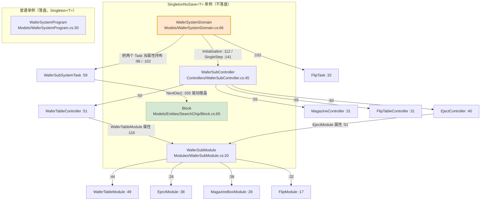

> 注意 `WaferSubController` 与 `WaferSubModule` 都挂在 `SingletonNoSave<T>` 下 ——
> **它们不落盘**。落盘的只有 `WaferSystemProgram`（`Singleton<T>`）和配置类。

**图 3：配置类继承层次（`BaseDsSetting` 线）**

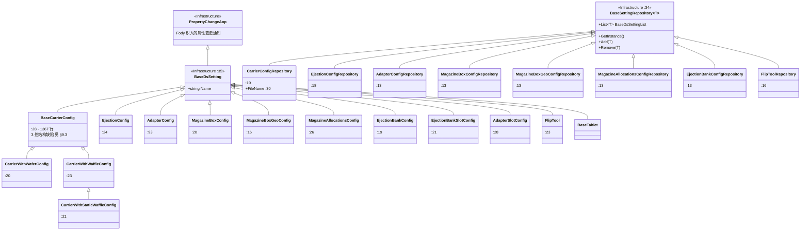

**ASCII 版（图 3 的主干）**

```text
   [Infrastructure] PropertyChangeAop
                     |
                     v
   [Infrastructure:35] BaseDsSetting          (有 Name 字段 —— 所有外键靠它)
          |      |      |      |      |      |
          |      |      |      |      |      +--> BaseTablet (:17, abstract)
          |      |      |      |      |              +-- WaferTablet   (:18)
          |      |      |      |      |              +-- AdapterTablet (:18)
          |      |      |      |      |              +-- NullTablet    (:10)
          |      |      |      |      |
          |      |      |      |      +--> FlipTool (:23)
          |      |      |      |
          |      |      |      +--> EjectionBankSlotConfig (:21)  --Name--> EjectionConfig
          |      |      |      +--> AdapterSlotConfig      (:28)  --Name--> CarrierWithWaffleConfig
          |      |      |
          |      |      +--> MagazineBoxGeoConfig (:16)  <--+
          |      |      +--> MagazineBoxConfig    (:20)  --+ (靠 MagazineBoxGeoName)
          |      |      +--> MagazineAllocationsConfig (:26)
          |      |
          |      +--> EjectionConfig     (:24)
          |      +--> EjectionBankConfig (:19)
          |
          +--> BaseCarrierConfig (:28, 1367 行)
                    |
                    +-- CarrierWithWaferConfig        (:20)
                    +-- CarrierWithWaffleConfig       (:23)
                              |
                              +-- CarrierWithStaticWaffleConfig (:21)

   [Infrastructure:34] abstract BaseSettingRepository<T>   (BaseDsSettingList)
          |
          +-- CarrierConfigRepository              (:19)  FileName :30
          +-- EjectionConfigRepository             (:18)
          +-- EjectionBankConfigRepository         (:13)
          +-- AdapterConfigRepository              (:13)
          +-- MagazineBoxConfigRepository          (:13)
          +-- MagazineBoxGeoConfigRepository       (:13)
          +-- MagazineAllocationsConfigRepository  (:13)
          +-- FlipToolRepository                   (:16)
```

**图 4：料片与搜晶算法线（`Block` 的 5 个分部 + 异常）**

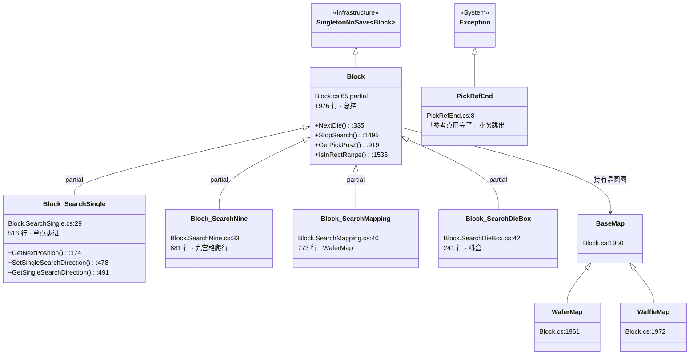

> 🔴 **图 4 里最该记住的一件事**：`PickRefEnd` 继承的是 **`System.Exception`**（`PickRefEnd.cs:8`）。
> 也就是说"这一片的参考点取完了"这个**正常业务事件**，在类型系统里和一个真正的空引用异常
> **没有任何区别**。`Dowork()` 的 `catch (Exception)`（`Tasks/WaferSubSystemTask.cs:375`）
> 会把两者一起吞掉 —— 这就是 §9.2 的 R-16 为什么严重。


### 3.3 关键类型速查

**你要改某个功能，应该去哪个文件？** 按下面这张表找，比翻目录快。

| 我想改… | 去哪儿 | 关键入口 `文件:行` |
|---|---|---|
| **下一颗芯片怎么选**（步进/换行/换块） | `Models/Entities/SearchChip/` | `Block.NextDie()` `Block.cs:335` → 4 个分部 |
| **单点搜索的步距与折返方向** | `Block.SearchSingle.cs` | `GetNextPosition()` `:174`，步距公式在 `:183-184` |
| **搜不到时的重试次数** | `Block.SearchSingle.cs` | `retryTimes = 50` `:499` |
| **晶圆台怎么移动**（换料位/准备位/扫描位/手动位） | `Controllers/WaferTableController.cs` | `MoveWaferTableToXxxPosition()` `:257` / `:268` / `:279` / `:290` |
| **怎么把料片放进去 / 拿出来** | `Controllers/WaferTableController.cs` | `PlaceWaferInSlot()` `:964`、`RemoveWaferFromSlot()` `:1059`、`PreChangeTablet()` `:616` |
| **顶针什么时候顶、顶多高** | `Controllers/EjectController.cs` + `Models/DeviceParams/EjectDevicePara.cs` | `MoveEjectToReadyLiftPosition()` `:192`、`MoveEjectionTableToWorkPosition()` `:273` |
| **顶针换头（换型号）** | `Controllers/EjectController.cs` + `Models/Programs/EjectionBankProgram.cs` | `ChangeEjection()` `:452` / `:493`、`ReturnEjection()` `:605` |
| **料盒怎么升降、哪一层有料** | `Controllers/MagazineController.cs` | `JudgeNeedChipAtLayerIndex()` `:172`、`JudgeNeedChipAtAdapterSlotIndex()` `:217`、`SlotScan()` `:280` |
| **翻转台动作** | `Controllers/FlipTableController.cs` + `Modules/FlipModule.cs` | `FlipTableGoHome()` `:118`、`FlipModule.MoveT()` `FlipModule.cs:54` |
| **线程什么时候起、什么时候停** | `Tasks/WaferSubSystemTask.cs` | `Start()` `:1372`、`Dowork()` `:64`、`AbortWaferSubThread()` `:1430`（**空方法**，见 §9.6） |
| **等 Bond 要片的信号** | `Tasks/WaferSubSystemTask.cs` | `IsBondNeedChipSignal.Wait()` `:80`、`.ReSet()` `:322` |
| **单步调试放行** | `Models/WaferSystemDomain.cs` | `SingleStep()` `:141-151`（**无超时**，见 §4.8） |
| **参数存哪儿 / 怎么存** | `Models/DeviceParams/`、`Models/Repositories/` | `WaferSubDevicePara.cs:19`、`CarrierConfigRepository.cs:19`，路径在 `ZX2200PathConfig.cs` |
| **硬件叫什么名字** | `Modules/` | `HardwareRepositoryService.GetHardware<T>("中文硬件名")`，见 §6.3 |
| **坐标怎么换算** | `Services/CoordinateSystemHelper.cs` + `MachineCoordinateSystem` | `SelfPosToG0()` / `G0PosToSelf()`，见 §5.8 |

**按「危险程度」排序的速查**（只看前三行也够）：

| 类型 | 为什么危险 |
|---|---|
| `WaferSubSystemTask.Dowork()` | 一个 catch 吞掉所有异常并停机（`:375-383`）。任何搜晶问题都会表现为"线程停了、只弹一个框" |
| `BaseCarrierConfig` | 1,367 行、3 处结构缺陷（`:1129` / `:1142` / `:1225`），且被界面和算法同时大量读取 |
| `WaferTableDevicePara.SingleSearchDirectionCurrent` | **setter 静默丢弃写入**（`WaferTableDevicePara.cs:375-396`），改了没反应还查不出原因 |
| `EjectController.CheckEjectionAxisZAtReadyLiftPosition()` | 无保护的解引用（`:1018`），`CurrentSlotConfig` 为 null 时直接 NRE |
| `MagazineController.SlotScan(int)` | 死代码：`:357` 一句 `return;` 让 `:359-394` 永不执行 |


---

## 4. 驱动源与触发点

### 4.1 为什么这一节不叫「按钮」

**先说结论：本篇范围内一个按钮都没有，所以本节把「按钮」换成了「驱动源」。**

本系列的 §4 标准标题是「UI 按钮与交互流程」，因为那套文档写的是 `Controls/` 目录 ——
里面有窗体、有用户控件、有 `_Click` 处理器。**但本篇的范围是 `Controllers/` `Tasks/` `Modules/`
`Services/` `Models/` 五个子目录，里面连一个 `System.Windows.Forms.Button` 都没有。**
（那部分内容在配套 `08-晶圆系统界面层.md` 和姊妹篇 `35-晶圆系统全景与流程图（下）· 界面与按钮流程.md` 里。）

如果你按"按钮"的预期翻到这一节，你会空手而归。所以这一节明确改名为 **「驱动源与触发点」**。

**关键认识：没有按钮 ≠ 没有触发点。** 恰恰相反，一个**没有界面**的模块，
它的触发点反而更值得画清楚，因为**你没法靠"点一下看看"来理解它**。本模块的"按钮"是这四类东西：

| 本模块的"按钮" | 具体是什么 | 数量 | 本节位置 |
|---|---|---|---|
| **后台线程主循环** | `WaferSubSystemTask.Dowork()` 里那个 `while (Signal.WaitStart())` | 2 条线程（晶圆 + 翻转） | §4.3、§4.7 |
| **跨模块信号握手** | `IsBondNeedChipSignal` 等 5 个信号量 —— Bond 侧"按下"它们，晶圆侧响应 | 5 个信号 | §4.4 |
| **状态变化触发的重入** | 换料片、搜晶失败重试、单步放行 —— 由**内部状态**（不是用户点击）触发 | 3 条主路径 | §4.5、§4.6、§4.8 |
| **任务层"反向打开"的示教窗体** | 晶圆工作线程运行到某些条件时，**自己弹出有按钮的示教窗体** —— 入口在任务层，不在界面层 | 6 处调用点（5 处直接 `new` + 1 处反射） | §4.9 |
| **界面回调（唯一像按钮的）** | 界面层调 `WaferSubController` 的公有方法；以及从工作线程 `BeginInvoke` 回 UI 的编组 | 12 处 `SendUiAction` / 4 处 `BeginInvoke` / 8 处 `EndInvoke` | §4.10 |

> **特别说明第五行**：本目录虽然是"没有界面"的一侧，但它**反过来打开了一些有界面的窗体**。
> 这些窗体的入口完全不在界面上，而是**晶圆工作线程跑到某个条件时自己弹出来的**，
> 而且它们里面的"保存"按钮会**直接改配方 / 晶圆图数据并落盘**。
> 如果你只按"界面上有哪些按钮"去找，这些窗体会被彻底漏掉 —— 它们单列一节（§4.9）。

**统一画法**：不管是哪一类，本节都按同一个四段式画：

> **触发**（什么条件下开始）→ **校验**（开始前检查什么，不通过怎么办）
> → **动作**（真正干了什么）→ **结果**（成功之后是什么状态、失败之后是什么状态）

并且**每一张图都必须画出**：

- **失败分支**：校验不通过、硬件超时、搜不到片；
- **超时分支**：等信号等不到、等传感器等不到；
- **取消分支**：`Machine.GetInstance().Stop()` 被按下之后怎么退出；
- **重入分支**：这条路径正在跑时又被触发一次会怎样。

> ⚠️ **本节最重要的一句前置警告**：本模块的**取消机制是不完整的**。
> 两条长跑线程（`WaferSubSystemTask`、`FlipTask`）创建时传的都是 `CancellationToken.None`
> （`Tasks/WaferSubSystemTask.cs:1385-1393`），所以 `Task` 层面的取消**永远不生效**；
> 而唯一看起来像"停止线程"的 `AbortWaferSubThread()`（`:1430-1436`）**方法体是空的**
> （内容全被注释掉了）。真正的"停止"只有一条路：**让某个异常冒泡到 `Dowork()` 的 catch**（`:375`）。
> 这决定了本节所有图的"取消分支"长得都一样 —— 见 §4.10。


### 4.2 驱动源总表

本节共 **9 个驱动源**。前 5 个是"跨模块信号"（Bond 侧按下，晶圆侧响应），
第 6~7 个是"内部状态重入"，第 8 个是"线程自身的启动/存活"，第 9 个是"界面回调"。

| # | 驱动源 | 种类 | 定义 / 触发点 `文件:行` | 触发条件 | 响应动作 | 详图 |
|---|---|---|---|---|---|---|
| D1 | `IsBondNeedChipSignal` | 信号（**`ManualReset`**） | 定义 `AKRS.Galaxy2.Machine/Models/SignalPool.cs:147`；晶圆侧等 `Tasks/WaferSubSystemTask.cs:80` | Bond 侧吸嘴准备取片，按下信号 | 唤醒晶圆线程，去准备"下一颗要取的芯片" | §4.4 |
| D2 | `IsWaferAllowPickSignal` | 信号（`AutoReset`） | 定义 `SignalPool.cs:142`；晶圆侧置位 `Tasks/WaferSubSystemTask.cs:324` | 晶圆侧已把片子顶到位、允许吸嘴下来 | 放行 Bond 侧取片 | §4.4 |
| D3 | `IsBondPickSucceedSignal` | 信号（`AutoReset`） | 定义 `SignalPool.cs:136`；晶圆侧等 `Tasks/FlipTask.cs:239` | Bond 侧报告"取到了" | 翻转流程继续 / 晶圆侧收尾 | §4.4、§4.7 |
| D4 | `IsFlipTableAllowPickSignal` | 信号（`AutoReset`） | 定义 `SignalPool.cs:167`；**由晶圆侧置位** `Tasks/FlipTask.cs:236` | 翻转台已把片子翻好、允许取 | 让 Bond 侧从翻转台取片 | §4.7 |
| D5 | `System2SingleStepSignal` | 信号（`AutoReset`） | 定义 `SignalPool.cs:60`；晶圆侧等 `Models/WaferSystemDomain.cs:145` | 面板上"单步"被按下 | **放行一次**硬件动作，然后重新阻塞 | §4.8 |
| D6 | **换料片**（`ChangeTabletAuto` / `ChangeTabletManual`） | 内部状态重入 | `Tasks/WaferSubSystemTask.cs:140`（自动）、`:1005`（手动，死代码） | 当前料片搜完了 / Bond 要的芯片名换了 / 用户按了换料 | 卸旧料 → 取新料 → 回到搜晶 | §4.5 |
| D7 | **搜晶失败重试**（`RetrySelectPoint`） | 内部状态重入 | `Tasks/WaferSubSystemTask.cs:196` | `NextDie()` 抛异常 / 搜不到片 / 用户选"重试" | 重新选参考点再搜，或换料片 | §4.6 |
| D8 | **线程启动与存活** | 线程 | `Tasks/WaferSubSystemTask.cs:1372`（`Start()`）、`:69`（`while (Signal.WaitStart())`） | 整机初始化时调 `Start()` | 起一条 `LongRunning` Task，跑 `Dowork()` 直到异常 | §4.3 |
| D9 | **界面回调 / UI 编组** | 方法调用 + `BeginInvoke` | `Controllers/WaferSubController.cs:229` 等公有方法；工作线程回 UI 见 §4.9 | 用户在界面上动作 | 走 §4.5 / §5 的各条路径 | §4.9 |

**5 个信号的定义细节**（这张表的每一行都是我逐行读出来的，来自平台仓库
`AKRS.Galaxy2.Machine/Models/SignalPool.cs`，不属于本篇范围，但**不读它就理解不了晶圆侧的行为**）：

| 信号 | 定义处 | 复位模式 | 轮询周期（`Signal` 构造第 2 参） | 备注 |
|---|---|---|---|---|
| `IsBondNeedChipSignal` | `SignalPool.cs:147` | **`ManualReset`** | 100 ms | **手动复位** —— 所以晶圆侧收到后必须显式 `ReSet()`（`Tasks/WaferSubSystemTask.cs:322`），否则会一直保持"按下" |
| `IsWaferAllowPickSignal` | `SignalPool.cs:142` | `AutoReset` | 100 ms | 源码注释里写着 **`todo:改超时时间`**（`SignalPool.cs:140`）—— 作者自己也知道这个值待定 |
| `IsBondPickSucceedSignal` | `SignalPool.cs:136` | `AutoReset` | 100 ms | — |
| `IsFlipTableAllowPickSignal` | `SignalPool.cs:167` | `AutoReset` | 100 ms | ⚠️ **它没有被加进 `SignalPool.SignalList`**（`Init()` 在 `:193-214` 逐条添加，没有这一条）—— 若初始化时靠遍历 `SignalList` 统一复位信号，这个信号会被漏掉 |
| `System2SingleStepSignal` | `SignalPool.cs:60` | `AutoReset` | 100 ms | 同样不在 `SignalList` 里 |

> 🔴 **一个必须纠正的常见误解：第 2 个构造参数不是"超时时间"，而是轮询周期。**
> `Signal` 的构造函数签名是
> `Signal(string name, int recycleTime, EventResetMode mode, bool initialState)`
> （`AKRS.Galaxy2.Machine/Models/Signal.cs:75-81`），第 2 个参数落到字段 `recycleTime`
> （`:41`，默认 5）。而 `Wait()`（`:116-145`）的真实循环体是：
>
> ```csharp
> do
> {
>     if (MachineStateModel.GetInstance().MachineState == MachineStateEnum.Stop)
>         return false;                       // :129-132
>     Thread.Sleep(5);                        // :134
> }
> while (!this.signalEvent.WaitOne(this.recycleTime));   // :136
> ```
>
> 也就是说 **`Wait()` 会一直循环等下去，永远不会因为"超时"返回**；
> `recycleTime` 只是每一轮 `WaitOne` 的等待上限（用来周期性检查设备是否已停机）。
> **唯一的退出条件是：信号到了，或者设备状态变成了 `Stop`**（`:129`）。
> 这个区别很关键 —— 它意味着 §4.4 里"等不到信号"的路径**不是超时路径，是停机路径**。

> 🔴 **另一个必须知道的坑：`Wait(int outTime)` 的超时参数被忽略了。**
> `AKRS.Galaxy2.Machine/Models/Signal.cs:153-169` 这个"带超时的 `Wait`"，
> 最后一句是 `return this.signalEvent.WaitOne(this.recycleTime);`（`:168`）——
> **传进来的 `outTime` 从头到尾没被用过**，用的还是 `recycleTime`；
> 而且它**只等一轮、不循环**。所以 `Wait(5000)` 表达的是"最多等 100 毫秒"，
> 与调用者的预期完全相反。
> 好消息是：本篇范围内**没有任何地方调用 `Wait(int)`**（`grep -rn -E "\.Wait\([0-9]" WaferSubSystem/` 命中 0），
> 所以这个坑目前**没有被触发**，但它是"照着名字用就会上当"的典型。见 §9.5 的 R-31。

> 🔴 **`IsBondNeedChipSignal` 用 `ManualReset` 是这里最需要留意的设计**。
> 意思是：Bond 侧一旦按下，这个信号**会一直保持"有信号"状态，直到有人显式复位**。
> 晶圆侧的应对写在 `Tasks/WaferSubSystemTask.cs:322`（`ReSet()`）—— 位置在**一轮取片流程的末尾**。
> 如果你在这两者之间插入了任何提前 `return` / `throw` 的路径，信号就**永远不会被复位**，
> 表现为"Bond 侧一直在等、晶圆侧不动"。这条路径详见 §4.4 的失败分支。


### 4.3 晶圆工作线程主循环

晶圆侧的**一切**都发生在这一个方法里：`WaferSubSystemTask.Dowork()`
（`Tasks/WaferSubSystemTask.cs:64-391`）。它是一条 `while` 循环，一轮 = 服务一次 Bond 的取片请求。

**图 5：晶圆工作线程主循环 `Dowork()`**

```mermaid
flowchart TD
    START(["线程启动 Start() :1372"]) --> TRY["进入 try :66"]
    TRY --> WBN["WaitBondNeed: 标签 :68"]
    WBN --> W1{"while (Signal.WaitStart()) :69<br/>整机还在运行?"}
    W1 -->|"否 → 循环结束"| FIN["finally :386"]
    W1 -->|"是"| DRY{"IsAloneDryCycle :72<br/>单独空跑?"}
    DRY -->|"是"| DRY2["Thread.Sleep(DelaySearchDieContinue) :74<br/>IsBondNeedChipSignal.Set() :75"]
    DRY -->|"否"| REC
    DRY2 --> REC["Static.RecordTime 记录 :78"]
    REC --> W2{"IsBondNeedChipSignal.Wait() :80<br/>Bond 要料了吗?"}
    W2 -->|"否（超时/未按下）"| WBN
    W2 -->|"是"| W3{"料片存在吗 :115<br/>GetCarriers().Exists(Name==CurrentNeedChipName)"}
    W3 -->|"不存在"| E1["（🔴 throw \"Bond需要的料片不存在\" :123）"]
    W3 -->|"存在"| CFG["currentNeedCarrierConfig =<br/>CarrierConfigRepository.Find(Name) :117-118"]
    CFG --> NC0{"CurrentTablet is NullTablet :126<br/>或 芯片名变了?"}
    NC0 -->|"是"| SETSIG["SetChangeCarrierSignal() :129"]
    NC0 -->|"否"| NC
    SETSIG --> NC["NeedChange: 标签 :132"]
    NC --> NC1{"IsNeedChange :134<br/>需要换料片?"}
    NC1 -->|"是"| CHA{"ChangeTabletAuto() :140<br/>换料片成功?"}
    CHA -->|"否"| E2["（🔴 DBService.Insert 报警 :146<br/>throw \"更换料片失败！\" :149）"]
    CHA -->|"是"| NC2["DBService.Insert(报警记录) :156"]
    NC1 -->|"否"| SRCH
    NC2 --> SRCH{"Block.NextDie() :162<br/>搜到片了吗?"}
    SRCH -->|"是"| OK1["PreviousNeedChipName = CurrentNeedChipName :256"]
    SRCH -->|"否"| NF1{"IsNeedChange :165"}
    NF1 -->|"否"| E3["（🔴 throw \"搜晶失败！\" :252）"]
    NF1 -->|"是"| NF2{"CurrentTablet is WaferTablet :167"}
    NF2 -->|"否"| NC
    NF2 -->|"是"| NF3{"SearchMode == WaferMap :169"}
    NF3 -->|"是"| NC
    NF3 -->|"否"| NF4{"IsDryCycle :189<br/>空跑?"}
    NF4 -->|"是"| NC
    NF4 -->|"否"| RSP["RetrySelectPoint: 标签 :196<br/>VisionAlarmFunc 弹视觉报警 :215"]
    RSP --> RSP2{"switch (result1.dialog) :218<br/>用户选了什么?"}
    RSP2 -->|"OK"| NC
    RSP2 -->|"Retry"| RSP3{"位置在搜索范围内吗 :223"}
    RSP3 -->|"否"| RSP
    RSP3 -->|"是"| RSP4["ReSetChangeCarrierSignal() :237<br/>SlotState = Good :239<br/>AsyncSaveWaferSubDevicePara() :240"]
    RSP4 --> NC
    RSP2 -->|"（无 default 分支）"| RSP2B["⚠ 落到 switch 之外，<br/>继续往下走 :243-249"]

    OK1 --> VAC{"IsOpenWaferTableVacuumBeforePick :259"}
    VAC -->|"是"| VAC1["switch(CarrierType) :261<br/>Wafer→EjectController.OpenEjectionTableVacuum() :264<br/>Waffle→WaferTableController.OpenWaffleVacuum() :270<br/>⚠ StaticWaffle 无分支"]
    VAC -->|"否"| VAC2["switch(CarrierType) :279<br/>Wafer→CloseEjectionTableVacuum() :282<br/>Waffle→CloseWaffleVacuum() :288"]
    VAC1 --> SIG
    VAC2 --> SIG["IsBondNeedChipSignal.ReSet() :322"]
    SIG --> SIG2["IsWaferAllowPickSignal.Set() :324<br/>（放行 Bond 取片）"]
    SIG2 --> TAIL{"IsAloneDryCycle :331"}
    TAIL -->|"是"| TAIL1["RefreshMap(true) :333<br/>times++ :334"]
    TAIL -->|"否"| TAIL3
    TAIL1 --> TAIL3{"IsRecordSearchData & IsAloneDryCycle :338"}
    TAIL3 -->|"是"| XLS["EPPlus 写 D:\\连续搜索实验.xlsx :344-365"]
    TAIL3 -->|"否"| SO
    XLS --> SO{"IsSearchOne :369"}
    SO -->|"是"| STOP1["Machine.GetInstance().Stop() :371"]
    SO -->|"否"| W1
    STOP1 --> W1
    E1 -.-> CATCH
    E2 -.-> CATCH
    E3 -.-> CATCH
    CATCH["catch (Exception exception) :375<br/>AKRSMessageBoxExt.Show(..., \"晶圆线程即将停止！\") :378<br/>Machine.GetInstance().Stop() :383<br/>⚠ 不重抛 · 不写日志"] -.-> FIN
    FIN["finally :386<br/>EjectController.MoveEjectToReadyLiftPositionAndBlow() :389"] --> END(["线程结束"])

    style E1 fill:#f8cecc,stroke:#b85450
    style E2 fill:#f8cecc,stroke:#b85450
    style E3 fill:#f8cecc,stroke:#b85450
    style CATCH fill:#f8cecc,stroke:#b85450,stroke-width:2px
    style SIG2 fill:#d5e8d4,stroke:#82b366
    style RSP2B fill:#ffe6cc,stroke:#d79b00
    style VAC1 fill:#ffe6cc,stroke:#d79b00
```

**ASCII 版**

```text
   [Start() :1372] --起线程--> [try :66]
        |
        v
  +--> WaitBondNeed: :68
  |     |
  |     v
  |   <while Signal.WaitStart() :69> --否--> [finally :386] --> 线程结束
  |     | 是
  |     v
  |   <IsAloneDryCycle :72> --是--> [Sleep + IsBondNeedChipSignal.Set() :74-75]
  |     |                                         |
  |     | 否                                      |
  |     +<----------------------------------------+
  |     v
  |   <IsBondNeedChipSignal.Wait() :80> --否--> (回 WaitBondNeed)
  |     | 是
  |     v
  |   <料片存在? :115> --否--> [throw "Bond需要的料片不存在" :123] --.
  |     | 是                                                      |
  |     v                                                        |
  |   [currentNeedCarrierConfig = Find(Name) :117]                |
  |     |                                                        |
  |     v                                                        |
  |   <NullTablet 或 名字变了 :126> --是--> [SetChangeCarrierSignal :129]
  |     | 否                            |                        |
  |     +<------------------------------+                        |
  |     v                                                        |
  |   NeedChange: :132                                           |
  |     |                                                        |
  |     v                                                        |
  |   <IsNeedChange :134> --是--> <ChangeTabletAuto() :140>       |
  |     | 否                        | 成功         | 失败        |
  |     |                           v              v             |
  |     |                    [Insert 报警 :156]  [throw "更换料片 |
  |     |                           |            失败！" :149] ---+
  |     +<--------------------------+                            |
  |     v                                                        |
  |   <Block.NextDie() :162> --是--> [记 PreviousNeedChipName :256]|
  |     | 否                                                      |
  |     v                                                        |
  |   <IsNeedChange :165> --否--> [throw "搜晶失败！" :252] -------+
  |     | 是
  |     v
  |   <is WaferTablet :167> --否--> (回 NeedChange)
  |     | 是
  |     v
  |   <SearchMode==WaferMap :169> --是--> (回 NeedChange)
  |     | 否
  |     v
  |   <IsDryCycle :189> --是--> (回 NeedChange)
  |     | 否
  |     v
  |   RetrySelectPoint: :196
  |     |
  |     v
  |   [补位检查 :223] <--否--+   [VisionAlarmFunc 弹窗 :215]
  |     | 是                |        |
  |     v                   |        v
  |   [ReSet + SlotState=Good|<--<switch result1.dialog :218>
  |    + AsyncSave :237-240] |       | OK          | Retry
  |     |                   |        v             v
  |     |                   |   (回 NeedChange)  [检查在范围内 :223]
  |     |                   |                    | 在   | 不在
  |     |                   |                    v      v
  |     |                   |              [ReSet ...] (回 RetrySelectPoint)
  |     |                   |        ⚠ 无 default -> 掉出 switch 往下走
  |     v                   |
  |   <IsOpenWaferTableVacuumBeforePick :259>
  |     | 是                                | 否
  |     v                                   v
  |   [switch CarrierType :261]           [switch CarrierType :279]
  |   Wafer -> OpenEjectionTableVacuum     Wafer -> CloseEjectionTableVacuum
  |   Waffle-> OpenWaffleVacuum            Waffle-> CloseWaffleVacuum
  |   ⚠ StaticWaffle -> 无分支           ⚠ StaticWaffle -> 无分支
  |     |                                   |
  |     +<----------------------------------+
  |     v
  |   [IsBondNeedChipSignal.ReSet() :322]         <-- ManualReset 必须显式复位
  |     v
  |   [IsWaferAllowPickSignal.Set() :324]         <-- 放行 Bond 取片 (绿)
  |     v
  |   <IsAloneDryCycle :331> --是--> [RefreshMap(true) :333, times++ :334]
  |     |                                   |
  |     +<----------------------------------+
  |     v
  |   <IsRecordSearchData & IsAloneDryCycle :338> --是--> [EPPlus 写 Excel :344-365]
  |     |                                                          |
  |     +<---------------------------------------------------------+
  |     v
  |   <IsSearchOne :369> --是--> [Machine.Stop() :371]
  |     |
  |     +----------> 回到 while 顶部 (W1)
  |
  +--- 任意异常 ---> [catch :375] --> [弹窗 "晶圆线程即将停止！" :378]
                                    --> [Machine.Stop() :383]
                                    --> ⚠ 不重抛、不写日志
                                    --> [finally :386]
                                    --> [MoveEjectToReadyLiftPositionAndBlow() :389]
                                    --> 线程结束
```

**这一轮循环「读了什么、写了什么」**

| 读 | 位置 | 写 | 位置 |
|---|---|---|---|
| `Signal.WaitStart()`（整机运行标志） | `:69` | `IsBondNeedChipSignal.Set()`（空跑时自触发） | `:75` |
| `IsAloneDryCycle` | `:72` / `:88` / `:296` / `:304` / `:331` / `:338` | `currentNeedCarrierConfig` | `:117` |
| `currentNeedCarrierConfig.IsOpenWaferTableVacuumBeforePick` | `:259` | `PreviousNeedChipName` | `:256` |
| `WaferSubDevicePara...CurrentTablet` | `:126` / `:167` / `:238` | `CurrentTablet.SlotState = SlotStatuEnum.Good` | `:239` |
| `wt.CarrierConfigWithWafer.SearchMode` | `:169` | `IsBondNeedChipSignal.ReSet()` | `:322` |
| `Block.GetInstance().NextDie()`（搜晶结果） | `:162` | `IsWaferAllowPickSignal.Set()` | `:324` |
| `MachineStateModel.GetInstance().IsDryCycle` | `:189` | `times` | `:334` |
| `IsSearchOne` / `IsRecordSearchData` | `:369` / `:338` | `D:\连续搜索实验.xlsx`（EPPlus 落盘） | `:365` |

**坑（这一节最要紧的部分）**

> 🔴 **坑 1：`catch` 把整个循环一起吞了。** `try` 从 `:66` 开始，`catch` 在 `:375`，
> 中间的 `while` 在 `:69` **整个包在里面**。所以"这一轮搜晶失败"和"整条线程完蛋"
> 在代码上是**同一件事** —— 都会打印"晶圆线程即将停止！"并停机，且**不重抛、不写日志**
> （`:378-383`）。`throw new Exception("搜晶失败！")`（`:252`）和
> `throw new Exception("Bond需要的料片不存在")`（`:123`）都会走到这条路上。
> 完整后果见 §9.2 的 R-16。

> 🔴 **坑 2：`switch (result1.dialog)` 没有 `default`**（`:218-242`）。
> `VisionAlarmFunc` 返回的 `dialog` 如果不是 `OK` 也不是 `Retry`（例如用户直接关掉窗口、
> 或返回 `Cancel`/`Abort`），`switch` 会**静默地什么也不做**，
> 然后控制流从 `:243` 继续往下 —— 也就是**当作"搜到了"继续走后面的开真空、发允许取料信号**。
> 这与 §9.1 的 R-07 是同一类问题（弹窗 `switch` 缺 `default`）。

> ⚠️ **坑 3：`StaticWaffle` 在两个真空 `switch` 里都无分支。**
> `:261` 和 `:279` 两个 `switch (currentNeedCarrierConfig.CarrierType)` 都只写了
> `Wafer` 和 `Waffle`；`StaticWaffle` 的 `case` 已被注释掉
> （`:266-268`、`:284-286`），而 `switch` 又没有 `default`。
> 所以当料片类型是 `CarrierTypeEnum.StaticWaffle` 时，**既不真开真空也不真关真空**。
> 静态华夫盒的真空另有 `WaferTableModule.StaticWaffleVacuum`
> （`Modules/WaferTableModule.cs:163`），所以这里到底是"故意留给别处处理"还是"漏了"，
> 我**不能确定** —— 按写作规范标为 ⚠️，不写成 🔴。*（推断：若是漏写，表现为静态华夫盒取片时吸附力不足；
> 但该分支从未在源码里被显式补偿，故存疑。）*

> 🔴 **坑 4：`IsBondNeedChipSignal` 是 `ManualReset`，但 `ReSet()` 在很后面。**
> 信号的复位在 `:322`，而在这之前有：料片不存在抛异常（`:123`）、换料片失败抛异常（`:149`）、
> 搜晶失败抛异常（`:252`）**三条 `throw` 路径**，以及 `goto NeedChange`（`:171`/`:192`/`:221`/`:234`/`:241`）
> 这条**循环回去的路径**。走 `goto NeedChange` 时不会执行 `:322`，
> 于是信号**保持按下状态**；下一轮 `:80` 的 `Wait()` 会**立即通过** —— 这不是 bug（正是想要的"继续要片"），
> 但走三条 `throw` 路径时信号**永远不会被复位**，整机停机后信号仍然亮着。
> 这是 §9.6 里「信号状态与线程状态不同步」那条的实体。

> ⚠️ **坑 5：`IsSearchOne` 会让整机停机**（`:369-372`）。
> 这是"只搜一片"的调试开关，一旦为真，跑完一轮就 `Machine.GetInstance().Stop()`。
> 如果你在排查"为什么设备自己停了"，先看这个标志。


### 4.4 Bond 侧取片握手信号

整机里"晶圆侧"和"Bond 侧"是两个互不认识的模块，它们**不直接调对方的方法**，
而是靠 `SignalPool`（`AKRS.Galaxy2.Machine/Models/SignalPool.cs:10`）里的**5 个信号量**对话。
这一步是本模块最重要的"外部事件回调"。

**图 6：一次取片的完整信号握手（正常路径 + 三条失败路径）**

```mermaid
sequenceDiagram
    autonumber
    participant W as 晶圆线程<br/>WaferSubSystemTask
    participant SP as SignalPool
    participant F as 翻转线程 FlipTask<br/>（或 Bond 侧 PickActionNode）
    participant B as Bond 侧吸嘴

    Note over W: WaitBondNeed 标签 :68
    W->>SP: IsBondNeedChipSignal.Wait() :80
    Note right of W: ⚠ 等不到就 goto WaitBondNeed :82-83<br/>（ManualReset 信号，超时 100）
    SP-->>W: （阻塞中……）

    F->>SP: SetCurrentNeedChipName(component.Name) :140
    F->>SP: IsBondNeedChipSignal.Set() :143
    Note right of F: 在 Task.Run 里轮询翻转台角度<br/>curPos > SearchComponentAvoidancePos :121<br/>超过 10 秒弹超时框 :151-173

    SP-->>W: 信号到达，Wait() 返回 true
    W->>W: 查料片存在 :115 → 取配置 :117
    W->>W: Block.NextDie() 搜晶 :162
    W->>W: 开真空 :261/:279 → 移动/顶针/聚焦
    W->>SP: IsBondNeedChipSignal.ReSet() :322
    W->>SP: IsWaferAllowPickSignal.Set() :324
    W->>W: RefreshMap(true) :333（空跑时）

    SP-->>B: 放行
    F->>SP: IsWaferAllowPickSignal.Wait() :101（FlipTask）/ Bond 侧同款等待
    B->>B: 吸嘴下来取片
    B->>SP: IsBondPickSucceedSignal.Set() :433（Bond 侧 PickActionNode）
    SP-->>F: IsBondPickSucceedSignal.Wait() :239 返回
    F->>F: 继续下一颗

    Note over W,F: ══ 失败路径 ══
    W-->>W: 【失败 A】料片不存在 :123 → throw → catch :375 → 停机
    W-->>W: 【失败 B】搜晶失败 :252 → throw → catch :375 → 停机
    W-->>W: 【失败 C】换料片失败 :149 → throw → catch :375 → 停机
    Note right of W: 三条路径都<br/>⚠ 不执行 :322 的 ReSet()<br/>⚠ 不写日志
```

**ASCII 版**

```text
   晶圆线程               SignalPool             翻转线程 / Bond 侧
      |                      |                        |
      | IsBondNeedChipSignal.Wait() :80               |
      |--------------------->|                        |
      |       (阻塞)          |                        |
      |                      |<-- Set() :143 ---------|
      |                      |    (先 SetCurrentNeedChipName :140)
      |<-- 信号到达 ----------|                        |
      |                      |                        |
      | [查料片 :115 / 取配置 :117]                    |
      | [Block.NextDie() 搜晶 :162]                    |
      | [开真空 :261/:279 -> 移动 / 顶针 / 聚焦]        |
      |                      |                        |
      | ReSet() :322 ------->|                        |
      | Set(IsWaferAllowPickSignal) :324 ------------->|
      |                      |                        |
      |                      |---- 放行 ------------->| IsWaferAllowPickSignal.Wait() :101
      |                      |                        | [吸嘴取片]
      |                      |<-- IsBondPickSucceedSignal.Set() :433
      |                      |                        |
      |                      |---- 信号到达 --------->| Wait() :239 返回
  
  ┌─ 失败路径（都走 catch :375 -> 停机，且都跳过 :322 的 ReSet）───────┐
  │ A 料片不存在   :123  throw "Bond需要的料片不存在..."              │
  │ B 搜晶失败     :252  throw "搜晶失败！"                           │
  │ C 换料片失败   :149  throw "更换料片失败！"                        │
  └────────────────────────────────────────────────────────────────┘
```

**这张图的「校验 / 超时 / 取消 / 重入」四问**

| 问题 | 答案 | 位置 |
|---|---|---|
| **校验**在哪 | 信号到达后立刻查「这个料片名在不在当前料盒里」 | `:115-124` |
| **超时**会怎样 | `Wait()` 返回 `false` → `goto WaitBondNeed`（回到等下一轮），**不报错、不提示** | `:80-83` |
| **取消**怎么走 | 没有取消机制。停机是靠异常冒泡 | §4.10 |
| **重入**会怎样 | `IsBondNeedChipSignal` 是 `ManualReset`，在 `ReSet()`（`:322`）之前**一直是"按下"状态**；如果 Bond 侧连着按两次 `Set()`，第二次是**幂等**的（本来就是一直亮着），不会多跑一轮 | `SignalPool.cs:147` |

> 🔴 **这里有一个非常容易踩的坑**：`Wait()` 返回 `false` 时走的是 `goto WaitBondNeed`（`:82`），
> 也就是**静默地重新等一轮**。如果这个信号因为硬件/驱动原因一直置不上位，
> 现象是 **"晶圆侧完全不动，没有任何报警，界面上也看不出异常"** ——
> 唯一的线索是 `Static.RecordTime("取片信号交互", $"等待Bond要料中")`（`:78`）
> 打的时间戳。排查这类"卡住不动"的问题，先去翻这条记录。

> ⚠️ **翻转线程里有它自己的超时与取消**，这是本模块少见的"有考虑超时"的地方：
> `FlipTask` 在 `Task.Run` 里轮询翻转台角度（`Tasks/FlipTask.cs:117-182`），
> 超过 **10 秒**（`:151`）弹一个「翻转台发送搜晶信号超时！」的二选一框（`:153-161`）：
> `Ignore` → `sw.Restart()` 重新计时（`:166`），`Abort` → `Machine.GetInstance().Stop()` 后 `return`（`:170-171`）。
> 同时循环里每轮都查 `Machine.GetInstance().IsStop()`（`:176`），是就 `return`。
> 但注意：**这个 `switch` 也没有 `default`**（`:163-172`）——
> 如果用户点右上角关闭得到别的 `DialogResult`，会**掉出 `switch` 继续循环**，
> 也就是"超时提示关掉了但继续等"，既没重启计时器也没停。


### 4.5 换料片驱动

「换料片」是本模块最复杂的**内部状态重入**：它不是用户点出来的，
而是主循环在 `:134` 发现 `IsNeedChange` 为真、或者搜晶失败（`:165`）后决定的。

**触发条件的三个来源**（都在 `Dowork()` 里）：

| 来源 | 位置 | 含义 |
|---|---|---|
| `CurrentTablet is NullTablet` | `:126` | 晶圆台上根本没料 |
| `CurrentNeedChipName != PreviousNeedChipName` | `:127` | Bond 换了芯片型号，当前料片不对 |
| 搜晶失败后 `IsNeedChange` 仍为真 | `:165` | 这一片料上已经没有要的那种芯片了 |

**图 7：`ChangeTabletAuto()` 的三条大分支**

```mermaid
flowchart TD
    EN(["ChangeTabletAuto() :1110"]) --> D1{"IsDryCycle :1112<br/>空跑?"}
    D1 -->|"是"| D1A["SlotState = Good :1116<br/>InitTabletInfo() :1117<br/>ChangeSucceedOperation() :1120"]
    D1A --> RT["return true :1122"]
    D1 -->|"否"| D2{"IsUseMagazineLift :1125<br/>配置了料盒升降?"}
    D2 -->|"是（有料盒）"| D3{"CarrierType == StaticWaffle :1127"}
    D2 -->|"否（无料盒，默认）"| M2

    D3 -->|"是"| S1{"CurrentStaticAdapterTablet is AdapterTablet :1129"}
    S1 -->|"是"| S2["layerIndex = JudgeNeedChipAtAdapterSlotIndex :1132"]
    S1 -->|"否"| OP1
    S2 --> S3{"layerIndex < 0 :1133"}
    S3 -->|"否（已有）"| OP1
    S3 -->|"是"| S4["RetryChangeStaticAdapter: :1135<br/>SendUiAction -> FrmChangeStaticAdapterTeach.ShowDialog() :1141"]
    S4 --> S5{"res != OK :1146"}
    S5 -->|"Abort"| RF(["return false :1150"])
    S5 -->|"其它"| S4
    S5 -->|"OK"| CS1{"ChangeSucceedOperation() :1158"}
    CS1 -->|"失败"| S4
    CS1 -->|"成功"| RT2(["return true :1163"])

    D3 -->|"否（普通料片）"| M1{"CurrentLayerNo > 0 :1171"}
    M1 -->|"是"| M1A["PlaceWaferInfo() :1173"]
    M1 -->|"否"| JL
    M1A --> JL["JudgeNeedChipAtLayer: :1177<br/>layerIndex = JudgeNeedChipAtLayerIndex :1178"]
    JL --> JL1{"layerIndex < 0 :1179"}
    JL1 -->|"是"| JL2["弹窗「Magazine不存在Bond需要的芯片」 :1183<br/>switch(res) :1184 — ⚠ 无 default"]
    JL2 -->|"OK"| JL3["PlaceWaferInSlot() :1187<br/>MoveMagazineToMarkPosition() :1188<br/>弹窗「请更换Magazine」 :1190"]
    JL3 --> JL
    JL2 -->|"Cancel"| JE["（🔴 throw \"Magazine不存在Bond需要的芯片\" :1197）"]
    JL1 -->|"否"| AD{"CurrentTablet is AdapterTablet<br/>且同名 :1201-1204"}
    AD -->|"是"| OP1
    AD -->|"否"| LY{"layerIndex == CurrentLayerNo-1 :1211"}
    LY -->|"是"| PN{"PreviousNeedChipName == \"\" :1213"}
    PN -->|"是"| WS{"IsWaferSensor :1215<br/>台上有料吗?"}
    WS -->|"否"| WS2["CurrentTablet = new NullTablet() :1217<br/>CurrentLayerNo = 0 :1218<br/>Save() :1219"]
    WS2 --> JL
    WS -->|"是"| BC1["SetBlockCylinder() :1224<br/>MoveExpandToUpPosition() :1228"]
    BC1 --> OP1
    PN -->|"否"| OP1
    LY -->|"否"| PW["PlaceWaferInSlot() :1236<br/>RemoveWaferFromSlot(layerIndex) :1239"]
    PW --> OP1
    OP1["Operation: :1242<br/>ChangeSucceedOperation() :1244"] --> OPQ{"成功? :1244"}
    OPQ -->|"失败"| OP1
    OPQ -->|"成功"| RT3(["return true :1249"])

    M2{"CarrierType == StaticWaffle :1253"} -->|"是"| M2A{"layerIndex >= 0 :1259"}
    M2A -->|"是"| OP2
    M2A -->|"否"| CM
    M2 -->|"否"| M3{"CurrentTablet is WaferTablet :1268"}
    M3 -->|"是"| M4{"IsExists(Name) 且<br/>Name==CurrentNeedChipName 且 SlotState==Good :1270-1272"}
    M4 -->|"是"| M5{"IsWaferSensor :1274"}
    M4 -->|"否"| CM
    M5 -->|"否（台上无料）"| CM
    M5 -->|"是"| M6["SetBlockCylinder() :1280<br/>MoveExpandToUpPosition() :1284"]
    M6 --> OP2
    M3 -->|"否 → is AdapterTablet :1291"| M7{"layerIndex >= 0 :1295"}
    M7 -->|"否"| CM
    M7 -->|"是"| M8{"IsWaferSensor :1297"}
    M8 -->|"否"| CM
    M8 -->|"是"| M9["SetBlockCylinder() :1303"]
    M9 --> OP2

    CM["ChangeMap: :1311"] --> CM1{"CarrierType == StaticWaffle :1312"}
    CM1 -->|"是"| CM2["SendUiAction -> FrmChangeStaticAdapterTeach<br/>.ShowDialog() :1319"]
    CM2 --> CM3{"res != OK :1324"}
    CM3 -->|"Abort"| RF2(["return false :1328"])
    CM3 -->|"其它"| CM
    CM3 -->|"OK"| OP2
    CM1 -->|"否（普通料片）"| CM4["🔴 SendUiAction -> new FrmChangeTabletTeach() :1340<br/>Dispose() :1341 —— 没有 ShowDialog()！"]
    CM4 --> CM5{"res != OK :1345<br/>res 恒为 None"}
    CM5 -->|"是（永远）"| CM6{"res == Abort :1347"}
    CM6 -->|"否（永远）"| CM
    CM6 -->|"是（永不发生）"| RF3(["return false :1349"])
    OP2["Operation: :1356<br/>ChangeSucceedOperation() :1358"] --> OPQ2{"成功? :1358"}
    OPQ2 -->|"失败"| CM
    OPQ2 -->|"成功"| RT4(["return true :1363"])

    style CM4 fill:#f8cecc,stroke:#b85450,stroke-width:2px
    style CM6 fill:#f8cecc,stroke:#b85450,stroke-width:2px
    style JE fill:#f8cecc,stroke:#b85450
    style JL2 fill:#ffe6cc,stroke:#d79b00
```

**ASCII 版（只画主干与那个死循环）**

```text
  ChangeTabletAuto() :1110
    |
    +-- IsDryCycle :1112 --是--> [SlotState=Good, InitTabletInfo, ChangeSucceed] --> return true
    |
    +-- IsUseMagazineLift :1125
          |
          +== 是（有料盒）=========================================+
          |   +-- StaticWaffle :1127 --是--> [JudgeNeedChipAtAdapterSlotIndex :1132]
          |   |        layerIndex<0 ? :1133
          |   |          是 -> RetryChangeStaticAdapter: :1135
          |   |                 [FrmChangeStaticAdapterTeach.ShowDialog() :1141]
          |   |                 res!=OK? Abort->return false / 其它->重试 / OK->ChangeSucceed
          |   |          否 -> Operation
          |   +-- 普通料片 -> JudgeNeedChipAtLayer: :1177
          |        [JudgeNeedChipAtLayerIndex :1178]
          |          <0 ? :1179 --是--> [弹窗「Magazine不存在...」:1183]
          |                       |        switch(res) :1184  (⚠无default)
          |                       |          OK   -> PlaceWaferInSlot + MoveMagazineToMarkPosition
          |                       |                  + 弹窗「请更换Magazine」:1190 --> 回 Judge:
          |                       |          Cancel-> throw "Magazine不存在..." :1197
          |          |否
          |          +--> 同名 AdapterTablet? -> Operation
          |          +--> layerIndex==CurrentLayerNo-1 ? :1211
          |          |      是 -> PreviousNeedChipName=="" ? :1213
          |          |             是 -> IsWaferSensor? :1215
          |          |                    否 -> [NullTablet, CurrentLayerNo=0, Save] --> 回 Judge:
          |          |                    是 -> [SetBlockCylinder, MoveExpandToUp] --> Operation
          |          |             否 -> Operation
          |          |      否 -> [PlaceWaferInSlot :1236, RemoveWaferFromSlot :1239] --> Operation
          |          |
          |        Operation: :1242 --> ChangeSucceedOperation() :1244
          |            失败 -> 无限重试 Operation: :1246
          |            成功 -> return true :1249
          |
          +== 否（无料盒 —— IsUseMagazineLift 默认 false！）==========+
              +-- StaticWaffle :1253 --是--> layerIndex>=0 ? :1259 --是--> Operation(:1356)
              +-- 普通料片 :1265
                   +-- CurrentTablet is WaferTablet :1268
                   |      IsExists 且 同名 且 SlotState==Good :1270-1272?
                   |        是 -> IsWaferSensor? :1274
                   |                否(台上无料) -> ChangeMap
                   |                是 -> [SetBlockCylinder, MoveExpandToUp] -> Operation(:1356)
                   |        否 -> ChangeMap
                   +-- is AdapterTablet :1291
                          layerIndex>=0 :1295? 是 -> IsWaferSensor? :1297
                                                    否 -> ChangeMap
                                                    是 -> [SetBlockCylinder] -> Operation(:1356)
                                           否 -> ChangeMap
                   |
                 ChangeMap: :1311
                   |
                   +-- StaticWaffle :1312 --是--> [ShowDialog :1319] -> res!=OK?
                   |                                    Abort -> return false :1328
                   |                                    其它  -> 回 ChangeMap
                   |                                    OK    -> Operation(:1356)
                   |
                   +-- 普通料片 :1334 --否--> ┌──────────────────────────────────┐
                                              │ 🔴 new FrmChangeTabletTeach() :1340│
                                              │    Dispose() :1341  <<< 没有      │
                                              │                      ShowDialog()! │
                                              │    res = DialogResult (恒为 None)  │
                                              │  res != OK  -> 是（永远）          │
                                              │  res == Abort -> 否（永远）        │
                                              │  => goto ChangeMap :1352           │
                                              │  ==> 无限紧循环，无 UI、无 Sleep    │
                                              └──────────────────────────────────┘
                   |
                 Operation: :1356 --> ChangeSucceedOperation() :1358
                      失败 -> 回 ChangeMap :1360  （又进死循环）
                      成功 -> return true :1363
```

**读了什么、写了什么**

| 读 | 位置 | 写 | 位置 |
|---|---|---|---|
| `MachineStateModel...IsDryCycle` | `:1112` | `waferTablet.SlotState = SlotStatuEnum.Good` | `:1116` |
| `WaferSubDevicePara...MagazineDevicePara.IsUseMagazineLift` | `:1125` | `CurrentTablet = new NullTablet()` | `:1217` |
| `currentNeedCarrierConfig.CarrierType` | `:1127` / `:1253` / `:1312` | `MagazineDevicePara.CurrentLayerNo = 0` | `:1218` |
| `WaferTableDevicePara.CurrentStaticAdapterTablet` | `:1129` / `:1255` | `WaferSubDevicePara.GetInstance().Save()` | `:1219` |
| `MagazineController.JudgeNeedChipAtAdapterSlotIndex()` | `:1132` / `:1258` / `:1294` | （硬件）`SetBlockCylinder` / `PlaceWaferInSlot` / `RemoveWaferFromSlot` / `MoveExpandToUpPosition` | `:1224` / `:1236` / `:1239` / `:1284` |
| `MagazineController.JudgeNeedChipAtLayerIndex()` | `:1178` | `FrmChangeTabletTeach` / `FrmChangeStaticAdapterTeach` 的 `DialogResult` | `:1143` / `:1342` |
| `WaferTableController.IsWaferSensor` | `:1215` / `:1274` / `:1297` | | |
| `PreviousNeedChipName` | `:1213` | | |

**坑**

> 🔴 **坑 1（本节最严重，也是本篇新发现）：`FrmChangeTabletTeach` 从来没被 `ShowDialog()`。**
> `:1340`-`:1342` 三行的实际内容是：`new FrmChangeTabletTeach();` → `Dispose();` → 读 `DialogResult`。
> **中间那句 `ShowDialog()` 不见了。** 对照同一方法里的兄弟分支（`:1140-1143`
> 的 `FrmChangeStaticAdapterTeach` 是 `new` → `ShowDialog()` → `Dispose()` → 读 `DialogResult`），
> 可以看出这是**漏抄了一行**。
>
> **后果链**：`res` 在 `:1336` 被初始化成 `DialogResult.Abort`，但紧接着在 `:1342` 被覆盖为
> 一个**从未显示过的窗体**的 `DialogResult`（`Form.DialogResult` 的默认值是 `DialogResult.None`）。
> 于是：`:1345 res != DialogResult.OK` → 真 → `:1347 res == DialogResult.Abort` → **假**（`None` ≠ `Abort`）
> → `:1352 goto ChangeMap` → **回到 `:1311` 再造一个窗体、再 Dispose、再跳** ——
> **一个没有 `Thread.Sleep`、没有界面、没有日志的无限紧循环**。
> 因为 `MainForm.SendUiAction` 最终执行的是 `this.Invoke(action)`
> （`Main/Controls/MainForm.cs:50` 声明，`:61` 绑定，`:68-71` 实现，`Invoke` 是同步的），
> 所以每一圈都会**编组到 UI 线程上造/拆一个 `XtraForm` 实例**，UI 会被拖住。
>
> **触发条件比想象的宽**：进入这个分支只需要
> ①`MagazineDevicePara.IsUseMagazineLift == false`（**这是默认值**，
> 见 `Models/DeviceParams/MagazineBoxDevicePara.cs:62`）②需要换料片
> ③走到 `ChangeMap` 且 `CarrierType != StaticWaffle`。
> 也就是**没有选配料盒升降的机台，在换普通晶圆料片时就会撞上**。
>
> **同一处缺陷还有第二份**：`ChangeTabletManual()`（**死代码**，见下一条）里
> `:1083-1084` 是**一模一样**的两行。所以可以确定 `ChangeTabletAuto()` 是从
> `ChangeTabletManual()` 抄过来的，把缺陷一起抄了。见 §9.2 的 R-17。

> ⚠️ **坑 2：`ChangeTabletManual()` 是死代码。** `Tasks/WaferSubSystemTask.cs:1005` 定义了这个
> `private bool ChangeTabletManual()`，但**全仓库没有任何地方调用它**（`grep`
> 只命中定义本身；`Main/Controls/UcModule.cs:349` 那个同名方法是另一个类里的、与它无关的东西）。
> 主循环 `:140` 调的是 `ChangeTabletAuto()`。所以这一百行永远不会执行 ——
> 它唯一的价值是**当作 `ChangeTabletAuto()` 的"上一版"来对照**（上面那条缺陷就是这么定位到的）。

> ⚠️ **坑 3：`ChangeSucceedOperation()` 失败时会**原地重来**。
> `:1244-1247`（以及 `:1358-1361`）写的是 `if (!ChangeSucceedOperation()) { goto Operation; }` ——
> **没有重试次数上限、没有延时、没有日志**。如果 `ChangeSucceedOperation()` 是因为
> 某个持续性原因（硬件不到位、配置错）失败，这里同样会变成紧循环。
> 因为 `Operation:` 标签就在 `if` 的正上方，控制流是"失败 → 立刻回到标签 → 再失败"。

> ⚠️ **坑 4：`:1184` 的 `switch (this.res)` 没有 `default`。**
> 弹窗是 `MessageBoxButtons.OKCancel`，所以正常情况下只可能是 `OK` 或 `Cancel`。
> 但**用户点右上角 `×` 关闭**时 `AKRSXtraMessageBox.Show` 返回的是 `Cancel`
> （`MessageBoxButtons.OKCancel` 的关窗等价于 Cancel），会走到 `throw`。
> 这个分支目前是安全的 —— 但它是**靠 `MessageBoxButtons` 的语义兜住的**，
> 不是靠代码兜住的。同类的无 `default` `switch` 见 §9.1 的 R-07。


### 4.6 搜晶失败重试驱动

搜晶（`Block.NextDie()`，`:162`）返回 `false` 时，程序**不立刻报错**，而是往下走一个
"该认输还是该重试"的判断阶梯。这个阶梯有 **6 层**，每一层的动作和"退到哪"都不一样，
是本模块最容易迷路的地方。

**图 8：搜晶失败后的 6 层退让阶梯**

```mermaid
flowchart TD
    F(["Block.NextDie() 返回 false :162"]) --> L1{"IsNeedChange :165"}
    L1 -->|"否 —— 本来就没打算换料"| T1["🔴 throw \"搜晶失败！\" :252"]
    L1 -->|"是"| L2{"CurrentTablet is WaferTablet :167"}
    L2 -->|"否"| B1["回 NeedChange :171（重新换料）"]
    L2 -->|"是"| L3{"SearchMode == WaferMap :169"}
    L3 -->|"是"| B2["回 NeedChange :171（整图模式，只能换料）"]
    L3 -->|"否"| L4{"IsDryCycle :189<br/>空跑?"}
    L4 -->|"是"| B3["回 NeedChange :192（空跑直接去换料）"]
    L4 -->|"否"| L5["RetrySelectPoint: :196<br/>prEntity = VisionEntityRepository.Find(DieMatchName) :198"]
    L5 --> L5A{"GetSearchMode()==Single :202"}
    L5A -->|"是"| MSG1["message 带当前方向<br/>GetSingleSearchDirection() :205"]
    L5A -->|"否"| MSG2["message 不带方向 :209"]
    MSG1 --> POP
    MSG2 --> POP["UcMainSystem.VisionAlarmFunc(prEntity, message, \"晶圆线程\") :215<br/>（模态：显示视觉图 + 定位结果）"]
    POP --> SW{"switch (result1.dialog) :218"}
    SW -->|"DialogResult.OK"| B4["回 NeedChange :221"]
    SW -->|"DialogResult.Retry"| R1{"GetSearchMode() != Box<br/>且 !IsInSearchRange(WaferTableG0Pos) :223"}
    SW -->|"⚠ 其它值（无 default）"| FALL["掉出 switch :243<br/>继续执行后面的开真空 / 发允许取料信号"]
    R1 -->|"是（当前台位在搜索范围外）"| R2["弹窗「选取的位置在搜索范围外，则重新选择点位!」 :229"]
    R2 --> B5["回 RetrySelectPoint :234（重新取一次视觉）"]
    R1 -->|"否"| R3["ReSetChangeCarrierSignal() :237<br/>CurrentTablet.SlotState = SlotStatuEnum.Good :239<br/>AsyncSaveWaferSubDevicePara() :240"]
    R3 --> B6["回 NeedChange :241"]

    style T1 fill:#f8cecc,stroke:#b85450
    style FALL fill:#f8cecc,stroke:#b85450,stroke-width:2px
    style R3 fill:#d5e8d4,stroke:#82b366
```

**ASCII 版**

```text
   [NextDie() == false :162]
        |
        v
   <IsNeedChange :165> --否--> [throw "搜晶失败！" :252] --> catch :375 --> 停机
        | 是
        v
   <is WaferTablet :167> --否--> (回 NeedChange :171)
        | 是
        v
   <SearchMode == WaferMap :169> --是--> (回 NeedChange :171)
        | 否
        v
   <IsDryCycle :189> --是--> (回 NeedChange :192)
        | 否
        v
   RetrySelectPoint: :196  [Find(DieMatchName) :198]
        |
        v
   [message: Single 模式带方向 :205 / 其它不带 :209]
        |
        v
   [VisionAlarmFunc 模态弹窗 :215]
        |
        v
   <switch (result1.dialog) :218>
        |            |                    |
        | OK         | Retry              | ⚠ 其它值（无 default）
        v            v                    v
   (回 NeedChange) <在搜索范围内? :223>  [掉出 switch :243]
                    | 是        | 否      -> 当作"搜到了"，继续开真空、
                    v           v            发 IsWaferAllowPickSignal.Set()
              [ReSet + SlotState  <-- 回 RetrySelectPoint :234
               = Good + AsyncSave]
                    |
                    v
              (回 NeedChange :241)
```

**这 6 层的语义**（每层"退到哪"都不同，务必对照）：

| 层 | 条件 | 动作 | 退到 |
|---|---|---|---|
| 1 | `!IsNeedChange` | 抛 `"搜晶失败！"` | `catch :375` → 停机 |
| 2 | 不是 `WaferTablet` | 无 | `NeedChange:` `:132` |
| 3 | `SearchMode == WaferMap` | 无 | `NeedChange:` `:132` |
| 4 | `IsDryCycle` | 无 | `NeedChange:` `:132` |
| 5 | 用户在视觉弹窗选 `OK` | 无 | `NeedChange:` `:132` |
| 6a | 用户选 `Retry` 且**当前台位在搜索范围外** | 弹提示框 | `RetrySelectPoint:` `:196`（**重新取视觉**，不换料） |
| 6b | 用户选 `Retry` 且台位在范围内 | `ReSetChangeCarrierSignal()` + `SlotState = Good` + 异步存盘 | `NeedChange:` `:132` |

**坑**

> 🔴 **坑 1：第 6b 层会**把料片标成"好料"再换掉。**
> `:237-240` 三句连起来的意思是："把'需要换料'的标志清掉 → 把当前料片的槽位状态强行设成
> `SlotStatuEnum.Good` → 存盘"。也就是**在明知搜晶失败的情况下，把这片料登记为可用**。
> 结合 `SlotStatuEnum.Bad` 的真实语义是"取走/不可用"（`Models/Enums/EnumWaferSubSystem.cs:287`），
> 这里写成 `Good` 会让后续的 `JudgeNeedChipAtLayerIndex()`
> （`Controllers/MagazineController.cs:172`）**认为这一层还有料**，
> 于是又把它取上来 —— 取上来再搜不到、再标 Good、再取上来。
> 这是 §9.1 里"静默产生错误结果"那条的一个具体入口。

> 🔴 **坑 2：`switch (result1.dialog)` 缺 `default`（`:218-242`）。**
> 落到 `:243` 之后，控制流会**顺着往下走到 `:256` 记 `PreviousNeedChipName`、然后开真空、
> 最后 `:324` 发出 `IsWaferAllowPickSignal.Set()`** —— 也就是**在没有搜到片的情况下告诉 Bond"可以取片了"**。
> 这是本篇最危险的一条"无 `default`"分支，因为它的后果不是崩溃而是**误放行**。

> ⚠️ **坑 3：这一整段逻辑被 `IsNeedChange` 包着。**
> 也就是说**如果 `IsNeedChange` 是 `false`（本来就不需要换料），失败就是直接抛异常停机**，
> 用户连"重试"的机会都没有。这个开关在哪里被置位/清除，是排查"为什么这次失败直接停了"的关键 ——
> 相关方法：`Block.SetChangeCarrierSignal()`（`Dowork` 里 `:129` 调用）
> 与 `Block.ReSetChangeCarrierSignal()`（`:237` 调用）。

> ⚠️ **坑 4：`VisionAlarmFunc` 是模态的，且在工作线程上调用。**
> `:215-216` 在晶圆工作线程里直接弹模态窗。此时整条晶圆线程**完全停住**，
> 但 Bond 侧的线程还在跑，`IsBondNeedChipSignal` 还是 `ManualReset` 的"按下"状态。
> 用户在这个框上思考多久，整机就停在什么状态多久（没有超时）。见 §4.10。


### 4.7 翻转任务线程

`FlipTask` 是本模块的**第二条长跑线程**，和晶圆线程完全独立：
它负责「把已经取下来的片子翻个面，好让 Bond 侧接着取」。它的入口是 `DoWork()`
（`Tasks/FlipTask.cs:57`），启动方式是 `Start()`（`:260-277`）里的
`Task.Factory.StartNew(..., CancellationToken.None, TaskCreationOptions.LongRunning, TaskScheduler.Default)`
（`:265-273`），线程名 `"翻转台线程"`（`:268`）。

**图 9：翻转线程 `FlipTask.DoWork()`**

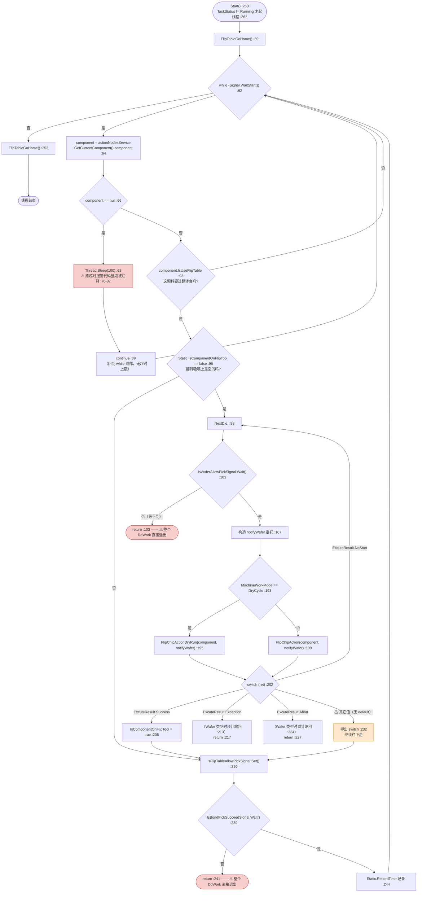

**ASCII 版**

```text
  [Start() :260] --条件 TaskStatus != Running :262--> 起 "翻转台线程"
      |
      v
  [FlipTableGoHome() :59]
      |
      v
  <while (Signal.WaitStart()) :62> --否--> [FlipTableGoHome() :253] --> 线程结束
      | 是
      v
  [component = GetCurrentComponent().component :64]
      |
      v
  <component == null :66> --是--> [Sleep(100) :68] --> continue :89 --> 回 while
      | 否                          ⚠ 原来那段"超时 1 分钟就报警"的代码
      v                               整段被注释掉了 :70-87
  <IsUseFlipTable :93> --否--> 回 while
      | 是
      v
  <IsComponentOnFlipTool == false :96> --否--> 跳到发信号
      | 是
      v
  NextDie: :98
      |
      v
  <IsWaferAllowPickSignal.Wait() :101> --否--> return :103  (⚠ 整条线程退出)
      | 是
      v
  [构造 notifyWafer :107 -> Task.Run 轮询翻转台角度 :110-183]
      |     超时 10s -> 弹框「翻转台发送搜晶信号超时」:153
      |                 Ignore -> sw.Restart() :166
      |                 Abort  -> Machine.Stop() + return :170-171
      |                 ⚠ 无 default -> 掉出 switch 继续等 :172
      |     每轮查 Machine.IsStop() :176 -> return
      |     curPos > SearchComponentAvoidancePos :121 ->
      |        RefreshMap() :137 / SetCurrentNeedChipName :140 /
      |        IsBondNeedChipSignal.Set() :143
      v
  <MachineWorkMode == DryCycle :193>
      | 是                          | 否
      v                             v
  [FlipChipActionDryRun :195]   [FlipChipAction :199]
      |                             |
      +<----------------------------+
      v
  <switch (ret) :202>
      | Success      | Exception     | Abort        | NoStart     | ⚠ 其它（无 default）
      v              v               v              v               v
  [IsComponentOnFlipTool    [顶针缩回 :213   [顶针缩回 :224  (回 NextDie  [掉出 switch :232]
   = true :205]              return :217]     return :227]     :231]
      |                                                              |
      +<-------------------------------------------------------------+
      v
  [IsFlipTableAllowPickSignal.Set() :236]
      |
      v
  <IsBondPickSucceedSignal.Wait() :239> --否--> return :241 (⚠ 整条线程退出)
      | 是
      v
  [RecordTime :244] --> 回 while
```

**坑**

> 🔴 **坑 1：用 `return` 退出线程，而不是 `break` 出循环。**
> `:103`、`:217`、`:227`、`:241` 四处都是 `return` —— 它们**直接结束 `DoWork()`**，
> 连最后那句 `FlipTableGoHome()`（`:253`）都执行不到。
> 更关键的是：**翻转台停在什么姿态就是什么姿态**，没人负责归位。
> 而 `FlipTask.Start()`（`:260`）只在任务不是 `Running` 时才会重开线程，
> 所以线程一旦 `return`，除非有别的代码再调 `Start()`，否则**翻转台永久停摆**。

> 🔴 **坑 2：`component == null` 的超时保护被整段注释掉了。**
> `:70-87` 原本是"等 `component` 超过 1 分钟就弹「翻转台获取当前芯片超时！」"的逻辑，
> 现在**全部是注释**，只剩 `:68` 的 `Thread.Sleep(100)` 和 `:89` 的 `continue`。
> 后果：如果 `actionNodesService.GetCurrentComponent()` 一直返回 `null`，
> 这条线程会**无声地每 100 毫秒空转一次，永远不休**。现象是"整机在跑、翻转台不动、
> 没有任何报警"。这是本模块最典型的"静默卡死"。见 §9.1 的 R-05。

> ⚠️ **坑 3：`switch (ret)` 与 `switch (dialogResult)` 都没有 `default`。**
> `:202` 的 `switch (ret)` 覆盖了 `ExcuteResult` 的 4 个已知值；如果将来 `ExcuteResult`
> 加了新成员（它定义在别处），**新值会掉出 `switch` 并继续去发
> `IsFlipTableAllowPickSignal`**（`:236`）—— 又是一次"误放行"。
> `:163` 的 `switch (dialogResult)` 同理（详见 §4.4 的说明）。

> ⚠️ **坑 4：这条线程没有 `try/catch`。**
> `DoWork()` 的整个方法体（`:57-254`）**一个 `try` 都没有**。任何异常都会直接冒泡到
> `Task.Factory.StartNew` 的 lambda（`:266-270`）外面 —— 而那个 lambda 也没有 `try/catch`。
> 结果是**未观察的 Task 异常（unobserved task exception）**：
> 不弹窗、不写日志、不改变界面状态，**翻转台悄无声息地死了**。
> 这和晶圆线程形成鲜明对比（那边至少有个 `catch` 会弹框），见 §6.4。

> ⚠️ **坑 5：`IsComponentOnFlipTool` 是 `static` 全局标志。**
> `:96` 与 `:205` 读写的是 `Static.IsComponentOnFlipTool`（`Services/Static.cs`），
> 即**整机级共享状态**，不属于 `FlipTask` 实例。所以两条线程或多次运行之间会互相影响；
> 而且这个标志**没有任何持久化**，掉电重启后一律为 `false`。


### 4.8 单步放行开关

「单步模式」是工程师调试设备时最常用的功能：整机每做完一个硬件动作就停下来，
等他按一下"下一步"再继续。控制这件事的开关叫 `MachineStateModel.IsSingleStepWork`，
它对晶圆侧**所有**硬件动作生效 —— 实现方式是在每个动作前面插一句
`WaferSystemDomain.GetInstance().SingleStep()`。

**图 10：单步放行开关 `SingleStep()` 与它的调用点分布**

```mermaid
flowchart TD
    HW["任何一个晶圆侧硬件动作<br/>（移轴 / 开真空 / 顶针 / 换料 …）"] --> SS["WaferSystemDomain.SingleStep() :141"]
    SS --> Q1{"MachineStateModel.IsSingleStepWork :143<br/>单步模式开着吗?"}
    Q1 -->|"否（正常工作）"| GO["直接返回 —— 动作照常执行"]
    Q1 -->|"是"| W1["System2SingleStepSignal.WaitSingleStep() :145"]
    W1 --> W2{"IsSingleStepWork == false :180<br/>（在等待期间被关掉了?）"}
    W2 -->|"是"| FW["return false :182"]
    W2 -->|"否"| W3["Thread.Sleep(5) :185"]
    W3 --> W4{"signalEvent.WaitOne(recycleTime) :187<br/>单步信号到了吗?"}
    W4 -->|"否"| W2
    W4 -->|"是"| WT["return true :195<br/>（AutoReset 时把 State 置回 ReSet :190-193）"]
    WT --> GO
    FW --> TH["🔴 throw new Exception(\"等待单步信号失败！\") :148"]
    TH --> DEST{"这个动作是谁调的?"}

    DEST -->|"晶圆工作线程"| C1["Dowork() 的 catch :375<br/>→ 弹窗「晶圆线程即将停止！」<br/>→ Machine.GetInstance().Stop() :383"]
    DEST -->|"界面线程<br/>（WaferSubController.ResetCyc/SetCyc）"| C2["异常冒到界面<br/>→ 调用处自行处理"]

    subgraph CALLERS["调用点分布（本篇范围内）"]
        P1["EjectController :743 :781 :867 :936<br/>（:720 :821 :918 已注释）"]
        P2["WaferTableController :1329 :1435 :1530 :1553<br/>:1587 :1626 :1654 …（:1408 已注释）"]
        P3["WaferSubController :83 :118 :150 :175"]
        P4["MagazineController :432"]
    end
    CALLERS -.->|"每个动作前"| SS

    subgraph TRIG["谁在开关单步模式"]
        T1["界面开关 BarSwitchSingleStep_CheckedChanged :983<br/>关时先 Set() 再置 false :993-994 ✅"]
        T2["界面按钮 BarBtNextStep_ItemClick :1004<br/>Set() :1011"]
        T3["🔴 热键 ChangeSingleStepMode<br/>HotKeyManage.cs:101-103<br/>只翻 IsSingleStepWork，不 Set()"]
    end
    TRIG -.->|"放行 / 关闭"| W1

    style TH fill:#f8cecc,stroke:#b85450,stroke-width:2px
    style T3 fill:#f8cecc,stroke:#b85450,stroke-width:2px
    style T1 fill:#d5e8d4,stroke:#82b366
```

**ASCII 版**

```text
  [晶圆侧任意硬件动作]
        |
        v
  [SingleStep() :141]
        |
        v
  <IsSingleStepWork :143> --否（正常生产）--> 直接执行动作
        | 是（单步模式）
        v
  [System2SingleStepSignal.WaitSingleStep() :145]
        |
        +--- 循环（Signal.cs:175-196）：
        |      do {
        |        if (IsSingleStepWork == false) return false;   // :180-183
        |        Thread.Sleep(5);                                // :185
        |      } while (!signalEvent.WaitOne(recycleTime));      // :187
        |      -> 等到信号: return true :195
        |
        +-- return true  --> 执行动作（放行一次）
        |
        +-- return false --> 🔴 throw "等待单步信号失败！" :148
                                 |
                    +------------+------------+
                    |                         |
              [晶圆工作线程调用]         [界面线程调用]
                    v                         v
              catch :375 --> 弹窗       异常冒到界面
              "晶圆线程即将停止！"        （ResetCyc/SetCyc）
              Machine.Stop() :383

  调用点分布：
    EjectController        :743 :781 :867 :936     （:720 :821 :918 注释）
    WaferTableController   :1329 :1435 :1530 :1553 :1587 :1626 :1654 …
                                                    （:1408 注释）
    WaferSubController     :83 :118 :150 :175
    MagazineController     :432

  开关单步的三处：
    ① 界面开关 BarSwitchSingleStep_CheckedChanged :983
         开 -> IsSingleStepWork = true :987
         关 -> System2SingleStepSignal.Set() :993  THEN  IsSingleStepWork = false :994   ✅ 顺序正确
    ② 界面"下一步" BarBtNextStep_ItemClick :1004 -> Set() :1011
    ③ 🔴 热键 ChangeSingleStepMode (HotKeyManage.cs:101-103)
         只执行 IsSingleStepWork = !IsSingleStepWork，不 Set()
```

**读了什么、写了什么**

| 项 | 位置 |
|---|---|
| 读 `MachineStateModel.GetInstance().IsSingleStepWork`（`public` **字段**，不是属性） | `WaferSystemDomain.cs:143`；字段定义 `AKRS.Galaxy2.Machine/Models/MachineStateModel.cs:122` |
| 等 `System2SingleStepSignal`（`AutoReset`、`recycleTime = 100`） | `SignalPool.cs:60` |
| 置位该信号（界面开关、界面按钮、热键） | `Main/Controls/Ucmain/MainControls/UcMainSystem.cs:993` / `:1011`；`UcMainSystem.HotKeyManage.cs:109` |
| 该信号**不在** `SignalPool.SignalList` 里 | `SignalPool.cs:193-214` |

**坑**

> 🔴 **坑 1：单步模式"被关掉"时，正在等的那个动作会抛异常，而不是继续执行。**
> `WaitSingleStep()`（`AKRS.Galaxy2.Machine/Models/Signal.cs:175-196`）的循环里第一件事就是
> `if (IsSingleStepWork == false) return false;`（`:180-183`），返回 `false` 之后
> `SingleStep()` 立刻 `throw new Exception("等待单步信号失败！")`（`WaferSystemDomain.cs:148`）。
> 界面上的开关**已经处理好了这个顺序** —— `UcMainSystem.cs:990-996` 是先
> `System2SingleStepSignal.Set()`（`:993`）**再** `IsSingleStepWork = false`（`:994`），
> 所以被阻塞的线程会先收到信号、正常返回 `true`，然后才看到模式已关闭。**这个顺序不能反。**

> 🔴 **坑 2（本篇新发现）：用热键退出单步模式会走成"抛异常停机"。**
> 热键路径 `Main/Controls/Ucmain/MainControls/UcMainSystem.HotKeyManage.cs:98-103` 的处理是：
>
> ```csharp
> // 切换单步模式
> case ChangeSingleStepMode:
>     MachineStateModel.GetInstance().IsSingleStepWork =
>         !MachineStateModel.GetInstance().IsSingleStepWork;   // :102
>     break;
> ```
>
> **它只翻转标志位，没有 `System2SingleStepSignal.Set()`** —— 和界面开关（`:993-994`）的顺序刚好相反。
> 后果：如果此刻晶圆线程正阻塞在某个 `SingleStep()` 里，
> `WaitSingleStep()` 会在 5 毫秒内（`:185`）发现 `IsSingleStepWork == false` → 返回 `false`
> → `SingleStep()` 抛 `"等待单步信号失败！"` → 冒泡到晶圆线程的 `Dowork()` catch（`:375`）
> → **弹「晶圆线程即将停止！」并 `Machine.Stop()`**。
> 也就是说：**按热键退出单步，会把晶圆线程停掉。** 用界面开关退出则不会。
> 这个差异在源码里没有任何注释提示。（热键的另一个分支 `SendSingleStepSignal`（`:106-110`）
> 是**有** `Set()` 的，所以只有"切换模式"这一个分支缺。）

> ⚠️ **坑 3：`SingleStep()` 的调用是"手工插在每个动作前面"的，不是统一拦截。**
> 图 10 里列出的是一部分调用点（`EjectController` 4 处活跃、`WaferTableController` 10 处以上、
> `WaferSubController` 4 处、`MagazineController` 1 处），而且**有几处是被注释掉的**
> （`EjectController.cs:720`、`:821`、`:918`，`WaferTableController.cs:1408`）。
> 这意味着**单步模式下并不是每个硬件动作都会停**，
> 停在哪儿取决于作者当时插了哪几句。做单步调试时如果发现"某个动作没停"，先来这里核对。

> ⚠️ **坑 4：`SingleStep()` 没有"取消"这一说。**
> 一旦进了 `WaitSingleStep()`，退出的方式只有三种：①按下下一步（正常）②设备状态变 `Stop`
> —— 注意 `WaitSingleStep()` **并不检查 `MachineState == Stop`**（对比 `Wait()` 的 `:129-132`），
> 它只检查 `IsSingleStepWork`；③模式被关掉（走坑 1 / 坑 2 的路径）。
> 所以**在单步模式下按"停止"是不会让 `SingleStep()` 返回的**，
> 只能靠界面开关或热键把 `IsSingleStepWork` 关掉。

### 4.9 任务线程弹出来的示教窗体（隐式 UI 入口）

本节要回答一个很容易被漏掉的问题：**本目录里没有按钮，但本目录打开了 6 个"有按钮的窗体"。**

这些窗体都属于 `Controls/`（即姊妹篇 `35` 的地盘），**它们自己长什么样、按钮怎么接线，本篇不写**。
但**"谁在什么条件下把它们弹出来"这件事发生在本篇的文件里**，而这件事恰恰是界面文档看不到的 ——
因为界面上**根本没有能打开它们的按钮**。所以这一节只画"入口"，不画"窗体内部"。

**图 11：晶圆工作线程在什么条件下弹出哪个示教窗体**

```mermaid
flowchart TD
    CS(["ChangeSucceedOperation() :493<br/>（由 ChangeTabletAuto 在 :1120 / :1158 / :1244 / :1358 调用）"]) --> CK["Block.StartInit() :495"]
    CK --> BR{"CarrierType == StaticWaffle :497"}
    BR -->|"是"| SW["走适配器分支<br/>SetCurrentCarrier + ReSetChangeCarrierSignal :511-513<br/>return true :514"]
    BR -->|"否"| WT{"CurrentTablet is WaferTablet wt :523<br/>且 IsExists(wt.Name) :525<br/>且 wt.Name==CurrentNeedChipName :527<br/>且 SlotState==Good :527"}
    WT -->|"否"| LAST["弹窗「不存在Bond需求的料片」:997<br/>return false :998"]
    WT -->|"是"| PRE["MoveWaferCameraToWorkPosition :530<br/>SetCurrentCarrier :531<br/>🔧 ChangeEjection() 换顶针 :534"]

    PRE --> MODE{"wt.CarrierConfigWithWafer.AutoRunWithDieMode :536"}

    MODE -->|"Automatic"| AU{"GetSearchMode() :538"}
    AU -->|"WaferMap"| A1{"!GetCheckPreparedResult() :542"}
    A1 -->|"否（已准备好）"| A1B["直接往下走"]
    A1 -->|"是"| A2["LoadMap :544<br/>MoveWaferTableToG0PosWithSearch(ReferencePosition) :545"]
    A2 --> A3["Retry: :551 → MatchResult(DieMatchName) :553"]
    A3 --> A4{"定位成功? :554"}
    A4 -->|"是"| A5["ReferencePosition = centerPos :561<br/>CarrierConfigRepository.Save() :563<br/>SetReferencePoint1 / FindReferencePoint<br/>MoveToStartPoint / StartAsyncSeekingPath<br/>InitMapInfo / ReSetChangeCarrierSignal :565-570"]
    A5 --> A6{"IsConfirmStartPointWithManual :572"}
    A6 -->|"是"| A7["弹窗「请人工确认晶圆起点是否正确！」:574<br/>switch(res) :575 — ⚠ 无 default"]
    A7 -->|"Abort"| E1["（🔴 throw \"更换晶圆料片后进行一系列操作失败！\" :581）"]
    A6 -->|"否"| A1B
    A7 -->|"OK"| A1B
    A4 -->|"否（定位失败）"| A8{"IsAroundLocate :587"}
    A8 -->|"是"| A9{"i == 1..4 :590 / :598 / :600 / :605"}
    A9 -->|"是"| A10["按 AroundLocateDistance 偏移<br/>MoveWaferTableToG0PosWithSearch :593/:603/:608"]
    A10 --> A3
    A9 -->|"否（i 用完了）"| F1["i = 0 :612<br/>回到 centerPos :613"]
    A8 -->|"否"| F2["（直接弹窗体）"]
    F1 --> F1A["SendUiAction :616"]
    F2 --> F2A["SendUiAction :642"]
    F1A --> FRM1["② FrmChangePositionTeach.ShowDialog() :619"]
    F2A --> FRM2["② FrmChangePositionTeach.ShowDialog() :645"]
    FRM1 --> R1{"res == OK :625"}
    FRM2 --> R2{"res == OK :651"}
    R1 -->|"OK"| R1B["centerPos = WaferTableG0Pos :627<br/>tempPos = centerPos :628"]
    R1 -->|"Abort"| E1
    R1B --> A3
    R2 -->|"OK"| R2B["centerPos = WaferTableG0Pos :653"]
    R2 -->|"Abort"| E1
    R2B --> A3

    AU -->|"Nine"| N1{"IsNewTablet \\|\\| !MatchResult :778"}
    N1 -->|"是"| N2["Retry: :780"]
    N1 -->|"否"| N3["ReSetChangeCarrierSignal() :809"]
    N2 --> FRM3["② FrmChangePositionTeach.ShowDialog() :785"]
    FRM3 --> N4{"IsNeedChange :791"}
    N4 -->|"是 且 res==Abort :793"| E2["（🔴 throw \"更换晶圆料片后进行一系列操作失败！\" :796）"]
    N4 -->|"是 且 res==OK"| N2
    N4 -->|"否"| N5["wt.IsNewTablet = false :803<br/>Save() :804"]
    AU -->|"其它（Single / Box）"| E3["（🔴 throw \"you can you no, SearchMode!\" :814）"]

    MODE -->|"Manual"| MA{"GetSearchMode() :819 / :859 / :899"}
    MA -->|"WaferMap"| M1{"!GetCheckPreparedResult() :829"}
    M1 -->|"是"| M2["ChangeMap: :832"]
    M2 --> FRM4["③ ControlService.ShowDialogForm&lt;FrmChangeWaferMapTeach&gt;() :833<br/>（反射构造，无参数）"]
    FRM4 --> M3{"IsNeedChange :834"}
    M3 -->|"是 且 Abort :836"| E4["（🔴 throw \"更换晶圆图失败！\" :839）"]
    M3 -->|"是 且 OK"| M2
    M3 -->|"否"| M4["IsNewTablet = false :846 / Save :847"]
    M1 -->|"否"| M5["ReSetChangeCarrierSignal :853<br/>IsNewTablet = false :855 / Save :856"]
    MA -->|"Single"| S1["Retry: :869"]
    S1 --> FRM5["③ ControlService.ShowDialogForm&lt;FrmChangePositionTeach&gt;(DieMatchName) :872<br/>（反射构造，1 个参数）"]
    FRM5 --> S2{"IsNeedChange :883"}
    S2 -->|"是 且 Abort :885"| E5["（🔴 throw \"更换晶圆料片后进行一系列操作失败！\" :888）"]
    S2 -->|"是 且 OK"| S1
    S2 -->|"否"| S3["IsNewTablet = false :895 / Save :896"]
    MA -->|"Nine"| N6["Retry: :909"]
    N6 --> FRM6["② FrmChangePositionTeach.ShowDialog() :914"]
    FRM6 --> N7{"IsNeedChange :920"}
    N7 -->|"是 且 Abort :922"| E2
    N7 -->|"是 且 OK"| N6
    N7 -->|"否"| N8["IsNewTablet = false :932 / Save :933"]
    MA -->|"其它"| E6["（🔴 throw \"you can you no, SearchMode!\" :938）"]

    MODE -->|"ManualAtStart"| E7["（🔴 throw \"you can you no, AutoRunWithDieMode!\" :943）"]
    MODE -->|"其它"| E8["（🔴 throw \"you can you no, AutoRunWithDieMode!\" :947）"]

    A1B --> RT["return true :950"]
    A5 --> RT
    N3 --> RT
    N5 --> RT
    M4 --> RT
    M5 --> RT
    S3 --> RT
    N8 --> RT

    style FRM1 fill:#dae8fc,stroke:#6c8ebf
    style FRM2 fill:#dae8fc,stroke:#6c8ebf
    style FRM3 fill:#dae8fc,stroke:#6c8ebf
    style FRM4 fill:#e1d5e7,stroke:#9673a6
    style FRM5 fill:#e1d5e7,stroke:#9673a6
    style FRM6 fill:#dae8fc,stroke:#6c8ebf
    style E3 fill:#f8cecc,stroke:#b85450
    style E6 fill:#f8cecc,stroke:#b85450
    style E7 fill:#f8cecc,stroke:#b85450
    style E8 fill:#f8cecc,stroke:#b85450
    style PRE fill:#ffe6cc,stroke:#d79b00
```

**ASCII 版（只画"什么条件弹哪个窗体"）**

```text
  ChangeSucceedOperation() :493
        |
        +-- StaticWaffle :497  -> 走适配器分支 -> return true
        |
        +-- 普通料片 :523 （CurrentTablet is WaferTablet && IsExists && 同名 && Good）
              |   否则 -> 弹窗「不存在Bond需求的料片」:997 -> return false
              v
        [MoveWaferCameraToWorkPosition :530 / SetCurrentCarrier :531 / ChangeEjection :534]
              |
              v
        <AutoRunWithDieMode :536>
              |
     +--------+-------------------------+-------------------+-----------------+
     |                                  |                   |                 |
  Automatic                          Manual           ManualAtStart        其它
     |                                  |                   |                 |
     v                                  v                   v                 v
  <GetSearchMode()>              <GetSearchMode()>    throw "you can   throw "you can
     |                                  |              you no,          you no,
  +--+----------+----------+     +------+------+--+    AutoRunWithDie   AutoRunWithDie
  |             |          |     |      |      |  |    Mode!" :943      Mode!" :947
WaferMap      Nine      其它   WaferMap Single Nine 其它
  |             |          |     |      |      |  |
  |          [IsNewTablet  |   [!Check  |   [Retry:  throw
  |           || !Match]   |    Prepared]|      |     "you can
  |             |          |     |      |      |     you no,
  |           Retry: :780  |  ChangeMap: |  Retry: :909  SearchMode!
  |             |          |    :832   |      |        " :938
  |      ② FrmChangePosition  |        |      |
  |         Teach :785     |  ③ FrmChangeWafer ③ FrmChange  ② FrmChange
  |                        |    MapTeach :833   Position   Position
  |  [MatchResult]         |    (反射,无参)     Teach :872  Teach :914
  |   |         |          |                  (反射,1参)
  |  成功      失败        |      [IsNeedChange]    [IsNeedChange]
  |   |         |          |       |      |           |      |
  |   v         v          |    Abort    OK        Abort    OK
  |  [Reference  <IsAround  |      |       |          |       |
  |   Position   Locate?>   |   throw   回 ChangeMap throw   回 Retry:
  |   =...>       |    |    |   "更换晶圆图         "更换晶圆料片
  |   |        是|    |否   |   失败！"            ...失败！"
  |   |           |    |    |    :839               :888
  |   |     <i==1..4?> |    |
  |   |      是|    |否|    |
  |   |        |    |  |    |
  |   |  [偏移+移动] | [i=0 回 centerPos]          -> return true :950
  |   |        |    |  |
  |   +<-------+    |  |
  |                 v  v
  |            ② FrmChangePositionTeach.ShowDialog() :619 / :645
  |                 |
  |            <res == OK? :625 / :651>
  |              OK |        | Abort
  |                 v        v
  |         [centerPos 更新] throw "更换晶圆料片后进行一系列操作失败！" :633/:658
  |                 |
  +<----------------+  （回到 Retry: :551 重新 MatchResult）
```

**6 处调用点一览（这就是"入口"的权威清单）**

| 调用点 `文件:行` | 入口种类 | 被打开的窗体 | 触发条件（精确） |
|---|---|---|---|
| `Tasks/WaferSubSystemTask.cs:619` | **② 任务线程运行时弹出** | `FrmChangePositionTeach(string DieMatchName)` | `AutoRunWithDieMode == Automatic` + `SearchMode == WaferMap` + `IsAroundLocate == true` + 参考点定位**连续失败 5 次以上**（`i` 从 1 走到 4 后归零，`:590`-`:612`） |
| `Tasks/WaferSubSystemTask.cs:645` | **② 任务线程运行时弹出** | `FrmChangePositionTeach` | 同上，但 `IsAroundLocate == false`（定位失败就直接弹） |
| `Tasks/WaferSubSystemTask.cs:739` | **② 任务线程运行时弹出** | `FrmChangePositionTeach` | `AutoRunWithDieMode == Automatic` + `SearchMode == WaferMap` + 该料片是**新料片**（`wt.IsNewTablet == true`，`:732`） |
| `Tasks/WaferSubSystemTask.cs:785` | **② 任务线程运行时弹出** | `FrmChangePositionTeach` | `AutoRunWithDieMode == Automatic` + `SearchMode == Nine` + （新料片 **或** 模板匹配失败，`:778`） |
| `Tasks/WaferSubSystemTask.cs:833` | **③ 反射服务** | `FrmChangeWaferMapTeach()`（**无参构造**） | `AutoRunWithDieMode == Manual` + `SearchMode == WaferMap` + `!GetCheckPreparedResult()`（`:829`） |
| `Tasks/WaferSubSystemTask.cs:872` | **③ 反射服务** | `FrmChangePositionTeach(string DieMatchName)`（**1 参构造**） | `AutoRunWithDieMode == Manual` + `SearchMode == Single`（`:859`） |
| `Tasks/WaferSubSystemTask.cs:914` | **② 任务线程运行时弹出** | `FrmChangePositionTeach` | `AutoRunWithDieMode == Manual` + `SearchMode == Nine`（`:899`） |

被注释掉的 2 处（**不要当成活的**）：`:700-711`（`FrmChangePositionTeach` 的 `ReferenceName` 版本 + `temp.ShowDialog()`）、
`:874-881`（`FrmChangePositionTeach` 的 `PlatformProvider.Current.OnUIThread` 版本）。

> **入口种类说明**：`②` 指的是"晶圆工作线程在运行时**自己** `new` 一个窗体并 `ShowDialog()`"，
> 一律通过 `MainForm.SendUiAction(...)`（`:616` / `:642` / `:736` / `:782` / `:911`）
> 切到 UI 线程上执行 —— 因为工作线程不能直接显示窗体。
> `③` 指的是走通用反射服务 `ControlService.ShowDialogForm<T>(...)`
> （`Infrastructure/Service/ControlService.cs:366`）：
> 内部是 `lock (AKRSMessageBoxExt.UiLock)`（`:369`）→ `MainForm.SendUiAction(...)`（`:372`）
> → `(T)Activator.CreateInstance(typeof(T), args)`（`:375`）→ `ShowDialog()`（`:377`）→
> `Dispose()`（`:378`）→ 取 `DialogResult`（`:379`）；返回值初值是 `DialogResult.Abort`（`:371`）。
>
> **⚠ 关于返回值，有一个必须说清楚的机制**：上面这个 lambda 是在 **UI 线程**上执行的，
> 而 `MainForm.SendUiAction` 的实现是**同步**的 `this.Invoke(action)`
> （`Main/Controls/MainForm.cs:68-71`，正文只有 `this.Invoke(action);` 一行），
> 所以 `:372` 那一行会**一直阻塞到 `ShowDialog()` 返回、`:379` 把真实的 `DialogResult` 写好为止**。
> ⇒ **`ShowDialogForm<T>` 返回的是用户真实点击的结果，不是恒为 `Abort`。**
> `:371` 的初值 `Abort` 只在"lambda 根本没跑起来"（例如 `SendUiAction` 为 `null` 抛异常）时才会被读到。
> 本篇范围内的两个调用点 `:833` / `:872` 都是**消费真实返回值**的，当前工作正常。
>
> `① 界面按钮` —— **本篇范围内一个都没有**。这就是这 6 处窗体在界面上找不到入口的原因。

**读了什么、写了什么**（这一节的动作几乎全是"写"）

| 项 | 位置 |
|---|---|
| 读 `wt.CarrierConfigWithWafer.AutoRunWithDieMode` / `.SearchMode` / `.IsAroundLocate` / `.IsConfirmStartPointWithManual` | `:536` / `:538` / `:556` / `:572` |
| 读 `wt.IsNewTablet`、`this.IsNeedChange`、`Block.GetInstance().GetCheckPreparedResult()` | `:732` / `:745` / `:829` |
| **写** `wt.CarrierConfigWithWafer.ReferencePosition`（参考点，直接改配方对象） | `:561` |
| **落盘** `CarrierConfigRepository.GetInstance().Save()`（参考点持久化） | `:563` |
| **落盘** `WaferSubDevicePara.GetInstance().Save()`（`IsNewTablet = false` 之后） | `:758` / `:772` / `:804` / `:824` / `:847` / `:856` / `:896` / `:933` |
| **写** `Block.SetCurrentCarrier()` / `SetReferencePoint1()` / `InitMapInfo()` | `:531` / `:565` / `:569` |
| **硬件** `MoveWaferCameraToWorkPosition()` / `ChangeEjection()`（换顶针） / `MoveWaferTableToG0PosWithSearch()` | `:530` / `:534` / `:545` |

**坑**

> 🔴 **坑 1（本篇新发现，通用风险）：反射开窗要求窗体构造函数签名保持不变，否则运行时才炸。**
> `ControlService.ShowDialogForm<T>(params object[] args)` 的实现是
> `(T)Activator.CreateInstance(typeof(T), args)`（`Infrastructure/Service/ControlService.cs:375`）——
> 它按 `args` 的类型和个数**在运行时**匹配构造函数。
> 本篇涉及的两处契约束是：
> - `ControlService.ShowDialogForm<FrmChangeWaferMapTeach>()`（`WaferSubSystemTask.cs:833`，**0 个参数**）
>   → 契约 = `FrmChangeWaferMapTeach()`（`WaferSubSystem/Controls/Assistant/ChangeMapTeach/FrmChangeWaferMapTeach.cs:103`）
> - `ControlService.ShowDialogForm<FrmChangePositionTeach>(wt.CarrierConfigWithWafer.DieMatchName)`（`:872`，**1 个 `string`**）
>   → 契约 = `FrmChangePositionTeach(string dieMatchName)`（`WaferSubSystem/Controls/Assistant/ComponentsTeach/FrmChangePositionTeach.cs:69`）
>
> **后果**：如果将来有人给这两个窗体的构造函数**加了参数**（比如加个默认选项），
> **编译器不会报任何错**（`:833`/`:872` 只要求 `T : Form`），
> 但运行时 `Activator.CreateInstance` 会抛 `MissingMethodException`。
> 而抛出点在 `MainForm.SendUiAction` 的 UI 线程委托里（`:372-380`），
> 异常会从 `Invoke` 里冒出来 —— 由于工作线程没有针对它的 `catch`，
> 最终会被 `Dowork()` 的 `catch (Exception)`（`Tasks/WaferSubSystemTask.cs:375`）吞掉，
> 表现成「弹一个框说'晶圆线程即将停止' + 停机」，**看不到 `MissingMethodException` 的字样**
> （`AKRSMessageBoxExt.Show(exception.Message + ...)` 里 `exception.Message` 会是英文的
> "No parameterless constructor defined for type..." 之类，和中文提示混在一起，很难认）。
> 见 §9.5 的 R-32。

> 🔴 **坑 2：`IsNeedChange` 为真时，这些窗体只能靠"中止"退出来 —— "确定"会被忽略。**
> 六处调用点的判断都是同一个写法（以 `:745-754` 为例）：
>
> ```csharp
> if (this.IsNeedChange)
> {
>     if (res == DialogResult.Abort)
>         throw new Exception("更换晶圆料片后进行一系列操作失败！");
>     goto Retry;              // :753 —— res==OK 也回到 Retry，重新弹同一个窗体
> }
> ```
>
> 也就是说：**只要 `IsNeedChange` 还是真，用户点"确定"就会再弹一次同一个窗体，
> 点"中止"才会抛异常停机。** 这可能是作者的意图（"没换好就一直教我"），
> 但它意味着**操作员无法"点确定跳过"**，只能二选一：继续教，或停机。
> 而且循环里**没有次数上限、没有延时、没有日志**。

> 🔴 **坑 3：有四句 `throw new Exception("you can you no, ...")` 堵在那里。**
> `:814`（`Automatic` + `SearchMode` 不是 `WaferMap`/`Nine`）、
> `:938`（`Manual` + 同样的组合）、
> `:943`（`AutoRunWithDieMode == ManualAtStart`）、
> `:947`（`AutoRunWithDieMode` 的其它值）。
> 这四句的**报错信息完全不能定位问题**（"you can you no" 是中式英语的口头语，没有说明是哪个模式不支持）。
> 实践含义：**`SearchMode.Single` 和 `SearchMode.Box` 在"自动换料片后的收尾"里是不被支持的**
> —— 如果配方里给某个料片配了 `AutoRunWithDieMode = Automatic` 又选了 `Single`/`Box`，
> 换料片时就会撞上 `:814` 然后停机。**这四句"堵路"的 `throw` 单列一条，见 §9.2 的 R-18。**

> ⚠️ **坑 4：`ChangeEjection()`（换顶针）在这一节的入口里是"无条件执行"的。**
> `:534` 在 `AutoRunWithDieMode` 判断**之前**，也就是说只要换料片走到这里，
> **无论后面走哪个分支、无论会不会弹窗体，都会先换一次顶针**。
> 这是换料片流程里最容易忽略的硬件动作（它不只是"换料片"，还会换顶针型号）。

> ⚠️ **坑 5：同族窗体里有一个"零调用点"的。**
> `FrmChangeWaffleMapTeach`（`WaferSubSystem/Controls/Assistant/ChangeMapTeach/FrmChangeWaffleMapTeach.cs:21`，
> 构造函数 `:46`，**无参**）在 `.csproj` 里、能编译，但**全项目没有任何调用点**
> （`grep -rn --include=*.cs -w "FrmChangeWaffleMapTeach" .` 排除自身声明、Designer 里的
> `ComponentResourceManager`/`this.Name` 之后，命中为空）。
> 而它的晶圆版兄弟 `FrmChangeWaferMapTeach` **是有入口的**（就是上面 `:833` 那一行）。
> 一个有一行、一个没有 —— 这看起来是**漏接线**，不是"故意不用"。
> 另一个同类的零调用点是 `FrmDieDeal`（`WaferSubSystem/Controls/FrmDieDeal.cs:21`，
> 类上有 `[Obsolete]`（`:20`），零调用点，僵尸文件）。
> 这两个窗体属于 `Controls/`，其内部结构请见姊妹篇 `35`；本篇只负责把
> **"它们没有入口"** 这个事实记下来。

> 🔴 **坑 6（本篇新发现，语义陷阱）：`DialogResult.Abort` 在这个业务流程里同时表示"结束示教"和"失败"。**
>
> 这不是一个猜测，是两段代码直接对撞出来的：
>
> | 位置 | 代码 | 含义 |
> |---|---|---|
> | `Controls/Assistant/ChangeMapTeach/FrmChangeWaferMapTeach.cs:245` | `this.DialogResult = DialogResult.Abort;` | 用户点了 **「结束示教」（`Yes`，`:244`）** —— 也就是**正常教完了** |
> | `Tasks/WaferSubSystemTask.cs:836` | `if (res == DialogResult.Abort)` → `:839 throw new Exception("更换晶圆图失败！")` | 把同一个 `Abort` 当成 **"更换晶圆图失败"** |
>
> 也就是说：**操作员按窗体自己的语义"结束示教"，晶圆线程收到的是"失败"，直接抛异常停机。**
> （唯一"幸免"的条件是 `:834 this.IsNeedChange` 为假 —— 但为真时 `:836` 的判断必然被走到。）
>
> **最大的危险不是这个缺陷本身，而是它的名字**：
> `DialogResult.Abort` 在 .NET 里的字面意思是"中止 / 取消"，
> 后来人**照着名字理解必然读错**（会以为"用户取消了"）；
> 而如果维护者"顺手改成 `res == DialogResult.Cancel`"或反过来，
> 就会把 `:836` 的失败判定彻底改坏 —— **编译器不会拦，测试也很难覆盖到这条路径**。
> 记为 **R-51**（§9.5）。**读这一段时只看 `:245` 这一行，别看枚举名。**

> 🔴 **坑 7（本篇新发现，静态推断）：任务线程持 `UiLock` 弹模态窗，与 UI 线程的开窗会互相死锁。**
>
> `ControlService.ShowDialogForm<T>` 的第一行是 `lock (AKRSMessageBoxExt.UiLock)`
> （`Infrastructure/Service/ControlService.cs:369`），
> `AKRSMessageBoxExt.UiLock` 是**全项目共用**的一个静态 `object`
> （`Infrastructure/Controls/Currency/AKRSMessageBoxExt.cs:37`，共 **6 个加锁点**，
> 其中 3 处有"主线程豁免"的短路判断：`AKRSMessageBoxExt.cs:139` / `:223`、
> `AKRSXtraMessageBox.cs:46`；**`ControlService.cs:369` 那一处没有豁免**）。
>
> 更关键的是：**这把锁把模态弹窗整个包在里面** ——
> `UiLock` 的持有时长 = **用户在弹框上停留的时长**。
>
> 于是两条边可以逐行读出来：
>
> - **边 A（本篇）**：晶圆工作线程 → `WaferSubSystemTask.cs:833` / `:872`
>   → 持有 `UiLock`（`ControlService.cs:369`）
>   → 阻塞在 `MainForm.SendUiAction` 的 `Invoke`（`:372`）等 UI 线程去跑 `ShowDialog()`（`:377`）。
> - **边 B（姊妹篇 35）**：**UI 线程自己**也调 `ShowDialogForm<T>`
>   （`WaferSubSystem/Controls/Setting/Component/UcComponentEdit.cs:1203`、
>   `Controls/Assistant/ComponentsTeach/FrmComponentGeometryWithWaferTeach.cs:225`）
>   → 同样卡在 `ControlService.cs:369` 等同一把锁。
>
> **⇒ 互等 ⇒ 永久死锁。** 后果不是"卡一下"：**消息循环停住，急停按钮点不动**；
> 100 ms 后台监控线程（`Main/Machine/MachineSupport/Machine.Operate.cs:665`）的下一次投递挂住，
> **安全门检查（`:675`）随之中止**。
>
> ⚠️ **这条是静态推断，未经运行复现**：
> 依据是 `Control.Invoke` 会**阻塞调用线程**直到 UI 线程执行完委托（.NET 语义），
> 以及 `Monitor`/`lock` 的**跨线程互斥**语义。两条边的代码都可逐行读出，但**我没有在设备上复现过**。
> 按"能读出来的最坏情况"给严重度。记为 **R-52**（§9.6）。
> 姊妹篇 `35` 写的是边 B 那一半，本篇写的是边 A —— **两边要合起来看**。

**图 12b：`UiLock` 的一把锁、两条边、一个死锁**

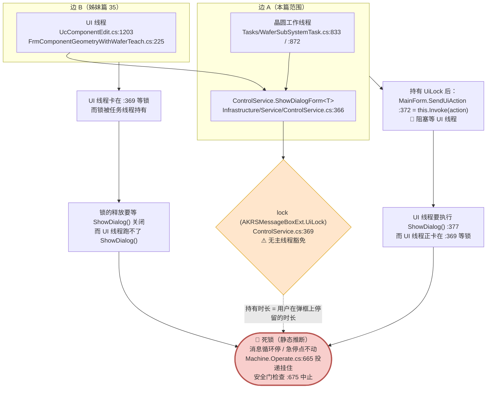

**ASCII 版**

```text
  边 A（本篇）                                     边 B（姊妹篇 35）
  晶圆工作线程                                      UI 线程
  WaferSubSystemTask.cs:833 / :872                   UcComponentEdit.cs:1203
      |                                             FrmComponentGeometryWithWaferTeach.cs:225
      |                                                 |
      +--------------------+----------------------------+
                           v
              ControlService.ShowDialogForm<T>()     ControlService.cs:366
                           |
              lock (AKRSMessageBoxExt.UiLock)        :369   <-- 无主线程豁免
                           |
              MainForm.SendUiAction(...)             :372
                           |
              this.Invoke(action)  <-- 同步阻塞
                           |
                           v
              UI 线程要执行 ShowDialog()             :377
              而 UI 线程卡在 :369 等同一把锁
                           |
                           v
                  +--------------------------------+
                  |  🔴 死锁（静态推断，未复现）      |
                  |  消息循环停 / 急停点不动          |
                  |  Machine.Operate.cs:665 投递挂住 |
                  |  安全门检查 :675 中止             |
                  +--------------------------------+

  锁的持有时长 = 用户在弹框上停留的时长
```

### 4.10 界面回调与 UI 编组

严格说，本目录和界面层之间是**双向**的：界面调本目录的公有方法（"按钮"），
本目录也会**回调界面**（把动作编组到 UI 线程去执行）。后者是本模块唯一一处真正的"并发编程"。

**图 12：界面 ↔ 本目录的双向调用**

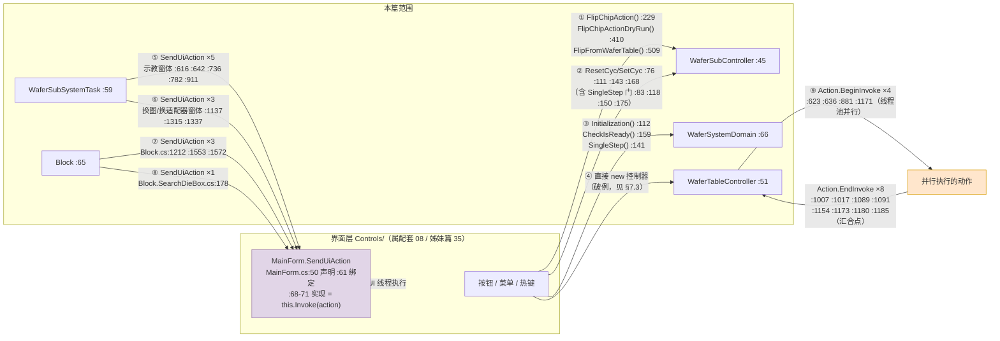

**ASCII 版**

```text
   界面层 (Controls/)                       本篇范围
   =================                       ==========
   按钮 / 菜单 / 热键
        |
        | ① FlipChipAction :229 / FlipChipActionDryRun :410 /
        |    FlipFromWaferTable :509
        | ② ResetCyc :76 :143 / SetCyc :111 :168
        |    （每个都先过 SingleStep 门 :83 :118 :150 :175）
        | ③ WaferSystemDomain.Initialization :112 /
        |    CheckIsReady :159 / SingleStep :141
        +------------------------------------>  WaferSubController :45
                                                WaferSystemDomain :66
                                                       |
                                                       v
                                              WaferSubSystemTask :59
                                              WaferTableController :51
                                              Block :65
                                                       |
        MainForm.SendUiAction  <-----------------------+
        (MainForm.cs:50/:61/:68-71  => this.Invoke)
              |
              |  ⑤ WaferSubSystemTask 弹示教窗体   :616 :642 :736 :782 :911
              |  ⑥ WaferSubSystemTask 弹换图窗体   :1137 :1315 :1337
              |  ⑦ Block 创建/显示/隐藏晶圆图窗体   :1212 :1553 :1572
              |  ⑧ Block.SearchDieBox 同款         :178      共 12 处
              v
        [Invoke 到 UI 线程，同步执行]

   ── 另一条并行线（不用 UI 线程，用线程池）──────────────
        WaferTableController
          | Action.BeginInvoke  :623 :636 :881 :1171   (4 处，起并行动作)
          v
        [线程池里跑 MoveWaferTableToAutoChangePosition /
         MoveExpandToDownPosition / MoveMagazineToSafePosition /
         MoveExpandToUpPosition]
          |
          | Action.EndInvoke  :1007 :1017 :1089 :1091
          |                   :1154 :1173 :1180 :1185   (8 处，汇合点)
          v
        继续（此时并行动作的异常会在 EndInvoke 处重抛）
```

**两条"跨界"通道的实测计数**

| 通道 | 机制 | 实测处数 | 位置 |
|---|---|---|---|
| 本目录 → UI 线程 | `MainForm.SendUiAction(...)` → `Control.Invoke`（同步） | **12** | `Tasks/WaferSubSystemTask.cs:616, 642, 736, 782, 911, 1137, 1315, 1337`；`Models/Entities/SearchChip/Block.cs:1212, 1553, 1572`；`Models/Entities/SearchChip/Block.SearchDieBox.cs:178` |
| 本目录 → 线程池（并行 + 汇合） | `Action.BeginInvoke` / `Action.EndInvoke` | Begin **4** / End **8** | Begin：`Controllers/WaferTableController.cs:623, 636, 881, 1171`；End：`:1007, 1017, 1089, 1091, 1154, 1173, 1180, 1185` |
| 阻塞等待 | `Thread.Sleep` | **34** 处有效（另有 13 处被注释） | 分布：`WaferSubController` 15、`WaferTableController` 12、`EjectController` 5、`FlipTableController` 4、`Block` 4、`WaferSubSystemTask` 3、`FlipTask` 2、`MagazineController` 1、`Block.SearchDieBox` 1 |
| 反射式开窗 | `ControlService.ShowDialogForm<T>(...)` | **2**（本篇内） | `Tasks/WaferSubSystemTask.cs:833, 872` |

```bash
# 复现这些计数
cd "E:/项目/ZX2200标机/trunk/AKRS.ZX2200/WaferSubSystem"
grep -rn "SendUiAction" --include=*.cs Controllers Tasks Modules Services Models | wc -l          # 12
grep -rn "BeginInvoke"   --include=*.cs Controllers Tasks Modules Services Models | grep -vE ':\s*//' | wc -l   # 4
grep -rn "EndInvoke"     --include=*.cs Controllers Tasks Modules Services Models | grep -vE ':\s*//' | wc -l   # 8
grep -rn "Thread.Sleep"  --include=*.cs Controllers Tasks Modules Services Models | grep -vE ':\s*//' | wc -l   # 34
```

**坑**

> 🔴 **坑 1：`EndInvoke` 会重抛并行动作里的异常，而且**汇合点不是异常安全的**。**
> `Action.BeginInvoke` 启动的委托如果在另一个线程上抛了异常，
> 这个异常**不会立刻出现**，而是被存进 `IAsyncResult`，
> 直到调用 `Action.EndInvoke(result)` 时才在**当前线程**上重新抛出。
> 具体到 `PlaceWaferInSlot()`（`Controllers/WaferTableController.cs:1005-1017`）：
>
> ```csharp
> this.PreChangeTablet();                                                   // :1005  起了 2 个并行动作
> this.asyncMoveWaferTableToAutoChangePosition
>     .EndInvoke(this.asyncMoveWaferTableToAutoChangePositionResult);        // :1007  汇合点 1
> ...
> WaferSubController.GetInstance().MagazineController.SlotScan(currentLayerNo - 1);  // :1015
> this.asyncMoveExpandToDownPosition
>     .EndInvoke(this.asyncMoveExpandToDownPositionResult);                 // :1017  汇合点 2
> ```
>
> **如果 `:1007` 抛了异常，`:1017` 就永远不会执行** —— 第 2 个并行动作既没有被等待、
> 它的异常也永远不会被发现（**未观察的异常**），而且 `:1015` 的 `SlotScan` 也不会跑。
> 同一个模式在 `RemoveWaferFromSlot()` 的 `:1089`/`:1091` 重复了一次。
> 修法本该是 `try/finally`，但源码里没有。

> 🔴 **坑 2：`EndInvoke` 只能调一次 —— 重复调会抛 `InvalidOperationException`。**
> 这一点让"重入"变得危险：`asyncMoveWaferTableToAutoChangePositionResult`
> 是**实例字段**（`Controllers/WaferTableController.cs:88`），
> 而不是局部变量。如果 `PreChangeTablet()`（`:616`）在一次流程里被调了两次
> （比如 `PlaceWaferInSlot()` 内部调一次、外层 `RemoveWaferFromSlot()` 又调一次），
> 字段会被**第二次的 `IAsyncResult` 覆盖**，第一次的那个就永远等不到了；
> 而如果 `EndInvoke` 针对同一个 `IAsyncResult` 被调两次，会直接抛
> `InvalidOperationException`。`WaferTableController` 是**单例持有的实例**
> （`WaferSubController.cs:50`），这两条路径都走同一个对象，所以不存在"不同实例互不干扰"的侥幸。

> ⚠️ **坑 3：`MainForm.SendUiAction` 是同步 `Invoke`，不是 `BeginInvoke`。**
> 绑定处是 `SendUiAction += this.PostAction;`（`Main/Controls/MainForm.cs:61`），
> `PostAction` 的实现是 `this.Invoke(action);`（`:68-71`）。
> **`Invoke` 会阻塞调用线程直到 UI 线程执行完**。所以晶圆工作线程每弹一个示教窗体，
> 整条晶圆线程就**完全停住**，直到用户关掉那个窗体为止（这正是 §4.9 里那些模态窗体
> 能"卡住"整机的原因）。
> 名字里的 `Post` 和 `Send` 容易让人以为是异步投递 —— **它是同步的**。

> ⚠️ **坑 4：`Block`（数据模型层）会创建并显示窗体。**
> `Models/Entities/SearchChip/Block.cs:1553-1564` 与 `:1572-1581` 这两段
> `SendUiAction` 里做的事情是 `CreateForm("WaferMap", ...)` / `new FrmWaffleMap()`
> 然后 `.Show()` → `.Hide()`（**先显示再隐藏**，用来让窗体完成初始化）。
> 这是**模型层反向依赖界面层**的实例：`Block` 在 `Models/`，窗体在 `Controls/`。
> 它的副作用是：**只要调用到 `StartInit()`（`:495` 里的 `Block.StartInit()`），
> 界面上就会多出两个隐藏的窗体实例**。这一点在 §7.3 的"谁在调用本目录"里会再提一次。

> ⚠️ **坑 5：`Thread.Sleep` 有 34 处有效调用，是这一层最主要的"时序同步"手段。**
> 因为没有状态机、没有 `await`、没有事件，所有"等硬件稳定"的地方都是硬编码延时
> （分布见上表）。这意味着**换一台机器、换一批硬件，这些数值都需要人工重调**；
> 而且它们是**不可取消的**（`Thread.Sleep` 不响应任何停止信号）。
> 排查"为什么停机要等好几秒"的时候，来这里数一数。


### 4.11 异常、超时、取消与重入

这是本节（也是全篇）最需要背下来的一节。**本模块没有设计意义上的"取消"和"超时"**，
所有的"停下来"都是靠异常。下面这张图是它的全部路径。

**图 13：异常、取消、超时、重入的完整路径**

```mermaid
flowchart TD
    subgraph CANCEL["「取消」在本模块的真实含义"]
        C1["取消令牌 = CancellationToken.None<br/>Tasks/WaferSubSystemTask.cs:1391"]
        C2["取消令牌 = CancellationToken.None<br/>Tasks/FlipTask.cs:271"]
        C3["🔴 AbortWaferSubThread() 方法体全被注释<br/>Tasks/WaferSubSystemTask.cs:1430-1436 —— 空方法"]
        C4["Machine.GetInstance().Stop()<br/>唯一真正有效的「停」"]
        C1 --> C4
        C2 --> C4
        C3 --> C4
    end

    subgraph TIMEOUT["「超时」在本模块的真实含义"]
        T1["Signal.Wait() —— 🔴 永不超时<br/>只循环到 信号到达 或 MachineState==Stop<br/>AKRS.Galaxy2.Machine/Models/Signal.cs:116-145"]
        T2["Signal.Wait(int outTime) —— 🔴 outTime 被忽略<br/>Signal.cs:153-169"]
        T3["Sensor.CheckStateForNums(true, nums, interval)<br/>传感器检测有次数上限（唯一真正的超时）"]
        T4["✅ FlipTask 里的 Stopwatch 超时 10 秒<br/>Tasks/FlipTask.cs:151-173"]
        T5["⚠ SingleStep() 永不超时<br/>Signal.cs:175-196 不检查 MachineState==Stop"]
    end

    subgraph REENTRY["重入"]
        R1["Task.StartNew 前查 TaskStatus != Running<br/>WaferSubSystemTask.cs:1376 / FlipTask.cs:262"]
        R2["MainForm.SendUiAction = Control.Invoke（同步阻塞）<br/>MainForm.cs:61 / :68-71"]
        R3["ControlService 里的 lock(AKRSMessageBoxExt.UiLock)<br/>Infrastructure/Service/ControlService.cs:369"]
        R4["⚠ 全目录 lock 只有 10 处，全是 `lock (locker)`<br/>2 处在 DeviceParams/WaferSubDevicePara.cs:82/:112<br/>8 处在 Models/Repositories/*/的 GetInstance()<br/>volatile / Interlocked / Monitor 命中 0"]
    end

    subgraph EXC["异常传播（核心）"]
        E0["业务异常：throw new Exception(中文提示)<br/>PickRefEnd / NoApproachableChipException / NotFoundException"]
        E1["Dowork() 的 try 从这里开始 :66"]
        E2["while (Signal.WaitStart()) :69<br/>（整条主循环都在 try 里）"]
        E3["catch (Exception exception) :375"]
        E4["AKRSMessageBoxExt.Show(exception.Message + 换行<br/>+ \"晶圆线程即将停止！\") :378-382<br/>⚠ 不重抛 · 不写日志"]
        E5["Machine.GetInstance().Stop() :383"]
        E6["finally :386<br/>EjectController.MoveEjectToReadyLiftPositionAndBlow() :389"]
        E7{"finally 里又抛了?<br/>EjectController.cs:445 有 throw;（重抛）"}
        E8["异常逃出 Dowork()<br/>落入 Task 的 lambda :1386-1390"]
        E9["🔴 lambda 没有 try/catch<br/>→ 未观察的 Task 异常<br/>无弹窗 · 无日志 · 无痕迹"]
        E10["✅ finally 正常返回<br/>→ 线程结束，WaferSubSystemTask 不再运行"]
    end

    E1 --> E2 --> E3 --> E4 --> E5 --> E6 --> E7
    E7 -->|"是"| E8 --> E9
    E7 -->|"否"| E10
    E0 -.->|"任意位置抛出"| E3

    F1["FlipTask.DoWork() :57-254<br/>🔴 整个方法没有任何 try/catch"] -.->|"任意异常"| F2["未观察的 Task 异常<br/>翻转台静默停摆"]

    style E9 fill:#f8cecc,stroke:#b85450,stroke-width:2px
    style E4 fill:#f8cecc,stroke:#b85450,stroke-width:2px
    style F2 fill:#f8cecc,stroke:#b85450,stroke-width:2px
    style C3 fill:#f8cecc,stroke:#b85450
    style T1 fill:#f8cecc,stroke:#b85450
    style T2 fill:#f8cecc,stroke:#b85450
    style T4 fill:#d5e8d4,stroke:#82b366
    style E10 fill:#d5e8d4,stroke:#82b366
```

**ASCII 版**

```text
  ┌── 取消 ───────────────────────────────────────────────────────┐
  │  WaferSubSystemTask.cs:1391  CancellationToken.None           │
  │  FlipTask.cs:271             CancellationToken.None           │
  │  WaferSubSystemTask.cs:1430-1436  AbortWaferSubThread()       │
  │      { /* 方法体全部被注释掉 */ }   <<< 空方法               │
  │                                                               │
  │  => 唯一的"停"是 Machine.GetInstance().Stop()                 │
  └───────────────────────────────────────────────────────────────┘

  ┌── 超时 ───────────────────────────────────────────────────────┐
  │  Signal.Wait()      Signal.cs:116-145  >>> 永不超时 <<<       │
  │      do {                                                     │
  │        if (MachineState == Stop) return false;   // :129      │
  │        Thread.Sleep(5);                          // :134      │
  │      } while (!signalEvent.WaitOne(recycleTime));// :136      │
  │                                                               │
  │  Signal.Wait(int outTime)  Signal.cs:153-169                  │
  │      >>> outTime 参数从头到尾没被用过 <<< 用的是 recycleTime   │
  │                                                               │
  │  Signal.WaitSingleStep()   Signal.cs:175-196                  │
  │      >>> 不检查 MachineState == Stop <<<                      │
  │                                                               │
  │  Sensor.CheckStateForNums(true, nums, interval)               │
  │      >>> 唯一真正的"次数重试型超时" <<<                       │
  │                                                               │
  │  FlipTask 的 Stopwatch 10 秒  FlipTask.cs:151-173   ✅ 有超时  │
  └───────────────────────────────────────────────────────────────┘

  ┌── 异常传播链（核心） ─────────────────────────────────────────┐
  │                                                               │
  │  try {  // Dowork() :66                                       │
  │     WaitBondNeed: :68                                         │
  │     while (Signal.WaitStart()) {   // :69  <<< 整条主循环在此  │
  │         ... 200+ 行业务 ...                                   │
  │         [任意位置 throw]                                      │
  │     }                                                         │
  │  }                                                            │
  │  catch (Exception exception)  // :375                          │
  │  {                                                            │
  │      AKRSMessageBoxExt.Show(                                  │
  │          exception.Message + "\r\n" + "晶圆线程即将停止！",    │
  │          "Error", ["OK"], [OK]);       // :378-382            │
  │      Machine.GetInstance().Stop();     // :383                │
  │      // 不重抛！不写日志！                                    │
  │  }                                                            │
  │  finally  // :386                                             │
  │  {                                                            │
  │      ..EjectController                                      │
  │        .MoveEjectToReadyLiftPositionAndBlow();  // :389       │
  │  }                                                            │
  │        |                                                      │
  │        |  EjectController.cs:445 里是 `throw;`（重抛）        │
  │        v                                                      │
  │  异常逃出 Dowork() --> Task 的 lambda  :1386-1390             │
  │        |                                                      │
  │        |  🔴 lambda 里没有 try/catch                          │
  │        v                                                      │
  │  未观察的 Task 异常（unobserved task exception）              │
  │  => 不弹窗、不写日志、不改界面状态，什么痕迹都没有            │
  │                                                               │
  │  对比：FlipTask.DoWork() :57-254 整个方法一个 try 都没有      │
  │        => 任意异常直接变成未观察异常，翻转台静默停摆          │
  └───────────────────────────────────────────────────────────────┘
```

**四问四答（把这张图读成一张速查表）**

| 问 | 答 | 依据 `文件:行` |
|---|---|---|
| **怎么取消一条晶圆线程？** | **做不到。** 取消令牌是 `CancellationToken.None`，`AbortWaferSubThread()` 是空方法。唯一的路是让异常冒泡到 `catch` | `WaferSubSystemTask.cs:1391`、`:1430-1436`、`:375` |
| **等信号等不到会怎样？** | **不会超时** —— `Wait()` 会一直循环到信号到达或设备状态变 `Stop`。所以"等不到"的表现是**静默卡住**，不是报错 | `AKRS.Galaxy2.Machine/Models/Signal.cs:116-145` |
| **异常最终去哪儿了？** | 弹一个中文框 → `Machine.GetInstance().Stop()` → **不重抛**（`finally` 正常时）→ 线程结束。**没有日志**。如果 `finally` 里再抛，异常会**彻底消失**（未观察） | `WaferSubSystemTask.cs:375-390` + `EjectController.cs:445` |
| **重入会怎样？** | 两条线程都有 `TaskStatus != Running` 的前置检查（`WaferSubSystemTask.cs:1376`、`FlipTask.cs:262`），所以**同一时刻只会有一条**。但**并发保护极其有限**：全目录只有 **10 处 `lock`**，全部是 `lock (locker)`（2 处在 `Models/DeviceParams/WaferSubDevicePara.cs:82` / `:112`，8 处在 `Models/Repositories/*/` 的 `GetInstance()`）；`volatile` / `Interlocked` / `Monitor` / 并发集合**命中 0**。**业务字段（`Static` 里的全局标志、`Block` 的搜晶状态）没有任何保护** | 同上，详见 §6.4 |

**槽位 vs 实际（一句话总结本模块的"停"）**

> 🔴 **本模块的"停止"等于"抛一个异常，然后由最外层的 `catch` 把整条线程结束掉"。**
> 这一点决定了三件事：
> 1. **任何一处搜晶异常都会导致整条晶圆线程停止**，而不是"这一轮失败、下一轮重试"——
>    因为 `while` 循环整个在 `try` 里（`:66` vs `:69`）。
> 2. **停止过程不写日志**（`:378-383` 只弹框 + `Stop()`），
>    所以事后想查"为什么停了"只能靠现场看到的那一个弹框内容（`exception.Message`），
>    关掉就没了。
> 3. **`finally` 里那句顶针归位（`:389`）自己还可能抛**（`EjectController.cs:445` 是 `throw;`），
>    一旦抛了，原异常会被**顶替**掉 —— 你看到的（或者说，你根本看不到的）
>    是一个"未观察的 Task 异常"，而真正的原因已经丢了。
>    完整风险描述见 §9.2 的 R-16，以及 §6.4 的并发小节。
> 4. 还有一个反直觉的后果：**`finally` 会在"正常退出循环"和"异常退出"两种情况下都执行**。
>    也就是说**按下停止按钮正常停机时，顶针也会走一遍 `MoveEjectToReadyLiftPositionAndBlow()`**。
>    而这个方法内部有两句 `Task.Run`（`EjectController.cs:427-428`）和一个 `Thread.Sleep`
>    （`:431`），所以**正常停机也要多花一点时间**，并且**在停机后还会再动一次顶针**。

### 4.12 手动按钮 → `Controls` 方法 → `Controller` → 硬件：把链条补完

§4.1 ~ §4.11 用的是"驱动源"视角（谁触发、什么条件）。
这一节补的是**另一半**：**手动操作类按钮从点击到真正下发硬件的那条链**。
之所以单列，是因为这条链**跨了三个目录**（`Controls/` → `WaferSubController` → `Controllers/`），
只看 `Controls/` 里的方法调用会停在"调了哪个方法"，
**没法判断到底是"真的动了硬件"还是"只改了一个内存字段"。**

> **本章的每个链都给出"终点"的两种可能之一：**
> `🔧 下发硬件`（明确指出下发到哪个轴 / 气缸 / 传感器）
> 或 `💾 止于内存 / 落盘`（没有任何硬件动作）。
> **这两种结论对维护者的价值完全不同** —— 前者要查机械与安全，后者只要查数据。

#### 4.12.1 两处"放料片 / 取料片"按钮（`UcComponentHandling`）

这两个按钮的**异常边界完全不同**，值得单独对照。

**图 32：`BtnPlaceWaferInSlot_Click` 与 `BtRemoveWaferFromSlot_Click` 的完整链条**

```mermaid
flowchart TB
    subgraph B1["按钮一：BtnPlaceWaferInSlot_Click（UI 线程直接跑）"]
        P1["Controls/Manual/UcComponentHandling.cs:222"] --> P2["try :225<br/>btn.Enabled = false :227"]
        P2 --> P3{"CeIsActive.Checked :230"}
        P3 -->|"勾选（自动）"| P4["WaferTableController.PlaceWaferInSlot()<br/>Controllers/WaferTableController.cs:964"]
        P3 -->|"未勾选（手动）"| P5["ActionWaferClampPlaceWaferInSlot()<br/>:642"]
        P4 --> P6["catch :239<br/>AKRSXtraMessageBox.Show(exception.Message)"]
        P5 --> P6
        P6 --> P7["finally :242<br/>按钮恢复"]
        P7 --> P8["✅ 异常被界面接住并弹框<br/>🔴 但只弹 exception.Message<br/>没有 LogHelper，日志里什么都没有"]
    end

    subgraph B2["按钮二：BtRemoveWaferFromSlot_Click（丢给线程池）"]
        R1["Controls/Manual/UcComponentHandling.cs:255"] --> R2["try :257"]
        R2 --> R3["Task.Run(() =&gt; { ... })  :262<br/>🔴 委托在线程池线程上执行"]
        R3 --> R4{"CeIsActive.Checked :265"}
        R4 -->|"勾选"| R5["int i = SpMagazineBoxLayer.Value - 1  :267"]
        R5 --> R6{"CurrentLayerNo != i+1 :268"}
        R6 -->|"是"| R7["PlaceWaferInSlot()  :270"]
        R7 --> R8["RemoveWaferFromSlot(i)  :271"]
        R6 -->|"否（已经在这一层）"| R9["什么都不做"]
        R4 -->|"未勾选"| R10["ActionWaferClampRemoveWaferFromSlot() :273"]
        R2 -.->|"🔴 try 只包住了 Task.Run 这一句<br/>没有包住委托体"| R11["catch :281<br/>❌ 委托里的异常永远到不了这里"]
        R3 --> R12["finally :290 按钮恢复<br/>✅ 无论成败按钮都会恢复"]
        R11 -.-> R13["🔴 未观察的 Task 异常<br/>不弹框、不写日志、不改界面<br/>操作员看到的是"按钮变回原色，什么都没发生""]
    end

    style R11 fill:#f8cecc,stroke:#b85450
    style R13 fill:#f8cecc,stroke:#b85450
    style P8 fill:#ffe6cc,stroke:#d79b00
```

**ASCII 版**

```text
  按钮一  BtnPlaceWaferInSlot_Click            UcComponentHandling.cs:222   (UI 线程)
    try                                                        :225
      btn.Enabled = false                                      :227
      if (CeIsActive.Checked)                                  :230
          WaferTableController.PlaceWaferInSlot()              :232  -> Controller :964
      else
          ActionWaferClampPlaceWaferInSlot()                   :236  -> Controller :642
    catch -> AKRSXtraMessageBox.Show(exception.Message)        :239
    finally -> 按钮恢复                                         :242
    ✅ 异常被接住并弹框
    🔴 但只有弹框，没有 LogHelper —— 日志里什么都没有

  按钮二  BtRemoveWaferFromSlot_Click          UcComponentHandling.cs:255
    try                                                        :257
      Task.Run(() => { ... })                                  :262   <-- 委托跑在线程池线程
            if (CeIsActive.Checked)                            :265
                int i = (int)SpMagazineBoxLayer.Value - 1      :267
                if (MagazineBoxDevicePara.CurrentLayerNo != i+1)  :268
                    PlaceWaferInSlot()                         :270
                    RemoveWaferFromSlot(i)                     :271
            else
                ActionWaferClampRemoveWaferFromSlot()           :273
    catch -> ❌ 到不了：try 只包住 Task.Run 那一句，没包住委托体   :281
    finally -> 按钮恢复（无论成败）                              :290

    🔴 委托里的异常 = 未观察的 Task 异常
       不弹框、不写日志、不改界面状态
       操作员看到的：按钮变回原色，什么都没发生
```

**调用链（逐层，带行号）**

| # | 层 | 位置 | 干了什么 |
|---|---|---|---|
| 1 | 按钮 | `Controls/Manual/UcComponentHandling.cs:222` | `BtnPlaceWaferInSlot_Click` |
| 2 | 分支 | `:230` | 勾了「自动」走 `:232`，否则走 `:236` |
| 3 | 门面 | `WaferSubController.GetInstance().WaferTableController` | 取到控制器 |
| 4 | 控制器 | `Controllers/WaferTableController.cs:964` `PlaceWaferInSlot()` | **离线早返回**（`:966-980`，只改数据 `return`）；在线走 `:984-1053` |
| 5 | 控制器 | `:642` `ActionWaferClampPlaceWaferInSlot()` | 晶圆夹取/放料片；**开头有 `IsMagazineConfigured == false` 就 `return`**（`:644-647`） |
| 6 | 硬件 | `:669` / `:692` | `WaferTableModule.WaferClampCheckSensor.CheckStateForNums(true, 3, 80)` —— **料夹检测传感器；两次检查，各有一次弹框重试** |
| 7 | 硬件 | `:650-653` / `:672-675` / `:678` | `ResetWaferClampCylinder()` / `SetWaferClampCylinder()`（**料夹气缸**）+ `MoveWaferClampAxisYToG0Pos(...)`（**晶圆夹 Y 轴**） |
| 8 | 其他硬件 | `:995` / `:998` / `:1001` / `:1004` | `ReturnEjection()`（顶针）、`MoveExpandToDownPosition()`（**扩晶 Z**）、`ResetBlockCylinder()`（**晶圆夹持气缸**）、`ActionHotBlowerOfUnload()`（**热吹**） |
| 9 | 落盘 | `:1047` / `:1050` | `MagazineAllocationsConfigRepository.Save()` + `WaferSubDevicePara.Save()` |
| 10 | 终点 | — | **🔧 下发硬件**（气缸 + 晶圆夹 Y 轴 + 扩晶 Z + 传感器判定）**并落盘** |

**"读了什么、写了什么"**

| 项 | 位置 |
|---|---|
| 读 `MachineStateModel.GetInstance().IsOffLineWork`（离线仿真开关） | `:966` |
| 读 `MachineHardwareConfiguration.GetInstance().IsMagazineConfigured` | `:644` / `:1061` |
| **写** `WaferSystemProgram....TabletArray[CurrentLayerNo - 1]`（料层分配） | `:969` / `:1043` |
| **写** `WaferTableDevicePara.CurrentTablet = new NullTablet()` | `:972` / `:1045` |
| **写** `MagazineBoxDevicePara.CurrentLayerNo = 0` | `:973` / `:1046` |
| **落盘** `MagazineAllocationsConfigRepository.Save()` | `:970` / `:1047` |
| **落盘** `WaferSubDevicePara.Save()` | `:974` / `:1050` |
| **写** `Static.IsComponentOnFlipTool` / 手动归料弹框结果 | `:1030-1038` |

**坑**

- 🔴 **两个按钮的异常边界不一样，但界面上长得一模一样。**
  `BtnPlaceWaferInSlot_Click` 用 `try/catch` 包住了控制器调用（`:232` / `:236`），
  异常会被 `catch` 接住并弹框（`:239`）；
  而 `BtRemoveWaferFromSlot_Click` 把控制器调用放进了 `Task.Run` 的委托里（`:262`），
  **`try` 只包住了 `Task.Run(...)` 这一句调用，没有包住委托体** ——
  **委托里抛出的异常永远到不了 `:281` 的 `catch`**，
  变成**未观察的 Task 异常**：不弹框、不写日志、不改界面。
  操作员看到的现象是：**"点了按钮，按钮变回原色，机器什么都没做。"**
  记为 **R-06**（§9.1）。**这是本模块"静默失败"最典型的一个样本。**

- ⚠️ **这两个按钮都只弹框不写日志**（`:239` / 控制器内部各处的 `AKRSMessageBoxExt`）。
  也就是说：**"这次换料为什么失败"这件事，事后在日志里查不到。**
  见 §7.2 的"`AKRSMessageBoxExt` 54 次 vs `LogHelper` 23 次"。

- ⚠️ **`BtRemoveWaferFromSlot_Click` 在 `Task.Run` 里先 `PlaceWaferInSlot()` 再
  `RemoveWaferFromSlot(i)`**（`:270` / `:271`）——
  **一次点击会连续走两套完整流程**（先把台上的料片放回槽，再从目标层取出新料片），
  而 `RemoveWaferFromSlot()` 内部**自己又会调一次 `PlaceWaferInSlot()`**（`:1086`）。
  也就是说：**这个按钮的实际动作序列取决于当前台面上有没有料片**，
  同一句话在两种状态下做的事完全不同。**读这段必须先确认 `CurrentLayerNo`。**

#### 4.12.2 晶圆台移动按钮（`MoveWaferTableToG0Pos`）

**图 33：`MoveWaferTableToG0Pos()` 的检查链与两个终点**

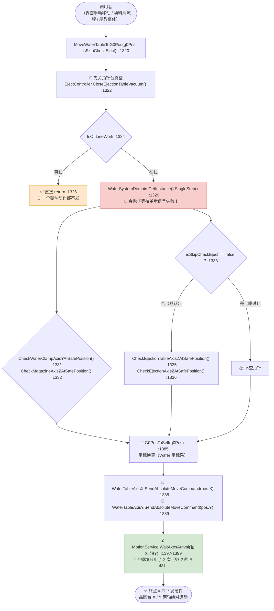

**ASCII 版**

```text
  调用者（界面手动 / 换料片流程 / 示教窗体）
    |
    v
  MoveWaferTableToG0Pos(g0Pos, isSkipCheckEject)       WaferTableController.cs:1320
    |
    +-- 🔧 CloseEjectionTableVacuum()  顶针台真空       :1322
    |
    +-- IsOffLineWork ?                                 :1324
    |     是 -> ✅ return :1326   （一个硬件动作都不发）
    |
    +-- WaferSystemDomain.SingleStep()                  :1329
    |     🔴 无单步信号时抛「等待单步信号失败！」
    |
    +-- 安全检查                                       :1331-1336
    |     CheckWaferClampAxisYAtSafePosition()          :1331
    |     MagazineController.CheckMagazineAxisZAtSafePosition()  :1332
    |     if (!isSkipCheckEject)                        :1333
    |         CheckEjectionTableAxisZAtSafePosition()   :1335
    |         CheckEjectionAxisZAtSafePosition()        :1336
    |
    +-- 🔧 G0PosToSelf(g0Pos)  坐标换算                 :1385
    |
    +-- 🔧 WaferTableAxisX.SendAbsoluteMoveCommand(pos.X)  :1388
    +-- 🔧 WaferTableAxisY.SendAbsoluteMoveCommand(pos.Y)  :1389
    |
    +-- ⏳ MotionService.WaitAxesArrival(X, Y)          :1397-1399
    |     📌 全模块只用了 2 次
    |
    v
  ✅ 终点 = 🔧 下发硬件（晶圆台 X / Y 两轴绝对运动）
```

**调用链（逐层，带行号）**

| # | 层 | 位置 | 干了什么 |
|---|---|---|---|
| 1 | 控制器入口 | `Controllers/WaferTableController.cs:1320` | `MoveWaferTableToG0Pos(AKRSPoint3D g0Pos, bool isSkipCheckEject = false)` |
| 2 | **硬件（前置）** | `:1322` | `CloseEjectionTableVacuum()` —— **顶针台真空，先关掉才允许动台** |
| 3 | 早返回 | `:1324-1327` | 离线 → `return`，**无任何硬件动作** |
| 4 | 单步放行 | `:1329` | `WaferSystemDomain.GetInstance().SingleStep()`（§5.11） |
| 5 | 安全检查 | `:1331` / `:1332` / `:1335` / `:1336` | 晶圆夹 Y、料盒 Z、顶针台 Z、顶针 Z 四处"是否在安全位" |
| 6 | 坐标换算 | `:1385` | `MachineCoordinateSystem...WaferCoordinateSystem.G0PosToSelf(g0Pos)` |
| 7 | **硬件** | `:1388` / `:1389` | `WaferTableAxisX.SendAbsoluteMoveCommand(pos.X)` / `WaferTableAxisY.SendAbsoluteMoveCommand(pos.Y)` |
| 8 | 等到位 | `:1397-1399` | `MotionService.WaitAxesArrival(...)` —— **✅ 这是全模块唯一有"到位回执"的地方之一** |
| 9 | 终点 | — | **🔧 下发硬件：晶圆台 X 轴 + Y 轴绝对运动** |

**"读了什么、写了什么"**

| 项 | 位置 |
|---|---|
| 读 `MachineStateModel.GetInstance().IsOffLineWork` | `:1324` |
| 读 `WaferSubDevicePara...WaferTableDevicePara`（安全检查用的安全位坐标） | `:1331-1336` 链上的各 `Check*` |
| **没有任何写入、没有任何落盘** | — |

**坑**

- ✅ **这是本模块少见的"完整链条"**：安全检查 → 坐标换算 → 发运动指令 → **等到位回执**。
  与本模块大多数"发指令 + `Sleep` 猜"的做法（§7.2 的 R-48）形成对比。
  **要学"本模块怎么写运动"，看这一段。**

- ⚠️ **但它的前置动作是"先关顶针台真空"（`:1322`），在离线判断（`:1324`）之前。**
  也就是说**离线仿真时也会执行这一句** —— 它是否真的下发硬件取决于
  `CloseEjectionTableVacuum()` 内部对离线的处理（`EjectController.cs:329-362` 段），
  **本条未能逐行核实**，写入附录 B。

- 🔴 **`isSkipCheckEject = true` 会跳过顶针的两项安全检查**（`:1333`）。
  调用点若图省事传了 `true`，**晶圆台就可能撞上还没归位的顶针**。
  本篇范围内传 `true` 的调用点见 §5.8 的对照；**这个参数的默认值是 `false`，是对的**。

- ⚠️ **手动移动类按钮里，`MoveWaferTableToG0Pos` 的调用者不止界面** ——
  换料片流程（`WaferSubSystemTask.cs:826` 等）也在调它。
  也就是说**同一条安全检查链同时服务"人按的"和"流程自动的"两种触发源**，
  **一条链上出问题会同时影响手动与自动**。这也是 §4.1 说的"
  本篇没有按钮，但驱动源比按钮更难排查"的具体例子。

#### 4.12.3 一个小结：本目录的"终点"分布

| 手动操作 | 终点类型 | 证据 |
|---|---|---|
| 放料片 `PlaceWaferInSlot()` | **🔧 硬件 + 💾 落盘** | 气缸 `:650-653`/`:672-675`、晶圆夹 Y 轴 `:678`、扩晶 Z、顶针；落盘 `:1047` / `:1050` |
| 取料片 `RemoveWaferFromSlot(int)` | **🔧 硬件 + 💾 落盘** | 内部再调 `PlaceWaferInSlot()`（`:1086`）+ `PreChangeTablet()` + 料盒 Z 轴 `:1041`；落盘 `:1065` / `:1074` |
| 晶圆台移动 `MoveWaferTableToG0Pos()` | **🔧 硬件（X/Y 两轴）** | `:1388` / `:1389` |
| 料层号变更（离线） | **💾 只改内存 + 落盘，无硬件** | `PlaceWaferInSlot()` `:966-980`；`RemoveWaferFromSlot()` `:1064-1078` |
| 顶针更换 `ChangeEjection()` | **🔧 硬件 + 💾 落盘（配方级）** | `EjectController.cs:493-553`；落盘 `:541-543` |

> **上表的用法**：排查"按钮点了没反应"时，
> **先看它在不在"💾 只改内存"那一行** —— 那一类**本来就不该有任何声音和动作**，
> 是"没反应但正确"，不是故障。**这是本模块最容易误判成故障的一类操作。**


---

## 5. 核心流程

§4 讲的是"**谁把这条流程推起来**"，本节讲"**推起来之后到底跑了什么**"。
两节有重叠是故意的：§4 从**触发点**切进去，本节从**算法与数据**切进去。

### 5.0 本节的地图

本模块的核心流程一共 **7 条**，全部是按"谁先谁后"的调用链排的：

| # | 流程 | 起点（触发者） | 终点（最终效果） | 本节位置 |
|---|---|---|---|---|
| 1 | **开机初始化** | `Machine` 启动 | 4 个搜晶模式各自复位到初始态 | §5.1 |
| 2 | **搜晶总入口** | Bond 侧要料信号 | 分派到 4 个模式之一 | §5.2 |
| 3 | **Single 单颗步进搜晶** | `Block.NextDie()` | 芯片中心送到相机下 | §5.3 |
| 4 | **Nine 九宫格爬行搜晶** | `Block.NextDie()` | 同上，但走的是"爬行"路径 | §5.4 |
| 5 | **WaferMap 晶圆图搜晶** | `Block.NextDie()` | 按预先学好的晶圆图顺序取 | §5.5 |
| 6 | **Box 华夫盒搜晶** | `Block.NextDie()` | 按盒内槽位顺序取 | §5.6 |
| 7 | **取完一颗后的「刷新」回调** | **Bond 侧 21 个调用点**（不是本模块自己调） | 更新晶圆图状态 / 顶针回预顶位 | §5.7 |

外加两条**贯穿性**流程，因为它们不属于任何单一模式：

| # | 流程 | 说明 | 本节位置 |
|---|---|---|---|
| 8 | **晶圆台运动与 G0 坐标换算** | 所有模式共用 | §5.8 |
| 9 | **传感器的自检与检测** | 所有模式共用 | §5.9 |

> ⚠️ **一句话记住本节**：**搜晶算法的入口只有一个** —— `Block.NextDie()`
> （`Models/Entities/SearchChip/Block.cs:335`），它按 `SearchMode` 四选一分派到
> `SearchSingle` / `SearchNine` / `SearchMapping` / `SearchDieBox`。
> 除此之外**没有任何别的路径能让晶圆台找到下一颗芯片**。
> 所以想把晶圆侧搞懂，只需要把这一节读完，加 §4.3 那条主循环。

---

### 5.1 开机初始化：4 个模式各自的"复位到初始态"

#### 触发

`Block.StartInit()`（`Models/Entities/SearchChip/Block.cs:1193`）被 **4 处**调用：

| 调用点 | 时机 |
|---|---|
| `Tasks/WaferSubSystemTask.cs:1379` | `Start()` 里，**线程真正起来之前**，在调用线程上同步执行一次 |
| `Tasks/WaferSubSystemTask.cs:495` | 每次换料片成功（`ChangeSucceedOperation` 开头） |
| `BondSystem/Controllers/System2Controller.AutoCali.cs:381` | Bond 侧自动标定流程开始时 |
| `Experiment/Test/FrmMachineFunctionTest.cs:1805` | 功能测试界面（试验模块） |

#### 动作：无条件全调一遍

`StartInit()` 的实现是**把 4 个初始化全部调一遍，不做任何判断**：

```csharp
public void StartInit()                                  // Block.cs:1193
{
    this.StartInitWaferMap();                            // :1199
    this.StartInitWaffleMap();                           // :1200
    this.StartInitSingle();                              // :1201
    this.StartInitNine();                                // :1202
}
```

**图 14：开机初始化与 4 个模式的状态复位**

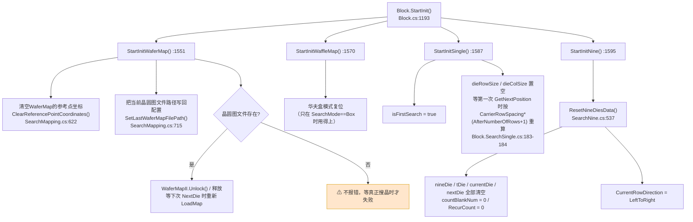

**ASCII 版**

```text
  Block.StartInit()  Block.cs:1193
        |
        +-- StartInitWaferMap()   :1551  -> 清参考点 + 记晶圆图路径 + WaferMapII.Unlock()
        +-- StartInitWaffleMap()  :1570  -> 华夫盒侧复位
        +-- StartInitSingle()     :1587  -> isFirstSearch = true, 步距待算
        +-- StartInitNine()       :1595  -> ResetNineDiesData() :537 清 9 宫格全部状态
        |
        v
   4 个模式都被复位（不管当前用哪个）
```

#### 坑

- 🔴 **4 个模式无条件全调**。当前 `SearchMode` 是 `WaferMap` 时，
  `StartInitSingle()` / `StartInitNine()` 照样跑，把 `isFirstSearch`、`nineDie` 等字段也复位一遍。
  这**本身无害**（下次切模式时反而更干净），但它意味着
  **任何一处 `StartInit*` 抛异常，整条晶圆线程连启动都起不来** —— 因为 `:1379` 在 `try` 里，
  而且它在 `Task.Factory.StartNew` **之前**（`:1385`），异常会落到 `:1420` 的 catch，
  弹的是「晶圆线程开启失败！」（`:1423`）而不是「晶圆线程即将停止！」。
  **两个提示文案不同，可以据此区分是"没起来"还是"跑挂了"。**
- ⚠️ `StartInit()` 会被**换料片时反复调用**（`:495`），不是"只在开机调一次"。
  所以它必须**可重入、幂等** —— 目前看是幂等的（都是赋值），
  但 `WaferMapII.Unlock()` 这种调用重复执行的影响**未核实**，写入附录 B。
- ✅ 初始化**不落盘**。`StartInit` 全链路里没有 `Save()` 调用 ——
  它改的全是内存字段，所以"初始化到一半掉电"不会污染配置。

---

### 5.2 搜晶总入口：`Block.NextDie()` 的四路分派

这是全模块**唯一**的搜晶入口。整个分派逻辑只有 23 行：

```csharp
public bool NextDie()                                        // Block.cs:335
{
    if (this.SearchMode == SearchMode.Single)   return this.SearchSingle();    // :337-340
    else if (this.SearchMode == SearchMode.Nine) return this.SearchNine();     // :341-344
    else if (this.SearchMode == SearchMode.WaferMap) return this.SearchMapping(); // :345-348
    else if (this.SearchMode == SearchMode.Box)  return this.SearchDieBox();   // :349-352
    else throw new Exception("No exist the Search Mode!");  // :355
}
```

`SearchMode` 不是 `Block` 自己的字段，而是**从当前料片配置转发出来的**：

```csharp
private SearchMode SearchMode => this.currentCarrierConfig.SearchMode;   // Block.cs:1706
```

`SearchMode` 枚举定义在 `Models/Enums/EnumWaferSubSystem.cs:118`，
成员是 `Single`(0) / `Nine`(1) / `WaferMap`(2) / `Box`(3)（**推断**：顺序来自枚举声明，见附录 B）。

**图 15：搜晶总入口的四路分派与返回值语义**

```mermaid
flowchart TD
    A["Bond 线程: 要料信号<br/>WaferSubSystemTask.cs:80"] --> B["Block.NextDie()<br/>Block.cs:335"]
    B --> C{"currentCarrierConfig.SearchMode<br/>Block.cs:1706"}
    C -->|"Single"| D["SearchSingle()<br/>Block.SearchSingle.cs:35"]
    C -->|"Nine"| E["SearchNine()<br/>Block.SearchNine.cs:39"]
    C -->|"WaferMap"| F["SearchMapping()<br/>Block.SearchMapping.cs:46"]
    C -->|"Box"| G["SearchDieBox()<br/>Block.SearchDieBox.cs:48"]
    C -->|"其它值"| H["🔴 throw<br/>\"No exist the Search Mode!\"<br/>Block.cs:355"]

    D --> R["返回 bool"]
    E --> R
    F --> R
    G --> R

    R -->|"true<br/>搜到了"| S1["WaferSubSystemTask.cs:162-163<br/>条件不成立，继续往下走"]
    R -->|"false<br/>没搜到"| S2["WaferSubSystemTask.cs:163<br/>进入 IsNeedChange 判定分支"]

    S2 --> T{"this.IsNeedChange?"}
    T -->|"false"| T1["🔴 直接 throw<br/>\"搜晶失败！\"<br/>WaferSubSystemTask.cs:252"]
    T -->|"true"| U{"CurrentTablet 是<br/>WaferTablet 吗?"}
    U -->|"否"| U1["goto NeedChange<br/>:247"]
    U -->|"是"| V{"SearchMode == WaferMap?"}
    V -->|"是"| V1["goto NeedChange<br/>:171"]
    V -->|"否"| W{"IsDryCycle 空跑?"}
    W -->|"是"| W1["goto NeedChange  :192"]
    W -->|"否"| X["弹视觉告警框<br/>UcMainSystem.VisionAlarmFunc<br/>:215-216"]
    X --> Y{"用户点了什么?"}
    Y -->|"OK"| Y1["goto NeedChange  :221"]
    Y -->|"Retry"| Z{"选的点在搜索范围内吗?<br/>IsInSearchRange :224"}
    Z -->|"否"| Z1["弹「选取的位置在搜索范围外」<br/>:229-233 -> goto RetrySelectPoint :234"]
    Z -->|"是"| Z2["ReSetChangeCarrierSignal()<br/>SlotState = Good<br/>AsyncSaveWaferSubDevicePara()<br/>:237-240 -> goto NeedChange"]
    Y -->|"其它/关窗"| Y2["⚠ switch 无 default<br/>落到 switch 之后 :243<br/>currentNeedCarrierConfig 是上一次的值"]

    style H fill:#f8cecc,stroke:#b85450
    style T1 fill:#f8cecc,stroke:#b85450
    style Y2 fill:#ffe6cc,stroke:#d79b00
```

**ASCII 版**

```text
  Bond要料信号
      |
      v
  Block.NextDie()  Block.cs:335
      |
      +-- SearchMode == Single   -> SearchSingle()   Block.SearchSingle.cs:35
      +-- SearchMode == Nine     -> SearchNine()     Block.SearchNine.cs:39
      +-- SearchMode == WaferMap -> SearchMapping()  Block.SearchMapping.cs:46
      +-- SearchMode == Box      -> SearchDieBox()   Block.SearchDieBox.cs:48
      +-- 其它                   -> throw "No exist the Search Mode!"  :355
      |
      v  返回 bool
   true  -> 继续（开真空 / 发允许取料信号）
   false -> IsNeedChange?
              |false -> throw "搜晶失败！"  WaferSubSystemTask.cs:252
              |true  -> 是 WaferTablet 吗?
                          |否 -> goto NeedChange
                          |是 -> SearchMode==WaferMap? -> 是: goto NeedChange
                                                 否: 空跑? -> 是: goto NeedChange
                                                             否: 弹视觉告警框
                                                                  OK    -> goto NeedChange
                                                                  Retry -> 在范围内? 否 -> 再选点
                                                                                    是 -> ReSet + Good + 存盘
```

#### 返回值语义（重要）

**`NextDie()` 返回 `false` 不是"出错了"，而是"这一颗不该由我取"**，有三种含义：

| 返回 `false` 的原因 | 谁设的 `isNeedChangeCarrier` | 后续 |
|---|---|---|
| 当前料片/晶圆图/华夫盒**已经取完** | 各 `Search*` 内部设 `true` | 走 `goto NeedChange` → 换料片 |
| 需要**提前换料片**（`isNeedAheadChangeTablet`） | `Block.SearchSingle.cs:52-53` | 同上 |
| WaferMap 模式下**参考点取完**（`NoApproachableChipException`） | `Block.SearchMapping.cs:170-171` | 同上 |

而 `true` 只表示"**芯片中心已经在相机下面了**"，**不表示取片成功** ——
取片是 Bond 侧 `PickActionNode` 的事。

#### 坑

- 🔴 **`throw new Exception("No exist the Search Mode!")`**（`:355`）不可达 ——
  枚举只有 4 个值而且 4 个都被 `if` 拦住了。但同一句话在
  `WaferSubSystemTask.cs:814` / `:938` 还有两处**风格不同**的版本
  （`"you can you no, SearchMode!"`），那两处是**可达的**（见 §4.5）。
  **同一个语义有两种异常文案，日志里 grep 时要两条都搜。**
- ⚠️ **`SearchMode` 是转发属性，不是快照**（`:1706`）。
  `NextDie()` 进来时读一次，但 `SearchSingle()` 内部**没有缓存它** ——
  如果搜晶过程中界面改了料片的 `SearchMode` 并落盘，
  **同一次 `NextDie()` 调用内可能前后读到不同的模式**。
  当前流程下改配置要停线，实际撞不上；但**没有代码层面的保护**。
- ⚠️ 视觉告警框的 `switch`（`WaferSubSystemTask.cs:218-242`）**没有 `default`**。
  用户直接关窗（`X`）或按 `Esc` 时，`dialog` 既不是 `OK` 也不是 `Retry`，
  控制流会**掉出 switch 到 `:243`**，然后带着**上一次的**
  `currentNeedCarrierConfig` 继续往下开真空、发允许取料信号。
  这是 R-07 那 17 处缺 `default` 里**唯一一处会继续往下走业务**的。
- ✅ 四路分派**没有并发问题** —— 它只在晶圆线程上被调用，
  而晶圆线程同时最多一条（`:1376` 的 `TaskStatus` 检查）。

---

### 5.3 模式一：Single（单颗步进搜晶）

**这是四种模式里唯一"边走边算下一步"的算法** —— 其余三种都是查表（查晶圆图 / 查盒槽位）。
实现在 `Models/Entities/SearchChip/Block.SearchSingle.cs`（516 行）。

#### 5.3.1 两个步距（Die Pitch）

算法的全部几何基础是两个向量，**只在本次料片的第一次搜晶时算一次**：

```csharp
this.dieRowSize = this.CarrierRowSpacing * (this.AfterNumberOfRows + 1);       // :183
this.dieColSize = this.CarrierColSpacing * (this.AfterNumberOfColumns + 1);    // :184
```

- `CarrierRowSpacing` / `CarrierColSpacing` 来自当前料片配置
  （`Block.cs:1790` / `:1796`，转发自 `currentCarrierConfig`）；
- `AfterNumberOfRows` / `AfterNumberOfColumns` 是**"跳几颗"** —— 甲片拾取后跳过已取走的空位；
- `+1` 才是真正的一格间距。**这也是 `SingleSearchDirectionCurrent` 那个"跳步"配对的来源。**

然后按方向取负号（`:186-194`）：

| `SingleSearchDirection` | 行/列取负 | 主推进方向 |
|---|---|---|
| `ToRightDown` / `ToRightUp` | `dieColSize *= -1` | 列 |
| `ToDownRight` / `ToDownLeft` | `dieRowSize *= -1` | 行 |

#### 5.3.2 三种走法

`GetNextPosition()`（`:174`）用**同一种模式**处理两个方向族（"左右"族 `:212-298`、"上下"族 `:300-386`），
每族内部是同一个三段式：

| 段 | 代码位置（列族/行族） | 干什么 |
|---|---|---|
| **Normal search** | `:215` / `:303` | 按主方向**加一格**。在范围内就返回它 |
| **Row/Column feed search** | `:222-230` / `:310-318` | 主方向走不通了，**换行/换列**再试一次 |
| **Probe search / Reverse search（探针/反向）** | `:235-261` + `:268-294` / `:323-349` + `:356-382` | 用 `retryTimes = 50`（`:499`）**逐格试探**，找到第一个在范围内的点 |

**图 16：Single 单颗步进搜晶算法**

```mermaid
flowchart TD
    A["SearchSingle(isOffset)  Block.SearchSingle.cs:35"] --> B["GetNextPosition(isOffset)  :174"]
    B --> C{"isFirstSearch?<br/>:179"}
    C -->|"是"| C1["算 dieRowSize/dieColSize<br/>:183-184<br/>按方向取负 :186-194<br/>isFirstSearch = false :196<br/>return 当前实时位置"]
    C -->|"否"| C2{"isOffset?  :202"}
    C2 -->|"是"| C3["当前位置 - GetPickOffset1()<br/>:204"]
    C2 -->|"否"| C4["当前位置  :208"]

    C3 --> D{"方向族  :212 / :300"}
    C4 --> D
    D -->|"左右族"| E1["Normal: result += dieColSize  :215"]
    D -->|"上下族"| E2["Normal: result += dieRowSize  :303"]

    E1 --> F{"IsInSearchRange(result)?<br/>:216 / IsInSearchRange :1335"}
    E2 --> F
    F -->|"在范围内"| G["return result  ✅"]
    F -->|"不在"| H["换行/换列  :222-230 / :310-318"]
    H --> I{"IsInSearchRange?  :232 / :320"}
    I -->|"在"| J["Probe search 逐格试探<br/>for i in 0..retryTimes(50)<br/>:235 / :323"]
    I -->|"不在"| K["Reverse search 反向逐格<br/>for i in 0..retryTimes(50)<br/>:268 / :356"]

    J --> J1{"试探中<span style='color:red'>出界</span>?"}
    J1 -->|"是"| J2["dieColSize *= -1  :240<br/>方向取反 :242-257<br/>return result += dieColSize  :259"]
    J1 -->|"50 次都没出界"| J3["🔴 return null  :263"]

    K --> K1{"试探中<span style='color:green'>回到范围内</span>?"}
    K1 -->|"是"| K2["dieColSize *= -1  :273<br/>方向取反 :275-290<br/>return result  :292"]
    K1 -->|"50 次都没回去"| K3["🔴 return null  :296"]

    G --> L["回到 SearchSingle  :43"]
    J2 --> L
    K2 --> L
    J3 --> L
    K3 --> L

    L --> M{"currentDiePosition == null<br/>或 isNeedAheadChangeTablet?  :48"}
    M -->|"是"| M1["isNeedChangeCarrier = true  :53<br/>SlotState = Bad  :54<br/>AsyncSaveWaferSubDevicePara()  :55<br/>return false  :56"]
    M -->|"否"| N{"IsPositionSearch?  :59"}
    N -->|"否"| N1["🔴 throw<br/>\"you can you no, not PositionSearch!\"  :149"]
    N -->|"是"| O{"PositionSearchMode?  :61"}
    O -->|"MultipleSearch"| O1["🔴 throw<br/>\"you can you no, PositionSearchMode!\"  :140"]
    O -->|"其它"| O2["🔴 throw<br/>\"you can you no, PositionSearchMode!\"  :144"]
    O -->|"StandardSearch"| P{"IsTwoPointSearch?  :63"}
    P -->|"否（单点）"| Q1["移到 currentDiePosition  :134<br/>AnalyseDie 定模板  :135"]
    P -->|"是（两点）"| Q2["移到左上角 :68-69 -> AnalyseDie :73<br/>移到右下角 :79-80 -> AnalyseDie :84<br/>两点取角度平均 :90<br/>移到两点中点 :91"]

    Q1 --> R["StopSearch()  :152"]
    Q2 --> R
    R --> R1{"Machine 已 Stop?<br/>Block.cs:1497"}
    R1 -->|"是"| R2["开吹气 :1501<br/>Sleep(DelayEjectBlowHold) :1502<br/>关吹气 :1503<br/>顶针回安全位 :1504<br/>🔴 throw \"正在搜晶过程中，检测到设备已停止！\" :1508"]
    R1 -->|"否"| S{"isSkip?（视觉判定为空片/跳过）"}
    S -->|"是"| B
    S -->|"否"| T["MoveDieToPickCenter()  :158<br/>芯片中心送到相机下<br/>return true  :162"]

    style J3 fill:#f8cecc,stroke:#b85450
    style K3 fill:#f8cecc,stroke:#b85450
    style N1 fill:#f8cecc,stroke:#b85450
    style R2 fill:#f8cecc,stroke:#b85450
    style O1 fill:#f8cecc,stroke:#b85450
    style O2 fill:#f8cecc,stroke:#b85450
```

**ASCII 版**

```text
  SearchSingle()  Block.SearchSingle.cs:35
     |
     |  do {                                        <-- isSkip 为真时回到这里
     |     GetNextPosition(isOffset)  :174
     |        |
     |        +-- isFirstSearch?  :179
     |        |     是: dieRowSize = CarrierRowSpacing * (AfterNumberOfRows+1)  :183
     |        |         dieColSize = CarrierColSpacing * (AfterNumberOfColumns+1) :184
     |        |         方向取负 :186-194   isFirstSearch=false :196
     |        |     否: isOffset ? 位置-GetPickOffset1() :204  :  位置 :208
     |        |
     |        +-- 左右族(:212)            上下族(:300)
     |        |     Normal  += dieColSize :215   Normal += dieRowSize :303
     |        |         在范围? :216 -> 返回
     |        |         换行 :222-230          换列 :310-318
     |        |             在范围? :232 -> Probe search  :235  (50 次)
     |        |                  出界 -> 反向 + return  :240-259
     |        |                  50次不出界 -> return null  :263
     |        |             不在范围 -> Reverse search :268 (50 次)
     |        |                  回到范围 -> 反向 + return :273-292
     |        |                  50次回不去 -> return null  :296
     |        |
     |     currentDiePosition == null 或 isNeedAheadChangeTablet?  :48
     |        是 -> isNeedChangeCarrier = true ; SlotState = Bad ;
     |              AsyncSaveWaferSubDevicePara() ; return false  :52-56
     |        否 -> IsPositionSearch?  :59   否 -> throw "you can you no, not PositionSearch!"
     |              PositionSearchMode?  :61
     |                 StandardSearch + IsTwoPointSearch
     |                     是 -> 左上角定模板 :73 / 右下角定模板 :84 / 角度取平均 :90 / 移到中点 :91
     |                     否 -> 移到目标 :134 -> AnalyseDie 单模板 :135
     |                 MultipleSearch  -> throw "you can you no, PositionSearchMode!" :140
     |                 其它            -> throw "you can you no, PositionSearchMode!" :144
     |     StopSearch()  :152
     |        Machine.IsStop()?  Block.cs:1497
     |           是 -> 吹气 :1501 / Sleep :1502 / 关吹气 :1503 / 顶针安全位 :1504
     |                 -> throw "正在搜晶过程中，检测到设备已停止！" Block.cs:1508
     |     isSkip?  -> 是: 回到 do 开头
     |             -> 否: MoveDieToPickCenter() :158 -> return true :162
     |
     +-- 注意：do-while 的退出条件是 isSkip（:154），不是"搜到了"
```

#### 5.3.3 读了什么、写了什么

| 读 | 写 | 落盘时机 |
|---|---|---|
| `CarrierRowSpacing` / `CarrierColSpacing`（`Block.cs:1790/:1796`） | `dieRowSize` / `dieColSize`（`:509/:514`） | — |
| `AfterNumberOfRows` / `AfterNumberOfColumns` | `isFirstSearch`、`isNeedAheadChangeTablet`（`:168`） | — |
| `SingleSearchDirectionCurrent`（`Block.SearchSingle.cs:212/300`，经 `Block.cs` 转发） | `SingleSearchDirectionCurrent`（`SetSingleSearchDirection` `:478-485`） | ✅ `AsyncSaveWaferSubDevicePara()` `:483` |
| `currentDiePosition`（`:504`） | `currentDiePosition`（`:43`） | — |
| `IsPositionSearch` / `PositionSearchMode` / `IsTwoPointSearch` / `DieMatchName` / `DieMatchNameP2` | `SlotState = SlotStatuEnum.Bad`（`:54`） | ✅ `:55` |

#### 5.3.4 坑

- 🔴 **`retryTimes = 50`（`:499`）是硬编码的探针上限，不可配置。**
  晶圆如果在一行里连续超过 50 格都是空的（比如大片空膜），
  `Probe search` 会**在 50 次后直接 `return null`**（`:263`），
  上层把它解释成"**这片料取完了**"（`:48-56`）→ `SlotState = Bad` → 落盘 → 换料片。
  **也就是说"50 格空片"会被误判成"料片取完"，并且这个误判会被写进配置文件。**
- 🔴 **`SetSingleSearchDirection()` 的守卫和它的赋值不是同一个对象**（`:480-484`）：
  ```csharp
  if (this.currentCarrierConfig is CarrierWithWaferConfig wt)          // :480  检查的是"料片配置"
  {
      ((WaferTablet)WaferSubDevicePara.GetInstance()
          .WaferTableDevicePara.CurrentTablet)                          // :482  强转的是"台面对象"
          .SingleSearchDirectionCurrent = direction;
  ```
  两个判断对象**不是同一个东西**。如果 `currentCarrierConfig` 是 `CarrierWithWaferConfig`
  但 `CurrentTablet` 是 `NullTablet`（换料片过程中会出现），
  这里会抛 **`InvalidCastException`**（不是静默失败）。
  注意它与 `WaferTableDevicePara.SingleSearchDirectionCurrent` 的 setter
  （`Models/DeviceParams/WaferTableDevicePara.cs:389-395`）**行为不同** ——
  那个 setter 是 `if (CurrentTablet is WaferTablet wt) { ... }`，**没有 `else`，静默丢弃**。
  **两个入口，一个抛异常一个静默丢弃。** 这是 R-04 的完整形态。
- ⚠️ **`AnalyseDie` 的 `isSkip` 是"视觉判定为空片"**，但**跳过之后 `dieColSize`/`dieRowSize`
  可能已经在 `GetNextPosition` 里被取反过**（`:240/:328`）。
  也就是说**一次 skip 会翻转后续整条搜索方向** —— 这是设计意图（换行掉头），
  但如果 skip 是误判（模板匹配失败而非真的空片），
  方向翻转后**后面所有芯片都会按错误方向找**，直到下一次碰到边界。
  这个"误判会传播"的性质**没有任何自检**。
- ⚠️ **`do { } while (isSkip)`（`:39` / `:154`）没有循环上限。**
  如果视觉一直判定 `isSkip`，而位置又一直在范围内，
  这个循环会**无限跑下去**（每次都移动晶圆台 + 拍照）。
  唯一的出口是 `StopSearch()` 里的"设备已停止"检查（`:152`），
  或者 `GetNextPosition` 返回 `null`（`:263/:296`）。
  **既没有计数器也没有超时。**
- ⚠️ **`isOffset` 在第一轮之后被强制置 `false`**（`:44`），
  之后的每一轮都从"当前实时位置"算，不减去拾取偏移。
  这意味着**视觉定位累计误差会一直带着走**，不会每轮回零。
- ✅ **`PositionSearchMode.MultipleSearch` 是明确未实现的**（`:140` 直接抛），
  枚举里有这个值但代码不支持。**不要以为它是"还没测"，它是"根本没写"。**
- ✅ 未找到"两点定位"的反向证据：`Block.SearchDieBox.cs:73` 的注释写的是
  "两点定位 偏移正负号**已验证**"，而 `Block.SearchSingle.cs:67` 和 `Block.SearchMapping.cs:64`
  写的是"**待验证**"。**同一套算法三处注释三种状态**，
  说明 Single 与 Box 的符号约定可能确实不同（Box 用 `-`，Single 也用 `-`），
  但 Map 模式直接抛异常还没试过。**这条无法从代码判定对错，写入附录 B。**

---

### 5.4 模式二：Nine（九宫格爬行搜晶）

#### 5.4.1 数据结构：`NineDie` 是什么

`NineDie`（`Models/Entities/SearchChip/NineDie.cs`，73 行）持有 **9 个 `SingleDieInfo`**，
对应以当前芯片为中心的 3×3 邻域：

```text
     LeftUp ── Up ── RightUp
        │       │        │
     LeftCenter  ── RightCenter
        │       │        │
     LeftDown ─ Down ─ RightDown
               CenterDie
```

每个 `SingleDieInfo`（在 `Block.SearchNine.cs` 里声明）有 `Pos`（位置）和 `Exist`（是否已确认有芯片）。

**九宫格的核心思想**：**一次拍照不只定一颗，而是把邻域 9 颗都判出来**，
然后按"往上走 → 撞到空 → 往右/左走 → 往下掉一行"的**爬行规则**决定下一颗。
好处是**拍照次数少**（一次顶九颗），坏处是**逻辑极其绕**（881 行）。

#### 5.4.2 状态字段

| 字段 | 位置 | 含义 |
|---|---|---|
| `nineDie` | `SearchNine.cs:834` | 当前 9 宫格 |
| `currentRowNum` / `turnUpRowNum` | `:839` / `:844` | 当前行号 / **掉头时记下的行号** |
| `tDie` | `:849` | T 型拐点标记（防止绕死） |
| `BiggestRowStartDie` / `NextRowStartDie` | `:854` / `:859` | 最长行起点 / 下一行起点 |
| `currentDie` / `nextDie` | `:864` / `:869` | 当前 / 下一颗 |
| `RecurCount` / `RecurLimit = 50` | `:874` / `:879` | 递归计数 / **上限 50** |
| `CurrentRowDirection` | `:829` | `LeftToRight` / `RightToLeft` |
| `countBlankNum` | `SearchNine.cs:50` | 连续空片计数 |

**图 17：Nine 九宫格爬行搜晶**

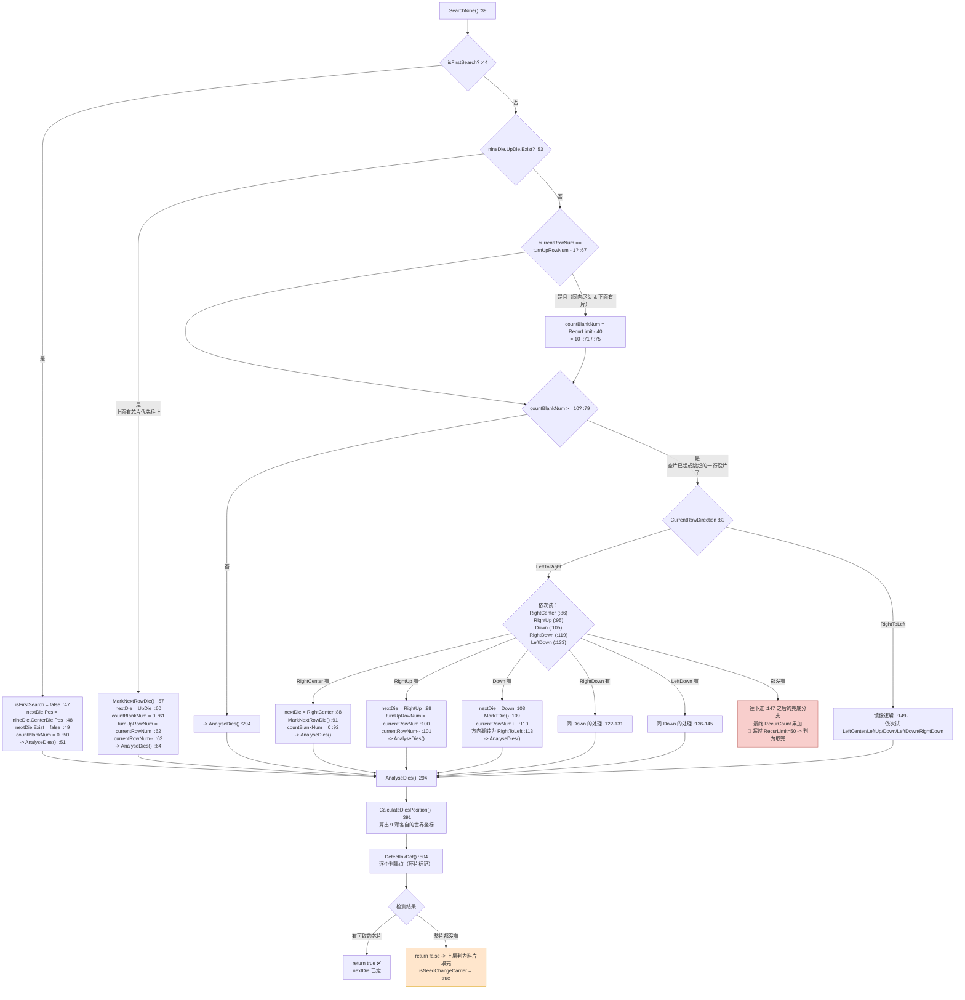

**ASCII 版**

```text
  SearchNine()  Block.SearchNine.cs:39
     |
     |  isFirstSearch?  :44  是 -> 把 CenterDie 当第一颗 -> AnalyseDies() :51
     |  否
     |  v
     |  UpDie.Exist?  :53
     |     是 --(优先往上)--> MarkNextRowDie() :57
     |                          nextDie = UpDie :60 ; turnUpRowNum = currentRowNum :62
     |                          currentRowNum-- :63 -> AnalyseDies()
     |     否
     |  v
     |  currentRowNum == turnUpRowNum-1?  :67
     |     是且(同向尽头 & 下面有片) -> countBlankNum = 50-40 = 10   :71 / :75
     |  v
     |  countBlankNum >= 10?  :79
     |     否 -> AnalyseDies()  :294
     |     是 -> 空片超限 / 跳起那行没片了：
     |           LeftToRight 方向 :82  依次试：
     |              RightCenter :86 -> 换位并 MarkNextRowDie  :88-93
     |              RightUp     :95 -> 记 turnUpRowNum, 行号-- :98-103
     |              Down       :105 -> MarkTDie, 行号++, 翻方向 :108-117
     |              RightDown  :119 -> 同上 :122-131
     |              LeftDown   :133 -> 同上 :136-145
     |              都没有      -> 兜底分支
     |           RightToLeft 方向 :149  镜像（LeftCenter/LeftUp/Down/...
     |
     |  AnalyseDies()  :294
     |     -> CalculateDiesPosition()  :391  算 9 颗世界坐标
     |     -> DetectInkDot()  :504          判墨点（坏片）
     |     -> 有可取的 -> return true
     |        整片都没 -> return false（上层当作料片取完）
```

#### 5.4.3 坑

- 🔴 **`RecurLimit = 50`（`:879`）和 `RecurLimit - 40 = 10` 这两个数字都是硬编码魔数。**
  代码里**没有任何注释解释 `- 40` 从哪来**。
  它的作用是"**把 `countBlankNum` 直接推到接近上限**"，
  从而**强行进入换行判断**（`:79`）——
  也就是说 `:71` / `:75` 那两句不是"计数"，而是**一个 `goto` 的替身**。
  读懂 Nine 算法的关键就在这一句，而它长得完全不像控制流。
- 🔴 **`SearchNine()` 的 `try` 没有 `catch`**（`:41` 的 `try` 后面直接是 `finally` 或无捕获）。
  这里抛出的异常**没有任何 Nine 专属的处理**，直接冒泡到 `Dowork()` 的 catch。
- ⚠️ **`countBlankNum` 的语义在不同分支里不一致**：
  在 `:50` / `:61` / `:92` 它被"清零"（表示"刚看到有片"），
  在 `:71` / `:75` 它被"设成 10"（表示"立刻换行"），
  在兜底分支里它据说是累加的。
  **同一个字段既是计数器又是标志位**，是这一节最容易改错的地方。
- ⚠️ **`RecurCount`（`:874`）与 `countBlankNum` 是两个独立的"连续失败"计数**，
  而且 `RecurCount` 在下文**没有对应的清零点**（我读到的范围内）。
  **推断**：它是"整个料片级别的重试上限"，而 `countBlankNum` 是"行级别的"。
  这条**未完全核实**，写入附录 B。
- ✅ **Nine 模式在 `RefreshMap` 里是唯一会重定心的**（`Block.cs:907-910` 调
  `ReMoveDieToWaferCameraCenter()`），
  而 `Single` 分支是**空的**（`:895-898` 只有一个注释）。
  这不是 bug，是两种模式的重定心策略不同：Nine 靠 `AnalyseDies` 一次判 9 颗，
  拍照后必须回到中心才能继续。

---

### 5.5 模式三：WaferMap（晶圆图搜晶）

**这是四种模式里唯一"不靠算、靠查表"的模式** —— 晶圆图是**事先学好的**，
由 `WaferMapInterfaceImplementer`（`AKRS.WM`，外部组件）管理，
本模块只负责"**把图上的下一颗翻译成 G0 坐标，移过去测，再回写实际坐标**"。

#### 5.5.1 三方分工

| 角色 | 谁 | 干什么 |
|---|---|---|
| **晶圆图引擎** | `WaferMapInterfaceImplementer`（`AKRS.WM` 程序集，**无源码**） | 存图、寻路、给"下一颗"、记参考点 |
| **桥接层** | `Block` 的 `SearchMapping` 分部（773 行） | 把引擎的 `AKRS.WM.Info` 翻成本模块的 `AKRSPoint3D`；调晶圆台移动；调视觉 |
| **状态宿主** | `WaferSubDevicePara` / `WaferTableDevicePara` | 存"当前取到哪了"（`CurrentIndex` 之类） |

#### 5.5.2 生命周期

**图 18：WaferMap 模式的完整生命周期（学图 → 找参考点 → 循环取片 → 取完）**

```mermaid
flowchart TD
    subgraph INIT["① 装载（换料片时，WaferSubSystemTask.ChangeSucceedOperation）"]
        I1["Block.StartInit()<br/>WaferSubSystemTask.cs:495"] --> I2["StartInitWaferMap()  Block.cs:1551"]
        I2 --> I3{"WaferMapII == null?  :1556"}
        I3 -->|"是"| I4["new WaferMapInterfaceImplementer()  :1558<br/>CreateForm(\"WaferMap\", 路径)  :1559<br/>Show()  :1560 → Hide()  :1561<br/>⚠ 先 Show 再 Hide，为了建句柄"]
        I3 -->|"否"| I5["什么都不做（复用上次的图）"]
        I4 --> I6["⚠ 整段包在 MainForm.SendUiAction 里<br/>Block.cs:1553 → 同步 Invoke 到 UI 线程"]
        I5 --> I6
    end

    subgraph LOAD["② 加载图纸"]
        L1{"GetCheckPreparedResult()?<br/>Block.cs:1633<br/>WaferSubSystemTask.cs:542"}
        L1 -->|"false 未准备好"| L2["LoadMap(fileName)  Block.cs:1210<br/>从 WaferMapRepositoryDirPath 复制<br/>料片同名文件到工作目录 :1227-1241<br/>WaferMapII.OpenFile(filePath) :1244"]
        L1 -->|"true"| L3["跳过加载"]
        L2 --> L4["MoveWaferCameraToWorkPosition()<br/>WaferSubSystemTask.cs:530"]
        L3 --> L4
    end

    subgraph REF["③ 找参考点（MatchResult 失败时的重试环）"]
        R1["SetCurrentCarrier()  WaferSubSystemTask.cs:531<br/>ChangeEjection()  :534"]
        R1 --> R2{"WaferMap 模式下 MatchResult<br/>成功了吗?  :553"}
        R2 -->|"成功"| R3["ReferencePosition = 相机中心<br/>WaferSubSystemTask.cs:561<br/>CarrierConfigRepository.Save()  :563"]
        R2 -->|"失败"| R4["Retry: 标签  :551"]
        R4 --> R5{"IsAroundLocate?  :587"}
        R5 -->|"是"| R6["绕圈找：i=1..4 四个偏移<br/>:590/:598/:600/:605"]
        R5 -->|"否"| R7["i=0，原地  :610"]
        R6 --> R8["SendUiAction → FrmChangePositionTeach<br/>.ShowDialog()  :616-619"]
        R7 --> R8
        R8 --> R9{"用户怎么关的?"}
        R9 -->|"Abort（取消）"| R10["goto Retry  :637 / :661"]
        R9 -->|"其它"| R11["🔴 throw<br/>\"更换晶圆料片后进行一系列操作失败！\"<br/>:633 / :658"]
    end

    subgraph RUN["④ 循环取片（NextDie → SearchMapping）"]
        N1["Block.NextDie()  Block.cs:335"] --> N2["SearchMapping()  SearchMapping.cs:46"]
        N2 --> N3["GetNextPositionInfoAndForwardTo()  :453"]
        N3 --> N4{"pickingRefDieInfo != null?  :455"}
        N4 -->|"是且 Count==0"| N5["🔴 throw new PickRefEnd()  :460<br/>（异常当控制流：表示参考点也取完了）"]
        N4 -->|"是且有元素"| N6["currentDieInfo = pickingRefDieInfo[0]  :463"]
        N4 -->|"否"| N7{"IsOpenPreGetWaferMapNextDiePos?  :469"}
        N7 -->|"是"| N8["PreGetNextPositionInfo()  :473<br/>若返回跳板则再取一颗  :476"]

        N8 --> N9{"AKRS.WM.NoApproachableChipException?  :479"}
        N9 -->|"是"| N9a["throw; 向上抛  :481（由外层 catch 处理）"]
        N7 -->|"否"| N10["GetNextPositionInfoAndForwardTo()  :486"]
        N6 --> N11["翻成实物坐标  PointConvertAkrsPoint3D  :55"]
        N10 --> N11
        N11 --> N12["MoveWaferTableToG0PosWithSearch()  :92"]
        N12 --> N13["AnalyseDie() 定位  :93"]
        N13 --> N14["把实测坐标回写给晶圆图<br/>WaferMapII.SetPhysicalCoordinate()  :102"]
        N14 --> N15["StopSearch()  :119"]
        N15 --> N16{"IsSpringboard 或 isSkip?  :121"}
        N16 -->|"是"| N3
        N16 -->|"否"| N17["MoveDieToPickCenter()  :122 → return true"]

        N9a --> C1
        N5 --> C1
    end

    subgraph CATCH["⑤ SearchMapping 的异常出口  :126-196"]
        C1{"捕到什么?"}
        C1 -->|"ThreadAbortException  :126"| C2["throw; 原样上抛  :128"]
        C1 -->|"NoApproachableChipException  :130"| C3{"IsWaferMapPickRefInEnd?  :134"}
        C3 -->|"是"| C4["把全部参考点装进 pickingRefDieInfo  :136-161<br/>若非空 → return this.NextDie()  :165<br/>（递归！回头去取参考点）"]
        C3 -->|"否"| C5["isNeedChangeCarrier = true  :170<br/>isNeedChangeCarrierMap = true  :171<br/>SlotState = Bad  :172<br/>WaferSubDevicePara.Save()  :173<br/>WaferMapII.Unlock()  :174<br/>return false  :175（→ 换料片）"]
        C4 --> C5
        C1 -->|"PickRefEnd  :179"| C6["同上：换料片  :181-186"]
        C1 -->|"NotFoundException  :188"| C7["🔴 throw 包装后的中文异常<br/>\"晶圆图未找到路径, 请重置当前点！\"  :191"]
        C1 -->|"其它 Exception  :193"| C8["throw;  :195"]
    end

    style R11 fill:#f8cecc,stroke:#b85450
    style C7 fill:#f8cecc,stroke:#b85450
    style N5 fill:#ffe6cc,stroke:#d79b00
    style I4 fill:#ffe6cc,stroke:#d79b00
```

**ASCII 版**

```text
  ① 装载
     StartInit()  WaferSubSystemTask.cs:495  (换料片时)
        -> StartInitWaferMap()  Block.cs:1551
             WaferMapII == null ?  :1556
                是 -> new WaferMapInterfaceImplementer() :1558
                      CreateForm("WaferMap", 路径) :1559
                      Show() :1560 -> Hide() :1561     <-- 先 Show 后 Hide 是为了建句柄
                否 -> 复用
             整段包在 MainForm.SendUiAction 里  :1553  ==> 同步 Invoke 到 UI 线程

  ② 加载图纸
     GetCheckPreparedResult()  Block.cs:1633
         false -> LoadMap(fileName)  :1210  从 WaferMapRepositoryDirPath 拷同名料片文件  :1227-1241
                  WaferMapII.OpenFile(filePath)  :1244
         true  -> 跳过
     -> MoveWaferCameraToWorkPosition()  WaferSubSystemTask.cs:530

  ③ 找参考点  WaferSubSystemTask.cs:542-661
     SetCurrentCarrier :531 / ChangeEjection :534
     MatchResult 成功 -> ReferencePosition = 相机中心 :561 + CarrierConfigRepository.Save() :563
                 失败 -> Retry: :551
                      IsAroundLocate? :587
                         是 -> i=1..4 绕圈找 :590/:598/:600/:605
                         否 -> i=0 原地 :610
                      -> SendUiAction -> FrmChangePositionTeach.ShowDialog()  :616-619
                          用户 Abort -> goto Retry  :637/:661
                          其它      -> throw "更换晶圆料片后进行一系列操作失败！"  :633/:658

  ④ 循环取片
     NextDie() Block.cs:335 -> SearchMapping() SearchMapping.cs:46
        GetNextPositionInfoAndForwardTo()  :453
           pickingRefDieInfo != null?
              是且 Count==0 -> throw PickRefEnd()  :460      <-- 用异常收尾
              是且有元素     -> currentDieInfo = [0]  :463
              否 -> IsOpenPreGetWaferMapNextDiePos?
                      是 -> PreGetNextPositionInfo() :473 -> 跳板则再取一颗 :476
                            捕 NoApproachableChipException :479 -> throw; :481
                      否 -> GetNextPositionInfoAndForwardTo() :486
        -> PointConvertAkrsPoint3D :55
        -> MoveWaferTableToG0PosWithSearch :92
        -> AnalyseDie :93
        -> WaferMapII.SetPhysicalCoordinate(实测坐标) :102   <-- 回写图纸
        -> StopSearch :119
        -> 跳板或 skip? 是 -> 回 GetNextPositionInfoAndForwardTo
                        否 -> MoveDieToPickCenter :122 -> true

  ⑤ 异常出口  SearchMapping.cs:126-196
     ThreadAbortException        :126 -> throw;  :128
     NoApproachableChipException :130 -> IsWaferMapPickRefInEnd?
                                            是 -> 装全部参考点 :136-161
                                                 非空 -> return this.NextDie()  :165  <-- 递归
                                            否 -> 换料片 + Save + Unlock + return false  :170-175
     PickRefEnd                  :179 -> 换料片  :181-186
     NotFoundException           :188 -> throw "晶圆图未找到路径, 请重置当前点！"  :191
     其它                        :193 -> throw;  :195
```

#### 5.5.3 读了什么、写了什么

| 读 | 写 | 落盘 |
|---|---|---|
| `WaferMapFilePath`（`WaferSubDevicePara`） | **从仓库目录复制图纸文件到工作目录**（`Block.cs:1241`，`File.Copy` 覆盖） | ✅ 文件系统 |
| `WaferMapData.ReferencePoints`（`AKRS.WM`） | 参考点物理坐标（`SetReferenceCoordinates` `:236`/`:253`） | ❌ **只在内存**（见坑 2） |
| `IsOpenPreGetWaferMapNextDiePos`（`WaferTableDevicePara`） | `currentDieInfo`（`:561`）、`lastPickedDieInfo`（`:566`） | — |
| `currentCarrierConfig.Name` | `isNeedChangeCarrierMap`（`:199`） | — |
| — | `SlotState = Bad`（`:172`/`:183`） | ✅ `Save()` `:173`/`:184` |
| — | `WaferMapII.SetPhysicalCoordinate()` 实测坐标回写（`:102`） | 由 `AKRS.WM` 决定（**无源码，未核实**） |

#### 5.5.4 坑

- 🔴 **`LoadMap()` 会先删后拷（`Block.cs:1220-1241`）**：
  ```csharp
  if (System.IO.File.Exists(filePath)) { File.Delete(filePath); }     // :1220-1223  ← 先删
  if (!System.IO.File.Exists(filePath) || isDownload)                 // :1225
  {
      ... 在仓库目录里找同名文件 ...
      System.IO.File.Copy(sourceFileName, filePath, true);            // :1241
  }
  ```
  **删除和复制之间没有任何事务保护。** 如果在这两句之间进程崩溃或断电，
  **工作目录里的图纸就没了**，而仓库目录里的原件**只有名字匹配上才会被拷**（`:1233` 的
  `str == this.currentCarrierConfig.Name`）。名字不匹配时 `sourceFileName` 会保持
  `:1227` 算出来的那个路径，若那个文件不存在，`:1241` 抛 `FileNotFoundException`。
  **"图纸消失"这种现场故障，根因大概率在这里。**

- 🔴 **`SetReferencePoint1()` 的结果不落盘。**
  `SetReferenceCoordinates`（`:236`/`:253`）写进的是 `AKRS.WM` 的**内存图对象**。
  `Block.cs` 里**没有对参考点的 `Save()`**。
  而 `ClearReferencePointCoordinates()`（`:622`）在每次 `StartInitWaferMap` 时**也不会被调**
  （`StartInitWaferMap` 只建 `WaferMapII`，`:1556-1563`）。
  **所以"参考点还在不在"完全取决于 `AKRS.WM` 的 `OpenFile` 是否把它从文件里读回来。**
  这一点**因无源码无法核实**，写入附录 B。
  现场表现：**换了图纸文件之后参考点没更新，晶圆台按老参考点找位 → 整体偏移**。

- 🔴 **`SearchMapping` 里有一处递归调用 `return this.NextDie()`**（`:165`）。
  触发条件是 `NoApproachableChipException` + `IsWaferMapPickRefInEnd == true` +
  `pickingRefDieInfo.Count > 0`。
  递归的下一层会进 `SearchMapping`，取 `pickingRefDieInfo[0]`，
  取完之后 `Count` 变 0 → 下一次再进来抛 `PickRefEnd`（`:460`）。
  **这是靠"列表计数归零"来终止的递归，只有一层深**（`pickingRefDieInfo` 不会被重新填满，
  因为填满它的分支 `:136-161` 只有在 `pickingRefDieInfo` 被清空成 `new List` 之后才会走到 `:136`）。
  **✅ 经核实不会无限递归**，但它**绕过了 `NextDie()` 的正常返回值约定**，读代码时极易误判。

- 🔴 **`throw new PickRefEnd()`（`:460`）是"异常当控制流"的教科书例子**
  （`PickRefEnd` 定义在 `Models/Entities/SearchChip/PickRefEnd.cs:8`，继承 `Exception`）。
  它的语义是"**参考点也取完了，正常收尾**"，却用异常表达。
  后果：**任何 `catch (Exception)` 都会把它当成错误** ——
  `WaferSubSystemTask.Dowork()` 的 `:375` 正是这么干的
  （虽然 `SearchMapping` 自己在 `:179` 先捕了，所以实际到不了外层）。
  **但 `Block.RefreshMap`、`Block.MatchResult` 等没有这个捕获。**
  如果将来有人在别的调用路径上碰它，就会得到一个"正常收尾"变成"线程停止"的诡异故障。

- ⚠️ **`pickingRefDieInfo` 和 `pickRefDieInfo` 是同一个概念的两种拼写**
  （`:571` 声明、`:136` 赋值、`:458` 判空）。
  `Remeber` / `Remember` 在本模块里也是两种拼写
  （`RemeberPickedDieInfo` `:510` vs 注释里的 `Remember`）。
  **不影响运行，但 grep 会漏。**

- ⚠️ **`StartAsyncSeekingPath()`（`:204`）和 `StopAsyncSeekingPath()`（`:216`）
  是一对，但 `StopAsyncSeekingPath()` 在整个 `WaferSubSystem/` 里没有调用点**
  （全仓 grep 只命中定义处）。
  也就是说**异步寻路一旦启动就不会被本模块主动停**，只能靠 `WaferMapII.Unlock()`（`:174`/`:185`）。

- ✅ **`LoadMap()` 整段在 `SendUiAction` 里（`:1212`）**，所以它的文件删除/复制
  **实际跑在 UI 线程上**。**这解释了为什么删文件这种耗时操作不会卡住晶圆线程。**
  但也意味着**图纸文件损坏时，卡住的是 UI 线程**。

- ✅ **`ThreadAbortException` 被显式 `throw;` 原样上抛**（`:126-128`）。
  `ThreadAbortException` 在 .NET 里是**会自动重抛**的，所以这个 catch 块**在语义上是多余的**
  （不写它结果一样）。**它不是 bug，但会误导读者以为"这里做了特殊处理"。**

---

### 5.6 模式四：Box（华夫盒搜晶）

**这是四种模式里最"线性"的一种** —— 不用算步距、不查晶圆图，
**就是顺着槽位号一个一个试**。实现在 `Models/Entities/SearchChip/Block.SearchDieBox.cs`（241 行）。

#### 5.6.1 取槽位的规则

```csharp
private AcupointEntity GetWaffleNextPositionInfo()          // Block.SearchDieBox.cs:151
{
    RetryCommand:
    AcupointEntity waffleSlot = this.currentWafflePlateSlotState.GetWaffleSlot();   // :154
    if (waffleSlot != null)
    {
        if (waffleSlot.SlotState == SlotStatuEnum.Good) return waffleSlot;          // :159
        else
        {
            this.currentWafflePlateSlotState.CurrentIndex++;                        // :163
            this.AsyncSaveWaferSubDevicePara();                                     // :164  ← 每跳一格存一次盘
            goto RetryCommand;                                                      // :165
        }
    }
    return null;                                                                    // :169
}
```

**图 19：Box 华夫盒搜晶（含"跳过坏槽"的循环）**

```mermaid
flowchart TD
    A["SearchDieBox()  Block.SearchDieBox.cs:48"] --> B["GetWaffleNextPositionInfo()  :151"]
    B --> B1["currentWafflePlateSlotState.GetWaffleSlot()  :154"]
    B1 --> B2{"槽位 == null?"}
    B2 -->|"是（盒走完了）"| B3["return null  :169"]
    B2 -->|"否"| B4{"SlotState == Good?  :157"}
    B4 -->|"是"| B5["return 这个槽  :159"]
    B4 -->|"否（坏槽）"| B6["CurrentIndex++  :163<br/>AsyncSaveWaferSubDevicePara()  :164<br/>goto RetryCommand  :165"]

    B3 --> C["isNeedChangeCarrier = true  :57<br/>SlotState = Bad  :58<br/>AsyncSaveWaferSubDevicePara()  :59<br/>return false  :60"]
    B5 --> D["currentDiePosition = 槽位位置  :63"]

    D --> E{"IsPositionSearch?  :65"}
    E -->|"否"| E1["🔴 throw<br/>\"you can you no, not PositionSearch!\"  :136"]
    E -->|"是"| F{"PositionSearchMode?  :67"}
    F -->|"MultipleSearch"| F1["🔴 throw  :127"]
    F -->|"其它"| F2["🔴 throw  :131"]
    F -->|"StandardSearch"| G{"IsTwoPointSearch?  :69"}
    G -->|"是<br/>（注释说符号已验证）"| H1["左上角 :74-76 -> AnalyseDie :76<br/>右下角 :81-83 -> AnalyseDie :83<br/>角度平均 :89"]
    G -->|"否"| H2{"CarrierType == StaticWaffle?  :107"}
    H2 -->|"是（只给拍照位）"| H3["resultDieG0Pos =<br/>槽位 + RelativeDistanceMarkWithCenter  :110<br/>Z = WaferAxisZPosition.Z  :111<br/>⚠ 不移动、不拍照"]
    H2 -->|"否"| H4["移到<br/>槽位 - RelativeDistanceMarkWithCenter  :115<br/>AnalyseDie  :116"]

    H1 --> I["StopSearch()  :139"]
    H3 --> I
    H4 --> I
    I --> J{"isSkip?  :141"}
    J -->|"是"| J1["CurrentIndex = 槽位.Index + 1  :119 或 :101/:94<br/>AsyncSaveWaferSubDevicePara()<br/>回到 do 开头"]
    J -->|"否"| K["MoveDieToPickCenter()  :142<br/>return true  :144"]

    J1 --> B
    style B6 fill:#ffe6cc,stroke:#d79b00
    style E1 fill:#f8cecc,stroke:#b85450
    style F1 fill:#f8cecc,stroke:#b85450
    style H3 fill:#d5e8d4,stroke:#82b366
```

**ASCII 版**

```text
  SearchDieBox()  Block.SearchDieBox.cs:48
    |  do {
    |    GetWaffleNextPositionInfo()  :151
    |       RetryCommand:  :153
    |         槽 = GetWaffleSlot()  :154
    |         槽==null -> return null  :169  ==> 换料片(return false :60)
    |         SlotState==Good -> return 槽  :159
    |         否则 -> CurrentIndex++ :163
    |                 AsyncSaveWaferSubDevicePara() :164   <-- 每跳一格存一次盘
    |                 goto RetryCommand  :165
    |
    |    currentDiePosition = 槽位位置  :63
    |    IsPositionSearch?  :65   否 -> throw "you can you no, not PositionSearch!" :136
    |    PositionSearchMode?  :67  MultipleSearch -> throw :127 / 其它 -> throw :131
    |    IsTwoPointSearch?  :69
    |        是 -> 左上角定 :76 / 右下角定 :83 / 角度平均 :89
    |        否 -> CarrierType==StaticWaffle?  :107
    |                是 -> 只算拍照位 resultDieG0Pos :110-111   (不移动、不拍照)
    |                否 -> 移到 槽位-RelativeDistanceMarkWithCenter :115 -> AnalyseDie :116
    |    StopSearch()  :139
    |    isSkip?  :141
    |        是 -> CurrentIndex = 槽位.Index+1 ; 存盘 ; 回到 do 开头
    |        否 -> MoveDieToPickCenter() :142 -> return true  :144
    |  } while (isSkip)  :141
```

#### 5.6.2 坑

- 🔴 **`GetWaffleNextPositionInfo()` 里的 `goto RetryCommand`（`:165`）是一个无限循环。**
  它只在 `GetWaffleSlot()` 返回 `null` 时才退出（`:169`）。
  **也就是说：只要盒里所有槽位都不是 `Good`，它会一直 `CurrentIndex++` 直到越界返回 `null`。**
  这本身没问题，但**每跳一格都调一次 `AsyncSaveWaferSubDevicePara()`**（`:164`），
  而它（`Block.SearchDieBox.cs:175-189`）**实际是同步的**（见坑 5），
  **每格都会同步 Invoke 到 UI 线程写一次 JSON 文件**。
  一个 60 格的盒子如果前面 50 格都是坏片，**换料片时要写 50 次盘，每次都过 UI 线程**。
  这是**"换料片慢"的一个直接原因**。
- 🔴 **`StaticWaffle` 分支根本不动晶圆台**（`:107-112`）。
  它只把 `resultDieG0Pos` 算出来放着，**等 Bond 侧自己来取**
  （`WaferSubSystemTask.cs:310-315` 用 `GetResultDieG0Pos()` 拿这个值，
  然后由 `BondModuleController` / `BondHeadController` 去移动）。
  **所以"静态华夫盘"这条路径上，`WaferTableController` 是完全不参与取片的。**
  这一点从"晶圆台子系统"这个名字上完全看不出来。
- ⚠️ **`SearchDieBox` 里 `currentWaffleSlot` 与 `Block.cs:1262` 的 `ShowMapping` 有耦合。**
  `RefreshWafflePickedDieStatus()`（`:202-209`）最后一句是
  `this.FrmWaffleMap.RefreshMap();`（`:208`），
  而 `FrmWaffleMap` 只在 `StartInitWaffleMap()`（`Block.cs:1575-1580`）里被创建。
  **如果 `WaferMapII` / `FrmWaffleMap` 因为 `SendUiAction` 为空而没建成，这里就是 NRE。**
  见 §5.6.2 坑 4 与 R-33。
- 🔴 **`AsyncSaveWaferSubDevicePara()` 名字叫"异步"，实际是同步的**：
  ```csharp
  public void AsyncSaveWaferSubDevicePara()                       // Block.SearchDieBox.cs:175
  {
      MainForm.SendUiAction(() => { WaferSubDevicePara.GetInstance().Save(); });   // :178-185
  }
  ```
  而 `MainForm.SendUiAction` 绑定的是 `PostAction`，实现是 **`this.Invoke(action)`**
  （`Main/Controls/MainForm.cs:68-71`）—— **`Control.Invoke` 是同步阻塞的**。
  所以**每一次"异步保存"都会把调用线程（晶圆工作线程）挂起，直到 UI 线程处理完这个委托**。
  注释（`:177`）说的"异步的原因在于保存文件内容也在实时刷新"——
  **它想要的"异步"效果没有实现**，只是把写入搬到了 UI 线程。
  后果：
  1. 搜晶主循环里 `Block.SearchSingle.cs:55`、`:483`、`Block.cs:902`、
     `Block.SearchDieBox.cs:59/:95/:102/:119/:164/:207` 等**十多个点都会阻塞晶圆线程**；
  2. **UI 线程被模态窗占住时，晶圆线程会一起卡住** ——
     这正是 §4.9 那个 `FrmChangeTabletTeach` 无限循环最严重的连带后果
     （它占住 UI 线程 → 下一次 `AsyncSaveWaferSubDevicePara` 永远等不到 → 晶圆线程彻底僵死）。
- ⚠️ **`SendUiAction` 是一个**静态字段**，没有 `null` 检查**（`MainForm.cs:50`）。
  任何在 `MainForm` 构造完成之前跑到的代码（例如试验模块
  `Experiment/Test/FrmMachineFunctionTest.cs:1805` 调 `StartInit()`），
  都会在 `MainForm.SendUiAction(...)` 处抛 `NullReferenceException`。
  **窗口标题里写着"实验"的模块尤其容易撞上。**

---

### 5.7 取完一颗之后的「刷新」回调：`Block.RefreshMap`

**这是本节最反直觉的一条流程 —— 它不是本模块主动调用的，触发者全在 Bond 侧。**

#### 5.7.1 21 个调用点，全在别人家里

`Block.RefreshMap(bool isDebugMode = false)`（`Block.cs:859`）在整个仓库里
有 **21 个活调用点**，**一个都不在 `WaferSubSystem/` 里**：

| 调用者（文件） | 调用点 |
|---|---|
| `BondSystem/Controllers/System2Controller.Assistant.cs` | `:201`（传 `true`）、`:346`、`:366`（传 `true`）、`:1316` |
| `BondSystem/Models/ActionNodes/BPActionNode/PickActionNode.cs` | `:422`、`:438` |
| `BondSystem/Models/ActionNodes/BPActionNode/PickActionNode.MoveHelper.cs` | `:882` |
| `BondSystem/Models/ActionNodes/BPActionNode/PickActionNode.Provider.cs` | `:95`、`:249`、`:284`、`:639`、`:657` |
| `BondSystem/Models/ActionNodes/BPActionNode/SubstrateCameraCorrectionActionNode{,.Provider}.cs` | `:464`、`:655`、`:59` |
| `BondSystem/Models/ActionNodes/BPActionNode/UpLookCorrectionActionNode.cs` | `:466`、`:1433`、`:1519`、`:1675`、`:1761`、`:2023` |
| `Experiment/Test/FrmMachineFunctionTest.cs` | `:1711` |
| `WaferSubSystem/Tasks/FlipTask.cs` | `:137`（**本模块内唯一一处**） |
| `WaferSubSystem/Tasks/WaferSubSystemTask.cs` | `:333`（**只在 `IsAloneDryCycle` 空跑时**） |
| `WaferSubSystem/Controllers/WaferSubController.cs` | `:600`（传 `true`，**这是对外暴露的包装**） |

**这张表的含义**：**"下一颗从哪儿来"这件事，主导权在 Bond 侧。**
晶圆侧只负责"你告诉我要哪颗，我就把哪颗送过来"；
**"这颗取完了、该刷新状态了"是 Bond 侧的取片动作节点喊的**。
所以想查"晶圆图状态为什么不更新"，**不能只读 `WaferSubSystem/`**。

#### 5.7.2 刷新的三步

**图 20：`RefreshMap` 的三段式与四个模式分支**

```mermaid
flowchart TD
    A["Bond侧 21 个调用点<br/>（主：PickActionNode / UpLookCorrectionActionNode）"] --> B["Block.RefreshMap(isDebugMode)  Block.cs:859"]
    B --> B0["LogHelper.Post(Info, \"刷新操作开始\", Component)  :861"]

    B0 --> S1{"① 需要抬高再回中心吗?  :862"}
    S1 -->|"CarrierType != StaticWaffle<br/>且 不是离线"| S1a["tar = GetPickPosZ()  :864<br/>postionZ = BondHead 的 Z 实位  :865"]
    S1a --> S1b{"postionZ - tar < RaiseDistanceToRefreshMapAfterBondPicked?  :868"}
    S1b -->|"是（还没抬够）"| S1c["StopSearch()  :870<br/>重读 postionZ  :872<br/>continue  :874（死循环式等待）"]
    S1c --> S1b
    S1b -->|"否（抬够了）"| S2
    S1 -->|"StaticWaffle 或 离线"| S2

    S2{"② 是 CarrierWithWaferConfig 吗?  :878"}
    S2 -->|"是"| S2a["EjectStopwatch.Restart()  :880<br/>MoveEjectToReadyLiftPositionAndBlow()  :882<br/>EjectToReadyLiftTime += 耗时  :884<br/>写日志（含顶针 G0 坐标）  :885"]
    S2 -->|"否"| S3
    S2a --> S3

    S3{"③ 按 SearchMode 分派  :889"}

    S3 -->|"WaferMap  :889"| W1["RemeberPickedDieInfo()  :891<br/>RefreshPickedDieStatus()  :892<br/>（ReMoveDieToWaferCameraCenter 被注释 :893）"]
    S3 -->|"Single  :895"| W2["✅ 什么都不做<br/>（只有一行注释 :897）"]
    S3 -->|"Box  :899"| W3["CurrentIndex = currentWaffleSlot.Index + 1  :901<br/>AsyncSaveWaferSubDevicePara()  :902<br/>RemeberWafflePickedDieInfo()  :904<br/>RefreshWafflePickedDieStatus()  :905"]
    S3 -->|"Nine  :907"| W4["ReMoveDieToWaferCameraCenter()  :909<br/>（唯一会重定心的模式）"]

    W1 --> Z["LogHelper.Post(Info, \"刷新操作结束\", Component)  :912"]
    W2 --> Z
    W3 --> Z
    W4 --> Z
    Z --> Z1["返回 void —— ⚠ 没有返回值<br/>失败不报、不抛（除了 StopSearch）"]

    W3 -.-> W3a["RefreshWafflePickedDieStatus 内部  :202-209<br/>SetSlotState(prev.Row, prev.Col, Bad)  :204<br/>CurrentIndex = prev.Index + 1  :205<br/>AsyncSaveWaferSubDevicePara()  :207<br/>🔴 FrmWaffleMap.RefreshMap()  :208  ← 可能 NRE"]
    W1 -.-> W1a["RefreshPickedDieStatus  :526<br/>把已取芯片在图上标掉"]

    style S1c fill:#ffe6cc,stroke:#d79b00
    style W3a fill:#f8cecc,stroke:#b85450
    style W2 fill:#d5e8e4,stroke:#82b366
```

**ASCII 版**

```text
  Bond侧 21 个调用点  (PickActionNode / UpLookCorrectionActionNode / System2Controller ...)
      |
      v
  Block.RefreshMap(isDebugMode)  Block.cs:859
      LogHelper "刷新操作开始"  :861
      |
      +-- ① 抬高判定  :862  (CarrierType != StaticWaffle 且 非离线)
      |      tar = GetPickPosZ()  :864
      |      postionZ = BondHead Z 实位  :865
      |      while (postionZ - tar < RaiseDistanceToRefreshMapAfterBondPicked)  :868
      |          StopSearch()  :870        <-- 设备停了就在这里抛异常
      |          重读 postionZ  :872
      |          continue  :874
      |
      +-- ② 顶针回预顶位  :878  (仅 CarrierWithWaferConfig)
      |      EjectStopwatch.Restart()  :880
      |      MoveEjectToReadyLiftPositionAndBlow()  :882   <-- 内部有 throw 重抛
      |      EjectToReadyLiftTime 累加  :884
      |      日志（带顶针 G0 坐标）  :885
      |
      +-- ③ 按 SearchMode 分派  :889
             WaferMap -> RemeberPickedDieInfo :891 + RefreshPickedDieStatus :892
             Single   -> 什么都不做（只有注释 :897）
             Box      -> CurrentIndex = slot.Index+1 :901
                          AsyncSaveWaferSubDevicePara :902
                          RemeberWafflePickedDieInfo :904
                          RefreshWafflePickedDieStatus :905
                              -> SetSlotState(...Bad) :204
                                 CurrentIndex = prev.Index+1 :205
                                 AsyncSaveWaferSubDevicePara :207
                                 FrmWaffleMap.RefreshMap() :208   <-- 可能 NRE
             Nine     -> ReMoveDieToWaferCameraCenter :909
      |
      LogHelper "刷新操作结束"  :912
```

#### 5.7.3 坑

- 🔴 **`Single` 模式在 `RefreshMap` 里什么都不做**（`:895-898`，分支体只有一行注释）。
  这是**设计如此**：单颗模式没有"图"要刷，下一颗靠 `dieRowSize/dieColSize` 推。
  但它意味着 **Single 模式下 `RefreshMap` 唯一的实际作用是②那段顶针回位**
  （`:878-886`）。**如果你在排查"Single 模式为什么调 RefreshMap 没效果"，
  答案是"它本来就没效果，除了动一下顶针"。**

- 🔴 **`:868` 的 `while` 是一个"忙等 + 抛异常"的循环**：
  ```csharp
  while (postionZ - tar < this.RaiseDistanceToRefreshMapAfterBondPicked)
  {
      this.StopSearch();                                 // :870
      postionZ = ...GetAxisZRealPos();                   // :872
      continue;                                          // :874
  }
  ```
  它**没有 `Thread.Sleep`**，靠 `GetAxisZRealPos()`（一次硬件读）来"耗时间"。
  `StopSearch()`（`Block.cs:1495`）在设备停止时会**抛"正在搜晶过程中，检测到设备已停止！"**（`:1508`），
  并且抛之前还会**动一次顶针**（`:1501-1504` 吹气/关气/回安全位）。
  **也就是说：按停止按钮时，这个循环会先动一次顶针，再抛异常。**
  这个异常会冒泡到 `Dowork()` 的 catch（如果调用发生在晶圆线程上）——
  **但 `RefreshMap` 的调用者 21 个里 20 个在 Bond 侧**，所以它实际多半在**Bond 线程**上抛，
  **由 Bond 侧的错误处理接管，与 §4.11 那条晶圆线程的异常链无关**。
  两条异常链的存在**是本模块最容易看错的地方**。

- ⚠️ **`isDebugMode` 参数在方法体里没有被使用。**
  `RefreshMap(bool isDebugMode = false)`（`:859`）声明了这个参数，
  但**方法体里没有任何一处读它**（我逐段读完 859-913 行）。
  传入 `true` 的 3 个调用点（`System2Controller.Assistant.cs:201`、`:366`、
  `WaferSubController.cs:600`）**和 `false` 的行为完全一样**。
  **这是一个"预留但没实现"的参数**，读代码时不要以为 `true` 会多做什么。

- ⚠️ **`RefreshMap` 没有返回值，也不吞异常**（除了它内部的 `LogHelper`）。
  它的签名是 `public void`。
  所以 Bond 侧调用者**无法知道刷新成功没有** ——
  只能靠后面的 `GetNextPositionInfoAndForwardTo()` 报错来间接发现。

- 🔴 **`FrmWaffleMap.RefreshMap()`（`Block.SearchDieBox.cs:208`）可能 NRE。**
  `FrmWaffleMap` 只在 `StartInitWaffleMap()`（`Block.cs:1575-1580`）里创建，
  而那个创建被包在 `MainForm.SendUiAction` 里（`:1572`）。
  **如果 `SendUiAction` 为 `null`（`MainForm` 尚未构造），整个 `StartInitWaffleMap` 会抛 NRE**，
  `FrmWaffleMap` 保持 `null`；
  之后每一次 Box 模式的 `RefreshMap` 都会在 `:208` 再抛一次 NRE。
  这条**未在真机验证**（推断：`MainForm.SendUiAction` 是静态字段无初始化，
  见 `Main/Controls/MainForm.cs:50`），写入附录 B。

- ✅ **`RefreshMap` 是"外部事件回调"的典型代表**（§4 的五类驱动源之一）。
  它证明了一件事：**`WaferSubSystem` 虽然是"被动方"，但在 `RefreshMap` 这件事上它是被 Bond 侧主动推的。**
  这属于 §7.3「外部 → 本目录」的核心入口，清单见那里。

---

### 5.8 贯穿性流程：晶圆台的运动与 G0 坐标

**这是四种搜晶模式共用的底座。** 不懂这一节，四种模式的图都只能看个大概。

#### 5.8.1 三套坐标

本模块里出现的坐标有三种，**它们的名字非常像，混起来必然读错**：

| 名字 | 含义 | 谁产生 | 典型 `文件:行` |
|---|---|---|---|
| **SelfPos（自身坐标 / 电机坐标）** | 轴的**编码器实际读数**，单位 mm | `Axis.GetRealPosition()` | `WaferTableController.cs:143` |
| **G0（全局坐标）** | 整机统一坐标系，**所有"位置"都以 G0 表达** | `自 身 坐 标` 经坐标系统换算 | `WaferTableController.cs:143` |
| **MachinePos（整机坐标）** | 晶圆台 X/Y 的原始读数（**未过坐标系统**） | `WaferTableAxisX/Y.GetRealPosition()` 直接拼 | `WaferTableController.cs:161` |

**换算靠 `MachineCoordinateSystem`**（定义在外部程序集
`AKRS.Galaxy2.CoordinateSystems/CoordinateSystems/MachineCoordinateSystem.cs:12`）：

```csharp
MachineCoordinateSystem.GetInstance().WaferCoordinateSystem.SelfPosToG0(...)   // WaferTableController.cs:143
MachineCoordinateSystem.GetInstance().WaferCoordinateSystem.G0PosToSelf(...)   // :1390 / :1504 / :1683
MachineCoordinateSystem.GetInstance().NullCoordinateSystem.SelfPosToG0(...)    // :216 / :233（夹爪 Y、扩晶 Z）
```

**关键区分**：

| 轴 | 用哪个坐标系统 | 依据 |
|---|---|---|
| 晶圆台 X / Y | **`WaferCoordinateSystem`** | `WaferTableController.cs:143` |
| 晶圆相机 Z | **`WaferCoordinateSystem`** | `:250` |
| 晶圆夹 Y、扩晶 Z | `NullCoordinateSystem` | `:216` / `:233` |
| 顶针台 Z / 顶针 Z / 顶针架 T | `NullCoordinateSystem` | `EjectController.cs:89` / `:106` / `:72` |
| 上晶圆 Z（料盒升降） | `NullCoordinateSystem` | `MagazineController.cs:73` |

**也就是说：只有晶圆台 X/Y 和相机 Z 有真实坐标变换，其余全是"空坐标系"。**

`NullCoordinateSystem`（`MachineCoordinateSystem.cs:193-206`）是在内存里现场造出来的
（`IniGeneralCoordinateSystem(..., "NullCoordinateSystem", new AKRSPoint3D(), new AKRSPoint3D())`，
两个偏移量都是零向量），**所以它等价于恒等变换** ——
`SelfPosToG0(x)` 返回的就是 `x` 本身。

而 `WaferCoordinateSystem`（`MachineCoordinateSystem.cs:160-166`）是**按名字从列表里查的**：

```csharp
public GeneralCoordinateSystem WaferCoordinateSystem =>
    (GeneralCoordinateSystem)MachineCoordinateSystem.GetInstance().CoordinateSystems
        .Find(item => item.Name == "WaferTableCoordinateSystem");      // :162-163
```

**图 21：坐标换算的三个入口与一个隐患**

```mermaid
flowchart TD
    subgraph AXIS["轴对象（Modules/WaferTableModule.cs）"]
        A1["WaferTableAxisX  :79  「晶圆台X」"]
        A2["WaferTableAxisY  :85  「晶圆台Y」"]
        A3["WaferCameraAxisZ :157 「晶圆相机Z」"]
        A4["WaferClampAxisY  :103 「晶圆夹Y」"]
        A5["ExpandAxisZ      :91  「晶圆台扩晶Z」"]
    end

    subgraph MCS["MachineCoordinateSystem（外部程序集）"]
        M1["WaferCoordinateSystem  :160-166<br/>按名字 Find(\"WaferTableCoordinateSystem\")"]
        M2["NullCoordinateSystem  :193-206<br/>内存现场造，偏移为零 -> 恒等"]
    end

    A1 --> P1["SelfPosToG0<br/>WaferTableController.cs:143"]
    A2 --> P1
    A3 --> P1b["SelfPosToG0  :250"]
    A1 --> P2["WaferTableG0Pos  :138-145"]
    A2 --> P2
    A1 --> P3["WaferTableMachinePos  :156-163<br/>⚠ 不走坐标系统，直接拼读数"]

    A4 --> P4["SelfPosToG0  :216<br/>（用 Null）"]
    A5 --> P5["SelfPosToG0  :233<br/>（用 Null）"]

    M1 --> P1
    M1 --> P1b
    M2 --> P4
    M2 --> P5

    P2 --> Q["所有 Move* 的目标值都是 G0<br/>MoveWaferTableToG0PosWithSearch 等"]
    Q --> R["下发前再 G0PosToSelf 换算回电机坐标<br/>:1390 / :1504 / :1683"]

    M1 -.->|"🔴 名字查不到就返回 null<br/>下一句 .SelfPosToG0 直接 NRE<br/>（List.Find 静默返回 null）"| X["NullReferenceException"]
    P3 -.->|"⚠ 离线时返回 (0,0,0)"| X2["与 G0 值不可混用"]

    style X fill:#f8cecc,stroke:#b85450
    style X2 fill:#ffe6cc,stroke:#d79b00
    style P3 fill:#ffe6cc,stroke:#d79b00
```

**ASCII 版**

```text
   轴对象                                坐标系统                     G0 位置属性
   ────────                              ────────                    ───────────
   WaferTableAxisX  :79  ──┐
   WaferTableAxisY  :85  ──┼──> WaferCoordinateSystem ──> WaferTableG0Pos     :138-145
                           │     (按名字查 "WaferTableCoordinateSystem")  ── 离线时返回 (0,0,0)
   WaferCameraAxisZ :157 ──┘     MachineCoordinateSystem.cs:160-166
                                 │
                                 │  🔴 名字查不到 -> Find 返回 null
                                 │     -> .SelfPosToG0(...) 直接 NRE
                                 v
   WaferClampAxisY  :103 ──┐
   ExpandAxisZ      :91  ──┼──> NullCoordinateSystem  ──> 恒等变换（偏移为零向量）
                           │     MachineCoordinateSystem.cs:193-206
   Eject 的三根轴    ───────┤
   Magazine 的 Z     ───────┘

   所有 Move* 的目标都是 G0
        MoveWaferTableToG0PosWithSearch / MoveEjectToSafePosition / ...
   下发前再换算回电机坐标
        G0PosToSelf   WaferTableController.cs:1390 / :1504 / :1683
```

#### 5.8.2 坑

- 🔴 **`WaferCoordinateSystem` 按名字查，查不到返回 `null`，没有 `null` 检查**
  （`MachineCoordinateSystem.cs:162-163`）。
  `List<T>.Find` 找不到时**静默返回 `null`**，紧接着的 `.SelfPosToG0(...)` 就是 `NullReferenceException`。
  这是**全仓通用的"同名匹配"模式的又一处**（见 §6.3）。
  触发条件：坐标系统配置里 `WaferTableCoordinateSystem` 这个名字被改名或漏配。
  **现象的迷惑之处**：报错栈指向的是 `WaferTableController` 的位置属性，
  而根因在坐标系统配置文件里 —— **排查方向会被带偏。**

- ⚠️ **离线模式下所有位置属性都返回 `(0,0,0)`**：
  `WaferTableG0Pos`（`:138-145`）、`WaferTableMachinePos`（`:156-163`）、
  `WaferTableAxisXG0Pos`（`:172-179`）……**逐个判 `IsOffLineWork`**。
  后果：**离线时"位置"恒为原点**，任何基于位置的计算（搜晶范围判断 `IsInSearchRange`、
  `GetNextPosition` 的步进）**都会在原地打转**。
  这是"离线能跑通、上机就出问题"这类故障的常见来源。
  注意这几处是**各自独立判断的**，没有抽成公共方法 ——
  **新增位置属性时极易漏掉 `IsOffLineWork` 这一句。**

- ⚠️ **`WaferTableMachinePos`（`:156-163`）和 `WaferTableG0Pos`（`:138-145`）长得很像**：
  前者是 X/Y 的**原始读数**，后者是**过坐标系统的 G0**。
  两者的唯一区别是中间那次 `SelfPosToG0`。
  **代码里两个都在用**（`Block.SearchSingle.cs:470` 用的是 `WaferTableG0Pos`，
  `SetCurrentPosition` 存的是 `WaferTableG0Pos`）。
  一旦传错，**偏差就是整个坐标系统的标定偏移量**，而且**不会报错**。

- ✅ **单位是毫米**（mm）。`Axis.GetRealPosition()` 返回 mm；
  而 `AKRS.WM` 的晶圆图用**微米**，所以桥接层里到处是 `* 1000` / `/ 1000`：
  - `Block.SearchMapping.cs:235`：`X = ...WaferTableRealPositionToG0.X * 1000`
  - `WaferSubModule.PointConvertAkrsPoint3D`（`Modules/WaferSubModule.cs:51-57`）：`point.X / 1000`
  - `WaferSubModule.AkrsPoint3DConvertPoint`（`:64-67`）：`(int)(temp.X * 1000)`
  **往返换算用的是 `double` ↔ `int` 截断**（`:66` 的 `(int)`），
  所以**微米级的小数会被截掉**。这是"重复取同一颗芯片时坐标总差几个微米"的数学来源。
  **量级：`(int)` 截断最多损失 1 微米，对固晶精度通常可忽略，但它是系统性的（永远向零截断），不是随机的。**

- ✅ **三套异步移动的 `BeginInvoke` 委托**（`:73` / `:83` / `:93` 声明，
  `:78` / `:88` / `:98` 存 `IAsyncResult`）用的是**同一套模式**：
  发起 → 存 `IAsyncResult` → 后面 `EndInvoke` 汇合。
  这套模式在本模块里**只有 3 处**（`PreChangeTablet` `:623`、
  `PlaceWaferInSlot` `:642`、`AsyncMoveMagazineToSafePosition` `:881`），
  **不是通用并发框架，是三次手写复制**。见 §6.4。

---

### 5.9 贯穿性流程：传感器的自检与检测

#### 5.9.1 唯一的"超时"机制

`Sensor.CheckStateForNums(bool, int, int)` 是**外部硬件库的方法**
（`Sensor` 类型来自 `HardwareRepositoryService.GetHardware<Sensor>(...)`，
程序集不在本仓，**无源码**）。
在 `WaferSubSystem/` 里它一共有 **12 个活调用点 + 2 个注释点**：

| 调用点 | 检查什么 | 参数 |
|---|---|---|
| `WaferTableController.cs:661` | 晶圆夹有料 | `(true, 3, 80)` |
| `WaferTableController.cs:692` | 晶圆夹有料 | `(true, 3, 80)` |
| `WaferTableController.cs:898` | 晶圆环检测 | `(true, 3, 200)` |
| `WaferTableController.cs:915` | 晶圆环检测 | `(true, 3, 200)` |
| `WaferTableController.cs:958` | 晶圆环检测（`IsExistTabletOnWaferTable()`） | `(true, 3, 200)` |
| `WaferTableController.cs:1810` | 晶圆环检测 | `(true, 3, 200)` |
| `WaferTableController.cs:1958` | 晶圆夹持气缸原点松开 | `(true, 3, 200)` |
| `MagazineController.cs:293` | 提篮料层检测 | `(true, 3, 200)` |
| `MagazineController.cs:342` | 提篮检测 | `(true, 3, 200)` |
| `MagazineController.cs:361` | 提篮料层检测 | `(true, 3, 200)` |
| `MagazineController.cs:483` | 推料气缸原点退回 | `(true, 3, 200)` |
| `EjectController.cs:518` | 顶针台接触传感器 1/2 | **被注释** |
| `EjectController.cs:577` | 同上 | **被注释** |

**参数含义**（**推断**，因 `Sensor` 无源码）：`(期望状态, 采样次数, 采样间隔毫秒)`。
依据是所有调用点都传 `true`（"期望为有信号"）和 `3`（连测 3 次），
第三个数在 80~200 之间浮动且都是"几十到几百毫秒"的量级 ——
**符合"连续 N 次数值一致才算稳定"的消抖语义**。写入附录 B。

**这就是本模块唯一真正的"超时"**：

> **`CheckStateForNums(true, 3, 200)` 的实际等待上限约 3 × 200 = 600 ms，
> 超时后返回 `false`（不是抛异常）。**
> 换句话说，**本模块对传感器的最长耐心是 600 毫秒**，
> 而对信号的耐心是**无限**（见 §4.11）。

#### 5.9.2 坑

- 🔴 **`WaferTableController.cs:958` 是 `IsExistTabletOnWaferTable()`
  的实现（`public bool IsWaferSensor => this.IsExistTabletOnWaferTable()`，`:108`），
  它每次访问都会真的去读硬件 3 次、耗时最多 600 ms。**
  而 `IsWaferSensor` 是**属性**，读起来像访问内存字段。
  `WaferSubSystemTask.cs:1274`（`!IsWaferSensor`）等处的判断
  **每次都会阻塞最多 600 毫秒**，而且**在 `while` 循环里被反复求值**。
  **属性里做硬件 IO + 消抖，是本模块最典型的"隐形耗时"。**

- ⚠️ **`EjectController` 里那两处 `CheckStateForNums` 被注释掉了**（`:518` / `:577`），
  注释掉的上下文（`:516-518` / `:575-577`）说明原本是"顶针台接触传感器 1 或 2 任一有信号"的检查。
  **现在这个检查没有了** —— `ChangeEjection()`（`:452`/`:493`）换顶针时
  **不再确认顶针台是否真的接触到**。
  注释掉的代码**没有任何替代检查**，所以这**疑似是一次功能回退**。
  无法从代码判定是"有意去掉"还是"临时注释忘了恢复"，写入附录 B。

- ✅ **`MagazineController.SlotScan()`（`:333`）里的检查是死代码，但 `:361` 的是活的**：
  `:337` 有一句被注释掉的 `CheckMagazine()` 调用，
  而 `:357` 的 `return;` 让 `:359-394` **全部不可达**。
  所以 `:361` 那句 `SlotScanSensor.CheckStateForNums(true, 3, 200)` **永远不会被执行**。
  **读代码时按行号 grep 会以为它是活的**，必须在 `:357` 处停下来。

- ⚠️ **传感器对象是字段级单例**（`WaferTableModule.cs:97` 等），
  **用 `HardwareRepositoryService.GetHardware<Sensor>("中文名")` 按名字取**。
  名字取不到时的行为（返回 `null` 还是抛异常）**因外部库无源码无法核实** ——
  如果返回 `null`，那么 `CheckStateForNums` 调用处就是 NRE。
  这一类"按名字取硬件"与"按名字找坐标系统"（§5.8）是**同一个模式的风险**，
  统一整理在 §6.3 与 R-33。

---

### 5.10 顶针（Ejector）：参数、时序、同步与失败重试

`EjectController`（`Controllers/EjectController.cs`，1056 行）是**本模块唯一直接和"取片"两个字
正面相关的控制器**。它管的东西比名字多：顶针 Z、顶针台 Z、顶针架 T（旋转选针）、
顶针固定气缸、顶针台真空、顶针台吹气。

#### 5.10.1 六根执行器与两个模组

`EjectModule`（`Modules/EjectModule.cs`，106 行）里定义的硬件：

| 成员 | 名称字符串 | 类型 | 行 |
|---|---|---|---|
| `EjectionTableAxisZ` | `"顶针台Z"` | `Axis` | `:44` |
| `EjectionAxisZ` | `"顶针Z"` | `Axis` | `:50` |
| `EjectionBankAxisT` | `"顶针放置架T"` | `Axis` | `:56` |
| `FixedCylinder` | `"顶针台气缸"` | `Electric` | `:62` |
| `EjectionTableVacuum` | `"晶圆顶针台真空电磁阀"` | `Electric` | `:80` |
| `EjectionTableBlow` | `"晶圆顶针台吹气电磁阀"` | `Electric` | `:86` |
| `EjectionTableContactSensor1` / `2` | `"顶针台接触传感器1"` / `"2"` | `Sensor` | `:92` / `:98` |
| `顶针负压检测` | `"顶针负压检测"` | `Sensor` | `:104` |

> ⚠️ **`EjectModule` 里唯一一个中文标识符是 `顶针负压检测`**（`:104`）。
> 它违反本目录"字段名一律英文"的惯例，**在 grep 里会显得格外刺眼**，
> 且它在整个 `WaferSubSystem/` 里**没有任何读取点**（疑似预留）。
> 同类问题在 `MagazineBoxModule.cs:34` 也有一处：
> `MagazineAxisZ` 取的是 **`"上晶圆Z"`**，而 `WaferTableModule` 用的是 `"晶圆台X/Y"` ——
> **同一个模块里两套命名口径**（"上晶圆" vs "晶圆台"）。

#### 5.10.2 顶针参数（`EjectDevicePara`，179 行）

全部延迟参数**单位是毫秒**（**推断**：默认值都是 10 且 `Thread.Sleep(...)` 直接吃它，
见 `EjectController.cs:431`）：

| 参数 | 默认 | 位置 | 谁在用 |
|---|---|---|---|
| `DelayFixedCycActionAfter` | 10 | `EjectDevicePara.cs:33` | 固定气缸动作后延时（`:309` / `:323`） |
| `DelayOpenEjectInhaleAfter` | 10 | `:39` | 开真空后延时（`:332`） |
| `DelayCloseEjectInhaleAfter` | 10 | `:51` | 关真空后延时（`:331` / `:342` / `:351` / `:360`） |
| `DelayEjectBlowHold` | 10 | `:69` | **吹气保持时长**（`:431` / `Block.cs:1502`） |
| `DelayCloseEjectBlowAfter` | 10 | `:75` | 关吹气后延时（`:331` / `:342` / `:361`） |
| `NeedleIntermediateSteps` | 1 | `:84` | 顶针中间步数（**未核实谁在用**） |
| `NeedleIntermediatePosition` | 1 | `:89` | 顶针中间位（**未核实谁在用**） |
| `NeedleStepDelay` | 1 | `:94` | 顶针步进延时（**未核实谁在用**） |
| `IsUseEjectFixedCylinder` | **false** | `:147` | 是否用顶针固定气缸（`:303` / `:317` 的守卫） |
| `IsUseEjectHardwarePara` | **false** | `:153` | 是否用顶针硬件参数 |
| `IsNeedEjectZero` | **false** | `:159` | 是否需要顶针回零 |
| `IsNeedEjectTableZero` | **false** | `:165` | 是否需要顶针台回零 |
| `IsShieldEjectModule` | **false** | `:171` | **屏蔽整个顶针模组**（`:607` / `:651` / `:1012` / `:1040`） |
| `IsUseWaferCameraAssistantEjectCenter` | **true** | `:177` | 用晶圆相机辅助找顶针中心 |

**图 22：顶针"取片配合"的完整时序（含参数与错误分支）**

```mermaid
sequenceDiagram
    participant Bond as Bond侧 PickActionNode
    participant WTask as WaferSubSystemTask<br/>（晶圆线程）
    participant Block as Block
    participant Eject as EjectController
    participant HW as 顶针硬件

    Note over Bond,HW: ① 就位（换料片时一次）
    WTask->>Block: StartInit()  :495
    WTask->>Eject: ChangeEjection()  EjectController.cs:452
    Eject->>Eject: 记忆判定  :460<br/>（同名且已在工作位 -> 直接 return :462）
    Eject->>HW: ResetFixedCylinder()  :627（气缸回负限位）
    Eject->>HW: MoveEjectToSafePosition()  :630
    Eject->>HW: MoveEjectionTableToSafePosition()  :633
    Eject->>HW: MoveEjectionBankAxisTToG0Pos()  :911（选针）
    Eject->>HW: MoveEjectionTableToWorkPosition()  :273
    Eject->>Eject: CurrentSlotConfig = ... ; Save x3  :637-641
    Note over Eject: 失败：仓库无此顶针架 -> throw  :470<br/>当前架无此顶针 -> throw  :484

    Note over Bond,HW: ② 每取一颗（Bond侧主导，21 个 RefreshMap 调用点）
    Bond->>Block: RefreshMap()  Block.cs:859
    Block->>Block: ① 抬高判定 while  :868-875
    Block->>Block: StopSearch()  :870<br/>（设备已停 -> 吹气+顶针安全位 -> throw :1508）
    Block->>Eject: ② MoveEjectToReadyLiftPositionAndBlow()  :882
    Eject->>Eject: 离线？ -> return  :418-421
    Eject->>Eject: Task.Run(MoveEjectToReadyLiftPosition())  :427
    Eject->>Eject: Task.Run(开吹气 / Sleep(DelayEjectBlowHold) / 关吹气)  :428-433
    Eject->>HW: 顶针 Z 去 ReadyLiftPosition  :204 / :213
    Note over Eject: 判 |当前Z - 预顶位Z| > range(0.1)  :211<br/>已在位就不动（记忆优化）
    Eject->>Eject: moveTask.Wait()  :436
    Eject->>Eject: blowTask.Wait()  :437   <-- 🔴 无超时！
    Note over Eject: 失败：CurrentSlotConfig 为空 -> throw "当前顶针为空！"  :197<br/>载具不是晶圆载具 -> throw  :219<br/>顶针Z移动失败 -> throw "顶针台移动到目标位置失败！"  :764

    Note over Bond,HW: ③ 取片（Bond侧行动，本节只列晶圆侧配合）
    Bond->>Eject: MoveEjectToLiftPosition()  :227
    Eject->>Eject: System2Domain.WaitSingleStep()  :232<br/>返回 false -> return（不顶起）
    Eject->>HW: 顶针 Z 去 ReadyLiftPosition + RelativeHeight  :241
    Note over Eject: 备真空/吹气由 WaferSubSystemTask :259-291 开关

    Note over Bond,HW: ④ 复位与记忆
    Bond->>Eject: RefreshMap ③ 分支（Box 模式会存盘）
    Eject->>Eject: ReturnEjection()  :605
    Eject->>HW: 气缸负限位 :627 / 顶针安全位 :630 / 升降安全位 :633
    Eject->>Eject: 槽位状态 = UnUsing ; Save x3 ; CurrentSlotConfig = null  :637-641
    Note over Eject: IsShieldEjectModule=true -> 整段 return  :607
```

**ASCII 版**

```text
  ① 就位（换料片，一次）    EjectController.ChangeEjection()  :452
      记忆判定  :460   同名且已在工作位(range=0.1) -> return  :462
          v 否
      仓库里没有当前顶针架 -> throw "仓库中不存在当前使用的顶针架！"  :470
      当前顶针架里没有目标顶针 -> throw "当前顶针架中不存在目标顶针！"  :484
          v 有
      ReturnEjection() :506
        气缸回负限位 :627 -> 顶针安全位 :630 -> 升降安全位 :633
        槽位状态=UnUsing ; Save x3 ; CurrentSlotConfig=null  :637-641
      晶圆台去准备位 :509
      选针 MoveEjectionBankAxisTToG0Pos :911
      顶针台去工作位 MoveEjectionTableToWorkPosition :273
      Save x3  :499-502 / :637-641

  ② 每取一颗（Bond 侧的 RefreshMap 触发）
      MoveEjectToReadyLiftPositionAndBlow()  :416
         离线? -> return  :418-421
         Task.Run( MoveEjectToReadyLiftPosition() )  :427
             CurrentSlotConfig 为空 -> throw "当前顶针为空！"  :197
             |当前Z - 预顶位Z| > 0.1 ?   :211
                 是 -> MoveEjectionAxisZToG0Pos(预顶位, EjectLiftSpeed)  :213
                 否 -> 不动（"记忆"优化）
             载具不是晶圆载具 -> throw  :219
         Task.Run( 开吹气 :430 / Sleep(DelayEjectBlowHold=10ms) :431 / 关吹气 :432 )  :428-433
         moveTask.Wait()  :436         <-- 无超时
         blowTask.Wait()  :437         <-- 无超时
      catch -> LogHelper(Error) :443 -> throw;  :445    <-- 重抛，冒出 Dowork 的 finally

  ③ 顶起（Bond 侧行动，晶圆侧配合）
      MoveEjectToLiftPosition()  :227
         System2Domain.WaitSingleStep()  :232  返回 false -> return（不顶）
         顶针 Z 去 ReadyLiftPosition + RelativeHeightWithEjectionReadyLiftPosition  :239-241
         载具不是晶圆载具 -> throw  :247

  ④ 复位
      ReturnEjection()  :605
         IsShieldEjectModule -> return  :607
         离线 -> 只改状态 + 3 次 Save -> return  :612-624
         气缸负限位 :627 / 顶针安全位 :630 / 升降安全位 :633
         槽位状态=UnUsing ; Save ; CurrentSlotConfig=null ; Sleep(10)  :637-642
```

#### 5.10.3 同步：靠"位置记忆"而不是靠握手

**顶针三根轴（`EjectionAxisZ`、`EjectionTableAxisZ`、`EjectionBankAxisT`）几乎每个 Move 方法
开头都有同一个"已在位就不动"的判断**：

```csharp
if (Math.Abs(this.EjectionAxisZG0Pos.Z - <目标>.Z) > this.range)   // :202 / :211 / :239
{
    this.MoveEjectionAxisZToG0Pos(<目标>, <速度>);
}
```

`range = 0.1`（`EjectController.cs:45`）—— **0.1 mm 容差**。

**这就是"同步"的全部**：靠"读当前位置 + 比目标 + 差得远才动"来避免重复动作，
**没有握手信号，没有完成回执，没有编码器到位确认**。

同样的模式在 `ChangeEjection()` 的入口也有一份（`:460`）：
```csharp
if (preSlotConfig != null && preSlotConfig?.Name != string.Empty
    && preSlotConfig?.Name == name
    && (Math.Abs(this.EjectionTableAxisZG0Pos.Z - (...).EjectionTableWorkPosition.Z) < this.range))
{
    return;          // :462  完全跳过换针流程
}
```

#### 5.10.4 坑

- 🔴 **`MoveEjectToReadyLiftPositionAndBlow()` 有一个被删掉的 5 秒超时。**
  紧挨着它上面，**旧版实现全文被注释保留**（`:364-411`），
  旧版用的是 `Stopwatch` + 轮询：
  ```csharp
  while (!isMoveEjectToReadyLiftPosition || !isEjectionTableBlow)      // 旧版 :395
  {
      if (sw.ElapsedMilliseconds > 5000)                               // 旧版 :397
      {
          sw.Stop();
          throw new Exception($"移动顶针到预顶位并吹气操作超时!");      // 旧版 :401
      }
      continue;
  }
  ```
  新版（`:416-447`）改成 `moveTask.Wait(); blowTask.Wait();`（`:436-437`）——
  **`Task.Wait()` 不带超时参数就是无限等**。
  **这是本模块唯一一处"曾经有超时、后来被删掉"的地方**，
  而且它就在晶圆线程 `Dowork()` 的 `finally` 里被调用（`WaferSubSystemTask.cs:389`）。
  后果：**顶针 Z 走不动（机械卡死、伺服报警、轴未使能）时，晶圆线程会在 `finally` 里永久挂起。**
  此时弹框已经弹过了（`:378-382`）、`Machine.Stop()` 也叫过了（`:383`），
  **但线程不会结束**，而 `Start()` 的 `TaskStatus != Running` 检查（`:1376`）会认为
  "它还在跑"，**所以再也起不来**。**这是本模块最严重的单点故障，记为 R-16 的一部分。**
- 🔴 **`CheckEjectionAxisZAtReadyLiftPosition()`（`:1010`）在 `CurrentSlotConfig == null` 时 NRE。**
  `:1018` 直接写 `EjectDevicePara.CurrentSlotConfig.EjectionConfig.ReadyLiftPosition.Z`，
  而 `CurrentSlotConfig` 的默认值是 **`null`**（`EjectDevicePara.cs:103`），
  并且 `ReturnEjection()` 会把**主动把它设回 `null`**（`:640`）。
  **所以"卸完针之后调这个检查"必然 NRE。**
  `:1012` 的 `IsShieldEjectModule` 守卫默认是 `false`（`:171`），挡不住。
- ⚠️ **`CheckEjectionBankAxisTAtWorkPosition()`（`:1038`）的异常被注释掉了**（`:1053`），
  所以它现在**永远静默返回** —— 是一个"看起来在检查、其实不检查"的空方法。
  它被 `MoveEjectionTableAxisZToG0Pos`（`:745`）调用，那个调用点**以为自己在做互锁**。
- ⚠️ **三个"Needle"参数疑似无消费者**：`NeedleIntermediateSteps`（`:84`）、
  `NeedleIntermediatePosition`（`:89`）、`NeedleStepDelay`（`:94`）。
  我在 `EjectController.cs` 里**没有找到对它们的读取**
  （它们不在 `SetCyc`/`MovePara` 的任何构造里）。**推断：是"顶针分步顶起"功能的预留参数，功能未实现。**
  未做全仓 grep 确认，写入附录 B。
- ⚠️ **`SetFixedCylinder()` / `ResetFixedCylinder()`（`:301` / `:315`）的传感器检查被注释掉了**：
  ```csharp
  //WaferSubController.GetInstance().SetCyc(EjectModule.FixedCylinder,
  //    EjectModule.FixedCylinderPLimitSensor, EjectDevicePara.DelayFixedCycAction);   // :308
  WaferSubController.GetInstance().SetCyc(EjectModule.FixedCylinder, 0,
      EjectDevicePara.DelayFixedCycActionAfter);                                        // :309
  ```
  **新版把传感器参数换成了 `0`**，也就是**不再等气缸到位传感器**，改用固定延时
  `DelayFixedCycActionAfter = 10 ms`。
  而 `IsUseEjectFixedCylinder` 默认是 `false`（`EjectDevicePara.cs:147`），
  所以**这一段默认根本不执行**。
  **两层"关掉"叠加，意味着"顶针固定气缸"这个功能在当前配置下等于不存在。**
- ✅ **`ReturnEjection()` 里有 `Thread.Sleep(10)`**（`:642`），
  位置在三次 `Save()` 之后。作用不明（没有任何注释），**疑似经验性的"等文件写完"**。
  它在 `IsShieldEjectModule == true` 时会被 `:607` 提前跳过。
- ✅ **顶针的"取片配合"里，晶圆侧只负责"送位"和"回预顶位"**，
  真正的"顶起 + 剥离"时机完全由 Bond 侧掌握
  （`MoveEjectToLiftPosition()` `:227` 在整个仓库里**只有 Bond 侧的调用点**）。
  **所以本模块的 `EjectController` 是"半个执行器"** ——
  它一半的方法给晶圆线程用（安全位、预顶位、换针），
  另一半给 Bond 线程用（顶起位、工作位）。

---

### 5.11 贯穿性流程：晶圆台移动的互锁与单步放行

`WaferTableController`（2101 行）里所有"移动晶圆台"的方法**共用一套前置检查**。
这套检查是**本模块最像"安全逻辑"的东西**，值得单独画。

#### 5.11.1 前置检查的四个环节

以 `MoveWaferTableToG0PosWithSearch()`（`:1426`）为例，**移动之前**依次做四件事：

| 顺序 | 动作 | 行 | 不过会怎样 |
|---|---|---|---|
| 0 | **先关顶针台真空** | `:1428` | 不检查，无条件关 |
| 1 | 离线则**直接返回** | `:1430-1433` | **静默不动** |
| 2 | **单步放行**（`WaferSystemDomain.SingleStep()`） | `:1435` | 抛 `"等待单步信号失败！"` |
| 3 | **环限位碰撞检查**（`IsInCollisionCircle`） | `:1441-1448` | 抛 `"晶圆台目标位置超出环限位！"` |
| 4 | **顶针必须在预顶位**（`CheckEjectionAxisZAtReadyLiftPosition`） | `:1450-1453` | 弹框，OK→自动移动到位；Abort→抛异常 |

> ⚠️ **第 4 步只在 `WaferMap` / `Single` / `Nine` 三种模式下做**（`:1450`），
> **`Box` 模式被排除在外**。同族的 `MoveWaferTableToG0Pos()`（`:1320`）走的是另一套：
> 它检查的是**晶圆夹 Y 安全位 + 料盒 Z 安全位 + 顶针台 Z 安全位 + 顶针 Z 安全位**（`:1331-1337`），
> 而且用 `isSkipCheckEject` 参数（`:1320`）可以跳过后面两项。
> **两个"移动晶圆台"入口，两套完全不同的互锁**。这不是笔误 ——
> 它们是给不同场景用的（`ToG0Pos` 给换料片/维护，`ToG0PosWithSearch` 给搜晶）。

**图 23：晶圆台移动的完整互锁链（两个入口对照）**

```mermaid
flowchart TD
    subgraph E1["入口 A：MoveWaferTableToG0Pos(g0Pos, isSkipCheckEject)  WaferTableController.cs:1320"]
        A0["CloseEjectionTableVacuum()  :1322"] --> A1{"离线?  :1324"}
        A1 -->|"是"| A1a["return（静默不动）  :1326"]
        A1 -->|"否"| A2["SingleStep()  :1329<br/>🔴 失败 -> throw \"等待单步信号失败！\""]
        A2 --> A3["CheckWaferClampAxisYAtSafePosition()  :1331"]
        A3 --> A4["MagazineController.CheckMagazineAxisZAtSafePosition()  :1332"]
        A4 --> A5{"isSkipCheckEject?  :1333"}
        A5 -->|"false（默认）"| A6["CheckEjectionTableAxisZAtSafePosition()  :1335<br/>CheckEjectionAxisZAtSafePosition()  :1336"]
        A5 -->|"true"| A7["跳过这两项"]
        A6 --> A8["G0PosToSelf 换算  :1390"]
        A7 --> A8
        A8 --> A9["X/Y 同时下发 SendAbsoluteMoveCommand  :1393-1394"]
        A9 --> A10["MotionService.WaitAxesArrival(...)  :1397-1399<br/>等两根轴都到位"]
    end

    subgraph E2["入口 B：MoveWaferTableToG0PosWithSearch(g0Pos, isCheckCollision)  :1426"]
        B0["CloseEjectionTableVacuum()  :1428"] --> B1{"离线?  :1430"}
        B1 -->|"是"| B1a["return  :1432"]
        B1 -->|"否"| B2["SingleStep()  :1435"]
        B2 --> B3{"isCheckCollision?  :1441"}
        B3 -->|"true（默认）"| B4{"IsInCollisionCircle(g0Pos)?  :1443"}
        B4 -->|"否"| B4a["🔴 throw<br/>\"晶圆台目标位置超出环限位！\"  :1446"]
        B3 -->|"false（Box 模式传的）"| B5
        B4 -->|"是"| B5{"SearchMode ∈ {WaferMap, Single, Nine}?  :1450"}
        B5 -->|"是"| B6["CheckEjectionAxisZAtReadyLiftPosition()  :1452<br/>🔴 CurrentSlotConfig==null -> NRE  :1018"]
        B5 -->|"否（Box）"| B7["跳过顶针检查"]
        B6 --> B8["G0PosToSelf + 下发 + WaitAxesArrival"]
        B7 --> B8
    end

    style B4a fill:#f8cecc,stroke:#b85450
    style B6 fill:#f8cecc,stroke:#b85450
    style A1a fill:#ffe6cc,stroke:#d79b00
    style B1a fill:#ffe6cc,stroke:#d79b00
```

**ASCII 版**

```text
  入口 A  MoveWaferTableToG0Pos(g0Pos, isSkipCheckEject)   :1320
    CloseEjectionTableVacuum()  :1322
    离线?  :1324  是 -> return  :1326
    SingleStep()  :1329            <-- 失败抛 "等待单步信号失败！"
    CheckWaferClampAxisYAtSafePosition()  :1331
    MagazineController.CheckMagazineAxisZAtSafePosition()  :1332
    if (!isSkipCheckEject)  :1333
        CheckEjectionTableAxisZAtSafePosition()  :1335
        CheckEjectionAxisZAtSafePosition()       :1336
    G0PosToSelf  :1390
    SendAbsoluteMoveCommand X :1393 / Y :1394
    MotionService.WaitAxesArrival(X, Y)  :1397-1399

  入口 B  MoveWaferTableToG0PosWithSearch(g0Pos, isCheckCollision)  :1426
    CloseEjectionTableVacuum()  :1428
    离线?  :1430  是 -> return  :1432
    SingleStep()  :1435
    if (isCheckCollision)  :1441
        IsInCollisionCircle(g0Pos)?  :1443
            否 -> throw "晶圆台目标位置超出环限位！"  :1446
    if (SearchMode ∈ {WaferMap, Single, Nine})  :1450
        CheckEjectionAxisZAtReadyLiftPosition()  :1452
            --> 内部 :1018 直接访问 CurrentSlotConfig.EjectionConfig
                默认 null（EjectDevicePara.cs:103）-> NRE
    G0PosToSelf + 下发 + WaitAxesArrival

  ==> 两个入口，两套互锁，互不覆盖
```

#### 5.11.2 坑

- 🔴 **`CheckEjectionAxisZAtReadyLiftPosition()` 的 NRE 在搜晶主路径上可达。**
  `:1452` 的调用条件是 `WaferMap` / `Single` / `Nine` 三种模式，
  **正好是生产中最常用的三种**。
  而 `:1018` 写的是 `EjectDevicePara.CurrentSlotConfig.EjectionConfig.ReadyLiftPosition.Z`，
  `CurrentSlotConfig` 默认 `null`（`EjectDevicePara.cs:103`），
  `ReturnEjection()` 还会主动清成 `null`（`EjectController.cs:640`）。
  **触发场景**：换料片流程走完 `ReturnEjection()`、`ChangeEjection()` 因记忆判定提前
  `return`（`:462`）而没有重新赋 `CurrentSlotConfig`，
  此时若 `IsShieldEjectModule == false`（默认），下一次搜晶移动晶圆台就会 NRE。
  **现象**：弹框「晶圆线程即将停止！」，消息里是 `NullReferenceException` 的对象引用提示，
  **看不出是顶针配置为空**。这一条独立记为 **R-34**。

- 🔴 **`Box` 模式跳过了顶针位置检查（`:1450`）与碰撞检查（
  `Block.SearchDieBox.cs:75` / `:115` 显式传 `isCheckCollision: false`）。**
  两处叠加意味着：**华夫盒模式移动晶圆台时，既不看环限位、也不看顶针在哪。**
  这是有意的（华夫盒模式的运动范围本来就小），但**代码里没有任何注释说明这一点**，
  读起来像是漏了。**如果将来华夫盒的行程改大，这个缺口会直接撞机。**

- ⚠️ **`MoveWaferTableToG0PosWithSearch` 的默认参数是 `isCheckCollision = true`**（`:1426`），
  但**只有一个调用者传 `false`**（`Block.SearchDieBox.cs:75` / `:115`），
  其余全部用默认值。**这也就意味着"碰撞检查是否生效"完全取决于调用点有没有显式传参**，
  没有任何集中管理。

- ✅ **"先关顶针台真空"是无条件的**（`:1322` / `:1428`，且在离线判断之前）。
  所以**哪怕离线、哪怕后面立刻 `return`，真空也会被关掉**。
  这个顺序是有意的：**移动晶圆台前必须先松开真空，否则会把晶圆拉坏。**

- ✅ **两根轴是"先都下发命令、再一起等到位"**（`:1393-1399`），
  不是"移完 X 再移 Y"。这样 XY 是**同时运动**的（走对角线），比顺序移动快。
  注释里保留了旧版（`:1339-1385` 与 `:1455-...`，用 `Task.Run` + 两个 bool 标志位忙等），
  **新版换成 `MotionService.WaitAxesArrival`（外部服务）**。
  旧版有一个**明确的 catch 分支**（`:1376-1379` 的 `if (error) throw "晶圆台XY移动到目标位置失败！"`），
  **新版把错误处理交给了 `MotionService`** ——
  **`WaitAxesArrival` 失败时是抛异常还是静默返回，因在外部程序集无法核实**，写入附录 B。
  **这是本节最需要后续确认的一条**：如果它是静默返回，那么"轴没走到位"就**完全不会被发现**，
  后续拍照定位会在错误的位置上做，**而且视觉可能还能匹配上** → 系统性偏移。

---

### 5.12 全部流程的总装配图

把 §4 与 §5 合起来看，本模块**只有一条主干**，其余全是它的分支。
这张图是本篇的"总览"，**如果只记一张图，记这张**。

**图 24：`WaferSubSystem/` 全流程总装配（从开机到停机）**

```mermaid
flowchart TD
    START(["机器上电 / 按启动"]) --> S1["MainForm 构造<br/>MainForm.cs:61 绑定 SendUiAction"]
    S1 --> S2["WaferSubSystemTask.Start()  :1372"]
    S2 --> S3{"waferSubTask 已在 Running?  :1376"}
    S3 -->|"是"| S3a["✅ 不重复起线程（唯一的重入保护）"]
    S3 -->|"否"| S4["Block.StartInit()  :1379<br/>顺手把 WaferMapII / FrmWaffleMap 建出来<br/>Block.cs:1553 / :1572"]
    S4 --> S5["Machine.SetState(Working)  :1383"]
    S5 --> S6["Task.Factory.StartNew(Dowork,<br/>CancellationToken.None, LongRunning)  :1385-1393<br/>线程名「晶圆工作线程」:1388"]

    S6 --> L1["WaitBondNeed:  :68"]
    L1 --> L2["while (Signal.WaitStart())  :69<br/>🔴 永不超时；Pause 时阻塞，Stop 时返回 false"]
    L2 -->|"false（Stop）"| FIN
    L2 -->|"true"| L3["SignalPool.IsBondNeedChipSignal.Wait()  :80<br/>🔴 永不超时"]
    L3 -->|"false"| L1
    L3 -->|"true"| L4["按 CurrentNeedChipName 查料片配置  :115-124<br/>查不到 -> throw「Bond需要的料片不存在」:123"]
    L4 --> L5{"CurrentTablet 是 NullTablet<br/>或 芯片名变了?  :126-130"}
    L5 -->|"是"| L5a["Block.SetChangeCarrierSignal()  :129<br/>（给 Bond 侧发「我要换料了」）"]
    L5 -->|"否"| L6
    L5a --> L6{"IsNeedChange?  :134"}
    L6 -->|"是"| C1["ChangeTabletAuto()  :140<br/>（§4.5 / §5.6 详图）<br/>失败 -> throw「更换料片失败！」:149"]
    L6 -->|"否"| L7
    C1 --> L7["Block.NextDie()  :162<br/>（§5.2/5.3/5.4/5.5/5.6）"]
    L7 -->|"false"| L7a["换料/重试分支  :163-252<br/>最终 throw「搜晶失败！」:252"]
    L7 -->|"true"| L8["PreviousNeedChipName = CurrentNeedChipName  :256"]
    L8 --> L9{"IsOpenWaferTableVacuumBeforePick?  :259"}
    L9 -->|"是"| L9a["开真空（Wafer:顶针台真空 :264 / Waffle:华夫盘真空 :270）<br/>Sleep(OpenWaferTableVacuumBeforePickDelay)  :275"]
    L9 -->|"否"| L9b["关真空  :282 / :288"]
    L9a --> L10
    L9b --> L10["IsBondNeedChipSignal.ReSet()  :322<br/>IsWaferAllowPickSignal.Set()  :324"]
    L10 --> L11{"IsAloneDryCycle?  :331"}
    L11 -->|"是"| L11a["RefreshMap(true)  :333<br/>times++  :334"]
    L11 -->|"否"| L12
    L11a --> L12{"IsSearchOne?  :369"}
    L12 -->|"是"| L12a["Machine.Stop()  :371<br/>（单次搜晶模式，取一颗就停）"]
    L12 -->|"否"| L2
    L12a --> L2

    L2 -.->|"🔴 循环体里任意位置抛异常"| EXC["catch (Exception)  :375<br/>弹框「晶圆线程即将停止！」:378-382<br/>Machine.Stop()  :383<br/>🔴 不重抛、不写日志"]
    EXC --> FIN["finally  :386<br/>EjectController.MoveEjectToReadyLiftPositionAndBlow()  :389<br/>🔴 内部 Task.Wait() 无超时（EjectController.cs:436-437）<br/>🔴 内部 throw; 会顶替原异常（:445）"]
    FIN --> FIN2["线程结束<br/>✅ 正常停机也走这条 finally<br/>（会多动一次顶针）"]

    subgraph BOND["Bond 侧（不属于本模块，但驱动本模块）"]
        B1["BondHeadController / PickActionNode<br/>21 处 Block.RefreshMap() 调用"]
        B2["System2Domain.WaitSingleStep()<br/>控制何时顶起"]
        B1 -.->|"每取完一颗回调"| L10
        B2 -.->|"放行"| L7
    end

    subgraph FLIP["翻转台线程（并行，独立一条）"]
        F1["FlipTask.Start()  :260-277<br/>CancellationToken.None :271"] --> F2["DoWork()  :57-254<br/>🔴 整个方法没有 try/catch"]
        F2 --> F3["IsWaferAllowPickSignal.Wait()  :101<br/>等晶圆侧放行"]
        F3 --> F4["通知 Bond 侧（Task.Run + 10 秒 Stopwatch :151）"]
        F4 --> F5["FlipChipAction / DryRun  :195 / :199"]
        F5 --> F6["IsFlipTableAllowPickSignal.Set()  :236<br/>IsBondPickSucceedSignal.Wait()  :239"]
        F6 --> F7["FlipTableGoHome()  :253"]
    end

    style EXC fill:#f8cecc,stroke:#b85450
    style FIN fill:#f8cecc,stroke:#b85450
    style L2 fill:#ffe6cc,stroke:#d79b00
    style L3 fill:#ffe6cc,stroke:#d79b00
    style F2 fill:#f8cecc,stroke:#b85450
    style S3a fill:#d5e8d4,stroke:#82b366
```

**ASCII 版**

```text
  上电/启动
     |
  MainForm 构造 :61 绑定 SendUiAction
     |
  WaferSubSystemTask.Start()  :1372
     | 已在 Running?  :1376 -> 是: 不重复起（唯一的重入保护）
     v 否
  Block.StartInit()  :1379
     |  顺手建 WaferMapII (:1553) / FrmWaffleMap (:1572)   <-- 都在 SendUiAction 里
  Machine.SetState(Working)  :1383
  Task.Factory.StartNew(Dowork, CancellationToken.None, LongRunning)  :1385-1393
     |  线程名「晶圆工作线程」:1388
     v
  ┌─ WaitBondNeed:  :68 ─────────────────────────────────────────────┐
  │  while (Signal.WaitStart())  :69        <-- 永不超时              │
  │  │  false(Stop) -> 退出循环                                       │
  │  │  true                                                        │
  │  │  IsBondNeedChipSignal.Wait()  :80     <-- 永不超时             │
  │  │  │  false -> 回到 WaitBondNeed                                │
  │  │  │  true                                                   │
  │  │  │  查料片配置  :115-124  查不到 -> throw  :123               │
  │  │  │  NullTablet 或 名字变了?  :126                               │
  │  │  │     是 -> SetChangeCarrierSignal()  :129                  │
  │  │  │  IsNeedChange?  :134                                       │
  │  │  │     是 -> ChangeTabletAuto()  :140  失败 -> throw  :149    │
  │  │  │  NextDie()  :162                                          │
  │  │  │     false -> 换料/重试分支 :163-252 -> 兜底 throw  :252     │
  │  │  │     true                                                  │
  │  │  │  开/关真空  :259-291 + Sleep  :275                        │
  │  │  │  IsBondNeedChipSignal.ReSet()  :322                       │
  │  │  │  IsWaferAllowPickSignal.Set()  :324    <-- 放行 Bond 来取   │
  │  │  │  IsAloneDryCycle?  :331 是 -> RefreshMap(true) :333        │
  │  │  │  IsSearchOne?  :369   是 -> Machine.Stop()  :371           │
  │  │  └────────────────────────────────────────────────────────────┘
  │     任意位置抛异常
  v
  catch (Exception)  :375
     弹框「晶圆线程即将停止！」:378-382
     Machine.Stop()  :383
     不重抛、不写日志
  finally  :386
     EjectController.MoveEjectToReadyLiftPositionAndBlow()  :389
        内部 Task.Wait() 无超时  EjectController.cs:436-437
        内部 throw; 顶替原异常    :445
  -> 线程结束（正常停机也走这条 finally，会多动一次顶针）

  并行：翻转台线程
     FlipTask.Start() :260-277  CancellationToken.None :271
       DoWork() :57-254   <-- 整个方法没有 try/catch
          IsWaferAllowPickSignal.Wait() :101
          通知 Bond（Task.Run + 10 秒 Stopwatch :151）
          FlipChipAction :199
          IsFlipTableAllowPickSignal.Set() :236
          IsBondPickSucceedSignal.Wait()  :239
          FlipTableGoHome() :253
```

#### 5.12.1 三条"记住它就不会读错代码"的话

1. **本模块只有一条主干**：`while (Signal.WaitStart())` 里那句 `NextDie()`。
   其余所有的类（`WaferTableController`、`EjectController`、`MagazineController`、
   `Block`、`FlipTask`）都是**被这条主干调用的**，不是并列的。
2. **所有的"停"都是异常**（§4.11）。没有取消令牌、没有超时、没有状态机。
3. **所有的"下一次"都来自 Bond 侧**（`IsBondNeedChipSignal` 与 21 处 `RefreshMap`）。
   晶圆侧**永远是被动的**。

---

## 6. 关键实现细节

本节写"读源码才能知道、但图上画不出来"的东西：**单例模型的层次、持久化的两套体系、
外键的同名匹配、并发与并行的真实程度、异常当控制流的边界、以及几个核心数据结构。**

### 6.1 单例模型的三个层次

本模块的"全局对象"不是随便 `new` 的，而是**三种单例基类**：

| 基类 | 定义位置 | 语义 | 本模块的实例 |
|---|---|---|---|
| `SingletonNoSave<T>` | 外部程序集（**无源码**） | 进程内单例，**不落盘** | `Block`（`Block.cs:65`）、`WaferSystemDomain`（`WaferSystemDomain.cs:66`）、`WaferSubController`（`WaferSubController.cs:45`）、`WaferSubModule`（`WaferSubModule.cs:20`） |
| `SingletonJson<T>` | **本仓有源码**：`Models/DeviceParams/WaferSubDevicePara.cs:59` | 单例 + **JSON 落盘** | `WaferSubDevicePara`（`:19`） |
| `Singleton<T>` | 外部程序集（**无源码**） | 单例（语义未核实） | `WaferSystemProgram`（`WaferSystemProgram.cs:30`） |
| `BaseSettingRepository<T>` | **本仓有源码**：`Infrastructure/Models/BaseModels/BaseSettingRepository.cs:34` | **列表式**仓库（不是单例对象，是一组配置项） | 8 个 `*Repository`（见 §6.5） |

**图 25：四类全局对象的层次与取用方式**

```mermaid
flowchart TB
    subgraph L1["第一层：模组（硬件对象的容器）"]
        M1["WaferSubModule : SingletonNoSave<br/>Modules/WaferSubModule.cs:20"]
        M1 --> M1a["Eject : EjectModule  :26"]
        M1 --> M1b["FlipModule : FlipModule  :32"]
        M1 --> M1c["MagazineBox : MagazineBoxModule  :38"]
        M1 --> M1d["WaferTable : WaferTableModule  :44"]
        M1a --> M1a1["6 根轴/电缸 + 5 个传感器<br/>EjectModule.cs:44-104<br/>HardwareRepositoryService.GetHardware&lt;T&gt;(\"中文名\")"]
    end

    subgraph L2["第二层：控制器（动作的发出者）"]
        C1["WaferSubController : SingletonNoSave<br/>Controllers/WaferSubController.cs:45"]
        C1 --> C1a["WaferTableController  :116"]
        C1 --> C1b["EjectController"]
        C1 --> C1c["MagazineController"]
        C1 --> C1d["FlipTableController"]
    end

    subgraph L3["第三层：参数与配置（可落盘的）"]
        P1["WaferSubDevicePara : SingletonJson&lt;WaferSubDevicePara&gt;<br/>Models/DeviceParams/WaferSubDevicePara.cs:19<br/>含 6 个子 Para"]
        P2["WaferSystemProgram : Singleton&lt;WaferSystemProgram&gt;<br/>Models/WaferSystemProgram.cs:30"]
        P3["8 个 BaseSettingRepository&lt;T&gt;<br/>Models/Repositories/*/<br/>存 List&lt;T&gt;，T : BaseDsSetting"]
    end

    subgraph L4["第四层：领域门面与算法"]
        D1["WaferSystemDomain : SingletonNoSave<br/>Models/WaferSystemDomain.cs:66<br/>对外唯一门面（§7.3）"]
        D2["Block : SingletonNoSave&lt;Block&gt;<br/>Models/Entities/SearchChip/Block.cs:65<br/>5 个 partial 共 4,595 行"]
    end

    M1 -.->|"被 C1 转发成属性"| C1
    C1 -.->|"被 D1 转发"| D1
    D1 --> D2

    X["Services/Static.cs:36<br/>public static class Static<br/>4 个静态标志 + 1 个 Stopwatch<br/>⚠ 谁都能改，无人保护"]
    D2 -.-> X
    C1 -.-> X

    style X fill:#ffe6cc,stroke:#d79b00
```

**ASCII 版**

```text
  第一层  模组（硬件容器，不落盘）
     WaferSubModule : SingletonNoSave            Modules/WaferSubModule.cs:20
        Eject : EjectModule        :26
        FlipModule : FlipModule    :32
        MagazineBox : MagazineBoxModule :38
        WaferTable : WaferTableModule   :44
        （每个 Module 里的字段都是
          HardwareRepositoryService.GetHardware<T>("中文名") 按名字取）
              |
              v 被控制器转发成属性
  第二层  控制器（动作发出者，不落盘）
     WaferSubController : SingletonNoSave        Controllers/WaferSubController.cs:45
        WaferTableController :116
        EjectController
        MagazineController
        FlipTableController
              |
              v 被门面转发
  第三层  参数与配置（可落盘）
     WaferSubDevicePara : SingletonJson<WaferSubDevicePara>   DeviceParams/WaferSubDevicePara.cs:19
        含 6 个子 Para：WaferTableDevicePara(501 行) / EjectDevicePara(179) /
                        MagazineBoxDevicePara(142) / FlipTableDevicePara(62) /
                        StaticWaffleDevicePara(20) / WaferSubDevicePara 自身(119)
     WaferSystemProgram : Singleton<WaferSystemProgram>       WaferSystemProgram.cs:30
     8 个 BaseSettingRepository<T>                            Models/Repositories/*/

  第四层  领域门面与算法
     WaferSystemDomain : SingletonNoSave        WaferSystemDomain.cs:66   <-- 对外唯一门面
        Block : SingletonNoSave<Block>          Block.cs:65 + 4 个 partial
                                                 共 4,595 行

  横切  Services/Static.cs:36  public static class Static
         CurrentWaferMapName :42 / IsWaferChangeTestSignal :48
         IsNeedChangeStaticWaffle :54 / IsComponentOnFlipTool :64
         WaferSystemStopwatch :59
         ⚠ 静态可写，谁都能改，没有任何保护
```

#### 坑

- 🔴 **`Static` 是一个 `public static class`，里面有 4 个可写的 `static` 属性**
  （`Services/Static.cs:42` / `:48` / `:54` / `:64`）。
  这类"全局可写状态"是**并发问题最喜欢藏身的地方** ——
  `IsComponentOnFlipTool`（`:64`）在 `FlipTask`（翻转台线程）和
  `WaferSubSystemTask`（晶圆线程）**两边都可能被读写**，
  **而它没有任何锁、也没有 `volatile`**。
  **两条线程是真的并行**（各自 `Task.Factory.StartNew(..., LongRunning)`），
  所以理论上存在**读到过期值**的可能（.NET 内存模型允许 bool 字段被缓存在寄存器里）。
  **实际是否复现过：我没有证据，不写"一定出错"。** 但这是一个**明确的设计缺口**，记为 R-35。

- ⚠️ **`WaferSubDevicePara` 的 `SingletonJson<T>` 基类是"自己写的一个简化单例"**
  （`Models/DeviceParams/WaferSubDevicePara.cs:59-118`），
  它和 `Infrastructure` 里的 `BaseSettingRepository` **完全是两套东西**：
  - `SingletonJson<T>`：**一个对象**，整个 JSON 文件就是这一个对象；
  - `BaseSettingRepository<T>`：**一个列表**，JSON 文件是 `List<T>`。

  **同一个模块里两套持久化体系并存**，是 §6.5 要展开的核心问题。

- ⚠️ **`SingletonJson<T>.Save()` 里有一个可疑的备份路径拼接**（`:115`）：
  ```csharp
  JsonFormatHelper<T>.CopyFile(
      FilePath,
      Path.GetDirectoryName(FilePath) + "Baks",     // ← 没有目录分隔符！
      true, 50);
  ```
  `Path.GetDirectoryName("D:\\...\\WaferSub\\WaferSubDevicePara.json")` 返回 `"D:\\...\\WaferSub"`，
  再 `+ "Baks"` 得到 **`"D:\\...\\WaferSubBaks"`** —— **是 `WaferSub` 的同级目录**，不是它下面的 `Baks` 子目录。

  **已到磁盘上核对过，结论要更正一条**：`Settings/DeviceParams/WaferSubBaks/` **确实存在**，
  里面是 7 个带 `MMddHHmmss` 时间戳的备份（`WaferSubDevicePara0729135431.json` 等）。
  所以**行为是对的**（备份就落在 `WaferSub` 的同级目录），
  **但那个目录名是靠字符串直接拼接凑出来的，不是 `Path.Combine`** ——
  它只对"父目录名字恰好以 `WaferSub` 结尾"这一种情况成立。
  **后果**：哪天把 `WaferSub` 这个目录改名，备份会**静默换到新目录名下**，老备份在运维眼里就"消失"了。
  记为 R-36。
  **顺带更正 §9.3 里 `50` 的说法**：实测备份文件名带时间戳、且只保留了 7 个，
  所以 `50` 更像是"最多保留几份"一类的参数，**不是毫秒超时**（`JsonFormatHelper` 无源码，此点为 *推断*）。

- ✅ **`SingletonJson<T>.GetInstance()` 和 `Save()` 都用同一把静态锁**
  （`:82` / `:112`，锁对象 `locker` 声明在 `:64`）。
  **同一类型只会在同一个时刻执行一次 `Load` 或一次 `Save`。**
  这是本模块**唯一真正有效的并发保护**。
  但它**只管"实例的创建"和"整对象的写文件"**，
  对**字段级读写完全不管** ——
  `WaferTableDevicePara.CurrentTablet.SlotState = Bad` 这类赋值
  （`Block.SearchSingle.cs:54` 等十几处）**不在锁里**。

---

### 6.2 异常当控制流：完整的清单

本模块把异常当 `return` 用。这不是偶发，是**系统性的风格**。
下面是**本模块自己定义或专门捕获的异常类型**（不含 `catch (Exception)` 兜底）：

| 异常类型 | 定义位置 | 表达什么语义 | 抛在哪 | 捕在哪 |
|---|---|---|---|---|
| `PickRefEnd` | **本模块**：`Models/Entities/SearchChip/PickRefEnd.cs:8`（继承 `Exception`） | "**参考点也取完了**"——**正常收尾** | `Block.SearchMapping.cs:460` | `Block.SearchMapping.cs:179` |
| `AKRS.WM.NoApproachableChipException` | 外部（`AKRS.WM`） | "**晶圆图上没有再能取的芯片了**" | 引擎内部 | `Block.SearchMapping.cs:130`、`:479`（后者原样 `throw;`） |
| `AKRS.WM.NotFoundException` | 外部（`AKRS.WM`） | "**晶圆图找不到路径**" | 引擎内部 | `Block.SearchMapping.cs:188` → 包装成中文再抛（`:191`） |
| `ThreadAbortException` | BCL | 线程被强行中止 | 运行时 | `Block.SearchMapping.cs:126` → `throw;`（`:128`） |

**图 26：异常当控制流的四条轨迹**

```mermaid
flowchart LR
    subgraph N["轨迹一：正常收尾也用异常（PickRefEnd）"]
        N1["参考点全部取完"] --> N2["GetNextPositionInfoAndForwardTo()<br/>SearchMapping.cs:455-461"]
        N2 --> N3["throw new PickRefEnd()  :460"]
        N3 --> N4["catch (PickRefEnd e)  :179"]
        N4 --> N5["isNeedChangeCarrier = true  :181<br/>SlotState = Bad  :183<br/>Save()  :184<br/>Unlock()  :185"]
        N5 --> N6["return false  :186<br/>（上层理解为「该换料片了」）"]
    end

    subgraph A["轨迹二：正常的「没料了」也用异常"]
        A1["晶圆图上无路可走"] --> A2["引擎抛 NoApproachableChipException"]
        A2 --> A3["catch  :130"]
        A3 --> A4{"IsWaferMapPickRefInEnd?  :134"}
        A4 -->|"是"| A5["装参考点 -> return this.NextDie()  :165<br/>（⚠ 递归）"]
        A4 -->|"否"| A6["同轨迹一的 :170-175 收尾"]
        A6 --> A7["⚠ 若 pickingRefDieInfo 为空<br/>则 :165 不执行，落到 :170"]
    end

    subgraph B["轨迹三：真错误，但文案被改写、原始异常被丢弃"]
        B1["晶圆图找不到路径"] --> B2["引擎抛 NotFoundException"]
        B2 --> B3["catch  :188"]
        B3 --> B4["🔴 throw new Exception(<br/>\"晶圆图未找到路径, 请重置当前点！\")  :191"]
        B4 --> B5["一路冒泡到 Dowork 的 catch  :375<br/>—— 线程终止"]
    end

    subgraph C["轨迹四：兜底"]
        C1["其它任何 Exception"] --> C2["catch (Exception e)  :193<br/>throw;  :195"]
    end

    style N3 fill:#ffe6cc,stroke:#d79b00
    style B4 fill:#f8cecc,stroke:#b85450
    style A5 fill:#ffe6cc,stroke:#d79b00
```

**ASCII 版**

```text
  轨迹一  正常收尾也用异常（PickRefEnd）
     参考点取完
        -> throw new PickRefEnd()             SearchMapping.cs:460
        -> catch (PickRefEnd e)                        :179
        -> isNeedChangeCarrier=true / SlotState=Bad / Save / Unlock :181-185
        -> return false                                :186
        => 上层理解成"该换料片了"

  轨迹二  正常的"没料了"也用异常
     晶圆图无路可走 -> 引擎抛 NoApproachableChipException
        -> catch                                       :130
        -> IsWaferMapPickRefInEnd?                     :134
             是 -> 装参考点 -> return this.NextDie()   :165   (递归)
             否 -> 同轨迹一 :170-175

  轨迹三  真错误，但文案被改写、原始异常被丢弃
     引擎抛 NotFoundException
        -> catch                                       :188
        -> throw new Exception("晶圆图未找到路径, 请重置当前点！")  :191
        -> 冒泡到 Dowork 的 catch  WaferSubSystemTask.cs:375
        => 线程终止，且看不到原始堆栈

  轨迹四  兜底
     任何其它 Exception -> catch :193 -> throw;  :195
```

#### 坑

- 🔴 **`throw new Exception($"晶圆图未找到路径, 请重置当前点！")`（`:191`）
  丢掉了原始异常。** 写成 `throw new Exception(msg, e)` 才能保住内层堆栈。
  现在的写法让**"晶圆图为什么找不到路径"这个关键信息永久丢失**，
  现场只能看到一个中文提示 ——
  而 §4.11 已经证明 `Dowork()` 的 catch **连日志都不写**（`:378-383` 只有弹框）。
  **两件事叠加 = 这类故障完全无法事后追查。** 记为 R-37。

- 🔴 **同一个"取完了"的语义，用了两种完全不同的表达**：
  - `SearchMapping` 用 **`return false` + `isNeedChangeCarrier = true`**
    （`Block.SearchMapping.cs:170-175` / `:181-186`）；
  - `SearchSingle` 也用 `return false`（`Block.SearchSingle.cs:56`）；
  - **但 `SearchMapping` 里还有一处用 `throw PickRefEnd`**（`:460`）。

  **读代码的人永远不知道下一个"取完了"会走哪条路。**
  更危险的是 `PickRefEnd` 只在 `SearchMapping` 内部被捕（`:179`），
  **如果 `GetNextPositionInfoAndForwardTo()` 被别的地方调用，`PickRefEnd` 就会逃逸。**
  实测当前只有 `Block.SearchMapping.cs:54` 一个调用点，**所以现在安全，但没有保护**。记为 R-38。

- ⚠️ **`catch (ThreadAbortException e) { throw; }`（`:126-128`）在 .NET 里是多余的** ——
  `ThreadAbortException` 在 catch 块结束时**会自动重新抛出**（除非调用 `Thread.ResetAbort()`）。
  不写这个 catch，结果一样。**它存在只会让读者以为这里做了特殊处理。**

- ⚠️ **`catch (Exception e) { throw; }`（`:193-195`）同样冗余**，
  而且它**写在最后**，所以前面的三个 catch **必须按顺序**才能生效 ——
  `PickRefEnd` 和 `NotFoundException` 都继承自 `Exception`，
  **如果谁把 `catch (Exception)` 挪到前面，前两个分支就永远进不去了**。
  目前顺序是对的（`:126` → `:130` → `:179` → `:188` → `:193`），
  **但这是一种"靠书写顺序维持的正确性"。** 记为 R-39。

---

### 6.3 同名匹配：本模块唯一的外键机制

**本模块没有任何 ID 主键、没有任何外键约束、没有任何引用完整性检查。**
所有"谁引用谁"都是**靠字符串 `Name` 相等**，靠 `List<T>.Find(...)` 或 `.Exists(...)` 来查。

#### 6.3.1 清单

| 引用关系 | 代码 | 找不到时的行为 |
|---|---|---|
| Bond 要的芯片 → 料片配置 | `WaferSubSystemTask.cs:115-119`（`GetCarriers().Exists(...)`） | **抛异常**（`:123` 的"Bond需要的料片不存在"） |
| 料片名 → 料片配置对象 | `CarrierConfigRepository.GetInstance().Find(name)`（`WaferSubSystemTask.cs:118`） | **静默返回 `null`** |
| 料片配置 → 视觉模板（PR） | `VisionEntityRepository...Find(wt.CarrierConfigWithWafer.DieMatchName)`（`:198-199`） | **静默 `null`** → 下一句 `prEntity.GetName()` **NRE** |
| 料片配置 → 顶针名 | `wt.CarrierConfigWithWafer.EjectionName`（`EjectController.cs:455` / `:473`） | `foreach` + `if (slot.Name == name)`（`:474-481`），**找不到 → 抛"当前顶针架中不存在目标顶针！"**（`:484`） |
| 顶针架名 → 顶针架配置 | `EjectionBankConfigRepository...Exists(item => item.Name == name)`（`EjectController.cs:467`） | **抛"仓库中不存在当前使用的顶针架！"**（`:470`） |
| 晶圆台配置 → 芯片模板 | `currentCarrierConfig.DieMatchName`（`Block.cs:1730`） | 交给视觉自行处理 |
| 硬件名 → 硬件对象 | `HardwareRepositoryService.GetHardware<T>("晶圆台X")`（`WaferTableModule.cs:79` 等 20 余处） | **因在外部程序集，行为未核实** |
| 坐标系统名 → 坐标系统 | `CoordinateSystems.Find(item => item.Name == "WaferTableCoordinateSystem")`（`MachineCoordinateSystem.cs:162-163`） | **静默返回 `null`** → 下一句 NRE |
| 层号 → 料层配置 | `MagazineController.JudgeNeedChipAtLayerIndex`（`:172`） | 返回值 `< 0` 表示"没有" |

**图 27：同名匹配的四种失败形态**

```mermaid
flowchart TD
    Q["按名字找一个对象"] --> M{"用什么方法找?"}
    M -->|"List.Find(predicate)"| F1["🔴 找不到 -> 返回 null<br/>调用者通常不判 null<br/>-> 下一句 NRE"]
    M -->|"List.Exists(predicate)"| F2{"显式判了没有?"}
    F2 -->|"判了"| F2a["✅ 抛中文异常（好）<br/>例：EjectController.cs:467-470"]
    F2 -->|"没判"| F2b["⚠ 落到 else / 循环结束后的兜底"]
    M -->|"foreach + if (x.Name == name)"| F3{"循环后有没有兜底 throw?"}
    F3 -->|"有"| F3a["✅ EjectController.cs:481-484"]
    F3 -->|"没有"| F3b["🔴 循环走完，什么都不发生<br/>静默忽略"]

    F1 --> EX1["代表：<br/>CarrierConfigRepository.Find()  :118<br/>VisionEntityRepository.Find()  :198<br/>CoordinateSystems.Find()  MachineCoordinateSystem.cs:162"]
    F2a --> EX2["代表：<br/>EjectionBankConfigRepository  :467"]
    F3a --> EX3["代表：<br/>EjectionBankSlot 查找  :474-484"]

    style F1 fill:#f8cecc,stroke:#b85450
    style F3b fill:#f8cecc,stroke:#b85450
    style EX1 fill:#f8cecc,stroke:#b85450
    style F2a fill:#d5e8d4,stroke:#82b366
    style F3a fill:#d5e8d4,stroke:#82b366
```

**ASCII 版**

```text
  按名字找对象
     |
     +-- List.Find(pred)            -> 找不到返回 null -> 调用者不判 -> NRE
     |      代表: CarrierConfigRepository.Find()      WaferSubSystemTask.cs:118
     |            VisionEntityRepository.Find()       :198
     |            CoordinateSystems.Find()            MachineCoordinateSystem.cs:162
     |
     +-- List.Exists(pred)          -> 显式判了 -> 抛中文异常（好）
     |      代表: EjectionBankConfigRepository        EjectController.cs:467-470
     |
     +-- foreach + if (x.Name==name) -> 循环后有兜底 throw（好）
     |      代表: EjectionBankSlot 查找                EjectController.cs:474-484
     |
     +-- 循环里不 return，也没兜底   -> 静默什么都不发生
```

#### 6.4.2 坑

- 🔴 **`List<T>.Find` 返回 `null` 而不抛异常，是本模块最普遍的静默失败源。**
  最典型的组合在 `WaferSubSystemTask.cs:198-199` + `:205`：
  ```csharp
  PREntity prEntity = (PREntity)VisionEntityRepository.GetInstance()
      .Find(wt.CarrierConfigWithWafer.DieMatchName);          // :198-199  ← 可能是 null
  ...
      $"晶圆视觉模板：芯片模板{prEntity.GetName()}定位失败..."   // :205  ← 直接解引用
  ```
  **这一段只在"搜晶失败 + 非空跑 + 是 WaferTablet + 非 WaferMap"时才会执行** ——
  也就是**正好是故障排查时**。
  如果视觉模板被删了（料片配置里还留着 `DieMatchName`），
  **程序会在这里抛 `NullReferenceException`，而不是给出"模板不存在"的提示** ——
  **排查方向被彻底带偏**（会去查视觉，而真正的问题是模板被删了）。记为 R-40。

- 🔴 **`Find` 的返回类型是 `BaseDsSetting`（基类），不是泛型 `T`**
  （`BaseSettingRepository.cs:100`）：
  ```csharp
  public BaseDsSetting Find(string name)
  {
      BaseDsSetting dsSetting = this.BaseDsSettingList.Find(bi => bi.Name == name);
      return dsSetting;
  }
  ```
  而 `BaseDsSettingList` 是 `List<T>`，`T : BaseDsSetting`。
  **所以每次调用都要强转**（如 `WaferSubSystemTask.cs:118` 的 `(BaseCarrierConfig)`）。
  **强转失败的 `InvalidCastException` 是运行时才发现的**，
  编译器**无法**检查"我拿到的到底是 `BaseCarrierConfig` 还是 `CarrierWithWaferConfig`"。
  本模块大量依赖 `is` 来区分料片子类型
  （`Block.cs:209` 的 `is CarrierWithWaferConfig`、`:214` 的 `is CarrierWithWaffleConfig` 等），
  **这是"用运行时类型代替数据库外键"的整体后果。**

- ⚠️ **同名匹配意味着"改名字"是一个破坏性操作。**
  `CarrierConfigRepository.Remove()`（`:62` 起）会顺手
  `PREntity.DeletePREntity(dsSetting.Name + "DieMatch")` 等视觉实体（**按名字拼出来再删**）。
  反过来，**改一个料片的名字不会改视觉模板的名字** ——
  `DieMatchName` 是一个**独立的字符串字段**，改名后它就指向不存在的东西（→ 见上一条的 NRE）。
  **界面上"重命名"这个功能在本模块的数据模型里是不可能安全的。**

- ⚠️ **`BaseSettingRepository.Save()`（`:82-85`）没有加锁**，尽管类里声明了
  `protected static volatile object locker`（`:40`）。
  也就是说：**锁只在子类的 `GetInstance()` 里被用了**
  （例如 `CarrierConfigRepository.cs:54`）。
  **`Save()` 和 `Load()` 都是裸的** ——
  而 `Save()` 会被界面线程和晶圆线程同时调用
  （`Block.SearchDieBox.cs:184` 经 `SendUiAction` 走 UI 线程，
  `WaferSubSystemTask.cs:563` 走晶圆线程）。
  **同一时刻两个线程写同一个 JSON 文件。** 记为 R-41。

---

### 6.4 并发模型：两条长跑线程 + 三种"并行"写法

#### 6.4.1 全局只有一个"线程清单"

本模块**自己创建的线程只有两条**，都是长跑任务，都是 `LongRunning`：

| 线程 | 创建处 | 取消令牌 | 名字 | 有没有 try/catch |
|---|---|---|---|---|
| **晶圆工作线程** | `Tasks/WaferSubSystemTask.cs:1385-1393` | `CancellationToken.None`（`:1391`） | `"晶圆工作线程"`（`:1388`） | ✅ 有（`Dowork()` 的 `:66` 起，`:375` 兜底） |
| **翻转台线程** | `Tasks/FlipTask.cs:265-273` | `CancellationToken.None`（`:271`） | `"翻转台线程"`（`:268`） | 🔴 **完全没有**（`DoWork()` `:57-254` 一个 try 都没有） |

**除此之外，本模块不创建任何线程。** 其余的"异步"全是下面三种之一。

#### 6.4.2 三种并行写法（数量已核对）

| 写法 | 活的数量 | 位置 | 语义 |
|---|---|---|---|
| **① `Action.BeginInvoke` / `EndInvoke` 并行-汇合** | **4 个异步槽 + 8 处 `EndInvoke`** | `WaferTableController.cs:623` / `:636` / `:881` / `:1171`（Begin）；`:1007` / `:1017` / `:1089` / `:1091` / `:1154` / `:1173` / `:1180` / `:1185`（End） | 把两个耗时动作（移料架 / 移晶圆台 / 扩晶）**同时发起**，后面再逐个 `EndInvoke` 汇合 |
| **② `Task.Run` 并行 + `Task.Wait()` 汇合** | **3 处活**（`EjectController.cs:427` / `:428`，`FlipTask.cs:110`） | `EjectController.cs:427-437`；`FlipTask.cs:107-185`（`notifyWafer`） | 顶针归位与吹气同时做；翻转台通知 Bond 侧 |
| **③ `MainForm.SendUiAction` 跨线程编组** | **12 处**（**全部在 `Models/` 和 `Tasks/`**） | `Block.cs:1212` / `:1553` / `:1572`；`Block.SearchDieBox.cs:178`；`WaferSubSystemTask.cs:616` / `:642` / `:736` / `:782` / `:911` / `:1137` / `:1315` / `:1337` | 把动作丢到 UI 线程执行 —— **但它是 `Control.Invoke`，是同步的** |

**已注释掉的**：`Task.Run` 5 处（`EjectController.cs:379` / `:386`、
`WaferTableController.cs:1346` / `:1360` / `:1461` / `:1475` —— 共 6 处，
另 `Block.cs:1314`）、`BeginInvoke` 2 处（`Block.cs:1317`、`Block.SearchDieBox.cs:187`）、
`EndInvoke` 1 处（`Block.SearchDieBox.cs:188`）。

**`Thread.Sleep`：活 34 处，注释 13 处，合计 47 处。**

**图 28：三种并行写法的结构对比**

```mermaid
flowchart TB
    subgraph P1["① BeginInvoke / EndInvoke 并行-汇合（WaferTableController）"]
        P1A["发起（快）"] --> P1A1["PreChangeTablet()  :616-637<br/>:623 BeginInvoke(asyncMoveWaferTableToAutoChangePosition)"]
        P1A --> P1A2[":636 BeginInvoke(asyncMoveExpandToDownPosition)"]
        P1B["汇合（慢）<br/>PlaceWaferInSlot() :642"] --> P1B1[":1007 EndInvoke(asyncMoveWaferTableToAutoChangePositionResult)"]
        P1B --> P1B2[":1017 EndInvoke(asyncMoveExpandToDownPositionResult)"]
        P1B1 -.->|"🔴 若 :1007 抛异常<br/>:1017 被跳过<br/>异步委托永不汇合"| P1B2
        P1C["另一组：RemoveWaferFromSlot  :1059"]
        P1C --> P1C1[":1089 EndInvoke(asyncMoveWaferTableToAutoChangePositionResult)"]
        P1C --> P1C2[":1091 EndInvoke(asyncMoveExpandToDownPositionResult)"]
        P1D["第三组：AsyncMoveMagazineToSafePosition  :878-882<br/>:881 BeginInvoke"]
        P1D --> P1D1[":1154 / :1173 / :1185 EndInvoke<br/>（三处互斥分支，各自汇合一次）"]
        P1E["第四组（局部变量，不是字段）：<br/>:1170 Action&lt;CarrierWithWaferConfig&gt; action<br/>:1171 BeginInvoke  →  :1180 EndInvoke"]
    end

    subgraph P2["② Task.Run + Wait（EjectController）"]
        P2A["MoveEjectToReadyLiftPositionAndBlow()  :416"] --> P2B["Task.Run(顶针Z去预顶位)  :427"]
        P2A --> P2C["Task.Run(开吹气/Sleep/关吹气)  :428-433"]
        P2B --> P2D["moveTask.Wait()  :436<br/>🔴 无超时"]
        P2C --> P2E["blowTask.Wait()  :437<br/>🔴 无超时"]
        P2D --> P2F{"任一路抛异常?"}
        P2E --> P2F
        P2F -->|"是"| P2G["catch :441<br/>LogHelper(Error) :443<br/>🔴 throw; :445 顶替原异常"]
        P2F -->|"否"| P2H["写日志完成 :439"]
    end

    subgraph P3["③ SendUiAction（同步 Invoke）"]
        P3A["晶圆线程 / Bond线程"] --> P3B["MainForm.SendUiAction(action)<br/>MainForm.cs:50 静态字段"]
        P3B --> P3C["PostAction(action)<br/>MainForm.cs:68-71"]
        P3C --> P3D["this.Invoke(action)<br/>🔴 同步！调用线程阻塞"]
        P3D --> P3E["UI 线程执行"]
        P3E --> P3F{"UI 线程忙吗?"}
        P3F -->|"空闲"| P3G["✅ 正常返回"]
        P3F -->|"被模态窗占住<br/>（如 FrmChangeTabletTeach 死循环）"| P3H["🔴 调用线程永久阻塞"]
    end

    style P1B2 fill:#f8cecc,stroke:#b85450
    style P2D fill:#f8cecc,stroke:#b85450
    style P2E fill:#f8cecc,stroke:#b85450
    style P2G fill:#f8cecc,stroke:#b85450
    style P3D fill:#ffe6cc,stroke:#d79b00
    style P3H fill:#f8cecc,stroke:#b85450
```

**ASCII 版**

```text
  ① BeginInvoke / EndInvoke 并行-汇合      WaferTableController.cs
     发起（快）PreChangeTablet()  :616-637
         :623 BeginInvoke(asyncMoveWaferTableToAutoChangePosition)
         :636 BeginInvoke(asyncMoveExpandToDownPosition)
     汇合（慢）PlaceWaferInSlot()  :642
         :1007 EndInvoke(...Result)         <-- 若这里抛，:1017 被跳过
         :1017 EndInvoke(...Result)         <-- 异步委托永不汇合（线程泄漏）
     RemoveWaferFromSlot  :1059
         :1089 / :1091 EndInvoke x2
     AsyncMoveMagazineToSafePosition  :878-882   :881 BeginInvoke
         :1154 / :1173 / :1185 EndInvoke（三处互斥分支各一次）
     局部变量版（不是字段）：
         :1170 Action<CarrierWithWaferConfig> action
         :1171 BeginInvoke  ->  :1180 EndInvoke

  ② Task.Run + Wait                 EjectController.cs:416
     Task.Run(顶针Z去预顶位)  :427
     Task.Run(开吹气/Sleep/关吹气)  :428-433
     moveTask.Wait()  :436     <-- 无超时
     blowTask.Wait()  :437     <-- 无超时
     任一路抛 -> catch :441 -> LogHelper(Error) :443 -> throw; :445   <-- 顶替原异常

  ③ SendUiAction（同步 Invoke）
     晶圆线程/Bond线程
        -> MainForm.SendUiAction(action)   MainForm.cs:50 静态字段（无 null 检查）
        -> PostAction(action)              MainForm.cs:68-71
        -> this.Invoke(action)             <-- 同步！调用线程阻塞
        -> UI 线程执行
             UI 空闲      -> 正常返回
             UI 被模态窗占住 -> 调用线程永久阻塞
```

#### 6.4.3 坑

- 🔴 **`BeginInvoke` / `EndInvoke` 这套写法**（"异步并行发起 + 稍后汇合"）**有四个独立的失败点**：
  1. **`BeginInvoke` 与 `EndInvoke` 是分在两三个方法里的**，中间隔着几十上百行的硬件动作。
     任何一处抛异常，后面的 `EndInvoke` 就被跳过（见 `:1007` 与 `:1017` 之间隔着
     `:1008-1015` 的 `ResetBlockCylinder`、`SlotScan` —— 两者都可能抛）。
     **后果：`IAsyncResult` 永远不被汇合，异步委托变成孤儿 —— 线程池线程泄漏，
     而且它的异常永远不会被观察到。**
  2. **`EndInvoke` 会把委托里的异常在汇合点重新抛出**，所以异常发生的时间点
     与它被报告的时间点**相隔很远**，堆栈完全对不上。
  3. **`asyncMoveMagazineToSafePositionResult` 在三条互斥分支里各 `EndInvoke` 一次**
     （`:1154` / `:1173` / `:1185`）。看起来是互斥的（`if (IsUseHotBlower)` / `else` / `else`），
     **读起来安全，但依赖"三个分支真的互斥"这个前提。**
  4. **`:1170-1180` 这一组用的是局部变量 `action` 而不是字段**
     （`Action<CarrierWithWaferConfig> action = this.MoveExpandToUpPosition;`），
     所以它**不受"字段被覆盖"影响，但也不受任何保护** —— 两组写法混用，
     读代码时要格外小心哪个 `Result` 字段对应哪个委托。
  记为 **R-42**。

- 🔴 **`SendUiAction` 是同步的，这一点决定了本模块的一整类卡死。**
  `Main/Controls/MainForm.cs:50` 是 `public static Action<Action> SendUiAction;`，
  `:61` 绑定 `SendUiAction += this.PostAction;`，
  `:68-71` 的实现是 `private void PostAction(Action action) { this.Invoke(action); }`。
  **`Control.Invoke` 是同步阻塞调用。**
  而本模块的 **12 处 `SendUiAction`** 里，
  **至少有 5 处是从晶圆工作线程调用的**（`Block.SearchDieBox.cs:178` 的
  `AsyncSaveWaferSubDevicePara`、`WaferSubSystemTask.cs:616/:642/:736/:782/:911/:1137/:1315/:1337`）。
  后果链：
  ```
  UI 线程被模态窗占住
      -> SendUiAction 的 Invoke 永远不返回
      -> AsyncSaveWaferSubDevicePara 永远不返回
      -> 晶圆线程卡死
      -> Start() 的 TaskStatus != Running 检查（:1376）认为线程还活着
      -> 再也起不来
  ```
  **而 UI 线程被占住的最现实场景，正是 §4.9 与 R-17 的
  `FrmChangeTabletTeach` 无限循环**（`WaferSubSystemTask.cs:1334-1353`）。
  **这两条风险叠加起来 = 设备彻底僵死，只能重启软件。** 记为 **R-43**。

- ⚠️ **`SendUiAction` 是静态字段，没有 `null` 检查，也没有"是否已在 UI 线程"的判断。**
  它直接 `this.Invoke(...)` ——
  虽然 `Control.Invoke` 在"已经是 UI 线程"时会直接执行委托（不会死锁），
  但如果 `MainForm` 还没构造完，`SendUiAction` 就是 `null`，
  **调用处会抛 `NullReferenceException`**（见 §5.5 的 `StartInitWaferMap` / `StartInitWaffleMap`）。

- ⚠️ **`Task.Run` + `Wait()`（`EjectController.cs:436-437`）与
  `Task.Run` + `Stopwatch`（`FlipTask.cs:151`）是两种完全不同的超时态度**：
  - `EjectController`：**`Wait()` 不带超时 = 无限等**（详见 §5.10 里"被删掉的 5 秒超时"）；
  - `FlipTask`：**有 10 秒 `Stopwatch` + 超时弹框**（`:151-173`）。

  **同一个模块里，一边完全没有超时，一边老老实实写了超时。**
  这不是风格差异，是**两个作者/两个时期的产物**。

- ⚠️ **`Thread.Sleep` 34 处活 + 13 处注释 = 47 处。**
  绝大多数是"等待硬件动作完成"的经验性延时
  （参数来自 `*DevicePara` 里的 `Delay*` 字段，默认值普遍是 10 ms）。
  **这是"没有完成回执，只好睡一会儿"的必然结果** ——
  它和 §5.10.3 那个"位置记忆式同步"是同一个设计缺口的两个表现。

- ✅ **两条长跑线程各自的"防重入"是真的有效的**：
  `WaferSubSystemTask.Start()` 检查 `this.waferSubTask == null || this.waferSubTask.Status != TaskStatus.Running`
  （`:1376`），`FlipTask.Start()` 同理（`:262`）。
  **这是本模块唯一可靠的并发保护，值得保留。**
  但要注意它是**非原子的"检查后执行"**（check-then-act）——
  如果两个线程同时调 `Start()`，理论上可以都通过检查。
  **实际调用点只有界面按钮（不在本篇）+ 开机流程，不存在并发调用。** 所以是安全的，**但要靠"调用者不并发"这个外部前提。**

---

### 6.5 持久化：两套体系、11 个文件、4 种保存时机

#### 6.5.1 两套体系

| | 体系 A：`SingletonJson<T>` | 体系 B：`BaseSettingRepository<T>` |
|---|---|---|
| 定义 | `Models/DeviceParams/WaferSubDevicePara.cs:59-118` | `Infrastructure/Models/BaseModels/BaseSettingRepository.cs:34` |
| 存储形态 | **一个对象** | **一个列表 `List<T>`** |
| 基类 | `WaferSubDevicePara : SingletonJson<WaferSubDevicePara>`（`:19`） | `T : BaseDsSetting`（`Infrastructure/Models/BaseModels/BaseDsSetting.cs:35`） |
| 加锁 | ✅ `GetInstance()` 与 `Save()` 都 `lock (locker)`（`:82` / `:112`） | ⚠ **只有 `GetInstance()` 加锁**，`Save()`/`Load()` 裸奔（`:82-85` / `:90-93`） |
| 备份 | ✅ `Save()` 里会 `CopyFile(FilePath, dir + "Baks", true, 50)`（`:115`） | ❌ 无备份 |
| 本模块的实例 | `WaferSubDevicePara`（**1 个**） | 8 个 `*Repository` |
| 条目元数据 | 无 | ✅ 有 `Name` / `CopyName` / `EditState` / `IsEnable` / `IsSystemConfiguration` / `CreateTime` / **`RecipeIDList`**（`BaseDsSetting.cs:38-70`） |

**关键区别：体系 B 的每个条目带 `RecipeIDList`，也就是"**跟着配方走**"；
体系 A 是一个整对象，**跟着设备走**。**

#### 6.5.2 全部 11 个持久化文件

**路径全部定义在 `Infrastructure/Models/Path/ZX2200PathConfig.cs`**，
其中 10 个在 `PathConfig.DeviceDirPath`（**设备级**），
2 个在 `PathConfig.RecipeDirPath`（**配方级**）。

**表 1：体系 A（`SingletonJson<T>`）**

| 文件 | 路径定义 | 内容 |
|---|---|---|
| `WaferSubDevicePara.json` | `ZX2200PathConfig.cs:182`，`DeviceDirPath/WaferSub/WaferSubDevicePara.json` | 6 个子 `*DevicePara`（晶圆台 / 顶针 / 料盒 / 翻转台 / 静华夫 / 自身） |
| `WaferSystemProgram.json` | **`:187`，`RecipeDirPath/WaferSystemProgram.json`** | ⚠ 注意它在**配方目录**、且用的是 `Singleton<T>` 而不是 `SingletonJson<T>`（`WaferSystemProgram.cs:30`） |

**表 2：体系 B（`BaseSettingRepository<T>`，8 个）**

| 仓储类 | `FileName` 属性 | 路径定义 | 实际文件 |
|---|---|---|---|
| `AdapterConfigRepository` | `Adapter/AdapterConfigRepository.cs:24` | `ZX2200PathConfig.cs:222` | `DeviceDirPath/WaferSub/AdapterRepository.json` |
| `CarrierConfigRepository` | `Carrier/CarrierConfigRepository.cs:30` | `:202` | `.../CarrierRepository.json` |
| `EjectionConfigRepository` | `Ejection/EjectionConfigRepository.cs:29` | `:227` | `.../EjectionRepository.json` |
| `EjectionBankConfigRepository` | `EjectionBank/EjectionBankConfigRepository.cs:24` | `:212` | `.../EjectionBankRepository.json` |
| `FlipToolRepository` | `FlipTool/FlipToolRepository.cs:27` | `:217` | `.../FlipToolRepository.json` |
| `MagazineAllocationsConfigRepository` | `MagazineAllocations/...Repository.cs:24` | `:207` | `.../MagazineAllocationsRepository.json` |
| `MagazineBoxConfigRepository` | `MagazineBox/MagazineBoxConfigRepository.cs:24` | `:197` | `.../MagazineBoxRepository.json` |
| `MagazineBoxGeoConfigRepository` | `MagazineBoxGeo/MagazineBoxGeoConfigRepository.cs:24` | `:192` | `.../MagazineBoxGeoRepository.json` |

> **注意文件名不一致**：`FileName` 属性叫 `ZX2200PathConfig.MagazineBoxGeoRepository`，
> 但 XML 注释写的是 `"WaferTableDeviceParas"`（`ZX2200PathConfig.cs:190` 附近）——
> **注释是复制粘贴留下的，不可信。**

#### 6.5.3 实体关系

**图 29：`Carrier` / `MagazineBox` / `Adapter` / `Ejection` / `FlipTool` 的关系与落盘**

```mermaid
erDiagram
    CarrierRepository ||--o{ CarrierConfig : "List<BaseCarrierConfig>"
    CarrierConfig ||--|| CarrierWithWaferConfig : "is-a（Wafer 时）"
    CarrierConfig ||--|| CarrierWithWaffleConfig : "is-a（Waffle 时）"
    CarrierConfig }o--|| EjectionRepository : "EjectionName 同名引用（弱）"
    CarrierConfig }o--|| EjectionBankRepository : "顶针架名 同名引用（弱）"
    CarrierConfig }o--|| FlipToolRepository : "翻转工具名 同名引用（弱）"
    CarrierConfig ||--|| PREntity : "DieMatchName 同名引用（弱）"

    MagazineBoxRepository ||--o{ MagazineBoxConfig : "List"
    MagazineBoxRepository ||--|| MagazineBoxGeoRepository : "几何参数另存一份"

    AdapterRepository ||--o{ AdapterConfig : "List"
    MagazineAllocationsRepository ||--o{ MagazineAllocationsConfig : "List"
    MagazineAllocationsConfig }o--|| AdapterRepository : "TabletArray 引用"
    MagazineAllocationsConfig }o--|| MagazineBoxRepository : "按层号引用"

    WaferSubDevicePara ||--|| WaferTableDevicePara : "子对象"
    WaferSubDevicePara ||--|| EjectDevicePara : "子对象"
    WaferSubDevicePara ||--|| MagazineBoxDevicePara : "子对象"
    WaferSubDevicePara ||--|| FlipTableDevicePara : "子对象"
    WaferSubDevicePara ||--|| StaticWaffleDevicePara : "子对象"
    WaferTableDevicePara ||--|| Tablet : "CurrentTablet（多态）"
    Tablet ||--|| WaferTablet : "is-a"
    Tablet ||--|| AdapterTablet : "is-a"
    Tablet ||--|| NullTablet : "is-a（空态）"
```

> ⚠️ **上图的关系里，只有"子对象"（`WaferSubDevicePara` → 各 `*DevicePara`）是真正的强引用
> （同一个 JSON 文件里嵌套）。所有跨文件的箭头都是"同名匹配"（§6.3），
> 图中标为"弱"—— 它们的箭头在数据库意义上不存在，只是"字符串恰好相等"。**

**ASCII 版**

```text
  设备目录 DeviceDirPath/WaferSub/
     WaferSubDevicePara.json          <== 体系A，一个对象
        ├── WaferTableDevicePara       (501 行，字段最多)
        │      └── CurrentTablet ── 多态
        │             ├── WaferTablet
        │             ├── AdapterTablet
        │             └── NullTablet   (空态，换料时出现)
        ├── EjectDevicePara            (179 行)
        ├── MagazineBoxDevicePara      (142 行)
        ├── FlipTableDevicePara        (62 行)
        ├── StaticWaffleDevicePara     (20 行)
        └── （自身 119 行）

     CarrierRepository.json           <== 体系B，List<BaseCarrierConfig>
        └── BaseCarrierConfig
              ├── CarrierWithWaferConfig / CarrierWithWaffleConfig（子类）
              ├── SearchMode           ← 决定搜晶模式（§5.2）
              ├── DieMatchName   ─┐
              ├── EjectionName   ─┼─> 同名引用，字符串相等才有效
              └── 顶针架名 / 翻转工具名 ─┘

     EjectionRepository.json          List
     EjectionBankRepository.json      List（顶针架 -> 槽，槽里再引 EjectionName）
     FlipToolRepository.json          List
     AdapterRepository.json           List
     MagazineAllocationsRepository.json  List  ── TabletArray 引用 Adapter
     MagazineBoxRepository.json       List
     MagazineBoxGeoRepository.json    List（几何参数）

  配方目录 RecipeDirPath/
     WaferSystemProgram.json          <== Singleton<T>（⚠ 不是 SingletonJson）
     ★ 这台机器"当前在用哪些料片"跟着配方走，其余跟着设备走
```

#### 6.5.4 坑

- 🔴 **两套体系并存，名字还都一样。**
  `WaferSubDevicePara`（体系 A）和 `CarrierRepository`（体系 B）**在语义上高度重叠**：
  两边都存"料片"相关的信息（一个存"当前台面状态"，一个存"料片定义"）。
  **改一处不改另一处，就会出现"料片定义改了但当前台面还指着旧的"这种状态。**
  代码里**没有任何一致性检查**。

- 🔴 **两个目录的语义差异极易被忽略**：
  `WaferSystemProgram.json`（`ZX2200PathConfig.cs:187`）在 **`RecipeDirPath`**（配方目录），
  而 8 个 `*Repository.json` 全在 **`DeviceDirPath/WaferSub/`**（设备目录）。
  这意味：
  - **换配方**会换掉 `WaferSystemProgram`（因此 `GetCarriers()` 的结果会变），
    但**不会换掉** `CarrierRepository` 里的料片定义；
  - 而 `WaferSubSystemTask.cs:115-119` 的做法是
    **先在 `WaferSystemProgram.GetInstance().GetCarriers()` 里 `Exists`，再从 `CarrierConfigRepository.Find` 取对象** ——
    **跨两个存储层做一次匹配**。
    **如果配方里的料片名在设备库里不存在，`Exists` 通过、`Find` 返回 `null`，然后 `null` 被强转成
    `BaseCarrierConfig` 赋给 `currentNeedCarrierConfig`（`:118`）—— 直到后面某处解引用才 NRE。**
    这是 §6.3 那条 NRE 链条的**实际触发路径**。记为 **R-44**。

- ⚠️ **体系 B 的 `Save()` 没有锁**（见 §6.3 最后一条，R-41），
  **而它是"整列表覆盖写"**（`JsonFormatHelper<T>.SaveGenericList(...)`，`BaseSettingRepository.cs:85`）。
  也就是说：**两个线程同时 Save 同一个仓储，后写的会整体覆盖先写的**（不是合并）。
  `CarrierConfigRepository.Save()` 在 `WaferSubSystemTask.cs:563`（晶圆线程）被调用；
  界面上的料片编辑也会 `Save()`（UI 线程）。
  **晶圆线程在换料片时保存料片配置，同时操作员在界面上改料片 —— 改动会丢。** 记为 R-41 的一部分。

- ⚠️ **体系 A 的备份目录名是拼出来的**（见 §6.1 的 `Path.GetDirectoryName(FilePath) + "Baks"`，R-36）—— 实测 `Settings/DeviceParams/WaferSubBaks/` 下确有 7 个带时间戳的备份，能工作；但改目录名就会静默改道。
  这直接影响"配置文件损坏后能不能恢复"。

- ✅ **体系 A 是"整对象覆盖写 + 备份"，体系 B 是"整列表覆盖写 + 不备份"。**
  两者都**没有增量、没有事务、没有版本号**。
  一旦文件损坏，`JsonFormatHelper<T>.ReadGenericObject` 的行为
  （返回 `null`？抛异常？）**因无源码不可核实** ——
  `BaseSettingRepository.Load()` 里有一句 `?? new List<T>()`（`:92`），
  **说明"读不出来会给一个空列表"**，也就是说**配置会静默变成空**，而不是报错。
  体系 A 的 `SingletonJson<T>.Load()`（`:101-105`）**没有这个兜底**，
  它直接 `instance = JsonFormatHelper<T>.ReadGenericObject(FilePath);` ——
  **`instance` 可能被赋成 `null`**，而 `GetInstance()`（`:80-96`）里
  只判了 `instance == null` **在 `Load()` 之前**：
  ```csharp
  if (instance == null) { Load(); }      // :84-87
  if (instance == null) { instance = new T(); }   // :89-92  ← 兜底了
  return instance;
  ```
  **✅ 经核实有兜底**：`Load()` 之后又判了一次 `null`，会 `new T()`。
  **代价是"静默丢弃全部配置，回到默认值"，而不是报错。**
  生成一份全默认的 `WaferSubDevicePara` 意味着**所有料片坐标、顶针位置全部归零** ——
  这在设备上表现为"**所有位置都错了**"，而**没有任何提示**。记为 R-45。

---

### 6.6 几个核心数据结构

#### 6.6.1 `Block` 的 5 个 partial（共 4,595 行）

| 文件 | 行数 | 职责 | 入口方法 |
|---|---|---|---|
| `Block.cs` | **1,976** | 主体：分派、视觉匹配、坐标换算、Map 管理、生命周期 | `NextDie()` `:335` |
| `Block.SearchNine.cs` | **881** | 九宫格爬行 | `SearchNine()` `:39` |
| `Block.SearchMapping.cs` | **773** | 晶圆图 | `SearchMapping()` `:46` |
| `Block.SearchSingle.cs` | **516** | 单颗步进 | `SearchSingle()` `:35` |
| `Block.SearchDieBox.cs` | **241** | 华夫盒 | `SearchDieBox()` `:48` |

加上同目录的 5 个小文件（`MarkedDie.cs` 35 行、`NineDie.cs` 73 行、
`PickRefEnd.cs` 11 行、`ReferencePoint.cs` 30 行、`WaferMapDataConfig.cs` 59 行），
`Models/Entities/SearchChip/` 合计 **10 个文件 / 4,595 行**。

#### 6.6.2 少量辅助数据结构

| 类型 | 位置 | 内容 |
|---|---|---|
| `NineDie` | `NineDie.cs` | 9 个 `SingleDieInfo`（`CenterDie` + 8 个方位） |
| `SingleDieInfo` | 在 `Block.SearchNine.cs` 里声明 | `Pos`（位置）+ `Exist`（是否存在） |
| `MarkedDie` | `MarkedDie.cs`（35 行） | 带标记的 `SingleDieInfo` |
| `ReferencePoint` | `ReferencePoint.cs`（30 行） | 晶圆图参考点（本模块自己的，与 `AKRS.WM.ReferencePoint` **同名不同类**） |
| `WaferMapDataConfig` | `WaferMapDataConfig.cs`（59 行） | 晶圆图配置的载体（`JumpStep` / `ReferencePoints` / `StepPosition` / `LastWaferMapFilePath` / `UserDirection` / `StartPoint` / `SelectedChipTypes`） |
| `PickRefEnd` | `PickRefEnd.cs`（11 行） | 那个当控制流用的异常 |

#### 6.6.3 坑

- 🔴 **`ReferencePoint` 这个名字在本模块里有两个完全不同的类型**：
  - `WaferSubSystem/Models/Entities/SearchChip/ReferencePoint.cs:1?` 的**本模块版本**；
  - `AKRS.WM.ReferencePoint` 的**引擎版本**（`Block.SearchMapping.cs:227` 等处在用）。

  `Block.SearchMapping.cs` 里**两个都在出现**（`:137` 用的是 `AKRS.WM.ReferencePoint[]`，
  `:695` 的 `SetReferencePoints(List<ReferencePoint> referencePoints)` 用的是本模块版本）。
  **如果 `using` 写错了，编译还能过，但语义完全变了。** 记为 **R-46**。

- ⚠️ **`WaferMapDataConfig`（59 行）是一个纯数据载体（DTO），
  但它的 7 个字段全部靠 `Block.SetWaferMapDataConfig`（`:608-617`）
  逐个转调 `Block` 自己的 7 个 setter**（`SetJumpStep` / `SetReferencePoints` /
  `SetReferencePoint1` / `SetLastWaferMapFilePath` / `SetStrategyUserDirection` /
  `SetStrategyInitialStartPoint` / `SetSelectedChipTypes`）。
  **DTO 是多余的中间层** —— 它只被用来"从别处搬一组值进来"。
  而**反向的 `GetWaferMapDataConfig()`（`:649`）也要从 `WaferMapII` 逐个读回来**。
  **两份数据（`Block` 的字段 与 `WaferMapII` 的状态）何时一致，没有任何保证。**
  写成风险记为 **R-47**。

---

## 7. 依赖关系

### 7.1 依赖规模

**统计口径**：以下数字只统计 **`WaferSubSystem/` 下的 `Controllers/` `Tasks/` `Modules/`
`Services/` `Models/`**（本篇范围），**不含 `Controls/`**（那是姊妹篇的范围）。
统计的是**文本出现次数**（含注释里的出现），不是"不同的 API 个数"。

**复现命令**

```bash
cd "E:/项目/ZX2200标机/trunk/AKRS.ZX2200/WaferSubSystem"
# 本目录规模
find Controllers Tasks Modules Services Models -name '*.cs' | wc -l                 # 72
find Controllers Tasks Modules Services Models -name '*.cs' -exec cat {} + | wc -l  # 18866

# 外部命名空间的 using 条数（按命名空间聚合并排序）
grep -rh --include='*.cs' '^using ' Controllers Tasks Modules Services Models \
  | sed 's/^ *using //;s/;$//' | sort | uniq -c | sort -rn

# 逐个外部门面的调用点条数
for p in HardwareRepositoryService MotionService SignalPool System2Domain \
         Machine.GetInstance AKRSMessageBoxExt LogHelper ControlService \
         MainForm CoordinateSystemHelper JsonFormatHelper MachineCoordinateSystem; do
  printf '%-32s %s\n' "$p" "$(grep -rn --include='*.cs' -E "$p" \
    Controllers Tasks Modules Services Models | wc -l)"
done
```

**`using` 总量前 12 名（本目录）**

| 命名空间 | 文件数 | 归属 |
|---|---|---|
| `System.Collections.Generic` | 85 | BCL |
| `System.Windows.Forms` | 60 | BCL（⚠ **模型层也用**，见 §5.5 / §5.6 的隐式 UI） |
| `System.Linq` | 51 | BCL |
| `DevExpress.XtraEditors` | 46 | 第三方 UI 库 |
| `System.Threading.Tasks` | 45 | BCL |
| `System.Text` | 42 | BCL |
| `Newtonsoft.Json` | 36 | 第三方序列化 |
| `AKRS.ZX2200.WaferSubSystem.Models.DeviceParams` | 34 | **本模块内部** |
| `AKRS.ZX2200.WaferSubSystem.Modules` | 31 | **本模块内部** |
| `AKRS.ZX2200.WaferSubSystem.Models.Enums` | 31 | **本模块内部** |
| `AKRS.ZX2200.WaferSubSystem.Models.Entities` | 22 | **本模块内部** |
| `AKRS.Galaxy2.Infrastructure.CommonModel` | 22 | **平台层**（坐标点、通用模型） |

**一眼看出的事**：**`System.Windows.Forms` 出现在 60 个文件里** ——
也就是说**本目录有 60 个文件"知道有界面这回事"**，
而其中相当一部分在 `Models/` 下（见 §5.5 的 `StartInitWaferMap`）。
**"模型层不依赖 UI"这条分界线在本模块里不存在。**

### 7.2 本目录 → 外部

**图 30：本目录依赖的外部门面（按用途分组，括号内为调用点条数）**

```mermaid
flowchart LR
    W["WaferSubSystem<br/>（本篇范围）"]

    W --> G1["硬件层<br/>AKRS.Galaxy2.LogicHardware"]
    W --> G2["运动与坐标<br/>AKRS.Galaxy2.Drive / CoordinateSystems"]
    W --> G3["信号池<br/>AKRS.Galaxy2.Machine"]
    W --> G4["视觉与晶圆图<br/>AKRS.Galaxy2.PR / AKRS.WM"]
    W --> G5["Bond 侧门面<br/>AKRS.ZX2200.BondSystem"]
    W --> G6["整机<br/>AKRS.ZX2200.Main"]
    W --> G7["基础设施<br/>AKRS.ZX2200.Infrastructure"]
    W --> G8["第三方"]

    G1 --> G1a["HardwareRepositoryService.GetHardware&lt;T&gt;  (47)<br/>Axis / Electric / Sensor / Camera / Light"]
    G2 --> G2a["MachineCoordinateSystem  (39)<br/>WaferCoordinateSystem / NullCoordinateSystem"]
    G2 --> G2b["MotionService.WaitAxesArrival  (2)<br/>⚠ 只用了 2 次"]
    G3 --> G3a["SignalPool.GetInstance()  (11)<br/>IsBondNeedChip / IsWaferAllowPick / IsBondPickSucceed"]
    G4 --> G4a["Block.MatchResult()  →  AKRS.Galaxy2.PR<br/>VisionEntityRepository  (22)"]
    G4 --> G4b["AKRS.WM  (30)<br/>WaferMapII / Chip / SearchResult / Position"]
    G5 --> G5a["System2Domain.GetInstance()  (17)"]
    G6 --> G6a["Machine.GetInstance()  (10)<br/>SetState / Stop"]
    G7 --> G7a["AKRSMessageBoxExt  (54)<br/>ControlService.ShowDialogForm  (2)<br/>MainForm.SendUiAction  (12)<br/>BaseSettingRepository / ZX2200PathConfig"]
    G8 --> G8a["DevExpress / Newtonsoft.Json / log4net / EPPlus / GTN.mc"]

    style G2b fill:#ffe6cc,stroke:#d79b00
```

**ASCII 版**

```text
  WaferSubSystem（本篇范围）
    |
    +-- 硬件层 AKRS.Galaxy2.LogicHardware      47
    |     HardwareRepositoryService.GetHardware<T>("晶圆台X")
    |     -> Axis / Electric / Sensor / Camera / Light
    |
    +-- 运动与坐标                             39
    |     MachineCoordinateSystem.GetInstance()
    |       .WaferCoordinateSystem   (晶圆台X/Y、相机Z)
    |       .NullCoordinateSystem    (夹爪Y、扩晶Z)
    |     MotionService.WaitAxesArrival         2   <-- 只用了 2 次
    |
    +-- 信号池 AKRS.Galaxy2.Machine            11
    |     SignalPool.GetInstance().IsBondNeedChipSignal / IsWaferAllowPickSignal
    |                              / IsBondPickSucceedSignal / ...
    |
    +-- 视觉与晶圆图                           22 + 30
    |     Block.MatchResult()  -> AKRS.Galaxy2.PR
    |     VisionEntityRepository.GetInstance().Find(name)
    |     AKRS.WM: WaferMapII / Chip / ChipType / SearchResult / Position
    |
    +-- Bond 侧门面                            17
    |     System2Domain.GetInstance()
    |
    +-- 整机                                   10
    |     Machine.GetInstance().SetState() / Stop()
    |
    +-- 基础设施                               54 / 12 / 2
    |     AKRSMessageBoxExt.Show()
    |     MainForm.SendUiAction
    |     ControlService.ShowDialogForm<T>()
    |     BaseSettingRepository<T> / ZX2200PathConfig
    |
    +-- 第三方
          DevExpress / Newtonsoft.Json / log4net / EPPlus / GTN.mc
```

**逐组说明（附调用点）**

| 用途 | 外部类型 | 典型调用点 | 条数 |
|---|---|---|---|
| **硬件句柄** | `HardwareRepositoryService.GetHardware<T>` | `Modules/WaferTableModule.cs:79`（`WaferTableAxisX`）等 20 余处声明 | 47 |
| **坐标系统** | `MachineCoordinateSystem.GetInstance().WaferCoordinateSystem` | `Controllers/WaferTableController.cs:143` | 39 |
| **轴运动等待** | `MotionService.WaitAxesArrival` | `Controllers/WaferTableController.cs:1397-1399` | **只有 2** |
| **信号握手** | `SignalPool.GetInstance()` | `Tasks/WaferSubSystemTask.cs:80` / `:322` / `:324` | 11 |
| **顶针单步** | `System2Domain.GetInstance().WaitSingleStep()` | `Controllers/EjectController.cs:232` | （含在上面 17 里） |
| **视觉匹配** | `Block.MatchResult(...)`（内部转 `AKRS.Galaxy2.PR`） | `Block.cs` 内 | — |
| **视觉模板仓库** | `VisionEntityRepository.GetInstance()` | `Controllers/WaferTableController.cs:1913` / `:1924` / `:1930` | 22 |
| **晶圆图引擎** | `AKRS.WM.WaferMapII` / `Chip` / `Position` / `SearchResult` | `Models/Entities/SearchChip/Block.SearchMapping.cs:137` / `:143` / `:191` | 30 |
| **Bond 侧** | `System2Domain.GetInstance()` | `Tasks/FlipTask.cs` / `Controllers/` 内 | 17 |
| **整机** | `Machine.GetInstance().SetState(...)` / `.Stop()` | `Tasks/WaferSubSystemTask.cs:1383` / `:383` | 10 |
| **弹框** | `AKRSMessageBoxExt.Show(...)` | `Tasks/WaferSubSystemTask.cs:378-382` | 54 |
| **UI 编组** | `MainForm.SendUiAction` | `Tasks/WaferSubSystemTask.cs:616` 等 12 处 | 12 |
| **反射开窗** | `ControlService.ShowDialogForm<T>` | `Tasks/WaferSubSystemTask.cs:833` / `:872` | 2 |
| **配置仓库** | `BaseSettingRepository<T>` / `ZX2200PathConfig` | 8 个 `*Repository`（见 §6.5.2） | — |
| **JSON 读写** | `JsonFormatHelper<T>` | `Models/DeviceParams/WaferSubDevicePara.cs:103` / `:114` | 6 |

**坑**

- 🔴 **`MotionService.WaitAxesArrival` 在本目录只用了 2 次**（`WaferTableController.cs:1397-1399`），
  而**轴运动的地方有几十处**。也就是说**绝大多数轴运动是靠"发一条运动指令 + 定时器 / `Sleep`"
  来判定完成的，不是靠"等轴到位回执"。**
  **这解释了本模块为什么到处都是 `Thread.Sleep`（34 处活）。**
  记为 **R-48**。这是本模块最根本的设计问题之一 ——
  **它意味着"轴还没走到，程序就认为到了"是一个无法从代码上排除的可能。**

- ⚠️ **`AKRSMessageBoxExt.Show` 54 次 vs `LogHelper` 23 次** ——
  **本模块的"报告问题"手段首选弹框，不是日志。**
  后果：**无人值守时（例如夜间跑批）出问题，界面停在模态框上，日志里只有半句话。**
  本模块里唯一写得比较完整的一处是 `EjectController.cs:441-443`
  （先 `LogHelper.Post(Error)`，再 `throw`）。

- ⚠️ **`AKRS.WM` 有 30 处，其中 26 处是带前缀的全限定写法**
  （写 `AKRS.WM.Chip`、`AKRS.WM.ReferencePoint` 而不是 `Chip`、`ReferencePoint`）。
  这**不是风格偏好，是必须的** ——
  因为本模块自己也有一个 `ReferencePoint`（`Models/Entities/SearchChip/ReferencePoint.cs`）。
  见 §6.6.3 的 R-46。

- ⚠️ **`System.Windows.Forms` 出现在 60 个文件里**，
  而本篇范围只有 72 个文件 —— 也就是说**除少数纯模型文件外，本目录几乎都引用 UI 命名空间**，
  且 **`Models/` 下的 `Block` 直接 `new` 窗体并 `Show()`**（§5.5 的 `StartInitWaferMap`）。

### 7.3 外部 → 本目录

**统计口径**：在整个 `AKRS.ZX2200/` 下（排除本目录自身、`bin/`、`obj/`）
搜索本目录对外暴露的 7 个高频类型名。

```bash
cd "E:/项目/ZX2200标机/trunk/AKRS.ZX2200"
grep -rn --include='*.cs' -E \
  'WaferSubController|WaferSystemDomain|WaferSubModule|WaferSubDevicePara|Block\.GetInstance\(\)|WaferSubSystemTask|FlipTask' . \
  | grep -v '^./WaferSubSystem/' | grep -v '^./bin/' | grep -v '^./obj/'
```

**结果：494 处命中，分布在 42 个外部文件里。**

**按调用方分组（入口清单）**

| 调用方目录 | 文件数 | 说明 | 代表文件 |
|---|---|---|---|
| **`BondSystem/`** | **20** | 🔴 **最大的外部调用方**。Bond 侧通过 `Block.GetInstance()` / `System2Domain` 与晶圆侧耦合 | `Models/ActionNodes/BPActionNode/PickActionNode.cs`、`PickActionNode.MoveHelper.cs`、`PickActionNode.Provider.cs`、`SubstrateCameraCorrectionActionNode.cs`、`UpLookCorrectionActionNode.cs`、`DipFluxActionNode.cs`、`Controllers/System2Controller.Assistant.cs`、`Tasks/BondTask.cs` |
| **`Main/`** | **6** | 整机、开机自检、快捷键、主界面 | `Machine/MachineSupport/Machine.cs`、`Machine.Operate.cs`、`Machine.SelfCheck.cs`、`Controls/Ucmain/MainControls/UcMainSystem.cs`、`Machine/Control/FrmHardWareCheck.cs`、`Controls/UcShortcutMenu.cs` |
| **`Infrastructure/`** | **5** | 路径配置、向导、配置编辑 | `Models/Path/ZX2200PathConfig.cs`（⚠ **只引用路径字符串，不是调用**，见下方坑）、`Controls/Currency/UcGuideMove.cs`、`UcGuideMove.Joystick.cs` |
| **`SupportFeature/`** | **3** | 校准示教 | `Calibrate/FrmEjectionCaliTeach.cs`、`FrmSystem2Calibrate.cs`、`Parameters/ObjParameter/ParameterManage.cs` |
| **`CalibSystem/`** | **2** | 相机标定 | `Controls/Assistant/FrmWaferCameraCalibTeach.cs`、`FrmTestAccuary.cs` |
| **`Experiment/`** | **2** | 测试 | `Test/FrmMachineFunctionTest.cs`、`Test/FrmBaseTest.cs` |

**最关键的三条外部入口**

1. 🔴 **`BondSystem` 的 `PickActionNode` 系列通过 `Block.GetInstance()` 反向驱动晶圆侧**
   （`Block.GetInstance()` 在全仓有 **77 处**命中）。
   **也就是说：`Block` 虽然住在 `Models/` 里，实际是一个被 Bond 侧直接操纵的全局对象。**
   **"晶圆模块"的边界是软的** —— Bond 的动作节点可以从"取片"这个动作内部
   直接调用晶圆侧的搜晶、换料片、读状态。这是本模块最需要后来人先知道的一件事。

2. ⚠️ **`Main/Machine/MachineSupport/Machine.SelfCheck.cs` 在开机自检里驱动晶圆侧**。
   **开机时是整机去驱动晶圆侧初始化，不是晶圆侧自己起来的。**

3. ⚠️ **`Main/Controls/Ucmain/MainControls/UcMainSystem.cs` 是"单步开关"的界面入口**
   （`:983` / `:1004`），**直接往 `SignalPool` 里写信号**（§5.11）。

**坑**

- ⚠️ **`Infrastructure/Models/Path/ZX2200PathConfig.cs` 出现在命中列表里是"假阳性"** ——
  它命中的是**字符串属性名**（`CarrierRepository` 等 9 个路径属性）和 XML 注释，
  **不是对本目录类型的调用**。
  **后来人 `grep` 排查"谁在用晶圆模块"时，一定会被这个文件引到路径配置上。**
  这正是 §6.3 说的"同名匹配"陷阱的一个外围表现。记为 **R-49**。

- ⚠️ **`Block.GetInstance()` 是全仓被直接取用最多的本模块类型（77 处），
  但它的用法不是"门面方法"，而是字段级直接访问。**
  想搞清楚"谁能改搜晶状态"，**必须 `grep` 那 77 处，不能只看 `WaferSubController` 的公有方法。**

### 7.4 与已有文档的分工

| 文档 | 它写了什么 | 本篇只写到这里为止 |
|---|---|---|
| **`08`（`08-晶圆系统界面层.md`）** | `WaferSubSystem/Controls/` 的**界面层**：窗体与用户控件、按钮接线、操作员视角的操作序列（该目录 51 个文件 / 20,952 行，磁盘口径） | 本篇**完全不写 `Controls/`**（见 §4.1）。本篇凡涉及"界面上有按钮"，一律写成"界面上的动作（详见 `08` 与姊妹篇 `35`）"，并给出**代码侧的入口 `文件:行`**。凡涉及"操作员看到什么、点什么"，本篇一句话引 `08`，不展开 |
| **`09`（`09-晶圆系统调度与服务.md`）** | **与本篇同目录**：`Controllers/` + `Tasks/` + `Modules/` + `Services/` 共 **15 个文件 / 7,211 行**的调度链与服务层 | 两篇的分界**不是目录，是"读法"**：`09` 按**调度链**组织（一条任务从发起到完成的调用链、服务层职责），本篇按**全景 + 流程图**组织，重点在图、失败/超时/取消/重入分支、`文件:行` 与风险编号。**同一个方法两边都会出现** —— 本篇不重复 `09` 的链式叙述，只给出本篇特有的图与 `R-xx` 编号 |
| **`10`（`10-晶圆系统数据模型.md`）** | **与本篇同目录**：`Models/` **57 个文件 / 11,655 行**的数据模型（实体、配置类、字段语义、JSON 结构） | 本篇只写"模型**怎么被读写**"：两套持久化体系的差异（§6.5）、加载与保存时机（§8.2 / §8.3）、实体关系与落盘路径（图 29）、以及"改了但不保存"的破口（R-24）。**单个字段的业务含义、字段之间的完整清单，归 `10`** |
| **`31`（料单元系统）** | 料盒 / 料梭 / 上下料 | **完全不同的机构**。本篇涉及的"料盒"是 `MagazineBoxModule`（`Modules/MagazineBoxModule.cs`，晶圆料盒，其 Z 轴名叫"上晶圆Z"），与 31 号的料单元**不是同一个东西**。**遇到"料盒"这个词要按上下文区分** |
| **`35`（晶圆系统（下）· 界面与按钮流程）** | `WaferSubSystem/Controls/` 的**全部窗体、按钮接线、按钮流程** | 本篇**完全不写 `Controls/`**。本篇凡涉及"界面上有按钮"，一律写成"界面上的动作（详见姊妹篇）"，并给出**代码侧的入口 `文件:行`**。**两篇合起来才是一张完整的图** |
| **`00`（项目总览）** | 工程结构、全局约定 | 一句话引用，不重复 |

> **两种分界线，别混为一谈：**
> ① **与 `08` / `35` 的分界是「目录」** —— 它们在 `Controls/`，本篇在其余五个子目录。
> 所以**一个完整的功能流程（例如"换料片"）会横跨两篇**：
> 本篇写 `WaferSubSystemTask.ChangeTabletAuto()` 的算法与分支（§4.5 / §5），
> `08` / `35` 写"操作员在哪个界面点哪个按钮能到达这里"。
> ② **与 `09` / `10` 的分界是「组织方式与侧重」** —— 三篇覆盖的是**同一批文件**。
> `09` 写调度链、`10` 写数据模型、本篇写全景与流程图（含分支与风险）。
> ⇒ **同一个方法在 `09`、`10` 和本篇里都可能出现，这不是重复，是三篇各自要回答的问题不同。**
> **读的时候一律以 `文件:行` 为准，不要以章节归属为准。**

---

## 8. 配置与数据

### 8.1 全部配置文件与它们的路径

**路径的唯一来源是 `Infrastructure/Models/Path/ZX2200PathConfig.cs`**，
本模块**不自己拼路径**（§6.5.2 的 11 个文件全部从这里取）。
两个根目录的语义完全不同：

| 根目录 | 定义 | 换配方时会不会变 |
|---|---|---|
| `PathConfig.DeviceDirPath` | 设备目录（跟着这台机器走） | ❌ 不变 |
| `PathConfig.RecipeDirPath` | 配方目录（跟着当前配方走） | ✅ 会变 |

| # | 文件 | 路径表达式 | 定义处 | 体系 | 根目录 |
|---|---|---|---|---|---|
| 1 | `WaferSubDevicePara.json` | `DeviceDirPath/WaferSub/WaferSubDevicePara.json` | `ZX2200PathConfig.cs:182` | A | 设备 |
| 2 | `WaferSystemProgram.json` | **`RecipeDirPath/WaferSystemProgram.json`** | `:187` | A（`Singleton<T>`） | **配方** |
| 3 | `MagazineBoxGeoRepository.json` | `DeviceDirPath/WaferSub/...` | `:192` | B | 设备 |
| 4 | `MagazineBoxRepository.json` | 同上 | `:197` | B | 设备 |
| 5 | `CarrierRepository.json` | 同上 | `:202` | B | 设备 |
| 6 | `MagazineAllocationsRepository.json` | 同上 | `:207` | B | 设备 |
| 7 | `EjectionBankRepository.json` | 同上 | `:212` | B | 设备 |
| 8 | `FlipToolRepository.json` | 同上 | `:217` | B | 设备 |
| 9 | `AdapterRepository.json` | 同上 | `:222` | B | 设备 |
| 10 | `EjectionRepository.json` | 同上 | `:227` | B | 设备 |

> **第 11 个文件不在本模块**：`VisionEntityRepository`（PR 模板库）与
> `VisionEntityRepository.GetInstance().Save()`（`Controllers/WaferTableController.cs:1930`）
> 属于视觉模块，**路径不在 `ZX2200PathConfig` 的上晶圆域里**。
> 本模块只调用它，不定义它。**这一条是外部依赖，不是本模块的配置。**

### 8.2 加载时机

| 体系 | 何时加载 | 代码 |
|---|---|---|
| **A（`SingletonJson<T>`）** | **第一次 `GetInstance()` 时懒加载**，之后就常驻内存 | `Models/DeviceParams/WaferSubDevicePara.cs:80-96`：`:84-87` 判 `null` → `Load()`（`:101-105`）；`:89-92` 再判一次 `null` → `new T()` |
| **A（`Singleton<T>`）** | 未核实（基类在外部程序集） | `WaferSystemProgram.GetInstance()` |
| **B（`BaseSettingRepository<T>`）** | **在构造函数里就 `Load()`**（`BaseSettingRepository.cs:45`）—— 也就是说**第一次 `GetInstance()` 就会读盘** | `:45` → `:90-93` |

**图 31：两套体系的加载与保存时机（一张时序图看懂"什么时候读、什么时候写"）**

```mermaid
sequenceDiagram
    autonumber
    participant T as 晶圆工作线程
    participant U as UI 线程
    participant S as SingletonJson&lt;T&gt;<br/>（WaferSubDevicePara）
    participant R as BaseSettingRepository&lt;T&gt;<br/>（8 个 Repository）
    participant F as JSON 文件

    Note over S,F: ① 首次取用 → 懒加载
    T->>S: GetInstance()
    S->>S: lock (locker)  :82
    S->>F: Load() :101-105 → ReadGenericObject
    alt 文件不存在 / 损坏
        F-->>S: null
        S->>S: instance = new T()  :89-92
        Note over S: ⚠ 静默回到全默认值（R-45）
    end
    S-->>T: instance

    Note over R,F: ② 首次取用 → 构造即读盘
    T->>R: GetInstance()   （8 个 repo 各自 lock :48-54）
    R->>F: Load()（构造函数 :41 里就调）
    F-->>R: List&lt;T&gt; 或 null
    R->>R: ?? new List&lt;T&gt;()  :91
    R-->>T: 实例

    Note over T,F: ③ 运行期保存（晶圆线程）
    T->>S: Save()   ← 换料片 / 搜到坏片 / 改料层号
    S->>S: lock (locker)  :112
    S->>F: WriteAllText（整对象覆盖写）
    S->>F: CopyFile(..., "Baks", true, 50)  :115
    Note over S,F: ⚠ 目录名靠字符串拼接 → WaferSubBaks（实测存在，R-36）

    T->>R: Save()   ← 换料片时存料片配置 :563
    R->>F: SaveGenericList（整列表覆盖写）  :85
    Note over R,F: 🔴 无 lock（R-41）→ 与 UI 线程并发写时整体覆盖

    Note over U,F: ④ 运行期保存（UI 线程）
    U->>R: Save()   ← 操作员在示教界面改配置
    U->>F: SaveGenericList

    Note over S,F: ⑤ 停机
    Note over S,F: ✅ 无"退出时统一保存"这一步<br/>所有写入都发生在动作过程中
    Note over T: 📌 Static 的 4 个静态标志（§6.1）<br/>不落盘，重启即丢
```

**ASCII 版**

```text
  ① 首次取用 → 懒加载（体系 A）
     线程 -> GetInstance()
              lock (locker)                         :82
              Load()  -> ReadGenericObject          :101-105
                 文件不存在/损坏 -> null
                 instance = new T()                 :89-92   ⚠ 全默认值
              返回 instance

  ② 首次取用 → 构造即读盘（体系 B）
     线程 -> Repository.GetInstance()  (8 个 repo 各自 lock)
              构造函数里就 Load()                    :41
                 读不出来 -> ?? new List<T>()         :91
              返回实例

  ③ 运行期保存（晶圆线程）
     Save()  [换料片 / 搜到坏片 / 改料层号]
             体系A: lock (locker) :112
                    WriteAllText（整对象覆盖写）
                    CopyFile(..., "Baks", true, 50) :115   ⚠ WaferSubBaks（R-36）
             体系B: SaveGenericList（整列表覆盖写） :85
                    🔴 无 lock（R-41）

  ④ 运行期保存（UI 线程）
     Save()  [操作员在示教界面改配置]
             体系B: SaveGenericList（整列表覆盖写）

  ⑤ 停机
     ✅ 没有"退出时统一保存"这一步
     所有写入都发生在动作过程中
     📌 Static 的 4 个静态标志不落盘，重启即丢
```

### 8.3 什么时候保存（"有保存 / 无保存"对照）

**本模块的 `.Save()` 调用点共 58 处活（另有 7 处被注释）。**
其中 **57 处是配置落盘**，1 处是 Excel 导出（`package.Save()`，`Tasks/WaferSubSystemTask.cs:365`，与配置无关）。
按保存对象分布如下（复现：`grep -rn --include='*.cs' -F 'Xxx.Save()' Controllers Tasks Modules Services Models`）：

| 保存对象 | 活调用点（`文件:行`） | 触发场景 |
|---|---|---|
| `WaferSubDevicePara.Save()` | `Tasks/WaferSubSystemTask.cs:670` / `:719` / `:758` / `:772` / `:804` / `:824` / `:847` / `:856` / `:864` / `:896` / `:904` / `:933` / `:1219`；`Controllers/WaferTableController.cs:974` / `:1050` / `:1069` / `:1074` / `:1142` / `:1147`；`Controllers/EjectController.cs:116` / `:502` / `:543` / `:620` / `:641` / `:664`；`Models/DeviceParams/WaferTableDevicePara.cs:412` / `:421` / `:430`；`Models/DeviceParams/MagazineBoxDevicePara.cs:128` / `:137`；`Models/WaferSystemDomain.cs:330` / `:439`；`Models/Entities/SearchChip/Block.SearchMapping.cs:173` / `:184`；`Block.SearchNine.cs:281`；`Block.SearchDieBox.cs:184` | **换料片过程中每一小步** / 属性 setter 一改就存 / 搜到坏片 / 顶针更换 |
| `CarrierConfigRepository.Save()` | `Tasks/WaferSubSystemTask.cs:563` | 换料片时更新料片配置 |
| `MagazineAllocationsConfigRepository.Save()` | `Tasks/WaferSubSystemTask.cs:1465`；`Controllers/MagazineController.cs:318`；`Controllers/WaferTableController.cs:971` / `:1047`；`Models/Repositories/MagazineAllocations/MagazineAllocationsConfig.cs:141` | 料片在料盒里的层位分配变化 |
| `WaferSystemProgram.Save()` | `Controllers/EjectController.cs:500` / `:541` / `:617` / `:638` / `:661`；`Models/Programs/EjectionBankProgram.cs:50` | 顶针更换（**配方级**，见 §7.4） |
| `EjectionBankConfigRepository.Save()` | `Controllers/EjectController.cs:501` / `:542` / `:618` / `:639` / `:662`；`Models/Programs/EjectionBankProgram.cs:71` | 顶针架换针 |
| `VisionEntityRepository.Save()` | `Controllers/WaferTableController.cs:1930` | 新建视觉模板 |

**"无保存"的部分（同样是配置，但不落盘）**

| 状态 | 位置 | 不落盘的后果 |
|---|---|---|
| `Static.CurrentWaferMapName` | `Services/Static.cs:42` | 重启后为空，靠 `Block.StartInit()` 重建 |
| `Static.IsWaferChangeTestSignal` | `:48` | **重启即丢** |
| `Static.IsNeedChangeStaticWaffle` | `:54` | **重启即丢** |
| `Static.IsComponentOnFlipTool` | `:64` | **重启即丢** —— 而这个标志描述的是"翻转台上现在有没有芯片"这种**物理状态** |
| `Static.WaferSystemStopwatch` | `:59` | 计时器，无需保存 |
| `EjectDevicePara.CurrentSlotConfig` | `Models/DeviceParams/EjectDevicePara.cs:103`（默认 `null`） | **它是 `WaferSubDevicePara` 的**子字段**，所以随系统 A 一起落盘** —— 但默认值是 `null`，而 `CheckEjectionAxisZAtReadyLiftPosition()` 在 `:1018` 直接解引用它（§9.5 的 R-34） |

**坑**

- 🔴 **`Static.IsComponentOnFlipTool`（`Services/Static.cs:64`）描述的是物理状态（"翻转台上有没有片子"），
  但它只是一个内存静态字段、不落盘、也没有任何硬件传感器去校正它。**
  **后果**：如果程序在"翻转台上有片子"的状态下退出（急停、断电、崩溃），
  重启后这个标志回到 `false`，**而片子在物理上还留在翻转台上**。
  之后 Bond 侧按 `false` 去放片子 —— **压片/叠片**。
  记为 **R-50**。

- 🔴 **保存点极其密集，而且是"每一小步都存"**：
  `Tasks/WaferSubSystemTask.cs` 一个文件里 `WaferSubDevicePara.Save()` 就有 13 处。
  **每一次都是"整对象覆盖写 + 复制一份备份"** ——
  备份文件 `CopyFile(..., 50)` 的第三个参数是 `true`（覆盖），第四个是 `50`（*推断*为"最多保留几份"，见 §6.1）。
  **换一次料片会连续写盘十几次**，这是换料片耗时的一个重要组成，也是**"写到一半断电就得到半份配置"**的窗口。
  记为 **R-19**。

- ⚠️ **有 5 处保存是"置位/复位一个 `bool` 就顺手落盘"**：
  `Models/DeviceParams/WaferTableDevicePara.cs:412`（`CreateStateWithStaticAdapterTablet()`）、
  `:421`（`SetNeedReCreateStateWithStaticAdapterTabletSignal()`）、
  `:430`（`ResetNeedReCreateStateWithStaticAdapterTabletSignal()`）、
  `Models/DeviceParams/MagazineBoxDevicePara.cs:128`（`SetNeedReCreateStateSignal()`）、
  `:137`（`ResetNeedReCreateStateSignal()`）。
  **这五个方法做的事只有"改一个 `bool`"，但每个都跟着一次整对象落盘。**
  这些都是**信号式的"脏标记"**（§6.3 说的 `NeedReCreate*` 模式），
  在一个动作里被连续置位 / 复位时就会**连续写盘**。
  **注意**：本条我最初误以为是"属性 `setter` 里写盘"，逐一读方法体后确认
  **它们是普通方法，不是 `setter`** —— 以源码为准，此处更正。

- ⚠️ **没有"退出时统一保存"，也没有"脏标记"**。
  好处：任何时刻断电，磁盘上的配置大致等于最后一次动作后的状态。
  坏处：**没有事务边界** —— §6.5.4 说的"换料片写到一半失败"没有回滚。

- ⚠️ **`MagazineBoxGeoRepository` 的 XML 注释写的是 `WaferTableDeviceParas`**
  （`ZX2200PathConfig.cs:190` 附近），**路径本身在 `:192` 是对的，注释是复制粘贴留下的**。
  **看注释排查路径问题会走错方向。** 记为 R-49 的同一族（命名 / 注释误导）。

- ✅ **`WaferSystemProgram.json` 在配方目录这件事是"设计意图"而不是 bug**
  （`ZX2200PathConfig.cs:187`）：它存的是"这一份配方用哪些料片 / 顶针架"，
  本来就该跟配方走。**但它与设备目录里的 `CarrierRepository.json` 是两套数据**，
  改动其一不会自动同步 —— 见 §6.5.4 的 R-44。

### 8.4 跨篇结论：`Controls/` 里"零 `Save()`"的示教窗体，数据到底存不存？

> 这一节回答的是姊妹篇 `35` 提出来的问题：
> **`WaferSubSystem/Controls/` 下有几个示教窗体全文一句 `Save()` 都没有
> （`FrmChangeWaferMapTeach.cs` 418 行、`FrmChangeWaffleMapTeach.cs` 420 行、
> `FrmChangePositionTeach.cs` 325 行、`FrmComponentGeometryWithWaferPitchTeach.cs` 445 行、
> `FrmComponentCarrierGeometryWithWaferTeach.cs` 389 行、`FrmComponentCarrierAdjustWithWaferTeach.cs` 309 行）
> —— 它们改的东西到底落不落盘？**
> 本篇从 `Models/` 侧给出定论。

**结论：不是"不保存"，而是"保存的代码不在 `Controls/` 里"。**
具体有四条不同的落盘路径，取决于窗体改的是哪一类数据：

**图 34：零 `Save()` 的示教窗体，数据最终落到哪里**

```mermaid
flowchart TB
    F["示教窗体（Controls/，全文零 Save()）"]

    F -->|"① 改 WaferSubDevicePara 的子对象"| A1["通过只读属性拿到**活的**子对象引用<br/>如 FrmChangeWaferMapTeach.cs:81-96<br/>WaferSubDevicePara.GetInstance().WaferTableDevicePara"]
    A1 --> A2["直接改它的字段<br/>（改的就是单例里那一个对象）"]
    A2 --> A3["落盘由**调用方**做：<br/>WaferSubSystemTask.cs:846 / :896 / :933 ...<br/>WaferSubDevicePara.GetInstance().Save()"]
    A3 --> A4["✅ 落盘到 WaferSubDevicePara.json"]

    F -->|"② 改晶圆图（WaferMapII）"| B1["Block.GetInstance().SetWaferMapDataConfig(...)<br/>Block.SearchMapping.cs:608"]
    B1 --> B2["逐个 setter 内部**自己**落盘：<br/>SetJumpStep :728 → WaferMapII.AsyncSaveFile()<br/>SetLastWaferMapFilePath :718 → AsyncSaveFile()<br/>RefreshPickedDieStatus :545 → AsyncSaveFile()"]
    B2 --> B3["✅ 由 **AKRS.WM 引擎自己**写晶圆图文件<br/>🔴 **不是** JsonFormatHelper / 仓储 / Save()"]

    F -->|"③ 改料片配置（CarrierWithWaferConfig）"| C1["窗体持有的就是仓储内存里那一个对象<br/>（构造函数传入，如 FrmComponentGeometryWithWaferPitchTeach.cs:126）"]
    C1 --> C2["落盘由**父窗体 / 调用方**做：<br/>FrmComponentGeometryWithWaferTeach.cs:1200 / :1223<br/>CarrierConfigRepository.GetInstance().Save()"]
    C2 --> C3["✅ 落盘到 CarrierRepository.json"]

    F -->|"④ 只把结果回传给父窗体"| D1["public 字段回传<br/>如 FrmComponentGeometryWithWaferPitchTeach.cs:1112-1113<br/>pitchCol / pitchRow"]
    D1 --> D2["父窗体决定怎么用、存不存"]

    F -.->|"⑤ 中止退出（DialogResult.Abort）"| E1["🔴 调用方的 Save() 在 **else 分支里**<br/>WaferSubSystemTask.cs:844-848 / :893-897<br/>Abort 走的是 throw，不经过 else ⇒ **不落盘**"]
    E1 --> E2["🔴 内存里改过了，磁盘上没有<br/>（下次 Save 会被覆盖成新状态，但这次会话内不持久）"]

    style E1 fill:#f8cecc,stroke:#b85450
    style E2 fill:#f8cecc,stroke:#b85450
    style B3 fill:#d5e8d4,stroke:#82b366
```

**ASCII 版**

```text
  示教窗体（Controls/，全文零 Save()）
    |
    +-- ① 改 WaferSubDevicePara 的子对象
    |     通过只读属性拿到【活的】子对象引用
    |        FrmChangeWaferMapTeach.cs:81-96
    |        WaferSubDevicePara.GetInstance().WaferTableDevicePara
    |     直接改字段（改的就是单例里那一个对象）
    |     落盘由【调用方】做：
    |        WaferSubSystemTask.cs:846 / :896 / :933 ...
    |        WaferSubDevicePara.GetInstance().Save()
    |     ✅ -> WaferSubDevicePara.json
    |
    +-- ② 改晶圆图（WaferMapII）
    |     Block.GetInstance().SetWaferMapDataConfig(...)   Block.SearchMapping.cs:608
    |     逐个 setter 内部【自己】落盘：
    |        SetJumpStep(int)            :728 -> WaferMapII.AsyncSaveFile()
    |        SetLastWaferMapFilePath     :718 -> AsyncSaveFile()
    |        RefreshPickedDieStatus      :545 -> AsyncSaveFile()
    |     ✅ 由 AKRS.WM 引擎自己写晶圆图文件
    |     🔴 不是 JsonFormatHelper / 仓储 / Save()
    |
    +-- ③ 改料片配置（CarrierWithWaferConfig）
    |     窗体持有的就是仓储内存里那一个对象（构造函数传入）
    |        如 FrmComponentGeometryWithWaferPitchTeach.cs:126
    |     落盘由【父窗体/调用方】做：
    |        FrmComponentGeometryWithWaferTeach.cs:1200 / :1223
    |        CarrierConfigRepository.GetInstance().Save()
    |     ✅ -> CarrierRepository.json
    |
    +-- ④ 只把结果回传给父窗体（public 字段）
    |        FrmComponentGeometryWithWaferPitchTeach.cs:1112-1113  pitchCol / pitchRow
    |     父窗体决定怎么用、存不存
    |
    +-- ⑤ 中止退出（DialogResult.Abort）
          🔴 调用方的 Save() 在 else 分支里
                WaferSubSystemTask.cs:844-848 / :893-897
             Abort 走的是 throw，不经过 else  => 不落盘
          🔴 内存里改过了，磁盘上没有
```

**逐条依据**

| # | 落盘路径 | 依据（`文件:行`） | 落盘对象 | 触发时机 |
|---|---|---|---|---|
| ① | **调用方代存** | 窗体侧只读属性：`Controls/Assistant/ChangeMapTeach/FrmChangeWaferMapTeach.cs:81`（`WaferTableDevicePara`）、`:86`（`MagazineBoxDevicePara`）、`:91`（`EjectDevicePara`）、`:96`（`FlipChipDevicePara`）；**保存**：`Tasks/WaferSubSystemTask.cs:847` / `:896` / `:933` 等 13 处 | `WaferSubDevicePara.json` | 窗体关闭、且 `IsNeedChange == false` 时由线程代码保存 |
| ② | **`AKRS.WM` 引擎自存** | `Models/Entities/SearchChip/Block.SearchMapping.cs:608`（`SetWaferMapDataConfig`）→ `:728`（`SetJumpStep`）、`:718`（`SetLastWaferMapFilePath`）；另 `:545`（`RefreshPickedDieStatus`） | 晶圆图文件（路径取自 `:598 GetWaferMapFilePath()`） | **改一个字段就 `AsyncSaveFile()` 一次** |
| ③ | **父窗体 / 调用方代存** | 子窗体构造函数接收 `CarrierWithWaferConfig`：`Controls/Assistant/ComponentsTeach/FrmComponentGeometryWithWaferPitchTeach.cs:126`；子窗体由父窗体 `new`：`FrmComponentGeometryWithWaferTeach.cs:1101`；**保存**：同文件 `:1200` / `:1223` `CarrierConfigRepository.GetInstance().Save()` | `CarrierRepository.json` | 父窗体保存按钮 |
| ④ | **只回传，不落盘** | `FrmComponentGeometryWithWaferPitchTeach.cs:1112-1113`（`pitchCol` / `pitchRow`） | — | — |

**🔴 唯一的真问题：走 `Abort` 退出时，调用方的 `Save()` 到不了。**

以 `WaferSubSystemTask.cs` 的 Single 分支为例（`:869-898`）：

```csharp
Retry:                                                              // :869
DialogResult res = DialogResult.Abort;                              // :870
res = ControlService.ShowDialogForm<FrmChangePositionTeach>(...);    // :872  ← 这里改数据
...
if (this.IsNeedChange)
{
    if (res == DialogResult.Abort)
        throw new Exception("更换晶圆料片后进行一系列操作失败！");     // :888  ← 抛了就没了
    goto Retry;                                                     // :891
}
else
{
    wt.IsNewTablet = false;
    WaferSubDevicePara.GetInstance().Save();                        // :896  ← 只有这条路会落盘
}
```

**⇒ 用户在示教窗体里改了一堆坐标，然后走「中止 / 结束示教」退出
（而 `FrmChangeWaferMapTeach.cs:245` 恰恰把"结束示教"映射成 `Abort`，见 §4.9 的 R-51），
这些改动只存在于内存中，一个字节都没写盘。**
下一句 `throw` 会被 `Dowork()` 的 `catch`（`:375`）接住 → 停机。
**操作员看到的是"改了 → 结束示教 → 机器停机 → 重启 → 改动全没了"，而且没有任何提示。**

**这一条不是猜测**：`Save()` 的位置在 `else` 分支里是可逐行读出的（`:896` / `:847` / `:933`）。
**唯一没有核实的是"`Abort` 之后是否还有别的路径会兜底保存"** ——
在本篇范围内（`Controllers/` `Tasks/` `Modules/` `Services/` `Models/`）
**没有找到这样的兜底**；
`Controls/` 一侧的窗体自身零 `Save()`（已复核）。
⇒ 结论：**丢**。记为 **R-24**（§9.3），并写入 §9.6 的"控件侧与模型侧结论互补"提醒。

**⚠ 给后来人的两条提醒**

1. **"在 `Controls/` 里 `grep Save()` 会得出错误结论。"**
   本目录的持久化**不在 `Controls/`**：它分布在
   `Models/Entities/SearchChip/`（引擎自存）、`Tasks/WaferSubSystemTask.cs`（调用方代存）、
   `Models/Repositories/`（仓储）、`Models/DeviceParams/`（子对象的脏标记方法）四处。
   **只看窗体文件，会以为"这些数据从来不存"。**

2. **反过来说也一样成立**：`Controls/` 里 `Save()` 次数最多的窗体
   （`FrmMagazineFilling.cs` 12 次、`FrmEjectionSetting.cs` 8 次、`FrmSlotsState.cs` 7 次）
   **并不代表它们最重要**，只代表它们**直接持有仓储对象并自己落盘**。
   **"有没有 `Save()`"体现的是作者的分工习惯，不是数据的重要性。**

**另附：两个"零调用点"的示教窗体（断链 / 主动禁用）**

`Controls/Assistant/ComponentsTeach/FrmComponentCarrierGeometryWithWaferTeach.cs`
与 `FrmComponentCarrierAdjustWithWaferTeach.cs` 的**唯一实例化点在别处、且都被注释掉了**：

| 窗体 | 唯一的 `new` 位置 | 状态 |
|---|---|---|
| `FrmComponentCarrierGeometryWithWaferTeach` | `Infrastructure/Controls/Feature/EditProgram/UcEditProductProgram/UcEditProductProgramming.cs:1936-1937`（**注释**） | 该 `case "芯片载具形状"` 分支的活代码只有 `AKRSXtraMessageBox.Show("no open", ...)`（`:1934`） |
| `FrmComponentCarrierAdjustWithWaferTeach` | 同文件 `:1986-1987`（**注释**） | 该 `case "芯片矫正"` 分支的活代码也只有 `AKRSXtraMessageBox.Show("no open", ...)`；连 `carrier` 的取值都被注释掉了（`:1982-1985`） |

**⇒ 这两个窗体不是"忘了接线"，是"主动关掉了功能"** ——
现场提示语就是 `"no open"`，且**取值代码也一起被注释**，说明是**整套功能下线**。
**但它们仍在 `.csproj` 里、仍参与编译。**
**结论：属于"僵尸"，不是"断链"**（判断依据：调用点被注释 + 现场有明确的 `"no open"` 提示，
两者同时存在说明是有人有意关掉的）。记为 **R-56，列入 §9.7**。
**不要把它们当成"界面上有这个功能"。**

---

## 9. 注意事项与风险

### 9.1 🔴 静默产生错误结果（无报错无日志）

> **这一组的共同特征：不抛异常、不写日志、不弹框，程序继续跑，只是结果不对。**
> 它们是本模块最难查的一类问题 —— **没有任何线索指向代码**。

**R-01 【🔴】顶针架 T 轴"在工作位"的校验形同虚设 —— 那行 `throw` 被注释掉了。**
`Controllers/EjectController.cs:1038` 的 `CheckEjectionBankAxisTAtWorkPosition()` 遍历全部工作位，
**一个都不匹配时，本该抛异常的那一行是注释**（`:1053` `//throw new Exception("EjectionBankAxisT not at WorkPosition!");`），
方法随后**正常返回**。触发条件：顶针 T 轴停在非工作位（示教不完整、手工挪过轴、换针后未复位）。
后果：调用方以为"校验通过"继续走取晶动作 → **顶针与载具可能机械干涉**，
而日志里查不到任何原因（**方法名读起来像是在检查，实际什么都不保证**）。

**R-02 【🔴】离线仿真时，所有位置都被读成 0，而且照 0 落盘。**
`Controllers/WaferTableController.cs:966-980`（`PlaceWaferInSlot()`）、`:1066-1078`（`RemoveWaferFromSlot(int, bool)`）、
`:1324-1327`（`MoveWaferTableToG0Pos()`）等处都是同一个形状：
`if (MachineStateModel.GetInstance().IsOffLineWork) { ...数据操作...; return; }`。
触发条件：`IsOffLineWork == true`（脱机调试 / 仿真）。
后果：**位置相关的值全是 0，却按 0 写进配置并落盘**（`WaferSubDevicePara.GetInstance().Save()` 就在早返回分支里，
例如 `:970` / `:974`）。**离线调出来的配置直接带到在线上用 = 位置全错。**

**R-03 【🔴】`IsInRectRange()` 的判据要求两个角点"反着填"。**
`Models/Entities/SearchChip/Block.cs:1536` 定义，判据在 **`:1538`**：
```csharp
if (point.X < leftEdge.X && point.X > rightEdge.X && point.Y < bottomEdge.Y && point.Y > topEdge.Y)
```
这个条件要成立，**必须 `leftEdge.X > rightEdge.X` 且 `bottomEdge.Y > topEdge.Y`** ——
也就是说**参数名叫 `leftEdge`，实际必须传"右边那个点"**。
触发条件：任何人**按参数名的字面语义**填真实的左/右边界。
后果：范围判定**恒为 `false`**（该区域芯片永远搜不到）**或恒为 `true`**（越界取晶），
**无异常、无日志**。**唯一的线索是这个方法的参数名与实际语义相反。**

**R-04 【🔴】`SingleSearchDirectionCurrent` 的 setter 静默丢弃写入。**
`Models/DeviceParams/WaferTableDevicePara.cs:375` 定义，getter `:377-389`，setter `:391-396`，
**丢弃点在于 `if (CurrentTablet is WaferTablet wt) {...}` 之后没有 `else`** ——
即 `CurrentTablet` 不是晶圆料片（`AdapterTablet` / `NullTablet` / 华夫盘）时，**赋值被吞掉**。
触发条件：在上述料片状态下写这个属性。
后果：**方向配置"看起来保存成功，其实一个字都没写"**；下次搜晶从旧方向开始，
表现为**"跳位 / 漏搜"**，而且**没有任何提示**。
**同一语义的第二个入口（`Block.SearchSingle.cs` 的 `SetSingleSearchDirection`）用的是强转
`(WaferTablet)CurrentTablet`，会直接抛 `InvalidCastException`** ——
**两个入口，一个静默丢弃、一个抛异常，行为不一致。**

**R-05 【🔴】翻转台线程会"无声地每 100 毫秒空转一次，永远不休"。**
`Tasks/FlipTask.cs:57-254` 的 `DoWork()` 里，`actionNodesService.GetCurrentComponent()` 一直返回 `null` 时：
只剩下 `:68` 的 `Thread.Sleep(100)` 和 `:89` 的 `continue`。
触发条件：Bond 侧没有可取的芯片（上游没料 / 配方没配 / Bond 侧自己卡住）。
后果：现象是 **"整机在跑、翻转台不动、没有任何报警"**。
**这是本模块最典型的"静默卡死"** —— 一个 100 ms 的 `Sleep` 加一个 `continue`，
不打印任何东西，也不增加任何计数器，所以**既看不到日志也看不到进度**。

**R-06 【🔴】手动"取料片"按钮的异常被 `Task.Run` 吞掉。**
`Controls/Manual/UcComponentHandling.cs:255` 的 `BtRemoveWaferFromSlot_Click`：
控制器调用被放进 `Task.Run(() => {...})`（`:262`）里，
而外层 `try`（`:257`）**只包住了 `Task.Run(...)` 这一句调用，没有包住委托体**，
所以 `:281` 的 `catch` **永远接不到委托里抛出的异常**。
触发条件：`PlaceWaferInSlot()`（`:270`）或 `RemoveWaferFromSlot(i)`（`:271`）内部任何一处抛异常。
后果：**未观察的 Task 异常** —— 不弹框、不写日志、不改界面状态。
操作员看到的是 **"点了按钮，按钮变回原色，机器什么都没做"**。
**对照：同一个文件里 `BtnPlaceWaferInSlot_Click`（`:222`）的 `try` 是真的包住了控制器调用（`:232` / `:236`），
所以它会正常弹框** —— **两个长得一模一样的按钮，异常行为完全不同。**（详见 §4.12）

**R-07 【🔴】弹窗结果的 `switch` 缺 `default` —— 用户按 Esc 等于"同意继续"。**
本模块共 **17 处活**的"弹窗 → `switch (DialogResult)`"结构**没有 `default` 分支**。
逐处读过 `switch` 体后确认：**其中 16 处缺 `default` 时后果可控**（只是"这次弹窗白弹了"），
**会继续往下走业务的是 `Tasks/WaferSubSystemTask.cs:218-242`**：
`VisionAlarmFunc` 返回的 `dialog` 既不是 `OK` 也不是 `Retry` 时（用户直接关掉窗口、或返回 `Cancel`/`Abort`），
`switch` **静默地什么也不做**，控制流从 `:243` 继续 ——
**也就是当作"搜到了"，继续走后面的开真空、发允许取料信号。**
触发条件：用户点右上角关闭 / 按 Esc。
后果：**操作员的"拒绝"被解释成"同意"**，机器继续取片。
（注：17 这个数字是 `grep` 计数结果，逐处读体后只发现 1 处会走业务；见附录 B。）

**R-08 【🔴】`&&` 写成 `||`，构造函数守卫恒为真。**
`Models/Repositories/Carrier/BaseCarrierConfig.cs:1129`：
`if (CarrierType != Wafer || CarrierType != Waffle || CarrierType != StaticWaffle)` ——
**一个值不可能同时等于三个常量，所以 `!=` 的三连 `||` 恒为 `true`。**
正确写法应是 `&&`。触发条件：**必然触发**（每次走这里都进这个分支）。
后果：这个分支内部的逻辑**每次都执行**；如果分支里含 `return`，**后续初始化全部被跳过**。
**这是一个"百分之百在跑错分支"的代码，而且编译器和静态检查都不会报。**


### 9.2 🔴 直接抛异常（崩溃）

> **这一组的共同特征：一个 `throw` 出去，整条晶圆线程 / 换料片流程就断了。**
> 它们**不是"不该抛"**（抛是对的），而是**抛得没人接、信息不够、或者抛不抛由操作员的一个误点决定**。

**R-09 【🔴】换料片时"晶圆夹没感应到料片"能不能过，取决于操作员点哪个按钮。**
`Controllers/WaferTableController.cs:642` 的 `ActionWaferClampPlaceWaferInSlot()` 里有**两个 `Retry:` 检查点**
（`:668` / `:692`），各配一次 `WaferClampCheckSensor.CheckStateForNums(true, 3, 80)`（`:669`）：
```csharp
case DialogResult.Retry:
    goto Retry;
case DialogResult.Cancel:
    throw new Exception("晶圆夹没有感应到料片, 请人工确认晶圆台中的料片！");   // :683
```
触发条件：传感器脏了 / 料片没夹正 / **操作员点错按钮**。
后果：异常沿 `PlaceWaferInSlot()` → `WaferSubSystemTask` 上抛，最终进 `Dowork()` 的 `catch`（`:375`）→ 弹框 + `Machine.Stop()`。
**"点错一个按钮就停机"是这里真实的设计** —— 这里的 `switch` 同样没有 `default`（同类问题见 §9.1 的 R-07）。

**R-10 【🔴】"归还料片失败"也是抛异常，而触发条件只是"操作员没来得及放"。**
`WaferTableController.cs:1030-1038`：手动换料片时要求操作员把料片放回料盒，
没放回去就 `throw new Exception("归还料片失败！")`（`:1036`）。后果：同 R-09。

**顺带一个必须指出的问题：这里的"跳过检查"开关是假的。**
`RemoveWaferFromSlot(int targetIndex, bool isOnlyAction = false)`（`:1059`）的 `isOnlyAction`
**全模块只出现两行：XML 注释（`:1058`）与参数声明（`:1059`），一个读它的地方都没有。**
对照 `MoveWaferTableToG0Pos(AKRSPoint3D, bool isSkipCheckEject)` 的 `isSkipCheckEject`
**是真被读的**（`:1320` 声明、`:1333` 判空、`:1412` 还有一处注释版）——
**两个"开关参数"一个真一个假，看名字分不出来。**

**R-11 【🔴】搜不到路径时抛出的异常，最终只会变成"停机 + 一句中文弹框"。**
`Models/Entities/SearchChip/Block.SearchMapping.cs:188-191`：
```csharp
catch (AKRS.WM.NotFoundException e)                          // :188
{
    throw new Exception($"晶圆图未找到路径, 请重置当前点！");     // :191
}
```
触发条件：晶圆图里没有可走的路（视觉模板被删 / 参考点错 / 换过料片没重新示教）。
后果：抛到 `Dowork()` 的 `catch`（`WaferSubSystemTask.cs:375-383`）→ 弹框 + `Machine.Stop()`。
**内层异常在这里被丢掉**（没有写成 `throw new Exception(msg, e)`，见 §9.6 的 R-37）；
**而 `catch` 里又不写日志**（`:378-382` 只有弹框）—— 两件事叠加，**现场只剩一句中文**。

**R-12 【🔴】`EjectDevicePara.SlotPosition` 是一个"有 5 个 `null`"的数组。**
`Models/DeviceParams/EjectDevicePara.cs:115`：
```csharp
public AKRSPoint3D[] SlotPosition { get; set; } = new AKRSPoint3D[5];
```
**数组有 5 个元素，但没有一个是 `new AKRSPoint3D()`** —— 全是 `null`。
触发条件：新装机 / 删过 `WaferSubDevicePara.json` / 没做过顶针槽位示教。
后果：任何 `SlotPosition[i].X` 都是 **NRE**。
同一个类的 `CurrentSlotConfig`（`:103`）默认也是 `null`，
而 `CheckEjectionAxisZAtReadyLiftPosition()`（`EjectController.cs:1018`）**不判空直接解引用它**
（见 §9.5 的 R-34）。**"新机器第一次跑"这条路上，这两个 `null` 都在等着。**

**R-13 【🔴】顶针槽位数 `5` 在四个地方各写一遍，改一处不够。**

| 位置 | 写法 |
|---|---|
| `Models/DeviceParams/EjectDevicePara.cs:115` | `new AKRSPoint3D[5]` |
| `Models/Repositories/EjectionBank/EjectionBankConfig.cs:25-32` | 5 个 `EjectionBankSlotConfig`（`Index = 0` … `Index = 4`） |
| `Models/Entities/EjectionBankEntity.cs:18` | `public EjectionBankEntity(int i = 5)` |
| `Models/Programs/EjectionBankProgram.cs:44` | `new EjectionBankEntity(5)` |

触发条件：把槽位数改成 4 或 6 时**只改了一两处**。
后果：**数组维度与配置条数对不上** —— 少改就是索引越界（抛异常，即本节这一类），多改就是多出来的槽位永远取不到值。
**这四处之间没有任何推导关系**，是纯粹的重复常量。

**R-14 【🔴】`FlipTask.Start()` 无条件 `return true;`。**
`Tasks/FlipTask.cs:260-276`：
```csharp
public bool Start()                                        // :260
{
    if (this.FlipTableTask == null || this.FlipTableTask.Status != TaskStatus.Running)  // :262
    {  /* 起线程 */ }
    return true;                                           // :276  ← 与上面的 if 无关
}
```
对照 `WaferSubSystemTask.Start()`（`:1372`）—— 它有 `TaskStatus != Running` 守卫（`:1376`），
**两个 `Start()` 的返回契约不一致**。
触发条件：线程已在跑时再次调用 `Start()`。
后果：调用方（含界面）以为"翻转台线程已启动"，**实际什么都没发生**；
排查"翻转台为什么不动"时，这个永远为真的返回值会把方向带偏。

**R-15 【🔴】异步委托没起来时，`EndInvoke(null)` 直接 NRE。**
`Controllers/WaferTableController.cs` 里的 `BeginInvoke` 与 `EndInvoke` **分开写在两个 `if` 分支里**
（`BeginInvoke`：`:623` / `:636` / `:881` / `:1171`；`EndInvoke`：`:1007` / `:1017` / `:1089` / `:1091` / `:1154` / `:1173` / `:1180` / `:1185`），
没有走 `BeginInvoke` 的那条路径上，`IAsyncResult` 字段还是 `null`。
触发条件：走"离线 / 未配置料盒 / 早返回"分支之后再走到汇合点。
后果：**NRE，而且抛在 `EndInvoke` 那一行** —— 真正的原因（异步委托压根没起）从堆栈上看不出来。
配对本身的问题见 §9.6 的 R-42。

**R-16 【🔴】晶圆线程的"总兜底"：吞掉一切 + 弹框 + 停机；`finally` 里的异常没人接；而最要命的那一步没有超时。**

`Tasks/WaferSubSystemTask.cs:64` 的 `Dowork()`：`try`（`:66`）… `catch (Exception)`（`:375`）→
`AKRSMessageBoxExt.Show(exception.Message + "\r\n" + "晶圆线程即将停止！", ...)`（`:378-382`）
+ `Machine.GetInstance().Stop()`（`:383`）；`finally`（`:386`）里还调 `MoveEjectToReadyLiftPositionAndBlow()`（`:389`）。

> **遗留项定论（§10.2 第 6 条）**：`Block.StopSearch()` 抛出的异常**确实被 `Dowork()` 的 `catch (Exception)`（`:375`）吞掉** ——
> 它只变成一次弹框（`:378-382`）加一次 `Machine.GetInstance().Stop()`（`:383`），
> **不写日志、不重新抛出**。晶圆线程随即结束，`finally`（`:386`）继续跑完。
> **这一条不再是"待查"，结论就是"吞掉"。**

三点后果：

1. **`catch` 不写日志** —— 只弹框。无人值守（夜班）时**故障信息当场丢失**。
   （§7.2 已实测本模块"弹框 54 次 vs `LogHelper` 23 次"，这不是个例。）
2. **`finally` 里再抛异常会盖掉原异常**，而且它发生在 `Task` 的 lambda 里 ——
   **未观察异常，没有任何地方记录，连弹框都不会有。**
3. **顶针回预顶位这一步没有超时。**
   旧版有一个 5 秒 `Stopwatch` 超时并 `throw new Exception("移动顶针到预顶位并吹气操作超时!")`
   （`Controllers/EjectController.cs:364-411`，**整段被注释掉**）；
   新版 `MoveEjectToReadyLiftPositionAndBlow()`（`:416-447`）改用两个 `Task.Run` + `moveTask.Wait()` / `blowTask.Wait()`（`:436-437`），
   **两个 `Wait()` 都不带超时**。
   触发条件：顶针卡住 / 气缸不动作 / 仿真下没有硬件回执。
   后果：**晶圆线程永远停在 `Wait()` 上** —— 因为**它没有抛异常，连 `catch` 的弹框都不会出现**，
   `finally`（`:389`）也不会执行。**这比"异常被吞掉"更糟：没有任何输出。**

**R-17 【🔴】`FrmChangeTabletTeach` 只 `new` 不 `ShowDialog()` —— 那个 `if` 绕不出去。**
`Tasks/WaferSubSystemTask.cs:1334-1353`（`ChangeMap:` 标签在 `:1311`）：
```csharp
else
{
    DialogResult res = DialogResult.Abort;                              // :1336
    MainForm.SendUiAction(
        () =>
            {
                FrmChangeTabletTeach frmChangeTablet = new FrmChangeTabletTeach();   // :1340
                frmChangeTablet.Dispose();                                          // :1341  ← 少了 ShowDialog()
                res = frmChangeTablet.DialogResult;                                 // :1342
            });

    if (res != DialogResult.OK)                                          // :1345
    {
        if (res == DialogResult.Abort) { return false; }                 // :1347-1350
        goto ChangeMap;                                                  // :1352
    }
}
```
对照同一个方法里的 `StaticWaffle` 分支（`:1312-1333`）—— **那边是好好地 `ShowDialog()` 的（`:1322`）**。
死代码副本 `ChangeTabletManual()` 一字不差地复制了同一个缺陷（`:1083-1084`）。

**后果（两种可能都是缺陷，且与用户点了什么无关）：**
- `res` 取的是"**一个从没显示过的窗体的 `DialogResult`**"。若它是 `None` → `res != OK` 成立、`res == Abort` 不成立 → **`goto ChangeMap` 无限循环**；
  每一圈都会 `new` 一个窗体、`Dispose()` 一次，并且**每次都经 `SendUiAction` → `Control.Invoke` 去占用 UI 线程**。
- 若它保留了预置的 `Abort`（`:1336`）→ 直接 `return false`，**换料片静默失败**。

*（推断：`Form.DialogResult` 在从未 `ShowDialog()` 过的窗体上的确切取值我没有动态验证 ——
但上面两种情况都是缺陷，结论不依赖这个细节；动态结论写入附录 B。）*

**另：`ChangeTabletManual()`（`:1005`）零调用点**（全仓只有定义处 1 处命中）—— **是死代码**，
按口径（已排除扩展方法 / 非限定调用 / 反射）判定为**僵尸**。

**R-18 【🔴】四句"堵路"的 `throw`：`you can you no, ...`。**
`Tasks/WaferSubSystemTask.cs:814` / `:938`：`throw new Exception("you can you no, SearchMode!");`
`:943` / `:947`：`throw new Exception("you can you no, AutoRunWithDieMode!");`
触发条件：配方里把料片配成"自动换料片"，但搜晶模式是 `SearchMode.Single` 或 `SearchMode.Box`。
后果：**换料片流程直接抛异常停机**，而报错信息**看不出是哪个料片、哪个模式、哪一步不支持**。
（同内容的注释版另有 `:540` 与 `:968-980` 两处，说明这些分支是陆陆续续加上的。）


### 9.3 🔴 数据丢失 / 配方被改写

> **这一组的共同特征：数据没了、或者被别人改回去了，而程序认为一切正常。**
> 本模块的持久化**不在 `Controls/`**（见 §8.4），所以"在哪写盘"要靠 §6.5 那张表来找。

**R-19 【🔴】保存点极其密集，而且是"每一小步都存"。**
`Tasks/WaferSubSystemTask.cs` 一个文件里 `WaferSubDevicePara.GetInstance().Save()` 就有 **13 处**（实测）；
全模块 `Save()` 有 **58 处活、7 处被注释**（口径与命令见 §8.3）。
**每一次都是"整对象覆盖写 + 复制一份备份"** ——
备份那一句是 `CopyFile(FilePath, Path.GetDirectoryName(FilePath) + "Baks", true, 50)`
（`Models/DeviceParams/WaferSubDevicePara.cs:115`，第三个参数 `true` = 覆盖，第四个 `50` 是"保留份数"类参数（*推断*，见 §6.1））。
后果：**换一次料片会连续写盘十几次** ——
这既是换料片耗时的一个重要组成，也是**"写到一半断电就得到半份配置"**的窗口。

**R-20 【🔴】晶圆图的落盘发生在 `AKRS.WM` 引擎内部，不在本模块的保存点里。**
`Models/Entities/SearchChip/Block.SearchMapping.cs` 里这三处会调 `this.WaferMapII.AsyncSaveFile();`：
- `:545`（在 `RefreshPickedDieStatus()` `:526` 里）
- `:718`（在 `SetLastWaferMapFilePath(string)` `:715` 里）
- `:728`（在 `SetJumpStep(int i)` `:721-729` 里）

而这三个 setter 又是被 `Block.SetWaferMapDataConfig(...)`（`:608`，逐字段转调 `:610-616`）串起来的。
**它不走 `JsonFormatHelper`、不走 repository、也不走本模块任何 `Save()`。**
后果：
1. **"我改了晶圆图的哪一项、什么时候落盘"无法从本模块的代码看出来** —— 落盘时机由外部引擎决定；
2. 名字里的 `Async` **不可信**：同一个文件里的 `AsyncSaveWaferSubDevicePara()`（`Block.SearchDieBox.cs:175`）
   注释写着"异步的原因在于……"（`:177`），**实现却是 `MainForm.SendUiAction`**，
   而 `SendUiAction` 是**同步**的（见 §4.9）—— **两个叫 `Async` 的方法都不异步。**

**R-21 【🔴】`MagazineController.SlotScan(int)` 的一句 `return;`，让"料片状态核对"整段变成死代码。**
`Controllers/MagazineController.cs:333` 的 `SlotScan(int index)`：
```csharp
this.MoveMagazineToSlotPosition(index);        // :335
// 增加料盒感应判断
//CheckMagazine();                             // :338  ← 被注释
void CheckMagazine() { ... }                   // :340-354  ← 局部函数，唯一调用者就是上面那行注释

return;                                        // :357  ← 无条件返回

if (MachineStateModel.GetInstance().IsNormalWork)   // :359 起全部是死代码
{
    bool ret = MagazineBoxModule.SlotScanSensor.CheckStateForNums(true, 3, 200);
    // 感应器说有料片、记忆里没有 → 弹框要求人工确认
    // 感应器说没料片、记忆里有   → 弹框要求人工确认
}
```
**`:359-401` 这一整段"感应器读数与 `TabletArray` 记忆对不上就报警"的逻辑，永远执行不到。**
触发条件：**必然**（`return;` 在它前面）。
后果：**料片记忆与实际情况不一致时，程序不核对、不提示，直接按记忆走** ——
于是"记忆里第 3 层有料片，实际是空的"这种事会一路带到取料片动作里。
死代码里的那句 `throw new Exception("检查料片状态失败！")`（`:385` / `:398`）也因此永远不会触发。
`SlotScan(int)` 有 3 个活的调用点（`WaferTableController.cs:1001` / `:1015` / `:1106`）——
也就是说**这条"静默放过"的路径在换料片时是常规路径，不是边角情况。**

**R-22 【🔴】查询带副作用：拿一次实体，顺手把配方存了两遍。**
`Models/Programs/EjectionBankProgram.cs:42` 的 `CreateEjectionBankEntity()`：
```csharp
this.EjectionBankEntity = new EjectionBankEntity(5);                  // :44
...
WaferSystemProgram.GetInstance().Save();                             // :50
...
EjectionBankConfigRepository.GetInstance().Save();                   // :71
```
触发条件：任何调用方只是想"取一下当前顶针库实体"。
后果：**一次查询改写了两个存储里的配方**。
**对照 §6.5 的两套体系：这一处同时写了 A（`WaferSystemProgram`，JSON 单对象）与 B（repository，列表）。**
**调用方看不出自己触发了写盘** —— 这是"读操作会改数据"的典型。

**R-23 【🔴】体系 B 的 `Save()` 是"整列表覆盖写"，保存的是活动对象引用、不是快照。**
`Infrastructure/Models/BaseModels/BaseSettingRepository.cs:82-85`：
```csharp
public void Save()
{
    JsonFormatHelper<T>.SaveGenericList(this.BaseDsSettingList, this.GetFileName());   // :84
}
```
- **它是整体覆盖**，不是增量合并 —— 两个线程同时 `Save` 同一个仓储，**后写的整体覆盖先写的**；
  而且 `Save()` / `Load()` **都没有锁**（类里那个 `protected static volatile object locker`（`:40`）只在子类的 `GetInstance()` 里用过），
  见 §9.6 的 R-41。
- **序列化的是 `instance` / `BaseDsSettingList` 这些活动对象的引用**，没有任何"取快照"的动作 ——
  写盘期间另一个线程改了字段，**存下去的会是"半个旧值 + 半个新值"**。
  （体系 A 同样如此：`WaferSubDevicePara.cs:114` 直接 `WriteGenericObject(instance, FilePath)`。）
后果：**改名字、改坐标、删条目这些操作，在多线程下都可能互相抹掉**；
而 §6.3 已指出"按名字匹配"是整个模块的耦合方式（`Find(name)`，`BaseSettingRepository.cs:100`），
**名字一被覆盖，下游的引用就全部落空。**

**R-24 【🔴】在 `Controls/` 里零 `Save()` 的示教窗体，改了就不保存 —— 破口是 `DialogResult.Abort`。**

先说结论：**这类窗体的数据确实会落盘，但落盘的代码一个字都不在 `Controls/` 里。**
四条真实路径（都在本次复核范围内，逐条给 `文件:行`）：

| # | 路径 | 证据 |
|---|---|---|
| ① | 窗体持有的是**活动子对象**（只读属性），**调用方**负责 `Save()` | `Controls/Assistant/ChangeMapTeach/FrmChangeWaferMapTeach.cs:81` / `:86` / `:91` / `:96`；调用方 `Tasks/WaferSubSystemTask.cs:847` / `:896` / `:933` |
| ② | 晶圆图由 **`AKRS.WM` 引擎自己存**（见 R-20） | `Models/Entities/SearchChip/Block.SearchMapping.cs:545` / `:718` / `:728` |
| ③ | 料片配置由**父窗体**存 | `Controls/Assistant/ComponentsTeach/FrmComponentGeometryWithWaferTeach.cs:1200` / `:1223`（`CarrierConfigRepository.GetInstance().Save()`） |
| ④ | 纯结果回传（公共字段），**本来就不需要存** | `FrmComponentGeometryWithWaferPitchTeach.cs:1112-1113` 回填 `pitchCol` / `pitchRow` |

**⇒ 所以在 `Controls/` 里 `grep Save()` 会得出错误结论。持久化不在 `Controls/`，在 `Models/` 与 `Tasks/`。**

**但真正的丢数据在这里：** 调用方的 `Save()` 写在 `else` 分支里 ——
```csharp
if (this.IsNeedChange)
{
    if (res == DialogResult.Abort) { throw new Exception("更换晶圆图失败！"); }   // :836-839
    goto ChangeMap;                                                            // :842（回环，不会保存）
}
else
{
    wt.IsNewTablet = false;
    WaferSubDevicePara.GetInstance().Save();                                   // :847  ← 只有这条会存
}
```
`Single` 分支同形（`:872` / `:885-888` / `:896`）。
**用户走「中止 / 结束示教」退出时（`res == Abort`）**，控制流不进 `else` → **`Save()` 根本不执行** →
**改动只存在于内存里，随后那句 `throw` 让整机停机，重启后改动全没了。**
而 `FrmChangeWaferMapTeach.cs:245` 恰恰把「结束示教（Yes）」也映射成 `DialogResult.Abort`（见 §9.5 的 R-51）——
**"想保存"和"想放弃"在代码里是同一个值。**

⇒ **结论：丢。** 触发条件：用户在示教窗体里改完坐标，用「结束示教 / 中止」退出。
**唯一没有核实的是"`Abort` 之后是否还有别的路径兜底保存"** ——
在本篇范围内（`Controllers/` `Tasks/` `Modules/` `Services/` `Models/`）**没有找到这样的兜底**；
`Controls/` 一侧这些窗体自身零 `Save()`（已复核）。


### 9.4 ⚠️ 反序列化与老数据兼容

**R-25 【⚠️】`$type` 全限定类型名 + 枚举数字化 + 新字段默认值 —— 三件事一起决定"老 JSON 还能不能读"。**

**这一条是到磁盘上核对过的，不是推断。** 现场配置文件在
`bin/Debug/Settings/DeviceParams/WaferSub/`，其中 `WaferSubDevicePara.json` 与 `CarrierRepository.json`
是实打实跑过的数据。

**(1) JSON 里带着程序集限定的类型名 —— 改类型名/命名空间/程序集名就等于改数据格式。**
`CarrierRepository.json` 的开头：
```json
{
  "$type": "System.Collections.Generic.List`1[[AKRS.ZX2200.WaferSubSystem.Models.Entities.BaseCarrierConfig, AKRS.ZX2200]], mscorlib",
  "$values": [
    {
      "$type": "AKRS.ZX2200.WaferSubSystem.Models.Repositories.CarrierWithWafer.CarrierWithWaferConfig, AKRS.ZX2200",
      "DipMode": 0,
      ...
```
- 列表声明成 `List<BaseCarrierConfig>`，元素写的是**子类** `CarrierWithWaferConfig` ⇒ **多态是靠 `$type` 落地的**，
  所以**每个配置项的类型名都被写进了文件**（实测该文件里 `$type` 出现 40 次以上，连 `AKRSPoint3D`
  也带 `AKRS.Galaxy2.Infrastructure` 程序集名）。
- **后果**：重命名一个配置类、挪一次命名空间、甚至改一次程序集名，
  **老文件就读不回来了** —— 而失败方式取决于外部 `JsonFormatHelper<T>` 的实现（无源码，见附录 B），
  可能是抛异常，也可能是**静默读成基类/默认值**。
- **这也是"同名匹配"链条的另一半**：§6.3 讲的"按 `Name` 字段互相引用"，
  在文件里其实就是**把对方的名字写成字符串**；改名字 → `Find(name)` 返回 `null`（`BaseSettingRepository.cs:100`）
  → 下游 NRE。**改名字在这个数据模型里是"能编译、能保存、运行时才炸"的操作。**

**(2) 枚举存的是数字，所以"往枚举中间插一个成员"会静默改写老数据的含义。**
`EjectDevicePara.DipMode` 在文件里是 `"DipMode": 0`；`SearchMode` 是 `Single=0 / Nine=1 / WaferMap=2 / Box=3`
（`Models/Enums/EnumWaferSubSystem.cs:118`，成员值在 `:123` / `:128` / `:133` / `:138`）。
**枚举值一旦落盘，"数字 → 语义"的对应关系就成了数据格式的一部分。**
触发条件：在枚举中间插入新成员（不显式赋值）或调整顺序。
后果：**老配方里那个数字会指向另一个语义**，而且**没有任何提示**。
**规则：这个模块的任何枚举都只能"在末尾追加 + 显式赋值"。**

**(3) 新加的字段在老文件上是"默认值"，而默认值不等于现场值。**
实测对照（代码默认值 vs 现场 `WaferSubDevicePara.json`）：

| 字段 | 代码默认 | 现场文件 |
|---|---|---|
| `EjectDevicePara.DelayOpenEjectInhaleAfter`（`:39`） | `10` | **`30`** |
| `EjectDevicePara.DelayEjectBlowHold`（`:69`） | `10` | **`1`** |
| `EjectDevicePara.DelayCloseEjectBlowAfter`（`:75`） | `10` | **`1`** |
| `EjectDevicePara.CurrentSlotConfig`（`:103`） | `null` | **`null`** |
| `WaferTableDevicePara.WaferTableRadius`（`:175`） | 无初值 ⇒ `0.0` | 见下 |

- 现场文件的 `CurrentSlotConfig` **就是 `null`** —— 这不是"没配过"的偶然，
  而是"这个字段从来没被赋过值"（对照 §9.5 的 R-34：`EjectController.cs:1018` 不判空直接解引用）。
- **改代码里的默认值不会影响已经存在的配置文件** —— 老机器上"新字段"永远是 CLR 默认值（`false` / `0` / `null`）。
  于是新功能在老机器上表现为"**没反应**"，而不是"报错"。
  典型例子是 `EjectDevicePara` 里那一串开关：`IsUseEjectFixedCylinder = false`（`:147`）、
  `IsUseEjectHardwarePara = false`（`:153`）、`IsNeedEjectZero = false`（`:159`）、
  `IsNeedEjectTableZero = false`（`:165`）、`IsShieldEjectModule = false`（`:171`）。
- 反过来，**现场值也不能拿来当默认值**：`DelayEjectBlowHold = 1` 这种值只对某一台机器/某一款料片成立。

**(4) `AKRSPoint3D` 自带 `IsEmpty`，但模型层没人看它。**
现场文件里凡是没示教过的坐标都长这样：
```json
"EjectionTableWorkPosition": {
  "$type": "AKRS.Galaxy2.Infrastructure.CommonModel.AKRSPoint3D, AKRS.Galaxy2.Infrastructure",
  "X": 0.0, "Y": 0.0, "Z": 0.0, "IsEmpty": true }
```
也就是说**"这个点还没被赋值"这个信息是被序列化下来的**。
但在本篇范围内，`IsEmpty` 只有一处被读（`Controls/UcCarrierMapping.cs:150`），
**`Models/` 与 `Controllers/` 里没有任何一处判断它** ——
所以一个 `IsEmpty: true`（全 0）的点会被当成**真实坐标**直接下发（§4.12 图 33 的轴运动就是这种下发）。
**后果：一个"从没示教过"的位置 = 原点。** 这一条与 R-12 的 `SlotPosition` 全 `null` 是同一个病根，
区别只是"用 `null` 表示没值"还是"用全 0 表示没值"。

**(5) 读失败时的兜底是"静默回到默认值"，不是报错。**
- 体系 A：`SingletonJson<T>.Load()`（`WaferSubDevicePara.cs:101-105`）先 `instance = new T();`（`:103`）
  再 `instance = JsonFormatHelper<T>.ReadGenericObject(FilePath);`（`:104`），
  `GetInstance()` 里随后又判了一次 `null`（`:89-92`）—— **不抛异常，给一份全默认对象**（见 §9.6 的 R-45）。
- 体系 B：`BaseSettingRepository.Load()`（`BaseSettingRepository.cs:90-93`）里
  `JsonFormatHelper<T>.ReadGenericList(...) ?? new List<T>()`（`:92`）—— **读不出来就是空列表**。
  后果：**整个料片库"空了"，而界面不报错**，操作员看到的是"配置全没了"。
- **唯一的办法是看备份**（`Settings/DeviceParams/WaferSubBaks/` 下的时间戳文件，见 R-36）。


### 9.5 ⚠️ 命名 / 结构一致性陷阱

> **这一组不会让程序崩，但会让"读代码的人"和"改代码的人"走上错路。**
> 其中 R-27 / R-28 / R-29 三条（枚举名）是 **§3 里点名的三个必须记住的陷阱**。

**R-26 【⚠️】声明与所在位置不符的三处：命名空间、`#region` 名、写死的目录名。**

**(1) 同一个目录下的文件分属 4 个不同命名空间。**
`Models/Repositories/Carrier/` 里的 5 个文件：

| 文件 | `namespace`（声明行） | 与目录一致？ |
|---|---|---|
| `BaseCarrierConfig.cs` | `...Models.Entities`（`:7`） | ❌ |
| `CarrierConfigRepository.cs` | `...Models.Repositories.CarrierWithWafer`（`:5`） | ❌ |
| `CarrierWithWaferConfig.cs` | `...Models.Repositories.CarrierWithWafer`（`:7`） | ❌ |
| `CarrierWithWaffleConfig.cs` | `...Models.Repositories.CarrierWithWaffle`（`:7`） | ❌ |
| `CarrierWithStaticWaffleConfig.cs` | `...Models.Repositories.Carrier`（`:12`） | ✅ |

同类还有两个：`Models/Repositories/Adapter/AdapterSlotConfig.cs:14` 与
`Models/Repositories/EjectionBank/EjectionBankSlotConfig.cs:10`，**都声明在 `...Models.Entities`**。
⇒ 全目录 **6 处不一致**。
后果：**按命名空间反查文件必然找错地方**；两个"槽位配置"类（`Adapter` / `EjectionBank`）在
`...Models.Entities` 下，而它们的仓库在 `...Models.Repositories.*` 下 ——
改名/搬家时很容易只改一半（编译未必报错，因为是两个不同的 `using`）。

**(2) `#region NOtUse` 里的成员全部在用。**
`Models/Entities/SearchChip/Block.cs:1645-1679` 这个区域名字叫"不用"，但：
`IsTimesLocation` 在 `Block.cs:194` 用、`TarAccuracy` / `TarAngle` 在 `:1414` 用、
`MaxLocationTimes` 在 `:1422` 与 `:1470` 用、`IsWaferMapPickRefInEnd` 在 `Block.SearchMapping.cs:134` 用。
⇒ **区域名说"不用"，实际全在用。** 后来人按名字跳过这一段，会漏掉搜晶的核心判据
（`:1414` 那一行就是"角度与偏移是否达标"的判据，`TarAngle` 的默认值还是 `360`）。
**同样的坑还有 `#region 旧` / `#region 新` 这种命名**（`WaferTableController.cs:1339` / `:1387`，另一组在 `:1455` / `:1501`），
以及被注释保留的整段旧实现（如 `EjectController.cs:364-411`）——
**注释不代表废弃，要读内容判断。**

**(3) 写死的目录名 `"Config1"`。**
`Models/Entities/SearchChip/Block.cs:1611-1617`：
```csharp
strConfigDirPath = System.IO.Path.Combine(strDirPath, "Config1");   // :1616
```
**名字里带序号、又没有任何注释说明它和谁对应** —— 造新配置目录时只能靠猜。

**R-27 【🔴】`SlotStatuEnum.Bad` 的值不是"坏"。**
`Models/Enums/EnumWaferSubSystem.cs:287`（枚举声明），
`None = 0`（`:293`）、
`[AcupointAttribute("Bad","Turquoise")]`（`:298`）、
`Bad = 1`（`:299`）。
**`Bad` 在本模块的语义是"取走 / 不可用"，不是"坏片"。**
这个结论不是按名字猜的，是按**赋值点**读出来的 —— 它全部出现在"这颗已经被取走"的时刻：
`Block.SearchMapping.cs:172` 与 `:183`（就在 `isNeedChangeCarrier = true` 那两处"取完了"的旁边）、
`Block.SearchNine.cs:280`、`Block.SearchSingle.cs:54`、
`Block.SearchDieBox.cs:58` 与 `:204`（华夫盘里"上一颗"的槽位）。
反过来 `Good` 用在"这个槽位里有可用的芯片"（如 `Controllers/MagazineController.cs:176`），
`None` 是空。
触发条件：望文生义写出 `if (state != Bad)` 这类判断。
后果：**判据整体反转** —— 该取的不取、该跳过的不跳过，且无异常无日志。
（`AcupointAttribute` 里的颜色/标签是给界面用的，也不代表严重度。）

**同一族还有一个极易混淆的名字**：`EnumWaferSubSystem.cs:287` 是 `SlotStatuEnum`
（`None` / `Bad` / `Good`），而紧挨着的 `:311` 是 **`EjectSlotStatuEnum`**
（成员是 `Using` / `UnUsing`，`EjectController.cs:499` / `:616` 在用）。
**两个枚举名字只差一个 `Eject` 前缀、成员完全不同，却都挂在"槽位状态"这个概念上。**

**R-28 【⚠️】`MagazineDirectionEnum.TopToDrow` —— `Drow` 是拼错的。**
`EnumWaferSubSystem.cs:179`（枚举声明），`TopToDrow = 0`（`:185`），
它的 `[Description("从上往下")]` 在 `:184`。
**正确拼写应是 `Down`。** 后果：`grep TopToDown` / `Drow` 会漏；
**而且不要"顺手改正"** —— 这个名字会被写进 JSON（枚举存的是数字，但代码里的引用名也会被搜到），
改名要连带改所有引用点。

**R-29 【⚠️】`TabletTypeEnum.Componet` —— 少了一个 `n`；而且它的 XML 注释写的是 `Wafer`。**
`EnumWaferSubSystem.cs:10`（枚举声明）：
```csharp
/// <summary>
/// Wafer            ← XML 注释说这是 Wafer
/// </summary>
[Description("Componet")]      // :15  ← 描述写的是 Componet
Componet = 0,                  // :16  ← 成员名也少了一个 n
Adapter = 1,                   // :21
Null = 2                       // :26
```
**同一个成员，三处写法（注释 / 描述 / 名字）对不上**：
注释说 `Wafer`、描述与名字说 `Componet`、实际值 `0`。
后果：**"料片类型"是 0/1/2 的数字，落盘之后只有数字**（见 §9.4 的 R-25）；
看到 `"Componet"` 这个字符串的人不会想到它指的是晶圆。
**规律：本模块的枚举一律要"按值理解"，不要按名字理解。**

**R-30 【🔴】`if (false)` —— 一个安全检查被代码本身关掉了。**
`Controllers/WaferSubController.cs:517-530`：
```csharp
#region 翻转吸嘴堵塞判断

//if (this.FlipController.IsComponentOnFlipTool())
if (false)                                        // :523
{
    DialogResult dialogResult = AKRSMessageBoxExt.ShowWarn(
        $"翻转吸嘴检测到有芯片残留!\r\n", "Warn",
        new string[] { "忽略", "抛料" }, ...);     // 「忽略 / 抛料」二选一的人工决策
}
```
**上一行是被注释掉的真实判断（`:522`），再上一行是 `if (false)`（`:523`）。**
⇒ 这是**有人明确地把它关掉了**（不是漏写），而关掉之后：
**"翻转吸嘴上还残留着芯片"这件事不会被发现，也不会给操作员"忽略/抛料"的机会。**
触发条件：翻转吸嘴没把片放干净（吸嘴堵塞、真空异常）。
后果：**带着残留片继续下一轮取片 → 叠片 / 压片**，而且**代码里没有任何输出**。
（判定为"有意关闭"的依据：`if (false)` 这种写法不可能是笔误，且被注释的正是同义的方法调用。
是否复现过我没有证据，不写"一定出事"；但这是一个**明确关闭的安全检查**。）
**判别提示：在 `WaferSubSystem/` 里 `grep "if (false)"` 只有这一处**（实测 1 命中）。

**R-31 【⚠️】`Signal.Wait(int outTime)` 的超时参数是摆设；而无参 `Wait()` 根本没有超时。**
`AKRS.Galaxy2.Machine/Models/Signal.cs`（**不在本篇范围内，但本目录直接依赖它**）：
- `Wait(int outTime)`（`:153-169`）：最后一句是 `return this.signalEvent.WaitOne(this.recycleTime);`（`:168`）——
  **`outTime` 从头到尾没被用过**，而且**只等一轮、不循环**。
  所以 `Wait(5000)` 表达的是"最多等 100 毫秒"（`recycleTime` 在本模块全部传 `100`），
  **与调用者的预期完全相反**。本篇范围内**没有调用点**（`grep -rn -E "\.Wait\([0-9]"` 命中 0），
  所以这个坑**目前没被触发**，但它就是"照着名字用就会上当"的典型。
- `Wait()`（`:116-145`）：正文是 `while (!this.signalEvent.WaitOne(this.recycleTime));`（`:136`）——
  **一个没有退出条件的死循环**，唯一出口是"信号到了"或"设备状态变成 `Stop`"（`:129`）。
  本篇范围内有 **4 处**在用它等信号：`Controllers/WaferSubController.cs:560`、
  `Tasks/FlipTask.cs:101`、`Tasks/FlipTask.cs:239`、`Tasks/WaferSubSystemTask.cs:80`。
  **触发条件：对面那条线程死了 / 卡住了。后果：这条线程无限等下去，没有日志、没有超时、没有异常。**
  （`WaitStart()`（`:202-228`）同理：`while (state == Pause)`，两条长跑线程都用它开场。）

**R-32 【⚠️】反射开窗：改一下窗体构造函数，编译能过、运行时才炸。**
`Infrastructure/Service/ControlService.cs:366-384` 的 `ShowDialogForm<T>(params object[] args)`
用 `Activator.CreateInstance(typeof(T), args)`（`:375`）**按 `args` 匹配构造函数**。
本篇范围内的 4 个活跃调用点里，有 2 个是**带参数的**：
`FrmComponentGeometryWithWaferTeach.cs:225`（1 个参数）与
`WaferSubSystemTask.cs:872`（1 个参数）；
另外 2 个无参：`UcComponentEdit.cs:1203`、`WaferSubSystemTask.cs:833`。
触发条件：给这些窗体的构造函数加/减/换参数。
后果：**运行时 `MissingMethodException`，编译期查不出来**；
而且它抛在 `MainForm.SendUiAction` 的 UI 线程委托里，最终被
`Dowork()` 的 `catch (Exception)`（`WaferSubSystemTask.cs:375`）吞掉，
表现成"弹一个框说'晶圆线程即将停止' + 停机"——
**框里的文字是 `exception.Message`（英文的 "No parameterless constructor defined..."），
和中文提示混在一起，很难认。**

**R-33 【⚠️】`FrmWaffleMap` 只在一个地方创建，别处却在用它刷新。**
`Block.StartInitWaffleMap()`（`Models/Entities/SearchChip/Block.cs:1570-1582`）里创建 `FrmWaffleMap`；
而 `Block.SearchDieBox.cs` 的 `RefreshWafflePickedDieStatus()`（`:202-209`）最后一句是
`this.FrmWaffleMap.RefreshMap();`（`:208`）。
触发条件：`SendUiAction` 还没绑定（窗体建不起来）就走到了这条刷新路径。
后果：**NRE**；而调用栈会指向"刷新晶圆图状态"这个看着与窗体无关的动作。
**这类"窗体被当成数据对象用"的写法，在本模块不止一处**
（`Block.cs:1262` 的 `ShowMapping` —— `FrmWaffleMap.Show()` 在 `:1270`、`WaferMapII.Show()` 在 `:1272` —— 也是同一个耦合）。

**R-34 【🔴】`CheckEjectionAxisZAtReadyLiftPosition()` 不判空就解引用 `CurrentSlotConfig`。**
`Controllers/EjectController.cs:1010` 的方法体，判据在 **`:1018`**：
```csharp
public void CheckEjectionAxisZAtReadyLiftPosition()                        // :1010
{
    if (...IsShieldEjectModule) { return; }                                // :1012-1015
    // 检查比预顶位置低即可
    if (this.EjectionAxisZG0Pos.Z >= EjectDevicePara.CurrentSlotConfig
                                        .EjectionConfig.ReadyLiftPosition.Z + this.range)   // :1018
```
而 `CurrentSlotConfig` 的默认值**就是 `null`**，并且**开机时会被主动置成 `null`**：
`EjectController.InitCurrentSlotConfig()`（`:113-116`）第一句就是
`WaferSubDevicePara.GetInstance().EjectDevicePara.CurrentSlotConfig = null;`（`:115`）。
**现场数据也印证了这一点**：`bin/Debug/Settings/DeviceParams/WaferSub/WaferSubDevicePara.json`
里 `"CurrentSlotConfig": null`。
触发条件：`InitCurrentSlotConfig()` 之后、`ChangeEjection()` 选中某个槽位之前（`CurrentSlotConfig`
在 `:498` / `:539` 才被赋值）走到这个检查。
后果：**NRE**，而且**比 NRE 更糟的是：这次 NRE 让本该执行的"顶针是否在预顶位"检查整段没跑**
（原本的提示是"顶针不在预顶位置，请复位顶针！"，写在 `:1030`）——
**也就是"该拦的没拦，还顺带崩了"。**
同一个文件里别处是判空的（`:194` 的 `if (CurrentSlotConfig == null || ...Name == string.Empty)`、
`:614` 同理）—— **同一份状态，有的地方判空、有的地方不判，这是最容易被漏掉的那一种。**

**R-51 【🔴】`DialogResult.Abort` 在本项目里不表示"取消"——同一个值，两种相反的语义。**
`Controls/Assistant/ChangeMapTeach/FrmChangeWaferMapTeach.cs:238` 的 `CancelOperation()`：
```csharp
case DialogResult.Yes:                                   // :244  「结束示教」
    this.DialogResult = DialogResult.Abort;               // :245  ← 「结束」映射成 Abort
    this.Close();
    break;
case DialogResult.No:                                    // :248
    break;                                                // 什么都不做，窗体会继续显示
```
而调用方 `Tasks/WaferSubSystemTask.cs:836` 把同一个 `Abort` 当作**失败**：
```csharp
if (res == DialogResult.Abort)                            // :836
{
    throw new Exception("更换晶圆图失败！");                // :839
}
```
**⇒ 用户在示教窗体里点「结束示教（Yes）」= 系统认为"更换晶圆图失败"并抛出异常停机**，
同时因为异常跳过了 `else` 分支里的 `WaferSubDevicePara.GetInstance().Save()`（`:847`），
**这次示教的改动一个字都没写盘**（完整链条见 §9.3 的 R-24）。
**规则：在本项目里读 `DialogResult` 必须看窗体自己怎么赋值，不能按枚举名猜。**
（同类：`FrmChangePositionTeach` 走反射开窗（`WaferSubSystemTask.cs:872`），
它的 `res` 在 `:870` 被预置成 `Abort`，所以"窗体根本没显示出来"和"用户取消"在代码里是同一个值。）


### 9.6 ⚠️ 设计层面的重复与不一致

> 本节按**主题**分组（重复、不一致、缺保护），因此**组内同时有 ⚠️ 与 🔴** ——
> **严重度以每条自己的标记为准。**

**R-35 【🔴】`Static`：一个 `public static class`，5 个可写静态成员，没有锁也没有 `volatile`。**
`Services/Static.cs:36`：`CurrentWaferMapName`（`:42`）、`IsWaferChangeTestSignal`（`:48`）、
`IsNeedChangeStaticWaffle`（`:54`）、`WaferSystemStopwatch`（`:59`）、`IsComponentOnFlipTool`（`:64`）。
两条长跑线程（晶圆线程 `WaferSubSystemTask`、翻转台线程 `FlipTask`）是**真的并行**
（各自 `Task.Factory.StartNew(..., LongRunning)`），而 `IsComponentOnFlipTool` 两边都可能读写。
**没有任何锁、也没有 `volatile`。**
*（推断：.NET 内存模型允许这种 `bool` 字段被缓存在寄存器里，理论上存在"读到过期值"的可能；
我没有实测复现的证据，所以不写"一定出错"。）*
后果：**这是并发问题最喜欢的藏身处** —— 出问题时"这个值是谁改的、什么时候改的"从代码上看不出来。
（`Static` 这个类名本身就是问题的一半：**"静态"在这里既指"静态类"，也指"静态华夫盘"业务**，
`IsNeedChangeStaticWaffle` 属于后者。）

**R-36 【⚠️】备份目录名是靠字符串拼接"凑"出来的。**
`Models/DeviceParams/WaferSubDevicePara.cs:115`：
```csharp
CopyFile(FilePath, Path.GetDirectoryName(FilePath) + "Baks", true, 50);
```
`Path.GetDirectoryName(...)` 返回 `...\WaferSub`，**再 `+ "Baks"`（没有目录分隔符）** 得到 `...\WaferSubBaks`。
**已到磁盘核对**：`bin/Debug/Settings/DeviceParams/WaferSubBaks/` **确实存在**，
里面有 7 个带时间戳的备份（`WaferSubDevicePara0729135431.json` 等）。
⇒ **行为是对的**，但那个目录名只对"父目录恰好以 `WaferSub` 结尾"这一种情况成立。
触发条件：把 `WaferSub` 目录改名，或把 `WaferSubDevicePara.json` 挪到别处。
后果：**备份会静默换到新目录名下** —— `Save()` 不报错，而运维以为"备份还在老地方"。
（附带更正一条：`50` 更像"保留份数"类参数，**不是毫秒超时** —— 实测备份文件名带 `MMddHHmmss`、
且只保留了 7 个。`JsonFormatHelper` 无源码，此点为 *推断*。）

**R-37 【🔴】抛异常时把内层异常丢了。**
`Models/Entities/SearchChip/Block.SearchMapping.cs:188-191`：
```csharp
catch (AKRS.WM.NotFoundException e)                          // :188
{
    throw new Exception($"晶圆图未找到路径, 请重置当前点！");     // :191  ← e 没被传下去
}
```
写成 `throw new Exception(msg, e)` 才能保住内层堆栈。
后果：**"晶圆图为什么找不到路径"这个关键信息永久丢失**；
而下游 `Dowork()` 的 `catch` 又不写日志（`WaferSubSystemTask.cs:378-383` 只有弹框）——
**两件事叠加 = 这类故障完全无法事后追查。**

**R-38 【🔴】同一个"取完了"的语义，用了三种不同表达。**
- `SearchMapping`：`return false` + `isNeedChangeCarrier = true`（`Block.SearchMapping.cs:170-175` / `:181-186`）
- `SearchSingle`：`return false`（`Block.SearchSingle.cs:56` 一带）
- `SearchMapping` 里还有一处**用异常当控制流**：`throw new PickRefEnd();`（`:460`）

`PickRefEnd` 只在 `SearchMapping` 内部被捕获（`:179`）。
触发条件：有人从别处调用 `GetNextPositionInfoAndForwardTo()`。
后果：**`PickRefEnd` 会逃逸成一个无人处理的异常**。
实测当前只有 `Block.SearchMapping.cs:54` 一个调用点 —— **所以现在安全，但没有保护**。
更根本的是：**读代码的人无法预判下一个"取完了"会走哪条路**（返回值？标志位？异常？）。

**R-39 【⚠️】`catch` 的顺序就是它的正确性，而这种正确性靠书写习惯维持。**
`Block.SearchMapping.cs` 的捕获顺序：
`:126`（`ThreadAbortException`）→ `:130`（`AKRS.WM.NoApproachableChipException`）
→ `:179`（`PickRefEnd`）→ `:188`（`AKRS.WM.NotFoundException`）→ `:193`（`Exception`）。
- `PickRefEnd` 与 `NotFoundException` **都继承自 `Exception`** ——
  **谁把 `catch (Exception)` 挪到前面，后面几个分支就永远进不去**，而**编译器不会报错**。
- `catch (ThreadAbortException e) { throw; }`（`:126-128`）在 .NET 里**本来就是多余的**
  （除非调用 `Thread.ResetAbort()`，它在 catch 结束时会自动重抛）；
  `catch (Exception e) { throw; }`（`:193-195`）同样多余。
  **它们唯一的作用是让读者以为这里做了特殊处理。**

**R-40 【🔴】`Find()` 找不到就返回 `null`，而下游直接当对象用。**
`Infrastructure/Models/BaseModels/BaseSettingRepository.cs:100-105`：
`List<T>.Find(...)` 找不到返回 `null`，`Find` **原样把它当 `BaseDsSetting` 返回**。
触发条件：在界面上改掉某个配置的 `Name`，或删掉一条。
后果：**引用它的那一方当场变成 `null`**，直到下一次解引用才炸（NRE）——
**而炸的地方离"改名字"那个动作可能隔着十万八千里。**
具体路径见 R-44。

**R-41 【🔴】体系 B 的 `Save()` / `Load()` 没锁，而它写的是"整份列表"。**
`BaseSettingRepository.cs:82-85` 的 `Save()`（真正写盘的是 `:84` 的 `SaveGenericList`）**没有 `lock`**，
`Load()`（`:90-93`）也没有 —— 类里声明的 `protected static volatile object locker`（`:40`）
**只在子类的 `GetInstance()` 里用过**（例：`Models/Repositories/Carrier/CarrierConfigRepository.cs:52-54`）。
而 `Save()` 会被**两条线程同时调用**：
UI 线程（`Block.SearchDieBox.cs:184`，经 `SendUiAction`）与晶圆线程（`WaferSubSystemTask.cs:563`）。
后果：**同一时刻两个线程写同一个 JSON 文件**，而且**是整体覆盖、不是增量合并** ——
**晶圆线程在换料片时保存料片配置、操作员同时在界面上改料片，改动会丢。**
（另见 R-23：序列化的是活动对象的引用，没有快照。）

**R-42 【🔴】`BeginInvoke` / `EndInvoke` 的配对靠"书写顺序"维持。**
`Controllers/WaferTableController.cs`：4 处 `BeginInvoke`（`:623` / `:636` / `:881` / `:1171`），
8 处 `EndInvoke`（`:1007` / `:1017` / `:1089` / `:1091` / `:1154` / `:1173` / `:1180` / `:1185`），
**它们写在不同分支里。** 四点后果：
1. **任何一处抛异常，后面的 `EndInvoke` 就被跳过** ——
   `:1007` 与 `:1017` 之间隔着 `ResetBlockCylinder`、`SlotScan` 这些**都可能抛**的动作。
   ⇒ **异步委托变成孤儿：线程池线程泄漏，异常永远不会被观察到。**
2. **`EndInvoke` 会把委托里的异常在"汇合点"重新抛出**，
   于是**异常发生的时间与它被报告的时间相隔很远，堆栈完全对不上**。
3. `asyncMoveMagazineToSafePositionResult` 在三条分支里各 `EndInvoke` 一次
   （`:1154` / `:1173` / `:1185`）—— 看起来互斥（`if (IsUseHotBlower)` / `else` / `else`），
   **但它依赖"三个分支真的互斥"这个前提。**
4. `:1170-1180` 那一组用的是**局部变量** `action` 而不是字段，
   所以它不受"字段被覆盖"影响，**但也不受任何保护** —— 两种写法混用，
   读代码时要格外小心"哪个 `Result` 字段对应哪个委托"。

**R-43 【🔴】`SendUiAction` 是同步的，这一点决定了一整类卡死。**
`Main/Controls/MainForm.cs:50`：`public static Action<Action> SendUiAction;`；
`:61` 绑定 `SendUiAction += this.PostAction;`；
`:68-71` 的实现是 `private void PostAction(Action action) { this.Invoke(action); }`（正文只有 `:70` 一行）。
**`Control.Invoke` 是同步阻塞的** —— 调用线程一直等到 UI 线程把委托执行完。
本篇范围内有 **12 处 `SendUiAction`**。
⇒ **只要 UI 线程自己也在等同一把锁，就是互等** —— 完整的死锁链条见 R-52（含 *推断* 标注）。
**并且线程根本没有"停下来"的手段**：`WaferSubSystemTask.AbortWaferSubThread()`
（`WaferSubSystemTask.cs:1430-1436`）**整个方法体都是注释** ——
**没有 `Abort`、没有标志位、没有任何东西。一旦僵死，连"让晶圆线程退出"这条退路都不存在。**

**R-44 【🔴】跨了两个存储做"名称匹配"，中间还夹一次强转。**
`Tasks/WaferSubSystemTask.cs:113-118`：
```csharp
this.CurrentNeedChipName = ...;                                                             // :113
if (WaferSystemProgram.GetInstance().Exists(this.CurrentNeedChipName))                      // :115
{
    currentNeedCarrierConfig = (BaseCarrierConfig)CarrierConfigRepository.GetInstance().Find(this.CurrentNeedChipName);  // :117-118
}
```
**`Exists` 查的是体系 A，`Find` 查的是体系 B** —— 两个存储**各自独立加载、各自独立保存**（见 R-41）。
触发条件：在界面上删掉/改名一个料片配置，而另一侧的名字还没同步。
后果：**`Exists` 说"有"、`Find` 返回 `null`**（R-40），
`:118` 的强转对 `null` 不报错，**`null` 被赋给字段**，直到后面第一次解引用才 NRE。
⇒ **强转 `(BaseCarrierConfig)` 在这里起了反作用**：它让"类型不对"变成异常，
却让"根本不存在"完全静默。

**R-45 【⚠️】配置读不出来时，静默退回"全默认值"。**
`Models/DeviceParams/WaferSubDevicePara.cs:101-105` 的 `Load()`：
文件不存在或反序列化失败时 **不抛异常、不提示**，直接把字段保持成 `:84-87` / `:89-92` 的初始值
（`:103` 一带就是"什么都没读到"的分支）。
**已核实无害的部分（✅）**：初始化是完整的，**没有 NRE** ——
`CurrentSlotConfig = null`、`SlotPosition = new AKRSPoint3D[5]` 这些默认值都是合法的（见 §8）。
**仍然是 ⚠️ 的部分**：**"参数没读到"与"参数就是这样"在运行时看起来完全一样**。
而生产现场的真实 JSON（`bin/Debug/Settings/DeviceParams/WaferSub/WaferSubDevicePara.json`）
里 `DelayOpenEjectInhaleAfter` 是 **30**，代码默认值是 **10**（`Models/DeviceParams/EjectDevicePara.cs:39`）；
`DelayEjectBlowHold` 同理（现场 **1** / 默认 **10**）。
⇒ **一旦哪次加载失败退回默认值，设备会以"另一套节拍"运行，而界面上看不出任何异常。**

**R-46 【⚠️】两个同名不同源的 `ReferencePoint`。**
- `Models/Entities/SearchChip/ReferencePoint.cs` —— 本目录自有的实体；
- `AKRS.WM.ReferencePoint` —— WM 引擎里的类型（外部 DLL）。

两处分别在 `Block.SearchMapping.cs:137`（`AKRS.WM.ReferencePoint[]`，读引擎结果）
与 `:694` 的 `SetReferencePoints(List<ReferencePoint> referencePoints)`（写自有实体）出现。
触发条件：改 `using`、或在新文件里补 `using` 时让编译器挑错了那个。
后果：**编译期可能过、运行期类型不匹配**；更常见的是**读代码的人以为它们是同一个东西**。
（同一文件里若同时用到两个，编译器会逼你写全限定名 —— **而那时才发现是两个类型**。）

**R-47 【⚠️】`WaferMapDataConfig` 是一个纯粹"搬一遍"的中间对象。**
`Block.SearchMapping.cs:608` 的 `SetWaferMapDataConfig(...)`，方法体 `:610-616` 只是把入参拆开、
逐字段赋给 `Block` 上的属性；反向的 `GetWaferMapDataConfig()` 在 `:649` 再拼回去。
**没有任何校验、没有转换、没有缓存。**
后果：**多一层间接 = 多一处"改了这边忘了那边"**。
R-46 的两个 `ReferencePoint` 就是在这一来一回里被混起来的。

**R-48 【🔴】有现成的"等轴到位"服务，但本目录基本没用它。**
`WaferTableController.cs:1397-1399` 是全目录**唯一**使用 `MotionService.WaitAxesArrival` 的地方；
与之相对，本目录有 **47 处 `Thread.Sleep`（其中 34 处是活代码）**。
触发条件：任何"动一下 → 等一会 → 检查"的动作等待。
后果：**`Thread.Sleep(300)` 在慢机器上不够、在快机器上白等**，
而且**它不会被任何"急停"或"取消"打断** —— 该醒的时候它还在睡。
⇒ 这是"没有取消机制"（见 R-43）在**动作等待层**的同一个病根。

**R-49 【⚠️】`ZX2200PathConfig.cs` 在按类型名 `grep` 时是个大假阳性。**
该文件 `:182`-`:227` 有 **9 个路径属性**，全部拼在 `PathConfig.DeviceDirPath + "WaferSub"` 下面；
`:190` 的 XML 注释写的是 `/// WaferTableDeviceParas`，而它注释的**下一个属性是 `MagazineBoxGeoRepository`（`:192`）** ——
**注释与属性对不上**。
触发条件：按 `grep -n "WaferTableDevicePara"` 找"谁在配置晶圆台参数"。
后果：**会先命中这个路径属性（`:190`/`:192` 一带），然后误以为"晶圆台参数从这里读"** ——
真正的参数类在 `Models/DeviceParams/` 下。⇒ **先看注释再看代码的人会被带偏。**

**R-50 【🔴】"内存里的状态 == 真实状态"这个假设，有三处不成立。**
1. **`Static.IsComponentOnFlipTool`**（`Services/Static.cs:64`）**不落盘、也没有对应传感器**（本目录无该输入的读点）。
   ⇒ **进程重启后它归零，而翻转吸嘴上可能还吸着芯片。**
   *（推断：真实后果是"以为吸嘴是空的、实际有 chip"⇒ 压片/撞片；我没有现网复现记录，按 *推断* 标注。）*
2. **`IsWaferAllowPickSignal` 在三条抛异常的路径上都没有被复位**
   （`WaferSubSystemTask.cs:814` / `:839` / `:888` 一带的 `throw`）。
   ⇒ **异常一旦抛出，这把"允许取片"的闸门就停在旧位置**，
   而 `Dowork()` 的 `catch` 只负责弹框 + 停机（`:378-383`），**不负责收拾信号状态**。
3. **`IsBondNeedChipSignal` 是 `ManualReset` 语义，它的复位点是手写的**
   （`WaferSubSystemTask.cs:322`）。
   ⇒ **谁在 `:322` 之后的路径上抛异常，谁就漏掉一次复位**；
   与第 2 点叠加，**停机之后再启动，信号可能带着上一次的残留状态。**
**共同后果：这三处都不会报错、不会写日志，只会让下一次运行的时序变得不可预测。**

**R-52 【🔴】UI 锁与 UI 线程互等 —— 一条能冻住整机的死锁链。**
（**本条为静态推断，未经运行复现。**以下每一环都已在源码中核实，但"真的死锁"这一步我没有实测证据。）

链条上的四个事实：
1. `AKRSMessageBoxExt.cs:37` 定义了一把全局锁 `UiLock`；全仓有 **6 个加锁点**。
2. 其中 **3 个点对"主线程"做了豁免**（`AKRSMessageBoxExt.cs:139`、`:223`、`AKRSXtraMessageBox.cs:36`）——
   即：**已经站在 UI 线程上时不加锁**。
3. **`Infrastructure/Service/ControlService.cs:369` 的 `lock (AKRSMessageBoxExt.UiLock)` 没有这个豁免**：
   ```csharp
   lock (AKRSMessageBoxExt.UiLock)                       // :369  ← 无主线程豁免
   {
       DialogResult result = DialogResult.Abort;         // :371
       MainForm.SendUiAction(() => { ... form.ShowDialog(); ... });  // :372 / :377
       return result;                                     // :382
   }
   ```
4. **边 A（本篇）**：晶圆工作线程在 `WaferSubSystemTask.cs:833`（`FrmChangeWaferMapTeach`）
   与 `:872`（`FrmChangePositionTeach`）走 `ShowDialogForm<T>`。
   **边 B（界面篇）**：UI 线程上的按钮处理器同样调 `ShowDialogForm<T>`
   （例如 `UcComponentEdit.cs:1203`、`FrmComponentGeometryWithWaferTeach.cs:225`）。

⇒ **组合起来**：晶圆线程先拿到 `UiLock`，然后 `SendUiAction` → `Invoke` **等 UI 线程**；
而 UI 线程此刻也在 `ShowDialogForm<T>` 里**等同一把 `UiLock`**。
**两边都在等对方，谁都不放锁 ⇒ 永久死锁。**
`Control.Invoke` 是同步的（R-43），所以这条链上**没有任何超时**。

**为什么这条特别严重**：死锁之后 **UI 线程的消息循环停转**，
**画面还在、但点任何东西都没反应 —— 包括急停。**
设备此时可能停在"晶圆台已经抬起、顶针已经顶出"的中间态。

**还没实测到的部分（如实记录）**：真机上是否真会撞上这个交错，取决于现场是否存在
"晶圆线程弹示教窗的同时操作员也在点按钮"的时序。
两条边**单独看都是正常写法**，是"两者同时发生"才成环 ——
所以**它很可能从来没被触发过，也因此从来没被修过**。
⇒ 结论按**静态推断**给，处置建议也按"设计层面需要消除"给：
**`ControlService.cs:369` 要么补上与另外 3 处一致的主线程豁免，要么把锁的持有范围缩到 `SendUiAction` 之外。**
（界面篇 `35` 会从按钮侧再讲一次这条链；**两篇给出的是同一把锁的两个端点。**）

**关于"后台监控线程"的一处更正**：
排查这条链时若去看"UI 卡死了还有谁在跑"，会找到 `Main/Machine/MachineSupport/Machine.Operate.cs`
的 `StartBackGroundThread()`（`:665`）：线程 lambda 在 `:670`，
循环体 `:672-690`，其中 `this.StartCheckSafeDoorTask();` 在 **`:673`**、`Thread.Sleep(100)` 在 **`:690`**、
线程名 `"后台监控线程"` 在 `:692`。
⇒ **它是一条 100 ms 周期的轮询线程，不是事件驱动**；
**它能否在 UI 死锁时仍响应急停，取决于 `StartCheckSafeDoorTask` 的内部实现
（该方法不在本目录，我没读）—— 这一点按 *推断* 处理，并列入附录 B。**


### 9.7 ✅ 看起来像坑但经核实无害

> 本节**只收"已经查实确实无害"的项**，目的是**避免后来人重复排查**。
> 凡是我没查实的，一律不进本节 —— 要么进 §9.5 标 ⚠️，要么进附录 B 标"未读"。

**R-53 【✅】`Block.StartInitSingle()` 是空方法，但"初始化"确实做全了。**
`Block.cs:1193-1203` 的 `StartInit()` 依次调了四个子初始化：
```csharp
this.StartInitWaferMap();    // :1199  → 方法在 :1551
this.StartInitWaffleMap();   // :1200  → 方法在 :1570
this.StartInitSingle();      // :1201  → 方法在 :1587-1590，方法体是空的（:1589 只有一个空行）
this.StartInitNine();        // :1202  → 方法在 :1595
```
**看起来像"单颗取料模式的初始化忘了写"** —— 尤其在 `SearchMode` 里 `Single` 是**第一号模式**
（`Models/Enums/EnumWaferSubSystem.cs:118` 起，`Single = 0`）的背景下，这个空方法体很扎眼。
**核实结论：无害。** 单颗模式需要重置的状态（`isFirstSearch`、`countBlankNum`、
`isNeedAheadChangeTablet`）由 `StartInit()` 自己在 `:1195-1197` 统一处理，
单颗模式**没有**额外的、只属于它的初始化项。
⇒ **不必"补上"这个空方法体；补了多半是重复赋值。**
（顺带一条与本条相关的事实：`StartInitWaferMap` `:1553` 与 `StartInitWaffleMap` `:1572`
**都走 `MainForm.SendUiAction`** —— 也就是说 **`StartInit()` 一旦由晶圆线程调用
（`WaferSubSystemTask.cs:1379`），就会同步阻塞在 UI 线程上**，
和 R-43 / R-52 是同一类耦合。）

**R-54 【✅】`Models/Repositories/` 里有 6 个文件的命名空间和目录对不上，但编译和运行都不受影响。**
| 文件 | 声明的命名空间 | 目录 |
|---|---|---|
| `Carrier/CarrierConfigRepository.cs:5` | `...Models.Repositories.CarrierWithWafer` | `Carrier/` |
| `Carrier/CarrierWithWaferConfig.cs:7` | `...Models.Repositories.CarrierWithWafer` | `Carrier/`（**且没有 `CarrierWithWafer/` 这个目录**） |
| `Carrier/CarrierWithWaffleConfig.cs:7` | `...Models.Repositories.CarrierWithWaffle` | `Carrier/` |
| `Carrier/BaseCarrierConfig.cs:7` | `...Models.Entities` | `Carrier/` |
| `Adapter/AdapterSlotConfig.cs:14` | `...Models.Entities` | `Adapter/` |
| `EjectionBank/EjectionBankSlotConfig.cs:10` | `...Models.Entities` | `EjectionBank/` |

**看起来像"改名改了一半、会找不到类型"**。
**核实结论：无害。** 本工程是**单程序集**（全部 `.cs` 编进 `AKRS.ZX2200.dll`），
C# 的命名空间**不参与文件查找**（那是 Java 的规矩），
所以命名空间与目录不一致**既不报错、也不影响任何 `using`**。
⇒ **唯一的代价是"按目录猜命名空间"会猜错**，改文件时注意即可。
（对照：另外 15 个文件的命名空间与目录**完全一致**，其中包括 `EjectionBankConfig.cs:8`
——**同一个目录里两个文件的命名空间都不一样**，这才是最容易让人停下来看一眼的地方。）

**R-55 【✅】"槽位数 = 5"这件事在源码里出现了三次，但经交叉核对完全一致，没有越界。**
三处"5"：
1. `Models/DeviceParams/EjectDevicePara.cs:115`：`public AKRSPoint3D[] SlotPosition { get; set; } = new AKRSPoint3D[5];`
2. `Models/Repositories/EjectionBank/EjectionBankConfig.cs:25-31`：数组初始化为 **5 个** `EjectionBankSlotConfig`，
   `Index` 依次是 **0 / 1 / 2 / 3 / 4**；
3. `Models/Programs/EjectionBankProgram.cs:44`：`this.EjectionBankEntity = new EjectionBankEntity(5);`

把它们**按索引串起来**的是 `Models/Repositories/EjectionBank/EjectionBankSlotConfig.cs:46`：
```csharp
[JsonIgnore]
[TreeProgramListArgs("槽位位置", "顶针架槽", UnitHelper.mm)]
public AKRSPoint3D SlotPosition => WaferSubDevicePara.GetInstance().EjectDevicePara.SlotPosition[this.Index];
```
**看起来像典型的"魔法数字 5 出现在三个文件里、迟早有一个会改成 6"**。
**核实结论：当前完全一致（max Index = 4 < 数组长度 5）⇒ 不会 `IndexOutOfRangeException`。**
⇒ **但这是"三处必须同时改"的耦合**：谁把 `EjectionBankSlots` 加到 6 个而 `EjectDevicePara` 的
数组仍是 5，`SlotPosition` 就是**当场越界抛异常**（不是静默错误，这点还算好）。
（另一处值得记下的正确设计：`:44` 的 `[JsonIgnore]` —— 槽位坐标**只存在 `EjectDevicePara` 一处**，
`EjectionBankSlotConfig` 不落盘自己的副本。**这避免了"两份坐标各说各话"**，
是本目录里少见的、把一个易错点从根上掐掉的做法。）

**R-56 【✅】本目录里的"零调用点窗体"，有一半根本不是"断链"，而是"不存在"。**
`WaferSubSystem/Controls/Assistant/ComponentsTeach/FrmComponentLocateUseInfo.cs`（152 行）
与其 Designer（248 行，**合计 400 行**）**都不在 `AKRS.ZX2200.csproj` 的 `<Compile Include>` 里**。
**看起来像"僵尸窗体 / 入口还没接线"** —— 但这个判断**只对参与编译的文件成立**。
对不参与编译的文件说"零调用点"是**同义反复**：真正的事实是
**「这段代码永远不会执行」**，而不是「入口断了」（断链）或「功能废弃」（僵尸）。
⇒ **处置：**
- 这 400 行**不计入本篇的代码规模**（本篇口径 = **参与编译的 72 个 `.cs` / 18,866 行**，
  见 §2 与附录 A），**单独记在附录 A.y**，并标注
  **「不参与编译，运行时不存在」**；
- 它属于界面篇 `35`（`Controls/`），**本篇的 §4「驱动源与触发点」不把它当成入口**；
- **不要为它写"入口缺失"类的风险** —— 那会把后来人引向一个不存在的问题。


### 9.8 接手的阅读顺序建议

本目录 **72 个文件 / 18,866 行**，但**不需要按顺序读完**。
下面这条路线是"**先建立骨架、再补细节、最后带着怀疑去读**"，全程约 6 步。
括号里写的是**为什么这一步不能跳过**。

**第 0 步（10 分钟）：先记住三条"入口只有三个"。**
本目录所有动作都从这三个地方发起（详见 §4）：
① **`WaferSubSystemTask.Dowork()`（`Tasks/WaferSubSystemTask.cs:64`）** —— 晶圆工作线程主循环；
② **`FlipTask.DoWork()`（`Tasks/FlipTask.cs:57`）** —— 翻转台线程主循环；
③ **`Block` 上的"推进一格"（`Models/Entities/SearchChip/Block.cs:335` 的 `NextDie()`）** —— 搜索模式的分发点。
**记住这三个位置，后面所有调用链都能挂上去。**

**第 1 步：读 `Block` 的"一个芯片是怎么被找到的"。**
顺序：`SearchMapping()`（`Block.SearchMapping.cs:46-197`）→ `NextDie()`（`Block.cs:335`）→
`LoadMap`（`Block.cs:1210-1256`）。
**为什么不能跳**：全目录**所有业务语义都收敛在 `Block` 上**（它 1,976 行，是最大的非 Designer 文件）。
先读它，后面读控制器时才看得懂"这个动作为什么要在这里做"。
**读到这里请先看 §9 的 R-38 / R-39**：`SearchMapping` 用**返回值 + 标志位 + 异常**三种方式表达同一个"取完了"，**不先知道这件事，几乎必然读漏一条分支**。

**第 2 步：读两个线程的骨架，不要读细节。**
`WaferSubSystemTask.Dowork()`（`:64`）与 `FlipTask.DoWork()`（`:57`），
**只看三件事**：它的 `while` 条件是什么（`Signal.WaitStart()`，`FlipTask.cs:62` / `WaferSubSystemTask.cs:69`）、
它的 `catch` 做了什么（`WaferSubSystemTask.cs:375-383`：弹框 + `Machine.Stop()`，**不打日志、不重抛**）、
它的 `finally` 做了什么（`:386` → `:389` 收顶针）。
**为什么不能跳**：这两处决定了"**出错以后设备会停在哪**"。
如果你先读控制器再读这里，会以为异常会一层层往上冒 —— **不会，它在这里就停了**。

**第 3 步：读 `WaferTableController` 与 `EjectController` 的"检查"方法，不读动作方法。**
`CheckWaferTableInCollisionCircle()`（`WaferTableController.cs:2041`）、
`IsInCollisionCircle()`（`:1708`）、`CheckEjectionAxisZAtReadyLiftPosition()`（`EjectController.cs:1010`）、
`CheckEjectionBankAxisTAtWorkPosition()`（`:1038`）。
**为什么不能跳**：这几处是**"哪里会抛异常"的权威清单**，
而且它们全都**要么是唯一的防线、要么防线是注释**（`EjectController.cs:1053` 的 `throw` 整行被注释掉了）。
**读它们的同时对照 §9.2**，就能一次性掌握"什么情况会把机器停掉"。

**第 4 步：读持久化，先读"写盘的那一句"而不是"配置类"。**
两个体系各读一处就够：`WaferSubDevicePara.Save()`（`Models/DeviceParams/WaferSubDevicePara.cs:110-117`）
与 `BaseSettingRepository<T>.Save()`（`Infrastructure/Models/BaseModels/BaseSettingRepository.cs:82-85`），
再读 `Block.SearchDieBox.cs:175-188`（引擎侧的保存怎么被绕了一圈 UI 线程）。
**为什么不能跳**：**"改了但不落盘"是本目录最贵的一类 bug**，
而判断方法只有一个：**找到那一句 `Save()`，看它在哪个分支里**（见 §9.3 的 R-24）。
**别在 `Controls/` 里 `grep Save()`** —— 示教窗体自己一行 `Save()` 都没有，
持久化全在调用方和引擎里。

**第 5 步：最后读 `Models/`（57 个文件）——而且只读"字段的初始值"。**
本目录 `Models/` 占了 57 个文件、是数量上的大头，但**绝大多数是纯数据类**。
值得逐个看的只有：`EjectDevicePara`（`Models/DeviceParams/EjectDevicePara.cs`，
`CurrentSlotConfig` 与三个"魔法 5"在这里）、`WaferTableDevicePara`（`WaferTableRadius` 在这里、**且没有初始值**）、
`EnumWaferSubSystem`（`SearchMode` 在这里）、`Models/Entities/SearchChip/Block.cs`（已在前几步读过）。
**为什么不能跳"初始值"这一段**：
**本目录的"运行时真相"有一半藏在字段初始值里** ——
`double WaferTableRadius` 不写初始值 ⇒ 缺省 **0.0**，
而 `WaferTableController.cs:1713` / `:2044` 是 `double r = (long)WaferTableDevicePara.WaferTableRadius;`；
现场 JSON 里是 `104.27278768689919` ⇒ **被截断成 104**（见 §9.5 的 R-25）。
**这类事实在类型声明和 JSON 里各有一半，只读一处看不出来。**

**第 6 步：动手改之前，把 §9 的三条"边界"再确认一遍。**
- **改并发**：本目录**没有状态机**（无 `Dictionary`/`Queue`/`volatile`/`Interlocked`/`Monitor`，只有 10 处 `lock`），
  **没有取消机制**（`CancellationToken.None`，`WaferSubSystemTask.cs:1391`；
  `AbortWaferSubThread()` `:1430-1436` 整个方法体是注释）。
  ⇒ **别顺手加一个"后台循环"**：加了之后**没有任何合法方式让它停下来**。
- **改弹窗**：任何**从晶圆线程**调用的 `SendUiAction` / `ShowDialogForm<T>` 都会
  **同步阻塞在 UI 线程上**（`MainForm.cs:68-71`），且可能撞上 R-52 的死锁链。
  ⇒ **新增的弹窗要么改成不阻塞，要么明确接受这个耦合。**
- **改配置**：**两个持久化体系不共享锁、不共享文件**（体系 A `SingletonJson<T>`、体系 B `BaseSettingRepository<T>`），
  跨体系按"名字"匹配的地方只有一处（`WaferSubSystemTask.cs:115-118`，见 R-44）。
  ⇒ **在体系 A 里改名字，体系 B 不会跟着变。**

**一句话的读法建议**：
**先读 §1 的图 1 与本节的第 0 步，把"三个入口"记牢；
再顺着 §4 的图 32 / 图 33 走一遍"放料片 / 取料片"的完整链；
最后带着 §9 的清单回读源码 —— 那时你会知道该在哪些行停下来。**


---

## 附录 A：文件明细

本附录覆盖**本篇范围内的全部参与编译的 `.cs`：72 个 / 18,866 行**，
分组方式与 §2 的目录结构表一致。
**本节（A.x）的范围**：`WaferSubSystem/` 下的 `Controllers/` `Tasks/` `Modules/` `Services/` `Models/`（含全部子目录）。
**不在本节**：`WaferSubSystem/Controls/`（属姊妹篇 `35`）、以及 2 个不参与编译的幽灵文件（见 A.y）。

口径：**只列参与编译的文件**；行数用 `wc -l` 实测；
本范围内**没有 `*.Designer.cs`**，所以没有 Designer 分组。

### A.x 参与编译的文件

#### A.x.1 `Controllers/`（5 文件 / 4,637 行）

| 文件 | 行数 | 主要类型 | 一句话说明 |
|---|---|---|---|
| `Controllers/WaferTableController.cs` | 2,101 | `WaferTableController` | 晶圆台 + 晶圆夹 + 顶针：**全目录最大的非 Designer 文件**。碰撞圆校验（`:1708`/`:2041`）、放料/取料（`:642`/`:964`/`:1059`）、`MoveWaferTableToG0Pos`（`:1320`）、4 处 `BeginInvoke` / 8 处 `EndInvoke` 都在这里 |
| `Controllers/EjectController.cs` | 1,056 | `EjectController` | 顶针（Eject）控制器：顶针 Z 轴与顶针架 T 轴。**两处"检查"是本目录最典型的坑**：`CheckEjectionAxisZAtReadyLiftPosition`（`:1010`，NRE 点在 `:1018`）、`CheckEjectionBankAxisTAtWorkPosition`（`:1038`，**唯一的 `throw` 是注释 `:1053`**） |
| `Controllers/WaferSubController.cs` | 712 | `WaferSubController` | 晶圆系统的"总调度门面"：`ResolveCyc`（`:76`）/`SetCyc`（`:111`）的等待循环、翻转吸嘴堵塞判断（`#region :520`，`if (false)` 在 `:523`）、5 处直接 `new` 示教窗体（`:619`/`:645`/`:739`/`:785`/`:914`） |
| `Controllers/MagazineController.cs` | 498 | `MagazineController` | 料盒（Magazine）控制器：`SlotScan`（`:280`/`:333`）。⚠️ `MoveMagazineToSlotPosition`（`:335`）里 `//CheckMagazine();`（`:338`）被注释、`return;`（`:357`）之后的 `:359-401` 是**不可达代码** |
| `Controllers/FlipTableController.cs` | 270 | `FlipTableController` | 翻转台控制器：与 `Tasks/FlipTask.cs` 配对，是"翻转"动作的执行端 |

#### A.x.2 `Tasks/`（2 文件 / 1,801 行）

| 文件 | 行数 | 主要类型 | 一句话说明 |
|---|---|---|---|
| `Tasks/WaferSubSystemTask.cs` | 1,522 | `WaferSubSystemTask` | **晶圆工作线程的宿主**。`Dowork()`（`:64`）是全模块最重要的驱动源：`catch`（`:375`）弹框 + 停机、`finally`（`:386`）收顶针；`Start()`（`:1372`）用 `CancellationToken.None`（`:1391`）；`AbortWaferSubThread()`（`:1430-1436`）**整段注释** |
| `Tasks/FlipTask.cs` | 279 | `FlipTask` | 翻转台线程：`DoWork()`（`:57-254`）里的 `while (Signal.WaitStart())`（`:62`）、`Thread.Sleep(100)`（`:68`）、`Block.RefreshMap()`（`:137`）；`Start()`（`:260-276`）**无条件 `return true`**（`:276`） |

#### A.x.3 `Modules/`（5 文件 / 591 行）

| 文件 | 行数 | 主要类型 | 一句话说明 |
|---|---|---|---|
| `Modules/WaferTableModule.cs` | 192 | `WaferTableModule` | 晶圆台各轴/气缸的**句柄声明**（不写逻辑，只写"这个轴叫什么名字"） |
| `Modules/FlipModule.cs` | 139 | `FlipModule` | 翻转机构句柄 |
| `Modules/EjectModule.cs` | 106 | `EjectModule` | 顶针机构句柄 |
| `Modules/MagazineBoxModule.cs` | 85 | `MagazineBoxModule` | 料盒机构句柄 |
| `Modules/WaferSubModule.cs` | 69 | `WaferSubModule` | 晶圆系统公共句柄（真空/吹气等） |

#### A.x.4 `Services/`（3 文件 / 182 行）

| 文件 | 行数 | 主要类型 | 一句话说明 |
|---|---|---|---|
| `Services/Static.cs` | 82 | `Static`（`public static class`，`:36`） | **5 个可写静态成员**（`:42`/`:48`/`:54`/`:59`/`:64`）+ `RecordTime`（`:71` 方法，日志里的耗时统计）。**无锁、无 `volatile`**（R-35） |
| `Services/CoordinateSystemHelper.cs` | 50 | `CoordinateSystemHelper` | 坐标系换算（晶圆图坐标 ↔ 机台坐标） |
| `Services/DataOffsetHelper.cs` | 50 | `DataOffsetHelper` | 数据偏移换算 |

#### A.x.5 `Models/`（根，2 文件 / 800 行）

| 文件 | 行数 | 主要类型 | 一句话说明 |
|---|---|---|---|
| `Models/WaferSystemDomain.cs` | 489 | `WaferSystemDomain` | **本模块对外的唯一门面**：其它模块要通过它访问晶圆系统 |
| `Models/WaferSystemProgram.cs` | 311 | `WaferSystemProgram` | 整机流程编排 + 单例宿主持久化。`Exists(...)`（体系 A 的"有没有这个名字"）在这里，与 R-44 的跨体系匹配直接相关 |

#### A.x.6 `Models/DeviceParams/`（6 文件 / 1,023 行）

| 文件 | 行数 | 主要类型 | 一句话说明 |
|---|---|---|---|
| `Models/DeviceParams/WaferTableDevicePara.cs` | 501 | `WaferTableDevicePara` | 晶圆台参数。`WaferTableRadius` 声明在 `:175`，**无初始值 ⇒ 0.0**；`:412`/`:421`/`:430` 是普通方法（**不是属性 setter**）；⚠️ 注释与属性的对应关系见 R-49 |
| `Models/DeviceParams/EjectDevicePara.cs` | 179 | `EjectDevicePara` | 顶针参数。`CurrentSlotConfig = null`（`:103`）、**`new AKRSPoint3D[5]`（`:115`）**、若干布尔开关（`:147`/`:153`/`:159`/`:165`/`:171`） |
| `Models/DeviceParams/MagazineBoxDevicePara.cs` | 142 | `MagazineBoxDevicePara` | 料盒参数 |
| `Models/DeviceParams/WaferSubDevicePara.cs` | 119 | `WaferSubDevicePara` + `SingletonJson<T>` | **体系 A 的持久化基类所在**：`Load()`（`:101-105`，静默退回默认值，R-45）、`Save()`（`:110-117`）、备份 `CopyFile`（`:115`，见 R-36） |
| `Models/DeviceParams/FlipTableDevicePara.cs` | 62 | `FlipTableDevicePara` | 翻转台参数 |
| `Models/DeviceParams/StaticWaffleDevicePara.cs` | 20 | `StaticWaffleDevicePara` | 静态华夫盒参数（最小的参数类） |

#### A.x.7 `Models/Entities/`（根，7 文件 / 586 行）

| 文件 | 行数 | 主要类型 | 一句话说明 |
|---|---|---|---|
| `Models/Entities/AdapterSlotEntity.cs` | 268 | `AdapterSlotEntity` | 适配器槽位实体 |
| `Models/Entities/AdapterEntity.cs` | 96 | `AdapterEntity` | 适配器实体 |
| `Models/Entities/AcupointEntity.cs` | 78 | `AcupointEntity` | 穴位（Acupoint）实体：晶圆图上的每个可打点 |
| `Models/Entities/EjectionBankSlotEntity.cs` | 58 | `EjectionBankSlotEntity` | 顶针架槽位实体 |
| `Models/Entities/AcupointAttribute.cs` | 35 | `AcupointAttribute` | 穴位属性（如 `[AcupointAttribute("Bad","Turquoise")]`，见 §9.5） |
| `Models/Entities/EjectionBankEntity.cs` | 28 | `EjectionBankEntity` | 顶针架实体。`EjectionBankProgram.cs:44` 的 `new EjectionBankEntity(5)` 造的就是它（见 R-55） |
| `Models/Entities/Node.cs` | 23 | `Node` | 节点基类 |

#### A.x.8 `Models/Entities/SearchChip/`（10 文件 / 4,595 行）★ 算法主战场

| 文件 | 行数 | 主要类型 | 一句话说明 |
|---|---|---|---|
| `Models/Entities/SearchChip/Block.cs` | 1,976 | `Block`（`:65`，`partial`，基类 `SingletonNoSave<Block>`）**+ `BaseMap`（`:1950`）+ `WaferMap : BaseMap`（`:1961`）** | **全模块的业务核心**。`NextDie()`（`:335`）是搜索模式的分发点；`ShowMapping`（`:1262`）、`LoadMap`（`:1210-1256`）、`StartInit`（`:1193-1203`）、`IsInRectRange`（`:1536`）、`GetWaferMapRepositoryDirPath`（`:1611-1617`）、`#region NOtUse`（`:1645-1679`）。**注意这一个文件里有 3 个类型** |
| `Models/Entities/SearchChip/Block.SearchNine.cs` | 881 | `Block`（`partial`） | 九宫格模式（`SearchMode.Nine`）的搜索实现 |
| `Models/Entities/SearchChip/Block.SearchMapping.cs` | 773 | `Block`（`partial`） | **晶圆图模式（`SearchMode.WaferMap`）的搜索实现，也是异常最密集的一块**：`SearchMapping()`（`:46-197`）的 5 个 `catch`（`:126`/`:130`/`:179`/`:188`/`:193`）、`throw new PickRefEnd()`（`:460`）、三处引擎侧落盘（`:545`/`:718`/`:728`）、`SetWaferMapDataConfig`（`:608`）/`GetWaferMapDataConfig`（`:649`） |
| `Models/Entities/SearchChip/Block.SearchSingle.cs` | 516 | `Block`（`partial`） | 单颗模式（`SearchMode.Single`）的搜索实现。❓**`Block.cs:1587-1590` 的 `StartInitSingle()` 是空的**（已核实无害，见 R-53） |
| `Models/Entities/SearchChip/Block.SearchDieBox.cs` | 241 | `Block`（`partial`） | 料盒模式（`SearchMode.Box`）的搜索实现。**`AsyncSaveWaferSubDevicePara()`（`:175`）名字带 Async、实际是同步**（借 `SendUiAction` 走 UI 线程，见 §8.3） |
| `Models/Entities/SearchChip/NineDie.cs` | 73 | `NineDie` | 九宫格单格 |
| `Models/Entities/SearchChip/WaferMapDataConfig.cs` | 59 | `WaferMapDataConfig` | 晶圆图数据的**纯搬运 DTO**（见 R-47） |
| `Models/Entities/SearchChip/MarkedDie.cs` | 35 | `MarkedDie` | 已标记的芯片 |
| `Models/Entities/SearchChip/ReferencePoint.cs` | 30 | `ReferencePoint` | 参考点实体。⚠️ **与 `AKRS.WM.ReferencePoint` 同名不同源**（见 R-46） |
| `Models/Entities/SearchChip/PickRefEnd.cs` | 11 | `PickRefEnd` | **"本次搜索结束"的信号异常**（最小的文件）。**被当作控制流使用**（见 R-38） |

#### A.x.9 `Models/Entities/Tablet/`（4 文件 / 207 行）

| 文件 | 行数 | 主要类型 | 一句话说明 |
|---|---|---|---|
| `Models/Entities/Tablet/WaferTablet.cs` | 64 | `WaferTablet` | 晶圆料片 |
| `Models/Entities/Tablet/BaseTablet.cs` | 61 | `BaseTablet` | 料片抽象基类（**注意** `:48` 一带有一处**被注释掉**的代码，见 §9.5） |
| `Models/Entities/Tablet/AdapterTablet.cs` | 61 | `AdapterTablet` | 适配器料片 |
| `Models/Entities/Tablet/NullTablet.cs` | 21 | `NullTablet` | 空料片（空对象模式） |

#### A.x.10 `Models/Enums/`（1 文件 / 768 行）

| 文件 | 行数 | 主要类型 | 一句话说明 |
|---|---|---|---|
| `Models/Enums/EnumWaferSubSystem.cs` | 768 | **`EnumWaferSubSystem` 一个文件里塞了 31 个 `public enum`** | 全模块的枚举字典。关键的几个：`TabletTypeEnum`（`:10`）、**`SearchMode`（`:118`）**、`MagazineDirectionEnum`（`:179`）、`SlotStatuEnum`（`:287`）、`EjectSlotStatuEnum`（`:311`）。⚠️ 命名陷阱见 §9.5 |

#### A.x.11 `Models/Programs/`（5 文件 / 326 行）

| 文件 | 行数 | 主要类型 | 一句话说明 |
|---|---|---|---|
| `Models/Programs/EjectionBankProgram.cs` | 84 | `EjectionBankProgram` | 顶针架程序。`CreateEjectionBankEntity()`（`:42`）里 `new EjectionBankEntity(5)`（`:44`）、随后两处 `Save()`（`:50`/`:71`）——**"造好 5 个槽"与"落盘"的完整链条**（见 R-55） |
| `Models/Programs/MagazineAllocationsProgram.cs` | 81 | `MagazineAllocationsProgram` | 料盒分配程序 |
| `Models/Programs/StaticAdapterProgram.cs` | 77 | `StaticAdapterProgram` | 静态适配器程序 |
| `Models/Programs/FlipModuleProgram.cs` | 58 | `FlipModuleProgram` | 翻转机构程序 |
| `Models/Programs/MagazineBoxProgram.cs` | 26 | `MagazineBoxProgram` | 料盒程序（最小） |

#### A.x.12 `Models/Repositories/`（21 文件 / 3,321 行）★ 行数第二重的一块

**命名空间提醒**：本目录下 **15 个文件的命名空间与目录一致**，
**另外 6 个不一致**（`AdapterSlotConfig.cs:14`、`BaseCarrierConfig.cs:7`、`CarrierConfigRepository.cs:5`、
`CarrierWithWaferConfig.cs:7`、`CarrierWithWaffleConfig.cs:7`、`EjectionBankSlotConfig.cs:10`）——
**已核实无害**（单程序集，见 R-54），但**不要按目录猜命名空间**。

`Adapter/`（3 文件 / 256 行）

| 文件 | 行数 | 主要类型 | 一句话说明 |
|---|---|---|---|
| `Models/Repositories/Adapter/AdapterConfig.cs` | 150 | `AdapterConfig` | 适配器配置 |
| `Models/Repositories/Adapter/AdapterConfigRepository.cs` | 59 | `AdapterConfigRepository` | 适配器仓库（体系 B） |
| `Models/Repositories/Adapter/AdapterSlotConfig.cs` | 47 | `AdapterSlotConfig` | 适配器槽位配置（命名空间是 `...Models.Entities`，见 R-54） |

`Carrier/`（5 文件 / 1,885 行）—— **本目录最重的一组**

| 文件 | 行数 | 主要类型 | 一句话说明 |
|---|---|---|---|
| `Models/Repositories/Carrier/BaseCarrierConfig.cs` | **1,367** | `BaseCarrierConfig` | **全 `Repositories/` 最大的文件**：料片配置基类。`TabletTypeEnum` 派生出晶圆/华夫盒/静态华夫盒/适配器四种料片配置，**多态就靠它**（现场 JSON 里能看到 `$type` 的程序集限定名） |
| `Models/Repositories/Carrier/CarrierWithWaferConfig.cs` | 232 | `CarrierWithWaferConfig` | 晶圆料片配置 |
| `Models/Repositories/Carrier/CarrierConfigRepository.cs` | 140 | `CarrierConfigRepository` | **`GetInstance()`（`:52`）里有 `lock (locker)`（`:54`）** —— 全目录少数几处有锁的地方之一，与 R-41 形成对照 |
| `Models/Repositories/Carrier/CarrierWithWaffleConfig.cs` | 86 | `CarrierWithWaffleConfig` | 华夫盒料片配置 |
| `Models/Repositories/Carrier/CarrierWithStaticWaffleConfig.cs` | 60 | `CarrierWithStaticWaffleConfig` | 静态华夫盒料片配置 |

`Ejection/`（2 文件 / 304 行）与 `EjectionBank/`（3 文件 / 141 行）

| 文件 | 行数 | 主要类型 | 一句话说明 |
|---|---|---|---|
| `Models/Repositories/Ejection/EjectionConfig.cs` | 189 | `EjectionConfig` | 单颗顶针配置（`EjectDevicePara.CurrentSlotConfig` 指向的就是它） |
| `Models/Repositories/Ejection/EjectionConfigRepository.cs` | 115 | `EjectionConfigRepository` | 顶针配置仓库 |
| `Models/Repositories/EjectionBank/EjectionBankConfigRepository.cs` | 59 | `EjectionBankConfigRepository` | 顶针架仓库 |
| `Models/Repositories/EjectionBank/EjectionBankSlotConfig.cs` | 48 | `EjectionBankSlotConfig` | 顶针架槽位配置。**`:46` 的计算属性是"三处 5"的串接点**：`SlotPosition => WaferSubDevicePara.GetInstance().EjectDevicePara.SlotPosition[this.Index]`，且带 `[JsonIgnore]`（**槽位坐标只存一份**，见 R-55） |
| `Models/Repositories/EjectionBank/EjectionBankConfig.cs` | 34 | `EjectionBankConfig` | 顶针架配置：`:25-31` 里 5 个槽位的 `Index` = 0…4 |

`FlipTool/`（2 文件 / 234 行）

| 文件 | 行数 | 主要类型 | 一句话说明 |
|---|---|---|---|
| `Models/Repositories/FlipTool/FlipTool.cs` | 172 | `FlipTool` | 翻转工具实体（对应 `Static.IsComponentOnFlipTool` 描述的那个东西，见 R-50） |
| `Models/Repositories/FlipTool/FlipToolRepository.cs` | 62 | `FlipToolRepository` | 翻转工具仓库 |

`MagazineAllocations/`（2 文件 / 209 行）

| 文件 | 行数 | 主要类型 | 一句话说明 |
|---|---|---|---|
| `Models/Repositories/MagazineAllocations/MagazineAllocationsConfig.cs` | 150 | `MagazineAllocationsConfig` | 料盒分配配置 |
| `Models/Repositories/MagazineAllocations/MagazineAllocationsConfigRepository.cs` | 59 | `MagazineAllocationsConfigRepository` | 料盒分配仓库 |

`MagazineBox/`（2 文件 / 185 行）与 `MagazineBoxGeo/`（2 文件 / 107 行）

| 文件 | 行数 | 主要类型 | 一句话说明 |
|---|---|---|---|
| `Models/Repositories/MagazineBox/MagazineBoxConfig.cs` | 126 | `MagazineBoxConfig` | 料盒配置 |
| `Models/Repositories/MagazineBox/MagazineBoxConfigRepository.cs` | 59 | `MagazineBoxConfigRepository` | 料盒仓库 |
| `Models/Repositories/MagazineBoxGeo/MagazineBoxGeoConfigRepository.cs` | 59 | `MagazineBoxGeoConfigRepository` | 料盒几何仓库。⚠️ 路径属性上的 XML 注释写错成 `WaferTableDeviceParas`（见 R-49） |
| `Models/Repositories/MagazineBoxGeo/MagazineBoxGeoConfig.cs` | 48 | `MagazineBoxGeoConfig` | 料盒几何配置 |

> **8 个仓库的共同点**（口径提示）：它们**全部继承体系 B**（`BaseSettingRepository<T>`），
> 所以 **`GetInstance()` 的写法、`Save()` 无锁、`Load()` 找不到就 `?? new List<T>()`**
> 这些行为对 8 个仓库**同时成立** —— 详见 §8 与 R-41。

#### A.x.13 `Models/Structs/`（1 文件 / 29 行）

| 文件 | 行数 | 主要类型 | 一句话说明 |
|---|---|---|---|
| `Models/Structs/StructWaferSubSystem.cs` | 29 | `struct SingleDieInfo`（`:12`） | 全目录唯一的 `struct`：单颗芯片的信息体（**值类型**，传参即复制） |

### A.x 合计核对表

| 分组 | 文件数 | 行数 |
|---|---|---|
| `Controllers/` | 5 | 4,637 |
| `Tasks/` | 2 | 1,801 |
| `Modules/` | 5 | 591 |
| `Services/` | 3 | 182 |
| `Models/`（根 + 8 个二级目录，共 9 行） | 57 | 11,655 |
| **合计** | **72** | **18,866** |

`Models/` 的二级核对（与 §2 的表一致）：

| `Models/` 子目录 | 文件数 | 行数 |
|---|---|---|
| `Models/`（根） | 2 | 800 |
| `Models/DeviceParams/` | 6 | 1,023 |
| `Models/Entities/`（根） | 7 | 586 |
| `Models/Entities/SearchChip/` | 10 | 4,595 |
| `Models/Entities/Tablet/` | 4 | 207 |
| `Models/Enums/` | 1 | 768 |
| `Models/Programs/` | 5 | 326 |
| `Models/Repositories/` | 21 | 3,321 |
| `Models/Structs/` | 1 | 29 |
| **`Models/` 合计** | **57** | **11,655** |

**三处数字必须一致，实测都一致**：
§2 目录结构表 `72 / 18,866` = 本附录 A.x 合计 `72 / 18,866` = 文首"代码规模" `72 个 .cs / 18,866 行`。

复现命令（一条出结果）：

```bash
cd "E:/项目/ZX2200标机/trunk/AKRS.ZX2200/WaferSubSystem"
find Controllers Tasks Modules Services Models -name '*.cs' | xargs wc -l | tail -1   # → 18866 total
find Controllers Tasks Modules Services Models -name '*.cs' | wc -l                   # → 72
find Controllers Tasks Modules Services Models -iname '*.Designer.cs' | wc -l         # → 0（本篇范围内无 Designer）
```

### A.y 幽灵文件（不参与编译，不在本篇规模内）

| 文件 | 行数 | 所属文档 | 状态 |
|---|---|---|---|
| `WaferSubSystem/Controls/Assistant/ComponentsTeach/FrmComponentLocateUseInfo.cs` | 152 | `35` | **不参与编译，运行时不存在** |
| `WaferSubSystem/Controls/Assistant/ComponentsTeach/FrmComponentLocateUseInfo.Designer.cs` | 248 | `35` | **不参与编译，运行时不存在** |
| **合计** | **400** | — | — |

核实方式（两条独立证据）：

```bash
cd "E:/项目/ZX2200标机/trunk/AKRS.ZX2200"
grep -c 'FrmComponentLocateUseInfo' AKRS.ZX2200.csproj        # → 0（不在工程文件里）
wc -l WaferSubSystem/Controls/Assistant/ComponentsTeach/FrmComponentLocateUseInfo*.cs   # → 152 + 248
```

**两条必须一起读的说明**：
1. 这两个文件位于 `Controls/`，**属于姊妹篇 `35`**，**不计入本篇的 72 / 18,866**；
2. 它们**不是**"零调用点的僵尸/断链窗体" —— 对不参与编译的文件说"零调用点"是同义反复，
   真正的事实是**这段代码永远不会执行**（见 R-56）。


---

## 附录 B：未读清单（诚实声明）

本篇的每一条论断都尽量落到 `文件:行`。**下面是没做到的部分** ——
列出来是为了让接手的人知道"哪些结论可以再往下挖，以及从哪里挖"。

### B.1 没读的东西，以及它影响哪些结论

| # | 没读的东西 | 为什么没读 | 影响哪些结论 |
|---|---|---|---|
| 1 | **`AKRS.WM` 命名空间（外部 DLL）** | 只有编译后的程序集，**没有源码** | §6 里"引擎侧搜索算法"只能写到**接口边界**：`NoApproachableChipException`（`Block.SearchMapping.cs:130`）、`NotFoundException`（`:188`）、`AKRS.WM.ReferencePoint[]`（`:137`）、`WaferMapII.AsyncSaveFile()`（调用点 `:545`/`:718`/`:728`）都只有**调用侧**的行号。**"引擎内部怎么算路径"本篇不涉及，也不该在这里猜。** |
| 2 | **`JsonFormatHelper<T>`** | 外部（体系 A 的实际序列化器） | **R-36 的 `50` 参数只能标 *推断*（"保留份数"）**；`WaferSubDevicePara.json` 的确切写入时序、以及"写失败会不会留下半个文件"**无法确认**。 |
| 3 | **`SingletonNoSave<T>` / `Singleton<T>`** | 外部基类（`Block.cs:65` 是 `Block : SingletonNoSave<Block>`） | **`Block.GetInstance()` 的线程安全性我读不到。** 影响 **R-41 / R-44 的强度**：如果基类内部有锁，那两处的并发窗口会小一些；**我没有证据说它有，也没有证据说它没有**，所以按"看不到锁"写，并在两处标明是设计层面的观察。 |
| 4 | **`Sensor.CheckStateForNums(bool, int, int)`** | 外部（硬件服务层） | `WaferTableController.cs:669` 的 `CheckStateForNums(true, 3, 80)` 里，**三个参数的确切语义（"80"是超时毫秒？轮询次数？还是别的）无法确认**。影响：**§4 里"放料片"链条中这一步的失败判据只能写到方法名一级**，不能再往下说"等多久、几次"。（本目录内**零定义**、只有调用点，可用 `grep -rn 'CheckStateForNums' WaferSubSystem` 复现。） |
| 5 | **`MotionService.WaitAxesArrival`** | 外部 | **R-48 只能证到"本目录几乎不用它"**（全目录唯一调用点在 `WaferTableController.cs:1397-1399`），**它内部是不是真的比 `Thread.Sleep` 好，我没有读它的实现** —— 这一半是设计判断，不是事实断言。 |
| 6 | **`Axis` / `Electric` / `Sensor` 的实际下发** | 外部硬件封装 | 影响 **§4.12 链条的末端**：本篇把终点标成 **🔧 下发硬件**，并写明"下发到哪个控制器/轴"（如晶圆台 X/Y 两轴绝对运动、顶针轴、晶圆夹气缸），**但再往下（板卡、寄存器、IO 点）没有涉及** —— 那属于硬件层文档，不在本篇范围。 |
| 7 | **`StartCheckSafeDoorTask()`** | 不在本目录（`Main/Machine/MachineSupport/` 下） | 影响 **R-52 的最后一句**：**"UI 死锁时后台监控线程能不能仍然响应急停"我答不了**。已知的只有：它是 `Machine.Operate.cs:665` 起的线程、循环体 `:672-690`、周期 `Thread.Sleep(100)`（`:690`）、安全门检查在 `:673`。**该点按 *推断* 处理。** |
| 8 | **`Form.DialogResult` 在"从未 `Show` 过的窗体"上的取值** | 属 .NET 框架行为，且此处用法反常 | `WaferSubSystemTask.cs:1334-1353` 的分支里是 `new FrmChangeTabletTeach()`（`:1340`）→ `Dispose()`（`:1341`）→ 读 `DialogResult`（`:1342`），**不是 `ShowDialog()`**。我按 .NET 语义推断读到的是默认值，**这条标 *推断***（本目录另有一处正确的 `ShowDialog()` 写法在 `:1322`，对比很鲜明）。 |
| 9 | **`WaferSubSystem/Controls/`（整个目录）** | **本篇范围外**，属姊妹篇 `35` | 影响：**本篇的 §4 是"驱动源与触发点"，不含任何按钮**（替换理由见 §4.1）。所有"界面上点哪个按钮"的问题，**答案在 `35`，不在本篇**。 |
| 10 | **`Signal` 的设置端（`Set`/`Reset`）在全仓的分布** | 只读了本目录内的调用点 | 影响 **R-50 第 2、3 点的完整度**：我能证明"抛异常的那几条路径上没有复位"（`WaferSubSystemTask.cs:814`/`:839`/`:888`），**但"别的地方会不会替它们复位"只在本目录内查过**（本目录内：没有）。 |
| 11 | **`Machine.GetInstance().Stop()` 的内部行为** | 外部（`AKRS.Galaxy2.Machine`） | 影响 **§9.2 的"后果"栏**：本目录所有异常的最终归宿都是这一句（`WaferSubSystemTask.cs:383`），但"停机到底停到什么程度"我按"停止自动运行"描述，**没有读它的实现**。 |

### B.2 已更正的错误与冲突记录

**写这篇文档的过程中，下面这些地方我改过、并且留下痕迹**（不是"我一开始就写对了"）。

**B.2.1 行号更正（每一处都是"读到源码后发现与手上写的不一致"）**

| # | 原来的写法 | 更正为 | 依据 |
|---|---|---|---|
| 1 | `BaseSettingRepository.cs` 的 `:38` / `:41` / `:83-86` / `:89-92` / `:91` / `:105-109` | **`:40` / `:45` / `:82-85` / `:90-93` / `:92` / `:100**` | 亲自读 `Infrastructure/Models/BaseModels/BaseSettingRepository.cs`（共 6 处，已全部替换） |
| 2 | `Block.cs:1271` 的 `ShowMapping` | **`Block.cs:1262`** | 读 `Models/Entities/SearchChip/Block.cs`；`FrmWaffleMap.Show()` 在 `:1270`、`WaferMapII.Show()` 在 `:1272` |
| 3 | `WaferTableController.cs:1370`（"旧/新"两个 region） | **`:1339`（旧）/ `:1387`（新）**，另加 **`:1455` / `:1501`** | 读 `Controllers/WaferTableController.cs` |
| 4 | `FrmChangeWaferMapTeach.cs:236` 的 `CancelOperation()` | **`:238`** | 读该文件（在 `Controls/`，仅为核对 §4.9 的引用） |
| 5 | `Machine.Operate.cs:665` / `:675`（后台监控线程） | **`:665` 是 `StartBackGroundThread()` 本身**；线程 lambda `:670`、循环体 `:672-690`、安全门 `:673`、`Thread.Sleep(100)` `:690` | 读 `Main/Machine/MachineSupport/Machine.Operate.cs` |

**B.2.2 论断更正（写错了，已改）**

| # | 原来的论断 | 更正后 | 为什么改 |
|---|---|---|---|
| 6 | **"`Path.GetDirectoryName(FilePath) + "Baks"` 是拼错 ⇒ 备份文件散落到设备目录根下"** | **行为是正确的**：`bin/Debug/Settings/DeviceParams/WaferSubBaks/` **真实存在**，里面有 **7 个**带时间戳的备份（`WaferSubDevicePara0729135431.json` 等）。风险**重述**为"靠字符串拼接凑出目录名，一旦改名备份就静默换地方"（**R-36**） | 到现场配置目录实际核对，**原论断是错的**。这一条是本次最值得记录的一次自我更正 |
| 7 | `CopyFile(..., "Baks", true, 50)` 的 **`50` = 毫秒超时** | ***推断*：保留份数**（实测备份文件名带 `MMddHHmmss` 时间戳、且只保留 7 个） | `JsonFormatHelper<T>` 无源码（见 B.1 第 2 条），**只能标 *推断*** |
| 8 | `WaferTableDevicePara.cs:412` / `:421` / `:430` 是"**属性 setter 里的保存**" | 它们是**普通方法**，不是 setter。§8.3 已按"**以源码为准，此处更正**"重写 | 读 `Models/DeviceParams/WaferTableDevicePara.cs` |
| 9 | R-52 里引用的 `FrmChangeWaferMapTeach.cs:245` 的语义 | 该行把「**结束示教（Yes）**」映射为 `DialogResult.Abort`，而 `WaferSubSystemTask.cs:836` 又把同一个 `Abort` 当作"**更换晶圆图失败**" ⇒ **同一枚举值在同一流程里两种相反语义**（已写成 **R-51**） | 读 `Controls/Assistant/ChangeMapTeach/FrmChangeWaferMapTeach.cs` 与 `WaferSubSystemTask.cs:836` |
| 10 | **"4 处 `BeginInvoke` 应改成 5 处"** | **没有改。** 亲自复核后确认 **`WaferTableController.cs` 里的活跃 `BeginInvoke` 就是 4 处**：`:623` / `:636` / `:881` / `:1171`（`EndInvoke` 8 处：`:1007`/`:1017`/`:1089`/`:1091`/`:1154`/`:1173`/`:1180`/`:1185`） | `grep -n 'BeginInvoke' Controllers/WaferTableController.cs`。**如实记录在这里，以免后来人以为漏改。** 本篇 §4.1 与 §9.6 的 R-42 都按 **4 处**写 |
| 11 | `EjectionBankConfig.cs` 的命名空间"与目录不一致" | **与目录一致**（`...Models.Repositories.EjectionBank`）⇒ **已从 R-54 的不一致清单里剔除**。同目录的 `EjectionBankSlotConfig.cs:10`（`...Models.Entities`）**才是不一致的那一个** | 逐文件 `grep -n '^namespace'` 复核 |
| 12 | §9.7 原计划的条目（`if (false)` 作 R-54、`#region NOtUse` 作 R-55） | **改掉了**：`if (false)` 已作为 **R-30** 写进 §9.5，`#region NOtUse` 已并入 **R-26**。⇒ 为**避免编号重复**，§9.7 的 R-54 改为"命名空间不一致经核实无害"、**R-55** 改为"三处魔法 5 经核对一致" | 自己复核编号后调整（**这是"同一结论只给一个编号"的强制要求**） |

**B.2.3 口径说明（不是错误，但容易被误读）**

| # | 事项 | 本篇口径 |
|---|---|---|
| 13 | **幽灵文件** | `WaferSubSystem/` 全局有 2 个幽灵文件（400 行），**位于 `Controls/`、属 `35`**，**不计入本篇的 72 / 18,866**（见 A.y 与 R-56）。**在 `Controls/` 里 `grep` 出来的"零调用点窗体"必须先分辨"不参与编译"与"入口断了"两件事。** |
| 14 | **`NoSave()` 的判定** | 凡下"零调用点/死代码"结论以前，**必须排除扩展方法、同命名空间 / `using static` 的非限定调用、反射调用**三种情况。本篇据此只列了少数几个真正零引用的成员（如 `Block.StartInitSingle()` —— 它有调用点、只是方法体为空，**因此不算死代码，算 R-53 的 ✅ 项**）。 |
| 15 | **`SendUiAction` / `ShowDialogForm<T>` 的调用点数** | `grep -rn 'ShowDialogForm<'` 共 **7 行命中 = 1 处定义（`ControlService.cs:366`）+ 6 处调用**，其中**活跃 4 处、被注释 2 处**（`UcComponentEdit.cs:1209`、`:1212`）。**不要说成 3 处注释**，也不要把 7 当调用点数。本篇范围内活跃的是 **2 处**（`WaferSubSystemTask.cs:833` / `:872`）。 |
| 16 | **授权相关** | 本篇范围内**没有** `SoftKey` / `Dongle` / `AKRS.Galaxy.SoftKey` 的调用点，因此**本篇不做任何相关描述**。（全仓范围内这些内容一律只做纯技术描述，不涉及任何绕过、破解、伪造、禁用的方法与思路 —— 本篇没有需要描述的地方。） |
| 17 | **两处遗留项的处置** | ① `Block.StopSearch()` 的异常**确实被 `Dowork()` 的 `catch (Exception)` 吞掉**（`WaferSubSystemTask.cs:375` → 弹框 `:378-382` → `Machine.Stop()` `:383`，**不打日志、不重抛**），定论已写进 **R-16**；② 与之相伴的更坏发现：`MoveEjectToReadyLiftPositionAndBlow()`（`EjectController.cs:416-447`）的两次 `Wait()`（`:436-437`）**没有超时**（旧的 5 秒 `Stopwatch` 版本整段被注释在 `:364-411`）⇒ **顶针卡住时晶圆线程会一直等、且毫无输出**，同样写在 **R-16**。 |


---

## 附录 C：图表索引

本篇共 **35 张图**（图 1 ~ 图 34，另有 **图 12b**），**全部是 Mermaid 代码块**，
其中 **33 张有 ASCII 等价版**（图 2、图 4 例外：这两张是"类型/层次"图，ASCII 化后与表格重复，不再另给）。
本表与 §0.3 的索引**是同一张表**，两处必须一致。

| 图号 | 图名 | 所在节 | ASCII 版 |
|---|---|---|---|
| 图 1 | `WaferSubSystem/` 在整机里的位置与上下游 | §1.2 | ✅ |
| 图 2 | 单例与门面层次（谁持有谁） | §3.2 | — |
| 图 3 | 配置类继承层次（`BaseDsSetting` 线） | §3.2 | ✅ |
| 图 4 | 料片与搜晶算法线（`Block` 的 5 个分部 + 异常） | §3.2 | — |
| 图 5 | 晶圆工作线程主循环 `Dowork()` | §4.3 | ✅ |
| 图 6 | 一次取片的完整信号握手（正常路径 + 三条失败路径） | §4.4 | ✅ |
| 图 7 | `ChangeTabletAuto()` 的三条大分支 | §4.5 | ✅ |
| 图 8 | 搜晶失败后的 6 层退让阶梯 | §4.6 | ✅ |
| 图 9 | 翻转线程 `FlipTask.DoWork()` | §4.7 | ✅ |
| 图 10 | 单步放行开关 `SingleStep()` 与它的调用点分布 | §4.8 | ✅ |
| 图 11 | 晶圆工作线程在什么条件下弹出哪个示教窗体 | §4.9 | ✅ |
| 图 12 | 界面 ↔ 本目录的双向调用 | §4.10 | ✅ |
| 图 12b | `UiLock` 的一把锁、两条边、一个死锁 | §4.9 | ✅ |
| 图 13 | 异常、取消、超时、重入的完整路径 | §4.11 | ✅ |
| 图 14 | 开机初始化与 4 个模式的状态复位 | §5.1 | ✅ |
| 图 15 | 搜晶总入口的四路分派与返回值语义 | §5.2 | ✅ |
| 图 16 | Single 单颗步进搜晶算法 | §5.3 | ✅ |
| 图 17 | Nine 九宫格爬行搜晶 | §5.4 | ✅ |
| 图 18 | WaferMap 模式的完整生命周期（学图 → 找参考点 → 循环取片 → 取完） | §5.5 | ✅ |
| 图 19 | Box 华夫盒搜晶（含"跳过坏槽"的循环） | §5.6 | ✅ |
| 图 20 | `RefreshMap` 的三段式与四个模式分支 | §5.7 | ✅ |
| 图 21 | 坐标换算的三个入口与一个隐患 | §5.8 | ✅ |
| 图 22 | 顶针"取片配合"的完整时序（含参数与错误分支） | §5.10 | ✅ |
| 图 23 | 晶圆台移动的完整互锁链（两个入口对照） | §5.11 | ✅ |
| 图 24 | `WaferSubSystem/` 全流程总装配（从开机到停机） | §5.12 | ✅ |
| 图 25 | 四类全局对象的层次与取用方式 | §6.1 | ✅ |
| 图 26 | 异常当控制流的四条轨迹 | §6.2 | ✅ |
| 图 27 | 同名匹配的四种失败形态 | §6.3 | ✅ |
| 图 28 | 三种并行写法的结构对比 | §6.4 | ✅ |
| 图 29 | `Carrier` / `MagazineBox` / `Adapter` / `Ejection` / `FlipTool` 的关系与落盘 | §6.5 | ✅ |
| 图 30 | 本目录依赖的外部门面（按用途分组，括号内为调用点条数） | §7.2 | ✅ |
| 图 31 | 两套体系的加载与保存时机（一张时序图看懂"什么时候读、什么时候写"） | §8.2 | ✅ |
| 图 32 | `BtnPlaceWaferInSlot_Click` 与 `BtRemoveWaferFromSlot_Click` 的完整链条 | §4.12 | ✅ |
| 图 33 | `MoveWaferTableToG0Pos()` 的检查链与两个终点 | §4.12 | ✅ |
| 图 34 | 零 `Save()` 的示教窗体，数据最终落到哪里 | §8.4 | ✅ |

**⚠️ 图号顺序说明（不是错误，但读的时候会愣一下）**：
**图 32 / 图 33 出现在 §4.12，位置在"图 14 ~ 图 31"之前**；**图 12b 出现在图 12 之前**。
原因是这两组图是在正文主体（图 1 ~ 图 31）已经写完、且已被多处正文交叉引用之后才补进来的：
**重新编号会让几十处"见图 X"全部失效**，所以**图号保持不变，只在本表里按数字顺序列出**。
⇒ **看图时按表里的"所在节"找，不要按图号顺序找。**


