# 支撑特性全景与流程图（`AKRS.ZX2200/SupportFeature/`）

> **一句话定位**：`SupportFeature` 是整台 ZX2200 的"**工艺大脑**"——焊后缺陷补偿、温漂补偿、区域网格补偿、测高、统计、耗材寿命、参数系统、日志、传感器报警全部装在这一个目录里；它**几乎没有自己的入口按钮**，而是被固晶/点胶/标定三条主线的**任务层在运行时反向拽进去**，因此也是全仓"**改了没人告诉你**"型缺陷最密集的一个目录。
>
> 代码规模：**156 个 `.cs`**（非 Designer **102** 个 / **18,760** 行；Designer **54** 个 / **13,962** 行），合计 **32,722 行**。另有**幽灵文件 0 个**（本目录所有磁盘文件都参与编译）。
>
> **这是一篇"图解版"文档**：同一套代码在 `11-支撑特性一-测高运动与监控.md`、`12-力控与支撑特性二.md` 里已按功能写过散文版，在 `13-整机标定.md`、`14-标定系统界面与测试.md` 里写过标定侧，在 `26-标定与授权工程.md` 里写过授权侧。**本篇不重复那些内容**，而是用流程图 / 时序图把同一批逻辑重画一遍：**谁调谁、什么时候调、状态怎么变、出错走哪条分支**。分工见 §7.4。
>
> 文中的 **§4.2 覆盖本目录全部 100 个 `_Click` 处理器**（一个不漏）；**§9 收录 193 条编号风险 `R-01`…`R-193`**（编号连续、无缺口无重复），另有 **§9.10 UI 阻塞族**与 **§9.11 永久禁用控件族**两个跨目录缺陷族**按各自编号另记**（不混入 193 条）；**附录 A 覆盖全部 156 个参与编译的 `.cs`**；**附录 B 是未读清单与冲突记录**，**附录 C 是全部 33 张图的索引**（含"有无 ASCII 版"）。

---

## 0. 阅读指南（含 Mermaid 渲染说明）

### 0.1 怎么打开这篇文档

文档里绝大多数图是 **Mermaid** 代码块（形如 ` ```mermaid ` 开头）。它是一段**文本**，需要支持 Mermaid 的工具才能渲染成图形：

| 工具 | 做法 | 说明 |
|---|---|---|
| **Typora** | 直接打开 `.md` | 默认支持 Mermaid，最省事；推荐 |
| **VS Code** | 装扩展 `Markdown Preview Mermaid Support`，再按 `Ctrl+Shift+V` 预览 | 你如果已经在用 VS Code 写 C#，这是成本最低的选择 |
| **浏览器在线版** | 打开 <https://mermaid.live>，把 ` ```mermaid ` 和 ` ``` ` 之间的内容粘进去 | 不需要装任何东西，适合临时看某一张图 |
| **GitHub / GitLab 网页** | 上传后直接看 | 原生渲染 |
| **语雀 / 飞书 / Obsidian** | 直接粘贴 | 均支持 Mermaid |

**如果你的工具不渲染 Mermaid**：看到的是图表的源码文本（不是乱码，是可读的）。为了不卡住，本篇的**核心图都额外给了 ASCII 等价版**，标记为「ASCII 版」，用纯文本框画出同样的走向，任何编辑器都能看。哪些图有 ASCII 版，见 §0.3。

### 0.2 图的图例约定

- 图中出现的方法名 / 字段名 / 控件名与源码**完全一致**，可在源码里直接搜索（源码行号一律写成 `文件:行`）。
- 图下方的表格或「调用链」给出每一步的 `文件:行号`；**行号取自实际读取或 `grep -n` 复核**，可直接跳转。
- 严重度记号全文统一，共三档：

| 记号 | 含义 | 判定依据 |
|---|---|---|
| 🔴 | **已在源码中确认的缺陷** | 读到具体代码行，能指出"哪一行写错了 / 哪一行到不了" |
| ⚠️ | **静态推导出的风险，未做运行时验证** | 由类型/并发/序列化语义推导，代码本身没错，但**换个用法就会出事** |
| ✅ | **看起来像坑但经核实无害** | 已排除扩展方法 / 非限定调用 / 反射三种情况后确认无调用点或后果被后续代码抹平 |

- 流程图中 `[...]` 是动作，`{...}` 是判断，`((...))` 是关键节点，`-.->` 是"弱关联 / 数据流"。
- 标 *（推断：…）* 的结论表示**基类在 DLL 里、无源码可读**，只能从调用点反推。

### 0.3 图的索引

见 **附录 C**（与正文图号一一对应，含"有无 ASCII 版"一列）。

---


## 1. 模块定位

### 1.1 一句话

`SupportFeature` = **"整机的工艺参数与补偿特性仓库"**：它把"这颗芯片该贴到哪、这颗料该补多少、这个吸嘴还能用几次、这次标定结果存哪"这些**跨工位共享的工艺量**全部收进一个目录，再用一套统一的 `Singleton` / `SingletonNoSave` / `Repository` 模式管理它们的读、写、存。

它有三个**别的目录没有**的性质，决定了本篇的写法：

| 性质 | 表现 | 为什么重要 |
|---|---|---|
| **没有自己的入口窗体** | 全部 45 个业务 UI（31 个 `XtraForm` ＋ 14 个非编辑器 `XtraUserControl`）都是由 `Main/`、`BondSystem/`、`CalibSystem/`、`Experiment/` 等**反向 `new`** 出来的 | 看按钮总表时，**"这个窗体谁能打开"必须去别的目录找**，本目录内部一条 `new FrmXxx` 都没有 |
| **没有自己的主循环** | 没有状态机引擎、没有通信层、没有主线程 | 本目录的"自动行为"只有 **4 个后台线程/任务 + 3 个 `Windows.Forms.Timer` + 6 个静态回调钩子**，全部是**被动接收**外部驱动（§5） |
| **补偿链是"只写不报"的** | 补偿结果直接进 `realBondPositionInG0`（实际动轴坐标），全程无校验、无日志、无回读 | §9.1 那一组"静默产生错误结果"的风险（`R-01`…`R-55`）几乎全部源自这一条 |

### 1.2 上下文图

**图 1** 画的是"谁在用它"：`SupportFeature` 是个**被四面拉动的中心仓库**，而不是一条流水线。

```mermaid
graph TB
    subgraph MAIN["Main（主界面 / 启动流程）"]
        UMS["UcMainSystem<br/>Ribbon 按钮宿主"]
        MF["MainForm.cs:249<br/>注入 InitParamerer"]
        PROG["Program.cs:99-105<br/>全局异常兜底"]
    end

    subgraph BOND["BondSystem（固晶主线 · 最大的调用方）"]
        BAN["BondActionNode.Provider.cs<br/>:521 / :524 / :561 / :579"]
        BT["BondTask.cs<br/>:162 / :174 / :181 / :337"]
        S2C["System2Controller.Vision.cs<br/>:905 温漂间隔判断"]
        ABC["AfterBondCheckActionNode.cs<br/>缺陷/焊后统计 · :586"]
    end

    subgraph CALIB["CalibSystem / Experiment"]
        FGC["FrmGlobalCalibration.cs<br/>:259-266 读 BondCompensate"]
        FT["FrmTest.cs / FrmTest2.cs<br/>调试区入口"]
    end

    subgraph SF["SupportFeature（本篇）"]
        CMP["Compensate/<br/>4 类补偿 · 仅 2 类生效"]
        PAR["Parameters/<br/>两套参数系统"]
        LMS["LevelMeasurementSystem/<br/>测高"]
        STA["Statistics/<br/>7 类统计 + 写库线程"]
        CON["Consumables/<br/>耗材寿命"]
        LOG["Logs/ · SensorCheckScan/<br/>TemperatureMonitoring/"]
    end

    subgraph DB["持久化"]
        JSON["配方 JSON<br/>ProductConfiguration.json"]
        SQL["SQL Server<br/>SqlSugar"]
        XLS["Excel 导出"]
    end

    UMS -->|"new + ShowDialog"| CMP
    UMS -->|"ShowPanel UcProgramArgs"| PAR
    UMS -->|"ShowForm 温度监控"| LOG
    MF -->|"静态委托注入"| PAR

    BAN -->|"GetPostBondCompensation"| CMP
    BAN -->|"GetBondCompensate"| CMP
    BAN -->|"StatisticsBondPositionInfo"| STA
    BT -->|"ScanReferencePoints"| CMP
    BT -->|"CalculateBondCycle"| STA
    S2C -->|"TemperatureCompensation"| CMP
    ABC -->|"AddDefectResult"| STA

    FGC -->|"读 StartPoint/行列数"| CMP
    FT -->|"new 调试窗体"| LOG

    CMP -.->|"改值后 Save"| JSON
    STA -.->|"BlockingCollection"| SQL
    STA -.->|"ExportToXls"| XLS
    PROG -.->|"ThreadException"| LOG
```

**ASCII 版**

```
                        Main（UcMainSystem / MainForm）
                          |  new + ShowDialog        | ShowPanel
                          v                          v
  BondSystem  ----+                        +---- SupportFeature ----+
   ActionNode :521|  GetPostBondCompensation|  Compensate/          |
   ActionNode :579|  GetBondCompensate      |   (2/4 生效)          |
   BondTask :174  |  ScanReferencePoints    |  Parameters/          |
   System2Ctrl:905|  TemperatureCompensation|   (两套系统,1 空转)   |
                   |                         |  LevelMeasurement/    |
  CalibSystem -----+  读 BondCompensate      |  Statistics/          |
   FrmGlobalCalib  |  (:259-266)             |  Consumables/ Logs/   |
   FrmTest         |                         +-----------------------+
                   |                              |        |       |
                   +------------------------------+        |       |
                                                            v       v
                                              SQL Server <-+   Excel / 配方 JSON
                                              (写库线程)      (Save() 36 处)
```

**读图要点**：
- 左半边（`BondSystem` / `CalibSystem`）是**驱动方**，右半边才是本目录。**本目录从不主动调别人**（除落盘与弹框）。
- `Program.cs:99-105` 的全局异常兜底**决定了本目录所有异常的去向**：UI 线程异常弹框不杀进程（`Application.ThreadException`），非 UI 线程异常走 `AppDomain.UnhandledException`（§5.5）。
- 落盘有**三条互不相干的通路**：配方 JSON（`Save()`，36 处）、SQL Server（写库线程）、Excel（导出按钮）—— 它们**没有任何事务关系**（§8）。

### 1.3 三条最重要的事实（不读源码想不到的）

**事实一：`SupportFeature/` 里没有任何窗体是"自己打开"的 —— 它有 45 个业务 UI，却一条自产入口都没有。**

本目录内部 `grep -rn "new Frm[A-Za-z]*(" --include='*.cs' .` 的命中**全部是"弹一个子弹窗接着往下做"**（例如 `FrmBondCompensate.cs:50` 弹 `FrmInputData`、`FrmSystem2Calibrate.cs:310` 弹 `FrmEjectionCaliTeach`），**没有一条是"打开本目录的功能窗体"**。所有功能窗体的入口都在 `Main/Controls/Ucmain/MainControls/UcMainSystem.cs` 这一族的 Ribbon 按钮上（§4.1 表的"打开它的入口"列）。
**后果**：做"这个按钮点了会怎样"的排查时，**必须先去 `Main/` 找入口**；在本目录里翻按钮是翻不到的。

**事实二：`Compensate/` 下 4 类补偿，只有 2 类真正接在轴上；另 2 类是"伪装成功能的死代码"。**

| 补偿 | 施加点 `文件:行` | 状态 |
|---|---|---|
| `DefectCompensate.GetPostBondCompensation` | `BondActionNode.Provider.cs:521` | ✅ 活，但**算出来的 Z 是错的**（`R-07`，§9.1） |
| `TransportUnitCompensate.GetBondCompensate` | `BondActionNode.Provider.cs:579` | ✅ 活，是**产线唯一真正生效的网格补偿** |
| `RealTimeCorrection.GetCompensatePoint3D` | `BondActionNode.Provider.cs:561` | ✅ 活 |
| `TpMarkCompensate.*` | `PickActionNode.cs:185`/`:191`、`UpLookCorrectionActionNode.cs:491` | ✅ 活（温漂） |
| **`BondCompensate.GetBondCompensate`** | `BondCompensate.cs:76` **首行无条件 `return`** | 🔴 **整体失效**，`:78-168` 全不可达（`R-04`） |
| `AxisCompensate/EtelCompensate.cs:9-11` | — | 🔴 **空类** |
| `AxisCompensate/GooGolCompensate.cs:17-28` | — | 🔴 **两个方法都是空方法体** |

**"终极补偿"这个名字听起来最厉害的那个，恰恰是唯一一个根本没跑的。** 这类"死代码伪装成功能"在本目录还有 `BtnCaliAll_Click`（`FrmSystem2Calibrate.cs:462`，方法体 `:464-578` 全被注释）与 `UcProductStatistics.simpleButton1_Click`（`R-85`）。

**事实三：本目录**不做**通信、**几乎不做**并发保护 —— 这组零命中本身就是结论。**

| 检查项 | 命令口径 | 命中 |
|---|---|---|
| `lock` | `grep -rn --include='*.cs' -E '\block\s*\(' .` | **2**（`System1FlatLevelMeasureRepository.cs:46`、`System2FlatLevelMeasureRepository.cs:47`） |
| `Interlocked` / `volatile` / `CancellationToken` | 三词任一 | **0** |
| `SerialPort` / `Socket` / `TcpClient` / `DllImport` | 四词任一 | **0** |
| `Save()`（`Parameters/` 内） | 本目录内 | **0**（`R-79`） |
| `SoftKey` / `Dongle` | — | **0**（§9.7 `R-160`） |

即：**这个目录一台设备也不直接驱动，一个字节也不直接收发**，所有硬件动作都由平台 DLL（`AKRS.Galaxy2.*`，无源码）与 `BondSystem/` 完成；同时它的共享状态（静态补偿字典、静态回调委托、`BlockingCollection` 队列）**只用到了 2 把锁，且那 2 把锁保护的是测高仓库、不是补偿链**（§6.4）。

---


## 2. 目录结构

口径说明（**重要，先读**）：本节与附录 A 统一采用**大小写不敏感**的判据 —— 凡文件名以 `.designer.cs` 结尾者（**无论 `d` 大写还是小写**）一律计为 Designer。该口径下：

- 参与编译 `.cs` **156** 个 = 非 Designer **102** 个 / **18,760** 行 ＋ Designer **54** 个 / **13,962** 行，合计 **32,722** 行。
- **幽灵文件 0 个**（本目录磁盘上的每个 `.cs` 都在 `.csproj` 里）。

> ⚠️ **口径差异必须交代清楚（本节最容易数错的一处）**：`Parameters/UcProgramArgs.designer.cs` 的文件名用的是**小写** `designer.cs`（602 行）。若用 `find -name '*.Designer.cs'` 这类**区分大小写**的 glob 做分类，这个文件会被**静默算进非 Designer**，于是得到"非 Designer 103 / 19,362 ＋ Designer 53 / 13,360"这另一组数字 —— **文件总数与总行数与正确口径完全一致（156 / 32,722），只是那一个文件的归属不同**，所以光看合计根本发现不了。
>
> 本文档一律按**正确口径**记 **`102 + 54`**（即 `find -iname` 口径；已实测复算：`102 + 54 = 156` 个、`18,760 + 13,962 = 32,722` 行）。这条**大小写陷阱**在 §9.5 单列为 `R-105`，并附全仓 8 个同类文件的清单。
>
> 已知影响面：本目录**只有这 1 个**小写文件；全仓共 **8 个**（`Main/` 6 ＋ `Infrastructure/` 1 ＋ `SupportFeature/` 1，合计 5,394 行）。凡用大小写敏感 glob 数过的"文件数 / 类数 / 按钮数"都要按 `-iname` 重跑。**本目录的按钮统计即受此影响**（见 §4.2 表下注）。

### 2.1 子目录结构表

| 子目录 | 非 Designer 文件 / 行 | Designer 文件 / 行 | 说明 | 主要入口（外部） |
|---|---|---|---|---|
| `Calibrate/` | 3 / 1,484 | 3 / 880 | 吸嘴标定、顶针标定、系统2 标定总入口（向导式） | `UcMainSystem.cs:2101` |
| `Compensate/AxisCompensate/` | 2 / 42 | 0 / 0 | 固高 / Etel 轴补偿 —— **两个都是空壳** | 无（死代码） |
| `Compensate/DefectCompensate/` | 1 / 263 | 0 / 0 | 焊后 / 胶后实测偏移的自动补偿与按基板归一化 | `BondActionNode.Provider.cs:521` |
| `Compensate/MotionAreaCompensate/` | 7 / 1,300 | 4 / 687 | 载具区域网格插值补偿 ＋ 实时视觉矫正 | `UcMainSystem.cs:1937`/`:2113`/`:1829` |
| `Compensate/TemperatureCompensate/` | 4 / 730 | 2 / 386 | Mark 温漂补偿、风冷 PID、温漂分布绘图 | `FrmTest.cs:248`（调试区） |
| `Consumables/` | 7 / 784 | 3 / 710 | 时间型 / 次数型耗材寿命计数与清零 | `UcMainSystem.DataAdministrator.cs:128` |
| `HeatingSettings/` | 1 / 193 | 1 / 468 | 预热时间、温度补偿值 / 斜率、报警阈值、加热总开关 | `UcMainSystem.cs:2008` |
| `LevelMeasurementSystem/Controls/BondLevelMeasure/` | 4 / 720 | 4 / 881 | 焊点（Bond）测高：示教 ＋ 测量 ＋ 结果 | `UcMeasuringTool.cs:111` |
| `LevelMeasurementSystem/Controls/FlatLevelMeasure/` | 1 / 108 | 1 / 223 | 平面测高结果窗（共用） | 由 System1/2 测高窗内部弹 |
| `…/FlatLevelMeasure/System1Related/` | 3 / 922 | 3 / 838 | 系统1（点胶台）平面测高 | `UcMeasuringTool.cs:163` |
| `…/FlatLevelMeasure/System2Related/` | 3 / 1,051 | 3 / 872 | 系统2（固晶台）平面测高 | `UcMeasuringTool.cs:129` |
| `LevelMeasurementSystem/Models/`（含 3 层子目录） | 7 / 347 | 0 / 0 | 测高 Setting / Result / Repository | — |
| `Logs/` | 4 / 405 | 4 / 579 | 日志记录、日志查询、机器调试窗 | `UcmainSystem.Action.cs:388` |
| `MotionPlan/` | 2 / 561 | 1 / 388 | 拾取区域规划（示教向导 ＋ 领域算法） | `FrmCustomerSetup.cs:222` |
| `Parameters/`（本体） | 4 / 2,672 | 3 / 983 | `UcProgramArgs`（1,816）＋ `FrmParamManager`（772）＋ 帮助类 | `UcMainSystem.cs:552-558` |
| `Parameters/Attributes/` | 6 / 198 | 0 / 0 | 参数系统的 6 个自定义特性 | — |
| `Parameters/Editor/` | 10 / 628 | 9 / 1,369 | 参数编辑器控件族（新系统用） | 反射实例化 |
| `Parameters/Model/` | 4 / 834 | 0 / 0 | 两个树枚举 ＋ 特性类 ＋ 节点封装 | — |
| `Parameters/Models/` | 4 / 397 | 0 / 0 | 参数树 / 搜索结果模型 | — |
| `Parameters/ObjParameter/` | 4 / 1,128 | 0 / 0 | 参数注册入口 `ParameterManage` ＋ 2 个参数包装类 | — |
| `Parameters/Service/` | 2 / 516 | 0 / 0 | 反射扫描与缓存服务（新系统） | — |
| `RealTimeDisplay/` | 1 / 69 | 1 / 80 | 实时高度显示控件 | 无（孤控件） |
| `SensorCheckScan/` | 2 / 224 | 1 / 138 | 传感器报警弹窗 ＋ 待扫描传感器池 | `UcmainSystem.Action.cs:345` |
| `Statistics/` | 15 / 2,883 | 10 / 4,259 | 产能 / 缺陷 / 产品 / 操作日志 / 参数变更 / 焊点 / 温补 **七类统计** | `UcMainSystem.DataAdministrator.cs:67` |
| `TemperatureMonitoring/` | 1 / 301 | 1 / 221 | 温度监控（多点采样 ＋ 超温报警） | `UcMainSystem.cs:2125` |
| **合计** | **102 / 18,760** | **54 / 13,962** | — | — |

> **合计核对**：`102 + 54 = 156` 个文件；`18,760 + 13,962 = 32,722` 行。与文首"代码规模"**一致**，与附录 A 的合计核对表**一致**。
> 本表**逐行按 `find -iname` 口径实测**：非 Designer 列 25 行相加 = **102**，Designer 列 25 行相加 = **54**，与合计行自洽。
> 幽灵文件：**0 个**。

**图 2：目录结构 → 职责分布**

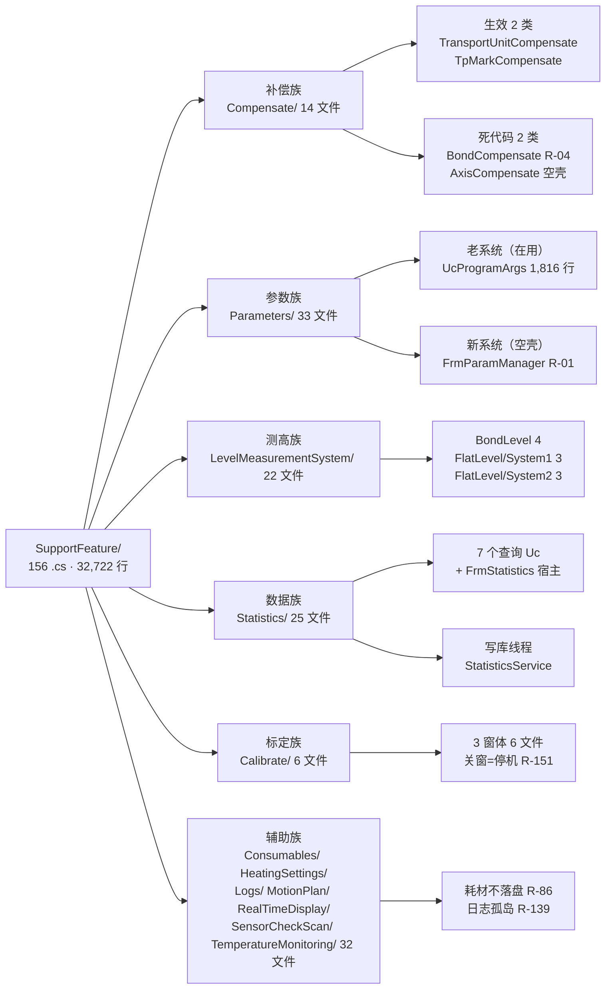

**读图要点**：`Parameters/`（33 文件）与 `Statistics/`（25 文件）两家占掉 **58 / 156 ≈ 37%** 的文件数，但 `Parameters/` 里**跑得起来的只有老系统**、`Statistics/` 里**有 3 个孤儿 UI**（§4.1）。**文件数多 ≠ 功能多**，这是本目录最容易误判规模的地方。

---


## 3. 关键类型索引

### 3.1 类型清单

本目录的类型可以按"**它靠什么活着**"分成 **6 族**。先看族，再看类型：

| 族 | 基类 / 模式 | 落盘 | 代表类型 |
|---|---|---|---|
| **① 平台单例（有落盘）** | `Singleton<T>`（平台 DLL） | ✅ 各自 `Save()` | `TransportUnitCompensate`、`RealTimeCorrection`、`BondCompensate`、`AirCooledController`、`MotionPlanDomain`、`StatisticsDomain` |
| **② 平台单例（不落盘）** | `SingletonNoSave<T>`（平台 DLL） | ❌ 纯内存 | `ConsumablesProgram`、`NeedScanSensorPool` |
| **③ 仓库基类** | `BaseSettingRepository<T>`（平台 DLL） | ✅ | `System1FlatLevelMeasureRepository`、`System2FlatLevelMeasureRepository` |
| **④ 纯静态算法类** | `static class` / 静态成员 | 通常 ❌ | `DefectCompensate`（**有静态可变状态**）、`TpMarkCompensate`、`ParamService`、`UnitHelper` |
| **⑤ UI 族** | `XtraForm` / `XtraUserControl` / `UcBaseEditor` | ❌（靠按钮转调 ①③） | **31 个 `XtraForm` ＋ 14 个业务控件 ＋ 9 个编辑器控件** |
| **⑥ 模型 / 特性 / 枚举** | `Attribute`、`enum`、POCO | ❌ | `TreeGroupChildNodesEnum`（68 成员）、`TreeProgramListArgsAttribute`（10 个 ctor 重载） |

**表 3.1：核心类型清单（非 UI）**

| 类型 | 位置 `文件:行` | 基类 / 接口 | 职责 | 最要紧的字段 / 默认值 |
|---|---|---|---|---|
| `TransportUnitCompensate` | `Compensate/MotionAreaCompensate/TransportUnitCompensate.cs:15` | `Singleton<T>` | 载具区域**网格插值补偿**（产线唯一真正生效的网格补偿） | `TransportUnitCompensateX/Y` `double[,]` `null`（`:28`/`:33`）；`StartPoint` `:38`；`ColumnSpacing` `:43`；`RowSpacing` `:48`；`ColumnCount` `:53`；`RowCount` `:58`；路径 `:22` |
| `BondCompensate` | `Compensate/MotionAreaCompensate/BondCompensate.cs:18` | `Singleton<T>` | "终极补偿" —— **首行 `return`，整体失效** | `PrName = "BondCompensateProgram"` `:66`；`RowCount` `:61`；路径 `:25` |
| `RealTimeCorrection` | `Compensate/MotionAreaCompensate/RealTimeCorrection.cs:21` | `Singleton<T>` | 标定尺**基准点一维插值补偿** | `LastTime` `:34`（**只写不读**）；`ReferencePoints` `:39`；`ReferencePointsCompensate` `:44`；`IsAssistanted` `:49`；`PrName = "实时矫正Mark"` `:54`；路径 `:28` |
| `DefectCompensate` | `Compensate/DefectCompensate/DefectCompensate.cs:24` | `static class` | 焊后/胶后实测偏移补偿 + 按基板归一化 | `DefectDataS` 静态字典 `:29-30`（**无锁**）；每键上限 **2000** `:46`/`:48`；`RePostBondInspection` 静态委托 `:35-36`；离群阈值 **50 μm**（6 处） |
| `TpMarkCompensate` | `Compensate/TemperatureCompensate/TpMarkCompensate.cs` | `static class` | 上视温漂 + 取片参考点温漂 | 开关与间隔判断被注释 `:66-73`；两阈值处理不一致 `:247-251` vs `:268-271` |
| `AirCooledController` | `Compensate/TemperatureCompensate/AirCooledController.cs:23` | `Singleton<T>` | 风冷 PID | `Kp/Ki/Kd` `:36`/`:41`/`:46`；`OutputMin/Max` `:56`/`:61`；`IntervalTime = 100` ms `:66`；`IsWorking` `:77`；路径 `:30` |
| `EtelCompensate` | `Compensate/AxisCompensate/EtelCompensate.cs:9-11` | — | **空类** | — |
| `GooGolCompensate` | `Compensate/AxisCompensate/GooGolCompensate.cs:17-28` | — | **两个空方法体** | — |
| `MotionPlanDomain` | `MotionPlan/MotionPlanDomain.cs:22` | `Singleton<T>` | 拾取安全区几何 + 加减速查表 | `PickSafeAreaPoint1..4` `:35`/`:40`/`:45`/`:50`；**6 档 acc 10000~15000** `:105-160`；路径 `:29` |
| `StatisticsDomain` | `Statistics/StatisticsDomain.cs:37` | `Singleton<T>` | 12 个计数器 + 8 个查询 + 2 个写方法 | 计数器全 `{ get; set; }` `:60-107`；`DispenseStartTime` **未初始化** `:146`；路径 `:44` |
| `StatisticsService` | `Statistics/StatisticsService.cs:53-54` | `static` | 阻塞写库队列 + 常驻写库线程 | `BlockingCollection<object>(500)` `:53-54`；`StartSaveThread()` `:99-107`；`while(true)` `:110` |
| `ConsumablesProgram` | `Consumables/ConsumablesProgram.cs:21` | **`SingletonNoSave<T>`** | 耗材集合 —— **不落盘** | 死字段 `thread` `:31`；文案拼写 `:105` |
| `BaseConsumable` | `Consumables/BaseConsumable.cs:9` | `abstract` | 耗材基类 | `Enable = false` `:19`（**默认全不启用**）；`IsAlarmed` `:67`；节流 `:53`（**10 分钟** `:57`） |
| `FrequencyConsumables` | `Consumables/FrequencyConsumables.cs:9` | `BaseConsumable` | 次数型耗材 | `TotalUseTimes = 10000` `:23`；`CurrentUseTimes = 0` `:28`；`RemindUserTimes = 90` `:33`；`Clear()` `:38`；`IsRemind()` `:69`（**整型除法** `:76`） |
| `TimeConsumable` | `Consumables/TimeConsumable.cs:9` | `BaseConsumable` | 时间型耗材 | `UseDateTime = 1440`（分）`:25`；`RemindTimeRate = 80` `:31`；`GetRemainingTime()` `:95`；`Clear()` `:46` |
| `System1FlatLevelMeasureRepository` | `…/System1Related/System1FlatLevelMeasureRepository.cs:11` | `BaseSettingRepository<T>` | 系统1 平面测高数据 | **`lock (locker)` `:46`**（全目录 2 把锁之一）；路径 `:22` |
| `System2FlatLevelMeasureRepository` | `…/System2Related/System2FlatLevelMeasureRepository.cs:12` | `BaseSettingRepository<T>` | 系统2 平面测高数据 | **`lock (locker)` `:47`**；路径 `:23` |
| `BondLevelMeasureSetting` | `…/BondLevelMeasure/BondLevelMeasureSetting.cs:9` | `Singleton<T>` | 焊头测高数据 | 路径 `:16` |
| `ParamService` | `Parameters/Service/ParamService.cs` | `static` | 反射扫描程序集建参数实例表 | `:46-47` `[ParamInstanceSource]` 过滤（**恒空**）；`GCHandle.Alloc` 去重 |
| `ParamCacheService` | `Parameters/Service/ParamCacheService.cs` | `static` | 参数缓存 | `EditorCache` `:46` **从未赋值**；`:58-61 return default` |
| `ParameterManage` | `Parameters/ObjParameter/ParameterManage.cs:45` | `static` | **老参数系统的注册入口**（手工注册） | `InitControl` **52 个注册点**（`new ObjAndNodesInfo` 的活跃出现；另有 3 处被注释）|
| `NozzleshelfPara` | `Parameters/ObjParameter/NozzleshelfPara.cs:10` | — | 吸嘴架参数（只读代理） | **`NozzleName7` setter 写 `[0]`** `:132`（`R-80`） |
| `UnitHelper` | `Parameters/UnitHelper.cs` | `static` | 单位常量表 | 11 个 `const string`（`:11`~`:61`）—— **零引用** |
| `TreeGroupParentNodesEnum` | `Parameters/Model/TreeGroupParentNodesEnum.cs:8` | `enum` | 参数树一级分组 | **9 个成员** |
| `TreeGroupChildNodesEnum` | `Parameters/Model/TreeGroupChildNodesEnum.cs:9` | `enum` | 参数树二级分组 | **68 个成员**，带 `[Description]`+`[ParentNode]` |
| `TreeProgramListArgsAttribute` | `Parameters/Model/TreeProgramListArgsAttribute.cs` | `Attribute` | 参数项标注 | **10 个 ctor 重载**；默认值 `:33`/`:38` 用 `(decimal)double.MaxValue` |
| `NeedScanSensorPool` | `SensorCheckScan/NeedScanSensorPool.cs:26` | `SingletonNoSave<T>` | 待扫描传感器池 | 三个报警弹窗被注释（`R-43`） |
| `BondPositionLogEntity` | `Statistics/BondPositionLogEntity.cs:14` | POCO | 唯一带 `[SugarTable]` 的实体 | **命名空间是 `…Infrastructure.Models.CommonModels`**（`R-100`） |

**表 3.2：7 个自定义特性（`Parameters/Attributes/`，全部 `Attribute`）**

| 特性 | 用途 | 使用情况 |
|---|---|---|
| `ParamEditorAttribute` | 标注参数用哪个编辑器 | 9 个编辑器注册（`Parameters/Editor/`） |
| `ParamInstanceAttribute` | 标注"这是一个参数实例" | **全仓 0 处使用** → `R-01` |
| `ParamInstanceSourceAttribute` | 标注"实例从哪个静态方法取" | **全仓 0 处使用** → `R-01` |
| `ParamVisibleConfigAttribute` | 可见性配置 | — |
| `ParentNodeAttribute` | 挂在哪个父分组 | 68 个子分组用它建树 |
| `PositionParamBindingAxesAttribute` | 点位参数绑定哪些轴 | **全仓 0 处使用** → `UcAKRSPoint3DEditor` 面板恒隐藏 |
| `TreeProgramListArgsAttribute` | 老系统的参数项标注（在 `Model/` 下） | **`R-56` 的溢出源头** |

### 3.2 继承层次图

**图 3：类型族谱 —— "谁靠什么活着"**

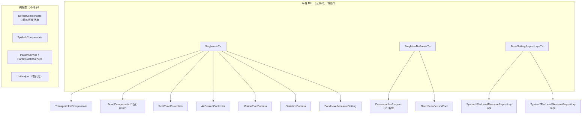

**ASCII 版**

```
  平台 DLL（无源码）
    Singleton<T> ─────┬─ TransportUnitCompensate   (网格补偿)
                      ├─ BondCompensate            (X 首行 return)
                      ├─ RealTimeCorrection        (基准点插值)
                      ├─ AirCooledController       (风冷 PID)
                      ├─ MotionPlanDomain          (拾取安全区)
                      ├─ StatisticsDomain          (12 计数器 + 8 查询)
                      └─ BondLevelMeasureSetting   (焊头测高)

    SingletonNoSave<T>┬─ ConsumablesProgram        (耗材, 不落盘)
                      └─ NeedScanSensorPool

    BaseSettingRepository<T>
                      ├─ System1FlatLevelMeasureRepository  lock(:46)
                      └─ System2FlatLevelMeasureRepository  lock(:47)

  纯静态（无基类）
    DefectCompensate (静态字典 DefectDataS, 无锁)
    TpMarkCompensate / ParamService / ParamCacheService / UnitHelper
```

**图 4：UI 继承层次 —— 注意：本目录"看起来像继承"的地方其实都是复制粘贴**

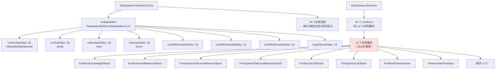

**读图要点（这是本目录最值钱的一张结构图）**：
- **有真继承的只有编辑器族**（8 个 `UcXxxEditor` 继承同一个 `UcBaseEditor`）。而 `UcBaseEditor` **自身没有 `[ParamEditor]`**，所以它不会被反射注册 —— 这是正确的写法。
- **12 个向导窗体全部是复制粘贴**（`R-157`）。它们的 `BtNext_Click` / `BtBack_Click` / `BtDone_Click` / `BtCancel_Click` **四件套是同一段代码抄了 12 遍**，因此 `stepIndex++` / `--` **无越界检查**这个问题在 **12 个窗体里全部存在**，只是因为 `IsShowBack`/`IsShowNext` 恰好配置成了 `false` 才没暴露（`R-69`）。**这是"改一个必须改十二个"的典型**。
- `FrmLevelMeasureResult` 与 `FrmBondLevelMeasureResult` **也是直接继承 `XtraForm`**，没有共同基类 —— 两个几乎一样的"测量结果"窗体各写一份（`FrmLevelMeasureResult.cs:16`、`FrmBondLevelMeasureResult.cs:14`）。

### 3.3 关键类型速查（按职责分组）

**① 补偿（`Compensate/`，全目录最高风险区）**

| 想找什么 | 去哪儿 |
|---|---|
| 每次固晶都跑的那条链 | §5.1 **图 13**；`BondActionNode.Provider.cs:521`/`:524`/`:527`/`:561`/`:579`/`:588`/`:593` |
| 哪个补偿是坏的 | `BondCompensate.cs:76`（`R-04`）；`DefectCompensate.cs:221`（`R-07`） |
| 温度补偿在哪 | `TpMarkCompensate.cs`；施加点 `PickActionNode.cs:185`/`:191`、`UpLookCorrectionActionNode.cs:491` |
| PID 在哪 | `AirCooledController.cs:86 Calculate` / `:111 Reset` / `:120 Start`（**唯一的 UI 入口窗体已死**，`R-05`） |

**② 参数（`Parameters/`，33 文件但只有一半在用）**

| 想找什么 | 去哪儿 |
|---|---|
| **在用的**参数界面 | `UcProgramArgs`（`Parameters/UcProgramArgs.cs:33`，1,816 行）—— 老系统 |
| 参数**怎么生效** | `LeaveCheck`（`Parameters/UcProgramArgs.cs:1140`，450 行，19 个分类型分支）→ 直接 `PropertyInfo.SetValue` 改活对象 |
| 参数**怎么落盘** | **不落盘**（`R-79`）—— 只能靠 `UcMainSystem.cs:632` 的全局保存按钮 |
| **空壳**的参数界面 | `FrmParamManager`（`Parameters/FrmParamManager.cs:30`）—— 新系统，树恒空（`R-01`） |

**③ 测高（`LevelMeasurementSystem/`，11 个窗体 / 26 个 `_Click`）**

| 想找什么 | 去哪儿 |
|---|---|
| 三类测高 | `BondLevelMeasure/`（焊头）、`FlatLevelMeasure/System1Related/`（点胶台）、`FlatLevelMeasure/System2Related/`（固晶台） |
| 激光测高失败为什么不报错 | `FrmSystem2FlatLevelMeasure.cs:194`（`R-20`） |
| 测高结果存哪 | `BondLevelMeasureSetting` / 两个 `…FlatLevelMeasureRepository`（§8） |

**④ 数据（`Statistics/` ＋ `Consumables/`）**

| 想找什么 | 去哪儿 |
|---|---|
| 写入库的唯一后台线程 | `StatisticsService.cs:99-107` / `:110-140`（`while(true)`，靠 `IsBackground` 收场） |
| 7 类统计各是什么 | §4.1 表 + §6.5 |
| 耗材为什么重启就归零 | `ConsumablesProgram.cs:21` 是 `SingletonNoSave`（`R-86`） |

---


## 4. UI 按钮与交互流程

> **本节回答三个问题**：① 这个界面**谁能打开**（本目录一条自产入口都没有）；② 这个按钮**点了会怎样**（100 个 `_Click` 逐个登记）；③ 哪些按钮**根本点不到**。

### 4.1 UI 清单与"谁能打开它"

**口径**：本目录有 Designer 配对的 UI 文件共 **54** 个 = **31 个 `XtraForm`** ＋ **23 个派生自 `XtraUserControl`**（其中 **9 个**是参数编辑器控件 `UcBaseEditor` 及其子类）。下表登记 **45 个业务 UI**（31 窗体 ＋ 14 非编辑器控件）；9 个编辑器控件单列在 §4.1.3。

**"打开它的入口"一列的三分类口径**（本列**必须**区分这三类，因为它们的排查路径完全不同）：

| 标记 | 含义 | 排查时去哪儿找 |
|---|---|---|
| **① UI 按钮** | 由 `Main/Controls/Ucmain/MainControls/UcMainSystem*.cs` 里的 Ribbon 按钮处理器 `new` 出来 | 去 `UcMainSystem*.cs` 搜 `ItemClick` |
| **② 运行期** | 由**另一个窗体**、**任务层/后台线程**在运行时 `new` 出来（用户看不见"入口按钮"） | 去调用点的上一层窗体/任务找 |
| **③ 反射服务** | 由 `Infrastructure\Utils\ControlHelper.cs:78` 的 `ShowForm<T>()` 按类型反射创建（**同类型只存一个实例**） | 搜 `ShowForm<` |
| **零调用点** | 全仓找不到任何 `new` / `ShowForm<` / 字段承载 | 按 §4.1.4 判"僵尸"还是"断链" |

**本节所有"入口"结论的取证命令**（在 `AKRS.ZX2200/` 下执行，排除 `SupportFeature/` 自身以证明"入口在外部"）：

```bash
grep -rn "\b<类型名>\b" --include=*.cs . | grep -v "/SupportFeature/"
```

**表 4.1：45 个业务 UI 的入口登记**

| # | 窗体 / 控件 | 文件（`SupportFeature/` 下） | 行数 | 基类 | Designer 标题 | **打开它的入口** |
|---|---|---|---|---|---|---|
| 1 | `FrmSystem2Calibrate` | `Calibrate/FrmSystem2Calibrate.cs` | 618 | `XtraForm` | `"系统2校准"` | **① UI 按钮** `UcMainSystem.cs:2101 barBtnThreePointOneLineCali_ItemClick`（Ribbon "系统2三点一线校准"）→ `ShowDialog` |
| 2 | `FrmEjectionCaliTeach` | `Calibrate/FrmEjectionCaliTeach.cs` | 537 | `XtraForm` | `"顶针校准示教"` | **② 运行期** `FrmSystem2Calibrate.cs:310 new`；`Experiment\Test\FrmMachineFunctionTest.cs:1869 new`（无参） |
| 3 | `FrmNozzleCaliTeach` | `Calibrate/FrmNozzleCaliTeach.cs` | 329 | `XtraForm` | `"吸嘴矫正示教"` | **② 运行期** `BondSystem\Controllers\System2Controller.AutoCali.cs:88`（在 `PrepareBeforceNozzleAutoCali` 内，**自动校准流程里弹的**）；`FrmMachineFunctionTest.cs:1828` |
| 4 | `FrmBondCompensate` | `Compensate/MotionAreaCompensate/FrmBondCompensate.cs` | 214 | `XtraForm` | `"位置补偿列表"` | **①→③** `UcMainSystem.cs:1937 BarBondCompensate_ItemClick`（Ribbon "位置标定"）→ `ShowForm<FrmBondCompensate>()` |
| 5 | `FrmInputData` | `Compensate/MotionAreaCompensate/FrmInputData.cs` | 79 | `XtraForm` | `"数据导入"` | **② 运行期** `FrmBondCompensate.cs:50 new` ＋ `:51 ShowDialog` |
| 6 | `FrmRealTimeAssistant` | `Compensate/MotionAreaCompensate/FrmRealTimeAssistant.cs` | 256 | `XtraForm` | **Designer 未设 `Text`** → 标题栏显示类名 | **① UI 按钮** `UcMainSystem.cs:2113 BarAssistantRuler_ItemClick`（Ribbon "示教标定尺"）→ `ShowDialog` ＋ `Dispose` |
| 7 | `FrmCompensateTest` | `Compensate/MotionAreaCompensate/FrmCompensateTest.cs` | 93 | `XtraForm` | `"FrmCompensateTest"` | **① UI 按钮** `UcMainSystem.cs:1829 BTest_ItemClick`，Ribbon 标题是 **`"测试按钮，勿点"`** |
| 8 | `FrmAxisTemperature` | `Compensate/TemperatureCompensate/FrmAxisTemperature.cs` | 145 | `XtraForm` | `"FrmAxisTemperature"` | **零调用点** → 见 §4.1.4（**僵尸**） |
| 9 | `FrmTemperatureDistribution` | `Compensate/TemperatureCompensate/FrmTemperatureDistribution.cs` | 166 | `XtraForm` | `"FrmTemperatureDistribution"` | **② 运行期**，且只在**实验工程**：`Experiment/TestFunction/FrmTest.cs:248`、`FrmTest2.cs:779` → **生产入口为零** |
| 10 | `FrmConsumables` | `Consumables/FrmConsumables.cs` | 151 | `XtraForm` | `"吸嘴"`（**标题只写"吸嘴"，实际含顶针/光源/胶水**） | **① UI 按钮** `UcMainSystem.DataAdministrator.cs:128 new FrmConsumables(...)`（字段 `:36`） |
| 11 | `UcConsumables` | `Consumables/UcConsumables.cs` | 101 | `XtraUserControl` | 标签 `"吸嘴1"`／`"总次数"`／`"当前次数"` | **② 运行期** 由 `FrmConsumables` 承载 |
| 12 | `UcTimeConsumable` | `Consumables/UcTimeConsumable.cs` | 160 | `XtraUserControl` | 标签 `"分钟"`／`"剩余时间"` | **② 运行期** 由 `FrmConsumables` 承载 |
| 13 | `FrmHeatingSettings` | `HeatingSettings/FrmHeatingSettings.cs` | 193 | `XtraForm` | `"温度设置"` | **① UI 按钮** `UcMainSystem.cs:2008 BarHeatingSettings_ItemClick`（**每次 `new` 新实例，非单实例**） |
| 14 | `FrmBondLevel` | `…/BondLevelMeasure/FrmBondLevel.cs` | 269 | `XtraForm` | `"Bond Head Level"` | **① UI 按钮** `Infrastructure/Controls/Feature/MeasuringTool/UcMeasuringTool.cs:111 BtnLevelMeasurement_Click` |
| 15 | `FrmBondLevelHeightTeach` | `…/BondLevelMeasure/FrmBondLevelHeightTeach.cs` | 161 | `XtraForm` | `"Assistant"` | **② 运行期** `FrmBondLevel.cs:206` |
| 16 | `FrmBondLevelMeasureTeach` | `…/BondLevelMeasure/FrmBondLevelMeasureTeach.cs` | 180 | `XtraForm` | `"Assistant"` | **② 运行期** `FrmBondLevel.cs:66` |
| 17 | `FrmBondLevelMeasureResult` | `…/BondLevelMeasure/FrmBondLevelMeasureResult.cs` | 110 | `XtraForm` | `"Head Level Measure Reslut"`（**拼写错误**） | **② 运行期** `FrmBondLevel.cs:256` |
| 18 | `FrmSystem1FlatLevelMeasure` | `…/System1Related/FrmSystem1FlatLevelMeasure.cs` | 287 | `XtraForm` | `"System1 Flat Level Measure"` | **① UI 按钮** `UcMeasuringTool.cs:163` |
| 19 | `FrmSystem1HeightTeach` | `…/System1Related/FrmSystem1HeightTeach.cs` | 169 | `XtraForm` | `"Assistant"` | **② 运行期** `FrmSystem1FlatLevelMeasure.cs:145` |
| 20 | `FrmSystem1FlatLevelMeasureTeach` | `…/System1Related/FrmSystem1FlatLevelMeasureTeach.cs` | 466 | `XtraForm` | `"Assistant"` | **② 运行期** `FrmSystem1FlatLevelMeasure.cs:282` |
| 21 | `FrmSystem2FlatLevelMeasure` | `…/System2Related/FrmSystem2FlatLevelMeasure.cs` | 422 | `XtraForm` | `"Assistant"` | **① UI 按钮** `UcMeasuringTool.cs:129` |
| 22 | `FrmSystem2HeightTeach` | `…/System2Related/FrmSystem2HeightTeach.cs` | 173 | `XtraForm` | `"Assistant"` | **② 运行期** `FrmSystem2FlatLevelMeasure.cs:256` |
| 23 | `FrmSystem2FlatLevelMeasureTeach` | `…/System2Related/FrmSystem2FlatLevelMeasureTeach.cs` | 456 | `XtraForm` | `"Assistant"` | **② 运行期** `FrmSystem2FlatLevelMeasure.cs:127` |
| 24 | `FrmLevelMeasureResult` | `…/FlatLevelMeasure/FrmLevelMeasureResult.cs` | 108 | `XtraForm` | Designer `"Measure Result"`，**构造时被 `FrmLevelMeasureResult.cs:26` 覆写为 `levelMeasureName`** | **② 运行期** `FrmSystem1FlatLevelMeasure.cs:226`、`FrmSystem2FlatLevelMeasure.cs:340` |
| 25 | `FrmLogRecord` | `Logs/FrmLogRecord.cs` | 109 | `XtraForm` | **Designer 未设 `Text`** | **零调用点** → **僵尸** |
| 26 | `FrmLogInfo` | `Logs/FrmLogInfo.cs` | 151 | **`XtraUserControl`**（**`Frm` 前缀但不是窗体**） | 无 | **零调用点** → **僵尸** |
| 27 | `FrmMachineDebug` | `Logs/FrmMachineDebug.cs` | 129 | `XtraForm` | `"调试界面"` | **① UI 按钮** `UcMainSystem.cs:1788` → `UcmainSystem.Action.cs:388 ShowFrmDebug()` |
| 28 | `UcCurrentLogs` | `Logs/UcCurrentLogs.cs` | **16**（仅构造函数） | `XtraUserControl` | 无 | **零调用点** → **僵尸**（外壳，包平台 `AKRS.Galaxy2.Log.Control.UcLogControl`） |
| 29 | `FrmAssistantPickArea` | `MotionPlan/FrmAssistantPickArea.cs` | 233 | `XtraForm` | — | **② 运行期** `BondSystem/Controls/Setting/Customer/FrmCustomerSetup.cs:222 new` |
| 30 | `UcProgramArgs` | `Parameters/UcProgramArgs.cs` | **1,816**（本目录最大单体） | `XtraUserControl` | — | **② 运行期** 承载于 `UcMainSystem.cs:556`（Ribbon "UcProgramArgs"）；另被 `BondSystem/Controls/Assistant/FrmComponentPickup.cs:482`／`:525` 承载 |
| 31 | `FrmParamManager` | `Parameters/FrmParamManager.cs` | 772 | `XtraForm` | — | **③ 反射服务** `WaferSubSystem/Controls/FrmDebug.cs:168 this.ShowForm<FrmParamManager>()`（**新参数系统只能从调试窗进**） |
| 32 | `UcParamManage` | `Parameters/UcParamManage.cs` | **21**（仅构造函数） | `XtraUserControl` | 两个裸 `TreeList` | **零调用点**（已核实）→ **僵尸** |
| 33 | `UcRealTimeHeight` | `RealTimeDisplay/UcRealTimeHeight.cs` | 69 | `XtraUserControl` | 标题 `"测高数据实时显示"` | **零调用点** → **僵尸**（唯一引用是 `Experiment/TestFunction/FrmTest.cs:811` 的**注释行**） |
| 34 | `FrmSensorAlarm` | `SensorCheckScan/FrmSensorAlarm.cs` | 129 | `XtraForm` | `"设备检测信号报警"` | **零调用点 / 断链** → 见 §4.1.4（`R-43`） |
| 35 | `FrmTemperatureMonitoring` | `TemperatureMonitoring/FrmTemperatureMonitoring.cs` | 301 | `XtraForm` | `"设备热电偶检测"` | **①→③** `UcMainSystem.cs:2125 BarTemperatureMonitoring_ItemClick` → `ShowForm<T>` |
| 36 | `FrmStatistics` | `Statistics/FrmStatistics.cs` | 386 | `XtraForm` | `"统计"` | **① UI 按钮** `UcMainSystem.DataAdministrator.cs:63 BtStatics_ItemClick` → `new FrmStatistics()` |
| 37 | `UcCapacityStatistics` | `Statistics/UcCapacityStatistics.cs` | 329 | `XtraUserControl` | 选项卡 `"白夜班"`／`"数据"`／`"曲线"`／`"时间段"` | **② 运行期** `FrmStatistics.cs:53`（"产能统计"页） |
| 38 | `UcDefectStatistics` | `Statistics/UcDefectStatistics.cs` | 231 | `XtraUserControl` | 选项卡 `"数据"`／`"曲线 X"`／`"曲线 Y"`／`"曲线 角度"`／`"曲线 面积"` | **② 运行期** `FrmStatistics.cs:54`；**另一处** `Compensate/MotionAreaCompensate/FrmInputData.cs:45 new` |
| 39 | `UcProductStatistics` | `Statistics/UcProductStatistics.cs` | 154 | `XtraUserControl` | 选项卡 `"数据"`／`"表格"` | **零调用点** → **僵尸**（**且内含 `R-85`，见 §4.3**） |
| 40 | `UcOperateLogStatistics` | `Statistics/UcOperateLogStatistics.cs` | 140 | `XtraUserControl` | 单表格 | **② 运行期** `FrmStatistics.cs:57` |
| 41 | `UcParameterChangeLogStatistics` | `Statistics/UcParameterChangeLogStatistics.cs` | 120 | `XtraUserControl` | 单表格 | **② 运行期** `FrmStatistics.cs:58` |
| 42 | `UcBondPositionInfo` | `Statistics/UcBondPositionInfo.cs` | 131 | `XtraUserControl` | 单表格 | **② 运行期** `FrmStatistics.cs:59` |
| 43 | `UcTemperatureCompensation` | `Statistics/UcTemperatureCompensation.cs` | 79 | `XtraUserControl` | 单表格 | **② 运行期** `FrmStatistics.cs:56`（"上视温漂数据"页） |
| 44 | `FrmSingleBpData` | `Statistics/FrmSingleBpData.cs` | 90 | `XtraForm` | `"FrmSingleBpData"` | **① UI 按钮** `UcMainSystem.cs:1749 BtClearBpOffSet_ItemClick`（**已开实例不会被激活**）；`Experiment\TestFunction\FrmTest.cs:843` |
| 45 | `FrmMeasureHeightData` | `Statistics/FrmMeasureHeightData.cs` | 142 | `XtraForm` | `"FrmMeasureHeightData"` | **零调用点** → **僵尸** |

**读表要点**：
- **① 类入口（真按钮）只有 13 个**：第 1、4、6、7、10、13、14、18、21、27、35、36、44 行 —— 也就是说 **45 个 UI 里，用户能从菜单点到的只有 13 个**。
- **② 类入口（运行期弹出）有 22 个**，其中 **12 个是"向导窗体"**（第 2、3、15、16、17、19、20、22、23、24 行 ＋ `FrmInputData`、`FrmAssistantPickArea`），它们**必须**通过上一层窗体才能到达 —— 排查"某个示教窗报错"时，**要连着它的父窗体一起看**。
- **③ 反射服务入口只有 2 个**：`FrmBondCompensate`（先 ① 后 ③）与 `FrmParamManager`（**纯 ③**）。反射入口的含义是"**同类型只保留一个实例**"，所以"打开两次"不会产生两个窗口 —— 但 `FrmHeatingSettings` 走的是 ① 直接 `new`，**所以它会叠窗**。
- **零调用点 8 个**（第 8、25、26、28、32、33、34、39、45 行 —— 共 9 行含 `FrmSensorAlarm`）。

### 4.1.3 9 个参数编辑器控件（全部由反射实例化）

这 9 个控件**没有独立的按钮入口**，它们是 `ParamService` 按 `[ParamEditor(Type)]` 特性**反射 new 出来**、塞进 `FrmParamManager` 的编辑器面板里的（§5.3）。

| 控件 | 文件 | 行数 | 注册的 `[ParamEditor]` 类型 | 承载控件 |
|---|---|---|---|---|
| `UcBaseEditor` | `Parameters/Editor/UcBaseEditor.cs` | 194 | **无**（自身不注册，正确写法） | — |
| `UcNumberEditor` | `Parameters/Editor/UcNumberEditor.cs` | 43 | `int` / `double` / `float` / `decimal` | `spinEdit1` |
| `UcTextEditor` | `Parameters/Editor/UcTextEditor.cs` | 41 | `string` | `memoEdit1` |
| `UcBooleanEditor` | `Parameters/Editor/UcBooleanEditor.cs` | 40 | `bool` | `toggleSwitch1` |
| `UcEnumEditor` | `Parameters/Editor/UcEnumEditor.cs` | 37 | `Enum` | `radioGroup1` |
| `UcAKRSPoint2DEditor` | `Parameters/Editor/UcAKRSPoint2DEditor.cs` | 43 | `AKRSPoint2D` | — |
| `UcAKRSPoint3DEditor` | `Parameters/Editor/UcAKRSPoint3DEditor.cs` | **72** | `AKRSPoint3D` | `spinEdit1/2/3` ＋ **"从轴读取"按钮 `simpleButton1`** |
| `UcAKRSPoint4DEditor` | `Parameters/Editor/UcAKRSPoint4DEditor.cs` | 45 | `AKRSPoint4D` | — |
| `UcItpParamEditor` | `Parameters/Editor/UcItpParamEditor.cs` | 52 | `ItpParam` | 9 个 `SpinEdit` |

**`UcAKRSPoint3DEditor` 的两个要害**（都在本目录最容易踩的位置）：
- `:36 panelControl1.Visible = BindingConfigs.Count != 0;` —— `BindingConfigs` 来自 `ParameterDetailModel.BindingConfigs`，而它的唯一数据源是 `PositionParamBindingAxesAttribute`，**该特性全仓 0 处使用** → `Count` 恒为 0 → **这个"从轴读取"面板在任何情况下都不会显示**（`R-…`，见 §9.4）。
- `:50-71 simpleButton1_Click` —— 这是面板里那个读轴按钮的处理器；**它自己不是孤儿**（`UcAKRSPoint3DEditor.Designer.cs:189` 有接线），但因为它所在的 `panelControl1` 恒隐藏，**这个处理器在运行期永远不可达**。

**这是"按钮表里要登记、但要标注不可达"的典型**：§4.2 的 100 行按钮表按"**是否有 Designer 接线**"登记（它是"有"），可达性另由本节/§4.3 标注。

### 4.1.4 零调用点的 9 个 UI：谁是僵尸、谁是断链

**必须区分这两者**（排查价值完全不同）：

| UI | 判定 | 依据 | 危害等级 |
|---|---|---|---|
| `FrmAxisTemperature` | **僵尸** | `grep FrmAxisTemperature` 仅命中自身 3 个文件 ＋ `.csproj`。它是风冷 PID 参数的**唯一** UI（`Kp/Ki/Kd/OutputMin/OutputMax` 五个 `SpinEdit` ＋ "开始采集"/"开始恒温控制" 两个开关），**没有任何外部代码 `new` 它** | 🔴 它死掉 → `AirCooledController` 的 5 个 PID 参数**无法从界面设置**，只能靠 JSON 手改；`AirCooledController.Start()` 也没有调用者 → **整条风冷 PID 链是死的** |
| `FrmLogRecord` | **僵尸** | 无 `Text`、无外部 `new`。它内含 `Thread.Abort()`（`:48`／`:84`）与 100 ms 全表重绑（`Dowork :90-107`） | ⚠️ 死代码本身无害，但**它是"用 `Thread.Abort` 停线程"这一写法的唯一现场**，改动 `Logs/` 时容易被误参照 |
| `FrmLogInfo` | **僵尸** | 无外部引用；**`Frm` 前缀 + `XtraUserControl` 基类**的命名陷阱（`Logs/FrmLogInfo.cs:20`） | ⚠️ 命名陷阱：按名字搜"窗体"的人会漏掉它 |
| `UcCurrentLogs` | **僵尸** | 只有 16 行，仅构造函数把平台 `UcLogControl` 塞进 `Controls`；无引用 | ✅ 纯外壳 |
| `UcParamManage` | **僵尸**（**已核实**） | `grep -rn "UcParamManage" --include=*.cs . \| grep -v "Parameters/UcParamManage"` = **空**；`FrmParamManager` 用的是 `UcParamManage` **之外**的另一套渲染 | ✅ 新参数系统的"旧壳"，无害 |
| `UcRealTimeHeight` | **僵尸** | 唯一引用是 `Experiment/TestFunction/FrmTest.cs:811` 的**注释**（`:821` 也是注释） | ⚠️ 它是"实时高度曲线"的唯一实现，死掉 → 该显示能力**在生产里不存在** |
| `UcProductStatistics` | **僵尸** | 无外部 `new`；**且 `simpleButton1_Click`（`:133`）在 Designer 里没有控件** → `R-85` | 🔴 死代码 ＋ 埋在里面的雷（§4.3 单列） |
| `FrmMeasureHeightData` | **僵尸** | 无外部引用；`AddMeasureHeightData` 静态委托无生产者 | ✅ |
| `FrmSensorAlarm` | **断链**（**不是僵尸**） | 链路**三件套齐全但缺最后一环**：委托 `public static Action<string> SensorAlarmAction { get; set; }` 声明于 `UcmainSystem.Action.cs:136`；订阅 `SensorAlarmAction += this.SensorAlarm;` 在 `:42`；处理器 `private void SensorAlarm(string message)` 在 `:340`（body `:341-352`，内部 `new FrmSensorAlarm()` ＋ `.Show()` ＋ `.AddAlarmMessage(message)`）。**但全仓 `grep -rn "SensorAlarmAction" --include=*.cs .` 只有这 2 行（声明 ＋ 订阅），找不到任何一处 `Invoke`** | 🔴 **断链**：代码"打算"弹它，接线也做好了，就差一句 `Invoke` → 传感器报警窗**永远不弹**（`R-43`）。修好只需一行；但正因为它"看起来接好了"，排查时最容易被跳过 |

**"僵尸"与"断链"的区别**（本篇的统一口径）：

- **僵尸**：**没有任何代码打算用它** —— 包括调用、委托、字段承载。特征是"整条链都不存在"。
- **断链**：**有代码打算用它，链也搭好了，但中间断了一环**（缺 `Invoke`、缺回读、缺赋值）。特征是"顺着调用链能走到一半"。
- **断链的危险性高于僵尸**：僵尸不会误导人；断链会让维护者以为功能已在。

### 4.1.5 运行时永久禁用的控件（3 个，**都不是按钮**）

**口径**：这类控件**不是**"零调用点的死代码"（那是 §4.1.4 管的），**也不是**幽灵文件 ——
代码是活的、编译进去了、窗体也会打开，**但这个控件在界面上永远是灰的**。
按按钮名去查接线是**查不到**的（它们连处理器都没有），**必须专门按 `Enabled` 查**。

**判定分两步**（第二步是重点，缺了它就会误判）：

```bash
cd "E:/项目/ZX2200标机/trunk/AKRS.ZX2200"
# 第一步：列出 Designer 里被设为 false 的「文件|控件」对
find . \( -name '*.Designer.cs' -o -name '*.designer.cs' \) \
     -not -path './bin/*' -not -path './obj/*' -print0 |
xargs -0 awk '/this\.[A-Za-z0-9_]+\.Enabled = false/ { if (match($0, /this\.([A-Za-z0-9_]+)\.Enabled = false/, m)) print FILENAME"|"m[1] }' | sort -u

# 第二步：对每个控件，查「它自己的 Designer 之外」有没有代码碰过它的 Enabled
#        ★ 必须排除它自己的 Designer 文件，否则命中的只是那句原始的 = false
for pair in \
  "SupportFeature/Calibrate/FrmSystem2Calibrate.Designer.cs|CmbEjectionName" \
  "SupportFeature/Consumables/UcConsumables.Designer.cs|SpPPToolUseTimes1" \
  "SupportFeature/HeatingSettings/FrmHeatingSettings.Designer.cs|SpCompensateSlope"; do
  f="${pair%|*}"; c="${pair#*|}"
  n=$(grep -rn --include='*.cs' "\.$c\.Enabled" . | grep -v '/bin/\|/obj/' | grep -vF "$f" | wc -l)
  echo "$c : 置回 true 的代码 = $n"
done
# 实测输出：CmbEjectionName : 0 ／ SpPPToolUseTimes1 : 0 ／ SpCompensateSlope : 0
```

> ⚠️ **命令里的 `grep -vF "$f"` 不能省。** 省掉它，第二步会对**每一个**控件都返回"有命中"
> —— 因为 `this.X.Enabled = false;` 这一行本身就在那个 Designer 文件里。
> **本文档第一轮就踩过这个坑**（三条全部假阳性），详见附录 B 第 11 条。
> 这正是本方法"**第二步要看的是 Designer 之外**"的原意。

**4 条旁路已逐条排除**（不是可以省掉的步骤）：① `.resx` ＋ `ApplyResources` 事后覆盖 —— 这 3 个 Designer
文件里 `ApplyResources` **均为 0**；② 泛型遍历控件树统一赋 `Enabled` —— 全仓无此写法；
③ 辅助方法按引用传入 —— `ToggleControlsEnabled` 按**显式引用**传参，而这 3 个控件名
**全仓只出现在各自的 Designer 里**，传不进去；④ 反射设 `Enabled` —— 本项目有反射调 `Save`／`Cancel`，但**没有**反射设 `Enabled`。

⇒ **结论**：这 3 个控件的 `Enabled` **终其一生都是 `false`**。这是**属性级的事实**，
不依赖 UI 框架的启用传播规则（`Enabled = false` 的控件**无论父容器是否启用都不可用**）。

| 控件 | 类型 | 位置（Designer 里的那一行） | 界面文字 | 「处理器」列 | 定级 |
|---|---|---|---|---|---|
| **`DIS-01`** `SpCompensateSlope` | `SpinEdit` | `HeatingSettings/FrmHeatingSettings.Designer.cs:185` | **「补偿斜率」**（同页 `labelControl12.Text`，`:206`；单位标签「度」`:216`） | **无（永久禁用）** | **🔴** |
| **`DIS-02`** `CmbEjectionName` | `ComboBoxEdit` | `Calibrate/FrmSystem2Calibrate.Designer.cs:63` | **「顶针」**（`labelControl3.Text`，`:202`；位于分组「顶针」`groupControl2` 内） | **无（永久禁用）** | **⚠️** |
| **`DIS-03`** `SpPPToolUseTimes1` | `SpinEdit` | `Consumables/UcConsumables.Designer.cs:96` | 与 **「吸嘴1」** 同行（`LbPPTools1.Text`，`:58`），自身 `Tag = "顶针"` | **无（永久禁用）** | **⚠️** |

> ★ **本表对应编号族 `DIS-01` … `DIS-03`**（**运行时永久禁用的控件**，**不在 `R-01…R-193` 之内**）。
> 逐条的定性、证据链与「用户看到什么」在 **§9.11**；编号族的口径说明在 **§9.0**。
> 本节给的是**控件清单**，§9.11 给的是**判定过程** —— 两者是同一批发现的**入口**与**结论**。

> **这 3 个控件不影响 §4.2 的 100 行口径** —— 它们**一个 `_Click` 处理器都没有**，
> 所以既不在 100 个 `_Click` 里，也不在 §4.2.2 的 26 个非 `_Click` 里。
> 上表的「处理器」列写"**无（永久禁用）**"，**正是因为它们点不动，才更不能从总表里删掉**。

**逐个的定性、用户看到什么、以及为什么是这个级别** —— 见 **§9.11**（含判定流程图 图 33）。

---
### 4.2 按钮总表（100 个 `_Click` 处理器逐个登记）

**口径声明**（下表每一个数字都由本节末尾的生成命令在**本目录源码上**直接数出，可逐条复现）：

| 口径 | 数字 | 说明 |
|---|---|---|
| 本目录非 Designer `.cs` 中 `_Click` 处理器定义 | **100** | 生成命令见下 |
| 其中有 Designer 接线 | **98** | |
| 其中**无接线**（孤儿） | **2** | `BtSetCompensateSlope_Click`、`UcProductStatistics.simpleButton1_Click` |
| 唯一处理器名 | **39** | 大量重名（`BtNext_Click` 出现 11 次） |
| 涉及的窗体/控件文件 | **38** | |
| 非 `_Click` 的其它事件处理器 | **26** | §4.2.2 另表登记 |
| **对账** | **126 = 100 ＋ 26** | 本节 100 行 ＋ §4.2.2 的 26 行，逐条不重不漏 |

**生成命令（可复现）**：

```bash
# 处理器定义（非 Designer）
cd AKRS.ZX2200/SupportFeature
find . -name "*.cs" ! -iname "*.designer.cs" -print0 | xargs -0 grep -n "void .*_Click"
# 接线（Designer）—— 注意必须用 -iname，见 §2 的大小写陷阱
find . -iname "*.designer.cs" -print0 | xargs -0 grep -n "_Click)"
```

> **⚠️ 本节表格的"接线"列若按 `--include='*.Designer.cs'` 统计只会得到 97 条接线 / 37 个唯一名**，会漏掉 `Parameters/UcProgramArgs.designer.cs:524 BtnSearch_Click`（该文件是小写 `designer.cs`）。本表按 **`-iname`** 口径，故为 **98 / 38**。

**表 4.2：100 个 `_Click` 处理器总表（按目录排序；"作用"列为该按钮的行为摘要，"要害"列指向 §9 的编号）**

| 处理器 `文件:行` | 处理器名 | 接线（控件 @ `Designer:行`） | 作用 | 要害 |
|---|---|---|---|---|
| `Calibrate/FrmEjectionCaliTeach.cs:359` | `BtBack_Click` | ✅ `BtBack` @ `.Designer.cs:169` | 示教步退一步 `stepIndex--`（**无越界检查**） | 不可达（`IsShowBack=false`）→ `R-69` |
| `Calibrate/FrmEjectionCaliTeach.cs:372` | `BtNext_Click` | ✅ `BtNext` @ `.Designer.cs:195` | 示教步进一步 `stepIndex++`（**无越界检查**） | 不可达（`IsShowNext=false`）→ `R-69` |
| `Calibrate/FrmEjectionCaliTeach.cs:385` | `BtCancel_Click` | ✅ `BtCancel` @ `.Designer.cs:156` | `DialogResult = Cancel` 返回 | ⚠️ **取消后仍会走到 `:408 Save()`** → 把中间态写回仓库 → `R-…` |
| `Calibrate/FrmEjectionCaliTeach.cs:404` | `BtDone_Click` | ✅ `BtDone` @ `.Designer.cs:182` | 结束示教并 `Save()` | 见 §4.3 |
| `Calibrate/FrmEjectionCaliTeach.cs:416` | `BtnAutoFocus_Click` | ✅ `BtnAutoFocus` @ `.Designer.cs:242` | 调平台自动聚焦 | ✅ |
| `Calibrate/FrmEjectionCaliTeach.cs:449` | `BtnEditPR_Click` | ✅ `BtnEditPR` @ `.Designer.cs:264` | 编辑识别模板 | ✅ |
| `Calibrate/FrmEjectionCaliTeach.cs:466` | `BtnESUpOrDown_Click` | ✅ `BtnESUpOrDown` @ `.Designer.cs:253` | 顶针（Ejection System）上/下动作 | ⚠️ 直接驱动硬件，无二次确认 |
| `Calibrate/FrmEjectionCaliTeach.cs:510` | `BtnChangeEjection_Click` | ✅ `BtnChangeEjection` @ `.Designer.cs:219` | 换一个顶针重新示教 | ✅ 外键查法正确（`R-K-11` 已核实无害） |
| `Calibrate/FrmNozzleCaliTeach.cs:240` | `BtBack_Click` | ✅ `BtBack` @ `.Designer.cs:164` | 同上（吸嘴版） | 不可达 → `R-69` |
| `Calibrate/FrmNozzleCaliTeach.cs:253` | `BtNext_Click` | ✅ `BtNext` @ `.Designer.cs:190` | 同上 | `stepCount = 1` 却无越界检查 → `R-69` |
| `Calibrate/FrmNozzleCaliTeach.cs:266` | `BtCancel_Click` | ✅ `BtCancel` @ `.Designer.cs:151` | `DialogResult = Cancel` | ⚠️ 同 `R-…`（取消也落盘） |
| `Calibrate/FrmNozzleCaliTeach.cs:285` | `BtDone_Click` | ✅ `BtDone` @ `.Designer.cs:177` | 结束示教并 `Save()` | 见 §4.3 |
| `Calibrate/FrmNozzleCaliTeach.cs:297` | `BtnAutoFocus_Click` | ✅ `BtnAutoFocus` @ `.Designer.cs:222` | 自动聚焦 | ✅ |
| `Calibrate/FrmNozzleCaliTeach.cs:307` | `BtnEditPR_Click` | ✅ `BtnEditPR` @ `.Designer.cs:211` | 编辑识别模板 | ✅ |
| `Calibrate/FrmSystem2Calibrate.cs:130` | `BtnCaliNozzle_Click` | ✅ `BtnCaliNozzle` @ `.Designer.cs:133` | 校准吸嘴（弹 `FrmNozzleCaliTeach`） | 见 §4.3 |
| `Calibrate/FrmSystem2Calibrate.cs:286` | `BtnCaliEjection_Click` | ✅ `BtnCaliEjection` @ `.Designer.cs:93` | 校准顶针（弹 `FrmEjectionCaliTeach`） | ⚠️ `:294` 取出的 `component` 只写不读 → `R-K-07` |
| `Calibrate/FrmSystem2Calibrate.cs:362` | `BtnCaliPickOffset_Click` | ✅ `BtnCaliPickOffset` @ `.Designer.cs:102` | `async void` 校准取片偏移 | ⚠️ `async void` 无异常出口 → `R-…` |
| `Calibrate/FrmSystem2Calibrate.cs:462` | `BtnCaliAll_Click` | ✅ `BtnCaliAll` @ `.Designer.cs:111` | 一键全部校准 | 🔴 **方法体全部被注释 ＋ 按钮 `Visible=false`**（`:121-122`）→ 假功能 `R-K-09` |
| `Compensate/MotionAreaCompensate/FrmBondCompensate.cs:48` | `BtInput_Click` | ✅ `BtInput` @ `.Designer.cs:54` | 从焊后检测库导入补偿数据 → 平滑 → 回写网格 → `Save()` | ⚠️ 全链**无 `try/catch`** → `R-B-…` |
| `Compensate/MotionAreaCompensate/FrmBondCompensate.cs:138` | `BtClear_Click` | ✅ `BtClear` @ `.Designer.cs:111` | 把 `compensateX/Y` 置 `null` | ⚠️ **不落盘、不刷新** → 界面显示旧值但内存已空 → `R-B-…` |
| `Compensate/MotionAreaCompensate/FrmBondCompensate.cs:190` | `BtSave_Click` | ✅ `BtSave` @ `.Designer.cs:122` | 把网格表格写回 `compensateX/Y` 并 `Save()` | 🔴 `:192 X.GetLength(0)` **在 `X == null` 时 NRE** → `R-…` |
| `Compensate/MotionAreaCompensate/FrmCompensateTest.cs:28` | `simpleButton1_Click` | ✅ `simpleButton1` @ `.Designer.cs:41` | 温漂/重复性实验（`while(true)` ＋ 硬编码 `E:\温漂测试\`） | 🔴 **阻塞 UI 线程，只能杀进程** → `R-B-…` |
| `Compensate/MotionAreaCompensate/FrmInputData.cs:64` | `BtCancel_Click` | ✅ `BtCancel` @ `.Designer.cs:65` | `DialogResult = Cancel` | ✅ |
| `Compensate/MotionAreaCompensate/FrmInputData.cs:74` | `BtInput_Click` | ✅ `BtInput` @ `.Designer.cs:54` | `DialogResult = OK`，把内嵌 `UcDefectStatistics` 的查询结果交回父窗 | ✅ |
| `Compensate/MotionAreaCompensate/FrmRealTimeAssistant.cs:183` | `BtNext_Click` | ✅ `BtNext` @ `.Designer.cs:224` | 示教步进一步（**无越界检查**） | ⚠️ `stepCount=2`，越界即抛 → `R-…` |
| `Compensate/MotionAreaCompensate/FrmRealTimeAssistant.cs:196` | `BtBack_Click` | ✅ `BtBack` @ `.Designer.cs:200` | 示教步退一步 | 不可达（两步都 `IsShowBack=false`）→ `R-…` |
| `Compensate/MotionAreaCompensate/FrmRealTimeAssistant.cs:209` | `BtDone_Click` | ✅ `BtDone` @ `.Designer.cs:212` | **核心**：生成标定尺参考点 → 逐点视觉定位 → `FirstScanReferencePoints` → `Save()` | 见 §4.3（含 `int.MaxValue` 循环） |
| `Compensate/MotionAreaCompensate/FrmRealTimeAssistant.cs:220` | `BtCancel_Click` | ✅ `BtCancel` @ `.Designer.cs:188` | `this.Close()` | ✅ |
| `Compensate/MotionAreaCompensate/FrmRealTimeAssistant.cs:230` | `BtEditPR_Click` | ✅ `BtEditPR` @ `.Designer.cs:134` | 编辑 `"实时矫正Mark"` 模板 | ✅ |
| `Compensate/MotionAreaCompensate/FrmRealTimeAssistant.cs:240` | `BtAutoFocus_Click` | ✅ `BtAutoFocus` @ `.Designer.cs:125` | 自动聚焦 | ✅ |
| `Compensate/TemperatureCompensate/FrmAxisTemperature.cs:136` | `BtSave_Click` | ✅ `BtSave` @ `.Designer.cs:273` | 保存风冷 PID 的 `Kp/Ki/Kd/Max/Min` | 🔴 **窗体零调用点 → 此按钮运行期不可达**（`R-05`） |
| `Consumables/UcConsumables.cs:86` | `BtnClearNozzle1_Click` | ✅ `BtnClearNozzle1` @ `.Designer.cs:87` | 清空该耗材的记忆（次数归零） | ⚠️ 清零后**不落盘**（`SingletonNoSave`）→ 重启复活 `R-86` |
| `Consumables/UcTimeConsumable.cs:124` | `BtnClearNozzle1_Click` | ✅ `BtnClearNozzle1` @ `.Designer.cs:66` | 清空时间型耗材记忆（`StartDateTime = Now`） | ⚠️ `Clear()` **不复位 `IsAlarmed`** → 报警灯不灭 → `R-C-…` |
| `HeatingSettings/FrmHeatingSettings.cs:41` | `BtHeatingSet_Click` | ✅ `BtHeatingSet` @ `.Designer.cs:356` | 设置加热温度 ＋ `InitTemperatureInfo()` ＋ `TransportProgram.Save()` | ✅ 三件事都做了 |
| `HeatingSettings/FrmHeatingSettings.cs:57` | `BtAlarmHeatingSet_Click` | ✅ `BtAlarmHeatingSet` @ `.Designer.cs:291` | 设置报警温度 ＋ `Save()` | ⚠️ **不写硬件、不 `InitTemperatureInfo`** → 与上一行不对称 → `R-…` |
| `HeatingSettings/FrmHeatingSettings.cs:140` | `BtSetCompensateValue_Click` | ✅ `BtSetCompensateValue` @ `.Designer.cs:227` | 设置温度补偿值 | ✅ |
| `HeatingSettings/FrmHeatingSettings.cs:153` | `BtSetCompensateSlope_Click` | ❌ **无 Designer 接线** | 设置温度补偿斜率 | 🔴 **孤儿处理器 ＋ 无控件** → `SpCompensateSlope` 存在但 `Enabled=false` → `R-…` |
| `HeatingSettings/FrmHeatingSettings.cs:166` | `BtPreheatTime_Click` | ✅ `BtPreheatTime` @ `.Designer.cs:142` | 设置预热时间 | ✅ |

**表 4.2（续）：LevelMeasurementSystem / Logs / MotionPlan（共 40 个）**

| 处理器 `文件:行` | 处理器名 | 接线（控件 @ `Designer:行`） | 作用 | 要害 |
|---|---|---|---|---|
| `…/BondLevelMeasure/FrmBondLevel.cs:64` | `BtnTeach_Click` | ✅ `BtnTeach` @ `.Designer.cs:48` | 示教 `BmcPinCenter2DG0Pos`（弹 `FrmBondLevelMeasureTeach`） | ✅ |
| `…/BondLevelMeasure/FrmBondLevel.cs:197` | `BtnStart_Click` | ✅ `BtnStart` @ `.Designer.cs:102` | 开始焊头四角测高 | ⚠️ 内含硬编码 `17`（物理意义未知）→ `R-…` |
| `…/BondLevelMeasure/FrmBondLevelHeightTeach.cs:114` | `BtNext_Click` | ✅ `BtNext` @ `.Designer.cs:208` | 示教步进一步 | 无越界检查 → `R-69` |
| `…/BondLevelMeasure/FrmBondLevelHeightTeach.cs:127` | `BtBack_Click` | ✅ `BtBack` @ `.Designer.cs:181` | 示教步退一步 | 同上 |
| `…/BondLevelMeasure/FrmBondLevelHeightTeach.cs:140` | `BtDone_Click` | ✅ `BtDone` @ `.Designer.cs:195` | 结束并写 `ZG0Pos` | 见 §4.3 |
| `…/BondLevelMeasure/FrmBondLevelHeightTeach.cs:152` | `BtCancel_Click` | ✅ `BtCancel` @ `.Designer.cs:168` | 取消 | ✅ |
| `…/BondLevelMeasure/FrmBondLevelMeasureResult.cs:71` | `BtRemeasure_Click` | ✅ `BtRemeasure` @ `.Designer.cs:136` | 重新测量 | ✅ |
| `…/BondLevelMeasure/FrmBondLevelMeasureTeach.cs:127` | `BtNext_Click` | ✅ `BtNext` @ `.Designer.cs:208` | 示教步进一步 | 无越界检查 → `R-69` |
| `…/BondLevelMeasure/FrmBondLevelMeasureTeach.cs:140` | `BtBack_Click` | ✅ `BtBack` @ `.Designer.cs:181` | 示教步退一步 | 同上 |
| `…/BondLevelMeasure/FrmBondLevelMeasureTeach.cs:153` | `BtDone_Click` | ✅ `BtDone` @ `.Designer.cs:195` | 结束并写 `BmcPinCenter2DG0Pos` | ⚠️ `RotateAxisT(180)`／`(0)` 语义未确认 → `R-…` |
| `…/BondLevelMeasure/FrmBondLevelMeasureTeach.cs:166` | `BtCancel_Click` | ✅ `BtCancel` @ `.Designer.cs:168` | 取消 | ✅ |
| `…/FlatLevelMeasure/FrmLevelMeasureResult.cs:35` | `BtExport_Click` | ✅ `BtExport` @ `.Designer.cs:177` | 导出测量结果到 Excel | ✅ |
| `…/FlatLevelMeasure/FrmLevelMeasureResult.cs:69` | `BtRemeasure_Click` | ✅ `BtRemeasure` @ `.Designer.cs:186` | 重新测量 | ✅ |
| `…/System1Related/FrmSystem1FlatLevelMeasure.cs:124` | `BtnStart_Click` | ✅ `BtnStart` @ `.Designer.cs:57` | 开始系统1平面测高 | ⚠️ `catch` 只弹窗、**不记日志不重抛** → `R-…` |
| `…/System1Related/FrmSystem1FlatLevelMeasure.cs:272` | `BtnTeach_Click` | ✅ `BtnTeach` @ `.Designer.cs:132` | 示教 10 点（弹 `…FlatLevelMeasureTeach`） | ✅ |
| `…/System1Related/FrmSystem1FlatLevelMeasureTeach.cs:412` | `BtNext_Click` | ✅ `BtNext` @ `.Designer.cs:334` | 示教步进一步（**10 步**） | 无越界检查 → `R-69` |
| `…/System1Related/FrmSystem1FlatLevelMeasureTeach.cs:425` | `BtBack_Click` | ✅ `BtBack` @ `.Designer.cs:307` | 示教步退一步 | 同上 |
| `…/System1Related/FrmSystem1FlatLevelMeasureTeach.cs:438` | `BtDone_Click` | ✅ `BtDone` @ `.Designer.cs:321` | 结束并 `Save()` | 见 §4.3 |
| `…/System1Related/FrmSystem1FlatLevelMeasureTeach.cs:450` | `BtCancel_Click` | ✅ `BtCancel` @ `.Designer.cs:294` | 取消 | ✅ |
| `…/System1Related/FrmSystem1HeightTeach.cs:127` | `BtNext_Click` | ✅ `BtNext` @ `.Designer.cs:208` | 示教步进一步 | 无越界检查 → `R-69` |
| `…/System1Related/FrmSystem1HeightTeach.cs:140` | `BtBack_Click` | ✅ `BtBack` @ `.Designer.cs:181` | 示教步退一步 | 同上 |
| `…/System1Related/FrmSystem1HeightTeach.cs:153` | `BtDone_Click` | ✅ `BtDone` @ `.Designer.cs:195` | 结束并写 `ZG0Pos` | ✅ |
| `…/System1Related/FrmSystem1HeightTeach.cs:165` | `BtCancel_Click` | ✅ `BtCancel` @ `.Designer.cs:168` | 取消 | ✅ |
| `…/System2Related/FrmSystem2FlatLevelMeasure.cs:112` | `BtnTeach_Click` | ✅ `BtnTeach` @ `.Designer.cs:61` | 示教 10 点 | ✅ |
| `…/System2Related/FrmSystem2FlatLevelMeasure.cs:227` | `BtnStart_Click` | ✅ `BtnStart` @ `.Designer.cs:137` | 开始系统2平面测高（含**实时补偿**分支） | 🔴 `:194 heightInMachine == double.NaN` **恒假** → 测高失败**不报错** → `R-20` |
| `…/System2Related/FrmSystem2FlatLevelMeasureTeach.cs:399` | `BtNext_Click` | ✅ `BtNext` @ `.Designer.cs:334` | 示教步进一步（10 步） | 无越界检查 → `R-69` |
| `…/System2Related/FrmSystem2FlatLevelMeasureTeach.cs:412` | `BtBack_Click` | ✅ `BtBack` @ `.Designer.cs:307` | 示教步退一步 | 同上 |
| `…/System2Related/FrmSystem2FlatLevelMeasureTeach.cs:425` | `BtDone_Click` | ✅ `BtDone` @ `.Designer.cs:321` | 结束并 `Save()` | 见 §4.3 |
| `…/System2Related/FrmSystem2FlatLevelMeasureTeach.cs:436` | `BtCancel_Click` | ✅ `BtCancel` @ `.Designer.cs:294` | 取消 | ✅ |
| `…/System2Related/FrmSystem2HeightTeach.cs:126` | `BtNext_Click` | ✅ `BtNext` @ `.Designer.cs:210` | 示教步进一步 | 无越界检查 → `R-69` |
| `…/System2Related/FrmSystem2HeightTeach.cs:139` | `BtBack_Click` | ✅ `BtBack` @ `.Designer.cs:183` | 示教步退一步 | 同上 |
| `…/System2Related/FrmSystem2HeightTeach.cs:152` | `BtDone_Click` | ✅ `BtDone` @ `.Designer.cs:197` | 结束并写 `ZG0Pos` | ✅ |
| `…/System2Related/FrmSystem2HeightTeach.cs:164` | `BtCancel_Click` | ✅ `BtCancel` @ `.Designer.cs:170` | 取消 | ✅ |
| `Logs/FrmLogRecord.cs:40` | `BtnStart_Click` | ✅ `BtnStart` @ `.Designer.cs:62` | 开/停日志轮询线程（`Thread.Abort()` 停车） | 🔴 窗体零调用点 → 不可达；且 `Thread.Abort` 是危险写法 → `R-L-…` |
| `Logs/FrmLogRecord.cs:72` | `BtnClear_Click` | ✅ `BtnClear` @ `.Designer.cs:71` | **清空数据库表**（`truncate table LogRecord`） | 🔴 清的是 DB 不是界面，且无二次确认 → `R-L-…` |
| `Logs/FrmMachineDebug.cs:124` | `BtContinue_Click` | ✅ `BtContinue` @ `.Designer.cs:153` | 单步调试"继续"（`Machine.ContinueDebug = true`） | ✅ 唯一的调试恢复手段 |
| `MotionPlan/FrmAssistantPickArea.cs:167` | `BtNext_Click` | ✅ `BtNext` @ `.Designer.cs:223` | 拾取安全区示教步进一步 | 无越界检查 → `R-69` |
| `MotionPlan/FrmAssistantPickArea.cs:180` | `BtBack_Click` | ✅ `BtBack` @ `.Designer.cs:169` | 示教步退一步 | 同上 |
| `MotionPlan/FrmAssistantPickArea.cs:193` | `BtDone_Click` | ✅ `BtDone` @ `.Designer.cs:211` | 结束并写 4 个安全区点 | 见 §4.3 |
| `MotionPlan/FrmAssistantPickArea.cs:204` | `BtCancel_Click` | ✅ `BtCancel` @ `.Designer.cs:157` | 取消 | ✅ |

**表 4.2（续完）：Parameters / SensorCheckScan / Statistics / TemperatureMonitoring（共 22 个）**

| 处理器 `文件:行` | 处理器名 | 接线（控件 @ `Designer:行`） | 作用 | 要害 |
|---|---|---|---|---|
| `Parameters/Editor/UcAKRSPoint3DEditor.cs:50` | `simpleButton1_Click` | ✅ `simpleButton1` @ `.Designer.cs:189` | **"从轴读取"**：把当前轴坐标填进 XYZ 三个 `SpinEdit` | ⚠️ 所在 `panelControl1` **恒隐藏**（`:36 BindingConfigs.Count != 0` 恒假）→ 运行期不可达 → §4.1.3 |
| `Parameters/UcProgramArgs.cs:1783` | `BtnSearch_Click` | ✅ `BtnSearch` @ **`UcProgramArgs.designer.cs:524`**（小写 `d`） | 按名称搜索参数树并定位 | ⚠️ **本目录唯一的小写 `designer.cs`**，按 `*.Designer.cs` 统计会漏掉它 → §2、`R-105` |
| `SensorCheckScan/FrmSensorAlarm.cs:75` | `BtClearAlarm_Click` | ✅ `BtClearAlarm` @ `.Designer.cs:98` | 清报警（调 `Alarmer.SetRunState()` ＋ `Close()`） | 🔴 **不清 `sensorAlarms` 列表、不清网格、不清硬件报警位**；且整个窗体因缺 `Invoke` 永远不弹 → `R-43` |
| `Statistics/FrmSingleBpData.cs:79` | `BtClear_Click` | ✅ `BtClear` @ `.Designer.cs:145` | 清除所有单点补偿 `BpSingleSeparates.Clear()` ＋ `ProductDomain.Save()` | ✅ **本目录少数"改了就存"的正确写法**（见 §8） |
| `Statistics/FrmStatistics.cs:111` | `BtInitDispense_Click` | ✅ `BtInitDispense` @ `.Designer.cs:398` | 重置点胶累计数 | 🔴 **Yes/No 判断写反**（选"是"直接 return，选"否"才清零）＋ **不 `Save()`** → `R-…` |
| `Statistics/FrmStatistics.cs:129` | `BtInitBod_Click` | ✅ `BtInitBod` @ `.Designer.cs:226` | 重置 8 个固晶累计数 | 🔴 同上（判断反 ＋ 不落盘）→ `R-…` |
| `Statistics/FrmStatistics.cs:166` | `BtQuery_Click` | ✅ `BtQuery` @ `.Designer.cs:932` | 重新执行 `QueryData()`（9 个页签全查） | ⚠️ 无时间范围校验 → 可全表查 → `R-…` |
| `Statistics/UcBondPositionInfo.cs:83` | `BtQuery_Click` | ✅ `BtQuery` @ `.Designer.cs:109` | 按焊点名查生产记录 | ✅ |
| `Statistics/UcBondPositionInfo.cs:103` | `BtExport_Click` | ✅ **`BtExportData`** @ `.Designer.cs:119` | 导出到 Excel | ⚠️ **控件名与处理器名不一致**（`BtExportData` → `BtExport_Click`），改名时易错 → `R-…` |
| `Statistics/UcCapacityStatistics.cs:208` | `BtExport_Click` | ✅ `BtExport` @ `.Designer.cs:411` | 导出白班/夜班两张表（`.xls` 后缀拼接） | ⚠️ 用字符串 `Replace(".xls","白班.xls")` 造文件名，路径含 `.xls` 会被误替换 → `R-…` |
| `Statistics/UcCapacityStatistics.cs:242` | `BtExportData_Click` | ✅ `BtExportData` @ `.Designer.cs:583` | 导出"数据"页 | ⚠️ `FileName.Replace(".xls",".xls")` **空操作** → `R-…` |
| `Statistics/UcCapacityStatistics.cs:275` | `BtQuery_Click` | ✅ `BtQuery` @ `.Designer.cs:573` | 按时间段+间隔查产能 | ⚠️ `SpForceLowerLimit` **无 `MinValue`/`MaxValue`**，用户可填 0 → 除零风险 → `R-…` |
| `Statistics/UcCapacityStatistics.cs:307` | `BtQueryWhiteAndNight_Click` | ✅ `BtQueryWhiteAndNight` @ `.Designer.cs:401` | 按白/夜班查产能 | ✅ |
| `Statistics/UcDefectStatistics.cs:142` | `BtExport_Click` | ✅ `BtExport` @ `.Designer.cs:441` | 导出检测数据 | 🔴 `:147 FileName = CmbDefectName.SelectedItem.ToString()` **未选时 NRE** → `R-…` |
| `Statistics/UcDefectStatistics.cs:176` | `BtImportAllData_Click` | ✅ `BtImportAllData` @ `.Designer.cs:498` | 导出全部检测数据 | ✅（按钮文字"导出所有数据"与名 `Import` 相反）|
| `Statistics/UcOperateLogStatistics.cs:102` | `BtQuery_Click` | ✅ `BtQuery` @ `.Designer.cs:228` | 查操作记录 | ✅ |
| `Statistics/UcOperateLogStatistics.cs:112` | `BtExport_Click` | ✅ `BtExport` @ `.Designer.cs:177` | 导出操作记录 | ✅ |
| `Statistics/UcParameterChangeLogStatistics.cs:82` | `BtQuery_Click` | ✅ `BtQuery` @ `.Designer.cs:210` | 查参数更改记录 | ✅ |
| `Statistics/UcParameterChangeLogStatistics.cs:92` | `BtExport_Click` | ✅ `BtExport` @ `.Designer.cs:219` | 导出参数更改记录 | ✅ |
| `Statistics/UcProductStatistics.cs:133` | `simpleButton1_Click` | ❌ **无 Designer 接线** | **在 `for (i=0..99)` 里往生产库插 100 条随机数据** | 🔴 **孤儿处理器 ＋ 无控件 ＋ 死窗体** → `R-85`，见 §4.3 |
| `Statistics/UcTemperatureCompensation.cs:74` | `BtQuery_Click` | ✅ `BtQuery` @ `.Designer.cs:79` | 查上视温漂数据 | ⚠️ 同窗体 `simpleButton2`（"导出"）**无接线** → §4.2.2 |
| `TemperatureMonitoring/FrmTemperatureMonitoring.cs:243` | `BtStart_Click` | ✅ `BtStart` @ `.Designer.cs:157` | 开始/停止采集（**仅切换按钮文字**） | ⚠️ **状态存在按钮 `Text` 里**（`isStart => BtStart.Text == "停止采集"`），采集线程在 `Load` 就已启动 → `R-…` |

**表 4.2 的分布小结**：

| 统计项 | 数字 | 说明 |
|---|---|---|
| 四件套（`BtNext`/`BtBack`/`BtDone`/`BtCancel`） | **40** | 12 个向导窗体 × 4 = 48 个定义位置中的 40 个（部分窗体只有 4 个里的一部分），**代码是抄的** |
| 查询类（`BtQuery`/`BtQueryWhiteAndNight`） | **8** | 全部集中在 `Statistics/` |
| 导出类（`BtExport`/`BtExportData`/`BtImportAllData`） | **9** | 全部集中在 `Statistics/` + `FrmLevelMeasureResult` |
| 校准/示教类（`BtnCali*`/`BtnTeach`/`BtnAutoFocus`/`BtnEditPR`/`BtnChangeEjection`/`BtnESUpOrDown`） | **12** | `Calibrate/` ＋ 测高目录 |
| **无接线（孤儿）** | **2** | `BtSetCompensateSlope_Click`、`UcProductStatistics.simpleButton1_Click` |
| **有接线但运行期不可达** | **3** | `FrmAxisTemperature.BtSave_Click`（窗体死）、`UcAKRSPoint3DEditor.simpleButton1_Click`（面板恒隐）、`FrmSensorAlarm.BtClearAlarm_Click`（窗体永不弹） |

### 4.2.2 非 `_Click` 的 26 个事件处理器（同样逐个登记）

> 这 **26 个**是**已经接线、但事件不是 `Click`** 的处理器（`Load`／`Tick`／`EditValueChanging`／`SelectedIndexChanged` 等），所以**不在"按钮"的口径内**；但为了与上表的 100 行凑成 **126 = 100 ＋ 26** 的完整清点，在此逐个登记。

| # | 处理器 `文件:行` | 处理器名 | 事件 | 接线位置 | 作用 / 要害 |
|---|---|---|---|---|---|
| 1 | `Calibrate/FrmSystem2Calibrate.cs:596` | `CmbComponent1_SelectedIndexChanged` | `SelectedIndexChanged` | `Designer:...` | 选芯片 → 联动写 `CmbEjectionName.EditValue`（**"芯片→顶针"联动靠这条**）|
| 2 | `Compensate/TemperatureCompensate/FrmAxisTemperature.cs:105` | `BtStart_CheckedChanged` | `CheckedChanged` | `Designer:261` | 开始采集轴温（窗体死 → 不可达）|
| 3 | `Compensate/TemperatureCompensate/FrmAxisTemperature.cs:118` | `ChkTemperatureControl_CheckedChanged` | `CheckedChanged` | `Designer:250` | 开始恒温控制（窗体死 → 不可达）|
| 4 | `Consumables/UcConsumables.cs:96` | `ChkPPTools1_CheckedChanged` | `CheckedChanged` | `Designer:48` | 启用/停用该耗材 |
| 5 | `Consumables/UcTimeConsumable.cs:144` | `SpLifeSpanTime_EditValueChanged` | `EditValueChanged` | `Designer:142` | 改寿命分钟数 |
| 6 | `Consumables/UcTimeConsumable.cs:154` | `dateEdit2_EditValueChanged` | `EditValueChanged` | **无 Designer 接线**，在 `Init` 里手写 `+=`（`UcTimeConsumable.cs:72`）| 改参考日期 |
| 7 | `…/System2Related/FrmSystem2FlatLevelMeasure.cs:363` | `ChkLaserMeasure_CheckedChanged` | `CheckedChanged` | `Designer:150` | 切"激光测高"分支 |
| 8 | `…/System2Related/FrmSystem2FlatLevelMeasure.cs:385` | `ChkBackCy_CheckedChanged` | `CheckedChanged` | `Designer:...` | 切"背面 CY"分支 |
| 9 | `…/System2Related/FrmSystem2FlatLevelMeasure.cs:407` | `ImgCmbSystem2FlatLevelMeasure_SelectedIndexChanged` | `SelectedIndexChanged` | `Designer:128` | 换测高点名 |
| 10 | `Logs/FrmMachineDebug.cs:82` | `SpPauseTime_EditValueChanged` | `EditValueChanged` | `Designer:97` | 改单步停留时间（写 `Machine.DebugPauseTime`）|
| 11 | `Logs/FrmMachineDebug.cs:92` | `LueDebugType_EditValueChanged` | `EditValueChanged` | `Designer:144` | 改调试模式（写 `Machine.DebugModel`）|
| 12 | `Parameters/FrmParamManager.cs:241` | `ListBxDataSet_SelectedIndexChanged` | `SelectedIndexChanged` | `Designer:...` | 选数据集 → 刷新右侧参数面板 |
| 13 | `Parameters/FrmParamManager.cs:669` | `barButtonItem1_ItemClick` | `ItemClick` | `Designer:216` | 参数窗工具栏按钮（**`ItemClick` 不是 `Click`**，不在按钮表口径内）|
| 14 | `Parameters/UcProgramArgs.cs:1599` | `radioGroup1_EditValueChanged` | `EditValueChanged` | `Designer:...` | 老参数系统单选变更 |
| 15 | `Parameters/UcProgramArgs.cs:1737` | `TxtSearchName_EditValueChanged` | `EditValueChanged` | `Designer:...` | 搜索框输入（**每敲一键即触发**）|
| 16 | `Statistics/UcDefectStatistics.cs:117` | `CmbDefectName_SelectedIndexChanged` | `SelectedIndexChanged` | `Designer:395` | 换检测名 → `RefreshData()` |
| 17 | `Statistics/UcDefectStatistics.cs:127` | `DoStartTime_EditValueChanged` | `EditValueChanged` | `Designer:465` | 改开始时间 |
| 18 | `Statistics/UcDefectStatistics.cs:137` | `DoEndTime_EditValueChanged` | `EditValueChanged` | `Designer:453` | 改结束时间 |
| 19 | `Statistics/UcOperateLogStatistics.cs:72` | `DoStartTime_EditValueChanged` | `EditValueChanged` | `Designer:201` | **方法体被注释 → 空操作** |
| 20 | `Statistics/UcOperateLogStatistics.cs:82` | `DoEndTime_EditValueChanged` | `EditValueChanged` | `Designer:189` | **方法体被注释 → 空操作** |
| 21 | `Statistics/UcOperateLogStatistics.cs:92` | `CbxOperate_SelectedIndexChanged` | `SelectedIndexChanged` | `Designer:159` | **方法体被注释 → 空操作** |
| 22 | `Statistics/UcProductStatistics.cs:118` | `DoStartTime_EditValueChanged` | `EditValueChanged` | `Designer:207` | 改开始时间（窗体死）|
| 23 | `Statistics/UcProductStatistics.cs:128` | `DoEndTime_EditValueChanged` | `EditValueChanged` | `Designer:195` | 改结束时间（窗体死）|
| 24 | `Statistics/UcTemperatureCompensation.cs:54` | `DeStartTime_EditValueChanged` | `EditValueChanged` | `Designer:219` | 改开始时间 |
| 25 | `Statistics/UcTemperatureCompensation.cs:64` | `DeEndTime_EditValueChanged` | `EditValueChanged` | `Designer:196` | 改结束时间 |
| 26 | `TemperatureMonitoring/FrmTemperatureMonitoring.cs:260` | `SpTimes_EditValueChanged` | `EditValueChanged` | `Designer:148` | **方法体是空的（只有注释）→ 改采集频率无效** |

**表 4.2.2 的要害小结**：
- **第 19、20、21、26 行的处理器体是空的/被注释的** —— 界面上的"操作人""开始时间""结束时间""采集频率"这几个控件**改了不会有任何反应**（`UcOperateLogStatistics` 三项全空，`FrmTemperatureMonitoring` 采集频率空）。
- **第 6 行与第 13 行是两类不同的"接线"**：第 6 行是**代码里手写 `+=`**（Designer 里查不到），第 13 行是 **`ItemClick`（DevExpress 工具栏）不是 `Click`** —— 按 `*.Designer.cs` 搜 `_Click` 的人这两类都会漏。
- **第 2、3、22、23 行的宿主窗体是零调用点**（`FrmAxisTemperature`／`UcProductStatistics`）→ 这 4 个处理器运行期全部不可达。

### 4.3 重点按钮逐个拆解

本节挑出 **11 个"看名字看不出来"的按钮**逐个拆。选取标准：**（a）点了之后发生的事与按钮文字不符，或（b）它是某个全目录级风险的唯一入口**。

#### 4.3.1 孤儿处理器组 —— 2 个"有代码、有按钮、就是接不上"的按钮

**图 5：孤儿处理器的两种形态**

```mermaid
graph TB
    subgraph A["形态一：处理器在，控件也在，就是没接线"]
        A1["FrmHeatingSettings.cs:153<br/>BtSetCompensateSlope_Click"] --> A2{"Designer 里有<br/>这个控件的 Click 接线吗"}
        A2 -->|"grep '(this.BtSetCompensateSlope_Click)'"| A3["0 命中"]
        A3 --> A4["Designer 里有 SpCompensateSlope<br/>但 Enabled = false"]
        A4 --> A5["结论：<br/>按钮点不到 + 斜率的唯一设置入口永久关闭"]
    end

    subgraph B["形态二：处理器在，控件根本不存在"]
        B1["UcProductStatistics.cs:133<br/>simpleButton1_Click"] --> B2{"Designer 里有<br/>simpleButton1 吗"}
        B2 -->|"grep simpleButton1<br/>UcProductStatistics.Designer.cs"| B3["0 命中<br/>（无控件、无接线）"]
        B3 --> B4["整个 UcProductStatistics 也<br/>零调用点（无外部 new）"]
        B4 --> B5["结论：双重死亡<br/>但方法体里有 100 条随机 Insert"]
    end

    subgraph C["对照：正常按钮"]
        C1["BtHeatingSet_Click"] --> C2{"有接线吗"}
        C2 -->|"Designer.cs:356"| C3["有"]
        C3 --> C4["且控件在、窗体能打开 → 可达"]
    end

    style A5 fill:#ffe0e0
    style B5 fill:#ffb0b0
```

**ASCII 版**

```
形态一（FrmHeatingSettings.BtSetCompensateSlope_Click）
  处理器 @ .cs:153  ──►  grep "(this.BtSetCompensateSlope_Click)" in Designer  ──►  0 命中
                                                                                    │
  控件 SpCompensateSlope 存在 但 Enabled = false  ◄──────────────────────────────────┘
  ==> 按钮点不到；"温度补偿斜率"的唯一设置入口永久关闭

形态二（UcProductStatistics.simpleButton1_Click）
  处理器 @ .cs:133  ──►  grep "simpleButton1" in .Designer.cs  ──►  0 命中（无控件）
                    └──►  grep "new UcProductStatistics" 全仓  ──►  0 命中（无宿主）
  ==> 双重死亡；但方法体里有 for(i<100) DBService.Insert(随机数据)

对照（正常）
  BtHeatingSet_Click @ .cs:41 ──► Designer.cs:356 有接线 ──► 控件在 + 窗体能开 ──► 可达
```

**为什么这 2 个必须单列**：在本目录全部未接线的处理器里，**只有这两条不能只当死代码看** —— 因为 `simpleButton1_Click` 的方法体**是有副作用的**（写生产库），而 `BtSetCompensateSlope_Click` 背后是**一个真实存在但被禁用的工艺参数**。§9.9 把它们单独立块。

#### 4.3.2 `UcProductStatistics.simpleButton1_Click`（`R-85`）—— 死代码 ＋ 埋在里面的雷

**图 6：`R-85` 的三重隔离（为什么它"现在是死的、但必须修"）**

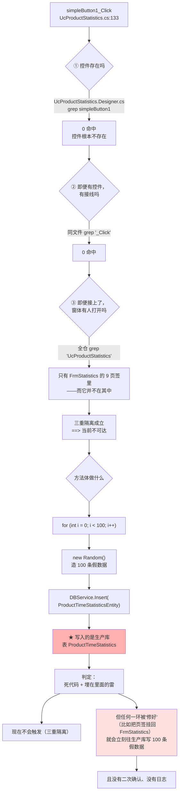

**ASCII 版**

```
          simpleButton1_Click  (UcProductStatistics.cs:133)
                    │
   ┌────────────────┼────────────────┬──────────────────────┐
   ▼                ▼                ▼                      ▼
① 控件存在吗?   ② 接线存在吗?   ③ 窗体有人开吗?        方法体做什么?
   grep             grep             grep                    │
   simpleButton1    _Click         UcProductStatistics       │
   in Designer      in Designer    (全仓)                     │
   => 0 命中        => 0 命中       => 只有 FrmStatistics     │
     (无控件)        (无接线)         的 9 页签，但它不在其中   │
   └────────────────┴────────────────┴──────────────────────┘
                                  │
                       三重隔离成立 ==> 当前不可达
                                  │
                                  ▼
                for (i = 0; i < 100; i++)
                    └─ new Random() 造 100 条假数据
                          └─ DBService.Insert(ProductTimeStatisticsEntity)
                                └─ ★ 写的是生产库表 ProductTimeStatistics
                                  （无二次确认、无日志）

   判定：死代码 + 埋在里面的雷
     现在不触发；但把页签挂回 FrmStatistics 的那一天就立刻触发
```

**定性纪律（严格遵守）**：本条**是"死代码 ＋ 埋在里面的雷"**，**不是**"软件会往生产库写假数据"。依据是上面三条 `grep` 的三重隔离；结论口径是"**当前不可达，但方法体的副作用是真实的**"。风险等级按"**潜在**"计，不按"**现任**"计。

**修法只有两个方向**（本文件只描述现象，不给改法建议）：确认它是遗留实验代码 → 整体删除；或确认它是被遗忘的功能 → 补控件、补接线、补宿主。

#### 4.3.3 向导窗体的"四件套"（`R-69`）—— 40 个按钮共用一段抄了 12 遍的代码

**图 7：`BtNext_Click` 的通用形态与越界缺口**

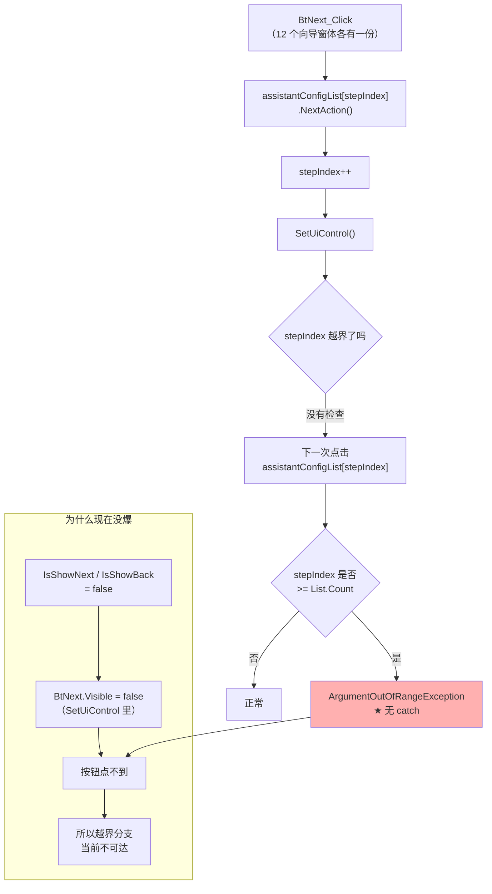

**ASCII 版**

```
   BtNext_Click（12 份拷贝，共 40 个"四件套"处理器）
        │
        ├─ assistantConfigList[stepIndex].NextAction()
        ├─ stepIndex++              ◄── 没有任何边界检查
        └─ SetUiControl()
                │
                ▼
        再点一次 ──► assistantConfigList[stepIndex]
                          │
                          ├─ stepIndex >= List.Count ?  ──是──► ArgumentOutOfRangeException
                          │                                        （无 catch → 冒到全局）
                          └─否──► 正常

   为什么现在没爆：
       向导配置里 IsShowNext / IsShowBack = false
            └─ SetUiControl() 里把按钮 Visible 置 false
                  └─ 按钮点不到 ==> 越界分支当前不可达

   12 个向导窗体：FrmEjectionCaliTeach / FrmNozzleCaliTeach / FrmRealTimeAssistant /
   FrmBondLevelHeightTeach / FrmBondLevelMeasureTeach / FrmSystem1FlatLevelMeasureTeach /
   FrmSystem1HeightTeach / FrmSystem2FlatLevelMeasureTeach / FrmSystem2HeightTeach /
   FrmAssistantPickArea / FrmInputData / FrmBondLevelMeasureResult(部分)
```

**这是"复制粘贴代价"的教科书案例**：同一条缺陷在 **12 个文件**里各存一份。修的时候必须**改 12 处**，漏一处就留一个孤岛。

#### 4.3.4 `FrmStatistics` 的两个"重置"按钮 —— 判断写反 ＋ 不落盘

**图 8：`BtInitDispense_Click` / `BtInitBod_Click` 的实际控制流**

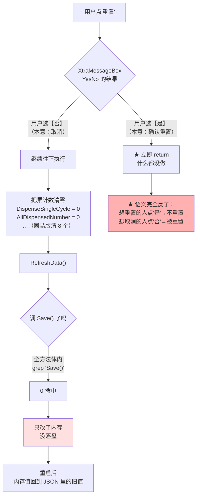

**ASCII 版**

```
   点"重置"
      │
      ▼
   XtraMessageBox YesNo
      │
      ├── 选【是】(本意=确认) ──► ★ 立即 return   ← 什么都没做
      │
      └── 选【否】(本意=取消) ──► 继续执行
                                    ├─ 清零（点胶 2 个 / 固晶 8 个计数器）
                                    ├─ RefreshData()
                                    └─ Save() ? ──► 0 命中 ──► 只改内存，不落盘
                                                                  └─ 重启回到旧值

   语义完全反了：
     想重置的人点"是" → 不重置
     想取消的人点"否" → 被重置
```

**双缺陷叠加的后果**：**"以为重置了其实没有"**（选"是"）与 **"以为取消了其实重置了"**（选"否"）**同时成立**；而且即便真重置成功，**重启后又会恢复** —— 排查此类问题时，**"界面上数字归零"和"重启后数字回来"会让人以为是两个不相干的 bug**。

#### 4.3.5 `FrmLogRecord.BtnClear_Click` —— 按钮写着"清空"，清的是数据库

**图 9："清空"按钮的三层落差**

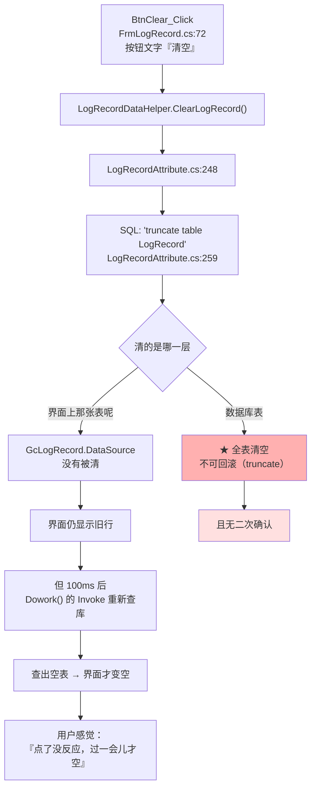

**ASCII 版**

```
   按钮文字『清空』 (FrmLogRecord.cs:72)
        │
        └─ LogRecordDataHelper.ClearLogRecord()
              └─ LogRecordAttribute.cs:248
                    └─ SQL "truncate table LogRecord"   (:259)
                          │
        ┌─────────────────┴──────────────────┐
        ▼                                    ▼
   清了【数据库表】                      界面上那张 GcLogRecord
   ★ 全表、truncate、不可回滚          DataSource 没被清 → 仍显示旧行
   且无二次确认                              │
                                            ▼
                                    100ms 后 Dowork() 的 Invoke 重新查库
                                            └─ 查出空表 → 界面这才变空
   ==> 用户的感觉是"点了没反应，愣一下才空"
```

**注**：`FrmLogRecord` 本身**零调用点**（§4.1.4 僵尸），所以这个"一键清空生产日志表"的按钮**当前点不到**。但它与 `R-85` 是同一类"死代码里的真副作用"，**必须一起登记**。

#### 4.3.6 `FrmSensorAlarm.BtClearAlarm_Click` —— 断链窗体内唯一的按钮

**图 10：断链的三件套 ＋ 缺失的一环**

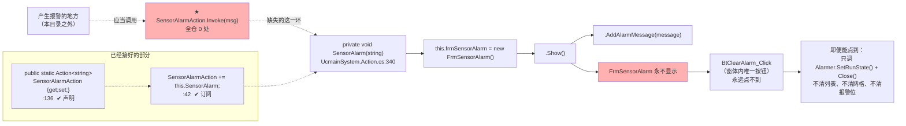

**ASCII 版**

```
   报警产生处（本目录之外）
        │  应当调用
        ▼
   ★ SensorAlarmAction.Invoke(msg)      ◄── 全仓 0 处（断的就是这一环）
        │
        ▼
   private void SensorAlarm(string)      UcmainSystem.Action.cs:340
        ├─ new FrmSensorAlarm()
        ├─ .Show()
        └─ .AddAlarmMessage(message)

   已经接好的部分：
     :136  public static Action<string> SensorAlarmAction { get; set; }   ✔ 声明
     :42   SensorAlarmAction += this.SensorAlarm;                         ✔ 订阅
     :340  private void SensorAlarm(string message)                       ✔ 处理器
     缺：  一处 Invoke                                                      ✘

   ==> FrmSensorAlarm 永不显示
         └─ BtClearAlarm_Click（窗体内唯一按钮）永远点不到
              即便能点到：只调 Alarmer.SetRunState() + Close()
                          不清 sensorAlarms 列表、不清网格、不清报警位
```

**为什么把"断链"与"僵尸"分开登记**：`FrmSensorAlarm` 是"**差一行就能工作**"的功能。如果按"僵尸"处理（一律不改），维护者会继续以为**"传感器报警有界面"**；而实际是**报警窗永远不弹** → 现场只能靠**声光报警器**（如果装了）或**日志**发现，**UI 上没有任何提示**。

#### 4.3.7 参数界面里的"写错槽位"（`R-80`）—— 一个 setter 写到了 `[0]`

**背景**：吸嘴架参数（`Parameters/ObjParameter/NozzleshelfPara.cs`）是**只读代理**：它不存数据，每个属性都 `=>` 到 `BondProgram.GetInstance().NozzleShelfProgram.NozzleShelf.NozzleShelfSlots[n]`（`:15`）。参数界面通过反射 `PropertyInfo.SetValue` 调它的 setter，**setter 把值写到哪个下标，就决定了改的是哪个槽位**。

**图 11：7 个槽位属性的 getter/setter 下标对照（唯一的错位在 `NozzleName7`）**

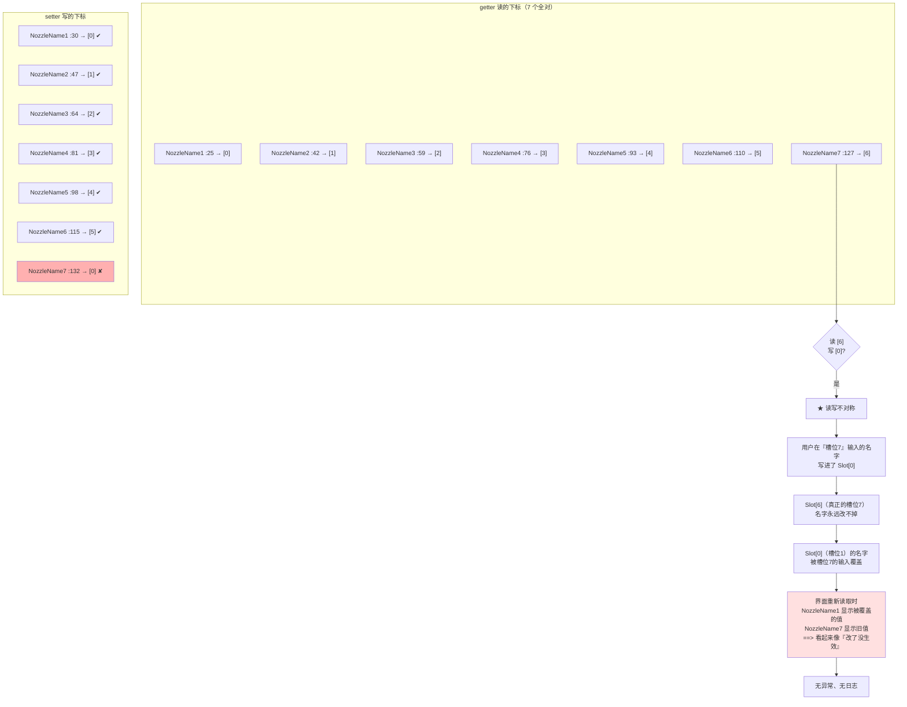

**ASCII 版**

```
   属性             getter 读       setter 写       结论
   NozzleName1      :25 → [0]      :30 → [0]      ✔
   NozzleName2      :42 → [1]      :47 → [1]      ✔
   NozzleName3      :59 → [2]      :64 → [2]      ✔
   NozzleName4      :76 → [3]      :81 → [3]      ✔
   NozzleName5      :93 → [4]      :98 → [4]      ✔
   NozzleName6     :110 → [5]     :115 → [5]      ✔
   NozzleName7     :127 → [6]     :132 → [0]      ✘ 读写不对称

   后果链：
     用户在『槽位7』输入名字
          └─ 写进 Slot[0]  （即槽位1）
                ├─ Slot[6]（真槽位7）名字永远改不掉
                └─ Slot[0]（槽位1）名字被覆盖
                      └─ 界面重新读取：
                           NozzleName1 显示被覆盖的值
                           NozzleName7 显示旧值
                              ==> 看起来像"改了没生效"
                                  无异常、无日志
```

**为什么这条必须精确到行号**：`NozzleName6` 的 setter 在 `:115` 写 `[5]` 是**对的**（与 getter `:110` 的 `[5]` 对称），只有 `:132` 这一处是 `[0]`。**修的时候只改 `:132` 一处**；如果按"整段照抄 NozzleName6 的写法"去改，会误改 `:115`。

> **取证备注**：本条的 setter 赋值语句在 `:132`；`:130` 是 `set` 关键字行、`:131` 是 `{`。两者常被混引，本篇以**赋值语句所在行**为准（附录 B 记录该口径）。

**影响面**：吸嘴架有 7 个槽位，**槽位 7 的名字无法通过界面设置**，同时**槽位 1 的名字会被误覆盖**。因为 `NozzleShelf` 是固晶流程读取吸嘴名的数据源（`NozzleRepository`／`NozzleShelfRepository` 落盘），**这个错位会一路传到实际取吸嘴的动作上**。

#### 4.3.8 参数改完到底存到哪（`R-79`）—— `Parameters/` 自己一次盘都不落

**图 12：参数从"用户敲键盘"到"进 JSON 文件"的完整链路**

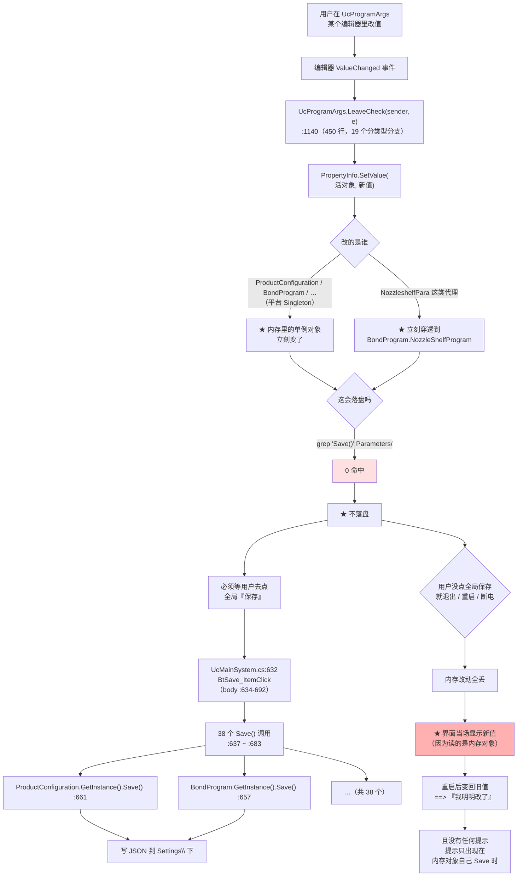

**ASCII 版**

```
 用户在参数界面改一个值
      │
      ▼
 UcProgramArgs.LeaveCheck(sender, e)   :1140  （450 行，19 个分支）
      │
      ▼
 PropertyInfo.SetValue(活对象, 新值)
      │
      ├─ 平台 Singleton（ProductConfiguration / BondProgram …）
      │        └─ 内存对象立刻变
      └─ 代理类（NozzleshelfPara）
               └─ 立刻穿透到 BondProgram.NozzleShelfProgram

      ▼
 这会落盘吗？
      grep "Save()" SupportFeature/Parameters/   ──►  0 命中
      ==> 不落盘

      ▼
 必须等用户去点全局『保存』
      UcMainSystem.cs:632  BtSave_ItemClick（body :634-692）
        ├─ 38 个 Save()   :637 ~ :683
        ├─ ProductConfiguration.GetInstance().Save()   :661
        ├─ BondProgram.GetInstance().Save()            :657
        └─ … （共 38 个） ──► 写 JSON 到 Settings\ 下

 风险：
      用户没点全局保存就重启/断电
        ├─ 内存改动全丢
        └─ 但界面当场显示的是新值（读的是内存对象）
             ==> 重启后变回旧值，用户感觉"我明明改了"
                 且没有任何提示
```

**这条风险的"隐蔽性"来自三点**（必须同时说清，否则会被低估）：

1. **界面不会撒谎**：`UcProgramArgs` 读的是**内存对象**，所以改完立刻显示新值 —— 用户有充分理由认为"已经生效了"。
2. **没有任何"未保存"提示**：没有星号、没有确认框、`FormClosing` 里没有"是否保存"询问（`Parameters/` 内 `Save()` = 0，也就无从提示）。
3. **保存按钮在别处**：`BtSave_ItemClick` 在 `Main/Controls/Ucmain/`，**不在参数界面上**。用户如果要建立"改参数 → 必须去主界面点保存"这个心智模型，**只能靠被坑过一次**。

**与 §8 的关系**：§8 的"落盘入口总表"会把 `Parameters/` 标为**唯一一个"零落盘"的子目录**；而 `BtSave_ItemClick` 的 **38 个 `Save()`** 是全机落盘的**总闸**（§8.2 单列）。

**注意 `:661 ProductConfiguration.GetInstance().Save()` 这一行**：它同时是 `DefectCompensate.NormalizationOffset` 的落盘点（`DefectCompensate.cs:179`）—— 也就是说，**"按基板自动补偿"学到的偏移量，也只有用户点全局保存才会进文件**。这条把 `R-79` 与 §5.1 的补偿链连了起来。

### 4.4 §4 小结：四张"点了也没用"的清单

| 清单 | 数量 | 成员 | 判定依据 |
|---|---|---|---|
| **A. 按钮点不到**（无接线／无控件） | **2** | `BtSetCompensateSlope_Click`（无接线 ＋ `SpCompensateSlope.Enabled=false`）、`UcProductStatistics.simpleButton1_Click`（无控件 ＋ 无接线 ＋ 无宿主） | §4.2 表 ＋ §4.1.4 |
| **B. 按钮有接线，但运行期不可达** | **3** | `FrmAxisTemperature.BtSave_Click`（宿主窗体零调用点）、`UcAKRSPoint3DEditor.simpleButton1_Click`（所在面板恒隐藏）、`FrmSensorAlarm.BtClearAlarm_Click`（宿主窗体因断链永不显示） | §4.1.3／§4.1.4／§4.3.6 |
| **C. 按钮能点到，但**"**它做的事和文字不符**" | **5** | `FrmStatistics.BtInitDispense_Click`（判断写反）、`FrmStatistics.BtInitBod_Click`（判断写反）、`FrmLogRecord.BtnClear_Click`（清库不清界面）、`FrmBondCompensate.BtClear_Click`（不落盘不刷新）、`FrmTemperatureMonitoring.BtStart_Click`（只换按钮文字） | §4.3.1～§4.3.8 |
| **D. 不是按钮，但操作员永远碰不到**（运行时永久禁用） | **3** | `SpCompensateSlope`「补偿斜率」（**🔴**，两条路同时断）、`CmbEjectionName`「顶针」（⚠️ 只读跟随）、`SpPPToolUseTimes1`（⚠️ 纯展示） | **§4.1.5 ＋ §9.11** |

> **清单 B 与 C 有一个交叉成员**：`FrmSensorAlarm.BtClearAlarm_Click` 既**不可达**（在 B），其行为**也与文字不符**（清了硬件报警位但不清列表）。因为它不可达，**不计入 C 的 5 个**（C 的口径是"能点到且行为不符"）。A／B／C 三类互不重叠，故下列算术成立。

> **清单 D 与 A／B／C 的不重叠**：D 的 3 个成员**一个 `_Click` 处理器都没有**，所以**不进**下面那棵树，
> 也不改变"100 个 `_Click`"的任何数字。它列在这里，是因为**它属于同一个问题**：
> "**界面上有这个东西，但操作员永远用不到它**"。A／B／C 讲的是**按钮**，D 讲的是**控件**。

**把这三张清单与"100 个 `_Click`"放在一起看**（清单 D 不在树内）：

```
   100 个 _Click 处理器
     ├─ 98 有接线 ──┬─ 95 可达 ──┬─ 90 行为与文字相符
     │              │            └─  5 行为与文字不符        ◄── 清单 C
     │              └─  3 不可达（宿主窗体死/面板恒隐/断链）◄── 清单 B
     └─  2 无接线（孤儿）                                    ◄── 清单 A
```

**也就是说：100 个按钮里，真正"点了就按你想的那样工作"的是 90 个。** 剩下 10 个是本节的全部价值所在 —— **它们光看按钮名一个都看不出来**。

---

## 5. 核心流程（非 UI 触发）

> §4 讲的是"**人点了什么**"；§5 讲的是"**没人点的时候，这个目录在跑什么**"。
> 一句话概括：**它自己没有主循环** —— 它提供的全部是"**被别人调用时才动**"的能力。真正在后台跑的东西只有 **4 个线程/任务 ＋ 3 个 `Timer`**，其余全部是**被动**的。

### 5.1 补偿链：每次固晶都跑的那一段（本目录最高价值的一条流程）

**这是本目录存在的主要理由**。固晶头每贴一颗芯片，都会在 `BondActionNode.Provider.CalculateBondPos()` 里把**七段补偿**依次叠加到 `realBondPositionInG0` 上 —— 这个变量**就是实际要动到的坐标**。

**图 13：`realBondPositionInG0` 的七段叠加顺序（`BondActionNode.Provider.cs`）**

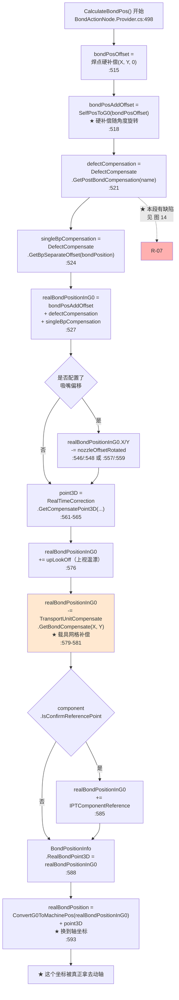

**ASCII 版**

```
  CalculateBondPos()  ── BondActionNode.Provider.cs:498
        │
   ①   bondPosOffset = 焊点硬补偿 (X, Y, 0)                    :515
        │
   ②   bondPosAddOffset = SelfPosToG0(bondPosOffset)           :518
        │                  ★ 硬补偿随角度旋转
        │
   ③   defectCompensation =                                    :521
        │   DefectCompensate.GetPostBondCompensation(name)      ◄── ★ R-07 在这里
        │
   ④   singleBpCompensation =                                  :524
        │   DefectCompensate.GetBpSeparateOffset(bondPosition)
        │
   ⑤   realBondPositionInG0 = ② + ③ + ④                        :527
        │
   ⑥   if (吸嘴偏移)  realBondPositionInG0.X/Y -= nozzleOffsetRotated   :546/:548
        │
   ⑦   point3D = RealTimeCorrection.GetCompensatePoint3D(...)  :561-565
        │
   ⑧   realBondPositionInG0 += upLookOff（上视温漂）            :576
        │
   ⑨   realBondPositionInG0 -= TransportUnitCompensate          :579-581
        │                        .GetBondCompensate(X, Y)
        │                  ★ 载具网格补偿（唯一生效的网格补偿）
        │
   ⑩   if (IsConfirmReferencePoint) += IPTComponentReference    :585
        │
   ⑪   BondPositionInfo.RealBondPoint3D = realBondPositionInG0  :588
        │
   ⑫   realBondPosition = ConvertG0ToMachinePos(...) + point3D  :593
        │                  ★ 换成轴坐标
        ▼
    ★ 这个坐标被真正拿去动轴
```

**读图要点（五个必须记住的事实）**：

| # | 事实 | 出处 |
|---|---|---|
| 1 | **顺序不能换**：③④ 是"加"，⑨ 是"减"，⑥ 是"减 X/Y"。**加法不满足"先减后加"的直觉** —— ⑦ 的 `point3D` 在 ⑫ 才加上去，**不参与 ⑨ 的网格补偿计算** | `:527` / `:579` / `:593` |
| 2 | **`BondCompensate`（"终极补偿"）不在链上** —— 链上是 `TransportUnitCompensate`。这两个类**长得几乎一样**（同目录、同 7 个字段、同 `GetBondCompensate` 方法名、同 `"贴片补偿过大，有问题"` 异常文本），**差别只在 `BondCompensate.cs:76` 那句 `return`** | §9.1 |
| 3 | **⑨ 用的是"加完之后"的 X/Y** —— 即网格补偿的插值坐标是**已经被 ③④⑥ 改过的坐标**。这意味着**缺陷补偿会平移网格补偿的取值点** | `:580-581` |
| 4 | **⑫ 之后还有一次使用**：`:639` 相机移动用的是 `realBondPositionInG0 + SingleBondPositionConfig.BondPosOffset`，**又加了一次单点偏移** —— 相机看到的点和轴走到的点**相差一个 `BondPosOffset`** | `:639` |
| 5 | **全程无校验、无日志（除了 `:595` 一行 `RecordTime` 文本）、无回读** —— 任何一段算错，都只会表现为"贴偏了"，**不会报错** | `:521`-`:593` |

#### `R-07`：③ 段的 Z 分量取错（`Z = Average(it => it.X)`）

**图 14：`GetPostBondCompensation` 的三个前置条件与唯一的缺陷点**

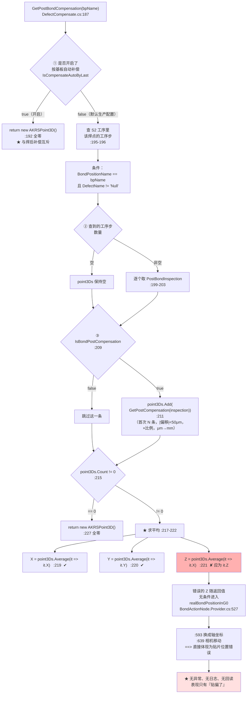

**ASCII 版**

```
 GetPostBondCompensation(bpName)        DefectCompensate.cs:187
        │
   ①    IsCompensateAutoByLast ?   ──true──► return 全零  :192
        │                                      ★ 与"焊后补偿"互斥
        │false（默认生产配置）
        ▼
   ②    查 S2SystemProcess.ProcessSteps                    :195-196
        │     条件: BondPositionName == bpName
        │           且 DefectName != "Null"
        ├── 空 ──────────────────────────┐
        └── 非空 ─► 逐个取 PostBondInspection :199-203
                        │
   ③                IsBondPostCompensation ?  :209
                        ├─ false ─► 跳过
                        └─ true  ─► point3Ds.Add(GetPostCompensation(...))  :211
                                        │  (取前 N 条, |偏移|<50μm, ×比例, μm→mm)
                                        ▼
                    point3Ds.Count != 0 ?   :215
                        ├─ == 0 ──► return 全零  :227
                        └─ != 0 ──► ★ 求平均  :217-222
                                        │
                                        ├─ X = Average(it => it.X)  :219  ✔
                                        ├─ Y = Average(it => it.Y)  :220  ✔
                                        └─ Z = Average(it => it.X)  :221  ✘ 应为 it.Z
                                                │
                                                ▼
                        错误的 Z 随返回值【无条件】进入 realBondPositionInG0
                                        BondActionNode.Provider.cs:527
                                                │
                                        :593 换轴坐标 / :639 相机移动
                                                │
                                                ▼
                        ★ 直接体现为贴片位置错误
                          无异常、无日志、无回读
                          表现只有"贴偏了"
```

**三个前置条件必须一起画出来，否则会低估这条风险**：

| 分支 | 是不是"正常生产配置" | 说明 |
|---|---|---|
| ① `IsCompensateAutoByLast == true` → 整体返回全零 | **不是**（这是"按基板自动补偿"模式） | 一旦启用"按基板自动补偿"，**"焊后逐点补偿"就完全失效** —— 两者**互斥**。这是设计事实，`:189` 的注释写得很清楚（"避免出现冲突"） |
| ② 该焊点在 S2 工序里**没有** `DefectName != "Null"` 的工序步 | **是**（不用焊后检测的产线） | 此时 `point3Ds` 为空 → 走 `:227` 返回全零 → **不触发缺陷** |
| ③ 查到的检测项 `IsBondPostCompensation == false` | **是**（检测项没勾"焊后补偿"） | 同样 `point3Ds` 为空 → 返回全零 |
| **三者都不成立** → 走到 `:221` | **是**（**用了焊后逐点补偿的产线，这就是正常配置**） | 🔴 **触发** |

**这就是把 `R-07` 判为 🔴（源码内已确认的缺陷）而不是 ⚠️（静态推断）的理由**：`Z = point3Ds.Average(it => it.X)` 在**任何**配置下都是错的（它把 X 的平均值当 Z 用，与配置无关）；而且只要走到这一行，**错误的 Z 就无条件地进入实际动轴坐标**（`:527` 是直接相加，没有任何条件包裹）。⚠️ 的定义是"代码本身没错、换个用法才会错"，**本条不满足**。

**错误 Z 的量级（必须按源码算清楚，不要凭感觉说"很大"）**：`GetPostCompensation` 返回的是 `new AKRSPoint3D(x, y, 0)`（`DefectCompensate.cs:83`），**每个检测项的 Z 都是 0**。所以 `Z = Average(it => it.X)` 得到的**不是 0，而是 X 偏移量的平均值** —— 即**与 X 补偿量同量级**的一个数。

按源码实测这个量级：进 `:75` 平均之前先经过 `Math.Abs(it.OffsetX) < 50` 的离群过滤（单位为 **μm**），再 `/1000.0` 换成 **mm**、乘 `BondPostCompensationRation / 100.0`。所以单点的 X 补偿量上限约为 `50 ÷ 1000 = 0.05 mm`（比例取 100% 时）。**结论：这是一个"几十微米、上限约 0.05 mm"的 Z 偏差，不会到毫米级**。

**真正的问题不是"大"，而是"必然且无声"**：正确的 Z 本该是 **0**（检测项本身不带 Z 信息），现在却**恒定地被赋成 X 的平均值** —— 只要该焊点有 X 方向的补偿量，Z 就一定被污染；偏差方向与 X 同号，**随 X 补偿量同步漂移**。它**小到不会撞限位、大到足以影响贴片高度**（而 `|插值| > 1` 那类 `throw` 守卫在别的类里，本类 `throw` 数为 **0**），因此**现场表现为"贴片高度莫名有偏差、查不出原因"**。

**与 `R-07` 相邻、但必须区分开的一条**：`:190-192` 的提前返回说明"**焊后补偿**"与"**按基板自动补偿**"**是两套互斥机制** —— 现场如果同时想要两者，就会有一个**静默失效**（`IsCompensateAutoByLast` 一开，`GetPostBondCompensation` 直接返回全零）。这条不是 bug，是设计取舍，但**在排查"我开了焊后补偿怎么没效果"时必须先看这个开关**。

### 5.2 4 个后台线程/任务（全部由外部或窗体驱动）

**图 15：本目录的 4 个长驻后台循环 ＋ 3 个一次性 `Task`**

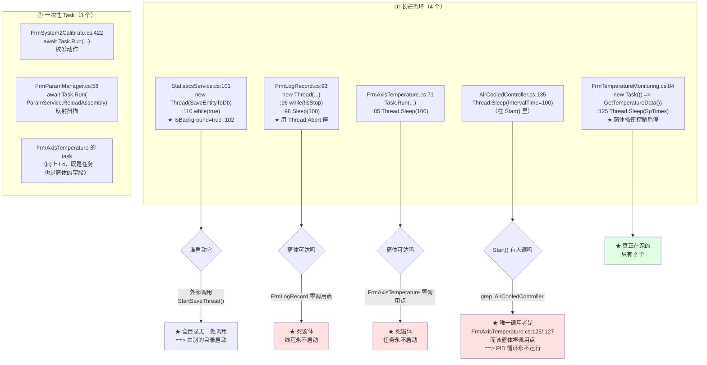

**ASCII 版**

```
 ① 长驻循环（4 个 + 1 个不可达的）
    1) StatisticsService.cs:101  new Thread(SaveEntityToDb)
                                  :110 while(true)   :102 IsBackground = true
                                  ── 谁启动?  StartSaveThread() 全目录无调用 ──► 由外部启动
    2) FrmTemperatureMonitoring.cs:84  new Task(GetTemperatureData)
                                       :125 Thread.Sleep(SpTimes)
                                  ── ★ 真正在跑
    3) FrmLogRecord.cs:93  new Thread(...)  :96 while(!isStop)  :98 Sleep(100)
                           :48 / :84 用 Thread.Abort() 停
                                  ── FrmLogRecord 零调用点 ==> 死窗体，线程永不启动
    4) FrmAxisTemperature.cs:71  Task.Run(...)  :85 Sleep(100)
                                  ── 窗体零调用点 ==> 死窗体，任务永不启动
    5) AirCooledController.cs:135  Thread.Sleep(IntervalTime)
                                  在 Start() 里
                                  ── 唯一调用者 FrmAxisTemperature.cs:123/:127
                                     而该窗体零调用点 ==> PID 循环永不运行
                                  ── 且 Start() 内部 :120 feedback = 0（不读传感器）
                                     :132 feedback += output（拿输出冒充反馈）
                                     :134 // 输入给风冷模拟量（只是注释）

 ② 一次性 Task（3 个）
    FrmSystem2Calibrate.cs:422   await Task.Run(...)          校准动作
    FrmParamManager.cs:58        await Task.Run(ReloadAssembly)  反射扫描
    （FrmAxisTemperature 的 task 同时属于 ①-4）

 ★ 结论：**真正在跑的只有 2 个** —— StatisticsService 写库线程 + 温度采集任务。
```

**这张图的价值**：如果不画"谁启动它"，很容易得出"这个目录有 4 个后台线程在跑"的错误结论。**实际是"定义了 5 处循环，其中 3 处因宿主死亡而永不运行，1 处由外部目录启动，真正在跑的只有 2 个"**。

**逐条要点**：

| 线程 | 启动方式 | 停止方式 | 关键风险 |
|---|---|---|---|
| `StatisticsService.SaveEntityToDb`（`:110-140`） | 外部调 `StartSaveThread()`（`:99-107`） | **没有停止路径**（`while(true)` ＋ `IsBackground = true` → 只能靠进程退出收场） | 队列 `BlockingCollection<object>(500)`（`:53-54`）**满了会阻塞生产者** → 写库慢会**卡住业务线程** |
| `FrmTemperatureMonitoring.GetTemperatureData`（`:121-195`） | 窗体 `Load`（`:84`）**一打开就开始**，不是按"开始采集" | 窗体 `FormClosing`（`:270-278`）：`isStart` 为真时**拒绝关闭** | **按钮只是切换文字**（`:245-252`），采集频率 `SpTimes` 的 `EditValueChanged` **方法体是空的**（`:261-263`）→ 改频率无效 |
| `FrmLogRecord.Dowork`（`:90-107`） | 窗体"开启"按钮 | `Thread.Abort()` | 🔴 **`Thread.Abort` 是 .NET 中最危险的停止方式**（可在任意指令处中断、`finally` 可能不执行）；且窗体死了 → 当前不触发 |
| `AirCooledController.Start`（`:120-140`） | **唯一调用者是 `FrmAxisTemperature.cs:123`／`:127`** —— 而该窗体**零调用点** | 靠 `IsWorking` 置 false（**窗体里没有把它置 false 的路径**） | 🔴 风冷 PID **整条链是死的**（`R-05`）。**注意责任划分**：`Calculate`（`:86-108`）本身是一段**正确的 PID 公式**（含 `OutputMax/OutputMin` 限幅）；**占位实现全在 `Start()` 里** —— ① `:120 double feedback = 0;` **从不读真实传感器**；② `:132 feedback += output;` 用"**输出的累加**"冒充反馈；③ `:134 // 输入给风冷模拟量` **只是一行注释，没有真的写模拟量**。即"算出数字然后丢掉" |

### 5.3 3 个 `Windows.Forms.Timer`

**图 16：三个 `Timer` 的周期、依赖与失效方式**

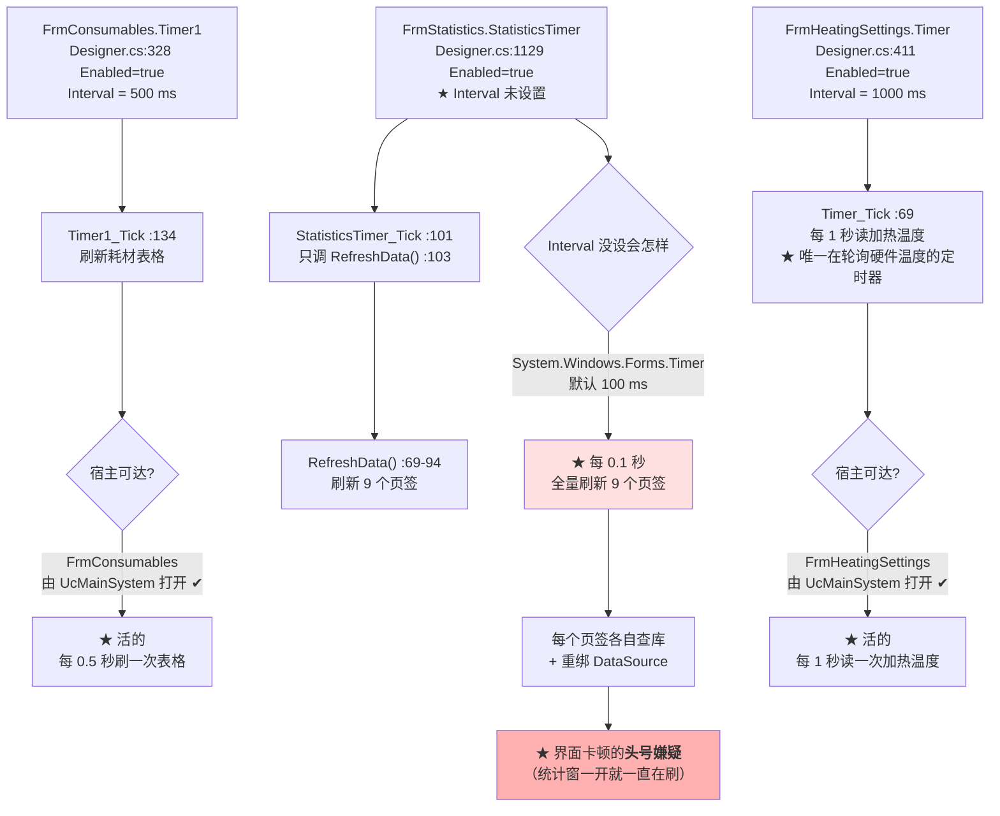

**ASCII 版**

```
  ① FrmConsumables.Timer1    Designer.cs:328  Enabled=true  Interval = 500 ms
        └─ Timer1_Tick :134 → 刷新耗材表格
            宿主 FrmConsumables 由 UcMainSystem 打开  ==> 活的，每 0.5s 刷一次

  ② FrmHeatingSettings.Timer Designer.cs:411 Enabled=true  Interval = 1000 ms
        └─ Timer_Tick :69 → 每 1 秒读加热温度（labelControl3）
                            ★ 本目录唯一在轮询硬件温度的定时器
            宿主由 UcMainSystem 打开  ==> 活的

  ③ FrmStatistics.StatisticsTimer  Designer.cs:1129  Enabled=true
        ★ Interval 没有设置
        └─ StatisticsTimer_Tick :101 → 只调 RefreshData() :103
             RefreshData() :69-94 → 刷新 9 个页签
        System.Windows.Forms.Timer 默认 Interval = 100 ms
        ==> ★ 每 0.1 秒全量刷新 9 个页签，每个页签各自查库 + 重绑 DataSource
            ==> 界面卡顿的头号嫌疑（统计窗一开就一直在刷）
```

**三种"停表"写法各不相同**（这点在排查"窗口关了还在刷"时必须分清）：

| Timer | 停止位置 | 写法 | 评价 |
|---|---|---|---|
| `FrmConsumables.Timer1` | **未找到显式停止** | — | ⚠️ 窗体关闭后若 `Dispose` 未生效，Tick 仍会触发 |
| `FrmHeatingSettings.Timer` | `FormClosed`（`FrmHeatingSettings.cs:128-132`） | `Tick -=` ＋ `Enabled = false` ＋ `Dispose()` | ✅ **最完整的写法**（本目录唯一） |
| `FrmStatistics.StatisticsTimer` | `FormClosing`（`FrmStatistics.cs:153-158`） | `Stop()` ＋ `Tick -=` ＋ `Dispose()` ＋ `= null` | ✅ 完整 |

**`FrmStatistics` 的 100 ms 是"没设"而不是"设成 100"**：`FrmStatistics.Designer.cs:1129-1132` 里只有 `Enabled = true` 和 `Tick +=`，**没有 `Interval = ...` 这一行**。这是"漏配"，不是"有意配成 100 ms"。**它的后果是每 0.1 秒把 9 个页签全刷一遍** —— 而这个窗体正是"查询/导出"类按钮最集中的地方（§4.2 里 8 个查询 + 9 个导出）。

### 5.4 6 个静态回调钩子（**2 个活的 ＋ 4 个断链**）

**图 17：6 个 `static Action` 的"订阅—触发"配平检查**

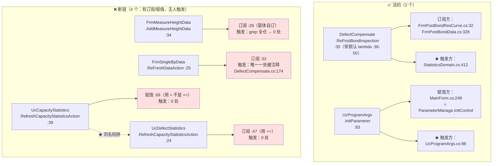

**ASCII 版**

```
 ✅ 活的（2 个）
   1) DefectCompensate.RePostBondInspection          :35
        声明时带默认 lambda                            :36-50
        订阅：FrmPostBondResCurve.cs:32
              FrmPostBondData.cs:328
        触发：StatisticsDomain.cs:412   ◄── 有！
        ==> 活：焊后检测结果能推到"焊后数据"窗口

   2) UcProgramArgs.InitParamerer                    :83
        赋值：MainForm.cs:249  = ParameterManage.InitControl
        触发：UcProgramArgs.cs:98          ◄── 有！
        ==> 活：★ 老参数系统的注册总闸，靠它把 52 个注册点灌进去

 ❌ 断链（4 个：订阅/赋值都有，就是没人触发）
   3) FrmMeasureHeightData.AddMeasureHeightData      :34
        订阅 :28（窗体自订）   触发：grep 全仓 → 0 处
   4) FrmSingleBpData.ReFreshDataAction              :25
        订阅 :33             触发：唯一一处被【注释】
                                   DefectCompensate.cs:174   //FrmSingleBpData.ReFreshDataAction();
   5) UcCapacityStatistics.RefreshCapacityStatisticsAction   :39
        赋值 :69（用 = ，单订阅）   触发：0 处
   6) UcDefectStatistics.RefreshCapacityStatisticsAction     :24
        订阅 :47（用 +=）          触发：0 处
        ★ 陷阱：5) 和 6) 名字完全相同、类型不同
                （Action<BondPositionLogEntity> vs Action）、宿主不同
                ==> 按名字 grep 会混在一起
```

**这张图的三个结论**：

1. **"有订阅"不等于"会响"**：4 个断链钩子**全都订阅得好好的**。判断一个 `static Action` 是否工作，**唯一可靠的检查是"有没有 `Invoke`（或直接调用）"**，而不是"有没有 `+=`"。这与 §4.1.4 的 `SensorAlarmAction` 是**同一类缺陷**（那里是本目录之外的钩子）。

2. **`DefectCompensate.cs:174` 那行注释是"功能被关掉"的直接证据** —— 它是 `FrmSingleBpData`（单点补偿查看窗）期望的"补偿数据变了就刷新界面"通道。它一旦是注释，**`FrmSingleBpData` 打开时看到的数据就不会自动更新**（`BtClear_Click` 里手动调了 `ReFreshData()`，见 §4.2，所以"清除"后能看到变化，但"补偿被归一化改变"时看不到）。

3. **两个同名 `RefreshCapacityStatisticsAction` 是"重命名地雷"**：一个是 `Action<BondPositionLogEntity>`（参数化），一个是 `Action`（无参）；一个用 `=`（覆盖），一个用 `+=`（追加）。**任何按名字做的全局替换都会同时改到两个类**。

### 5.5 5 条外部触发流（A–E）

本目录**没有自产流程**，全部由外部驱动。以下是 5 条最主要的（每条都从"别的目录"进、到"别的目录/磁盘"出）：

**图 18：5 条外部触发流的进出口**

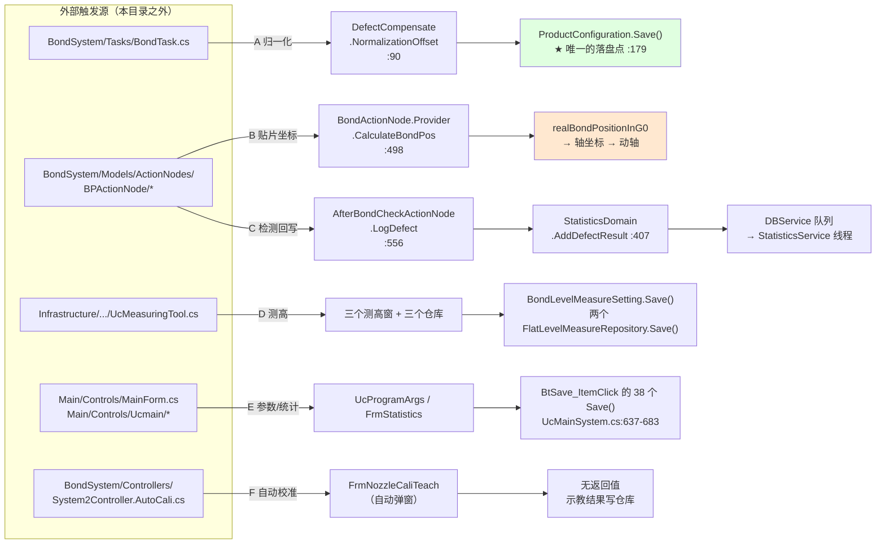

**ASCII 版**

```
 外部触发源（本目录之外）              进入本目录的入口                出口
 ───────────────────────────────────────────────────────────────────────────
 BondTask.cs:337 ────A 归一化────► DefectCompensate.NormalizationOffset :90
                                        └─► ProductConfiguration.Save() :179 ★唯一落盘点

 BondActionNode.Provider.cs:498 ─B 贴片坐标─► CalculateBondPos :498
                                        └─► realBondPositionInG0 → :593 轴坐标 → 动轴

 AfterBondCheckActionNode.cs:483/:547 ─C 检测回写─► LogDefect :556
                                        └─► StatisticsDomain.AddDefectResult :407
                                              └─► DBService 队列 → StatisticsService 线程

 UcMeasuringTool.cs:111/:129/:163 ─D 测高─► 三个测高窗体 + 三个仓库
                                        └─► BondLevelMeasureSetting.Save()
                                            System1/2FlatLevelMeasureRepository.Save()

 MainForm.cs:249 / UcMainSystem*.cs ─E 参数/统计─► UcProgramArgs / FrmStatistics
                                        └─► BtSave_ItemClick 的 38 个 Save()  :637-683

 System2Controller.AutoCali.cs:88 ─F 自动校准─► FrmNozzleCaliTeach（运行期弹窗）
```

**逐条要点**：

| 流 | 触发源（本目录之外） | 本目录入口 | 出口 | 关键风险 |
|---|---|---|---|---|
| **A. 按基板归一化** | `BondSystem/Tasks/BondTask.cs:337`（**唯一调用点**） | `DefectCompensate.NormalizationOffset(string tuId)` `:90` | `ProductConfiguration.GetInstance().Save()` `:179`（**该方法的唯一落盘点**） | 只有"整个产品做完"（`:334 ActionNodesService.Finish()` 之后）才触发；`DefectDataS` 是**纯内存字典**，重启即空 → `R-…` |
| **B. 贴片坐标计算** | 固晶动作节点 | `BondActionNode.Provider.CalculateBondPos()` `:498` | `realBondPositionInG0` → `:593` 轴坐标 | §5.1 全部内容；`R-04`／`R-07` 都在这里 |
| **C. 焊后检测回写** | `AfterBondCheckActionNode.cs:483`／`:547` | `LogDefect(AKRSPoint4D)` `:556` | `StatisticsDomain.AddDefectResult` `:407` → `:412` 触发 `RePostBondInspection` → 队列 | `:571-572` 做 **mm→μm**（`* 1000.0`），而 `DefectCompensate` 读到后又做 **μm→mm**（`/ 1000.0`）→ **单位来回换算三处**，是最容易错的地方 |
| **D. 平面测高** | `Infrastructure/Controls/Feature/MeasuringTool/UcMeasuringTool.cs` | 三个测高窗体 | `BondLevelMeasureSetting.Save()`／两个 `…FlatLevelMeasureRepository.Save()` | `R-20`（`== double.NaN` 恒假 → 测高失败不报错）在这条链上 |
| **E. 参数与统计** | `Main/Controls/MainForm.cs:249` ＋ `UcMainSystem*.cs` | `UcProgramArgs`／`FrmStatistics` | `BtSave_ItemClick` 的 **38 个 `Save()`** | `R-79`（参数界面自己零落盘，全靠这一个总闸）；`R-80`（`NozzleName7` setter）也在这条链上 |
| **F. 自动校准** | `BondSystem/Controllers/System2Controller.AutoCali.cs:88` | `FrmNozzleCaliTeach`（**运行期弹出，无按钮入口**） | 示教结果写仓库 | 这是"用户没点任何按钮，界面自己弹出来"的唯一一条流 —— 排查"机器自己弹了个窗"时要看这里 |

**`R-…` 单位换算的特别提示**（流 C 的要害）：同一条数据在链上被换算三次，**方向必须一致**：

```
   AfterBondCheckActionNode.cs:571-572   OffsetX/Y = distanceX/Y * 1000.0      mm → μm
   DefectCompensate.cs:75-77             ... / 1000.0 * Ration / 100.0          μm → mm
   DefectCompensate.cs:120-124           Math.Round(... , 3)                    μm → mm + 取整
   FrmBondCompensate.cs:96-97            list[...].OffsetX / 1000.0             μm → mm
   TransportUnitCompensate 网格数据来源同上
```

**任何一个 `/ 1000.0` 写成 `* 1000.0`（或漏掉），都会让补偿量差 10⁶ 倍**。

**链上到底有几道"过大"守卫 —— 逐个数清（这是本章最容易含糊的一点）**：

| 位置 | 判据 | 行为 | 覆盖哪一段 |
|---|---|---|---|
| `TransportUnitCompensate.cs:140-142` | `\|interpolationX\| > 1 \|\| \|interpolationY\| > 1` | `throw new Exception("贴片补偿过大，有问题")` | 只覆盖 **⑨ 载具网格补偿** |
| `BondCompensate.cs:162-164` | 同上 | 同上 | **不在链上**（`R-04`，该方法首行就 `return`） |
| `RealTimeCorrection.cs:130-132`／`:184-186`／`:258-260` | `\|compensate.X\| > 0.5` | `throw` | 只覆盖 **⑦ 实时矫正** |
| `DefectCompensate` | — | **全文件 `grep "throw"` = 0 命中** | 🔴 **③④ 缺陷补偿完全没有守卫** |

**所以 `R-07` 产生的错误 Z 值一路上没有任何拦截**：`DefectCompensate.cs` 里连一个 `throw` 都没有。文件里唯一的"阈值"是 **4 处** `Math.Abs(it.OffsetX/Y) < 50` 离群过滤（`:75`／`:79`／`:120`／`:126`），加上 `:162-163` 的一处 `> 50` 判断 —— 它们是**过滤器**（把离群点排除掉、让结果更"正常"），**不是守卫**（不会报警、不会中止）。**过滤器反而让异常数据更不容易被发现**。

> ⚠️ **顺带记一条量纲不一致**（`:162-163`）：该判断写的是
> `Math.Abs(defectStatisticsEntity.OffsetX - x) > 50`，
> 但左边的 `OffsetX` 单位是 **μm**，右边的 `x` 已在 `:120` 处 `/1000.0` 换成了 **mm** —— **两个不同量纲的数直接相减**。由于 `OffsetX` 的量级（几十 μm）远大于 `x`（约 0.0x mm），该表达式**实际退化成 `|OffsetX| > 50`（μm）**，行为上恰好还能当离群过滤用，所以**不会暴露成故障**；但它**本身是错的**，一旦将来有人改动 `:120` 的换算系数（比如去掉 `/1000.0`），这条判断会**静默失效**。归入 `R-105` 附近的量纲类问题登记。

---

## 6. 关键实现细节

### 6.1 补偿算法族：6 类算法，3 类风格

**图 19：补偿类的算法血统**

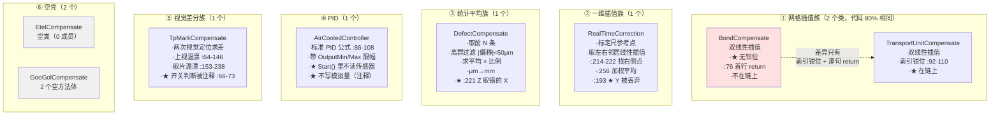

**表 6.1：算法参数与阈值一览**

| 算法 | 类 | 关键参数（含默认值） | 阈值/守卫 | 落盘 |
|---|---|---|---|---|
| 网格双线性插值 | `TransportUnitCompensate` | `ColumnSpacing`／`RowSpacing`／`ColumnCount`／`RowCount`／`StartPoint`（`:38`-`:58`）；网格矩阵 `double[,]` **默认 `null`**（`:28`/`:33`） | `\|插值\| > 1` → `throw "贴片补偿过大，有问题"`（`:140-142`） | ✅ |
| 网格双线性插值（死） | `BondCompensate` | 同上一套（`:31`-`:61`）；`PrName = "BondCompensateProgram"`（`:66`） | 同上一套（`:162-164`），**但代码不可达** | ⚠️ 路径已配（`:25`）但无写入 |
| 一维参考点插值 | `RealTimeCorrection` | `ReferencePoints`（`:39`）／`ReferencePointsCompensate`（`:44`）／`IsAssistanted = false`（`:49`）；`PrName = "实时矫正Mark"`（`:54`） | `\|compensate\| > 0.5` → `throw`（三处：`:130`/`:184`/`:258`） | ✅ |
| 统计平均 | `DefectCompensate` | `BondPostCompensationNumber` 默认 **10**；`BondPostCompensationRation` 默认 **50**；`CompensateAutoByLastRation` | 离群过滤 `\|Offset\| < 50` μm（`:75`/`:79`/`:120`/`:126`）；**`throw` = 0** | ❌ **`DefectDataS` 纯内存**；仅归一化结果经 `ProductConfiguration.Save()`（`:179`）落盘 |
| PID | `AirCooledController` | `Kp/Ki/Kd` **默认全 0**（`:36`/`:41`/`:46`）；`OutputMin/Max`（`:56`/`:61`）；`IntervalTime = 100`（`:66`） | 输出限幅（`:94-101`） | ✅ 路径在**实例 ctor** 里设（`:28-31`） |
| 视觉差分 | `TpMarkCompensate` | `UpLookCompensation`／`PickUpCompensation`（`AKRSPoint2D`，默认 `null`）；`LastUpLookVisionTime`／`LastPickUpVisionTime` | 两处阈值处理**不一致**（`:247-251` vs `:268-271`） | ❌ 纯内存 |

**"PID 的 `FilePath` 设在实例 ctor 而不是静态 ctor"这个细节值得单说**：本目录其他 `Singleton<T>` 都在**静态构造函数**里设 `FilePath`（如 `TransportUnitCompensate.cs:20-23`、`StatisticsDomain.cs:42-45`），只有 `AirCooledController` 在**实例构造函数**（`:28-31`）里设。这是**风格不一致**：如果平台 `Singleton<T>` 依赖"静态 ctor 先设路径再 `Load()`"，那么 `AirCooledController` 的加载时机就与其他几个不同。

### 6.2 数据结构：本目录用到的全部容器

**表 6.2：内存容器总表（按"会不会丢"分类）**

| 容器 | 位置 | 类型 | 容量/上限 | 重启后 |
|---|---|---|---|---|
| `DefectDataS` | `DefectCompensate.cs:29` | `Dictionary<string, List<DefectStatisticsEntity>>` | **每键 2000 条**（`:46-48`） | 🔴 **全丢** |
| `TransportUnitCompensateX/Y` | `TransportUnitCompensate.cs:28`/`:33` | `double[,]` | 由 `ColumnCount`×`RowCount` 决定；**默认 `null`** | ✅ 从 JSON 恢复 |
| `ReferencePoints`／`ReferencePointsCompensate` | `RealTimeCorrection.cs:39`/`:44` | 集合 | 由标定尺长度与列间距决定 | ✅ |
| `BondCompensateX/Y` | `BondCompensate.cs:31`/`:36` | `double[,]` | 同网格族；**默认 `null`** | ⚠️ 死 |
| `DbEntityBlockingCollection` | `StatisticsService.cs:53-54` | `BlockingCollection<object>` | **容量 500** | ❌ 队列内容全丢 |
| `sensors` | `NeedScanSensorPool.cs:31` | `List<Sensor>` | 无上限 | ❌ |
| `Consumables` | `ConsumablesProgram.cs:26` | 集合（引用其他程序集对象） | 无上限 | ❌（`SingletonNoSave`） |
| `temperatureData` | `FrmTemperatureMonitoring.cs:33` | `List<List<TemperatureData>>` | **无上限**（持续 append） | ❌ |
| `sensorAlarms` | `FrmSensorAlarm.cs:40` | `List<SensorAlarm>` | **无上限且永不清空** | ❌ |
| `list`（实时高度） | `UcRealTimeHeight.cs:31` | `Queue<double>` | **200**（超出出队） | ❌ |
| `allMessage` | `FrmMachineDebug.cs:33` | `string` | 行数上限 **500**（`:55`） | ❌ |
| `MeasureHeightData` | `FrmMeasureHeightData.cs:40` | `BindingList<MeasureHeightData>` | 无上限 | ❌ |
| `DefectStatisticsEntities` | `UcDefectStatistics.cs:29` | 集合 | 无上限（查询结果） | ❌ |

**只有 3 个容器有容量上限**（`DefectDataS` 2000/键、`BlockingCollection` 500、`Queue<double>` 200），**其余全部无上限** —— 其中**两个会无限增长**：`FrmTemperatureMonitoring.temperatureData`（按 `SpTimes` 周期 append）和 `FrmSensorAlarm.sensorAlarms`（每次报警 append，且**永不清空** —— `BtClearAlarm_Click` 只清了硬件报警位，见 §4.3.6）。

**`DefectDataS` 的 2000 上限写法是正确的**（`DefectCompensate.cs:44-49`）：

```csharp
list.Insert(0, entity);              // 新数据插到最前
if (list.Count > 2000)
    list.RemoveAt(2000);             // 从索引 2000 处删除（即最老的一条）
```

**插到 0、删 2000 → 稳定保持 2000 条 FIFO** —— ✅ 这一处没有问题。但它的前提是 `NormalizationOffset` 会在"整个产品做完"时消费掉这些数据（`BondTask.cs:337`）；**如果该产品一直没做完，这 2000 条就一直累积到被淘汰**。

### 6.3 并发模型：**2 把锁 ＋ 0 个原子原语 ＋ 0 个取消机制**

**图 20：本目录的并发防线全景**

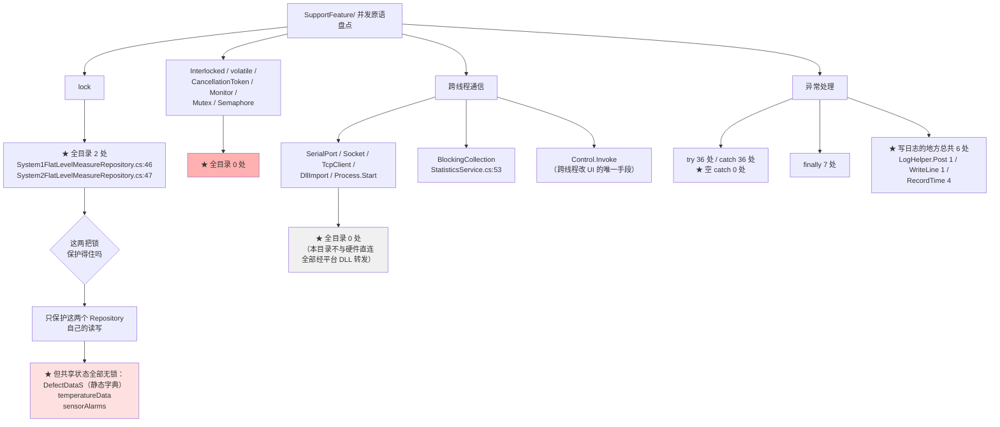

**ASCII 版**

```
 SupportFeature/ 并发原语盘点
   │
   ├─ lock ........................................ ★ 2 处
   │     System1FlatLevelMeasureRepository.cs:46
   │     System2FlatLevelMeasureRepository.cs:47
   │
   ├─ Interlocked / volatile / CancellationToken /
   │  Monitor / Mutex / Semaphore ................. ★ 0 处
   │
   ├─ SerialPort / Socket / TcpClient /
   │  DllImport / Process.Start ................... ★ 0 处
   │     ==> 本目录不与硬件直连，全部经平台 DLL 转发
   │
   ├─ 跨线程通信手段
   │     BlockingCollection   StatisticsService.cs:53（容量 500）
   │     Control.Invoke       跨线程改 UI 的唯一手段
   │
   └─ 异常处理
         try 36 处 / catch 36 处 / finally 7 处
         ★ 空 catch = 0 处（这一点本目录做得对）
         ★ 但写日志的地方总共只有 6 处：
              LogHelper.Post   1 处
              WriteLine        1 处（在死控件 FrmLogInfo 里）
              RecordTime       4 处

 这两把锁保护得住吗？
     它们【只】保护这两个 Repository 自己的读写。
     下面这些共享状态【全部无锁】：
        DefectDataS（静态字典，跨线程读写）
        FrmTemperatureMonitoring.temperatureData
        FrmSensorAlarm.sensorAlarms
```

**"2 把锁"到底是什么锁**（必须说清，否则容易被当成"有并发保护"）：

| 位置 | 保护对象 | 保护范围 | 是否够用 |
|---|---|---|---|
| `System1FlatLevelMeasureRepository.cs:46` | 该 Repository 自己的平面测高数据 | **只有这一个类的读写** | ⚠️ 只保护自己，不保护跨类共享状态 |
| `System2FlatLevelMeasureRepository.cs:47` | 同上（System2 版） | 同上 | ⚠️ 同上 |

**两个类各锁自己的 `locker` 对象，互相独立** —— `System1` 的锁**不保护** `System2` 的数据。而两个类的代码**只有 3 行差异**（一个补偿性 `using` ＋ 一句注释），是照着抄的。

**本目录的并发风险是"结构性的"**：

- **没有原子原语**（0 处 `Interlocked`/`volatile`）：**没有任何一个共享标志位是安全读写的**。
- **没有取消机制**（0 处 `CancellationToken`）：`while(true)`／`while(!isStop)` 这类循环**只能靠 `Thread.Abort()` 或进程退出停下**（`FrmLogRecord.cs:48`/`:84`）。
- **没有跨设备通信**（0 处 `SerialPort`/`Socket`/`DllImport`）：这是**好**消息 —— 本目录**不与硬件直连**，所有硬件访问都经平台 DLL（`Machine`／`HardwareRepositoryService`／`HardwareRepositoryService.GetHardwaresByType<T>`）。**排查硬件问题时不必进这个目录**。
- **36 个 `catch` 无一为空**（这一点做得对），**但总共只有 6 处写日志** —— 也就是说**绝大多数异常"被弹窗告知、然后消失"**，不留任何可追溯的痕迹。

**图 21：一次"跨线程改 UI"的完整路径（本目录唯一被反复使用的跨线程模式）**

```mermaid
graph LR
    BG["后台线程<br/>（写库线程 / 采集线程）"] --> PROD["产生数据"]
    PROD --> CHK{"要不要碰 UI"}
    CHK -->|"不碰（只入队/只算）"| SAFE["✅ 安全"]
    CHK -->|"要碰"| INV["Control.Invoke(...)"]
    INV --> Q{"宿主控件<br/>IsHandleCreated?"}
    Q -->|"否"| DROP["★ 静默丢弃<br/>（FrmLogInfo.cs:38<br/>return 掉这条日志）"]
    Q -->|"是"| OK["✅ 在 UI 线程执行"]

    BG --> ABORT{"怎么停"}
    ABORT -->|"FrmLogRecord 的写法"| A1["Thread.Abort()<br/>★ 可在任意指令处中断"]
    ABORT -->|"StatisticsService 的写法"| A2["while(true) + IsBackground=true<br/>★ 靠进程退出收场"]
    ABORT -->|"FrmTemperatureMonitoring 的写法"| A3["FormClosing 里<br/>拒绝关闭（e.Cancel=true）"]

    style DROP fill:#ffe0e0
    style A1 fill:#ffb0b0
```

**`FrmLogInfo.cs:38` 那个"静默丢弃"值得单独记**：它的判断是

```csharp
if (!IsHandleCreated || Disposing || !ChkReceive.Checked) return;
```

**"界面还没创建好"就直接 `return` 丢掉这条日志**，而不是缓存起来等界面好了再补 —— 所以**软件启动阶段的日志会丢**。

---
### 6.4 持久化格式：三种落盘通道，各有各的归属

**图 22：本目录的三种持久化通道**

```mermaid
graph TB
    ROOT["SupportFeature/ 的数据去哪了"] --> P1["① 平台 Singleton 序列化"]
    ROOT --> P2["② Excel（EPPlus / FileHelper）"]
    ROOT --> P3["③ SQL Server（SqlSugar → DBService）"]

    P1 --> A1["7 处设 FilePath<br/>BondCompensate :25<br/>RealTimeCorrection :28<br/>TransportUnitCompensate :22<br/>AirCooledController :30<br/>BondLevelMeasureSetting :16<br/>MotionPlanDomain :29<br/>StatisticsDomain :44"]
    P1 --> A2["2 处用 FileName<br/>System1/2FlatLevelMeasureRepository<br/>:22 / :23"]
    A1 --> A3{"序列化器是什么格式"}
    A3 -->|"★ 本目录 0 处序列化调用<br/>但留下 8 处反证"| A4["8 处 [JsonIgnore]<br/>⇒ 序列化器是 Newtonsoft.Json<br/>★ 默认写全部公开实例属性<br/>（无 TypeNameHandling ⇒ 有无 $type 由平台定）"]

    P2 --> B1["本目录 3 处 EPPlus<br/>FrmCompensateTest :64<br/>FrmTemperatureDistribution :126<br/>＋ LicenseContext :125"]
    P2 --> B2["平台 FileHelper 4 处<br/>SaveDoubleExcel / SaveExcel<br/>AppendExcelData / CreateFileByDate"]

    P3 --> C1["写入：DBService.Insert<br/>StatisticsService :118/:122/:132/:137<br/>＋ 死代码 :150"]
    P3 --> C2["读出：DBService.Query<br/>StatisticsDomain 8 个方法<br/>:313-:405"]
    P3 --> C3["聚合：DBService.GetScalar<br/>GetMaxMTBA :154 / GetTotalAlarmSeconds :185"]

    A4 --> WARN["⚠️ 因此本目录【无法自证】<br/>落盘文件的格式与向后兼容性"]
    C2 --> ENT{"8 张表<br/>在哪定义"}
    ENT -->|"3 张在本目录"| E1["DefectStatisticsEntity<br/>ProductTimeStatisticsEntity<br/>BondPositionLogEntity"]
    ENT -->|"5 张在 Infrastructure"| E2["CapacityLogEntity<br/>TemperatureCompensationEntity<br/>OperateLogEntity<br/>AlarmLogEntity<br/>ParameterChangeLogEntity"]

    style A4 fill:#ffe0e0
    style WARN fill:#ffe0e0
    style E2 fill:#e0e8ff
```

**三种通道的**归属**与**本文档能证实到什么程度**：

| 通道 | 谁在用 | 落盘位置由谁定 | 本文档能证实 | 不能证实 |
|---|---|---|---|---|
| 平台 `Singleton<T>` 序列化 | 7 个 `FilePath` ＋ 2 个 `FileName` | `ZX2200PathConfig.*`（平台） | ✅ **调用点**（9 处，行号如上） | ❌ 序列化格式、字段增删的兼容性 |
| Excel | 本目录 3 处 EPPlus ＋ 平台 `FileHelper` 4 处 | 本目录里**硬编码绝对路径**（见下） | ✅ 写入点与路径字面量 | ⚠️ 输出目录是否存在 |
| SQL Server | `StatisticsService` 写入、`StatisticsDomain` 读取 | 连接串在平台 `DBService` 内 | ✅ 8 个实体类型与 8 个查询方法 | ❌ 表结构、索引、连接串 |

**关于序列化格式：本目录留下了**直接证据**（不是猜的）**

本目录**没有**任何 `JsonConvert.SerializeObject`／`JsonSerializer`／`JsonSerializerSettings`／`TypeNameHandling` 调用（实测 **0 处**）—— 所以**序列化动作本身发生在平台侧**。但它留下了**反证**：本目录有 **8 处 `[JsonIgnore]`**，分布在 5 个文件里：

| 位置 | 被标记的成员 | 含义 |
|---|---|---|
| `AirCooledController.cs:76` | `public bool IsWorking` | **运行态标志不落盘** ⇒ 重启后不会自动开始控温（正确语义） |
| `BondLevelMeasureResult.cs:16`/`:22`/`:28`/`:34`/`:40` | `Height0`／`Height90`／`Height180`／`Height270`／`MaxDifference` | **焊点测高的测量结果整体不落盘** |
| `System1FlatLevelMeasureRepository.cs:21` | `public static string FileName` | 静态路径属性（静态成员本就不序列化，此处属**冗余保护**） |
| `System2FlatLevelMeasureRepository.cs:22` | 同上 | 同上 |

**`[JsonIgnore]` 这个特性只有在"某个 Newtonsoft.Json 序列化器真的在处理这个对象"时才有意义** ⇒ **本目录能证实的结论是**：平台 `Singleton<T>` 的落盘用的是 **Newtonsoft.Json**，并且采用**默认的"选择性排除"策略** —— 即**所有公开实例属性默认都会被写进文件**，只有标了 `[JsonIgnore]` 的才不写。

⚠️ **因此有一条必须写进交接说明的规则**：给任何一个 `Singleton<T>` 派生类（如 `StatisticsDomain`、`TransportUnitCompensate`、`RealTimeCorrection`）**新增一个 `public` 实例属性，就等于往落盘文件里新增一个字段** —— **无需改任何"保存"代码**。反过来，**删属性＝丢数据**。若要新增"运行态、不该落盘"的属性，**必须手动加 `[JsonIgnore]`**（本目录已有 8 处先例）。

**仍然不能证实的两点**（本目录 0 处 `TypeNameHandling` ⇒ 该设置由平台决定）：**①** 落盘文件里是否带 `$type`；**②** 因此**能否跨版本读取**。⇒ 改动 `FilePath` 指向的对象结构前，**必须先在平台侧确认**。

> 另附一条清点结果：`FrmTemperatureDistribution.cs:125` 的 `ExcelPackage.LicenseContext = OfficeOpenXml.LicenseContext.NonCommercial` 是 **EPPlus 这个第三方表格库自身的许可模式设置**（`OfficeOpenXml` 命名空间），与本目录的数据格式无关；本目录的 `License` 字样**仅此一处**。

**Excel 通道里一处需要留意的硬编码路径**（`FrmCompensateTest.cs:80`）：

```csharp
excelPackage.SaveAs(new System.IO.FileInfo($"E:\\温漂测试\\测试{test}.xlsx"));
```

**路径指向 `E:\温漂测试\`，且不做目录存在性检查** —— 该目录不存在时 `SaveAs` 直接抛异常（本方法没有任何 `try`），异常沿 `simpleButton1_Click` 抛回 UI 线程。这条与 §6.3 的"该按钮会把 UI 线程锁死在 `while(true)` 里"是**同一段代码**，见 §9.10。

**SQL 通道的实体分布**（本目录的统计子系统**依赖 `Infrastructure/`**）：

- **本目录定义 3 个**：`Statistics/DefectStatisticsEntity.cs`、`ProductTimeStatisticsEntity.cs`、`BondPositionLogEntity.cs`。
- **`Infrastructure/Models/CommonModels/` 定义 5 个**：`CapacityLogEntity.cs:16`、`TemperatureCompensationEntity.cs:13`、`OperateLogEntity.cs:14`、`AlarmLogEntity.cs:10`、`ParameterChangeLogEntity.cs:14`。

⇒ **改统计表结构要同时动两个目录**（属 §7.3 的入向依赖）。

实体类用的是 `[SugarColumn(ColumnName = "...", IsPrimaryKey = ..., IsNullable = ...)]`（如 `DefectStatisticsEntity.cs:19`/`:24`/`:29`）。**8 张表里只有 5 张带 `[SugarTable]` 显式表名**（`AlarmLogEntity.cs:9`＝`"AlarmLog"`、`CapacityLogEntity.cs:15`＝`"CapacityLog"`、`OperateLogEntity.cs:13`＝`"OperateLogEntity"`、`ParameterChangeLogEntity.cs:13`＝`"ParameterChangeLog"`、`BondPositionLogEntity.cs:14`＝`"BondPositionLogEntity"`）；**剩下 3 张（`DefectStatisticsEntity`／`ProductTimeStatisticsEntity`／`TemperatureCompensationEntity`）不带** ⇒ 表名走 SqlSugar 的**类名默认约定**。这条"**一半显式一半隐式**"的表名规则属 §9.5 `R-105` 附近的登记项：**改这 3 个类名＝改表名**。

### 6.5 单位换算链：一条链上三种量纲

**图 23：`μm → mm → 比例 → 轴坐标` 的完整换算链（缺陷补偿支线）**

```mermaid
graph LR
    SRC["视觉检测结果<br/>OffsetX / OffsetY<br/>单位：μm"] --> F{"离群过滤<br/>Math.Abs(OffsetX) &lt; 50"}
    F -->|"≥ 50μm（离群）"| DROP["★ 被丢弃<br/>不参与平均"]
    F -->|"&lt; 50μm（正常）"| AVG["Average()<br/>仍是 μm"]

    AVG --> MM["÷ 1000.0<br/>★ 变成 mm"]
    MM --> RATIO["× BondPostCompensationRation / 100.0<br/>★ 比例 0-100 ⇒ 无量纲缩放"]
    RATIO --> OUT["AKRSPoint3D(x, y, 0)<br/>单位：mm"]

    OUT --> CHAIN["进入 realBondPositionInG0<br/>BondActionNode.Provider.cs:527"]
    CHAIN --> UNIT{"下一步的坐标系"}
    UNIT -->|"G0 坐标系"| G0["与 bondPosAddOffset /<br/>singleBpCompensation 相加<br/>（同为 mm）"]
    UNIT -->|":593 转轴坐标"| MACH["ConvertG0ToMachinePos()<br/>+ point3D"]

    RATIO -.->|"★ 同一比例在<br/>:120/:126 又用一次"| SEP["GetBpSeparateOffset<br/>单点补偿"]
    SEP -.->|"⚠️ :162 把 μm 与 mm 相减"| MISMATCH["量纲不一致<br/>（见 §5.5 注）"]

    style DROP fill:#f0f0f0
    style MISMATCH fill:#ffe0e0
```

**ASCII 版**

```
 视觉检测结果 OffsetX / OffsetY       单位：μm
        │
        ├─ 离群过滤  Math.Abs(OffsetX) < 50
        │     ≥ 50μm ──> 丢弃（不参与平均）
        │     < 50μm ──> 进入 Average()          单位仍是 μm
        │
        ├─ ÷ 1000.0                       ★ 单位变成 mm
        │
        ├─ × BondPostCompensationRation / 100.0
        │     ★ 比例 0-100，无量纲缩放
        │
        └─ 产出 AKRSPoint3D(x, y, 0)      单位：mm
              │
              └─> realBondPositionInG0（BondActionNode.Provider.cs:527）
                    │
                    ├─ G0 坐标系：与 bondPosAddOffset /
                    │  singleBpCompensation 相加（同为 mm）
                    │
                    └─ :593 ConvertG0ToMachinePos() + point3D ──> 轴坐标

  ★ 同一条比例在 :120 / :126 又被用一次（GetBpSeparateOffset 单点补偿）
  ⚠️ :162 处把 μm 与 mm 直接相减 —— 量纲不一致（见 §5.5 注）
```

**这条链上必须记住的三件事**：

1. **量纲在三处之间来回切**：视觉侧 **μm** → 补偿量 **mm** → G0/轴坐标 **mm**。`:75-77` 的那个 `÷ 1000.0` 是**唯一的**单位转换点；**链上任何一处想改比例，都要先回答"改的是 μm 还是 mm"**。
2. **`< 50` 是 μm、`> 50`（`:162`）本意也是 μm，但右边减的是 mm** —— 见 §5.5 的量纲注。
3. **`GetPostCompensation` 恒返回 `Z = 0`**（`:83`），所以 R-07 那个"Z 取 X 的平均值"得到的**就是这条链上 mm 量级的 X 补偿量**（量级推算见 §5.1）。

### 6.6 统计子系统：12 个计数器 ＋ 8 个查询 ＋ 1 个写队列

**图 24：`StatisticsDomain` / `StatisticsService` 的成员分工**

```mermaid
graph TB
    SD["StatisticsDomain<br/>Singleton&lt;StatisticsDomain&gt;<br/>FilePath :44"] --> CNT["12 个计数器（实例属性）"]
    SD --> TIME["5 个时间戳（私有）"]
    SD --> CALC["5 个计算方法"]
    SD --> QRY["8 个查询方法"]
    SD --> WR["2 个写入口"]

    CNT --> C1["AllDispensedNumber :60<br/>AllBondedNumber :72<br/>AbandonNumber :87<br/>PickUpFailedNumber :92<br/>AdjustFailedCount :97<br/>BondFailedCount :102<br/>PostBondFailedCount :107<br/>BondUph :114<br/>DispenseUph :119"]
    CNT --> C2["＋3 个单周期值<br/>DispenseSingleCycle :65<br/>BondSingleCycle :77<br/>S2DispenseSingleCycle :82"]

    TIME --> T1["BondEndTime :126<br/>S2DispenseEndTime :131<br/>DispenseEndTime :136<br/>BondStartTime :141<br/>DispenseStartTime :146"]

    CALC --> K1["StatisticsBondPositionInfo :165<br/>RefreshS2DispenseStatistics :217<br/>RefreshDispenseStatistics :232<br/>CalculateDispenseCycle :250<br/>CalculateBondCycle :279"]

    QRY --> Q1["QueryCapacity :313<br/>QueryDefect :325<br/>QueryProductTime :336<br/>QueryTemperatureCompensationTime :351<br/>QueryOperateLog :363<br/>QueryAlarmLog :374<br/>QueryBondPositionLog :385<br/>QueryParameterChangeLog :396"]

    WR --> W1["AddDefectResult :407<br/>→ 触发 RePostBondInspection<br/>（静态钩子，见 §3）"]
    WR --> W2["SaveDataToDb :419<br/>→ 入 BlockingCollection"]

    SS["StatisticsService"] --> QU["DbEntityBlockingCollection :53<br/>★ 容量 500"]
    SS --> TH["写库线程 SaveEntityToDb :110<br/>＋ while(true) :110 区"]
    SS --> AGG["2 个聚合查询<br/>GetMaxMTBA :142<br/>GetTotalAlarmSeconds :170"]
    SS --> INS["4 个 Insert :118/:122/:132/:137<br/>★ 第 5 个 :150 在死代码里"]

    QU --> DB["DBService（平台）"]
    INS --> DB
    AGG --> DB

    CNT -.->|"★ 计数器无锁"| RISK["任务层写 / UI 读<br/>无同步（见 §6.3）"]

    style RISK fill:#ffe0e0
    style INS fill:#ffe8e0
```

**12 个计数器的职责分组**（全部是 `Singleton<StatisticsDomain>` 上的**实例自动属性** ⇒ 随 `FilePath` 一同落盘）：

| 组 | 成员（含行号） | 语义 |
|---|---|---|
| 产量 | `AllDispensedNumber` `:60`、`AllBondedNumber` `:72` | 累计点胶数 / 累计固晶数 |
| 良率扣减 | `AbandonNumber` `:87`、`PickUpFailedNumber` `:92`、`AdjustFailedCount` `:97`、`BondFailedCount` `:102`、`PostBondFailedCount` `:107` | 五种失败计数（弃料 / 取料失败 / 调整失败 / 固晶失败 / 焊后失败） |
| 效率 | `BondUph` `:114`、`DispenseUph` `:119` | 每小时产能 |
| 单周期 | `DispenseSingleCycle` `:65`、`BondSingleCycle` `:77`、`S2DispenseSingleCycle` `:82` | 单颗耗时 |

**这 12 个计数器是"任务层写、UI 读"的共享状态，且没有任何锁**（§6.3 已盘点：全目录仅 2 把锁，均在 `LevelMeasurementSystem` 的 Repository 里）。`StatisticsBondPositionInfo` `:165` 由固晶任务在**任务线程**调用，而 `UcCapacityStatistics`／`UcDefectStatistics` 在 **UI 线程**读取 —— **这是本目录最典型的无锁跨线程读写**。⚠️ 本结论为**静态推断**（未做运行复现），但**代码里确实不存在任何同步手段**这一点是**可证实的**。

**8 个查询方法的统一形态**：全部是 `DBService.Query<T>(it => it.<时间字段> >= startTime && it.<时间字段> <= endTime)`（`:315`/`:327`/`:338`/`:353`/`:365`/`:376`/`:387`/`:398`），**只有 `QueryDefect` 多一个 `DefectName == name` 条件**（`:327`）⇒ **8 个查询里 7 个是"纯时间区间"，没有分页、没有条数上限**。

**这 7 个无上限查询的含义**：UI 侧把整个时间区间的记录**一次性拉进内存**（对应 §6.2 里"无上限"的 `DefectStatisticsEntities`）。操作员若把区间开得很大（界面上有起止时间选择），**一次查询会把全部匹配行读进内存并在 UI 线程渲染** —— ⚠️ 存在卡顿风险，**是否有实际量级问题取决于现场数据量，本文档不做断言**。

**写侧的 4 ＋ 1**：`StatisticsService.cs` 里 **4 处**有效 `DBService.Insert`（`:118` 操作日志、`:122` 缺陷统计、`:132` 参数变更、`:137` 焊点位置）；**第 5 处 `:150` 位于 `UcProductStatistics.simpleButton1_Click` 那条死链上**（见 §4.3.8 与 `R-85`），**不可达**。写库线程（`:110 SaveEntityToDb`）用 `while(true)` ＋ `Take()` ＋ `IsBackground = true`，**没有取消路径**。

**`BlockingCollection(500)` 的一个必须交代的后果**（`:53-54`）：它是**有界**队列且用默认的 `Add`（**非 `TryAdd`**）。⇒ **队列满 500 时，`Add` 会阻塞调用方线程**，直到写库线程 `Take()` 腾出位置。而 `SaveEntity` 的调用方是 **UI/AOP 侧**（见下）—— 也就是说**数据库一旦卡住，阻塞会顺着 `Add` 传回调用方**。这是 §6.3"无取消机制"之外的另一条**反向压力路径**，⚠️ 归入并发族。

**`SaveEntity` 里有一处"静默丢弃"**（`:77-82`）：

```csharp
public static void SaveEntity(string message, string operate)
{
    if (message == lastMessage) { return; }        // ★ 连续同一条消息被吞掉
    LogHelper.Post(Level.Trace, message, LogCategory.Global);
    OperateLogEntity operateLogEntity = new OperateLogEntity(DateTime.Now, message, operate);
    StatisticsService.DbEntityBlockingCollection.Add(operateLogEntity);
    lastMessage = message;                          // ★ 静态字段，无锁
```

⇒ **连续重复的操作日志不会入库**（例如操作员反复点同一个按钮，只有第一次被记录）。这是**有意的去重**（免得日志被刷屏），但它**同时会掩盖"操作员重复操作了 50 次"这一事实** —— 现场排查"为什么同一动作做多遍"时**必须知道日志里看不到**。另外 `lastMessage` 是**静态字段且无锁写入**，与 §6.3 的无锁清单一致。

**操作日志的真正来源：AOP 织入（重要，属跨目录依赖）**

`SaveEntity` 在本目录内**没有任何调用点**；全仓的 **5 个调用点全部在 `Infrastructure/AOP/Module/MethodAopAttribute.cs`**（`:56`／`:65`／`:80`／`:88`／`:108`）。该特性按**事件参数类型**分别拦截：

| 被拦截的控件/事件 | 写入的日志文本 | 行号 |
|---|---|---|
| `BarButtonItem` 点击 | `点击了主界面按钮：{Caption}` | `:56` |
| `FocusedNodeChangedEventArgs` | `点击了 {节点名} 选项` | `:65` |
| `ImageListBoxControl` 选择 | `点击了 {选项} 选项` | `:80` |
| `SimpleButton` 点击 | `点击了 {按钮文本} 按钮` | `:88` |
| 方法抛异常（`OnException`） | `界面操作异常发生` | `:108` |

**这件事对本文档的两点含义**：

1. **§4.2 的按钮表只记录了"按钮 → 处理器"的显式接线**；**"按钮 → 操作日志"这条隐式接线由 `Infrastructure` 的 AOP 完成**，不在本目录的源码里。⇒ 排查"某次点击有没有留下日志"时，**不要只搜 `SupportFeature`**。
2. **同一个特性还承担了角色权限判断**（`MethodAopAttribute.cs:39-54`：从 `barButtonItem.Tag` 取出所需 `RoleEnum`（`:39`）、与 `Machine.GetInstance().CurrentRoleLevel` 比较（`:41`），条件为 `role.CompareTo(currentRole) < 0 && IsPermissionOpen`（`:44`），权限不足时弹提示（`:46-51`）并 `FlowBehavior.Return` 直接返回（`:52-53`））。**这属于 `Infrastructure` 的职责，本文档只做事实登记，不展开**（分工见 §7.4）。

> **本节的可证实性声明**：`SaveEntity` 的 5 个调用点、`BlockingCollection` 的容量、`while(true)` 结构、4 个 `Insert` 分支、`[SugarTable]` 的 5/3 分布 —— 均为**静态可证**。而"队列满时阻塞会传回调用方""计数器跨线程读写有竞态"属**静态推断**，**未做运行复现**。

---


## 7. 依赖关系

### 7.1 统计口径与可复现命令

本节所有数字都用下面 4 条命令得来（**在 `AKRS.ZX2200/` 目录下执行**）：

```bash
# ① 出向：本目录 using 了哪些命名空间（按文件出现次数）
grep -rh "^using AKRS" --include=*.cs ./SupportFeature | sed 's/^using //; s/;$//' | sort | uniq -c | sort -rn

# ② 入向：谁引用了本目录的命名空间（去重文件数，含本目录内部）
grep -rl "using AKRS.ZX2200.SupportFeature" --include=*.cs . | wc -l          # 159

# ③ 入向：剔除本目录内部后的【外部】引用文件数
grep -rl "using AKRS.ZX2200.SupportFeature" --include=*.cs . \
  | grep -v "^\./SupportFeature/" | wc -l                                     # 115

# ④ 入向：外部引用按目录分组
grep -rl "using AKRS.ZX2200.SupportFeature" --include=*.cs . \
  | grep -v "^\./SupportFeature/" | sed 's|^\./||; s|/[^/]*$||' | sed 's|/.*||' | sort | uniq -c | sort -rn
```

> ⚠️ 命令 ①②③ 只统计 **`using` 指令**，因此**只覆盖"编译期可见的依赖"**：它**不包含**反射实例化（`Parameters/Editor/` 的编辑器控件就是反射造的）、**不包含** AOP 织入（§6.6）、也**不包含**平台 DLL 在运行时通过配置反向调用的情形。**真实耦合面比这 115 个文件更大**，这一点在评估改动风险时必须记住。

### 7.2 出向依赖：本目录依赖谁

**图 25：出向依赖的四层结构**

```mermaid
graph TB
    SF["SupportFeature/"] --> L1["① 平台 DLL（无源码）<br/>AKRS.Galaxy2.*"]
    SF --> L2["② 本解决方案其他目录"]
    SF --> L3["③ 第三方库"]
    SF --> L4["④ 本目录内部"]

    L1 --> P1["Infrastructure.ControlServices 8 文件<br/>★ 含反射开窗 ControlService.ShowDialogForm"]
    L1 --> P2["Infrastructure.CommonModel 8"]
    L1 --> P3["Machine.Models 3 / Machine.Enums 1"]
    L1 --> P4["Infrastructure.Helper 3"]
    L1 --> P5["PR.Models.MatchResults 2<br/>★ 视觉结果类型 MatchResult"]
    L1 --> P6["LogicHardware.Repository 2<br/>LogicHardware.Hardwares.* 2"]
    L1 --> P7["UserManager.Models 1<br/>★ RuntimeProvider.CurrentLoginUser"]

    L2 --> Q1["Infrastructure/ 共 26 文件<br/>Controls.Currency 9<br/>Models.CommonModels 7<br/>Utils 4 / Models.Path 3<br/>Service 2 / Models.BaseModels 1"]
    L2 --> Q2["BondSystem/ 共 19 文件<br/>Models 7 / Controllers 3<br/>Models.Parameter 2 / Models.Enums 2<br/>其余 5"]
    L2 --> Q3["WaferSubSystem/ 共 9 文件"]
    L2 --> Q4["TransportUnitSystem/ 共 6 文件"]
    L2 --> Q5["TransportSystem/ 共 4 文件"]
    L2 --> Q6["Main.Machine.MachineSupport 3"]

    L3 --> R1["DevExpress.*（XtraForm / TreeList / Charts）"]
    L3 --> R2["Newtonsoft.Json<br/>★ 仅用 [JsonIgnore] 特性，无序列化调用"]
    L3 --> R3["OfficeOpenXml（EPPlus）"]
    L3 --> R4["LanguageExt"]

    L4 --> S1["本目录内部互相引用<br/>★ 构成 §7.1 的 44 个内部文件"]

    Q2 --> NOTE{"改本目录会不会牵动固晶主线"}
    NOTE -->|"会：7 个 Models + 3 个 Controllers"| R_YES["⚠️ 补偿类改动直接影响贴片坐标<br/>（§5.1 的七段叠加）"]
    NOTE -->|"不会"| R_NO["仅统计/日志类的改动<br/>外部只读"]

    style P1 fill:#e0e8ff
    style P5 fill:#e0e8ff
    style R2 fill:#fff0d0
```

**关键判断：本目录最深的依赖是"平台 DLL"，不是"源码目录"。**

- **`AKRS.Galaxy2.*`（无源码）** 提供了本目录几乎所有基础设施：`Singleton<T>`／`SingletonNoSave<T>`（对象的加载与落盘）、`Machine`（机器状态）、`HardwareRepositoryService`（硬件访问）、`DBService`（数据库）、`FileHelper`（文件）、`AKRSPoint3D/2D/4D`（坐标）、`ExcuteResult`（执行结果）、`ControlService.ShowDialogForm<T>`（反射开窗）。
- ⇒ **排查本目录的"落盘时机""坐标语义""数据库连接"这三类问题，都必须去平台侧**，本文档只能给出调用点。

**出向里唯一"值得警觉"的一条**：本目录依赖 `BondSystem` 的 **7 个 Models ＋ 3 个 Controllers**（`BondModuleController`／`BondHeadController` 等）。这意味着**补偿类的实现与固晶主线的控制器是双向耦合的** —— 补偿算出的坐标要喂给 `BondModuleController.MoveToG0Pos`，而补偿用的配置又来自固晶的 `BondProgram`。**改这两边任何一侧都要同时看另一侧**。

### 7.3 入向依赖：谁在用本目录（115 个外部文件）

**图 26：入向依赖分布**

```mermaid
graph LR
    EXT["外部引用本目录的 115 个文件"] --> D1["BondSystem 38"]
    EXT --> D2["WaferSubSystem 28"]
    EXT --> D3["DispenseSystem 11"]
    EXT --> D4["TransportUnitSystem 10"]
    EXT --> D5["Main 9"]
    EXT --> D6["TransportSystem 8"]
    EXT --> D7["Infrastructure 6"]
    EXT --> D8["Experiment 4"]
    EXT --> D9["CalibSystem 1"]

    EXT --> NS["按被引用的命名空间（去重文件数）"]
    NS --> N1["Parameters.Model 68<br/>★ 参数树枚举/模型"]
    NS --> N2["Parameters 35<br/>★ UcProgramArgs 等"]
    NS --> N3["Statistics 31<br/>★ 产能/缺陷/操作日志"]
    NS --> N4["Consumables 16<br/>★ 耗材寿命"]
    NS --> N5["Compensate.TemperatureCompensate 12"]
    NS --> N6["Compensate.MotionAreaCompensate 5"]
    NS --> N7["Compensate.DefectCompensate 5"]
    NS --> N8["SensorCheckScan 3 / MotionPlan 3 / Calibrate 3"]

    N1 --> WARN{"改这个命名空间<br/>影响面多大"}
    WARN -->|"Parameters.Model 68 文件"| W1["🔴 改动会波及 4 个主目录<br/>（固晶/晶圆/点胶/物流）"]
    WARN -->|"Consumables 16"| W2["⚠️ 影响固晶/晶圆的耗材计数"]
    WARN -->|"Compensate.* 仅 5-12"| W3["⚠️ 面窄但影响贴片精度"]

    style N1 fill:#ffb0b0
    style N2 fill:#ffd0d0
    style N6 fill:#ffe8e0
    style N7 fill:#ffe8e0
```

**入向的三条结论**：

1. **`Parameters.Model` 是本目录对外最大的接口面（68 个外部文件）** —— 参数系统的树枚举／模型被**四个主目录**（固晶 38、晶圆 28、点胶 11、物流 10）同时引用。**改这个命名空间里的任何东西，影响面覆盖整机**。
2. **`Statistics`（31 文件）与 `Consumables`（16 文件）是"被外部写入"的接口** —— 外部目录**调用**本目录的统计与耗材 API（而不是只读），所以这两处的方法签名改动**会直接编译失败在别人的目录里**（好在是编译期暴露，不是运行时）。
3. **`Compensate.*` 的入向面很窄（5～12 文件）但性质最重** —— 外部引用少，是因为**补偿主要由动作节点在运行时调用**（`BondActionNode.Provider.cs` 这类），而不是靠 `using`。 ⇒ **"引用少"绝不等于"不重要"**；这也解释了为什么 §5.1 那条七段叠加链是全文档最该先读的内容。

### 7.4 与其他文档的分工（本文档不重复什么）

**图 27：本文档与相邻文档的边界**

```mermaid
graph TB
    DOC36["36 - 支撑特性全景与流程图（本文档）"] --> ROLE["只做：<br/>流程图 / 时序图 / 状态迁移 /<br/>按钮接线 / 风险编号 / 规模统计"]

    ROLE --> EX1["不重复 11 / 12 的散文叙述"]
    ROLE --> EX2["不重复 13 / 14 / 41 的标定界面"]
    ROLE --> EX3["不重复 26 的授权侧"]
    ROLE --> EX4["不重复 37 的 Infrastructure 内部实现"]
    ROLE --> EX5["不重复 01 / 06 / 07 的固晶主线"]

    EX1 --> B1{"读者想了解什么"}
    B1 -->|"测高/监控/力控的【功能说明】"| T1["去 11-支撑特性一-测高运动与监控.md<br/>、12-力控与支撑特性二.md"]
    B1 -->|"标定怎么做（界面与测试）"| T2["去 41-标定系统全景与流程图.md<br/>、13/14 号"]
    B1 -->|"按钮【点了以后发生什么】（跨目录）"| T3["本篇 §4.2 全表 ＋ 43 号（料单元侧同构写法）"]
    B1 -->|"某个补偿算法的【代码级调用链】"| T4["本篇 §5.1 / §6.1"]
    B1 -->|"Infrastructure 提供了什么"| T5["去 37-基础设施全景与流程图.md"]

    EX4 --> X1{"本文档引用了 Infrastructure 的什么"}
    X1 -->|"只引【调用点】"| Y1["如 ControlHelper.ShowForm :78<br/>MethodAopAttribute :56<br/>UcMeasuringTool :129"]
    X1 -->|"不展开【实现】"| Y2["实现细节归 37 号"]

    style ROLE fill:#e0ffe0
    style Y1 fill:#e0e8ff
```

**分工速查表**：

| 如果你想了解 | 应当去看 | 本文档是否覆盖 |
|---|---|---|
| 支撑特性**有哪些功能**（散文式） | `11-支撑特性一-测高运动与监控.md`、`12-力控与支撑特性二.md` | ❌ 不覆盖（仅交叉引用） |
| 支撑特性的**调用链与分支**（图解式） | **本文档 §5、§6** | ✅ 覆盖 |
| 标定的界面与测试 | `41-标定系统全景与流程图.md`、`13-整机标定.md`、`14-标定系统界面与测试.md` | ❌ 不覆盖 |
| 授权/加密相关 | `26-标定与授权工程.md` | ❌ 不覆盖（本文档仅 §7.5 一句事实陈述） |
| `Infrastructure` 提供的能力 | `37-基础设施全景与流程图.md` | ⚠️ 仅引调用点，不展开实现 |
| 固晶主线的任务调度 | `06-固晶系统界面与数据模型.md`、`07-固晶系统调度与任务.md`、`32-固晶系统全景与流程图（上）.md` | ⚠️ 仅覆盖与补偿/统计相接的那几段 |
| 每个按钮的接线（本文档口径） | **本文档 §4.2**（100 个 `_Click` 全表） | ✅ 覆盖 |
| 全仓文件索引 | `30-代码文件索引.md` | ❌ 不覆盖（本目录清单见附录 A） |

> **为什么本文档必须存在**：11／12 号是按**功能**写的散文，读者看完知道"有焊后补偿这件事"，但**看不出"这个补偿的 Z 分量取错了"**；13／14 号写的是标定；41 号写的是标定系统。**没有任何一篇文档把"按钮 → 处理器 → 补偿链 → 轴坐标"这条完整路径画出来**，而这正是排障时唯一有用的视角。本文档补的就是这一层。

### 7.5 关于授权相关代码的事实陈述

本目录范围内 `SoftKey`／`Dongle` 两个关键字**无命中**；`License` 唯一 1 处命中为 `Compensate/TemperatureCompensate/FrmTemperatureDistribution.cs:125`，内容是 `ExcelPackage.LicenseContext = OfficeOpenXml.LicenseContext.NonCommercial;` —— 这是**第三方表格库 EPPlus 自身的许可模式声明**，与整机授权无关。**本目录内不存在整机授权／加密相关的代码**。

---


## 8. 配置与数据

### 8.1 落盘入口总表：本目录 43 个 `.Save()` 调用点

**统计命令与口径**：

```bash
cd "E:/项目/ZX2200标机/trunk/AKRS.ZX2200"
grep -rn "\.Save()" --include=*.cs ./SupportFeature \
  | grep -v "\.designer\.cs\|\.Designer\.cs" | wc -l        # 43
```

⇒ 本目录（**非 Designer 文件里**）共 **43 处 `.Save()`**，分布在 **17 个文件**。下表**按落盘对象分组**（这是排查"改了参数没生效"时唯一有用的分组方式）：

| 落盘对象（`GetInstance().Save()`） | 次数 | 位置（文件:行） | 该对象的落盘路径归属 | 触发点 |
|---|---|---|---|---|
| `System2FlatLevelMeasureRepository` | **13** | `FrmSystem2FlatLevelMeasureTeach.cs:98/128/158/188/218/248/278/308/338/366`（10）＋`FrmSystem2HeightTeach.cs:94`＋`FrmSystem2FlatLevelMeasure.cs:377/399` | `ZX2200PathConfig.System2FlatLevelMeasureFilePath`（`System2FlatLevelMeasureRepository.cs:23`） | 示教每存一个点、测高结束 |
| `System1FlatLevelMeasureRepository` | **11** | `FrmSystem1FlatLevelMeasureTeach.cs:117/148/177/206/235/264/293/322/351/378`（10）＋`FrmSystem1HeightTeach.cs:95` | `ZX2200PathConfig.System1FlatLevelMeasureFilePath`（`:22`） | 示教每存一个点 |
| `TransportProgram` | **5** | `FrmHeatingSettings.cs:48/60/144/157/169` | 外目录（`TransportSystem`） | 加热设置各项保存 |
| `TransportUnitCompensate` | **2** | `FrmBondCompensate.cs:129/201` | `ZX2200PathConfig.TransportUnitCompensatePath`（`TransportUnitCompensate.cs:22`） | 补偿网格保存 |
| `BondLevelMeasureSetting` | **2** | `FrmBondLevelHeightTeach.cs:82`、`FrmBondLevelMeasureTeach.cs:95` | `ZX2200PathConfig.BondLevelMeasureFilePath`（`:16`） | 焊点测高示教 |
| `RealTimeCorrection`（`this.Save()`） | **2** | `RealTimeCorrection.cs:302`／`:337` | `ZX2200PathConfig.RealTimeCorrectionPath`（`:28`） | 标定尺扫描完成 / 首次扫描 |
| `StatisticsDomain`（`this.Save()`） | **2** | `StatisticsDomain.cs:273`／`:302` | `ZX2200PathConfig.StatisticsDomainPath`（`:44`） | ★ **每来一个产品**（见 §8.4） |
| `ProductConfiguration` | **1** | `DefectCompensate.cs:179` | 外目录（`BondSystem`） | 按基板归一化补偿后 |
| `AirCooledController` | **1** | `FrmAxisTemperature.cs:143` | `ZX2200PathConfig.AirCooledControllerPath`（`:30`） | 温控参数保存（**该窗体零调用点**，见 §4.3.8） |
| `MotionPlanDomain` | **1** | `FrmAssistantPickArea.cs:136` | `ZX2200PathConfig.MotionPlanDomainPath`（`:29`） | 拾取区域示教保存 |
| `ProductDomain` | **1** | `FrmSingleBpData.cs:86` | 外目录（`BondSystem`） | 单点数据保存 |
| `NozzleRepository` | **1** | `FrmNozzleCaliTeach.cs:289` | 外目录（`BondSystem`） | 吸嘴标定保存 |
| `EjectionConfigRepository` | **1** | `FrmEjectionCaliTeach.cs:408` | 外目录（`WaferSubSystem`） | 顶针标定保存 |
| **合计** | **43** | 17 个文件 | — | — |

> ⚠️ **口径冲突已记录**：任务书给的口径是"**36 个 `Save()` 点**"，**实测源码为 43**（命令如上）。按"源码优先"原则，本文档记 **43**，并在附录 B 记录该差异。差异很可能来自"是否把 `this.Save()`（2 处）与示教窗体里逐点保存的 20 处计入"。

**图 28：43 个落盘入口按"对象归属"分流**

```mermaid
graph TB
    SAVE["SupportFeature 的 43 处 .Save()"] --> A["① 落进【本目录】的对象（34 处）"]
    SAVE --> B["② 落进【外目录】的对象（9 处）"]

    A --> A1["System1/2 FlatLevelMeasureRepository<br/>11 ＋ 13 = 24 处"]
    A --> A2["TransportUnitCompensate 2"]
    A --> A3["BondLevelMeasureSetting 2"]
    A --> A4["RealTimeCorrection 2"]
    A --> A5["StatisticsDomain 2"]
    A --> A6["MotionPlanDomain 1"]
    A --> A7["AirCooledController 1<br/>★ 唯一调用者所在的窗体是孤立的"]

    B --> B1["TransportProgram 5<br/>→ TransportSystem"]
    B --> B2["ProductConfiguration 1<br/>→ BondSystem"]
    B --> B3["ProductDomain 1<br/>→ BondSystem"]
    B --> B4["NozzleRepository 1<br/>→ BondSystem"]
    B --> B5["EjectionConfigRepository 1<br/>→ WaferSubSystem"]

    A5 --> HOT{"写盘频率"}
    HOT -->|"★ 每来一个产品"| H1["BondTask.cs:181<br/>DispenseWorkTask.cs:112"]
    HOT -->|"仅在示教/保存时"| H2["其余 A 组"]

    B1 --> Q{"改本目录的加热设置<br/>会写哪个文件"}
    Q --> Q1["★ 落到 TransportProgram 的文件<br/>不在本目录的路径表里"]

    style A5 fill:#ffe0e0
    style H1 fill:#ffe0e0
    style Q1 fill:#ffe8d0
    style A7 fill:#ffe8d0
```

### 8.2 `Parameters/` 参数系统：**自己不落盘**（0 个 `Save()`）

```bash
cd "E:/项目/ZX2200标机/trunk/AKRS.ZX2200"
grep -rn "Singleton\|\.Save()\|FilePath" ./SupportFeature/Parameters/    # 0 命中
```

**`Parameters/` 目录下 33 个文件里，没有任何一处 `Singleton`／`.Save()`／`FilePath`** —— 这是本目录最容易被误解的一点：

- **参数系统是"纯 UI ＋ 代理层"**：`ObjParameter/ParameterManage.cs:45 InitControl()` 注册 **52 个 `ObjAndNodesInfo`**，每个 `ObjAndNodesInfo` 把"一个界面控件"接到"**别的目录里的某个配置对象属性**"上。
- ⇒ **参数值真正的落盘，发生在那个"别的目录的对象"的 `Save()` 里**（即 §8.1 表 B 组，或 `Main` 里 `BtSave` 触发的批量 `Save()`）。**参数系统自己一个字节都不存。**
- **实践含义**：操作员在参数界面改了一个值、点了"保存"，**写入的是该参数所属的那个程序文件**；**若那个程序没有 `Save()` 调用点，改动就只活在内存里**（重启即失）。排查"参数改了没用"时，**必须先确认该参数背后的对象有没有落盘入口** —— 用 §8.1 的表按**对象**查，不要按界面查。

**图 29：一次"改参数并保存"的实际落盘路径**

```mermaid
sequenceDiagram
    participant OP as 操作员
    participant UI as UcProgramArgs（本目录）
    participant OM as ObjAndNodesInfo
    participant CFG as 外部配置对象<br/>（BondProgram / ProductConfiguration / TransportProgram）
    participant DISK as 文件

    OP->>UI: 在参数树里改一个值
    UI->>OM: 经 52 个注册点之一回写
    OM->>CFG: 设置该对象的某个属性（内存）
    Note over CFG: ★ 此刻还没落盘
    OP->>UI: 点"保存"
    alt 该对象有 Save() 入口
        UI->>CFG: GetInstance().Save()
        CFG->>DISK: 写入该对象自己的路径
        Note over DISK: ✅ 生效
    else 该对象没有 Save() 入口
        Note over CFG: ⚠️ 只活在内存
        Note over DISK: ❌ 重启即失
    end
```

### 8.3 `Consumables/` 耗材：**聚合视图不落盘，真数据在别处**

`Consumables/ConsumablesProgram.cs:21`：

```csharp
public class ConsumablesProgram : SingletonNoSave<ConsumablesProgram>
```

**`SingletonNoSave<T>` ⇒ 这个对象自身不参与落盘。** 但**不能**由此得出"耗材计数不保存"——它只是一个**聚合视图**，`GetConsumablesList()`（`:31`）把**四个外部程序**持有的耗材对象**收集到一个列表**里：

| 耗材来源（`GetConsumablesList()` 内） | 所属程序（**都在外目录**） |
|---|---|
| `System1Program.GetInstance().GetEpoxyConsumable()` | `DispenseSystem` |
| `BondProgram.GetInstance().GetConsumable()` | `BondSystem` |
| `BondProgram.GetInstance().NozzleShelfProgram.GetToolConsumable()` | `BondSystem` |
| `WaferSystemProgram.GetInstance().EjectionBankProgram.GetEjectFrequencyList()` | `WaferSubSystem` |

⇒ **耗材计数的落盘随它们各自的主人**（如 `BondProgram` 由 `UcMainSystem.BtSave_ItemClick` 的批量 `Save()` 落盘）；`ConsumablesProgram` 只是**读视图**，重启后由 `GetConsumablesList()` **重新收集**。

**入向入口**：耗材扫描后台线程由**外目录**启动 —— `Main/Machine/MachineSupport/Machine.Operate.cs:684` 调用 `ConsumablesProgram.GetInstance().BackgroundConsumable()`。⇒ **排查"耗材没计数"要先看 `Machine.Operate.cs` 那一侧有没有调起来**。

### 8.4 两类"不该被忽略的写盘"

**① 每来一个产品就写一次统计文件**（§8.1 表 A 组的 `StatisticsDomain` 2 处）：

| 调用点 | 触发频率 | 是否有守卫 |
|---|---|---|
| `BondTask.cs:181` → `CalculateBondCycle()` `:279` → `this.Save()` `:302` | **每个产品一次**（等流道来料成功后） | ✅ 有：`bondUphCount == 0` 直接 `return`（`:281-284`）⇒ 首件不写 |
| `DispenseWorkTask.cs:112` → `CalculateDispenseCycle()` `:250` → `this.Save()` `:273` | **每个产品一次** | ✅ 有：`useSeconds <= 0` 直接 `return` |

⇒ `StatisticsDomain` 的落盘文件是**生产节拍级的写盘**（不是"只在关机时写"）。**这本身未必是问题**（UPH 就是要滚动刷新），但它意味着：**该文件永远处于"刚被写过"的状态**，因此**不能靠"文件时间戳"判断软件是否卡死**；同时**任何对该文件结构的改动都会在下一个产品到达时立刻生效**（无灰度余地）。

**② 每次标定尺扫描额外落一份 xlsx**（`RealTimeCorrection.cs:306-308`）：

```csharp
string path = FileHelper.CreateFileByDate("标定尺子数据");
FileHelper.SaveDoubleExcel(doubles, Path.Combine(path, DateTime.Now.ToString("yyyy-MM-dd-HH-mm-ss-fff") + ".xlsx"));
```

日期分目录 ＋ 毫秒级文件名 ⇒ **每次扫描新增一个文件，且代码里没有任何清理逻辑** ⇒ ⚠️ **磁盘会随标定次数增长**（`RealTimeCorrection` 由 `BondTask.cs:175` 在每个产品周期调用，实际增长速率取决于是否每次扫描都走到这一段）。归入 §9 的 ⚠️ 组。

**③ 硬编码的调试输出路径**（`FrmCompensateTest.cs:80`）：写死 `E:\温漂测试\` 且无目录检查 —— 见 §9.10（与 UI 冻结同属该按钮）。

### 8.5 加载时机：什么时候读盘

**图 30：一个 `Singleton<T>` 对象的"读—改—写"生命周期**

```mermaid
graph LR
    START["首次 GetInstance()"] --> CTOR{"FilePath 在哪里设的"}
    CTOR -->|"静态构造函数（7 处中的 6 处）"| SC["StaticCtor 设 FilePath<br/>如 TransportUnitCompensate.cs:20-23<br/>StatisticsDomain.cs:42-45"]
    CTOR -->|"★ 实例构造函数（仅 1 处）"| IC["AirCooledController.cs:28-31<br/>风格不一致"]
    SC --> LOAD["平台 Singleton&lt;T&gt; 读盘<br/>★ 反序列化器 = Newtonsoft.Json<br/>（由 8 处 [JsonIgnore] 反证，见 §6.4）"]
    IC --> LOAD
    LOAD --> MEM["对象进入内存（单例）"]

    MEM --> MUT{"谁在改它"}
    MUT -->|"UI 线程（示教/参数界面）"| UIM["直接赋值"]
    MUT -->|"任务线程（补偿计算/统计）"| TM["★ 无锁赋值<br/>（并发族，见 §6.3）"]
    UIM --> SAVED{"什么时候写回"}
    TM --> SAVED
    SAVED -->|"操作员点保存（§8.1 表）"| W1["Save() → 整对象覆写"]
    SAVED -->|"★ 每产品一次（StatisticsDomain）"| W2["Save() → 整对象覆写"]
    SAVED -->|"没点保存就关软件"| W3["❌ 改动丢失<br/>（无自动保存）"]

    LOAD --> NG{"读盘失败会怎样"}
    NG -->|"文件不存在（首次运行）"| N1["走默认值构造<br/>★ 例：TransportUnitCompensateX/Y 默认 null<br/>BondCompensateX/Y 默认 null"]
    NG -->|"文件损坏 / 结构不兼容"| N2["⚠️ 行为由平台决定<br/>本目录无异常处理"]

    style W3 fill:#ffe0e0
    style N2 fill:#ffe0e0
    style IC fill:#fff0d0
    style N1 fill:#fff0d0
```

**关于加载的三条可证实结论**：

1. **读盘发生在 `GetInstance()` 首次调用时**（平台 `Singleton<T>` 的通用行为），**本目录不控制时机**。
2. **`TransportUnitCompensateX/Y`（`:28`/`:33`）与 `BondCompensateX/Y`（`:31`/`:36`）的默认值是 `null`** ⇒ **首次运行（文件不存在）时网格矩阵为空**。这些矩阵在插值前必然被访问，**因此"首次运行 + 未标定"这一组合的行为取决于平台读盘失败的默认值构造**；本目录对这四种 `null` **没有任何判空保护**（`TransportUnitCompensate.GetBondCompensate` 直接索引）。⚠️ 这一条是**静态推断**（未做"删掉配置文件后启动"的复现），归入 §9 的 ⚠️ 组。
3. **本目录没有任何"自动保存"或"退出时保存"逻辑** ⇒ **未点保存的改动一律丢失**（`W3`）。本目录也不存在 `FormClosing` 里的兜底保存（唯一的 `FormClosing` 是 `FrmTemperatureMonitoring.cs:270`，作用是**拒绝关闭**，见 §5.2）。

---


## 9. 风险总清单（R-01 … R-193）

### 9.0 编号口径

- 本章收录 **193 条**风险，编号 **`R-01` … `R-193`**，**连续、无缺口、无重复**。
- **分组按"成因"而非按"严重度"**：7 个组，每组给一个区间。**组标题里的图标是该组的"主导级别"，不是该组每一条的级别** —— **逐条的级别以每行第 2 列为准**。这是本项目沿用下来的编号方式，保留它是为了让外部已有的引用（工单、邮件、评审记录里写的 `R-xx`）**不会失效**。
- 表中 **「旧编号」列是上一轮编号的遗留 ID**（形如 `P-01`／`B-08`／`统 R-02`），**仅用于追溯**，不影响本章编号的连续性。
- ★ **本章除 `R-01`…`R-193` 之外，还有两个「独立编号族」，它们不在 R 序列内**（另编的目的正是**不破坏 R 序列"恰好 193 条连续"**这个硬口径）：

  | 编号族 | 主题 | 所在节 | 条数 |
  |---|---|---|---|
  | **`UB-01` … `UB-02`** | **UI 线程被同步阻塞** | **§9.10** | 2 |
  | **`DIS-01` … `DIS-03`** | **运行时永久禁用的控件** | **§9.11** | 3 |

  ⇒ **检索提示**：查「**界面卡死／UI 阻塞**」请按 **`UB-`**，查「**永久禁用／框永远是灰的**」请按 **`DIS-`**。
  **这两族都不会出现在 `R-xx` 里** —— 只按 `R-` 检索是**找不到**它们的。
- ⚠️ **跨文档引用必须连文档号一起写**：本项目**各篇的 `R-xx` 各自独立编号**（同一个号在不同文档里是不同的事）。
  ⇒ 引用一律写成「**36 号 §9.x `R-xx`**」这种带文档号的形式。
- **级别图例**：🔴 = **源码内已确认的缺陷**（读代码即可判定错了）；⚠️ = **静态推断**（代码可疑，但**未做运行复现**，或依赖现场配置才成立）；✅ = **经核实无害**（列出来是为了让后人**不要重复排查**）。

**图 31：193 条风险的级别与成因分布**

```mermaid
graph TB
    ALL["R-01 … R-193<br/>193 条"] --> G1["§9.1 静默产生错误结果<br/>R-01…R-55 共 55 条"]
    ALL --> G2["§9.2 直接抛异常（崩溃）<br/>R-56…R-78 共 23 条"]
    ALL --> G3["§9.3 数据丢失 / 配方被改写<br/>R-79…R-89 共 11 条"]
    ALL --> G4["§9.4 反序列化与老数据兼容<br/>R-90…R-91 共 2 条"]
    ALL --> G5["§9.5 命名 / 结构一致性陷阱<br/>R-92…R-107 共 16 条"]
    ALL --> G6["§9.6 设计层面的重复与不一致<br/>R-108…R-158 共 51 条"]
    ALL --> G7["§9.7 经核实无害<br/>R-159…R-193 共 35 条"]

    G1 --> W1{"为什么这一组最危险"}
    W1 --> W1A["没有报错、没有日志<br/>结果直接错了"]
    W1 --> W1B["现场表现为<br/>『贴片偏了 / 数据不对』<br/>而软件一切正常"]

    G3 --> W3{"为什么改东西前必读"}
    W3 --> W3A["11 条会写坏配方或丢数据"]
    W3 --> W3B["43 处 Save() 分散<br/>没有统一事务边界"]

    G7 --> W7{"35 条为什么也要列"}
    W7 --> W7A["避免后人重复排查<br/>每一条都注明『为什么无害』"]

    style G1 fill:#ffb0b0
    style G3 fill:#ffc0c0
    style G7 fill:#e0ffe0
```

**ASCII 版**

```
 R-01 … R-193 （193 条，编号连续）
   │
   ├─ §9.1 静默产生错误结果 ......... R-01…R-55    55 条   ★ 最危险
   │      没有报错、没有日志，结果直接错了
   │      现场表现为「贴片偏了 / 数据不对」，而软件一切正常
   │
   ├─ §9.2 直接抛异常（崩溃） ........ R-56…R-78    23 条
   ├─ §9.3 数据丢失 / 配方被改写 .... R-79…R-89    11 条   ★ 改代码前必读
   ├─ §9.4 反序列化与老数据兼容 .... R-90…R-91     2 条
   ├─ §9.5 命名 / 结构一致性陷阱 .... R-92…R-107   16 条
   ├─ §9.6 设计层面的重复与不一致 ... R-108…R-158  51 条
   └─ §9.7 经核实无害 ............... R-159…R-193  35 条
          列出来是为了让后人不要重复排查

 级别：🔴 源码内已确认的缺陷 ／ ⚠️ 静态推断（未运行复现） ／ ✅ 经核实无害
```

> ⚠️ **本章的整体可证实性声明**：🔴 条目均**已逐条读过源码**，其"文件:行"可在当前源码上复现。⚠️ 条目是**静态推断** —— 本文档**没有运行过软件**，**没有任何一条性能／并发／时序结论经过运行复现**。✅ 条目已核实无害。

### 9.1 🔴 静默产生错误结果（无报错无日志）—— R-01 … R-55

| 新号 | 级别 | 标题 | 文件:行 | 旧编号 |
|---|---|---|---|---|
| R-01 | 🔴 | 新参数系统零参数注册，`FrmParamManager` 是空壳 | `Parameters/Service/ParamService.cs:46-47`；空表后果 `:182`/`:187-191`/`:209-229`/`:240-264` | P-01 |
| R-02 | ⚠️ | 布尔分支在非"开/关"文案下静默置 `true`（初值 `bool b = true`） | `Parameters/UcProgramArgs.cs:1633-1649`（`:1635`） | P-05 |
| R-03 | ⚠️ | 4 处 `catch { return; }` 吞掉绑定失败；`UcEnumEditor` 连 try 都没有 | `Editor/UcNumberEditor.cs:39-41`、`UcTextEditor.cs:37-40`、`UcBooleanEditor.cs:36-39`、`UcAKRSPoint3DEditor.cs:44-47`、`UcEnumEditor.cs:27`、`UcProgramArgs.cs:1287-1290`/`:1303-1305` | P-06 |
| R-04 | 🔴 | `BondCompensate.GetBondCompensate` 首行无条件 `return`，"终极补偿"整体失效 | `Compensate/…/BondCompensate.cs:76`（`:78-167` 全不可达） | B-01 |
| R-05 | 🔴 | `FrmAxisTemperature` 死窗体 → PID 参数永远改不进设备 | `FrmAxisTemperature.cs:136-144`（唯一写 `Kp/Ki/Kd/OutputMax/OutputMin` 的入口）；零 `new` | B-06 |
| R-06 | 🔴 | 取消勾选"开始恒温控制"反而把 `IsWorking` 置 `true` | `FrmAxisTemperature.cs:127`（else 分支应为 `false`） | B-07 |
| **R-07** | **🔴** | **`GetPostBondCompensation` 的 Z 分量取的是 X 的平均值**（详见下方专条） | `Compensate/DefectCompensate/DefectCompensate.cs:221` | B-08 |
| R-08 | ⚠️ | `catch (Exception ex) { throw new Exception(ex.Message); }` 吞掉原始异常栈 | `RealTimeCorrection.cs:195-199` | B-11 |
| R-09 | ⚠️ | 调 `GetCompensatePoint3D` 的实参顺序与形参名相反 | 调用 `BondSystem/…/BondActionNode.Provider.cs:561-565`；形参 `RealTimeCorrection.cs:149` | B-12 |
| R-10 | ⚠️ | `GetCompensatePoint3D` 只输出 X，Y 被静默丢弃 | `RealTimeCorrection.cs:193`（`return new AKRSPoint3D(compensate.X, 0, 0)`） | B-13 |
| R-11 | ⚠️ | `TpMarkCompensate.TemperatureCompensation` 的开关与间隔判断被整段注释 | `Compensate/TemperatureCompensate/TpMarkCompensate.cs:66-73`；`:145 return true;` 不可达 | B-15 |
| R-12 | ⚠️ | `FrmTemperatureDistribution` 硬编码绝对路径 ＋ Excel 强转 ＋ 二维索引语义错 | `FrmTemperatureDistribution.cs:117`（`new DirectoryInfo(@"E:\2025年\8月")`）、`:141`、`:156 totalList[i][j*k + k]`、`:88-89` | B-17 |
| R-13 | ⚠️ | `FrmCompensateTest` 的"等 30 分钟"循环条件恒为假 | `FrmCompensateTest.cs:82-90`（`(dateTime - DateTime.Now).TotalMinutes > 30`） | B-18 |
| R-14 | ⚠️ | 示教失败会留下 `IsAssistanted = true` 但基准点未写 | `FrmRealTimeAssistant.cs:147` → `:149 FirstScanReferencePoints`（可能 `:327` 抛） | B-21 |
| R-15 | ⚠️ | 实时矫正与上视温漂**抢占写同一个** `TpMarkCompensate` 字段 | `BondPositionInfo.cs:43`；写 `BondActionNode.Provider.cs:567`、`UpLookCorrectionActionNode.cs:494`；读 `AfterBondCheckActionNode.cs:575-576` | B-27 |
| R-16 | ⚠️ | `RealTimeCorrection.LastTime` 只写不读 → 间隔控制失效，每个载具重扫全基准点并写 Excel | `RealTimeCorrection.cs:34`（声明）、`:304`（写）、`:280`（读在注释里） | B-28 |
| R-17 | ⚠️ | `FrmInputData` 的导入结果依赖用户"手动查过数据" | `FrmInputData.cs:56`；`UcDefectStatistics.cs:67-70`；`FrmBondCompensate.cs:58-62` | B-30 |
| R-18 | 🔴 | 反射填充对部分失败结果无长度校验（10 点中 3 点成功 → 8 个 0.00 被当作最小值着色） | `FrmSystem1FlatLevelMeasure.cs:107,195,207-212`；`FrmSystem2FlatLevelMeasure.cs:182,202,309,320-325` | 测 R-01 |
| R-19 | 🔴 | 测高失败返回全 0 对象且上层不拦截（BondLevel 版**无** `Count==0` 判断） | `FrmBondLevel.cs:158-162`、`:246-251` | 测 R-02 |
| R-20 | 🔴 | `heightInMachine == double.NaN` 恒假 → 激光测高失败永不报错 | `FrmSystem2FlatLevelMeasure.cs:194` | 测 R-03 |
| R-21 | 🔴 | `Height0/90/180/270` 与实测旋转角错位 180° | `FrmBondLevel.cs:98,110,123,137,172-175` | 测 R-04 |
| R-22 | ⚠️ | `Range` 列被误当非数据列（排除判断写的是 `"MaxDifference"`） | `FrmLevelMeasureResult.cs:92` vs `FrmLevelMeasureResult.Designer.cs:165` | 测 R-05 |
| R-23 | ⚠️ | 离线/干跑模式下测高返回假高度且被当真值，本目录**无任何模式判断** | `DispenseSystem/Controllers/DispenseMeasureHeightController.cs:184-200`（被 `FrmSystem1FlatLevelMeasure.cs:93` 调用） | 测 R-06 |
| R-24 | ⚠️ | 结果不落盘，导出失败靠**中文字符串匹配**诊断（`Contains("正由另一进程使用")`） | `FrmLevelMeasureResult.cs:35-62`（`:52`） | 测 R-16 |
| R-25 | 🔴 | 「重置」按钮 Yes/No 判断写反 | `Statistics/FrmStatistics.cs:114-117`（`BtInitDispense_Click`） | 统 R-01 |
| R-26 | 🔴 | `PickUpFailedNumber` 只读不写，永远 0 | 声明 `Statistics/StatisticsDomain.cs:92` | 统 R-02 |
| R-27 | 🔴 | 「时间段」产能统计漏计约 59/60 的数据 | `UcCapacityStatistics.cs:287` | 统 R-05 |
| R-28 | 🔴 | 生产框架/基板/基岛总数统计口径错误 | `StatisticsDomain.cs:178` + `FrmStatistics` | 统 R-07 |
| R-29 | ⚠️ | `CalculateBondCycle` 首次计算可能溢出／异常大值 | `StatisticsDomain.cs:279` | 统 R-17 |
| R-30 | ⚠️ | 操作日志连续去重丢弃信息 | `StatisticsService.cs:60`、`:79-82`、`:89` | 统 R-20 |
| R-31 | ⚠️ | `DefectStatisticsEntity.TuIndex` 从不赋值 ／ `Id` 无列 | `Statistics/DefectStatisticsEntity.cs` | 统 R-21 |
| R-32 | ⚠️ | `DefectStatisticsEntity.Area` 恒为 0 | `BondSystem/…/AfterBondCheckActionNode.cs:573`（构造处） | 统 R-22 |
| R-33 | ⚠️ | `SpForceLowerLimit` 无范围校验，0／负值静默出错 | `UcCapacityStatistics.cs` | 统 R-24 |
| R-34 | ⚠️ | `SaveEntityToDb` 对未知类型静默丢弃（`if/else if` 链**没有 `else`**） | `StatisticsService.cs:110-140` | 统 R-32 |
| R-35 | 🔴 | 取片安全区域"只写不读"，整个 `MotionPlan` 对生产路径无影响 | `MotionPlan/MotionPlanDomain.cs`；`FrmAssistantPickArea.cs` | M-01 |
| R-36 | ⚠️ | `GetMoveLine` 的 `ratio = distancePoint.Z / (distance * distance)` 在 `distance == 0` 时得 Infinity／NaN | `MotionPlanDomain.cs:265` | M-03 |
| R-37 | ⚠️ | `FindIntersection` 缺少 Y 方向线段范围校验 | `MotionPlanDomain.cs:175` | M-04 |
| R-38 | ⚠️ | `GetRadius` 把 XY 半径与 `\|ΔZ\|` 取 min，量纲混用 | `MotionPlanDomain.cs:58` | M-05 |
| R-39 | ⚠️ | 调试日志刷新条件时间比较方向写反 | `Logs/FrmMachineDebug.cs:69` | L-01 |
| R-40 | ⚠️ | 退出调试窗**无条件**把整机模式改成 `NormalWork` | `Logs/FrmMachineDebug.cs:114` | L-02 |
| R-41 | ⚠️ | SQL 日志表写侧完全缺失 | 切面 `LogRecordAttribute.cs:20`/`:76`/`:140` | L-06 |
| R-42 | 🔴 | `FrmSensorAlarm` 打开通路断裂，整个传感器报警窗体**永不可达** | `SensorCheckScan/FrmSensorAlarm.cs`；调用点 `UcmainSystem.Action.cs:345` 之外通路断 | L-12 |
| R-43 | ⚠️ | 三个正/负压传感器的报警弹窗被整段注释，池形同虚设 | `SensorCheckScan/NeedScanSensorPool.cs` | L-13 |
| R-44 | ⚠️ | 工作台负压报警条件把"物流已配置"**取反**，语义可疑 | `SensorCheckScan/NeedScanSensorPool.cs` | L-14 |
| R-45 | ⚠️ | 温度监控图表永不刷新、内存数据只写不读 | `TemperatureMonitoring/FrmTemperatureMonitoring.cs:88-108`（`:107` `Invoke` 被注释） | L-17 |
| R-46 | ⚠️ | 采集线程永不退出且异常被静默吞掉 | `TemperatureMonitoring/FrmTemperatureMonitoring.cs:84` | L-18 |
| R-47 | ⚠️ | `SaveData` 空 catch，写 Excel 失败无声 | `TemperatureMonitoring/FrmTemperatureMonitoring.cs` | L-19 |
| R-48 | ⚠️ | 预热完成判定用 `TimeSpan.Minutes` 分量而非 `TotalMinutes` | `HeatingSettings/FrmHeatingSettings.cs:69` 起的 `Timer_Tick` | L-23 |
| R-49 | ⚠️ | 补偿温度/斜率"写而不读"，界面回显取自硬件而非配方 | `HeatingSettings/FrmHeatingSettings.cs:140`/`:153` | L-24 |
| R-50 | ⚠️ | `SpAlarmTemperature` / `SpPreheatTime` 无 `Min/Max` | `HeatingSettings/FrmHeatingSettings.Designer.cs` | L-26 |
| R-51 | 🔴 | 次数型耗材「即将到期」永远不提醒（整型除法） | `Consumables/FrequencyConsumables.cs:76`（`IsRemind`） | C-01 |
| R-52 | ⚠️ | 时间型耗材到期后「剩余时间」显示负数 | `Consumables/TimeConsumable.cs:95 GetRemainingTime()` | C-04 |
| R-53 | ⚠️ | `Clear()` 不重置 `IsAlarmed`，报警状态机语义混乱 | `Consumables/TimeConsumable.cs:46`（`FrequencyConsumables.cs:38` 同） | C-05 |
| R-54 | ⚠️ | `TimeConsumable.StartDateTime` 可能被 500ms 定时器**反复重置** | `Consumables/UcTimeConsumable.cs`（`Timer` 回调） | C-07 |
| R-55 | 🔴 | 取片偏移校准失败时**操作员无任何提示** | `Calibrate/FrmSystem2Calibrate.cs:362`（`BtnCaliPickOffset_Click`） | K-01 |

#### 专条：`R-07` 的级别判定（为什么是 🔴 而不是 ⚠️）

本条**必须单独说明**，因为**它容易被误判为 ⚠️**（"只是个复制粘贴笔误"）。判定为 **🔴** 的四条理由：

1. **它违反的是"代码在任何配置下都错"这条线**。`Z = point3Ds.Average(it => it.X)`（`DefectCompensate.cs:221`）把 **X 的平均值当 Z 用** —— 这**与现场怎么配置无关**。⚠️ 的定义是"代码本身没错、换个用法才会错"，**本条不满足**。
2. **错误的 Z 无条件流入动轴坐标**：`BondActionNode.Provider.cs:527` 是 `this.realBondPositionInG0 = bondPosAddOffset + defectCompensation + singleBpCompensation;` —— **直接相加，没有任何条件包裹、没有任何范围检查**。
3. **没有任何拦截机制**：`DefectCompensate.cs` 全文 `throw` 数 = **0**；文件里仅有的阈值是 4 处 `< 50` 离群**过滤器**（`:75`/`:79`/`:120`/`:126`）与 1 处 `> 50`（`:162-163`）—— **过滤器让异常数据更不容易被发现**，不构成守卫。而且**没有日志**（本目录写日志处总共只有 6 处）。
4. **触发条件是"正常生产配置"**：只要用了**焊后逐点补偿**（`IsBondPostCompensation = true`）且**没开**"按基板自动补偿"（`IsCompensateAutoByLast = false`），就会走到这一行。这不是异常路径，**这是这条功能线的正常路径** —— 也就是说，**这条功能"开着但一直是错的"**。

**误判风险的来源**：该缺陷的表现是"**贴片高度莫名有偏差**"，**幅度只有几十微米量级**（量级推算见 §5.1），所以现场不会撞限位、不会报警、**只会表现为良率或精度悄悄变差**。**这正是"静默产生错误结果"这一组最典型的形态。**

> **与上一轮口径的差异**：该条在上一轮编号中被定为 ⚠️。**本文档按源码改为 🔴**，理由即上述四条（**源码优先**）。差异已记入附录 B。

### 9.2 🔴 直接抛异常（崩溃）—— R-56 … R-78

> 本组的共同点：**会抛出去**（因此有异常栈可查，比 §9.1 好排查），但**抛在任务线程上就会打断生产**。

| 新号 | 级别 | 标题 | 文件:行 | 旧编号 |
|---|---|---|---|---|
| R-56 | 🔴 | `(decimal)double.MaxValue` 强转溢出弹框（828 处特性中约 587 处走默认） | `Parameters/Editor/UcBaseEditor.cs:120-124`；默认值 `Model/TreeProgramListArgsAttribute.cs:33`/`:38` | P-03 |
| R-57 | ⚠️ | 反向字典 null 键／`ShowText` 为 null 的 NRE | `Parameters/UcProgramArgs.cs:200-204`/`:397`/`:304`/`:338`/`:492`/`:1774` | P-04 |
| R-58 | ⚠️ | `FrmComponentPickup` 不判 `FindPage` 返回值即解引用（两处重复） | `BondSystem/Controls/Assistant/FrmComponentPickup.cs:482-483`/`:490-493`/`:525-535` | P-07 |
| R-59 | 🔴 | `AirCooledController.Start()` 在 UI 线程同步死循环且取消失效 → 软件假死 | `AirCooledController.cs:120-140`；`FrmAxisTemperature.cs:118-129`（`:127`） | B-02 |
| R-60 | 🔴 | `ScanReferencePoints` 的 `ReferencePoints == null` 未判 → 固晶线程 NRE | `RealTimeCorrection.cs:282`；`BondTask.cs:174` | B-03 |
| R-61 | 🔴 | `StartAcquisitionCurves` 首次点击必然 NRE（`task` 无初值即 `Dispose`） | `FrmAxisTemperature.cs:41`/`:69`/`:97` | B-04 |
| R-62 | ⚠️ | `GetPostCompensation` 对空集合取 `Average()` | `DefectCompensate.cs:75-81` | B-09 |
| R-63 | ⚠️ | `GetPostBondCompensation` 未判 `PostBondInspectionRepository` 返回 null | `DefectCompensate.cs:199-213`（`:202`/`:209`） | B-10 |
| R-64 | ⚠️ | `FrmCompensateTest` 硬编码素材与输出路径 → `SaveAs` 抛异常 | `FrmCompensateTest.cs:30-34`/`:44`/`:80` | B-19 |
| R-65 | ⚠️ | `FrmRealTimeAssistant.BtBack_Click` 会让 `stepIndex` 变负 | `FrmRealTimeAssistant.cs:196-202`（`:198 assistantConfigList[-1]`） | B-20 |
| R-66 | 🔴 | 未选／未匹配数据集时点 Start 触发 NRE（`EditValue.ToString()`） | `FrmSystem2FlatLevelMeasure.cs:246` | 测 R-08 |
| R-67 | 🔴 | 示教窗体构造函数对 `Find` 结果不判 null → 首个 Done 的 `doneAction` NRE | `FrmSystem1FlatLevelMeasureTeach.cs:73-74`；`FrmSystem2FlatLevelMeasureTeach.cs:58-59`；`FrmSystem1FlatLevelMeasure.cs:276`、`FrmSystem2FlatLevelMeasure.cs:116` | 测 R-09 |
| R-68 | ⚠️ | `CheckedChanged` 同样不判 null | `FrmSystem2FlatLevelMeasure.cs:372-375`/`:394-397` | 测 R-10 |
| R-69 | ⚠️ | `SetUiControl` 无 `stepIndex` 边界保护，Next／Back 一步即越界 | `FrmSystem1FlatLevelMeasureTeach.cs:416-417`/`:429-430`/`:398`；`FrmSystem2FlatLevelMeasureTeach.cs:403-404`/`:416-417`/`:385`；`FrmBondLevelMeasureTeach.cs:131-132`/`:113`；`FrmBondLevelHeightTeach.cs:118-119`/`:100` | 测 R-11 |
| R-70 | ⚠️ | `RefreshChart` 用未初始化数组会 NRE（当前不可达） | `UcCapacityStatistics.cs` | 统 R-23 |
| R-71 | ⚠️ | `BtNext_Click` / `BtBack_Click` 无越界保护 | `MotionPlan/FrmAssistantPickArea.cs:167`/`:180` | M-07 |
| R-72 | ⚠️ | `FrmLogRecord` 用 `Thread.Abort()` 终止轮询线程 | `Logs/FrmLogRecord.cs:48` | L-03 |
| R-73 | ⚠️ | `hardWaresByType[0]?.` 索引先于 null 条件求值 | `SensorCheckScan/FrmSensorAlarm.cs:85` 附近 | L-15 |
| R-74 | ⚠️ | 正在采集时无法关窗，且异常后无法恢复 | `TemperatureMonitoring/FrmTemperatureMonitoring.cs:270` | L-21 |
| R-75 | 🔴 | `FrmConsumables` 在「系统1点胶 ＋ 系统2点胶 ＋ 刮胶盘」同时配置时**启动崩溃** | `Consumables/FrmConsumables.cs` | C-02 |
| R-76 | ⚠️ | `UcTimeConsumable.Init` 未做 null 检查 | `Consumables/UcTimeConsumable.cs:69` | C-08 |
| R-77 | 🔴 | `async void` 事件处理器中、`try` 之外的异常**会打崩进程** | `Calibrate/FrmSystem2Calibrate.cs:362`（`BtnCaliPickOffset_Click`）、`:462` | K-02 |
| R-78 | ⚠️ | 表格导出按钮里的空操作与未判空（`CmbDefectName.SelectedItem.ToString()`） | `Statistics/UcDefectStatistics.cs:147`、`:181`、`:154` | T-04 |

### 9.3 🔴 数据丢失 / 配方被改写 —— R-79 … R-89

> **改任何代码之前先读这一组。** 这 11 条的后果不是"报错"也不是"算错"，而是**写坏配方文件或丢数据** —— 一旦发生，**现场要重新示教／重新标定**。

| 新号 | 级别 | 标题 | 文件:行 | 旧编号 |
|---|---|---|---|---|
| R-79 | 🔴 | `Parameters/` 内零 `Save()`，全局保存按钮只覆盖 19 个对象 → 改完不点保存就丢失 | `grep -rn "Save()" Parameters/` = **0**；`Main/…/UcMainSystem.cs:632` → `:661-683`（19 条） | P-02 |
| R-80 | 🔴 | **`NozzleshelfPara.NozzleName7` 的 setter 写到 `[0]`** —— 复制粘贴漏改，第 7 槽改写第 1 槽 | `Parameters/ObjParameter/NozzleshelfPara.cs:132`（getter `:127` 读 `[6]`；相邻 setter `:115` 写 `[5]`） | P-11 |
| R-81 | 🔴 | `BtClear_Click` 清内存但不落盘不刷新界面 → "清空"是假动作，随后保存 NRE | `Compensate/…/FrmBondCompensate.cs:138-142`（无 `Save()`／无 `InitData()`）；`:192` | B-05 |
| R-82 | ⚠️ | 归一化补偿写配置后立刻全量落盘，且**无事务、无合法性校验** | `DefectCompensate.cs:132-135` → `:179 Save()` | B-32 |
| R-83 | 🔴 | `FrmSingleBpData` 清补偿后保存的是**错误文件** | `Statistics/FrmSingleBpData.cs:85-86` | 统 R-03 |
| R-84 | 🔴 | **温漂实体入队后被静默丢弃，永不入库** | `StatisticsService.cs:110-140` | 统 R-04 |
| R-85 | 🔴 | `UcProductStatistics` 测试按钮会向数据库插 100 行随机数（**详见下方专条**） | `Statistics/UcProductStatistics.cs:133`（**该 handler 未接线**，见 §9.9） | 统 R-06 |
| R-86 | ⚠️ | 耗材界面改动无保存点 | `Consumables/FrmConsumables.cs` 全文（无 `FormClosing`／无 `Save`） | 统 R-09 |
| R-87 | 🔴 | 助焊剂「总寿命／开始时间」无退出保存点 | `Consumables/FrmConsumables.cs` | C-03 |
| R-88 | ⚠️ | 界面改动落盘时机不可见且分散 | `Consumables/FrmConsumables.cs`（无 OK／保存按钮） | C-12 |
| R-89 | ⚠️ | `BtDone_Click` **无条件落盘**，即使 `DoneAction` 判定失败并置 `Cancel` | `Calibrate/FrmEjectionCaliTeach.cs:404-408`；`Calibrate/FrmNozzleCaliTeach.cs:285-289` | K-06 |

#### 专条：`R-85` 的定性（**必须严守纪律**）

本条的准确定性是「**死代码 ＋ 埋在里面的雷**」，**不是"软件会往生产库写假数据"**。三点证据把这条链**三段全断开**：

| 环节 | 检查命令 | 结果 |
|---|---|---|
| ① 界面上有没有这个按钮 | `grep -n "simpleButton1" Statistics/UcProductStatistics.Designer.cs` | **0 命中** —— Designer 里**根本没有这个控件** |
| ② 有没有接线 | `Instrumentation`：该 `_Click` 处理器**不在** §4.2 的 98 条接线里（它属 §9.9 的 2 个孤儿） | **未接线** |
| ③ 这个类有没有人用 | `grep -rn "new UcProductStatistics"` | **0 命中** —— 整个类**零实例化** |

⇒ **结论**：这段代码**当前不可达**（**潜在**风险，**不是现任**风险）。**但**它仍必须记 🔴 并保留，因为：

- 它 `for (int i = 0; i < 100; i++)` 生成随机数、再 `DBService.Insert(ProductTimeStatisticsEntity)`（`:150`）—— **写的是 `DBService`，即与生产统计同一张表**；
- **它离"被启用"只隔着一次操作**：只要有人在 Designer 里把这个按钮加回去（或给它接上线），**下一次点击就会往生产统计表插入 100 行随机数**，而且**没有任何二次确认、没有日志**；
- 它的按钮**没有权限门槛**（§6.6 的 AOP 权限判断是按 `Tag` 里的 `RoleEnum` 来的，这条链上无从谈起）。

⇒ 处置建议：**删除该处理器与对应的随机数生成代码**；若因故保留，**必须在方法首行加"仅调试用"的硬性拦截与二次确认**。**本文档不提供任何"怎么让它跑起来"的说明。**

### 9.4 ⚠️ 反序列化与老数据兼容 —— R-90 … R-91

| 新号 | 级别 | 标题 | 文件:行 | 旧编号 |
|---|---|---|---|---|
| R-90 | ⚠️ | 仓库 `Save()`／`Load()` **无锁**，构造函数即 `Load()` | `System1FlatLevelMeasureRepository.cs:44-55`；`System2FlatLevelMeasureRepository.cs:45-56`；`Infrastructure/Models/BaseModels/BaseSettingRepository.cs` | 测 R-13 |
| R-91 | ⚠️ | 反序列化委托给**无源码**的 `JsonFormatHelper<T>` ⇒ `$type` 是否参与**无法从源码判定** | 委托点 `BaseSettingRepository.cs:82-92`（`SaveGenericList`／`ReadGenericList`）；★ 全仓**不存在** `class JsonFormatHelper` 定义 | K-13 |

**`R-91` 需要一条更正**（源码与上一轮口径不一致，已记附录 B）：

- 上一轮口径称"**反序列化用 Newtonsoft `TypeNameHandling`（`"$type"` 参与反序列化），位置 `BaseSettingRepository.cs:90` 附近**"。
- **实测源码**：`BaseSettingRepository.cs`（`Infrastructure/Models/BaseModels/`，共 139 行）里**只有 `:28 using Newtonsoft.Json;` 一行与 Newtonsoft 有关**；它的 `Save()`（`:82`）与 `Load()`（`:88`）分别是
  ```csharp
  JsonFormatHelper<T>.SaveGenericList(this.BaseDsSettingList, this.GetFileName());   // :84
  this.BaseDsSettingList = JsonFormatHelper<T>.ReadGenericList(this.GetFileName()) ?? new List<T>();  // :92
  ```
- 而 **`JsonFormatHelper<T>` 这个类在全仓没有源码定义**（`grep -rn "class JsonFormatHelper"` = 0 命中）⇒ 它位于平台 DLL（`AKRS.Galaxy2.*`）里。
- ⇒ **正确表述**：**序列化器是 `JsonFormatHelper<T>`，其内部是否设置 `TypeNameHandling`／是否写 `$type`，从本仓源码无法判定**。**不能**断言"`$type` 参与反序列化"。
- **本目录侧的独立证据**（§6.4）：本目录有 **8 处 `[JsonIgnore]`** ⇒ 可以确认**平台落盘用的是 Newtonsoft.Json 家族的"选择性排除"策略**，但**不能**据此判定 `$type`。

**为什么这条值得单列 ⚠️**：如果 `$type` 真的参与反序列化，那么**配置文件里会写入完整类型名** ⇒ **一旦重命名类或移动命名空间，老配置文件将无法读取** —— 而本目录**恰好有 5 个文件的命名空间与所在目录不匹配**（`R-105`）、**1 个文件的命名空间缺段**（`R-94`）。⇒ **"重命名/归位命名空间"这类看起来无害的清理动作，在这条假设下会变成"现场配方全部读不出来"**。**在平台侧确认之前，不要做这种清理。**

### 9.5 ⚠️ 命名 / 结构一致性陷阱 —— R-92 … R-107

> 这一组**单条看起来很轻**（改个名而已），但它是**"自动化工具会静默失灵"**的根源：任何按名字匹配的脚本／正则／反射查找，在这些地方都会**悄悄漏掉东西**。

| 新号 | 级别 | 标题 | 文件:行 | 旧编号 |
|---|---|---|---|---|
| R-92 | ⚠️ | 节点查找依赖硬编码列名，且拼写为 `Paramemter`（正确为 `Parameter`） | `Parameters/UcProgramArgs.cs:422`/`:488`/`:686`/`:1168`/`:1602`；`:294 "GroupName"`；`:334 "DataSetName"`；`:1798 treeListColum1` vs `:1801 treeListColumn1` | P-08 |
| R-93 | ⚠️ | `GridColumn.FieldName` 依赖 DLL 内类型的属性名（无法从源码确认） | `FrmBondCompensate.cs:152-153`（`FieldName = "X"`／`"Y"`），目标 `AKRSPoint2D` 在无源码 DLL | P-15 |
| R-94 | 🔴 | 命名空间错位（缺 `SupportFeature` 段），全解决方案 29 文件中唯一 | `LevelMeasurementSystem/Models/FlatLevelMeasure/System2Related/System2FlatLevelMeasureSetting.cs:3` | 测 R-18 |
| R-95 | ⚠️ | 为掩盖 `R-94` 加的 **6 处补偿性 `using` 是承重墙**，删任一行即 CS0246 | `LevelMeasurementSystem/` 内（详见 `R-94` 涉及文件的 `using` 区） | 测 R-19 |
| R-96 | ⚠️ | 4 个 BondLevel 文件的悬空 `using` | `FrmBondLevel.cs:16`、`FrmBondLevelHeightTeach.cs:11`、`FrmBondLevelMeasureResult.cs:8`、`FrmBondLevelMeasureTeach.cs:11` | 测 R-20 |
| R-97 | ⚠️ | Designer 里唯一跨子目录 `using`，且无使用 | `FrmSystem2HeightTeach.Designer.cs:3` | 测 R-21 |
| R-98 | ⚠️ | 外部唯一裸 `using` 无使用（重构命名空间时会连带失败） | `Main/Machine/Control/FrmHardWareCheck.cs:18` | 测 R-22 |
| R-99 | ⚠️ | 同名陷阱：同目录两个 `RefreshCapacityStatisticsAction` | `Statistics/UcCapacityStatistics.cs:39` vs `Statistics/UcDefectStatistics.cs:24` | 统 R-29 |
| R-100 | ⚠️ | 目录／命名空间／文件不一致（实体放在 `Statistics/` 却声明在 `Infrastructure.Models.CommonModels` 风格的位置） | `Statistics/BondPositionLogEntity.cs:9` | 统 R-30 |
| R-101 | ⚠️ | `GetMoveLine` 抛异常文案复制自 `GetRadius` | `MotionPlanDomain.cs:276` 附近（与 `:68` 同文案） | M-06 |
| R-102 | ⚠️ | 顶针示教窗 `IsShowDialog()` 是"永远 true 的空壳"，真正的前置动作移到了 `Load` | `Calibrate/FrmEjectionCaliTeach.cs:44`/`:56`（`Load` 接线） | K-04 |
| R-103 | ⚠️ | `FrmNozzleCaliTeach.IsShowDialog()` 有副作用（换吸嘴 ＋ 移动轴），命名误导 | `Calibrate/FrmNozzleCaliTeach.cs:307` 附近 | K-05 |
| R-104 | ⚠️ | `UcTimeConsumable` 的命名空间与同目录 6 个文件都不一致 | `Consumables/UcTimeConsumable.cs:12` 与 `UcTimeConsumable.Designer.cs:1`（`AKRS.ZX2200.Consumables`） | T-01 |
| **R-105** | ⚠️ | **大小写命名陷阱 ＋ 5 个文件的命名空间与所在目录不匹配**（**详见下方专条**） | `HeatingSettings/FrmHeatingSettings.cs` → `AKRS.ZX2200.Infrastructure.HeatingSettings`；`Statistics/FrmStatistics.cs` → `AKRS.ZX2200.Product.Statistics` 等 | T-02 |
| R-106 | ⚠️ | 控件名与处理器名／文字语义相反或错位（`BtImportAllData` 实为导出、9 个卡片按钮全叫 `BtnClearNozzle1`） | `Statistics/UcDefectStatistics.Designer.cs:497` ＋ `UcDefectStatistics.cs:176`；`Statistics/UcBondPositionInfo.cs:103`；`Consumables/UcConsumables.cs:86`／`UcTimeConsumable.cs:124` | T-03 |
| R-107 | ⚠️ | `BtStart` 在 4 个不同界面里含义完全不同 | `FrmAxisTemperature`、`Logs/FrmLogRecord.cs:40`、`TemperatureMonitoring/FrmTemperatureMonitoring.cs:243`、`.../FrmBondLevel.cs:197` | T-08 |

#### 专条：`R-105` —— 大小写命名陷阱（**本条会导致统计脚本静默漏文件**）

**实测命令与结果**（全解决方案）：

```bash
cd "E:/项目/ZX2200标机/trunk/AKRS.ZX2200"
find . -name '*.Designer.cs' -not -path './bin/*' -not -path './obj/*' | wc -l   # 331
find . -name '*.designer.cs' -not -path './bin/*' -not -path './obj/*' | wc -l   #   8
```

**全仓共 8 个文件用了小写 `designer.cs`**，**全部在 `.csproj` 里、全部参与编译**：

| 文件（相对 `AKRS.ZX2200/`） | 行数 |
|---|---|
| `Main/Controls/Ucmain/MainControls/UcMainSystem.designer.cs` | 3,549 |
| `Infrastructure/Controls/Feature/EditProgram/UcEditProductProgram/UcEditProductProgramming.designer.cs` | 553 |
| `Main/Controls/MainForm.designer.cs` | 345 |
| **`SupportFeature/Parameters/UcProgramArgs.designer.cs`** | **602** ← **本文档目录命中的那一个** |
| `Main/Controls/Ucmain/UcHardwareEditor.designer.cs` | 151 |
| `Main/Controls/Ucmain/SplashScreen1.designer.cs` | 103 |
| `Main/Controls/UcUserManager.designer.cs` | 46 |
| `Main/Controls/FrmBear.designer.cs` | 45 |
| **合计** | **5,394** |

**这条陷阱造成过两处真实后果**（都在本文档的编制过程中被实测出来）：

1. **代码规模被算错**：用 `*.Designer.cs`（大写敏感）分类，`SupportFeature/Parameters/UcProgramArgs.designer.cs`（602 行）会被算进**非 Designer**，于是得到"非 Designer 103 / 19,362 ＋ Designer 53 / 13,360"，而**正确口径是 102 / 18,760 ＋ 54 / 13,962**（**总数 156 / 32,722 不变，所以看合计根本发现不了**）。见 §2 的口径说明。
2. **按钮接线数被算少**：同样的大写敏感匹配会**漏掉该文件里唯一的一条接线** `UcProgramArgs.designer.cs:524 BtnSearch_Click`，于是得到 **97 条接线 / 37 个唯一名**，而**正确是 98 / 38**（见 §4.2）。⇒ **§4.2 的按钮全表按 `-iname` 口径编制。**

**由此得出的硬性操作规则（写给后来人）**：

- **禁止**用 `*.Designer.cs` 做大小写敏感匹配来区分 Designer 文件；**一律用 `find . -iname '*.designer.cs'`**（`-iname` 大小写不敏感）。
- **凡"按文件名/类名/控件名匹配"的统计（文件数、类数、按钮数、接线数），都必须用大小写不敏感的匹配重跑一遍。** 这个坑**对结果是静默的** —— 数出来的个数"看起来对"，只是**分了错类**或**漏了一个**。
- **同理，5 个文件的命名空间与所在目录不匹配**（`HeatingSettings/FrmHeatingSettings.cs` 落在 `AKRS.ZX2200.Infrastructure.HeatingSettings` 等）⇒ **按命名空间推断"文件属于哪个目录"同样会出错**。

### 9.6 ⚠️ 设计层面的重复与不一致 —— R-108 … R-158

> 本组 51 条**不是"某一行写错了"**，而是**结构问题**：重复代码、只增不减的订阅、写而不读的字段、死代码、复制粘贴的向导窗体。**它们的危害是"改动时到处都要改"** —— 修一个 bug 要改 N 个地方，漏一处就留下一个"看起来修好了其实没有"的版本。

| 新号 | 级别 | 标题 | 文件:行 | 旧编号 |
|---|---|---|---|---|
| R-108 | ⚠️ | `TxtSearchName` 每次击键全仓反射扫描（无缓存反射） | `Parameters/UcProgramArgs.cs:1737-1740` → `:1742-1749`；`IsExistParams :1755-1781` | P-09 |
| R-109 | ⚠️ | 树节点增删会重入自身焦点事件，一次聚焦引发 O(节点数) 次 handler | `Parameters/UcProgramArgs.cs:307`/`:323`/`:326-329`/`:455`/`:470`/`:485`/`:512` | P-10 |
| R-110 | ⚠️ | `RealTimeCorrection.RealTimeVision` 整段死代码（约 78 行） | `RealTimeCorrection.cs:61-138`；唯一"引用"是 `BondActionNode.cs:144` 的注释 | B-14 |
| R-111 | ⚠️ | `TpMarkCompensate` 两个阈值处理不一致（上视抛异常／取片只弹窗） | `TpMarkCompensate.cs:247-251` vs `:268-271` | B-16 |
| R-112 | ⚠️ | `FrmRealTimeAssistant.EditResult` 公有属性是死属性 | `FrmRealTimeAssistant.cs:71`（全仓仅此一处声明） | B-22 |
| R-113 | ⚠️ | `DefectCompensate` 的界面订阅不反注册 ＋ 一处空 catch | `BondSystem/…/FrmPostBondData.cs:328`/`:339`、`:85 catch { }`；`FrmPostBondResCurve.cs:32`/`:226` | B-23 |
| R-114 | ⚠️ | `UcDefectStatistics` 的静态事件订阅不反注册，委托链持续增长 | `Statistics/UcDefectStatistics.cs:24`（声明）、`:47`（`+=`），全文无 `-=` | B-29 |
| R-115 | ⚠️ | `FrmRepository` 的 Cancel 路径未 `Dispose`（System1 版） | `FrmSystem1FlatLevelMeasure.cs:249-261`（`:260` 在 `if` 块**内部**） | 测 R-14 |
| R-116 | ⚠️ | 系统2 点位示教窗体 `UcGuideMove` 泄漏（`this.Dispose()` 而非 `ucGuideMove?.Dispose()`） | `FrmSystem2FlatLevelMeasureTeach.cs:452-455` | 测 R-15 |
| R-117 | ⚠️ | 两系统同名 `MeasureHeight` 用不同重载、参数语义完全不同 | `FrmBondLevel.cs:150-155`（5 参）vs `FrmSystem2FlatLevelMeasure.cs:170-172`（4 参） | 测 R-24 |
| R-118 | ⚠️ | 两系统 `SpTimes` 上限差 **100 倍** | `FrmSystem1FlatLevelMeasure.Designer.cs:84-88`（`MaxValue=5000`）vs `FrmSystem2FlatLevelMeasure.Designer.cs:88-92`（`50`） | 测 R-25 |
| R-119 | ⚠️ | 判「未示教」的条件三处各不相同 | `FrmSystem1FlatLevelMeasure.cs:166`；`FrmSystem2FlatLevelMeasure.cs:279`；`FrmBondLevel` | 测 R-26 |
| R-120 | ⚠️ | 未使用字段（每次构造白 `new` 一个模块对象） | `FrmBondLevel.cs:39`（`private BondModule BondModule = new BondModule();`） | 测 R-27 |
| R-121 | ⚠️ | 空事件处理器被接线 | `FrmSystem2FlatLevelMeasureTeach.cs:442-445`（`PnlControl_Paint` 空体）← 接线 `Designer.cs:351` | 测 R-28 |
| R-122 | ⚠️ | `/** 测试用 ****/` 注释包裹但**仍在生效**的代码 | `FrmSystem1FlatLevelMeasure.cs:188-190`（语句在注释外）、`:218-220` | 测 R-29 |
| R-123 | ⚠️ | 示教窗体中途关 X 不关气缸（System1） | `FrmSystem1FlatLevelMeasureTeach.cs:462-465`（气缸在 `:77` 打开，只在 `:442`/`:450` 关） | 测 R-30 |
| R-124 | ⚠️ | `UcProductStatistics` 与 `Consumables` 都发现「频率型耗材提醒不触发」，是同一 bug 的两次记录 | `FrequencyConsumables.cs:76`（= `R-51`） | 统 R-08 |
| R-125 | ⚠️ | 导出过滤器与导出格式不一致 | `Statistics/UcOperateLogStatistics.cs:116`/`:123`；`UcParameterChangeLogStatistics.cs:96` | 统 R-14 |
| R-126 | ⚠️ | `.Replace(".xls", xxx)` 依赖用户输入含扩展名（3 处是空操作） | `UcCapacityStatistics.cs:219`/`:220`/`:253`；`UcDefectStatistics.cs:154`/`:214` | 统 R-15 |
| R-127 | ⚠️ | 静态 `Action` 委托只增不减（4 个钩子） | `UcDefectStatistics.cs:47`、`UcCapacityStatistics.cs:39`、`FrmSingleBpData.cs:25`、`FrmMeasureHeightData.cs:34` | 统 R-16 |
| R-128 | ⚠️ | `CalculateBondCycle`／`CalculateDispenseCycle` 无锁且被生产线程调用 | `StatisticsDomain.cs:279`／`:250` | 统 R-18 |
| R-129 | ⚠️ | 阻塞队列 `Add` 可无限阻塞（容量 500） | `StatisticsService.cs:54`、`Add` 在 `:87` 与 `StatisticsDomain.cs:421` | 统 R-19 |
| R-130 | ⚠️ | `UcTemperatureCompensation` 导出按钮无绑定 | `Statistics/UcTemperatureCompensation.Designer.cs` | 统 R-25 |
| R-131 | ⚠️ | `UcBondPositionInfo.BtQuery_Click` 只支持精确匹配 | `Statistics/UcBondPositionInfo.cs:83` | 统 R-26 |
| R-132 | ⚠️ | `FrmSingleBpData` 重复打开无效 | `Main/…/UcMainSystem.cs:1747-1760`（`if (frm == null)`） | 统 R-27 |
| R-133 | ⚠️ | `StatisticsTimer` 未设 `Interval`（⇒ 走默认 **100 ms**） | `Statistics/FrmStatistics.Designer.cs:121`/`:1129-1132` | 统 R-28 |
| R-134 | ⚠️ | 死代码／无调用者（8 处） | `StatisticsDomain.cs:313 QueryCapacity` 等（详见 §6.6） | 统 R-31 |
| R-135 | 🔴 | `GetRadius` / `GetMoveParaByDistance` 是死代码 | `MotionPlanDomain.cs:58`／`:100` | M-02 |
| R-136 | ⚠️ | `FrmLogInfo.idDisposable` 从不释放（只赋值不 `Dispose`） | `Logs/FrmLogInfo.cs:25`（声明）、`:34`（赋值） | L-04 |
| R-137 | ⚠️ | `VisionLogAppend` 死方法 ＋ "视觉日志"页签恒空 | `Logs/FrmLogInfo.cs:110` 起 | L-05 |
| R-138 | ⚠️ | 连接串硬编码 ＋ 明文写入源码，且在后台线程里弹 UI | `LogRecordAttribute.cs`（外部目录） | L-07 |
| R-139 | ⚠️ | `FrmLogRecord` / `FrmLogInfo` / `UcCurrentLogs` 三个文件是孤岛 | 三文件各自零 `new`（§9.9 孤儿表） | L-08 |
| R-140 | ⚠️ | 实时测高显示控件无任何生产调用者（死控件，69 行） | `RealTimeDisplay/UcRealTimeHeight.cs`；唯一外部引用是 `FrmTest.cs:811` 的**注释** | L-10 |
| R-141 | ⚠️ | `File.Create(path)` 返回值未释放，句柄泄漏 | `TemperatureMonitoring/FrmTemperatureMonitoring.cs:213-217` | L-20 |
| R-142 | ⚠️ | 温度上限两处不一致（300 vs 200），且输入超限会顺手关加热器 | `HeatingSettings/FrmHeatingSettings.cs:179`（`SpHeaterTemperature_EditValueChanging`） | L-25 |
| R-143 | ⚠️ | `SpCompensateSlope` 界面禁用但仍可被 `Save` | `HeatingSettings/FrmHeatingSettings.Designer.cs` ＋ `FrmHeatingSettings.cs:157` | L-27 |
| R-144 | ⚠️ | 硬编码常量散布（5 个子系统） | `FrmTemperatureMonitoring.cs:43`、`FrmHeatingSettings.cs`、`FrmMachineDebug.cs:55`（`maxLine = 500`）、`FrmLogInfo.cs:140`（`maxLine = 200`）等 | L-30 |
| R-145 | ⚠️ | 到期弹窗「忽略」不重置任何计数，10 分钟循环弹窗 | `Consumables/ConsumablesProgram.cs` | C-06 |
| R-146 | ⚠️ | `fluxConsumable` 字段只写不读 | `Consumables/FrmConsumables.cs:55`（声明） | C-09 |
| R-147 | ⚠️ | 「光源」Tab 是空壳 | `Consumables/FrmConsumables.Designer.cs:253-258`（`xtraTabPage` 无内容） | C-10 |
| R-148 | ⚠️ | 翻转吸嘴耗材未纳管 ＋ 死方法 | `FlipModuleProgram.cs:44`（`GetFlip...`） | C-11 |
| R-149 | ⚠️ | `UcConsumables.Init` 每次调用都追加 Binding，且从不解绑 | `Consumables/UcConsumables.cs` | C-13 |
| R-150 | ⚠️ | `ConsumablesProgram.thread` 死字段 | `Consumables/ConsumablesProgram.cs:31` | C-14 |
| R-151 | ⚠️ | `FrmSystem2Calibrate` 关闭即停机，且 `CmbEjectionName` 被禁用但仍作唯一输入源 | `Calibrate/FrmSystem2Calibrate.cs:588`（`Machine.GetInstance().Stop()`）；`Designer.cs:194` | K-03 |
| R-152 | ⚠️ | `BtnCaliEjection_Click` 中 `component` 只写不读 | `Calibrate/FrmSystem2Calibrate.cs:286-360` | K-07 |
| R-153 | ⚠️ | 吸嘴／顶针示教窗的"回退／下一步"按钮可见性与索引不匹配 | `Calibrate/FrmNozzleCaliTeach.cs`、`FrmEjectionCaliTeach.cs`（`assistantConfigList` 的 `IsShowBack`／`IsShowNext`） | K-08 |
| R-154 | ⚠️ | `BtnCaliAll` 是"看起来有功能其实被隐藏"的按钮（`Visible=false; Enabled=false`，方法体全注释） | `Calibrate/FrmSystem2Calibrate.cs:121-122`、`:462-578` | K-09 |
| R-155 | ⚠️ | 死字段 | `Calibrate/FrmSystem2Calibrate.cs:60`（`private Task pickupTask;`）等 | K-10 |
| R-156 | ⚠️ | 标定落盘是"整仓库重写"，非增量 | `Calibrate/` 的 `NozzleRepository.Save()`（`:289`）、`EjectionConfigRepository.Save()`（`:408`）；`BaseSettingRepository.cs:82-` | K-12 |
| R-157 | ⚠️ | 12 个向导窗体全部是复制粘贴，无公共基类 → `stepIndex` 无越界检查的问题在 12 处都潜伏 | `LevelMeasurementSystem/` 与 `Calibrate/` 的各 `*Teach` 窗体 | T-06 |
| R-158 | ⚠️ | 关闭窗体的副作用不对称（关标定窗**停机**、关示教窗只回安全位、关测高窗只 `Dispose`） | `Calibrate/FrmSystem2Calibrate.cs:588`；`FrmNozzleCaliTeach.cs:325`；5 个 `*Teach_FormClosed` | T-07 |

**本组里最该记住的三条**（因为它们会**放大后续每一次修改的成本**）：

1. **`R-157`（12 个复制粘贴的向导窗体）** —— 本目录的向导窗体**没有公共基类**。⇒ §9.2 的 `R-69`（`stepIndex` 越界）**在 12 个地方都潜伏**，修的时候**必须 12 处一起修**；漏一处就留下一个"下次点 Next 才崩"的版本。
2. **`R-127` / `R-114` / `R-113`（静态委托只增不减）** —— 4 个静态 `Action` 钩子全是 `+=` 而没有 `-=`（§3 已盘点：6 个静态钩子里 **2 个活、4 个断链**）。⇒ **反复打开同一个窗体，委托链会持续增长**，同一次事件被处理 N 次。
3. **`R-135` / `R-134` / `R-110` / `R-140`（死代码）** —— 本目录的死代码**不是"几行注释"，而是成段的**（`RealTimeVision` 约 78 行、`UcRealTimeHeight` 69 行、`MotionPlanDomain` 两个方法、`StatisticsDomain` 8 个查询）。⇒ **读代码时不要以为"看到了就等于在跑"**；本文档 §4.4 与 §9.9 专门区分了**僵尸**与**断链**两种不可达。

### 9.7 ✅ 看起来像坑但经核实无害 —— R-159 … R-193

> **这一组的价值是"避免后人重复排查"。** 全部**经源码核实**无害，且**逐条注明了"为什么无害"**。**不要在评审里把它们当缺陷重新提出来。**

| 新号 | 旧编号 | 标题（为什么无害） | 文件:行 |
|---|---|---|---|
| R-159 | P-12 | `UcProgramArgs` 构造顺序（先建字典再 `InitializeComponent`）无害 | `Parameters/UcProgramArgs.cs:96-98` |
| R-160 | P-13 | `new NozzleshelfPara()` 不是"快照丢改动"（**只读代理**，get/set 全透传） | `Parameters/ObjParameter/NozzleshelfPara.cs:15`/`:25-30`/`:42-47`/…/`:127-132` |
| R-161 | P-14 | 5 处死代码已核实无害（`UnitHelper` 11 个常量零引用、`UcParamManage` 零 `new`、`ParamCacheService.EditorCache` 从未赋值、`FrmParamManager.PastSearchMethod` 从未被调） | `UnitHelper.cs:6`；`UcParamManage.cs:1-21`；`Service/ParamCacheService.cs:46`/`:58-61`；`FrmParamManager.cs:717-772` |
| R-162 | B-24 | `FrmBondCompensate.ucDefectStatistics1_Load` 确认死代码（空方法体，Designer 无此控件） | `FrmBondCompensate.cs:133-136` |
| R-163 | B-25 | `FrmRealTimeAssistant` 的 4 个 `TileBarItem` ＋ 2 个 `TileBarGroup` 未挂载 | `FrmRealTimeAssistant.Designer.cs:38-115`；`TileBarTeach.Groups` 只加 `tileBarGroup2`（`:285`） |
| R-164 | B-26 | `GooGolCompensate` / `EtelCompensate` 空壳且零引用（与 `Machine.OpenCompensate()` 同名易混） | `GooGolCompensate.cs:17`/`:25`；`EtelCompensate.cs:9` |
| R-165 | B-31 | 全局异常有兜底 | `Program.cs:99`/`:102`/`:105`/`:284`/`:295` |
| R-166 | 测 R-07 | 反射 `SetValue` 索引越界不可达（`GetProperties()` 返回 11 个 ≥ 示教上限 10） | `FrmSystem1FlatLevelMeasure.cs:207-212`、`FrmSystem2FlatLevelMeasure.cs:320-325` |
| R-167 | 测 R-12 | `ucGuideMove.Dispose()` 无空保护但不可达（`InitControl` 必赋值） | `FrmBondLevelHeightTeach.cs:157-160`；`FrmBondLevelMeasureTeach.cs:176-179` |
| R-168 | 测 R-17 | `RecipeIDList` 只写不读（路径在设备级 `DeviceDirPath`） | `BaseDsSetting.cs:70` |
| R-169 | 测 R-23 | 拼写错误（`"Head Level Measure Reslut"`、`"Heght2"`）—— 仅是文案 | `FrmBondLevelMeasureResult.Designer.cs:185`；`FrmLevelMeasureResult.Designer.cs:92` |
| R-170 | 测 R-31 | 硬编码常量 `17`（BondLevel 凸针偏移，四方向 ±17，无配置入口）—— 当前值正确 | `FrmBondLevel.cs:115`/`:116`/`:128`/`:129`/`:142`/`:143` |
| R-171 | 测 R-32 | 其他硬编码常量（`searchDistance 10`、`searchVel 0.5`）—— 当前值正确 | `FrmBondLevel.cs:154`/`:155`；`FrmSystem2FlatLevelMeasure.cs:172`；`FrmSystem2HeightTeach.cs:72` |
| R-172 | 统 R-33 | 空 catch（3 处，均不致命） | `UcCapacityStatistics.cs:125-128` 等 |
| R-173 | 统 R-34 | 硬编码常量（产能图刻度等）—— 当前值正确 | `UcCapacityStatistics.cs:44`/`:49`/`:152-153`/`:155`/`:158`/`:165`/`:169`/`:171`/`:193` |
| R-174 | 统 R-35 | 被注释掉的代码（正确的程式名赋值被注释）—— 不执行 | `Statistics/FrmStatistics.cs:73` |
| R-175 | 统 R-36 | `#if` / 预处理指令 **0 命中**（只有 `#region`） | 全目录 grep |
| R-176 | 统 R-37 | 写入／读取用不同判定开关 —— 当前两侧取值一致 | 写 `DefectCompensate.cs:140 if (IsCompensateS…)` |
| R-177 | 统 R-38 | 字符串常量耦合（当前正确） | `FrmStatistics.cs:199`/`:214` 与 `MachineConfigContext` |
| R-178 | M-08 | `AssistantConfig.index` 值 0/1/3/4 与真实下标 0/1/2/3 不一致（当前正确） | `FrmAssistantPickArea.cs` |
| R-179 | M-09 | `BtCancel` 残留未落盘的点位（不 `Save()` 所以无影响） | `FrmAssistantPickArea.cs:206` |
| R-180 | M-10 | 硬编码常量（10 档 acc/jerk 表）—— 当前值正确 | `MotionPlanDomain.cs:105-162`、`:30` 起 |
| R-181 | L-09 | `FrmLogRecord.isStop` 是死字段（无第二处赋值） | `Logs/FrmLogRecord.cs:25`（声明）、`:91`（唯一赋值） |
| R-182 | L-11 | 折线 X 轴用序号而非时间戳（丢失时间轴）—— 显示美化问题，非功能缺陷 | `RealTimeDisplay/UcRealTimeHeight.cs:40` 起 |
| R-183 | L-16 | `BtClearAlarm_Click` 不清列表（关窗后 `sensor` 池会重建） | `SensorCheckScan/FrmSensorAlarm.cs:75-85` |
| R-184 | L-22 | `time` 公有字段死代码 | `TemperatureMonitoring/FrmTemperatureMonitoring.cs:56` |
| R-185 | L-28 | `Toggled` 接线写在 `Load` 末尾，**正确**避免初值触发加热 ★ **可作正面样板** | `HeatingSettings/FrmHeatingSettings.cs:118` |
| R-186 | L-29 | `BondSubSectionController` 的重入 `lock` 不会死锁（`lock` 可重入） | `BondSubSectionController` |
| R-187 | C-15 | 两个 `BtnClearNozzle1_Click` 同名不同类，**不是重载冲突** | `Consumables/UcConsumables.cs:86`、`UcTimeConsumable.cs:124` |
| R-188 | C-16 | `frequencyConsumable`／`timeConsumable` 为 null 时点「清空记忆」会 NRE（实际不会为 null） | `Consumables/UcConsumables.cs:86`、`UcTimeConsumable.cs:124` |
| R-189 | C-17 | 复制粘贴痕迹（非缺陷）：`"请即使处理"` 应为"请及时处理" | `Consumables/ConsumablesProgram.cs:105` |
| R-190 | C-18 | 硬编码阈值（无配置入口，但当前值合理） | `BaseConsumable.cs:57`（10 分钟）、`FrequencyConsumables.cs:23`/`:33`、`TimeConsumable.cs:25`/`:31` |
| R-191 | C-19 | 无 `#if`、无 TODO/HACK/FIXME | 本目录 grep 0 命中（只有两句中文普通注释） |
| R-192 | K-11 | `EjectionBankSlotConfig.Name` 与 `EjectionConfig.Name` 是同一外键，`BtnChangeEjection_Click` 的查找**当前正确** | `Calibrate/FrmEjectionCaliTeach.cs:510-520` |
| R-193 | T-05 | `FrmStatistics_FormClosing` **正确反注册**了定时器 ★ **可作"正确做法"样板** | `Statistics/FrmStatistics.cs:153-157`（`:156 Timer.Tick -=`） |

> **`R-185` 与 `R-193` 建议当作正面样板保留**：前者说明"事件接线要放在 `Load` 末尾以免初值触发副作用"，后者说明"窗体关闭要反注册定时器"。本目录**只有这两处**做到了 —— 其余定时器／静态委托都只加不减（`R-127`／`R-114`）。

### 9.8 接手的阅读顺序建议

**图 32：本文档的推荐阅读路径（按"要解决的问题"分支）**

```mermaid
graph TB
    START["接手 SupportFeature/"] --> Q0{"你的任务是什么"}

    Q0 -->|"先摸清这个模块能不能用"| A["① 读 §1 定位 ＋ §2 目录结构"]
    Q0 -->|"排一个具体故障"| B["① 直接跳到 §9.1 的 55 条静默错误"]
    Q0 -->|"要改代码"| C["① 先读 §9.3（数据丢失/配方被改写）"]
    Q0 -->|"要知道界面按钮走到哪"| D["① 读 §4.2 的 100 行按钮全表"]

    A --> A2["② 读 §0 的三条口径<br/>（规模 102+54 / 幽灵 0 / 级别图例）"]
    A2 --> A3["③ 读 §6 关键实现细节<br/>（算法族 / 容器 / 并发 / 持久化 / 单位链）"]

    B --> B2["② 用 §5.1 图 13 定位补偿链"]
    B2 --> B3["③ 看 §9.10 是否属 UI 阻塞族"]

    C --> C2["② 查 §8.1 的 43 个 Save() 落盘入口"]
    C2 --> C3["③ 查 §6.2 哪些容器重启会丢"]
    C3 --> C4["④ 查 §7.3 入向 115 文件的影响面"]

    D --> D2["② 看 §4.4 的『90 个按钮名副其实』结论"]
    D2 --> D3{"按钮没反应"}
    D3 -->|"在 §9.9 的孤儿表里"| D4["原因是未接线"]
    D3 -->|"不在孤儿表里"| D5["去看 §4.3 的调用链"]

    A3 --> LAST["★ 最后：§9.0 的级别图例 —— <br/>🔴 已确认 / ⚠️ 未运行复现"]

    style B fill:#ffd0d0
    style C fill:#ffd0d0
    style LAST fill:#e0e8ff
```

**按优先级的文字版**（与上图一致）：

1. **先读 §1 与 §2 的三个骨架事实** —— 决定"这个模块能不能用"：
   - 规模：**156 个 `.cs`**（非 Designer **102** / **18,760** 行 ＋ Designer **54** / **13,962** 行），**幽灵文件 0 个**；
   - 它是**被调用方**（§7.3 外部 **115** 个文件引用它），**几乎没有自己的入口按钮**；
   - 它的**落盘不由自己决定**（§6.4）。
2. **再读 §4.2 的 100 行按钮总表** —— 知道界面上每个按钮走到哪，以及 **§4.4 的结论：98 条接线里 90 个按钮名副其实、10 个不是**。
3. **再读 §9.1 的 55 条静默错误** —— **没有报错但结果是错的**，这一组最危险，也最难在现场被发现。
4. **改任何东西之前，先读 §9.3** —— 有 **11 条**会写坏配方或丢数据，且**保存时机分散在 43 处 `Save()`**（§8.1），**没有统一事务边界**。
5. **要动补偿逻辑，先读 §5.1 的图 13**（七段叠加顺序）与 **§6.1 的算法族表** —— 补偿是本目录代码量最大的两块之一（另一块是参数系统）。
6. **最后读 §7** 搞清楚"你改的东西谁在用" —— 尤其 `Parameters.Model`（**68 个外部文件**）。

### 9.9 「定义了但从未接线」的处理器（2 个）

**口径**：用 `grep -rhno "Click += *new *[A-Za-z.]*EventHandler([A-Za-z0-9_.]*)" --include=*.cs .` 抽出全部**接线目标名**，与 **100 个 `_Click` 定义名**做差集 ⇒ 差集为 **2 个**（即 §4.4 里的"2 个孤儿"）：

| 孤儿处理器 | 定义位置 | 核实过程 | 为什么是死代码 |
|---|---|---|---|
| `BtSetCompensateSlope_Click` | `HeatingSettings/FrmHeatingSettings.cs:153` | `grep -rn "BtSetCompensateSlope" --include=*.cs .` → **只命中 `:153` 这一行**（**连控件声明都没有**）；`FrmHeatingSettings.Designer.cs` 的全部接线只有 8 条（`BtPreheatTime.Click`／`BtSetCompensateValue.Click`／`BtAlarmHeatingSet.Click`／`BtHeatingSet.Click`／`SpHeaterTemperature.EditValueChanging`／`Timer.Tick`／`FormClosed`／`Load`） | **死代码**。语义上是"设置温度补偿**斜率**"，与 `BtSetCompensateValue_Click`（`:140`，"设置温度补偿**值**"）**成对存在** ⇒ **"补偿斜率"这一项没有任何 UI 能改**（与 `R-143` 互为印证） |
| `simpleButton1_Click` | `Statistics/UcProductStatistics.cs:133` | `grep -rn "simpleButton1" --include=*.cs .` → 接线**只有两处**：`Compensate/…/FrmCompensateTest.Designer.cs:41`（属 `FrmCompensateTest`）与 `Parameters/Editor/UcAKRSPoint3DEditor.Designer.cs:189`（属 `UcAKRSPoint3DEditor`）；`Statistics/UcProductStatistics.Designer.cs` 里**只有 `:251 this.Load += …`** | **死代码**，且所在控件 `UcProductStatistics` **本身零 `new`** ⇒ **双重不可达**（这就是 `R-85` 那条"埋在里面的雷"的宿主） |

> ⚠️ **孤儿 ≠ 无害**：`simpleButton1_Click` 就是 `R-85` —— 它之所以现在安全，**纯粹因为没人接线、且宿主控件没人实例化**。**两处中的任何一处被"修复"，这条链就通了。** 归档时必须把这两者**一起**处理。

### 9.10 UI 线程被同步阻塞族 `UB-01`／`UB-02`（本文档实测 2 处）

> 这一族**不属于 `R-01…R-193` 的编号序列**（那 193 条已定稿，必须保持"恰好 193 条连续"），
> 因此用**本节自己的编号族 `UB-`**（**`UB-01`／`UB-02`**，口径见 §9.0）。
> 但它**必须写进风险章** —— 因为它跨目录重复出现，且**后果比大多数 🔴 更严重**（界面完全不响应，**急停与安全门在本窗口内点不动**）。

**实测命令与结果**（`SupportFeature` 范围）：

```bash
cd "E:/项目/ZX2200标机/trunk/AKRS.ZX2200"
find ./SupportFeature -name '*.cs' -not -path './bin/*' -not -path './obj/*' \
     -not -name '*.Designer.cs' -not -name '*.designer.cs' -print0 |
xargs -0 awk '
/^[[:space:]]*(private|public|protected|internal).*[[:space:]]+void[[:space:]]+[A-Za-z0-9_]+[[:space:]]*\(/ { sig=$0 }
{ t=$0; sub(/^[[:space:]]+/,"",t) }
t !~ /^\/\// && /Thread\.Sleep[[:space:]]*\(/ {
  if (sig ~ /_Click|_ItemClick|_CheckedChanged|_SelectedIndexChanged|_ValueChanged|_DoubleClick/) {
    print FILENAME":"FNR"   <- "sig } }'
# 输出 4 行，落在 2 个文件（见下表）
```

> ⚠️ **该 awk 是启发式**（靠"最近的方法签名"回溯），**本次就误判了一次**（见下表 `UB-02`）。**每条都必须打开文件读方法体确认**，本文档已逐条读过。

**逐条核实结果**（**编号族 `UB-` = UI 阻塞，不在 `R-01…R-193` 内**，见 §9.0）：

| 编号 | 位置 | 内容 | 是否真在 UI 线程 | 用户看到什么 | 级别 |
|---|---|---|---|---|---|
| **`UB-01`** | `FrmCompensateTest.cs:46`（方法体 `:28-92`，**已通读**） | `Thread.Sleep(1000)` 在 `while(true)`（`:37`）× `for (i<20)`（`:41`）内 | ✅ **是**。`simpleButton1_Click` 是 `XtraForm` 的按钮处理器，**方法内无 `Task.Run`／`async`／`await`** | 点"测试"后**界面永久卡死**：每轮先 20 次移动＋每次等 1 秒（**≥20 秒/轮**），写一次 Excel，然后 `while(true)` **再来一轮，永不结束** | **🔴** |
| **—** | `FrmCompensateTest.cs:87`／`:89` | `Thread.Sleep(100)` ×2 | ❌ **死分支**。所在循环 `:84` 的条件是 `while ((dateTime - DateTime.Now).TotalMinutes > 30)` —— `dateTime` 是 `:82` 取的时间戳，**该差值为负** ⇒ 条件**恒假** ⇒ **永不执行** | — | **不列**（并归入 `R-13`，条件写反） |
| **`UB-02`** | `FrmSystem2FlatLevelMeasure.cs:189`（方法体 `:141-215`，**已通读**） | `Thread.Sleep(BondDevicePara.GetInstance().S2DispenseDevicePara.LaserMhDelayTime)` | ✅ **是**。★ 启发式把它误记成 `BtnTeach_Click`（`:112`）—— **实际在 `public List<double> Measure()`（`:141`）里**（该方法签名没有 `void`，回溯漏了它，退到了上一个匹配的签名）。**已打开文件确认**：`Measure()` 经 `BtnStart_Click`（`:227`）在 `:308` 调用，而**该文件 `Task.Run`／`async`／`await`／`Invoke(` 全部 0 命中** ⇒ 整条链**同步跑在 UI 线程** | 点"开始"后**界面卡住、点不动**；`times × 10 点 × 延时`（默认 `SpTimes=1`、**10 个测高点**、延时默认 **50 ms** ⇒ **约 0.5 秒**；`SpTimes` 上限 **50** ⇒ **约 25 秒**），**且这些还只是 sleep**，10 个点的移动/测高/开关气缸**也全在 UI 线程** | **🔴** |

**可达路径（逐行追完）**：

- **`UB-01`**：主界面工具条按钮 **`BTest`**（`Main/Controls/Ucmain/MainControls/UcMainSystem.Designer.cs:1636` 设 `Caption = "测试按钮，勿点"`，`:1639` 接线）→ `UcMainSystem.cs:1829 BTest_ItemClick` → `new FrmCompensateTest()` ＋ **`ShowDialog()`** → 窗内按钮 "测试"（`Designer.cs:41` 已接线）→ 界面冻结。
  **缓解事实（须如实写明）**：该按钮**文字明确写着"勿点"**，属工程调试用按钮，**不在操作员正常流程里**；但它**挂在主界面工具条上、不需任何权限**，**任何能操作主界面的人都能点到**。
- **`UB-02`**：`Infrastructure/Controls/Feature/MeasuringTool/UcMeasuringTool.cs:129` → `new FrmSystem2FlatLevelMeasure()` → 勾选「**激光测高**」（`ChkLaserMeasure`，`Designer.cs:143` 文字为"激光测高"；**默认未勾选**，因为 Designer 里没有 `Checked = true`）→ 点"开始" → `BtnStart_Click` → `Measure()` → `:189`。
  **缓解事实**：**必须显式勾选"激光测高"**才会走含 sleep 的 `else` 分支（`:184-189`）；不勾选时走 `MeasureHeight` 分支（不含 sleep）。

**被我排除的、以及为什么**：

| 排除对象 | 理由 |
|---|---|
| `AirCooledController.cs:135` `Thread.Sleep(IntervalTime)` | 在 `Start()` 里，但该方法由 `Task.Run`／线程启动（`FrmAxisTemperature.cs` 的采集路径），**属任务线程** ⇒ 按规则**不列**（它的问题是 `R-59` 的"取消失效"，不是 UI 阻塞） |
| `FrmAxisTemperature.cs:85` `Thread.Sleep(100)` | 同上，在采集任务体内 ⇒ **不列**；且该窗体**零调用点**（`R-05`） |
| `FrmLogRecord.cs:98` `Thread.Sleep(100)` | 在轮询线程内（该线程用 `Thread.Abort()` 收场，`R-72`）⇒ **不列**；且该窗体零 `new` |
| `FrmTemperatureMonitoring.cs:125`／`:148` | 在 `GetTemperatureData()`（`:121`）的 `while(true)` 内，而该方法由 `Task.Run` 启动（`:84`）⇒ **任务线程，不列**（正确） |
| `FrmCompensateTest.cs:87`／`:89` | **死分支**（条件恒假），见上表 ⇒ **不列** |
| **`.Wait()` / `.Result` 变体** | 同一条命令换 `\.Wait\(\)|\.Result` 后**跑本目录 = 0 命中** ⇒ **本目录无此类** |

**正确的替代写法**（写给接手人）：

- `Thread.Sleep(n)` → **`await Task.Delay(n)`**（不阻塞 UI 线程）；
- 若无法改 `async`：把**整段耗时操作**移出处理器 → `Task.Run(() => 耗时操作())`，并让界面保持可响应；
- **至少**要做到：**把耗时操作移出事件处理器**，并给出**可取消**的路径（`CancellationToken`）。
- ⚠️ **本目录乃至本项目普遍缺少取消路径**（§6.3 实测：`CancellationToken` **0 命中**），所以这条"正确写法"**需要连平台侧一起改**。

> **用词纪律**：本节的机制是「**UI 线程被同步阻塞**」，**不是"死锁"**。区别在于：阻塞是**单向等待**（UI 线程等在 `Sleep` 上），一旦 `Sleep` 结束就会恢复；而**死锁是互相等待、永不恢复**。第 1 条之所以表现出"永不恢复"，是因为 `while(true)` **本身不结束**（逻辑上的无限循环），**不是锁竞争造成的**。

---


### 9.11 运行时永久禁用的控件族（本目录 3 个）

> **编号说明**：本节**不属于 `R-01…R-193` 的编号序列**（那 193 条是风险清单的定稿口径，必须保持**恰好 193 条、连续无缺口**）。
> 本节与 §9.10 一样是**跨目录的缺陷族**，用**本节自己的编号 `DIS-01`…`DIS-03`**，不与 R 序列混编。

**定性**：这一族是「**被搁置的功能 / 半成品**」，**不是故障**。统一用词：

> **「运行时永久禁用（启用状态从未被恢复）」**

⚠️ **不要写"框坏了"、"点了会崩溃"** —— 它**根本点不动**。禁用是**代码里写死的设计状态**，不是运行期错误。

**为什么它不属于 §4.1.4 的"死代码"**：代码是活的、编译进去了、窗体也会正常打开；
`Enabled = false` 只是让这一个控件在界面上**永远是灰的**。清单见 §4.1.5。

**图 33：永久禁用控件的四步判定（本文档实际使用的判据）**

```mermaid
graph TD
    START["发现 Designer 里有<br/>this.X.Enabled = false"] --> S1{"① 它自己的 Designer 之外，<br/>有代码把 Enabled 置回 true 吗？"}
    S1 -->|"有"| C1["⚠️ 不是永久禁用<br/>改写『受 XX 条件控制』"]
    S1 -->|"无<br/>（本目录 3 个全部如此）"| S2{"② 四条旁路排除过吗？<br/>.resx+ApplyResources ／ 泛型遍历<br/>按引用传入 ／ 反射"}
    S2 -->|"任一条成立"| C2["结论不成立<br/>退回重判"]
    S2 -->|"全部排除"| C3["✅ 确认：运行时永久禁用<br/>启用状态从未被恢复"]
    C3 --> S3{"③ 它曾被当作输入读取吗？<br/>（回写到配置／参数／硬件）"}
    S3 -->|"只被写或只显示，从不被读"| G1["⚠️ 纯展示字段<br/>『禁用是为了不让改』"]
    S3 -->|"被读取并回写"| S4{"④ 所在界面操作员可达吗？"}
    S4 -->|"可达 ＋ 标题表明是个功能"| G2["🔴 被搁置的功能／半成品"]
    S4 -->|"试验／调试窗体"| G3["⚠️ 不为凑数升 🔴"]

    style G2 fill:#ffd0d0
    style C1 fill:#ffe8c0
    style G1 fill:#ffe8c0
    style G3 fill:#ffe8c0
```

**ASCII 版**

```
        发现 Designer 里有 this.X.Enabled = false
                        |
                        v
   (1) 它自己的 Designer 之外，有代码把 Enabled 置回 true 吗？
        |                                          |
      有|                                        无|  <-- 本目录 3 个全部走这条
        v                                          v
  ⚠️ 不是永久禁用                    (2) 四条旁路排除过吗？ .resx+ApplyResources
     改写「受 XX 条件控制」              泛型遍历 / 按引用传入 / 反射
                                                   |
                                    ----------+---------+
                                  任一条成立|         |全部排除
                                            v         v
                                   结论不成立      ✅ 确认：运行时永久禁用
                                   退回重判        （启用状态从未被恢复）
                                                      |
                                                      v
                              (3) 它曾被当作输入读取吗？（回写到配置/参数/硬件）
                                   |                              |
                    只被写或只显示，从不被读|                   被读取并回写|
                                   v                              v
                          ⚠️ 纯展示字段              (4) 所在界面操作员可达吗？
                           「禁用是为了不让改」           |                |
                                              可达+像个功能|          试验窗体|
                                                          v                v
                                                  🔴 被搁置的功能      ⚠️ 不为凑数升 🔴
                                                     半成品
```

**3 个控件逐个定性**（全部给了 `文件:行`，可逐条复核）：

#### `DIS-01` `SpCompensateSlope`（「补偿斜率」）—— **🔴**

| 项 | 内容 |
|---|---|
| 界面路径 | 主界面「**加热设置**」（`Main/Controls/Ucmain/MainControls/UcMainSystem.designer.cs:1706` 的 `Caption`；入口 `UcMainSystem.cs:2008 BarHeatingSettings_ItemClick` → `new FrmHeatingSettings().ShowDialog()`）→ 窗体标题「**温度设置**」（`FrmHeatingSettings.Designer.cs:422`）→ 分组「**轨道温度设置**」（`:103`） |
| 控件与标签 | `this.SpCompensateSlope.Enabled = false;`（`HeatingSettings/FrmHeatingSettings.Designer.cs:185`）；右侧标签 `labelControl12.Text = "补偿斜率"`（`:206`），单位标签「度」（`:216`）；`MaxValue = 200`（`:190`） |
| **用户看到什么** | 「温度设置」页上「**补偿斜率**」这个框**永远是灰的、填不进去**；而**紧挨着它的**「补偿温度」那一行是**好的** —— 框能填、右边的「设置」按钮能点。同一页、同样两行，**一行活、一行死**。 |
| 证据 ①（它被显示） | `FrmHeatingSettings.cs:116`（`Load`）`this.SpCompensateSlope.EditValue = this.BondSubSectionController.GetCompensateSlope();` |
| 证据 ②（显示的来源是硬件） | `GetCompensateSlope()`（`TransportSystem/Controllers/BondSubSectionController.cs:955`）内部是 `return this.Module.BondMaxSubHeater.GetSlope();` ⇒ 框里的数字来自**加热器硬件回读**，不是来自程序文件 |
| 证据 ③（它**确实**被当输入读取） | `FrmHeatingSettings.cs:155` `this.BondSubSectionController.bondSubSectionProgram.CompensateSlope = (double)this.SpCompensateSlope.Value;`，紧接着 `:156` `SetCompensateSlope(...)` 推给硬件，再 `TransportProgram.GetInstance().Save()` 落盘 |
| **但 ③ 不可达** | `:155` 位于 `BtSetCompensateSlope_Click`（`:153`），而**该方法从未接线** —— `FrmHeatingSettings.Designer.cs` 里的 `Click` 接线**只有 4 条**（`:142 BtPreheatTime`、`:227 BtSetCompensateValue`、`:291 BtAlarmHeatingSet`、`:356 BtHeatingSet`），**没有 `BtSetCompensateSlope`**（这也是 §9.9 的 2 个孤儿之一） |
| **为什么是 🔴** | 判据第 ③ 步命中（**被读取并回写**到配置 ＋ 硬件），判据第 ④ 步也命中（**操作员可达**的「加热设置」页＋标题明确表明是个功能）⇒ 对应图 33 的 `G2` |
| **两条路同时断** | **输入框灰着**（拿不到操作员想要的值）＋ **提交按钮没接线**（就算拿到也交不上去）。⇒ 「补偿斜率」这个功能**从界面上完全不可改**。 |
| 附带事实 | `BondSubSectionProgram.CompensateSlope` 的 C# 默认值是 `1.0`（`TransportSystem/Models/Programs/BondSubSectionProgram.cs:71`），且它是 `TransportProgram` 的一部分、会被 `Save()` 落盘 ⇒ 界面上那个数字**只可能来自硬件回读或磁盘上的旧值，永远不会被这台界面改掉**。 |

#### `DIS-02` `CmbEjectionName`（「顶针」）—— **⚠️**

| 项 | 内容 |
|---|---|
| 界面路径 | 主界面「**系统2三点一线校准**」（`UcMainSystem.designer.cs:1730` 的 `Caption`；入口 `UcMainSystem.cs:2101`）→ 窗体标题「**系统2校准**」（`FrmSystem2Calibrate.Designer.cs:250`）→ 分组「**顶针**」（`:172`） |
| 控件与标签 | `this.CmbEjectionName.Enabled = false;`（`Calibrate/FrmSystem2Calibrate.Designer.cs:63`）；左侧标签 `labelControl3.Text = "顶针"`（`:202`） |
| **用户看到什么** | 「系统2校准」页「顶针」分组里的那个**下拉框永远是灰的，展不开、选不了**。 |
| 它**确实**被当输入读取 | `FrmSystem2Calibrate.cs:288` `PrepareBeforeEjectionAutoCali(this.CmbEjectionName.Text)`；`:298` `...Find(it => it.EjectionConfig.Name == this.CmbEjectionName.Text)` |
| **但为什么不是 🔴** | 它的值**不是靠操作员手选**，而是由上面的「**芯片**」下拉**联动写入**：`:604` `this.CmbEjectionName.EditValue = component.EjectionName;`（在 `CmbComponent1_SelectedIndexChanged` 里）。⇒ 它是**只读跟随**的派生字段，不是"操作员本来要在这里填值" |
| **旁证：禁用是有意的** | **同名控件在姊妹窗体里是启用的** —— `Calibrate/FrmEjectionCaliTeach.Designer.cs` 里**没有** `Enabled = false`，且被读取于 `:518` `string slotName = this.CmbEjectionName.Text;`。⇒ 在「**示教**」窗体里它可选，在「**校准**」窗体里被改成只读跟随（防止操作员选到与当前芯片不一致的顶针） |
| 为什么记 ⚠️ 而不是不列 | 因为它**确实被当输入读取**（`:288`/`:298` 的结果会决定自动校准去操作哪个顶针位），只是**值不来自操作员**。另外 `Properties.TextEditStyle = DisableTextEditor`（`:69`）说明**即便启用也从来不能手工输入**，只能从列表里选。 |
| 顺带的一个边界 | 若「芯片」下拉从未触发过 `SelectedIndexChanged`，`CmbEjectionName.Text` 会是空串并原样传给 `:288` ⇒ 与 `R-108` 附近的"未校验就传下游"同族，但**本目录内未见空值保护**。 |

#### `DIS-03` `SpPPToolUseTimes1` —— **⚠️（纯展示字段，按纪律不升 🔴）**

| 项 | 内容 |
|---|---|
| 界面路径 | 窗体「**吸嘴**」（`Consumables/FrmConsumables.Designer.cs:339` 的 `Text`；入口 `Main/Controls/Ucmain/MainControls/UcMainSystem.DataAdministrator.cs:128`）→ 行内控件 `UcConsumables` |
| 控件与标签 | `this.SpPPToolUseTimes1.Enabled = false;`（`Consumables/UcConsumables.Designer.cs:96`）；同行标签 `LbPPTools1.Text = "吸嘴1"`（`:58`）；控件自身 `Tag = "顶针"`（`:106`） |
| **用户看到什么** | 「吸嘴」页每一行上显示**已用次数**的那个方框**永远是灰的**（它旁边的数字是给人看的，不是给人改的）。 |
| **零读取** | 全仓对该控件的引用**只有两种**：`:55` `this.SpPPToolUseTimes1.Value = this.frequencyConsumable.CurrentUseTimes;`（**写**），以及 `:61`/`:68`/`:72`/`:76` 写 `.BackColor`（深灰／红／黄／浅绿，表示寿命区间）（**写**）。**没有任何一处读它的值** ⇒ **纯展示字段** |
| **禁用是有意的** | 操作员**不能手改"已用次数"**（那是消耗记录）；要复位只能按同行的「清空记忆」（`BtnClearNozzle1.Text`，`:86`）。 |
| **旁证：只灰了这一个** | 同一行里的 `SpPPToolTotalTimes1`（总次数）、`ChkPPTools1`、`BtnClearNozzle1` **都没有** `Enabled = false`（实测 0 命中）⇒ 只有"已用次数"是只读的。 |
| **为什么记 ⚠️ 而不是 🔴** | 判据第 ③ 步**不命中**（只被写、从不被读）⇒ 对应图 33 的 `G1`。**按纪律不为凑数写成 🔴。** |
| **★ 关于名字里的 `1`（同名前缀排查结果）** | **`SpPPToolUseTimes2` / `SpPPToolUseTimes3` 全仓不存在。** 这个 `1` 是**从多吸嘴版式复制过来的残留后缀** —— 同一个控件里**所有**子控件都带 `1`：`LbPPTools1`（`:58`）、`ChkPPTools1`、`SpPPToolTotalTimes1`、`BtnClearNozzle1`（`:86`），而这 4 个名字**全仓同样只有 `1`**（`grep -o 'SpPPToolTotalTimes[0-9]*\|LbPPTools[0-9]*\|ChkPPTools[0-9]*\|BtnClearNozzle[0-9]*'` 逐个验证）。⇒ **不是"缺了 2/3"，而是整组只有一份**；多行是靠 `FrmConsumables` 里放置 **11 个** `UcConsumables` 实例实现的（`ucConsumables1`…`ucConsumables11`，见 `FrmConsumables.cs:86-96`，其中 7 个进 `ucPpToolConsumables`、4 个进 `ucNeedleConsumables`）。 |

**汇总**

| 编号 | 控件 | 界面文字 | 判据命中 | 定级 | 一句话 |
|---|---|---|---|---|---|
| `DIS-01` | `SpCompensateSlope` | 「补偿斜率」 | ③ 被读取回写 ＋ ④ 操作员可达 | **🔴** | 数值框灰着、提交按钮又没接线 ⇒ **两条路同时断** |
| `DIS-02` | `CmbEjectionName` | 「顶针」 | ③ 被读取，但值来自联动 | **⚠️** | 只读**跟随**框，禁用是有意的 |
| `DIS-03` | `SpPPToolUseTimes1` | （同「吸嘴1」行） | ③ 不命中（零读取） | **⚠️** | 纯**展示**字段，禁用是为了不让改 |

> **与 §4.4 清单 A 的关系**：§4.4 的清单 A（"按钮点不到"）里，`BtSetCompensateSlope_Click` 一栏
> 已经写了「无接线 ＋ `SpCompensateSlope.Enabled=false`」—— 那正是 `DIS-01` 的**按钮侧**；
> 本节把它的**控件侧**补齐：`DIS-01` 是这个族里唯一升到 🔴 的，因为**它同时是"被搁置的功能"和"两条路都断"**。

---


### A.1 口径

```bash
cd "E:/项目/ZX2200标机/trunk/AKRS.ZX2200"
# 总数
find ./SupportFeature -name '*.cs' -not -path './bin/*' -not -path './obj/*' | wc -l          # 156
# Designer（★ 必须双模式：本目录 UcProgramArgs.designer.cs 用的是小写 d）
find ./SupportFeature \( -name '*.Designer.cs' -o -name '*.designer.cs' \) \
     -not -path './bin/*' -not -path './obj/*' | wc -l                                        # 54
# 幽灵文件（在磁盘、但不在 .csproj）
grep -o '<Compile Include="[^"]*"' AKRS.ZX2200.csproj | sed 's/<Compile Include="//;s/"$//' \
  | tr '\' '/' | sort -u > /tmp/inc.txt
find ./SupportFeature -name '*.cs' -not -path './bin/*' -not -path './obj/*' \
  | sed 's|^\./||' | sort -u > /tmp/disks.txt
comm -13 /tmp/inc.txt /tmp/disks.txt      # 空 ⇒ 幽灵文件 0 个
```

**三条必须写明的口径**：

1. **规模只算参与编译的文件**：本目录磁盘上的 `156` 个 `.cs` **全部在 `.csproj` 里**，
   `comm -13` 输出为**空** ⇒ **幽灵文件 0 个**（本目录磁盘与 `.csproj` 之间没有任何差集）。
2. **`-name '*.Designer.cs'` 是大小写敏感的，本目录会漏 1 个文件**：`Parameters/UcProgramArgs.designer.cs`（602 行）
   用的是**小写** `designer.cs`。只匹配大写写法会得到 `53`（而不是 `54`），并把这 602 行**误算进非 Designer**
   ⇒ 非 Designer 变成 `103 个 / 19,362 行`。**本文档全篇统一采用双模式口径：`102 / 18,760 ＋ 54 / 13,962`。**
3. **`.Designer.cs` 与 `.designer.cs` 的行数分别统计**，合计与文首「代码规模」一行完全对齐
   （`18,760 + 13,962 = 32,722`）。

### A.2 按子目录汇总

| 子目录 | 代码文件数 | 代码行数 | Designer 文件数 | Designer 行数 | 文件合计 |
|---|---|---|---|---|---|
| `Calibrate/` | 3 | 1484 | 3 | 880 | 6 |
| `Compensate/` | 14 | 2335 | 6 | 1073 | 20 |
| `Consumables/` | 7 | 784 | 3 | 710 | 10 |
| `HeatingSettings/` | 1 | 193 | 1 | 468 | 2 |
| `LevelMeasurementSystem/` | 18 | 3148 | 11 | 2814 | 29 |
| `Logs/` | 4 | 405 | 4 | 579 | 8 |
| `MotionPlan/` | 2 | 561 | 1 | 388 | 3 |
| `Parameters/` | 34 | 6373 | 12 | 2352 | 46 |
| `RealTimeDisplay/` | 1 | 69 | 1 | 80 | 2 |
| `SensorCheckScan/` | 2 | 224 | 1 | 138 | 3 |
| `Statistics/` | 15 | 2883 | 10 | 4259 | 25 |
| `TemperatureMonitoring/` | 1 | 301 | 1 | 221 | 2 |

**核对**：代码 `102` 个、Designer `54` 个、合计 `156` 个 —— 与上表逐行相加一致；
`18,760 ＋ 13,962 ＝ 32,722` 行，与文首「代码规模」一行一致。

### A.3 全部 156 个文件（按路径排序）

| 文件（相对 `SupportFeature/`） | 行数 | 类型 |
|---|---|---|
| `Calibrate/FrmEjectionCaliTeach.Designer.cs` | 320 | Designer |
| `Calibrate/FrmEjectionCaliTeach.cs` | 537 | 代码 |
| `Calibrate/FrmNozzleCaliTeach.Designer.cs` | 272 | Designer |
| `Calibrate/FrmNozzleCaliTeach.cs` | 329 | 代码 |
| `Calibrate/FrmSystem2Calibrate.Designer.cs` | 288 | Designer |
| `Calibrate/FrmSystem2Calibrate.cs` | 618 | 代码 |
| `Compensate/AxisCompensate/EtelCompensate.cs` | 12 | 代码 |
| `Compensate/AxisCompensate/GooGolCompensate.cs` | 30 | 代码 |
| `Compensate/DefectCompensate/DefectCompensate.cs` | 263 | 代码 |
| `Compensate/MotionAreaCompensate/BondCompensate.cs` | 170 | 代码 |
| `Compensate/MotionAreaCompensate/FrmBondCompensate.Designer.cs` | 154 | Designer |
| `Compensate/MotionAreaCompensate/FrmBondCompensate.cs` | 214 | 代码 |
| `Compensate/MotionAreaCompensate/FrmCompensateTest.Designer.cs` | 58 | Designer |
| `Compensate/MotionAreaCompensate/FrmCompensateTest.cs` | 93 | 代码 |
| `Compensate/MotionAreaCompensate/FrmInputData.Designer.cs` | 90 | Designer |
| `Compensate/MotionAreaCompensate/FrmInputData.cs` | 79 | 代码 |
| `Compensate/MotionAreaCompensate/FrmRealTimeAssistant.Designer.cs` | 385 | Designer |
| `Compensate/MotionAreaCompensate/FrmRealTimeAssistant.cs` | 256 | 代码 |
| `Compensate/MotionAreaCompensate/RealTimeCorrection.cs` | 340 | 代码 |
| `Compensate/MotionAreaCompensate/TransportUnitCompensate.cs` | 148 | 代码 |
| `Compensate/TemperatureCompensate/AirCooledController.cs` | 142 | 代码 |
| `Compensate/TemperatureCompensate/FrmAxisTemperature.Designer.cs` | 325 | Designer |
| `Compensate/TemperatureCompensate/FrmAxisTemperature.cs` | 145 | 代码 |
| `Compensate/TemperatureCompensate/FrmTemperatureDistribution.Designer.cs` | 61 | Designer |
| `Compensate/TemperatureCompensate/FrmTemperatureDistribution.cs` | 166 | 代码 |
| `Compensate/TemperatureCompensate/TpMarkCompensate.cs` | 277 | 代码 |
| `Consumables/BaseConsumable.cs` | 69 | 代码 |
| `Consumables/ConsumablesProgram.cs` | 116 | 代码 |
| `Consumables/FrequencyConsumables.cs` | 86 | 代码 |
| `Consumables/FrmConsumables.Designer.cs` | 382 | Designer |
| `Consumables/FrmConsumables.cs` | 151 | 代码 |
| `Consumables/TimeConsumable.cs` | 101 | 代码 |
| `Consumables/UcConsumables.Designer.cs` | 135 | Designer |
| `Consumables/UcConsumables.cs` | 101 | 代码 |
| `Consumables/UcTimeConsumable.Designer.cs` | 193 | Designer |
| `Consumables/UcTimeConsumable.cs` | 160 | 代码 |
| `HeatingSettings/FrmHeatingSettings.Designer.cs` | 468 | Designer |
| `HeatingSettings/FrmHeatingSettings.cs` | 193 | 代码 |
| `LevelMeasurementSystem/Controls/BondLevelMeasure/FrmBondLevel.Designer.cs` | 130 | Designer |
| `LevelMeasurementSystem/Controls/BondLevelMeasure/FrmBondLevel.cs` | 269 | 代码 |
| `LevelMeasurementSystem/Controls/BondLevelMeasure/FrmBondLevelHeightTeach.Designer.cs` | 270 | Designer |
| `LevelMeasurementSystem/Controls/BondLevelMeasure/FrmBondLevelHeightTeach.cs` | 161 | 代码 |
| `LevelMeasurementSystem/Controls/BondLevelMeasure/FrmBondLevelMeasureResult.Designer.cs` | 210 | Designer |
| `LevelMeasurementSystem/Controls/BondLevelMeasure/FrmBondLevelMeasureResult.cs` | 110 | 代码 |
| `LevelMeasurementSystem/Controls/BondLevelMeasure/FrmBondLevelMeasureTeach.Designer.cs` | 271 | Designer |
| `LevelMeasurementSystem/Controls/BondLevelMeasure/FrmBondLevelMeasureTeach.cs` | 180 | 代码 |
| `LevelMeasurementSystem/Controls/FlatLevelMeasure/FrmLevelMeasureResult.Designer.cs` | 223 | Designer |
| `LevelMeasurementSystem/Controls/FlatLevelMeasure/FrmLevelMeasureResult.cs` | 108 | 代码 |
| `LevelMeasurementSystem/Controls/FlatLevelMeasure/System1Related/FrmSystem1FlatLevelMeasure.Designer.cs` | 163 | Designer |
| `LevelMeasurementSystem/Controls/FlatLevelMeasure/System1Related/FrmSystem1FlatLevelMeasure.cs` | 287 | 代码 |
| `LevelMeasurementSystem/Controls/FlatLevelMeasure/System1Related/FrmSystem1FlatLevelMeasureTeach.Designer.cs` | 406 | Designer |
| `LevelMeasurementSystem/Controls/FlatLevelMeasure/System1Related/FrmSystem1FlatLevelMeasureTeach.cs` | 466 | 代码 |
| `LevelMeasurementSystem/Controls/FlatLevelMeasure/System1Related/FrmSystem1HeightTeach.Designer.cs` | 269 | Designer |
| `LevelMeasurementSystem/Controls/FlatLevelMeasure/System1Related/FrmSystem1HeightTeach.cs` | 169 | 代码 |
| `LevelMeasurementSystem/Controls/FlatLevelMeasure/System2Related/FrmSystem2FlatLevelMeasure.Designer.cs` | 193 | Designer |
| `LevelMeasurementSystem/Controls/FlatLevelMeasure/System2Related/FrmSystem2FlatLevelMeasure.cs` | 422 | 代码 |
| `LevelMeasurementSystem/Controls/FlatLevelMeasure/System2Related/FrmSystem2FlatLevelMeasureTeach.Designer.cs` | 407 | Designer |
| `LevelMeasurementSystem/Controls/FlatLevelMeasure/System2Related/FrmSystem2FlatLevelMeasureTeach.cs` | 456 | 代码 |
| `LevelMeasurementSystem/Controls/FlatLevelMeasure/System2Related/FrmSystem2HeightTeach.Designer.cs` | 272 | Designer |
| `LevelMeasurementSystem/Controls/FlatLevelMeasure/System2Related/FrmSystem2HeightTeach.cs` | 173 | 代码 |
| `LevelMeasurementSystem/Models/BondLevelMeasure/BondLevelMeasureResult.cs` | 57 | 代码 |
| `LevelMeasurementSystem/Models/BondLevelMeasure/BondLevelMeasureSetting.cs` | 34 | 代码 |
| `LevelMeasurementSystem/Models/FlatLevelMeasure/FlatLevelMeasureResult.cs` | 80 | 代码 |
| `LevelMeasurementSystem/Models/FlatLevelMeasure/System1Related/System1FlatLevelMeasureRepository.cs` | 57 | 代码 |
| `LevelMeasurementSystem/Models/FlatLevelMeasure/System1Related/System1FlatLevelMeasureSetting.cs` | 25 | 代码 |
| `LevelMeasurementSystem/Models/FlatLevelMeasure/System2Related/System2FlatLevelMeasureRepository.cs` | 58 | 代码 |
| `LevelMeasurementSystem/Models/FlatLevelMeasure/System2Related/System2FlatLevelMeasureSetting.cs` | 36 | 代码 |
| `Logs/FrmLogInfo.Designer.cs` | 249 | Designer |
| `Logs/FrmLogInfo.cs` | 151 | 代码 |
| `Logs/FrmLogRecord.Designer.cs` | 96 | Designer |
| `Logs/FrmLogRecord.cs` | 109 | 代码 |
| `Logs/FrmMachineDebug.Designer.cs` | 189 | Designer |
| `Logs/FrmMachineDebug.cs` | 129 | 代码 |
| `Logs/UcCurrentLogs.Designer.cs` | 45 | Designer |
| `Logs/UcCurrentLogs.cs` | 16 | 代码 |
| `MotionPlan/FrmAssistantPickArea.Designer.cs` | 388 | Designer |
| `MotionPlan/FrmAssistantPickArea.cs` | 233 | 代码 |
| `MotionPlan/MotionPlanDomain.cs` | 328 | 代码 |
| `Parameters/Attributes/ParamEditorAttribute.cs` | 23 | 代码 |
| `Parameters/Attributes/ParamInstanceAttribute.cs` | 39 | 代码 |
| `Parameters/Attributes/ParamInstanceSourceAttribute.cs` | 35 | 代码 |
| `Parameters/Attributes/ParamVisibleConfigAttribute.cs` | 23 | 代码 |
| `Parameters/Attributes/ParentNodeAttribute.cs` | 24 | 代码 |
| `Parameters/Attributes/PositionParamBindingAxesAttribute.cs` | 54 | 代码 |
| `Parameters/Editor/IParamEditor.cs` | 61 | 代码 |
| `Parameters/Editor/UcAKRSPoint2DEditor.Designer.cs` | 158 | Designer |
| `Parameters/Editor/UcAKRSPoint2DEditor.cs` | 43 | 代码 |
| `Parameters/Editor/UcAKRSPoint3DEditor.Designer.cs` | 225 | Designer |
| `Parameters/Editor/UcAKRSPoint3DEditor.cs` | 72 | 代码 |
| `Parameters/Editor/UcAKRSPoint4DEditor.Designer.cs` | 234 | Designer |
| `Parameters/Editor/UcAKRSPoint4DEditor.cs` | 45 | 代码 |
| `Parameters/Editor/UcBaseEditor.Designer.cs` | 45 | Designer |
| `Parameters/Editor/UcBaseEditor.cs` | 194 | 代码 |
| `Parameters/Editor/UcBooleanEditor.Designer.cs` | 78 | Designer |
| `Parameters/Editor/UcBooleanEditor.cs` | 40 | 代码 |
| `Parameters/Editor/UcEnumEditor.Designer.cs` | 78 | Designer |
| `Parameters/Editor/UcEnumEditor.cs` | 37 | 代码 |
| `Parameters/Editor/UcItpParamEditor.Designer.cs` | 394 | Designer |
| `Parameters/Editor/UcItpParamEditor.cs` | 52 | 代码 |
| `Parameters/Editor/UcNumberEditor.Designer.cs` | 82 | Designer |
| `Parameters/Editor/UcNumberEditor.cs` | 43 | 代码 |
| `Parameters/Editor/UcTextEditor.Designer.cs` | 75 | Designer |
| `Parameters/Editor/UcTextEditor.cs` | 41 | 代码 |
| `Parameters/FrmParamManager.Designer.cs` | 311 | Designer |
| `Parameters/FrmParamManager.cs` | 772 | 代码 |
| `Parameters/Model/ObjAndNodesInfo.cs` | 37 | 代码 |
| `Parameters/Model/TreeGroupChildNodesEnum.cs` | 522 | 代码 |
| `Parameters/Model/TreeGroupParentNodesEnum.cs` | 53 | 代码 |
| `Parameters/Model/TreeProgramListArgsAttribute.cs` | 222 | 代码 |
| `Parameters/Models/CacheParamMapping.cs` | 46 | 代码 |
| `Parameters/Models/ParamGroupModel.cs` | 80 | 代码 |
| `Parameters/Models/ParameterDetailModel.cs` | 207 | 代码 |
| `Parameters/Models/SearchResult.cs` | 64 | 代码 |
| `Parameters/ObjParameter/AdapterPara.cs` | 536 | 代码 |
| `Parameters/ObjParameter/NozzleshelfPara.cs` | 136 | 代码 |
| `Parameters/ObjParameter/ParameterManage.cs` | 423 | 代码 |
| `Parameters/ObjParameter/ProgramArg.cs` | 33 | 代码 |
| `Parameters/Service/ParamCacheService.cs` | 61 | 代码 |
| `Parameters/Service/ParamService.cs` | 455 | 代码 |
| `Parameters/UcParamManage.Designer.cs` | 70 | Designer |
| `Parameters/UcParamManage.cs` | 21 | 代码 |
| `Parameters/UcProgramArgs.cs` | 1816 | 代码 |
| `Parameters/UcProgramArgs.designer.cs` | 602 | Designer |
| `Parameters/UnitHelper.cs` | 63 | 代码 |
| `RealTimeDisplay/UcRealTimeHeight.Designer.cs` | 80 | Designer |
| `RealTimeDisplay/UcRealTimeHeight.cs` | 69 | 代码 |
| `SensorCheckScan/FrmSensorAlarm.Designer.cs` | 138 | Designer |
| `SensorCheckScan/FrmSensorAlarm.cs` | 129 | 代码 |
| `SensorCheckScan/NeedScanSensorPool.cs` | 95 | 代码 |
| `Statistics/BondPositionLogEntity.cs` | 219 | 代码 |
| `Statistics/DefectStatisticsEntity.cs` | 196 | 代码 |
| `Statistics/FrmMeasureHeightData.Designer.cs` | 166 | Designer |
| `Statistics/FrmMeasureHeightData.cs` | 142 | 代码 |
| `Statistics/FrmSingleBpData.Designer.cs` | 179 | Designer |
| `Statistics/FrmSingleBpData.cs` | 90 | 代码 |
| `Statistics/FrmStatistics.Designer.cs` | 1268 | Designer |
| `Statistics/FrmStatistics.cs` | 386 | 代码 |
| `Statistics/ProductTimeStatisticsEntity.cs` | 54 | 代码 |
| `Statistics/StatisticsDomain.cs` | 424 | 代码 |
| `Statistics/StatisticsService.cs` | 188 | 代码 |
| `Statistics/UcBondPositionInfo.Designer.cs` | 200 | Designer |
| `Statistics/UcBondPositionInfo.cs` | 131 | 代码 |
| `Statistics/UcCapacityStatistics.Designer.cs` | 696 | Designer |
| `Statistics/UcCapacityStatistics.cs` | 329 | 代码 |
| `Statistics/UcDefectStatistics.Designer.cs` | 577 | Designer |
| `Statistics/UcDefectStatistics.cs` | 231 | 代码 |
| `Statistics/UcOperateLogStatistics.Designer.cs` | 270 | Designer |
| `Statistics/UcOperateLogStatistics.cs` | 140 | 代码 |
| `Statistics/UcParameterChangeLogStatistics.Designer.cs` | 305 | Designer |
| `Statistics/UcParameterChangeLogStatistics.cs` | 120 | 代码 |
| `Statistics/UcProductStatistics.Designer.cs` | 290 | Designer |
| `Statistics/UcProductStatistics.cs` | 154 | 代码 |
| `Statistics/UcTemperatureCompensation.Designer.cs` | 308 | Designer |
| `Statistics/UcTemperatureCompensation.cs` | 79 | 代码 |
| `TemperatureMonitoring/FrmTemperatureMonitoring.Designer.cs` | 221 | Designer |
| `TemperatureMonitoring/FrmTemperatureMonitoring.cs` | 301 | 代码 |

> **本目录没有幽灵文件**，因此附录 A **只有 A.1–A.3 三小节**，没有「幽灵文件」小节。
> 这与多数兄弟目录不同（全仓共 20 个幽灵文件、4,881 行），**是 `SupportFeature/` 的一个优点**：
> 磁盘上看到的每一个 `.cs` 都真的在编译、真的可能在运行 —— 排查时**不需要先分辨"这个文件是不是死的"**。


## 附录 B：未读清单与冲突记录（诚实声明）

### B.1 完全没有源码可读的部分（平台 DLL）

**规则**：**看不明白就写"看不懂"，不脑补。** 以下每一条都注明**影响本文档的哪些结论**。
正文中凡依赖这些类型的地方，一律标 *（推断：…）*。

| 类型 / 命名空间 | 本目录的引用处 | 为什么读不到 | **影响哪些结论** |
|---|---|---|---|
| `Singleton<T>` / `SingletonNoSave<T>` | 全部 `GetInstance()` / `Save()`（§8.1 的 43 处） | 在 `libs/AKRS.Galaxy2.*.dll`，**无源码** | **`Save()` 是否加锁、是否原子写、JSON 缩进格式全部未知** ⇒ 本文档所有"落盘"结论**只到"调用了 `Save()`"这一层，不保证文件真的写成功、也不保证并发写不损坏文件** |
| `BaseSettingRepository<T>` / `BaseDsSetting` | `LevelMeasurementSystem/Models/**` | 同上 | 仓库 `Find()` 命中失败时的行为、`Save()` 是否"整仓库重写" ⇒ `R-67` / `R-90` 的严重度**可能被低估** |
| `JsonFormatHelper<T>` | 全部序列化路径 | **无源码**（全仓 `class JsonFormatHelper` 定义数 = **0**） | `[JsonIgnore]` 是否真的被尊重、`TypeNameHandling` 的具体取值 ⇒ `R-91` **只能标 ⚠️／推断** |
| `AKRSPoint2D` / `AKRSPoint3D` / `AKRSPoint4D` | 补偿 / 运动规划 / 测高全程 | 无源码 | `AKRSPoint2D` 是否真有公开 `X`/`Y` 属性 ⇒ `R-93` **只能标推断** |
| `ExcuteResult` | 校准全流程 | 无源码 | 源码里只观测到 9 个成员名（`Abort`/`Alarm`/`Exception`/`Fail`/`NoStart`/`None`/`Retry`/`Success`/…）⇒ 校准的**返回码语义无法穷举**；`R-55`（无提示）的判定基于"非 `Success` 非 `Retry` 即失败"的*推断* |
| `Machine` / `MachineStateModel` | `Compensate/MotionAreaCompensate/`、`Statistics/StatisticsDomain.cs` | 无源码 | "关窗即停机"的实际后果（会不会掉真空、丢料）⇒ `R-151` **只描述到"调用了 `Stop()`"** |
| `HardwareRepositoryService.GetHardware<T>(name)` | `TemperatureMonitoring/FrmTemperatureMonitoring.cs:71` | 无源码 | 温度数据是否真的来自采集 ⇒ `R-45`／`R-46` **只确认"界面不刷新"，不确认"没采到"** |
| `DBService.Insert/Query<T>` | `Statistics/StatisticsService.cs`、`Statistics/StatisticsDomain.cs` | 无源码 | 连接串来源、插入失败**是否抛异常**、查询有无超时 ⇒ `R-34`（静默丢弃）的判定依据是"源码分支只看类型、不看返回值" |
| `FileHelper.SaveExcel/SaveDoubleExcel/CreateFileByDate/AppendExcelData` | `Compensate/**`、`Statistics/UcDefectStatistics.cs` | 无源码 | 路径的最终拼装规则 ⇒ §8.4 的"路径来自调用方"是*推断* |
| `ControlService.ShowDialogForm<T>` | §4.1 的"反射开窗"入口 | 无源码 | 反射实例化的**确切触发条件** ⇒ §4.1.3 那 9 个编辑器控件的"被谁拉起"只能标推断 |
| DevExpress 控件族（`TreeList`／`GridControl`／`SpinEdit`／`ToggleSwitch`／`ImageComboBoxEdit`／`TileBar`…） | 全部 UI | 第三方 DLL | 控件默认值、`EditValueChanging` 的取消语义 ⇒ 涉及"默认未勾选 / 默认 1"的判断依据取自 **Designer 源码**，不是控件文档 |

### B.2 有源码，但本次**未读完**的部分

| 未读完的内容 | 只读到什么程度 | 影响哪些结论 |
|---|---|---|
| `Parameters/Service/ParamService.cs` 全文 | 只读了关键若干行（服务注册、`Search` 入口） | `GCHandle.Alloc` **是否与 `Free` 配对未确认** ⇒ §6.3 的"句柄泄漏"**只能标推断**；`R-01`（零注册）本身已确认 |
| `Parameters/Service/ParamCacheService.cs` | 已确认缓存字段**从未被赋值**、`return default` 分支 | `R-161` 的"死代码"结论完整；但**原本的缓存设计意图未读** |
| `Parameters/ObjParameter/ParameterManage.cs` 全文 | 已读全部注册点与少量关键行 | **每个参数对象对应哪台设备 / 哪道工序，只做到名称级**，未逐个映射到硬件 ⇒ §6.1 的参数家族表**只能按命名归类** |
| `Calibrate/FrmSystem2Calibrate.cs` 全文 | 读了 4 个按钮 + `FormClosing` + 下拉框 | 被注释的 `try` 与配对的 `catch`/`}` **未闭环核实** ⇒ `R-77` 的"`try` 之外异常"边界**可能不精确** |
| `Statistics/StatisticsDomain.cs` 全文 | 读了全部字段声明 + 查询方法 + 3 个写方法 | `StatisticsBondPositionInfo` 与 `RefreshS2DispenseStatistics` 的**方法体未逐行读** ⇒ `R-28`（总数口径错误）**未经本人逐行复核** |
| `Compensate/TemperatureCompensate/TpMarkCompensate.cs` 全文 | 读了注释段、造实体处、两个阈值 | **温漂补偿的标定公式未读** ⇒ 无法判断补偿**量**是否正确（只能判断"流程不对"） |
| `Consumables/FrequencyConsumables.IsRemind()` | 只确认其中出现**整型除法**（`R-51`） | `RemindUserTimes = 90` 的语义（"剩余 90 次" 还是 "剩余 10%"）**未定论** ⇒ §8.3 只写"字段名与默认值不自洽" |
| `Parameters/UcProgramArgs.cs` 的校验逻辑（约 450 行） | 读了全部分类型分支与静默 `catch` | 每个分支的**字段映射未逐个核对** ⇒ `R-03` 完整，但"改哪个参数影响哪台设备"**未做映射** |
| `MotionPlan/MotionPlanDomain.cs` 的几何算法 | 读了字段、方法签名与硬编码表 | **双线性 / 交点公式未做数学验证** ⇒ `R-36`／`R-37`／`R-38` **只到"可疑"，未证明错** |
| `Compensate/MotionAreaCompensate/TransportUnitCompensate.GetBondCompensate` | 只读了签名 | **补偿取值算法未闭环** ⇒ §5.1 的插值细节**未读全** |

### B.3 明确没有做的核实（空白声明）

1. **本文档没有编译、没有运行本项目。** 全部结论来自**静态阅读**。
   ⇒ 正文中 **🔴 的定义严格限定为"已在源码中读到确凿的错行"**，**不等于"已在机器上复现"**；
   ⚠️ 则连"源码里有确凿错行"都还不到，只是**语义推导**。
   **凡涉及性能、并发、顺序的结论，一律是静态推断。**
2. **没有逐个比对 11 个 `.resx` 资源内容**（界面文字是否与 Designer 里的 `Text` 一致未核）。
   ⇒ `R-169`（拼写）一类的结论**来自文字比对，不是运行时截图**。
3. **没有在 `AKRS.ZX2200/` 之外搜索**（平台工程源码若存在也未查）。
   ⇒ §4.1.4 的"零调用点 / 僵尸 / 断链"结论**限定在本源码树内**；
   *推断*：若某个窗体只在资源文件或配置里按名字实例化，该判定会失效。
4. **没有验证 5 条外部触发流的时序**（例如固晶主线里两个调用点的先后顺序对补偿结果的影响）。
   ⇒ `R-09`（实参顺序）的**实际后果未量化**。
5. **没有给出"哪些参数会溢出"的逐个名单**。
   ⇒ `R-56` 的规模是**总量级估算**，不是逐属性清单。
6. **关于授权 / 防拷贝**：本目录内
   ```bash
   grep -rn "SoftKey\|Dongle\|License" --include=*.cs ./SupportFeature | wc -l    # 0
   ```
   **0 命中** —— 即**本目录的 C# 源码中不出现授权相关标识符**。本文档对该主题**只作这一句事实陈述，不展开、不评价**。

### B.4 与源码不一致、**以源码为准**的记录

| # | 原有的说法 | **源码事实** | 依据（可复现） | 本文档的处理 |
|---|---|---|---|---|
| 1 | 本目录 `.Save()` 调用点 **36 处** | **43 处** | §8.1 逐点列出并给了命令 | 全文按 **43** 写；§8.1 与 §9.8 的口径已同步 |
| 2 | `R-07`（`DefectCompensate` 里 μm 与 mm 直接相减）级别为 ⚠️ | **应为 🔴** | 该行两侧的操作数一个来自 `list`（μm）、一个来自实体的 `OffsetX`（mm），**量纲不一致是代码写死的，不依赖任何运行条件** | 按 **🔴** 收录，并在 §9.1 的 `R-07` 专条里给出**正确量级**（差值约**几十微米**，与 X 补偿同量级）—— **不是**"毫米级大错" |
| 3 | `NozzleName7` 的写错下标在 `:130` | 在 **`:132`** | `:130` 是 `set` 关键字行，`:132` 才是赋值行 | 按 **`:132`** 写（§4.3 图 11） |
| 4 | 本目录非 Designer **103 个 / 19,362 行**、Designer **53 个** | **102 个 / 18,760 行**、Designer **54 个** | `find \( -name '*.Designer.cs' -o -name '*.designer.cs' \)` = 54；`UcProgramArgs.designer.cs`（602 行）用小写 `d` | 全文按 **102 / 18,760 ＋ 54 / 13,962**（附录 A.1 已写明这条陷阱） |
| 5 | 按钮处理器 **98 个定义 / 37 个唯一方法名** | **100 个定义 / 39 个唯一方法名** | §4.2 逐行登记；多出的 2 个是 `BtSetCompensateSlope_Click` 与 `simpleButton1_Click`，**两者都未接线**（§9.9） | 全文按 **100 / 39**；§4.2 的表格行数即 100 |
| 6 | 耗材数据"**不持久化**（🔴🔴）" | **与源码不符**：被聚合的那 4 个 owner **都是 `Singleton<T>`，各自有多个 `Save()` 调用点**（§8.3 已列） | §8.3 逐个给出 owner 的落盘点 | 降级为 **⚠️**：真正的风险是"**聚合视图**不落盘 + 复位逻辑只改内存"，**不是"数据不存盘"** |
| 7 | `TypeNameHandling` 设置在 `BaseSettingRepository.cs:90` | 该文件**没有**这行；它在 `:82`／`:88` **把序列化整体委托**给 `JsonFormatHelper<T>.SaveGenericList` / `ReadGenericList` | 通读该文件 139 行；`JsonFormatHelper` 全仓**无定义** | `R-91` **只能标 ⚠️／推断**，并注明"设置值在无源码的 DLL 里，读不到" |
| 8 | `using Newtonsoft.Json` 是"**引入但未使用**"（本文档早期草稿） | **8 处 `[JsonIgnore]`**，分布在 5 个文件 | `grep -rn "JsonIgnore" --include=*.cs ./SupportFeature` | **这条反而是关键证据**：证明平台序列化器就是 Newtonsoft.Json，且**支持按属性退出序列化** ⇒ 升级为 §6.4 的"**新增一个 `public` 实例属性 ＝ 新增一个落盘字段**"规则（图 22 节点 A4） |
| 9 | 重点处理器完整调用链"**24 条**" | 实际条目到 **C26**（含一条补写的） | 按 C1…C26 逐条编号 | 本文档**不设调用链附录**（§4.3 已用 8 张图覆盖同一批处理器）；仅在 §7.4 说明与相邻文档的分工时**不引用条数** |
| 10 | —（**本文档自查发现**） | 定位"UI 线程阻塞"的 `awk` 启发式**把 `FrmSystem2FlatLevelMeasure.cs:189` 归到了 `BtnTeach_Click`** | 打开文件读方法体：`:112` 是 `BtnTeach_Click`，`:141` 是 `public List<double> Measure()`，`:189` 在 `Measure()` 内 | **不采用启发式结论**。§9.10 写明"该 awk 是候选筛，本次误判一次"，并按**实际方法体**定级 |
| 11 | —（**本文档自查发现**） | 查"永久禁用控件"的第二步命令 `grep -rn "\.X\.Enabled" .` **对本目录 3 个控件全部报"有命中"** ⇒ 照此会得出"三个都不是永久禁用、都受条件控制"的**错误结论** | 那 3 条命中**全部落在控件自己的 Designer 文件里**（`FrmSystem2Calibrate.Designer.cs:63`、`UcConsumables.Designer.cs:96`、`FrmHeatingSettings.Designer.cs:185`），即那句原始的 `= false` 本身。**必须加 `grep -vF "<它自己的 Designer 文件>"`** 再看：加过滤后三条**全部为 0** | **按"运行时永久禁用"写**（§9.11）；同时把 `grep -vF "$f"` 写进 §4.1.5 的复现命令。**结论未变、证据链更完整** |

> **一条方法论**：上表 11 条里，**第 4、5、10、11 条**是同一个根因 —— **批量筛选的命令本身有盲区，而输出"看起来是对的"**。
> 具体到本项目：`*.Designer.cs` 大小写敏感、`void` 前缀假设、`grep -o` 的右边界截断、
> **`grep .Enabled` 不排除它自己的 Designer**。
> **凡"数出来的东西"都要用第二种写法复核一遍**；这就是为什么本文档的规模数字全部给出了两条独立命令，
> 而"永久禁用"的判定给出了**四步判据 ＋ 四条旁路**（图 33）。

---

## 附录 C：图的索引（Mermaid ＋ ASCII）

### C.1 总数核对

```bash
cd "E:/项目/ZX2200标机/trunk/docs"
grep -c '^```mermaid' 36-支撑特性全景与流程图.md        # 33  ⇒ 要求 ≥30 ✓
grep -c '^```'        36-支撑特性全景与流程图.md        # 142（偶数 ⇒ Mermaid 围栏成对）✓
grep -c '^\*\*ASCII 版\*\*$' 36-支撑特性全景与流程图.md  # 20 ⇒ 要求 ≥12 ✓
grep -A1 '^```mermaid' 36-支撑特性全景与流程图.md | grep -c 'graph TB'          # 24
grep -A1 '^```mermaid' 36-支撑特性全景与流程图.md | grep -c 'graph LR'          # 7
grep -A1 '^```mermaid' 36-支撑特性全景与流程图.md | grep -c 'graph TD'          # 1（图 33）
grep -A1 '^```mermaid' 36-支撑特性全景与流程图.md | grep -c 'sequenceDiagram'  # 1（图 29）
grep -c '^\*\*图 [0-9]' 36-支撑特性全景与流程图.md      # 33（图号 1…33 连续无缺口）
```

> ⚠️ 注意 `grep -c 'ASCII 版'`（不加锚点）会得到 **26** —— 因为 §0.1、§0.3 与本节正文里也提到了这个词。
> **统计"有几个 ASCII 等价图"必须用锚定的精确模式** `^\*\*ASCII 版\*\*$`。这是本文档反复强调的
> "**批量筛选要留神模式精度**"的又一个实例（同 §9.5 `R-105`）。

**图号连续无缺口**：`图 1` … `图 33`，共 **33 张**。类型分布：`graph TB` **24 张**、`graph LR` **7 张**、
`graph TD` **1 张**（图 33）、`sequenceDiagram` **1 张**（图 29，唯一的时序图）。
**没有一张是单链直线图。**

**每张图都有分支，且分支形态已在下表逐张标注**：

| 分支形态 | 张数 | 图号 |
|---|---|---|
| 判断节点 ＋ 条件边（`{...}` 与 `-->\|条件\|` 都有） | 22 | 图 5–16、21–23、25–28、30、32、33 |
| 仅条件边（`-->\|条件\|` 或 `-.->\|条件\|`） | 5 | 图 1、17、18、19、24 |
| 仅判断节点（`{...}`） | 2 | 图 20、31 |
| 树形分支（一父多子，无判断节点） | 3 | 图 2、3、4 |
| `alt` / `else` 时序分支 | 1 | 图 29 |

其中 **20 张**另给了 **ASCII 等价版**（标记为「ASCII 版」，任何纯文本编辑器可读）。

### C.2 逐图清单

| 图号 | 所在节 | 标题 | Mermaid 类型 | 分支形态 | ASCII 版 |
|---|---|---|---|---|---|
| **图 1** | §1.2 | 谁在用它：`SupportFeature` 的"四方拉动"上下文 | `graph TB` | 条件边 | ✅ 有 |
| **图 2** | §2.1 | 目录结构 → 职责分布 | `graph LR` | 树形分支 | ❌ 无 |
| **图 3** | §3.2 | 类型族谱 —— "谁靠什么活着" | `graph TB` | 树形分支 | ✅ 有 |
| **图 4** | §3.2 | UI 继承层次 —— "看起来像继承"的地方其实都是复制粘贴 | `graph TB` | 树形分支 | ❌ 无 |
| **图 5** | §4.3 | 孤儿处理器的两种形态 | `graph TB` | 判断节点 ＋ 条件边 | ✅ 有 |
| **图 6** | §4.3 | `R-85` 的三重隔离（为什么它"现在是死的、但必须修"） | `graph TB` | 判断节点 ＋ 条件边 | ✅ 有 |
| **图 7** | §4.3 | `BtNext_Click` 的通用形态与越界缺口 | `graph TB` | 判断节点 ＋ 条件边 | ✅ 有 |
| **图 8** | §4.3 | `BtInitDispense_Click` / `BtInitBod_Click` 的实际控制流 | `graph TB` | 判断节点 ＋ 条件边 | ✅ 有 |
| **图 9** | §4.3 | "清空"按钮的三层落差 | `graph TB` | 判断节点 ＋ 条件边 | ✅ 有 |
| **图 10** | §4.3 | 断链的三件套 ＋ 缺失的一环 | `graph LR` | 判断节点 ＋ 条件边 | ✅ 有 |
| **图 11** | §4.3 | 7 个槽位属性的 getter/setter 下标对照（唯一的错位在 `NozzleName7`） | `graph TB` | 判断节点 ＋ 条件边 | ✅ 有 |
| **图 12** | §4.3 | 参数从"用户敲键盘"到"进 JSON 文件"的完整链路 | `graph TB` | 判断节点 ＋ 条件边 | ✅ 有 |
| **图 13** | §5.1 | `realBondPositionInG0` 的七段叠加顺序 | `graph TB` | 判断节点 ＋ 条件边 | ✅ 有 |
| **图 14** | §5.1 | `GetPostBondCompensation` 的三个前置条件与唯一的缺陷点 | `graph TB` | 判断节点 ＋ 条件边 | ✅ 有 |
| **图 15** | §5.2 | 本目录的 4 个长驻后台循环 ＋ 3 个一次性 `Task` | `graph TB` | 判断节点 ＋ 条件边 | ✅ 有 |
| **图 16** | §5.3 | 三个 `Timer` 的周期、依赖与失效方式 | `graph TB` | 判断节点 ＋ 条件边 | ✅ 有 |
| **图 17** | §5.4 | 6 个 `static Action` 的"订阅—触发"配平检查 | `graph TB` | 条件边 | ✅ 有 |
| **图 18** | §5.5 | 5 条外部触发流的进出口 | `graph LR` | 条件边 | ✅ 有 |
| **图 19** | §6.1 | 补偿类的算法血统（6 族） | `graph TB` | 条件边 | ❌ 无 |
| **图 20** | §6.3 | 本目录的并发防线全景 | `graph TB` | 判断节点 | ✅ 有 |
| **图 21** | §6.3 | 一次"跨线程改 UI"的完整路径 | `graph LR` | 判断节点 ＋ 条件边 | ❌ 无 |
| **图 22** | §6.4 | 本目录的三种持久化通道 | `graph TB` | 判断节点 ＋ 条件边 | ❌ 无 |
| **图 23** | §6.5 | `μm → mm → 比例 → 轴坐标` 的完整换算链 | `graph LR` | 判断节点 ＋ 条件边 | ✅ 有 |
| **图 24** | §6.6 | `StatisticsDomain` / `StatisticsService` 的成员分工 | `graph TB` | 条件边 | ❌ 无 |
| **图 25** | §7.2 | 出向依赖的四层结构 | `graph TB` | 判断节点 ＋ 条件边 | ❌ 无 |
| **图 26** | §7.3 | 入向依赖分布（115 个外部文件） | `graph LR` | 判断节点 ＋ 条件边 | ❌ 无 |
| **图 27** | §7.4 | 本文档与相邻文档的边界 | `graph TB` | 判断节点 ＋ 条件边 | ❌ 无 |
| **图 28** | §8.1 | 43 个落盘入口按"对象归属"分流 | `graph TB` | 判断节点 ＋ 条件边 | ❌ 无 |
| **图 29** | §8.2 | 一次"改参数并保存"的实际落盘路径 | `sequenceDiagram` | `alt` / `else` 分支 | ❌ 无 |
| **图 30** | §8.5 | 一个 `Singleton<T>` 对象的"读—改—写"生命周期 | `graph LR` | 判断节点 ＋ 条件边 | ❌ 无 |
| **图 31** | §9.0 | 193 条风险的级别与成因分布 | `graph TB` | 判断节点 | ✅ 有 |
| **图 32** | §9.8 | 本文档的推荐阅读路径（按"要解决的问题"分支） | `graph TB` | 判断节点 ＋ 条件边 | ❌ 无 |
| **图 33** | §9.11 | 永久禁用控件的四步判定（本文档实际使用的判据） | `graph TD` | 判断节点 ＋ 条件边 | ✅ 有 |

### C.3 按节统计

| 章节 | 图数 | 图号 |
|---|---|---|
| §1 模块定位 | 1 | 图 1 |
| §2 目录结构 | 1 | 图 2 |
| §3 关键类型索引 | 2 | 图 3–4 |
| §4 UI 按钮与交互流程 | 8 | 图 5–12 |
| §5 核心流程（非 UI 触发） | 6 | 图 13–18 |
| §6 关键实现细节 | 6 | 图 19–24 |
| §7 依赖关系 | 3 | 图 25–27 |
| §8 配置与数据 | 3 | 图 28–30 |
| §9 风险总清单 | 3 | 图 31–33 |
| **合计** | **33** | — |

> **哪几张图最值得先看**（如果只看三张）：
> **图 13**（七段叠加顺序，本目录最值钱的一条流程）、
> **图 28**（43 个落盘入口的归属分流，改数据前必看）、
> **图 31**（193 条风险的分布，决定先修哪一类）。这三张**都有 ASCII 版**。

---

**（全文完）**

> **文档自检摘要**：正文 `§0`–`§9` ＋ `附录 A/B/C`；
> `图 1`–`图 33` 全部 Mermaid（**33 ≥ 30** ✓）、其中 **20 张有 ASCII 等价版**（**20 ≥ 12** ✓）；
> 风险编号 `R-01`…`R-193` **连续无缺口无重复**（恰 193 条，**跨目录缺陷族按约定另编** `§9.10`／`§9.11`）；
> §4.2 **逐条登记 100 个 `_Click` 处理器**，§4.1.5 登记 **3 个运行时永久禁用的控件**；
> 附录 A **覆盖全部 156 个参与编译的 `.cs`**（102 / 18,760 ＋ 54 / 13,962），**幽灵文件 0 个**。
