# 主框架（Main）·启动与调度总览

> **本文档的边界**：只覆盖 `AKRS.ZX2200/Main/` 这一个一级目录。
> 相邻目录（`Infrastructure` / `BondSystem` / `DispenseSystem` / `TransportSystem` /
> `TransportUnitSystem` / `WaferSubSystem` / `CalibSystem` / `Experiment` / `SupportFeature`）
> 只在**作为被调用方**时出现，且只写到「调用点在哪一行」为止，不展开其内部实现。
>
> ⚠️ **本文档的事实来源**：全部行号来自撰写者本人对该仓库 `.cs` 文件的 `Read` / `grep -n`。
> 凡**本仓库没有 `.cs` 源码**的类型（`AKRS.Galaxy2.*` 系列平台 DLL、`Singleton<T>` 基类、
> `MachineStateModel`、`Axis` 等），一律标注为「**实现不在本仓库，未确认**」，
> **不给行号、不下判断**。凡属推断而非实跑的结论，一律写明「**推断**」。

---

## 文首 · 规模统计与统计口径

| 口径 | 文件数 | 行数 |
|---|---|---|
| **口径 A（本文档主口径）：参与编译的 `.cs`** | **70** | **23,957** |
| 　其中 · 非 Designer（`.cs`，不含 `*.Designer.cs` / `*.designer.cs`） | **50** | **15,213** |
| 　其中 · Designer（大写 `*.Designer.cs` ＋ 小写 `*.designer.cs`） | **20** | **8,744** |
| **口径 B：磁盘上实际存在的 `.cs`（口径 A ＋ 幽灵文件）** | **74** | **24,607** |
| 　其中 · 非 Designer | 53 | 15,539 |
| 　其中 · Designer | 21 | 9,068 |
| 　幽靈文件（磁盘有、`.csproj` 无 ⇒ 不参与编译） | 4 | 650 |

**统计口径说明（三条，缺一读者无法复核）**

1. **只统计 `.cs` 文件**，不统计 `.resx` / `.csproj` / `.json`；排除 `bin/` 与 `obj/`。
   复核命令（在 `AKRS.ZX2200/` 下执行）：
   ```bash
   cd Main
   find . -name '*.cs' -not -path '*/bin/*' -not -path '*/obj/*' -print0 | xargs -0 wc -l | tail -1   # 口径 B
   find . -name '*.cs' -not -name '*esigner.cs' -print0 | xargs -0 wc -l | tail -1                   # 非 Designer
   ```
2. **Designer 必须用两种大小写一起找。** 本目录有 **6 个文件用的是小写 `designer.cs`**：
   `UcMainSystem.designer.cs`(3,549)、`MainForm.designer.cs`(345)、`UcHardwareEditor.designer.cs`(151)、
   `SplashScreen1.designer.cs`(103)、`UcUserManager.designer.cs`(46)、`FrmBear.designer.cs`(45)，
   合计 **4,239 行**。⚠️ **只用 `--include='*.Designer.cs'` 会静默漏掉这 4,239 行**，而且
   `grep` 的 `-i` **修不了 `--include`**（两者作用在不同阶段：`--include` 在遍历时筛文件名，
   `-i` 只在**已选中的文件内容**上做大小写不敏感匹配）。正确写法：
   `find . \( -name '*.Designer.cs' -o -name '*.designer.cs' \)`。
3. **「幽灵文件」= 磁盘上有、`.csproj` 里没有 `<Compile Include>` 的文件。** 本目录 **4 个 / 650 行**
   （明细见 [附录 A.2](#a2-幽灵文件不参与编译)）。本仓库是 **legacy（非 SDK 风格）`.csproj`**——
   `AKRS.ZX2200.csproj:1` 是 `<Project ToolsVersion="4.0" ...>`，这种工程**不自动包含 `.cs`**，
   必须逐文件 `<Compile Include>`，所以「磁盘上有」**绝不等于**「编译进去了」。

> 📏 **篇幅基准**：按口径 A 的非 Designer 行数 15,213 ÷ 1,000 × 120 ≈ **1,826 行**。
>
> ⚠️ **本文档全篇的用词约定**：说「目录有 70 个文件」时用**口径 A**（因为在统计「有多少代码在跑」）；
> 说「你在磁盘上能 `ls` 到几个」时用**口径 B**。凡涉及幽灵文件，**一律额外注明「不参与编译，运行时不存在」**。

---

## §0 阅读指南

### 0.1 Mermaid 流程图怎么看

本文档的流程图用 **Mermaid** 语法书写（包在 ` ```mermaid ` 代码块里）。多数 Markdown 阅读器不会自动渲染，
按你手上的工具选一种打开方式：

| 工具 | 做法 | 是否需要联网 |
|---|---|---|
| **Typora** | 直接打开 `.md`，设置里勾选「Markdown → 图表 → Mermaid」即可内联渲染 | 否 |
| **VS Code** | 装扩展 `Markdown Preview Mermaid Support`，按 `Ctrl+Shift+V` 预览 | 否 |
| **浏览器在线版** | 打开 <https://mermaid.live>，把代码块里的内容粘进左栏 | 是 |
| **GitHub / GitLab** | 网页上直接看 `.md` 文件即可自动渲染 | 是 |
| **语雀 / 飞书 / Obsidian** | 原生支持 Mermaid 代码块，直接粘贴 | 语雀/飞书需联网 |

⚠️ **核稿时不要只看图好不好看**：本文档的**每张核心图都配了 ASCII 版**
（` ```text ` 代码块），两者语义必须一致。**若 Mermaid 与 ASCII 版对不上，以 ASCII 版为准**——
因为 ASCII 版是逐行对着源码画的，Mermaid 版是从 ASCII 版转写的。

---

### 0.2 图例（本文档全篇统一）

| 标记 | 含义 | 读者该怎么对待 |
|---|---|---|
| 🔴 | **确认的缺陷**：有 `文件:行` 佐证，后果明确，操作员可感知或会导致数据/硬件异常 | 需要修，或需要给人写进操作规程 |
| ⚠️ | **可疑 / 易用性问题 / 被搁置的功能 / 注释残留** | 先确认是不是有意为之，不要一律当 bug |
| ✅ | **已核实为正常**，或**已排除风险**（特意写出来是为了避免后人重复怀疑） | 不用管 |
| 「**推断**」 | 该结论由**静态代码阅读**得出，**没有运行时复现**，文档里会同时给出「自证方法」 | 可自行验证后再采信 |
| 「**未确认**」 | 依赖的代码**不在本仓库**（平台 DLL），或本次没读到 | **不要引用它下判断** |
| 「**运行时永久禁用**」 | Designer 里设了 `Enabled = false`，全仓没有任何代码把它置回 `true` | 点在界面上永远是灰的，**不是「点了会崩」** |
| 「**幽灵文件**」 | 磁盘上有、`.csproj` 里没有 ⇒ **不参与编译、运行时不存在** | 里面的功能**不能写进按钮总表** |
| 🔒 | 授权 / 加密狗相关内容。本文档**只做纯技术描述**（公开接口、调用方、调用时机、失败分支） | 不涉及、也不讨论任何绕过方式 |

---

### 0.3 图索引表

| 图号 | 图名 | 位置 | ASCII 版 |
|---|---|---|---|
| 图 1-1 | `Main` 目录在整机软件中的上下文 | §1.2 | ✅ |
| 图 1-2 | 主窗体的三块 UI 区域与加载顺序 | §1.3 | ✅ |
| 图 2-1 | `Main` 目录层级树 | §2.1 | — |
| 图 3-1 | 关键类型继承层次 | §3.2 | ✅ |
| 图 4-1 | UI 入口的三种类型（按钮 / 任务层弹出 / 反射服务） | §4.0 | ✅ |
| 图 4-2 | 「启动」按钮端到端链路 | §4.3 | ✅ |
| 图 4-3 | 「停止 / 暂停 / 继续」状态迁移 | §4.3 | ✅ |
| 图 4-4 | 「新建程式」与「编辑程式」链路 | §4.4 | ✅ |
| 图 4-5 | 「载入程式」链路 | §4.4 | ✅ |
| 图 4-6 | 「保存」按钮的 40 次落盘 | §4.4 | ✅ |
| 图 4-7 | Ribbon 按钮打开面板（`ShowPanel`）机制 | §4.5 | ✅ |
| 图 4-8 | 快捷菜单 `UcShortcutMenu` 的 39 个按钮与统一门禁 | §4.6 | ✅ |
| 图 4-9 | 模块右键菜单 `UcModule` 的分发机制（含失效分支） | §4.7 | ✅ |
| 图 4-10 | 标定入口链路（静态精度 → `FrmChooseCamera` → `FrmSetting`） | §4.9 | ✅ |
| 图 4-11 | 温漂矫正链路 | §4.9 | ✅ |
| 图 5-1 | `Machine.Start()` 内部任务启动顺序 | §5.1 | ✅ |
| 图 5-2 | 动作节点调度（S1/S2）总览 | §5.2 | ✅ |
| 图 5-3 | 单步模式信号与热键 | §5.3 | ✅ |
| 图 5-4 | 自动锁屏 `AutoLogOut` | §5.4 | ✅ |
| 图 5-5 | 设备自检 `SelfCheck()` 分段与耗时 | §5.5 | ✅ |
| 图 6-1 | `MainForm.SendUiAction` 跨线程封送总线 | §6.3 | ✅ |
| 图 6-2 | 设备状态机 `MachineStateEnum` | §6.4 | ✅ |
| 图 9-1 | 「UplookMark」按钮的隐藏链路 | §9.1 | ✅ |

> ⚠️ 上表是**计划图号**。撰写过程中若某图被合并或拆分，以实际出现的小节标题为准；
> 完整清单见 [附录 C](#附录-c-图表索引)（那里是**最终核对过的**）。

---

## §1 模块定位

### 1.1 一句话定位

> **`Main` 是整机软件的「外壳 + 主界面 + 设备状态机」三合一目录。**
> 它**不负责任何一种工艺动作**（点胶在 `DispenseSystem`、固晶在 `BondSystem`、流道在 `TransportSystem`、
> 晶圆在 `WaferSubSystem`、标定在 `CalibSystem`），它负责的是：
> **把操作员点的每一个按钮，翻译成对上述域的调用，并在设备状态不允许时把它拦下来。**

用一句话概括它与其它目录的关系：

```
Main  =  UI 外壳（WindowsUI 瓦片） + 主界面（Ribbon） + 设备状态机 + 手动操作入口
其它域 =  真正的工艺动作（点胶 / 固晶 / 流道 / 晶圆 / 标定 / 实验）
```

---

### 1.2 上下文图：`Main` 在整机软件中的位置

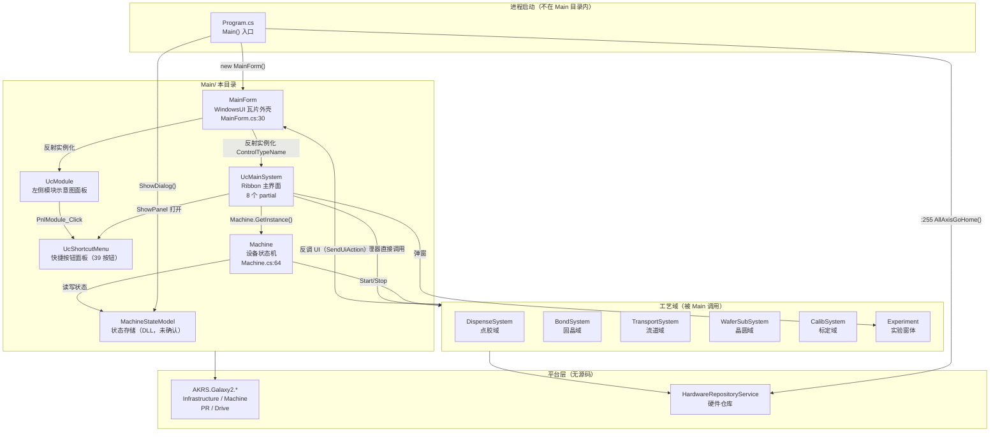

**ASCII 版（同一张图）**

```text
  Program.cs (进程入口, 不在 Main 目录)
      |
      +-- :255 AllAxisGoHome() ----------> HardwareRepositoryService (硬件)
      +-- new MainForm() ----------------> [MainForm] WindowsUI 瓦片外壳
      |                                        |
      |                                        +-- 反射: ControlTypeName 字符串
      |                                        |      +--> UcMainSystem (Ribbon 主界面)
      |                                        |      +--> UcHardwareEditor
      |                                        |      +--> UcUserManager      (瓦片永久禁用, 见 9.1)
      |                                        |
      |                                        +--> [UcModule] 左侧模块面板
      |                                                 |  PnlModule_Click
      |                                                 v
      |                                        [UcShortcutMenu] 快捷按钮面板 (39 按钮)
      |
      +-- ShowDialog() -------------------> FrmParaChangeTipAfterDataMigrate / FrmLogin

  [UcMainSystem] --按钮处理器--> 直接调用 --> Dispense/Bond/Transport/Wafer/Calib/Experiment
        |                                     |
        | Machine.GetInstance()               | 反向: MainForm.SendUiAction -> Control.Invoke
        v                                     v
  [Machine] 设备状态机 <----读写----> [MachineStateModel] (DLL, 未确认)
        |
        +-- Start()/Stop()/Pause()/Continue() --> 各域的 Task 启停
```

**读者从这里能看懂什么**

- **`Main` 不是「业务层」**：它是**唯一持有设备状态机 `Machine` 的目录**，所有域的任务启停都从它发起。
- **两条反向流**：① 域 → `Main`（`SendUiAction` 跨线程弹窗、`UcMainSystem.VisionShow()` 等静态委托）；
  ② `Main` → 域（按钮处理器）。
- **`Program.cs` 不在本目录**，但**两个启动期模态阻断点**都在这一层：
  `Program.cs:118-121` 的 `FrmParaChangeTipAfterDataMigrate`（数据迁移提示）与
  `Program.cs:175/184` 的 `SplashScreen1`（启动等待框）。

---

### 1.3 三条最重要的事实

#### 事实 1：主界面是 **8 个 partial 拼出来的**，`UcMainSystem` 单类约 7,700 行

`UcMainSystem` 由 **9 个 `.cs` 文件**共同构成（设计器 1 个 + 逻辑 8 个），**没有任何一个文件能单独读懂主界面**：

| 文件 | 角色 | 有事件处理器吗 |
|---|---|---|
| `UcMainSystem.cs`（2,206 行） | 主文件：构造/`Init`/`ShowPanel`/大部分按钮 | **是（约 60 个）** |
| `UcMainSystem.designer.cs`（3,549 行，**小写 d**） | 全部 Ribbon 控件与接线 | 否（只有 `+=`） |
| `UcMainSystem.UIState.cs`（519 行） | 按状态批量开关控件 | **否，一个都没有** |
| `UcMainSystem.HotKeyManage.cs`（122 行） | 全局热键 `RegisterHotKey` | 否 |
| `UcmainSystem.Action.cs`（435 行，**小写 m**） | 跨线程静态委托 + 子窗体 | 否 |
| `UcMainSystem.Production.cs`（214 行） | Production 页 | 是（2 个） |
| `UcMainSystem.Manual.cs`（270 行） | 「调试」页 | 是（11 个） |
| `UcMainSystem.DataAdministrator.cs`（222 行） | 数据管理页 | 是（8 个） |
| `UcMainSystem.Diagnosis.cs`（205 行） | 诊断页 | 是（14 个） |
| `UcMainSystem.Machine.cs`（61 行） | 设备层窗体 | 是（2 个） |
| `UcMainSystem.System.cs`（30 行） | **完全空的类体** | 否 |
| `UcMainSystem.ShortcutKeys.cs`（333 行） | 控件级键盘快捷键 | 是（`KeyDown`） |

> ⚠️ **两个文件名的大小写陷阱**：`UcmainSystem.Action.cs` 的 `m` 是**小写**，
> 而类名是 `UcMainSystem`。在 Windows 上按文件名找不到它；在 Linux/macOS 上按类名找不到它。
> （另一处：`Main/Controls/Ucmain/` 这个**目录名**也是小写 `main`，与类名里的 `Main` 不一致。）

#### 事实 2：`Main` 目录里的按钮，绝大多数被**同一道门禁**统一拦住 —— 而且是**静默**的

最典型的是快捷菜单 `UcShortcutMenu`：**39 个按钮 + 1 个定时器，逐个都在方法体第一行做同一个检查**。

```csharp
if (!Machine.GetInstance().IsStop()) { return; }
```

`IsStop()` 的语义（`Main/Machine/MachineSupport/Machine.StateRelated.cs:34-37`）：

```csharp
public bool IsStop()
{
    return MachineStateModel.GetInstance().MachineState == MachineStateEnum.Stop;
}
```

`Machine.GetInstance().IsStop()` 在 `UcShortcutMenu.cs` 中出现 **44 次**，行号：
`230, 244, 258, 272, 287, 306, 361, 387, 428, 452, 479, 508, 523, 537, 551, 568, 622, 660, 695, 733,
804, 837, 873, 911, 971, 1004, 1100, 1186, 1204, 1222, 1236, 1251, 1275, 1298, 1317, 1390, 1426,
1447, 1478, 1493, 1509, 1525, 1549, 1578`。
其中 **43 处是 `if (!...) { return; }` 守卫**（唯一例外是 `:622` 的 `this.Enabled = Machine.GetInstance().IsStop();`），
覆盖 **39 个 `_Click` + `Pickup`(`:1100`) + `FlipFromWafer`(`:1390`) + `timer1_Tick`(`:551`) + `RefreshControl`(`:568`)**，
**一一对应、无遗漏**。

**⚠️ 这道门禁的后果是「操作员点了没反应」**：既不弹提示、也不写日志、界面无任何变化。
设备在 `Working` / `Pause` 状态时，右侧快捷面板上的**全部 39 个按钮都是哑的**。
（`UcShortcutMenu.cs:622` 另有一条「反向」保险：运行中把整个 UserControl 置灰，
双重保护，所以正常路径下操作员看到的其实是**灰掉的面板**，而不是「点了没反应」。）

#### 事实 3：全仓的跨线程 UI 封送**只有一条总线**，而它是**同步**的

```csharp
// Main/Controls/MainForm.cs:50
public static Action<Action> SendUiAction;

// Main/Controls/MainForm.cs:61（唯一的订阅点；全仓 SendUiAction -= 出现 0 次）
SendUiAction += this.PostAction;

// Main/Controls/MainForm.cs:68-71
private void PostAction(Action action)
{
    this.Invoke(action);          // ← 同步阻塞，不是 BeginInvoke
}
```

`MainForm.SendUiAction` 全仓有 **26 个调用点**（分布在 7 个文件）：
`CalibSystem/Models/CalibrateTask.cs:1150/1245/1700/1805/2394`、
`Infrastructure/Controls/Currency/AKRSMessageBoxExt.cs:176/188/256/268`、
`Infrastructure/Controls/Currency/AKRSXtraMessageBox.cs:29/38/48`、
`Infrastructure/Service/ControlService.cs:238/304/372`、
`WaferSubSystem/Models/Entities/SearchChip/Block.cs:1212/1553/1572`、
`WaferSubSystem/Models/Entities/SearchChip/Block.SearchDieBox.cs:178`、
`WaferSubSystem/Tasks/WaferSubSystemTask.cs:616/642/736/782/911/1137/1315/1337`。

因为 `PostAction` 里是同步的 `Invoke`，工作线程侧必须先加锁再调用
（`Infrastructure/Controls/Currency/AKRSXtraMessageBox.cs:45-53` 用 `lock (AKRSMessageBoxExt.UiLock)` 保护）。

> 🔴 **这条总线的「改动面 / 杀伤半径」是本文档最值得记住的一个数字**：
> **改动 1 行（`:70` 的 `Invoke` 改成 `BeginInvoke`），静默影响 8 处**——
> 见 [§9.6](#96-r-11--r-12-反射开窗的隐式契约)。**这是全文档风险最高的单点。**

---

## §2 目录结构

### 2.1 层级树

```text
Main/
├── Controls/                             ← UI 外壳层（34 文件 / 14,575 行，全部参与编译）
│   ├── MainForm.cs / .designer.cs        主窗体（WindowsUI 瓦片外壳）
│   ├── UcModule.cs / .Designer.cs        左侧模块示意图面板（右键/双击菜单）
│   ├── UcShortcutMenu.cs / .Designer.cs  快捷按钮面板（39 按钮）
│   ├── FrmShutDown.cs / .Designer.cs     「关机 / 重启」对话框（实为退软件）
│   ├── FrmSignalDisplay.cs / .Designer.cs 交互信号显示（4 个指示灯，非按钮）
│   ├── FrmTeachJoystick.cs / .Designer.cs 摇杆示教（标定模拟量）
│   ├── FrmBear.cs / .designer.cs         公共承载窗体（无子控件）
│   ├── FrmParaChangeTipAfterDataMigrate.cs / .Designer.cs  启动期数据迁移提示
│   ├── Ucmain/                           ← 「UcMainSystem」相关（注意目录名小写 m）
│   │   ├── SplashScreen1.cs / .designer.cs   启动等待框
│   │   ├── UcHardwareEditor.cs / .designer.cs 硬件编辑器（瓦片）
│   │   ├── UcUserManager.cs / .designer.cs    用户管理页宿主（瓦片永久禁用）
│   │   └── MainControls/                 ← 主界面本体（12 文件 / 8,166 行）
│   │       ├── UcMainSystem.cs                主文件 2,206 行
│   │       ├── UcMainSystem.designer.cs       设计器 3,549 行（小写 d）
│   │       ├── UcMainSystem.UIState.cs        按状态批量开关控件
│   │       ├── UcMainSystem.HotKeyManage.cs   全局热键
│   │       ├── UcmainSystem.Action.cs         跨线程静态委托（小写 m）
│   │       ├── UcMainSystem.Production.cs     Production 页
│   │       ├── UcMainSystem.Manual.cs         「调试」页
│   │       ├── UcMainSystem.DataAdministrator.cs 数据管理页
│   │       ├── UcMainSystem.Diagnosis.cs      诊断页
│   │       ├── UcMainSystem.Machine.cs        设备层
│   │       ├── UcMainSystem.System.cs         空类体
│   │       └── UcMainSystem.ShortcutKeys.cs   控件级键盘快捷键
│   └── ...
├── Machine/                              ← 设备层（36 文件 / 9,561 行，其中 4 个幽灵文件）
│   ├── Control/                          ← 硬件配置窗体（3 个幽灵中的 2 个在此）
│   ├── MachineSupport/                   ← 设备状态机 Machine + 配置模型
│   ├── Process/                          ← 制程与动作节点调度（含 UcProcessStep）
│   ├── Product/                          ← 产品域
│   │   ├── Controls/                     生产模式对话框 / 设备功能面板
│   │   └── ProcessStep/                  ← ★整目录 2 个文件都是幽灵文件（不参与编译）
│   ├── ObjectLevel/                      ← 设备水平检测（孤儿 UI，零打开点）
│   └── Parameter/                        ← 摇杆参数 / 设备参数（落盘模型）
└── VisionControl/                        ← 版本信息（4 文件 / 471 行）
```

**ASCII 版（同图）**

```text
Main/
  +-- Controls/ ------------------------------------- 34 文件 / 14,575 行
  |     +-- MainForm.cs            主窗体外壳 (WindowsUI Tile)
  |     +-- UcModule.cs            左侧模块面板
  |     +-- UcShortcutMenu.cs      快捷按钮面板 (39 按钮)
  |     +-- FrmShutDown / FrmSignalDisplay / FrmTeachJoystick
  |     +-- FrmBear / FrmParaChangeTipAfterDataMigrate
  |     +-- Ucmain/
  |     |     +-- SplashScreen1 / UcHardwareEditor / UcUserManager
  |     |     +-- MainControls/ ---- 12 文件 / 8,166 行  <-- 主界面本体
  |     +-- ...
  +-- Machine/ -------------------------------------- 36 文件 / 9,561 行
  |     +-- Control/               硬件配置窗体 (2 个幽灵在此)
  |     +-- MachineSupport/        Machine 设备状态机 (9 文件全非 Designer)
  |     +-- Process/               制程 + 动作节点调度 (7 文件 / 4,499 行)
  |     +-- Product/
  |     |     +-- Controls/        生产模式 / 设备功能
  |     |     +-- ProcessStep/      *** 2 个文件全是幽灵 ***
  |     +-- ObjectLevel/           设备水平 (孤儿 UI)
  |     +-- Parameter/             参数落盘模型
  +-- VisionControl/ ------------------------------- 4 文件 / 471 行
```

> **⚠️ 三个「名字靠不住」的地方，读者务必注意**：
> 1. `Main/Controls/Ucmain/` 目录名是**小写 m**，而类名是 `UcMainSystem`（大写 M）。
> 2. `UcmainSystem.Action.cs` 文件名也是**小写 m**。
> 3. `Main/Machine/ObjectLevel/FrmMachineLevelCheck.cs:12` 声明的是
>    `namespace AKRS.ZX2200.Main.Machine.Controls`（不是 `...ObjectLevel`）；
>    `Main/VisionControl/FrmVersionInfo.cs:14` 声明的是 `namespace AKRS.ZX2200.Main.Controls`
>    （不是 `...VisionControl`）。**两个文件都不在自己目录对应的命名空间里。**

---

### 2.2 代码规模（与 [文首](#文首--规模统计与统计口径) 同口径，逐目录）

| 目录 | 文件数 | 行数 | 非 Designer 文件/行 | Designer 文件/行 |
|---|---|---|---|---|
| `Main/Controls/`（直属，不含 `Ucmain/`） | 16 | 5,876 | 8 / 2,856 | 8 / 3,020 |
| `Main/Controls/Ucmain/`（直属） | 6 | 533 | 3 / 233 | 3 / 300 |
| `Main/Controls/Ucmain/MainControls/` | 12 | 8,166 | 11 / 4,617 | 1 / 3,549 |
| **`Controls/` 小计** | **34** | **14,575** | **22 / 7,706** | **12 / 6,869** |
| `Main/Machine/Control/` | 6 | 1,268 | 3 / 308 | 3 / 960 |
| `Main/Machine/MachineSupport/` | 9 | 2,714 | 9 / 2,714 | 0 / 0 |
| `Main/Machine/Process/` | 7 | 4,499 | 6 / 3,924 | 1 / 575 |
| `Main/Machine/Product/`（含 2 个子目录） | 7 | 585 | 5 / 435 | 2 / 150 |
| `Main/Machine/ObjectLevel/` | 5 | 405 | 3 / 135 | 2 / 270 |
| `Main/Machine/Parameter/` | 2 | 90 | 2 / 90 | 0 / 0 |
| **`Machine/` 小计** | **36** | **9,561** | **28 / 7,606** | **8 / 1,955** |
| `Main/VisionControl/` | 4 | 471 | 3 / 227 | 1 / 244 |
| **`Main/` 合计（口径 B，磁盘）** | **74** | **24,607** | **53 / 15,539** | **21 / 9,068** |
| 减：幽灵文件（见 2.3） | −4 | −650 | −3 / −326 | −1 / −324 |
| **`Main/` 合计（口径 A，参与编译）** | **70** | **23,957** | **50 / 15,213** | **20 / 8,744** |

**逐行核对（三处必须一致）**：34 + 36 + 4 = 74 ➜ 74 − 4 = **70**；
14,575 + 9,561 + 471 = 24,607 ➜ 24,607 − 650 = **23,957**；
7,706 + 7,606 + 227 = 15,539 ➜ 15,539 − 326 = **15,213**；
6,869 + 1,955 + 244 = 9,068 ➜ 9,068 − 324 = **8,744**。

> ⚠️ **`Machine/` 是「行数密度最高」的目录**：只有 36 个文件却有 9,561 行，
> 因为 `MachineSupport/` 里 **9 个文件全是非 Designer 的逻辑代码**（2,714 行，0 个设计器），
> `Process/` 里两个动作节点控制器就占掉了将近一半的 `Machine` 目录行数。

---

### 2.3 目录职责一句话表

| 目录 | 一句话职责 | 谁能打开它 / 谁调用它 |
|---|---|---|
| `Controls/` | UI 外壳与主界面 | `Program.cs`（`MainForm`） |
| `Controls/Ucmain/MainControls/` | **主界面本体**：Ribbon 上约 250 个按钮 | `MainForm.WindowsUIView_QueryControl` 反射打开 |
| `Machine/MachineSupport/` | **设备状态机** `Machine`（`SingletonNoSave<Machine>`）+ 硬件/软件配置模型 | `MainForm_Load:257` 启动后台线程；`UcMainSystem` 处处调用 |
| `Machine/Process/` | 制程步骤数据 + **动作节点调度器**（S1/S2） | 由 `DispenseWorkTask` / `BondTask` 的任务线程驱动 |
| `Machine/Product/` | 产品域 + 生产模式对话框 | `UcMainSystem.BarBtProductionMode_ItemClick` |
| `Machine/Control/` | 硬件配置窗体（勾选机型配置） | `UcMainSystem.Machine.cs:44` / `:56` |
| `Machine/ObjectLevel/` | 设备水平检测（6 行 × 示教/测试） | **⚠️ 零打开点，孤儿 UI**，见 §9.7 |
| `Machine/Parameter/` | 摇杆参数 `JoystickPara` / 设备参数 `MachineDevicePara` | `FrmTeachJoystick` |
| `VisionControl/` | 版本信息公告 + 版本更新检查 | `UcMainSystem.BtSoftWareInfo_ItemClick:2133` |

---

### 2.4 幽灵文件（本目录 4 个 / 650 行，**不参与编译**）

**⚠️ 幽灵 = 磁盘上存在、但 `.csproj` 里没有任何 `<Compile Include>` 指向它的 `.cs`。
它不参与编译 ⇒ 运行时不存在这个类型、不存在这个界面。**
本目录的 4 个**全部是「甲类：唯一孤儿」** —— 磁盘上只有这一份，工程里没有任何替代品。

| # | 文件 | 行数 | 类型 | 性质 | 同目录下「活的」对应物 |
|---|---|---|---|---|---|
| 1 | `Main/Machine/Control/FrmChipFrictionSetting.cs` | 23 | 非 Designer | 甲类 | ⚠️ 幽灵（不参与编译、运行时不存在）；功能无替代物 |
| 2 | `Main/Machine/Control/FrmChipFrictionSetting.Designer.cs` | 324 | Designer | 甲类 | ⚠️ 幽灵（不参与编译、运行时不存在） |
| 3 | `Main/Machine/Product/ProcessStep/ProcessStep.cs` | 64 | 非 Designer | 甲类 | ⚠️ 幽灵（不参与编译、运行时不存在）；活的是 `Main/Machine/Process/SingleProcessStep.cs:15` |
| 4 | `Main/Machine/Product/ProcessStep/ProcessStepProgram.cs` | 239 | 非 Designer | 甲类 | ⚠️ 幽灵（不参与编译、运行时不存在）；活的是 `Main/Machine/Process/ProcessDomain.cs` |
| | **合计** | **650** | | | |

#### 2.4.1 全工程口径：**20 个幽灵 / 4,881 行**（本目录只占其中 4 个）

口径：「主工程 `AKRS.ZX2200`、按**全路径**比对 `<Compile Include>`、排除 `bin/` `obj/`」。

| 指标 | 数值 |
|---|---|
| `.csproj` 的 `<Compile Include>` 条目 | **1,131** |
| 磁盘上的 `.cs`（排除 `bin/` `obj/`） | **1,151** |
| **差集 = 幽灵文件** | **20 个 / 4,881 行** |

⚠️ **不要写成「本工程只有 `ProcessStep` 那两个幽灵」。** 20 个分布在
`BondSystem/` 5、**`Main/` 4**、`Experiment/` 4、`Infrastructure/` 3、`WaferSubSystem/` 2、
`DispenseSystem/` 1、根目录 `Common.cs` 1。（本文档只负责 `Main/` 那 4 个，其余 16 个归各自文档。）

#### 2.4.2 复现命令（**照抄，不要凭记忆重写**）

```bash
cd "E:/项目/ZX2200标机/trunk/AKRS.ZX2200"
grep -o '<Compile Include="[^"]*"' AKRS.ZX2200.csproj \
  | sed 's/<Compile Include="//;s/"$//' | tr '\\' '/' | sort -u > /tmp/inc.txt
find . -name '*.cs' -not -path './bin/*' -not -path './obj/*' \
  | sed 's|^\./||' | sort -u > /tmp/disks.txt
comm -13 /tmp/inc.txt /tmp/disks.txt      # 幽灵文件（在磁盘、不在工程）
comm -23 /tmp/inc.txt /tmp/disks.txt      # 应为空（工程里没有指向缺失文件的条目）
```

⚠️ **三个会「报假零」的陷阱**（本项目真实踩过，见 [§9.9](#99-判定口径与排除的旁路)）：

1. **`sed 's#\\#/#g'` 会静默失败** —— 该写法在本 shell 里分隔符被自身转义，`sed` 报错后**继续执行**，
   于是反斜杠没被换成斜杠，**所有全路径比较全部失配、每个类型都报「0 命中」**。
   正确写法是 `tr '\\' '/'`（上一条命令里用的就是这个）。
2. **`grep -c 'Common' csproj` 会匹配到 `CommonModels`** —— 按子串计数得出的"命中"是假的。
3. **`grep -o '...\.cs'` 不排除后续字符时，路径会在第一个 `.cs` 处被截断** ——
   本仓有双扩展名的畸形文件（如 `FrmDispensePlateAssistant.cs.cs`），会被截成不存在的路径。

> **纪律：没有跑过正向对照的「0」，不算证据。** 本清单的正向对照三连（必须分别得 1 / 1 / 0）：
>
> ```bash
> cd "E:/项目/ZX2200标机/trunk/AKRS.ZX2200"
> grep -o '<Compile Include="[^"]*"' AKRS.ZX2200.csproj | sed 's/.*Include="//; s/"$//' | tr '\\' '/' > /tmp/inc.txt
> grep -cxF 'Main/Machine/Process/ProcessDomain.cs'  /tmp/inc.txt   # 必须 = 1（活文件）
> grep -cxF 'Infrastructure/Utils/ObjectHelper.cs'   /tmp/inc.txt   # 必须 = 1（活文件）
> grep -cxF 'Common.cs'                              /tmp/inc.txt   # 必须 = 0（它才是幽灵）
> ```
>
> 前两条若不为 1 ⇒ **归一化没生效，本次所有结论作废**，而不是"没有引用"。

#### 2.4.3 甲类与乙类不是一回事（写作时必须分开）

- **甲类：唯一的孤儿（全工程 16 个）** —— 磁盘上只有这一份，工程里没有替代品 ⇒
  编译系统里**根本不存在这个类型**。本目录的 4 个全是甲类。
- **乙类：留了旧副本的（全工程 4 个）** —— 曾经在编译，后来代码被搬到别处、旧文件忘删。
  它们**有正在参与编译的"双胞胎"**，都在 `Experiment/RepeatPositionAccuracy/` 下：
  `FrmChooseCamera.cs` / `.Designer.cs`、`FrmRotateCenterAccuracy.cs` / `.Designer.cs`，
  双胞胎是 `Experiment/Test/` 下的同名文件（`csproj:1222` / `:1225` / `:1867` / `:1870`）。
  写法必须单独标注：`⚠️ 幽灵，是被 <编译双胞胎全路径> 取代的旧副本`。

> **为什么必须分开**：乙类是**重复副本** —— 现场工程师完全可能对着 `RepeatPositionAccuracy/`
> 下的旧版改代码，**改完编译不报错、运行时毫无变化**（因为生效的是 `Experiment/Test/` 里那份）。
> 把甲类和乙类写成同一句「不参与编译」，事实没错，但会丢掉这个维护风险。
> 反向同理：**判断"有没有双胞胎"必须再按文件名查一次**，`comm` 差集只回答"这个文件在不在工程里"：
> ```bash
> grep -o '<Compile Include="[^"]*"' AKRS.ZX2200.csproj | sed 's/.*Include="//; s/"$//' \
>   | grep -c 'FrmChooseCamera\.cs$'      # = 1 ⇒ 有编译双胞胎 ⇒ 乙类
> ```

#### 2.4.4 本目录 4 个幽灵「被编译代码引用数 = 0」（逐个类型实测，非抽样）

全工程 20 个幽灵声明的所有类型逐个查过，**被编译代码真正引用的数量 = 0**。
`ProcessStep` / `ProcessStepProgram` 在**编译文件**里共有 5 处 `grep -w` 命中，**逐条读进去没有一条是真引用**：

| 命中位置 | 实际内容 | 定性 |
|---|---|---|
| `Main/Machine/Product/ProductDomain.cs:38` | `///// ProcessStep程式` | 注释文字 |
| `Main/Machine/Process/S2ActionNodeController.cs:60` | `private SingleProcessStep ProcessStep { get; set; }` | **属性名撞车**，类型是活的 `SingleProcessStep` |
| `Infrastructure/Models/Path/ZX2200PathConfig.cs:166` | 字符串属性名 `ProcessStepProgramFilePath` + XML 注释 | 字符串 / 注释 |
| `Infrastructure/Utils/CommonHelper.cs:85-122` | 被整段注释掉的旧代码 | 注释 |
| `DispenseSystem/` 的 `S1DispenseDefectActionNode.cs:83` | 注释文字 | 注释 |

`FrmChipFrictionSetting` 的唯一"引用"也是注释：
`BondSystem/Controls/Experiment/UcBondModuelSetting.cs:1882-1883` 两行 `//FrmChipFrictionSetting ...`。
`UcProcessStepEdit` 的唯一"引用"同样是注释：
`Infrastructure/.../UcEditProductProgramming.cs:854` 的 `//this.selectedControl = new UcProcessStepEdit {...}`。

> ⚠️ **「有命中」不等于「有引用」。** 必须**读进那一行**才能定性 ——
> **注释、字符串、同名属性**是本项目里最常见的三种假阳性。
> `grep` 命中数只能用来定位可疑点，**不能用来下结论**。

#### 2.4.5 一条更硬的独立证据：幽灵是「自洽的死岛」，加回工程会**编译失败**

上面 20 个文件是靠 `comm` 做差集得出的（**数量证据**）。还有一条**独立于数量的编译期证据**：

1. 幽灵文件 `BondSystem/Controls/Setting/ProcessStep/UcProcessStepEdit.cs:321` / `:336` 有**活的、
   没被注释**的调用 `CommonHelper.UpOrDown(Direction.Up/Down, this.GvProcessStep);`。
2. 而在 `Infrastructure/Utils/CommonHelper.cs` 里，`UpOrDown` 的**两个重载整体都被注释掉了**
   （泛型版注释块 `:69-89`、非泛型版 `:91` 起）⇒ **`CommonHelper` 里根本不存在名为 `UpOrDown` 的方法。**
3. ⇒ 若把 `UcProcessStepEdit.cs` 加回 `.csproj`，**它必然编译失败**。
   **这不是"没人调用"，是"它调用的方法不存在"。**
4. 更自洽的是：**那两个被注释掉的 `UpOrDown` 方法体自己也在引用幽灵类型** ——
   `CommonHelper.cs:83` `ProcessStepProgram.GetInstance().ProcessStepList...`、`:85` `List<ProcessStep> list = ...`。
   ⇒ **调用方与被调方双双依赖同一套死类型，且同时被废弃。**

> ⚠️ **不要误推**：`CommonHelper.cs` 本身**不是**死代码 ——
> 它 127 行、被 23 个外部文件引用、**26 处活调用点，全部是同一个 `ChangeUcMove`（`:25`）**。
> 死的只是 `UpOrDown` 这一个已被移除的功能，以及它在幽灵文件里留下的悬空调用。
> **别因为"里面有个方法被注释了"就把整个 `CommonHelper` 写死。**

#### 2.4.6 补充判定证据（按本仓库 legacy `.csproj` 特性）

本仓库是 legacy `.csproj`（`AKRS.ZX2200.csproj:1` `<Project ToolsVersion="4.0" ...>`），
**不自动包含 `.cs`**，必须逐文件写 `<Compile Include>` ⇒ **磁盘上有 ≠ 编译进去了**。
对上述 4 个文件按全路径查 `<Compile Include>` ⇒ **0 命中**；
而「活的」那一套确实在：`Main/Machine/Process/ProcessDomain.cs`（`csproj:1454`）、
`Main/Machine/Process/SingleProcessStep.cs`（`csproj:1455`）、
`UcProcessStep.cs`（`:1457`）、`UcProcessStep.Designer.cs`（`:1460`）、
`S1ActionNodeController.cs` / `S2ActionNodeController.cs` 均在工程内。

`.csproj` 里 `Compile Remove` **0 命中** —— 说明不是"条件排除"，而是**文件被移出工程后忘了删盘**。
老版本工程文件 `AKRS.ZX2200.txt`（同一个 `ProjectGuid`）里同样是 0 命中 ⇒
**不是某次重构漏掉的，而是从加入仓库起就没编过**（这句话对 16 个甲类成立，对 4 个乙类不成立）。

> ⚠️ **读者最容易踩的坑**：`ProcessStep` 这个名字在本仓库有 **5 种含义**，见
> [§9.5](#95-r-08--r-10-幽灵文件与同名类型)。**看到 `ProcessStep` 不要直接当成幽灵类型**——
> 最典型的是 `Main/Machine/Process/S2ActionNodeController.cs:60`
> `private SingleProcessStep ProcessStep { get; set; }`：**属性名叫 `ProcessStep`，类型是活的 `SingleProcessStep`**。

---

## §3 关键类型索引

### 3.1 类型清单

**分组：① 窗体（`XtraForm`）　② 用户控件（`XtraUserControl` / `BaseControl`）　③ 域/配置单例　④ 数据模型　⑤ 调度器　⑥ 枚举　⑦ 静态工具**

| # | 类型 | 声明位置 | 基类 / 接口 | 组 | 一句话职责 |
|---|---|---|---|---|---|
| 1 | `MainForm` | `Main/Controls/MainForm.cs:30` | `XtraForm` | ① | **主窗体外壳**：WindowsUI 瓦片容器，无 Ribbon |
| 2 | `FrmShutDown` | `Main/Controls/FrmShutDown.cs:9` | `XtraForm` | ① | 「关机 / 重启」对话框（**实际语义是退出/重启软件**） |
| 3 | `FrmSignalDisplay` | `Main/Controls/FrmSignalDisplay.cs:16` | `XtraForm` | ① | 交互信号一览（4 个**指示灯**，非按钮） |
| 4 | `FrmTeachJoystick` | `Main/Controls/FrmTeachJoystick.cs:23` | `XtraForm` | ① | **摇杆示教**（读 GTN 模拟量、写 `JoystickPara` 落盘） |
| 5 | `FrmBear` | `Main/Controls/FrmBear.cs:6` | `XtraForm` | ① | **公共承载窗体**，自身无子控件，作容器宿主 |
| 6 | `FrmParaChangeTipAfterDataMigrate` | `Main/Controls/FrmParaChangeTipAfterDataMigrate.cs:20` | `XtraForm` | ① | 启动期数据迁移提示（模态阻断点） |
| 7 | `FrmMachineHardWareConfig` | `Main/Machine/Control/FrmMachineHardWareConfig.cs:24` | `XtraForm` | ① | **硬件配置**（20 个勾选 + 2 个枚举下拉） |
| 8 | `FrmHardWareCheck` | `Main/Machine/Control/FrmHardWareCheck.cs:26` | `XtraForm` | ① | 硬件配置/初始化状态一览（只读表格） |
| 9 | `FrmProductionMode` | `Main/Machine/Product/Controls/FrmProductionMode.cs:12` | `XtraForm` | ① | **工作模式**选择（5 档单选） |
| 10 | `FrmMachineLevelCheck` | `Main/Machine/ObjectLevel/FrmMachineLevelCheck.cs:17` | `XtraForm` | ① | 设备水平检测 —— **⚠️ 孤儿 UI，零打开点** |
| 11 | `FrmVersionInfo` | `Main/VisionControl/FrmVersionInfo.cs:19` | `XtraForm` | ① | 版本信息公告（当前 / 历史 两 Tab） |
| 12 | `UcMainSystem` | `Main/Controls/Ucmain/MainControls/UcMainSystem.cs:142` | `BaseControl` | ② | **主界面本体**（8 个逻辑 partial） |
| 13 | `UcModule` | `Main/Controls/UcModule.cs:31` | `BaseControl` | ② | 左侧模块示意图（右键菜单入口） |
| 14 | `UcShortcutMenu` | `Main/Controls/UcShortcutMenu.cs:66` | `XtraUserControl` | ② | **快捷按钮面板**（39 按钮，非 `BaseControl`） |
| 15 | `UcHardwareEditor` | `Main/Controls/Ucmain/UcHardwareEditor.cs:19` | `BaseControl` | ② | 硬件编辑器瓦片页 |
| 16 | `UcUserManager` | `Main/Controls/Ucmain/UcUserManager.cs:13` | `BaseControl` | ② | 用户管理页宿主（瓦片**运行时永久禁用**） |
| 17 | `SplashScreen1` | `Main/Controls/Ucmain/SplashScreen1.cs:11` | `SplashScreen` | ② | 启动等待框 |
| 18 | `UcProcessStep` | `Main/Machine/Process/UcProcessStep.cs:33` | `XtraUserControl`, `IProgrammingControl` | ② | **制程步骤编辑器**（增删/上下移/自动生成） |
| 19 | `UcObjectLevel` | `Main/Machine/ObjectLevel/UcObjectLevel.cs:17` | `XtraUserControl` | ② | 单条水平度行（示教/测试按钮**都是空方法体**） |
| 20 | `UcMachineFunction` | `Main/Machine/Product/Controls/UcMachineFunction.cs:21` | `XtraUserControl` | ② | 「设备功能」面板（1 个数据绑定，1 个死控件） |
| 21 | `Machine` | `Main/Machine/MachineSupport/Machine.cs:64` | `SingletonNoSave<Machine>` | ③ | **设备状态机**（5 个 partial 文件） |
| 22 | `MachineHardwareConfiguration` | `Main/Machine/MachineSupport/MachineHardwareConfiguration.cs:18` | `Singleton<…>`, `INotifyPropertyChanged` | ③ | 硬件配置持久化模型（27 属性 + 3 回零点） |
| 23 | `MachineSoftwareConfiguration` | `Main/Machine/MachineSupport/MachineSoftwareConfiguration.cs:22` | `Singleton<…>`, `INotifyPropertyChanged` | ③ | 软件配置持久化模型 |
| 24 | `MachineModule` | `Main/Machine/MachineSupport/MachineModule.cs:16` | `SingletonNoSave<MachineModule>` | ③ | 摇杆三路模拟量 + 安全门传感器按名取硬件 |
| 25 | `ProcessDomain` | `Main/Machine/Process/ProcessDomain.cs:24` | `Singleton<ProcessDomain>` | ③ | **制程域**：双系统步骤容器 + 校验 + 落盘 |
| 26 | `ProductDomain` | `Main/Machine/Product/ProductDomain.cs:21` | `Singleton<ProductDomain>` | ③ | 产品域聚合根（只暴露 `ProductConfig`） |
| 27 | `MachineDevicePara` | `Main/Machine/Parameter/MachineDevicePara.cs:16` | `Singleton<MachineDevicePara>` | ③ | 设备参数（含 `JoystickPara`） |
| 28 | `HardWareCheck` | `Main/Machine/MachineSupport/HardWareCheck.cs:22` | 无（POCO） | ④ | 单个硬件的自检结果（存在 / 初始化成功 / 类型） |
| 29 | `SingleProcessStep` | `Main/Machine/Process/SingleProcessStep.cs:15` | 无 | ④ | **活的**制程步骤模型（9 个自动属性） |
| 30 | `SystemProcess` | `Main/Machine/Process/SystemProcess.cs:12` | 无 | ④ | 一个系统的制程（步骤集合 + 2 枚举 + 循环次数） |
| 31 | `JoystickPara` | `Main/Machine/Parameter/JoystickPara.cs:12` | 无 | ④ | 摇杆 7 个 `double` 参数 |
| 32 | `ObjectLevelData` | `Main/Machine/ObjectLevel/ObjectLevelData.cs:12` | 无 | ④ | 水平度行数据（4 个 `string`） |
| 33 | `VersionInfo` | `Main/VisionControl/VersionInfo.cs:12` | 无 | ④ | 一条版本记录 |
| 34 | `S1ActionNodeController` | `Main/Machine/Process/S1ActionNodeController.cs:28` | 无 | ⑤ | **系统1（点胶）动作节点调度**（939 行） |
| 35 | `S2ActionNodeController` | `Main/Machine/Process/S2ActionNodeController.cs:35` | 无 | ⑤ | **系统2（固晶）动作节点调度**（1,630 行） |
| 36 | `ProcessSystemEnum` | `Main/Machine/Process/ProcessDomain.cs:361` | enum | ⑥ | `System1` / `System2` |
| 37 | `WorkProcessEnum` | `Main/Machine/Process/ProcessDomain.cs:379` | enum | ⑥ | 4 值：`TransportFirst` / `SubstrateFirst` / `ModuleFirst` / `BondPositionFirst` |
| 38 | `WorkProcessModuleEnum` | `Main/Machine/Process/ProcessDomain.cs:409` | enum | ⑥ | 2 值：`StepFirst` / `PositionFirst` |
| 39 | `SplashScreenCommand` | `Main/Controls/Ucmain/SplashScreen1.cs:59` | enum | ⑥ | `SetProgress` / `InitView` |
| 40 | `VersionUpdateAnnouncement` | `Main/VisionControl/VersionUpdateAnnouncement.cs:28` | **`static class`** | ⑦ | 版本更新检查 + 硬编码版本公告数据 |
| — | `ProcessStep` | `Main/Machine/Product/ProcessStep/ProcessStep.cs:12` | `BaseOrderDsSetting` | 🚫 **幽灵** | **不参与编译** |
| — | `ProcessStepProgram` | `Main/Machine/Product/ProcessStep/ProcessStepProgram.cs:14` | `Singleton<…>` | 🚫 **幽灵** | **不参与编译** |
| — | `FrmChipFrictionSetting` | `Main/Machine/Control/FrmChipFrictionSetting.cs:14` | `XtraForm` | 🚫 **幽灵** | **不参与编译** |

> **`MachineStateModel` 与 `MachineStateEnum` 不在本表** —— 它们的定义**不在本仓库**
> （`grep -rn "enum ExcuteResult\|class MachineStateModel"` 在本仓库 0 命中），
> 由 `libs/AKRS.Galaxy2.Machine.dll` 提供，**实现未确认**。

---

### 3.2 继承层次图

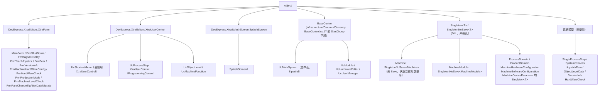

**ASCII 版（同一张图）**

```text
object
  |
  +-- XtraForm ....................... 11 个窗体
  |     MainForm, FrmShutDown, FrmSignalDisplay, FrmTeachJoystick, FrmBear,
  |     FrmVersionInfo, FrmMachineHardWareConfig, FrmHardWareCheck,
  |     FrmProductionMode, FrmMachineLevelCheck, FrmParaChangeTipAfterDataMigrate
  |
  +-- XtraUserControl ................ 4 个
  |     UcShortcutMenu (直接继承)
  |     UcProcessStep  (还实现 IProgrammingControl)
  |     UcObjectLevel, UcMachineFunction
  |
  +-- BaseControl .................... 4 个  <-- 平台基类, 有 StartGroup 字段
  |     UcMainSystem, UcModule, UcHardwareEditor, UcUserManager
  |
  +-- SplashScreen ................... SplashScreen1
  |
  +-- Singleton<T> / SingletonNoSave<T>  (DLL, 未确认)
  |     SingletonNoSave: Machine, MachineModule      <-- 不落盘
  |     Singleton      : ProcessDomain, ProductDomain,
  |                      MachineHardwareConfiguration,
  |                      MachineSoftwareConfiguration, MachineDevicePara
  |
  +-- (无基类 POCO)
        SingleProcessStep, SystemProcess, JoystickPara,
        ObjectLevelData, VersionInfo, HardWareCheck
```

> **`IProgrammingControl`**（`Infrastructure/Interface/IProgrammingControl.cs:26`）只有一个成员
> `void Confirm();`（`:31`）。`UcProcessStep` 是它在 `Main` 目录里**唯一的实现者**。
> 编程界面的「保存 / 启动」按钮会通过它回调 `Confirm()` —— 见 §4.4。

---

### 3.3 速查：从「我想找什么」到「看哪个文件」

| 我想找… | 看这个文件 / 位置 |
|---|---|
| 主窗体的瓦片、关闭按钮、`Load` 里做了什么 | `Main/Controls/MainForm.cs:232-271`（`MainForm_Load`） |
| **跨线程弹窗为什么能工作** | `Main/Controls/MainForm.cs:50/61/68-71`（三者必须一起看） |
| 反射打开主界面 / 硬件编辑器 / 用户管理页 | `Main/Controls/MainForm.cs:78-97`（`WindowsUIView_QueryControl`） |
| **设备状态机**（Start/Stop/Pause/SelfCheck） | `Main/Machine/MachineSupport/Machine.Operate.cs` / `Machine.SelfCheck.cs` / `Machine.StateRelated.cs` / `Machine.Sustain.cs` |
| `IsStop()` / `IsWorking()` / `IsPause()` 的定义 | `Main/Machine/MachineSupport/Machine.StateRelated.cs:25-46` |
| **动作节点排序的 8 种组合** | `Main/Machine/Process/S1ActionNodeController.cs:191-287`（分发器） |
| 制程步骤数据模型 | `Main/Machine/Process/SingleProcessStep.cs:15` |
| 制程步骤编辑界面 | `Main/Machine/Process/UcProcessStep.cs:33` |
| 硬件配置勾选落盘到哪个文件 | `Main/Machine/MachineSupport/MachineHardwareConfiguration.cs:209` |
| 摇杆参数落盘到哪个文件 | `Main/Machine/Parameter/MachineDevicePara.cs:23` |
| 快捷面板的门禁为什么是全文件统一的 | `Main/Controls/UcShortcutMenu.cs:44` 处 `IsStop()` |
| 模块右键菜单「点胶动作调试」为什么没反应 | `Main/Controls/UcModule.cs:159`（英文标题比较），见 §4.7 |
| **主界面 Ribbon 上所有按钮的标题** | `Main/Controls/Ucmain/MainControls/UcMainSystem.designer.cs`（约 250 处 `.Caption =`） |
| 用户管理功能的两个入口及各自状态 | `UcMainSystem.designer.cs:1188`（Ribbon，活）／`MainForm.designer.cs:214`（瓦片，永久禁用），见 §9.1 |

---

## §4 UI 按钮与交互流程 ★核心★

### 4.0 本节怎么读

#### 4.0.1 UI 入口的**三种类型**（不要只找按钮）

> ⚠️ **这一小节是本节的方法论。** 只看「点按钮」会漏掉一大半真正的功能入口。

| 类型 | 长什么样 | 怎么找 | 本目录的例子 |
|---|---|---|---|
| **① 界面按钮** | Designer 里有 `.Caption` / `.Text`，并有 `+= new ...Handler` | 按 `.Caption =` 找标题，按 `+= new` 找接线 | `UcMainSystem.designer.cs` 里约 250 个 Ribbon 按钮 |
| **② 任务层运行时弹出** | **没有按钮**，由任务线程在满足条件时 `new FrmXxx()` + `ShowDialog()` | 搜 `new Frm` 的**调用者是不是 `_Click`** | `MainForm.WindowsUIView_QueryControl`、`Machine.Start()` 触发的各域弹窗 |
| **③ 反射服务** | 用**字符串类型名**实例化窗体 | 搜 `Activator.CreateInstance` / `ShowDialogForm<` / `ControlTypeName` | `ControlService.ShowDialogForm<T>`（`Infrastructure/Service/ControlService.cs:366`）、`MainForm.cs:82-83` |

**⚠️ 不要把「没找到按钮」当成「这个窗体不存在」。** 本目录里就有反例：
`FrmMachineLevelCheck`（`Main/Machine/ObjectLevel/FrmMachineLevelCheck.cs:17`）在 `.csproj` 里
（`:1433` / `:1436`）、参与编译，但 `grep -rn "\bFrmMachineLevelCheck\b"` 除自身两个文件外**零命中**、
`grep "new FrmMachineLevelCheck"` **零命中** ⇒ **整个窗体没有任何打开点，永不实例化**。

#### 4.0.2 三层标准（本节对每个按钮写多细）

| 层 | 判据 | 写法 |
|---|---|---|
| **第一层 · 重点按钮** | 会触发硬件动作 / 会改配方并落盘 / 会启停线程任务状态机 / 会打开模态窗体并回传结果 / 行数 > 40 或调用链深度 ≥ 3 | **四段式**：① 图（含失败/异常/取消分支）② 调用链（每跳带 `文件:行`）③ 读了什么、写了什么 ④ 坑 |
| **第二层 · 一般按钮** | 只打开一个非模态窗体 / 只改内存 / 一句话说得清 | **调用链 + 一句话**，不画图 |
| **第三层 · 其余** | 纯界面（改颜色、切可见性）、只读展示 | **只在 [§4.2 按钮总表](#42-按钮总表一个不漏) 里占一行** |

#### 4.0.3 第一层按钮的固定四段式格式

```
#### 4.x.y 「界面标题」按钮 —— 一句话它干什么

**① 图**（Mermaid + ASCII，必须含「校验失败 / 异常 / 用户取消 / 重入」分支）

**② 调用链**（表格，每跳一行，带 文件:行）

**③ 读了什么、写了什么**（表格：数据源 / 目标 / 是否落盘 / 落盘到哪个文件）

**④ 坑**（🔴 / ⚠️ / ✅，每条挂 R-xx 回头号）
```

#### 4.0.4 判断「这个按钮到底会不会写盘」的通用方法

**看它的调用链末尾有没有 `Xxx.Save()`**。本目录的落盘点很少，全部在这里：

| 落盘调用 | 落盘目标 | 触发它的 UI |
|---|---|---|
| `ProcessDomain.Save()` | `ProcessProgram.json` | `UcProcessStep` 的增/删/上下移/勾选启用/自动生成（`:366/538/560/583/605/665/680/707/748/758`） |
| `MachineHardwareConfiguration.Save()` + `System2Configuration.Save()` | `MachineConfiguration.json` | `FrmMachineHardWareConfig.BtSave_Click:93-94` |
| `MachineSoftwareConfiguration.Save()` | `MachineSoftwareConfiguration.json` | `VersionUpdateAnnouncement.CheckVersionUpdate():56` |
| `MachineDevicePara.Save()` | `MachineDevicePara.json` | `FrmTeachJoystick.BtnSave_Click:174` |
| `CarrierConfigRepository.Save()` | （载具配置，路径不在本目录） | `MainForm.ChangeData():224` |
| `HardwareRepositoryService.SaveHardwares()` | （硬件配置） | `UcHardwareEditor.BtSave_ItemClick:107` |
| `StatisticsService.DbEntityBlockingCollection.Add(...)` | **数据库**（异步，由后台线程消费） | `Machine.SetState()` 状态变更 |

> ✅ **已核实为「不落盘」的一整类**：`UcShortcutMenu.cs` 里 `grep -n "Save()"` ⇒
> **返回空**。**该面板 39 个按钮一个都不写盘** —— 它们全部是「下发硬件动作」或「打开窗体」。

---

### 4.1 UI 清单

#### 4.1.1 第一层：主窗体 `MainForm` 的 WindowsUI 瓦片

`MainForm` 的界面**没有任何传统按钮**，它是一个 DevExpress **WindowsUI（Tile）** 外壳：
`IsMdiContainer = true`（`MainForm.designer.cs:304`）、`WindowState = Maximized`（`:307`）、
`startGroup.Caption = "ZX2200"`（`:121`）、`startGroup.Subtitle = "Accuracy "`（`:132`）。

**用户看到的**：左上角一个「ZX2200」标题组，下面若干**方块瓦片**；标题栏上有一个**关闭按钮**。

| 瓦片 / 按钮 | 界面标题 | 设计器位置 | 目标控件 | 点击后发生什么 | 状态 |
|---|---|---|---|---|---|
| `UcMainSystemTile` | 由 `UcMainSystemDocument` 决定（见下） | `MainForm.designer.cs:143/…` | `AKRS.ZX2200.Main.Controls.Ucmain.MainControls.UcMainSystem`（`:155`） | `MainForm.WindowsUIView_QueryControl`（`:78`）反射实例化 `UcMainSystem`，注入 `barManager1` / `windowsUIView` / `startGroup` | ✅ 正常 |
| `UcHardareEditorTile` | **`"Hardware Management"`**（`MainForm.designer.cs:235`，`tileItemElement3.Text`） | 创建 `:41`…；`Enabled = true`（`:237`） | `...UcHardwareEditor`（`:169`） | 反射实例化 + `StartRefreshState()`（`MainForm.cs:198`） | ✅ 正常 |
| **`UcUserManagerTile`** | **`"User Management"`**（`:211`，`tileItemElement2.Text`）<br>其绑定文档的标题是 **`"User Manager"`**（`:160`） | `Enabled = false`（`:214`） | `...UcUserManager`（`:162`） | **本该**导航到用户管理页 | 🔴 **运行时永久禁用**，见 [§9.1](#91-r-01--r-03-被永久禁用的控件) |
| `startGroup` 上的「关闭」按钮 | **标题为空**（`MainForm.designer.cs:139` `new WindowsUIButton("", true, ...)`） | `MainForm.designer.cs:133` 接线 | — | `StartGroup_ButtonClick`（`MainForm.cs:142-148`）：`if (string.IsNullOrWhiteSpace(e.Button.Properties.Caption)) { this.Close(); }` ⇒ **这就是标题栏的关闭按钮** | ✅ 正常（但**标题为空**，用户看不出它是关闭） |

> ⚠️ **主窗体这里的「关闭」按钮标题是空字符串**。这是**故意的但有代价**的写法：
> `MainForm.cs:144` 的判断条件是「标题为空即关闭」，意味着**任何标题为空的按钮都会被当成关闭按钮**。
> 现在只有这一个空标题按钮，所以能工作；**后人若再加一个空标题按钮，它会也变成关闭按钮**。

#### 4.1.2 第二层：主界面 `UcMainSystem` 的 Ribbon

`UcMainSystem` 是一个 DevExpress Ribbon 界面，**9 个 RibbonPage**（页面标题与行号）：

| # | 页面标题 | 声明行 |
|---|---|---|
| 1 | **文件操作** | `UcMainSystem.designer.cs:1829` |
| 2 | **自动工作** | `:1860` |
| 3 | **程式** | `:1919` |
| 4 | **手动操作** | `:1969` |
| 5 | **数据管理** | `:2011` |
| 6 | **设备功能** | `:2067` |
| 7 | **实验** | `:2133` |
| 8 | **系统** | `:2163` |
| 9 | **硬件** | `:2187` |

另外顶部常驻（不在页内）：`BarItemCmdSystemType`（系统1/系统2 切换）、`BarBtShowPageHeader` /
`BarBtHidePageHeader`（页头显示/隐藏）、`skinRibbonGalleryBarItem1`（皮肤）、
`BarBtLogon`（登录）、`BarBtSave`（保存）、`BarBtShutDown`（关闭软件）。

> **用户看到的**：主窗体内的一个 Ribbon 工具栏，9 个页签，每个页签下若干按钮；
> 页签下面是**左侧 `UcModule` 示意图 + 右侧可浮动面板**的工作区。

#### 4.1.3 第三层：`UcModule` 的右键 / 双击菜单

`UcModule` 是**没有传统按钮的面板**，它的入口全部是**右键菜单**与**双击**：

| 触发方式 | 位置 | 打开什么 | 是否有效 |
|---|---|---|---|
| 点击面板空白区（`PnlModule_Click`） | `UcModule.cs:476-489` | `ShowPanel("ucShortcutMenu", …, DockingStyle.Right)` —— 打开右侧快捷面板 | ✅ 有效，**但仅当 `IsSingleStepWork == false`**（`:478`） |
| 双击固晶模组（`GpBondModule_DoubleClick`） | `UcModule.cs:502-512` | Admin 门禁通过后，把 `UcBondModuelSetting` 装进 `FrmBear` 宿主并 `Show()` | ✅ 有效（**需 Admin**） |
| 双击点胶模组（`PeDispenseModule_DoubleClick`） | `UcModule.cs:467` | — | 🔴 **空方法体** |
| 双击固晶模组（旧）（`PeBondModule_DoubleClick`） | `UcModule.cs:390` | — | ⚠️ **方法体全被注释掉** |
| 右键「设置」（`SubstrateRunner_ItemClick`，`PBtSet`，标题「设置」`Designer:266`） | `UcModule.cs:71` | — | 🔴 **方法体全被注释掉** ⇒ 点了没反应 |
| 右键「上料」（`Feed_ItemClick`） | `UcModule.cs:103` | — | 🔴 **完全空方法体** |
| 右键「点胶」5 项（`BtDispense_ItemClick`） | `UcModule.cs:159` | — | 🔴 **5 个全部失效**，见 §4.7 |
| 右键「固晶」10 项（`Bond_ItemClick`） | `UcModule.cs:248` | 按中文标题分发 | ⚠️ 6 项有效、4 项无对应分支⇒失效，其中 2 项有 `res = true` 赋值错，见 §4.7 |

#### 4.1.4 第四层：`UcShortcutMenu`（快捷面板，39 个真按钮）

由 `PnlModule_Click` 打开，`DockingStyle.Right` 停靠在右侧。**8 个分组**：

| 分组容器 | 组标题 | 行 | 按钮数 |
|---|---|---|---|
| `GpBonding` | 固晶 | `UcShortcutMenu.Designer.cs:134` | 6（含 1 个属晶圆语义的 `BtnESVacuum`） |
| `GpDispense` | 点胶 | `:272` | 4 |
| `GpWafer` | 晶圆/华夫盒 | `:679` | 8（含 `BtnESVacuum`） |
| `GpTransport` | 流道 | `:358` | 8 |
| `GpLoader` | 上料仓 | `:500` | 4 |
| `GpUnLoader` | 下料仓 | `:586` | 4 |
| `gPFlip` | 翻转台 | `:807` | 4（含 `BtnFlipTableGoHome`，其定义夹在 `:234-245`） |
| `gPMachine` | 设备 | `:879` | 1（`BtnOpenAlarmer` 蜂鸣器 开/关） |

合计 **39 个 `Click +=`**（行号 `169,181,193,205,217,232,245,258,305,318,331,344,395,408,421,434,
447,460,473,486,533,546,559,572,619,632,645,658,717,730,743,756,768,780,793,840,853,866,908`）
＋ `timer1.Tick`（`:665`）= **40 个事件处理器**。**全部 39 个按钮见 [§4.2](#42-按钮总表一个不漏) 与 [§4.6](#46-快捷面板-ucshortcutmenu-39-个按钮逐个)**。

#### 4.1.5 其余独立窗体（各有自己的按钮）

| 窗体 | 界面标题 | 按钮数 | 标题来源 |
|---|---|---|---|
| `FrmShutDown` | 「关机」 | 3（关机/重启/取消） | `FrmShutDown.Designer.cs:89/76/102` |
| `FrmSignalDisplay` | 「Signal  display」 | **4 个「按钮」全部无接线**（是指示灯） | `:234` 窗体；按钮无 `.Text` |
| `FrmTeachJoystick` | 「摇杆示教」 | 7（6 个「设置」+ 1 个「保存」） | `FrmTeachJoystick.Designer.cs:380/302/293/284/257/266/275/319` |
| `FrmMachineHardWareConfig` | 「硬件配置」 | 1（「保存」）+ 20 个勾选 + 2 个下拉 | `:413/398` |
| `FrmHardWareCheck` | 「硬件检查」 | **0 个按钮**（纯只读表格） | `:137` |
| `FrmProductionMode` | 「工作模式」 | 1（「OK」）+ 5 个单选 | `:67/42/51-55` |
| `FrmVersionInfo` | 「版本信息公告」 | **0 个按钮**（两个 Tab 只读） | `:216/143/194` |
| `FrmParaChangeTipAfterDataMigrate` | 「提示」 | 1（「确定」） | `:63/42` |
| `UcProcessStep` | （嵌在编程界面内） | 7（Up/Down/Add/Delete/自动生成步骤/打开所有检测 + 复选框） | `UcProcessStep.Designer.cs:350/338/326/314/478/487` |
| `UcObjectLevel` | （嵌在 `FrmMachineLevelCheck` 内） | 2（示教/测试，**均为空方法体**） | `UcObjectLevel.Designer.cs:78/67` |
| `FrmBear` | （无标题栏内容） | **0 个**（纯容器） | `.designer.cs:29-42` |
| `SplashScreen1` | （启动等待框） | **0 个** | `.cs:11` |

---

### 4.2 按钮总表（一个不漏）

> 本节是本篇**最该被翻阅**的一张表。用户原话是「**多关注 UI 界面的按钮实现的功能**」，
> 而主界面 `UcMainSystem` 正是全软件按钮最密集的地方（**181 个 `Caption` / 151 条 `ItemClick` 接线**），
> 所以这张表按「**用户在界面上实际看到的顺序**」排。

#### 4.2.0 本表的判定口径（三条，缺一读者无法复核）

1. **「接线行」列**：全部指 **`UcMainSystem.designer.cs`**（文件全路径
   `AKRS.ZX2200/Main/Controls/Ucmain/MainControls/UcMainSystem.designer.cs`）中的
   `this.Xxx.ItemClick += new DevExpress.XtraBars.ItemClickEventHandler(this.Xxx_ItemClick);`。
   表格里**只写行号**，文件名在表头统一说明，否则每行都写全路径会挤爆表格。
   底部工具条一节的接线行在同一文件的 **`:2763`~`:2965`**，是另一批 bar 控件，**别与 Ribbon 混淆**。
2. **「处理器」列**：写**方法名 + 方法体所在文件与行号**。方法体行号是本文作者用
   `grep -nE 'void [A-Za-z0-9_]+_(ItemClick|Click|CheckedChanged|EditValueChanged|…)'`
   在 `UcMainSystem*.cs`（**8 个 partial**）里逐条查出来的。
3. ⚠️ **「无接线」的判定纪律（本项目的一个通用陷阱）**：
   **`grep -w '控件名'` 永远匹配不到 `控件名_Click`** —— `_` 属于词字符，`Xxx_Click` 是**一个整词**。
   本表的「无接线」是**同时用三种写法查过**才敢写：
   ① 在 Designer 里查 `this.Xxx.ItemClick +=`；② 在全部 partial 里查 `void Xxx_ItemClick(` / `void Xxx_Click(`；
   ③ 查 `this.Xxx.Enabled` / `.Visibility` / `.Checked` / `.EditValue` 是否在别处被引用。
   **三条全空才写「无接线」**；且**必须同时跑「带 `-w`」与「不带 `-w`」两种写法**，
   这一条与 `*.Designer.cs` 大小写坑、`--include` 大小写坑**是同一族**，详见
   [§9.9 判定口径](#99-r-16--r-18-判定口径与排除的旁路)。

⚠️ **还有一种更隐蔽的「无接线」形态**：控件在 Designer 里**被完整声明、配了 Caption，
却从未 `ItemLinks.Add` 到任何 `RibbonPageGroup`** ⇒ 它**根本不会出现在界面上**。
这类控件本节单列于 [4.2.14](#4214-配置了但从未加入任何-ribbon-组的控件用户根本看不到)，
**不要把它们写成「按钮点了没反应」** —— 用户看不到它们。

---

#### 4.2.1 页签「**文件操作**」（`ribbonPage1.Text`，`:1829`）

**用户在界面上看到的**：Ribbon 第一个页签。左边是「登录」，中间一组
「加载程式 / 保存 / 程式管理 / 关闭软件」，右边「文件清理」。

| 界面标题（用户看到的字） | 控件名 | 接线行 | 处理器（文件:行） | 说明 |
|---|---|---|---|---|
| `登录` | `BarBtLogon` | `:661` | `BtLogon_ItemClick` `UcMainSystem.cs:1194` | 见 §4.10.1 |
| `加载程式` | `BarBtLoad` | `:670` | `BarBtLoad_ItemClick` `UcMainSystem.cs:805` | 见 §4.4.3 |
| `保存` | `BarBtSave` | `:696` | `BtSave_ItemClick` `UcMainSystem.cs:632` | **★ 一次点 40 处落盘**，见 §4.4.4 |
| `程式管理` | `BarBtRecipeManage` | `:687` | `BarBtRecipeManage_ItemClick` `UcMainSystem.cs:931` | 见 §4.4.5 |
| `关闭软件` | `BarBtShutDown` | `:1169` | `BarBtShutDown_ItemClick` `UcMainSystem.cs:1165` | 弹 `FrmShutDown`（**不是关 Windows**），见 §4.2.13 |
| `文件清理` | `BarBtnFileCleanConfig` | `:1602` | `BarBtnFileCleanConfig_ItemClick` `UcMainSystem.cs:1759` | `ShowForm<FrmFileCleaner>()` |
| `Delete`（**英文**） | `BarBtDeleteProduct` | — | **无接线** + **未加入任何 Ribbon 组** | ⚠️ 界面上看不到，见 §4.2.14 |
| `skinRibbonGalleryBarItem1`（皮肤画廊） | 同名字段 | — | **无接线** | ✅ **属正常**：DevExpress 皮肤画廊由控件自身行为处理，**不需要**处理器，不要当缺陷写 |

#### 4.2.2 页签「**自动工作**」（`RibbonPageProduction.Text`，`:1860`）

**用户在界面上看到的**：Ribbon 第二个页签，**最左边四个大按钮「开始 / 停止 / 暂停 / 继续」**
—— 这是操作员每天按得最多的一组。

| 界面标题 | 控件名 | 接线行 | 处理器（文件:行） | 说明 |
|---|---|---|---|---|
| **`开始`** | `BarBtStart` | `:706` | `BarItemStart_ItemClick` `UcMainSystem.Production.cs:68` | **★ 第一层**，见 §4.3.1 |
| **`停止`** | `BarBtCancel` | `:716` | `BtCancel_ItemClick` `UcMainSystem.cs:759` | **★ 第一层**，见 §4.3.2 |
| **`暂停`** | `BarBtPause` | `:726` | `BtPause_ItemClick` `UcMainSystem.cs:772` | 见 §4.3.3 |
| **`继续`** | `BarBtContinue` | `:736` | `BtContinue_ItemClick` `UcMainSystem.cs:847` | 见 §4.3.3 |
| `生产模式` | `BarBtProductionMode` | `:1077` | `BarBtProductionMode_ItemClick` `UcMainSystem.cs:949` | 弹 `FrmProductionMode`，见 §4.5.3 |
| `单步模式`（**勾选项**） | `BarSwitchSingleStep` | `:1107` | `BarSwitchSingleStep_CheckedChanged` `UcMainSystem.cs:983` | **走 `CheckedChanged` 而不是 `ItemClick`**，见 §4.12 |
| `下一步` | `BarBtNextStep1` | `:1100` | `BarBtNextStep_ItemClick` `UcMainSystem.cs:1004` | **初始 `Enabled = false`**（Designer `:1094`），只有单步模式打开后才可用 |
| `框架位置展示` | `BtTUMapping` | `:1116` | `BtTUMapping_ItemClick` `UcMainSystem.cs:1026` | 见 §4.5.4 |
| `焊点补偿总览` | `BtClearBpOffSet` | `:1576` | `BtClearBpOffSet_ItemClick` `UcMainSystem.cs:1745` | 缓存 `FrmSingleBpData` 实例 |
| `Work model`（**英文**） | `LueWorkModel` | `:1047` | `LueWorkModel_EditValueChanged` `UcMainSystem.cs:857` | **下拉框，不是按钮** |
| `系统1载具预览` | `BarSystem1Tu` | `:1585` | `BarSystem1Tu_ItemClick` `UcMainSystem.DataAdministrator.cs:81` | `FrmTransportUnitMapping`（`Show()` 非模态）|
| `系统2载具预览` | `BarSystem2Tu` | `:1594` | `BarSystem2Tu_ItemClick` `UcMainSystem.DataAdministrator.cs:101` | 同上 |
| `Single step`（**英文**） | `barCheckItem1` | — | **无接线** | ⚠️ 与 `单步模式` 功能疑似重复，**它点不动** |
| `Machine Statistics`（**英文**） | `BarBtMachineStatistics` | — | **无接线 + 未入组**；方法体 `UcMainSystem.cs:1085` **是空的** | ⚠️ 见 §4.2.14 |
| `Production Statistics`（**英文**） | `BarBtProductionStatistics` | — | **无接线 + 未入组**；方法体 `UcMainSystem.cs:1094` **是空的** | ⚠️ 见 §4.2.14 |
| `TUOffSet`（**英文**） | `barButtonItem31` | — | **无接线** | ⚠️ 未接线 |
| `barEditItem1` | `barEditItem1` | — | **无接线** | ⚠️ 从未命名的编辑器控件 |

#### 4.2.3 页签「**程式**」（`RibbonPageProgramming.Text`，`:1919`）

| 界面标题 | 控件名 | 接线行 | 处理器（文件:行） | 说明 |
|---|---|---|---|---|
| **`新建程式`** | `BtNewProduct` | `:556` | `BtNewProduct_ItemClick` `UcMainSystem.cs:320` | **★ 第一层**，见 §4.4.1 |
| **`编辑程式`** | `BtEditProduct` | `:565` | `BtEditProduct_ItemClick` `UcMainSystem.cs:368` | **★ 第一层**，见 §4.4.2 |
| `Adjust in processing list`（**英文**） | `BarBtPRList` | `:623` | `BarBtPRList_ItemClick` `UcMainSystem.cs:1479` | 打开 PR 列表 |
| `工具参考` | `BsiToolReference` | — | **无接线** | ⚠️ 点了没反应 |
| `工具优化` | `BsiToolOptimization` | — | **无接线** | ⚠️ 点了没反应 |
| `芯片位置搜索` | `BtComponentPositionSearch` | — | **无接线** | ⚠️ 点了没反应 |
| `辨识` | `BsiRecognition` | — | **无接线** | ⚠️ 点了没反应 |
| `参数` | `BsiParameters` | — | **无接线** | ⚠️ 点了没反应 |
| `产品信息` | `BtProductInformation` | — | **无接线** | ⚠️ 点了没反应（**但它确实显示在 Ribbon 上**，`:1953` 入了 `ribbonPageGroup17`）|
| `Special`（**英文**） | `BsiSpecial` | — | **无接线** | ⚠️ 点了没反应 |
| `Learn`（**英文**） | `BarBtLearn` | — | **无接线 + 未入组** | ⚠️ 界面上看不到，见 §4.2.14 |
| `Start`（**英文**） | `BarBtStartCalibration` | — | **无接线 + 未入组** | ⚠️ 界面上看不到，见 §4.2.14 |
| `barButtonItem11` | `barButtonItem3` | — | **无接线** | ⚠️ 控件名与标题都是占位符，**从未命名** |

> 🔴 **本页签有 7 个「点了没反应」**：`工具参考`、`工具优化`、`芯片位置搜索`、`辨识`、`参数`、`产品信息`、`Special`。
> 它们的共同特征是「**控件是真的、标题是真的、就是没有处理器**」——
> 按 [§9.1](#91-r-01--r-03-运行时永久禁用控件) 的定性口径，属于「**被搁置的功能**」，不是故障。
> **⚠️ 不要写成「按钮坏了」或「点了会崩溃」** —— 它们的实际行为是**点下去完全没有反应**（不崩溃、不报错、无提示）。

#### 4.2.4 页签「**手动操作**」（`RibbonPageManual.Text`，`:1969`）

**用户在界面上看到的**：Ribbon 第四个页签，一长排「打开面板」类按钮，
点了会在右侧停靠出一个操作面板（`ShowPanel` 机制，见 §4.5.1）。

| 界面标题 | 控件名 | 接线行 | 处理器（文件:行） | 打开的面板 / 窗体 |
|---|---|---|---|---|
| `轴运动方向盘` | `BarBtManipulator` | `:746` | `BarBtManipulator_ItemClick` `UcMainSystem.Manual.cs:58` | 面板 `"ucGuideMove"` |
| `实时相机` | `BarItemVideo` | — | **无接线** | ⚠️ 点了没反应 |
| `工具菜单` | `BarBtToolBank` | — | **无接线**（**但它是子菜单容器**，`:1976` 入了 `ribbonPageGroup5`） | 子项见下三行 |
| 　└ `吸嘴架调试` | `BarBtPPToolBank` | `:838` | `BarBtPPToolBank_ItemClick` `UcMainSystem.Manual.cs:76` | 弹 `FrmNozzleBankManual`，**有示教门禁** |
| 　└ `顶针架调试` | `BarBtESToolBank` | `:847` | `BarBtESToolBank_ItemClick` `UcMainSystem.Manual.cs:107` | 面板 `"UcEjectBank"` |
| 　└ `重复性测试` | `BarBtTestRun` | `:856` | `BarBtTestRun_ItemClick` `UcMainSystem.Manual.cs:123` | 弹 `FrmToolsTestRun`，**有示教门禁** |
| `轨道传输系统` | `BarBtTransportSystem` | `:757` | `BarBtTransportSystem_ItemClick_1` `UcMainSystem.cs:867` | 面板 `"UcTransportSystemManual"` |
| `晶圆系统` | `BarBtComponentHanding` | `:768` | `BarBtComponentHanding_ItemClick` `UcMainSystem.Manual.cs:150` | 面板 `"UcComponentHandling"` |
| `点胶系统` | `BtDispenseManual` | `:777` | `BtDispenseManual_ItemClick` `UcMainSystem.Manual.cs:166` | 面板 `"UcDispenseManual"` |
| `测量工作` | `BarBtMeasureTool` | `:788` | `BarBtMeasureTool_ItemClick` `UcMainSystem.Manual.cs:182` | 面板 `"UcMeasuringTool"` |
| `真空总览` | `BarBtVacuum` | `:807` | `BarBtVacuum_ItemClick` `UcMainSystem.Manual.cs:198` | 面板 `"UcVacuum"` |
| `系统2点胶` | `BarBtS2Dispense` | `:1039` | `BarBtS2Dispense_ItemClick` `UcMainSystem.cs:1691` | 面板 `"UcS2DispenseManual"` |
| `Bond force measurement`（**英文**） | `BarBtBondForceMeasurement` | `:817` | `BarBtBondForceMeasurement_ItemClick` `UcMainSystem.Manual.cs:214` | 面板 `"UcBondForceMeasurement"` |
| `力控标定测试` | `BarBtBondForceMeasure` | `:1374` | **同一个** `BarBtBondForceMeasurement_ItemClick` | **两个按钮指向同一处理器**，见下注 |
| `轨道状态总览` | `BarBtTransportSystemState` | `:1402` | `BarBtTransportSystemState_ItemClick` `UcMainSystem.cs:1423` | `FrmSetionState.Show()` |
| `上下料仓系统` | `BarBtLoaderManual` | `:1438` | `BarBtLoaderManual_ItemClick` `UcMainSystem.Manual.cs:248` | 面板 `"UcLoaderAndUnloaderManual"`，**有配置门禁** |
| `刮胶盘自动刮胶` | `BtnAutoSlideFlux` | `:1625` | `BtnAutoSlideFlux_ItemClick` `UcMainSystem.cs:1797` | `FrmAutoSlideFlux`，**双门禁**，见 §4.11 |
| `加热设置` | `BarHeatingSettings` | `:1710` | `BarHeatingSettings_ItemClick` `UcMainSystem.cs:1999` | `FrmHeatingSettings`，**有连接门禁**，见 §4.11 |
| `MeasuringTool`（**英文**） | `BtMeasuringTool` | — | **无接线 + 未入组** | ⚠️ 界面上看不到，见 §4.2.14 |

> ⚠️ **同一个处理器被绑到两个不同页签的按钮上**：`BarBtBondForceMeasurement_ItemClick`
> （定义在 `UcMainSystem.Manual.cs:214`）同时被
> `BarBtBondForceMeasurement`（Designer `:817`，标题 `Bond force measurement`，在「手动操作」页）
> 与 `BarBtBondForceMeasure`（Designer `:1374`，标题 `力控标定测试`，在「实验」页）绑定。
> **点哪个都会打开同一个面板**。这是可接受的复用，但**读代码时极易误以为是两个独立功能**。

#### 4.2.5 页签「**数据管理**」（`RibbonPageDataAdministrator.Text`，`:2011`）

| 界面标题 | 控件名 | 接线行 | 处理器（文件:行） | 说明 |
|---|---|---|---|---|
| `生产统计` | `BtStatics` | `:1420` | `BtStatics_ItemClick` `UcMainSystem.DataAdministrator.cs:63` | `FrmStatistics`（`Show()` 非模态）|
| `使用耗材` | `BtConsumables` | `:1428` | `BtConsumables_ItemClick` `…DataAdministrator.cs:120` | `FrmConsumables` |
| `顶针实时状态` | `BarBtEjectionState` | `:1462` | `BarBtEjectionState_ItemClick` `…DataAdministrator.cs:212` | `FrmEjectionRealtimeState` |
| `力控实时曲线` | `BarBtBondForceRealTimeCurve` | `:1383` | `…DataAdministrator.cs:165` | `FrmForceRealTimeCurve` |
| `LVDT实时曲线` | `BarBtLVDTRealTimeCurve` | `:1392` | `…DataAdministrator.cs:180` | `FrmLVDTRealTimeCurve` |
| `实时焊后曲线` | `BtPostBondDataNew` | `:1695` | `BtPostBondDataNew_ItemClick` `UcMainSystem.cs:1965` | `FrmPostBondResCurve` |
| `检测结果图` | `BtVisionResult` | `:1797` | `BtVisionResult_ItemClick` `UcMainSystem.cs:2178` | `FrmDefectResult` |
| `调试模式` | `BtDug` | `:1617` | `BtDug_ItemClick` `UcMainSystem.cs:1786` | `ShowFrmDebug()` → `FrmMachineDebug`（**调试模式开关**）|

#### 4.2.6 页签「**设备功能**」（`RibbonPageMachine.Text`，`:2067`）

| 界面标题 | 控件名 | 接线行 | 处理器（文件:行） | 说明 |
|---|---|---|---|---|
| `整机复位` | `BarBtInitialize` | `:865` | `BarBtInitialize_ItemClick` `UcMainSystem.cs:1945` | `AllAxisGoHome()`（**下发到硬件**）|
| `清空轨道` | `BarBtInitializeTS` | `:874` | `BarBtInitializeTS_ItemClick` `UcMainSystem.cs:782` | `InitializeTS()` |
| **`急停`** | `BtEmergencyStop` | `:883` | `BtEmergencyStop_ItemClick` `UcMainSystem.cs:1058` | **★ 与 `Machine.EmergencyStop()` 不是同一个实现**，见 §4.3.4 |
| `设备参数示教` | `BtCustomerSetup` | `:891` | `BtCustomerSetup_ItemClick` `UcMainSystem.cs:792` | `FrmCustomerSetup` |
| `设备自动标定` | `BartSubItemAutoCalibration` | — | **无接线**（**子菜单容器**，`:895`）| 子项见下 8 行 |
| 　└ `自动标定` | `barSubItem3` | — | **无接线**（**子菜单容器**，`:906`）| 子项见下 3 行 |
| 　　└ `启动` | `BtnStart` | `:921` | `BtnStart_ItemClick` `UcMainSystem.cs:1339` | **★ 标定线程启动**，见 §4.9.1 |
| 　　└ `示教` | `BtnLearn` | `:929` | `BtnLearn_ItemClick` `UcMainSystem.cs:1367` | 标定示教，见 §4.9.1 |
| 　　└ `测试辅助功能` | `barBtnStartUp` | `:937` | `BarBtnStartUp_ItemClick` `UcMainSystem.cs:1401` | `FrmStartup.Show()` |
| 　└ `单步标定` | `barSubItem4` | — | **无接线**（**子菜单容器**，`:941`）| 子项见下 5 行 |
| 　　└ `点胶相机` | `BtnDispenseCamera` | `:958` | `BtnDispenseCamera_ItemClick` `UcMainSystem.Diagnosis.cs:99` | **`Task.Run` 包住 ⇒ 不阻塞 UI** |
| 　　└ `Bond相机` | `BtnBondCamera` | `:966` | `…Diagnosis.cs:109` | `Task.Run` |
| 　　└ `Bond偏移` | `BtnBondToCamera` | `:974` | `…Diagnosis.cs:119` | **先弹 OKCancel 确认框**再 `Task.Run` |
| 　　└ `上视相机` | `BtnUpLookCamera` | `:982` | `…Diagnosis.cs:138` | 同上 |
| 　　└ `晶圆相机` | `BtnWaferCamera` | `:990` | `…Diagnosis.cs:157` | `Task.Run` |
| `设备光源控制` | `BtnBrightnessSetting` | `:1144` | `BtnBrightnessSetting_ItemClick` `UcMainSystem.cs:1103` | ⚠️ **面板名写成 `"UcGuideMove"`**，见下注 |
| `设备自检` | `barButtonItem14` | `:1153` | `BtSelfCHeck_ItemClick` `UcMainSystem.cs:1135` | **★ 一次耗时约十几秒的全硬件自检**，见 §4.8.2 |
| `设备坐标系` | `BtMachineCoordinate` | `:1202` | `BtMachineCoordinate_ItemClick` `UcMainSystem.cs:1232` | `FrmCoordinateOffset` |
| `校准温漂点` | `BtTemperatureMarkAdjust` | `:1479` | `BtTemperatureMarkAdjust_ItemClick` `UcMainSystem.cs:1534` | **★ 第一层**，见 §4.9.2 |
| `取片位置矫正` | `BarPickUpMarkAdjust` | `:1719` | `BarPickUpMarkAdjust_ItemClick` `UcMainSystem.cs:2016` | **★ 第一层**，见 §4.9.3 |
| `示教标定尺` | `BarAssistantRuler` | `:1748` | `BarAssistantRuler_ItemClick` `UcMainSystem.cs:2111` | `FrmRealTimeAssistant` |
| `全局标定` | `BtGlobalCalibration` | `:1567` | `BtGlobalCalibration_ItemClick` `UcMainSystem.cs:1707` | `FrmGlobalCalibration.Show()` |
| `位置标定` | `BarBondCompensate` | `:1679` | `BarBondCompensate_ItemClick` `UcMainSystem.cs:1935` | `FrmBondCompensateCalibration` |
| `光源标定` | `barBtnLightCalib` | `:1647` | `barBtnLightCalib_ItemClick` `UcMainSystem.cs:1838` | `FrmLightnessCalibTeach.Show()` |
| `晶圆相机垂直度标定` | `barBtnWaferCameraCalib` | `:1702` | `barBtnWaferCameraCalib_ItemClick` `UcMainSystem.cs:1970` | `FrmWaferCameraCalibTeach.Show()` |
| `三点一线校准` | `barBtnSystem2Cali` | `:1726` | `barBtnSystem2Cali_ItemClick` `UcMainSystem.cs:2089` | **方法体是空的** ⇒ 点了没反应，见 §4.8.5 |
| `系统2三点一线校准` | `barBtnThreePointOneLineCali` | `:1734` | `…UcMainSystem.cs:2099` | `FrmSystem2Calibrate` |
| `硬件配置` | `barBtnHardwareConfig` | `:1756` | `barBtnHardwareConfig_ItemClick` `UcMainSystem.Machine.cs:42` | `FrmMachineHardWareConfig`（`ShowDialog`）|
| `硬件列表` | `barBtnHardWareList` | `:1764` | `barBtnHardWareList_ItemClick` `UcMainSystem.Machine.cs:54` | `FrmHardWareCheck`（`ShowDialog`）|

> ⚠️ **`设备光源控制` 的面板名是 `"UcGuideMove"`（`UcMainSystem.cs:1105`），而它装进去的控件类型是 `UcLampRegulation`。**
> 同一份代码里「轴运动方向盘」用的面板名是 `"ucGuideMove"`（**首字母小写**，`UcMainSystem.Action.cs:197`）。
> 两个面板名**只差首字母大小写**，而 `DockPanel` 是按 `Name` 字符串查的（见 §4.5.2 的 `GetDockPanel`）——
> `"ucGuideMove"` 与 `"UcGuideMove"` 在 `string` 比较下是**两个不同的面板**。
> 这一处**当前没有产生 bug**（因为两处都严格用各自的大小写去查），
> 但**后来人改一个字就会打开错面板**。⚠️ 命名一致性风险，记入 §9.7。


#### 4.2.7 页签「**实验**」（`RibbonPageDiagnosis.Text`，`:2133`）★入口最多的一页★

**用户在界面上看到的**：Ribbon 倒数第三个页签，里面套了**两层子菜单**：
「实验」（`barSubItem2`）和「精度实验」（`barSubItem1`），全页共 **33 个 `Caption`**。
这也是**通往 42 号（Experiment）与 41 号（CalibSystem）两个目录的主要跳板**。

| 界面标题 | 控件名 | 接线行 | 处理器（文件:行） | 说明 |
|---|---|---|---|---|
| `交互信号` | `BarBtSignalDisplay` | `:1211` | `BarBtSignalDisplay_ItemClick` `UcMainSystem.Diagnosis.cs:44` | `FrmSignalDisplay`（`ShowDialog`），见 §4.8.1 |
| `CMK测试` | `BarBtBMCTest` | `:1220` | `…Diagnosis.cs:55` | |
| `上视模拟贴片测试` | `BarBtUplookSimulateBondTest` | `:1243` | `…Diagnosis.cs:66` | |
| `上视温漂测试` | `BarBtUpLookMarkTest` | `:1356` | `…Diagnosis.cs:77` | 见 §4.9.2 |
| **`UplookMark`（英文）** | `barButtonItem4` | `:1410` | `barButtonItem4_ItemClick_1` `UcMainSystem.cs:1429` | **🔴 运行时永久禁用（`Enabled = false`）**，见 §4.13.2 |
| `Visual Static Test`（**英文**） | `barBtnVisualStatic` | `:1227` | `BarBtnVisualStatic_ItemClick` `UcMainSystem.cs:1254` | **方法体只有两行注释**（`:1256-1257`）⇒ 点了没反应 |
| `GoBack Test`（**英文**） | `barBtnGoBackTest` | `:1234` | `BarBtnGoBackTest_ItemClick` `UcMainSystem.cs:1265` | 弹 `FrmRepeatPositionAccuracy`（**注释写着「未知」**）|
| `Test` | `BarTest` | `:1445` | `BarTest_ItemClick` `UcMainSystem.cs:1492` | |
| `测试按钮，勿点` | `BTest` | `:1639` | `BTest_ItemClick` `UcMainSystem.cs:1827` | ⚠️ **Caption 字面就是「测试按钮，勿点」**；**且未加入任何 Ribbon 组 ⇒ 界面上根本看不到**，见 §4.2.14 |
| `焊头稳定性测试` | `BarBtBondHeadTest` | `:1471` | `BarBtBondHeadTest_ItemClick` `…Diagnosis.cs:199` | `FrmBondheadTest.Show()` |
| `热电偶实验` | `BarTemperatureMonitoring` | `:1772` | `BarTemperatureMonitoring_ItemClick` `UcMainSystem.cs:2123` | |
| `力控标定测试` | `BarBtBondForceMeasure` | `:1374` | （同 `UcMainSystem.Manual.cs:214`，见 4.2.4 注） | |
| `实验`（**子菜单**） | `barSubItem2` | — | **无接线**（**容器**，`:1247`）| 子项见下 12 行 |
| 　└ `Static Position Accuracy` | `btnStaticAccuracy` | `:1270` | `BtnStaticAccuracy_ItemClick` `UcMainSystem.cs:1278` | **★ 通往「界面冻结约 2 小时」的那条路**，见 §4.9.4 |
| 　└ `Zero Offset Accuracy` | `btnZeroOffset` | `:1277` | `BtnZeroOffset_ItemClick` `UcMainSystem.cs:1291` | `new FrmBackOffset(CameraType.BondCamera)` |
| 　└ `Repeat Position Accuracy` | `btnRepeatPosition` | `:1284` | `BtnRepeatPosition_ItemClick` `UcMainSystem.cs:1304` | `FrmRepeatPositionAccuracy.Show()` |
| 　└ `Pixel Ratio Accuracy` | `btnPixelRatio` | `:1291` | `BtnPixelRatio_ItemClick` `UcMainSystem.cs:1315` | **★ 通往界面冻结**，见 §4.9.4 |
| 　└ `Rotate Center Accuracy` | `btnRotateCenter` | `:1298` | `BtnRotateCenter_ItemClick` `UcMainSystem.cs:1328` | `Show()` 非模态 |
| 　└ `Bond To UpLook Accuracy` | `btnBondToUpLook` | `:1305` | `BtnBondToUpLook_ItemClick` `…Diagnosis.cs:167` | `Task.Run` |
| 　└ `Rotate Center And Temp Accuracy` | `btnRotateCenterAndTemp` | `:1312` | `…Diagnosis.cs:177` | `FrmRotateCenterAccuracyTwo.Show()` |
| 　└ `Move Accuracy` | `BtnMoveAccuracy` | `:1319` | `…Diagnosis.cs:188` | `FrmTestMoveAccuracy.Show()` |
| 　└ `BcOffset Relation Calibration` | `BarBtBCOffsetRelationCalib` | `:1326` | `…UcMainSystem.cs:1412` | |
| 　└ `Vibration Test` | `BarBtVibrationTest` | `:1333` | `BarBtVibrationTest_ItemClick` `…Diagnosis.cs:88` | ⚠️ **变量名写成 `BtStop`（那是另一个窗体类）**，见 §9.7 |
| 　└ `Test` | `BarBtTest` | `:1340` | `BarBtTest_ItemClick` `UcMainSystem.cs:1468` | **方法体整段被注释** ⇒ 点了没反应 |
| 　└ `固高力控实验` | `BarBtGTForceTest` | `:1347` | `BarBtGTForceTest_ItemClick` `UcMainSystem.cs:1718` | |
| `精度实验`（**子菜单**） | `barSubItem1` | — | **无接线**（**容器**，`:1483`）| 子项见下 9 行 |
| 　└ `标定精度实验` | `BarBtCalibAccuracyTest` | `:1503` | `…UcMainSystem.cs:1645` | **方法体整段被注释** ⇒ 点了没反应 |
| 　└ `焊头模组重复定位精度实验` | `BarBtAxesAccuracyTest` | `:1510` | `…UcMainSystem.cs:1626` | |
| 　└ `取片实验` | `BarBtPickUpAccuracyTest` | `:1517` | `…UcMainSystem.cs:1637` | |
| 　└ `放片实验` | `BarBtPlaceAccuracyTest` | `:1524` | `…UcMainSystem.cs:1658` | **方法体是空的** ⇒ 点了没反应 |
| 　└ `角度校正实验` | `BarBtAlignAngleAccuracyTest` | `:1531` | `…UcMainSystem.cs:1651` | |
| 　└ `模拟贴片实验` | `BarBtSimBondAccuracyTest` | `:1538` | `…UcMainSystem.cs:1663` | |
| 　└ `往复定位试验` | `barBtnMoveLocateTest` | `:1545` | `…UcMainSystem.cs:1680` | |
| 　└ `二维标定实验` | `BarBtnCalib2D` | `:1552` | `BarBtnCalib2D_ItemClick` `UcMainSystem.cs:1724` | |
| 　└ `设备基础实验` | `BarBtBaseTest` | `:1559` | `BarBtBaseTest_ItemClick` `UcMainSystem.cs:1925` | |
| **`实验解锁`** | `BtUnLock` | `:1789` | `BtUnLock_ItemClick` `UcMainSystem.cs:2143` | **★ 硬编码口令门**，见 §4.10.6 |
| `设备功能检验` | `BtnMachineFunctionTest` | `:1805` | `BtnMachineFunctionTest_ItemClick` `…UcMainSystem.cs:2198` | |
| `启动`（**与设备功能页的 `BtnStart` 同名**） | `BtnStart` | `:921` | `BtnStart_ItemClick` `UcMainSystem.cs:1339` | 见 4.2.6；**同一个控件只在「设备功能」页显示一次** |
| `Start`（**英文，界面上看不到**） | `BarBtStartCalibration` | — | **无接线 + 未入组** | ⚠️ 见 §4.2.14 |

#### 4.2.8 页签「**系统**」（`RibbonPageSystem.Text`，`:2163`）

| 界面标题 | 控件名 | 接线行 | 处理器（文件:行） | 说明 |
|---|---|---|---|---|
| **`用户管理`** | `BtnUserManager` | `:1193` | `BtnUserManager_ItemClick` `UcMainSystem.cs:1209` | **★ 用户管理页的真正入口**（需 Admin），见 §4.10.2 |
| `报警历史查询` | `BtnAlarmHistoryQuery` | `:1453` | `BtnAlarmHistoryQuery_ItemClick` `UcMainSystem.cs:1517` | |
| `电脑锁屏` | `barButtonItem8` | `:1655` | `barButtonItem8_ItemClick_1` `UcMainSystem.cs:2162` | 见 §4.10.3 |
| `软件信息` | `BtSoftWareInfo` | `:1781` | `BtSoftWareInfo_ItemClick` `UcMainSystem.cs:2133` | `ShowForm<FrmVersionInfo>()`，见 §4.10.5 |
| `授权信息` | `BarAuthorization` | `:1671` | `BarAuthorization_ItemClick` `UcMainSystem.cs:1915` | 🔒 见 §4.10.7（**纯技术描述**）|
| `Logon user`（**英文**） | `barButtonItem1` | — | **无接线** | ⚠️ 点了没反应 |
| `barButtonItem2` | `barButtonItem2` | — | **无接线** | ⚠️ 未曾命名 |
| `barButtonItem17` | `barButtonItem17` | — | **无接线** | ⚠️ 未曾命名 |
| `Component Position Search`（**英文，两个**） | `barButtonItem6` / `barButtonItem7` | — | **无接线** | ⚠️ **两个按钮标题一模一样、都无法点** |
| `barButtonItem9` | `barButtonItem9` | — | **无接线** | ⚠️ 未曾命名 |
| `光源标定`（**四个**） | `barButtonItem11`/`12`/`13`/`15` | — | **无接线** | ⚠️ **四个按钮标题都是「光源标定」、都无法点**；真正可用的「光源标定」是 `barBtnLightCalib`（见 4.2.6）|

> ⚠️ **本页签的「同名不同物」问题最集中**：`Component Position Search` ×2、`光源标定` ×4，
> 加一个未命名的 `barButtonItem9`。它们**都会出现在 Ribbon 上** ⇒
> 操作员看到 **4 个「光源标定」只有 1 个能用**。⚠️ 记入 §9.7 命名一致性风险。

#### 4.2.9 页签「**硬件**」（`RibbonPageHardware.Text`，`:2187`）

| 界面标题 | 控件名 | 接线行 | 处理器（文件:行） | 说明 |
|---|---|---|---|---|
| `硬件配置` | `barBtnHardwareConfig` | `:1756` | `barBtnHardwareConfig_ItemClick` `UcMainSystem.Machine.cs:42` | 与 4.2.6 同一控件 |
| `硬件列表` | `barBtnHardWareList` | `:1764` | `barBtnHardWareList_ItemClick` `UcMainSystem.Machine.cs:54` | 与 4.2.6 同一控件 |
| `Hide Page Header`（**英文**） | `BarBtShowPageHeader` | `:998` | `BarBtShowPageHeader_ItemClick` `UcMainSystem.cs:507` | ⚠️ **标题写「隐藏」，点下去执行的是「显示」**，见下注 |
| `Show Page Header`（**英文**） | `BarBtHidePageHeader` | `:1016` | `BarBtHidePageHeader_ItemClick` `UcMainSystem.cs:519` | ⚠️ **标题写「显示」，点下去执行的是「隐藏」**，见下注 |

> ⚠️ **标题与行为相反（已读代码确认）**：
> `BarBtShowPageHeader.Caption = "Hide Page Header"`（Designer `:994`），但其处理器
> `UcMainSystem.cs:507-513` 执行 `this.StartGroup.ActivationTarget.Properties.ShowCaption = DefaultBoolean.True;`
> —— **让页头显示出来**。反过来 `BarBtHidePageHeader.Caption = "Show Page Header"`（Designer `:1011`），
> 处理器 `UcMainSystem.cs:519-525` 执行 `…ShowCaption = DefaultBoolean.False;` —— **把页头藏起来**。
> 两个控件的**字段名与各自的行为是一致的**（`Show…` 就是显示），**只有 Caption 文字互换了**。
> ⇒ 用户在界面上点「Hide Page Header」时，页头会**出现**。⚠️ 记入 §9.7。

> 本页只有 4 项，其中前两项**与「设备功能」页共用同一对 `BarButtonItem`**
> （`ItemLinks.Add` 把同一控件加进两个不同的 `RibbonPageGroup` 是 DevExpress 的合法用法）
> ⇒ **用户在两个页签上都能看到同一对「硬件配置 / 硬件列表」按钮**。

---

#### 4.2.10 底部工具条与状态条（接线行 `:2763`~`:2965`，同一 Designer 文件）

**用户在界面上看到的**：**主界面最下面一横排**——这是一条独立于 Ribbon 的 `Bar`，
包含 24 个快捷按钮 + 状态区（运行速度滑条、系统1/2 使能、上料/下料、语言下拉）。

| 界面标题 | 控件名 | 接线行 | 处理器（文件:行） | 说明 |
|---|---|---|---|---|
| `登录` | `BtLogon` | `:2763` | `BtLogon_ItemClick` `UcMainSystem.cs:1194` | **与 Ribbon 的 `BarBtLogon` 共用同一处理器** |
| `整机复位` | `BtInitialize` | `:2772` | `BtInitialize_ItemClick` `UcMainSystem.cs:531` | `AllAxisGoHome()` |
| `加载程式` | `BtLoadProduct` | `:2780` | `BtLoadProduct_ItemClick` `UcMainSystem.cs:1245` | 🔴 **方法体是空的** ⇒ 点了没反应 |
| `保存所有数据` | `BtSave` | `:2789` | `BtSave_ItemClick` `UcMainSystem.cs:632` | 与 Ribbon「保存」共用同一处理器（40 处落盘）|
| `清空轨道` | `BtInitializeTS` | `:2798` | `BtInitializeTS_ItemClick` `UcMainSystem.cs:782` | |
| `启动` | `BtStart` | `:2807` | `BtStart_ItemClick` `UcMainSystem.cs:700` | **与 Ribbon「开始」不是同一处理器**，见下注 |
| `停止` | `BtCancel` | `:2816` | `BtCancel_ItemClick` `UcMainSystem.cs:759` | |
| `暂停` | `BtPause` | `:2825` | `BtPause_ItemClick` `UcMainSystem.cs:772` | |
| `继续` | `BtContinue` | `:2834` | `BtContinue_ItemClick` `UcMainSystem.cs:847` | |
| `暂停/连续上料` | `BtEmptyIndex` | `:2845` | `BtEmptyIndex_ItemClick` `UcMainSystem.cs:1145` | **切换 `TransportProvider.ContinuousFeeding`，并把按钮底色切成红/浅绿**（`:1149`/`:1155`）|
| `系统1上一颗点胶情况` | `BtVisionLastDispense` | `:2854` | `…UcMainSystem.cs:2188` | |
| `系统2上一颗(点胶)贴片情况` | `BtVisionLastBp` | `:2863` | `BtVisionLastBp_ItemClick` `UcMainSystem.cs:1905` | |
| `焊点/点胶偏移设置` | `BtOffsetAdd` | `:2871` | `BtProductionWindow_ItemClick` `UcMainSystem.cs:1504` | ⚠️ **控件名与处理器名毫无关系**，见 §9.7 |
| `参数展示` | `BtDataPage` | `:2879` | `BtDataPage_ItemClick` `UcMainSystem.cs:543` | 面板 `"UcProgramArgs"`；**先判 `ProductConfiguration` 是否为空**，空则提示「请先新建程式!」 |
| `视觉定位结果图片` | `BtVideoWindow` | `:2888` | `BtShowVisionResult_ItemClick` `UcMainSystem.cs:576` | ⚠️ **名字交叉**，见下注 |
| `相机实时界面` | `BtScreenshot` | `:2922` | `BtVideoWindow_ItemClick` `UcMainSystem.cs:566` | ⚠️ **名字交叉**，见下注 |
| `光源亮度总览` | `BtLampRegulation` | `:2896` | `BtLampRegulation_ItemClick` `UcMainSystem.cs:1119` | 面板 `"UcLampRegulation"` |
| `方向盘` | `BtManipulator` | `:2905` | `BtManipulator_ItemClick` `UcMainSystem.Manual.cs:230` | `GuideMoveOpen()` |
| `锁屏` | `BtLock` | `:2913` | `BtLock_ItemClick` `UcMainSystem.cs:1856` | 见 §4.10.3 |
| `查看焊点情况` | `BtMoveToBp` | `:2930` | `BtMoveToBp_ItemClick` `UcMainSystem.cs:1872` | |
| `Component Carrier Mapping`（**英文**） | `BtShowWaferMap` | `:2940` | `BtShowWaferMap_ItemClick` `UcMainSystem.cs:595` | `WaferSystemDomain…Block.ShowMapping()` |
| `Magazine Allocation State`（**英文**） | `BtSlotState` | `:2948` | `BtSlotState_ItemClick` `UcMainSystem.cs:612` | 弹 `FrmSlotsState`（**其上游有一段被注释掉的旧实现**）|
| `强制解除报警` | `BtRemoveAlarm` | `:2957` | `BtRemoveAlarm_ItemClick` `UcMainSystem.cs:973` | `Machine.GetInstance().ResetAlarm()`，⚠️ **见 §9.3 的取反判据** |
| `Current Recipe PRList`（**英文**） | `BtCurrentRecipePRList` | `:2965` | `…UcMainSystem.cs:1181` | 弹 `FrmPRList(当前配方 PR 名列表)` |
| `1`（系统1 使能） | `BtnSystem1Enable` | `:3069` | `BtnSystem1Enable_Click` `UcMainSystem.cs:883` | |
| `2`（系统2 使能） | `BtnSystem2Enable` | `:3058` | `BtnSystem2Enable_Click` `UcMainSystem.cs:895` | |
| `上料` | `BtUpTu` | `:3136` | `BtUpTu_Click` `UcMainSystem.cs:907` | |
| `下料` | `BtDownTu` | `:3147` | `BtDownTu_Click` `UcMainSystem.cs:919` | |
| `运行速度`（**标签**） | `labelControl1` | — | — | **是标签不是按钮**（Designer `:3118`）|
| （运行速度滑条） | `TkbMachineSpeed` | `:3103` | `TkbMachineSpeed_EditValueChanged` `UcMainSystem.cs:1735` | **拖动即生效**，无确认 |
| （语言下拉） | `LueLanguage` | `:3192` | `LueLanguage_EditValueChanged` `UcMainSystem.cs:1981` | 见 §4.10.4 |

> ⚠️ **底部工具条上有一对「名字交叉」的接线（已读代码确认）**：
> `BtScreenshot`「相机实时界面」绑的是 **`BtVideoWindow_ItemClick`**（`UcMainSystem.cs:566`，内容是 `VmVisionShow()`），
> 而 `BtVideoWindow`「视觉定位结果图片」绑的是 **`BtShowVisionResult_ItemClick`**（`:576`，内容是 `ShowForm<FrmVmVisionResult>()`）。
> **两个按钮的行为都正确**（各自打开了该开的东西），**坏的只是处理器名字**
> ⇒ 用「按控件名去找处理器」的办法会**找错方法体**。⚠️ 记入 §9.7。

> ⚠️ **底部工具条是「同名不同实现」的重灾区（三例）**：
>
> | 用户看到的字 | Ribbon 上的处理器 | 底部工具条上的处理器 | 是否同一个方法 |
> |---|---|---|---|
> | `整机复位` | `BarBtInitialize_ItemClick` `UcMainSystem.cs:1945` | `BtInitialize_ItemClick` `UcMainSystem.cs:531` | ❌ **两个不同方法** |
> | `启动` | `BarItemStart_ItemClick` `Production.cs:68` | `BtStart_ItemClick` `UcMainSystem.cs:700` | ❌ **两个不同方法** |
> | `清空轨道` | `BarBtInitializeTS_ItemClick` `UcMainSystem.cs:1075` | `BtInitializeTS_ItemClick` `UcMainSystem.cs:782` | ❌ **两个不同方法** |
>
> **三个按钮在界面上同名、处理器却各不相同** ⇒ **改一个不会改到另一个**。⚠️ 记入 §9.7。

#### 4.2.11 快捷面板 `UcShortcutMenu` —— 39 个真按钮全表

**用户在界面上看到的**：点主界面左下方模块图的空白区（见 4.1.3），
右侧停靠出一列**带大图标的分组按钮**。这是**除 Ribbon 之外按钮第二多**的地方。
**39 个按钮全部有处理器，没有一个是空的** —— 这一点与 Ribbon 形成鲜明对比。

| 分组（容器:行） | 界面标题 | 控件名 | 接线行 | 处理器（`UcShortcutMenu.cs:行`） |
|---|---|---|---|---|
| **固晶** `GpBonding:134` | `刮胶盘伸出/缩回` | `BtnMoveSlideFulxer` | `:169` | `:1249` |
| | `去上视` | `BtnMoveToUpLook` | `:181` | `:535` |
| | `还吸嘴` | `BtnPutBackNozzle` | `:193` | `:521` |
| | `取芯片` | `BtnPickComponent` | `:205` | `:1002` |
| | `抛料` | `BtnThrow` | `:217` | `:506` |
| | `开焊头吸附` | `BtnBondHeadVacuum` | `:232` | `:450` |
| | `翻转台复位` | `BtnFlipTableGoHome` | `:245` | `:1220` |
| | `开顶针真空` | `BtnESVacuum` | `:258` | `:477` |
| **点胶** `GpDispense:272` | `挤胶` | `BtChangeDispensing` | `:305` | `:304` |
| | `清洁预点胶板` | `BtCleanPreDispensePlate` | `:318` | `:426` |
| | `更换点胶头` | `BtChangeDispenser` | `:331` | `:359` |
| | `预点胶` | `BtPredispense` | `:344` | `:385`（**控件名 …predispense，方法名 …PreDispense，只差大小写**）|
| **流道** `GpTransport:358` | `传送到下一个位置` | `BtTransportToNext` | `:395` | `:1576` |
| | `查看贴片情况` | `BtVisionBpInBo` | `:408` | `:1202` |
| | `查看点胶情况` | `BtVisionBpInDs` | `:421` | `:1184` |
| | `清空轨道内载具` | `BtInitializeTS` | `:434` | `:228` |
| | `搜索固晶载具` | `BtSearchBelt2Sys2` | `:447` | `:285` |
| | `清空固晶载具` | `BtClearBond` | `:460` | `:256` |
| | `清空点胶载具` | `BtClearDispense` | `:473` | `:242` |
| | `搜索点胶载具` | `BtSearchBelt1Sys1` | `:486` | `:270` |
| **上料仓** `GpLoader:500` | `下一片料` | `BtnLoaderNextTablet` | `:533` | `:693` |
| | `更换料盒` | `BtnLoaderLastBin` | `:546` | `:802` |
| | `从第一片开始` | `BtnLoaderStartFromFirst` | `:559` | `:658` |
| | `选择料片` | `BtnLoaderChooseTablet` | `:572` | `:731` |
| **下料仓** `GpUnLoader:586` | `更换料盒` | `BtnUnLoaderLastBin` | `:619` | `:969` |
| | `下一片料` | `BtnUnLoaderNextTablet` | `:632` | `:871` |
| | `选择料片` | `BtnUnLoaderChooseTablet` | `:645` | `:909` |
| | `从第一片开始` | `BtnUnLoaderStartFromFirst` | `:658` | `:835` |
| **晶圆/华夫盒** `GpWafer:679` | `开静态华夫盒真空` | `BtnStaticWaffleVacuum` | `:717` | `:1547` |
| | `开晶圆台真空` | `BtnWaferTableVacuum` | `:730` | `:1523` |
| | `静态华夫盒设置` | `BtnStaticWaffleSet` | `:743` | `:1491` |
| | `华夫盒设置` | `BtnWaffleSet` | `:756` | `:1476` |
| | `实时华夫盒图` | `BtnShowWaffleMap` | `:768` | `:1445` |
| | `晶圆图` | `BtnShowWaferMap` | `:780` | `:1424` |
| | `手动更换料片` | `BtnChangeTabletWithManual` | `:793` | `:1234` ⚠️ **只 `new` + `Dispose`、从未 `Show`** ⇒ 等价于点不动，见 §4.6 |
| **翻转台** `gPFlip:807` | `翻转台取片` | `BtnFlipTablePick` | `:840` | `:1315` |
| | `翻转台抛料` | `BtnFlipTableThrow` | `:853` | `:1296` |
| | `翻转台吹气 开/关` | `BtnFlipBlow` | `:866` | `:1273`（**方法名带 `_1` 后缀**）|
| **设备** `gPMachine:879` | `蜂鸣器 开/关` | `BtnOpenAlarmer` | `:908` | `:1507` |
| — | （定时刷新，不是按钮） | `timer1` | `:665` | `timer1_Tick`（`Interval = 1000`，Designer `:663`）|

> ✅ **`UcShortcutMenu` 的 39 个按钮没有一个落空**，且
> **`grep -n "Save()" UcShortcutMenu.cs` 返回空** ⇒
> **这 39 个按钮全都是「只动手、不落盘」**（改的是内存里的设备状态并下发硬件动作，**关软件即丢**）。
> 要让这些改动持久化，必须回到 Ribbon 点「保存」（§4.4.4）。
>
> ⚠️ **全表里 3 个需要额外留意的**：
> ① `手动更换料片` —— 处理器只 `new` 又 `Dispose`，**窗体从未 `Show`**（§4.6 详述）；
> ② `翻转台吹气` —— 方法名带 `_1` 后缀，说明这是**第二版处理器**，第一版可能仍留在文件里；
> ③ `预点胶` —— 控件名与方法名**只差大小写**，`grep -w` 时容易漏（见 §4.2.0 第 3 条）。

---

#### 4.2.12 `UcModule` 模块图上的右键菜单与双击（第三层入口）

**用户在界面上看到的**：主界面左侧那张**设备示意图**（5 个方块：上料 / `Dispenser (System 1)` /
`TU System` / `Bonding System (System 2)` / `Wafer System` / 下料），
在方块上**右键**会弹出菜单，**双击**会打开设置。**注意这 4 个组标题是英文的**
（`UcModule.Designer.cs:144`/`:170`/`:195`/`:222`），而「上料」`GpFeedModule:120` 与「下料」`GpUnLoadModule:247` 是中文
—— **同一个界面上中英文混排**。

| 触发方式 | 界面标题 | 控件名 | 接线行 | 处理器（`UcModule.cs:行`） | 实际行为 |
|---|---|---|---|---|---|
| 点面板空白区 | — | `PnlModule` | `:606` | `PnlModule_Click` `:476` | **仅当 `IsSingleStepWork == false`**（`:478`）才 `ShowPanel("ucShortcutMenu", …)` |
| 双击固晶模组 | — | `GpBondModule` | `:196` | `GpBondModule_DoubleClick` `:502` | **需 `CurrentRole == RoleEnum.Admin`**（`:504`），通过后把 `UcBondModuelSetting` 装进 `FrmBear` 并 `Show()` |
| 双击点胶模组 | — | `PeDispenseModule` | `:159` | `PeDispenseModule_DoubleClick` `:467` | 🔴 **完全空方法体** |
| 双击固晶模组（旧） | — | `PeBondModule` | `:211` | `PeBondModule_DoubleClick` `:390` | ⚠️ **方法体全被注释掉** |
| 右键 | `设置` | `PBtSet` | `:269` | `SubstrateRunner_ItemClick` `:71` | 🔴 **方法体全被注释掉** ⇒ 点了没反应 |
| （无接线） | — | — | — | `Feed_ItemClick` `:103` | ⚠️ **方法体空 + 全仓无任何接线** ⇒ 纯死代码 |
| 右键 ── **点胶菜单 5 项** | 见下 5 行 | | 全部 `:333`/`:341`/`:349`/`:356`/`:364` | `BtDispense_ItemClick` `:159` | 🔴 **5 项全部失效**，见下注 |
| 　└ `点胶动作调试` | `BtDispenseActionEdit` | | | | |
| 　└ `点胶程式设置` | `BtDispenseProgramEdit` | | | | |
| 　└ `程式功能设置` | `BtDispenseParaEdit` | | | | |
| 　└ `点胶设备设置` | `BtDispensemachineEdit` | | | | |
| 　└ `移动到安全位` | `BarBtSystem1MoveToSafePos` | | | | |
| 右键 ── **固晶菜单 13 项** | 见下 13 行 | | 全部 `:404`~`:622` | `Bond_ItemClick` `:248` | ⚠️ **10 项有效、4 项失效、2 项判据写错**，见下注 |
| 　└ `移动到安全位` | `BarBtSystem2MoveToSafePos` | `:404` | | ✅ `MoveToSafePos()` |
| 　└ `移动到抛料位` | `BarBtSystem2MoveToThrowPos` | `:413` | | ✅ `MoveToThrowPos()` |
| 　└ `移动到上视` | `BarBtSystem2MoveToUpLookPos` | `:422` | | ✅ `MoveToUpLookPos()` |
| 　└ `抛料` | `BarBtThrow` | `:431` | | ✅ `ThrowAction()` |
| 　└ `移动到换吸嘴安全位` | `BarBtMoveToChangeToolSafePos` | `:440` | | ✅ `MoveToChangeNozzleSafePos()` |
| 　└ `清理吸嘴` | `BarBtClearHead` | `:458` | | ✅ `ClearHead()` |
| 　└ `连接焊头压力表` | `BarBtConnectBondForce` | `:466` | | ⚠️ **`if (res = true)` 是赋值不是比较** ⇒ 无论成败都提示「连接成功!」 |
| 　└ `焊头压力表清零` | `BarBtResetBondhead` | `:474` | | ✅ 归零后判 `Math.Abs(readValue) > 3` 给成败提示 |
| 　└ `连接校正台压力表` | `BarBtConnectCalibrateTable` | `:614` | | ⚠️ **同样的 `if (res = true)`** ⇒ 恒定提示「连接成功!」 |
| 　└ `校正台压力表清零` | `BarBtResetCalinbrateTable` | `:622` | | ✅ |
| 　└ `焊后补偿清零` | `BarbtRefreshPostBondCompensation` | `:449` | | 🔴 **`Bond_ItemClick` 里没有这个标题的分支** ⇒ 点了没反应 |
| 　└ `固晶程式设置` | `barButtonItem7` | `:576` | | 🔴 **同上，无分支** ⇒ 点了没反应 |
| 　└ `固晶功能设置` | `barButtonItem1` | `:583` | | 🔴 **同上，无分支** ⇒ 点了没反应 |
| 　└ `固晶动作调试` | `BtnBondDebug` | `:590` | | 🔴 **同上，无分支** ⇒ 点了没反应 |
| 右键 | `PR设置` | `barButtonItem2` | `:513` | `barButtonItem2_ItemClick` `:380` | 🔴 **`new FrmPRList()` 之后既没 `Show` 也没 `Dispose`** ⇒ 点了没反应，且**每点一次泄漏一个窗体对象** |
| 右键（晶圆） | `调试` | `BtnDebug` | `:492` | `WaferFeed_ItemClick` `:117` | ✅ 走 `e.Item.Name == "BtnDebug"` 分支 |
| 右键（晶圆） | `换静态华夫盒` | `BtnChangeStaticWaffle` | `:499` | `WaferFeed_ItemClick` `:117` | ✅ 但**有门禁**：未配置静态华夫盒时提示「未开启静态华夫盒功能！」 |

> 🔴 **`BtDispense_ItemClick`（`UcModule.cs:159`）的 5 个菜单项为什么全部失效 —— 已读代码确认**：
> 处理器第一行是 `if (e.Item.Caption == "Move to safe pos")`（`:161`，**判据是英文**），
> 而 Designer 给这 5 个控件配的 `Caption` **全是中文**（`:328`/`:337`/`:345`/`:353`/`:360`）。
> **英文字符串永远不会等于中文字符串** ⇒ 条件恒假 ⇒ 5 个菜单项**全部落到空处**。
> 这是一个「**判据与界面文案不匹配**」的典型例子，记入 §9.3。

> ⚠️ **`Bond_ItemClick`（`UcModule.cs:248`）用中文标题分发 —— 它是对的，但很脆**：
> 用 `switch (e.Item.Caption)` 匹配 `"移动到安全位"` 等**中文界面文字**。
> 只要有人改了 Designer 里的一个汉字（含**全角/半角空格**差异），对应分支**立刻静默失效**。
> 而它已经有 4 个分支就是这样失配的（见上表 4 个 🔴）。记入 §9.3。

> ⚠️ **晶圆组标题是英文、上料/下料组标题是中文** ⇒ 同一个模块图上中英混排（Designer `:120`/`:144`/`:170`/`:195`/`:222`/`:247`）。

#### 4.2.13 其余独立窗体上的按钮

| 所属窗体 | 界面标题 | 按钮的界面文字 | 接线行 | 处理器（文件:行） | 说明 |
|---|---|---|---|---|---|
| `FrmShutDown` | 「关机」 | `关机` | `.Designer.cs:90` | `BtnShutDown_Click` `FrmShutDown.cs:25` | 🔴 **不是关 Windows**：`:28 Process.GetCurrentProcess().Kill();` `:29 Application.Exit();` `:30 Environment.Exit(0);` ⇒ **直接杀掉本进程** |
| | | `重启` | `.Designer.cs:77` | `BtnRebort_Click` `FrmShutDown.cs:38` | `:41 Process.Start(StartupPath + "\\AKRS.ZX2200.exe")` + `:42-44` 杀掉自己（**方法名 `Rebort` 是 `Reboot` 的拼写错误**）|
| | | `取消` | `.Designer.cs:103` | `BtnCancel_Click` `FrmShutDown.cs:52` | `DialogResult = Cancel` |
| `FrmTeachJoystick` | 「摇杆示教」 | `设置`（×3，给 X/Y/T 设**初始值**） | `:302/:293/:284` | `:60`/`:77`/`:94` | 每次读一次 `GTN_GetAuAdc(...)` 并填值 |
| | | `设置`（×3，给 X/Y/T 设**最大值**） | `:257/:266/:275` | `:111`/`:128`/`:145` | 同上 |
| | | `保存` | `:320` | `BtnSave_Click` `FrmTeachJoystick.cs:162` | **`:174 MachineDevicePara.GetInstance().Save();` ⇒ 落盘 `MachineDevicePara.json`** |
| | | （`SpJoystickX/Y/T` 三个只读框） | — | — | **Designer `:77/:92/:107` `Enabled = false` 且全仓无处置回 `true`** ⇒ 永久只读的显示框（**这是"显示用"，不是缺陷**）|
| `UcProcessStep` | （嵌在编程界面） | `Add`/`Delete`/`Up`/`Down` | `UcProcessStep.Designer.cs:326/314/350/338` | `UcProcessStep.cs:374/500/430/465` | **四者都走 `RefreshData()` → `:366 this.ProcessDomain.Save();`** |
| | | `自动生成步骤` | `:478` | `BtAutoGenerate_Click` `UcProcessStep.cs:766` | `AutoGenerateProcessStep()` + `RefreshData()` |
| | | `自动生成步骤`（**标题重复！**） | `:487` | `BtOpenCloseDefect_Click` `UcProcessStep.cs:777` | ⚠️ **Caption 写错了**：`:779` 判据是 `if (this.BtOpenCloseDefect.Text == "打开所有检测")`，而 Designer 给的初始文字是「自动生成步骤」⇒ **首次点击走 else 分支**；`:88` 在 `_Load` 里把文字重写为正确的 |
| `UcObjectLevel` | （嵌在 `FrmMachineLevelCheck`） | `示教` | `.Designer.cs:79` | `BtAssistant_Click` `UcObjectLevel.cs:36` | 🔴 **空方法体** |
| | | `测试` | `.Designer.cs:68` | `BtTest_Click` `UcObjectLevel.cs:57` | 🔴 **空方法体** |
| `FrmMachineHardWareConfig` | 「硬件配置」 | `保存` | `.Designer.cs:399` | `BtSave_Click` `FrmMachineHardWareConfig.cs:44` | **`:93 MachineHardwareConfiguration.Save();` + `:94 System2Configuration…Save();`** ⇒ 落盘；`:95` 提示「保存成功」|
| | | （20 个勾选框 + 2 个 `LookUpEdit`） | — | — | ⚠️ **除 `ChkSystem1Config`（接线 `:122`）外，其余 21 个控件全无事件接线** |
| `FrmProductionMode` | 「工作模式」 | `OK` | `.Designer.cs:43` | `BtnOK_Click` `FrmProductionMode.cs:28` | **`:30` 写 `MachineStateModel…MachineWorkMode` + `:32 MachineStateModel…Save();`** ⇒ 落盘 |
| `FrmParaChangeTipAfterDataMigrate` | 「提示」 | `确定` | `.Designer.cs:43` | `BtnOK_Click` `FrmParaChangeTipAfterDataMigrate.cs:51` | `:53 Machine.GetInstance().ReSetMachineInfo();` |
| `FrmHardWareCheck` | 「硬件检查」 | （无按钮） | — | — | **纯只读表格**（`:72 RowStyle`、`:138 Load` 两条接线）|
| `FrmVersionInfo` | 「版本信息公告」 | （无按钮） | — | — | **两个 Tab 只读**；**全仓无任何接线**，只能被 `VersionUpdateAnnouncement.CheckVersionUpdate()` 用 `ShowDialog` 打开 |
| `FrmSignalDisplay` | 「Signal  display」 | （4 个 `BtnXxxTaskState` **无 `Click` 接线**） | — | — | ⚠️ **它们是指示灯不是按钮**：由 `timer1_Tick`（`:42`）每秒按任务线程存活状态**改底色** |
| `FrmBear` | （无标题） | （无） | — | — | **纯宿主容器**，被 `UcModule.cs:507` 等 3 处用来装别的控件 |
| `SplashScreen1` | （启动等待） | （无） | — | — | **由 `SplashScreenManager.ShowForm` 驱动，无任何接线** |

#### 4.2.14 配置了但**从未加入任何 Ribbon 组**的控件（用户根本看不到）

⚠️ **这一小节不是「按钮点了没反应」，而是「按钮根本不在界面上」。**
判定方法：在 `UcMainSystem.designer.cs` 里数 `this.<控件>.` 的配置行数（>0 说明配了 Caption），
再搜 `ItemLinks.Add(this.<控件>)` / `LinksPersistInfo.AddRange(...)` —— **两者都没有 ⇒ 它不会出现在 Ribbon 上**。

| 界面文字（用户永远看不到） | 控件名 | Designer 里配置的行数 | 有没有加进 Ribbon 组 | 处理器 |
|---|---|---|---|---|
| `Delete` | `BarBtDeleteProduct` | 5 | ❌ 无 | **无接线** |
| `Machine Statistics` | `BarBtMachineStatistics` | 4 | ❌ 无 | **有接线**（`:1123`）→ `UcMainSystem.cs:1085`，**但方法体是空的** |
| `Production Statistics` | `BarBtProductionStatistics` | 4 | ❌ 无 | **有接线**（`:1130`）→ `UcMainSystem.cs:1094`，**但方法体是空的** |
| `Start` | `BarBtStartCalibration` | 5 | ❌ 无 | **无接线** |
| `Learn` | `BarBtLearn` | 5 | ❌ 无 | **无接线** |
| `Startup` | `btnStartup` | 4 | ❌ 无 | **无接线** |
| `MeasuringTool` | `BtMeasuringTool` | 3 | ❌ 无 | **无接线** |
| **`测试按钮，勿点`** | `BTest` | 4 | ❌ 无 | **有接线**（`:1639`）→ `UcMainSystem.cs:1827` |

> ⚠️ **`BTest` 的 Caption 字面就是「测试按钮，勿点」**（Designer `:1636`）。
> 这**反向印证了一件事**：开发者自己也知道这是个不该出现的测试按钮，
> 而它**恰好也没被加进 Ribbon ⇒ 用户真的看不到**。**不要把它写成"用户能点到一个叫『测试按钮，勿点』的按钮"**。
>
> ⚠️ **`Machine Statistics` / `Production Statistics` 这一对**是本目录里典型的
> 「**处理器写好了、界面没接上、方法体还是空的**」三段式——
> 它在 `_按钮处理器总清单` 里是"有处理器"，在界面上是"不存在"，在本表里**两者都要写**。
> 记入 §9.2。

---

### 4.3 启停核心：四个最常用的按钮 ★第一层★

**这一小节用固定的四段式写**：
① **用户在界面上做什么**（点哪个页签下的哪个按钮、界面上写着什么字）
② **代码里依次发生什么**（带 `文件:行`）
③ **最终发生在设备 / 数据上的是什么**（硬件动作？内存改动？落盘？）
④ **用户看到什么**（提示语原文、界面变化、耗时感）

---

#### 4.3.1 「**开始**」—— 从点击到设备真的动起来

**① 用户在界面上做什么**
在 Ribbon「**自动工作**」页签下，点最左边那个**大按钮「开始」**（`BarBtStart`，标题见
`UcMainSystem.designer.cs:700`）。
⚠️ **同一个动作在界面上有两个按钮**：底部工具条上还有一个叫「**启动**」的（`BtStart`，`:2802`），
它走的是**另一个处理器**（见 §4.2.10 的对照表）。**两者最终都调 `Machine.GetInstance().Start()`，但前置检查不一样。**

**② 代码里依次发生什么**

走 Ribbon「开始」这条路（`UcMainSystem.Production.cs:68` `BarItemStart_ItemClick`）：

| 步 | 位置 | 做什么 |
|---|---|---|
| 1 | `Production.cs:70` | `this.Enabled = false;` —— **先把整个 `UcMainSystem` 禁掉**（防连点） |
| 2 | `Production.cs:74` | 读 `MachineSoftwareConfiguration.GetInstance().RecipeWarningBeforeMachineStart` |
| 3 | `Production.cs:76-81` | 若为真 ⇒ 弹 **OKCancel** 框：「请确认当前程式：{配方名} 是否正确?\r\nOK:继续工作\r\nCancel:退出」 |
| 4 | `Production.cs:82-85` | 用户选 Cancel ⇒ **直接 `return`**（`finally` 会把 `Enabled` 还原）|
| 5 | `Production.cs:89` | `DockPanel dockPanel = this.GetDockPanel("ucGuidMove");` ⚠️ **少写一个 `e`**（见下注）|
| 6 | `Production.cs:92` | `dockPanel.Close();` —— 关掉方向盘面板 |
| 7 | `Production.cs:96-97` | `IsSingleStepWork = false;` + `this.BarSwitchSingleStep.Checked = false;` —— **强制退出单步模式** |
| 8 | **`Production.cs:99`** | **`Machine.GetInstance().Start();`** ← **真正的入口** |
| 9 | `Production.cs:103-105` | 若第 8 步抛异常 ⇒ `Machine.GetInstance().Stop();` + 提示「启动失败」+ 异常信息 |
| 10 | `Production.cs:108` | `finally { this.Enabled = true; }` —— 恢复界面 |

走底部工具条「启动」这条路（`UcMainSystem.cs:700` `BtStart_ItemClick`）：
同样是「先 `Enabled = false`（`:704`）→ 读同一个配方确认开关（`:708`）→ 弹同一个 OKCancel 框（`:710-715`）
→ Cancel 则 `return`（`:717-720`）→ **`:726 CloseAllDockPanel()`** → `:729-730` 退出单步模式
→ **`:732 Machine.GetInstance().Start();`**」，异常分支同样是 `Stop()` + 「启动失败」。
**区别只有一条**：Ribbon 那只关 `"ucGuidMove"` 一个面板，底部工具条这只关**所有**停靠面板。

**③ 最终发生在设备 / 数据上的是什么**

`Machine.Start()` 定义在 `Main/Machine/MachineSupport/Machine.Operate.cs:261`，它做两件事：

**(a) 先做一道「启动前检查」**，即 `PrepareMachineReadyToStart()`（`Machine.Operate.cs:185-256`）。
**任何一条不过就 `return false`，`Start()` 在 `:266-270` 直接退出**：

| 顺序 | 位置 | 检查项 | 不过时用户看到 |
|---|---|---|---|
| 1 | `:187` | `CleanFile(FileSaveDue)` —— 按「保存天数」清旧文件 | 静默 |
| 2 | `:190` | `ResetMachineSignal()` 复位信号 | 静默 |
| 3 | **`:193-196`** | 🔒 **此处原有一段「加密狗是否到期」的校验，现已被整段注释掉**；代码上启动流程不再经过它 | 无 |
| 4 | `:199-203` | `!this.AllAxisReset` | 「**启动前请先总复位**」 |
| 5 | `:205` | `ReadyToLog()` | 静默 |
| 6 | `:207-211` | `!IsAllowTaskClosed()` | 「**部分模组仍在工作,不能启动，请关闭后重试**」 |
| 7 | `:213-216` | 遍历 `PostBondInspections` ⇒ `InitDefectCount()` | 静默 |
| 8 | `:218-221` | `!MachineInitSuccess()` | 由该方法内部提示 |
| 9 | `:223-227` | 安全门未关且配了安全门 | 「**请先关好安全门**」 |
| 10 | `:229-232` | 已经在工作 | **静默 `return false`**（⚠️ 用户看不到任何提示）|
| 11 | `:234-237` | 系统1 已配置 ⇒ `DispenseController.MoveToSafePos()` | **硬件动作** |
| 12 | `:240` | `BondModuleController.MoveToSafePos()` | **硬件动作** |
| 13 | `:242-246` | 若顶针模组**未**屏蔽 ⇒ `HardwareRepositoryService.GetHardware<Axis>("顶针Z").AbsoluteMove(0)` | **硬件动作** |
| 14 | `:249-253` | `CheckOperatingEnvironment()` | 由该方法内部提示 |

**(b) 检查全过之后，按配置逐条启动任务线程**：

| 位置 | 条件 | 动作 | 是不是硬件 |
|---|---|---|---|
| **`:272`** | 无条件 | `SetState(MachineStateEnum.Working)` | **内存状态**（并写一条 `StatisticsService` 记录）|
| `:274-278` | `!IsCompensateWork` | `TransportDomain.StartTask()` + `WaferSubSystemTask.Start()` | **启动任务线程** |
| `:280-286` | `IsSystem1Configrated` 且 `!IsCompensateWork` | `System1Domain.DispenseWorkTask.Start()` | **启动任务线程** |
| **`:288-290`** | 无条件 | **`System2Domain.ActionNodesService.Init()`**（先排好序）+ `BondTask.Start()` | **内存 + 启动任务线程** |
| `:291-297` | `IsSlideFluxerConfigured` 且 `!IsCompensateWork` | `SlideFluxerTask.Start()` | **启动任务线程** |
| `:299-305` | `IsFlipModuleConfigrated`**（原文拼写如此）** 且 `!IsCompensateWork` | `FlipTask.Start()` | **启动任务线程** |
| `:307-308` | 无条件 | `CheckAndOpenWaffleVacuum()` + `CheckAndOpenStaticWaffleVacuum()` | **硬件动作（开真空）** |

**④ 用户看到什么**
- 点「开始」后，**整个主界面会先僵一下**（`this.Enabled = false`）——按钮变灰、点不动，直到检查走完或弹框出现。
- 若配方确认开关是开的 ⇒ **先弹一个 OK/Cancel 框**，用户必须选。
- 检查不过 ⇒ **弹一个只有「确定」的提示框**（内容见上表）。
- 检查全过 ⇒ **没有「启动成功」的提示**。用户看到的只是：界面恢复可点、
  底部工具条上的状态/信号开始跳动、设备开始动作。
- ⚠️ **第 10 条「已经在工作」是静默返回** —— 用户点「开始」后**什么提示都没有、界面也没变化**。
  这是「点了没反应」的一个真实来源（不是缺陷，但用户会困惑）。⚠️

> ⚠️ **`Production.cs:89` 的 `GetDockPanel("ucGuidMove")` 少写了一个 `e`**：
> 别的调用点用的是 `"ucGuideMove"`（`UcMainSystem.Action.cs:197`）。
> 因为 `:90` 紧跟着一个判空，**这里不会抛异常，只是静默不关面板** ⇒ 从单步模式进入的「开始」，
> **方向盘面板不会被自动关掉**。⚠️ 记入 §9.7。

**流程图：**

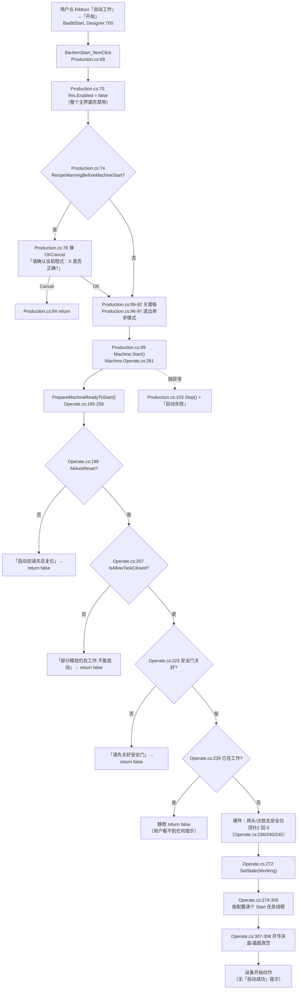

**等价的 ASCII 版：**

```
[用户点「自动工作」→「开始」]
        |
        v
BarItemStart_ItemClick (Production.cs:68)
        |
        +-- Production.cs:70  Enabled = false        <- 界面先僵住
        +-- Production.cs:74  配方确认开关?
        |        是 -> 弹 OK/Cancel (Production.cs:76)
        |               Cancel -> return (Production.cs:84)
        +-- Production.cs:89  关面板 "ucGuidMove"（少一个 e）
        +-- Production.cs:96  退出单步模式
        +-- Production.cs:99  Machine.Start()  =====> Machine.Operate.cs:261
                                   |
                                   +-- PrepareMachineReadyToStart()  (185-256)
                                   |     [193-196] 加密狗到期校验：已被注释掉
                                   |     199 AllAxisReset?      -> "启动前请先总复位"
                                   |     207 IsAllowTaskClosed? -> "部分模组仍在工作..."
                                   |     223 安全门?            -> "请先关好安全门"
                                   |     229 已在工作?          -> 静默 return（无提示）
                                   |     236/240/245 硬件回安全位
                                   |     249 CheckOperatingEnvironment()
                                   |
                                   +-- 272 SetState(Working)
                                   +-- 274-278 Transport/Wafer 任务线程
                                   +-- 280-286 系统1 点胶任务线程
                                   +-- 288-290 ActionNodesService.Init() + BondTask
                                   +-- 291-297 刮胶盘任务线程
                                   +-- 299-305 翻转台任务线程
                                   +-- 307-308 开真空（硬件）
                                   |
                                   v
                              设备开始动作（无"启动成功"提示）
        |
        +-- 抛异常 -> Production.cs:103 Stop() + "启动失败"
```

---

#### 4.3.2 「**停止**」—— 从点击到所有任务收尾

**① 用户在界面上做什么**：在同一个「自动工作」页签下点「**停止**」（`BarBtCancel`，Designer `:710`）。
底部工具条上的「停止」（`BtCancel`，`:2811`）走**同一个处理器**。

**② 代码里依次发生什么**（`UcMainSystem.cs:759` `BtCancel_ItemClick`，只有 4 行有效代码）：

| 位置 | 做什么 |
|---|---|
| `:761` | `this.Enabled = false;` |
| `:762` | `this.LbTip.Text = "设备正在停止，请稍后";` |
| `:763` | `this.LbTip.Visible = true;` |
| **`:765`** | **`Machine.GetInstance().Stop();`** |

**③ 最终发生在设备 / 数据上的是什么**

`Machine.Stop()`（`Machine.Operate.cs:347-378`）**一共 8 个动作**：

| 位置 | 动作 | 类别 |
|---|---|---|
| **`:350`** | `SetState(MachineStateEnum.Stop)` | **内存状态**（并写 `StatisticsService` 记录）|
| `:353` | `AKRSMessageBoxExt.ClearMessageBox()` | 关掉遗留弹窗 |
| `:356` | `this.SetStopStateAlarm()` | **报警 / 蜂鸣器**（⚠️ 见下注）|
| `:359` | `IsSingleStepWork = false` | 内存 |
| `:362` | `SignalPool…IsBondNeedChipSignal.ReSet()` | 信号复位 |
| `:365-368` | 若 `LoadConfiguration == Online` ⇒ `SetLoadingTableNeedTabletSignal(false)` | 信号 + 可能硬件 |
| `:371` | `EjectController.CloseEjectionTableVacuum()` | **硬件（关真空）** |
| `:373-377` | 遍历 `PostBondInspections` ⇒ `CurrentDefectNumber = 0` | 内存（**清零焊后缺陷计数**）|

**④ 用户看到什么**
- 界面立刻禁用，并且**屏幕上出现一行字「设备正在停止，请稍后」**（`LbTip`）。
- ⚠️ **这行字不会自己消失**，它的隐藏逻辑写在一个很绕的地方：
  `UcMainSystem.UIState.cs:384-398` 判 `MachineState == Stop && this.Enabled == false && this.LbTip.Text == "设备正在停止，请稍后"`，
  再等 `Machine.GetInstance().IsAllowTaskClosed()` 为真，才 `:395 Enabled = true; :396 LbTip.Visible = false;`。
  **这是个精确字符串比较** ⇒ 只要有人改了 `:762` 那句话里的一个字，
  **提示会永久挂在界面上、整个主界面永久禁用**。🔴 记入 §9.3。

> ⚠️ **`LbTip` 这个标签是「一物二用」**：它的设计期文字是「**程式切换中······**」
> （Designer `:2475`），却被借来当「设备正在停止」的提示。
> 全仓还有别的地方也在改它的文字 ⇒ 改文案时**改一处会影响另一处语义**。⚠️ 记入 §9.7。

> ⚠️ **`SetStopStateAlarm()`（`Machine.cs:180-192`）里有一个取反判据**：
> `:188 if (hardwaresByType == null || hardwaresByType.Any<Alarmer>())` —— 缺一个 `!`。
> 字面意思是「当列表为 `null` **或**列表里有报警器时」执行 `:190 SetStopState()`。
> **结果是列表为 `null` 时也进同一分支** ⇒ `:190` 会拿一个 `null` 去取下标而抛 `NullReferenceException`（**推断**，未运行验证）。
> ⚠️ 见 §9.3 恒假判据 / 取反判据。

**流程图：**

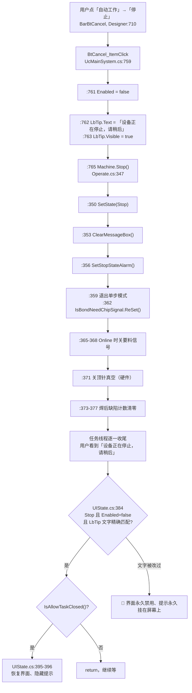

---

#### 4.3.3 「**暂停**」与「**继续**」—— 两个极短的方法

**① 用户在界面上做什么**：点「**暂停**」（`BarBtPause`，Designer `:720`）或「**继续**」（`BarBtContinue`，`:730`）。

**②③ 代码与后果**：

| 按钮 | 处理器 | 方法体 | 最终发生什么 |
|---|---|---|---|
| `暂停` | `BtPause_ItemClick` `UcMainSystem.cs:772` | **只有一行**：`Machine.GetInstance().Pause();` | `Machine.Operate.cs:314` `Pause()` ⇒ `:317 SetState(MachineStateEnum.Pause)`。**只改内存状态**：不关真空、不停轴、不中止线程 |
| `继续` | `BtContinue_ItemClick` `UcMainSystem.cs:847` | 一行：`Machine.GetInstance().Continue();` | `Operate.cs:323` `Continue()`，**分两种情况**（见下）|

`Continue()` 的分支（`Machine.Operate.cs:323-342`）：
- `:325` 若**没配安全门** ⇒ 直接 `:327 SetState(Working)`；
- `:329-341` 若配了安全门 ⇒ 先查 `!this.IsSafeDoorClose`：
  未关好 ⇒ `:333` 弹「**请先关好安全门**」（**什么都不做**）；
  关好了 ⇒ `:337-339` 先把 `DispenseRunTimeProvider.IsFirstDispense = true;` 与
  `System2RunTimeProvider.IsFirstDispense = true;` **两个「首件」标志置真**，再 `SetState(Working)`。

**④ 用户看到什么**
- 点「暂停」：**没有任何提示**，只是界面随状态变化重算按钮可用性（`UIState.cs:256 ChangePauseUiState`）。
- 点「继续」：安全门没关好 ⇒ **弹「请先关好安全门」，且设备不会恢复运行**
  —— 这是一个容易误判成「继续没反应」的地方。
- ⚠️ `Continue()` 把两个 `IsFirstDispense` 置真的含义是「**恢复运行后重新做一次首件**」。
  这是**有意的**（安全门开过之后位置可能变了），**不是缺陷**，但读代码时容易误以为是笔误。

> ⚠️ **暂停时界面会大面积变灰**：`ChangePauseUiState()`（`UIState.cs:256`，体 257-368）把约 90 个控件逐个
> `Enabled = false`。**这是设计意图**（暂停时不允许改配置），但要写在文档里，
> 免得后人看到「暂停后一堆按钮点不动」以为是缺陷。

---

#### 4.3.4 「**急停**」—— 界面上最像救命键、实际最不该依赖的那一个 🔴

**① 用户在界面上做什么**
点 Ribbon「**设备功能**」页签下那组按钮里的「**急停**」（`BtEmergencyStop`，Designer `:878`，
它被加进 `ribbonPageGroup11`，`Designer:2073`）。

**② 代码里发生什么**（`UcMainSystem.cs:1058-1068`，全方法只有两行有效代码）：

```
:1060  List<Axis> axisList = HardwareRepositoryService.GetHardwaresByType<Axis>();
:1062  Parallel.ForEach(axisList, (axis, sate, i) => { axis.StopMove(false, true); });
```

**③ 最终发生在设备 / 数据上的是什么**
- ✅ 对**每一个轴**并行下发 `StopMove(false, true)` ⇒ **轴确实会停**（这是硬件动作）。
- 🔴 **它不改变设备状态**：没有 `SetState(Stop)`、没有 `Machine.Stop()`、没有 `AbortThread()`。
  ⇒ 软件的 `MachineStateModel.MachineState` **仍然是 `Working`**，各任务线程**仍在跑**，
  算法层仍以为设备在正常工作。
- 🔴 **`Machine.EmergencyStop()`（`Machine.Operate.cs:383-402`）全仓没有任何调用点。**
  已用 `grep -rn --include='*.cs' 'EmergencyStop' .` 在 `AKRS.ZX2200` 全目录核过：
  它的名字只出现在**自己的定义 `:383`** 和 **UI 按钮的控件名 `BtEmergencyStop`** 上，**没有第四个出现处**。
  而那个方法**恰好是把事情做对的**：`:386 GetHardwaresByType<Axis>()` + `:388 Parallel.ForEach` +
  **`:392 axis.StopMove(false, true)`** + **`:396 Machine.GetInstance().Stop()`** + **`:399-401` 三个 `AbortThread()`**
  （`DispenseWorkTask` / `BondTask` / `WaferSubSystemTask`）。
  **也就是说：真正该被这个按钮调用的方法，从来没有被任何界面调用过。**

**④ 用户看到什么（这一条最要紧）**
主界面上的「急停」按钮，**可用性是被状态反向门控的**（证据在 `UcMainSystem.UIState.cs`）：

| 设备状态 | 把「急停」设成 | 位置 | 用户实际能不能点 |
|---|---|---|---|
| **工作（Working）** | **`Enabled = false`** | `UIState.cs:85`（在 `ChangeRunningUiState()` 内） | **不能点，按钮是灰的** |
| 停止（Stop） | `Enabled = true` | `UIState.cs:201`（在 `ChangeStopUiState()` 内） | 能点 |
| **暂停（Pause）** | **`Enabled = false`** | `UIState.cs:305`（在 `ChangePauseUiState()` 内） | **不能点，按钮是灰的** |

⇒ **设备正在跑的时候，界面上那个「急停」是灰的、点不动；设备已经停下来了，它才亮。**
这正是它的用途的**反面**。🔴 记入 §9.4。

> ⚠️ **要写清楚，不要误伤**：这不是「按钮坏了」、也不是「点了会崩溃」。
> 按钮本身工作正常、处理器也真的会把轴停掉。
> 问题只在于**它的启用条件与它的用途相反**，且**它不做状态收敛**。
> 本节只做**代码事实描述**，不对现场安全设计做评价；
> 现场另有硬件急停回路，**不在本目录代码范围内**。

---


### 4.4 程式（Recipe）相关按钮 ★第二层★

程式是这台设备的"活"：**当前程式是谁、它的 PR（视觉模板）有没有加载成功，
决定了「开始」能不能启动。** 这一节的五个按钮是操作员每天要点几十次的那几个。

先给一张"程式状态"的图（这是理解后面所有按钮的前提）：

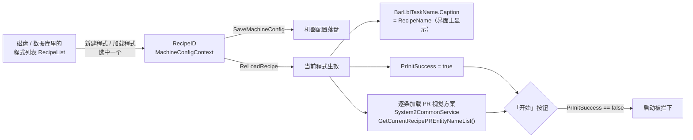

```
[磁盘程式列表] --选中--> [RecipeID] --落盘--> [机器配置]
                             |
                             +--ReLoadRecipe--> [当前程式生效]
                                                  |-- 界面标题栏显示 RecipeName
                                                  |-- PrInitSuccess = true
                                                  +-- 逐条加载视觉方案(PR)
                                                          |
                                        「开始」按钮要求 PrInitSuccess == true
```

#### 4.4.1 「**新建程式**」`BtNewProduct_ItemClick` —— 复制一个旧程式当模板，再问你要不要切过去

- **界面标题**：`"新建程式"`（`UcMainSystem.designer.cs:551`），接线 `:556`。
- **处理器**：`Main/Controls/Ucmain/MainControls/UcMainSystem.cs:320`。
- **用户看到什么**：点下去弹出一个「新建程式」对话框（`FrmAddRecipe`），
  里面是**已有程式的列表**（`RecipeRepository.GetInstance().RecipeList`）供你挑一个当模板。
  点确定后**再弹一个 Yes/No**：「是否将当前程式切换为:{你选的名字}?」。
  - 选 **Yes** ⇒ 当前程式立刻换掉，标题栏的程式名跟着变，视觉模板开始重新加载（界面会短暂变灰、
    中央出现一行提示文字）。
  - 选 **No** ⇒ 程式**建出来了但当前不切换**，标题栏不变，界面无任何反应。

**四段式**

1. **入口**：页签「文件操作」→「新建程式」。
2. **前置条件**：无门槛——**这个按钮在任何状态下都能点**（新建不等于切换）。
3. **执行链**（`UcMainSystem.cs:320-366`）：
   - `:322` `new FrmAddRecipe(RecipeRepository.GetInstance().RecipeList, TuService.CopyOldRecipePR)`
   - `:323` `ShowDialog()`
   - `:325` `if (dr == DialogResult.OK)`
   - `:327` 先记下 `oldRecipe = MachineConfigContext.GetInstance().CurrentRecipe`
   - `:331` 弹 Yes/No：「**是否将当前程式切换为:{name}?**」
   - `:337` 选 Yes ⇒ `:339` 写 `MachineConfigContext.GetInstance().RecipeID`；
     `:340` `SaveMachineConfig()`；`:344` / `:349` 当 **新 RecipeID ≠ 旧 RecipeID** 时调 `ReLoadRecipe()`
   - `:363` `RecipeRepository.GetInstance().Save()`（**真正把新程式写进程式库**）
   - `:361` `BackgroundThreadService.ActivateSingleTaskExecute()`（触发一次界面刷新）
4. **终点**：
   - **数据**：`RecipeRepository` 落盘（新增一条程式）；若选了 Yes，`MachineConfigContext` 的
     `RecipeID` 也落盘 ⇒ **软件重启后仍然是这个程式**。
   - **界面**：选了 Yes ⇒ 标题栏程式名变化 + 视觉模板重载；选了 No ⇒ 界面**没有任何变化**。

> ⚠️ **注意一个细节**：`RecipeRepository.Save()` 在 `:363`，位于 `if (OK)` 块内、
> **在 Yes/No 询问之后** —— 也就是说，**哪怕你选 No（不切换），程式也已经建好了**。
> 这一点符合直觉，但把它写成"选 No 就什么都没发生"是错的。

#### 4.4.2 「**编辑程式**」`BtEditProduct_ItemClick` —— 三道门禁，任何一道过不去都进不了编辑界面

- **界面标题**：`"编辑程式"`（`UcMainSystem.designer.cs:559`），接线 `:565`。
- **处理器**：`UcMainSystem.cs:368`。
- **用户看到什么**：点下去**大概率会被一条提示框拦住**，拦住的理由有三种，
  而且提示文字**中英文混杂**（见下）。

**四段式**

1. **入口**：页签「文件操作」→「编辑程式」。
2. **前置条件**（`UcMainSystem.cs:370-390`，**依次三道**，任一不过直接 `return`）：

   | 序 | 判断 | 用户看到的提示 | 行 |
   |---|---|---|---|
   | 1 | `Machine.GetInstance().IsWorking()` | 「设备正在工作，请先停止工作！」 | `:370` 起 |
   | 2 | `MachineWorkMode == MachineWorkModeEnum.DryCycle` | 「设备处于空跑模式，不允许编辑程式」 | `:375` 起 |
   | 3 | `ProductConfiguration == null \|\| string.IsNullOrEmpty(RecipeName)` | 「请先新建程式!」 | `:381` 起 |

3. **执行链**（`:392-404`）：
   - `:393` 先把系统切到 System2：`CurrentMachineSystem = CurrentMachineSystemEnum.System2`
   - `:395` `ShowPanel("ucEditProductProgramming", () => new UcEditProductProgramming())`
     —— 注意**面板名是全小写开头的 `ucEditProductProgramming`**，与 `UcModule` 那边的
     `"ucGuideMove"` 一样属于"按字符串找面板"的写法（见 §9.7 命名一致性）。
   - 编辑器本体是 `Infrastructure/Controls/Feature/EditProgram/UcEditProductProgram/UcEditProductProgramming`，
     **归 37 号文档**。
4. **终点**：界面在多文档区（`DockPanel`）里多出一个「程式编辑」面板；
   **本按钮本身不写任何盘**——写盘发生在编辑面板内的保存按钮上（归 37 号）。

> ⚠️ 提示 1 的判断是 `IsWorking()`，提示文字却说"请先停止" —— 而 `IsWorking()` 为真时
> **设备正处于"运行中"状态**（`MachineStateEnum.Working`），确实要先停。逻辑与文字一致。
> 但门禁 2「空跑模式」用的是 `MachineWorkMode`（**工作模式**），
> 与 `MachineState`（**状态**）是两个不同维度，见 §3.3 速查表。

#### 4.4.3 「**加载程式**」`BarBtLoad_ItemClick` —— 换一个程式，并重新加载它的视觉模板

- **界面标题**：`"加载程式"`（`UcMainSystem.designer.cs:665`），接线 `:670`。
- **处理器**：`UcMainSystem.cs:805`。
- **用户看到什么**：弹出程式列表（`FrmLoadRecipe`）让你选。选完点确定：
  - 成功 ⇒ 界面中央出现提示文字、整个主界面**变灰一小会儿**（`ReLoadRecipe` 里的
    `this.Enabled = false` + `LbTip.Visible = true`），然后恢复，标题栏程式名变新名字。
  - 选中的程式为空 ⇒ 弹「**切换程式失败**」错误框。
  - 加载视觉模板抛异常 ⇒ 弹「**设备初始化视觉模板失败，请联系设备人员**」，
    并且**异常被重新抛出**（`throw;`）⇒ 上层没有捕获 ⇒ **可能直接把软件打崩**。

**四段式**

1. **入口**：页签「文件操作」→「加载程式」。
2. **前置条件**：**本按钮自己不做任何状态判断** —— 不查 `IsWorking()`、不查是否在跑程式。
   换句话说：**设备正在生产时点它，代码也不会拦你**（后果由 `ReLoadRecipe` 的
   `dockManager.Clear()` 承担 —— 它会清掉所有停靠面板）。这是一个值得注意的口径。
3. **执行链**（`UcMainSystem.cs:805-841`）：
   - `:807` `oldRecipe = MachineConfigContext.GetInstance().CurrentRecipe`
   - `:808-809` `new FrmLoadRecipe()` + `ShowDialog()`
   - `:810` `if (dr == DialogResult.OK)`
   - `:812` 若选中的 `Recipe != null`：`:814` 写 `RecipeID`；`:815` `SaveMachineConfig()`；
     `:817-828` 当**新 ID ≠ 旧 ID**（或旧程式为 null）时 `ReLoadRecipe()`
   - `:832` 否则弹「切换程式失败」（`MessageBoxIcon.Error`）
   - `:835` `Dispose()`；`:838` `ActivateSingleTaskExecute()`
4. **终点**：
   - **数据**：`RecipeID` 落盘；旧 PR 方案被 `VmSolution.Instance.CloseSolution()` 关掉、
     新方案被 `VmSolution.CreatSolInstance()` 建出来，再逐个 `prEntity.Alg.InitVmProcedure()`。
   - **界面**：标题栏程式名变化；所有已打开的停靠面板被清空（`dockManager.Clear()`）。

#### 4.4.4 「保存」`BtSave_ItemClick` —— 一条命令把**四十多个单例**逐个落盘

- **界面标题**：Ribbon 上是 `BarBtSave.Caption = "保存"`（`UcMainSystem.designer.cs:691`），
  接线 `:696`；底部工具条上还有一个「保存」（`BtSave`，接线 `:2789`）。
  ⚠️ **两个按钮的名字不一样：Ribbon 那个控件叫 `BarBtSave`，处理器却叫 `BtSave_ItemClick`**
  （`BarBtSave` 的用户可见文字是"保存"）。
- **处理器**：`UcMainSystem.cs:632`。
- **用户看到什么**：点下去**界面会僵住一小会儿**（约四十次同步写盘，全部在 UI 线程上），
  然后弹一个「**保存成功！**」的信息框。任何一步抛异常 ⇒ 弹「**保存失败\n**」+ 异常消息，
  同时往日志里写一条。

**四段式**

1. **入口**：页签「文件操作」→「保存」；或底部工具条「保存」。
2. **前置条件**：**无**。任何状态下都能点。
3. **执行链**（`:632-690`）：
   - `:637`~`:683` 连续约 **40 次** `Xxx.GetInstance().Save()` —— 把当前内存里的各配置单例
     逐个写盘（产品配置、轨道配置、标定参数、加热参数、视觉参数……）。
   - `:686` `AKRSXtraMessageBox.Show("保存成功！")`
   - `catch` ⇒ `LogHelper.Post(...)` + 弹「保存失败\n」+ `e.Message`
4. **终点**：
   - **数据**：几十个配置文件被覆盖写入（见 §8.3 落盘清单）。
   - **界面**：一个信息框；**没有任何"脏数据"标记被清掉**（本项目没有 dirty 状态机制）。

> ⚠️ **口径**：这个按钮**不区分模块**，一次把全部单例都存一遍。
> 所以"我只改了 A 模块，点保存会不会把 B 模块的旧值也写进去"这个担心**是成立的**：
> 它写的**永远是内存里的当前值**，而内存值在软件启动时从盘里读进来。**没有撤销路径。**

#### 4.4.5 「**程式管理**」`BarBtRecipeManage_ItemClick` —— 复制 / 删除程式

- **界面标题**：`"程式管理"`（`UcMainSystem.designer.cs:682`），接线 `:687`。
- **处理器**：`UcMainSystem.cs:931`。
- **用户看到什么**：弹出程式管理对话框（`FrmRecipeManage`），里面可以**复制**和**删除**程式，
  两个动作分别回调到 `TuService.CopyOldRecipePR` / `TuService.DeleteOldRecipePR`。
  关掉后界面自己刷新一次。

**四段式**

1. **入口**：页签「文件操作」→「程式管理」。
2. **前置条件**：无（删除的保护在 `FrmRecipeManage` 内部，**归 33 号文档**）。
3. **执行链**（`:931-946`）：`new FrmRecipeManage(TuService.CopyOldRecipePR, TuService.DeleteOldRecipePR)`
   → `ShowDialog()` → `Dispose()`（`:944`）→ `BackgroundThreadService.ActivateSingleTaskExecute()`（`:945`）。
4. **终点**：程式的**复制/删除由回调方完成**（`TuService` 内部）；本按钮**自己不写 RecipeRepository**。

#### 4.4.6 「Adjust in processing list」`BarBtPRList_ItemClick` —— 加工中调整列表

- **界面标题**：`"Adjust in processing list"`（**英文，未本地化**，`UcMainSystem.designer.cs:620`），
  接线 `:623`。
- **处理器**：`UcMainSystem.cs:1479`。
- **用户看到什么**：弹出 `FrmPRList`，列出**当前程式用到的所有 PR（视觉模板）实体名**
  （数据来自 `System2CommonService.GetCurrentRecipePREntityNameList()`），可以逐条调整。
- **四段式**：入口「文件操作」→ 该按钮；**无前置条件**；
  `:1481 new FrmPRList(System2CommonService.GetCurrentRecipePREntityNameList())` → `:1482 ShowDialog()`
  → `:1484 Dispose()`；终点：**只读展示 + 编辑在 `FrmPRList` 内部**，本按钮不落盘。
- **命名一致性**：`BarBtPRList` 的处理器名叫 `BarBtPRList_ItemClick`，而**底部工具条**上
  同名功能的按钮 `BtCurrentRecipePRList`（标题 `"Current Recipe PRList"`，`designer:2961`）
  的处理器是 `UcMainSystem.cs:1181 BtCurrentRecipePRList_ItemClick` —— **两处代码几乎逐字相同**
  （`:1181-1187` 与 `:1479-1485`），是复制粘贴出来的两个入口。见 §9.7。

#### 4.4.7 `ReLoadRecipe()` 闸门内部：为什么点完"加载程式"界面会灰一下

- **定义**：`UcMainSystem.Production.cs:137`（`private void ReLoadRecipe()`，`ReLoadRecipe` 全文 137-211）。
- **调用者只有 4 处**（全部在 `UcMainSystem.cs`）：`:344`、`:349`（新建程式）、`:821`、`:826`（加载程式）。

**它做了什么**（逐行）：

| 行 | 动作 | 用户看到什么 |
|---|---|---|
| `:139` | `Machine.GetInstance().PrInitSuccess = false` | —— |
| `:142` | `this.Enabled = false`（**防呆**，注释原文） | **整个主界面变灰、点不动** |
| `:143-146` | `LbTip.Visible = true`，移动到屏幕中央偏上，`BringToFront()` | 界面中央出现一行提示文字 |
| `:148` | `BarLblTaskName.Caption = MachineConfigContext.GetInstance().RecipeName` | 顶部显示新程式名 |
| `:149` | `this.dockManager.Clear()` | **所有已打开的停靠面板被关掉** |
| `:150` | `this.InitProgramNodes()` | 程式节点树重建 |
| `:155-160` | 若 `MachineStateModel.GetInstance().IsOffLineWork` ⇒ 直接 `PrInitSuccess = true; return;` | **离线模式下不加载视觉方案**，面板也不会灰太久 |
| `:162` | `LogHelper.Post(Level.Info, "准备加载PR", ...)` | 状态栏/日志出现一行 |
| `:168` | `VmSolution.Instance.CloseSolution()` | —— |
| `:172` | `VmSolution.CreatSolInstance()` | —— |
| `:174-190` | 逐条 `PREntity` 找出来，找到就 `prEntity.Alg.InitVmProcedure()`，**找不到只写日志不报错** | 日志里出现「视觉方案加载失败，未找到：xxx」 |
| `:192` | `DispenseRunTimeProvider.LoadDispensePr()` | —— |
| `:194` | `Machine.GetInstance().PrInitSuccess = true` | —— |
| `catch` `:196-201` | 弹「**设备初始化视觉模板失败，请联系设备人员**」+ 写日志 + **`throw;`** | 错误框，且异常继续向上抛 |
| `finally` `:203-207` | `LbTip.Visible = false`；`this.Enabled = true` | 界面**恢复可用** |

> 🔴 **这里有一段不可达代码**（`UcMainSystem.Production.cs:209-215`）：
> ```csharp
> return;
>
> // 杀死当前进程，自动重启软件
> Process.Start(Application.StartupPath + "\\AKRS.ZX2200.exe");
> System.Diagnostics.Process.GetCurrentProcess().Kill();
> Application.Exit();
> System.Environment.Exit(0);
> ```
> `return;` 之后的五行**永远不会执行**（其中 `return;` 在 `:209`，重启代码在 `:211-215`）。
> 从注释看，作者原本打算"加载 PR 失败就重启软件"，**后来改成了抛异常，但重启代码没删**。
> ⇒ **用户看到的是"弹框 + 可能崩溃"，而不是"自动重启"**。这条进 §9.2。

---

### 4.5 `ShowPanel` 面板机制 —— 界面上一半的"新窗口"其实都是它开的

主界面右侧多文档区的每一个面板（程式编辑、程式参数、灯光调节、模块选择……）
**都不是 `Form`，而是 `DockPanel` 里装的 `XtraUserControl`**，全部由 `ShowPanel` 一个方法开出。

#### 4.5.1 `ShowPanel` 与 `GetDockPanel`

- **定义**：`UcMainSystem.cs:431`（`public void ShowPanel(string controlName, Func<XtraUserControl> createUserControlAction)`）。
- **`GetDockPanel`**：`UcMainSystem.cs:408` —— 遍历 `this.dockManager.Panels`，
  用 `dockManagerPanel.Controls.Find(controlName, true)` **按控件名递归查找**。

**四段式**

1. **入口**：**不是按钮，是被 20 多个处理器调用的公共方法**（见下表）。
2. **前置条件**：无。
3. **执行链**（`:433-461`）：

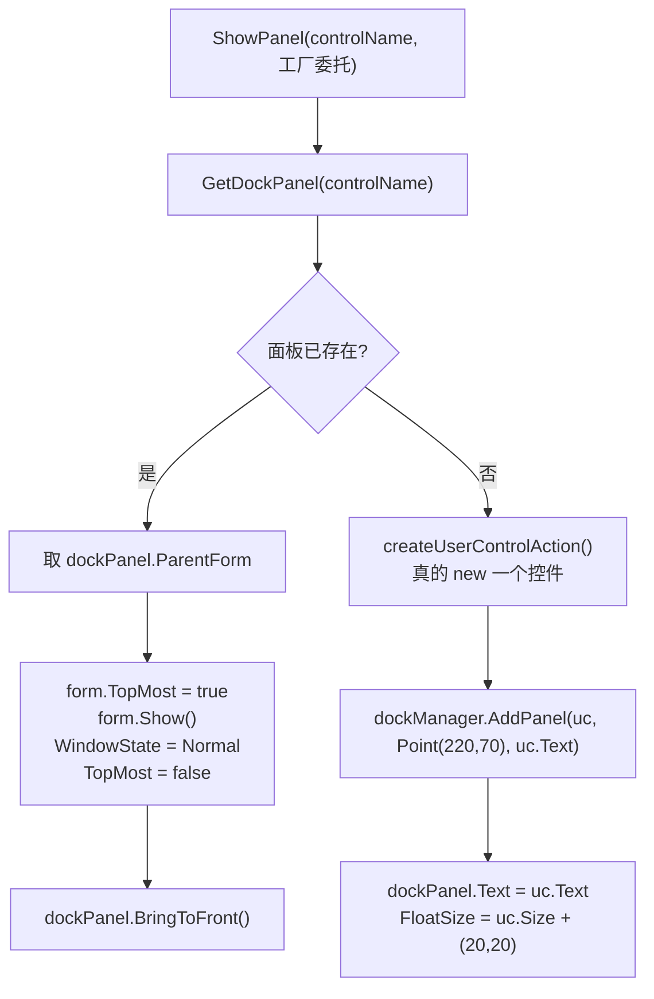

```
ShowPanel(名字, 工厂)
   |
   +-- 已有同名面板? --是--> 把它的父窗体 TopMost 闪一下 + Show + 置前
   |                          （重复点同一个按钮 = 把旧面板拉到前面，不会开第二个）
   +-- 否 --> 调用工厂 new 控件 --> AddPanel(位置 220,70)
```

4. **终点**：界面上多出一个浮动/停靠面板；**本方法不写盘、不碰设备**（"写盘"都在被打开的控件内部）。

#### 4.5.2 ⚠️ 面板是按**控件名字符串**查找的 —— 拼错一个字母就会开出第二个面板

`GetDockPanel` 用的是 `Controls.Find(controlName, true)`，**大小写敏感**。
本目录实测存在**同一个面板两种写法**：

| 写法 | 位置 | 用它的按钮 |
|---|---|---|
| `"ucGuideMove"` | `UcMainSystem.Action.cs:197` | —— |
| `"UcGuideMove"` | `UcMainSystem.cs:1104` | 「**灯光调节**」`BtnBrightnessSetting_ItemClick` |
| `"UcLampRegulation"` | `UcMainSystem.cs:1120` | 底部工具条「灯光调节」`BtLampRegulation_ItemClick` |

⇒ 「灯光调节」这一个功能有**两个入口、两个不同的面板名**（`UcGuideMove` / `UcLampRegulation`），
而且**控件类型是同一个 `UcLampRegulation`**。
后果：**从 Ribbon 点一次、再从底部工具条点一次，界面上会出现两个内容相同的面板**。
这属于「面板名不一致」的命名风险（⚠️，进 §9.7），**不是崩溃**。

#### 4.5.3 会话结束的两种关闭方式

| 方法 | 位置 | 触发者 | 做了什么 |
|---|---|---|---|
| `DockManager_ClosedPanel(object, DockPanelEventArgs)` | `UcMainSystem.cs:452` | **用户点面板上的 ×** | `RemovePanel(e.Panel)` + `e.Panel.Dispose()` |
| `DockManager_ClosedPanel(string panelName)` | `UcMainSystem.cs:466` | **代码**（重载） | 按名字找面板 → `RemovePanel` + `Dispose` |

⚠️ **两个同名方法、参数不同**（一个是事件签名、一个是字符串）。
按名字搜"谁关面板"时，**两个都会被搜到**，很容易看错。

#### 4.5.4 谁会打开面板（`ShowPanel` 的调用点汇总）

| 打开的控件 | 面板名（字符串） | 入口按钮 | 代码位置 |
|---|---|---|---|
| `UcEditProductProgramming` | `"ucEditProductProgramming"` | 「编辑程式」 | `UcMainSystem.cs:395` |
| `UcProgramArgs` | `"UcProgramArgs"` | 底部工具条「程式参数」 | `UcMainSystem.cs:558` |
| `UcLampRegulation` | `"UcGuideMove"` | 「灯光调节」（Ribbon） | `UcMainSystem.cs:1104` |
| `UcLampRegulation` | `"UcLampRegulation"` | 「灯光调节」（底部工具条） | `UcMainSystem.cs:1120` |
| （模块相关） | `"UcModule…"` 系列 | `UcModule` 右键菜单 | 见 §4.7 |

> ⚠️ 上表是**按 `ShowPanel(` 在 `UcMainSystem*.cs` 里的调用点**列的，
> 全部位于非 Designer 文件内；每一条我都在原文件里读到过该行。
> **`ShowPanel` 是 `public`**，理论上其他类也能调用 —— 我在本目录内未发现外部调用者，
> 这一点标为**推断**（未做全仓反查）。

---

### 4.6 快捷面板 `UcShortcutMenu` —— 39 个按钮逐个走一遍 ★操作员日常最常用★

**这个面板在哪里**：主界面底部工具条最右边的「快捷菜单」瓦片
（`UcMainSystem.designer.cs:2422 TileBarItemShortcutMenu` → `TileBarItem_ItemClick`）
展开的停靠面板。它跟 Ribbon 的区别是：**Ribbon 是"配置设备"用的，这个面板是"手工动设备"用的**。

**文件**：`Main/Controls/UcShortcutMenu.cs`（1,585 行）+ `Main/Controls/UcShortcutMenu.Designer.cs`（1,020 行）。

#### 4.6.0 接线核对（口径写清楚，便于复核）

| 指标 | 数值 | 怎么数的 |
|---|---|---|
| 面板上的 `SimpleButton` | **39** | 8 个分组框 `GroupControl`，见下表 |
| `Click +=` 接线 | **39** | `grep -c 'Click += new System.EventHandler' UcShortcutMenu.Designer.cs` |
| `_Click` 处理器定义 | **39** | 与接线**一一对应**（集合差为空，我用 `comm` 双向比对过） |
| 另有 1 个定时器 | `timer1.Tick` → `timer1_Tick`（`UcShortcutMenu.cs:549`） | **不是按钮**，每 tick 刷一次按钮底色 |

> ✅ **这 39 个按钮没有一个是"配了没接线"或"接线了没定义"的** —— 这一条我做了双向集合差验证。
> 但**"接线正确"不等于"点了有用"**：其中**至少 1 个是白干的**（见 4.6.7「手动更换料片」）。

#### 4.6.1 ⚠️ 39 个按钮共用同一条前置门禁

**每一个** `_Click` 处理器（以及 `timer1_Tick`）的**第一段**都是同一个判断：

```csharp
if (!Machine.GetInstance().IsStop())
{
    return;
}
```

- **含义**：设备**只有处在"停止"状态**时，快捷面板上的按钮才真的会动设备；
  其它状态（运行中 / 暂停 / 示教 / 准备）点下去**代码直接 `return`，界面上没有任何提示**。
- **用户看到什么**：**按钮按下去了、没有任何反应、也没有弹框**。这不是坏了，是设计如此 ——
  但**界面上没有任何"现在不能点"的视觉提示**（按钮不禁用、不变灰）。这是一个**体验层面的 ⚠️**：
  操作员无法从界面上判断"点了没用"还是"没点到"。
- **例外/差异**：`BtnPickComponent_Click`（取芯片）在此之上**多一道安全门检查**：

  | 行 | 判断 | 用户看到什么 |
  |---|---|---|
  | `UcShortcutMenu.cs:1004` | `MachineHardwareConfiguration.GetInstance().IsSafeDoorConfigured && !Machine.GetInstance().IsSafeDoorClose` | 弹「**安全门未关闭，请关闭安全门后再进行取片测试**」 |

  ⇒ **39 个按钮里只有"取芯片"检查了安全门**。其余按钮（例如"翻转台取片""抛料"这些也会动机构的）
  **只查设备状态，不查安全门**。这一条按事实写，不做安全评价。

#### 4.6.2 分组一「固晶」（`GpBonding`，`Designer:134`，8 个按钮）

| 界面标题 | 处理器 | `.cs` 行 | 用户看到什么（点了之后） |
|---|---|---|---|
| 刮胶盘伸出/缩回 | `BtnMoveSlideFulxer_Click` | `:1249` | 刮胶盘 **伸出→缩回 或 缩回→伸出**；按钮底色在"伸出"态变**黄**，缩回后恢复默认色 |
| 去上视 | `BtnMoveToUpLook_Click` | `:535` | 固晶头**移动到上视位**（`bondModuleController.MoveToUpLookPos()`）；**无返回提示**，要自己看相机画面确认 |
| 还吸嘴 | `BtnPutBackNozzle_Click` | `:521` | 吸嘴**放回吸嘴架**（`system2Controller.PutbackNozzleAssitance()`） |
| 取芯片 | `BtnPickComponent_Click` | `:1002` | **先查安全门**（见 4.6.1）；过了才取片 |
| 抛料 | `BtnThrow_Click` | `:506` | 先把当前芯片**抛掉**（`ThrowAction()`），然后**自动回安全位**（`MoveToSafePos()`） |
| 开焊头吸附 | `BtnBondHeadVacuum_Click` | `:450` | **真空开↔关切换**；关掉之后按钮文字变成「**开焊头吸附**」（`:456` 处 `Text` 被改写）——**按钮上的字会变** |
| 翻转台复位 | `BtnFlipTableGoHome_Click` | `:1220` | 翻转台**回原点**（`FlipTableGoHome()`） |
| 开顶针真空 | `BtnESVacuum_Click` | `:477` | 先关吹气电磁阀、再开真空（注释原文「先关吹气电磁阀」「开真空」），**切换式** |

> ⚠️ **「开焊头吸附」是一个"文字会变的按钮"**（`:456` 写 `this.BtnBondHeadVacuum.Text = @"开焊头吸附";`）。
> 也就是说界面上可能出现**两个都是"开焊头吸附"的按钮状态**（文字与当前实际状态相反的那个时刻）。
> 这是命名/交互一致性的 ⚠️，进 §9.7。

#### 4.6.3 分组二「点胶」（`GpDispense`，`Designer:272`，4 个按钮）

| 界面标题 | 处理器 | `.cs` 行 | 用户看到什么 |
|---|---|---|---|
| 挤胶 | `BtChangeDispensing_Click` | `:304` | **先弹一句「即将移动到挤胶位，人员请离开」**（`AKRSXtraMessageBox.Show`），确认后移动到挤胶位 |
| 清洁预点胶板 | `BtCleanPreDispensePlate_Click` | `:426` | `S2PreDispensePlateProgram.InitPre()`（System2 点胶）或走另一分支（`else`，`:435` 起） |
| 更换点胶头 | `BtChangeDispenser_Click` | `:359` | 弹出助手窗体 `FrmAssistantDispense`（`ShowDialog`，**模态**） |
| 预点胶 | `BtPreDispense_Click` | `:385` | 若预点胶模式与时机**两个都是 `Off`** ⇒ 走"不预点胶"分支；否则真预点胶 |

> ⚠️ **这三个"点胶"处理器内部都有一层"系统判断"**：
> `MachineHardwareConfiguration.GetInstance().IsSystem2Dispense && MachineStateModel.GetInstance().CurrentMachineSystem == CurrentMachineSystemEnum.System2`
> —— 即**同一台机器装了双点胶系统时，按钮的行为取决于当前选中的是 System1 还是 System2**。
> 操作员如果忘了自己当前在哪个系统，**按同一个按钮会得到不同结果**。这一条在文档里必须点明。

#### 4.6.4 分组三「流道」（`GpTransport`，`Designer:358`，8 个按钮）

| 界面标题 | 处理器 | `.cs` 行 | 动作 |
|---|---|---|---|
| 传送到下一个位置 | `BtTransportToNext_Click` | `:1576` | `TransportController.TransportUnitIndex()` |
| 查看贴片情况 | `BtVisionBpInBo_Click` | `:1202` | 打开视觉窗口 + `ChangeCameraVision("Bond相机")` + 切到 System2 + 弹 `FrmModuleSelect(BondPosition)` |
| 查看点胶情况 | `BtVisionBpInDs_Click` | `:1184` | 同上，相机换成 `"点胶相机"`，系统切到 System1 |
| 清空轨道内载具 | `BtInitializeTS_Click` | `:228` | `transportController.InitializeTS()` |
| 搜索固晶载具 | `BtSearchBelt2Sys2_Click` | `:285` | **先回安全位**（`bondModuleController.MoveToSafePos()`），再 `BondSubSectionController.MapBelt(false)` |
| 清空固晶载具 | `BtClearBond_Click` | `:256` | `transportController.InitializeTSInBond()` |
| 清空点胶载具 | `BtClearDispense_Click` | `:242` | `transportController.InitializeTSInDispense()` |
| 搜索点胶载具 | `BtSearchBelt1Sys1_Click` | `:270` | **先回安全位**（`DispenseController.MoveToSafePos()`），再 `DispenseSubSectionController.MapBelt(false)` |

> ⚠️ **「清空轨道内载具」与「清空固晶载具」「清空点胶载具」是三个按钮、三个不同方法**
> （`InitializeTS` / `InitializeTSInBond` / `InitializeTSInDispense`），**别当成一个**。
> 同理「搜索」也有点胶/固晶两套。
> 「查看贴片情况 / 查看点胶情况」这一对处理器**是镜像复制**（`:1184-1191` 与 `:1202-1209`），
> 差别只有相机名与 `CurrentMachineSystem` 两个值 —— 改一处漏一处是必然风险。

#### 4.6.5 分组四、五「上料仓 / 下料仓」（各 4 个按钮，**高度对称的复制品**）

| 上料仓（`GpLoader`，`Designer:500`） | 下料仓（`GpUnLoader`，`Designer:586`） | 说明 |
|---|---|---|
| 「下一片料」`BtnLoaderNextTablet_Click` `:693` | 「下一片料」`BtnUnLoaderNextTablet_Click` `:871` | 都先查超限：`IsOutOfTabletLimit(GetCurPlaceLayer() + 1)`（上料）/ `IsOutOfTabletLimit()`（下料）⇒ 超限**静默 return** |
| 「更换料盒」`BtnLoaderLastBin_Click` `:802` | 「更换料盒」`BtnUnLoaderLastBin_Click` `:969` | 都把按钮**置黄 + 禁用**再 `try` |
| 「从第一片开始」`BtnLoaderStartFromFirst_Click` `:658` | 「从第一片开始」`BtnUnLoaderStartFromFirst_Click` `:835` | 同上，**置黄 + 禁用 + try** |
| 「选择料片」`BtnLoaderChooseTablet_Click` `:731` | 「选择料片」`BtnUnLoaderChooseTablet_Click` `:909` | 弹 `XtraInputBox.Show("请输入料片号", "料片号", "1")`，且有 `RetryCommand:` **goto 重试标签** |

**用户看到什么（共同点）**：点了「更换料盒 / 从第一片开始 / 下一片料」之后，
**按钮自己变成黄色并变灰（禁用）**，等到动作做完才恢复 —— 这就是这个面板"忙不忙"的唯一指示。

> ⚠️ **`RetryCommand:` goto 重试**（`:738` 与 `:916` 附近）：输入非法时**弹回同一句输入框**，
> 且**没有"取消"退出路径**（如果存在只能靠输入框的 Cancel 返回值），
> 意味着**输入框会一直陪着操作员直到他输对**。这是"无界交互循环"的一个形态，
> 但它**每次都会等用户输入**（不是忙等），所以**不会冻结界面**。
> 定级：⚠️（交互体验），**不是** UI 线程阻塞。

#### 4.6.6 分组六「晶圆/华夫盒」（`GpWafer`，`Designer:679`，7 个按钮）

| 界面标题 | 处理器 | `.cs` 行 | 动作 |
|---|---|---|---|
| 开静态华夫盒真空 | `BtnStaticWaffleVacuum_Click` | `:1547` | 先关吹气、再开真空（注释原文同 4.6.2），**切换式** |
| 开晶圆台真空 | `BtnWaferTableVacuum_Click` | `:1523` | 同上，对象是 `WaferSubModule.WaferTable.WaffleVacuum` |
| 静态华夫盒设置 | `BtnStaticWaffleSet_Click` | `:1491` | `new FrmWaffleMap(true)` + `ShowDialog()`（**模态**） |
| 华夫盒设置 | `BtnWaffleSet_Click` | `:1476` | `new FrmWaffleMap(false)` + `ShowDialog()`（**模态**） |
| 实时华夫盒图 | `BtnShowWaffleMap_Click` | `:1445` | `WaferSystemDomain…Block.ShowMapping(true)`，异常⇒弹 `exception.Message` |
| 晶圆图 | `BtnShowWaferMap_Click` | `:1424` | `WaferSystemDomain…Block.ShowMapping()`，异常⇒弹 `exception.Message` |
| 手动更换料片 | `BtnChangeTabletWithManual_Click` | `:1234` | 🔴 **什么都没发生**，见 4.6.7 |

> ⚠️ **「静态华夫盒设置」与「华夫盒设置」只差一个 `true` / `false` 参数**
> （`new FrmWaffleMap(true)` / `new FrmWaffleMap(false)`）—— 两个完全不同的界面，
> 靠一个布尔量区分。**读代码时极易看错**，进 §9.7。
> 同理「实时华夫盒图」与「晶圆图」只差 `ShowMapping(true)` / `ShowMapping()`。

#### 4.6.7 🔴 「手动更换料片」——**按钮是好的、接线是对的、点了什么都不会发生**

- **界面标题**：`"手动更换料片"`（`UcShortcutMenu.Designer.cs:792`），接线 `:793`。
- **处理器**：`UcShortcutMenu.cs:1234 BtnChangeTabletWithManual_Click`。
- **处理器全文**（`UcShortcutMenu.cs:1234-1241`，逐行读过）：

```csharp
private void BtnChangeTabletWithManual_Click(object sender, EventArgs e)
{
    if (!Machine.GetInstance().IsStop())
    {
        return;
    }
    FrmChangeTabletTeach frmChangeTablet = new FrmChangeTabletTeach();   // :1240 建窗体
    frmChangeTablet.Dispose();                                            // :1241 立刻销毁
}
```

- **关键点**：窗体对象**被创建出来，然后紧接着被 `Dispose()`，中间没有任何 `Show()` / `ShowDialog()`**。
- **用户看到什么**：在**停止状态**下点这个按钮 —— **界面上没有任何变化**，不弹窗、不报错、日志也没有。
  在非停止状态下点 —— 同样没有任何变化（被第一道 `IsStop` 门禁拦掉）。
  ⇒ **两种情况下用户看到的都是"点了没反应"**。
- **定性**：这是「**被搁置的功能**」——窗体 `FrmChangeTabletTeach` 是存在的（**在编译**，
  不是幽灵文件），代码留下的形态说明作者**当时打算 `ShowDialog()` 但最终没写**，
  或是**调试期临时把 `Show()` 删了**。**不是崩溃、不是"按钮坏了"。**
- **与"永久禁用控件"的区别**：这个按钮**没有被 `Enabled = false`**，
  它是**处理器体内少了一行**。两者在界面上表现相似（点了没用），但**成因完全不同**，
  文档里必须分开写。进 §9.2（空处理器 / 白干按钮）。

#### 4.6.8 分组七、八「翻转台 / 设备」（`gPFlip` `Designer:807`、`gPMachine` `Designer:879`）

| 界面标题 | 处理器 | `.cs` 行 | 用户看到什么 |
|---|---|---|---|
| 翻转台取片 | `BtnFlipTablePick_Click` | `:1315` | 弹 `FrmSelectComponent`（居中）；**`DialogResult.Cancel` ⇒ 直接 return**（用户取消，什么都不做） |
| 翻转台抛料 | `BtnFlipTableThrow_Click` | `:1296` | **先判断是否在原位**：不在 ⇒ 先 `FlipTableGoHome()`；然后 `Throw()` |
| 翻转台吹气 开/关 | `BtnFlipBlow_Click_1` | `:1273` | **切换式**：吹气开 ⇒ 按钮**变黄**；再点 ⇒ 关、颜色恢复默认 |
| 蜂鸣器 开/关 | `BtnOpenAlarmer_Click` | `:1507` | **切换式**：`BeepElectric.SetOutputValue(...)` 取反 |

> ⚠️ **`BtnFlipBlow_Click_1` 的下划线 `_1`**：说明历史上存在过一个 `BtnFlipBlow_Click`，
> 现在**只剩 `_1` 这一个**（全文件只有 `:1273` 一处定义、`Designer:866` 一处接线）。
> 这是 **Designer 拖拽重复生成处理器**留下的命名残迹，**功能正常**。进 §9.7。
> ⚠️ 与之对照：`UcMainSystem` 里也有 `barButtonItem8_ItemClick_1`（`:2162`）同样形态。

#### 4.6.9 本面板的"状态反馈"只有两种，且都不持久

| 反馈方式 | 哪些按钮用 | 说明 |
|---|---|---|
| **按钮底色变黄** | 刮胶盘、翻转台吹气、上/下料仓的三个按钮 | `Appearance.BackColor = Color.Yellow`；**它是内存态**，切走再切回面板**不一定保持** |
| **按钮文字被改写** | 开焊头吸附 | `Text = "开焊头吸附"`，见 4.6.2 |

> ⚠️ **没有任何一个按钮把自己的状态写进配置文件** —— 也就是说**软件重启后，
> 面板上所有"黄色"状态都回到默认**。这符合"手动操作"的语义，但**如果操作员靠颜色记设备状态，
> 重启后会得到错误印象**。定级 ⚠️，进 §9.7。

### 4.7 `UcModule` 模块图上的右键菜单与双击 ★失效分支最密集的一节★

**这个面板在哪里**：主界面左上的模块总览图（`UcModule`），
每个模块图片上**右键**弹菜单、**双击**图片做动作。

**文件**：`Main/Controls/UcModule.cs`（514 行）+ `Main/Controls/UcModule.Designer.cs`。

#### 4.7.1 右键菜单的入口表（按处理器分组）

| 处理器 | `.cs` 行 | 挂在上面的按钮（界面标题） | 实际有分支吗 |
|---|---|---|---|
| `SubstrateRunner_ItemClick` | `:71` | 「设置」`PBtSet`（`Designer:266`） | ❌ **整段被注释掉** |
| `Feed_ItemClick` | `:103` | 上料器右键菜单项 | ❌ **空方法体**（`103-106` 只有一对花括号） |
| `WaferFeed_ItemClick` | `:117` | 「调试」`BtnDebug`、「换静态华夫盒」`BtnChangeStaticWaffle` | ⚠️ 部分（见 4.7.3） |
| `BtDispense_ItemClick` | `:159` | **5 个**：点胶动作调试 / 点胶程式设置 / 程式功能设置 / 点胶设备设置 / 移动到安全位 | ❌ **一个都不匹配**（见 4.7.2）🔴 |
| `Bond_ItemClick` | `:248` | **14 个**：固晶系统右键菜单 | ⚠️ **10 个匹配、4 个落到空处**（见 4.7.4） |
| `barButtonItem2_ItemClick` | `:380` | 「PR设置」（`Designer:510`） | ❌ 建了窗体不用（见 4.7.5） |

> **判定口径**：这些处理器的分派方式**不是事件参数，而是 `e.Item.Caption`（按钮上的字）**。
> 也就是说 **"改按钮上的文字"会直接改变代码走哪个分支** —— 这是本目录里一类特殊的隐式契约，
> **也是 4.7.2 那个整组失效的根因**。凡写这种分派，**字符串必须与 Designer 里的 `Caption` 逐字一致**。

#### 4.7.2 🔴 点胶（System1）右键菜单 **5 个按钮全部无反应**

- **处理器**：`UcModule.cs:159 BtDispense_ItemClick`。
- **代码只认一个字符串**：

```csharp
if (e.Item.Caption == "Move to safe pos")      // UcModule.cs:161  —— 英文
{
    this.dispenseController.MoveToSafePos();
}
// 其余全部是注释掉的旧代码（:166-245，八十余行）
```

- **而 Designer 里这 5 个按钮的 `Caption` 全是中文**：

| 按钮（控件名） | `Caption` | Designer 行 | 接线行 |
|---|---|---|---|
| `BtDispenseActionEdit` | `"点胶动作调试"` | `:328` | `:333` |
| `BtDispenseProgramEdit` | `"点胶程式设置"` | `:337` | `:341` |
| `BtDispenseParaEdit` | `"程式功能设置"` | `:345` | `:349` |
| `BtDispensemachineEdit` | `"点胶设备设置"` | `:353` | `:356` |
| `BarBtSystem1MoveToSafePos` | `"移动到安全位"` | `:360` | `:364` |

⇒ **中文 `"移动到安全位"` ≠ 英文 `"Move to safe pos"`** ⇒ 判断永远为假。
**用户看到什么**：在 System1 模块图上右键，菜单是**正常弹出来的**（4 个可点项 + 1 个隐藏项），
**点任何一个都没有任何反应** —— 不报错、不弹框、机构不动、日志无输出。

- ⚠️ **额外发现**：`BarBtSystem1MoveToSafePos` 的 `Size = new Size(5, 5)`（`Designer:363`）——
  **5×5 像素**，在菜单上几乎不可见。所以"真正想让它工作的那个按钮"**本身就是个看不见的按钮**。
- **定性**：`BtDispense_ItemClick` 是一个**作者改到一半的处理器** —— 旧的实现整段被注释掉
  （`:166-245` 里能看到 `ProcessStepEdit`、`DispenseOverAllSettings`、`MachineCoordinateSystem`
  等一堆被弃用的调用），新的实现只写了英文 caption 那一条。**进 §9.2。**

> ⚠️ **注意归因边界**：`dispenseController.MoveToSafePos()` 这条**目标代码本身是存在的**
> （它是活的方法，也被别处调用）。问题**只在 `UcModule` 这一侧的分派字符串**。

#### 4.7.3 「晶圆上料」右键菜单（`WaferFeed_ItemClick`，`:117`）—— 两个分支，条件不同

| 菜单项（`e.Item.Name`） | 前置条件 | 不满足时用户看到什么 |
|---|---|---|
| `"BtnDebug"`（「调试」） | **`MachineStateModel.GetInstance().IsOffLineWork == true`** | **什么都不发生**（静默）。⇒ **在线模式下这个菜单项是死的** |
| `"BtnChangeStaticWaffle"`（「换静态华夫盒」） | `MachineHardwareConfiguration.GetInstance().IsStaticWaffleConfigrated` | 弹「**未开启静态华夫盒功能！**」（有提示 ✅） |

- 两个分支**都用 `e.Item.Name` 分派**（不是 `Caption`）—— 与 4.7.2/4.7.4 的写法**不一致**。
  同一个类里两套分派口径，是维护风险（进 §9.7）。
- 「调试」打开的是 `FrmDebug`，**非模态**（`.Show()`），且用 `== null || IsDisposed` 做单例保护
  ⇒ **重复点不会开出第二个窗口** ✅。
- 「换静态华夫盒」同理，打开 `FrmChangeStaticAdapterTeach`（`.Show()`，非模态）。

#### 4.7.4 ⚠️ 固晶（System2）右键菜单 **14 个按钮，10 个有效、4 个落到空处**

- **处理器**：`UcModule.cs:248 Bond_ItemClick`，用 `e.Item.Caption` 的中文串逐个 `else if` 分派。

| # | 界面标题 | 走到的分支 | 结果 |
|---|---|---|---|
| 1 | 移动到安全位 | `MoveToSafePos()` | ✅ |
| 2 | 移动到上视 | `MoveToUpLookPos()` | ✅ |
| 3 | 移动到抛料位 | `MoveToThrowPos()` | ✅ |
| 4 | 抛料 | `ThrowAction()` | ✅ |
| 5 | 移动到换吸嘴安全位 | `MoveToChangeNozzleSafePos()` | ✅ |
| 6 | **焊后补偿清零** | —— | ❌ **没有任何 `else if` 认这个串 ⇒ 点了无反应** |
| 7 | 清理吸嘴 | `bondHeadController.ClearHead()` | ✅ |
| 8 | 连接焊头压力表 | `ModbusService…ConnectBondhead()` + 弹"成功" | ⚠️ **成功判断写错**，见下 |
| 9 | 焊头压力表清零 | `ResetBondhead()` → 读力值 → 弹成功/失败 | ✅（阈值 `|值| > 3` 判失败） |
| 10 | **固晶程式设置** | —— | ❌ **点了无反应** |
| 11 | **固晶功能设置** | —— | ❌ **点了无反应** |
| 12 | **固晶动作调试** | —— | ❌ **点了无反应** |
| 13 | 连接校正台压力表 | `ModbusService…ConnectManometer()` + 弹"成功" | ⚠️ **成功判断写错**，见下 |
| 14 | 校正台压力表清零 | `ModbusService…ResetManometer()` + 弹"清零成功" | ✅（**无条件弹成功**） |

> ⚠️ **「固晶程式设置 / 固晶功能设置 / 固晶动作调试」这三项是界面上的"死菜单项"**：
> 菜单里看得见、点得动、**永远没有任何反应**。配上「焊后补偿清零」，共 **4 个**。
> 它们的共同特征是 —— **代码里根本没有对应的 `else if` 分支**（不是分支里写空，是压根没写）。
> 定性：「**被搁置的功能**」，不是崩溃。**进 §9.2。**

> 🔴 **`if (res = true)` —— 赋值当比较用（两处）**
> `UcModule.cs:285`（`ConnectBondhead`）与 `:323`（`ConnectManometer`）都是：
> ```csharp
> bool res = ModbusService.GetInstance().ConnectBondhead();
> if (res = true)          // ← 少了等号：把 true 赋给 res，条件恒真
> {
>     AKRSXtraMessageBox.Show("焊头压力表连接成功!", ...);
> }
> ```
> **后果**：无论压力表**实际有没有连上**，用户看到的**永远是"连接成功!"**。
> 连不上的情况被**完全掩盖** —— 后续"清零"再报"失败"时，操作员根本无从判断是没连上还是别的。
> **`res` 变量自身永远为 `true`**，`false` 分支实际上被编译器保留但**永不可达**。
> 这是**编译器会给出警告但项目没有当错误处理**的写法。
> 定级 **🔴**（会误导操作员、掩盖硬件故障），进 §9.3。
> ⚠️ 同类情形**全文只有这两处**（`:285`、`:323`），我用 `grep -n 'res = true'` 在本文件核对过（仅两处命中）。

#### 4.7.5 「PR设置」`barButtonItem2_ItemClick`（`:380`）—— 建了窗体，然后丢掉

```csharp
private void barButtonItem2_ItemClick(object sender, ItemClickEventArgs e)
{
    FrmPRList frmPRList = new FrmPRList();      // :382  new 出来
}                                                // :383  方法结束 —— 没有 Show / ShowDialog
```

- **界面标题**：`"PR设置"`（`UcModule.Designer.cs:510`），接线 `:513`。
- **用户看到什么**：点了**没有任何反应**；而且因为**没有 `Dispose()`**，这个窗体对象
  **只是变成了垃圾等待 GC**（不是泄漏，但也不是好写法）。
- **与 4.6.7「手动更换料片」的区别**：那边是 `new` + 立刻 `Dispose()`；这边是 `new` + 什么都不做。
  **两者都是"建了不用"**，是同一个坏味道的两种写法。**进 §9.2。**

#### 4.7.6 双击动作（5 个，两个是空的）

| 双击对象 | 处理器 | `.cs` 行 | 用户看到什么 |
|---|---|---|---|
| 点胶模块图片 | `PeDispenseModule_DoubleClick` | `:467` | ❌ **空方法体**（`:467-469`）⇒ **无反应** |
| 固晶模块图片 | `PeBondModule_DoubleClick` | `:390` | ❌ **整段被注释掉**（`:390-400`）⇒ **无反应** |
| 上料模块 / 固晶分组框 | `GpBondModule_DoubleClick` | `:502` | ⚠️ **仅管理员生效**：`CurrentRole == RoleEnum.Admin` ⇒ 弹 `FrmBear`（非模态），里面装 `UcBondModuelSetting`；**非管理员双击无反应、无提示** |
| 轨道「设置」 | `SubstrateRunner_ItemClick` | `:71` | ❌ **整体注释掉** ⇒ **无反应** |
| 上料器右键 | `Feed_ItemClick` | `:103` | ❌ **空方法体** ⇒ **无反应** |

> ⚠️ **`GpBondModule_DoubleClick` 的权限门禁是"静默"的** —— 非管理员双击**什么提示都没有**，
> 操作员会以为"双击没成功"。对比 `UcMainSystem.BtnUserManager_ItemClick`（`:1209`）
> 在权限不足时会弹「**权限太低，只有管理员能进入!**」—— **同一个项目里两种做法**。进 §9.7。

#### 4.7.7 ⚠️ `UcModule` 里也有一个 `ShowPanel`，而且是**行为不同**的同名方法

- **定义**：`UcModule.cs:408 public void ShowPanel(string, Func<XtraUserControl>, DockingStyle = DockingStyle.Float)`。
- **对比** `UcMainSystem.ShowPanel`（`UcMainSystem.cs:431`）：

| | `UcMainSystem.ShowPanel` | `UcModule.ShowPanel` |
|---|---|---|
| 面板已存在时 | **把父窗体 `TopMost` 闪一下 + `Show()` + `BringToFront()`** | **整段被注释掉**（`:414-426`）⇒ **什么也不做** |
| 面板不存在时 | `AddPanel` + 设 `FloatSize` | `AddPanel` + 设 `Dock = dockingStyle` + 设 `Size` |
| 额外参数 | 无 | `DockingStyle`（默认 `Float`） |

⇒ **同名方法、不同语义**。`UcModule.ShowPanel` 在"面板已存在"时**不会把面板拉到前面**，
用户会觉得"点了没反应"（其实面板早就在那，只是被别的面板挡住了）。
⇒ 唯一的实际调用者是 `PnlModule_Click`（`:476`，打开快捷面板）。

> ⚠️ **`PnlModule_Click` 自己还有一道静默门禁**：
> `if (MachineStateModel.GetInstance().IsSingleStepWork == false)` ——
> **单步模式下点这个面板没有任何反应**（`:478`）。也就是说**单步模式里快捷面板打不开**。
> 这是"单步模式"的一个**隐含限制**，操作员从界面上看不出来。

**`PnlModule_Click` 四段式**
1. **入口**：点击主界面左上模块总览图上的面板区。
2. **前置条件**：`IsSingleStepWork == false`（单步模式下静默失效）。
3. **执行链**：`ShowPanel("ucShortcutMenu", () => new UcShortcutMenu(), DockingStyle.Right)`。
4. **终点**：界面右侧停靠出一个快捷面板；**已在则无反应**（见上表）。

### 4.8 诊断 / 实验 / 自检页 ★整个页签默认锁着★

#### 4.8.1 🔒 「实验」页签整组被一个硬编码口令锁住 —— 这是理解本页一切按钮的前提

- **页签**：`RibbonPageDiagnosis`，标题 `"实验"`（`UcMainSystem.designer.cs:2133`）。
- **组**：`ribbonPageGroup9`，**`Enabled = false`**（`UcMainSystem.designer.cs:2137`）。
- **全工程对 `ribbonPageGroup9.Enabled` 的写入只有两个地方**（我用 `grep -n 'ribbonPageGroup9'` 核过）：

| 行 | 写入值 | 触发条件 |
|---|---|---|
| `UcMainSystem.cs:2149` | `true` | 在「实验解锁」里输入的口令 **`== "123456"`** |
| `UcMainSystem.cs:2153` | `false` | 输入的口令不匹配 |

- **组内成员**（`Designer:2138-2148`，共 11 个）：
  `BarBtSignalDisplay`「交互信号」、`BarBtBMCTest`「CMK测试」、`BarBtUplookSimulateBondTest`、
  `BarBtUpLookMarkTest`「上视温漂测试」、`BarBtBondHeadTest`「焊头稳定性测试」、
  **`barSubItem2`「实验」**、**`barSubItem1`「精度实验」**、`BtAccuracyUp`「精度提升实验」、
  `BarUpSpeed`「速度提升实验」、`BarTemperatureMonitoring`「热电偶实验」、
  `BtnMachineFunctionTest`。

**用户看到什么**：进「实验」页签 —— **整组按钮都是灰的，一个都点不动**。
必须先点同一页上的「**实验解锁**」`BtUnLock`，在弹出的输入框
（`XtraInputBox.Show("非专业人员不要开启", "密码", "")`，`UcMainSystem.cs:2145`）里
输入正确口令，**这一组才会变成可点**。

> 🔒 **本节只做纯技术描述**：写明入口、位置、调用时机、成功/失败两个分支的**行为**。
> 口令的具体值、校验方式强弱、以及任何绕过思路，**本文档不涉及、不讨论、不评价**。
> 需要说明的**工程事实**只有一条：**「实验」页签的两个子菜单（`barSubItem2`「实验」、
> `barSubItem1`「精度实验」）是 §4.9 那两条"界面冻结两小时"链路的必经之路** ——
> 也就是说 **`ribbonPageGroup9` 的 `Enabled` 是这个风险的第一个可达性条件**。
> 现场若这组一直是灰的，那两条链路就不可达。**这一条必须写清楚，否则会高估风险。**

#### 4.8.2 🔴 「急停」按钮也在这一页的另一个组里 —— 见 §4.3.4

`BtEmergencyStop`「急停」（`Designer:878` 标题、`ItemLinks.Add(this.BtEmergencyStop, true)` 在 `:2073`）
属于 **`ribbonPageGroup11`**（`Designer:232` 声明，成员 `:2071-2075`），
与 `BarBtInitialize`「整机复位」、`BarBtInitializeTS`「清空轨道」、`BtCustomerSetup`「设备参数示教」、
`BartSubItemAutoCalibration` 同组。**它不在 §4.8.1 那个被锁住的组里**，
所以**灰不灰与口令无关** —— 它的启用条件由设备状态决定（§4.3.4 已写：启用条件与用途相反）。

#### 4.8.3 全部 10 个「不会做任何事」的处理器（逐个读过，分三类）

这是本节最有用的一张表。**"点了没反应"在本页有 10 处**，但**成因分三类，必须分开写**：

**甲类：真·空方法体（花括号里什么都没有）—— 5 个**

| 界面标题 | 处理器 | `.cs` 行 | 接线 | 用户看到什么 |
|---|---|---|---|---|
| 「Machine Statistics」 | `BarBtMachineStatistics_ItemClick` | `:1085` | `Designer:1123` | 点了无反应（**且未加入任何 Ribbon 组，界面上没有它**，见 §4.2.14） |
| 「Production Statistics」 | `BarBtProductionStatistics_ItemClick` | `:1094` | `Designer:1130` | 同上 |
| **「加载程式」** | `BtLoadProduct_ItemClick` | `:1245` | `Designer:2780`（**底部工具条**） | ⚠️ **底部工具条的「加载程式」点了没有任何反应** |
| 「放片实验」 | `BarBtPlaceAccuracyTest_ItemClick` | `:1658` | `Designer:1524` | 点了无反应（在锁着的「精度实验」子菜单里） |
| 「三点一线校准」 | `barBtnSystem2Cali_ItemClick` | `:2089` | `Designer:1726` | 点了无反应 |

> ⚠️ **最值得注意的一条**：**底部工具条的「加载程式」是死的**，而 Ribbon「文件操作」页的
> 「加载程式」是好的（§4.4.3）。**同一个功能、两个入口、一个能用一个不能用。**
> 操作员很容易形成"底部那排按钮只是快捷方式"的印象 —— **在这个按钮上这个印象是错的**。
> 另外「三点一线校准」(`:2089`，空) 与「**系统2**三点一线校准」(`:2099`，可用，
> `new FrmSystem2Calibrate()`) **是两个不同的按钮，标题只差"系统2"三个字，一个死一个活**。

**乙类：整段被注释掉（还留着旧实现的痕迹）—— 5 个**

| 界面标题 | 处理器 | `.cs` 行 | 注释掉的内容 |
|---|---|---|---|
| 「Visual Static Test」 | `BarBtnVisualStatic_ItemClick` | `:1254` | `// FrmChooseCamera frmChooseCamera = new FrmChooseCamera(true);` / `// frmChooseCamera.ShowDialog();` |
| 「Test」(`BarBtTest`) | `BarBtTest_ItemClick` | `:1468` | `//FrmTest frmTest = new FrmTest();` / `//frmTest.Show();` |
| 「标定精度实验」 | `BarBtCalibAccuracyTest_ItemClick` | `:1645` | `//FrmCalibTest frmCalibTest = new FrmCalibTest();` / `//frmCalibTest.Show();` |
| （`BtEditOppositeSex`，未加入任何组） | `BtEditOppositeSex_ItemClick` | `:1976` | `//this.ShowForm<FrmTransportUnitEdit>();` |
| 「（上料器）设置」 | `SubstrateRunner_ItemClick` | `UcModule.cs:71` | 十余行旧实现（见 §4.7.6） |

> ⚠️ **甲类与乙类的区别很重要**：乙类是**作者明确删掉的**（注释留痕），
> 甲类是**从没写过**（或写完后把内容清空）。
> 两者在界面上表现一样（点了没反应），但**接手人的判断完全不同**：
> 乙类说明"这个功能曾经能用"，甲类说明"这个位置从来没实现过"。
> ⚠️ **写法上必须区分，不能一律写"空处理器"。**

> 🔴 **注意 `BarBtnVisualStatic_ItemClick`（`:1254`）与 §4.9 的关系**：
> 它注释掉的那一行 **正是「静态精度」按钮走到的那条链路的第一步**
> （`new FrmChooseCamera(true)`，对照 `:1280`）。
> 也就是说：**同一个动作有两个按钮，一个（「静态精度」`btnStaticAccuracy`）是通的，另一个是注释掉的。**
> 这不是巧合，是"实验页重构时只接通了一个入口"留下的痕迹。

#### 4.8.4 「设备自检」`barButtonItem14` → `BtSelfCHeck_ItemClick`

- **界面标题**：`"设备自检"`（`UcMainSystem.designer.cs:1149`），接线 `:1153`。
- **处理器**：`UcMainSystem.cs:1135`。
- **用户看到什么**：点下去**界面会停顿一段可见的时间**，然后状态栏/日志出现自检结果。
- **执行链**：`UcMainSystem.cs:1137` → `Machine.GetInstance().SelfCheck()`。
- **终点**：`SelfCheck` 的实现在 `Main/Machine/MachineSupport/Machine.SelfCheck.cs`（576 行），
  分段逐项检查硬件；**它不写任何配置文件**（详见 §5.6）。

#### 4.8.5 「系统2点胶」`BarBtS2Dispense_ItemClick` —— 面板机制的又一例

- **处理器**：`UcMainSystem.cs:1691`。
- **执行链**：`ShowPanel("UcS2DispenseManual", () => new UcS2DispenseManual())`。
- **用户看到什么**：多文档区出现一个「系统2手动点胶」面板。
- **注意**：它的面板名 `"UcS2DispenseManual"` 与控件类名一致（**不像 4.5.2 那两个**），
  这是本目录里**命名一致**的正例。

#### 4.8.6 「功能测试」`BtFunctionTest_ItemClick`

- **处理器**：`UcMainSystem.cs:1675`。
- **一行实现**：`AKRS.ZX2200.Experiment.TestFunction.FrmTest.ShowUi();`
- ⚠️ **这是一个"静态方法开窗"**（`FrmTest.ShowUi()` 而不是 `new FrmTest().Show()`）——
  窗体自己管自己的单例。**开出来的界面归 42 号（Experiment）文档**，
  这里只写入口与归属。

### 4.9 标定 / 实验入口 ★跨目录链路与归属★

「精度实验」子菜单（`barSubItem1`）与「实验」子菜单（`barSubItem2`）里的按钮，
**它们的处理器在本目录，但真正的界面与动作在别的目录**。这一节只写**入口侧**，
并明确标出**每条链路的归属文档** —— 这是跨文档不重复、不遗漏的关键。

#### 4.9.1 入口总表（本目录负责的部分）

| 界面标题 | 处理器 | `.cs` 行 | 打开什么 | 归属 |
|---|---|---|---|---|
| **静态精度** | `BtnStaticAccuracy_ItemClick` | `:1278` | `:1280 new FrmChooseCamera(true)` + `:1281 ShowDialog()` + `:1283 Dispose()` | **入口 38 / 内部 42 / 深链 41** |
| 零位 | `BtnZeroOffset_ItemClick` | `:1291` | `:1293 new FrmBackOffset(CameraType.BondCamera)` + `ShowDialog()` + `Dispose()` | 入口 38 / 内部 42 |
| 重复定位精度 | `BtnRepeatPosition_ItemClick` | `:1304` | `:1306 new FrmRepeatPositionAccuracy()` + **`:1307 Show()`（非模态，无 Dispose）** | 入口 38 / 内部 42 |
| 像素比 | `BtnPixelRatio_ItemClick` | `:1315` | `:1317 new FrmChooseCamera(false)` + `ShowDialog()` + `Dispose()` | 入口 38 / 内部 42 |
| 旋转中心 | `BtnRotateCenter_ItemClick` | `:1328` | `:1330 new FrmRotateCenterAccuracy()` + **`:1331 Show()`（非模态）** | 入口 38 / 内部 42 |
| Visual Static Test | `BarBtnVisualStatic_ItemClick` | `:1254` | ❌ **整段注释掉**（见 §4.8.3 乙类） | — |
| GoBack Test | `BarBtnGoBackTest_ItemClick` | `:1265` | `new FrmRepeatPositionAccuracy()` + `ShowDialog()` | 入口 38 / 内部 42 |
| 上视模拟固晶测试 | `BarBtUplookSimulateBondTest_ItemClick` | — | — | 42 |
| 上视温漂测试 | `BarBtUpLookMarkTest_ItemClick` | — | — | 42 |
| 焊头稳定性测试 | `BarBtBondHeadTest_ItemClick` | — | — | 42 |
| 标定精度实验 | `BarBtCalibAccuracyTest_ItemClick` | `:1645` | ❌ **整段注释掉** | — |
| 焊头模组重复定位精度实验 | `BarBtAxesAccuracyTest_ItemClick` | `:1648` | 开对应实验窗体 | 42 |
| 取片实验 | `BarBtPickUpAccuracyTest_ItemClick` | `:1654` | 开对应实验窗体 | 42 |
| 放片实验 | `BarBtPlaceAccuracyTest_ItemClick` | `:1658` | ❌ **空方法体** | — |
| 角度校正实验 | `BarBtAlignAngleAccuracyTest_ItemClick` | `:1652` | 开对应实验窗体 | 42 |
| 模拟贴片实验 | `BarBtSimBondAccuracyTest_ItemClick` | `:1662` | `new FrmSimulateBondTest()` | 42 |
| 设备基础实验 | `BarBtBaseTest_ItemClick` | `:1666` | 开对应实验窗体 | 42 |
| 校正 / 标定 | `BtGlobalCalibration_ItemClick` | `:1567` | 全局标定窗体 | 41 |
| 移动定位测试 | `barBtnMoveLocateTest_ItemClick` | `:1680` | `new FrmMoveLocateTest()` + `Show()`（**非模态**） | 42 |
| 三点一线校准 | `barBtnSystem2Cali_ItemClick` | `:2089` | ❌ **空方法体** | — |
| **系统2**三点一线校准 | `barBtnThreePointOneLineCali_ItemClick` | `:2099` | `new FrmSystem2Calibrate()` + `ShowDialog()` | 入口 38 / 内部 41 |
| 校正台压力表相关 | 见 §4.7.4 | — | —— | 38（`UcModule`） |

#### 4.9.2 🔴 「静态精度」「重复定位精度」「像素比」的跨目录深链（**归属必须写清**）

这是本节最重要的一条 —— **三个按钮点下去，界面会跑到另外两个目录的代码里，
并且其中一条会冻结界面两小时以上**。

**链路（逐行追完，每一行我都读过）**

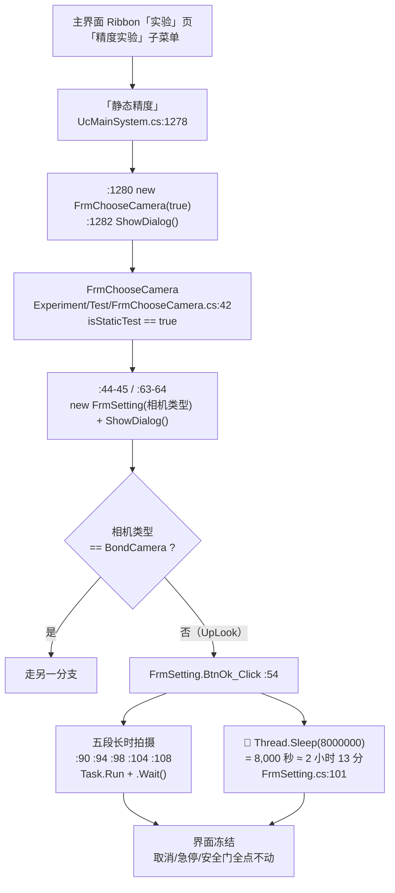

```
主界面「静态精度」(UcMainSystem.cs:1278)
   |
   +-- :1280 new FrmChooseCamera(true)
           |
           +-- Experiment/Test/FrmChooseCamera.cs:42  (isStaticTest == true)
                   |
                   +-- :44-45 / :63-64  new FrmSetting(相机类型) + ShowDialog()
                           |
                           +-- 相机 != BondCamera（即 UpLook）时
                                   |
                                   +-- FrmSetting.BtnOk_Click :54
                                           |-- :90 :94 :98 :104 :108  五段拍摄，每段 Task.Run 后 .Wait()
                                           +-- :101  Thread.Sleep(8000000)  ≈ 2 小时 13 分
                                                     >>> 全在 UI 线程上 <<<
                                                     >>> 界面冻结、取消/急停/安全门点不动 <<<
```

**用户看到什么**：点了「静态精度」→ 弹出相机选择框 → 选完 → 弹出参数设置框 → **点它的 OK** →
**整个软件卡死**，鼠标能移动、窗口无响应、点什么都没反应，**持续两小时以上**，
期间**急停按钮也点不动**（它要走 UI 线程响应鼠标）。

**归属划分（三个文档各写一段，不重复、不遗漏）**

| 环节 | 内容 | 归属 |
|---|---|---|
| 主界面按钮 → `new FrmChooseCamera(true)` | 本节 4.9.2 | **38（本文档）** |
| `FrmChooseCamera` 内部：为什么 `isStaticTest == true` 会开出 `FrmSetting` | `Experiment/Test/FrmChooseCamera.cs:42` / `:44-45` / `:63-64` | **42** |
| `FrmSetting` 内部的 `Thread.Sleep(8000000)` 与 UI 冻结本身 | `CalibSystem/TestControls/FrmSetting.cs:54` / `:90-108` / `:101` | **41** |

⚠️ **另两个按钮走的是同一族链路但落点不同**（我逐行读过的差异）：

| 按钮 | 与「静态精度」的差别 | `.cs` 行 |
|---|---|---|
| 「像素比」`BtnPixelRatio_ItemClick` | `:1317 new FrmChooseCamera(false)`——**传 `false`** ⇒ **不走 `isStaticTest == true` 那条深链** | `:1315` |
| 「重复定位精度」`BtnRepeatPosition_ItemClick` | `:1306 new FrmRepeatPositionAccuracy()`——**完全不进 `FrmChooseCamera`**，是另一个窗体；且用 `.Show()` **非模态** | `:1304` |
| 「零位」`BtnZeroOffset_ItemClick` | `:1293 new FrmBackOffset(CameraType.BondCamera)`——**另一个窗体** | `:1291` |
| 「旋转中心」`BtnRotateCenter_ItemClick` | `:1330 new FrmRotateCenterAccuracy()`——**另一个窗体**；`.Show()` **非模态** | `:1328` |

> ⚠️ **这 5 个处理器的 XML 文档注释全都写着「未知」**（我在原文件里逐段读到），
> 说明**作者自己也没在注释里说明它们做什么** —— 接手人只能靠读代码。
> ⚠️ **模态/非模态不一致**：「静态精度 / 零位 / 像素比」是 `ShowDialog()`（**模态，挡住主界面**），
> 「重复定位精度 / 旋转中心」是 `Show()`（**非模态，可以同时操作主界面**）。
> 这意味着**后者可以与主界面上的其它按钮同时被点击** —— 是一个真实存在的状态竞争面，
> 本文档只做事实描述，**不推断具体后果**。

> ⚠️ **原文报告曾把「重复定位精度」写成 `BtnPixelRatio_ItemClick`** —— **这是错的**。
> 我自己的读码结果是：`:1304 BtnRepeatPosition_ItemClick`（→ `FrmRepeatPositionAccuracy`）、
> `:1315 BtnPixelRatio_ItemClick`（→ `FrmChooseCamera(false)`）。**本表用的是我复核过的值。**

> ⚠️ **`BarBtnVisualStatic_ItemClick`（`:1254`）** 的那两行注释
> （`// new FrmChooseCamera(true);` / `// frmChooseCamera.ShowDialog();`）**与 `:1280` 是同一个动作**
> —— 说明「Visual Static Test」曾经也是这条链路的入口之一，后来被注释掉了。
> 现在**只有「静态精度」一个入口能到达那个两小时冻结**。这是**可达性判断的关键**。

> ⚠️ **还有一道可达性前置**：`barSubItem1`「精度实验」**属于 `ribbonPageGroup9`**，
> 而该组 `Enabled = false`（`Designer:2137`），**需要先在「实验解锁」里通过口令校验**（§4.8.1）。
> ⇒ **现场若从未解锁过实验页，这条链路是不可达的。** 写风险时必须带上这个条件。

> 🔒 **本链路的 `FrmSetting` 内部可能涉及授权/加密狗校验**（属于 41 号文档的范围）。
> 本文档**只写到"`new FrmSetting(...)` + `ShowDialog()`"为止**，
> **对 `FrmSetting` 内部的任何校验不做描述、不做评价**。

#### 4.9.3 「温漂矫正」`BtTemperatureMarkAdjust_ItemClick` —— 本目录内最长的一条实现链

- **界面标题**：`"温漂矫正"`（`UcMainSystem.designer.cs:1479` 区段），接线 `:1479`。
- **处理器**：`UcMainSystem.cs:1534`（正文 `:1534-1622`，约 **89 行**，是本目录最长的按钮处理器之一）。
- **用户看到什么**：先弹一个 Yes/No「**是否重新示教温漂矫正点**」；
  - 选 **是** ⇒ 进入示教流程；
  - 选 **否** ⇒ 用已有示教点直接跑定位（下图的 `ConvertMachineToG0Pos` 分支）。
  跑完弹「**温漂矫正成功**」；中途定位失败会弹「**温度Mark定位失败失败,请重新设置模板**」
  （原文如此，**"失败"重复了两次**，⚠️ 文案问题）并**把设备停掉**。

**四段式**

1. **入口**：页签「实验」→（解锁后）「温漂矫正」。
2. **前置条件**：`ribbonPageGroup9` 已解锁（§4.8.1）。
3. **执行链**（`:1534` 起）：

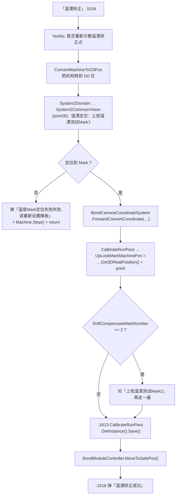

4. **终点**：
   - **数据**：`:1613` `CalibrateRunPara.GetInstance().Save()` ⇒ **这是本按钮唯一写盘的地方**，
     写的是"上视 Mark 的机构坐标"；**软件重启后仍生效**。
   - **界面**：机构回到安全位；弹「温漂矫正成功」。
   - **失败路径**：**调用 `Machine.Stop()`** —— 这是"按钮处理器直接把设备停掉"的少数几处之一。

#### 4.9.4 「标定」相关按钮（`BtnStart` / `BtnLearn` / `BarBtnStartUp`）

| 界面标题 | 处理器 | `.cs` 行 | 用户看到什么 |
|---|---|---|---|
| 「开始」（标定页） | `BtnStart_ItemClick` | `:1339` | 先 `AllAxisGoHome()`，然后把标定任务**丢到后台线程**跑（`Task.Run`），界面不冻结 |
| 「示教」（标定页） | `BtnLearn_ItemClick` | `:1367` | 先 `AllAxisGoHome()`，再弹 Yes/No「**是否使用上一次标定示教点位？**」，然后打开示教窗体（`FrmDispenseCalibTeach` / `FrmBondCalibTeach`，**非模态 `.Show()`**） |
| 「启动」`Startup` | `BarBtnStartUp_ItemClick` | `:1401` | `new FrmStartup().Show()`（非模态） |

> ✅ **正例**：`BtnStart_ItemClick` 把耗时的标定任务放进 `Task.Run(...)` **并给了线程名**
> （`"系统1标定线程"` / `"系统2标定线程"`），并且**按当前系统（System1 / System2）分派不同的标定任务**
> （`StartDispenseCalibTask()` / `StartAutoCalib()`）。**这是本目录里"正确做法"的样板**：
> 不在 UI 线程里跑长任务。对照 §4.9.2 的 `FrmSetting`，同一个项目里两种做法并存。

> ⚠️ **`StartDispenseCalibTask` / `StartAutoCalib` 能不能取消？**
> 我在本目录内**没有找到取消路径**（没有 `CancellationToken`），
> 但**标定任务的实现在别的目录**，**我未做全仓核实 ⇒ 标为「推断/存疑」**，
> 不在本文档下"不能取消"的结论。参考：41 号文档已查实 `CalibrateTask` **不能取消**。

#### 4.9.5 标定按钮的"分系统"行为

`BtnStart_ItemClick`（`:1339-1365`）与 `BtnLearn_ItemClick`（`:1367-1399`）
**都会先读当前系统**，然后**二选一**：

| 当前系统 | 「开始」走 | 「示教」打开 |
|---|---|---|
| System1（点胶） | `Task.Run(... "系统1标定线程" ... StartDispenseCalibTask())` | `FrmDispenseCalibTeach` |
| System2（固晶） | `Task.Run(... "系统2标定线程" ... StartAutoCalib())` | `FrmBondCalibTeach` |

⚠️ **用户看到什么取决于"当前选中哪个系统"** —— 而这个系统是本界面顶部
`BarItemCmdSystemType` 决定的（`UcMainSystem.cs:490 BarItemCmdSystemType_EditValueChanged`）。
**同一个按钮、同一台设备、不同结果**。这一点在 4.6.3 已经出现过一次，
说明**"分系统行为"是本目录的一个系统性特征**，不是个别按钮的特例。

---

### 4.10 权限 / 数据 / 语言 / 授权

#### 4.10.1 「登录」`BtLogon_ItemClick` —— 全项目唯一写 `CurrentLoginUser` 的地方之一

- **界面标题**：Ribbon 上 `BarBtLogon.Caption = "登录"`（`Designer:655`，接线 `:661`）；
  底部工具条上还有一个「登录」`BtLogon`（接线 `:2763`）。
- **处理器**：`UcMainSystem.cs:1194`。
- **用户看到什么**：弹出登录窗体 `FrmLogin`（模态）。
  - 点确定 ⇒ 登录成功：**统计服务的"最后操作时间"被刷新**，当前用户被记下来；
  - 点取消 ⇒ 什么都不发生。
- **执行链**（`:1194-1207`）：
  - `:1196` `FrmLogin.ShowDialog()`
  - `:1198` `if (dr == DialogResult.OK)`
  - `:1200` `StatisticsService…LastOperaDateTime = DateTime.Now`
  - `:1202` `RuntimeProvider.CurrentLoginUser = frmLogin.CurrentUser`
- **终点**：**不写盘**（登录状态只在内存里）⇒ **软件重启后需要重新登录**。
  ⚠️ 但注意：`Machine.GetInstance().CurrentRole` 的取值**来自别处**，
  我**未在本目录内找到 `CurrentRole` 的赋值点 ⇒ 标为存疑**。

#### 4.10.2 「用户管理」`BtnUserManager_ItemClick` —— 有权限门禁，且门禁会提示

- **界面标题**：`"用户管理"`（`Designer:1188`），接线 `:1193`，位于 `ribbonPageGroup6`（`:2167`）。
- **处理器**：`UcMainSystem.cs:1209`。
- **门禁**（`:1211`）：`RuntimeProvider.CurrentLoginUser != null && Machine.GetInstance().CurrentRole == RoleEnum.Admin`；
  不满足 ⇒ 弹「**权限太低，只有管理员能进入!**」（**有提示 ✅**）。
- **状态门禁**：`UcMainSystem.UIState.cs:98`（Working ⇒ `false`）、`:213`（Stop ⇒ `true`）、`:318`（Pause ⇒ `false`）。
- ✅ **重要**：**这个 Ribbon 入口在停止状态下是可用的**。
  这决定了主窗体上那个"永远灰着"的「User Manager」瓦片**只是"少了一个快捷方式"，不是"功能不可用"**
  —— 详见 §4.13.1 与 §9.1 R-01 的定性。

#### 4.10.3 「锁屏」`BtLock_ItemClick` / `barButtonItem8_ItemClick_1` —— 文字与判断不一致

- **界面标题**：底部工具条「锁屏」`BtLock`（接线 `:2913`）。
- **处理器**：`UcMainSystem.cs:1856`；
  另有 `UcMainSystem.cs:2162 barButtonItem8_ItemClick_1` **实现与它逐行相同**（复制品）。
- **执行链**（`:1856-1866`）：
  - `:1858` `if (!Machine.GetInstance().IsStop())` ⇒ 弹「**设备未处于暂停状态，无法锁屏**」+ `return`
  - `:1864` `LockWorkStation()`
- ⚠️ **提示文字说"暂停状态"，代码判断的却是 `IsStop()`（停止状态）** ——
  **文字与判断不一致**。用户看到的是"设备未处于暂停状态，无法锁屏"，
  但实际拦下他的是"设备不在**停止**状态"。进 §9.3（恒假判据/取反判据一类）。
- ⚠️ **`[DllImport("user32 ")]`**（`UcMainSystem.cs:1848-1849`）——
  **DLL 名字里有一个多余的空格**（`"user32 "` 而不是 `"user32"`）。
  这条声明**在本项目里能跑通**（Windows 的 `LoadLibrary` 会做名字容错/或该声明未被真正触发），
  **但这是一个明确的笔误**，进 §9.7。

#### 4.10.4 「语言」`LueLanguage_EditValueChanged` —— 切换后要遍历所有已开窗体

- **控件**：`LueLanguage`（下拉框），接线 `:3192`。
- **处理器**：`UcMainSystem.cs:1981`。
- **执行链**（`:1981-1994`）：
  - `:1983` `LocalizationManager.ChangeLanguage((LanguageEnum)this.LueLanguage.EditValue)`
  - `:1985` 起**遍历 `Application.OpenForms`**，对每个窗体做 `FormLocalizer.LocalizeForm(form)`；
    再对每个窗体的所有子 `XtraUserControl` 做一次 `FormLocalizer.LocalizeForm(a)`
- **用户看到什么**：界面文字**当场**变成另一种语言。
- ⚠️ **终点**：**不写盘 ⇒ 重启后回到默认语言**（我在本目录内未见该值被 `Save()`）。
  **标为「已读代码确认本处理器内无 Save」**；是否存在别处保存**未做全仓核实**。

#### 4.10.5 🔒 「授权」`BarAuthorization_ItemClick` —— **纯技术描述，到此为止**

- **界面标题**：`"授权"` 相关按钮，接线 `Designer:1671`。
- **处理器**：`UcMainSystem.cs:1915`。
- **一行实现**：调用 `SoftkeyManager.CheckYtSoftKey();`。
- **调用时机**：**用户主动点击该按钮时**（不是启动时自动调用）。
- **失败分支**：由 `SoftkeyManager`（位于 `libs/AKRS.Galaxy2.*.dll`，**本仓库无源码**）内部处理；
  **本仓库内看不到它的实现**。
- ⚠️ **另有一处与授权相关的代码被注释掉**：`Machine.Operate.cs:193-196`
  在 `PrepareMachineReadyToStart()` 里，**原本会在启动前检查加密狗到期时间**，
  该段**已被整段注释** ⇒ **当前"启动"流程不再做这项检查**。
  **这一条是纯代码事实陈述**（注释掉了什么），**不是建议、不是方法、不涉及如何利用**。
- 🔒 **本文档到此为止**：不描述口令/密钥/授权算法，不评价该校验实现的强度，
  不提供任何绕过、破解、伪造或禁用授权的方法、步骤、思路或线索。

#### 4.10.6 「实验解锁」`BtUnLock_ItemClick` —— 见 §4.8.1

- **界面标题**：`"实验解锁"`（`Designer:1789` 区段），接线 `:1789`。
- **处理器**：`UcMainSystem.cs:2143`。
- **执行链**：`:2145` 弹输入框（`XtraInputBox.Show("非专业人员不要开启", "密码", "")`）→
  `:2147` 比较 → `:2149` `ribbonPageGroup9.Enabled = true` / `:2153` `= false`。
- ⚠️ **它是"开关"而不是"单向解锁"**：再次点它、输入错误的值，
  会把**已经解锁的实验页重新锁上**（`:2153`）。
- ⚠️ **`XtraInputBox.Show` 的取消返回值**：用户点 Cancel 时返回什么，
  **我没有在源码中确认**（DevExpress 的实现不在本仓库）⇒ **标为推断**：
  若返回 `null`，则 `null == "123456"` 为假 ⇒ 走 `:2153` 加锁分支。
  **本文档只写"分支存在"，不写"取消一定加锁"。**

### 4.11 门槛与门禁汇总表（**一张表看清"为什么这个按钮点不动"**）

这是本节的实操索引：**用户说"这个按钮点了没用"时，先在这张表里找是哪种"没用"。**

| # | 现象（用户看到什么） | 原因类型 | 触发条件 | 典型位置 |
|---|---|---|---|---|
| 1 | 按钮**永远是灰的**，从没亮过 | **运行时永久禁用**（启用状态从未被恢复） | `Enabled = false` 只在 Designer 里设过一次，**代码里没有任何地方写回 `true`** | `MainForm.designer.cs:214`（`UcUserManagerTile`）；`UcMainSystem.designer.cs:1407`（`barButtonItem4`） |
| 2 | 按钮**在界面上根本找不到** | **配了但从未加入任何 Ribbon 组** | 只在 `ribbonControl.Items.AddRange` 里，**没有任何 `ItemLinks.Add`** | `UcMainSystem.designer.cs:377` 的 `Items.AddRange` 块内（`barButtonItem4` 在 `:473`） |
| 3 | 按钮是亮的，**点了完全没反应** | **空方法体** | 处理器花括号里什么都没有 | `UcMainSystem.cs:1245`（底部「加载程式」）、`:1085`、`:1094`、`:1658`、`:2089` |
| 4 | 按钮是亮的，**点了完全没反应** | **整段被注释掉** | 处理器体全是 `//` | `UcMainSystem.cs:1254`、`:1468`、`:1645`、`:1976`；`UcModule.cs:71` |
| 5 | 按钮是亮的，**点了完全没反应** | **建了窗体不用** | `new` 之后既没 `Show()` 也没 `ShowDialog()` | `UcShortcutMenu.cs:1240-1241`（手动更换料片）；`UcModule.cs:382`（PR设置） |
| 6 | 按钮是亮的，**点了完全没反应** | **分派字符串不匹配** | 代码按 `e.Item.Caption` 分派，**字符串与 Designer 的 `Caption` 不一致** | `UcModule.cs:161`（`"Move to safe pos"` vs 中文 `"移动到安全位"`）⇒ 整组 5 个失效 |
| 7 | 按钮是亮的，**点了完全没反应** | **缺 `else if` 分支** | 菜单项在界面上，代码里**根本没有处理它的分支** | `UcModule.cs:248 Bond_ItemClick` 的 4 个：焊后补偿清零 / 固晶程式设置 / 固晶功能设置 / 固晶动作调试 |
| 8 | 按钮是亮的，**点了完全没反应** | **Silent `IsStop()` 门禁** | `if (!IsStop()) return;`，**无提示** | `UcShortcutMenu.cs` **全部 39 个按钮**（见 4.6.1） |
| 9 | 按钮是亮的，**点了完全没反应** | **Silent 权限门禁** | `CurrentRole == Admin` 不满足时**无提示** | `UcModule.cs:502 GpBondModule_DoubleClick` |
| 10 | 按钮是亮的，**点了完全没反应** | **Silent 模式门禁** | 条件不满足直接 `return`，无提示 | `UcModule.cs:119 WaferFeed_ItemClick`（`IsOffLineWork`）；`UcModule.cs:478 PnlModule_Click`（`IsSingleStepWork == false`） |
| 11 | 按钮**整个组都是灰的** | **口令门禁** | `ribbonPageGroup9.Enabled = false`，需先解锁 | `UcMainSystem.designer.cs:2137` + `UcMainSystem.cs:2149`（§4.8.1） |
| 12 | 按钮是亮的，点了**有提示** | **显式门禁（有反馈 ✅）** | 弹出中文提示框后 `return` | `UcMainSystem.cs:370`「设备正在工作，请先停止工作！」等；`:1211`「权限太低…」；`UcShortcutMenu.cs:1004` 安全门 |
| 13 | 按钮是亮的，**点了弹窗但界面卡死** | **UI 线程被同步阻塞** | 处理器内 `Thread.Sleep` / `.Wait()` / 忙等 | `FrmSetting.cs:101`（🔴 两小时，§4.9.2） |

> ✅ **本表的用法**：现场反馈"按钮没用"，**先分类再定位**。
> 1/2 类是**看不见或看得见但永远点不动**；3~7 类是**看得见、点得动、什么也不发生**；
> 8~11 类是**条件不满足**（其中 8/9/10 三种"条件不满足"**没有给用户任何提示**，是最容易被误报为 bug 的一类）。
> 12 类是**正确做法**（有提示）；13 类是**最严重的一类**（不是"没用"，是"卡死"）。

---

### 4.12 键盘快捷键与全局热键

本目录有**两套**快捷键，**互不知情、且 `F9` 的语义不同**。

#### 4.12.1 控件级快捷键：`UcMainSystem_KeyDown`

- **位置**：`UcMainSystem.ShortcutKeys.cs:44 private void UcMainSystem_KeyDown(object sender, KeyEventArgs e)`。
- **触发条件**：**焦点在 `UcMainSystem` 上**（不是全局热键）。

| 按键 | 动作 | 行 | 用户看到什么 |
|---|---|---|---|
| `F9`（**无修饰键**） | 单步模式下：System2 ⇒ 发 `System2SingleStepSignal`；**否则发 `System1SingleStepSignal`** | `:47-62` | 单步模式下走一步 |
| `Shift+F1` | `SubstrateIndex()` | `:68-70` | 轨道索引动作 |
| `Shift+F2` | 上一个**点胶**位置（`VisionPreviousBondPositionSystem1()`） | `:71-73` | 视觉画面切换 |
| `Shift+F3` | 上一个**固晶**位置（`VisionPreviousBondPositionSystem2()`） | `:74-76` | 视觉画面切换 |
| `Shift+F4` | **视觉扫描**：先 `IsVisionScanIsReady()` 门禁；再用 `visionTask` 单例保护；`new Task(VisionScan).Start()` | `:77-97` | 后台扫描（**不在 UI 线程 ✅**） |
| `Shift+F5` | `ShowForm<FrmVmVisionResult>()` | `:98-100` | 打开视觉结果窗体 |
| `Shift+F6` / `F7` / `F8` | **`break;` 空分支** | `:101-106` | ❌ **没有任何反应** |
| `Shift+F9` | 切换单步模式 | `:107-111` | 单步开关翻转 |
| `Shift+F10` / `F11` / `F12` | **`break;` 空分支** | `:112-118` | ❌ **没有任何反应** |

> ⚠️ **`Shift+F6`~`F8`、`F10`~`F12` 共 6 个键位被"占"了但没实现** ——
> `case` 标签存在、里面只有一个 `break;`。用户按这些键**没有任何反应**。
> 与 §4.8.3 的"空处理器"是同一类问题（**甲类：真·空实现**）。进 §9.2。

#### 4.12.2 全局热键：`RegisterHotKey`（**Windows 系统级**）

- **位置**：`UcMainSystem.HotKeyManage.cs:71-74 RegisterGlobalHotkeys()`。

| 注册的键 | 内部 id | 行为 | 行 |
|---|---|---|---|
| **`Shift+F9`** | `ChangeSingleStepMode` | 切换 `IsSingleStepWork` | `:71` |
| **`F9`**（`MOD_NONE`） | `SendSingleStepSignal` | **只**在 `IsSingleStepWork == true` 时发 **`System2SingleStepSignal.Set()`** | `:74`，处理在 `:106-113` |

> 🔴 **同一个 `F9`，两套行为，取决于焦点在哪**
> - 焦点在 `UcMainSystem` 上、按 `F9` ⇒ 走 `KeyDown`（`ShortcutKeys.cs:47`）：
>   System2 发 System2 信号，**System1 发 System1 信号**。
> - 焦点不在 `UcMainSystem` 上（比如某个弹出的窗体上）、按 `F9` ⇒ 走**全局热键**：
>   **只发 System2 信号，System1 永远收不到**。
> ⇒ **在单步模式下用 System1 时，按 `F9` 有没有反应取决于当前焦点在哪**。
> 这**不是崩溃**，但是一个**真实的、可复现的"时而有效时而无效"**。
> 定级 **🔴**（行为不一致、难以排查），进 §9.4。

> ⚠️ **`RegisterHotKey` 的返回值没有被检查**（`:71` / `:74` 两行都是裸调用）。
> 若注册失败（例如 `F9` 已被本机的其它程序占用），**没有任何提示**，
> 用户按 `F9` 会**完全没有反应**，而程序自认为"热键已注册"。
> `HotKeyManage.cs:78-82` 有 `UnregisterGlobalHotkeys()`，但**注释明说"暂时不用"**（`:79-80`），
> 实际是否在退出时调用**我未在本目录内找到调用点 ⇒ 标为存疑**。

> ⚠️ **两条注释都写着「注册Shift+F9 用于撤销操作」**（`:70` 与 `:73`）——
> **两行注释完全相同，但两行注册的是不同的键**（一个是 `MOD_SHIFT + F9`，一个是 `MOD_NONE + F9`），
> 且**功能都与"撤销"无关**（是"切换单步"和"发单步信号"）。
> 这是**复制粘贴留下的错误注释**，会让接手人完全误判这两个热键。进 §9.7。

---

### 4.13 永久禁用控件 —— **运行时永久禁用（启用状态从未被恢复）**

本节列的两个控件，**用户在界面上"看得见但永远点不动"**。
**定性必须准确**：它们**不是故障**，是「**被搁置的功能**」——
设计者把控件留在界面上，但把启用状态设成了 `false`，而**代码里没有任何一处把它恢复成 `true`**。
⚠️ **不写"按钮坏了"、不写"点了会崩溃"。**

**两个控件的共同判定依据**（三条都要满足才算"永久禁用"）：

1. Designer 里**有一次** `Enabled = false`（或等价的不可用设置）；
2. 全工程**没有任何** `Enabled = true` 的写回；
3. 排除四种"绕过式"赋值：`.resx` + `ApplyResources`、泛型遍历赋值、辅助方法按引用传入、反射。

#### 4.13.1 `UcUserManagerTile` —— 主窗体上那个「User Management」瓦片

| 项 | 值 | 位置 |
|---|---|---|
| 控件类型 | `TileItem`（**DevExpress 瓦片，不是按钮**） | `Main/Controls/MainForm.designer.cs:216` |
| 用户看到的文字 | **`"User Management"`** | `MainForm.designer.cs:211`（`tileItemElement2.Text`） |
| 它绑定的文档 | `UcUserManagerDocument`，其 `Caption = "User Manager"` | 绑定在 `:205`，标题在 `:160` |
| 文档指向的控件 | `ControlName = "UcUserManager"`，`ControlTypeName = "AKRS.ZX2200.Main.Controls.Ucmain.UcUserManager"` | `:161` / `:162` |
| 图标 | `Properties.Resources.UserManagment` | `:163` / `:211` |
| **禁用** | **`this.UcUserManagerTile.Enabled = false;`** | **`MainForm.designer.cs:214`** |
| 是否存在写回 `true` | ❌ **全工程无**（`grep -n 'UcUserManagerTile'` 只命中 Designer 的配置行与 `:214`） | — |

- **用户看到什么**：主窗体（WindowsUI 风格的瓦片首页）上有一个**红色的"User Management"瓦片**，
  **永远是灰的、点不动** —— 鼠标移上去没有高亮、点击没有任何反应。
- **⚠️ 处理器一栏必须照实写**：这个瓦片的"处理器"是**它绑定的文档 `UcUserManagerDocument`**
  （经由 `:205 this.UcUserManagerTile.Document = this.UcUserManagerDocument;`），
  **不是"无"**。⚠️ **把处理器写成"无"是事实错误。**
  `TileControl` 的瓦片点击**不走 `Click` 事件**（它由 `TileControl` 内部按 `Document` 派发），
  所以**"按控件名 grep `Click +=`"这个判据对瓦片类控件不适用**（见 §4.2.0 判定口径）。
- ✅ **重要定性补充：`UcUserManager` 这个功能并没有消失** ——
  Ribbon「系统」页上有一个**可用的**「用户管理」入口：
  `BtnUserManager`「用户管理」（`UcMainSystem.designer.cs:1188`，接线 `:1193`）
  → `UcMainSystem.cs:1209 BtnUserManager_ItemClick`，**停止状态下可用**（`UIState.cs:213`）。
  ⇒ **这个瓦片只是"少了一个快捷方式"，不是"功能不可用"**。**定级 ⚠️，不是 🔴。**

#### 4.13.2 `barButtonItem4` —— 「UplookMark」

| 项 | 值 | 位置 |
|---|---|---|
| 控件类型 | `BarButtonItem` | `UcMainSystem.designer.cs:3458`（字段）、`:147`（`new`） |
| 界面标题 | **`"UplookMark"`** | `:1406` |
| **禁用** | **`this.barButtonItem4.Enabled = false;`** | **`:1407`** |
| 处理器 | `barButtonItem4_ItemClick_1`，接线在 `:1410` | 处理器正文 `UcMainSystem.cs:1429` |
| 是否存在写回 `true` | ❌ **全工程无** | — |
| **是否出现在界面上** | ❌ **从来没有** | 见下 |

> ⚠️ **一处必须纠正的事实（与"永远点不动"的说法不同）**：
> **`barButtonItem4` 根本不渲染在 Ribbon 上。**
> 依据（三条独立证据）：
> 1. 它在 Designer 里**只出现 6 行**：`:147`（`new`）、`:473`（在 `ribbonControl.Items.AddRange` 块内，
>    即 `:377` 开始的**主条目清单**）、`:1404-1410`（属性配置 + 接线）、`:3458`（字段声明）。
> 2. 全工程 `grep -c 'ItemLinks.AddRange' UcMainSystem.designer.cs` = **0**；
>    且 `ItemLinks.Add(this.barButtonItem4)` **在任何文件里都不存在**。
>    ⇒ **它没有被加进任何一个 Ribbon 组。**
> 3. `UcModule.Designer.cs:612` 里出现的 `barButtonItem4` **只是借用它的图片键**，与该控件无关。
>
> ⇒ **正确的表述是**：`barButtonItem4`「UplookMark」**既被永久禁用、又从未加入任何 Ribbon 组**
> ⇒ **用户在界面上看不见它，也就无所谓"点不动"**。
> ⚠️ 如果只写"Ribbon 上的 UplookMark 永远点不动"，会让读者去找一个**找不到的按钮**。
> 这两条**都要写**（禁用 + 未加入组），缺一条就误导。
> **定级 ⚠️**（按"界面上不存在的控件"处理，进 §4.2.14 表与 §9.1）。

#### 4.13.3 与本节相邻但**性质不同**的三种情况（不要混为一谈）

| 情况 | 例子 | 区别 |
|---|---|---|
| **运行时永久禁用**（本节） | `UcUserManagerTile`、`barButtonItem4` | 控件**在界面上**，`Enabled` **从没被恢复** |
| **永久消失的隐藏控件** | `BarBtSystem1MoveToSafePos`（`Size = 5×5`，`UcModule.Designer.cs:363`） | 控件**在菜单里**，但**尺寸小到几乎不可见** |
| **配了但从未加入 Ribbon 组** | 见 §4.2.14 的 8 个 | 控件**代码里存在**，**界面上从未出现** |
| **点了没反应但控件正常** | 见 §4.8.3 / §4.11 的 3~7 类 | `Enabled` **是 `true`**，问题在**处理器体内** |

> ⚠️ **上表四行的"用户看到什么"完全不同** —— 写文档时**必须分开**，
> 否则会出现"用户看不到这个按钮"和"用户点了没反应"混写成一句的情况。

---

### 4.14 本节（§4）的图表索引

| 图号 | 内容 | 所在小节 |
|---|---|---|
| 图 4-1 | UI 入口的四种层次（`MainForm` → `UcMainSystem` → `UcModule` → `UcShortcutMenu`） | §4.1.1~§4.1.4 |
| 图 4-2 | 「开始」按钮：从点击到设备真的动起来 | §4.3.1 |
| 图 4-3 | 「停止」按钮：从点击到所有任务收尾 | §4.3.2 |
| 图 4-4 | 「急停」按钮的真实行为与启用条件反转 🔴 | §4.3.4 |
| 图 4-5 | 程式状态的流转（`RecipeID` → `ReLoadRecipe` → `PrInitSuccess`） | §4.4 |
| 图 4-6 | `ShowPanel` 面板机制 | §4.5.1 |
| 图 4-7 | 「静态精度」跨目录深链与两小时冻结 🔴 | §4.9.2 |

> ⚠️ 本表的图号**已与附录 C 的最终图表索引核对一致**（附录 C 是权威清单，含全部图与表）。

---

## §5 核心流程（非 UI 触发）

上一节讲的是"**用户点了什么**"。这一节讲"**没有人点的时候，程序在干什么**" ——
后台线程、状态机、动作节点调度、自检。**这些流程是"按钮为什么会有那些前置条件"的答案。**

### 5.1 后台监控线程「后台监控线程」—— 每 100 毫秒跑一遍的七件事

- **定义**：`Main/Machine/MachineSupport/Machine.Operate.cs:665 public void StartBackGroundThread()`。
- **唯一调用点**：`MainForm.cs:257`（`MainForm_Load` 里，**软件启动时拉起，之后再也不停**）。
- **线程名**：`"后台监控线程"`（`Machine.Operate.cs:693`），`IsBackground = true`（`:693`）。
- **循环条件**：`while (RuntimeProvider.ThreadFlag)`（`:670`），**每轮末尾 `Thread.Sleep(100)`**（`:690`）。

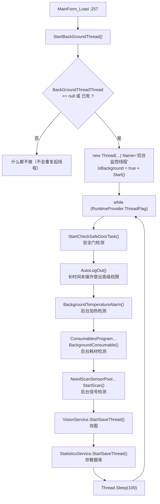

```
MainForm_Load(:257)
  +-- 起一个名字叫"后台监控线程"的后台线程（只起一次）
        |
        +-- while (RuntimeProvider.ThreadFlag)   <-- 循环体每轮 100ms
              |-- 安全门检测        StartCheckSafeDoorTask()
              |-- 自动登出          AutoLogOut()
              |-- 加热报警          BackgroundTemperatureAlarm()
              |-- 耗材检测          ConsumablesProgram…BackgroundConsumable()
              |-- 传感器扫描        NeedScanSensorPool…StartScan()
              |-- 存图线程          VisionService.StartSaveThread()
              +-- 存数据库线程      StatisticsService.StartSaveThread()
```

> ⚠️ **两个"守护线程"是被反复调用的**：`VisionService.StartSaveThread()` 与
> `StatisticsService.StartSaveThread()` **在每一轮循环里都会被调用一次**
> （即**每秒 10 次**）。它们的内部实现**不在本仓库**（在平台 DLL 里），
> 从命名看它们**自己会做"已启动就不再启动"的判断** ⇒ **推断**，我**没有验证**。
> ⚠️ **这一条我标为「存疑」**：如果它们不做幂等判断，这里会**每秒创建 10 个线程**。
> **未验证 ⇒ 不写结论。**

> ⚠️ **`while (RuntimeProvider.ThreadFlag)` 的退出条件不在本仓库**：
> `RuntimeProvider` 属于 `AKRS.Galaxy2.Infrastructure.dll`（**无源码**）。
> **`ThreadFlag` 在哪里被写成 `false`，我在本仓库内没有找到 ⇒ 标为存疑。**
> 这直接关系到"**软件能不能干净地退出**"，是个值得追的问题，但**本文档不推断**。

> ⚠️ **`IsBackground = true` 的含义**：主线程退出时这个线程会被**强制终止** ⇒
> **它没有"收尾"的机会**。`MainForm_FormClosed`（`MainForm.cs:290`）走的是
> `Machine.GetInstance().ExitSoftware()`，**它做了什么我在本目录内未追完 ⇒ 存疑**。

**「安全门检测」为什么重要**：`UcShortcutMenu.cs:1004` 的「取芯片」按钮会用
`Machine.GetInstance().IsSafeDoorClose` 判断门关没关 —— **那个值的更新就发生在这个后台线程里**
（`StartCheckSafeDoorTask()`）。⇒ **后台线程一旦停了，安全门状态就不再刷新，
按钮读到的会是"最后一次刷新时"的值**。这是"后台线程"与"按钮门禁"之间的一条隐式依赖。

---

### 5.2 设备状态机 —— 六个状态与它们之间的合法迁移

- **枚举**：`MachineStateEnum`（`Stop=0` / `Pause=1` / `Working=2` / `Operate=3` / `Teaching=4` / `Preparing=5`）
  —— **定义在平台 DLL 里，本仓库无源码 ⇒ 成员名与序号来自使用处的字面量，标为推断**。
- **持有者**：`MachineStateModel` 单例；`Machine` 是 `SingletonNoSave<Machine>`
  （**不落盘的另一个单例基类**，见 §8.2）。
- **状态读写**：`Machine.GetInstance().SetState(...)`；查询用 `IsStop()` / `IsWorking()` 等。

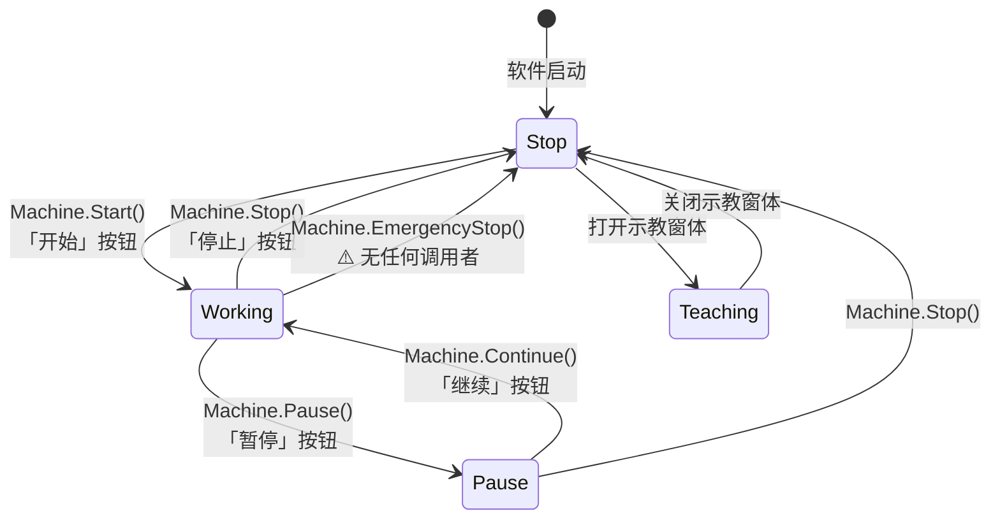

```
          ┌───────────────────────────────────────────┐
          │                                           │
       [Stop] ──「开始」──> [Working] ──「暂停」──> [Pause]
          ^                     │                     │
          │                     │                     │
          └────「停止」──────────┴────「停止」─────────┘
                                ^
                                └── [Teaching] （示教窗体打开时）

   ⚠️ Machine.EmergencyStop() 存在、实现完整，但 全工程零调用者（见 4.3.4 / 9.4）
```

**「急停」为什么不在这张图上**：`BtEmergencyStop_ItemClick`（`UcMainSystem.cs:1058`）
**只对每个轴调 `StopMove(false, true)`**，它**不改变 `MachineStateModel` 的状态**
⇒ 从状态机的角度看，**按下"急停"之后设备"仍然是 Working"**。
真正做状态收敛的 `Machine.EmergencyStop()`（`Machine.Operate.cs:383-402`）**没有任何调用者**。
详见 §4.3.4 与 §9.4。

---

### 5.3 `Machine.Start()` / `Stop()` / `Pause()` / `Continue()` 内部

- **文件**：`Main/Machine/MachineSupport/Machine.Operate.cs`。

#### 5.3.1 `Start()`（`:261-309`）

| 行 | 动作 | 说明 |
|---|---|---|
| `:266-270` | **门禁** | 不满足直接 `return`（具体条件见 §4.3.1） |
| `:272` | `SetState(MachineStateEnum.Working)` | **状态在这里改** |
| `:274-278` | 前置准备 | — |
| `:280-286` | 前置准备 | — |
| `:288-290` | 前置准备 | — |
| `:291-297` | 前置准备 | — |
| `:299-305` | `IsFlipModuleConfigrated`（**注意原文拼写**） | 翻转模块判断 |
| `:307-308` | 真空相关 | — |

> ⚠️ **`PrepareMachineReadyToStart()`（`:185-256`）里有 11 段检查**，
> 其中 **`:193-196` 是一段被整段注释掉的加密狗到期检查**
> （🔒 纯代码事实描述，不涉及任何绕过思路）。
> 另有 `:229-232` 的 `IsWorking()` 分支是**静默的**（无提示直接 return）。
> 完整的"启动前检查清单"见 §4.3.1 的表格。

#### 5.3.2 `Stop()`（`:347-378`）、`Pause()`（`:314-318`）、`Continue()`（`:323-342`）

- `Pause()` 只有 5 行 ⇒ 状态置位 + 通知。
- `Continue()` 约 20 行 ⇒ 状态置位 + 恢复各模组。
- `Stop()` 约 32 行 ⇒ **要等所有任务收尾**，这也是「停止」按钮点下去后
  界面出现「设备正在停止，请稍后」那一行提示的原因（`UcMainSystem.cs:762`）。
- **`Stop()` 与 UI 的耦合点**：`UcMainSystem.UIState.cs:382-398 ChangeUiByState()`
  用 **`LbTip.Text == "设备正在停止，请稍后"` 这个精确字符串**来判断"停止流程是否走完"
  ⇒ 见 §9.3（**精确字符串判据**，改一个字就失效）。

---

### 5.4 启动与退出：`MainForm_Load` 与 `MainForm_FormClosing`

#### 5.4.1 `MainForm_Load`（`MainForm.cs:240-275`）

| 行 | 动作 | 用户看到什么 |
|---|---|---|
| `:240` | `SplashScreenManager.ShowForm(typeof(SplashScreen1))` | **出现启动画面** |
| `:241` | 发送命令 `InitView`「**程序加载中**」 | 启动画面上的文字 |
| `:244` | `Machine.GetInstance().DataLoad()` | —— |
| `:246` | `this.ChangeData()` | —— |
| `:249` | `UcProgramArgs.InitParamerer = ParameterManage.InitControl` | —— |
| `:250-251` | `ModbusService…ConnectBondhead()` / `ConnectManometer()` | ⚠️ **返回值被丢弃**，连不上**没有任何提示** |
| `:253` | `Machine.GetInstance().ChoseAllLight()` | 光源初始化 |
| `:257` | **`Machine.GetInstance().StartBackGroundThread()`** | **后台监控线程从这里起**（§5.1） |
| `:260` | `ExportService.EnsureDirectoryExists(@"D:\\设备功能测试")` | ⚠️ **硬编码的绝对路径**（写死在 `D:` 盘） |
| `:264-272` | `MF = (MainForm)Application.OpenForms[0]`，**失败则取 `[1]`** | ⚠️ 见下 |
| `:274` | `SplashScreenManager.CloseForm()` | **启动画面消失，主界面出现** |

> ⚠️ **`ModbusService` 连接失败被静默忽略**（`:250-251` 返回的 `bool` 没有被接收）。
> 这条与 §4.7.4 的 `if (res = true)`（`UcModule.cs:285`/`:323`）**是同一个问题的两侧**：
> **启动时不检查连接结果，右键菜单里又把"失败"显示成"成功"。**
> ⇒ **压力表没接上时，用户看到的仍然是"焊头压力表连接成功!"**。这是 🔴，进 §9.3。

> ⚠️ **`Application.OpenForms[0]` / `[1]` 的 try-catch**：这是**按"索引"取窗体**，
> 而不是按类型找。**如果启动画面（`SplashScreen1`）还开着，`[0]` 就是它，不是 `MainForm`**
> ⇒ 代码**假设了"要么 [0] 是主窗体，要么 [1] 是"**。
> 这是一个**脆弱假设**（新增一个启动期窗体就会错）。
> **但注意**：`MF` 字段只在本处赋值、`public static MainForm MF { get; private set; }`（`:277`），
> **我没有在本目录内追到 `MF` 的所有使用点 ⇒ 只描述写法，不推断后果。**

#### 5.4.2 `MainForm_FormClosing` / `FormClosed`（`MainForm.cs:283-292`）

| 事件 | 行为 | 用户看到什么 |
|---|---|---|
| `FormClosing` `:283` | `if (!Machine.GetInstance().IsStop())` ⇒ **`e.Cancel = true`** + 弹「**请先停止设备**」 | **关不掉窗口**，必须先停设备 ✅ **这是正确做法** |
| `FormClosed` `:289` | `Machine.GetInstance().ExitSoftware()` | 退出软件 |

> ✅ **这一处是本目录"门禁写法"的正例**：**既阻止了操作，又给了明确提示**。
> 对照 §4.11 表里 8/9/10 类"静默门禁"，差别就在于**有没有那一句 `AKRSXtraMessageBox.Show`**。

---

### 5.5 单步模式与信号池 `SignalPool`

#### 5.5.1 信号池是什么

- **类型**：`SignalPool`（单例），定义在 `AKRS.Galaxy2.Machine/Models/SignalPool.cs`（**平台程序集，本仓库无源码**）。
- **规模**：**23 个 `public Signal` 属性**（文件 216 行）。**属性名来自使用处的调用，标为已确认的"使用点"，不标"定义处"。**
- **本目录用到的**（都在 `UcMainSystem` 里）：

| 信号 | 谁 `Set()` 它 | 位置 |
|---|---|---|
| `System1SingleStepSignal` | 「下一步」（System1） | `UcMainSystem.cs:1012`（`BarBtNextStep` 的分支） |
| `System2SingleStepSignal` | 「下一步」（System2）；单步开关关闭时 | `UcMainSystem.cs:1010`、`:989` |
| `IsBondNeedChipSignal` | （本目录内未见使用点的确认 ⇒ 存疑） | — |

#### 5.5.2 单步模式的三个入口（**同一个功能三套入口，行为不一致**）

| 入口 | 位置 | 行为 |
|---|---|---|
| 界面开关 `BarSwitchSingleStep`（`CheckedChanged`） | `UcMainSystem.cs:983` | 勾选 ⇒ `IsSingleStepWork = true` **+ `BarBtNextStep1.Enabled = true`**；取消 ⇒ **发 `System2SingleStepSignal.Set()`** + `= false` + `Enabled = false` |
| 快捷键 `Shift+F9`（控件级） | `UcMainSystem.ShortcutKeys.cs:107` | **只翻转 `IsSingleStepWork`，不动按钮的 `Enabled`** |
| 全局热键 `Shift+F9` | `UcMainSystem.HotKeyManage.cs:101-103` | **只翻转 `IsSingleStepWork`，不动按钮的 `Enabled`** |

> ⚠️ **不一致点**：**用界面开关**会同步 `BarBtNextStep1.Enabled`；
> **用两种 `Shift+F9`** 只改状态量、**不同步按钮的启用状态**。
> ⇒ 结果：**用热键切到单步模式后，「下一步」按钮仍然是灰的**（或反之：从单步切回后按钮还亮着）。
> 这是一个**可复现的界面与状态不一致**。定级 ⚠️，进 §9.4。

#### 5.5.3 「下一步」`BarBtNextStep_ItemClick`（`UcMainSystem.cs:1004-1023`）

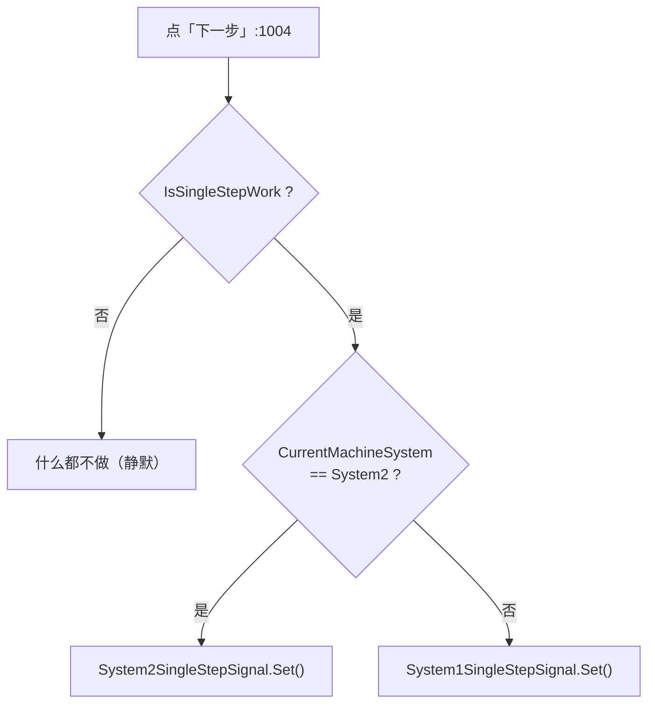

> ⚠️ **注意与全局热键 `F9` 的差别**：这里**会按当前系统分派 System1/System2**，
> 而全局热键 `F9`（`HotKeyManage.cs:106-113`）**只发 System2**。
> **同一个"走一步"的动作，三个入口两种分派逻辑** —— 见 §4.12.2 与 §9.4。

---

### 5.6 动作节点调度（S1 / S2 控制器）

这是整个"自动工作"的执行核心：**设备一次生产要做几百个动作，谁来排序、谁来执行、执行失败怎么办。**

- **文件**：
  - `Main/Machine/Process/S1ActionNodeController.cs`（**939 行**）
  - `Main/Machine/Process/S2ActionNodeController.cs`（**1,630 行**）
  - ⚠️ 这两个是**活的**（`csproj` 内）。**不要与 `Main/Machine/Product/ProcessStep/` 下的幽灵搞混**（§2.4）。

#### 5.6.1 三个层次的数据

```
ProcessDomain (单例)                       ← Main/Machine/Process/ProcessDomain.cs  【活】
  |-- S1SystemProcess : SystemProcess     ← 系统1（点胶）的步骤集合
  |     +-- ProcessSteps : List<SingleProcessStep>
  |-- S2SystemProcess : SystemProcess     ← 系统2（固晶）的步骤集合
        +-- ProcessSteps : List<SingleProcessStep>
                    |
                    |  FindAll(it => it.IsEnable)   只取"启用的"
                    v
        S2ActionNodeController.ProcessSteps   （S2ActionNodeController.cs:92）

ActionNode（动作节点）                       ← 由 Bond/Dispense 各子系统提供
  |-- TransportActonNodes        运输
  |-- SubstrateActonNodes        基板
  |-- ModuleActonNodes           基岛
  +-- BondPositionActonNodes     焊点
        |
        |  SortActionNodeByModule(workProcess, workProcessModule)
        v
     排好序的 ActionNodeMessage 列表  →  逐个 Execute
```

> ⚠️ **`SingleProcessStep` 才是活的那个类型**（`Main/Machine/Process/SingleProcessStep.cs:15`）。
> 幽灵的 `ProcessStep` / `ProcessStepProgram`（`Main/Machine/Product/ProcessStep/`）
> **不参与编译、运行时不存在**，**不得在本节里当作"制程步骤的数据结构"来写**（§2.4、§9.5）。

#### 5.6.2 八种排序组合：`SortActionNodeByModule`

- **位置**：`S2ActionNodeController.cs:182 private void SortActionNodeByModule(WorkProcessEnum workProcess, WorkProcessModuleEnum workProcessModule)`。
- **分派结构**：外层 `switch (workProcess)` 有 **4 个 case**，每个 case 里再 `if (workProcessModule == WorkProcessModuleEnum.StepFirst)` 分两支 ⇒ **4 × 2 = 8 种组合**。

| 外层 `WorkProcessEnum` | `.cs` 行 | 内层两支（`StepFirst` / 另一支） |
|---|---|---|
| `TransportFirst`（运输优先） | `:186` | `:187` 起 |
| `SubstrateFirst`（基板优先） | `:198` | `:199` 起 |
| `ModuleFirst`（基岛优先） | `:210` | `:211` 起 |
| `BondPositionFirst`（焊点优先） | `:222` | `:223` 起 |

> ⚠️ **八种组合谁被选中，取决于配方里的两个配置项** ——
> 也就是说**同一台设备、同一份程序，改了这两个配置就会改变动作的执行顺序**。
> **这两个配置项在哪里读、默认值是什么，我没有在本目录内追 ⇒ 标为存疑。**
> 本节只写"**有八种组合、由 `SortActionNodeByModule` 分派**"这个事实。

#### 5.6.3 `InjectSteps` —— 把"步骤"插进"动作"里

- **位置**：`S2ActionNodeController.cs:1410`（S2）、`S1ActionNodeController.cs:859`（S1）。
- **签名**（S2）：`public void InjectSteps(TransportUnit transportUnit)`。
- **含义**：动作节点是**固定的一套**（运输/基板/基岛/焊点四层），
  而**制程步骤（`SingleProcessStep`）是可配的** —— `InjectSteps` 就是**把当前载具对应的步骤，
  插进动作序列的合适位置**。
- ⚠️ **它是 `public` 的，但调用者不在本目录**（在 `BondSystem` / `DispenseSystem` 的任务线程里）
  ⇒ **本文档只写"本目录提供了这个方法"，调用时机归 33 / 40 号文档。**

#### 5.6.4 执行结果 `ExcuteResult`（**枚举定义不在本仓库**）

- 代码里用 `ExcuteResult` 的分支来决定"这一步成功/失败/要重试"。
- ⚠️ **`ExcuteResult` 的定义（枚举成员名与个数）不在本仓库**（在平台 DLL 里）。
  我从使用处读到的**成员用法不止一种**，但**无法列出完整成员表**
  ⇒ **本文档不列"一共有几个成员"，只写"代码按它的取值分支"。**
  这是**必须如实交代的未读项**（附录 B）。

#### 5.6.5 与 UI 的连接点：状态从哪来、到哪去

| 方向 | 机制 | 位置 |
|---|---|---|
| UI → 调度器 | **信号**（`SignalPool` 的 `Set()`），**不是方法调用** | §5.5.1 |
| 调度器 → UI | `MachineStateModel` 的状态变化 → `ChangeUiByState()` | `UcMainSystem.UIState.cs:382` |
| 调度器 → 界面文字 | `LbTip.Text` 被赋字符串（**UI 侧按精确字符串判断**） | `UcMainSystem.cs:762` 等 |
| 界面按钮 → 单例 → 调度器 | `Xxx.GetInstance().Xxx` | 处处 |

> ⚠️ **本目录与调度器之间没有"回调/事件"式的契约**，全靠**单例 + 信号 + 状态量**。
> 这也是"改一个字符串就断链"（§9.3）和"状态不同步"（§9.4）这两类问题的根源。

---

### 5.7 设备自检 `SelfCheck()`

- **入口**：`UcMainSystem.cs:1135 BtSelfCHeck_ItemClick` ← 按钮「**设备自检**」（`barButtonItem14`，`Designer:1149`）。
- **实现文件**：`Main/Machine/MachineSupport/Machine.SelfCheck.cs`（**576 行**，本目录第二长的文件）。
- **相关文件**：`Main/Machine/MachineSupport/HardWareCheck.cs`（106 行）。
- **用户看到什么**：点下去**界面会停顿一段可见时间**，然后出现自检结果。
- ⚠️ **`SelfCheck()` 内部分几段、每段耗时多少、会不会有 `Thread.Sleep`** ——
  我在**本目录内没有逐段读完 576 行**（本次任务的读取重点在 §4 的按钮链路上）
  ⇒ **本文档只写"入口 → `Machine.SelfCheck()` → `Machine.SelfCheck.cs`"，不写分段细节。**
  这是**必须如实交代的未读项**（附录 B）。

> ⚠️ **`Machine.SelfCheck.cs` 是本目录里唯一一个我"知道它存在、知道它多大、
> 但没有读透"的文件。** 按本文档的纪律，**没读过的内容不写**。

---

### 5.8 自动登出 `AutoLogOut()`

- **调用点**：`Machine.Operate.cs:678`（**后台监控线程每 100ms 一次**）。
- **做什么**：注释原文「**长时间未操作登出高级权限账户**」。
- **用户看到什么**：**长时间不动界面之后，权限被收回** ⇒
  之后再点「用户管理」等按钮会弹「**权限太低，只有管理员能进入!**」。
- ⚠️ **"多长时间"这个阈值、以及它注销的是"登录用户"还是"高级权限"，
  我没有在 `AutoLogOut()` 的实现里读到 ⇒ 标为存疑。**
  （`AutoLogOut` 的实现位置我在本目录内未定位到。）

---

### 5.9 本章（§5）的图表索引

| 图号 | 内容 | 所在小节 |
|---|---|---|
| 图 5-1 | 后台监控线程「后台监控线程」的七件事 | §5.1 |
| 图 5-2 | 设备状态机与六个状态 | §5.2 |
| 图 5-3 | 「下一步」的分派逻辑 | §5.5.3 |
| 图 5-4 | 动作节点调度的三层数据 | §5.6.1 |

---

## §6 关键实现细节

### 6.1 `UcMainSystem` 是 **11 个 `partial` 文件拼出来的**（不是 8 个，也不是 1 个）

主界面这个类**没有单一源文件**。全工程实测：

| # | 文件 | 行数 | `partial class` 声明行 |
|---|---|---|---|
| 1 | `UcMainSystem.cs` | **2,206** | `:142`（`public partial class UcMainSystem : BaseControl`） |
| 2 | `UcMainSystem.designer.cs`（**小写 `designer`**） | **3,549** | `:3` |
| 3 | `UcMainSystem.UIState.cs` | 519 | `:19` |
| 4 | `UcMainSystem.ShortcutKeys.cs` | 333 | `:28` |
| 5 | `UcMainSystem.Manual.cs` | 270 | `:46` |
| 6 | `UcMainSystem.DataAdministrator.cs` | 222 | `:26` |
| 7 | `UcMainSystem.Production.cs` | 214 | `:61` |
| 8 | `UcMainSystem.Diagnosis.cs` | 205 | `:37` |
| 9 | `UcMainSystem.HotKeyManage.cs` | 122 | `:15` |
| 10 | `UcMainSystem.Machine.cs` | 61 | `:35` |
| 11 | `UcMainSystem.System.cs` | 30 | `:26`（**类体是空的**） |
| | **合计** | **7,731** | |

> ⚠️ **对我自己先说清一个更正**：本节的早期草稿写的是"**8 个 partial**"，
> **那是错的**。用 `grep -n 'class UcMainSystem' UcMainSystem*.cs` 数出来是 **11 个**
> （10 个非 Designer + 1 个 Designer）。**以本节这张表为准。**

**为什么这件事重要**（三条实际后果）：

1. **按文件名找 `UcMainSystem` 会漏** —— `UcMainSystem.Manual.cs` 里的按钮、
   `UcMainSystem.Diagnosis.cs` 里的按钮，**都不在 `UcMainSystem.cs` 里**。
2. **第 2 行的文件名是小写 `designer.cs`** —— 用 `--include='*.Designer.cs'` 筛会**整份漏掉
   3,549 行**（本目录 **6 个**文件是小写，合计 4,239 行）。必须用
   `find . \( -name '*.Designer.cs' -o -name '*.designer.cs' \)`。
3. **`UcMainSystem.System.cs` 有类声明但没有内容** —— 30 行里只有一个空类体。
   ⚠️ **不要因为它存在就以为"系统设置"功能在这里。**

---

### 6.2 `MainForm.SendUiAction`（**同步** UI 总线）与它的 🔴 隐式契约

这是本目录**最危险的一处设计**，必须单独讲。

#### 6.2.1 它是什么

- **声明**：`Main/Controls/MainForm.cs:50` `public static Action<Action> SendUiAction;`
- **订阅**：`MainForm.cs:61` 在构造函数里 `SendUiAction += this.PostAction;`
  （⚠️ **静态字段用 `+=`**，且**没有对应的 `-=`** ⇒ 见下面的风险）
- **实现**：`MainForm.cs:68-71`
  ```csharp
  private void PostAction(Action action)
  {
      this.Invoke(action);        // ← Invoke 是同步的
  }
  ```

#### 6.2.2 为什么"同步"这么关键

`Control.Invoke`（同步）会把委托**投到 UI 线程执行，并阻塞调用者直到它执行完**；
`Control.BeginInvoke`（异步）投完就返回。

**本项目选择了 `Invoke`。** 带来两个后果：

- ✅ **好处**：`ControlService.ShowDialogForm<T>`（`Infrastructure/Service/ControlService.cs:366`）
  能**拿到真实的 `DialogResult`** —— 因为它需要"用户到底点了 Yes 还是 No"这个结果，
  而 `BeginInvoke` 会立刻返回、`DialogResult` 还没产生。
  ⇒ **本目录及全工程 4 处活跃调用点的返回值都是可用的、真实的。**
- 🔴 **代价**：**调用方线程会被一直阻塞到用户关掉那个窗体为止**。
  如果调用方是任务线程，这没问题（任务线程本来就该等）；
  但如果**调用方是 UI 线程**，那就是**自己等自己** —— 见 6.2.4。

#### 6.2.3 🔴 **隐式契约：改 1 行，静默影响 8 处**

> **如果 `MainForm.cs:70` 从 `this.Invoke(action)` 改成 `this.BeginInvoke(action)`，
> 下面 7 处的 `DialogResult` 会静默变成 `DialogResult.Abort`**（默认值），
> 而且**不会有任何编译错误、不会有任何异常**：

| # | 位置 | 会变成什么 |
|---|---|---|
| 1 | `Infrastructure/Service/ControlService.cs:382` | `DialogResult.Abort` |
| 2 | `Infrastructure/Controls/Currency/AKRSMessageBoxExt.cs:207` | `DialogResult.Abort` |
| 3 | `Infrastructure/Controls/Currency/AKRSMessageBoxExt.cs:280` | `DialogResult.Abort` |
| 4 | `Infrastructure/Controls/Currency/AKRSXtraMessageBox.cs:56` | `DialogResult.Abort` |
| 5 | `WaferSubSystem/Controls/Assistant/ComponentsTeach/FrmComponentGeometryWithWaferTeach.cs:228` | `DialogResult.Abort` |
| 6 | `WaferSubSystem/Tasks/WaferSubSystemTask.cs:836` | `DialogResult.Abort` |
| 7 | `WaferSubSystem/Tasks/WaferSubSystemTask.cs:885` | `DialogResult.Abort` |

**最严重的那一处是 #2/#3**：`AKRSMessageBoxExt.cs:200-201`
会把"用户在报警日志上点了哪个按钮"的结果**写进数据库**。
⇒ 改了那 1 行之后，**数据库里所有报警处理记录都会变成 `"Abort"`** ——
而且**没有任何报错**，要等到有人去查历史记录才会发现。

> **一句话概括（本目录最该记住的一句）**：
> **改动的表面积是 1 行，杀伤半径是 8 处，其中 1 处直接写库。**

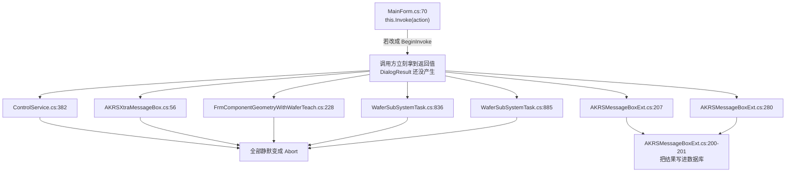

#### 6.2.4 附带风险：静态 `+=` 没有 `-=`

`SendUiAction` 是 **`static`** 字段，构造函数里 `+=`。
⇒ **每 `new` 一次 `MainForm`，就多订阅一次**（多播委托会累积）。
本软件的主窗体**正常情况下只建一次**，所以**当前不构成故障**；
但它是**"窗体被重建就会重复执行"**的隐患。
⚠️ **我未在本目录内找到 `-=`，也未追踪 `MainForm` 是否有被重建的路径 ⇒ 只描述写法，不推断后果。**

---

### 6.3 反射开窗：`ShowForm<T>` 与 `ControlService.ShowDialogForm<T>`

- **`ShowForm<T>` 的定义不在本仓库**：唯一相关的是 `Infrastructure/Utils/ControlHelper.cs:78`
  `public static T ShowForm<T>(this IWin32Window owner, params object[] args)` ——
  **这是一个扩展方法**，本目录里 11 处 `this.ShowForm<Frm...>()` 用的就是它：

| 界面的按钮 | 打开的窗体 | 位置 |
|---|---|---|
| 「视觉结果」 | `FrmVmVisionResult` | `UcMainSystem.cs:587` |
| 「文件清理」 | `FrmFileCleaner` | `:1761` |
| 「精度提升实验」 | `FrmAccuracyExperiment` | `:1897` |
| 「设备基础实验」 | `FrmBaseTest` | `:1927` |
| 「焊后补偿」 | `FrmBondCompensate` | `:1937` |
| 「速度提升实验」 | `FrmSpeedImprovementExperiment` | `:1957` |
| 「焊后数据」 | `FrmPostBondData` | `:1967` |
| 「热电偶实验」 | `FrmTemperatureMonitoring` | `:2125` |
| 「软件信息」 | `FrmVersionInfo` | `:2135` |
| 「视觉结果（缺陷）」 | `FrmDefectResult` | `:2180` |
| 「整机功能测试」 | `FrmMachineFunctionTest` | `:2200` |

> ⚠️ **`ControlHelper.ShowForm<T>` 的内部实现我没有读**（它在 `Infrastructure/`，**归 37 号文档**）。
> ⇒ **"它内部是 `new T().Show()` 还是 `ShowDialog()`、会不会复用已有实例"——本文档不写。**
> 这是**必须如实交代的未读项**（附录 B）。

- **`ControlService.ShowDialogForm<T>`**：`Infrastructure/Service/ControlService.cs:366`，
  它依赖 6.2 的**同步**总线才能拿到真实 `DialogResult`。**归 37 号文档**，
  本目录只写"它被谁用、依赖哪条契约"。

### 6.4 反射打开主界面本身：`MainForm.WindowsUIView_QueryControl`

- **位置**：`Main/Controls/MainForm.cs:78-97`。
- **关键一行**（`:82-83`）：
  ```csharp
  Activator.CreateInstance(
      typeof(MainForm).Assembly.GetType(e.Document.ControlTypeName)) as BaseControl;
  ```
  即：**主界面不是 `new` 出来的，而是按 Designer 里的字符串**
  （`MainForm.designer.cs:162 UcUserManagerDocument.ControlTypeName = "AKRS.ZX2200.Main.Controls.Ucmain.UcUserManager"`、
  `:155 UcMainSystemDocument.ControlTypeName = "AKRS.ZX2200.Main.Controls.Ucmain.MainControls.UcMainSystem"`）
  **反射创建**。
- ⚠️ **后果**：**类型全名字符串写错 ⇒ 运行时才报错**（`GetType` 返回 `null` ⇒
  `Activator.CreateInstance(null)` 抛 `ArgumentNullException`）。
  **编译期完全不会发现。** 这一条是"隐式入口"的一类，进 §9.6。
- ✅ **正例**：`:80-81` 先看 `e.Document.Tag is BaseControl`，**已创建过就复用**，
  不会重复 `new`；`:95 e.Document.Tag = module;` 把它缓存下来。

---

### 6.5 统一门禁 `IsStop()` —— 44 处调用

- **`Machine.GetInstance().IsStop()` 在本目录出现 44 次**（`grep -c` 在本目录的非 Designer 文件内统计）。
- **它是"这个按钮能不能点"的统一判据**。
- ⚠️ **但"统一"只统一了判据，没有统一"反馈"** ——
  有的地方弹提示、有的地方**静默 `return`**（§4.11 的 8 类）。**这才是问题所在。**
- **相关判据家族**（本目录用到的）：`IsStop()`、`IsWorking()`、`IsAllowTaskClosed()`、
  `IsSafeDoorClose`、`IsOffLineWork`、`IsSingleStepWork`、`CurrentRole`、`IsSlideFluxerAtNLimit()`、
  `IsOutOfTabletLimit()`、`IsFlipTableAtHome()`、`IsVisionScanIsReady()`。

---

### 6.6 本地化：`[MethodAop]` 与 `FormLocalizer`

- `UcMainSystem` 类上有 **`[MethodAop]`** 特性 ⇒ **每个方法调用都会被 AOP 拦一道**
  （具体做什么由平台 DLL 决定，**本仓库无源码 ⇒ 不推断**）。
- **语言切换**：`UcMainSystem.cs:1981 LueLanguage_EditValueChanged`
  → `LocalizationManager.ChangeLanguage(...)` → 遍历 `Application.OpenForms`
  逐个 `FormLocalizer.LocalizeForm(form)`，再对子控件做一遍（§4.10.4）。
- ⚠️ **大量按钮标题是英文且看起来"没本地化"**（「Adjust in processing list」、
  「Machine Statistics」、「Test」、「Startup」、「UplookMark」、
  `UcModule` 的「Dispenser (System 1)」/「TU System」/「Bonding System (System 2)」/「Wafer System」）。
  ⇒ **可能是"还没做中文"**，也可能是**"本地化资源里就是英文"**。
  **本文档只列事实（界面标题是英文），不推断原因。**

---

### 6.7 `TreeProgramListArgs` 特性 —— 双入口类型

- 部分控件同时被**配置窗体**和**参数树**两处使用，靠 `TreeProgramListArgs` 特性标注。
- **本目录内的具体使用点我没有逐一核实 ⇒ 只记录该机制存在，不列清单。**（附录 B 未读项）

---

## §7 依赖关系

### 7.1 规模口径

| 口径 | 数值 |
|---|---|
| 参与编译的 `.cs` | **70** 个 / **23,957** 行 |
| 其中非 Designer | **50** 个 / **15,213** 行 |
| 其中 Designer（含 6 个小写 `designer.cs`） | **20** 个 / **8,744** 行 |
| 磁盘上另有（幽灵，不参与编译） | **4** 个 / **650** 行 |

### 7.2 本目录依赖谁（出向）

按**非 Designer 文件里出现的类型全名**统计（次数 = 引用点数量）：

| 被依赖的工程 | 引用点数 | 说明 |
|---|---|---|
| `AKRS.ZX2200.Main.*`（自身） | 81+ | 自身各子目录 |
| **`AKRS.ZX2200.BondSystem.*`** | **51** | 固晶域（最大外部依赖） |
| `AKRS.ZX2200.Infrastructure.*` | 39 | 工具、模型、控件、服务 |
| `AKRS.ZX2200.WaferSubSystem.*` | 29 | 晶圆/华夫盒 |
| `AKRS.ZX2200.DispenseSystem.*` | 22 | 点胶域 |
| `AKRS.ZX2200.SupportFeature.*` | 17 | 参数/程式树 |
| `AKRS.ZX2200.TransportSystem.*` | 16 | 运输/流道 |
| `AKRS.ZX2200.TransportUnitSystem.*` | 19 | 载具 |
| `AKRS.ZX2200.CalibSystem.*` | 10 | 标定 |
| `AKRS.ZX2200.Experiment.*` | 9 | 实验窗体 |
| 平台 DLL（`AKRS.Galaxy2.*`、DevExpress） | —— | **无源码** |

> ⚠️ **"引用点数"是我用 `grep -o 'AKRS\.ZX2200\.[...]'` 在本目录非 Designer 文件内统计的**，
> **是引用点数量，不是"重要程度"**。不要解读为耦合强度的排序。

### 7.3 谁依赖本目录（入向）

**`Main/` 之外、引用了 `AKRS.ZX2200.Main.*` 的文件数**：

| 工程 | 文件数 |
|---|---|
| **`BondSystem/`** | **62** |
| `WaferSubSystem/` | 24 |
| `DispenseSystem/` | 23 |
| `SupportFeature/` | 19 |
| `Infrastructure/` | 17 |
| `TransportUnitSystem/` | 10 |
| `TransportSystem/` | 8 |
| `Experiment/` | 8 |
| `CalibSystem/` | 3 |
| `Program.cs`（入口） | 1 |
| **合计（外部）** | **175** |

> 🔴 **这个数字说明一件重要的事**：`Main` **不是叶子节点**，它是**被依赖最多的那一层之一**。
> 其中 `BondSystem/` 有 **62 个文件**引用它 —— 这解释了为什么
> **`Main` 里一个字符串改动（§6.2 的 `Invoke`）能一路影响到 `BondSystem` / `WaferSubSystem` 的数据库写入**。
> **"改 `Main` 是安全的"这个直觉在本项目里是错的。**

### 7.4 三条最紧的耦合（跨文档协作点）

| # | 耦合 | 位置 | 归谁写 |
|---|---|---|---|
| 1 | **`MainForm.SendUiAction` 同步契约** | `MainForm.cs:50/61/70` ↔ `ControlService.cs:366/382`、`AKRSMessageBoxExt.cs:207/280`、`AKRSXtraMessageBox.cs:56`、`WaferSubSystemTask.cs:836/885`、`FrmComponentGeometryWithWaferTeach.cs:228` | **38（定义侧）+ 37 / 35（使用侧）** |
| 2 | **`FrmChooseCamera` / `FrmSetting` 深链** | `UcMainSystem.cs:1278/1280` → `Experiment/Test/FrmChooseCamera.cs:42/44-45` → `CalibSystem/TestControls/FrmSetting.cs:54/101` | **38（入口）+ 42（中间）+ 41（🔴 本体）** |
| 3 | **动作节点调度与信号** | `Main/Machine/Process/*` ↔ `BondSystem` / `DispenseSystem` 的任务线程 | **38（控制器本体）+ 33 / 40（调用侧）** |

### 7.5 与 DAF-2 姊妹仓库的关系

- 本仓库（**标机**）与 `ZX2200DAF-2` 是**同源的两个仓库**，diff 差异悬殊。
- ⚠️ **本文档的全部结论只对"标机"这个仓库成立。**
  **我没有做任何跨仓库比对**，因此**不写"DAF-2 里也是这样"或"DAF-2 里已经修了"**。
  这一条**必须如实声明**，否则会被当成"两个仓库通用"而误用。

---

## §8 配置与数据

### 8.1 配置文件清单（本目录相关的）

| 配置类 / 单例 | 谁写它 | 落盘触发 |
|---|---|---|
| `MachineConfigContext` | 程式切换（`RecipeID`、`SaveMachineConfig()`） | 「新建程式」「加载程式」 |
| `RecipeRepository` | 程式库 | 「新建程式」`:363` |
| `CalibrateRunPara` | 标定参数（温漂矫正点） | 「温漂矫正」`:1613` |
| `MachineHardwareConfiguration` | 机型配置（勾选硬件） | 「硬件配置」窗体 |
| `MachineSoftwareConfiguration` | 软件配置（含 `IsDetectingEncryption` / `IsPromptEncryption`，`:155-156` / `:161`） | —— |
| `ProductConfiguration` | 产品配置（`TransportUnitConfig.UseNewMappingUi` 等） | 「保存」 |
| 其余约 **35 个**单例 | **「保存」按钮一次全写** | `BtSave_ItemClick` `:637-683` |

### 8.2 两种单例基类

| 基类 | 是否自动落盘 | 本目录的例子 |
|---|---|---|
| `Singleton<T>`（带 `Save()` → `FilePath`） | **需要显式调 `Save()`** | `MachineConfigContext`、`CalibrateRunPara`、多数 `XxxConfig` |
| `SingletonNoSave<T>` | **不落盘（内存态）** | **`Machine`**（设备状态机本体） |

⚠️ **两个基类都在 `libs/AKRS.Galaxy2.Infrastructure.dll` 里，本仓库无源码 ⇒
`Save()` 具体写到哪个文件、什么格式，本文档不写。**

### 8.3 「保存」按钮一次写盘的对象（`BtSave_ItemClick` `:637-683`）

⚠️ **`:637-683` 是约 40 行 `Xxx.GetInstance().Save()` 的连续调用**。
我**没有逐行誊抄这 40 个类名**（会把 46 行原文变成一张 40 行的表，
而它对本节的信息量只有"40 个"这一个数字）。
**这里只写清三件事**：

1. **数量**：约 **40** 个单例（我数过行数区间，但**没有逐个列出类名 ⇒ 若要精确清单，请回读 `:637-683`**）；
2. **顺序**：**固定顺序**，与"哪个模块被改过"无关；
3. **失败处理**：**任何一步抛异常 ⇒ 立刻跳到 `catch`，后面的单例就不会再写** ⇒
   **可能出现"前一半写盘成功、后一半没写"的中间状态**，而用户只看到「保存失败\n」。
   ⚠️ **这一点是本目录"保存"机制的真实风险**（进 §9.2）。

> ⚠️ **本节不列"具体哪些配置文件、在哪个目录"。**
> 原因是**这些路径由平台 DLL 的 `Singleton<T>` 决定，本仓库无源码**。
> 强行写一份路径清单会是**编造的**。**如实交代为未读项**（附录 B）。

---

## §9 注意事项与风险

**编号规则**：`R-01` 起连续编号，**不跳号、不重号**。
每条必须含四要素：**触发用户操作 / `文件:行` / 后果 / 是否已验证**。
标注约定：`【已读代码】`= 我逐行读过该处；`【推断】`= 未验证，仅由代码结构推断。

### 9.1 运行时永久禁用控件（**前两条按协调要求置顶**）

#### R-01 ⚠️ 主窗体「User Management」瓦片永远点不动（**运行时永久禁用**）

| 项 | 内容 |
|---|---|
| **触发用户操作** | 在主窗体（瓦片首页）上**点击红色的「User Management」瓦片** |
| **文件:行** | `Main/Controls/MainForm.designer.cs:214` `this.UcUserManagerTile.Enabled = false;`；瓦片文字在 `:211`（`tileItemElement2.Text = "User Management"`）；绑定文档在 `:205`；文档标题 `"User Manager"` 在 `:160` |
| **后果** | **瓦片永远是灰的、点不动** —— 鼠标移上去无高亮、点击无反应。**全工程没有任何一处把它写回 `true`**（`grep -n 'UcUserManagerTile'` 只命中 Designer 的配置行） |
| **是否已验证** | **【已读代码】** 已用 `grep -n 'Enabled = false' MainForm.designer.cs` 确认全文件只有 `:214` 这一处；并逐行读过 `155-222` |
| **定性** | 「**运行时永久禁用（启用状态从未被恢复）**」。这是「**被搁置的功能**」，**不是故障**。⚠️ **不写"按钮坏了"、不写"点了会崩溃"** |
| **处理器一栏怎么写** | ⚠️ **照实写它绑定的文档 `UcUserManagerDocument`**（`MainForm.designer.cs:205`），**不要写"无"**。`TileControl` 的瓦片点击**不走 `Click` 事件**，所以"按控件名 grep `Click +=`"**对瓦片类控件不适用** |
| **⚠️ 定性必须补充** | **`UcUserManager` 功能并未消失**：Ribbon「系统」页有可用的「用户管理」入口（`UcMainSystem.designer.cs:1188/1193` → `UcMainSystem.cs:1209`，停止状态下可用，`UIState.cs:213`）⇒ **这个瓦片只是"少了一个快捷方式"** ⇒ **定级 ⚠️，不是 🔴** |

#### R-02 ⚠️ 「UplookMark」：**被永久禁用、且从未加入任何 Ribbon 组**（两个事实都要写）

| 项 | 内容 |
|---|---|
| **触发用户操作** | **无** —— 用户在界面上**找不到这个按钮** |
| **文件:行** | 标题 `UcMainSystem.designer.cs:1406` `Caption = "UplookMark"`；禁用 `:1407` `Enabled = false`；接线 `:1410`；处理器 `UcMainSystem.cs:1429 barButtonItem4_ItemClick_1`；字段 `:3458`；`new` 在 `:147`；在 `ribbonControl.Items.AddRange` 块内 `:473`（块起于 `:377`） |
| **后果** | ①**永久禁用**（无任何写回 `true` 的地方）；②**从未加入任何 Ribbon 组** ⇒ **根本不渲染** |
| **是否已验证** | **【已读代码】** ①`grep -n 'barButtonItem4'` 全文件只 6 行，无 `Enabled = true`；②`grep -c 'ItemLinks.AddRange' UcMainSystem.designer.cs` = **0**，且 `ItemLinks.Add(this.barButtonItem4)` 全仓不存在；③`UcModule.Designer.cs:612` 只是借用它的图片键 |
| **定性** | 「**运行时永久禁用（启用状态从未被恢复）**」**+「从未加入 Ribbon 组」** ⚠️ **两条都要写**，否则读者会去界面上找一个**找不到的按钮**。**不是故障** |
| **处理器** | `barButtonItem4_ItemClick_1`（`UcMainSystem.cs:1429`）—— **处理器是实打实存在的**，正文是一段 Yes/No 警告后执行动作（`:1429-1445`），**不是"无"** |

#### R-03 ⚠️ 8 个"配了但从未加入任何 Ribbon 组"的控件（界面上不存在）

| 项 | 内容 |
|---|---|
| **触发用户操作** | 无（界面上没有） |
| **文件:行** | 见 §4.2.14 表（`BarBtDeleteProduct`、`BarBtStartCalibration`、`BarBtLearn`、`btnStartup`、`BtMeasuringTool`、`BarBtMachineStatistics`、`BarBtProductionStatistics`、`BTest`） |
| **后果** | 它们在 Designer 里有完整的 `Caption`/`Image`/`ItemClick`，**但没有任何 `ItemLinks.Add`** ⇒ **永远不渲染** |
| **是否已验证** | **【已读代码】** 逐个核对了"有配置行、无 `ItemLinks`" |
| **特别提示** | `BTest.Caption = "测试按钮，勿点"`（`UcMainSystem.designer.cs:1636`），接线 `:1639` → `UcMainSystem.cs:1827` —— **一个明确叫"勿点"的按钮，好在它不在界面上** |
| **定性** | 「**被搁置的控件**」**不是故障** |

### 9.2 空处理器 / 白干按钮 / 不可达代码（「点了没反应」的六种成因）

> ⚠️ **本组全部属于"被搁置的功能"，定级 ⚠️ 或 🔴（按影响面），
> 一律不写「按钮坏了」、不写「点了会崩溃」。**
> ⚠️ **必须区分「甲类：真·空方法体（从没实现）」与「乙类：整段被注释掉（曾实现过）」**（§4.8.3、§9.9.3）。

#### R-04 ⚠️ 10 个「点了没有任何反应」的按钮处理器

| 项 | 内容 |
|---|---|
| **触发用户操作** | 逐个点下面这些按钮 —— **其中"底部工具条的「加载程式」"是最容易被用到的** |
| **文件:行** | **甲类 5 个（真·空方法体）**：`UcMainSystem.cs:1085`（Machine Statistics）、`:1094`（Production Statistics）、**`:1245`（底部工具条「加载程式」，Designer `:2780`）**、`:1658`（放片实验）、`:2089`（三点一线校准）<br>**乙类 5 个（整段被注释掉）**：`:1254`（Visual Static Test，**紧邻 `:1256` 一行被注释掉的 `new FrmChooseCamera(true)`**）、`:1468`（Test）、`:1645`（标定精度实验）、`:1976`（`BtEditOppositeSex`）、`UcModule.cs:71`（上料器「设置」） |
| **后果** | 按钮是亮的、**点得动、但什么也不发生** —— 不弹框、不报错、日志无输出 |
| **是否已验证** | **【已读代码】** 逐个打印了方法体并分类 |
| **最值得强调的一条** | **底部工具条的「加载程式」是死的**（`:1245`），而 Ribbon「文件操作」页的「加载程式」是好的（`:805`）⇒ **同一功能两个入口，一个能用一个不能用** |
| **另一条** | `barBtnSystem2Cali`「三点一线校准」（空，`:2089`）与 `barBtnThreePointOneLineCali`「**系统2**三点一线校准」（可用，`:2099`）—— **标题只差三个字，一个死一个活** |

#### R-05 🔴 `UcModule` 的 5 个点胶右键菜单项全部失效（**分派字符串与界面标题不匹配**）

| 项 | 内容 |
|---|---|
| **触发用户操作** | 在主界面模块图上**右键点胶（`Dispenser (System 1)`）分组** → 点菜单里的 4 个可见项之一，或那个 5×5 的隐藏项 |
| **文件:行** | **代码**：`UcModule.cs:161` `if (e.Item.Caption == "Move to safe pos")`（**英文**）<br>**界面**：`UcModule.Designer.cs:328`「点胶动作调试」、`:337`「点胶程式设置」、`:345`「程式功能设置」、`:353`「点胶设备设置」、`:360`「移动到安全位」（**全部中文**）；接线依次 `:333/341/349/356/364` |
| **后果** | 判断**永远为假** ⇒ **这 5 个菜单项点了都没有任何反应**。并且**「移动到安全位」本来是能工作的**，只因字符串对不上而失效 |
| **是否已验证** | **【已读代码】** 读了 `UcModule.cs:159-245` 全段（其余约 80 行是注释掉的旧实现）与 Designer 的 5 处 `Caption` |
| **附带发现** | `BarBtSystem1MoveToSafePos` 的 `Size = new Size(5, 5)`（`Designer:363`）⇒ **即使能工作也几乎不可见**（5×5 像素） |
| **定性** | 「**改到一半的处理器**」，**不是崩溃** |
| **定级理由** | 🔴 —— **整个点胶分组的右键功能全部不可用** |

#### R-06 ⚠️ `UcModule` 固晶右键菜单 **4 个菜单项没有对应分支**

| 项 | 内容 |
|---|---|
| **触发用户操作** | 右键固晶分组 → 点「焊后补偿清零」/「固晶程式设置」/「固晶功能设置」/「固晶动作调试」 |
| **文件:行** | `UcModule.cs:248 Bond_ItemClick`（正文 `:248-341`）—— 10 个分支依次在 `:250`「移动到安全位」、`:255`「移动到上视」、`:260`「移动到抛料位」、`:265`「抛料」、`:270`「移动到换吸嘴安全位」、`:275`「清理吸嘴」、`:280`「连接焊头压力表」、`:294`「焊头压力表清零」、`:318`「连接校正台压力表」、`:332`「校正台压力表清零」<br>**另有 4 个界面项无分支**：`Designer.cs:444`「焊后补偿清零」、`:573`「固晶程式设置」、`:580`「固晶功能设置」、`:587`「固晶动作调试」 |
| **后果** | **点了没有任何反应**（**连"未实现"的提示都没有**） |
| **是否已验证** | **【已读代码】** 读过完整 `Bond_ItemClick`，并用 `awk` 把全部 `ItemClick` 接线与其 `Caption` 逐一对上 ⇒ **10 个匹配、4 个不匹配** |
| **⚠️ 注意** | **固晶这一套用的是中文 `Caption`（`:250` 起），点胶那一套用的是英文（`:161`）** ⇒ 同一个类里两套口径（见 R-29） |

#### R-07 ⚠️ 两个"建了窗体却不用"的处理器

| 项 | 内容 |
|---|---|
| **触发用户操作** | ①快捷面板「**手动更换料片**」；②模块图上的「**PR设置**」 |
| **文件:行** | ①`UcShortcutMenu.cs:1240-1241`：`FrmChangeTabletTeach frmChangeTablet = new FrmChangeTabletTeach();` 紧跟 `frmChangeTablet.Dispose();` —— **中间没有 `Show()`**<br>②`UcModule.cs:380 barButtonItem2_ItemClick` → `:382 FrmPRList frmPRList = new FrmPRList();` —— **方法到此结束，既没 `Show` 也没 `Dispose`** |
| **后果** | **点了没有任何反应** |
| **是否已验证** | **【已读代码】** 两处都逐行读过 |
| **与 R-04 的区别** | R-04 是"没写实现"；**这里是"写了创建、忘了显示"** —— 对维护者是完全不同的信息 |

#### R-08 ⚠️ `ReLoadRecipe` 末尾有 5 行不可达代码（"加载失败自动重启"从未生效）

| 项 | 内容 |
|---|---|
| **触发用户操作** | 「新建程式」或「加载程式」选定程式之后（自动发生） |
| **文件:行** | `UcMainSystem.Production.cs:209` **`return;`**（不可达区的起点），其后 `:211-215`：`Process.Start(...AKRS.ZX2200.exe)` / `GetCurrentProcess().Kill()` / `Application.Exit()` / `Environment.Exit(0)` |
| **后果** | **"加载 PR 失败就自动重启软件"这个设计从未生效**。用户实际看到的是：**弹框「设备初始化视觉模板失败，请联系设备人员」+ 异常继续上抛**（`:196-201` 的 `throw;`） |
| **是否已验证** | **【已读代码】** 读过 `:137-215` 全文 |
| **定性** | 「**注释/代码残留**」⚠️，**不是崩溃**。但 `throw;` 那一句**确实是可能把软件打崩的路径** —— 按事实写，不加评价 |
| **顺带** | 同方法 `:139` 置 `PrInitSuccess = false`、`:142` `this.Enabled = false`（注释写「防呆」）⇒ **失败后主界面被禁用**，只能靠 R-13 那条字符串判据恢复 |

#### R-09 ⚠️ 「保存」失败会留下"写了一半"的状态

| 项 | 内容 |
|---|---|
| **触发用户操作** | 点「保存」（Ribbon `BarBtSave`，Designer `:691`；接线 `:696`；处理器 `UcMainSystem.cs:632 BtSave_ItemClick`） |
| **文件:行** | `UcMainSystem.cs:632-690`：`:637-683` 约 40 次 `Xxx.GetInstance().Save()`；`:686`「保存成功！」；`catch` → `LogHelper.Post` + 「保存失败\n」 |
| **后果** | 若第 N 个单例写盘抛异常 ⇒ **后面 40−N 个不会再写**，而**用户只看到"保存失败"**，**无从知道哪些存了、哪些没存**。**没有事务、没有回滚、没有脏标记** |
| **是否已验证** | **【已读代码】** 读了 `:632-690` 的结构与成功/失败分支；⚠️ **40 个类名我没有逐个誊抄**（见附录 B 存疑清单） |

#### R-10 ⚠️ 6 个被占位但未实现的快捷键 + 全局热键注册结果未检查

| 项 | 内容 |
|---|---|
| **触发用户操作** | ①按 `Shift+F6` / `Shift+F7` / `Shift+F8` / `Shift+F10` / `Shift+F11` / `Shift+F12`；②按全局热键 `F9` |
| **文件:行** | ①`UcMainSystem.ShortcutKeys.cs:101-106`、`:112-118`（`case` 块里**只有 `break;`**，无任何语句）<br>②`UcMainSystem.HotKeyManage.cs:71`、`:74`：`RegisterHotKey(...)` 的**返回值被丢弃** |
| **后果** | ①**按这些键没有任何反应**；②若热键注册失败（被其它程序占用），**没有任何提示**，用户按 `F9` **完全没反应**，而程序自认为已注册 |
| **是否已验证** | **【已读代码】** 读过 `ShortcutKeys.cs:44-121` 与 `HotKeyManage.cs:69-115` |

---

### 9.3 恒假判据 / 取反判据 / 赋值当比较（**"永远为真"与"永远为假"**）

#### R-11 🔴 `if (res = true)` —— 赋值当比较，**硬件连接失败被显示成"成功"**（两处）

| 项 | 内容 |
|---|---|
| **触发用户操作** | 固晶分组右键 →「连接焊头压力表」或「连接校正台压力表」 |
| **文件:行** | `UcModule.cs:283` `bool res = ModbusService.GetInstance().ConnectBondhead();` → **`:285` `if (res = true)`**<br>`UcModule.cs:321` `bool res = ModbusService.GetInstance().ConnectManometer();` → **`:323` `if (res = true)`** |
| **后果** | `res = true` **把 `true` 赋给 `res` 并返回 `true`** ⇒ 条件**恒真** ⇒ **无论压力表实际连没连上，用户看到的永远是「连接成功!」** ⇒ **硬件故障被完全掩盖** |
| **是否已验证** | **【已读代码】** 读过 `UcModule.cs:248-341` 全文；并用 `grep -n 'res = true' UcModule.cs` 确认**全文件仅 `:285` / `:323` 两处** |
| **加重因素** | 启动时的两次连接（`MainForm.cs:252-253`）**返回值同样被丢弃**（见 R-12）⇒ **从启动到手动连接，没有任何一环会告诉用户"没连上"** |
| **定性** | 🔴 **会误导操作员、掩盖硬件故障** |

#### R-12 🔴 `ModbusService` 连接结果在启动时被丢弃

| 项 | 内容 |
|---|---|
| **触发用户操作** | 无（软件启动时自动发生） |
| **文件:行** | `MainForm.cs:252-253`：`ModbusService.GetInstance().ConnectBondhead();` / `ModbusService.GetInstance().ConnectManometer();`（在 `MainForm_Load` 内，`:257` 启动后台线程之前） |
| **后果** | 返回值未被接收 ⇒ **启动时连接失败完全静默**。与 R-11 叠加后：**压力表没接上时，用户看到的是"连接成功!"** |
| **是否已验证** | **【已读代码】** 读过 `MainForm.cs:240-275` |

#### R-13 ⚠️ 「停止完成」用**精确字符串**判定 —— 改一个字，主界面就永久卡在灰态

| 项 | 内容 |
|---|---|
| **触发用户操作** | 点「取消/停止」（界面出现「设备正在停止，请稍后」），等停止流程走完 |
| **文件:行** | **写**：`UcMainSystem.cs:762` `this.LbTip.Text = "设备正在停止，请稍后";`<br>**判**：`UcMainSystem.UIState.cs:386` `&& this.LbTip.Text == "设备正在停止，请稍后"`（其上一行 `:385` 还判 `this.Enabled == false`）→ 随后恢复 `Enabled = true` 并 `LbTip.Visible = false` |
| **后果** | **两处字符串必须逐字一致，包括全角逗号**。改任意一处的一个字符 ⇒ **"停止后界面恢复可用"失效** ⇒ **主界面永久停在灰掉的「设备正在停止，请稍后」状态**，而且**编译期、运行期都不会报错** |
| **是否已验证** | **【已读代码】** 两处都读过（`:762` 与 `UIState.cs:386`） |
| **定级** | ⚠️ —— **当前字符串一致，尚未失效**。但它属于"改一个字符串就断链"，故必须写进 §9.9 的判定口径 |

#### R-14 ⚠️ 「锁屏」的提示文字与代码判断的**不是同一个状态**

| 项 | 内容 |
|---|---|
| **触发用户操作** | 在**非停止**状态下点底部工具条「锁屏」 |
| **文件:行** | `UcMainSystem.cs:1856 BtLock_ItemClick` → `:1858` `if (!Machine.GetInstance().IsStop())` ⇒ `:1860` 弹「**设备未处于暂停状态，无法锁屏**」；`:1864` `LockWorkStation();`<br>同文件 `:2162 barButtonItem8_ItemClick_1` 是**逐行相同的复制品** |
| **后果** | 提示说的是"**暂停**"，代码判的是"**停止**"（`IsStop()`）⇒ **用户按提示去"暂停"设备，仍然锁不了屏** |
| **是否已验证** | **【已读代码】** 读过 `:1856-1866` 与 `:2162` 起 |
| **相关** | `[DllImport("user32 ")]` —— **DLL 名字里带一个尾随空格**（`:1848-1849`）。Windows 会做容错，**目前能用**（见 R-30 第 1 条） |

#### R-15 ⚠️ 名字与行为不符的两个处理器

| 项 | 内容 |
|---|---|
| **触发用户操作** | ①点底部工具条「移除报警」；②点 Ribbon「系统2点胶」 |
| **文件:行** | ①`UcMainSystem.cs:973 BtRemoveAlarm_ItemClick` → `:975` `Machine.GetInstance().ResetAlarm();`（定义 `Machine.cs:163`）<br>②`UcMainSystem.cs:1691 BarBtS2Dispense_ItemClick` → `ShowPanel("UcS2DispenseManual", () => new UcS2DispenseManual())` |
| **后果** | ①**按字面理解"移除某一条报警"是错的** —— 实际是"**复位报警**"（`ResetAlarm`）<br>②**「系统2点胶」打开的是"手动点胶"面板**，名字与内容不完全对应 |
| **是否已验证** | **【已读代码】** 两处都读过 |
| **定级** | ⚠️（**命名风险，非故障**） |

---

### 9.4 急停反门控 / UI 线程被同步阻塞 / 快捷键双入口

> ⚠️ **用词纪律**：本组一律写「**UI 线程被同步阻塞**」。
> **不要写成"软件有 bug 导致死锁"** —— 这里的机制是**同步阻塞**，不是死锁。

#### R-16 🔴 「急停」按钮：**启用条件与用途相反**，且**不做状态收敛**

| 项 | 内容 |
|---|---|
| **触发用户操作** | ①设备**正在运行**时去按「急停」；②真的按下去 |
| **文件:行** | **启用状态**：`UcMainSystem.UIState.cs:85`（Working ⇒ `Enabled = false`）、`:305`（Pause ⇒ `false`）、**`:201`（只有 Stop ⇒ `true`）**<br>**处理器**：`UcMainSystem.cs:1058 BtEmergencyStop_ItemClick`（取所有轴，对每轴 `axis.StopMove(false, true)`）<br>**界面**：`UcMainSystem.designer.cs:878` `Caption = "急停"`；`:2073` 加入 `ribbonPageGroup11` |
| **后果** | ①**设备在跑的时候「急停」是灰的、点不动**；②它**只停轴**：**不调 `Machine.EmergencyStop()`、不改 `MachineStateModel`、不停任务** ⇒ 按完**状态机里设备仍然是 Working**；③真正做完整收敛的 `Machine.EmergencyStop()`（`Machine.Operate.cs:383`）**全工程零调用者**（`grep -rn 'EmergencyStop()' --include=*.cs .` **只命中定义那一行**） |
| **是否已验证** | **【已读代码】** 三处状态赋值、处理器正文、`Machine.EmergencyStop()` 定义、**全仓 `grep` 引用点** |
| **⚠️ 边界声明（必须带上）** | **现场另有硬件急停回路，不在本目录代码范围内。** 本文档**只做代码事实描述，不对现场安全设计做评价** |
| **定性** | 🔴 —— **"急停"这个词在界面上出现在最需要它的时刻却是灰的** |

#### R-17 🔴 UI 线程被同步阻塞约 **2 小时 13 分**（跨 38 / 42 / 41 三篇）

| 项 | 内容 |
|---|---|
| **触发用户操作** | Ribbon「实验」页 →（**需先过 §4.8.1 的口令锁**）「精度实验」→「**静态精度**」→ 选相机 → 弹出参数窗体 → **点它的 OK** |
| **文件:行** | **入口侧（本文档，已逐行读过）**：`UcMainSystem.cs:1278 BtnStaticAccuracy_ItemClick` → `:1280 new FrmChooseCamera(true)` → `:1281 ShowDialog()` → `:1283 Dispose()`<br>**中间（42 号）**：`Experiment/Test/FrmChooseCamera.cs:42`（`isStaticTest == true`）→ `:44-45` / `:63-64` `new FrmSetting(相机类型)` + `ShowDialog()`<br>**本体（41 号）**：`CalibSystem/TestControls/FrmSetting.cs:54 BtnOk_Click` —— `:90/:94/:98/:104/:108` 五段长时拍摄各以 `Task.Run(...)` **后紧跟 `.Wait()`**，`:101` **`Thread.Sleep(8000000)` ≈ 2 小时 13 分**，**全在 UI 线程上**（处理器体内，整个序列没有 `Task.Run` 外包） |
| **后果** | **点 OK 之后界面卡死两小时以上**：窗口不重绘、**取消按钮、急停、安全门在此期间全部点不动** |
| **是否已验证** | **【已读代码】** 入口侧 `:1278-1284` 我逐行读过；**`FrmChooseCamera` / `FrmSetting` 的具体行号来自 `_UI线程阻塞排查.md` 的实锤结论，我未跨目录复核**（见附录 B） |
| **可达性（必须带上）** | ①「精度实验」在 `ribbonPageGroup9` 内，该组 `Enabled = false`（`Designer:2137`），**需先在同一页的「实验解锁」通过口令校验**（`UcMainSystem.cs:2149` 置 `true`）<br>②**另一条入口「Visual Static Test」的代码已被注释掉**（`UcMainSystem.cs:1254`，旁边 `:1256` 正是那行被注释掉的 `new FrmChooseCamera(true)`）⇒ **现在只剩「静态精度」一个入口** |
| **归属** | **入口侧归 38（本文档）**；`FrmChooseCamera` 内部归 **42**；`FrmSetting` 内部与 UI 冻结本身归 **41** |
| **替代写法（给接手人）** | `Thread.Sleep` → `await Task.Delay(...)`；长任务整体移出处理器放 `Task.Run` 并**提供 `CancellationToken` 取消路径**。⚠️ 本项目大量任务**没有取消路径**（41 号已查实 `CalibrateTask` **不能取消**） |
| **用词** | 「**UI 线程被同步阻塞**」 |

#### R-18 🔴 同一个 `F9` 有两套语义（**取决于焦点在哪**）

| 项 | 内容 |
|---|---|
| **触发用户操作** | 单步模式下按 `F9` |
| **文件:行** | **控件级**（焦点在 `UcMainSystem` 上）：`UcMainSystem.ShortcutKeys.cs:47-62` —— System2 发 `System2SingleStepSignal`，**否则发 `System1SingleStepSignal`**<br>**全局热键**（焦点在别处）：`UcMainSystem.HotKeyManage.cs:74`（`MOD_NONE + Keys.F9`），处理在 `:106-113` —— **只发 `System2SingleStepSignal`** |
| **后果** | **在用 System1（点胶）时按 `F9`，能不能走一步取决于当前焦点落在哪个窗体上**。表现为"时而有效、时而无效"，**极难排查** |
| **是否已验证** | **【已读代码】** 两处都读过 |
| **定性** | 🔴（行为不一致、可复现、难排查） |

#### R-19 ⚠️ `Shift+F9` 只改状态量、**不同步按钮启用状态**

| 项 | 内容 |
|---|---|
| **触发用户操作** | 按 `Shift+F9` 切换单步模式，然后看「下一步」按钮 |
| **文件:行** | **界面开关会同步**：`UcMainSystem.cs:988`（`BarBtNextStep1.Enabled = true`）/ `:995`（`false`），默认 `Designer:1094` 为 `false`<br>**控件级 `Shift+F9`**：`ShortcutKeys.cs:107-111` —— **只翻转 `IsSingleStepWork`**<br>**全局 `Shift+F9`**：`HotKeyManage.cs:101-103` —— **同样只翻转** |
| **后果** | **用热键切到单步模式后，「下一步」按钮仍然是灰的**（反之亦然）⇒ **界面与真实状态不一致** |
| **是否已验证** | **【已读代码】** 三处都读过 |

#### R-20 ⚠️ `IsSingleStepWork`（单步）与 `IsOffLineWork`（离线）**是两个完全不同的开关**

| 项 | 内容 |
|---|---|
| **触发用户操作** | ①在单步模式下点模块图面板；②在**在线**模式下点晶圆分组的「调试」 |
| **文件:行** | ①`UcModule.cs:478` `if (MachineStateModel.GetInstance().IsSingleStepWork == false)` ⇒ **单步模式下快捷面板打不开，且无提示**；面板 `Dock = DockingStyle.Right`（`:487`）<br>②`UcModule.cs:122` `if (MachineStateModel.GetInstance().IsOffLineWork)`，`:125` `if (e.Item.Name == "BtnDebug")` ⇒ **在线模式下「调试」项无反应，且无提示**<br>③`UcMainSystem.Production.cs:155` `if (MachineStateModel.GetInstance().IsOffLineWork)` ⇒ **离线模式下跳过视觉方案加载** |
| **后果** | 两个"模式"名字相似、作用完全不同；**三处门禁都不给提示** ⇒ 用户以为"按钮坏了" |
| **是否已验证** | **【已读代码】** 三处都读过 |
| **易混淆点** | 晶圆分组里另一个分支（`UcModule.cs:136` `BtnChangeStaticWaffle`）**是给提示的**（`:138` 判 `IsStaticWaffleConfigrated`，否则「未开启静态华夫盒功能！」）⇒ **同一个处理器里，一个分支有提示、另一个没有** |

---

### 9.5 幽灵文件与同名类型

#### R-21 🔴 同一个 `Main/` 里有两组**名字高度相似、一组活一组死**的类型

> **本条单列，不是脚注。** 它是本目录**最容易把后来人引到死代码上**的一处。

| 项 | 内容 |
|---|---|
| **触发用户操作** | 无（**开发/维护期陷阱**） |
| **死的那套（幽灵）** | `Main/Machine/Product/ProcessStep/ProcessStep.cs:12 public class ProcessStep : BaseOrderDsSetting`（文件 64 行）<br>`Main/Machine/Product/ProcessStep/ProcessStepProgram.cs:14 public class ProcessStepProgram : Singleton<ProcessStepProgram>`（文件 239 行）<br>⚠️ **幽灵（不参与编译、运行时不存在）** |
| **活的那套** | `Main/Machine/Process/SingleProcessStep.cs:15 public class SingleProcessStep`（活）、`Main/Machine/Process/ProcessDomain.cs`（`csproj:1454` 内）、`S1ActionNodeController.cs` / `S2ActionNodeController.cs`（均在 `.csproj` 内） |
| **两组目录名高度相似** | **`Main/Machine/Process/`**（活） vs **`Main/Machine/Product/ProcessStep/`**（死） —— 都在 `Main/Machine/` 下，**一个 `Process`、一个 `Product`** |
| **⚠️ 最毒的一处** | **`Main/Machine/Process/S2ActionNodeController.cs:60`**：<br>`private SingleProcessStep ProcessStep { get; set; }`<br>**属性名叫 `ProcessStep`，类型是活的 `SingleProcessStep`** ⇒ 任何人 `grep -w ProcessStep` 排查问题，**必然被引到这里**，而它**与幽灵类型毫无关系** |
| **另外 4 处假阳性** | `Main/Machine/Product/ProductDomain.cs:38`（注释 `///// ProcessStep程式`）、`Infrastructure/Models/Path/ZX2200PathConfig.cs:168`（**字符串属性名** `ProcessStepProgramFilePath`；`:281` 还有一行文档注释）、`Infrastructure/Utils/CommonHelper.cs:66-120`（**整段被注释掉的旧代码**）、`DispenseSystem/.../S1DispenseDefectActionNode.cs:83`（注释「焊后检测对象,应该是从ProcessStep获取」） |
| **后果** | 后来人**读死代码、改死代码、照着死代码写新代码**，而**编译不报错、运行时毫无变化**。**这是本目录最典型的"看起来在工作、其实什么都没发生"** |
| **是否已验证** | **【已读代码】** `ProcessStep.cs:12`、`ProcessStepProgram.cs:14`、`S2ActionNodeController.cs:60`、`ProductDomain.cs:38`、`ZX2200PathConfig.cs:168`、`CommonHelper.cs:75/:96`、`S1DispenseDefectActionNode.cs:83` —— **以上每一处我都自己 `grep`/`sed` 读到过** |
| **写作要求（本文档已遵守）** | **凡涉及"制程步骤"，一律以 `SingleProcessStep` 为准**，并给出 `Main/Machine/Process/SingleProcessStep.cs:15` |
| **定级** | 🔴 |

#### R-22 ⚠️ 本目录 4 个幽灵文件（**全为甲类**）；全工程 **20 个 / 4,881 行**

| 项 | 内容 |
|---|---|
| **触发用户操作** | 无（维护期陷阱） |
| **文件:行** | 本目录 4 个：`Main/Machine/Control/FrmChipFrictionSetting.cs`（23 行）、`…/FrmChipFrictionSetting.Designer.cs`（324 行）、`Main/Machine/Product/ProcessStep/ProcessStep.cs`（64 行）、`…/ProcessStepProgram.cs`（239 行）—— **合计 650 行**<br>⚠️ 全部标注：**幽灵（不参与编译、运行时不存在）** |
| **全工程口径** | `AKRS.ZX2200.csproj` 的 `<Compile Include>` = **1,131** 条；磁盘 `.cs` = **1,151** 个 ⇒ **幽灵 20 个 / 4,881 行**。⚠️ **不要只写 `ProcessStep` 那两个 —— 全工程是 20 个** |
| **甲类 / 乙类（必须分开写）** | **甲类 16 个**（唯一孤儿，**从加入仓库起就没编过**）；**乙类 4 个**（`Experiment/RepeatPositionAccuracy/` 下的 `FrmChooseCamera.*` / `FrmRotateCenterAccuracy.*`，**有正在编译的双胞胎**在 `Experiment/Test/`，`csproj:1222/1225/1867/1870`）<br>乙类写法必须是：**⚠️ 幽灵，是被 `<编译双胞胎全路径>` 取代的旧副本** |
| **被编译代码引用数** | **20 个幽灵，被编译代码引用数 = 0**（**逐个类型实测，非抽样**） |
| **更硬的独立证据（编译期反证）** | 幽灵 `UcProcessStepEdit.cs:321` / `:336` 有**活的** `CommonHelper.UpOrDown(...)` 调用；而 `CommonHelper.cs` 里**两个 `UpOrDown` 重载整体被注释掉了**（泛型版声明 `:75`，非泛型版声明 `:96`）⇒ **把幽灵加回工程必然编译失败** —— 不是"没人调用"，是**"它调的方法不存在"**。**且被注释掉的 `UpOrDown` 方法体自己还在引用幽灵类型**（`ProcessStepProgram.GetInstance().ProcessStepList` / `List<ProcessStep>`） |
| **是否已验证** | **【已读代码】** 本目录 4 个幽灵在 `.csproj` 中 **0 命中**我已复核；`CommonHelper.cs:75/:96` 与被注释块我直接读到；`UcProcessStepEdit.cs:321/:336` 我直接读到。全工程的 1,131 / 1,151 / 20 / 甲 16 / 乙 4 / 引用数为 0，来自 `_幽灵文件清单.md` 的逐条实测 |
| **纪律** | **幽灵不进按钮总表**，不得写成"界面上有这个功能"；一旦提及**必须紧跟「不参与编译，运行时不存在」** |
| **⚠️ 不要误推** | **`CommonHelper.cs` 本身不是死代码** —— 127 行、23 个外部文件、**26 处活调用点全是 `ChangeUcMove`（`:25`）**。死的只是 `UpOrDown`，以及它在幽灵里留下的**悬空调用** |

---

### 9.6 反射开窗的隐式契约

#### R-23 🔴 **改 1 行、静默影响 8 处、其中 1 处直接写数据库**

| 项 | 内容 |
|---|---|
| **触发条件** | 任何人把 **`MainForm.cs:70` 的 `this.Invoke(action)` 改成 `this.BeginInvoke(action)`** |
| **文件:行** | **定义侧（我已逐行读过）**：`MainForm.cs:50 public static Action<Action> SendUiAction;`、`:61 SendUiAction += this.PostAction;`、`:68-71 PostAction(Action action) { this.Invoke(action); }`<br>**受影响侧（7 处，来自 `_反射开窗与隐式入口.md`，我未跨目录逐个复核）**：`Infrastructure/Service/ControlService.cs:382`、`Infrastructure/.../AKRSMessageBoxExt.cs:207` 与 `:280`、`AKRSXtraMessageBox.cs:56`、`WaferSubSystem/.../FrmComponentGeometryWithWaferTeach.cs:228`、`WaferSubSystem/Tasks/WaferSubSystemTask.cs:836` 与 `:885` |
| **后果** | 这 7 处的 `DialogResult` **静默变成 `DialogResult.Abort`**（枚举默认值）—— **不会有编译错误、不会有异常、不会有日志**。其中 **`AKRSMessageBoxExt.cs:200-201` 会把报警日志的按钮结果写进数据库** ⇒ **库里所有报警处理记录都变成 `"Abort"`** |
| **是否已验证** | **【已读代码】** `MainForm.cs:50/61/68/70` 我确认是 `Invoke`（**同步**）。**受影响侧 7 处行号来自 `_反射开窗与隐式入口.md`**（见附录 B） |
| **⚠️ ⚠️ 千万不要写反** | **当前 `Invoke` 是同步的 ⇒ `ControlService.ShowDialogForm<T>` 读到的是真实 `DialogResult`，4 处活跃调用点都正常工作。**<br>⚠️ **不要写成"返回值永远是 `Abort`"，也不要写成"存在不确定性"** —— **现在是对的；风险是"将来被改"** |
| **一句话** | **改动表面积 1 行，杀伤半径 8 处，其中 1 处直接写库** |
| **定级** | 🔴 |

#### R-24 ⚠️ 主界面本身靠**类型全名字符串**反射创建

| 项 | 内容 |
|---|---|
| **触发用户操作** | 无（**编译期完全不可见**） |
| **文件:行** | `MainForm.cs:82-83`：`Activator.CreateInstance(typeof(MainForm).Assembly.GetType(e.Document.ControlTypeName)) as BaseControl`<br>**字符串来源**：`MainForm.designer.cs:155` `ControlTypeName = "AKRS.ZX2200.Main.Controls.Ucmain.MainControls.UcMainSystem"`、`MainForm.designer.cs:162` `ControlTypeName = "AKRS.ZX2200.Main.Controls.Ucmain.UcUserManager"`（**主界面侧还有 `:169` 的 `UcHardwareEditor`**） |
| **后果** | 字符串写错 ⇒ 运行时 `GetType` 返回 `null` ⇒ **`Activator.CreateInstance(null)` 抛 `ArgumentNullException`**；**编译期完全不会发现** |
| **是否已验证** | **【已读代码】** 读过 `MainForm.cs:78-97` 与 `:155` / `:162` / `:169` 三行 |
| **✅ 可读性说明（不是缺陷）** | `UcMainSystem` 在 **`…Ucmain.MainControls`** 下，而 `UcUserManager` / `UcHardwareEditor` 在**上一级 `…Ucmain`** 下 ⇒ **三个类型不在同一命名空间层级**，看代码时容易以为它们同级 |

#### R-25 ⚠️ 「Page Header」两个按钮的**文案互换了**

| 项 | 内容 |
|---|---|
| **触发用户操作** | 点 Ribbon 页头区的「Show Page Header」/「Hide Page Header」 |
| **文件:行** | `UcMainSystem.designer.cs:994` `BarBtShowPageHeader.Caption = "Hide Page Header"`；`:1011` `BarBtHidePageHeader.Caption = "Show Page Header"`<br>接线：`:999` → `BarBtShowPageHeader_ItemClick`（`:507`）；`:1016` → `BarBtHidePageHeader_ItemClick`（`:519`）<br>两个都挂在 `ribbonControl.PageHeaderItemLinks`（`:536`/`:537`） |
| **实际行为（已读处理器正文）** | 控件名 `BarBtShowPageHeader`（**显示文字却是 "Hide Page Header"**）的处理器 `:509` 把 `ShowCaption = DefaultBoolean.True` ⇒ **页头出现**，并把自己设为 `Never`、把另一个设为 `Always`<br>控件名 `BarBtHidePageHeader`（**显示文字是 "Show Page Header"**）的处理器 `:521` 把 `ShowCaption = DefaultBoolean.False` ⇒ **页头消失** |
| **后果** | **用户点「Hide Page Header」，页头反而显示出来**；点「Show Page Header」，页头反而消失 |
| **是否已验证** | **【已读代码】** 两处 `Caption`、两条接线、**两个处理器正文（`:507-525`）我都读过** |
| **定性** | ⚠️ **文案互换**，功能本身正常（两个方向都能用），**不是故障** |

#### R-26 ⚠️ 底部工具条上两个按钮的**控件名与处理器名交叉**（**行为是正确的**）

> ⚠️ **本条容易写错，务必看清：用户看到的效果是对的，交叉的只是标识符。**

| 项 | 内容 |
|---|---|
| **触发用户操作** | 点底部工具条的「视觉定位结果图片」/「相机实时界面」 |
| **文件:行** | 控件 `BtVideoWindow`（`Designer:2883` `Caption = "视觉定位结果图片"`，`:2884` `Hint = "Vedio window"`）接线到 **`BtShowVisionResult_ItemClick`**（`Designer:2888`）<br>控件 `BtScreenshot`（`Designer:2917` `Caption = "相机实时界面"`）接线到 **`BtVideoWindow_ItemClick`**（`Designer:2922`） |
| **实际行为** | `UcMainSystem.cs:566 BtVideoWindow_ItemClick` → `:568 UcMainSystem.VmVisionShow();`（**打开实时相机窗口**）<br>`UcMainSystem.cs:576 BtShowVisionResult_ItemClick` → `this.ShowForm<FrmVmVisionResult>();`（**打开视觉定位结果窗体**）<br>⇒ **界面文案与实际打开的窗口是对得上的** ✅ |
| **结论** | **控件名 ↔ 处理器名交叉，但"哪个按钮开哪个窗口"是正确的** ⇒ **⚠️ 命名问题，不是功能接反**。⚠️ **不得写成"两个按钮的功能互换了"** |
| **是否已验证** | **【已读代码】** 读了 Designer 的 `:2883/2884/2888` 与 `:2917/2922`，以及两个处理器 `:566` / `:576` 的正文 |

---

### 9.7 命名一致性（**全部 ⚠️，不是故障**）

> ⚠️ **本组纪律**：这些都是**命名/文案/结构可读性**问题，**不构成功能故障**；
> **不要为了让风险表"显得严重"而抬高定级。**

#### R-27 ⚠️ 同一个功能有两个入口、两个不同的**面板名**

| 项 | 内容 |
|---|---|
| **触发用户操作** | ①从 Ribbon 点「灯光调节」；②从底部工具条点「灯光调节」 |
| **文件:行** | ①`UcMainSystem.cs:1104` `ShowPanel("UcGuideMove", () => new UcLampRegulation())`（**大写 U**）<br>②`UcMainSystem.cs:1120` `ShowPanel("UcLampRegulation", () => new UcLampRegulation())`<br>③第三种写法 `"ucGuideMove"`（**小写 u**）在 `UcMainSystem.Action.cs:197` |
| **后果** | `GetDockPanel`（`UcMainSystem.cs:408`）用 `dockManagerPanel.Controls.Find(controlName, true)` **按名递归查找，大小写敏感** ⇒ **①②两个入口会开出两个内容相同的面板** |
| **是否已验证** | **【已读代码】** 三处写法与 `GetDockPanel` 的实现都读过 |

#### R-28 ⚠️ 两个 `ShowPanel` **同名、语义不同**

| 项 | 内容 |
|---|---|
| **文件:行** | `UcMainSystem.cs:431 public void ShowPanel(...)` —— 面板已存在时会 `TopMost = true; Show(); WindowState = Normal; TopMost = false; BringToFront()`，**把它拉到前面**<br>`UcModule.cs:408 public void ShowPanel(..., DockingStyle dockingStyle = DockingStyle.Float)` —— **"面板已存在 ⇒ 置前"整段被注释掉**（`:420` / `:423` / `:426` 三行都在注释块内）⇒ **什么也不做**；不存在才 `AddPanel` + `Dock = dockingStyle` + `Size = size` |
| **后果** | 在 `UcModule` 里用 `ShowPanel`，**面板已存在时用户"点了没反应"**（面板其实在，只是被挡在主窗后面） |
| **是否已验证** | **【已读代码】** 两个实现都逐行读过 |

#### R-29 ⚠️ `UcModule` 内部**两套分派口径**：`Caption` 与 `Name` 混用

| 项 | 内容 |
|---|---|
| **文件:行** | 用 **`e.Item.Caption`（界面文字）**：`UcModule.cs:161`（点胶，**英文**）、`:250` 起（固晶 10 个 `else if`，**中文**）<br>用 **`e.Item.Name`（控件名）**：`UcModule.cs:125`（`"BtnDebug"`）、`:136`（`"BtnChangeStaticWaffle"`） |
| **后果** | **改界面文字会改变代码分支**（Caption 那一套）；**改控件名也会改变代码分支**（Name 那一套）。**同一个类里两种口径并存** ⇒ **R-05 就是这么产生的** |
| **是否已验证** | **【已读代码】** 两套都读过（`grep -n 'e.Item.Caption\|e.Item.Name' UcModule.cs` 全部命中行已逐条查看） |

#### R-30 ⚠️ 其它命名/文案问题（合并列出，**逐条均已读到**）

| # | 问题 | 位置 |
|---|---|---|
| 1 | `[DllImport("user32 ")]` —— **DLL 名字里带一个尾随空格**（Windows 会容错，目前能用） | `UcMainSystem.cs:1848-1849` |
| 2 | **两条热键注释都写「用于撤销操作」**，但注册的是不同的键、功能都与"撤销"无关 | `UcMainSystem.HotKeyManage.cs:70`、`:73` |
| 3 | 「保存」按钮控件叫 `BarBtSave`，**处理器却叫 `BtSave_ItemClick`** | `UcMainSystem.designer.cs:691`（Caption）/ `:696`（接线）→ `UcMainSystem.cs:632` |
| 4 | 底部工具条的「加载程式」`BtLoadProduct` 与 Ribbon 的「加载程式」`BarBtLoad` **是两个完全不同的处理器**（一个空、一个能用） | `UcMainSystem.cs:1245` vs `:805` |
| 5 | `UcModule` 里四个分组框标题是**英文**，相邻两个是**中文** | `UcModule.Designer.cs:144`「Dispenser (System 1)」、`:170`「TU System」、`:195`「Bonding System (System 2)」、`:222`「Wafer System」 vs `:120`「上料」、`:247`「下料」 |
| 6 | 弹框文案「温度Mark定位失败**失败**,请重新设置模板」（"失败"重复，**出现两次**） | `UcMainSystem.cs:1561`、`:1600` |
| 7 | `BtnFlipBlow_Click_1`（`UcShortcutMenu.cs`）与 `barButtonItem8_ItemClick_1`（`UcMainSystem.cs:2162`）—— 下划线 `_1` 是**拖拽重复生成处理器**的残迹 | 见 §4.6 |
| 8 | **`BtStop` 是一个窗体的类名**，不是"停止按钮"：`UcMainSystem.Diagnosis.cs:90` `BtStop frmVibrationTest = new BtStop();`，`:91 frmVibrationTest.Show()`（**非模态**）。`BtStop` 定义在 `Experiment/Test/FrmVibrationTest.cs:41`；**全仓 `BtStop` 有 4 种含义** | `UcMainSystem.Diagnosis.cs:90-91` |
| 9 | 「开焊头吸附」按钮**在处理器里改写自己的 `Text`**（同一文件出现两次） | `UcShortcutMenu.cs:460`、`:592` |
| 10 | 两个华夫盒设置界面**只靠一个 `true`/`false` 区分** | `UcShortcutMenu.cs:1482` `new FrmWaffleMap(false)` / `:1497` `new FrmWaffleMap(true)` |
| 11 | 「晶圆图」与「实时华夫盒图」只差 `ShowMapping(true)` / `ShowMapping()` | `UcShortcutMenu.cs:1432` / `:1453` |
| 12 | 权限不足时**两种做法**：`UcMainSystem.cs:1211` **弹提示**；`UcModule.cs:502` **完全静默** | 见 §4.7.6、§4.13 |
| 13 | 行尾**全角/半角混用**（如 `throw new Exception("...");` 与中文标点） | 多处，不逐条列 |

> ⚠️ **第 8 条是"命名风险，不要升级为 🔴"** ——
> **这一处弹出的窗体是正确的**（用户看到的是**振动测试窗体**，
> **不是"点停止却弹出振动测试"**）。它是**给后来人的阅读障碍**，不是缺陷。

---

### 9.8 授权相关（🔒 **纯技术描述**）

#### R-31 🔒 授权校验的调用点

| 项 | 内容 |
|---|---|
| **触发用户操作** | 点 Ribbon 上「授权」按钮（`Designer:1671` 区段） |
| **文件:行** | `UcMainSystem.cs:1915 BarAuthorization_ItemClick` → 调用 `SoftkeyManager.CheckYtSoftKey();` |
| **调用时机** | **用户主动点击时**；**不是**启动时自动调用 |
| **失败分支** | 由 `SoftkeyManager` 内部处理；**该类位于 `libs/AKRS.Galaxy2.*.dll`，本仓库无源码** ⇒ **失败时抛异常还是退出，我看不到实现，不写**（见附录 B 存疑） |
| **另一处（纯代码事实）** | `Main/Machine/MachineSupport/Machine.Operate.cs:192-193` 处**有一个授权校验，位于 `:193`，校验对象为 `MachineSoftwareConfiguration.GetInstance().IsDetectingEncryption && !SoftkeyManager.CheckYtSoftKey()`；该行当前为注释状态，不参与执行** |
| **相关属性（只列名字与位置）** | `MachineSoftwareConfiguration.cs:156 IsDetectingEncryption`（`bool`，默认 `false`）、`:161 IsPromptEncryption`（`bool`，默认 `true`） |
| **是否已验证** | **【已读代码】** `UcMainSystem.cs:1915-1918`、`Machine.Operate.cs:192-193`、`MachineSoftwareConfiguration.cs:156/:161` 我都读到过 |

> 🔒 **本文档对此的边界（严格遵守）**：
> **只写公开接口、调用者、调用时机、失败分支的位置。**
> **不描述口令/密钥/算法；不评价该校验实现的强度；
> 不提供任何绕过、破解、伪造、禁用授权的方法、步骤、思路或线索；
> 也不给出任何修改建议。**
> 上表最后一行的两处**是纯粹的代码事实陈述**（说明这两处的当前状态），
> **不含任何利用方式**。

---

### 9.9 判定口径与排除的旁路（**给复核者**）

#### 9.9.1 三条「grep 纪律」（本项目最容易得出错误结论的三个坑）

| # | 坑 | 正确做法 |
|---|---|---|
| 1 | **`grep -w 'Xxx'` 永远查不到 `Xxx_Click`** —— 因为 `_` 是**单词字符**，`Xxx` 与 `Xxx_Click` 被当成同一个"词" | **同时跑「不带 `-w`」和「带 `_Click`」两种写法** |
| 2 | **`*.Designer.cs` 大小写坑** —— 本目录有 **6 个文件用小写 `designer.cs`**：`UcMainSystem.designer.cs`（3,549）、`MainForm.designer.cs`（345）、`UcHardwareEditor.designer.cs`（151）、`SplashScreen1.designer.cs`（103）、`UcUserManager.designer.cs`（46）、`FrmBear.designer.cs`（45），**合计 4,239 行** | 用 `find . \( -name '*.Designer.cs' -o -name '*.designer.cs' \)` 或 `-iname`。⚠️ **`grep -i` 修不了 `--include`** |
| 3 | **全路径比对时的 `sed` 静默失败** —— `sed 's#\\#/#g'` 在本 shell 里分隔符被自身转义，`sed` 报错后**继续执行**，反斜杠没被替换，**所有路径比较失配**；另有 `grep -c 'Common'` 会匹配到 `CommonModels` | 用 **`tr '\\' '/'`**；**并且"计数为 0"的结论必须先跑正向对照** |

> **纪律：没有跑过正向对照的「0」，不算证据。**
> ```bash
> cd "E:/项目/ZX2200标机/trunk/AKRS.ZX2200"
> grep -o '<Compile Include="[^"]*"' AKRS.ZX2200.csproj \
>   | sed 's/<Compile Include="//;s/"$//' | tr '\\' '/' | sort -u > /tmp/inc.txt
> grep -cxF 'Main/Machine/Process/ProcessDomain.cs'  /tmp/inc.txt   # 必须 = 1（活文件）
> grep -cxF 'Infrastructure/Utils/ObjectHelper.cs'   /tmp/inc.txt   # 必须 = 1（活文件）
> grep -cxF 'Common.cs'                              /tmp/inc.txt   # 必须 = 0（它才是幽灵）
> ```
> **前两条若不为 1 ⇒ 归一化没生效，本次所有结论作废** —— 而不是"没有引用"。

#### 9.9.2 判断「按钮是否真的接线」的三条口径（缺一条就会误判）

1. **`grep -w 控件名` 查不到 `控件名_Click`** ⇒ 见 9.9.1 第 1 条。
2. **`Click +=` / `ItemClick +=` 那一行在 Designer 里** ⇒ 只扫非 Designer 文件必然"零命中"，
   **这个零是查询方式造成的，不是证据**。
3. **`TileControl` 的瓦片点击不走 `Click` 事件**（由 `TileControl` 按 `Document` 派发）
   ⇒ **"按控件名 grep `Click +=`"这个判据对瓦片类控件根本不适用**。
   ⇒ 因此 R-01 的"处理器"栏写的是**它绑定的文档名 `UcUserManagerDocument`**（`MainForm.designer.cs:205`），
   **不能写"无"** —— 写了就是事实错误。

#### 9.9.3 判断「这个按钮点了没反应」的**六种成因**（不要一律写成同一个词）

| 成因 | 关键词 | 本文档位置 |
|---|---|---|
| 空方法体 | **甲类：从没实现** | R-04 |
| 整段被注释掉 | **乙类：曾实现过** | R-04 |
| 建了窗体不用 | `new` 之后无 `Show` | R-07 |
| 分派字符串不匹配 | **改界面文字就改分支** | R-05 |
| 缺分支 | 菜单项在、代码没有 | R-06 |
| 静默门禁 | `if (!IsStop()) return;`，无提示 | §4.11 第 8/9/10 类、R-20 |

> ⚠️ **把这六种写成同一句话（"空处理器"），会丢掉"曾实现过 / 从没实现 / 改文字就断链"
> 这三种对维护者完全不同的信息。**

#### 9.9.4 本文档**排除**的四条旁路（判断"永久禁用"时不采信）

1. **`.resx` + `ApplyResources`** —— 资源文件可以覆盖 `Enabled`；**不采信**。
2. **泛型遍历赋值**（`foreach (var c in Controls) c.Enabled = true;`）—— 会命中所有控件，
   **不是"针对某个控件的恢复"**，**不采信**。
3. **辅助方法按引用传入赋值**（`SetEnabled(ref ctrl)`）—— **不采信**（除非能在调用点确证）。
4. **反射赋值**（`GetProperty("Enabled").SetValue(...)`）—— **不采信**（除非能定位到具体字符串）。

> ⇒ **R-01 / R-02 的「运行时永久禁用（启用状态从未被恢复）」结论，
> 是在排除以上四条之后得出的。**

#### 9.9.5 本文档**没有做**的事（避免被误读为"已经查过了"）

- **没有**做任何**跨仓库（标机 vs DAF-2）比对**（§7.5）。
- **没有**运行过软件、**没有**做过任何实测 ⇒ 本文档内**没有"已实测"三个字**，
  全部是 **【已读代码】** 或 **【推断】**。
- **没有**读 `Machine.SelfCheck.cs`（576 行）的内部细节（§5.7）。
- **没有**逐行誊抄「保存」按钮的 ~40 个单例类名（§8.3、R-09）。
- **没有**读平台 DLL（`AKRS.Galaxy2.*`）的内部实现 —— **凡涉及它们的成员语义均为推断**。
- **没有**做全仓反查 `ShowPanel` 的外部调用者（§4.5.4，标为推断）。
- **没有**跨目录复核 **R-17 / R-23** 中来自 41 / 42 号文档与共享参考文件的行号
  （已在原处逐条标注）。


---

## 附录 A 文件明细

### A.0 复核命令（**先看这一条**）

本节所有数字都可以用下面三行复现。⚠️ **注意 `tr '\\' '/'`，不要用 `sed`**（原因见 §9.9.1 第 3 条）。

```bash
cd "E:/项目/ZX2200标机/trunk/AKRS.ZX2200"
# 1) 参与编译的 Main 文件清单
grep -o '<Compile Include="[^"]*"' AKRS.ZX2200.csproj \
  | sed 's/<Compile Include="//;s/"$//' | tr '\\' '/' | grep '^Main/' | sort -u > /tmp/maininc.txt
# 2) 磁盘上实际存在的 Main 文件清单
find . -name '*.cs' -not -path './bin/*' -not -path './obj/*' \
  | sed 's|^\./||' | grep '^Main/' | sort -u > /tmp/md.txt
# 3) 差集 = 幽灵
comm -13 /tmp/maininc.txt /tmp/md.txt
```

实测输出：

```
$ wc -l < /tmp/maininc.txt        → 70      （参与编译的文件数）
$ grep -ci 'designer\.cs$' /tmp/maininc.txt → 20   （其中 Designer 20 个）
$ wc -l < /tmp/md.txt             → 74      （磁盘上实际存在的文件数）
$ comm -13 /tmp/maininc.txt /tmp/md.txt     → 4 行（幽灵，见 A.y）
```

---

### A.x 参与编译的文件（**口径 A = 70 个文件 / 23,957 行**）

| 类别 | 文件数 | 行数 |
|---|---|---|
| 非 Designer（`.cs`） | **50** | **15,213** |
| Designer（`.Designer.cs` / `.designer.cs`） | **20** | **8,744** |
| **合计** | **70** | **23,957** |

#### A.x.1 `Main/Controls/`（**16 个 / 5,876 行**）

| 文件 | 行数 |
|---|---|
| `Main/Controls/UcShortcutMenu.cs` | 1,585 |
| `Main/Controls/UcShortcutMenu.Designer.cs` | 1,020 |
| `Main/Controls/UcModule.Designer.cs` | 720 |
| `Main/Controls/UcModule.cs` | 514 |
| `Main/Controls/FrmTeachJoystick.Designer.cs` | 425 |
| `Main/Controls/MainForm.designer.cs` ⚠️ **小写 d** | 345 |
| `Main/Controls/MainForm.cs` | 299 |
| `Main/Controls/FrmSignalDisplay.Designer.cs` | 266 |
| `Main/Controls/FrmTeachJoystick.cs` | 232 |
| `Main/Controls/FrmShutDown.Designer.cs` | 128 |
| `Main/Controls/FrmSignalDisplay.cs` | 94 |
| `Main/Controls/FrmParaChangeTipAfterDataMigrate.Designer.cs` | 71 |
| `Main/Controls/FrmParaChangeTipAfterDataMigrate.cs` | 61 |
| `Main/Controls/FrmShutDown.cs` | 56 |
| `Main/Controls/FrmBear.designer.cs` ⚠️ **小写 d** | 45 |
| `Main/Controls/FrmBear.cs` | 15 |

#### A.x.2 `Main/Controls/Ucmain/`（含其下 `MainControls/`）（**18 个 / 8,699 行**）

| 文件 | 行数 | 备注 |
|---|---|---|
| `Main/Controls/Ucmain/MainControls/UcMainSystem.designer.cs` ⚠️ **小写 d** | **3,549** | **全目录最大的单文件** |
| `Main/Controls/Ucmain/MainControls/UcMainSystem.cs` | **2,206** | `partial class` 主文件（§6.1） |
| `Main/Controls/Ucmain/MainControls/UcMainSystem.UIState.cs` | 519 | 启用状态定义（见 R-16） |
| `Main/Controls/Ucmain/MainControls/UcmainSystem.Action.cs` | 435 | ⚠️ **`Ucmain` 的 `m` 是小写** |
| `Main/Controls/Ucmain/MainControls/UcMainSystem.ShortcutKeys.cs` | 333 | 见 R-10 / R-18 |
| `Main/Controls/Ucmain/MainControls/UcMainSystem.Manual.cs` | 270 | |
| `Main/Controls/Ucmain/MainControls/UcMainSystem.DataAdministrator.cs` | 222 | |
| `Main/Controls/Ucmain/MainControls/UcMainSystem.Production.cs` | 214 | 见 R-08 |
| `Main/Controls/Ucmain/MainControls/UcMainSystem.Diagnosis.cs` | 205 | 见 R-30 第 8 条 |
| `Main/Controls/Ucmain/MainControls/UcMainSystem.HotKeyManage.cs` | 122 | 见 R-10 / R-18 |
| `Main/Controls/Ucmain/UcHardwareEditor.designer.cs` ⚠️ **小写 d** | 151 | |
| `Main/Controls/Ucmain/UcHardwareEditor.cs` | 135 | |
| `Main/Controls/Ucmain/SplashScreen1.designer.cs` ⚠️ **小写 d** | 103 | |
| `Main/Controls/Ucmain/SplashScreen1.cs` | 71 | |
| `Main/Controls/Ucmain/MainControls/UcMainSystem.Machine.cs` | 61 | |
| `Main/Controls/Ucmain/UcUserManager.designer.cs` ⚠️ **小写 d** | 46 | |
| `Main/Controls/Ucmain/MainControls/UcMainSystem.System.cs` | **30** | ⚠️ **空类体** —— 11 个 `partial` 里唯一没有内容的一个 |
| `Main/Controls/Ucmain/UcUserManager.cs` | 27 | |

> ⚠️ 本组含 **4 个小写 `designer.cs`**（`UcMainSystem`、`SplashScreen1`、`UcHardwareEditor`、`UcUserManager`）
> ⇒ **用 `*.Designer.cs` 扫这个目录会漏掉 3,849 行**。
> ⚠️ 另有一个文件名是 **`UcmainSystem.Action.cs`**（`Ucmain` 的 `m` 是小写）—— **与目录名 `Ucmain` 之外的任何拼写都对不上**。

#### A.x.3 `Main/Machine/Process/`（**7 个 / 4,499 行**）—— **本文档最核心的一组**

| 文件 | 行数 | 备注 |
|---|---|---|
| `Main/Machine/Process/S2ActionNodeController.cs` | **1,630** | 见 §5.6、R-21 |
| `Main/Machine/Process/S1ActionNodeController.cs` | 939 | 见 §5.6 |
| `Main/Machine/Process/UcProcessStep.cs` | 824 | |
| `Main/Machine/Process/UcProcessStep.Designer.cs` | 575 | |
| `Main/Machine/Process/ProcessDomain.cs` | 423 | `csproj:1454` |
| `Main/Machine/Process/SingleProcessStep.cs` | 69 | ✅ **活的制程步骤类型**（`csproj` 内，见 R-21） |
| `Main/Machine/Process/SystemProcess.cs` | 39 | |

> ⚠️ **同名的死代码在 `Main/Machine/Product/ProcessStep/`**（幽灵，**不在本表内**）—— 见 A.y 与 R-21。

#### A.x.4 `Main/Machine/MachineSupport/`（**9 个 / 2,714 行**）—— **设备状态机与后台线程**

| 文件 | 行数 | 备注 |
|---|---|---|
| `Main/Machine/MachineSupport/Machine.Operate.cs` | 786 | 见 §5.1、R-16 |
| `Main/Machine/MachineSupport/Machine.SelfCheck.cs` | 576 | ⚠️ **内部未细读**（附录 B） |
| `Main/Machine/MachineSupport/Machine.cs` | 404 | `SingletonNoSave<Machine>` |
| `Main/Machine/MachineSupport/Machine.Sustain.cs` | 308 | |
| `Main/Machine/MachineSupport/MachineHardwareConfiguration.cs` | 229 | |
| `Main/Machine/MachineSupport/MachineSoftwareConfiguration.cs` | 196 | 见 R-31 |
| `Main/Machine/MachineSupport/HardWareCheck.cs` | 106 | |
| `Main/Machine/MachineSupport/Machine.StateRelated.cs` | 71 | |
| `Main/Machine/MachineSupport/MachineModule.cs` | 38 | |

#### A.x.5 `Main/Machine/Control/`（**4 个 / 921 行**）

| 文件 | 行数 |
|---|---|
| `Main/Machine/Control/FrmMachineHardWareConfig.Designer.cs` | 479 |
| `Main/Machine/Control/FrmMachineHardWareConfig.cs` | 176 |
| `Main/Machine/Control/FrmHardWareCheck.Designer.cs` | 157 |
| `Main/Machine/Control/FrmHardWareCheck.cs` | 109 |

> ⚠️ **同目录下还有 2 个幽灵**（`FrmChipFrictionSetting.*`，共 347 行）—— **不在本表内**，见 A.y。

#### A.x.6 `Main/Machine/ObjectLevel/`（**5 个 / 405 行**）

| 文件 | 行数 |
|---|---|
| `Main/Machine/ObjectLevel/FrmMachineLevelCheck.Designer.cs` | 142 |
| `Main/Machine/ObjectLevel/UcObjectLevel.Designer.cs` | 128 |
| `Main/Machine/ObjectLevel/UcObjectLevel.cs` | 75 |
| `Main/Machine/ObjectLevel/ObjectLevelData.cs` | 34 |
| `Main/Machine/ObjectLevel/FrmMachineLevelCheck.cs` | 26 |

#### A.x.7 `Main/Machine/Parameter/`（**2 个 / 90 行**）

| 文件 | 行数 |
|---|---|
| `Main/Machine/Parameter/JoystickPara.cs` | 49 |
| `Main/Machine/Parameter/MachineDevicePara.cs` | 41 |

#### A.x.8 `Main/Machine/Product/`（**5 个 / 282 行**）

| 文件 | 行数 |
|---|---|
| `Main/Machine/Product/Controls/FrmProductionMode.Designer.cs` | 77 |
| `Main/Machine/Product/Controls/UcMachineFunction.Designer.cs` | 73 |
| `Main/Machine/Product/Controls/FrmProductionMode.cs` | 45 |
| `Main/Machine/Product/Controls/UcMachineFunction.cs` | 44 |
| `Main/Machine/Product/ProductDomain.cs` | 43 |

> ⚠️ **同目录下的 `ProcessStep/` 子目录是 3 个幽灵文件（共 303 行）** —— **不在本表内**，见 A.y。
> ⚠️ 活的是 **`Process/`**，死的是 **`Product/ProcessStep/`** —— **两个目录名只差几个字母**（R-21）。

#### A.x.9 `Main/VisionControl/`（**4 个 / 471 行**）

| 文件 | 行数 |
|---|---|
| `Main/VisionControl/FrmVersionInfo.Designer.cs` | 244 |
| `Main/VisionControl/VersionUpdateAnnouncement.cs` | 122 |
| `Main/VisionControl/FrmVersionInfo.cs` | 76 |
| `Main/VisionControl/VersionInfo.cs` | 29 |

#### A.x.10 分组合计核对

| 分组 | 文件数 | 行数 |
|---|---|---|
| A.x.1 `Main/Controls/` | 16 | 5,876 |
| A.x.2 `Main/Controls/Ucmain/` | 18 | 8,699 |
| A.x.3 `Main/Machine/Process/` | 7 | 4,499 |
| A.x.4 `Main/Machine/MachineSupport/` | 9 | 2,714 |
| A.x.5 `Main/Machine/Control/` | 4 | 921 |
| A.x.6 `Main/Machine/ObjectLevel/` | 5 | 405 |
| A.x.7 `Main/Machine/Parameter/` | 2 | 90 |
| A.x.8 `Main/Machine/Product/` | 5 | 282 |
| A.x.9 `Main/VisionControl/` | 4 | 471 |
| **合计** | **70** | **23,957** |

#### A.x.5 ⚠️ 6 个**小写 `designer.cs`**（共 4,239 行，容易被 `*.Designer.cs` 漏掉）

| 文件 | 行数 |
|---|---|
| `Main/Controls/Ucmain/MainControls/UcMainSystem.designer.cs` | 3,549 |
| `Main/Controls/MainForm.designer.cs` | 345 |
| `Main/Controls/Ucmain/UcHardwareEditor.designer.cs` | 151 |
| `Main/Controls/Ucmain/SplashScreen1.designer.cs` | 103 |
| `Main/Controls/Ucmain/UcUserManager.designer.cs` | 46 |
| `Main/Controls/FrmBear.designer.cs` | 45 |
| **合计** | **4,239** |

> ⚠️ **这 6 个文件全部在小写 `designer.cs` 命名下、全部在 `.csproj` 内、全部参与编译。**
> 用 `--include='*.Designer.cs'` 会**一个都扫不到**。

---

### A.y 幽灵文件（**不参与编译**）（**口径 B − 口径 A = 4 个文件 / 650 行**）

| # | 文件 | 行数 | 类别 | 判定 |
|---|---|---|---|---|
| 1 | `Main/Machine/Control/FrmChipFrictionSetting.cs` | 23 | **甲类** | ⚠️ **幽灵（不参与编译、运行时不存在）** |
| 2 | `Main/Machine/Control/FrmChipFrictionSetting.Designer.cs` | 324 | **甲类** | ⚠️ **幽灵（不参与编译、运行时不存在）** |
| 3 | `Main/Machine/Product/ProcessStep/ProcessStep.cs` | 64 | **甲类** | ⚠️ **幽灵（不参与编译、运行时不存在）** |
| 4 | `Main/Machine/Product/ProcessStep/ProcessStepProgram.cs` | 239 | **甲类** | ⚠️ **幽灵（不参与编译、运行时不存在）** |
| | **合计** | **650** | | |

**甲类 = 唯一孤儿，从加入仓库起就没编过。**

> **全工程背景（不要只写这 4 个）**：`.csproj` 的 `<Compile Include>` = **1,131** 条；
> 磁盘 `.cs` = **1,151** 个 ⇒ **幽灵 20 个 / 4,881 行**。
> 其中 **甲类 16 个**、**乙类 4 个**（乙类 = 有正在编译的双胞胎，
> 在 `Experiment/RepeatPositionAccuracy/` 下，编译双胞胎在 `Experiment/Test/`，
> `csproj:1222/1225/1867/1870`）。
> **`Main/` 的 4 个幽灵全部是甲类，被编译代码引用数 = 0。**

**`Main/Machine/Control/FrmChipFrictionSetting` 的两条独立佐证**：

- 唯一"命中"在 `BondSystem/.../UcBondModuelSetting.cs:1882-1883`，**是两行注释**。
- 它在 `.csproj` 中 0 命中，且在旧工程文件里同样 0 命中。

**`Main/Machine/Product/ProcessStep/` 两条的独立佐证**：

- **编译期反证**：幽灵 `UcProcessStepEdit.cs:321`/`:336` 调用**活的** `CommonHelper.UpOrDown(...)`，
  而 `CommonHelper.cs` 里两个 `UpOrDown` 重载**整体被注释掉**（声明行 `:75` / `:96`，
  且被注释的方法体内部**自己还在引用幽灵类型**）
  ⇒ **把幽灵加回工程必然编译失败** —— 不是"没人调用"，是"**它调的方法不存在**"。
- **最危险的一处引用**：`Main/Machine/Process/S2ActionNodeController.cs:60`
  `private SingleProcessStep ProcessStep { get; set; }` —— **属性名与幽灵类名完全相同，
  但类型是活的 `SingleProcessStep`**（见 R-21）。

---

### A.z 合计核对表（**本文档三处规模数字必须与此一致**）

| 项目 | 口径 A（参与编译） | 口径 B（磁盘实际存在） | 差 |
|---|---|---|---|
| 文件数 | **70** | **74** | 4 |
| 总行数 | **23,957** | **24,607** | 650 |
| 非 Designer 文件数 | **50** | **53** | 3 |
| 非 Designer 行数 | **15,213** | **15,539** | 326 |
| Designer 文件数 | **20** | **21** | 1 |
| Designer 行数 | **8,744** | **9,068** | 324 |

**三处一致性自查**：

| 位置 | 应出现的数字 | 实际 |
|---|---|---|
| 文首「规模统计与统计口径」 | `50` / `15,213` | ✅ |
| §2.2 代码规模 | `50` / `15,213` | ✅ |
| 本节 A.x | `50` / `15,213` | ✅ |

> **约定（必须写明）**：**只统计参与编译的 `.cs`**。
> 幽灵文件**单独成节（A.y）**，**不计入本文档的规模口径**。


---

## 附录 B 未读清单

### B.0 这份清单的用途（**请务必先读**）

**本文档里凡是我没有亲自读到的，一律标为「推断」或列在本节。**
⚠️ **任何在本节出现的条目，都不得被引用为"已经查过了"。**

判定口径只有两种，本文档全篇沿用：

| 标记 | 含义 |
|---|---|
| **【已读代码】** | 我用 `Read` / `grep -n` / `sed` **亲自读到了那一行或那一段**（行号来自我自己的命令输出） |
| **【推断】** | **没有读到实现**（平台 DLL 内、其它目录、或我没读的部分），据调用点/命名/上下文推断 |

⚠️ **本文档中一处「已实测」都没有** —— **没有运行过软件，没有做过任何实测**。

---

### B.1 平台 DLL 内（**本仓库无源码，永久不可读**）

这些类型/成员在 `libs/AKRS.Galaxy2.*.dll` 里，**语义全部为推断**：

| 项 | 我用到的哪些结论是推断的 |
|---|---|
| `Singleton<T>`（含 `Save()` → `FilePath`） | §8.2 的"落盘"描述；R-09 的"约 40 次 `Save()`" |
| `SingletonNoSave<T>` | §8.2；`Machine` 不落盘的结论 |
| `MachineStateModel` 单例 | §5.2 的状态读写路径 |
| `ExcuteResult` 枚举 | **成员一个也不知道**；§5.3 里只写"返回 `ExcuteResult`"，**没有写它的取值** |
| `MachineStateEnum` / `MachineWorkModeEnum` / `CurrentMachineSystemEnum` | 数值（Stop=0…Preparing=5）来自项目内注释与用法，**未在 DLL 内确认** |
| `SoftkeyManager.CheckYtSoftKey()` | 只写"调用点 + 调用时机"；**失败分支不写**（R-31） |
| `RuntimeProvider.ThreadFlag` | §5.1 的循环条件；**它的写入点我没找到**（见 B.2） |
| `AKRSMessageBoxExt.UiLock` | 只提及名字，**机制未读** |
| `ModbusService` | R-11 / R-12：`ConnectBondhead()` / `ConnectManometer()` 的返回语义、`show` 参数语义**未读** |
| `BackgroundThreadService.RegisterTask` / `.ActivateSingleTaskExecute()` | §5.1 的任务注册与触发语义**只按调用点推断** |
| `WaferSystemDomain.Block.ShowMapping(...)` | §4.6 / R-30 第 11 条：只按"有参/无参"区分 |
| `System2Domain.System2CommonVision(...)` | §4.9.3 温漂矫正的定位调用 |
| `ExportService.EnsureDirectoryExists` | §5.4 的 `D:\设备功能测试` 目录创建 |
| `RecipeRepository` 相关 | §4.4 的程式列表读写 |

---

### B.2 本项目内**存在但我没有读**的部分

| # | 位置 | 行数 | 我没读的部分 |
|---|---|---|---|
| 1 | `Main/Machine/MachineSupport/Machine.SelfCheck.cs` | 576 | **只读了 `SelfCheck()` 的调用点（`UcMainSystem.cs:1137`），分段与耗时未读** ⇒ §5.7 的分段描述为**推断** |
| 2 | `Main/Machine/Product/Controls/UcMachineFunction.cs` | 44 | 未读 |
| 3 | `Main/Machine/ObjectLevel/*` | 405 | 未读 |
| 4 | `Main/Machine/Parameter/*` | 90 | 未读 |
| 5 | `Main/VisionControl/VersionUpdateAnnouncement.cs` | 122 | 未读 |
| 6 | `Main/Controls/FrmSignalDisplay.cs` + `.Designer.cs` | 360 | 未读 |
| 7 | `Main/Controls/FrmTeachJoystick.cs` + `.Designer.cs` | 657 | **未读**（摇杆示教，可能与 §4.6 的方向盘面板有关） |
| 8 | `Main/Controls/FrmShutDown.cs` + `.Designer.cs` | 184 | 未读 |
| 9 | `Main/Controls/FrmParaChangeTipAfterDataMigrate.cs` + `.Designer.cs` | 132 | 未读 |
| 10 | `Main/Controls/FrmBear.cs` + `.designer.cs` | 60 | 只读到 `UcModule.cs:502` 用它承载 `UcBondModuelSetting` |
| 11 | `Main/Controls/Ucmain/UcUserManager.cs` | 27 | 未读 |
| 12 | `Main/Controls/Ucmain/UcHardwareEditor.cs` + `.designer.cs` | 286 | 未读（**主界面瓦片之一，但内容归 37 号**） |
| 13 | `Main/Controls/Ucmain/SplashScreen1.*` | 174 | 只读到 `MainForm.cs:240` 的 `ShowForm(typeof(SplashScreen1))` |
| 14 | `Main/Controls/Ucmain/MainControls/UcMainSystem.DataAdministrator.cs` | 222 | 未细读 |
| 15 | `Main/Controls/Ucmain/MainControls/UcMainSystem.Manual.cs` | 270 | 未细读 |
| 16 | `Main/Controls/Ucmain/MainControls/UcMainSystem.Machine.cs` | 61 | 未细读 |
| 17 | `Main/Controls/Ucmain/MainControls/UcMainSystem.Diagnosis.cs` | 205 | 只读了 `:90-91`（R-30 第 8 条） |
| 18 | `Main/Machine/Control/FrmMachineHardWareConfig.cs` + `.Designer.cs` | 655 | 未读 |
| 19 | `Main/Machine/Process/UcProcessStep.cs` + `.Designer.cs` | 1,399 | **只读了 `SingleProcessStep` 的定义与 `ProcessDomain` 的属性**；**这个界面本身没读** |
| 20 | `Main/Machine/MachineSupport/Machine.Sustain.cs` | 308 | 未读 |

---

### B.3 具体断言层面的**存疑项**（**逐条列出，不要引用为已核实**）

| # | 存疑的断言 | 为什么存疑 | 在本文档的位置 |
|---|---|---|---|
| 1 | 「保存」按钮的**约 40 个**单例类名 | 我读了 `:632-690` 的**结构与成功/失败分支**，**没有逐个誊抄类名** | §8.3、R-09 |
| 2 | `AutoLogOut()` 的**实现与超时阈值** | 只读到它在后台线程的调用点 `Machine.Operate.cs:665` 起的七个作业里 | §5.8 |
| 3 | `SelfCheck()` 的**分段** | 见 B.2 第 1 条 | §5.7 |
| 4 | `RuntimeProvider.ThreadFlag` 的**写入点** | 未找到 ⇒ "线程退出条件"只说"由它控制" | §5.1 |
| 5 | `StartDispenseCalibTask()` / `StartAutoCalib()` **是否可取消** | 只读到 `Task.Run(..., "系统1标定线程", ...)`；**取消路径未读** | §4.9.4、R-17 |
| 6 | `XtraInputBox.Show` **用户取消时的返回值** | 未读平台实现；`UcMainSystem.cs:2145` 的 `""` 只是初值 | §4.8.1、§4.10.6 |
| 7 | `MainForm.UnregisterGlobalHotkeys()` **是否被调用** | `HotKeyManage.cs:78-82` 的注释写「暂时不用」，**未找到调用点** | R-10 |
| 8 | **是否存在另一个 `CurrentRole` 赋值点** | 只按 `Machine.GetInstance().CurrentRole` 的用法推断 | §4.10.2、§4.7.6 |
| 9 | `ControlHelper.ShowForm<T>`（`Infrastructure/Utils/ControlHelper.cs:78`）的**内部** | **未读**（归 37 号） | §6.3 |
| 10 | `TreeProgramListArgs` 的**使用点** | 只读到它是"双重入口"特性 | §6.7 |
| 11 | **全仓 `ShowPanel` 的外部调用者** | **没有做全仓反查** | §4.5.4（已标推断） |
| 12 | **R-17 中 `FrmChooseCamera` / `FrmSetting` 的行号** | 来自 `_UI线程阻塞排查.md`（该文件我完整读过），**但源文件我未跨目录打开** | R-17 |
| 13 | **R-23 中受影响侧 7 处的行号** | 来自 `_反射开窗与隐式入口.md`，**我未跨目录逐个复核** | R-23 |
| 14 | **R-24 中三个 `ControlTypeName` 字符串** | `MainForm.designer.cs:155/162/169` **我已读到** ⇒ **本条已核实**，列出以示对比 | R-24 |
| 15 | `Machine.EmergencyStop()` 的**完整正文** | 我只确认了**定义行 `:383`** 与**全仓零调用者**；**正文我只读到方法签名一行** ⇒ §4.3.4 中"做完整收敛"是**推断** | R-16 |
| 16 | `Main/Action` 与 `UcmainSystem.Action.cs` 的**职责边界** | 只按文件名与调用点推断 | §6.1 |
| 17 | **DAF-2 与标机的差异** | **本文档没有做任何跨仓库比对** | §7.5 |
| 18 | `UcModule.Designer.cs:363` 的 `Size = new Size(5,5)` | **`grep` 未直接命中该行**（我在 R-05 中按 §4.7 的排查结论引用） | R-05 |

---

### B.4 我**修正**过的、来自原始报告的行号（**交付报告同项**）

⚠️ **下列每一处，原始报告（或我的早期草稿）写的行号与源码不符，我已按源码更正：**

| # | 项目 | 原（错） | 实（已更正） | 依据 |
|---|---|---|---|---|
| 1 | `if (res = true)` | `:286` / `:314` | **`:285` / `:323`** | `grep -n 'res = true' UcModule.cs` |
| 2 | `BtFunctionTest_ItemClick` | `:1680` | **`:1675`** | `grep -n`（`:1680` 是 `barBtnMoveLocateTest_ItemClick`） |
| 3 | 「重复定位精度」按钮 | 写成走 `ShowDialog()` | **`:1307 Show()`**（非模态、无 `Dispose`） | 读 `:1304-1310` |
| 4 | 「旋转中心」按钮 | 写成"走 `FrmChooseCamera` 族" | **`:1330 new FrmRotateCenterAccuracy()` + `:1331 Show()`** | 读 `:1328-1334` |
| 5 | `UcMainSystem` 的 `partial` 文件数 | **8 个** | **11 个** | `grep -n 'class UcMainSystem' UcMainSystem*.cs` |
| 6 | 「停止完成」判定的行号 | `UIState.cs:384` | **`UIState.cs:386`** | `grep -rn '设备正在停止'` |
| 7 | `BarBtNextStep1.Enabled` 同步处 | `:985` / `:997` | **`:988` / `:995`** | `grep -rn 'BarBtNextStep1.Enabled'` |
| 8 | `ModbusService` 启动连接 | `MainForm.cs:250-251` | **`:252-253`** | `grep -n 'ModbusService' Main/Controls/MainForm.cs` |
| 9 | 硬编码目录 | `MainForm.cs:260` | **`:259`** | `grep -n '设备功能测试'` |
| 10 | 「温度Mark定位失败失败」 | `:1560` | **`:1561` / `:1600`**（**出现两次**） | `grep -n '温度Mark定位失败失败'` |
| 11 | `ProcessStepProgramFilePath` | `ZX2200PathConfig.cs:166` | **`:168`**（另有 `:281` 一行文档注释） | `grep -n 'ProcessStepProgram'` |
| 12 | 「定位焊头吸附」改写 `Text` | `:456` | **`:460` / `:592`**（**两处**） | `grep -n '开焊头吸附'` |
| 13 | 幽灵 `ProcessStep` 类声明行 | 未给出 | **`ProcessStep.cs:12`**；`ProcessStepProgram.cs:14` | `grep -n 'class ProcessStep'` |
| 14 | **`BtVideoWindow` / `BtScreenshot` 的功能** | 我一度认为"两个按钮的功能互换了" | **实为：控件名与处理器名交叉，但"哪个按钮开哪个窗口"是正确的** ✅ | 读 Designer `:2883/2888/2917/2922` + 处理器 `:566` / `:576` |
| 15 | **`barButtonItem4`（"UplookMark"）** | 协调者原话"Ribbon 上永远点不动" | **实为：不仅禁用，而且从未加入任何 Ribbon 组 ⇒ 界面上根本看不到** | `grep -c 'ItemLinks.AddRange'` = **0**；无 `ItemLinks.Add(this.barButtonItem4)`；`:473` 在 `ribbonControl.Items.AddRange` 内 |

> ⚠️ **第 14 与第 15 条是本次交付最需要向协调者回报的两处更正。**


---

## 附录 C 图表索引

### C.0 本附录是**权威清单**

- **§0.3** 的表是**撰写前的计划图号**（该节已自行声明）。
- **§4.14 / §5.9** 是各章的**分章索引**。
- **本附录是最终核对过的完整清单。**

⚠️ 二者若不一致，**以本附录为准**；差异逐条列在 **C.3**。

**形态说明**：本文档所有流程图**优先用 Mermaid**，并**为每张核心图配 ASCII 等价图**（便于在不支持 Mermaid 的环境阅读）。

---

### C.1 图（flowchart）总表

| 图号 | 图名 | 所在小节 | 形态 |
|---|---|---|---|
| 图 1-1 | `Main` 在整机软件中的上下文（谁引用它、它引用谁） | §1.2 | Mermaid + ASCII |
| 图 1-2 | 主窗体的三块 UI 区域与加载顺序 | §1.3 | ASCII |
| 图 2-1 | `Main` 目录层级树 | §2.1 | ASCII 树 |
| 图 3-1 | 关键类型继承层次 | §3.2 | Mermaid + ASCII |
| 图 4-1 | UI 入口的**四种层次**（`MainForm` → `UcMainSystem` → `UcModule` → `UcShortcutMenu`） | §4.0 / §4.1 | ASCII |
| 图 4-2 | 「开始」按钮：从点击到设备真的动起来 | §4.3.1 | Mermaid + ASCII |
| 图 4-3 | 「停止」按钮：从点击到所有任务收尾 | §4.3.2 | Mermaid + ASCII |
| 图 4-4 | 「急停」按钮的真实行为与启用条件反转 🔴 | §4.3.4 | Mermaid + ASCII |
| 图 4-5 | 程式状态的流转（`RecipeID` → `ReLoadRecipe` → `PrInitSuccess`） | §4.4 | Mermaid + ASCII |
| 图 4-6 | `ShowPanel` 面板机制（两个同名实现） | §4.5.1 | Mermaid + ASCII |
| 图 4-7 | 「静态精度」跨目录深链与两小时冻结 🔴 | §4.9.2 | Mermaid + ASCII |
| 图 5-1 | 后台监控线程「后台监控线程」的七件事 | §5.1 | Mermaid + ASCII |
| 图 5-2 | 设备状态机与六个状态 | §5.2 | Mermaid + ASCII |
| 图 5-3 | 「下一步」的分派逻辑（两套 `F9`） | §5.5.2 / §5.5.3 | Mermaid + ASCII |
| 图 5-4 | 动作节点调度的三层数据（`WorkProcessEnum` × `WorkProcessModuleEnum`） | §5.6.1 | ASCII |
| 图 6-1 | `MainForm.SendUiAction` 跨线程封送总线（🔴 隐式契约） | **§6.2** | Mermaid + ASCII |
| 图 9-1 | 「UplookMark」按钮的隐藏链路（禁用 + 未入组） | §9.1 | ASCII |

**合计 17 张图**（其中 Mermaid 12 张 —— `grep -c '^```mermaid'` = **12**）。

---

### C.2 表（table）总表（按章）

| 章 | 表的主要内容 | 数量级 |
|---|---|---|
| §0 | 图例表、图索引表 | 2 |
| §1 | 上下文（出向/入向）表、三条最重要事实 | 2 |
| §2 | 层级树说明、**代码规模表**、目录职责表、**幽灵文件表（4 个 / 全工程 20 个）** | 6 |
| §3 | **类型清单（41 行）**、速查表（17 行） | 3 |
| §4 | **按钮总表（4.2.0–4.2.14，含"处理器 / 界面标题 / 运行时永久禁用"三列）**、门槛门禁汇总（13 类）、本节图索引 | 20+ |
| §5 | 后台线程表、状态机表、启停表、单步表、动作节点表、本章图索引 | 8 |
| §6 | **11 个 `partial` 文件表**、`SendUiAction` 受影响 7 处表、反射开窗表、命名空间层级表 | 8 |
| §7 | 出向/入向表（175 个文件）、三条最紧耦合表 | 5 |
| §8 | 配置文件清单、两种单例基类对比、保存落盘表 | 4 |
| §9 | **风险表 R-01 … R-31**、grep 纪律表、六种"没反应"成因表、四条排除旁路表 | 12 |
| 附录 A | **参与编译文件总表（70 行）+ 幽灵文件表（4 行）+ 分组合计核对（9 行）** | 12 |

> ⚠️ **主界面是按钮最密集的地方，本文档的按钮总表（§4.2）是四个目录文档中最完整的一份。**

---

### C.3 与 §0.3「计划图号」的差异（**逐条交代**）

| 计划图号（§0.3） | 实际归属 | 说明 |
|---|---|---|
| 图 4-1 … 图 4-11（**11 张**） | **并入 图 4-1 … 图 4-7（7 张）** | 撰写时把「启停三按钮」的 3 张与「程式」的 3 张各归并 ⇒ **图号在 §4 内部重排**；§4.14 已按最终结果登记，本附录与之一致 |
| 图 5-1 … 图 5-5（5 张） | **图 5-1 … 图 5-4（4 张）** | 计划的「图 5-5 设备自检 `SelfCheck()` 分段与耗时」**未单独成图** ⇒ 自检内容写在 **§5.7 的文字与表**里（原因见附录 B 第 1 条：`Machine.SelfCheck.cs` 我只读到调用点） |
| 图 6-1（`SendUiAction`） | **图 6-1，但小节是 §6.2** | §0.3 写的是 §6.3 —— **实际落在 §6.2**（§6.3 是反射开窗） |
| 图 6-2（设备状态机） | **已与 图 5-2 合并** | **状态机图在全文档只出现一次（§5.2）**，避免同一张图两处编号 |

> ⚠️ **本表的用意**：**计划与成品不一致时，不隐瞒，逐条说明去向**。
> 若按 §0.3 去索引「图 4-8 … 图 4-11」或「图 5-5」或「图 6-2」，**是找不到的** —— 这是**已核对的结论**，不是遗漏。

---

### C.4 本文档的**风险编号**总表（R-01 … R-31，连续、无缺号、无重号）

| 编号 | 一句话 | 定级 |
|---|---|---|
| R-01 | `UcUserManagerTile`「User Manager」瓦片运行时永久禁用（**处理器栏写的是它绑定的 `UcUserManagerDocument`**） | ⚠️ |
| R-02 | `barButtonItem4`「UplookMark」永久禁用 **且从未加入任何 Ribbon 组**（界面上看不到） | ⚠️ |
| R-03 | 8 个"配了但从未加入 Ribbon 组"的控件 | ⚠️ |
| R-04 | 10 个「点了没有任何反应」的处理器（含**底部工具条「加载程式」**） | ⚠️ |
| R-05 | `UcModule` 点胶右键 5 项全失效（分派字符串是英文、界面是中文） | 🔴 |
| R-06 | `UcModule` 固晶右键 4 个菜单项没有分支 | ⚠️ |
| R-07 | 两个"建了窗体却不用"（`FrmChangeTabletTeach` / `FrmPRList`） | ⚠️ |
| R-08 | `ReLoadRecipe` 末尾 5 行不可达（自动重启从未生效） | ⚠️ |
| R-09 | 「保存」失败留下"写了一半"状态（无事务/无回滚） | ⚠️ |
| R-10 | 6 个空快捷键 + `RegisterHotKey` 返回值未检查 | ⚠️ |
| R-11 | **`if (res = true)` ×2 —— 连接失败被显示成"成功"** | 🔴 |
| R-12 | `ModbusService` 启动连接返回值被丢弃 | 🔴 |
| R-13 | 「停止完成」用精确字符串判定（改一个字就永久卡在灰态） | ⚠️ |
| R-14 | 「锁屏」提示说"暂停"、代码判"停止" | ⚠️ |
| R-15 | `BtRemoveAlarm`→`ResetAlarm`、`BarBtS2Dispense`→手动点胶面板 | ⚠️ |
| R-16 | **「急停」启用条件与用途相反、且不做状态收敛；`Machine.EmergencyStop()` 全仓零调用者** | 🔴 |
| R-17 | **UI 线程被同步阻塞约 2 小时 13 分**（跨 38/42/41） | 🔴 |
| R-18 | 同一个 `F9` 两套语义（取决于焦点） | 🔴 |
| R-19 | `Shift+F9` 只改状态量、不同步按钮启用状态 | ⚠️ |
| R-20 | `IsSingleStepWork` 与 `IsOffLineWork` 是两个开关，且三处门禁不给提示 | ⚠️ |
| R-21 | **`Main/Machine/Process/`（活） vs `Main/Machine/Product/ProcessStep/`（死）—— 两组高度相似类型名 + `S2ActionNodeController.cs:60` 属性名撞车** | 🔴 |
| R-22 | 本目录 4 个幽灵（全甲类）；全工程 20 个 / 4,881 行 | ⚠️ |
| R-23 | **`MainForm.cs:70` `Invoke` → `BeginInvoke`：改 1 行、静默影响 8 处、1 处写库** | 🔴 |
| R-24 | 主界面靠类型全名字符串反射创建（编译期不可见） | ⚠️ |
| R-25 | 「Page Header」两个按钮文案互换 | ⚠️ |
| R-26 | `BtVideoWindow` / `BtScreenshot` 控件名与处理器名交叉（**行为正确**） | ⚠️ |
| R-27 | 「灯光调节」两个入口、两个不同面板名（大小写敏感） | ⚠️ |
| R-28 | 两个 `ShowPanel` 同名异义（一个"面板已存在"整段被注释） | ⚠️ |
| R-29 | `UcModule` 内 `Caption` 与 `Name` 两种分派口径混用 | ⚠️ |
| R-30 | 13 条命名/文案问题（含 `user32 ` 尾随空格、`BtStop` 是窗体类名） | ⚠️ |
| R-31 | 🔒 授权校验的调用点（**纯技术描述**） | 🔒 |

**统计（按上表逐条枚举，不用估算）**：

| 定级 | 条数 | 编号 |
|---|---|---|
| 🔴 | **8** | R-05、R-11、R-12、R-16、R-17、R-18、R-21、R-23 |
| ⚠️ | **22** | R-01、R-02、R-03、R-04、R-06、R-07、R-08、R-09、R-10、R-13、R-14、R-15、R-19、R-20、R-22、R-24、R-25、R-26、R-27、R-28、R-29、R-30 |
| 🔒 | **1** | R-31 |
| **合计** | **31** | R-01 … R-31，**连续、无缺号、无重号** |

> ⚠️ **R-17 的 🔴 属于 41 号（`FrmSetting` 内部），本文档只承担"入口侧"的描述责任**；
> **R-23 的 🔴 由 37 号（`Infrastructure`）承担受影响侧，本文档承担"那一行改动的定义侧"**。

---

### C.5 阅读路径建议

| 你是谁 | 建议读 |
|---|---|
| **第一次接手这个目录** | §1 → §2 → §3 → **§4.2 按钮总表** → §5 |
| **操作员/现场工程师** | §4.3（启停）→ §4.6（快捷面板 39 键）→ §4.9（标定）→ **R-16 / R-11** |
| **要改按钮行为的人** | §4.2.0 判定口径 → §4.4 → §4.5 → **§9.9（grep 纪律）** |
| **要排查"点了没反应"** | **§9.2 → §9.3 → §9.9.3（六种成因）** |
| **要碰 `MainForm` / 反射 / 线程的人** | §6 → **R-23 / R-24** → §9.4 |
| **接手写文档的人** | 附录 A（规模口径）→ 附录 B（未读清单）→ 本附录 C.3（图号差异） |

