# 点胶系统·全景与主流程（`AKRS.ZX2200/DispenseSystem/`）

> 一句话定位：`DispenseSystem` 是整机的**系统1（点胶平台）**实现——把胶水按配方图形点到/画到基岛焊点上，含点胶头运动、出胶控制、测高、胶量检测、换胶示教与画胶图形编辑器。它是全机唯一一个"**从按钮点击一路走到出胶**"的完整闭环模块。
>
> 代码规模：本目录**参与编译**的 `.cs` 共 **74 个**（非 Designer **61 个 / 12,470 行**；Designer **13 个 / 5,488 行**），合计 **17,958 行**。
> 另有 **1 个** `.cs` 存在于磁盘但不在 `AKRS.ZX2200.csproj` 中、**不参与编译**（`Services/System2ActionNodesService.cs`，925 行），列在附录 A 末尾。
>
> 配套：`21-点胶系统.md`（模块定位、硬件事务、参数格式的散文版）。本篇是**图解版**：用流程图/状态图/时序图把同一批逻辑重画一遍，重点是**按钮点下去之后发生了什么**。两篇的分工见 §7.4。

---

## 0. 阅读指南（含 Mermaid 渲染说明）

### 0.1 怎么打开这篇文档

文档里绝大多数图是 **Mermaid** 代码块（形如 ```` ```mermaid ```` 开头）。它是一段**文本**，需要支持 Mermaid 的工具才能渲染成图形：

| 工具 | 做法 | 说明 |
|---|---|---|
| **Typora** | 直接打开 `.md` | 默认支持 Mermaid，最省事；推荐 |
| **VS Code** | 装扩展 `Markdown Preview Mermaid Support`，再按 `Ctrl+Shift+V` 预览 | 你如果已经在用 VS Code 写 C#，这是成本最低的选择 |
| **浏览器在线版** | 打开 <https://mermaid.live>，把 ```` ```mermaid ```` 和 ```` ``` ```` 之间的内容粘进去 | 不需要装任何东西，适合临时看某一张图 |
| **GitHub / GitLab 网页** | 上传后直接看 | 原生渲染 |
| **语雀 / 飞书 / Obsidian** | 直接粘贴 | 均支持 Mermaid |

**如果你的工具不渲染 Mermaid**：看到的是图表的源码文本（不是乱码，是可读的）。为了不卡住，本篇的**核心图都额外给了 ASCII 等价版**，标记为「ASCII 版」，用纯文本框画出同样的走向，任何编辑器都能看。哪些图有 ASCII 版，见 §0.3 的最后一列。

**本篇的重点在第 4 章**。用户的原始诉求是"点胶按钮点击之后，经过什么样的流程之后点胶完成"，所以 §4.3 是全篇最长的一节：一张端到端主流程图 + 三张局部放大图 + 一张失败走法总图 + 一张异常链因果图 + 一张时序表 + 一段"这条链路上最危险的地方"。只想看这一件事的话，直接翻到 §4.3。

### 0.2 图的图例约定

- 图中出现的方法名/字段名/控件名与源码**完全一致**，可在源码里直接搜索。
- 图下方的表格给出每一步的 `文件:行号`；**行号取自实际读取**，可直接跳转。
- 标 🔴 的是**已在源码中确认的缺陷**；标 ⚠️ 的是**静态推导出的风险，未做运行时验证**；标 ✅ 的是**看起来像坑但已核实无害**。全文沿用这三个记号。
- 流程图中 `[...]` 是动作，`{...}` 是判断，`((...))` 是关键节点。
- **区分"代码事实"与"推断"**：推断的地方加斜体标注 `*（推断：…）*`，并在附录 B 说明推断依据（例如基类在 DLL 里、无源码）。
- 源码里确实存在的一处**行号冲突**必须先说清楚：`PreDispensePlateProgram.GetEpoxy()` 的 `Save()` 与 `return` 的先后顺序，本篇以 `Read` 到的源码为准（见 §6.4 与附录 B 的冲突记录）。

### 0.3 图的索引

| 图号 | 图名 | 位置 | ASCII 版 |
|---|---|---|---|
| 图 1 | `DispenseSystem` 在整机里的位置（上下文图） | §1.2 | ✅ |
| 图 2 | 六层代码分工与依赖方向 | §3.2 | ✅ |
| 图 3 | `ActionNode` 家族与平台基类 | §3.2 | — |
| 图 4 | 五个持久化文件与它们的持有者 | §3.2 | — |
| 图 5 | ★「点胶」按钮端到端主流程图 | §4.3 | ✅ |
| 图 6 | 主流程的时序视图（`sequenceDiagram`） | §4.3 | — |
| 图 7 | 局部放大①：前置校验与互锁 | §4.3 | ✅ |
| 图 8 | 局部放大②：运动与出胶 | §4.3 | ✅ |
| 图 9 | 局部放大③：完成判定与信号交接 | §4.3 | ✅ |
| 图 10 | 五种失败走法总图 | §4.3 | — |
| 图 11 | 异常链因果图：从硬件超时到进程级异常 | §4.3 | — |
| 图 12 | 「在预点胶板上测试」流程图 | §4.4 | — |
| 图 13 | 换胶向导 7 步状态机 | §4.5 | ✅ |
| 图 14 | 换胶 `Load` 缺 `return` 的失控分支 | §4.5 | — |
| 图 15 | 换胶后的状态复位对照 | §4.5 | — |
| 图 16 | ★ 打开一次「点胶头」对话框的因果爆炸图 | §4.6 | ✅ |
| 图 17 | `BtOK` / `BtCancel` 分支与"不回滚" | §4.6 | — |
| 图 18 | `Confirm()`：控件 → 字段 → 配置类 → 落盘 | §4.7 | ✅ |
| 图 19 | `EditValueChanged` 高频落盘链 | §4.7 | — |
| 图 20 | 手动页按钮 → 硬件动作 | §4.8 | — |
| 图 21 | `UcDispenseManual.Timer_Tick` 与异常路径 | §4.8 | — |
| 图 22 | `UcDispenser` 勾选联动与 `Confirm()` | §4.9 | — |
| 图 23 | 胶型库增删与新建（两个窗体） | §4.10 | — |
| 图 24 | 三个示教向导共用的 `AssistantConfig` 步骤机 | §4.11 | — |
| 图 25 | `DispenseWorkTask` 线程状态图 | §5.1 | ✅ |
| 图 26 | `DoWork()` 的三层循环与三个退出点 | §5.1 | ✅ |
| 图 27 | `AbortThread()` 与 `CancellationToken.None` 的对照 | §5.1 | — |
| 图 28 | 动作节点调度与 `goto Finish` | §5.2 | — |
| 图 29 | 单步门 `WaitSingleStep` 的 9 个调用点 | §5.4 | — |
| 图 30 | 测高的三条工具通道 | §6.5 | ✅ |
| 图 31 | 测高气缸 `.Milliseconds` 死循环 | §6.5 | ✅ |
| 图 32 | `EpoxyPretreatment` 四步 | §6.2 | ✅ |
| 图 33 | 提前开阀与两段断尾 | §6.3 | ✅ |
| 图 34 | 预点胶板网格与 `Index` 推进 | §6.4 | — |
| 图 35 | 坐标换算链（图案 → 出胶） | §6.1 | ✅ |
| 图 36 | 本目录与外部模块的依赖关系 | §7.1 | ✅ |
| 图 37 | 落盘链路：哪个界面写哪几个文件 | §8.2 | ✅ |
| 图 38 | 一次参数改动牵动的三条链路（内存 / 审计库 / 落盘） | §8.3 | ✅ |
| 图 39 | 多文件写盘的顺序与"中间态"窗口 | §8.5 | ✅ |
| 图 40 | `EpoxyApplications`：一个"读一下就改、改完就存"的属性 | §8.6 | ✅ |
| 图 41 | `R-01`~`R-69` 按"在链路哪一段爆发"分段的总览图 | §9 引言 | ✅ |
| 图 42 | `R-07` 死循环：`.Milliseconds` 把超时变成"按秒内相位判定" | §9.1 | ✅ |
| 图 43 | `R-24`：后台线程越过 `Invoke` 直接碰 UI 的五个调用点 | §9.2 | ✅ |
| 图 44 | 三个"读一下就会写"的窗口（`R-69` / `R-68` / `R-29`） | §9.3 | ✅ |
| 图 45 | `R-20`：没有版本号的 Schema 分叉（缺字段 / 多字段 / 枚举序号） | §9.4 | ✅ |
| 图 46 | `R-53` 如何放大 `R-38`：`Enable` 永远为真 | §9.7 | ✅ |
| 图 47 | `R-54`："磁盘 75 个 / 工程 74 个"的差集与两个方法陷阱 | §9.8 | ✅ |
| 图 48 | `R-57`：一条 `grep` 是怎么把你引到死代码上的 | §9.8 | ✅ |
| 图 49 | `R-65`：离线模式下"当前位置"是一条随机数链 | §9.9 | ✅ |
| 图 50 | `R-69`：读一个属性 → 剪一次名字表 → 下一次 `Save()` 落盘 | §9.9 | ✅ |
| 图 51 | 判断"这个操作会不会落盘"的决策树 | §9.10 | ✅ |

**共 51 张编号图，全部是 Mermaid 图**，其中 **47 张另给 ASCII 等价版**（除 图 3、图 4、图 6、图 34 之外都有）。
另有 **2 张不计编号的补充图**，它们也是 Mermaid 图并各带 ASCII 版：§4.7.3 的「`BtEditPattern`「编辑图像」」（图 18 的补充）与 §5.5.2 的「图外的第三条路：`AutoFocusAssistance`」。
**全篇 Mermaid 代码块共 53 个 = 51 + 2**，完整的图号-标题-所在节对照见附录 C。

---

## 1. 模块定位

### 1.1 一句话

`DispenseSystem` = **系统1（点胶平台）的"配方 + 参数 + 控制器 + 界面"四件套**。

一台 ZX2200 上有两个工位：系统1 点胶、系统2 固晶。本目录只实现系统1。系统2 的同构实现在 `BondSystem/`（`S1*` ↔ `S2*` 成对存在，见 §7.3）。两个工位通过平台的 `MachineStateModel.CurrentMachineSystem`（`CurrentMachineSystemEnum.System1/System2`）分流——**这一点很关键，因为本目录的界面里混着"如果当前是系统2 就……"的分支**（`UcEpoxyApplication.cs:600`、`UcDispenser.cs:108`、`FrmDispenseOverAllSettings.cs:31`）。

它做的事情可以拆成三条独立的链：

| 链 | 入口 | 结果 |
|---|---|---|
| **生产链** | `DispenseWorkTask` 常驻线程（`Tasks/DispenseWorkTask.cs:37`） | 自动把一批料的每一个焊点都点上胶 |
| **手动/测试链** | 界面上某个按钮 | 就地做一次硬件动作（挤胶、测高、点一次胶） |
| **配置链** | 程式编辑器里的几个页面 | 改参数 → 写 JSON 文件（配方级 1 个 + 设备级 4 个） |

三条链**共用同一批硬件对象与同一个 `DispenseController`**，但**互不加锁**（§6.6）——这是本模块最需要警惕的结构性事实。

### 1.2 上下文图

**图 1：`DispenseSystem` 在整机里的位置**

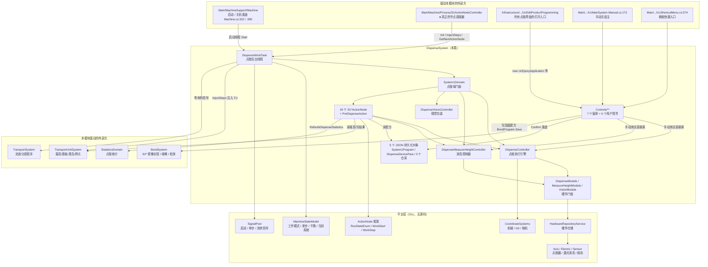

**ASCII 版**

```
        ┌──────────────────────── 外部驱动方 ────────────────────────┐
        │ Machine(启动)   S1ActionNodeController(调度)  UcEditProduct │
        │                     │            Programming(打开界面)      │
        └─────────────────────┼───────────────────┬─────────────────┘
                              │ Start/Init        │ new
                              ▼                   ▼
   ┌──────────────────────── DispenseSystem（本篇）────────────────────────┐
   │                                                                        │
   │   ┌────────────────┐   ┌──────────────────────────────────────────┐   │
   │   │ DispenseWorkTask│──▶│ System1Domain（点胶域门面）              │   │
   │   │ 点胶后台线程    │   │  ├ DispenseController       点胶引擎     │   │
   │   └───────┬────────┘   │  ├ DispenseMeasureHeight...  测高         │   │
   │           │            │  ├ DispenseVisionController  视觉         │   │
   │           │            │  └ 16 个 S1*ActionNode + PreDispenseAction │   │
   │           │            └───────┬────────────────────┬─────────────┘   │
   │           │                    │                    │                 │
   │           │              ┌─────▼──────┐      ┌──────▼────────────┐    │
   │           │              │ Modules/    │      │ Controls/**       │    │
   │           │              │ 硬件门面     │      │ 7 窗体 + 5 用户控件│   │
   │           │              └─────┬──────┘      └──────┬────────────┘    │
   │           │                    │                    │ 按钮 → 直接调引擎 │
   │           │                    │                    │ Confirm → 落盘   │
   │           │              ┌─────▼────────────────────▼─────────────┐  │
   │           │              │ 5 个 JSON（配方级 1 + 设备级 4）        │  │
   │           │              └────────────────────────────────────────┘  │
   └───────────┼────────────────────────────────────────────────────────────┘
               │                          │
               ▼                          ▼
      TU(载具/基板/基岛/焊点)      平台硬件：Axis / Electric / Sensor /
      + 流道流转信号               点胶器 / 激光测高 / 相机 / ETEL / 固高
```

### 1.3 三条最重要的事实

以下三条，是只看目录名、只看 `21-点胶系统.md` 都不会想到、但会直接决定你排查问题时走对还是走错路的。

#### 事实一：本目录**没有**自己的动作节点调度器，真正调度的是 `Main/` 那边

本目录有 17 个 `S1*ActionNode`（`Models/DispenseAction/`）和 1 个 `DispenseWorkTask` 线程（`Tasks/DispenseWorkTask.cs:37`），但**谁决定"下一个节点是谁"**不在本目录：

- 活的那一套在 `Main/Machine/Process/S1ActionNodeController`；`DispenseWorkTask` 只负责循环、取节点、执行（`Tasks/DispenseWorkTask.cs:42` 的 `System1Domain.GetInstance()`、`:66` 的取节点分支）。
- 本目录 `Services/System2ActionNodesService.cs`（925 行）**是一份同名的上一代实现，不在 `AKRS.ZX2200.csproj` 里、不参与编译**。任何"从 `System2ActionNodesService` 出发"的调用链都是**死链**——图能画出来，代码跑不到。

> 这条是本模块排查的第一道岔路：`grep ActionNode` 会同时命中活代码和死代码，先确认文件在不在 `.csproj` 里再往下读。详见 §3.3 与 §9.6。

#### 事实二：三条链共用同一批硬件对象和同一个控制器，**全程不加锁**

生产链（`DispenseWorkTask`）、手动/测试链（界面按钮）、配置链（`Confirm()` 落盘）都指向 `System1Domain.GetInstance()`（`Models/System1Domain.cs:49`，`SingletonNoSave<T>`）暴露的同一批单例 `DispenseController`（`Controllers/DispenseController.cs:56`）、`DispenseMeasureHeightController`（`Controllers/DispenseMeasureHeightController.cs:31`）、`DispenseVisionController`（`Controllers/DispenseVisionController.cs:34`）。

而这三个控制器里**没有一把 `lock`**（§6.6 给出复核命令与结果）。也就是说：**在自动生产跑着的时候点手动页的按钮，两条链会同时往同一个轴上发指令**，谁先到由 `Thread.Sleep` 的调度决定。

#### 事实三：有若干窗体在**被打开的那一刻**就改了数据（有的还落盘），取消也不回滚

最典型的是 `FrmDispenseOverAllSettings`：它的**构造函数**里就有写操作（`Controls/Assistant/FrmDispenseOverAllSettings.cs:34`、`:35`、`:37`）。这不是"点了确定才生效"的窗体，而是"打开一次就生效一次"。同类的还有 `FrmChangeEpoxy` 在 `Load` 里改全局的 `CurrentMachineSystem`（`Controls/Assistant/FrmChangeEpoxy.cs:55`）。

> 这条决定了 §4.6 那张因果图为什么是全篇最有冲击力的一张：**用户什么按钮都没点，只是双击打开了一个对话框，固晶配方里的点胶头名字和胶水名字就被清空并写进了 JSON**。

---

## 2. 目录结构

### 2.1 口径声明（先读这一段）

本篇所有"文件数 / 行数"**只统计参与编译的文件**，即出现在 `AKRS.ZX2200.csproj` 的 `<Compile Include>` 里的 `.cs`。本目录另有一个文件在磁盘上但不在工程里，**不参与编译、运行时不存在**：

| 幽灵文件 | 行数 | 处理 |
|---|---|---|
| `Services/System2ActionNodesService.cs` | 925 | 不计入 §2 与附录 A.1；单列在附录 A.2；**不进按钮总表** |

复现命令（在 `AKRS.ZX2200/` 下执行）：

```bash
grep -o '<Compile Include="DispenseSystem[^"]*"' AKRS.ZX2200.csproj \
  | sed 's/<Compile Include="//;s/"$//' | tr '\\' '/' | sed 's|^DispenseSystem/||' | sort > /tmp/ds_inc.txt
find DispenseSystem -name '*.cs' -not -path '*/bin/*' -not -path '*/obj/*' \
  | sed 's|^DispenseSystem/||' | sort > /tmp/ds_disk.txt
comm -13 /tmp/ds_inc.txt /tmp/ds_disk.txt   # → 只有 Services/System2ActionNodesService.cs
comm -23 /tmp/ds_inc.txt /tmp/ds_disk.txt   # → 空（工程里没有指向缺失文件的条目）
```

实测结果：`/tmp/ds_inc.txt` **74 行**、`/tmp/ds_disk.txt` **75 行**、差集恰好 1 个、工程侧无缺失。

### 2.2 子目录实测表

| 子目录 | 非 Designer 文件数 / 行数 | Designer 文件数 / 行数 | 小计行数 | 说明 |
|---|---|---|---|---|
| `Controllers/` | 3 / 1,797 | 0 / 0 | 1,797 | 三个执行引擎：点胶、测高、视觉 |
| `Controls/Assistant/` | 6 / 1,626 | 6 / 1,560 | 3,186 | 示教/换胶/预点胶/设置对话框，共 6 个窗体 |
| `Controls/Manual/` | 1 / 216 | 1 / 146 | 362 | 手动页用户控件 |
| `Controls/Setting/Dispenser/` | 1 / 343 | 1 / 1,008 | 1,351 | 点胶头配置页 |
| `Controls/Setting/EpoxyApplication/` | 5 / 1,544 | 5 / 2,774 | 4,318 | 画胶图形编辑器 + 胶型库 + 新建窗体 |
| `Models/`（根） | 2 / 718 | 0 / 0 | 718 | `System1Domain` 门面、`System1Program` 配方根 |
| `Models/DeviceParams/` | 4 / 313 | 0 / 0 | 313 | 设备级参数（点胶模块、点胶头、预点胶板） |
| `Models/DispenseAction/` | 17 / 2,567 | 0 / 0 | 2,567 | 17 个动作节点，按 4 个子目录分组 |
| `Models/DispensePara/` | 2 / 252 | 0 / 0 | 252 | 运行时参数提供者、胶路位置 |
| `Models/Enums/` | 1 / 234 | 0 / 0 | 234 | 14 个枚举挤在一个文件里 |
| `Models/Programs/` | 5 / 438 | 0 / 0 | 438 | 配方级持久化对象 |
| `Models/Repositories/` | 7 / 847 | 0 / 0 | 847 | 三个仓库（点胶头 / 胶水 / 图形）+ 仓储基类用法 |
| `Modules/` | 3 / 710 | 0 / 0 | 710 | 硬件门面（点胶、测高、视觉） |
| `Services/` | 3 / 600 | 0 / 0 | 600 | 运动助手、判定助手、事件静态类 |
| `Tasks/` | 1 / 265 | 0 / 0 | 265 | 点胶后台线程 |
| **合计** | **61 / 12,470** | **13 / 5,488** | **17,958** | 74 个文件 |

**口径提示**：`Models/DispenseAction/` 下还有 4 个二级子目录（`DispenseBPAction/`、`DispenseUpAction/`、`HeightMeasurementActionNode/`、`IdentityActionNode/`、`OtherAction/` 共 5 个），上表把它们合并成一行，因为它们在功能上是一组（见 §3.3）。

### 2.3 目录树（带每个文件的类型名）

```
DispenseSystem/
├── Controllers/                     3 个文件 / 1,797 行
│   ├── DispenseController.cs                     1,088  点胶执行引擎（本目录最大的文件）
│   ├── DispenseMeasureHeightController.cs          426  测高控制器
│   └── DispenseVisionController.cs                 283  视觉包装
├── Controls/
│   ├── Assistant/                   6 窗体 / 12 个文件 / 3,186 行
│   │   ├── FrmChangeEpoxy.cs(.Designer)                  604+412  换胶向导
│   │   ├── FrmDispensePlateAssistant.cs(.Designer)       358+322  预点胶板示教
│   │   ├── FrmAssistantPreDispenseDistance.cs(.Designer) 252+383  预点胶距离示教
│   │   ├── FrmPreDispenseSelect.cs(.Designer)            244+242  预点胶选择
│   │   ├── FrmDispenseOverAllSettings.cs(.Designer)      149+156  点胶头/胶水总设置
│   │   └── FrmEpoxyApplicationAssistant.cs(.Designer)     19+45   胶型编辑助手（空壳）
│   ├── Manual/                      1 控件 / 2 个文件 / 362 行
│   │   └── UcDispenseManual.cs(.Designer)                216+146  手动页
│   └── Setting/
│       ├── Dispenser/               1 控件 / 2 个文件 / 1,351 行
│       │   └── UcDispenser.cs(.Designer)                 343+1,008 点胶头配置
│       └── EpoxyApplication/        5 个文件 / 10 个文件 / 4,318 行
│           ├── UcEpoxyApplication.cs(.Designer)        1,152+2,077 画胶图形编辑器（最大控件）
│           ├── UcAddEpoxyApplication.cs(.Designer)       197+261  添加胶型
│           ├── FrmNewCreateEpoxyApplication.cs(.Designer)105+252  新建胶型
│           ├── UcDispenseLine.cs(.Designer)               69+139  单条胶路
│           └── UcEpoxyApplicationGuide.cs(.Designer)       21+45   引导页
├── Models/                          38 个文件 / 5,369 行
│   ├── System1Domain.cs                            629  点胶域门面（SingletonNoSave）
│   ├── System1Program.cs                            89  配方根（Singleton）
│   ├── DeviceParams/                             4 个 / 313
│   │   ├── DispenseDevicePara.cs                    88  设备级、单例、自带 INotifyPropertyChanged
│   │   ├── DispenseModulePara.cs                   111
│   │   ├── DispenserPara.cs                         63
│   │   └── PreDispensePlatePara.cs                  51
│   ├── DispenseAction/                          17 个 / 2,567
│   │   ├── DispenseActionNodes.cs                  237  节点工厂/分组
│   │   ├── DispenseBPAction/                     4 个 / 742   点胶本体
│   │   ├── DispenseUpAction/                     3 个 / 443   点胶前的视觉（载具/基岛/基板）
│   │   ├── HeightMeasurementActionNode/          3 个 / 331   测高节点
│   │   ├── IdentityActionNode/                   4 个 / 447   身份识别
│   │   └── OtherAction/                          2 个 / 367   InteractiveAction / PreDispenseAction
│   ├── DispensePara/                             2 个 / 252
│   ├── Enums/DispenseEnum.cs                       234  14 个枚举
│   ├── Programs/                                 5 个 / 438
│   └── Repositories/                             7 个 / 847
│       ├── Dispenser/        Dispenser.cs(149) / DispenserRepository.cs(54) / PreDispense.cs(87)
│       ├── EpoxyMaterial/    EpoxyMaterial.cs(113) / EpoxyMaterialRepository.cs(58)
│       └── Pattern/          EpoxyApplication.cs(335) / EpoxyApplicationRepository.cs(51)
├── Modules/                         3 个文件 / 710 行
│   ├── DispenseModule.cs                           539
│   ├── MeasureHeightModule.cs                      118
│   └── VisionModule.cs                              53
├── Services/                        3 个文件 / 600 行（参与编译）
│   ├── DispenserMoveHelper.cs                      548
│   ├── JudgeHelper.cs                               23
│   └── System1Events.cs                             29
└── Tasks/DispenseWorkTask.cs                       265  点胶后台线程

（以上不含幽灵文件）
```

### 2.4 幽灵文件位置

| 文件 | 行数 | 为什么它容易骗人 |
|---|---|---|
| `Services/System2ActionNodesService.cs` | 925 | 文件名与命名空间都在 `DispenseSystem` 下、行数排全目录第 4，`grep` 一定命中；但**它不在 `.csproj` 里**，改它、读它、按它排时序都是白费。它引用的还是另一批幽灵类型（`ProcessStep` / `ProcessStepProgram`，见 §9.6） |

**它不参与编译，运行时不存在，界面上也不存在由它驱动的任何功能**，因此不出现在 §4 的按钮总表中，只在附录 A.2 与 §9.6 出现。

---

## 3. 关键类型索引

### 3.1 类型清单

本目录参与编译的 74 个 `.cs` 里，`grep` 能定位到的**具名类型声明共 75 个**（`class` 60 个、`enum` 15 个；13 个 `Designer.cs` 是同一批 UI 类型的 `partial` 分部，不重复计数）。下表按职责分组，行号是类型声明所在行。

复现命令（在 `DispenseSystem/` 下执行）：

```bash
cat /tmp/ds_inc.txt | tr '\n' '\0' | xargs -0 \
  grep -nE '^\s*(public|internal|abstract|sealed|partial|static)[^=;()]*\b(class|enum|interface|struct)\s+[A-Za-z0-9_]+' \
  | grep -v 'Designer.cs:' | grep -vE ':\s*//' | wc -l   # → 75
```

> 口径说明：该命令**不匹配 `private` 嵌套类**，所以 75 是"可见类型"的下界。若某个文件里有私有嵌套类，它不在表内。

#### 3.1.1 门面与执行引擎（4 个）

| 类型 | 位置 | 基类 / 接口 | 职责 |
|---|---|---|---|
| `System1Domain` | `Models/System1Domain.cs:49` | `SingletonNoSave<System1Domain>` | 点胶域的**唯一门面**。界面、节点、线程全从 `System1Domain.GetInstance()` 拿控制器。带 `NoSave` 后缀说明它自身不落盘 |
| `DispenseController` | `Controllers/DispenseController.cs:56` | — | 点胶执行引擎。挤胶、画线、走点、插补、断尾全在这里；本目录最大文件（1,088 行） |
| `DispenseMeasureHeightController` | `Controllers/DispenseMeasureHeightController.cs:31` | — | 激光测高。开气缸、等到位、读数、关气缸 |
| `DispenseVisionController` | `Controllers/DispenseVisionController.cs:34` | — | 视觉包装。把相机的"拍一张 + 等回调"包成同步方法 |

#### 3.1.2 动作节点（17 个，除 `DispenseActionNodes` 外全部继承平台 `ActionNode`）

| 类型 | 位置 | 职责 | 备注 |
|---|---|---|---|
| `DispenseActionNodes` | `Models/DispenseAction/DispenseActionNodes.cs:18` | 节点分组/工厂 | 唯一不继承 `ActionNode` 的节点文件 |
| `S1DispenseActionNode` | `Models/DispenseAction/DispenseBPAction/S1DispenseActionNode.cs:35` | **点胶本体**：按图形逐点出胶 | §4.3 主流程的终点 |
| `S1DispenseCorrectionActionNode` | `.../DispenseBPAction/S1DispenseCorrectionActionNode.cs:32` | 点胶后补偿/校正 | |
| `S1DispenseDefectActionNode` | `.../DispenseBPAction/S1DispenseDefectActionNode.cs:44` | 胶量/缺陷检测 | |
| `S1DispenseMeasureActionNode` | `.../DispenseBPAction/S1DispenseMeasureActionNode.cs:25` | 点胶前后测量 | |
| `S1CarrierVisionActionNode` | `.../DispenseUpAction/S1CarrierVisionActionNode.cs:32` | 载具视觉定位 | |
| `S1ModuleVisionActionNode` | `.../DispenseUpAction/S1ModuleVisionActionNode.cs:30` | 基岛视觉定位 | |
| `S1SubstrateVisionActionNode` | `.../DispenseUpAction/S1SubstrateVisionActionNode.cs:28` | 基板视觉定位 | |
| `S1CarrierMeasureHeightActionNode` | `.../HeightMeasurementActionNode/S1CarrierMeasureHeightActionNode.cs:30` | 载具测高 | |
| `S1ModuleMeasureHeightActionNode` | `.../HeightMeasurementActionNode/S1ModuleMeasureHeightActionNode.cs:27` | 基岛测高 | |
| `S1SubstrateMeasureHeightActionNode` | `.../HeightMeasurementActionNode/S1SubstrateMeasureHeightActionNode.cs:26` | 基板测高 | |
| `S1BondPositionIdentityActionNode` | `.../IdentityActionNode/S1BondPositionIdentityActionNode.cs:23` | 焊点位置识别 | |
| `S1ModuleIdentityActionNode` | `.../IdentityActionNode/S1ModuleIdentityActionNode.cs:23` | 基岛身份识别 | |
| `S1SubstrateIdentityActionNode` | `.../IdentityActionNode/S1SubstrateIdentityActionNode.cs:29` | 基板身份识别 | |
| `S1TransportIdentityActionNode` | `.../IdentityActionNode/S1TransportIdentityActionNode.cs:24` | 载具身份识别 | |
| `InteractiveAction` | `.../OtherAction/InteractiveAction.cs:23` | 需要人工介入的动作（提示操作员） | |
| `PreDispenseAction` | `.../OtherAction/PredispenseAction.cs:35` | 预点胶：在预点胶板上先试打一次 | §4.3 主流程会调用它 |

> `ActionNode` 基类在平台 DLL（`AKRS.Galaxy2.*`）里，没有源码，所以"节点何时被调度、`RunStateEnum` 怎么流转"属推断，见附录 B。

#### 3.1.3 持久化对象（配方级 5 个 + 仓库条目 3 个）

| 类型 | 位置 | 基类 | 落盘方式 |
|---|---|---|---|
| `System1Program` | `Models/System1Program.cs:18` | `Singleton<System1Program>` | **配方级根对象**，`Save()` 写系统1 配方文件 |
| `DispenserProgram` | `Models/Programs/DispenserProgram.cs:25` | — | `System1Program` 的一个属性，里的 `DispenserName` 是 §4.6 的主角 |
| `EpoxyMaterialProgram` | `Models/Programs/EpoxyMaterialProgram.cs:20` | — | 同上，里的 `EpoxyMaterialName` 是 §4.6 的另一主角 |
| `EpoxyApplicationProgram` | `Models/Programs/EpoxyApplicationProgram.cs:12` | — | 画胶图形程序 |
| `PreDispensePlateProgram` | `Models/Programs/PreDispensePlateProgram.cs:26` | — | 预点胶板网格与 `Index` 指针，见 §6.4 |
| `System1OtherProgram` | `Models/Programs/System1OtherProgram.cs:12` | — | 杂项 |
| `Dispenser` | `Models/Repositories/Dispenser/Dispenser.cs:23` | `BaseDsSetting` | 点胶头条目 |
| `PreDispense` | `Models/Repositories/Dispenser/PreDispense.cs:15` | — | 预点胶条目（**注意：不继承 `BaseDsSetting`**） |
| `EpoxyMaterial` | `Models/Repositories/EpoxyMaterial/EpoxyMaterial.cs:24` | `BaseDsSetting` | 胶水条目 |
| `EpoxyApplication` | `Models/Repositories/Pattern/EpoxyApplication.cs:20` | `BaseDsSetting` | 胶型/图形条目（335 行，仓库条目里最大） |

#### 3.1.4 仓库（3 个，全部继承平台 `BaseSettingRepository<T>`）

| 类型 | 位置 | 泛型实参 | 负责文件 |
|---|---|---|---|
| `DispenserRepository` | `Models/Repositories/Dispenser/DispenserRepository.cs:15` | `BaseSettingRepository<Dispenser>` | 点胶头库 |
| `EpoxyMaterialRepository` | `Models/Repositories/EpoxyMaterial/EpoxyMaterialRepository.cs:19` | `BaseSettingRepository<EpoxyMaterial>` | 胶水库 |
| `EpoxyApplicationRepository` | `Models/Repositories/Pattern/EpoxyApplicationRepository.cs:13` | `BaseSettingRepository<EpoxyApplication>` | 胶型库 |

> 基类 `BaseSettingRepository<T>` 在平台 DLL 里。它的 `Find(name)` 用**字符串精确匹配**，空串查不到任何东西返回 `null`——这是 §4.6 因果爆炸的关键一环（`BaseSettingRepository.cs:100-102`）。

#### 3.1.5 设备级参数（4 个，全部走 AOP 属性变更通知）

| 类型 | 位置 | 基类 | 特点 |
|---|---|---|---|
| `DispenseDevicePara` | `Models/DeviceParams/DispenseDevicePara.cs:16` | `Singleton<DispenseDevicePara>` + `INotifyPropertyChanged` | **唯一自己实现了 `INotifyPropertyChanged` 的参数类**，其余三个靠 AOP |
| `DispenseModulePara` | `Models/DeviceParams/DispenseModulePara.cs:19` | `PropertyChangeAop` | 点胶模块级 |
| `DispenserPara` | `Models/DeviceParams/DispenserPara.cs:13` | `PropertyChangeAop` | 点胶头级 |
| `PreDispensePlatePara` | `Models/DeviceParams/PreDispensePlatePara.cs:14` | `PropertyChangeAop` | 预点胶板行列数（**默认 0，见 §6.4 的除零风险**） |

#### 3.1.6 辅助服务（3 个，全是静态类）

| 类型 | 位置 | 职责 |
|---|---|---|
| `DispenserMoveHelper` | `Services/DispenserMoveHelper.cs:33` | 运动助手：把"移到某点"封装成带等待、带超时的一步（548 行） |
| `JudgeHelper` | `Services/JudgeHelper.cs:20` | 判定助手（23 行，很小但被多处调用） |
| `System1Events` | `Services/System1Events.cs:12` | 系统1 的静态事件集合（29 行） |

#### 3.1.7 运行时参数（2 个）

| 类型 | 位置 | 说明 |
|---|---|---|
| `DispenseRunTimeProvider` | `Models/DispensePara/DispenseRunTimeProvider.cs:26` | 静态类，把"配方值 + 设备值 + 当前工况"合成运行时实际使用的数值 |
| `EpoxyApplicationLocation` | `Models/DispensePara/EpoxyApplicationLocation.cs:15` | 一条胶路的位置信息；同文件 `:96` 定义 `EpoxyApplicationLocationType` |

#### 3.1.8 枚举（15 个，14 个挤在 `Models/Enums/DispenseEnum.cs`）

| 枚举 | 位置 | 用途 |
|---|---|---|
| `DispenserTypeEnum` | `Models/Enums/DispenseEnum.cs:9` | 点胶头类型 |
| `DispenseDeterminationZTypeEnum` | `:27` | Z 向判定方式 |
| `MeasureDistanceDispenserAndVisionTypeEnum` | `:39` | 点胶头与相机的距离测法 |
| `DispenseSearchMethodEnum` | `:55` | 搜索方式 |
| `PreDispensingModeEnum` | `:73` | 预点胶模式 |
| `PreDispensingTimingEnum` | `:92` | 预点胶时机 |
| `PreDispensePositionEnum` | `:117` | 预点胶位置来源 |
| `CleaningTypeEnum` | `:132` | 清洗类型 |
| `DispensingTypeEnum` | `:144` | 点胶方式（点/线/面） |
| `EpoxyApplicationTypeEnum` | `:162` | 胶型类型 |
| `EpoxyUseTypeEnum` | `:186` | 胶水用途 |
| `RefillCriteriaEnum` | `:195` | 补胶判据 |
| `EpoxyLifetimeEntryMethodEnum` | `:204` | 胶水寿命录入方式 |
| `System1MeasHeightToolEnum` | `:222` | **测高工具选择**（决定 §6.5 走哪条通道） |
| `EpoxyApplicationLocationType` | `Models/DispensePara/EpoxyApplicationLocation.cs:96` | **唯一一个不在 `DispenseEnum.cs` 里的枚举**——找枚举时最容易漏掉它 |

#### 3.1.9 界面（7 窗体 + 5 用户控件 = 12 个类型）

| 类型 | 位置 | 基类 | 行数（非D+D） |
|---|---|---|---|
| `FrmChangeEpoxy` | `Controls/Assistant/FrmChangeEpoxy.cs:36` | `XtraForm` | 604 + 412 |
| `FrmDispensePlateAssistant` | `Controls/Assistant/FrmDispensePlateAssistant.cs.cs:30` | `XtraForm` | 358 + 322 |
| `FrmAssistantPreDispenseDistance` | `Controls/Assistant/FrmAssistantPreDispenseDistance.cs:23` | `XtraForm` | 252 + 383 |
| `FrmPreDispenseSelect` | `Controls/Assistant/FrmPreDispenseSelect.cs:20` | `XtraForm` | 244 + 242 |
| `FrmDispenseOverAllSettings` | `Controls/Assistant/FrmDispenseOverAllSettings.cs:22` | `XtraForm` | 149 + 156 |
| `FrmEpoxyApplicationAssistant` | `Controls/Assistant/FrmEpoxyApplicationAssistant.cs:9` | `XtraForm` | 19 + 45 |
| `FrmNewCreateEpoxyApplication` | `Controls/Setting/EpoxyApplication/FrmNewCreateEpoxyApplication.cs:21` | `XtraForm` | 105 + 252 |
| `UcEpoxyApplication` | `Controls/Setting/EpoxyApplication/UcEpoxyApplication.cs:51` | `XtraUserControl`, `IProgrammingControl` | 1,152 + 2,077 |
| `UcDispenser` | `Controls/Setting/Dispenser/UcDispenser.cs:28` | `XtraUserControl`, `IProgrammingControl` | 343 + 1,008 |
| `UcDispenseManual` | `Controls/Manual/UcDispenseManual.cs:23` | `XtraUserControl` | 216 + 146 |
| `UcAddEpoxyApplication` | `Controls/Setting/EpoxyApplication/UcAddEpoxyApplication.cs:26` | `XtraUserControl` | 197 + 261 |
| `UcDispenseLine` | `Controls/Setting/EpoxyApplication/UcDispenseLine.cs:13` | `XtraUserControl` | 69 + 139 |
| `UcEpoxyApplicationGuide` | `Controls/Setting/EpoxyApplication/UcEpoxyApplicationGuide.cs:14` | `XtraUserControl` | 21 + 45 |

> 只有 `UcEpoxyApplication` 和 `UcDispenser` 实现了 `IProgrammingControl`——**这是"能被程式编辑器当成一个页面加载"的标记**。其余控件要靠别的窗体挂上去。这一点在 §4.1 的"打开它的入口"一列里体现为**零调用点**。

#### 3.1.10 线程（1 个）

| 类型 | 位置 | 职责 |
|---|---|---|
| `DispenseWorkTask` | `Tasks/DispenseWorkTask.cs:37` | 点胶后台常驻线程，`Task.Factory.StartNew(..., LongRunning, ...)` 启动 |

#### 3.1.11 幽灵文件里的类型（不参与编译，仅登记）

| 类型 | 位置 | 状态 |
|---|---|---|
| `System2ActionNodesService` | `Services/System2ActionNodesService.cs`（925 行，未定位精确声明行） | ❌ 不参与编译，运行时不存在。**不进按钮总表** |

> 该文件里还引用了 `ProcessStep` / `ProcessStepProgram`——**这两个类型本身也是幽灵**，全仓真实引用数为 0，真正在用是 `SingleProcessStep`（见 §9.6）。

### 3.2 继承层次图

**图 2：六层代码分工与依赖方向**

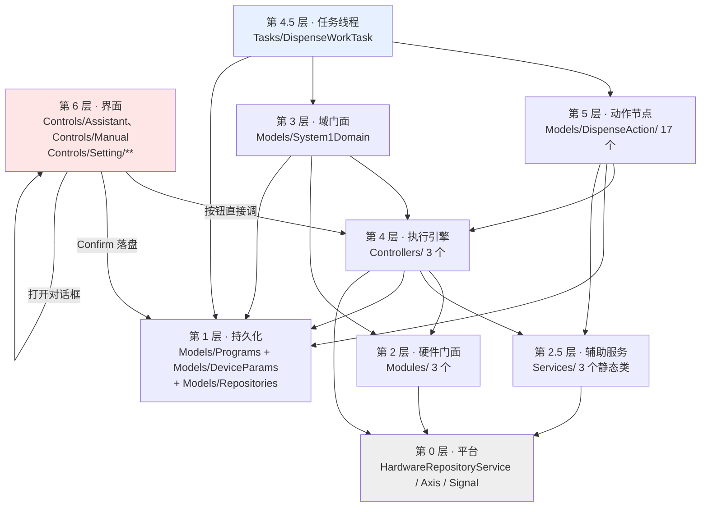

**ASCII 版**

```
   ┌──────────────────────────────────────────────────────────┐
   │ 第6层  界面  Controls/**（7 窗体 + 5 用户控件）            │
   │          │ 按钮直接调引擎        │ Confirm() 落盘         │
   └──────────┼───────────────────────┼───────────────────────┘
              ▼                       ▼
   ┌────────────────────┐   ┌─────────────────────────────────┐
   │ 第4层  执行引擎     │   │ 第1层  持久化                    │
   │ Controllers/ 3 个   │◀──│ Models/Programs（配方级）        │
   │                    │   │ Models/DeviceParams（设备级）     │
   └───┬────────────┬───┘   │ Models/Repositories（3 个仓库）   │
       │            │       └─────────────────────────────────┘
       │            │                       ▲
       │            │                       │
   ┌───▼────┐  ┌────▼──────────┐  ┌─────────┴───────────────┐
   │第2层   │  │第4.5层 任务线程│  │第5层 动作节点            │
   │硬件门面 │  │DispenseWorkTask│─▶│Models/DispenseAction/ 17│
   │Modules/│  └───────┬───────┘  └────────┬────────────────┘
   └───┬────┘          │                   │
       │          ┌────▼──────┐      ┌─────▼──────┐
       │          │第3层 域门面│      │第2.5层 服务 │
       │          │System1Domain│─▶   │Services/ 3 │
       │          └────┬──────┘      └─────┬──────┘
       ▼               ▼                   ▼
   ┌──────────────────────────────────────────────────────────┐
   │ 第0层  平台 HardwareRepositoryService / Axis / Signal     │
   └──────────────────────────────────────────────────────────┘
```

**图 3：`ActionNode` 家族与平台基类**

```mermaid
graph TD
    BASE["<<平台 DLL, 无源码>><br/>ActionNode<br/>RunStateEnum / WorkStart / WorkStop"]

    BASE --> N0["DispenseActionNodes<br/>Models/DispenseAction/DispenseActionNodes.cs:18<br/>（★ 唯一不继承 ActionNode 的节点文件）"]
    BASE --> A1["S1DispenseActionNode :35"]
    BASE --> A2["S1DispenseCorrectionActionNode :32"]
    BASE --> A3["S1DispenseDefectActionNode :44"]
    BASE --> A4["S1DispenseMeasureActionNode :25"]
    BASE --> B1["S1CarrierVisionActionNode :32"]
    BASE --> B2["S1ModuleVisionActionNode :30"]
    BASE --> B3["S1SubstrateVisionActionNode :28"]
    BASE --> C1["S1CarrierMeasureHeightActionNode :30"]
    BASE --> C2["S1ModuleMeasureHeightActionNode :27"]
    BASE --> C3["S1SubstrateMeasureHeightActionNode :26"]
    BASE --> D1["S1BondPositionIdentityActionNode :23"]
    BASE --> D2["S1ModuleIdentityActionNode :23"]
    BASE --> D3["S1SubstrateIdentityActionNode :29"]
    BASE --> D4["S1TransportIdentityActionNode :24"]
    BASE --> E1["InteractiveAction :23"]
    BASE --> E2["PreDispenseAction :35"]

    A1 --> EXEC["System1Domain.GetInstance()<br/>→ DispenseController / MeasureHeight / Vision"]
    E2 --> EXEC

    style BASE fill:#eeeeee
    style N0 fill:#fff3cd
```

**图 4：五个持久化文件与它们的持有者**

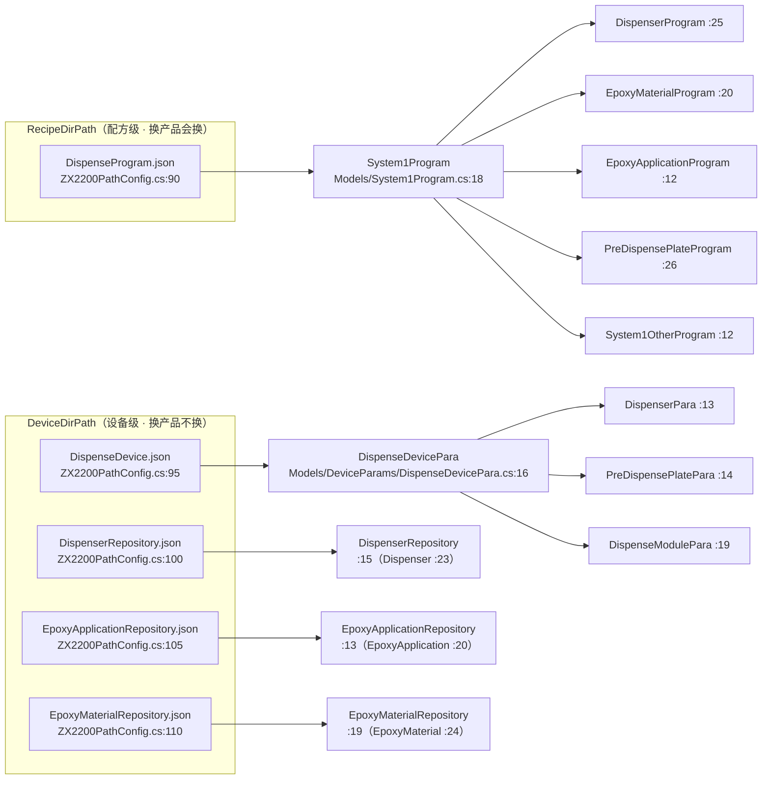

> 图 4 里有一个容易看漏的点：**`DispenseModulePara` 挂在 `DispenseDevice.json` 里**，而不是自己一个文件。所以"点胶模块参数"和"点胶头点位坐标"是同生共死的——写盘时整个 `DispenseDevice.json` 一起覆盖。

### 3.3 关键类型速查

按"我要做的事"反查"该看哪个类"。

| 我要… | 主入口 | 关键位置 | 注意 |
|---|---|---|---|
| 从任何地方进点胶系统 | `System1Domain.GetInstance()` | `Models/System1Domain.cs:49` | 所有控制器、节点、线程都从这里拿 |
| 手动挤一次胶 | `DispenseController` | `Controllers/DispenseController.cs:56` | 与后台线程共用一个实例，无锁 |
| 点一次胶（不走自动线） | `UcEpoxyApplication.BtTest_Click` | `Controls/Setting/EpoxyApplication/UcEpoxyApplication.cs:595` | 见 §4.3；**只对系统1 有效**，系统2 走另外的分支 |
| 在预点胶板上试打一次 | `UcEpoxyApplication.BtTestInPrePlant_Click` | `:968` | 见 §4.4 |
| 换胶水 / 换点胶头 | `FrmChangeEpoxy` | `Controls/Assistant/FrmChangeEpoxy.cs:36` | 7 步向导，见 §4.5；`Load` 里改全局系统号 |
| 标定激光或点胶头测高 | `DispenseMeasureHeightController` | `Controllers/DispenseMeasureHeightController.cs:31` | 见 §6.5 |
| 找预点胶板上的格子 | `PreDispensePlateProgram` | `Models/Programs/PreDispensePlateProgram.cs:26` | 网格 + `Index` 指针，见 §6.4 |
| 配置点胶阀的开关胶时间 | `DispenserPara` | `Models/DeviceParams/DispenserPara.cs:13` | 挂在 `DispenseDevicePara` 下，随 `DispenseDevice.json` 一起写 |
| 配置图案/胶路几何 | `EpoxyApplication` | `Models/Repositories/Pattern/EpoxyApplication.cs:20` | 335 行，仓库里最大的条目类型 |
| 决定"点"还是"画" | `DispensingTypeEnum` | `Models/Enums/DispenseEnum.cs:144` | `EpoxyApplication`=0 / `PreDispense`=1 |
| 决定测高用激光还是点胶头 | `System1MeasHeightToolEnum` | `Models/Enums/DispenseEnum.cs:222` | 决定 §6.5 走哪条通道 |
| 看某个参数"改完存没存" | — | §8.4 的逐条核实表 | 本模块**存在多处改了不保存** |
| 改完界面立刻崩 | — | §4.6 的因果图 | 先排查是不是"空名字 → 仓库查 `null`"这条链 |

**交接给后来人的一句话**：这个目录看起来是"点胶的界面 + 参数"，实际上是**三条互不加锁的链路共用一个硬件**（§1.3 事实二）。任何"偶发"的问题，先问"当时是不是有两条链同时在动"。

---

## 4. UI 按钮与交互流程   ★ 本系列的核心章节 ★

### 4.0 统计口径（先声明）

本章的数字由以下命令得出（均在 `AKRS.ZX2200/DispenseSystem/` 下执行，`--include="*.cs"`）：

| # | 命令 | 结果 |
|---|---|---|
| 1 | `grep -rnE "private void [A-Za-z0-9_]+_Click\(object"` | **38 处**，分布在 **9 个文件**，**27 个唯一方法名** |
| 2 | `grep -rnE "private void [A-Za-z0-9_]+\(object (sender\|sender2), (EventArgs\|DevExpress\|System)" \| grep -v "_Click"` | **25 处**（非 `_Click` 的 `EventHandler` 型） |
| 3 | `grep -rn "+=\s*new " --include="*.Designer.cs"` | **68 处接线** |
| 4 | `grep -rnE "private void [A-Za-z0-9_]+\(object [A-Za-z0-9_]+, [A-Za-z0-9_.]+EventArgs" \| grep -v "_Click"` | **6 处**，其中 2 处与 #2 重叠（`ButtonClick`），去重后净增 **4 处窗体生命周期处理器** |
| 5 | 全仓 `grep -rnE 'ShowDialogForm<'` | 全仓 4 处活调用，**本目录 0 处** |

**合计事件处理器 63 个 = 38 个 `_Click` + 25 个非 `_Click`**，另加 **4 个窗体生命周期处理器**（3 个已接线、1 个未接线）。

补充口径事实（都已复核）：
- **没有匿名 lambda 接线**：68 处全部是 `+= new System.EventHandler(方法名)` 的显式方法组。
- **DevExpress `ItemClick` 零使用**；`ButtonClick` 2 处（`FrmDispenseOverAllSettings.cs:53`、`:78`）。
- **没有 `MouseDown` / `MouseUp` / `CellClick` / `KeyDown` / `BarItem.ItemClick` / `ToolStripMenuItem` / `ShortcutKeys`**。
- 第 2 条里的 `EditValueChanged`（`UcEpoxyApplication.cs:1146`）是**一个方法被 5 个控件共用**，所以"25 个方法"与"68 处接线"数字不等是正常的。

### 4.1 本模块的 UI 清单（含"打开它的入口"）

`入口类型`一列按三种来源区分：**① 按钮**（界面上点得到）、**② 运行时弹出**（任务/线程里 `new`）、**③ 反射**（`ControlService.ShowDialogForm<T>`）。

| 类名 | 文件 | 行数（非D+D） | 用途 | 打开它的入口 | 入口类型 |
|---|---|---|---|---|---|
| `UcEpoxyApplication` | `Controls/Setting/EpoxyApplication/UcEpoxyApplication.cs` | 1,152 + 2,077 | 胶型编辑 + 两个点胶测试按钮 | `UcEditProductProgramming.cs:831`；`TransportUnitSystem/.../UcObjectFunctionEdit.cs:956` | ① |
| `UcDispenser` | `Controls/Setting/Dispenser/UcDispenser.cs` | 343 + 1,008 | 点胶头配置 | `UcEditProductProgramming.cs:697` | ① |
| `UcAddEpoxyApplication` | `.../EpoxyApplication/UcAddEpoxyApplication.cs` | 197 + 261 | 胶型库增删 | `UcEditProductProgramming.cs:825` | ① |
| `UcDispenseLine` | `.../EpoxyApplication/UcDispenseLine.cs` | 69 + 139 | 图案折线图 | **全仓 `grep -rn "new UcDispenseLine("` 零命中** | **零调用点** |
| `UcEpoxyApplicationGuide` | `.../EpoxyApplication/UcEpoxyApplicationGuide.cs` | 21 + 45 | 空壳引导页 | **全仓零实例化** | **零调用点** |
| `FrmChangeEpoxy` | `Controls/Assistant/FrmChangeEpoxy.cs` | 604 + 412 | 换胶 7 步向导 | `UcDispenseManual.cs:133`；`UcEditProductProgramming.cs:2076`；`Main/Controls/UcShortcutMenu.cs:374` | ① |
| `FrmDispensePlateAssistant` | `Controls/Assistant/FrmDispensePlateAssistant.cs.cs` | 358 + 322 | 预点胶板示教 | `UcDispenseManual.cs:120` | ① |
| `FrmAssistantPreDispenseDistance` | `Controls/Assistant/FrmAssistantPreDispenseDistance.cs` | 252 + 383 | 传感器触发距离标定 | `UcDispenseManual.cs:212` | ① |
| `FrmPreDispenseSelect` | `Controls/Assistant/FrmPreDispenseSelect.cs` | 244 + 242 | 在预点胶板上选胶点 | `UcEditProductProgramming.Assistance.cs:819` | ① |
| `FrmDispenseOverAllSettings` | `Controls/Assistant/FrmDispenseOverAllSettings.cs` | 149 + 156 | 点胶头 + 胶水总设置 | `UcEditProductProgramming.cs:1334` | ① |
| `UcDispenseManual` | `Controls/Manual/UcDispenseManual.cs` | 216 + 146 | 点胶手动页（7 个按钮） | `Main/Controls/UcMainSystem.Manual.cs:172` | ① |
| `FrmNewCreateEpoxyApplication` | `.../EpoxyApplication/FrmNewCreateEpoxyApplication.cs` | 105 + 252 | 按模板新建胶型 | `UcAddEpoxyApplication.cs:80` | ① |
| `FrmEpoxyApplicationAssistant` | `Controls/Assistant/FrmEpoxyApplicationAssistant.cs` | 19 + 45 | 空壳 | **全仓零实例化** | **零调用点** |

**关于入口类型的三条结论（都做了复核，不是推测）**：

1. **本目录没有任何"运行时弹出"的窗体**。所有 `new FrmXxx(` 的调用点都在另一个界面的按钮处理器里（`UcDispenseManual.cs:120`/`:133`/`:212`、`UcAddEpoxyApplication.cs:80`），或在本目录之外的程式编辑器里。逐条命令：`grep -rnE "new (Frm|Uc)[A-Za-z0-9_]*\(" DispenseSystem/ --include="*.cs" | grep -v Designer.cs` → 7 处，全部是**界面内**的调用。
2. **本目录不使用反射开窗**。全仓 `ControlService.ShowDialogForm<T>` 的活调用只有 4 处，全在 `WaferSubSystem/`（`FrmComponentGeometryWithWaferTeach.cs:225`、`UcComponentEdit.cs:1203`、`WaferSubSystemTask.cs:833`、`:872`），**本目录 0 处**。所以本模块**没有"改构造函数参数会静默失败"的那类风险**。
3. **3 个"零调用点"的类**：`UcDispenseLine`、`UcEpoxyApplicationGuide`、`FrmEpoxyApplicationAssistant`。它们是**僵尸（有代码、无人 `new`）**，不是断链（曾经有调用点、现在没了）。三者仍参与编译，因此仍需登记在附录 A，但**不由任何按钮驱动**。

> 换句话说：本模块的**每一个用户可见功能，入口都是按钮**。这在本系列里是少见的——大多数模块都有一两条"只有线程能触发"的暗道。因此 §4 的按钮总表在本模块中**真正等于全部用户可见功能清单**。

### 4.2 按钮总表

本节**一个不漏**地登记全部 63 个事件处理器。`文字` 一列取自该控件在 `Designer.cs` 里的 `.Text = "..."` 行（给出行号）；"详细流程图"一列指向本节的详解图。

#### 4.2.1 全部 38 个 `_Click` 处理器

**A. `Controls/Assistant/FrmChangeEpoxy.cs`（7 个）**

| # | 控件 | 文字（Designer:行） | 处理器 `文件:行` | 作用 | 详细流程图 |
|---|---|---|---|---|---|
| 1 | `BtNext` | 「下一步」`Designer:296` | `FrmChangeEpoxy.cs:116` | `stepIndex++` 后 `SetUiControl()`；**没有上界钳制** | 图 13 |
| 2 | `BtChangeEpoxy` | 「挤胶」`Designer:327` | `:479` | 切换点胶阀开关；离线模式下在 `:481` 直接返回 | 图 13 |
| 3 | `BtDone` | 「完成」`Designer:283` | `:502` | 收尾 → 回安全位 → `DialogResult=OK` → 在 `:508` 把 `CurrentMachineSystem` 改回 `System2` | 图 13 |
| 4 | `BtCancel` | 「取消」`Designer:257` | `:516` | 取消退出；**已做的动作不回滚** | 图 15 |
| 5 | `BtBack` | 「上一步」`Designer:270` | `:526` | `stepIndex--` 后刷新；**没有下界钳制** | 图 13 |
| 6 | `BtAutoFocus` | 「自动聚焦」`Designer:317` | `:574` | 调 `TUAssistantHelper.AutoFocus` | — |
| 7 | `BtClearPosition` | 「清空位置记忆」`Designer:351` | `:600` | `DispenseDevicePara.ClearPosition()` —— **内存清了但不落盘**（R-09） | — |

**B. `Controls/Assistant/FrmPreDispenseSelect.cs`（7 个）**

| # | 控件 | 文字（Designer:行） | 处理器 `文件:行` | 作用 | 详细流程图 |
|---|---|---|---|---|---|
| 8 | `BtNext` | 「下一步」`Designer:166` | `FrmPreDispenseSelect.cs:50` | 确认选中的预点胶位置 | — |
| 9 | `BtCancel` | 「取消」`Designer:190` | `:60` | 取消 | — |
| 10 | `BtVision` | 「实时界面」`Designer:178` | `:70` | 切实时画面 | — |
| 11 | `BtnSubstrateMoveUp` | 无 `.Text`（图形按钮） | `:90` | Y+ 微动 | — |
| 12 | `BtnSubstrateMoveDown` | 无 | `:109` | Y− 微动 | — |
| 13 | `BtnSubstrateMoveRight` | 无 | `:129` | X+ 微动 | — |
| 14 | `BtnSubstrateMoveLeft` | 无 | `:148` | X− 微动 | — |

**C. `Controls/Manual/UcDispenseManual.cs`（7 个）**

| # | 控件 | 文字（Designer:行） | 处理器 `文件:行` | 作用 | 详细流程图 |
|---|---|---|---|---|---|
| 15 | `BtChangeDispensing` | 「挤胶」`Designer:48` | `UcDispenseManual.cs:48` | 挤胶 / 松阀 | 图 20 |
| 16 | `BtAssistantPrePlate` | 「示教预点胶板」`Designer:68` | `:118` | `new FrmDispensePlateAssistant()`（`:120`） | 图 20 |
| 17 | `BtChangeDispenser` | 「更换点胶头」`Designer:58` | `:131` | `new FrmChangeEpoxy()`（`:133`） | 图 13 |
| 18 | `BtCleanPreDispensePlate` | 「清洁预点胶板」`Designer:84` | `:143` | 复位预点胶板计数；**会落盘** | 图 34 |
| 19 | `BtPredispense` | 「预点胶」`Designer:94` | `:163` | 手动预点胶一次 | 图 20 |
| 20 | `BtPrintEpoxyMove` | 「刮胶盘转动」`Designer:104` | `:181`（方法名 `SpPrintEpoxyMove_Click`） | 蘸胶盘点动；**方法名以 `Sp` 开头但控件是 `Bt`，命名不一致** | 图 20 |
| 21 | `BtAssistantDistance` | 「示教预点胶板信号触发距离」`Designer:114` | `:210` | `new FrmAssistantPreDispenseDistance()`（`:212`） | 图 20 |

**D. `Controls/Assistant/FrmDispensePlateAssistant.cs.cs`（3 个）**

| # | 控件 | 文字（Designer:行） | 处理器 `文件:行` | 作用 | 详细流程图 |
|---|---|---|---|---|---|
| 22 | `BtNext` | 「下一步」`Designer:242` | `FrmDispensePlateAssistant.cs.cs:283` | 走 3 步：测高 → 起点 → 终点 | 图 24 |
| 23 | `BtDone` | 「完成」`Designer:229` | `:310`（`Save()` 在 `:235`） | 落盘后关闭 | 图 24 |
| 24 | `BtCancel` | 「取消」`Designer:204` | `:322` | 取消 | — |

**E. `Controls/Assistant/FrmAssistantPreDispenseDistance.cs`（4 个）**

| # | 控件 | 文字（Designer:行） | 处理器 `文件:行` | 作用 | 详细流程图 |
|---|---|---|---|---|---|
| 25 | `BtNext` | 「下一步」`Designer:235` | `FrmAssistantPreDispenseDistance.cs:188` | 下一个标定步骤 | 图 24 |
| 26 | `BtBack` | 「后退」`Designer:181` | `:201` | 上一步 | 图 24 |
| 27 | `BtDone` | 「完成」`Designer:223` | `:214` | 保存距离 | 图 24 |
| 28 | `BtCancel` | 「取消」`Designer:169` | `:225` | 取消 | — |

**F. `Controls/Assistant/FrmDispenseOverAllSettings.cs`（2 个）**

| # | 控件 | 文字（Designer:行） | 处理器 `文件:行` | 作用 | 详细流程图 |
|---|---|---|---|---|---|
| 29 | `BtOk` | 「确定」`Designer:113` | `FrmDispenseOverAllSettings.cs:117`（`Save()` 在 `:125`） | 写入并落盘 | 图 17 |
| 30 | `BtCancel` | 「取消」`Designer:123` | `:144` | **只关窗，不回滚**（R-03） | 图 17 |

**G. `Controls/Setting/EpoxyApplication/UcEpoxyApplication.cs`（3 个）**

| # | 控件 | 文字（Designer:行） | 处理器 `文件:行` | 作用 | 详细流程图 |
|---|---|---|---|---|---|
| 31 | `BtEditPattern` | 「编辑图像」`Designer:508` | `UcEpoxyApplication.cs:238` | 打开图案编辑器；在 `:277` `goto RetryCommand` 循环到 `EpoxyIsReasonable` | 图 18 |
| 32 | **`BtTest`** | **「在轨道产品上测试」**`Designer:1032` | **`:595`** | **本目录最核心的按钮：真正走完一次点胶** | **图 5 ~ 图 11** |
| 33 | **`BtTestInPrePlant`** | **「在预点胶板上测试」**`Designer:1022` | **`:968`** | 在预点胶板上试打一次 | **图 12** |

**H. `Controls/Setting/EpoxyApplication/UcAddEpoxyApplication.cs`（3 个）**

| # | 控件 | 文字（Designer:行） | 处理器 `文件:行` | 作用 | 详细流程图 |
|---|---|---|---|---|---|
| 34 | `BtnAdd` | 「添加」`Designer:173` | `UcAddEpoxyApplication.cs:78` | `new FrmNewCreateEpoxyApplication()`（`:80`） | 图 23 |
| 35 | `BtnDelete` | 「删除」`Designer:187` | `:110` | 从名字列表删，**仓库对象不删**（R-15） | 图 23 |
| 36 | `BtEpoxyApplicationRepository` | 「仓库」`Designer:159` | `:152` | 打开 `FrmRepository<EpoxyApplication>`；`:188`/`:190`/`:191` 三处 `Save()` | 图 23 |

**I. `Controls/Setting/EpoxyApplication/FrmNewCreateEpoxyApplication.cs`（2 个）**

| # | 控件 | 文字（Designer:行） | 处理器 `文件:行` | 作用 | 详细流程图 |
|---|---|---|---|---|---|
| 37 | `BtnGenerate` | 「创建」`Designer:142` | `FrmNewCreateEpoxyApplication.cs:63` | 重名校验 `:70` → `DeepGenericCopy` `:83` → `AddBelongRecipeIds()` `:87` → `Add` `:89` → `Save` `:91` | 图 23 |
| 38 | `BtCancel` | 「取消」`Designer:130` | `:101` | 取消 | — |

**小计核对：7 + 7 + 7 + 3 + 4 + 2 + 3 + 3 + 2 = 38** ✅ 涉及 9 个文件 ✅ 唯一方法名 27 个 ✅

#### 4.2.2 非 `_Click` 的 25 个处理器

| # | 控件 / 对象 | 事件 | 处理器 | 定义位置 | 接线位置 | 做了什么 |
|---|---|---|---|---|---|---|
| 1 | `SensorTime`（100ms） | `Tick` | `SensorTime_Tick` | `FrmAssistantPreDispenseDistance.cs:235` | `...Designer.cs:328` | 实时读预点胶板压力传感器、刷新进度条，供人工拧机械到目标压力 |
| 2 | `CmbDispenser` | `ButtonClick` | `CmbDispenser_ButtonClick` | `FrmDispenseOverAllSettings.cs:53` | `Designer.cs:104` | 打开点胶头仓库选择 |
| 3 | `CmbDispensingMeterialReference` | `ButtonClick` | `CmbDispensingMeterialReference_ButtonClick` | `:78` | `Designer.cs:79` | 打开胶水仓库选择 |
| 4 | `FrmDispensePlateAssistant` | `Load` | `FrmDispensePlateAssistant_Load` | `FrmDispensePlateAssistant.cs.cs:332` | `Designer.cs:285` | 初始化 3 步向导 |
| 5 | `FrmPreDispenseSelect` | `Load` | `FrmPreDispenseSelect_Load` | `FrmPreDispenseSelect.cs:240` | `Designer.cs:218` | 画预点胶板网格 |
| 6 | `Timer`（100ms） | `Tick` | `Timer_Tick` | `UcDispenseManual.cs:66` | `Designer.cs:75` | 刷新按钮可用态；**`catch` 里先停掉定时器再 `throw`**（`:104–:110`）→ R-21 |
| 7 | `UcDispenseManual` | `Load` | `UcDispenseManual_Load` | `:199` | `Designer.cs:131` | 初始化 |
| 8 | `UcDispenser` | `Load` | `UcDispenser_Load` | `UcDispenser.cs:87` | `Designer.cs:896` | `Init()` 填控件 |
| 9 | `ChkEpoxySqueeze` | `CheckedChanged` | `ChkEpoxySqueeze_CheckedChanged` | `:273` | `Designer.cs:415` | 切换挤胶参数可用态 |
| 10 | `LuePreDispenseModel` | `EditValueChanged` | `LuePreDispenseModel_EditValueChanged` | `:284` | `Designer.cs:476` | 切换预点胶模式 |
| 11 | `LuePreDispenseTiming` | `EditValueChanged` | `LuePreDispenseTiming_EditValueChanged` | `:294` | `Designer.cs:508` | 切换预点胶时机 |
| 12 | `LueDispenserType` | `EditValueChanged` | `LueDispenserType_EditValueChanged` | `:304` | `Designer.cs:154` | 切换点胶头类型 |
| 13 | `ChkDispenserTimes` | `CheckedChanged` | `ChkDispenserTimes_CheckedChanged` | `:318` | `Designer.cs:762` | 启用点胶针次数管控 |
| 14 | `ChkEpoxyDueTime` | `CheckedChanged` | `ChkEpoxyDueTime_CheckedChanged` | `:328` | `Designer.cs:753` | 启用胶水有效期管控 |
| 15 | `ChkEpoxyDefect` | `CheckedChanged` | `ChkEpoxyDefect_CheckedChanged` | `:338` | `Designer.cs:244` | 「点胶完检测」；**`ChkEpoxyDefect.Checked` 全文件无读取点** → R-14 |
| 16 | `UcEpoxyApplication` | `Load` | `UcEpoxyApplication_Load` | `UcEpoxyApplication.cs:98` | `Designer.cs:1853` | `Init()` `:100` + `RefreshDispenseLineControl()` `:101` + **代码内补挂 5 个 `EditValueChanged`**（`:108–:112`） |
| 17 | `CkTearOff1On` | `CheckedChanged` | `CkTearOff1On_CheckedChanged` | `:553` | `Designer.cs:920` | 切换撕胶 1 参数可用态 |
| 18 | `CkTearOff2On` | `CheckedChanged` | `CkTearOff2On_CheckedChanged` | `:574` | `Designer.cs:782` | 切换撕胶 2 参数可用态 |
| 19 | `CmbSubstrateName` | `SelectedIndexChanged` | `CmbSubstrateName_SelectedIndexChanged` | `:1088` | `Designer.cs:1002` | 重取几何尺寸 |
| 20 | `CmbModuleName` | `SelectedIndexChanged` | `CmbModuleName_SelectedIndexChanged` | `:1109` | `Designer.cs:1013` | 重取几何尺寸 |
| 21 | `CmbNozzleName` | `SelectedIndexChanged` | `CmbNozzleName_SelectedIndexChanged` | `:1130` | `Designer.cs:273` | **方法体为空（空实现）** |
| 22 | `LueEpoxyType` | `EditValueChanged` | `LueEpoxyType_EditValueChanged` | `:1140` | `Designer.cs:305` | 切换胶水类型 |
| 23 | `FrmChangeEpoxy` | `Load` | `FrmChangeEpoxy_Load` | `FrmChangeEpoxy.cs:53` | `Designer.cs:368` | 初始化向导：回安全位 `:68` + `InitControl()` `:71`；**在 `:55` 改全局系统号** |
| 24 | `timer1`（100ms） | `Tick` | `Timer1_Tick` | `:539` | `Designer.cs:342` | 只做按钮颜色反馈（`Tag="换胶计时器"` `Designer.cs:341`） |
| 25 | **5 个 `SpinEdit`**（`SpSizeX` / `SpSizeY` / `SpComponentX` / `SpComponentY` / `SpAngle`） | `EditValueChanged` | `EditValueChanged`（**5 个控件共用 1 个方法**） | `UcEpoxyApplication.cs:1146` | **不在 Designer 里，在代码内挂接**：`UcEpoxyApplication.cs:108–:112` | 每改一个数字就 `Confirm()` → 两次整仓 `Save()` 落盘（`:1147–:1149`）→ R-08 |

> 第 25 行是"25 个方法"与"68 处接线"数量对不上的原因，也是本模块**最容易造成磁盘抖动**的一处。

#### 4.2.3 另计：4 个窗体生命周期处理器（3 已接线 + 1 未接线）

| # | 窗体 | 事件 | 处理器 | 定义位置 | 接线位置 | 做什么 |
|---|---|---|---|---|---|---|
| 1 | `FrmAssistantPreDispenseDistance` | `FormClosed` | `FrmAssistantPreDispenseDistance_FormClosed` | `FrmAssistantPreDispenseDistance.cs:247` | `Designer.cs:342` | 停定时器 |
| 2 | `FrmChangeEpoxy` | `FormClosing` | `FrmChangeEpoxy_FormClosing` | `FrmChangeEpoxy.cs:561` | `Designer.cs:367` | 关窗前收尾 |
| 3 | `FrmDispensePlateAssistant` | `FormClosed` | `FrmDispensePlateAssistant_FormClosed` | `FrmDispensePlateAssistant.cs.cs:354` | `Designer.cs:284` | 收尾 |
| 4 | `UcDispenseManual` | `FormClosing` | `FrmDispenseManual_FormClosing` | `UcDispenseManual.cs:153` | **无任何接线** | **永不执行** → R-23 |

复现命令：`grep -rn "FormClosing\|FormClosed" --include="*.Designer.cs" DispenseSystem/` → 3 处；`grep -rn "FrmDispenseManual_FormClosing" --include="*.cs" DispenseSystem/` → 只有定义行 `:153`，无接线行。

#### 4.2.4 未接线（死按钮）——实测 4 项

| 控件 / 方法 | 文字 | 位置 | 结论 |
|---|---|---|---|
| `FrmDispensePlateAssistant.BtBack` | 「返回」 | `FrmDispensePlateAssistant.cs.Designer.cs:217` | 该 Designer 中**无 `BtBack.Click` 接线** → 点了没反应（同窗体的 `BtNext`/`BtDone`/`BtCancel` 都已接线） |
| `FrmDispensePlateAssistant.simpleButton1` | 「自动聚焦」 | `...Designer.cs:261` | 无任何 `.Click` 接线 → 死按钮 |
| `FrmAssistantPreDispenseDistance.BtSensor` | 「预点胶板传感器」 | `FrmAssistantPreDispenseDistance.Designer.cs:147` | 该控件放在 `PnlDebugButton` 内（`:129`）且无接线 → **调试遗留的死按钮**，在 `Designer` 里被显式 `Controls.Add`，所以界面上看得见 |
| `UcDispenseManual.FrmDispenseManual_FormClosing` | — | `UcDispenseManual.cs:153` | 有方法体但无接线 → 永不执行 |

> 上面 4 项里，**前 3 项是真正"画在界面上的死按钮"**（第 4 项是一个没有接线的生命周期方法，永远不会执行，见 `R-23`）。
> 这 3 个死按钮是本模块的一个小型"用户困惑源"：**界面上画着按钮、点了毫无反应、也不报错**。它们都在 `Assistant` 与 `Manual` 页，平时不容易与真正的故障区分开。
>
> 复现命令（三条分别执行，都应零命中）：
> ```bash
> grep -n "BtBack.Click"   Controls/Assistant/FrmDispensePlateAssistant.cs.Designer.cs
> grep -n "simpleButton1.Click" Controls/Assistant/FrmDispensePlateAssistant.cs.Designer.cs
> grep -n "BtSensor.Click" Controls/Assistant/FrmAssistantPreDispenseDistance.Designer.cs
> ```
> ⚠️ 注意 `BtBack` 这个名字在**另外两个窗体里是接了线的**（`FrmAssistantPreDispenseDistance.Designer.cs:182`、`FrmChangeEpoxy.Designer.cs:271`），所以不能用全目录 `grep` 判断——必须按文件逐个查。这正是"同名不同窗体"最容易误判的地方。

### 4.3 「点胶」按钮：从点击到点胶完成

这一节是全篇的核心，也是整篇文档的原点问题：**点胶按钮点下去之后，经过什么样的流程之后点胶完成**。

**先明确是哪个按钮**。本模块有两个"点胶测试"按钮，都在 `UcEpoxyApplication` 上：

| 按钮 | 文字 | `Designer.cs` | 处理器 | 是否本节主角 |
|---|---|---|---|---|
| `BtTest` | **「在轨道产品上测试」** | `:1032`（接线 `:1033`） | `UcEpoxyApplication.cs:595` | ✅ **本节主角** |
| `BtTestInPrePlant` | 「在预点胶板上测试」 | `:1022`（接线 `:1023`） | `:968` | ❌ 见 §4.4 |

`BtTest` 是**全目录唯一一个"从用户点击一路走到出胶、并且把坐标/测高/插补全串起来"的按钮**，其余按钮要么只改参数（§4.7）、要么只做单一硬件动作（§4.8）。

**一句话答案**（先给结论，后面全是证据）：

> `BtTest_Click` 把界面参数**先落盘**（`Confirm()`），然后**重新造一个 `TransportUnit` 副本**，在这个副本上逐级做视觉定位与测高，再算出 G0 坐标 → 点胶头坐标 → 带补偿和角度的一次点胶请求，交给 `DispenseController.InterpolationApplication` 做插补出胶，最后把相机移过去刷一下画面。**全程没有进度提示、没有完成提示、没有统计、没有防重入**；任何一步失败都是"弹个框然后 `return`"，返回 `Alarm` 时**连框都不弹**。

### 4.3.1 主流程图（图 5）

**图 5：★「在轨道产品上测试」端到端主流程图**

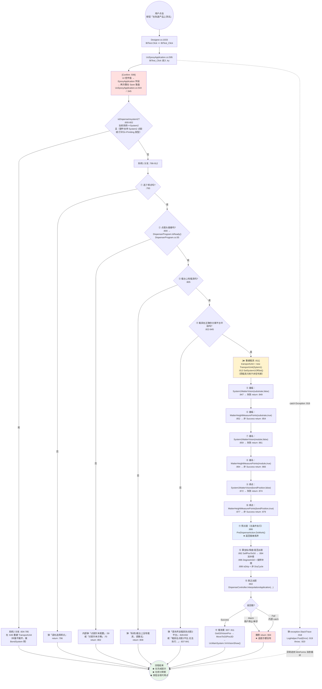

**ASCII 版**

```
  [点击「在轨道产品上测试」]
        │  Designer.cs:1033 接线
        ▼
  ┌──────────────────────────────────────────────────────────────┐
  │ UcEpoxyApplication.cs:595  BtTest_Click   (try ... catch)     │
  └───────────────┬──────────────────────────────────────────────┘
                  ▼
   ① Confirm() :599 ──▶ 界面上所有参数【先写进磁盘】:544 / :545
                  │
                  ▼
      isDispenseInsystem2? :600
        ├── 是 ─▶ 系统2 分支 :604-785（:646 重建载具）─┐
        └── 否 ─▶ 系统1 分支 :786-912                 │
                  │                                   │
                  ▼                                   │
      ② 选焊点? :793 ──否──▶ 弹框 + return :796 ──────┤
                  │是                                 │
      ③ 点胶头就绪? :800 ─否─▶ 弹框 + return :802 ────┤
                  │是                                 │
      ④ 有载具? :805 ──否──▶ 弹框 + return :808 ──────┤
                  │是                                 │
      ⑤ 半段对不对? :822 ─否─▶ 弹框 ──────────────────┤
                  │是                                 │
                  ▼                                   │
   ★ 重建载具 :811  new TransportUnit(System1) + :813   │
                  │                                   │
                  ▼                                   │
   ⑥⑦ 基板 视觉 :847 + 测高 :852 ──失败─▶ return :849/:854
   ⑧⑨ 基岛 视觉 :859 + 测高 :864 ──失败─▶ return :861/:866
   ⑩⑪ 焊点 视觉 :872 + 测高 :877 ──失败─▶ return :874/:879
                  │
                  ▼
   ⑫ 预点胶 :886（无条件，返回值丢弃）
                  │
                  ▼
   ⑬ 算坐标 :892 / 补偿 :894 / 角度 :896 / isDrip :899
                  │
                  ▼
   ⑭ InterpolationApplication(...) :902
        ├── Success ─▶ 相机移过去 + 刷画面 :907-:911 ─▶ [结束]
        ├── Alarm（用户停止/单步）─▶ 静默 return :904 ─▶ [结束]
        └── Fail（内部异常）─────▶ 静默 return :904 ─▶ [结束]
                  │
   任何未捕获异常 ─▶ 弹 StackTrace :918 + 日志 :919 + throw; :920
                                        ─▶ 逃到 WinForms 消息循环
```

### 4.3.2 时序视图（图 6）

主流程图容易让人以为"每一步都是同步的一问一答"。实际不是：**第 ⑬ 步内部还有异步与忙等**，而 `Confirm()` 的落盘发生在最前面。用一张时序图把"谁在什么时候阻塞"标出来。

**图 6：`BtTest` 主流程的时序视图**

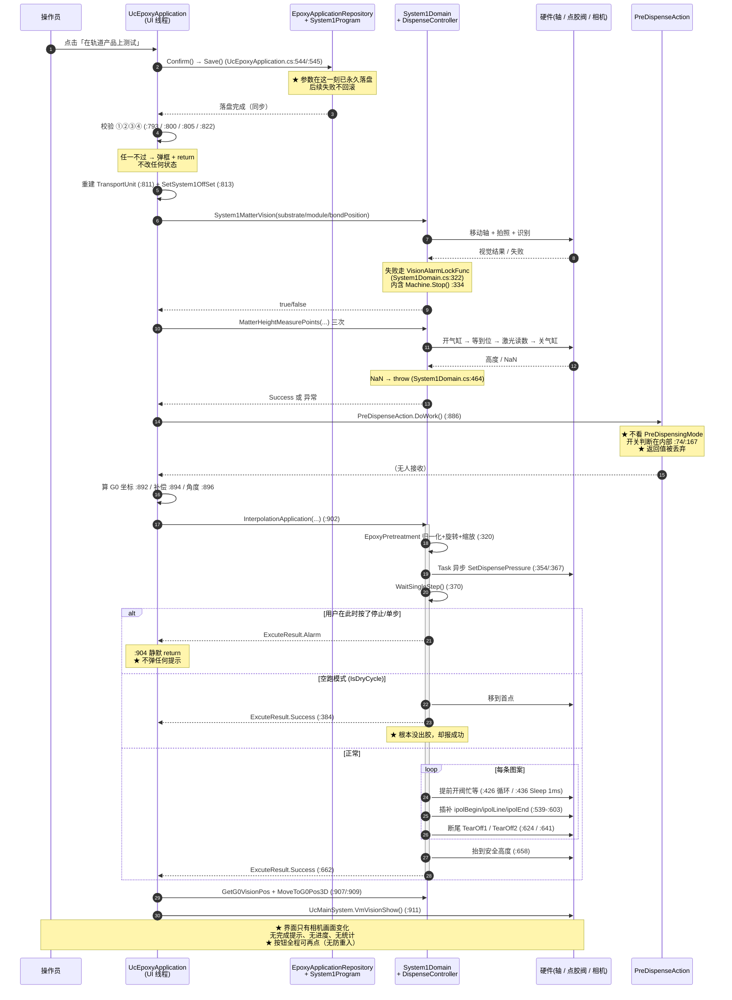

> 时序图上最容易看错的一格是 `deactivate D` 之后：**点胶"完成"这件事从来没有主动通知过界面**。界面之所以看起来"完成了"，只是因为 `MoveToG0Pos3D` 让相机画面动了一下。

### 4.3.3 局部放大①：前置校验与互锁（图 7）

这一段回答"点下去之后，会不会被拦下来"。

**图 7：局部放大① — 前置校验、落盘顺序与"缺失的互锁"**

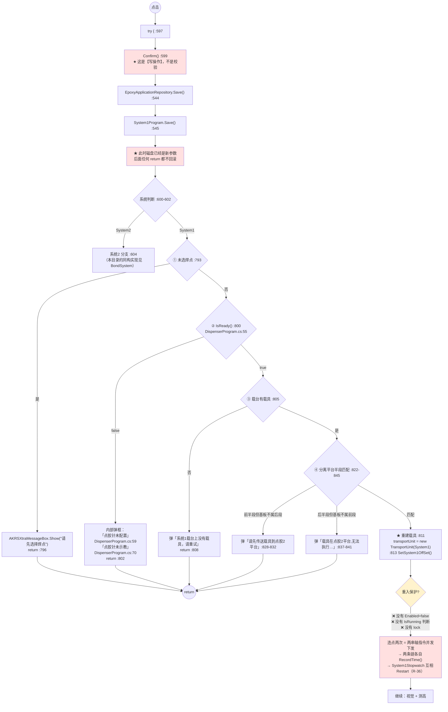

**ASCII 版**

```
 [点击]
   │
   ▼
 try :597
   │
   ├─▶ ① Confirm() :599  ★ 这是写操作！
   │        ├ EpoxyApplicationRepository.Save() :544
   │        └ System1Program.Save()          :545
   │   ★ 磁盘此时已是新参数 —— 之后任何 return 都不回滚
   │
   ▼
 系统判断 :600  ──System2──▶ 系统2 分支 :604
   │ System1
   ▼
 ② 未选焊点 :793? ──是──▶ 弹「请先选择焊点」  ─▶ return :796
   │否
 ③ IsReady() :800? ─否──▶ 弹「点胶针未配置/未示教」
   │                       (DispenserProgram.cs:59 / :70) ─▶ return :802
   │是
 ④ 载台有载具 :805? ─否─▶ 弹「系统1载台上没有载具，请重试」─▶ return :808
   │是
 ⑤ 半段匹配 :822-845? ─否─▶ 弹「请先传送载具到点胶2平台」:828
   │                        或「载具在点胶2平台…」:837
   │是
   ▼
 ★ 重建载具 :811 + SetSystem1OffSet() :813
   │
   ▼
 ⑥ 有没有互锁？ ── 没有 Enabled=false / 没有 IsRunning
                    / 没有 lock ──▶ 连点两次就并发下发
                    　             → 两条链各自 RecordTime()
                    　             → System1Stopwatch 互相 Restart（R-36）
   │
   ▼
 继续：视觉 + 测高
```

**读这段必须注意的三件事**

1. **`Confirm()` 是写操作，位置在最前面**（`UcEpoxyApplication.cs:599` → `:544`/`:545`）。用户点"测试"的本意是"试一试"，但代码先做了"永久保存"。见 R-01。
2. **四次校验全是"弹框 + `return`"，没有一次把界面恢复到点击前的状态**——因为不需要恢复状态，但**磁盘上的参数已经改了**。
3. **`transportUnit` 在 `:811` 被重新构造**。`:790` 从载台取到的那个真实载具，只被用来做"非空"判断；真正的视觉/测高都作用在一个**新造的内存副本**上（`SetSystem1OffSet()` 的实现无源码，从 `:811` 的赋值方向判断，后续结果只写进副本）。系统2 分支在 `:646` 做了同样的事。

### 4.3.4 局部放大②：运动与出胶（图 8）

这一段是"点胶到底做了什么动作"的权威答案，全部在 `DispenseController.InterpolationApplication`（`Controllers/DispenseController.cs:300`）里。

**图 8：局部放大② — `InterpolationApplication` 内部的运动与出胶**

```mermaid
flowchart TD
    IN["DispenseController.cs:300<br/>InterpolationApplication(app, point, isDrip, isPrePlant, angle)"] --> T["try :307"]
    T --> LOG["RecordTime(&quot;系统1点胶流程&quot;,&quot;准备开始点胶&quot;) :309<br/>★ 全流程唯一的时间戳日志"]
    LOG --> P1["ConvertG0ToMachinePos(point) :314"]
    P1 --> P2["GetG0DispensePos(...) :317<br/>加针偏置"]
    P2 --> P3["EpoxyPretreatment(app, pos, angle) :320<br/>归一化 + 旋转 + 缩放（图 32）"]
    P3 --> P4["Z 补偿 :325 / :329<br/>PrePlantOffSetZ 或 OffsetZ"]
    P4 --> P5["preDispenseHeight = Z + SecurityHeightForEpoxyApplication :333"]

    P5 --> LOOP["for 每条图案 i :337-655"]
    LOOP --> PRINT["PrintEpoxy(app) :339<br/>蘸胶头时停转蘸胶盘"]
    PRINT --> FIRST{"i==0 或<br/>类型==PrintingTool? :340"}
    FIRST -->|是| PRESS["Task 异步 SetDispensePressure(...) :354<br/>task.Start() :367 ★ fire-and-forget"]
    PRESS --> WS1{"WaitSingleStep() :370"}
    WS1 -->|false| ALM["return ExcuteResult.Alarm"]
    WS1 -->|true| MV1["MoveToG0Pos3D(首点上方) :376"]
    MV1 --> W8["task.Wait() :380<br/>★ 可能永远等不到（R-37）"]
    W8 --> DRY{"IsDryCycle? :384"}
    DRY -->|是| SUC0["return Success :386<br/>★ 没出胶也报成功"]
    DRY -->|否| ZMOVE

    FIRST -->|否| ZMOVE["AxisZAbsoluteMove(preDispenseHeight) :393<br/>AxisXYAbsoluteMove(...) :397"]

    ZMOVE --> ADV{"AdvanceOpenDistanceNew != 0? :412"}
    ADV -->|是| WS2{"WaitSingleStep() :415"}
    WS2 -->|false| ALM
    WS2 -->|true| SLOW["MoveAxisZToPositionWithoutDelay(SlowTravelSpeed) :420"]
    SLOW --> BUSY["while(true) :426<br/>Z &lt;= 目标+AdvanceOpenDistanceNew ?<br/>→ OpenDispensingElectric() :432 break<br/>否则 Thread.Sleep(1) :436"]
    BUSY --> ARR["AxisZWaitForArrival() :439"]
    ADV -->|否| ZABS["AxisZAbsoluteMove(Z, SlowTravelSpeed) :445"]

    ARR --> WS3{"WaitSingleStep() :453"}
    ZABS --> WS3
    WS3 -->|false| ALM
    WS3 -->|true| LEAD{"DispenserLeadTime &gt; 0? :459"}
    LEAD -->|是| LEAD2["按 IsDispenserLeadTimeOpen<br/>Open(:461) 或 Close(:468)<br/>Thread.Sleep(DispenserLeadTime) :472<br/>★ 阻塞睡眠"]
    LEAD -->|否| SHAPE
    LEAD2 --> SHAPE{"图案形状? :480"}

    SHAPE -->|"单点 / SingleDotOnly"| DOT["WaitSingleStep() :492<br/>Open(:499)/Close(:503) 按 isDrip<br/>firstDelay = IsFirstDispense && !isPrePlant<br/>? FisrtDispenseDelay : 0 :508<br/>DelayHelper.Delay(DripTime+firstDelay) :511<br/>CloseDispensingElectric() :518"]
    SHAPE -->|"插补（画胶）"| DRV{"驱动类型? :532"}
    DRV -->|ETEL| ETEL["GetIpolGroup() :534<br/>ipolBegin :539 / ipolSetAbsMode :545<br/>循环 j :548：<br/>  ipolTanVelocity :553/:563<br/>  ipolTanAcc/Dec :566/:568（Dec 传的是 Acc）<br/>  ipolTanJerkTime :571<br/>  OpenGlueFlag ? ipolMark2Param(..,1) + Open :574<br/>              : ipolMark2Param(..,0x0010000) + Close :582<br/>  ipolLine :587（mm→m）<br/>  ipolWaitMovement(100000) :592<br/>收尾 Close :596 + ipolEnd :603"]
    DRV -->|其它| GUG["GuGaoDrive.Interpolation(1, 图案, index) :611<br/>CloseDispensingElectric() :616"]

    DOT --> TEAR
    ETEL --> TEAR
    GUG --> TEAR
    TEAR{"TearOff1Open? :624"}
    TEAR -->|是| T1["AxisZAbsoluteMove(Z+TearOff1Height, TearOff1Speed)<br/>+ DelayHelper.Delay(TearOff1Delay)"]
    TEAR -->|否| TEAR2
    T1 --> TEAR2{"TearOff2Open? :641"}
    TEAR2 -->|是| T2["AxisZAbsoluteMove(Z+TearOff2Height, TearOff2Speed)<br/>+ DelayHelper.Delay(TearOff2Delay)"]
    TEAR2 -->|否| LOOPN
    T2 --> LOOPN{"还有下一条图案?"}
    LOOPN -->|是| LOOP
    LOOPN -->|否| UP["AxisZAbsoluteMove(preDispenseHeight) :658"]
    UP --> SUCC["return ExcuteResult.Success :662"]

    T -.->|catch Exception ex :664| FAIL["AKRSXtraMessageBox.Show(ex.Message + &quot;点胶/画胶出现异常，请联系设备管理人员&quot;) :666<br/>return ExcuteResult.Fail :667<br/>★ 吞掉异常：无日志、无堆栈"]

    style SUC0 fill:#ffe0e0
    style BUSY fill:#fff3cd
    style W8 fill:#fff3cd
    style FAIL fill:#ffe0e0
```

**ASCII 版**

```
 InterpolationApplication :300
   │
   ├ RecordTime :309  ← 全程唯一时间戳日志
   ├ :314 G0→机械坐标   :317 →点胶头坐标（加针偏置）
   ├ :320 EpoxyPretreatment（归一化+旋转+缩放）
   ├ :325/:329 Z 补偿     :333 preDispenseHeight = Z + 安全高度
   │
   ▼
 ┌─ for 每条图案 :337 ────────────────────────────────────────┐
 │  :339 PrintEpoxy（蘸胶头时停转蘸胶盘）                       │
 │  :340 i==0 或 PrintingTool ?                                │
 │    ├ 是 ─▶ :354 Task 异步设胶压  :367 task.Start()           │
 │    │        :370 WaitSingleStep ─ false ─▶ return Alarm      │
 │    │        :376 移到首点上方                                │
 │    │        :380 task.Wait()  ★可能永远等不到（R-37）        │
 │    │        :384 IsDryCycle ? ─ 是 ─▶ :386 return Success    │
 │    │                                        ★没出胶也报成功  │
 │    └ 否 ─▶ :393 Z 抬到安全高度  :397 XY 绝对移动             │
 │                                                             │
 │  :412 AdvanceOpenDistanceNew != 0 ?                         │
 │    ├ 是 ─▶ :415 WaitSingleStep ─ false ─▶ return Alarm       │
 │    │        :420 Z 慢速下移                                  │
 │    │        :426 while(true)  :429 到位? ─▶ :432 开阀 break  │
 │    │                          :436 Sleep(1)  ★1ms 忙等      │
 │    │        :439 等 Z 到位                                   │
 │    └ 否 ─▶ :445 Z 绝对移动到目标高度                         │
 │                                                             │
 │  :453 WaitSingleStep ─ false ─▶ return Alarm                │
 │  :459 DispenserLeadTime > 0 ?                               │
 │    ├ 是 ─▶ :461/:468 提前开/关阀  :472 Sleep(LeadTime) ★阻塞 │
 │    └ 否                                                     │
 │                                                             │
 │  图案形状 :480                                               │
 │    ├ 单点 ─▶ :492 门 → :499/:503 开/关阀 → :511 Delay       │
 │    │        （出胶量 = 时间）→ :518 关阀                     │
 │    └ 插补 ─▶ 驱动 :532                                       │
 │         ├ ETEL ─▶ :534 ipolGroup → :539 ipolBegin           │
 │         │         :548 for j  逐段 :553 速度 :566 加减速      │
 │         │         :574 开阀标记 / :582 关阀标记              │
 │         │         :587 ipolLine（mm→m） :592 每段等到位      │
 │         │         :596 关阀 :603 ipolEnd                    │
 │         └ 其它 ─▶ :611 GuGaoDrive.Interpolation  :616 关阀   │
 │                                                             │
 │  :624 TearOff1 断尾 → :641 TearOff2 断尾                    │
 └───────────────────── 下一条图案 ────────────────────────────┘
   │
   :658 抬到安全高度  ─▶  :662 return Success
   │
   └ (异常) :664 catch ─▶ :666 弹 ex.Message ─▶ :667 return Fail
                            ★ 无日志、无堆栈
```

**这一段的三个"要命处"**

| 处 | 位置 | 为什么危险 |
|---|---|---|
| `task.Wait() :380` | `DispenseController.cs:380` | 胶压设置是 `Task` fire-and-forget 启动的（`:367`）。如果那个 Task 内部卡住或抛异常，`Wait()` 会一直等 → **整个点胶线程停在这里**，且没有任何超时。见 R-37 |
| `while(true) + Sleep(1) :426/:436` | `:426`–`:437` | 提前开阀靠 1 ms 轮询轴位置。如果 Z 轴**因故不动**或位置读回值一直不满足条件，这个循环**没有超时也没有退出条件**，只有 `Break` 一条出路；**而且它不吃单步/停止门**。见 R-37 |
| `catch` 吞异常 `:664`–`:667` | `:664` | 硬件异常只弹一个 `MessageBox` 然后返回 `Fail`，**不写日志、不留堆栈**。因为 `BtTest_Click` 拿到 `Fail` 后是静默 `return`（`:904`），所以**操作员看到的可能只是"什么都没发生"**，而现场已经出过异常 |

### 4.3.5 局部放大③：完成判定与信号交接（图 9）

**图 9：局部放大③ — "点胶完成"的三种判定与信号去向**

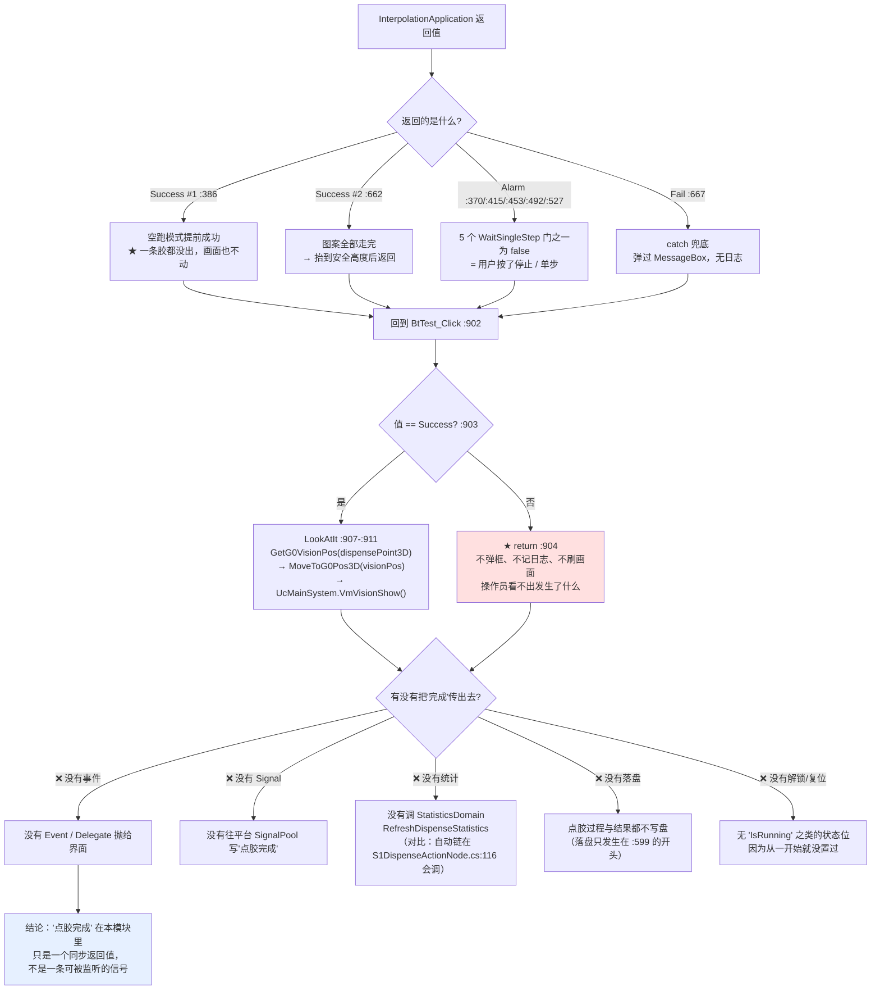

**ASCII 版**

```
 InterpolationApplication 返回值
        │
        ├─ Success :386  ← 空跑模式提前成功（一条胶都没出）
        ├─ Success :662  ← 图案全部走完（正常路径）
        ├─ Alarm :370/:415/:453/:492/:527 ← 用户停止/单步
        └─ Fail  :667    ← catch 兜底（弹过框，无日志）
        │
        ▼  回到 BtTest_Click :902
   值 == Success ? :903
        ├─ 是 ─▶ :907 GetG0VisionPos → :909 MoveToG0Pos3D
        │         → :911 VmVisionShow()   【界面唯一的变化】
        └─ 否 ─▶ :904 return  ★ 不弹框、不记日志、不刷画面
        │
        ▼
   有没有把"完成"传出去？
        ❌ 没有 Event / Delegate  → 界面无法监听
        ❌ 没有 SignalPool / Signal → 平台侧无法监听
        ❌ 没有 StatisticsDomain.RefreshDispenseStatistics
            （自动链在 S1DispenseActionNode.cs:116 会调，手动测试不调）
        ❌ 没有落盘（落盘只发生在 :599 开头）
        ❌ 没有状态位复位（因为从未置过）

   ⇒ "点胶完成"在本模块里只是一个【同步返回值】，
     不是一条可被监听/等待的信号。
```

**"信号交接"的真相**：用户问的"经什么样的流程之后点胶完成"，隐含假设是"有个信号说完成了"。**本模块没有这个信号。** `BtTest_Click` 是**同步阻塞**等到 `InterpolationApplication` 返回，返回后除了把相机移过去，不做任何事。这一点与自动链形成鲜明对照——自动链走的是 `ActionNode` 框架，由平台调度器决定"下一个节点"，`S1DispenseActionNode` 会刷新统计（`S1DispenseActionNode.cs:116`），而手动测试链**完全不碰这些**。复核命令：`grep -rn "RefreshDispenseStatistics\|StatisticsDomain" --include="*.cs" DispenseSystem/` → 只有两处，`S1DispenseActionNode.cs:116`（自动链）与 `DispenseWorkTask.cs:112`（后台线程），**没有一处与 `BtTest_Click` 有关**。

### 4.3.6 五种失败走法总图（图 10）

前五个小节是"正常走完"。这一节把**五种失败/异常走法**并排画出来，方便对照"哪一种是你看得见的、哪一种不是"。

**图 10：五种失败走法**

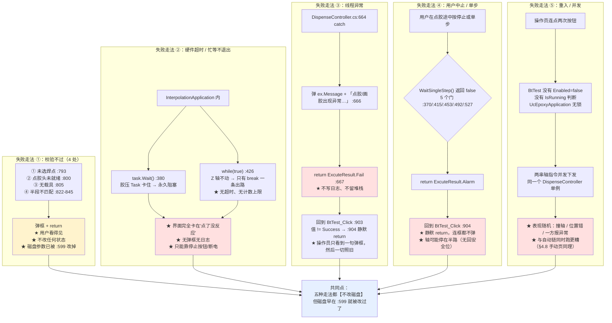

**ASCII 版**

```
 ① 校验不过（4 处 :793 / :800 / :805 / :822）
        └─▶ 弹框 + return
             ★ 看得见    ★ 不改状态    ★ 磁盘已被 :599 改掉
 ──────────────────────────────────────────────────────────
 ② 硬件超时 / 忙等不退出
     task.Wait() :380  ─┐
     while(true) :426  ─┴─▶ ★ 界面卡在"点了没反应"
                             ★ 无弹框、无日志、无超时
 ──────────────────────────────────────────────────────────
 ③ 线程异常
     :664 catch ─▶ :666 弹 ex.Message ─▶ :667 return Fail
                  ─▶ :903 值 != Success ─▶ :904 静默 return
                      ★ 无日志、无堆栈，操作员只看到一句弹框
 ──────────────────────────────────────────────────────────
 ④ 用户中止 / 单步
     5 个 WaitSingleStep 门 ─▶ return Alarm
                  ─▶ :904 静默 return，连框都不弹
                      ★ 轴可能停在半路，没有回安全位
 ──────────────────────────────────────────────────────────
 ⑤ 重入 / 并发
     连点两次 ─▶ 无 Enabled=false / 无 IsRunning / 无锁
                  ─▶ 两串轴指令并发下发
                      ★ 表现随机；与自动链同时跑更糟
 ──────────────────────────────────────────────────────────
 共同点：五种失败走法都不改磁盘 —— 但磁盘在 :599 就已经被改过了
```

**五种走法"看得见程度"对照**

| 走法 | 有没有提示 | 有没有日志 | 界面会怎样 | 现场会怎样 |
|---|---|---|---|---|
| ① 校验不过 | ✅ 弹框写明原因 | ❌ | 停在原地 | 无动作 |
| ② 超时/忙等 | ❌ | ❌ | **卡住，点了没反应** | 轴停在中间，阀可能开着 |
| ③ 线程异常 | ⚠️ 一句 `ex.Message` | ❌ | 弹框后一切照旧 | 已发生的异常无痕迹 |
| ④ 用户中止 | ❌ | ❌ | **完全没有反应** | 轴停半路，无回安全位 |
| ⑤ 重入 | ⚠️ 随机异常 | ⚠️ 取决于哪条链先炸 | 随机 | **可能撞轴** |

### 4.3.7 异常链因果图（图 11）

第 ③ 种走法值得单独画一张，因为**这条链会把异常一路抛到 WinForms 的消息循环**——在本模块里这是唯一一处 `throw;` 而不吞掉的地方。

**图 11：异常链因果图 — 从硬件异常到进程级异常**

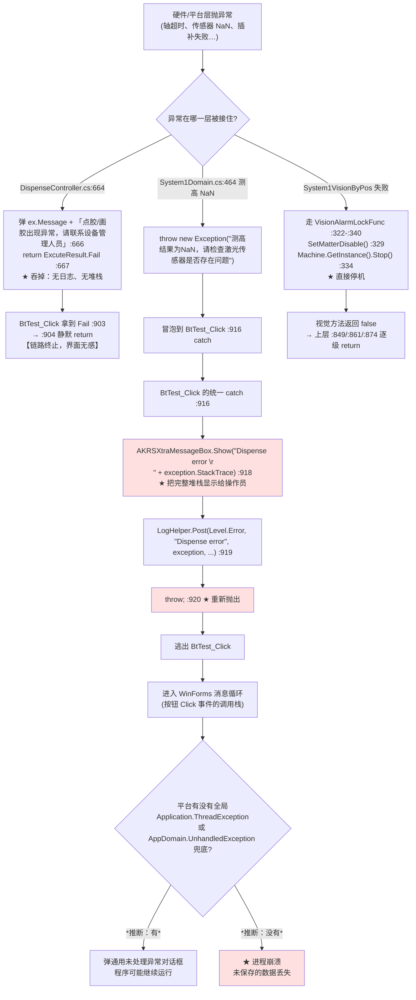

**ASCII 版**

```
 硬件/平台层抛异常
        │
        ├─(A) DispenseController.cs:664 catch
        │        └▶ :666 弹 ex.Message + 「点胶/画胶出现异常…」
        │           :667 return Fail
        │           └▶ BtTest_Click :903 → :904 静默 return
        │              【链路终止，界面无感；无日志】
        │
        ├─(B) System1Domain.cs:464 测高 NaN
        │        └▶ throw new Exception("测高结果为NaN…")
        │           └▶ 冒泡到 BtTest_Click :916 catch ──┐
        │                                              │
        └─(C) 视觉失败 → VisionAlarmLockFunc :322-:340   │
                 :329 SetMatterDisable()                 │
                 :334 Machine.Stop()   ★ 直接停机        │
                 └▶ 方法返回 false                        │
                    :849 / :861 / :874 逐级 return       │
                    （不走 catch，安静退出）              │
                                                         ▼
                          BtTest_Click 统一 catch :916
                                                         │
                          :918 弹 "Dispense error" + StackTrace
                               ★ 完整堆栈显示给操作员
                          :919 LogHelper.Post(Level.Error, ...)
                          :920 throw;   ★ 重新抛出
                                                         │
                                                         ▼
                          逃出 BtTest_Click → WinForms 消息循环
                                                         │
                          平台有没有全局兜底？
                            ├ 有（*推断*）─▶ 通用未处理异常框，程序继续
                            └ 没有（*推断*）─▶ 进程崩溃
```

**这张图要传达的三件事**

1. **同一个"硬件异常"，走 (A) 还是走 (B)，用户体验完全不同**：(A) 只弹一句 `ex.Message` 且**不写日志**；(B) 会把**完整 `StackTrace` 显示给操作员**并写错误日志，然后**继续往上抛**。两条路对"事后能不能查"的影响是相反的。
2. **`:918` 把 `exception.StackTrace` 直接 Show 给操作员**——这是把内部实现细节暴露到现场界面。对排查不一定坏（现场能拍到堆栈），但**从产品角度是不该出现的**。
3. **`throw;`（`:920`）之后没有任何本模块的兜底**。是否会崩溃取决于平台是否注册了 `Application.ThreadException` / `AppDomain.UnhandledException` —— 平台代码无源码，所以我在图里标了 `*推断*`，并把它列进附录 B 的未读清单。

### 4.3.8 时序表：`BtTest` 从点击到结束

"时刻"用 `T0` 起算的相对刻度，`Tn` 不是真实时间，只是**同样的调用顺序**，方便对着现场录屏定位。

| 时刻 | 发生什么 | 代码位置 | 界面表现 | 硬件表现 |
|---|---|---|---|---|
| **T0** | 操作员点下「在轨道产品上测试」 | `UcEpoxyApplication.Designer.cs:1033` 接线 | 按钮出现按下态；**随后全程不再有任何视觉反馈** | 无 |
| **T1** | `BtTest_Click` 进 `try` | `UcEpoxyApplication.cs:595`、`:597` | 无 | 无 |
| **T2** | **先把界面参数写进配方对象并落盘** | `:599` → `:544` `EpoxyApplicationRepository.Save()`、`:545` `System1Program.Save()` | 无（用户完全不知道已写盘） | 磁盘 IO ×2 |
| **T3** | 判断走系统1 还是系统2 分支 | `:600`–`:602` | 无 | 无 |
| **T4** | 校验①未选焊点 | `:793` → 弹框 `:795` → `return :796` | 走到这里就弹「请先选择焊点」并结束 | 无 |
| **T5** | 校验②点胶头是否就绪 | `:800` → `DispenserProgram.IsReady()`（`DispenserProgram.cs:55`） | 否时弹「点胶针未配置」`:59` 或「点胶针未示教」`:70` | 无 |
| **T6** | 校验③载台有没有载具 | `:805` → 弹框 `:807` → `return :808` | 否时弹「系统1载台上没有载具，请重试」 | 无 |
| **T7** | 校验④分离平台半段匹配 | `:822`–`:845` | 否时弹「请先传送载具到点胶2平台」`:828`-`:832` 或「载具在点胶2平台,无法执行…」`:837`-`:841` | 无 |
| **T8** | **重建载具副本 + 设偏移** | `:811` `new TransportUnit(System1)`、`:813` `SetSystem1OffSet()` | 无 | 无（纯内存） |
| **T9** | 基板视觉定位 | `:847` `System1MatterVision(substrate,false)` → `System1Domain.cs:96` | 相机画面会闪（实时画面如果是开的） | 轴移动到基板相机位 → 拍照 → 识别；失败时走 `VisionAlarmLockFunc`（`System1Domain.cs:322`–`:340`，含 `Machine.Stop()` `:334`） |
| **T10** | 基板测高 | `:852` `MatterHeightMeasurePoints(substrate,true)` → `:371` | 无 | 开测高气缸 → 等到位 → 激光读数 → 关气缸；结果写进副本 |
| **T11** | 基岛视觉定位 | `:859` → 失败 `return :861` | 无 | 同 T9 |
| **T12** | 基岛测高 | `:864` → 非 `Success` `return :866` | 无 | 同 T10；`system1` 关闭时会在 `System1Domain.cs:380` 直接跳过 |
| **T13** | 焊点视觉定位 | `:872` → 失败 `return :874` | 无 | 同 T9 |
| **T14** | 焊点测高 | `:877` → 非 `Success` `return :879` | 无 | 同 T10；**测高结果 NaN 会 `throw`（`System1Domain.cs:464`）**，被 `:916` 接住 |
| **T15** | **无条件执行一次预点胶** | `:886` `PreDispenseAction.DoWork()` | 无 | 移到预点胶板/蘸胶盘 → 试打一次；**返回值被丢弃，失败也不阻止后续点胶** |
| **T16** | 算 G0 坐标 | `:892` `SelfPosToG0(...)` | 无 | 无 |
| **T17** | 加补偿 | `:894` `GetDispensePositionCompensate()` + `DispenseModulePara.DispenseOffset` | 无 | 无 |
| **T18** | 算角度 | `:896` `DegreeInG0()*180/π` + `GetDispenseRotaryCompensate()` | 无 | 无 |
| **T19** | 判是否真出胶 | `:899` `isDrip = 工作模式 != DryCycle` | 无 | 无 |
| **T20** | 进 `InterpolationApplication`，打第一个时间戳 | `DispenseController.cs:300`、`:307`、`:309` | 无 | 无 |
| **T21** | 坐标换算 + 图形预处理 | `:314`、`:317`、`:320` | 无 | 无 |
| **T22** | Z 高度补偿 + 安全高度 | `:325`/`:329`、`:333` | 无 | 无 |
| **T23** | **异步设胶压** | `:354` `new Task(...)`、`:367` `task.Start()` | 无 | 气压/真空调节（异步，与下一步并发） |
| **T24** | 单步门 | `:370` `WaitSingleStep()` | 单步模式下会停下来等 | 无 |
| **T25** | 移到首个图案点上方 | `:376` `MoveToG0Pos3D(...)` | 相机画面开始移动 | 轴 XY/Z 运动 |
| **T26** | **等胶压 Task 完成** | `:380` `task.Wait()` | 无 | **若 Task 卡住，此处永久阻塞**（R-37） |
| **T27** | 空跑模式判断 | `:384` `IsDryCycle` → `:386` `return Success` | 无 | **不出胶**；后续图案全跳过 |
| **T28** | 提前开阀（若配置） | `:412`–`:439`：`:426` `while(true)` → `:432` `OpenDispensingElectric()` → `:436` `Thread.Sleep(1)` | 无 | Z 慢速下移，到提前量即**点胶阀打开** |
| **T29** | 单步门 | `:453` | 单步模式下会停 | 无 |
| **T30** | 领先时间（若配置） | `:459`–`:472`：`:461` `Open` / `:468` `Close`、`:472` `Thread.Sleep(DispenserLeadTime)` | 无 | 阀提前开或提前关；线程阻塞睡眠 |
| **T31** | 单点图案出胶 | `:492` 门 → `:499`/`:503` → `:511` `DelayHelper.Delay(DripTime + firstDelay)` → `:518` `Close` | 无 | **阀开 → 等 `DripTime` → 阀关**；出胶量由时间决定；首点会加 `FisrtDispenseDelay`（`:508`） |
| **T32** | 画胶图案插补（ETEL） | `:534`–`:603`：`ipolBegin` → 逐段 `ipolLine` → `ipolEnd` | 无 | 多轴插补运动；`OpenGlueFlag` 处开阀、否则关阀（`:574`/`:582`）；每段 `ipolWaitMovement(100000)` 等到位 |
| **T33** | 画胶图案插补（非 ETEL 兜底） | `:611` `GuGaoDrive.Interpolation(1, 图案, index)`、`:616` `Close` | 无 | 固高驱动插补 |
| **T34** | 断尾 1 | `:624` `AxisZAbsoluteMove(Z+TearOff1Height, TearOff1Speed)` + `DelayHelper.Delay(TearOff1Delay)` | 无 | Z 上抬一小段并等待，形成"断尾" |
| **T35** | 断尾 2 | `:641` 同上（`TearOff2`） | 无 | 同上 |
| **T36** | 还有图案就回到 T23 | `:337` 的 `for` | 无 | 重复 T23–T35 |
| **T37** | 抬到安全高度 → **返回 Success** | `:658`、`:662` | 无 | Z 抬到 `preDispenseHeight` |
| **T38** | **把相机移到刚点过的位置并刷画面** | `UcEpoxyApplication.cs:907` `GetG0VisionPos` → `:909` `MoveToG0Pos3D` → `:911` `UcMainSystem.VmVisionShow()` | **这是整个流程中界面唯一的变化**：实时画面切到刚点胶的位置 | 轴移到相机位；显示刷新 |
| **T39** | 按钮重新可用（实际是它从未禁用） | — | **按钮全程都可再点**：连点两次 → 两条链各自 `RecordTime()`（`DispenseController.cs:309`）→ `System1Stopwatch` 互相 `Restart()`（`DispenseRunTimeProvider.cs:141`）→ 节拍数据被清（R-36） | 无 |
| **T40** | 结束 | — | **没有"点胶完成"提示**；**统计没有刷新**；**没有落盘** | 无 |

**分支变体（同样从 T0 开始）**

| 变体 | 偏离点 | 结果 |
|---|---|---|
| 校验不过 | T4 / T5 / T6 / T7 | 弹框 + `return`；磁盘已在 T2 被改 |
| 测高 NaN | T14 内 | `throw`（`System1Domain.cs:464`）→ `UcEpoxyApplication.cs:916` 弹 `StackTrace` + 日志 + `throw;` |
| 视觉彻底失败 | T9 / T11 / T13 内 | `VisionAlarmLockFunc`（`System1Domain.cs:322`）→ `SetMatterDisable()` `:329` + `Machine.Stop()` `:334`；方法返回 `false` → 上层静默 `return` |
| 用户停止/单步 | T24 / T29 / T31 门 | 返回 `Alarm` → `:904` 静默 `return`，**轴无回安全位** |
| 空跑模式 | T27 | 返回 `Success`（`:386`），**没出胶**。后续 `T38` 仍会把相机移过去，看起来"像做了" |
| 硬件异常 | T21–T37 内 | `DispenseController.cs:664` → 弹框 + `return Fail`（无日志）→ `:904` 静默 `return` |
| 胶压 Task 卡住 | T26 | `task.Wait()` 永久阻塞 → 界面卡死、无提示 |
| 重入 | T39 后立刻再点 | 两串指令并发下发 |

### 4.3.9 这条链路上最危险的地方

把上面的证据按"后果严重度"重排，串成本模块的风险主线。每一条都能在 §9 找到完整编号条目。

**第一级：静默改变数据（最隐蔽，也最不可逆）**

1. **`Confirm()` 在 `:599` 先落盘**（→ `:544`/`:545`）。用户点"测试"的语义是"试一试"，而代码的语义是"保存并试一试"。**任何一次误点测试，都会把当前界面上的参数永久写进 `EpoxyApplicationRepository.json` 和 `DispenseProgram.json`。** 这一条本身不是 bug，但它把所有后续失败都变成"不可撤销"。（R-01）
2. **参数落盘是"全表覆盖"**。`EpoxyApplicationRepository.Save()` 与 `UcAddEpoxyApplication.RefreshControl()`（`:55`/`:66`）都可能触发，而两者之间**没有任何锁**（§6.6）。（R-08、R-12）

**第二级：卡住不返回（现场表现为"点了没反应"）**

3. **`task.Wait()`（`DispenseController.cs:380`）没有超时**。胶压设置是 fire-and-forget 的 `Task`（`:354`/`:367`），一旦它内部阻塞或抛异常，`Wait()` 会把整个点胶流程永久挂住。界面既没有"正在执行"的指示，也没有取消途径。（R-37）
4. **`while(true)` 提前开阀忙等（`:426`–`:437`）只有 `break` 一条出路**，没有超时、没有迭代上限。Z 轴位置读回值不满足条件时，这个循环**永不退出**，而且**用户按停止也无效**（它不吃那 5 个 `WaitSingleStep` 门）。（R-37）

**第三级：异常被吞掉，事后无法追查**

5. **`DispenseController.cs:664` 的 `catch` 只用 `MessageBox` 报 `ex.Message`，然后返回 `Fail`**——**不写日志、不留堆栈**。而 `BtTest_Click` 拿到 `Fail` 后在 `:904` **静默 `return`**，所以现场可能连那句弹框都没被注意到。（R-16，见 §9.2 该条的补充）
6. **`BtTest_Click` 的 `:918` 反而把 `exception.StackTrace` 显示给操作员，然后 `:920 throw;`**。同一条链上"该记的没记、不该露的露了"，且 `throw;` 之后本模块无兜底。（R-16，见 §9.2 该条的补充）

**第四级：没有任何互锁（并发类问题的根源）**

7. **`BtTest` 没有 `Enabled=false`、没有 `IsRunning` 判断、`UcEpoxyApplication` 没有锁**。连点两次就是两串轴指令并发下发，并且两条链各自会调到一次 `RecordTime()`（`DispenseController.cs:309`），把 `DispenseRunTimeProvider.cs:141` 那个**进程级 `static` 的 `System1Stopwatch`** 互相 `Restart()` 掉 —— 节拍统计因此静默失真（R-36）。
8. **手动测试链与自动链共用同一个 `DispenseController` 单例且互不加锁**（§1.3 事实二、§6.6）。自动生产跑着的时候点这个按钮，两条链会同时往同一个轴上发指令。（R-40、R-41）

**第五级：语义陷阱（不是 bug，但一定会误导人）**

9. **"成功"有歧义**：`IsDryCycle` 时 `:386`（`if (IsDryCycle) return ExcuteResult.Success;`）**一条胶都没出**，后续图案也全跳过。任何"看返回值判断是否真的点过胶"的下游逻辑都会错。*（本文补充：这一条不在 `R-01`~`R-57` 内 —— 它是一个语义坑而不是缺陷，本文单独登记为 **`R-66`**，详见 §9.9 与 §5.1。）*
10. **预点胶无条件执行且返回值被丢弃**（`:886`）。`PreDispensingMode` / `PreDispensingTiming` 的开关在 `PreDispenseAction` 内部（`PredispenseAction.cs:74`/`:167`），所以从 `BtTest_Click` 这一层完全看不出"这次会不会预点胶"。（R-21 同族）
11. **手动测试链不刷新统计**（复核命令见 §4.3.5）。`S1DispenseActionNode.cs:116` 与 `DispenseWorkTask.cs:112` 会调 `StatisticsDomain`，`BtTest_Click` 不会。**手动测试打出去的那些胶，在统计里不存在**。（R-06）

**把这三件事连起来看**

> 操作员点了一次「在轨道产品上测试」→ 磁盘上的胶型参数被永久改掉（第一级）→ 因为某个 Z 轴位置读回不满足条件，流程卡在 `while(true)` 里（第二级）→ 操作员以为死机，连点几次，或者去手动页按了停止（第四级）→ 现场出现撞轴或半途停阀（第三级只弹一句 `ex.Message`，无日志）→ 事后查问题：日志里没有，统计里没有，配方却变了。
>
> **这就是本模块"最危险"的完整形态：不是某一行代码算错了，而是"落了盘、卡住、没日志、没互锁"这四件事同时成立。**

### 4.4 「在预点胶板上测试」按钮

`BtTestInPrePlant`（文字「在预点胶板上测试」，`Designer.cs:1022`，接线 `:1023`）与 §4.3 的 `BtTest` 是**兄弟按钮**：同样的起手、同样的落盘、同样的一次点胶调用，但有 4 处关键差异——其中两处是风险。

**图 12：「在预点胶板上测试」流程图**

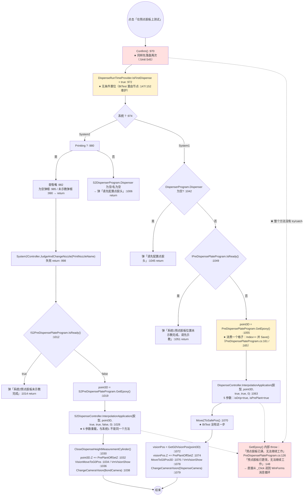

**ASCII 版**

```
 [点击「在预点胶板上测试」]
        │
        ▼
 :970 Confirm()  ★ 先落盘 :544 / :545
        │
        ▼
 :972 IsFirstDispense = true   ★ 无条件（BtTest 里是节点维护）
        │
   ┌────┴───────────── 系统 ? :974 ─────────────┬──────────────┐
   │ System2                                     │ System1      │
   ▼                                             ▼              │
 Printting? :980                           Dispenser 为空? :1042 │
   ├是─▶ 查吸嘴 :982 ─空─▶ 弹框 :985 return   ├是─▶ 弹「请先配置点胶头」│
   │      └未示教─▶ 弹框 :990 return          │      :1045 return │
   │     :995 JudgeAndChangeNozzle            │                    │
   │           └失败─▶ return :998            │                    │
   └否─▶ Dispenser 为空 ─▶ 弹「请先配置点胶头」│                    │
            :1006 return                       ▼                    │
   :1012 S2PreDispensePlateProgram.IsReady()?  :1049 PreDispensePlateProgram.IsReady()?
     ├ 未就绪 ─▶ 弹 :1014 return                 ├ 未就绪 ─▶ 弹 :1051 return
     └ 就绪 ─▶ :1019 GetEpoxy()                  └ 就绪 ─▶ :1055 GetEpoxy()
                :1028 InterpolationApplication              ★消费一格 Index++
                      （6 参数重载）                          :1063 InterpolationApplication
                :1030 收气缸                                        （5 参数 isPrePlant=true）
                :1032 Z += PrePlantOffSetZ                  :1070 MoveZToSafePos() ★BtTest没有
                :1034 相机移过去 :1036 刷画面                :1072 相机移过去 :1078 刷画面
                :1038 切到固晶相机                            :1079 切到点胶相机
                    │                                            │
                    └────────────▶ [结束] ◀───────────────────────┘
        │
        └─ ★ 方法内【没有 try/catch】：
             GetEpoxy() 的 throw（PreDispensePlateProgram.cs:126 / :148）
             会直接逃到 WinForms 消息循环
```

**与 §4.3 的 `BtTest` 的 4 个关键差异**

| # | 差异 | 位置 | 后果 |
|---|---|---|---|
| 1 | **整个方法没有 `try/catch`** | `:968`–`:1079` 全段 | `GetEpoxy()` 的 `throw`（`PreDispensePlateProgram.cs:126`「预点胶板已满，无法继续工作」、`:148`「预点胶板已更改，无法继续工作」）**直接逃到消息循环**，不像 `BtTest` 那样有 `:916` 兜一层。这是"点胶流程被复制成 3 份"（R-43）的直接后果，抛出的文案见 R-18 / R-49 |
| 2 | `IsFirstDispense` **被无条件置 true** | `:972` | 每一次预点胶测试都会叠加 `FisrtDispenseDelay`（`DispenseController.cs:508`）。而在 `BtTest` 里这个标志由 `S1DispenseActionNode.cs:147`/`:152` 按预点胶时机维护 |
| 3 | 系统1侧调完后**额外** `MoveZToSafePos()` | `:1070` | 这是好事（预点胶后主动抬 Z）；`BtTest` 没有这一步 |
| 4 | **`GetEpoxy()` 会消费掉一个格子** | `:1055` → `PreDispensePlateProgram.cs:161` `Index++`、`:165` `Save()` | **点一次"测试"就少一个格子，并且立刻落盘**。预点胶板格子是有限的（`GetEpoxy()` 满时 `:126` 抛异常） |

> 第 4 点是这个按钮最容易被忽略的副作用：**它不是"只读地试打一下"，它会推进预点胶板的指针并存盘**。详见 §6.4 与 R-18。

### 4.5 换胶流程 `FrmChangeEpoxy`

换胶是本模块**唯一一个"改设备状态"的向导**：它会把点胶头重新装到夹具上、挤掉旧胶、擦干净、蘸新胶、重新测高、重新找胶点。整个过程有 7 步，由一个 `AssistantConfig` 步骤机驱动。

**入口有 3 个**（都在本目录之外的界面上，或本目录的手动页）：

| 入口 | 位置 | 场景 |
|---|---|---|
| 程式编辑器「点胶头」节点 | `UcEditProductProgramming.cs:2076` | 正式的换胶流程 |
| 主界面快捷菜单 | `Main/Controls/UcShortcutMenu.cs:374` | 现场快速入口 |
| 手动页「更换点胶头」按钮 | `UcDispenseManual.cs:131` → `:133 new FrmChangeEpoxy()` | 手动页入口 |

### 4.5.1 `Load` 里的失控分支（图 13 前置）

`FrmChangeEpoxy_Load`（`Controls/Assistant/FrmChangeEpoxy.cs:53`）只做 5 件事，但**第 2 件的失败处理漏了 `return`**。

**图 13：`FrmChangeEpoxy_Load` 缺 `return` 的失控分支 —— ★ R-04**

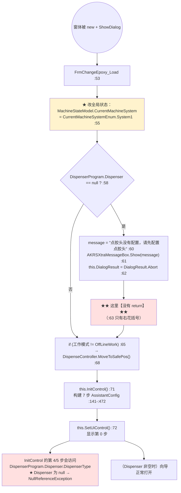

**ASCII 版**

```
 窗体被 new + ShowDialog
        │
        ▼
 FrmChangeEpoxy_Load :53
        │
        ├─ :55 ★ 改全局状态 CurrentMachineSystem = System1
        │        （关窗时 :508 才切回 System2；中途取消则不切回）
        │
        ├─ :58 DispenserProgram.Dispenser == null ?
        │       │是
        │       ├─ :60 message = "点胶头没有配置，请先配置点胶头"
        │       ├─ :61 AKRSXtraMessageBox.Show(message)
        │       └─ :62 this.DialogResult = DialogResult.Abort
        │          ★★ 没有 return ★★（:63 只是右花括号）
        │              │
        │              ▼ 继续往下执行
        ├─ :65 工作模式 != OffLineWork ? ─▶ :68 MoveToSafePos()
        │
        ├─ :71 InitControl()  构建 7 步 AssistantConfig :141-:472
        │        └─ 第 4/5 步读 DispenserProgram.Dispenser.DispenserType
        │              ★ Dispenser == null → NullReferenceException
        │
        └─ :72 SetUiControl()  显示第 0 步
```

**为什么这条分支一定会炸**：`L2` 判断的对象是 `DispenserProgram.Dispenser`（一个由名字从仓库查出来的对象，`DispenserProgram.cs:36` 标了 `[JsonIgnore]`）。它为 `null` 的**唯一原因**就是"名字没配或仓库里查不到"。而 `InitControl()` 构建的步骤 #4（`:237`–`:288`）和 #5（`:291`–`:321`）里要读 `Dispenser.DispenserType` 来决定走"点胶头分支"还是"打印头分支"——所以**这个 `null` 恰好就是它要用的那个对象**。缺 `return` 等于把"提示一下然后退出"变成了"提示一下然后崩"。见 R-04。

### 4.5.2 7 步状态机（图 14）

**图 14：换胶向导 7 步状态机**

```mermaid
stateDiagram-v2
    [*] --> Load : new + ShowDialog
    Load --> Step0 : InitControl :71 / SetUiControl :72
    note right of Load
        stepCount = 7  (:75)
        stepIndex 无上界也无下界钳制
    end note

    Step0 --> S1 : BtNext :116 → stepIndex++
    S1 : #1 准备 :172-:188
    S1 : MoveToPos(ReplaceGluePosition) :185

    S1 --> S2 : BtNext
    S2 : #2 换胶 :191-:211
    S2 : 保存 ReplaceGluePosition :204-:205
    S2 : MoveToPos(ThrustPosition) :208

    S2 --> S3 : BtNext
    S3 : #3 挤胶 :214-:234
    S3 : 保存 ThrustPosition :227-:228
    S3 : MoveToPos(ErasePosition) :231

    S3 --> S4 : BtNext
    S4 : #4 擦胶 :237-:288
    S4 : 保存 ErasePosition :250-:251

    S4 --> S5a : Dispenser 分支
    S5a : 移到 DispenserMeasureHeightPos
    S5a : ★ stepIndex++ :268（跳过蘸胶步）
    S4 --> S5b : PrintingTool 分支
    S5b : PrintToolStop() :272
    S5b : 移到 PrintingToolPos :278-:283

    S5a --> S6 : BtNext
    S5b --> S5 : BtNext
    S5 : #5 蘸胶 :291-:321
    S5 : 保存 PrintingToolPos :304-:305
    S5 : PrintToolContinueMove() :318

    S5 --> S6
    S6 : #6 自动测高 :324-:401
    S6 : DispenserMeasureHeightPos = GetG0Pos() :336
    S6 : ★ DispenseDevicePara.Save() :337
    S6 : DispenserHeightMeasurementG0(...) :339
    S6 : 失败 → stepIndex-- :348 + return :350
    S6 : dripElectricPoint3D.Z = height + DistanceInSensor :359
    S6 : 非 OffLineWork 时挤胶 :365-:375

    S6 --> S7 : BtNext
    S7 : #7 寻找胶点 :404-:461
    S7 : VisionPosForCalibration = GetG0Pos() :419
    S7 : DispensingNeedleOffset = 视-测 :422-:424
    S7 : offsetZ = height - 预点胶板高 :431
    S7 : DispensingNeedleOffset.Z = -offsetZ + ... :434-:435
    S7 : 可选清空 DispenseOffset :439-:447
    S7 : ★ System1Program.Save() :449
    S7 : ★ DispenseDevicePara.Save() :450
    S7 : DispenserAssistant.State = Able :452
    S7 : ★ DispenserRepository.Save() :453
    S7 : DialogResult = OK :454
    S7 : catch → Console.WriteLine(e); throw; :456-:460

    S7 --> Done : BtDone :502
    Done : DoneAction() → MoveToSafePos()
    Done : DialogResult = OK
    Done : ★ CurrentMachineSystem = System2 :508
    Done --> [*]

    Step0 --> Cancel : BtCancel :516
    S1 --> Cancel
    S2 --> Cancel
    S3 --> Cancel
    S4 --> Cancel
    S5 --> Cancel
    S6 --> Cancel
    S7 --> Cancel
    Cancel : 直接收尾，不调用 DoneAction
    Cancel : ★ 已落盘的 :337/:449/:450/:453 不回滚
    Cancel --> [*]

    Step0 --> Back : BtBack :526 → stepIndex--
    S1 --> Back
    S2 --> Back
    S3 --> Back
    S4 --> Back
    S5 --> Back
    S6 --> Back
    S7 --> Back
    Back : ★ 无下界钳制，连点变负数
    Back --> Step0

    S1 --> Focus : BtAutoFocus :574
    Focus : TUAssistantHelper.AutoFocus
    Focus --> S1

    S1 --> Clear : BtClearPosition :600
    Clear : DispenseDevicePara.ClearPosition()
    Clear : ★ 清了内存但 :78 实现里没有 Save()
    Clear --> S1
```

**ASCII 版**

```
                       ┌──────────────────────────────┐
   new + ShowDialog ──▶ │ Load :53   ★ 见 图 13 的失控分支 │
                       │  :55 改全局系统号 → System1     │
                       │  :71 InitControl / :72 SetUiControl
                       │  stepCount = 7 (:75)           │
                       └───────────────┬──────────────┘
                                       ▼
   ┌─────────────────── 7 步状态机（AssistantConfig :141-:472）────────────────┐
   │                                                                          │
   │  #1 准备   :172-188   MoveToPos(ReplaceGluePosition) :185                │
   │      │                                                                   │
   │  #2 换胶   :191-211   保存 ReplaceGluePosition :204   MoveToPos(Thrust)  │
   │      │                                                                   │
   │  #3 挤胶   :214-234   保存 ThrustPosition :227   MoveToPos(Erase) :231   │
   │      │                                                                   │
   │  #4 擦胶   :237-288   保存 ErasePosition :250                            │
   │      ├─ Dispenser 分支 ─▶ 移到 MeasureHeightPos + stepIndex++ :268        │
   │      │                    （★ 跳过 #5 蘸胶）                             │
   │      └─ PrintingTool ──▶ PrintToolStop() :272 → PrintingToolPos :278-283 │
   │                              │                                           │
   │  #5 蘸胶   :291-321   保存 PrintingToolPos :304  PrintToolContinueMove :318│
   │      │                                                                   │
   │  #6 自动测高 :324-401                                                   │
   │      ├ :336 DispenserMeasureHeightPos = GetG0Pos()                       │
   │      ├ :337 ★ DispenseDevicePara.Save()  ← 落盘                          │
   │      ├ :339 DispenserHeightMeasurementG0(...)                            │
   │      ├ :346 失败 ─▶ :348 stepIndex--  +  :350 return   （回退并放弃本步） │
   │      ├ :359 dripElectricPoint3D.Z = height + DistanceInSensor            │
   │      └ :365 非 OffLineWork 时 SetDispensePressure → Open → Sleep → Close  │
   │      │                                                                   │
   │  #7 寻找胶点 :404-461                                                   │
   │      ├ :419 VisionPosForCalibration = GetG0Pos()                         │
   │      ├ :422-424 DispensingNeedleOffset = 视 - 测（XY 分量）              │
   │      ├ :431 offsetZ = height - 预点胶板高度                              │
   │      ├ :434-435 DispensingNeedleOffset.Z = -offsetZ + ...                │
   │      ├ :439-447 可选清空 DispenseOffset（弹框问用户）                    │
   │      ├ :449 ★ System1Program.Save()                                      │
   │      ├ :450 ★ DispenseDevicePara.Save()                                  │
   │      ├ :452 DispenserAssistant.State = Able  ← "已示教" 标记              │
   │      ├ :453 ★ DispenserRepository.Save()                                 │
   │      ├ :454 DialogResult = OK                                            │
   │      └ :456-460 catch → Console.WriteLine(e); throw;                     │
   └───────────────────────────┬──────────────────────────────────────────────┘
                               ▼
                     BtDone :502  DoneAction() → MoveToSafePos()
                                  DialogResult = OK
                                  ★ :508 CurrentMachineSystem = System2
                               ▼
                             [结束]

   任意步 BtCancel :516 ─▶ 直接收尾（不调 DoneAction）
        ★ 已落盘的 :337 / :449 / :450 / :453 【不回滚】
   任意步 BtBack  :526 ─▶ stepIndex--   ★ 无下界钳制，连点变负数
   #1 步  BtAutoFocus :574 ─▶ TUAssistantHelper.AutoFocus
   #1 步  BtClearPosition :600 ─▶ DispenseDevicePara.ClearPosition()
                                      ★ :78 实现里没有 Save()
```

### 4.5.3 换胶后哪些状态被重置、要不要重新标定（图 15）

这是用户点名要问的："哪些状态被重置、哪些计数被清零、要不要重新标定"。

**图 15：换胶后的状态复位对照**

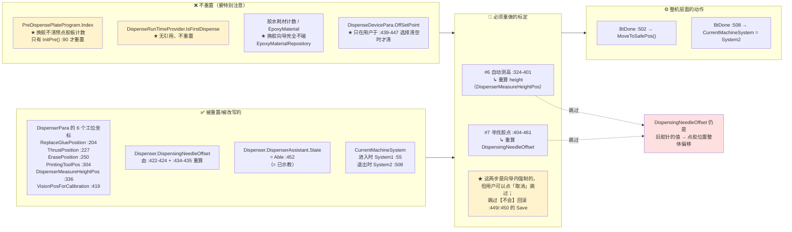

**ASCII 版**

```
 ✅ 被重置 / 被改写                         🔧 必须重做的标定
 ┌──────────────────────────────┐         ┌─────────────────────────────┐
 │ DispenserPara 6 个工位坐标：  │         │ #6 自动测高 :324-401         │
 │  ReplaceGluePosition :204    │         │   ↳ 重算 height              │
 │  ThrustPosition      :227    │         │                             │
 │  ErasePosition       :250    │         │ #7 寻找胶点 :404-461         │
 │  PrintingToolPos     :304    │         │   ↳ 重算 DispensingNeedle    │
 │  MeasureHeightPos    :336    │         │     Offset                  │
 │  VisionPosForCalib   :419    │         └──────────┬──────────────────┘
 ├──────────────────────────────┤                    │
 │ DispensingNeedleOffset       │         ★ 这两步在向导内是强制的，
 │  :422-424 + :434-435 重算    │           但用户可点「取消」跳过；
 ├──────────────────────────────┤           跳过【不回滚】:449/:450 的 Save
 │ DispenserAssistant.State=Able│                    │
 │  :452 （"已示教"标记）        │                    ▼
 ├──────────────────────────────┤         ⚠ 跳过 → DispensingNeedleOffset
 │ CurrentMachineSystem         │            仍是旧胶针的值
 │  进 System1 :55 / 出 System2 │            → 点胶位置整体偏移
 │  :508                        │
 └──────────────────────────────┘
 ❌ 不重置
 ┌──────────────────────────────────────────────────────┐
 │ PreDispensePlateProgram.Index   ★ 只有 InitPre() :90 才重置 │
 │ DispenseRunTimeProvider.IsFirstDispense  ★ 不重置      │
 │ 胶水耗材计数 / EpoxyMaterial    ★ 向导完全不碰          │
 │ DispenseDevicePara.OffSetPoint  ★ 仅用户 :439-447 选择清空才清│
 └──────────────────────────────────────────────────────┘
                    │
                    ▼
 ⚙️ 整机层面：:502 MoveToSafePos() → :508 CurrentMachineSystem = System2
```

**换胶流程的 5 个坑**

| 坑 | 位置 | 说明 |
|---|---|---|
| 🔴 `Load` 缺 `return` | `FrmChangeEpoxy.cs:62` → `:71` | 点胶头未配置时不是优雅退出，而是 `InitControl()` 里空引用崩溃（R-04） |
| 🔴 `BtClearPosition` 清了不落盘 | `:600` → `DispenseDevicePara.cs:78` | 清点位的实现末尾没有 `Save()`，只有整机停机时 `Machine.cs:390` 才写盘（R-09） |
| 🔴 第 7 步 `catch` 只写控制台再 `throw` | `:456`–`:460` | `Console.WriteLine(e); throw;` —— **记不到日志文件里**，且重抛后由外层（可能是 `ShowDialog` 的调用点）决定后果（R-46） |
| ⚠️ `BtNext`/`BtBack` 无边界钳制 | `:116`、`:526` | `stepIndex` 可以越界；`BtBack` 连点会变负数（R-47） |
| ⚠️ 离线模式下 `height` 恒为 0 | `DispenseMeasureHeightController.cs:186` | `OffLineWork` 直接 `return (Success, 0)`；这个 `0` 会喂进第 7 步的 `offsetZ` 计算（`:431`），把 `DispensingNeedleOffset.Z` 算到 `-预点胶板高度` 附近（R-05） |

### 4.6 `FrmDispenseOverAllSettings`：打开一次对话框，会炸哪些地方

### 4.6.0 先说结论：这个对话框的"打开"本身就是一次写操作

`FrmDispenseOverAllSettings`（文字「点胶头」`Designer.cs:137`，149 + 156 行）是**全篇最值得单独画一张图的地方**，因为它的构造函数里有一条**方向装反了的数据流**。

**两条分支做的是相反的事**（`Controls/Assistant/FrmDispenseOverAllSettings.cs:27` 构造函数）：

| 分支 | 行 | 方向 | 内容 |
|---|---|---|---|
| **System2**（条件 `:31`–`:32`：`CurrentMachineSystem == System2 && MachineHardwareConfiguration.IsSystem2Dispense`） | `:34` | **界面 → 配方** ❌ | `BondProgram.GetInstance().S2DispenserProgram.DispenserName = this.CmbDispenser.Text;` |
| | `:35` | **界面 → 配方** ❌ | `BondProgram.GetInstance().S2EpoxyMaterialProgram.EpoxyMaterialName = this.CmbDispensingMeterialReference.Text;` |
| | `:37` | **立即落盘** ❌ | `BondProgram.GetInstance().Save();` |
| **else**（即系统1，或系统2 但硬件不支持系统2 点胶） | `:41` | 配方 → 界面 ✅ | `this.CmbDispenser.Text = System1Program.GetInstance().DispenserProgram.DispenserName;` |
| | `:42` | 配方 → 界面 ✅ | `this.CmbDispensingMeterialReference.Text = System1Program.GetInstance().EpoxyMaterialProgram.EpoxyMaterialName;` |
| | `:45` | 刷新下拉项 | `this.RefreshCmbItems();` |

**System1 那条是对的**（把配方读进控件 = 正常初始化）。**System2 那条是错的**：`"界面 → 配方"`本该发生在**用户点确定时**，却跑到了**构造函数**里。

**关键补充：`BtOK_Click`（`:117`）里已经有一份正确版本**

```
:117  BtOK_Click
:122  BondProgram...S2DispenserProgram.DispenserName = this.CmbDispenser.Text;
:123  BondProgram...S2EpoxyMaterialProgram.EpoxyMaterialName = this.CmbDispensingMeterialReference.Text;
:125  BondProgram.GetInstance().Save();
:126  DialogResult = DialogResult.OK;
```

也就是说，构造函数里那三行是 `BtOK_Click` 的**错位副本**：位置错了（构造时执行），时机也错了（**早于控件被填充**）。

**为什么写进去的必然是空串**

`this.RefreshCmbItems()` 要等到 `:45` 才执行；而 `InitializeComponent()` 之后两个 `ComboBoxEdit` 的 `Items` 与 `Text` 都还是空的。`FrmDispenseOverAllSettings.Designer.cs` 里**没有任何 `.Text =` 赋值**——`:67`–`:79`（`CmbDispenser`）与 `:92`–`:98`（`CmbDispensingMeterialReference`）只有 `Location` / `Name` / `Properties.Buttons` / `TextEditStyle` / `Size` / `TabIndex`。所以 `:34`/`:35` 读到的是 `""`。

### 4.6.1 打开一次对话框，会炸哪些地方（图 16）

这是全篇最有冲击力的一张图：**从"双击打开一个对话框"出发，一路推到"自动点胶时空引用崩溃"**。

**图 16：★ 打开一次「点胶头」对话框的因果爆炸图**

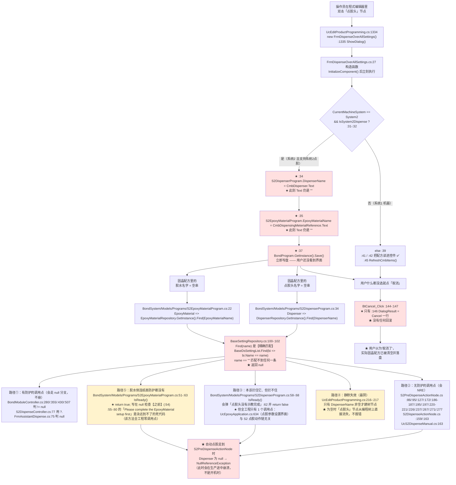

**ASCII 版**

```
 操作员在程式编辑器里双击「点胶头」节点
        │  UcEditProductProgramming.cs:1334 new → :1335 ShowDialog()
        ▼
 FrmDispenseOverAllSettings.cs:27 构造函数（InitializeComponent 后立刻执行）
        │
   分支 :31-:32  CurrentMachineSystem==System2 && IsSystem2Dispense ?
        │
        ├── 否（系统1 机器）──▶ else :39
        │                       :41/:42 配方 → 控件  ✅ 正确方向
        │                       :45 RefreshCmbItems()
        │
        └── 是 ──▶ ★ :34 DispenserName = CmbDispenser.Text   ← 此刻 Text 是 ""
                   ★ :35 EpoxyMaterialName = ...Text         ← 此刻 Text 是 ""
                   ★ :37 BondProgram.Save()                  ← 立刻落盘
                            │                 （用户还没看到界面）
              ┌─────────────┴─────────────┐
              ▼                           ▼
   固晶配方: 点胶头名字 = ""      固晶配方: 胶水名字 = ""
              │                           │
   BondSystem/Models/Programs/   BondSystem/Models/Programs/
   S2DispenserProgram.cs:34      S2EpoxyMaterialProgram.cs:22
   Dispenser => ...Find(Name)    EpoxyMaterial => ...Find(Name)
              └─────────────┬─────────────┘
                            ▼
        BaseSettingRepository.cs:100-:102
        Find(name): BaseDsSettingList.Find(bi => bi.Name == name)
        ★ 精确匹配；name == "" 匹配不到 → 返回 null
                            │
   ┌──────────┬──────────┬──┴───────┬──────────────┬───────────────┐
   ▼          ▼          ▼          ▼              ▼               ▼
 路径①      路径②      路径③      路径④          路径⑤
 有防护     无防护      拦不住     静默失效        胶水侧无防护
 Bond...    S2PreDisp  IsReady    UcEditProduct  S2EpoxyMaterial
 :280 等    ActionNode 只被        Programming    Program.cs:51-:63
 判 != null :86 等 NRE UcEpoxy...  :216-:217      ★ return true; 写在
                       :634 调用    名字空 →        null 检查【之前】:54
                       （与动作链    节点从编程树    :55-:60 是死代码
                         无关）      上消失，不报错
   └──────────┴──────────┴──────────┴──────────────┘
                            │
                            ▼
   ★ 自动点胶走到 S2PreDispenseActionNode → NRE
     （在生产途中崩溃，不是开机时）

 同时：用户什么都没选就点「取消」
        └─▶ BtCancel_Click :144-:147  只有 :146 DialogResult = Cancel
            ★ 没有任何回滚 → "取消"制造了假的安全感
```

> **★ 路径提醒（本篇只有这一处，其余地方按需简写）**：
> 本节（以及 §9.1 的 `R-02`）引用的 **`S2DispenserProgram.cs` 与 `S2EpoxyMaterialProgram.cs` 都不在 `DispenseSystem/` 下**，
> 它们的实际路径是 **`BondSystem/Models/Programs/S2DispenserProgram.cs`** 与 **`BondSystem/Models/Programs/S2EpoxyMaterialProgram.cs`**。
> 请与**本目录**下名字相近的 `DispenseSystem/Models/Programs/DispenserProgram.cs`（System1 的点胶头程式，它的 `IsReady()` 在 `:55`）**区分开** ——
> 两个类名高度相似、分属两个目录、**且都有一个 `IsReady()`**，但一个属于系统2、一个属于系统1，混起来会得出完全相反的结论。
> 本篇在首次出现处一律给全路径，后文从简；这条提醒同时记在附录 B.4。

### 4.6.2 两个按钮的分支与"不回滚"（图 17）

**图 17：`BtOK` / `BtCancel` 分支与"不回滚"**

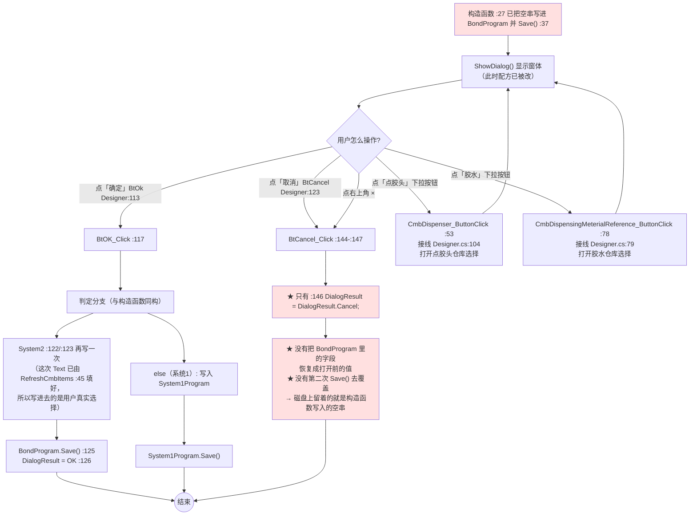

**ASCII 版**

```
 构造函数 :27 已把空串写进 BondProgram 并 Save() :37
        │
        ▼
 ShowDialog() —— 此时配方【已经被改】
        │
   ┌────┴────────────────────────────────────────────┐
   │ 用户怎么操作？                                    │
   ├─ 点「确定」BtOk Designer:113                     │
   │     BtOK_Click :117                              │
   │       ├ System2 ─▶ :122/:123 再写一次             │
   │       │            （这次 Text 已被 RefreshCmbItems│
   │       │             :45 填好，写的是用户真实选择）  │
   │       │            :125 Save()  :126 DialogResult=OK
   │       └ else   ─▶ 写入 System1Program + Save()    │
   │                                                  │
   ├─ 点「取消」BtCancel Designer:123 ／ 点右上角 ×     │
   │     BtCancel_Click :144-:147                     │
   │       ★ 只有 :146 DialogResult = Cancel 一行      │
   │       ★ 没有恢复 BondProgram 的原值                │
   │       ★ 没有再 Save() 去覆盖                       │
   │       → 磁盘上留着的就是构造函数写入的空串          │
   │                                                  │
   ├─ 点「点胶头」下拉按钮                             │
   │     CmbDispenser_ButtonClick :53（接线 Designer.cs:104）│
   └─ 点「胶水」下拉按钮                               │
         CmbDispensingMeterialReference_ButtonClick :78 │
         （接线 Designer.cs:79）                        │
              └─▶ 回到 ShowDialog
```

**这一节要记住的三句话**

1. **"打开"就是"写"**。用户什么都没点，只是双击展开一个节点，固晶配方里的两个名字就被清空并落盘了（`:34`/`:35`/`:37`）。
2. **"取消"不是取消**。`BtCancel_Click`（`:144`–`:147`）只有一行 `DialogResult = Cancel`，**不恢复任何值**。
3. **爆炸链条的终点在生产途中，不在开机时**。`Dispenser == null` 之后最先炸的是 `S2PreDispenseActionNode`（`:86` 等十余处无防护解引用），而**本该拦住的 `IsReady()` 在自动点胶链上根本没有调用点**（全工程唯一调用点是 `UcEpoxyApplication.cs:634`，属点胶参数设置界面）。胶水那一侧的 `IsReady()`（`BondSystem/Models/Programs/S2EpoxyMaterialProgram.cs:51`–`:63`）连自己都是坏的——`return true;` 写在 null 检查之前（`:54`）。

对应的风险编号：**R-02**（方向装反 + 构造即落盘，包含了 `Find` 精确匹配空串返回 `null` 之后的整条下游 NRE 链）、**R-03**（取消不回滚）、**R-48**（`[JsonIgnore]` 属性不落盘但参与计算 —— `DispenserProgram.cs:36` 那个 `Dispenser` 就是这类属性，它只在内存里按名字查仓库，配方文件里存的只有名字）。

### 4.7 点胶参数设置 `UcEpoxyApplication`

`UcEpoxyApplication`（`Controls/Setting/EpoxyApplication/UcEpoxyApplication.cs`，1,152 + 2,077 行）是本模块**最大的界面**，也是"胶型"这个概念在界面上的全部入口。它是 `IProgrammingControl`，由 `UcEditProductProgramming.cs:831` 加载。

### 4.7.1 `Confirm()`：唯一把界面写进模型的入口

`Confirm()` 定义在 `UcEpoxyApplication.cs:483`–`:546`。**每一个输入控件都只在这一处被读取**，全部值汇总后在**最后两行一起落盘**（`:544` `EpoxyApplicationRepository.Save()`、`:545` `System1Program.Save()`）。

**图 18：`Confirm()` —— 控件 → 字段 → 配置类 → 落盘**

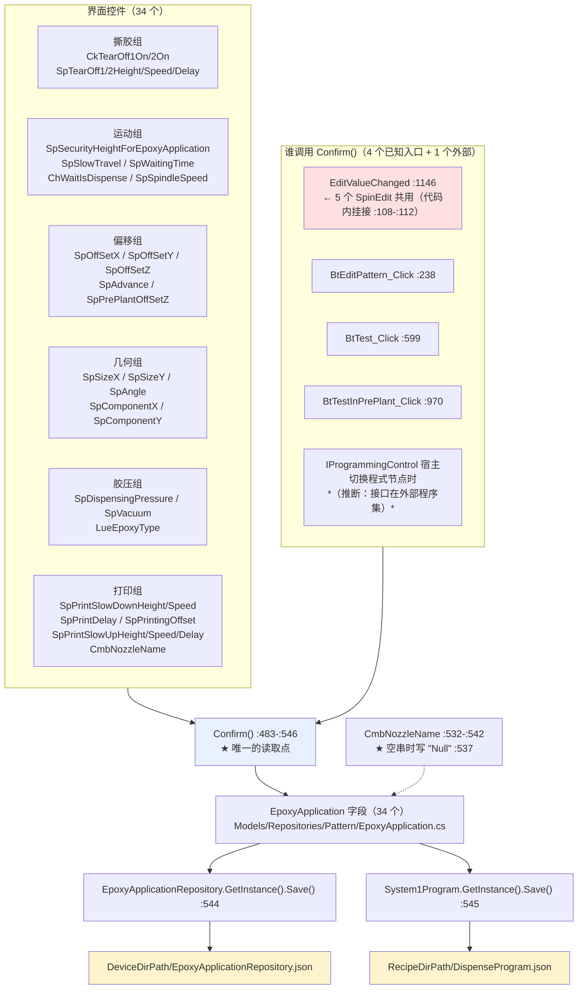

**ASCII 版**

```
  界面控件（34 个输入）
 ┌────────────────────────────────────────────────────────────┐
 │ 撕胶组  CkTearOff1On/2On  SpTearOff1/2 Height/Speed/Delay   │
 │ 运动组  SpSecurityHeightForEpoxyApplication  SpSlowTravel   │
 │         SpWaitingTime  ChWaitIsDispense  SpSpindleSpeed     │
 │ 偏移组  SpOffSetX/Y/Z  SpAdvance  SpPrePlantOffSetZ         │
 │ 几何组  SpSizeX/Y  SpAngle  SpComponentX/Y                  │
 │ 胶压组  SpDispensingPressure  SpVacuum  LueEpoxyType        │
 │ 打印组  SpPrintSlowDown/Up*  SpPrintDelay  SpPrintingOffset │
 │         CmbNozzleName（空串 → "Null" :537）                 │
 └──────────────────────────┬─────────────────────────────────┘
                            ▼
              Confirm() :483-:546   ★ 唯一的读取点
                            │
                            ▼
        EpoxyApplication 的 34 个字段
        Models/Repositories/Pattern/EpoxyApplication.cs
                            │
              ┌─────────────┴─────────────┐
              ▼                           ▼
 :544 EpoxyApplicationRepository.Save()  :545 System1Program.Save()
              │                           │
              ▼                           ▼
  DeviceDirPath/                    RecipeDirPath/
  EpoxyApplicationRepository.json   DispenseProgram.json
                            ▲
   谁调用 Confirm()？        │
   ├ :1146 EditValueChanged ──┤  ← 5 个 SpinEdit 共用
   │    （代码内挂接 :108-:112）│     ★ 改一个数字就落盘两次
   ├ :238  BtEditPattern_Click │
   ├ :599  BtTest_Click        │
   ├ :970  BtTestInPrePlant_Click
   └ IProgrammingControl 宿主（切换程式节点时）
        *（推断：接口在外部程序集，本目录无实现代码）*
```

**逐控件的"读了什么、写了什么"对照表**

| 控件 | 读值 `UcEpoxyApplication.cs:行` | 写入 `EpoxyApplication` 字段 | 字段定义行 | 默认值 |
|---|---|---|---|---|
| `CkTearOff1On` | `:485` | `TearOff1Open` | `:139` | `false` |
| `CkTearOff2On` | `:487` | `TearOff2Open` | `:167` | `false` |
| `SpTearOff1Height` | `:489` | `TearOff1Height` | `:145` | 2 |
| `SpTearOff1Speed` | `:490` | `TearOff1Speed` | `:151` | 10 |
| `SpTearOff1Delay` | `:491` | `TearOff1Delay` | `:157` | 10 |
| `SpTearOff2Height` | `:493` | `TearOff2Height` | `:173` | 4 |
| `SpTearOff2Speed` | `:494` | `TearOff2Speed` | `:179` | 0 |
| `SpTearOff2Delay` | `:495` | `TearOff2Delay` | `:185` | 10 |
| `SpSecurityHeightForEpoxyApplication` | `:497` | `SecurityHeightForEpoxyApplication` | `:52` | 5 |
| `SpSlowTravel` | `:499` | `SlowTravelSpeedBeforeDispensing` | `:88` | 10 |
| `SpWaitingTime` | `:501` | `DispenserLeadTime` | `:82` | 0 |
| `ChWaitIsDispense` | `:502` | `IsDispenserLeadTimeOpen` | `:76` | `true` |
| `SpSpindleSpeed` | `:504` | `SpindleSpeedPercentage` | `:70` | 50 |
| `SpOffSetX` | `:505` | `OffsetX` | `:110` | 0 |
| `SpOffSetY` | `:506` | `OffsetY` | `:116` | 0 |
| `SpOffSetZ` | `:507` | `OffsetZ` | `:123` | 0 |
| `SpAdvance` | `:508` | `AdvanceOpenDistanceNew` | `:100` | 0（界面上不可见，见 R-25） |
| `SpPrePlantOffSetZ` | `:509` | `PrePlantOffSetZ` | `:129` | 1 |
| `SpSizeX` | `:511` | `SizeX` | `:196` | 1（归一化缩放的 X 分母，见 §6.2） |
| `SpSizeY` | `:512` | `SizeY` | `:203` | 1 |
| `SpAngle` | `:513` | `Angle` | `:222` | 0 |
| `SpComponentX` | `:515` | `ComponentSizeX` | `:209` | 2 |
| `SpComponentY` | `:516` | `ComponentSizeY` | `:215` | 2 |
| `SpDispensingPressure` | `:518` | `DispensePressure` | `:58` | 100（上限由 `Init()` `:212` 的 `Properties.MaxValue = DispenserMaxValue` 约束） |
| `SpVacuum` | `:520` | `Vacuum` | `:64` | — |
| `LueEpoxyType` | `:522` | `EpoxyApplicationStrategy`（转 `EpoxyApplicationTypeEnum`） | `:32` | — |
| `SpPrintSlowDownHeight` | `:524` | `PrintSlowDownHeight` | `:232` | 2 |
| `SpPrintSlowDownSpeed` | `:525` | `PrintSlowDownSpeed` | `:238` | 100 |
| `SpPrintDelay` | `:526` | `PrintDelayTime` | `:244` | 100 |
| `SpPrintingOffset` | `:527` | `PrintOffsetZ` | `:250` | 0 |
| `SpPrintSlowUpHeight` | `:528` | `PrintSlowUpHeight` | `:256` | 2 |
| `SpPrintSlowUpSpeed` | `:529` | `PrintSlowUpSpeed` | `:262` | 100 |
| `SpPrintSlowUpDelay` | `:530` | `PrintSlowUpDelayTime` | `:268` | 100 |
| `CmbNozzleName` | `:532`–`:542` | `PrintNozzleName` | `:273` | 空串时写 `"Null"`（`:537`） |

**结论**：**34 个输入控件都在 `Confirm()` 里落盘，没有"改了不保存"的例外**——这一点与 §4.9 的 `UcDispenser` 形成对照（后者有一处漏了 `Save()`，见 R-14）。

### 4.7.2 `EditValueChanged` 的高频落盘链（图 19）

**图 19：`EditValueChanged` 高频落盘链 —— ★ R-08**

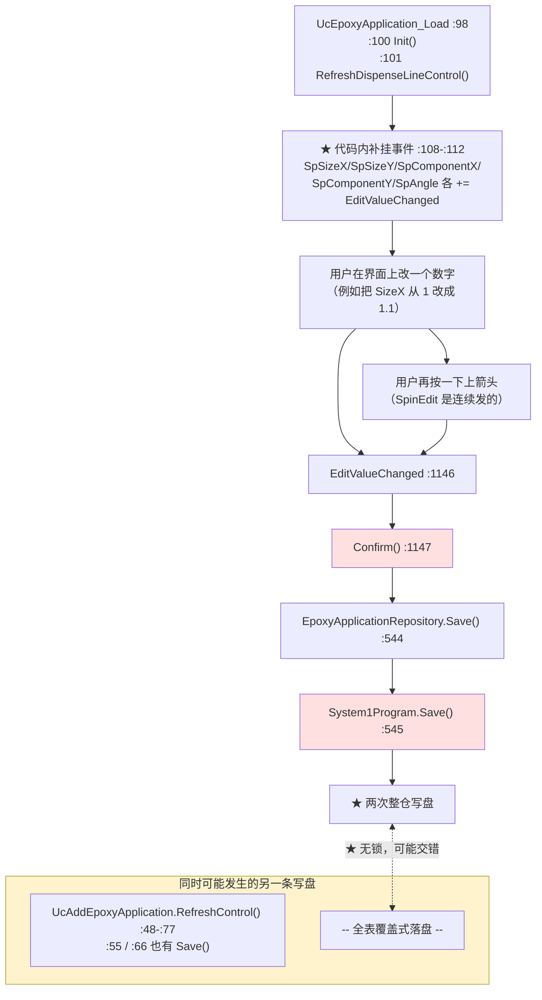

**ASCII 版**

```
 UcEpoxyApplication_Load :98
   ├ :100 Init()
   ├ :101 RefreshDispenseLineControl()
   └ :108-:112 ★ 代码内补挂事件（不在 Designer 里！）
        SpSizeX / SpSizeY / SpComponentX / SpComponentY / SpAngle
            各 += EditValueChanged

 用户在界面上改一个数字（例：SizeX 1 → 1.1）
        │
        ▼
 EditValueChanged :1146
        │
        ├─ :1147 Confirm()
        │      ├ :544 EpoxyApplicationRepository.Save()   ┐
        │      └ :545 System1Program.Save()               ┘ 两次整仓写盘
        │
        └─ 用户再按一下上箭头（SpinEdit 连续发）→ 回到 :1146
                 ▲
                 │
        ★ 同时另一条链也可能在写：
          UcAddEpoxyApplication.RefreshControl() :48-:77
              :55 / :66 也有 Save()
          —— 两处都是【全表覆盖式落盘】，【无锁】，可能交错
```

**这一节的坑**

| 坑 | 位置 | 说明 |
|---|---|---|
| 🔴 **改一个数字 → 整仓落盘两次** | `:1146` → `:1147` → `:544`/`:545` | `SpinEdit` 每按一次上下箭头就触发一次；`EpoxyApplicationRepository` 是**全表写盘**，所以连续调节参数会在短时间内反复重写整个 JSON（R-08） |
| ⚠️ **事件是代码内挂接的，不在 Designer 里** | `:108`–`:112` | 只看 `Designer.cs` 会以为这 5 个 `SpinEdit` 没有任何事件；必须读 `Load` 才能发现（R-42"只写不读/隐藏接线"同族） |
| ⚠️ **`UcAddEpoxyApplication.RefreshControl()` 名字是"刷新"，却顺手 `Save()`** | `UcAddEpoxyApplication.cs:48`–`:77`、`:41` | 与上一条共用同一个仓库文件，**两者之间没有锁**（R-12、R-29） |
| ⚠️ **`CmbNozzleName` 的处理器是空实现** | `:1130` | 名为 `CmbNozzleName_SelectedIndexChanged`，方法体为空（§4.2.2 第 21 行） |
| ⚠️ **`CmbModuleName_SelectedIndexChanged` 复制粘贴漏改、无 `Clear()`、`Find` 结果不判空** | `:1109`–`:1126` | 见 R-11 |

### 4.7.3 `BtEditPattern`「编辑图像」（图 18 的补充）

`BtEditPattern_Click`（`:238`，文字「编辑图像」`Designer.cs:508`）值得单独提一句：它在 `:277` 有 **`goto RetryCommand`** —— 一个**靠用户点对话框按钮驱动的重试环**，条件是要 `EpoxyIsReasonable` 为真。

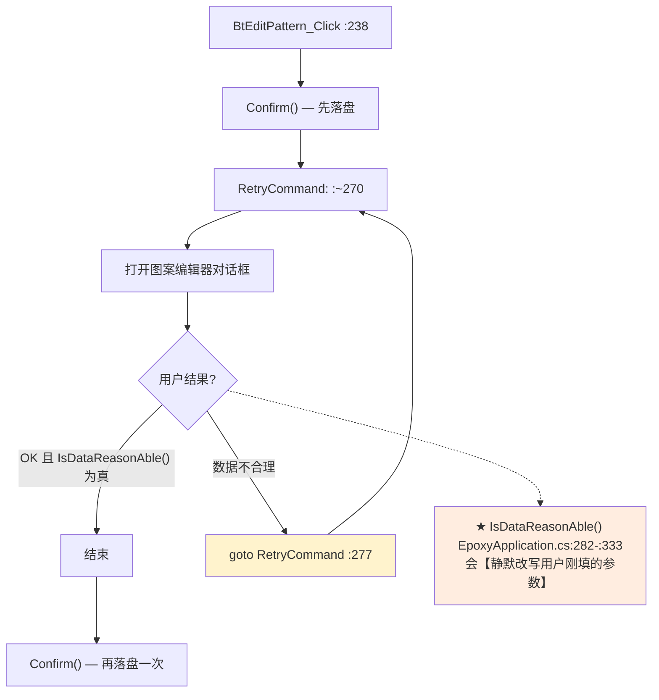

**ASCII 版**

```
 BtEditPattern_Click :238
        │
        ├─ Confirm()   ← 先落盘
        │
        ▼
 RetryCommand: :~270
        │
        ├─ 打开图案编辑器对话框
        │
        ├─ 用户点「确定」且 IsDataReasonAble() 为真 ─▶ 结束 → Confirm() 再落盘
        │
        └─ 数据不合理 ─▶ goto RetryCommand :277 ─▶ 回到上面（用户只能反复改到合理为止）
                 │
                 ★ IsDataReasonAble() EpoxyApplication.cs:282-:333
                   会【静默改写用户刚填的参数】
```

对应风险：R-17（`IsDataReasonAble()` 静默改写用户参数；`BtEditPattern` 有 `goto` 重试环）。

### 4.8 手动页 `UcDispenseManual`

`UcDispenseManual`（`Controls/Manual/UcDispenseManual.cs`，216 行 + `Designer.cs` 146 行）是**唯一一个把"点胶"当作单一动作直接暴露给操作员的界面**——它不画图案、不管配方，每一个按钮就是一句话："现在，让机器做这一件事"。

打开它的入口只有一处：`Main/Controls/UcMainSystem.Manual.cs:172`（主界面的「手动」页签装载它）。它没有 `ShowDialogForm<T>` 反射入口，也没有后台线程弹它。

**它管的七件事**

| # | 按钮文字 | 控件 | 处理器 | 一句话 |
|---|---|---|---|---|
| 1 | 「挤胶」 | `BtChangeDispensing` `Designer:48` | `:48` | 手动开/关阀出胶 |
| 2 | 「示教预点胶板」 | `BtAssistantPrePlate` `Designer:68` | `:118` | 打开三点示教向导 |
| 3 | 「更换点胶头」 | `BtChangeDispenser` `Designer:58` | `:131` | 打开换胶 7 步向导 |
| 4 | 「清洁预点胶板」 | `BtCleanPreDispensePlate` `Designer:84` | `:143` | 复位预点胶板计数 |
| 5 | 「预点胶」 | `BtPredispense` `Designer:94` | `:163` | 手动点一次预点胶板 |
| 6 | 「刮胶盘转动」 | `BtPrintEpoxyMove` `Designer:104` | `:181` | 蘸胶盘点动 |
| 7 | 「示教预点胶板信号触发距离」 | `BtAssistantDistance` `Designer:114` | `:210` | 打开距离标定向导 |

### 4.8.1 图 20：手动页按钮 → 硬件动作

```mermaid
flowchart TD
    LOAD["UcDispenseManual_Load :199<br/>:201 初始化按钮状态"] --> CORE["★ 按 CurrentMachineSystem 分流<br/>（本页面同时服务 System1 / System2）"]

    CORE --> B1["① 挤胶 :48"]
    CORE --> B2["② 示教预点胶板 :118"]
    CORE --> B3["③ 更换点胶头 :131"]
    CORE --> B4["④ 清洁预点胶板 :143"]
    CORE --> B5["⑤ 预点胶 :163"]
    CORE --> B6["⑥ 刮胶盘转动 :181"]
    CORE --> B7["⑦ 示教信号触发距离 :210"]

    B1 --> B1A{":50 是否已在出胶?"}
    B1A -->|"是"| B1B["关阀 :52"]
    B1A -->|"否"| B1C["开阀 :56"]
    B1B --> B1D["刷新按钮文字 :57"]
    B1C --> B1D
    B1D --> HW1[("★ 点胶阀开/闭 —— 直接动作，无二次确认")]

    B2 --> B2A["new FrmDispensePlateAssistant() :120<br/>→ ShowDialog :121"]
    B2A --> B2B["向导保存 → FrmDispensePlateAssistant.cs.cs:235 Save()"]
    B2B --> B2C["回写 :122 / 刷新按钮 :123"]

    B3 --> B3A["new FrmChangeEpoxy() :133<br/>→ ShowDialog :134"]
    B3A --> B3B["★ 换胶向导会强制切换当前机型<br/>并移动 6 个坐标（R-45）"]
    B3B --> B3C["回写 :135"]

    B4 --> B4A["InitPre() :145"]
    B4A --> B4B["PreDispensePlateProgram.cs:57 复位网格 Index"]
    B4B --> B4C["PreDispensePlateProgram.cs:91 System1Program.Save()"]

    B5 --> B5A{":165 载具在位?"}
    B5A -->|"否"| B5B["弹提示 / 直接返回（不移动到安全位）"]
    B5A -->|"是"| B5C[":167 取预点胶板坐标"]
    B5C --> B5D["★ :171 IsManual = true<br/>（让 DispenseWorkTask 走手动分支）"]
    B5D --> B5E[":173 DoWork() —— ★ 在这里才真正出胶"]
    B5E --> B5F["★ 没有 try/catch，异常直冲调用栈（R-43 同族）"]

    B6 --> B6A[":183 / :185 点动"]
    B6A --> B6B[":189 停止点动"]
    B6B --> HW6[("★ 刮胶盘电机转动")]

    B7 --> B7A["new FrmAssistantPreDispenseDistance() :212<br/>→ :213 ShowDialog"]
    B7A --> B7B["向导里 Timer_Tick :235 持续采样<br/>BtDone :214 → 保存距离"]
    B7B --> B7C["回写 :214"]

    style B5D fill:#ffe0e0
    style B5E fill:#ffe0e0
    style B3B fill:#ffe0e0
    style B1D fill:#fff3cd
    style HW1 fill:#fff3cd
    style HW6 fill:#fff3cd
```

**ASCII 版**

```
 UcDispenseManual_Load :199 → :201 初始化按钮状态
        │
        ▼   ★ 按 CurrentMachineSystem 分流（同时服务 System1 / System2）
        │
 ┌──────┼───────┬────────┬────────┬────────┬────────┬─────────────┐
 ▼      ▼       ▼        ▼        ▼        ▼        ▼             ▼
① 挤胶  ②示教  ③更换   ④清洁   ⑤预点胶 ⑥刮胶盘  ⑦示教信号
 :48    预点胶板 点胶头  预点胶板  :163    转动      触发距离
         :118    :131     :143             :181      :210
 │       │       │        │        │        │        │
 ▼       ▼       ▼        ▼        ▼        ▼        ▼
是否已在 new     new      InitPre() 载具在?  点动 :183  new
出胶?    FrmDisp  FrmChange :145      │      停止 :189  FrmAssistant
 │       Plate    Epoxy             │否        │       PreDispense
 ├是→关阀 Assistant :133           ▼          ▼       Distance :212
 │  :52   :120    │         弹提示/直接  刮胶盘        │
 ├否→开阀  │      │         返回         电机转        ▼
 │  :56   ▼      ▼          │                      向导 Timer_Tick
 ▼      向导保存   ★ 强制   │否                    :235 连续采样
 刷新按钮 Save()   切换机型  ▼                      BtDone :214
 文字     :235    并移动 6  是                        保存距离
 :57     │        个坐标   :167 取预点胶板坐标
         ▼        (R-45)   │
      回写 :122   │        ▼
      /刷新 :123  ▼      ★ :171 IsManual = true
                回写 :135   │
                            ▼
                        :173 DoWork() ★ 真正出胶
                            │
                            ★ 没有 try/catch，异常直冲调用栈
```

**这一页最值得说的一件事**：`BtPredispense`（`:163`）是整个模块里**唯一一处"点一下就立刻出胶"**的按钮。它绕过了 §4.3 那条三十分钟长的链子上所有的校验：没有 `Confirm()`、没有 `IsReady()`、没有载具匹配检查、没有互锁、没有 `try/catch`。它只做一次"载具在不在"的判断（`:165`），然后 `:171` 把 `IsManual` 置真、`:173` 直接 `DoWork()`。

> **对照**：`UcEpoxyApplication` 的「在轨道产品上测试」（§4.3）要走四次校验 + 视觉 + 测高 + 插补，而这里一步到位。**两者最终都会开阀出胶，但风险面完全不同。** 这里省掉的全部校验，都变成了操作员的责任。

### 4.8.2 图 21：`Timer_Tick` 与它的异常路径

这一页有一个 `System.Windows.Forms.Timer`（`Timer_Tick` `:66`，`Interval` **未设置 → 默认 100 ms**，见 R-32）。它不是动画，它的作用是**在运行中改写两个按钮的文字与底色**，让操作员看得出当前状态：

| 它看什么 | 位置 | 它改成什么 |
|---|---|---|
| 工作模式是不是 `OffLineWork` | `:70`–`:73` | 是就**直接 `return`**，整个 `Tick` 什么都不做 |
| `DispenseController.IsDispensingElectricOpen()` | `:75` | 真 → `BtChangeDispensing.Text = "关闭挤胶"`、底色 `LightGreen`（`:77`–`:79`）；假 → `"打开挤胶"`、底色白（`:83`–`:85`） |
| `MachineHardwareConfiguration.IsSystem1ConfigPrintingTool` | `:88` | 真才继续；再看 `IsPrintToolMove()`（`:90`）：真 → `BtPrintEpoxyMove.Text = "停止转动"`、`LightGreen`（`:92`–`:94`）；假 → `"蘸胶盘开启转动"`、白（`:98`–`:100`） |

```mermaid
flowchart TD
    T["Timer_Tick :66（100 ms 一次）"] --> OFF{":70 工作模式<br/>== OffLineWork?"}
    OFF -->|"是"| RET[":72 return<br/>★ 整个 tick 什么都不做"]
    OFF -->|"否"| R[":75 IsDispensingElectricOpen()?"]
    R -->|"真"| W1[":77-:79 BtChangeDispensing<br/>文字=关闭挤胶 底色=LightGreen"]
    R -->|"假"| W2[":83-:85 BtChangeDispensing<br/>文字=打开挤胶 底色=白"]
    W1 --> P{":88 IsSystem1ConfigPrintingTool?"}
    W2 --> P
    P -->|"假"| ENDT["下一 tick"]
    P -->|"真"| Q{":90 IsPrintToolMove()?"}
    Q -->|"真"| W3[":92-:94 BtPrintEpoxyMove<br/>文字=停止转动 底色=LightGreen"]
    Q -->|"假"| W4[":98-:100 BtPrintEpoxyMove<br/>文字=蘸胶盘开启转动 底色=白"]
    W3 --> ENDT
    W4 --> ENDT

    R -.->|"★ 上面任意一句抛异常"| C[":104-:110 catch"]
    C --> C1[":106 this.Timer.Enabled = false<br/>:107 this.Timer.Stop()"]
    C1 --> C2[":108 Console.WriteLine(exception)"]
    C2 --> C3[":109 throw;"]
    C3 --> CRASH["★ 异常从 WinForms 计时器回调里抛出<br/>→ 无人接住 → 进程级未处理异常（R-21）"]
    C1 --> DEAD["★ 定时器已停，两个按钮的文字/底色<br/>从此永久定格<br/>界面进入『静默失能』状态"]

    LOAD["UcDispenseManual_Load :199"] --> T
    CLOSE["FrmDispenseManual_FormClosing :153 → :155<br/>★ 从未接线（R-23）"] -.->|"❌ 不会停 Timer"| T

    style C3 fill:#ffe0e0
    style CRASH fill:#ffe0e0
    style DEAD fill:#fff3cd
    style CLOSE fill:#fff3cd
    style RET fill:#fff3cd
```

**ASCII 版**

```
 UcDispenseManual_Load :199 ──▶ Timer_Tick :66（System.Windows.Forms.Timer，100 ms）
                                   │
                                   ├ :70 工作模式 == OffLineWork?
                                   │      └是─▶ :72 return（整个 tick 什么都不做）
                                   │
                                   ├ :75 IsDispensingElectricOpen()?
                                   │      ├真─▶ :77-:79  BtChangeDispensing
                                   │      │           文字="关闭挤胶" 底色=LightGreen
                                   │      └假─▶ :83-:85  文字="打开挤胶" 底色=白
                                   │
                                   └ :88 IsSystem1ConfigPrintingTool?
                                          ├假─▶ 下一 tick
                                          └真─▶ :90 IsPrintToolMove()?
                                                  ├真─▶ :92-:94 BtPrintEpoxyMove
                                                  │       文字="停止转动" 底色=LightGreen
                                                  └假─▶ :98-:100
                                                          文字="蘸胶盘开启转动" 底色=白

 异常路径：
   :75 / :88 附近任意一句抛异常
        │
        ▼
   :104-:110 catch
        ├ :106 this.Timer.Enabled = false  ┐ 先停掉定时器
        ├ :107 this.Timer.Stop()           ┘
        ├ :108 Console.WriteLine(exception)   ← ★ 只写控制台，不写日志
        └ :109 throw;                          ← 再原样抛出
                 │
                 ├─▶ ★ 异常从 WinForms 计时器回调里抛出，无人接住
                 │     → 进程级未处理异常（R-21）
                 └─▶ ★ 定时器已停 → 两个按钮的文字/底色从此永久定格
                       界面进入「静默失能」状态
                       （操作员看到的是一个"卡住的"按钮，不是错误提示）

 关窗路径：
   FrmDispenseManual_FormClosing :153 → :155
       ★ 从未接线（R-23）→ 关窗不会停 Timer
```

**这一节的五个坑**

| 坑 | 位置 | 说明 |
|---|---|---|
| 🔴 **`catch` 里先停表、只写 `Console`、再 `throw;`** | `:104`–`:110` | 三件事叠加：`Enabled = false` / `Stop()`（`:106`/`:107`）让故障**在界面上表现为"按钮定格"而不是报错**；`Console.WriteLine(exception)`（`:108`）写进一个 WinForms 程序没有的可见控制台；`throw;`（`:109`）把异常丢回 WinForms 计时器回调 —— 这是"既掩盖又引爆"的组合（R-21） |
| ⚠️ **同一个 `Console.WriteLine` 套路在本目录出现两次** | 此处 `:108`，以及 `FrmChangeEpoxy.cs:458` | 两处都是"catch 里写 `Console` 而不是写日志"。**WinForms 程序没有控制台**，所以这两处的异常信息在产线上**等于没记**。而这个仓库是有日志设施的（`LogHelper.Post(Level.Error, …)`，见 `UcEpoxyApplication.cs:919`）—— 该用的时候没用（R-16 同族） |
| ⚠️ **`FrmDispenseManual_FormClosing` 零接线** | 定义 `:153`，实现 `:155`，**`Designer.cs` 里没有任何 `+=`** | 窗体关闭时本该走的清理逻辑**永远不会执行**（R-23）。这是本目录**唯一一个"定义了但完全没接线"的处理器** |
| ✅ **`Timer` 的 100 ms 是默认值，不是有人调的** | `UcDispenseManual.Designer.cs:73` 只写了 `Enabled = true` | 三个计时器的 `Designer.cs` 里**都没有 `Interval` 赋值语句** → 全部是 `System.Windows.Forms.Timer` 的默认 100 ms（R-32）。这一条本身无害，但它意味着"刷新率"是巧合而不是设计 |
| ✅ **`OffLineWork` 下整个 `Tick` 直接 `return`** | `:70`–`:73` | 离线模式下不去读硬件状态，避免了一个"离线时 `DispenseController` 状态无意义"的问题。这一处是写对的 |
| ⚠️ **方法名与控件名不一致** | `SpPrintEpoxyMove_Click` `:181`，控件是 `BtPrintEpoxyMove` | 方法名以 `Sp` 开头、控件以 `Bt` 开头；`grep BtPrintEpoxyMove_Click` 会找不到方法（§4.2.2 第 20 行） |

**对应风险**：R-21（`catch` 内 `throw;` 从 `Timer.Tick` 抛出）、R-23（未接线的 `FormClosing`）、R-32（三个定时器都是 100 ms 默认值）。

### 4.9 点胶头配置页 `UcDispenser`

`UcDispenser`（`Controls/Setting/Dispenser/UcDispenser.cs`，343 行 + `Designer.cs` 1,008 行）是"点胶头"这种设备的**参数页**：它把 `Dispenser`、`DispenserPara`、`DispenserProgram` 三层的字段摊在一屏上。入口只有一处：`UcEditProductProgramming.cs:697`。

**这个界面有一个全场唯一的特征：它一个 `_Click` 处理器都没有。** 8 个处理器全是 `Load`（1 个）、`CheckedChanged`（4 个）、`EditValueChanged`（3 个）。它的写法是"控件自己变 → 自己写字段 → 自己落盘"，**没有"确定"按钮**。

**表：`UcDispenser` 的全部 8 个处理器**

| # | 处理器 | 行 | 类型 | 作用 |
|---|---|---|---|---|
| 1 | `UcDispenser_Load` | `:87` | `Load` | 载入时把仓库→界面 |
| 2 | `ChkEpoxySqueeze_CheckedChanged` | `:273` | `CheckedChanged` | 「挤胶」相关开关 |
| 3 | `LuePreDispenseModel_EditValueChanged` | `:284` | `EditValueChanged` | 预点胶模式 |
| 4 | `LuePreDispenseTiming_EditValueChanged` | `:294` | `EditValueChanged` | 预点胶时机 |
| 5 | `LueDispenserType_EditValueChanged` | `:304` | `EditValueChanged` | 点胶头类型 |
| 6 | `ChkDispenserTimes_CheckedChanged` | `:318` | `CheckedChanged` | 点胶头寿命计数开关 |
| 7 | `ChkEpoxyDueTime_CheckedChanged` | `:328` | `CheckedChanged` | 胶水到期提醒开关 |
| 8 | `ChkEpoxyDefect_CheckedChanged` | `:338` | `CheckedChanged` | 胶水缺陷开关 —— **见 R-14** |

### 4.9.1 图 22：`UcDispenser` 勾选联动与 `Confirm()`

```mermaid
flowchart TD
    LOAD["UcDispenser_Load :87"] --> FILL["仓库 → 界面控件"]
    FILL --> USER["用户改动任意控件"]

    USER --> H1["ChkEpoxySqueeze_CheckedChanged :273"]
    USER --> H2["LuePreDispenseModel :284<br/>LuePreDispenseTiming :294"]
    USER --> H3["LueDispenserType :304"]
    USER --> H4["ChkDispenserTimes :318<br/>ChkEpoxyDueTime :328"]
    USER --> H5["ChkEpoxyDefect :338"]

    H1 --> CONF["Confirm() :182-:240"]
    H2 --> CONF
    H3 --> CONF
    H4 --> CONF
    H5 --> H5X["★ :338-:341 把 null 写进字段"]

    H5X --> NOREAD["★ 全仓没有任何地方读 ChkEpoxyDefect.Checked<br/>（R-14）"]
    H5X --> CONF

    CONF --> C1["Dispenser.* 逐字段回写 :182-:224"]
    C1 --> S1[":231 DispenserRepository.GetInstance().Save()"]
    CONF --> C2["EpoxyMaterialConsumable 回写 :225-:227"]
    C2 --> S2["★ 没有对应的 Save()（R-14）"]
    CONF --> C3[":233 System1Program.GetInstance().Save()"]

    S1 --> D1["DeviceDirPath/DispenserRepository.json"]
    C3 --> D3["RecipeDirPath/DispenseProgram.json"]
    S2 --> LOST[("★ 内存改了，磁盘没改<br/>重启即丢")]

    style H5X fill:#ffe0e0
    style NOREAD fill:#ffe0e0
    style S2 fill:#ffe0e0
    style LOST fill:#ffe0e0
    style S1 fill:#e6f0ff
    style C3 fill:#e6f0ff
```

**ASCII 版**

```
 UcDispenser_Load :87 ──▶ 仓库 → 界面控件
        │
        ▼
 用户改动任意控件（★ 这个界面【没有确定按钮】）
        │
 ┌──────┼──────────┬──────────────┬────────────┐
 ▼      ▼          ▼              ▼            ▼
ChkEpoxy LuePreDisp  LueDispenser  ChkDispenser ChkEpoxy
Squeeze  enseModel   Type :304     Times :318   Defect :338
 :273    :284 /                       /           │
         LuePreDisp                   ChkEpoxyDueTime ★ :338-:341
         enseTiming                   :328        把 null 写进字段
         :294                          │            │
 │       │            │              │            │
 └───────┴────────────┴──────────────┴────────────┘
                          │
                          ▼
              Confirm() :182-:240
                 ├ Dispenser.* 逐字段回写 :182-:224
                 │      └▶ :231 DispenserRepository.Save()
                 │              └▶ DeviceDirPath/DispenserRepository.json
                 ├ EpoxyMaterialConsumable :225-:227
                 │      └▶ ★ 没有对应的 Save()
                 │              └▶ 内存改了、磁盘没改、重启即丢
                 └ :233 System1Program.Save()
                        └▶ RecipeDirPath/DispenseProgram.json

 ★ 全仓没有任何地方读 ChkEpoxyDefect.Checked（R-14）
```

### 4.9.2 这一页的三个坑

| 坑 | 位置 | 说明 |
|---|---|---|
| 🔴 **`EpoxyMaterialConsumable` 改了不落盘** | `:225`–`:227` 回写，`:231` 只保存 `DispenserRepository`，`:233` 只保存 `System1Program` | 胶水耗材计数器的改动**只停在内存**。掉电/重启即丢（R-14） |
| 🔴 **`ChkEpoxyDefect` 是"死开关"** | `:338`–`:341` | 处理器把 `null` 写进字段（`:215` 声明的那个），并且**全仓没有任何读取点**。操作员勾上它，机器行为不会有任何变化 —— 而且它写进去的 `null` 还会被下一次落盘写进 JSON（R-14） |
| ⚠️ **没有"确定"按钮，也没有"取消"** | 全文件 0 个 `_Click` | 每一次勾选/下拉变更就立刻走 `Confirm()` 落盘。操作员**没有反悔的机会**，也没有"批量改完再提交"的语义。这跟 §4.7 的 `UcEpoxyApplication` 是同一类设计，但那边至少还有一个显式的 `Confirm()` 调用点可以追 |

**对应风险**：R-14（`ChkEpoxyDefect` 断开 + 写 `null`；`EpoxyMaterialConsumable` 缺 `Save()`）。

### 4.10 胶型库增删与新建

"胶型"（`EpoxyApplication`）是点胶图案的模板库。管它的界面有两个：**列表页** `UcAddEpoxyApplication`（197 行 + 261 行）和**新建对话框** `FrmNewCreateEpoxyApplication`（105 行 + 252 行）。前者由 `UcEditProductProgramming.cs:825` 装载，后者只在 `UcAddEpoxyApplication.cs:80` 被 `new`。

### 4.10.1 图 23：胶型库增删与新建（两个窗体）

```mermaid
flowchart TD
    LIST["UcAddEpoxyApplication（列表页）<br/>← UcEditProductProgramming.cs:825"] --> L1["UcAddEpoxyApplication.cs:41 Save()"]
    L1 --> RC["RefreshControl() :48-:77<br/>★ 名字叫刷新，其实也落盘<br/>:55 / :66 各一次 Save()（R-12）"]

    RC --> DEL["BtnDelete_Click :110"]
    DEL --> D1["从【名字列表】里移除"]
    D1 --> D2["★ 仓库里的 EpoxyApplication 对象仍然存在（R-15）"]
    D2 --> D3["★ 变成孤儿：没有任何名字指向它，但仍在 JSON 里，<br/>仍占着尺寸/压力等参数"]

    RC --> FIND["EpoxyApplicationProgram.Find :30-:50"]
    FIND --> F1["★ 在 for 循环里 RemoveAt :47<br/>→ 索引前移、跳过一个元素（R-13）"]

    RC --> ADD["BtnAdd_Click :78"]
    ADD --> A1["new FrmNewCreateEpoxyApplication() :80"]
    A1 --> DLG{"用户操作"}

    DLG -->|"BtCancel :101"| ABORT["★ 只关窗，什么都不做"]
    DLG -->|"BtnGenerate :63"| G1["重名校验 :70"]
    G1 -->|"重名"| G2["弹提示 → 停下，不生成"]
    G1 -->|"通过"| G3["DeepGenericCopy :83"]
    G3 --> G4["AddBelongRecipeIds() :87"]
    G4 --> G5["Add 到仓库 :89"]
    G5 --> G6["Save :91"]
    G6 --> D1B["DeviceDirPath/EpoxyApplicationRepository.json"]

    RC --> REPO["BtEpoxyApplicationRepository_Click :152"]
    REPO --> R1["打开 FrmRepository&lt;EpoxyApplication&gt;"]
    R1 --> R2[":188 / :190 / :191 三处 Save()"]

    style D2 fill:#ffe0e0
    style D3 fill:#ffe0e0
    style F1 fill:#ffe0e0
    style RC fill:#fff3cd
    style G6 fill:#e6f0ff
    style R2 fill:#fff3cd
```

**ASCII 版**

```
 UcAddEpoxyApplication（列表页）  ← UcEditProductProgramming.cs:825
        │
        ├ :41 Save()
        │
        ├ RefreshControl() :48-:77
        │   ★ 名字叫「刷新」，其实顺手也落盘（:55 / :66 各一次 Save） —— R-12
        │
        ├─▶ BtnDelete_Click :110
        │      └ 从【名字列表】里移除
        │           ★ 仓库里的 EpoxyApplication 对象仍然存在（R-15）
        │           ★ 变成孤儿：没有名字指向它，但仍在 JSON 里，
        │             仍占着尺寸 / 压力等参数
        │
        ├─▶ EpoxyApplicationProgram.Find :30-:50
        │      ★ 在 for 循环里 RemoveAt :47
        │        → 索引前移、跳过一个元素（R-13）
        │
        ├─▶ BtnAdd_Click :78 ─▶ new FrmNewCreateEpoxyApplication() :80
        │        │
        │        ├ BtCancel :101 ──▶ ★ 只关窗，什么都不做
        │        │
        │        └ BtnGenerate :63
        │             ├ 重名校验 :70 ──重名──▶ 弹提示，停下
        │             └ 通过
        │                  ├ DeepGenericCopy :83
        │                  ├ AddBelongRecipeIds() :87
        │                  ├ Add 到仓库 :89
        │                  └ Save :91 ──▶ DeviceDirPath/EpoxyApplicationRepository.json
        │
        └─▶ BtEpoxyApplicationRepository_Click :152
               └ 打开 FrmRepository<EpoxyApplication>
                    └ :188 / :190 / :191 三处 Save()
```

### 4.10.2 三个坑

| 坑 | 位置 | 说明 |
|---|---|---|
| 🔴 **删了名字，对象还在** | `UcAddEpoxyApplication.cs:110`–`:143` | 「删除」只从名字列表里摘掉条目，**仓库里的 `EpoxyApplication` 对象不会被移除**。结果是"看不见但存在"的孤儿条目：它仍被 `Save()` 写进 JSON，仍占着 `SizeX`/`SizeY`/压力等参数字段，而且**如果以后有人新建一个同名胶型，会与这个孤儿撞名**（R-15） |
| 🔴 **`Find` 在 `for` 循环里 `RemoveAt`** | `EpoxyApplicationProgram.cs:30`–`:50`，`RemoveAt` 在 `:47` | 典型的"边遍历边删"。删掉第 `i` 个之后第 `i+1` 个会前移到 `i`，而循环变量已经自增，**下一个元素被跳过**。要删两个相邻项时会漏删一个（R-13） |
| ⚠️ **`RefreshControl()` 这个名字会骗人** | `UcAddEpoxyApplication.cs:48`–`:77`、`:41` | 它做的是"全表覆盖写盘"。任何"只是想刷新一下界面"的调用点，实际上都触发了一次整仓 `Save()`（R-12）。这与 §4.7.2 的 `EditValueChanged` 是同一类"名字与实际副作用不符"的问题 |

### 4.10.3 三个"零调用点"的界面（僵尸）

本目录有 3 个界面类**代码存在、参与编译，但全项目没有任何 `new`**：

| 类 | 文件 | 行数 | 状态 |
|---|---|---|---|
| `UcDispenseLine` | `Controls/Setting/EpoxyApplication/UcDispenseLine.cs` + `.Designer.cs` | 69 + 139 | **零调用点（僵尸）** |
| `UcEpoxyApplicationGuide` | `Controls/Setting/EpoxyApplication/UcEpoxyApplicationGuide.cs` + `.Designer.cs` | 21 + 45 | **零调用点（僵尸）** |
| `FrmEpoxyApplicationAssistant` | `Controls/Assistant/FrmEpoxyApplicationAssistant.cs` + `.Designer.cs` | 19 + 45 | **零调用点（僵尸）** |

已排除扩展方法、同命名空间非限定调用、反射调用三种可能（`ShowDialogForm<T>` 在本目录 0 命中），因此判定为**僵尸**而不是断链：它们是被替换掉的旧界面，文件没删干净。**它们不产生运行风险，但会让"这个功能到底在哪"的排查走弯路**（R-22）。

**对应风险**：R-12（`RefreshControl()` 顺手落盘）、R-13（`Find` 里 `RemoveAt` 跳元素）、R-15（删除后对象残留）、R-22（三个僵尸界面类）。

### 4.11 三个示教向导

本目录有三个"示教向导"：让操作员手动把机器挪到几个位置、把坐标记下来。

| 向导 | 一句话题目 | 步数 | 详细节 |
|---|---|---|---|
| `FrmChangeEpoxy`（604 行 + 412 行） | 换胶：拆旧胶、装新胶、重新标定 | **7 步** | §4.5.2（图 14） |
| `FrmDispensePlateAssistant`（`…cs.cs` 358 行 + 322 行） | 示教预点胶板：三点确定板平面 | **3 步** | 本节 4.11.1 |
| `FrmAssistantPreDispenseDistance`（252 行 + 383 行） | 示教"预点胶板信号触发距离" | 多步 | 本节 4.11.2 |

### 4.11.1 图 24：三个向导共用的 `AssistantConfig` 步骤机

三个向导都不是"打开就能用"的窗体，而是**步骤机**：每一步做一个动作，做完才允许进入下一步。它们共用同一套推进方式 —— 一个持有 `stepIndex` 的配置对象，外加每步的 `nextAction` / `doneAction` 两个委托。

> *（推断：`AssistantConfig` 类本身不在本目录，也不在 `AKRS.ZX2200` 的任何一个 `.cs` 里 —— 三个向导都从平台程序集 `AKRS.Galaxy2.*` 拿到它。推断依据：本目录 `.cs` 里搜不到 `class AssistantConfig`，而三处向导代码都能直接写 `Config.nextAction = ...`。因此它的内部实现（尤其是"步数不够时怎么办"）本文无法核实，见附录 B。）*

```mermaid
flowchart TD
    OPEN["向导窗体被 new + ShowDialog<br/>（由 §4.8 手动页按钮触发）"] --> LOAD["Load：读当前机型 / 当前状态"]
    LOAD --> CHK{"前置条件满足?"}

    CHK -->|"❌ 不满足"| ABORT["★ 弹提示 + 直接置 DialogResult（有的地方写了 return，有的没写）"]
    CHK -->|"✅ 满足"| INIT["InitControl() 收集全部控件引用"]
    INIT --> SETUI["SetUiControl() 按 stepIndex 显示/隐藏"]
    SETUI --> N["设 stepCount<br/>（FrmChangeEpoxy.cs:75 → 7）"]

    N --> STEP["当前步：等操作员动作"]
    STEP --> ACT{"操作员按了?"}
    ACT -->|"BtNext / BtDone"| ACTN["执行本步动作<br/>（移动 / 测高 / 落盘）"]
    ACT -->|"BtBack"| BACK["stepIndex--"]
    ACT -->|"BtCancel"| CAN["★ 直接关窗"]
    ACT -->|"Timer1_Tick :539 / SensorTime_Tick :235"| TICK["定时采样，刷新显示"]
    TICK --> STEP

    ACTN --> OK{"动作成功?"}
    OK -->|"❌ 失败"| FAIL["★ 有的向导 stepIndex-- 再 return<br/>（FrmChangeEpoxy.cs:346 → :348/:350）"]
    OK -->|"✅ 成功"| LAST{"是最后一步?"}
    LAST -->|"否"| ADV["stepIndex++"] --> SETUI
    LAST -->|"是"| SAVE["★ 落盘<br/>FrmDispensePlateAssistant.cs.cs:235 Save()<br/>FrmChangeEpoxy.cs:449-:453 三处 Save()<br/>FrmAssistantPreDispenseDistance.cs:214"]
    SAVE --> CLOSE["DialogResult = OK<br/>（FrmChangeEpoxy.cs:454）"]

    CAN --> NOROLLBACK[("★ 已经做过的动作不回滚<br/>已经落过的盘不回滚（R-03 / R-44）")]
    FAIL --> NOROLLBACK

    style ABORT fill:#fff3cd
    style FAIL fill:#fff3cd
    style NOROLLBACK fill:#ffe0e0
    style SAVE fill:#e6f0ff
```

**ASCII 版**

```
 向导窗体被 new + ShowDialog（由 §4.8 手动页的按钮触发）
        │
        ▼
 Load：读当前机型 / 当前状态
        │
        ├─ 前置条件不满足 ──▶ ★ 弹提示 + 直接置 DialogResult
        │                       （有的地方写了 return，有的没写 → §4.5.1）
        ▼ 满足
 InitControl() 收集全部控件引用
        │
        ▼
 SetUiControl() 按 stepIndex 显示 / 隐藏
        │
        ▼
 设 stepCount（FrmChangeEpoxy.cs:75 → 7）
        │
        ▼
 ┌──▶ 当前步：等操作员动作
 │      │
 │      ├ BtNext / BtDone ──▶ 执行本步动作（移动 / 测高 / 落盘）
 │      │        │
 │      │        ├ 失败 ──▶ ★ 有的向导 stepIndex-- 再 return
 │      │        │            （FrmChangeEpoxy.cs:346 → :348/:350）
 │      │        │
 │      │        ├ 成功且非末步 ──▶ stepIndex++ ──┐
 │      │        │                                  │
 │      │        └ 成功且是末步 ──▶ ★ 落盘          │
 │      │              FrmDispensePlateAssistant     │
 │      │                .cs.cs:235 Save()           │
 │      │              FrmChangeEpoxy.cs:449-:453    │
 │      │                三处 Save()                 │
 │      │              FrmAssistantPreDispense       │
 │      │                Distance.cs:214             │
 │      │                   │                        │
 │      │                   ▼                        │
 │      │            DialogResult = OK               │
 │      │              (FrmChangeEpoxy.cs:454)       │
 │      │                                            │
 │      ├ BtBack ──▶ stepIndex--                     │
 │      │                                            │
 │      ├ BtCancel ──▶ ★ 直接关窗                   │
 │      │                 │                          │
 │      └ Timer1_Tick :539  ┐                        │
 │          SensorTime_Tick ┤▶ 定时采样，刷新显示    │
 │          :235            ┘   │                    │
 └──────────────────────────────┴────────────────────┘

 ★★ 关键：BtCancel 关窗【不回滚】、失败 return 【也不回滚】
      → 已经做过的动作不回滚、已经落过的盘不回滚
        （R-03 / R-44）
```

### 4.11.2 三个向导各自的坑

**① `FrmDispensePlateAssistant` 的 `Load` 与两个死按钮**

`FrmDispensePlateAssistant_Load` `:332` 起手就做三步前置（读状态、判断、置 `DialogResult`）。`Save()` 在 `:235`（**在 `BtDone` `:310` 之前**，也就是说 `BtDone` 触发时盘已经落过了）。

这个窗体有**两个死按钮**（`Designer.cs` 里画了控件，但没有任何 `+=` 接线）：

| 控件 | 文字 | 位置 | 后果 |
|---|---|---|---|
| `BtBack` | 「返回」 | `Designer.cs:217` | **点了没反应**。操作员在向导中途想退回上一步，界面上有这个按钮，代码里没有处理器 |
| `simpleButton1` | 「自动聚焦」 | `Designer.cs:261` | **点了没反应**。焦点/对焦功能缺失 |

两个都落在 §4.2.4 的死按钮清单里。

**② `FrmAssistantPreDispenseDistance` 的调试面板**

这个向导有一个 `PnlDebugButton`（`Designer.cs:129`），里面放了一个 `BtSensor`「预点胶板传感器」（`Designer.cs:147`）——**同样没有接线**。它在界面上是个调试入口，运行时不存在任何行为。

它的 `_FormClosed` 在 `:247`（接线于 `Designer.cs:342`），这是本目录三个**已接线**的生命周期处理器之一。

**③ `FrmChangeEpoxy` 的 `catch` 只写控制台**

`FrmChangeEpoxy.cs` 的 `:456`–`:460` 是它唯一一处兜底：

```csharp
catch (...)
{
    Console.WriteLine(e);   // :458
    throw;                  // :459
}
```

`:458` 把异常写进 `Console`（WinForms 程序没有可见控制台），`:459` 原样抛出。**所以这个 7 步向导走着走着 "莫名其妙没反应" 时，既没有日志、也没有提示，异常直接冲出 `Load` 或按钮回调**。

**④ 三个向导通有的问题：步骤状态只存在私有列表里**

三处向导的步骤状态都放在**窗体私有的列表/字段**里，而不是放在能落盘的配置对象上：

| 向导 | 步骤状态位置 |
|---|---|
| `FrmChangeEpoxy` | `:415`–`:461` 的私有列表 |
| `FrmDispensePlateAssistant` | `:235` 一带的私有列表 |
| `FrmAssistantPreDispenseDistance` | `:156` 一带的私有列表 |

后果：**向导做到一半关掉，没有任何"上次做到第几步"的记录**，下次必须从头再来；而且步骤推进过程中的中间坐标只活在这个窗体里，窗体一销毁就没了（R-44）。

**对应风险**：R-03（取消不回滚）、R-44（向导步骤状态只存私有列表）、R-22（死按钮与僵尸窗体同族）。

### 4.12 编辑图像与仓库按钮

最后把 §4.2.1 的 38 个 `_Click` 全部归位。**除了下面这张表里的，本节已经逐个画过图了**——这张表存在的意义是"一个都不漏"。

### 4.12.1 38 个 `_Click` 的落点索引

| 界面 | 处理器 | 详细位置 |
|---|---|---|
| `FrmChangeEpoxy`（7 个） | `BtNext` / `BtChangeEpoxy` / `BtDone` / `BtCancel` / `BtBack` / `BtAutoFocus` / `BtClearPosition` | §4.5.2（图 14）、§4.5.3（图 15） |
| `FrmPreDispenseSelect`（7 个） | `BtNext` / `BtCancel` / `BtVision` / `BtnSubstrateMoveUp` / `MoveDown` / `MoveRight` / `MoveLeft` | §4.11.2 所属的示教族；`BtNext`/`BtCancel` 同 §4.11.1 步骤机 |
| `UcDispenseManual`（7 个） | `BtChangeDispensing` / `BtAssistantPrePlate` / `BtChangeDispenser` / `BtCleanPreDispensePlate` / `BtPredispense` / `SpPrintEpoxyMove` / `BtAssistantDistance` | §4.8.1（图 20） |
| `FrmDispensePlateAssistant`（3 个） | `BtNext` / `BtDone` / `BtCancel` | §4.11.1（图 24） |
| `FrmAssistantPreDispenseDistance`（4 个） | `BtNext` / `BtBack` / `BtDone` / `BtCancel` | §4.11.1（图 24） |
| `FrmDispenseOverAllSettings`（2 个） | `BtOK` / `BtCancel` | §4.6.2（图 17） |
| `UcEpoxyApplication`（3 个） | `BtEditPattern` / `BtTest` / `BtTestInPrePlant` | §4.7.3（图 18 补充）、§4.3（图 5–11）、§4.4（图 12） |
| `UcAddEpoxyApplication`（3 个） | `BtnAdd` / `BtnDelete` / `BtEpoxyApplicationRepository` | §4.10.1（图 23） |
| `FrmNewCreateEpoxyApplication`（2 个） | `BtnGenerate` / `BtCancel` | §4.10.1（图 23） |
| **合计** | **38 个** | 与 §4.0 口径 #1 的 **38 处 / 27 个唯一方法名** 对齐 |

### 4.12.2 「仓库」按钮打开的是什么

`BtEpoxyApplicationRepository_Click`（`UcAddEpoxyApplication.cs:152`）打开的是 `FrmRepository<EpoxyApplication>`——一个**泛型的、通用于全平台的仓库管理窗体**。

> *（推断：`FrmRepository<T>` 不在本目录，也不在 `AKRS.ZX2200` 的任何一个 `.cs` 里 —— 本目录搜不到它的定义。它来自平台程序集 `AKRS.Galaxy2.*`，所以本文无法核实它内部的增删改逻辑。可核实的只有调用点：`UcAddEpoxyApplication.cs:152` 处 `new`，以及该文件 `:188` / `:190` / `:191` 三处 `Save()`。见附录 B。）*

这一点值得单独说，因为它解释了**为什么本目录的"仓库"按钮没有配套的"仓库"代码**：仓库的界面是平台给的，本目录只负责"把哪个泛型参数传进去"。

### 4.12.3 本节小结：三种"看不见的入口"

写到这里可以把本模块的全部 UI 入口分成三类，这个分类对排查问题很有用：

| 类型 | 数量 | 例子 | 排查时应看哪 |
|---|---|---|---|
| **① 按钮** | 63 个处理器 | §4.2 全表 | 本章 |
| **② 运行时弹出（任务/线程里 `new`）** | **0 处** | —— | 不必找 |
| **③ 反射（`ControlService.ShowDialogForm<T>`）** | **0 处**（全仓 4 处，全在 `WaferSubSystem/`） | —— | 不必找 |
| **④ 零调用点（僵尸）** | 3 个类 | `UcDispenseLine`、`UcEpoxyApplicationGuide`、`FrmEpoxyApplicationAssistant`（§4.10.3） | 看到它们就知道是废弃代码 |

**「② 和 ③ 都是 0」是本模块一个很重要的性质**：`DispenseSystem` 里**每一件机器能做的事，都必须由操作员亲手点一个按钮**。没有后台线程偷偷弹窗、没有反射创建窗体在别处冒出。这跟同仓的 `WaferSubSystem/`（有 4 处反射入口）形成鲜明对比 —— 排查本模块的问题时，**"这个窗体是谁打开的"这个问题永远只有一个答案：某个按钮**。

**对应风险**：R-22（三个僵尸界面类）、R-23（未接线处理器）。

---

## 5. 核心流程（非 UI 触发）

### 5.1 点胶后台线程 `DispenseWorkTask` 的生命周期

§4 讲的全是"操作员点了按钮会发生什么"。从本节开始讲**没人点按钮时机器自己在做什么**。

本模块只有一个后台线程：`Tasks/DispenseWorkTask.cs`（265 行）。它是"自动生产模式"的全部 —— 一旦启动，它就一直在那里转，等着流道送料、执行动作、告诉流道把料拿走。

### 5.1.1 图 25：`DispenseWorkTask` 线程状态图

```mermaid
stateDiagram-v2
    state "未启动" as OFF
    state "运行中" as RUN
    state "线程死亡（RanToCompletion）" as DEAD
    state "异常冲出（未观测）" as THROWN
    state "Dispose 后照旧运行" as ZOMBIE

    [*] --> OFF : 程序启动
    OFF --> RUN : Start() :189<br/>Task.Factory.StartNew :195<br/>CancellationToken.None :201
    OFF --> OFF : ★ Start() 里 :191 判断<br/>已在 Running 就直接返回<br/>不会起第二个线程

    state RUN {
        [*] --> Init
        Init --> SafePos : :72 MoveToSafePos()
        SafePos --> WaitFeed : GetInputSignal() :221<br/>★ while(true) 无超时
        WaitFeed --> WaitFeed : :228 IsPause → continue<br/>:245 IsPause → continue
        WaitFeed --> PreDispense : :234 PreDispenseAction.DoWork()
        PreDispense --> WaitFeed
        WaitFeed --> ActionLoop : :249 信号 Set → return true
        ActionLoop --> ActionLoop : :119 GetNextActionNode()<br/>:149 actionNode.DoWork()<br/>:151 Retry → continue
        ActionLoop --> WrapUp : :122 actionNode == null → break
        WrapUp --> WaitFeed : :169 MoveToSafePos()<br/>:175 AllowDispenseTransferToBondSignal.Set()<br/>:181 Finish()
    }

    RUN --> DEAD : ★ :85 return（等来料失败）
    RUN --> DEAD : ★ :161 return（动作非 Success<br/>先 :158 MoveToSafePos 再 :159 Stop）
    RUN --> THROWN : ★ :260 throw new Exception<br/>（信号状态既非 Set 也非 ReSet）<br/>异常冲出线程，无人接住

    RUN --> ZOMBIE : AbortThread() :212<br/>:214 DispenseTask.Dispose()<br/>★ Dispose 不会停止<br/>一个 LongRunning 任务

    note right of DEAD
        ★ 这两种 return 都是
        "线程自己结束自己"。
        DoWork 是 Task 的入口方法，
        return 之后 Task 变成 RanToCompletion，
        外层没有任何重启逻辑。
        —— R-38
    end note
```

**ASCII 版**

```
                        ┌──────────────────────────────────────────┐
                        │  DispenseWorkTask（265 行）               │
                        └──────────────────────────────────────────┘

  [程序启动]
      │
      │ Start() :189  ── :191 已在 Running? ──是──▶ 直接 return（不起第二个线程）
      │                        │否
      ▼                        ▼
  Task.Factory.StartNew :195  CancellationToken.None :201
  TaskCreationOptions.LongRunning, TaskScheduler.Default
      │
      ▼
 ╔════════════════════ 运行中（DoWork :63） ════════════════════╗
 ║                                                              ║
 ║  :66 S1ActionNodeController.Init()      ← 只做一次，在循环外  ║
 ║                                                              ║
 ║  ┌─ while (Signal.WaitStart()) :69 ◀───────────────┐         ║
 ║  │       :72 MoveToSafePos()                        │         ║
 ║  │       :76 工作模式 != OffLineWork ?              │         ║
 ║  │            └── GetInputSignal() :221 ─────────┐  │         ║
 ║  │                  ┌─ while(true) :223 ★无超时 ─┤  │         ║
 ║  │                  │   :225 Thread.Sleep(10)    │  │         ║
 ║  │                  │   :228 IsPause → continue  │  │         ║
 ║  │                  │   :234 执行预点胶 ────────┐│  │         ║
 ║  │                  │   :236 失败 → return false┘│  │         ║
 ║  │                  │   :241 IsStop → return false          ║
 ║  │                  │   :249 信号 Set → return true         ║
 ║  │                  │   :253/~ 信号 ReSet → continue        ║
 ║  │                  └─ :260 else → throw new Exception ★★★  ║
 ║  │                        （异常冲出 while(true)，无人接住）  ║
 ║  │                        │ true                          │  ║
 ║  │       :91 IsFirstDispense = true                       │  ║
 ║  │       :93 if (Enable)   ← :58 默认 true（R-53）         │  ║
 ║  │            :95 载具不是产品? → :97 new TransportUnit     │  ║
 ║  │            :106 InjectSteps(...)                        │  ║
 ║  │            :112 StatisticsDomain.CalculateDispenseCycle()║
 ║  │                                                          ║
 ║  │       ┌─ while (Signal.WaitStart()) :117 ◀───────┐      ║
 ║  │       │  :119 GetNextActionNode()                │      ║
 ║  │       │  :122 == null → break ────────────────┐  │      ║
 ║  │       │  :127 !IsDoWork() → goto Finish :129   │  │      ║
 ║  │       │  :133 非测高动作 → 收回点胶气缸 :141    │  │      ║
 ║  │       │  :149 ret = actionNode.DoWork()        │  │      ║
 ║  │       │  :151 Retry → continue ────────────────┼──┘      ║
 ║  │       │  :155 != Success ──┐                    │         ║
 ║  │       │         :158 MoveToSafePos()            │         ║
 ║  │       │         :159 Machine.Stop()             │         ║
 ║  │       │         :161 return ★★★ 线程死亡        │         ║
 ║  │       │  :164 Finish:                            │         ║
 ║  │       │  :165 FinishCurrentActionNode()    ◀─────┘（break 后到这）║
 ║  │       └──────────────────────────────────────┘           ║
 ║  │       :169 MoveToSafePos()                               ║
 ║  │       :172 没 Stop ? → :175 AllowDispenseTransferToBondSignal.Set()
 ║  │       :181 S1ActionNodeController.Finish()               ║
 ║  └──────────────────────────────────────────────────────┘   ║
 ╚══════════════════════════════════════════════════════════════╝

 【中止路径】
   AbortThread() :212 → :214 this.DispenseTask.Dispose()
        ★ Dispose() 对一个 LongRunning 任务【什么都不做】：
          不会取消、不会中断、不会让 :69 / :117 的 while 退出。
          DoWork 里的 `return` 只出现在 :85 和 :161 ——
          这两个 return 是【线程自己决定去死】，
          不是【外面能叫它去死】。（R-38）
```

### 5.1.2 图 26：`DoWork()` 的三层循环与三个退出点

把上面那张状态图里"循环"的部分单独拆出来看，因为**这三层循环的退出条件是三种完全不同的事情**：

```mermaid
flowchart TD
    L1["★ 第一层：while (Signal.WaitStart()) :69<br/>总循环 —— 一次迭代 = 一个产品"]
    L1 --> L2["★ 第二层：while (Signal.WaitStart()) :117<br/>动作循环 —— 一次迭代 = 一个 ActionNode"]
    L2 --> L3["★ 第三层：while (true) :223（在 GetInputSignal 里）<br/>等料循环 —— 无超时、无退出条件"]

    L3 --> E0{"退出条件"}
    E0 -->|":249 信号 Set"| E0A["return true"] --> L2
    E0 -->|":241 IsStop"| E0B["return false"] --> EXIT_A["★ 退出点 1：:85 return<br/>线程死亡"]
    E0 -->|":236 预点胶失败"| E0C["return false"] --> EXIT_A
    E0 -->|"❌ 其他"| E0D["★ :260 throw new Exception"] --> EXIT_D["★ 退出点 4：异常冲出线程<br/>无人接住 → 未观测的任务异常"]

    L2 --> E1{"退出条件"}
    E1 -->|":122 actionNode == null"| E1A["break"] --> AFTER["收尾：:169 / :175 / :181<br/>→ 回到第一层，等下一个产品"]
    E1 -->|":127 !IsDoWork()"| E1B["goto Finish :129"] --> L2
    E1 -->|":151 Retry"| E1C["continue"] --> L2
    E1 -->|":155 != Success"| E1D[":158 MoveToSafePos<br/>:159 Machine.Stop()"] --> EXIT_B["★ 退出点 2：:161 return<br/>线程死亡"]

    L1 --> E2{"退出条件"}
    E2 -->|"Signal.WaitStart() 为假（停止）"| E2A["正常跳出总循环<br/>→ DoWork 返回<br/>★ 这是唯一"优雅退出""] --> GRACE["Task 完成，线程结束"]
    E2 -->|":172 Machine.IsStop() == true"| E2B["★ 跳过 :175<br/>不给流道发可传料信号"] --> L1

    AFTER --> L1

    style EXIT_A fill:#ffe0e0
    style EXIT_B fill:#ffe0e0
    style EXIT_D fill:#ffe0e0
    style L3 fill:#fff3cd
    style GRACE fill:#e6f0ff
```

**ASCII 版**

```
 ★ 第一层：while (Signal.WaitStart()) :69      总循环 = 一个产品一次迭代
   │
   ├──── 退出条件一：WaitStart() 为假（停机）
   │        └▶ 跳出总循环 → DoWork 返回 → Task 完成
   │           ★ 这是【唯一优雅的退出】
   │
   ▼
 ★ 第二层：while (Signal.WaitStart()) :117     动作循环 = 一个 ActionNode 一次迭代
   │
   ├─ :122 actionNode == null ──▶ break ──▶ 收尾 :169 / :175 / :181
   │                                          └▶ 回到第一层，等下一个产品
   ├─ :127 !actionNode.IsDoWork() ──▶ goto Finish :129 ──▶ 下一个动作
   ├─ :151 ret == Retry ──▶ continue ──▶ 下一个动作
   └─ :155 ret != Success ──▶ :158 MoveToSafePos()
                              :159 Machine.Stop()
                              :161 return   ★★ 退出点 2：线程死亡
   │
   ▼
 ★ 第三层：while (true) :223（在 GetInputSignal 里）   等料循环
   │        ★ 没有超时、没有计数器、没有取消检查
   ├─ :249 信号 Set      ──▶ return true  ──▶ 进入第二层
   ├─ :241 IsStop        ──▶ return false ──▶ ★★ 退出点 1：:85 return，线程死亡
   ├─ :236 预点胶失败    ──▶ return false ──▶ ★★ 同上
   └─ ❌ 其他（既非 Set 也非 ReSet）
         └─ :260 throw new Exception("点胶入料载台来料信号异常")
              └─ ★★ 退出点 4：异常从 while(true) 里冲出
                   GetInputSignal 没有 try/catch
                   DoWork 没有 try/catch
                   Task 委托没有 try/catch
                   → 变成一个【无人接住的任务异常】
                   → 线程静默死掉，界面没有任何提示
```

**三个退出点 + 一个异常的对照**

| 退出点 | 行 | 触发条件 | 之后的机器状态 |
|---|---|---|---|
| **①** | `:85` | 等了料但 `GetInputSignal()` 返回 `false`（停机，或预点胶失败） | 已 `MoveToSafePos()`（`:84`），但**不再回到总循环**；线程死亡。停机时这算"配合"，但**预点胶失败时也走这条路，而机器并没有停** |
| **②** | `:161` | 某个动作返回非 `Success` 也非 `Retry` | 已 `MoveToSafePos()`（`:158`）+ `Machine.Stop()`（`:159`）。**机器停了，线程也死了** —— 操作员必须重启程序才能恢复自动生产 |
| **③** | `:122` → `break` | 所有动作做完了（正常） | 走完 `:169`/`:175`/`:181`，**回到总循环等下一个产品** |
| **④** | `:260` | 信号状态异常 | **没有任何收尾**：没 `MoveToSafePos`、没 `Stop`、没记录。异常从线程内部冲出去 |

**为什么这三个退出点合起来是 🔴**：`DoWork()` 是 `Task` 的入口方法，`:85` 和 `:161` 的 `return` 之后，`Task` 的状态变成 `RanToCompletion`（**不是** `Faulted`、**不是** `Canceled`）。这意味着：

- `Start()` 里 `:191` 的 `this.DispenseTask.Status != TaskStatus.Running` 判断**下次会通过**，看起来"线程可以重启"；
- 但实际上**没有任何地方会去重启它**——本目录对 `DispenseWorkTask` 只有 `Start()` 和 `AbortThread()` 两个入口；
- 结果就是：**机器停在那里，线程没了，界面上没有任何一个字节提示这件事**。

### 5.1.3 图 27：`AbortThread()` 与 `CancellationToken.None` 的对照

```mermaid
flowchart LR
    subgraph 正常设计["正常设计应该是什么样"]
        N1["Start() 持有 CancellationTokenSource"] --> N2["DoWork 的每层循环检查<br/>token.IsCancellationRequested"]
        N2 --> N3["AbortThread() 调<br/>cts.Cancel()"]
        N3 --> N4["循环在下一次迭代退出<br/>→ 走收尾 → Task 变 Canceled"]
    end

    subgraph 本目录["本目录实际是什么样"]
        A1["Start() :195<br/>传 CancellationToken.None :201"] --> A2["DoWork 里<br/>★ 没有任何 token 检查"]
        A2 --> A3["AbortThread() :212<br/>:214 DispenseTask.Dispose()"]
        A3 --> A4["★ Dispose() 不会停止<br/>一个已启动的 LongRunning 任务"]
        A4 --> A5["任务继续跑，直到它自己<br/>在 :85 或 :161 return"]
    end

    A1 -.->|"★ 缺失的连线"| N1
    A5 -.->|"★ 对不上的连线"| N3

    style A1 fill:#ffe0e0
    style A2 fill:#ffe0e0
    style A4 fill:#ffe0e0
    style A5 fill:#ffe0e0
```

**ASCII 版**

```
 ── 正常设计应该是什么样 ─────────────────────────────────────────
   Start() 持有 CancellationTokenSource
        │
        ▼
   DoWork 的每一层循环检查 token.IsCancellationRequested
        │
        ▼
   AbortThread() 调 cts.Cancel()
        │
        ▼
   循环在下一次迭代退出 → 走收尾 → Task 变 Canceled

 ── 本目录实际是什么样 ───────────────────────────────────────────
   Start() :195 传 CancellationToken.None :201   ◀── ★ 缺失的连线（对不上上面的第一行）
        │
        ▼
   DoWork 里 ★ 没有任何 token 检查
        │
        ▼
   AbortThread() :212 → :214 this.DispenseTask.Dispose()
        │
        ▼
   ★ Dispose() 不会停止一个已经启动的 LongRunning 任务
        │
        ▼
   任务继续跑，直到它自己在 :85 或 :161 return   ◀── ★ 对不上的连线（对不上上面的 cts.Cancel()）
```

**一句话**：`AbortThread()` 这个名字描述的是一个**根本不存在的能力**。谁调用它、什么时候调用它（本目录内没有调用点，*推断：调用者在本目录之外，因为方法声明为 `public` 而本目录内 0 命中*），都只会 `Dispose` 掉一个 `Task` 包装对象；**底层那条 `LongRunning` 线程照样在等料、照样会出胶**。

### 5.1.4 这一节涉及的字段与全局状态

| 名字 | 位置 | 说明 |
|---|---|---|
| `Enable` | `:58`，`[JsonIgnore]` `:57` | **默认 `true`** —— 即"点胶功能默认开启"。这一条本身是 ✅ 无害的（`[JsonIgnore]` 说明它不参与 JSON 持久化），但意味着**不能靠改配置文件关掉点胶**（R-53） |
| `DispenseTask` | `:52` | 线程句柄。只被 `Start()`（`:191`/`:195`）和 `AbortThread()`（`:214`）读写 |
| `StatisticsDomain.CalculateDispenseCycle()` | `:112` | **每个产品调一次**。它与 `S1DispenseActionNode.cs:116` 的 `RefreshDispenseStatistics()` 是全目录仅有的两处 `StatisticsDomain` 使用点。它内部会 `Restart()` 那个进程级 `static` 的 `System1Stopwatch`（`DispenseRunTimeProvider.cs:141`）—— 见 R-36 |
| `Signal.WaitStart()` | `:69`、`:117` | 总循环与动作循环共用同一个门。**这个门同时也是"停止"信号的载体**，所以一次停机能让两层循环同时退出 |
| `IsFirstDispense` | `:91` | 每个产品置 `true` 一次。注意它**在 `Enable` 判断之外**（`:91` 在 `:93` 前面）—— 即使 `Enable == false`，这个标志也会被置位 |
| `AllowDispenseTransferToBondSignal.Set()` | `:175` | 生产完成的"放行"信号。`:172` 用 `Machine.IsStop() == false` 把关 —— **这台机器停下来的时候不会误放行**。这一处是 ✅ 写对了的 |

**对应风险**：R-38（`return` 杀死线程 + `AbortThread()` 停不下来）、R-36（`System1Stopwatch` 并发 `Restart`）、R-53（`Enable` 默认 `true`）、R-37（无超时的等待同族 —— `GetInputSignal` 的 `while (true)` `:223` 也是一个没有超时的等待）。

### 5.2 动作节点调度

### 5.2.1 调度器不在本目录

`DispenseWorkTask` 只负责"跑循环"，**真正决定"下一个做什么"的调度器不在本目录**：

| 类型 | 位置 | 行数 |
|---|---|---|
| `S1ActionNodeController` | `Main/Machine/Process/S1ActionNodeController.cs:28` | **939** |
| `S2ActionNodeController` | `Main/Machine/Process/S2ActionNodeController.cs` | —— |

`DispenseWorkTask` 通过 `System1Domain.GetInstance().ActionNodeController`（`DispenseWorkTask.cs:42`）拿到它。

> **★ 这里有一个必须记住的命名陷阱**：`S2ActionNodeController.cs:60` 有一个属性**名叫 `ProcessStep`，类型却是 `SingleProcessStep`**。而仓库里恰好有一个**同名但已死的**类型 `ProcessStep`（幽灵文件 `Main/Machine/Product/ProcessStep/ProcessStep.cs`，不参与编译）。所以 `grep -w ProcessStep` 一定会把人引到死代码上。本文档一律以 `SingleProcessStep`（`Main/Machine/Process/SingleProcessStep.cs:15`）为准（R-57）。

### 5.2.2 调度的数据结构：一张扁平的"待办清单"

调度器内部只有一个列表：

```csharp
private List<ActionNodeMessage> WorkMessages { get; set; } = new List<ActionNodeMessage>();
```

`S1ActionNodeController.cs:131`。**每个 `ActionNodeMessage` 描述"在哪一层、哪一个制程步骤、要做哪个动作"**，外加一个 `bool Finished`。

调度就是"找第一个没做完的"：

```csharp
public ActionNode GetNextActionNode()
{
    this.CurrentActionNodeMessage = null;
    foreach (ActionNodeMessage actionNodeMessage in this.WorkMessages)
    {
        if (!actionNodeMessage.Finished)
        {
            this.CurrentActionNodeMessage = actionNodeMessage;
            return this.DispenseActionNodes.ActionNodes.Find(it => it.Name == this.CurrentActionNodeMessage.ActionNodeName);
        }
    }
    return null;
}
```

`S1ActionNodeController.cs:776`–`:789`。**`:788` 的 `return null` 就是 `DispenseWorkTask.cs:122` 那个 `break` 的来源**——"清单上全做完了"。

### 5.2.3 图 28：动作节点调度与 `goto Finish`

```mermaid
flowchart TD
    INJ["DispenseWorkTask.cs:106 InjectSteps(TransportUnit)<br/>★ 每个产品做一次"] --> INJ1["S1ActionNodeController.cs:859<br/>四层 foreach：载具→基板→基岛→焊点<br/>把 SingleProcessStep 的名字塞进<br/>bondPosition.BondPositionInfo.S1RemainingSteps :873"]
    INJ1 --> INIT["DispenseWorkTask.cs:66<br/>Init() :168"]
    INIT --> I0[":170 WorkMessages.Clear()"]
    I0 --> I1{":172 ProcessSteps 为空?"}
    I1 -->|"是"| I2["★ :174 return —— 一张空清单<br/>→ GetNextActionNode 立刻返回 null<br/>→ 点胶线程空转一轮"]
    I1 -->|"否"| I3[":177 SortActionNodeByModule(WorkProcess, WorkProcessModule)"]
    I3 --> I4["8 套排序方法 :294-:698<br/>4 个层级 × 2 种次序<br/>（StepFirst / PositionFirst）"]
    I4 --> I5[":181 RemoveOtherStep() :887"]
    I5 --> I6[":183 CurrentActionNodeMessage = null"]

    I6 --> LOOP["★ 动作循环（DispenseWorkTask.cs:117-:166）"]
    LOOP --> G1[":119 GetNextActionNode() :776"]
    G1 --> G2{":122 == null?"}
    G2 -->|"是：清单空了"| BRK["break → 收尾 :169/:175/:181"]
    G2 -->|"否"| G3[":127 actionNode.IsDoWork()"]
    G3 -->|"false"| GF["goto Finish :129"]
    G3 -->|"true"| G4[":133 非测高动作 → :141 收回点胶气缸"]
    G4 --> G5[":149 ret = actionNode.DoWork()"]
    G5 --> R1{":151 ret == Retry?"}
    R1 -->|"是"| CONT["continue → 同一个节点再做一次"]
    R1 -->|"否"| R2{":155 ret == Success?"}
    R2 -->|"否"| G6[":158 MoveToSafePos()<br/>:159 Machine.Stop()<br/>:161 return ★ 线程死亡"]
    R2 -->|"是"| GF
    GF --> FIN["Finish: :165 FinishCurrentActionNode() :767<br/>★ 只做一件事：Finished = true"]
    FIN --> LOOP

    BRK --> FINISHALL["DispenseWorkTask.cs:181 Finish() :749<br/>★ 把所有 Finished 复位为 false<br/>→ 下一个产品重新走一遍完整清单"]

    RETRY2["SetActionNodeReWork() :795<br/>★ 反向操作：把某些节点重新标成未完成<br/>⚠ :801 的 for(i) 循环体里根本没用 i<br/>→ 同一件事重复 WorkMessages.Count 次<br/>⚠ :810 throw new Exception（在循环里）"]
    RETRY2 -.->|"被动作节点内部调用"| LOOP

    style G6 fill:#ffe0e0
    style I2 fill:#fff3cd
    style RETRY2 fill:#fff3cd
    style FINISHALL fill:#e6f0ff
    style INJ1 fill:#e6f0ff
```

**ASCII 版**

```
 每个产品开始：
   DispenseWorkTask.cs:106  InjectSteps(TransportUnit)
        │
        ▼
   S1ActionNodeController.cs:859
     四层 foreach：载具 → 基板 → 基岛 → 焊点
       └ 把 SingleProcessStep 的名字塞进
         bondPosition.BondPositionInfo.S1RemainingSteps :873

   ─────────────────────────────────────────────────────────────
   调度准备：Init() :168
        :170 WorkMessages.Clear()          ← 只清这一个列表
        :172 ProcessSteps 为空? ─是─▶ :174 return（空清单）
        :177 SortActionNodeByModule(...)   ← 8 套排序方法 :294-:698
        │                                    4 层级 × 2 次序
        :181 RemoveOtherStep() :887
        :183 CurrentActionNodeMessage = null
   ─────────────────────────────────────────────────────────────

   ★ 动作循环（DispenseWorkTask.cs:117-:166）
        │
        ▼
   :119 GetNextActionNode() :776
        │  ★ 线性扫描 WorkMessages，返回【第一个 Finished == false】
        │    的动作；:788 全做完了就 return null
        ▼
   :122 == null? ──是──▶ break ──▶ 收尾 :169 / :175 / :181
        │否
        ▼
   :127 actionNode.IsDoWork()
        ├ false ──▶ goto Finish :129
        └ true
             ▼
        :133 不是四种测高动作之一? ──▶ :141 收回点胶气缸
             ▼
        :149 ret = actionNode.DoWork()
             │
             ├ :151 ret == Retry ──▶ continue（同一个节点再做一次）
             │
             ├ :155 ret != Success ──▶ :158 MoveToSafePos()
             │                          :159 Machine.Stop()
             │                          :161 return  ★★ 线程死亡
             │
             └ Success
                  ▼
        Finish: :165 FinishCurrentActionNode() :767
             ★ 只做一件事：CurrentActionNodeMessage.Finished = true
                  ▼
              （回到 :117 循环开头）

   收尾 :181 Finish() :749
        ★ 把所有 ActionNodeMessage.Finished 复位为 false
        → 下一个产品重新走一遍完整清单

   反向操作（被动作节点内部调用）：
        SetActionNodeReWork() :795
          ★ 把某些节点重新标成未完成 → 让它们再跑一次
          ⚠ :801 的 for (int i = 0; i < Count; i++) 循环体里【根本没用到 i】
            → 同一件事被重复 WorkMessages.Count 次
          ⚠ :810 throw new Exception("ActionNode Sort Error")
            就写在那个循环里
```

### 5.2.4 这一节的五个坑

| 坑 | 位置 | 说明 |
|---|---|---|
| ⚠️ **`Init()` 里只 `Clear()` 了一个列表** | `S1ActionNodeController.cs:170` | 清的是 `WorkMessages`。但 `DispenseActionNodes.Init()`（`DispenseActionNodes.cs:192`）只清了 `ActionNodes`（`:199`），**`TransportActonNodes` / `SubstrateActonNodes` / `ModuleActonNodes` / `BondPositionActonNodes` 这四个列表从不清空**（`:220`–`:234` 一路 `Add`）。如果 `DispenseActionNodes.Init()` 被调用两次，这四个列表里会出现**重复动作**。（触发条件：构造函数 `:26` 会调一次 `Init()`；`DoWork` 里 `:66` 又会调 `S1ActionNodeController.Init()` —— 后者不清这四个列表，所以**当前不会重复**。这是一颗埋着的雷，不是现行故障。） |
| ⚠️ **`SetActionNodeReWork()` 的 `for (i...)` 是个空转** | `:801`–`:814` | 循环体里的 `this.WorkMessages.Find(...)` 表达式**完全不依赖 `i`**，所以每次迭代找的是同一个对象、做的是同一件事。写这段代码的人多半是想"对第 `i` 个做点什么"，但没写成。功能上无害（幂等赋值），但 `:810` 的 `throw new Exception("ActionNode Sort Error")` 就在这个空转循环里 —— **一旦找不到就抛，而且会在抛出前先空转 `WorkMessages.Count` 次**。 |
| ✅ **`RemoveOtherStep()` 的"边遍历边删"是写对的** | `:895`–`:935` | 每一处 `RemoveAt(i)` 后面都紧跟 `i--`（`:905`、`:918`、`:934`）。这是正确写法，**与 R-13（`EpoxyApplicationProgram.Find` `:47` 漏了 `i--`）形成正反对照** —— 同一个仓库里既有写对的也有写错的，说明这是"看人"而不是"看规范"。 |
| ⚠️ **`IsDoWork()` 为 `false` 时 `goto Finish` 直接把节点标记成"已完成"** | `DispenseWorkTask.cs:127`–`:129` → `:164`–`:165` | `IsDoWork()` 返回 `false` 通常意味着"这个步骤在当前配置下不需要做"。`goto` 跳到 `Finish:` 之后立刻 `FinishCurrentActionNode()`，**等于跳过 = 已完成**。这是设计意图，但要小心：**真正"做失败了"和"不需要做"在调度器眼里长得一模一样**。 |
| ⚠️ **`CurrentEpoxyApplication` 是一个不带判空的 `Find` + 强制转换** | `S1ActionNodeController.cs:98` | `(EpoxyApplication)EpoxyApplicationRepository.GetInstance().Find(this.CurrentProcessStep?.EpoxyNameApplicationName)`。`Find` 对空串/不存在的名字返回 `null`，强制转换成 `null`，调用方（如 `S1DispenseActionNode.cs:88`）直接拿它当非空用。**这是"打开一次 `FrmDispenseOverAllSettings` 对话框"那条因果链的入口点**（§4.6，R-02）。同一文件 `:93` 的 `CurrentPostBondInspection` 是同一个写法。 |

**对应风险**：R-02（`Find` 返回 `null` 的整条下游链，入口就在 `S1ActionNodeController.cs:98`）、R-57（`ProcessStep` 同名陷阱）、R-13（同族：`RemoveAt` 漏 `i--`，此处作为正面对照）。

### 5.3 三个 100 ms 定时器

本目录**没有** `System.Timers.Timer`、没有 `DispatcherTimer`、没有 `Task.Delay` 轮询。只有三个 `System.Windows.Forms.Timer`，而且**三个都跑在 UI 线程上**。

| # | 字段名 | 宿主 | 声明 | `Tick` 处理器 | `Interval` | `Enabled` 置位 | 停在哪里 |
|---|---|---|---|---|---|---|---|
| 1 | `Timer` | `UcDispenseManual` | `UcDispenseManual.Designer.cs:34` | `:66` | **未设置 → 默认 100 ms** | `Designer.cs:73` | `:106`/`:107`（catch 里）；`:155`（`FormClosing`，**未接线**） |
| 2 | `SensorTime` | `FrmAssistantPreDispenseDistance` | `FrmAssistantPreDispenseDistance.Designer.cs:61` | `:235` | **未设置 → 默认 100 ms** | `Designer.cs:327` | —— |
| 3 | `timer1` | `FrmChangeEpoxy` | `FrmChangeEpoxy.Designer.cs:65` | `:539` | **未设置 → 默认 100 ms** | `Designer.cs:340` | `:563`（`FormClosing` 里，**已接线**） |

**三个事实**

1. **全部是 100 ms**：三个 `Designer.cs` 里都**没有一句 `Interval = ...`**。`System.Windows.Forms.Timer` 的默认值就是 100 ms，所以"10 次/秒"这个刷新率是**语言默认值，不是设计选择**（R-32）。100 ms 意味着这三个 `Tick` 每秒各跑 10 次，都在 UI 线程上 —— 所以它们内部**绝不能有阻塞调用**。三个 `Tick` 里确实都没有阻塞调用（只读状态、改文字/底色），这一点是 ✅ 的。

2. **`Enabled` 在 `Designer.cs` 里就被置成 `true`**：也就是说**窗体构造函数一跑完，计时器就开始跳**，不用等 `Show()`。三个窗体里有两个是模态对话框（`FrmChangeEpoxy`、`FrmAssistantPreDispenseDistance`），所以在对话框构造与显示之间的那段时间里，计时器已经在跑了。

3. **同一个东西有三种命名**：`Timer`、`SensorTime`、`timer1`。三个字段做的是同一件事（定时刷新 `Tick`）。这不是 bug，但**搜索"这个模块有几个定时器"时三个名字都要试**（R-42/R-51 同族：命名不一致）。

**唯一做对了清理的那一个**：`FrmChangeEpoxy_FormClosing`（`:561`–`:567`）把清理写得非常完整：

```csharp
private void FrmChangeEpoxy_FormClosing(object sender, FormClosingEventArgs e)
{
    this.timer1.Stop();              // :563
    this.timer1.Tick -= Timer1_Tick;  // :564
    this.timer1.Dispose();            // :565
    this.ucGuideMove?.Dispose();      // :566
}
```

**这就是"关窗要做什么"的标准答案**：停表 → 解绑事件 → `Dispose` → 顺手 `Dispose` 子控件。

> **对照**：`UcDispenseManual.FrmDispenseManual_FormClosing`（`:153`/`:155`）写的是同样的事（`:155 this.Timer.Enabled = false;`），**但它在 `Designer.cs` 里完全没接线**（R-23）。同一个仓库里，"该做的清理"既有写对的样板，也有写了却不生效的样板。

**对应风险**：R-32（三个定时器都是 100 ms 默认值）、R-23（`UcDispenseManual` 的 `FormClosing` 未接线）、R-21（`Timer_Tick` 里 `throw;`）。

### 5.4 单步工作（Single-Step）

"单步工作"（Single-Step）是产线调试时最常用的模式：机器每做完一小步就停下来，等操作员按一下"继续"再走下一步。它是**唯一一个由操作员在机器运动过程中介入的入口**。

### 5.4.1 这个门只有一个实现

```csharp
public bool WaitSingleStep()
{
    if (MachineStateModel.GetInstance().IsSingleStepWork)
    {
        if (!SignalPool.GetInstance().System1SingleStepSignal.WaitSingleStep())
        {
            return false;
        }
    }
    return true;
}
```

`System1Domain.cs:534`–`:545`。三件事：

1. **不是单步模式就直接 `return true`**（`:544`）—— 零开销，所以调用点可以随便撒。
2. 是单步模式才去 `SignalPool` 上等（`:538`）。`SignalPool.GetInstance().System1SingleStepSignal` 与它上面的 `WaitSingleStep()` 都是平台对象（`AKRS.Galaxy2.*`，无源码）—— *（推断：`Signal.WaitSingleStep()` 是"阻塞到操作员放行"的语义，依据是它的返回值被每一个调用点当作"能不能继续"的判据，且它的名字与 `Signal.WaitStart()`（`DispenseWorkTask.cs:69`）同族。）*
3. 返回 `false` = **操作员拒绝了继续**（大概率是点了"停止"）。

### 5.4.2 图 29：9 个调用点，3 种返回值

```mermaid
flowchart TD
    D["★ 定义：System1Domain.cs:534<br/>if (IsSingleStepWork) :536<br/>  SignalPool...WaitSingleStep() :538<br/>非单步 → 直接 true :544"]

    D --> G1["DispenseController.cs:370<br/>位置：第一个图案开始前"]
    D --> G2["DispenseController.cs:415<br/>位置：慢速 Z 下降（提前开阀区）前"]
    D --> G3["DispenseController.cs:453<br/>位置：Z 绝对移动 / 提前开阀判断前"]
    D --> G4["DispenseController.cs:492<br/>位置：形状判断 / 开阀前"]
    D --> G5["DispenseController.cs:527<br/>位置：ETEL 插补段开始前"]
    D --> G6["DispenseMeasureHeightController.cs:215<br/>位置：测高开始前"]
    D --> G7["S1DispenseActionNode.cs:68<br/>位置：点胶动作开始前"]
    D --> G8["System1Domain.cs:208<br/>位置：System1VisionByPos 视觉定位前"]
    D --> G9["System1Domain.cs:393<br/>位置：测高点循环里【每一个点】"]

    G1 --> RA["return ExcuteResult.Alarm"]
    G2 --> RA
    G3 --> RA
    G4 --> RA
    G5 --> RA
    G6 --> AB["return (ExcuteResult.Abort, 0)"]
    G7 --> AB
    G9 --> AB
    G8 --> FA["return false"]

    RA --> H1["调用方 UcEpoxyApplication.cs:902<br/>if (... != Success) { :904 return; }<br/>★★ 静默返回：不弹框、不记日志、不回安全位"]
    AB --> H1
    FA --> H2["调用方按 false 处理<br/>（视觉流程直接判定为「没做到」）"]

    H1 --> CARRY["★ Alarm / Abort / Fail 在调用方眼里<br/>全部等价于"非 Success"<br/>→ 操作员看不出区别"]
    H2 --> CARRY

    style RA fill:#fff3cd
    style AB fill:#fff3cd
    style FA fill:#fff3cd
    style H1 fill:#ffe0e0
    style CARRY fill:#ffe0e0
```

**ASCII 版**

```
 ★ 定义（全模块唯一一处实现）
   System1Domain.cs:534  WaitSingleStep()
        :536  if (IsSingleStepWork)              ← 不是单步模式
        :538      SignalPool...WaitSingleStep()  ┐   直接跳到 :544
        :544  return true                        ┘   返回 true（零开销）
        ★ 返回 false = 操作员不放行

        │
 ┌──────┼──────┬──────┬──────┬──────┬──────────┬──────────────┬──────────────┐
 ▼      ▼      ▼      ▼      ▼      ▼          ▼              ▼              ▼
:370   :415   :453   :492   :527   MHC:215    S1Dispense     Domain:208     Domain:393
第一个  慢速Z   Z绝对  形状    ETEL   测高        ActionNode     视觉定位       测高点循环
图案前  下降前  移动前  判断前  插补前  开始前      :68 点胶前    前             【每一点】
 │      │      │      │      │      │          │              │              │
 └──────┴──────┴──────┴──────┘      └──────────┴──────────────┘              │
              │                                    │                        │
              ▼                                    ▼                        ▼
     return ExcuteResult.Alarm          return (ExcuteResult.Abort, 0)   return false
              │                          return ExcuteResult.Abort             │
              │                                    │                        │
              └────────────────┬───────────────────┘                        │
                               ▼                                            │
             调用方 UcEpoxyApplication.cs:902                              │
             if (InterpolationApplication(...) != Success)                  │
                 :904  return;                                              │
             ★★ 静默返回：不弹框、不记日志、不回安全位                      │
                               │                                            │
                               ▼                                            ▼
             ★ Alarm / Abort / Fail 在调用方眼里                       按 false 处理
               全部等价于「非 Success」→ 操作员看不出区别              （视觉流程判为"没做到"）
```

### 5.4.3 三个坑

| 坑 | 说明 |
|---|---|
| ⚠️ **同一个"操作员拒绝"被映射成 3 种返回值** | 5 处返回 `Alarm`（`DispenseController.cs:370`/`:415`/`:453`/`:492`/`:527`）、3 处返回 `Abort`（`DispenseMeasureHeightController.cs:215`、`S1DispenseActionNode.cs:68`、`System1Domain.cs:393`）、1 处返回 `false`（`System1Domain.cs:208`）。**调用方只区分"是不是 Success"**（`UcEpoxyApplication.cs:902`），所以这三种在界面上完全没有差别 —— 想知道"操作员是按了单步还是按了停止"必须去看日志，而这条链上恰好**没有日志**（R-16 同族） |
| 🔴 **单步否决被静默吞掉** | `UcEpoxyApplication.cs:902` → `:904 return;`。**操作员在单步模式下按了"停止/不放行"，程序不弹任何框、不写任何日志、也不 `MoveToSafePos()`**。轴就停在原地，界面上唯一的反应是"实时画面不再刷新"（因为 `:910` 的 `VmVisionShow()` 没执行到） |
| ⚠️ **`DoWork()` 内部有 5 个门，但"停止"还有另外 3 条路** | 单步门只是"软停"。真正的 `Machine.Stop()` 走的是 `DispenseWorkTask.cs:159`（动作失败）和 `Signal.WaitStart()`（`:69`/`:117` 两层循环的公共门）。**三条路径的收尾行为各不相同**：单步门什么都不做、动作失败会 `MoveToSafePos` + `Stop`、`WaitStart()` 为假会走完 `:169`–`:181` 的完整收尾 |

**对应风险**：R-16（静默 catch / 静默 return 同族）、R-38（线程退出路径的三个不同收尾）。

### 5.5 视觉与报警回调

本模块的视觉流程有一条**从后台线程回到 UI 的路径**：定位失败时不抛异常，而是**弹一个模态对话框让操作员当场处理**。这是全模块唯一一处"机器主动找操作员"的地方。

### 5.5.1 `VisionAlarmLockFunc`：两个调用点，两种不一致的收尾

`UcMainSystem.VisionAlarmLockFunc(...)` 在 `Main/` 里（**不在本目录**），本目录只有两个调用点：

| # | 调用点 | 报警文字 | `OK` 分支 | `Ignore` 分支 | `Abort` 分支 |
|---|---|---|---|---|---|
| 1 | `System1Domain.cs:322` | `"{MatterType}点胶定位失败"` | 用操作员手动框选的结果继续（`:324`） | `SetMatterDisable()` `:329` + `return false` `:330` | `Machine.Stop()` `:334` + `return false` `:335` |
| 2 | `System1Domain.cs:596` | `"{MatterType}ID识别失败。" + Name` | 用操作员手动识别的结果继续（`:602`） | `SetMatterDisable()` `:606` + **`return ExcuteResult.Success`** `:607` | `Machine.Stop()` `:613` + `return ExcuteResult.Abort` `:614` |

**⚠️ 两个调用点对同一个 `DialogResult.Ignore` 给了完全相反的结果**：`:330` 返回 `false`（= 失败，会往上冒泡），`:607` 返回 `ExcuteResult.Success`（= 成功，会被当成"这一步做好了"继续往下走）。操作员点的是同一个按钮，机器给出的却是"没做到"和"做到了"两种答案。

**`Ignore` 分支的另一半更值得注意**：两个调用点都调了 `baseEntity.SetMatterDisable()` —— **"忽略"这个动作的语义不是"跳过"，而是"把这个产品/基板标记为不可用"**。操作员点「忽略」之后，那块料后续会被怎么处理，不在本模块里。

### 5.5.2 图外的第三条路：`AutoFocusAssistance`

`DispenseController.AutoFocusAssistance(object sender, Form form)`（`DispenseController.cs:916`–`:959`）是"点按钮 → 后台聚焦 → 回 UI 改按钮"的完整套路，也是本模块**唯一一处从界面显式起 `Task.Run`** 的地方：

```mermaid
flowchart TD
    A[":916 AutoFocusAssistance(sender, form)"] --> A1[":918 sender as SimpleButton"]
    A1 --> A2{":920 btn == null?"}
    A2 -->|"是"| A3[":921 throw new Exception(&quot;自动聚焦失败&quot;)<br/>★ 抛在 UI 线程上，直接冒给调用者"]
    A2 -->|"否"| A4[":924 btn.Enabled = false<br/>:925 底色 = Yellow<br/>★ 界面上变成不可点的黄按钮"]
    A4 --> A5[":927 Task.Run(后台 lambda)"]

    A5 --> B1["this.AutoFocus() :961<br/>★ 真正的电机/相机动作"]
    B1 --> B2{成功?}
    B2 -->|"成功"| B3[":933 form.Invoke(&#123; :936 btn.Enabled = true<br/>:938 底色 = White &#125;)"]
    B2 -->|"异常"| B4[":943 AKRSXtraMessageBox.Show(exception.Message, ...)<br/>★★ 在后台线程上直接弹模态框，没有 Invoke（R-24）"]
    B3 --> B5["finally :947 form.Invoke(&#123; :951 底色 = default<br/>:952 btn.Enabled = true &#125;)"]
    B4 --> B5
    B5 --> B6{":947 form 还活着?"}
    B6 -->|"是"| B7["按钮恢复"]
    B6 -->|"❌ 用户已经关掉了窗体"| B8["★ Invoke 抛 ObjectDisposedException /<br/>InvalidOperationException<br/>抛在【后台线程】的 finally 里（R-27）"]

    style A3 fill:#fff3cd
    style B4 fill:#ffe0e0
    style B8 fill:#ffe0e0
```

**ASCII 版**

```
 :916 AutoFocusAssistance(sender, form)
   │
   ├ :918 SimpleButton btn = sender as SimpleButton
   │
   ├ :920 btn == null?
   │     └是─▶ :921 throw new Exception("自动聚焦失败")
   │            ★ 抛在 UI 线程上，直接冒给调用者
   │
   └ 否
      ├ :924 btn.Enabled = false
      ├ :925 btn.Appearance.BackColor = Color.Yellow
      │      ★ 界面上出现一个「不可点的黄按钮」
      │
      └ :927 Task.Run(后台 lambda)
             │
             ├─ this.AutoFocus() :961     ★ 真正的电机/相机动作
             │
             ├─成功─▶ :933 form.Invoke(
             │            :936  btn.Enabled = true
             │            :938  btn.Appearance.BackColor = White )
             │
             ├─异常─▶ :943 AKRSXtraMessageBox.Show(exception.Message, "Error", ...)
             │            ★★ 在【后台线程】上直接弹模态框，没有 Invoke（R-24）
             │
             └─finally :947 form.Invoke(
                            :951  btn.Appearance.BackColor = default
                            :952  btn.Enabled = true )
                          │
                          ├─ form 还活着 ─▶ 按钮恢复
                          │
                          └─ ❌ 用户已经关掉了窗体
                                ★ Invoke 抛 ObjectDisposedException /
                                  InvalidOperationException
                                  抛在【后台线程】的 finally 里（R-27）
```

**这条路径的两个坑**

| 坑 | 位置 | 说明 |
|---|---|---|
| ⚠️ **后台线程直接弹模态框** | `:927` 的 `Task.Run` → `:943` 的 `AKRSXtraMessageBox.Show` | 弹窗**在后台线程**上发起，没有 `form.Invoke`。WinForms 的模态框是从当前线程起自己的消息循环，从非 UI 线程弹它是一件"能跑但语义错误"的事：窗口的属主关系、`ZOrder`、以及关闭时的清理都不可靠（R-24）。**同一个方法里其它三处改界面的代码（`:933`、`:936`–`:938`、`:947`、`:951`–`:952`）都规规矩矩用了 `form.Invoke`** —— 只有弹框这一句没有。这说明写代码的人是知道要 `Invoke` 的，只是这一句漏了。 |
| ⚠️ **`finally` 里的 `Invoke` 可能在窗体销毁后执行** | `:947` | `finally` 保证执行，但**不保证窗体还活着**。操作员在自动聚焦还没结束时关掉窗体（或点「取消」），`form.Invoke` 就会抛异常 —— 而且是在**后台线程**上抛，没人接（`try/catch` 的范围只覆盖到 `:941`，`finally` 内部的异常不会被同一个 `catch` 捕获）。触发条件很明确：**聚焦耗时 > 操作员的耐心**（R-27） |

**顺序上还有一个细节**：`:924` 先把按钮禁用、`:925` 变黄，`:933`/`:936`–`:938` 成功时改成白色并重新启用，`:947`/`:951`–`:952` 无论成败都再改一次。**所以成功路径上按钮会被写两遍**（白 → `default`），这是"成功分支和 `finally` 都做了同一件事"的重复，无害但会让人读错。

### 5.5.3 视觉结果的落点

定位成功后，结果不是写回界面，而是写进**内存里的产品对象**（`System1Domain.cs:344`–`:356`）：

```
:344  AKRSPoint3D realPoint3DInG0 = DispenseController.ConvertVisionResultInG0(matchResult1)
:347  realPoint3DInG0 = DispenseController.GetG0PosFromVision(realPoint3DInG0)
:350  AKRSPoint3D realPoint3D = baseEntity.CoordinateSystem.G0PosToSelf(realPoint3DInG0)
:354  VisionResult visionResult = TuService.ChooseInfoByType(type, baseEntity)
:356  visionResult.SaveInfo(matchResult1, realPoint3D, realPoint3DInG0, DispenseController.GetG0Pos())
```

**四级坐标转换，一步都不能少**：视觉像素坐标 → G0 坐标 → 实体自身坐标。这是 §6.1 那条坐标链的上游。

> **一处形式上的小问题**：`:360` 是 `return true;`，`:361` 是 `#endregion`。`return` 写在 `#endregion` **前面** —— `#region`/`#endregion` 是纯注释性的预处理指令，这样写能编译，但会让人以为 `#endregion` 后面还有内容。

**对应风险**：R-24（后台线程弹模态框）、R-27（`finally` 里对已销毁窗体 `Invoke`）。

### 5.6 开工前自检 `CheckIsReady`

"开工前自检"不是一个按钮，而是**整机点「开始」时跑的一道门**。它在 `Main/Machine/MachineSupport/Machine.Operate.cs:89`（`CheckOperatingEnvironment()`，**不在本目录**），本模块只贡献其中一站。

### 5.6.1 整机自检的六道门（`Machine.Operate.cs:89`–`:126`）

```
 Machine.CheckOperatingEnvironment()   :89
   │
   ├ :92  WaferSystemDomain.CheckIsReady()                     ─┐
   ├ :98  System2Domain.CheckIsReady()                          │
   ├ :104 System1Domain.CheckIsReady()      ★ 本模块这一站     │ 任何一站返回 false
   ├ :110 ProductConfiguration.IsTransportUnitReady()           │ 整个方法立刻 return false
   ├ :116 BondPositionConfig.IsBpAssistanceFinish()             │ → 机器不启动
   └ :122 ProcessDomain.CheckIsReady()                          ─┘
```

**★ 顺序是有意义的**：点胶域（`:104`）排在固晶域（`:98`）后面、产品（`:110`）前面。所以**如果固晶域没准备好，点胶域的自检根本不会被调用** —— 排查"点胶的自检提示没出来"时要先确认前两站过了没有。

### 5.6.2 本模块这一站：`System1Domain.CheckIsReady()`（`:481`–`:528`）

```csharp
public bool CheckIsReady()
{
    if (!MachineHardwareConfiguration.GetInstance().IsSystem1Configrated)  // :483
    {
        return true;                                                       // :485
    }

    if (!this.System1Program.DispenserProgram.IsReady())                   // :489
    {
        return false;
    }

    if (...Dispenser.PreDispense.PreDispensingMode != PreDispensingModeEnum.Off)  // :495
    {
        if (!this.System1Program.PreDispensePlateProgram.IsReady())        // :498
        {
            AKRSXtraMessageBox.Show("预点胶板未示教完成");                  // :500
            return false;
        }

        if (...PreDispense.EpoxyApplicationName == null)                   // :506
        {
            AKRSXtraMessageBox.Show("预点胶开启，但未配置预点胶所需的胶型"); // :508
            return false;
        }

        if (!...EpoxyApplicationProgram.EpoxyApplications.Exists(it => it.Name
                == ...PreDispense.EpoxyApplicationName))                   // :512
        {
            AKRSXtraMessageBox.Show($"预点胶开启，但预点胶胶型未找到：{...}");  // :515
            return false;
        }
    }

    if (!this.System1Program.EpoxyMaterialProgram.IsReady())               // :522
    {
        return false;
    }

    return true;                                                           // :527
}
```

**逐站拆开**

| # | 检查 | 行 | 不过时的表现 | 提示在哪 |
|---|---|---|---|---|
| ① | **整机没有配点胶功能** | `:483` | **`return true`（直接放行）** | —— |
| ② | 点胶头 | `:489` → `DispenserProgram.cs:55` | `return false` | **在 `DispenserProgram` 里弹**：`Dispenser == null` → 「点胶针未配置」`DispenserProgram.cs:59`；`!IsAssistantSucceed` → 「点胶针未示教」`DispenserProgram.cs:68` |
| ③ | 预点胶板 | `:498` → `PreDispensePlateProgram.cs:200` | `return false` | **在本方法里弹**：「预点胶板未示教完成」`:500` |
| ③′ | 预点胶胶型名字为空 | `:506` | `return false` | 「预点胶开启，但未配置预点胶所需的胶型」`:508` |
| ③″ | 预点胶胶型名字找不到 | `:512` | `return false` | 「预点胶开启，但预点胶胶型未找到：xxx」`:515` |
| ④ | 胶水 | `:522` → `EpoxyMaterialProgram.cs:51` | `return false` | **在 `EpoxyMaterialProgram` 里弹**：「胶水未配置」`EpoxyMaterialProgram.cs:57` |

**四个必须知道的事实**

1. **①「没配点胶功能就直接放行」是写对的，而且很重要**：`MachineHardwareConfiguration.IsSystem1Configrated`（`:483`）为假时**立刻 `return true`** —— 一台没装点胶模块的机器，点胶域不成为启动的阻碍。这一条是 ✅ 的。

2. **提示的"所有权"是分裂的**：六个失败点里，**两个的提示文案写在下游的 `Program` 类里**（`DispenserProgram.cs:59`/`:68`、`EpoxyMaterialProgram.cs:57`），**三个写在 `CheckIsReady` 自己身上**（`:500`/`:508`/`:515`），还有一个**根本没有提示**（`:527` 之前的 `return false` 都是因为下游返回 `false`，而下游已经弹过了）。**所以"自检没过"这件事，报错信息的出处要看是哪一站**——排查时不能在 `CheckIsReady` 里搜全部文案。

3. **⚠️ `PreDispensePlateProgram.IsReady()` 是这个链条上最简单也最脆的一环**（`PreDispensePlateProgram.cs:200`–`:203`）：整个方法体就一句 `return this.PreDispensePlatePara.AssistanceFinish;` —— **没有 null 检查**。如果 `PreDispensePlatePara` 是 `null`，这里直接 NRE，而不是弹"预点胶板未示教完成"。触发条件与 R-18 同族（`Rows`/`Columns` 默认为 0 的那条路径）。**注意它不做任何提示**，所以一旦它返回 `false`，界面上只会出现 `:500` 的那句「预点胶板未示教完成」。

4. **✅ 一个容易被误会的对照**：本目录的 `EpoxyMaterialProgram.IsReady()`（`:51`–`:65`）是**顺序写对的** —— `:53` 先判 `null`，`:55` 弹「胶水未配置」、`:61` `return false`，`:64` 才 `return true`。

   但是**固晶域的那个同名方法写反了**：`BondSystem/Models/Programs/S2EpoxyMaterialProgram.cs:51`–`:63` 的 `:54` 就 `return true;`，**`return` 之后的 `:55`–`:60` 是永远执行不到的**：

   ```csharp
   public bool IsReady()
   {
       // Todo 目前没有材料，后续改      // :53  ← 作者自己留了说明
       return true;                      // :54
       if (this.EpoxyMaterial == null)   // :55  ← 死代码，永不执行
       {
           string message = "Please complete the EpoxyMaterial setup first";
           AKRSXtraMessageBox.Show(message);
           return false;                 // :59
       }
       return true;                      // :62
   }
   ```

   这段死代码是 §4.6 那条"打开一次对话框会炸哪些地方"的因果链上**唯一一处被有意屏蔽的守卫**（R-02）。**同一个方法名，点胶域写对、固晶域写反** —— 这就是"同名不同类型/不同实现"这类陷阱最容易骗到人的地方。

**对应风险**：R-02（`S2EpoxyMaterialProgram.IsReady()` 的死代码是那条因果链的关键环节）、R-18（`PreDispensePlatePara` 默认值 / 无 null 检查同族）。

### 5.7 异常恢复矩阵

把 §5.1–§5.6 里出现的全部失败类型集中成一张矩阵。**这张表的用法**：产线上出了问题，先在这里找"现象"，再看"机器自己做了什么"和"操作员必须做什么"。

### 5.7.1 矩阵

| # | 现象 | 触发位置 | 机器自己做了什么 | 能不能自愈 | 操作员必须做什么 |
|---|---|---|---|---|---|
| 1 | **参数校验不过** | `UcEpoxyApplication.cs:793`/`:800`/`:805`/`:822` | 弹框 + `return`（`:796`/`:802`/`:808`） | **不适用**（还没开始动） | 改参数。**注意磁盘上的参数已经被 `:599` 的 `Confirm()` 改过了**（R-01） |
| 2 | **单步模式下不放行** | 9 个门（§5.4.2） | 返回 `Alarm`/`Abort`/`false` → 调用方 `:904` **静默 `return`** | ❌ 不自愈 | 界面上**没有任何提示**。轴停在原地；只能靠"实时画面不刷新"察觉（§5.4.3） |
| 3 | **操作员按了停止** | `Signal.WaitStart()` 为假（`DispenseWorkTask.cs:69`/`:117`） | 跳出两层循环 → `:169 MoveToSafePos()` → **`:172` 因为 `IsStop()` 为真而跳过 `:175` 放行信号** → `:181 Finish()` | ✅ 干净退出 | 复位后重按开始 |
| 4 | **测高结果是 NaN** | `System1Domain.cs:462` → `:464` `throw new Exception("测高结果为NaN，请检查激光传感器是否存在问题")` | 异常一路上抛 → `UcEpoxyApplication.cs:916` catch → `:918` 弹 `"Dispense error" + StackTrace` → `:919` 写日志 → `:920 throw;` | ❌ 不自愈 | 检查激光传感器。**注意弹出来的是 `StackTrace` 而不是那句中文提示**（R-16） |
| 5 | **视觉定位失败** | `System1Domain.cs:322` | 弹 `VisionAlarmLockFunc` 模态框，三个分支：`OK` 用人工结果继续；`Ignore` `SetMatterDisable()`；`Abort` `Machine.Stop()` | ⚠️ 取决于操作员 | 手动框选、或把这块料标记为不可用、或停机 |
| 6 | **ID 识别失败** | `System1Domain.cs:596` | 同上，但 `Ignore` 分支返回 **`ExcuteResult.Success`**（§5.5.1） | ⚠️ 同上 | 同上，但"忽略"之后机器会**继续往下做** |
| 7 | **点胶动作返回非 `Success`** | `DispenseWorkTask.cs:155` | `:158 MoveToSafePos()` → `:159 Machine.Stop()` → **`:161 return`（线程死亡）** | ❌ **不能自愈** | **重启程序**。线程已经没了，界面上不会说这件事（R-38） |
| 8 | **等料时被停机 / 预点胶失败** | `DispenseWorkTask.cs:85` | `:84 MoveToSafePos()` → `:85 return`（线程死亡） | ❌ 不能自愈 | **重启程序**。⚠️ 注意"预点胶失败"和"停机"走的是同一条路 —— 停机时这是配合，预点胶失败时这就是一个静默的线程死亡 |
| 9 | **来料信号状态异常** | `DispenseWorkTask.cs:260` `throw new Exception("点胶入料载台来料信号异常")` | **什么都不做**：`GetInputSignal` 没有 `try/catch`、`DoWork` 没有、`Task` 委托没有 | ❌ 不自愈 | 线程静默死亡 + 一个无人接住的任务异常。**界面上零提示**（R-38 同族） |
| 10 | **测高气缸超时** | `DispenseMeasureHeightController.cs:102`（`.Milliseconds`，**R-07**） | ⚠️ **很可能永远不超时**：`.Milliseconds` 是 `0–999` 的毫秒分量，不是总毫秒数。`delay` 只要 ≥ 1000，`(Now - dateTime).Milliseconds > delay` 就**恒为假** → `while` 永久自旋 | ❌ 不自愈 | **整个点胶线程卡死在这里**，没有超时、没有提示。**这是全模块最危险的一处**（见 §6.5） |
| 11 | **`FrmChangeEpoxy` 向导中途异常** | `FrmChangeEpoxy.cs:456`–`:460` | `:458 Console.WriteLine(e)` + `:459 throw;` | ❌ | 向导"莫名其妙没反应"。异常直接冲出 `Load`/按钮回调，**没有日志、没有提示**（§4.11.2） |
| 12 | **`UcDispenseManual` 定时器异常** | `UcDispenseManual.cs:104`–`:110` | `:106`/`:107` 停表 → `:108 Console.WriteLine` → `:109 throw;` | ❌ | 两个按钮的文字/底色永久定格。异常从 WinForms 计时器回调抛出（R-21） |
| 13 | **自动聚焦时关窗** | `DispenseController.cs:947` `finally` 里的 `form.Invoke` | 抛 `ObjectDisposedException` / `InvalidOperationException`，**抛在后台线程上** | ❌ | 按钮状态不会恢复；异常无人接（R-27） |
| 14 | **自动聚焦本身失败** | `DispenseController.cs:927`（`Task.Run`）→ `:943` | `:943` 在**后台线程**上直接弹模态框（没有 `Invoke`），`finally` 仍会恢复按钮 | ⚠️ | 关掉弹框即可；但弹框的属主关系不可靠（R-24） |
| 15 | **没配点胶功能的机器** | `System1Domain.cs:483` | `return true`（**直接放行**） | ✅ | 什么都不用做。这是设计意图 |

### 5.7.2 一句话总结这张表

**"能自愈"的一共只有 2 条（#3、#15），其余 13 条里，有 4 条（#7、#8、#9、#10）会让点胶线程静默死掉或永久卡住，而界面上不会有任何提示。**

这条结论的实务含义是：**产线上"机器不动了"这个现象，有四种完全不同的原因，而操作员从界面上看不出是哪一个**。排查顺序建议：

```
 机器不动了
   │
   ├ 先看 §6.6 的线程状态：点胶线程还在不在？
   │    （本目录没有界面显示这个。只能看日志里最后一条
   │      DispenseRunTimeProvider.RecordTime 是哪一句）
   │
   ├ 日志停在「点胶区等流道来料信号......点胶线程收到信号，准备开始工作」
   │    → 线程在动作循环里。查 #7（动作失败）或 #10（测高气缸卡死）
   │
   ├ 日志停在「点胶区等流道来料信号......」
   │    → 线程在等料。查 #8 / #9 / 流道信号本身
   │
   ├ 日志停在「系统1点胶流程，准备开始点胶」
   │    → 在 InterpolationApplication 里面。优先查 #10
   │
   └ 日志里最后一句是「点胶工作完成，告诉轨道可以传输产品」
        → 这一轮做完了，问题在下一轮或流道侧
```

**对应风险**：R-01、R-07、R-16、R-21、R-24、R-27、R-38。

---

## 6. 关键实现细节

### 6.1 坐标换算链与单位

点胶的坐标换算链是**这个模块最容易出错、也最难排查的部分**：从"画胶软件里那个小图案"到"轴要走到哪里"，中间要过四次坐标系和一次归一化。

### 6.1.1 三个坐标系

| 坐标系 | 怎么拿到 | 代码位置 | 是什么 |
|---|---|---|---|
| **G0** | 全局，无需查 | —— | **整机全局坐标系**。所有跨模块交流都用它 |
| **`DispenseCoordinateSystem`** | 按名字查 | `DispenseController.cs:86`–`:87` | 点胶轴的**自身坐标系**（`GeneralCoordinateSystem`）。"Self" = 轴自己的读数 |
| **`DispenseCameraCoordinateSystem`** | 按名字查 | `DispenseController.cs:92`–`:93` | **相机相对点胶轴的依附坐标系**（`DependentCoordinateSystem`）。它把"相机看到像素在哪"换算到"轴应该在哪" |

**注意最后一个是 `DependentCoordinateSystem`（依附坐标系），不是 `GeneralCoordinateSystem`**。这是关键：相机装在点胶头上，所以"相机看到的东西"与"轴的位置"之间是**依赖关系**，而不是简单的平移。

### 6.1.2 图 35：坐标换算链（图案 → 出胶）

```mermaid
flowchart TD
    P0["① 画胶软件里的图案点<br/>EpoxyApplicationLocation.X / Y / Z<br/>（图案自身的局部坐标）"]

    P0 --> EP["② EpoxyPretreatment()<br/>DispenserMoveHelper.cs:327<br/>输入：epoxyApplication, point3D, angle<br/>★ 先 ObjectHelper.Clone :330 —— 绝不改原对象"]
    EP --> E1["找包围盒 :332-:358<br/>sizeMaxX/MinX/MaxY/MinY"]
    E1 --> E2["求中心 + 归一化 :360-:374<br/>offsetX=(max+min)/2<br/>X = (X-offsetX) * SizeX / sizeMaxX / 2.0<br/>★ SizeX/SizeY 是【归一化缩放分母】"]
    E2 --> E3["单点合并 :377-:385<br/>Length==2 且 XY 都相等 或 SingleDotOnly<br/>→ 两点取中点，压成一个点"]
    E3 --> E4["速度初始化 :388-:425<br/>Speed<=0 → 100；Acc/Dec<=0 → 1000<br/>再乘 SpindleSpeedPercentage/100<br/>NaN → 0（:415-:423）"]
    E4 --> E5["★ 旋转 + 平移 :427-:442<br/>degree = (Angle + angle) * π/180<br/>X = x·cos - y·sin + point3D.X<br/>Y = x·sin + y·cos + point3D.Y<br/>Z = Z + point3D.Z"]
    E5 --> OUT["③ 得到 G0 坐标系下的图案点串"]

    OUT --> IV["④ InterpolationApplication()<br/>DispenseController.cs:300<br/>interpolationPos = ConvertG0ToMachinePos(...) :314<br/>→ DispenseCoordinateSystem.G0PosToSelf() :811"]
    IV --> MV["MoveToG0Pos3D() :129<br/>★ 内部又做一次 G0PosToSelf :134"]
    MV --> HW[("⑤ 轴按自身坐标运动")]

    CAM["相机定位（另一条路）"] --> C1["ConvertVisionResultInG0() :791<br/>result.CenterX / CenterY（像素）<br/>+ visionPos（拍这张图时轴在哪）"]
    C1 --> C2["DispenseCameraCoordinateSystem<br/>.SelfPosToG0(pixel, visionPos) :799<br/>★ 两参数重载：像素 + 拍摄位"]
    C2 --> OUT

    CUR["读当前位置"] --> U1["GetG0Pos() :763"]
    U1 --> U2{"工作模式?"}
    U2 -->|"OffLineWork"| U3["★ GetRanDomPos() :778<br/>return new AKRSPoint3D(<br/>  random.Next(0,100),<br/>  random.Next(0,100),<br/>  random.Next(0,100)) :782"]
    U2 -->|"其他"| U4["DispenseCoordinateSystem<br/>.ForwardConvertCoordinate(GetAxisPos()) :770"]

    style E5 fill:#e6f0ff
    style U3 fill:#ffe0e0
    style C2 fill:#e6f0ff
    style E2 fill:#fff3cd
```

**ASCII 版**

```
 ┌── ① 画胶软件里的图案点 ────────────────────────────────┐
 │  EpoxyApplicationLocation.X / Y / Z（图案自身局部坐标）│
 └────────────────────────┬───────────────────────────────┘
                          ▼
 ② DispenserMoveHelper.EpoxyPretreatment(epoxy, point3D, angle)  :327
      ★ :330 ObjectHelper.Clone(epoxyApplication) —— 绝不改原对象
      │
      ├ 找包围盒 :332-:358   sizeMaxX / sizeMinX / sizeMaxY / sizeMinY
      │
      ├ 求中心 + 归一化 :360-:374
      │     offsetX = (sizeMaxX + sizeMinX) / 2.0
      │     offsetY = (sizeMaxY + sizeMinY) / 2.0
      │     X = (X - offsetX) * epoxy.SizeX / sizeMaxX / 2.0   :372
      │     Y = (Y - offsetY) * epoxy.SizeY / sizeMaxY / 2.0   :374
      │     ★ SizeX / SizeY 是【归一化缩放分母】，不是尺寸本身
      │
      ├ 单点合并 :377-:385
      │     Length == 2 且两点 XY 都相等，或 SingleDotOnly
      │     → 两点取中点，压成一个点
      │
      ├ 速度初始化 :388-:425
      │     Speed <= 0 → 100    Acc <= 0 → 1000    Dec <= 0 → 1000
      │     再统一乘 epoxy.SpindleSpeedPercentage / 100.0   :408-:413
      │     NaN → 0   :415-:423
      │
      └ ★ 旋转 + 平移 :427-:442
            degree = (epoxy.Angle + angle) * Math.PI / 180.0   :437
            location.X = x·cos(degree) - y·sin(degree) + /*epoxy.OffsetX +*/ point3D.X   :439
            location.Y = x·sin(degree) + y·cos(degree) + /*epoxy.OffsetY*/ + point3D.Y   :440
            location.Z = location.Z + point3D.Z                :441
                          │
                          ▼
 ③ 得到 G0 坐标系下的图案点串
                          │
                          ▼
 ④ DispenseController.InterpolationApplication(...)  :300
      interpolationPos = ConvertG0ToMachinePos(...)  :314
            └▶ DispenseCoordinateSystem.G0PosToSelf(point3D)   :811
                          │
                          ▼
    MoveToG0Pos3D(...)  :129
      ★ 内部再做一次 G0PosToSelf  :134
                          │
                          ▼
 ⑤ 轴按自身坐标运动

 ── 另一条路：相机定位 ────────────────────────────────────
   ConvertVisionResultInG0(result, visionPos)  :791
        :796 visionPos == null → 用 GetAxisPos()（拍这张图时轴在哪）
        :799 DispenseCameraCoordinateSystem.SelfPosToG0(
                 new AKRSPoint3D(result.CenterX, result.CenterY, 0),
                 visionPos)
        ★ 两参数重载：像素坐标 + 拍摄位 → G0
                          │
                          └▶ 并入 ③

 ── 读当前位置 ────────────────────────────────────────────
   GetG0Pos()  :763
        ├ OffLineWork ─▶ ★★ GetRanDomPos() :778
        │                  return new AKRSPoint3D(
        │                      random.Next(0, 100),   :782
        │                      random.Next(0, 100),
        │                      random.Next(0, 100));
        │                  ★★ 离线模式下"当前位置"是【随机数】
        │
        └ 其他 ─▶ DispenseCoordinateSystem
                    .ForwardConvertCoordinate(DispenseModule.GetAxisPos())  :770
```

### 6.1.3 单位的三个关键点

| 点 | 位置 | 说明 |
|---|---|---|
| **角度用"度"，三角函数前转弧度** | `:437` `(epoxy.Angle + angle) * Math.PI / 180.0` | `EpoxyApplication.Angle` 与传入的 `angle` 都是**度**。调用方的 `angle` 是 `CoordinateSystem.DegreeInG0() * 180.0 / Math.PI + GetDispenseRotaryCompensate()`（`S1DispenseActionNode.cs:98`）——**先转成度再加补偿，回到 `:437` 又转回弧度**。来回转换两次 |
| **`SizeX`/`SizeY` 是"归一化分母"不是"尺寸"** | `:372`/`:374` | 公式是 `X / sizeMaxX / 2.0 * SizeX`。所以 `SizeX` 表达的是"我想把图案拉宽到多少"。界面上的默认值是 **1**（`EpoxyApplication.cs:196`/`:203`），也就是说**默认行为是"不变形"**；把它改成 2 会让图案横向拉成两倍 |
| **`SpindleSpeedPercentage` 是"全局速度倍率"** | `:408`–`:413` | 图案里每个点的 `Speed`/`Acc`/`Dec` 都会乘 `SpindleSpeedPercentage / 100.0`。界面上 `SpSpindleSpeed`（`UcEpoxyApplication.cs:504`）默认 **50**，也就是说**图案里写的速度默认会被打五折** |

### 6.1.4 这一节的坑

| 坑 | 位置 | 说明 |
|---|---|---|
| 🔴 **离线模式下"当前位置"是随机数** | `DispenseController.cs:778`–`:783`，`GetG0Pos()` `:763` 的 `OffLineWork` 分支 | `GetRanDomPos()` 返回 `random.Next(0, 100)` 三个分量。任何在离线模式下调用 `GetG0Pos()` 的代码都会拿到一个**每次调用都不同的随机点**。已知的取用点包括 `System1Domain.cs:356`（把"相机位置"存进视觉结果）。**在离线模式下做任何依赖 `GetG0Pos()` 的标定或测量，结果都会是垃圾** —— 而且不会有任何报错。*（本文补充：这一条不在 `R-01`~`R-57` 内，但与 `R-05` 同族 —— 都是"离线模式下算出无意义的坐标然后存下去"。本文单独登记为 **`R-65`**，详见 §9.9。）* |
| ⚠️ **同一个方向有两套 API 名字** | `:770` 用 `ForwardConvertCoordinate(...)`（机器 → G0），`:821` 用 `SelfPosToG0(...)`（机器 → G0） | **两个方法名表达的语义完全相同**，却在同一个类里并存。哪个是真哪个是旧，从代码里看不出来（R-46 同族：同一个概念多处实现） |
| ⚠️ **`MoveToG0Pos3D` 内部又做一次 `G0PosToSelf`** | `:134` | 调用方（`InterpolationApplication` `:314`）已经通过 `ConvertG0ToMachinePos` 转过一次，`MoveToG0Pos3D` 内部再转一次。**只要有一处传错了坐标系，就会静默转两遍**，轴的落点是错的但不会报错 |
| ⚠️ **坐标系的 `.Find` + 强制转换没有判空** | `:87`、`:93`、`DispenseMeasureHeightController.cs:47` | 按名字 `"DispenseCoordinateSystem"` / `"DispenseCameraCoordinateSystem"` 查，查不到就返回 `null`，强制转换后 `null` 直接带进 `G0PosToSelf`（NRE）。**这三个查找没有一处判空**（R-39） |
| ⚠️ **同一份"查坐标系"的代码被抄了两份** | `DispenseController.cs:86`–`:87` 与 `DispenseMeasureHeightController.cs:46`–`:47` | 两个类各自持有一个**内容完全相同**的私有属性，都去 `MachineCoordinateSystem` 按同一个名字查（R-46）。改名字要改两处，漏一处就是 NRE |
| ✅ **`/*epoxy.OffsetX +*/` 是注释掉的，而且不能取消注释** | `:439`/`:440` | 看起来像"漏加的偏移量"，实际上**偏移已经在调用方加过了**：`S1DispenseActionNode.cs:90`、`UcEpoxyApplication.cs:747`、`:892` 都先算了 `SelfPosToG0(new AKRSPoint3D(OffsetX, OffsetY, 0))` 并把结果当作 `point3D` 传进来，`:439`/`:440` 的 `+ point3D.X` 里已经含着偏移。**取消注释会让偏移量翻倍**。（R-52 同类：看起来像坑、实际上动不得） |

**对应风险**：R-39（`.Find` + 强转无判空）、R-46（同一份坐标系查找抄两份）、R-05（离线模式产出无意义坐标，此处为同族扩充）。

### 6.2 算法一：图案预处理 `EpoxyPretreatment`

`DispenserMoveHelper.EpoxyPretreatment(EpoxyApplication epoxyApplication, AKRSPoint3D point3D, double angle)` —— `DispenserMoveHelper.cs:327`–`:446`。它是**唯一一个真正改动"要画成什么样"的算法**：把用户在画胶软件里画的那个图案，变成机器要走的点串。

> **本节与图 35 的关系**：图 35 的 ② 节点把这一步压成了 5 个子节点（把"归一化"拆成了"找包围盒"和"求中心+缩放"）。本节按算法自身的划分讲成**四步**。

### 6.2.1 图 32：`EpoxyPretreatment` 四步

```mermaid
flowchart TD
    IN["输入：epoxyApplication（原对象）、point3D、angle"] --> CLONE["★ 第 0 步（不是算法的一步，但是最关键的一行）<br/>:330 EpoxyApplication epoxy = ObjectHelper.Clone(epoxyApplication)<br/>★★ 克隆后再改 —— 原对象永远不被污染"]

    CLONE --> S1["【第 1 步】归一化 + 缩放 :332-:374"]
    S1 --> S1A["扫描全部点，求包围盒<br/>:338-:358 sizeMaxX/MinX/MaxY/MinY<br/>★ :343 i==0&&j==0 时用第一个点做初值"]
    S1A --> S1B["求中心 :360-:361<br/>offsetX = (sizeMaxX + sizeMinX)/2.0"]
    S1B --> S1C[":362-:363 把 max 也平移到以中心为原点<br/>sizeMaxX -= offsetX"]
    S1C --> S1D[":366-:375 逐点归一化<br/>X = (X-offsetX) * SizeX / sizeMaxX / 2.0<br/>Y = (Y-offsetY) * SizeY / sizeMaxY / 2.0"]

    S1D --> S2["【第 2 步】单点合并 :377-:385"]
    S2 --> S2A{":377 - `Length == 2`<br/>且 EpoxyApplicationStrategy == SingleDotOnly<br/>（★ :378 用的是【原对象】epoxyApplication<br/>  不是克隆体 epoxy —— 同族但不同一来源）"}
    S2A -->|"是"| S2B["把两个点的中点写回第 0 个点<br/>:380-:384<br/>★ 第 1 个点没被删，只是被第 0 个取代"]
    S2A -->|"否"| S3

    S2B --> S3["【第 3 步】速度初始化 :388-:425"]
    S3 --> S3A["Speed <= 0 → 100 :393-:396<br/>Acc <= 0 → 1000 :398-:401<br/>Dec <= 0 → 1000 :403-:406"]
    S3A --> S3B["★ 统一乘环氧倍率 :408-:413<br/>Speed/Acc/Dec *= SpindleSpeedPercentage / 100.0"]
    S3B --> S3C["NaN 兜底 :415-:423<br/>X/Y 是 NaN → 写 0"]

    S3C --> S4["【第 4 步】旋转 + 平移 :427-:442"]
    S4 --> S4A[":437 degree = (epoxy.Angle + angle) * π/180<br/>★ 两个角度【相加】：图案自身角 + 焊点角"]
    S4A --> S4B[":439 X = x·cos − y·sin + /*epoxy.OffsetX +*/ point3D.X<br/>:440 Y = x·sin + y·cos + /*epoxy.OffsetY*/ + point3D.Y<br/>★ OffsetX/OffsetY 已由调用方加过，见 §6.1.4"]
    S4B --> S4C[":441 Z = Z + point3D.Z"]
    S4C --> OUT["返回 epoxy（克隆体）"]

    style CLONE fill:#e6f0ff
    style S3B fill:#fff3cd
    style S4B fill:#fff3cd
    style S2A fill:#fff3cd
```

**ASCII 版**

```
 输入：epoxyApplication（原对象）、point3D、angle
   │
   ▼
 ★ 第 0 步（不是算法的一步，但是最关键的一行）
   :330  EpoxyApplication epoxy = ObjectHelper.Clone(epoxyApplication);
   ★★ 先克隆再改 —— 原对象永远不被污染
   （对比 R-17：IsDataReasonAble() 就是直接在原对象上改的）
   │
   ▼
 【第 1 步】归一化 + 缩放   :332-:374
   ├ 扫描全部点，求包围盒 :338-:358
   │    sizeMaxX / sizeMinX / sizeMaxY / sizeMinY
   │    ★ :343 当 i==0 && j==0 时用第一个点做初值
   ├ 求中心 :360-:361
   │    offsetX = (sizeMaxX + sizeMinX) / 2.0
   │    offsetY = (sizeMaxY + sizeMinY) / 2.0
   ├ :362-:363 把 max 也平移到以中心为原点
   └ :366-:375 逐点归一化
        X = (X - offsetX) * epoxy.SizeX / sizeMaxX / 2.0
        Y = (Y - offsetY) * epoxy.SizeY / sizeMaxY / 2.0
   │
   ▼
 【第 2 步】单点合并   :377-:385
   ├ 条件：:377  Length == 2
   │     且 :378  epoxyApplication.EpoxyApplicationStrategy == SingleDotOnly
   │     ★ 用的是【原对象】epoxyApplication，不是克隆体 epoxy
   └ 是 ─▶ 把两点的中点写回第 0 个点 :380-:384
           ★ 第 1 个点没被删掉，只是被第 0 个取代
   │
   ▼
 【第 3 步】速度初始化   :388-:425
   ├ Speed <= 0 → 100   :393-:396
   ├ Acc   <= 0 → 1000  :398-:401
   ├ Dec   <= 0 → 1000  :403-:406
   ├ ★ 统一乘倍率 :408-:413
   │    Speed / Acc / Dec *= epoxy.SpindleSpeedPercentage / 100.0
   └ NaN 兜底 :415-:423   X / Y 是 NaN → 写 0
   │
   ▼
 【第 4 步】旋转 + 平移   :427-:442
   ├ :437  degree = (epoxy.Angle + angle) * Math.PI / 180.0
   │        ★ 两个角度【相加】：图案自身角 + 焊点角
   ├ :439  X = x·cos(degree) − y·sin(degree) + /*epoxy.OffsetX +*/ point3D.X
   ├ :440  Y = x·sin(degree) + y·cos(degree) + /*epoxy.OffsetY*/ + point3D.Y
   │        ★ OffsetX/OffsetY 已由调用方加过（见 §6.1.4），取消注释会翻倍
   └ :441  Z = Z + point3D.Z
   │
   ▼
 返回 epoxy（克隆体）
```

### 6.2.2 四步各自的"坑在哪"

| 步 | 坑 | 说明 |
|---|---|---|
| 第 0 步 | ✅ **克隆是必须的** | `:330` `ObjectHelper.Clone(epoxyApplication)`。**没有这一行，第 1 步的归一化会把仓库里存的图案永久改写掉**（把绝对值改成相对值）。这一行是整个模块里最不能删的一行之一。注解 `:329`「先克隆一个，避免后续将原数据更改掉了」说明作者清楚这一点 |
| 第 1 步 | ⚠️ **除零** | `:372`/`:374` 的分母是 `sizeMaxX` / `sizeMaxY`。**如果图案里所有点的 X 都相同，`sizeMaxX` 就是 0**（`:343` 初值 + `:352`/`:362` 平移后为 0）→ 除零。`double` 除零得到 `Infinity`/`NaN`，而 NaN 直到第 3 步的 `:415`–`:423` 才被兜成 0 —— **`Infinity` 不兜**。触发条件：用户在画胶软件里画了一条**完全竖直的线**（所有点 X 相同） |
| 第 2 步 | ⚠️ **判断条件用了原对象** | `:378` 读的是参数 `epoxyApplication.EpoxyApplicationStrategy`，不是克隆体 `epoxy.EpoxyApplicationStrategy`。当前两者一致（克隆会带上这个字段），**但这是"混用两个对象"的写法** —— 一旦以后在第 0 步和第 2 步之间加了修改 `Strategy` 的代码，判断就会和实际用的对象脱节 |
| 第 3 步 | ⚠️ **`Speed <= 0` 与界面默认值 0 撞车** | 界面上 `SpTearOff2Speed` 之类的字段默认可以是 0；`EpoxyPretreatment` 把图案点的 `Speed ≤ 0` 兜成 `100`，**但只兜图案点，不兜断尾参数**。断尾速度是 `TearOff1Speed`/`TearOff2Speed`，**默认值分别是 10 和 0**（`EpoxyApplication.cs:151`/`:179`），直接喂给 `AxisZAbsoluteMove`（`DispenseController.cs:628`/`:645`）。**`TearOff2Speed` 默认 0 = 二段断尾用 0 速度移动** |
| 第 4 步 | ⚠️ **角度相加的口径** | `:437` 把图案角 `Angle` 和焊点角 `angle` 相加。`angle` 来自 `CoordinateSystem.DegreeInG0()`（`S1DispenseActionNode.cs:98`）—— 也就是**同一个图案放在不同朝向的焊点上会自动转**。这是设计意图，但也意味着**改一个焊点的坐标系朝向，会静默改变它上面画的图案方向** |

**对应风险**：R-17（`IsDataReasonAble()` 静默改写，与本节第 0 步的克隆形成正反对照）、R-42（`TearOff2Speed` 默认 0 同族：默认值不合理的字段）。

### 6.2.3 同文件里的三个"看起来有用其实没用"

`DispenserMoveHelper.cs`（548 行）里除了 `EpoxyPretreatment` 之外，还有三块代码需要单独点出来：

| 名字 | 位置 | 真实状态 |
|---|---|---|
| `Interpolation(...)` | `:53`–`:318` | 🔴 **整个方法体从 `:55` 起被注释掉了**（`:317` 是唯一没被注释的 `return ExcuteResult.Success;`）。也就是说**这个方法永远返回成功，什么都不做**。文件 548 行里有约 264 行是这段死注释（R-33） |
| `locker` | `:38` `private static object locker = new object();` | ⚠️ **声明了但全文件零使用**（`grep locker` 只有这一行）。这个类名叫"锁"，但整个类没有任何加锁行为 |
| `CheckEpoxyApplication(...)` | `:471`–`:506` | ✅ **零调用点**。它内部有三处 `AKRSXtraMessageBox.Show`（`:486`/`:492`/`:498`），但全项目没人调用这个方法 —— 真正在用的合理性检查是 `EpoxyApplication.IsDataReasonAble()`（`:282`）。**所以那三句提示永远不会弹** |
| `OpenSafeDoor()` / `CloseSafeDoor()` | `:452`–`:455` / `:457`–`:463` | 🔴 **两个方法体都只有一句 `return;`（什么都不做），而且零调用点**。也就是说：**"安全门"这个功能在本模块里完全不存在** —— 名字在、方法在、行为没有。如果以后有人在自动流程里"补上"这两个调用，会以为门开了，实际什么都没发生 |
| `IsEpoxyDataReasonable(data)` | `:513`–`:526` | ⚠️ `:515`–`:518` 的 `if (data == 0) { data = 10; }` **是死赋值** —— `data` 是值参数，赋值后再没被读过。看起来像"把 0 修正成 10"，实际上只影响下面 `data < 0 \|\| data > 10000` 这一个判断，而 10 本来就在范围内。**这段代码的真正作用是"让 0 通过检查"，而不是"修正 0"** |
| `IsEpoxyDataReasonableSpeed(data)` | `:533`–`:546` | ⚠️ 与上一个函数**逐行相同，只差上限**（1000 vs 10000）。`:535`–`:538` 有同样的死赋值 |

### 6.3 算法二：提前开阀与断尾

"提前开阀"和"断尾"是胶点形状的两个控制手段，都在 `InterpolationApplication` 里（`DispenseController.cs`）。

### 6.3.1 图 33：提前开阀与两段断尾

```mermaid
flowchart TD
    A["进入本图案的点胶段<br/>DispenseController.cs:409 #region 提前开胶"] --> A1{"epoxyApplication.<br/>AdvanceOpenDistanceNew != 0 ?  :412"}
    A1 -->|"否"| A2[":445 AxisZAbsoluteMove(interpolationPos.Z,<br/>SlowTravelSpeedBeforeDispensing)<br/>★ 直接以慢速走到位，不开阀"]
    A1 -->|"是"| A3[":415 单步门"]
    A3 -->|"拒绝"| A4["return Alarm"]
    A3 -->|"放行"| A5[":420 MoveAxisZToPositionWithoutDelay(<br/>interpolationPos.Z, SlowTravelSpeed)<br/>★ 非阻塞：只下发，不等"]
    A5 --> A6["★ :426 while (true) —— 轮询到位<br/>:429 if (轴Z <= 目标Z + AdvanceOpenDistanceNew)"]
    A6 -->|"未到"| A7[":436 Thread.Sleep(1)"] --> A6
    A6 -->|"到了"| A8[":432 OpenDispensingElectric()<br/>★★ 提前开阀：还没到目标高度就开胶"] --> A9[":439 AxisZWaitForArrival()"]

    A2 --> B["进入 #region 滞后运动 :450"]
    A9 --> B
    B --> B1{":459 DispenserLeadTime > 0 ?"}
    B1 -->|"否"| C
    B1 -->|"是"| B2{":461 IsDispenserLeadTimeOpen ?"}
    B2 -->|"true"| B3[":463 OpenDispensingElectric()"]
    B2 -->|"false"| B4[":468 CloseDispensingElectric()"]
    B3 --> B5[":472 Thread.Sleep(DispenserLeadTime)<br/>★ 阻塞 UI 无关系（在工作线程上）"]
    B4 --> B5
    B5 --> C{":480 单点判断<br/>Length==2 且两点 XY 都相等<br/>或 SingleDotOnly ?"}

    C -->|"是：单颗点胶"| C1[":492 单步门"]
    C1 --> C2{":497 isDrip ?"}
    C2 -->|"true"| C3[":499 OpenDispensingElectric()"]
    C2 -->|"false"| C4[":503 CloseDispensingElectric()<br/>★ DryCycle 空跑：阀门始终关着"]
    C3 --> C5[":508 firstDelay =<br/>(IsFirstDispense && !isPrePlant)<br/>? FisrtDispenseDelay : 0"]
    C4 --> C5
    C5 --> C6[":511 DelayHelper.Delay(<br/>DripTime + firstDelay)<br/>★ 第一颗点胶多加一个 FisrtDispenseDelay"]
    C6 --> C7[":518 CloseDispensingElectric()"]

    C -->|"否：连续画线"| C8[":527 单步门 → 插补段<br/>:532 ETEL? → :534 GetIpolGroup()<br/>:539 ipolBegin / :545 ipolSetAbsMode<br/>:548 for j / :553 ipolTanVelocity<br/>:566 acc / :568 dec / :571 ipolTanJerkTime<br/>:574 ipolMark2Param + 开阀<br/>:582 ipolMark2Param + 关阀<br/>:587 ipolLine / :592 ipolWaitMovement(100000)<br/>:603 ipolEnd"]
    C8 --> C9{"EXEL 不可用?"}
    C9 -->|"是"| C10[":611 GuGaoDrive.Interpolation 兜底"]
    C9 -->|"否"| D
    C10 --> D

    C7 --> D["#region 一段断尾 :622"]
    D --> D1{":624 TearOff1Open ?"}
    D1 -->|"是"| D2[":626 AxisZAbsoluteMove(<br/>interpolationPos.Z + TearOff1Height,<br/>TearOff1Speed)<br/>:630 DelayHelper.Delay(TearOff1Delay)"]
    D1 -->|"否"| E
    D2 --> E["#region 二段断尾 :639"]

    E --> E1{":641 TearOff2Open ?"}
    E1 -->|"是"| E2[":643 AxisZAbsoluteMove(<br/>interpolationPos.Z + TearOff2Height,<br/>TearOff2Speed)<br/>:647 DelayHelper.Delay(TearOff2Delay)<br/>⚠ TearOff2Speed 默认 0"]
    E1 -->|"否"| F
    E2 --> F["还有图案 → 回到 :337 的 for"]

    F --> G[":658 AxisZAbsoluteMove(preDispenseHeight)<br/>★ 全部图案做完才抬安全高度"]
    G --> H[":662 return ExcuteResult.Success"]

    style A8 fill:#e6f0ff
    style A6 fill:#ffe0e0
    style C4 fill:#fff3cd
    style C6 fill:#fff3cd
    style E2 fill:#fff3cd
```

**ASCII 版**

```
 #region 提前开胶   :409
   │
   ├ :412 epoxyApplication.AdvanceOpenDistanceNew != 0 ?
   │    │否
   │    └─▶ :445 AxisZAbsoluteMove(interpolationPos.Z,
   │                                SlowTravelSpeedBeforeDispensing)
   │           ★ 直接以慢速走到位，不开阀
   │
   └ 是
      ├ :415 单步门 ──拒绝──▶ return Alarm
      ├ :420 MoveAxisZToPositionWithoutDelay(interpolationPos.Z,
      │                                      SlowTravelSpeed)
      │      ★ 非阻塞：只下发指令，不等
      │
      └ ★ :426 while (true)  ←── 轮询到位
           │  :429 if (GetAxisPos().Z
           │            <= interpolationPos.Z + AdvanceOpenDistanceNew)
           │        │否
           │        └─▶ :436 Thread.Sleep(1) ──▶ 回到 :429
           │        │是
           │        └─▶ :432 OpenDispensingElectric()
           │              ★★ 提前开阀：还没到目标高度就开胶
           └─▶ :439 AxisZWaitForArrival()

 #region 滞后运动   :450
   ├ :453 单步门 ──拒绝──▶ return Alarm
   ├ :459 DispenserLeadTime > 0 ?
   │    └是─▶ :461 IsDispenserLeadTimeOpen ?
   │            ├ true ─▶ :463 OpenDispensingElectric()
   │            └ false ─▶ :468 CloseDispensingElectric()
   │         :472 Thread.Sleep(DispenserLeadTime)
   │            ★ 在工作线程上，阻塞不影响界面
   │
   └ :480 单点判断（Length==2 且两点 XY 都相等，或 SingleDotOnly）
        │
        ├─是（单颗点胶）:487
        │   ├ :492 单步门 ──拒绝──▶ return Alarm
        │   ├ :497 isDrip ?
        │   │     ├ true ─▶ :499 OpenDispensingElectric()
        │   │     └ false ─▶ :503 CloseDispensingElectric()
        │   │                 ★ DryCycle 空跑：阀门始终关着
        │   ├ :508 firstDelay = (IsFirstDispense && !isPrePlant)
        │   │                     ? FisrtDispenseDelay : 0
        │   ├ :511 DelayHelper.Delay(DripTime + firstDelay)
        │   │        ★ 第一颗点胶多加一个 FisrtDispenseDelay
        │   └ :518 CloseDispensingElectric()
        │
        └─否（连续画线）:524
            ├ :527 单步门 → 插补段
            ├ :532 是 ETELAxis ?
            │     └是─▶ :534 GetIpolGroup()
            │           :539 ipolBegin      :545 ipolSetAbsMode
            │           :548 for j          :553 ipolTanVelocity
            │           :566 acc           :568 dec
            │           :571 ipolTanJerkTime
            │           :574 ipolMark2Param + 开阀
            │           :582 ipolMark2Param + 关阀
            │           :587 ipolLine
            │           :592 ipolWaitMovement(100000)
            │           :603 ipolEnd
            └ 否则 :611 GuGaoDrive.Interpolation 兜底

 #region 一段断尾   :622
   ├ :624 TearOff1Open ?
   │    └是─▶ :626 AxisZAbsoluteMove(interpolationPos.Z + TearOff1Height,
   │                                 TearOff1Speed)
   │          :630 DelayHelper.Delay(TearOff1Delay)

 #region 二段断尾   :639
   ├ :641 TearOff2Open ?
   │    └是─▶ :643 AxisZAbsoluteMove(interpolationPos.Z + TearOff2Height,
   │                                 TearOff2Speed)
   │          :647 DelayHelper.Delay(TearOff2Delay)
   │          ⚠ TearOff2Speed 默认 0（EpoxyApplication.cs:179）

 还有图案 ──▶ 回到 :337 的 for
   │
   └ 全部做完 ──▶ :658 AxisZAbsoluteMove(preDispenseHeight)
                  ★ 所有图案做完才抬安全高度
                  └─▶ :662 return ExcuteResult.Success
```

### 6.3.2 三个概念要分清

| 概念 | 参数 | 行 | 作用 | 单位 |
|---|---|---|---|---|
| **提前开阀距离** | `AdvanceOpenDistanceNew` | `:412`/`:430` | Z 轴还没降到目标高度，**提前这么多就先开阀**。目的是补偿"阀门打开需要时间" | 与 Z 同单位（mm） |
| **滞后等待时间** | `DispenserLeadTime` + `IsDispenserLeadTimeOpen` | `:459`–`:472` | Z 到位后**停在这里等一段时间**；等待期间按 `IsDispenserLeadTimeOpen` 决定开阀还是关阀 | ms |
| **第一颗延时** | `FisrtDispenseDelay`（注意拼写） | `:508` | **只有**"本次生产的第一个点"且"不是在预点胶板上"时，额外多加一段延时 —— 因为胶路刚建立，需要多压一点 | ms |

**这三者的共同点是"都会让开工的第一个点形状和后面的不一样"**，所以换胶 / 换点胶头之后的第一块产品，胶点形状与稳态不同是正常的（见 §4.5.3 的换胶后标定表）。

### 6.3.3 断尾：为什么是两段

一段断尾（`:622`）和二段断尾（`:639`）做的事完全一样：`Z 抬到 目标Z + 高度` → `延时`。区别只是参数不同（`TearOff1*` / `TearOff2*`）。

**两段的意义**：胶丝拉断通常需要"先快速抬一点，停一下让胶丝拉细，再抬一点"。所以典型配置是**一段高度小、速度快；二段高度更小、速度更慢**（默认值：一段 `Height=2, Speed=10, Delay=10`（`EpoxyApplication.cs:145`/`:151`/`:157`）；二段 `Height=4, Speed=0, Delay=10`（`:173`/`:179`/`:185`））。

**⚠️ 但默认的 `TearOff2Speed = 0`**（`EpoxyApplication.cs:179`）会被原样喂给 `AxisZAbsoluteMove`（`:645`）。`EpoxyPretreatment` 的"速度兜底"（§6.2.1 第 3 步 `:393`–`:406`）**只兜图案点的 `Speed`/`Acc`/`Dec`，不兜断尾参数**。所以**只要用户勾上「二段断尾」却不动速度框，Z 轴就会被命令以 0 速度移动**。

### 6.3.4 这一节的其他坑

| 坑 | 位置 | 说明 |
|---|---|---|
| 🔴 **`while (true)` 轮询没有超时** | `:426`–`:437` | 提前开阀的轮询只有两个出口：**到位**（`:429` 判真）和**永远不会到来的下一次 `Thread.Sleep(1)`**。如果 Z 轴因为任何原因没有真正下降（伺服未使能、气缸未松、坐标算错），这个循环会**永久自旋**，点胶线程卡死在这里。**这是本模块第一处"无超时等待"**（R-37 的一半） |
| ⚠️ **`ipolWaitMovement(100000)` 的超时单位不明** | `:592` | ETEL 的等待调用**带了一个超时参数**（这点比 `:426` 好），但 `100000` 的单位从本目录的代码看不出来。*（推断：`DsaIpolGroup` 来自平台 DLL，无源码。若单位是 ms，则 100 秒，相当于"不会超时"；若单位是 μs，则 0.1 秒，太短。**这个数字必须去查平台文档**，本文无法确定，见附录 B。）* |
| ✅ **`isDrip == false` 时阀门被显式关掉** | `:503`、`:468` | 空跑（`DryCycle`）模式下 `isDrip` 为 false，代码**主动调 `CloseDispensingElectric()` 而不是"什么都不做"** —— 这一点是 ✅ 的：它保证干跑时阀门一定是关的，不会因为上一轮遗留状态而出胶 |
| ⚠️ **插补段的 `ipolEnd` 只在正常路径上** | `:603` | `ipolBegin`（`:539`）之后如果中途 `return Alarm`（`:527` 的单步门拒绝），**不会执行 `ipolEnd`**。插补组是**进程级 `static`**（`DispenseController.cs:61`），没结束就返回会让下一轮插补带着上一轮的残留状态开始（R-28） |
| ⚠️ **ETEL 与 GuGao 两条驱动路径** | `:532` 判 `ETELAxis` → `:611` 兜底 | 同一段逻辑有两套实现。**"走哪一套"完全取决于装的是什么驱动板**，从代码上无法知道现场是哪一套（R-28 同族） |

### 6.4 算法三：预点胶板网格 `PreDispensePlateProgram`

"预点胶板"是一块可以反复点胶、用来把胶路"打通"的板子（换胶之后必须先在上面点几次）。它的全部逻辑在 `Models/Programs/PreDispensePlateProgram.cs`（205 行）。

### 6.4.1 数据结构：一个二维网格 + 一个游标

| 字段 | 行 | 说明 |
|---|---|---|
| `EpoxyArea` | `:31` | `AKRSPoint3D[,]` —— **二维数组，`[行, 列]`**。每个格子是 G0 坐标 |
| `PreDispensePlatePara` | `:37` | `[JsonIgnore]` —— 从 `DispenseDevicePara.GetInstance().PreDispensePlatePara` 取，**不在本类的 JSON 里**。`Rows` / `Columns` / 起止坐标都在它里面 |
| `Index` | `:48` | **游标，会被持久化**（没有 `[JsonIgnore]`）。它指向"下一个该用哪个格子" |

### 6.4.2 图 34：预点胶板网格与 `Index` 推进

```mermaid
flowchart TD
    INIT["InitPre() :55<br/>★ 由 :91 System1Program.Save() 结尾"] --> I1[":57 EpoxyArea = new AKRSPoint3D[Rows, Columns]"]
    I1 --> I2{":63 Columns > 1 ?"}
    I2 -->|"是"| I3["columnSpacing =<br/>(EndPos.X - StartPos.X) / (Columns - 1)<br/>:66-:68"]
    I2 -->|"否"| I4["columnSpacing 保持 0"]
    I3 --> I5{":71 Rows > 1 ?"}
    I4 --> I5
    I5 -->|"是"| I6["rowSpacing =<br/>(EndPos.Y - StartPos.Y) / (Rows - 1)<br/>:74-:76"]
    I5 -->|"否"| I7["rowSpacing 保持 0"]
    I6 --> I8[":79-:88 双重 for 填充<br/>X = StartPos.X + j * columnSpacing  ← j 是【列】<br/>Y = StartPos.Y + i * rowSpacing     ← i 是【行】<br/>Z = StartPos.Z（所有格子同一高度）"]
    I7 --> I8
    I8 --> I9[":90 Index = 0"]

    I9 --> GET["GetEpoxy() :98 —— 取下一个格子"]
    GET --> G1{":100 EpoxyArea == null<br/>或 Length == 0 ?"}
    G1 -->|"是"| G1A["InitPre() :102 —— ★ 重新建网格<br/>（并再存一次盘）"] --> G2
    G1 -->|"否"| G2{":105 Index == EpoxyArea.Length ?<br/>也就是【板子用满了】"}

    G2 -->|"否"| G5
    G2 -->|"是"| G3{":107 IsDryCycle ?"}
    G3 -->|"是（干跑）"| G3A["InitPre() :109 —— 自动重来，不报警"] --> G5
    G3 -->|"否（真生产）"| G4["弹「预点胶板位置已经使用完，请清洁预点胶板」:113"]
    G4 --> G4A{":120 操作员选了?"}
    G4A -->|"确认"| G4B["InitPre() :122<br/>★ 游标归零，从头再用一遍"] --> G5
    G4A -->|"停止 / 关闭"| G4C["★ :126 throw new Exception(<br/>&quot;预点胶板已满，无法继续工作&quot;)<br/>→ 异常从工作线程抛出"]

    G5{":132 Rows/Columns 与 EpoxyArea 的实际维度<br/>不一致？（外界改了行列数）"}
    G5 -->|"一致"| G7
    G5 -->|"不一致"| G6["弹「预点胶板行列数发生改变，请清洁预点胶板」:135"]
    G6 --> G6A{":142 操作员选了?"}
    G6A -->|"确认"| G6B["InitPre() :144<br/>★ 按新行列数重建"] --> G7
    G6A -->|"停止 / 关闭"| G6C["★ :148 throw new Exception(<br/>&quot;预点胶板已更改，无法继续工作&quot;)"]

    G7[":155-:159 算格子位置<br/>★ 注意除法与减法都用【Rows】<br/>column = Index / Rows<br/>row = Index - column * Rows<br/>→ 遍历顺序是【先走完一列的所有行】"]
    G7 --> G8[":161 Index++   ★ 先自增"]
    G8 --> G9[":163 point3D = EpoxyArea[row, column]"]
    G9 --> G10[":165 System1Program.Save()<br/>★★ 每取一个点就落一次盘"]
    G10 --> G11[":167 return point3D"]

    G11 --> MULTI["GetEpoxy(count) :176<br/>循环调 GetEpoxy() :182"]
    MULTI --> M1{":184 if (point3D == null) return null;"}
    M1 -->|"★ 永远为假"| M2["GetEpoxy() 要么 return 一个点，<br/>要么 throw。从不返回 null<br/>→ :184-:187 是【不可达代码】"]

    style G10 fill:#ffe0e0
    style G4C fill:#ffe0e0
    style G6C fill:#ffe0e0
    style M2 fill:#fff3cd
    style G7 fill:#fff3cd
```

### 6.4.3 五个必须知道的事实

| # | 事实 | 位置 |
|---|---|---|
| 1 | **遍历顺序是"列优先"** —— `column = Index / Rows`、`row = Index - column * Rows`。所以 `Index` 每加 1，**行号先走完一整列**，然后才换列。**这意味着"下一个预点胶点在哪"不能按直觉的"从左到右一行一行"去猜** | `:157`/`:158` |
| 2 | **每取一个点落一次盘** —— `:165 System1Program.Save()`。`GetEpoxy(count)` 要 `count` 个点就落 `count` 次盘；加上 `InitPre()` 里的 `:91`，一次预点胶流程的磁盘写入次数 = **点数 + 1** | `:165`、`:91` |
| 3 | **板子用满的处理分三种，取决于模式**：`DryCycle` 自动重来（`:109`，不报警）；真生产弹框让操作员选（`:113`）；选"停止"就 `throw`（`:126`）。**"停止"这条路上 `Index` 不会被重置** —— 异常抛出后 `Index` 停在 `EpoxyArea.Length`，下次调用还会再弹一次框 | `:107`–`:128` |
| 4 | **行列数被外界改动时会弹框**（`:132`）—— 这是一个很周到的检查：**工艺人员在另一台机器上改了预点胶板的行列数**，本机下次取点时会发现"网格维度对不上"，于是报警。选"确认"会按新参数重建（`InitPre()` `:144`），**旧网格上已经用过的位置信息全部丢失** | `:132`–`:150` |
| 5 | **⚠️ `Rows`/`Columns` 默认为 0 会导致 `IndexOutOfRangeException`**：`InitPre()` 建出的是 `new AKRSPoint3D[0, 0]`，`.Length == 0`，所以 `:105` 的 `Index == Length` 成立 → 走到 `:155` 时 `Rows != 0` 为假 → `column = row = 0` → `:163` 访问 `EpoxyArea[0, 0]` → **越界异常**。抛在工作线程上，无人接住（R-18） | `:57`、`:163` |

> **一条被纠正的说法**：`GetEpoxy()` 的 `:165` `Save()` **确实是会执行的**（`:163` 是赋值、`:165` 是 `Save()`、`:167` 是 `return`，中间没有 `return` 可以跳过它）。`Index` 也确实会被持久化（`:48` 声明时**没有** `[JsonIgnore]`）。**所以"预点胶板用到第几格"是能在重启后接着用的** —— 这一点在运维上很重要（重启程序不会让预点胶板从头再用一遍）。详见附录 B。

**对应风险**：R-18（`Rows`/`Columns` 默认 0 → 越界；`PreDispensePlatePara` 无判空）、R-29（无事务的反复落盘）、R-08 同族（高频落盘）。

### 6.5 算法四：测高 `DispenseMeasureHeightController`

测高是本模块**唯一一个"机器去探测物理世界"的动作**：轴带着传感器往下探，碰到东西就停，把那一刻的 Z 记录下来。全部逻辑在 `Controllers/DispenseMeasureHeightController.cs`（426 行）。

### 6.5.1 谁在测高

| 入口 | 位置 | 实参 |
|---|---|---|
| 换胶向导第 6 步 | `FrmChangeEpoxy.cs:339`–`:344` | `Dispenser`、`posG0 = null`、`searchPosition = NaN`、`searchSpeed = 5`（`closeCylinder` **未传，用默认 `true`**） |
| 测高动作节点 | `System1Domain.cs:412`–`:417` | `HeightSensor`、`measHeightPos`、`NaN`、`NaN`（`closeCylinder` 由局部变量 `closeCy` 决定） |

**★ 两个入口的差异很大，值得单独指出：**

| | 换胶向导 | 测高动作节点 |
|---|---|---|
| 工具 | `Dispenser`（**点胶头**） | `HeightSensor`（**测高针**） |
| `posG0` | **`null`** → `:207` 判空跳过，**方法内不移动轴**，靠调用方自己先移好 | `measHeightPos` → `:210` **方法内会移动** |
| `searchPosition` | `NaN` → `:284` 用 `DispenseAxisZ` 的当前实际位置 | `NaN` → 同上 |
| `searchSpeed` | **`5`（写死）** ★ | `NaN` → `:291` 用参数 `MeasureHeightSpeed`（默认 20） |
| 气缸 | **不开**（`:221` 只对 `HeightSensor` 开） | **开**（`:224`） |
| `closeCylinder` | 未传 = `true`，**但因为不是 `HeightSensor` 所以 `:256` 也不成立，实际不关** | 由 `closeCy` 决定 |

**★★ `FrmChangeEpoxy.cs:344` 的 `5` 是一个硬编码的速度**，绕过了 `MeasureHeightSpeed` 参数（默认 20）。**换胶向导的测高比正常测高慢 4 倍，而且这个 5 不在任何配置里。** 而 `closeCylinder` 传与不传在这里**恰好没有区别**（因为工具是 `Dispenser`）—— **一个看起来在控制气缸的参数，在这个调用点上完全无效**。

**`System1MeasHeightToolEnum` 只有两个值**（`Models/Enums/DispenseEnum.cs:222`–`:233`）：`HeightSensor`（测高针）与 `Dispenser`（点胶头）。**"用哪根针去测"只有两种选择**。

**而"怎么测"有三条完全不同的通道**，由硬件配置与传感器名决定（见下）。

### 6.5.2 图 30：测高的三条工具通道

```mermaid
flowchart TD
    ENTRY["DispenserHeightMeasurementG0(measHeightTool, posG0,<br/>searchPosition, searchSpeed, closeCylinder)<br/>:175"] --> R0["★ :182 RetryCommand: 标签"]
    R0 --> S0{":184 工作模式 == OffLineWork ?"}
    S0 -->|"是"| S0A["★ :186 return (Success, 0)<br/>★★ 高度恒为 0，直接成功"]

    S0 -->|"否"| S1{":189 IsDryCycle ?"}
    S1 -->|"是"| S1A[":194 MoveToG0Pos3D(posG0, true)<br/>:197 level = SelfPosToG0(GetAxisPos()).Z<br/>★ :199 return (Success, level)<br/>★★ 空跑时"高度"就是【轴当前在哪"]]
    S1 -->|"否"| S2["★ :203 选传感器<br/>measHeightTool == Dispenser ?<br/>  PreDispensePressureSensor<br/>: DispenseAltimemetrySensor"]

    S2 --> S3[":207 posG0 != null → :210 MoveToG0Pos3D(posG0, true)"]
    S3 --> S4[":215 单步门 ──拒绝──▶ :217 return (Abort, 0)"]
    S4 --> S5{":221 measHeightTool<br/>== HeightSensor ?"}
    S5 -->|"是"| S5A[":224 OpenDispenseHeightMeasurementCylinder()<br/>:52 —— 打开测高气缸"]
    S5 -->|"否（用点胶头）"| S6
    S5A --> S6["★ :230 HeightMeasurement(sensor, searchPosition, searchSpeed)"]

    S6 --> CH{":313 sensor.HardwareName<br/>== DispenseAltimemetrySensor.HardwareName ?"}
    CH -->|"是"| CH1{":315 IsSystem1ConfigLaserMh ?"}
    CH1 -->|"是"| L1["★ 通道 ① 激光<br/>:320 Thread.Sleep(LaserMhDelayTime)<br/>:325 height = LaserMeasureHeight.GetValue()<br/>:330 NaN → Abort / 否则 Success<br/>:333 height = GetRealPosition() - height<br/>★ 激光是【距离越远越大】，所以要减"]
    CH1 -->|"否"| P0{":343 sensor.GetInputValue() 已触发?"}
    P0 -->|"是"| P1["弹「点胶测高还未执行时测高传感器已收到信号」:346<br/>:352 return (Abort, 0)"]
    P0 -->|"否"| P2["★ 通道 ② 探针<br/>:359 MeasureHeightEntity<br/>:366 MeasureType = Probe<br/>:374/377 ProbeAddress = 4 / ProbeOpenValue = 4532<br/>:380 ProbeValueAddress = 5<br/>:368 SearchDistance = DownDistance + Distance<br/>:369 TimeOutMillSeconds = 10000"]

    CH -->|"否（点胶头）"| I0{":391 sensor.GetInputValue() 已触发?"}
    I0 -->|"是"| I1["弹同一句提示 :394<br/>:400 return (Abort, 0)"]
    I0 -->|"否"| I2["★ 通道 ③ IO 测高<br/>:404 MeasureHeightEntity<br/>:411 MeasureType = IOMeasureHeight<br/>:413 SearchDistance = 3（硬编码）<br/>:414 TimeOutMillSeconds = 10000"]

    L1 --> R1["返回 (ret, height)"]
    P2 --> R1
    I2 --> R1

    R1 --> R2{":235 ret != Success ?"}
    R2 -->|"是"| R3["弹「点胶模块测高失败，请选择怎么处理」:238<br/>:247 Abort → return (Abort, 0)<br/>:252 Retry → goto RetryCommand"]
    R2 -->|"否"| R4{":256 measHeightTool == HeightSensor<br/>&& closeCylinder ?"}
    R4 -->|"是"| R5[":259 CloseDispenseHeightMeasurementCylinder()"]
    R4 -->|"否"| R6
    R5 --> R6["★ :265 height1 = SelfPosToG0(new AKRSPoint3D(0, 0, height)).Z<br/>★ 把"轴上的高度"换成"G0 里的高度"]
    R6 --> R7[":269 return (ret, Math.Round(height1, 4))<br/>★ 四舍五入到 4 位小数"]

    R7 --> DOWN["调用方把结果存进实体<br/>System1Domain.cs:460 BaseInfo.MeasureHeightResult = 差值<br/>:462 差值是 NaN → :464 throw Exception"]

    style S0A fill:#ffe0e0
    style S1A fill:#fff3cd
    style L1 fill:#e6f0ff
    style P2 fill:#e6f0ff
    style I2 fill:#e6f0ff
    style R3 fill:#fff3cd
```

**ASCII 版**

```
 DispenserHeightMeasurementG0(measHeightTool, posG0,
                              searchPosition, searchSpeed, closeCylinder)  :175
   ★ :182 RetryCommand: 标签（这个方法的第二个 goto 目标）
   │
   ├ :184 工作模式 == OffLineWork ?
   │     └是─▶ ★ :186 return (ExcuteResult.Success, 0)
   │            ★★ 离线模式下"测高"直接返回 0 —— 成功，高度为 0
   │
   ├ :189 IsDryCycle ?
   │     └是─▶ :194 MoveToG0Pos3D(posG0, true)
   │           :197 level = SelfPosToG0(GetAxisPos()).Z
   │           ★ :199 return (Success, level)
   │           ★★ 空跑时"高度"就是【轴当前在哪】
   │
   ├ ★ :203 选传感器
   │     measHeightTool == Dispenser ? PreDispensePressureSensor
   │                                 : DispenseAltimemetrySensor
   │
   ├ :207 posG0 != null ──▶ :210 MoveToG0Pos3D(posG0, true)
   ├ :215 单步门 ──拒绝──▶ :217 return (Abort, 0)
   │
   ├ :221 measHeightTool == HeightSensor ?
   │     └是─▶ :224 OpenDispenseHeightMeasurementCylinder() :52
   │           ★ 打开测高气缸（激光测高时 :55 直接 return，不开气缸）
   │
   └ ★ :230 HeightMeasurement(sensor, searchPosition, searchSpeed) :279
        │
        ├ :313 sensor.HardwareName == DispenseAltimemetrySensor.HardwareName ?
        │    │
        │    ├─是─┬ :315 IsSystem1ConfigLaserMh ?
        │    │     │   └是─▶ ★ 通道 ① 激光
        │    │     │         :320 Thread.Sleep(LaserMhDelayTime)  到位停留
        │    │     │         :325 height = LaserMeasureHeight.GetValue()
        │    │     │         :330 NaN → Abort；否则 Success
        │    │     │         :333 height = GetRealPosition() - height
        │    │     │              ★ 激光【距离越远数值越大】所以要减
        │    │     │
        │    │     └─否─▶ :343 sensor.GetInputValue() 已经触发了?
        │    │            ├是─▶ 弹「点胶测高还未执行时测高传感器已收到信号」:346
        │    │            │      :352 return (Abort, 0)
        │    │            │      ★ 还没下探就碰到东西 = 硬件异常
        │    │            └否─▶ ★ 通道 ② 探针
        │    │                  :359 MeasureHeightEntity
        │    │                    :366 MeasureType  = Probe
        │    │                    :374 ProbeAddress      = 4
        │    │                    :377 ProbeOpenValue    = 4532
        │    │                    :380 ProbeValueAddress = 5
        │    │                    :368 SearchDistance = DownDistance + Distance
        │    │                    :369 TimeOutMillSeconds = 10000
        │    │                    :386 return measureHeightEntity.DoWork()
        │    │
        │    └─否（用点胶头测）─▶ :391 sensor.GetInputValue() 已经触发了?
        │           ├是─▶ 弹同一句提示 :394 → :400 return (Abort, 0)
        │           └否─▶ ★ 通道 ③ IO 测高
        │                 :404 MeasureHeightEntity
        │                   :411 MeasureType = IOMeasureHeight
        │                   :413 SearchDistance = 3   ★ 硬编码
        │                   :414 TimeOutMillSeconds = 10000
        │                   :422 return measureHeightEntity.DoWork()
        │
        ▼ 三条通道都返回 (ret, height)
        │
   ├ :235 ret != Success ?
   │     └是─▶ 弹「点胶模块测高失败，请选择怎么处理」:238
   │             ├ Abort ─▶ :247 return (Abort, 0)
   │             └ Retry ─▶ :252 goto RetryCommand  ← 回到 :182
   │
   ├ :256 measHeightTool == HeightSensor && closeCylinder ?
   │     └是─▶ :259 CloseDispenseHeightMeasurementCylinder()
   │
   ├ ★ :265 height1 = SelfPosToG0(new AKRSPoint3D(0, 0, height)).Z
   │      ★ 把"轴上的高度"换成"G0 里的高度"
   └ :269 return (ret, Math.Round(height1, 4))
          ★ 四舍五入到 4 位小数

 调用方把结果存进实体：
   System1Domain.cs:460  BaseInfo.MeasureHeightResult = 差值
   System1Domain.cs:462  差值是 NaN ?
   System1Domain.cs:464      throw new Exception("测高结果为NaN，请检查激光传感器是否存在问题")
```

### 6.5.3 图 31：测高气缸 `.Milliseconds` 死循环 —— ★ R-07

```mermaid
flowchart TD
    CALL["OpenDispenseHeightMeasurementCylinderAndDelay(int delay)<br/>:91<br/>delay 来自 DispenseModulePara.CylinderDelay"] --> L["★ :93 RetryCommand:"]
    L --> OP[":96 OpenDispenseAltimemetryCyclinder()<br/>★ 只下发开阀指令"]
    OP --> T[":98 dateTime = DateTime.Now"]
    T --> W{":99 IsDispenseAltimemetryCyclinderOpened() ?"}
    W -->|"true：气缸开了"| OK["退出循环<br/>★ 这才是正常出口"]
    W -->|"false：还没开"| CHK{":102<br/>(DateTime.Now - dateTime).Milliseconds<br/>> delay ?"}
    CHK -->|"否"| SL[":123 Thread.Sleep(10)"] --> W
    CHK -->|"是：超时"| BOX["弹「点胶测高气缸打开失败，请选择如何处理」<br/>:104-:111<br/>重试 :115 goto RetryCommand<br/>退出 :119 throw"]
    BOX --> L

    NOTE["★★★ 致命之处<br/>TimeSpan.Milliseconds 是【毫秒分量】<br/>取值范围只有 0–999<br/>而 TimeSpan.TotalMilliseconds 才是【总毫秒数】<br/>—— 同一个文件里两处检查<br/>· :102 用 .Milliseconds      ✗ 错<br/>· :141 用 .TotalMilliseconds  ✓ 对"]

    NOTE -.-> CHK

    CASE1["情形 A：delay = 500（默认值）<br/>DispenseModulePara.cs:31<br/>→ 第 501 ms 时 .Milliseconds=501 > 500 → ★ 报警正常弹出"]
    CASE2["情形 B：delay ≥ 1000<br/>→ .Milliseconds 最大只有 999<br/>→ 条件【永远为假】<br/>→ 报警框永远不弹<br/>→ :99 的判据一旦永远为 false<br/>   这个 while 就【永久自旋】"]
    NOTE --> CASE1
    NOTE --> CASE2

    style CHK fill:#ffe0e0
    style CASE2 fill:#ffe0e0
    style NOTE fill:#ffe0e0
    style CASE1 fill:#fff3cd
```

**ASCII 版**

```
 OpenDispenseHeightMeasurementCylinderAndDelay(int delay)  :91
   delay ← DispenseDevicePara.DispenseModulePara.CylinderDelay
   │
   ★ :93 RetryCommand:
   │
   ├ :96 OpenDispenseAltimemetryCyclinder()   ★ 只下发"打开"指令
   ├ :98 dateTime = DateTime.Now
   │
   └ :99 while (!IsDispenseAltimemetryCyclinderOpened())
        │
        ├ true ─▶ 退出循环  ★ 这才是正常出口
        │
        └ false
             │
             ├ :102 (DateTime.Now - dateTime).Milliseconds > delay ?
             │        ├ 否 ─▶ :123 Thread.Sleep(10) ─▶ 回到 :99
             │        │
             │        └ 是（超时）─▶ 弹
             │              「点胶测高气缸打开失败，请选择如何处理」:104-:111
             │                重试 ─▶ :115 goto RetryCommand  ← 回到 :93
             │                退出 ─▶ :119 throw new Exception(
             │                            "点胶测高气缸打开失败")

 ★★★ 致命之处 ★★★
   TimeSpan.Milliseconds    = 【毫秒分量】，取值范围只有 0–999
   TimeSpan.TotalMilliseconds = 【总毫秒数】，可以很大
   —— 同一个文件里，两处一模一样的检查写法不同：
        :102  .Milliseconds       ✗ 错   （打开气缸）
        :141  .TotalMilliseconds  ✓ 对   （收回气缸）

   情形 A：delay = 500（默认值，DispenseModulePara.cs:31）
       第 501 ms 时 .Milliseconds == 501 > 500
       → ★ 报警正常弹出。默认配置下【看不出问题】

   情形 B：delay ≥ 1000
       .Milliseconds 最大只有 999
       → 条件【永远为假】
       → 报警框永远不弹
       → 如果 :99 的判据也一直是 false（气缸真的坏了）
         这个 while 就【永久自旋】，每 10 ms 一次，没有尽头
       ★ 而且它是死在工作线程上的，界面上什么都没有
```

### 6.5.4 R-07 的准确表述

**这是本文档对 R-07 做过核实并上修的一处结论**（核实过程见附录 B）。事实分六层：

1. **两个方法的写法确实不同**：`:102` 用 `.Milliseconds`，`:141` 用 `.TotalMilliseconds`。两个方法做的是完全对称的两件事（打开气缸 / 收回气缸），同一个文件、相邻三十行，**一个对一个错**。

2. **默认配置下这个 bug 不发作**：`CylinderDelay` 默认 **500**（`DispenseModulePara.cs:31`），小于 1000，所以 `.Milliseconds` 在 500–999 区间能正常触发报警。**这不是"永远不超时"，而是"超时判定在一个 1 秒的窗口里才有效"。**

3. **一旦 `delay ≥ 1000` 就完全不设防**：`.Milliseconds` 的上限是 999，条件恒假，**报警永远不会弹**，`while` 只会因为"气缸真的开了"而退出。而此时如果气缸真的坏了 —— **那正是这个报警唯一存在的理由** —— 循环就永久自旋。

4. **★★ `CylinderDelay` 从界面上就能改成 ≥ 1000 —— 不需要手工编辑任何文件。** 这是本节最需要读者注意的一条：
   - 定义处挂着参数树属性：`DispenseModulePara.cs:30`–`:31`
     ```
     [TreeProgramListArgs("气缸未到位检测时间", null, 0, 10000, "ms")]
     public int CylinderDelay { get; set; } = 500;
     ```
     **允许范围是 0–10000 ms**，上限远大于 1000。
   - 这个类被注册进整机参数树：`SupportFeature/Parameters/ObjParameter/ParameterManage.cs:66`–`:70`
     把 `DispenseDevicePara.GetInstance().DispenseModulePara` 挂成节点「**系统1模组参数**」，
     分组 `TreeGroupChildNodesEnum.MachineData`。
   - 参数树界面 `UcProgramArgs` 就是按 `TreeProgramListArgs` 属性**反射生成编辑器**的
     （读属性的位置：`SupportFeature/Parameters/UcProgramArgs.cs:365`–`:390`、`:688`–`:699`、`:995`–`:1006`；
     注册入口：`Main/Controls/MainForm.cs:249`，从主界面打开：`Main/Controls/Ucmain/MainControls/UcMainSystem.cs:553`–`:556`）。
   - 改完之后 `UcMainSystem.cs:672` 会 `DispenseDevicePara.GetInstance().Save()` 落盘。

   **⇒ 结论：操作员在参数页把「气缸未到位检测时间」从 500 改成 1000 以上（一个完全合法的输入），
   R-07 就从"潜伏"变成"生效"，而界面上不会有任何提示。** 这颗雷不是"要改 JSON 才会响"，
   而是**一个输入框就能引爆**。这是本文档对 R-07 严重度的上修：不只是"写法不一致"，而是
   **"合法输入即可致点胶线程静默死循环"**。

5. **为什么默认值 500 让问题一直没被发现**：500 < 1000，`.Milliseconds` 在第 501 ms 时取值 501 > 500，报警照常弹出。**所有人都在默认值下测试，谁都没见过故障形态。** 典型的"默认配置掩盖缺陷"。

6. **对比**：同一文件里 `HeightMeasurement` 给两个 `MeasureHeightEntity` 都设了 `TimeOutMillSeconds = 10000`（`:372`/`:411`）—— 说明作者**知道**该给硬件动作设超时。真正的问题不是"不懂设超时"，而是**这一处判超时的表达式写错了**。

### 6.5.5 这一节的其他坑

| 坑 | 位置 | 说明 |
|---|---|---|
| 🔴 **离线模式下"测高成功，高度为 0"** | `:186` | `OffLineWork` 直接 `return (ExcuteResult.Success, 0)`。**调用方拿到"成功 + 高度 0"，会把它当成一个真实的测量结果存下去**（`System1Domain.cs:460` 把差值写进 `BaseInfo.MeasureHeightResult`，`:467` 起更新坐标系偏移）。换胶向导第 6 步（`FrmChangeEpoxy.cs:340`）就会拿到这个 0（R-05） |
| ⚠️ **空跑模式下"高度"就是"轴当前在哪"** | `:197` | `IsDryCycle` 时返回 `SelfPosToG0(GetAxisPos()).Z`。**这不是一次测量，而是"读了一下当前位置"**。语义差别很大，但返回值同样是 `Success` |
| ⚠️ **`goto RetryCommand` 有三处，目标都是同一个标签** | `:93`/`:115`（开）、`:133`/`:154`（关）、`:182`/`:252`（测量） | 三对 `标签 / goto` 都是"用户点重试就重来一遍"。**没有重试次数上限** —— 用户可以无限点重试。这是设计选择，不是 bug，但它意味着"一个坏掉的传感器可以被重试到天荒地老" |
| ⚠️ **`SearchDistance = 3` 是硬编码** | `:413` | IO 测高通道的下探距离直接写死 3；探针通道用的是两个参数之和（`:368`）。**同一个概念两种来源** |
| ⚠️ **`ProbeAddress = 4` / `ProbeOpenValue = 4532` / `ProbeValueAddress = 5` 是三处魔数** | `:374`/`:377`/`:380` | 探针的 IO 地址与魔数直接写在方法体里，没有常量、没有配置项。**换一块 IO 板就要改源码** |
| ⚠️ **`DispenseCoordinateSystem` 属性被抄了两份** | `DispenseMeasureHeightController.cs:46`–`:47` 与 `DispenseController.cs:86`–`:87` | 内容完全相同，都按名字 `"DispenseCoordinateSystem"` 查并强转，**都没有判空**（R-46、R-39） |
| ⚠️ **测高有 4 个动作节点但只有 2 套实现** | 见 §3.1.2 的 4 个 `*MeasureHeightActionNode` | 4 个节点（点胶/载具/基板/基岛测高）最终都收敛到**同一个** `DispenserHeightMeasurementG0`。所以"换个层级测高"在代码上不是换实现，只是换传入的位置 |
| ✅ **`closeCy = false` 不是漏了 —— 气缸由工作线程在后面收** | `System1Domain.cs:371` `MatterHeightMeasurePoints(BaseMatter baseEntity, bool closeCy = false)`；补收在 `DispenseWorkTask.cs:133`–`:143` | 测高节点**开**气缸（`DispenseMeasureHeightController.cs:224`）却**不关**（`:256` 因为 `closeCylinder == false` 而不成立）。初看像漏了一处 `Close`。实际上 `DispenseWorkTask.cs:133`–`:136` 用**四个节点名字符串**做白名单，**:141**–`:142` 对**不在白名单里**的动作收气缸。**两处配合是对的**：测高节点连续做多次测高时不反复开关气缸，等这一批动作做完了由工作线程统一收。**这是一个分工正确但用"字符串名字"耦合的设计** —— 改任何一个节点名都会让气缸收不回去 |

### 6.6 并发模型与锁

**先说结论：本目录的线程安全不靠锁，靠"只有一个工作线程"这个约定。全目录 12,470 行里只有 3 个 `lock`。**

### 6.6.1 全部 3 个 `lock` 在哪

```bash
cd "E:/项目/ZX2200标机/trunk/AKRS.ZX2200/DispenseSystem"
grep -rn 'lock (' --include="*.cs" .
```

```
./Models/Repositories/Dispenser/DispenserRepository.cs:43:            lock (locker)
./Models/Repositories/EpoxyMaterial/EpoxyMaterialRepository.cs:48:            lock (locker)
./Models/Repositories/Pattern/EpoxyApplicationRepository.cs:41:            lock (locker)
```

三个，全部在 `GetInstance()` 里，全部保护**惰性单例构造**这一件事：

| 仓库 | 类声明 | `instance` 声明 | 锁 | 保护的资源 |
|---|---|---|---|---|
| `DispenserRepository` | `:15` | `:20` `private static DispenserRepository instance;` | `:43` | 点胶针配置 |
| `EpoxyMaterialRepository` | `:19` | `:24` | `:48` | 胶水（材料）配置 |
| `EpoxyApplicationRepository` | `:13` | `:18` | `:41` | 胶型（图案）配置 |

三者都是 `BaseSettingRepository<T>` 的派生类，`locker` 来自基类：

- `Infrastructure/Models/BaseModels/BaseSettingRepository.cs:34` `public abstract class BaseSettingRepository<T> where T : BaseDsSetting`
- `Infrastructure/Models/BaseModels/BaseSettingRepository.cs:40` `protected static volatile object locker = new object();`

**⚠️ 一个不读 C# 规范就想不到的点**：`locker` 是**泛型基类里的静态字段**。在 .NET 里，泛型类型的静态字段是**按"封闭泛型类型"各存一份**的 —— `BaseSettingRepository<Dispenser>`、`BaseSettingRepository<EpoxyMaterial>`、`BaseSettingRepository<EpoxyApplication>` 拿到的是**三个不同的 `object` 实例**。所以这三个锁**互不阻塞**。这里恰好是件好事（三个仓库本来就不该互相等待），但读者若以为"它们共用一把锁"就会推错。

**✅ 这三处是正确的**：双检锁省掉了 `if (instance != null)` 的快速路径，但语义无误，`volatile` 也在基类上加了。**唯一可挑剔的是"锁粒度过大" —— 每次取单例都要进临界区。** 对本机这种"启动时取一次、之后长期持有"的用法，代价可以忽略。

### 6.6.2 一把"看起来存在、其实没用"的锁

```csharp
// DispenseSystem/Services/DispenserMoveHelper.cs:38
private static object locker = new object();
```

**全目录对这个 `locker` 只有这一行声明，零个 `lock (locker)`。** 它就在 `DispenserMoveHelper` 这个静态工具类里，紧挨着一堆"看起来像有并发保护"的代码（`Interpolation` `:53`、`EpoxyPretreatment` `:327`、`CheckEpoxyApplication` `:471`）。

**⚠️ 这是最容易骗过 review 的一类东西**：一个类里有 `locker` 字段，扫一眼会认为"作者考虑过并发"。实际是**声明完就忘了**。而 `EpoxyPretreatment` 是被点胶热路径反复调用的（`DispenseController.cs:320`），它内部会 `ObjectHelper.Clone` 出一份新对象再改（`:330`），所以目前**恰好**没有共享可变状态 —— 但这是"碰巧安全"，不是"设计成安全"。

### 6.6.3 真正的并发模型：一个工作线程 + 信号

本目录的并发不是"多线程抢资源"，而是**"一个长跑线程按信号推进"**。

| 线程 / 定时器 | 创建位置 | 干什么 | 谁碰 UI |
|---|---|---|---|
| **点胶工作线程** | `Tasks/DispenseWorkTask.cs:195`–`:198`（`Task.Factory.StartNew` + `LongRunning` + `TaskScheduler.Default`，线程名 `"点胶工作线程"` `:198`） | 外层 `while (Signal.WaitStart())` `:69` + 内层 `while (Signal.WaitStart())` `:117` + 逐个动作节点 `DoWork()` `:149` | ⚠️ 会弹模态框，见 §6.6.4 |
| **`UcDispenseManual.Timer`** | `Controls/Manual/UcDispenseManual.cs:66` `Timer_Tick` | 刷新手动页按钮的可用状态与配色 | ✅ UI 线程，安全 |
| **`FrmChangeEpoxy.timer1`** | `Controls/Assistant/FrmChangeEpoxy.cs:539` `Timer1_Tick` | 刷新换胶向导第 3 步的按钮配色 | ✅ UI 线程，安全 |
| **`AutoFocusAssistance` 里的 `Task.Run`** | `Controllers/DispenseController.cs:927` | 后台跑自动聚焦，聚焦完回写按钮 | ✅ 大部分用 `form.Invoke`（`:933`/`:947`），**但有一处例外**（§6.6.4） |
| **UI 线程本身** | WinForms 消息泵 | 所有按钮处理器、所有参数编辑 | —— |

线程之间的通信**全部走 `Signal`**，没有共享内存式的手工同步：

| 信号 | 位置 | 方向 |
|---|---|---|
| `Signal.WaitStart()` | `DispenseWorkTask.cs:69`、`:117`、`S1DispenseActionNode.cs:82` | 平台下发"开始"→ 线程放行 |
| `AllowDispenseTransferToBondSignal.Set()` | `DispenseWorkTask.cs:175` | 点胶线程 → 固晶系统："这批点完了" |
| `TransferToDispense1FinishedSignal` | `:249`/`:251`/`:254` | 上游进料载台 → 点胶线程："料到位了" |
| `AllowDispense1TransferToDispense2Signal.Set()` | `Models/DispenseAction/OtherAction/InteractiveAction.cs:53` | 点胶 → 交付转接 |
| `TransferToDispense2FinishedSignal.Wait()` | `InteractiveAction.cs:56` | ★ **阻塞等待**，在点胶线程上 |
| `System1SingleStepSignal.WaitSingleStep()` | `Models/System1Domain.cs:538` | 单步模式下的人工放行门 |

**⚠️ `InteractiveAction.cs:56` 是这套模型里唯一的"原地阻塞"**：点胶线程在这里 `Wait()`，等下游给信号。**如果下游永远不给，点胶线程就在这里停住** —— 不报错、不超时、界面上那个"点胶中"的状态一直挂着。这与 R-07 的死循环是**同一个症状的两个不同来源**（一个是等待硬件、一个是等待信号），而两者都**没有超时**。

### 6.6.4 后台线程直接碰 UI 的五个位置（★ 逐个核实）

WinForms 的规矩是"非 UI 线程不能碰控件"。本目录里点胶工作线程会一路调到会弹框的代码，实际接触点如下：

| # | 位置 | 弹什么 | 有没有 `Invoke` | 后果 |
|---|---|---|---|---|
| 1 | `Controllers/DispenseController.cs:666` | `AKRSXtraMessageBox.Show(ex.Message + "点胶/画胶出现异常，请联系设备管理人员")` | ❌ **无** | 🔴 在 `InterpolationApplication` 的 `catch` 里。**而 `InterpolationApplication` 是被 `S1DispenseActionNode.cs:106` 从工作线程调的**。异常恰好发生在放行前也就算了，**这一句本身在跨线程访问控件时又可能抛新异常**，把原始异常吞掉 |
| 2 | `Controllers/DispenseController.cs:943` | `AKRSXtraMessageBox.Show(exception.Message, "Error", ...)` | ❌ **无**（同一个方法的 `:933`/`:947` 都用了 `form.Invoke`） | 🔴 见 §5.5.2 与 R-24。**同一个方法里三种写法混用**，说明作者知道要 `Invoke`，只是漏了一处 |
| 3 | `Controllers/DispenseMeasureHeightController.cs:104` | 「点胶测高气缸打开失败，请选择如何处理」 | ❌ 无 | ⚠️ **同一个方法被两个线程调用**：UI 线程（`FrmChangeEpoxy.cs:340`）与工作线程（`System1Domain.cs:412`）。UI 线程那条路径正常，工作线程那条路径**是跨线程弹模态框** |
| 4 | `Controllers/DispenseMeasureHeightController.cs:234` | 「点胶模块测高失败，请选择怎么处理」 | ❌ 无 | ⚠️ 同上 |
| 5 | `Models/Programs/PreDispensePlateProgram.cs:113` | 「预点胶板位置已经使用完，请清洁预点胶板」 | ❌ 无 | ⚠️ `GetEpoxy()` 由 `PreDispenseAction.DoWork()` 调用，而后者在 `DispenseWorkTask.cs:234` **就在工作线程上** |

**★ 这五处的共同点**：都是"在硬件出问题的时刻弹框"，而**硬件出问题恰恰最常见于自动运行中（工作线程）**。也就是说，**这些框最需要显示的时候，正是它们最容易因为跨线程而失效的时候**。本节与 §5.5.2 描述的 R-24 是同一件事的两面 —— 那里是"从界面起线程后回不去"，这里是"从线程里想弹框弹不出来"。

**✅ 反例（写对了的地方）**：`Controllers/DispenseController.cs:933` 与 `:947` 都在 `Task.Run` 内部用 `form.Invoke(...)` 回到 UI 线程 —— 说明 `AutoFocusAssistance` 这个方法的作者是懂规矩的。同文件 `:943` 漏了一处，正是这个"懂"让漏掉的那处更难被发现。

### 6.6.5 三处静态可变状态

| 静态状态 | 位置 | 用途 | 并发风险 |
|---|---|---|---|
| `private static DsaIpolGroup iGroup` | `Controllers/DispenseController.cs:61`（注释写"设置为静态 为了在所有对象中值存储一份"） | 点胶插补组，避免每次重建 | ⚠️ `GetIpolGroup()` `:978`–`:980` 是**无锁的惰性初始化**：两个线程同时进来会各建一个，后者覆盖前者。**目前只有一个工作线程，所以不会发生**；但这与 §4.3.9 的重入场景叠加时会成真 |
| `public static Stopwatch System1Stopwatch` | `Models/DispensePara/DispenseRunTimeProvider.cs:41` | 点胶节拍统计 | 🔴 **R-36**：`:141` `System1Stopwatch.Restart()` 被 `RecordTime()` 调用，而 `RecordTime` 在点胶热路径上被大量调用（如 `DispenseController.cs:309`）。**两条链并发时互相把对方的计时清零**，节拍统计直接失真 |
| `System1Events.Message` / `AlmMessage` / `ErrorMessage` | `Services/System1Events.cs:17`/`:22`/`:27` | 三个 `static Action<string>` 委托 | ⚠️ 纯静态事件，**没有退订机制**。谁 `+=` 谁就得自己保证窗体销毁时 `-=`，否则就是内存泄漏 + 向死窗体推消息 |

**★ 这三处的共同逻辑**：本目录所有 `static` 可变状态都是"为了少写几行代码"而引入的，而**每一处都恰好踩在一个"目前只有一个线程所以没事"的假设上**。这个假设没有任何代码或注释在守卫它。

### 6.6.6 一句话总结本节的并发观

> **本目录没有并发设计，只有并发巧合。**
> 3 把锁全用在单例构造上；真正的互斥靠"只有一个工作线程"这个未经声明的前提；
> 一旦出现第二个点胶链（重入、二次启动、后台测试与自动运行同时），
> `iGroup`、`System1Stopwatch`、以及五个跨线程弹框会**同时**成为问题。
> 而这些位置**都没有任何断言、日志或注释**提醒后来人。

### 6.7 设备参数与胶型参数速查

本节把"界面上能看到的参数名"与"代码里的属性名"一一对上，**并标出哪些名字像但是死的、哪些参数在界面上根本看不到**。这是接手本项目时最容易踩的一类坑。

### 6.7.1 两个容器，两个 JSON 文件，两条完全不同的路径

| 容器 | 类型 | 存哪 | 内容 | 定义 |
|---|---|---|---|---|
| **设备参数** | `DispenseDevicePara` | `ZX2200PathConfig.DispenseDevicePath`（`Infrastructure/Models/Path/ZX2200PathConfig.cs:95`）→ `DeviceDirPath/DispenseDevice.json` | 4 个子对象：`DispenserPara` `:47`、`PreDispensePlatePara` `:52`、`DispenseModulePara` `:57` | `Models/DeviceParams/DispenseDevicePara.cs:16` |
| **点胶程式（配方）** | `System1Program` | `ZX2200PathConfig.DispenseProgramPath`（`ZX2200PathConfig.cs:90`）→ `RecipeDirPath/DispenseProgram.json` | 5 个子程式：`DispenserProgram` `:31`、`EpoxyMaterialProgram` `:36`、`EpoxyApplicationProgram` `:41`、`PreDispensePlateProgram` `:46`、`System1OtherProgram` `:51` | `Models/System1Program.cs:18` |

**★ 注意两条路径的根不一样**：`DispenseDevicePara` 在 **`DeviceDirPath`**（设备级，跟机器走），`System1Program` 在 **`RecipeDirPath`**（配方级，跟产品走）。**换产品时设备参数不动、配方会换** —— 这个区分在设计上是正确的，但界面上看不出区别。

**⚠️ `System1Program` 有 5 个子程式塞在同一个 JSON 里**（`System1Program.cs:31`/`:36`/`:41`/`:46`/`:51`），其中 `DispenserProgram` / `EpoxyMaterialProgram` / `EpoxyApplicationProgram` / `PreDispensePlateProgram` 各自还有独立的仓库 JSON（见下）。**同一份数据存在两个地方**：

| 数据 | 仓库 JSON | 也在 `DispenseProgram.json` 里 |
|---|---|---|
| 点胶针 | `DispenserRepository.json`（`ZX2200PathConfig.cs:100`） | `DispenserProgram.Dispenser` |
| 胶水 | `EpoxyMaterialRepository.json`（`ZX2200PathConfig.cs:110`） | — |
| 胶型 | `EpoxyApplicationRepository.json`（`ZX2200PathConfig.cs:105`） | — |

前两个是"配置库 + 当前选用"的关系（仓库里存全部，程式里存当前选中的那个名），**这一层间接是有意的**。真正要小心的是：**改仓库里那条记录，正在用的那份会在下次加载时跟着变**。

### 6.7.2 `DispenserPara`（点胶头位置参数，8 项）

参数树节点名「**点胶头位置参数**」（`SupportFeature/Parameters/ObjParameter/ParameterManage.cs:73`）。文件 `Models/DeviceParams/DispenserPara.cs`。

| 属性 | 界面标签 | 默认值 | 行 |
|---|---|---|---|
| `ReplaceGluePosition` | 换胶水的位置 | `new AKRSPoint3D()`（全 0） | `:22` |
| `ThrustPosition` | 挤胶的位置 | 全 0 | `:28` |
| `ErasePosition` | 擦胶的位置 | 全 0 | `:34` |
| `VisionPosForCalibration` | 相机寻找点胶点的位置 | 全 0 | `:41` |
| `DispenserMeasureHeightPos` | 示教点胶头时的测高位置 | 全 0 | `:48` |
| `PrintingToolPos` | 蘸胶位置 | 全 0 | `:55` |
| `AssistanceOpenDispenseTime` | 在示教点胶针时的挤胶时间 | **500 ms**（范围 0–10000） | `:61` |
| `AssistanceOpenDispenseVacuum` | 挤胶时的气压 | **100 千帕**（范围 30–500） | `:67` |

**★ 六个全是"位置"**：这个类的六个坐标属性都默认 `new AKRSPoint3D()` 即 (0,0,0)。**`(0,0,0)` 是一个合法的机械坐标**，所以"没示教"和"示教到了原点"在数据上无法区分。`FrmChangeEpoxy` 因此到处要写 `!= null && !IsEmpty` 双重判断（如 `:255`–`:256`、`:274`–`:275`、`:307`–`:308`）—— **`IsEmpty` 就是这个"无法区分"问题的手工补丁**。

**全部 6 个位置属性都由换胶向导写**：`FrmChangeEpoxy.cs:204`（换胶位）、`:227`（挤胶位）、`:250`（擦胶位）、`:304`（蘸胶位）、`:336`（测高位）、`:419`（标定相机位）。每写一次就 `Save()` 一次（`:205`/`:228`/`:251`/`:305`/`:337`/`:450`）。
**唯一的外部读取点**：`DispenseController.cs:684` 读 `PrintingToolPos`（蘸胶时用）。

### 6.7.3 `PreDispensePlatePara`（预点胶板参数，6 项）

参数树节点名「**预点胶板参数**」（`ParameterManage.cs:63`）。文件 `Models/DeviceParams/PreDispensePlatePara.cs`。

| 属性 | 界面标签 | 默认值 | 行 |
|---|---|---|---|
| `PreDispensePlateStartPos` | 预点胶板开始点位 | 全 0 | `:24` |
| `PreDispensePlateEndPos` | 预点胶板结束点位 | 全 0 | `:30` |
| `Columns` | 预点胶板列数 | `0` ★ | `:36` |
| `Rows` | 预点胶板行数 | `0` ★ | `:42` |
| `DistanceInSensor` | 预点胶板平面到信号触发的距离 | `0` | `:48` |
| `AssistanceFinish` | —— **没有标签** | `false` | `:54` |

**★ `Columns` / `Rows` 默认 0**。而 `PreDispensePlateProgram.InitPre()` `:57` 会 `new AKRSPoint3D[Rows, Columns]` —— **`new T[0, 0]` 是合法的，长度为 0 的数组，不抛异常**。这就是为什么"没示教预点胶板"不会崩，而是走到 `GetEpoxy()` 的 `:100` `if (EpoxyArea == null || EpoxyArea.Length == 0) InitPre()` 再走一次，然后 `:105` `Index == EpoxyArea.Length`（0 == 0）成立，弹「预点胶板位置已经使用完」。**一个"没配置"的状态被报成了"用完了"，提示语是错的。**

**★ `AssistanceFinish` 是唯一没有 `TreeProgramListArgs` 的属性** —— 它不在参数树里，只能由示教向导写（`IsReady()` `:200` 直接返回它）。这个设计是对的：**"是否示教完成"本来就该由向导而不是手工勾选来置位**。

### 6.7.4 `DispenseModulePara`（系统1模组参数，16 项）

参数树节点名「**系统1模组参数**」（`ParameterManage.cs:66`–`:70`）。文件 `Models/DeviceParams/DispenseModulePara.cs`（仅 111 行）。

| 属性 | 界面标签 | 默认值 | 范围 | 行 | 谁在读 |
|---|---|---|---|---|---|
| `VisionDelay` | 拍照延迟 | 100 ms | 0–10000 | `:24` | `DispenseVisionController.cs:172`/`:235` |
| **`CylinderDelay`** | **气缸未到位检测时间** | **500 ms** | **0–10000** | `:31` | `DispenseMeasureHeightController.cs:63`/`:82` ★ **R-07** |
| `LaserMhDelayTime` | 激光测高到位后工作延时 | 200 ms | 0–10000 | `:37` | `DispenseMeasureHeightController.cs:320` |
| `MeasureHeightSpeed` | 测高速度 | 20 mm/s | 0–500 | `:43` | `DispenseMeasureHeightController.cs:291` |
| `MeasureHeightDistance` | 测高距离平面开始距离 | 5 mm | 0–10 | `:49` | `System1Domain.cs:401`–`:403`（方向见下） |
| `MeasureHeightDownDistance` | 测高下探行程 | 3 mm | 0–10 | `:55` | `DispenseMeasureHeightController.cs:368`（探针下探总行程的一半） |
| `MeasureHeightCrossingHeights` | 点胶测高时跨越高度 | 10 mm | 0–20 | `:61` | `DispenseController.cs:160`/`:163` |
| `MeasureHeightAlarmDistance` | 测高距离误差报警阈值 | 1 mm | 0–5 | `:67` | `System1Domain.cs:425`/`:429` |
| `SafePoint3D` | 系统1的安全位置(机械坐标) | **(10, −10, 0)** | —— | `:73` | `DispenseController.cs:118`/`:139`/`:908` |
| `PrintSpinSpeed` | 蘸胶旋转速度 | 10 转/分钟 | —— | `:79` | `DispenseController.cs:1066` |
| `GluePressCompensation` | 系统1点胶胶压补偿 | 0 千帕 | −100–100 | `:85` | `DispenseController.cs:867` |
| `IsLinkDispenser` | 点胶器通讯 | `true` | —— | `:91` | `DispenseController.cs:859` |
| `DispenserMaxValue` | 点胶器最大胶压 | 200 千帕 | 200–500 | `:97` | `DispenseController.cs:872`/`:874`；`UcEpoxyApplication.cs:212` |
| `DispenseOffset` | 点胶整体偏移量(单位为mm) | 全 0 | —— | `:103` | `S1DispenseActionNode.cs:94`、`UcEpoxyApplication.cs:894`、`FrmChangeEpoxy.cs:439`/`:441`/`:445` |
| `FisrtDispenseDelay` | 第一次点胶延迟 | **0 ms** | 0–100000 | `:109` | `DispenseController.cs:508` |

**★ `SafePoint3D` 默认 `(10, −10, 0)` —— Z 是 0。** `MoveToSafePos()` `DispenseController.cs:118` 读的就是它。**"安全位置"的 Z 是 0，即"轴在最低处"**，这对一台会撞针的设备来说是个值得使用者确认的默认值。这里只陈述代码事实，实际机械上是否安全取决于机器标定。

**★ `MeasureHeightDistance` 用了两次、两处含义不同**：
- `System1Domain.cs:401`–`:403`：`addDistance = IsSystem1ConfigLaserMh ? 0 : MeasureHeightDistance`，然后 `:406` `measHeightPos = new AKRSPoint3D(g0Pos.X, g0Pos.Y, g0Pos.Z + addDistance)` —— 这里它是**"把测高点从目标高度往上抬多少才开始下探"**，而且**配了激光测高时它被强制当 0**（激光不需要抬）。
- `DispenseMeasureHeightController.cs:368`：`SearchDistance = MeasureHeightDownDistance + MeasureHeightDistance` —— 这里它是**"总下探行程的一部分"**。

**同一个参数，一处是"抬升量"、一处是"下探量"，量纲一样（mm）但物理方向相反。** ⚠️ 调这个参数必须同时试「激光/非激光」和「探针/IO」四种组合，**只在一种配置下调好，换硬件配置就变了**。

**★ `IsLinkDispenser` 默认 `true`** —— `DispenseController.cs:859` `if (!IsLinkDispenser)` 才走"不通讯"的分支。**默认要求点胶器在线**，没接点胶器的机器必须手动关掉这个开关。

### 6.7.5 `EpoxyApplication`（胶型 / 点胶图形，35 项）

这是**整个模块参数最多的类**，335 行，**33 个 `TreeProgramListArgs` 属性**（`Models/Repositories/Pattern/EpoxyApplication.cs`）。按界面上的分组列出（分组名取自 `TreeProgramListArgs` 的第二个参数）：

**① 分组「点胶」（11 项）**

| 属性 | 界面标签 | 默认值 | 范围 | 行 |
|---|---|---|---|---|
| `DispensingType` | 点胶模式 | `EpoxyApplication` ★ | —— | `:26` |
| `EpoxyApplicationStrategy` | 点胶类型 | `SingleDotOnly` | —— | `:32` |
| `SecurityHeightForEpoxyApplication` | 准备开始点胶高度 | 5 mm | 0–50 | `:52` |
| `DispensePressure` | 点胶时正压 | 100 kp | 0–500 | `:58` |
| `Vacuum` | 点胶时负压 | 0（未给初值） | 0–500 | `:64` |
| `SpindleSpeedPercentage` | 画胶速度百分比 | 50 % | 1–500 | `:70` |
| `IsDispenserLeadTimeOpen` | **点胶到位延迟** ★ | `true` | —— | `:76` |
| `DispenserLeadTime` | **点胶到位延迟时间** ★ | 0 ms | 0–5000 | `:82` |
| `SlowTravelSpeedBeforeDispensing` | 点胶前下降速度 | 10 mm/s | 1–500 | `:88` |
| ~~`AdvanceOpenDistance`~~ | ~~提前开胶距离~~ ★★ | 0 | —— | `:94` |
| `AdvanceOpenDistanceNew` | 提前开胶距离 | 0 mm | 0–50 | `:100` |

**② 分组「偏移」（4 项）**：`OffsetX` `:110`（偏移X, 0 mm）、`OffsetY` `:116`（偏移Y, 0 mm）、`OffsetZ` `:123`（偏移高度, 0 mm）、`PrePlantOffSetZ` `:129`（预点胶高度补偿, **1 mm**）

**③ 分组「一段断尾」（4 项）**：`TearOff1Open` `:139`（一段断尾是否打开，`false`）、`TearOff1Height` `:145`（一段断尾高度，2 mm）、`TearOff1Speed` `:151`（一段断尾速度，10 mm/s）、`TearOff1Delay` `:157`（一段短尾延迟，10 ms）

**④ 分组「二段断尾」（4 项）**：`TearOff2Open` `:167`（二段断尾是否打开，`false`）、`TearOff2Height` `:173`（二段断尾高度，4 mm）、**`TearOff2Speed` `:179`（二段断尾速度，★ 默认 `0`）**、`TearOff2Delay` `:185`（二段短尾延迟，10 ms）

**⑤ 分组「图形形状」（5 项）**

| 属性 | 界面标签 | 默认值 | 范围 | 行 | 有没有参数树 |
|---|---|---|---|---|---|
| `SizeX` | **图形长** | 1 mm | 0–100 | `:196` | ✅ |
| `SizeY` | **图形宽** | 1 mm | 0–100 | `:203` | ✅ |
| `ComponentSizeX` | —— | 2 mm | —— | `:209` | ❌ **无属性** |
| `ComponentSizeY` | —— | 2 mm | —— | `:215` | ❌ **无属性** |
| `Angle` | 图形角度 | 0 度 | —— | `:222` | ✅ |

**⑥ 分组「蘸胶参数」（8 项）**：`PrintSlowDownHeight` `:232`（蘸胶下降高度, 2 mm, 0–5）、`PrintSlowDownSpeed` `:238`（蘸胶下降速度, 100 mm/s, 0–500）、`PrintDelayTime` `:244`（蘸胶停留, 100 ms, 0–5000）、`PrintOffsetZ` `:250`（蘸胶深度, 0 mm, **−5–5** ★ 唯一允许负值的）、`PrintSlowUpHeight` `:256`（蘸胶上升高度, 2 mm, 0–5）、`PrintSlowUpSpeed` `:262`（蘸胶上升速度, 100 mm/s, **0–5000** ★ 上限是"下降速度"的十倍，疑似笔误）、`PrintSlowUpDelayTime` `:268`（蘸胶上升后延时, 100 ms, 0–5000）、`PrintNozzleName` `:273`（**无标签**，默认 `"Null"`，见下）

**无 `TreeProgramListArgs` 的 3 项**：`DispensePatternParas` `:37`（图案本体，由 `UcDispenseLine` 编辑）、`EpoxyIsReasonable` `:44`（只读、计算属性）、`ComponentSizeX/Y` `:209`/`:215`（**由 `UcEpoxyApplication` 自己的 `SpComponentX`/`SpComponentY` 编辑**，不在参数树里）。

### 6.7.6 三张"踩坑对照表"

**表 1：名字像，但是死的**

| 看起来该用这个 | 实际该用这个 | 证据 |
|---|---|---|
| `AdvanceOpenDistance`（`int`，`:94`） | **`AdvanceOpenDistanceNew`**（`double`，`:100`） | 旧的：属性上的 `TreeProgramListArgs` **被注释掉了**（`:93`）；全仓唯一的活引用数是 **0** —— 另外两处引用 `DispenserMoveHelper.cs:119`/`:127` **也是注释**。新的：6 处活引用（`DispenseController.cs:412`/`:430`、`UcEpoxyApplication.cs:188`/`:508`、`S2DispenseController.cs:394`/`:411`） |
| `Main/…/ProcessStep`（幽灵类型） | **`SingleProcessStep`**（`Main/Machine/Process/SingleProcessStep.cs:15`） | 见 §3.3 与 §5.1 |

**★★ 这两条属于同一类，且 `AdvanceOpenDistance` 更阴**：`grep AdvanceOpenDistance` 的**第一命中就是死的那一个**（`:94` 在 `:100` 之前），而且**两个属性挂着同一个界面标签「提前开胶距离」**（被注释的 `:93` 与活的 `:99` 文本一字不差）。**如果谁"顺手"把 `:93` 的注释解开，参数树上就会出现两个叫「提前开胶距离」的框，一个改了点胶行为、另一个什么也不做。**
**→ 与 R-52 同类：不要动它。**

**表 2：界面上看不到、只能改 JSON 或改代码的参数**

| 参数 | 位置 | 为什么看不到 |
|---|---|---|
| `ComponentSizeX` / `ComponentSizeY` | `EpoxyApplication.cs:209` / `:215` | 没有 `TreeProgramListArgs`，只能通过 `UcEpoxyApplication` 的 `SpComponentX`/`SpComponentY` 改（`:515`/`:516`） |
| `EpoxyArea`（预点胶板网格） | `PreDispensePlateProgram.cs:31` | `[JsonIgnore]` 的兄弟属性是算出来的，网格本身只由 `InitPre()` 生成 |
| `Index`（预点胶板用到第几个） | `PreDispensePlateProgram.cs:48` | 没有 `[JsonIgnore]`，**会被存进 JSON，但界面上看不见**。见 §6.4 |
| `AdvanceOpenDistance` | `EpoxyApplication.cs:94` | 彻底死了 |
| `DispensingType` | `EpoxyApplication.cs:26` | **有参数树属性，但全仓没有任何读取者** —— 只有 `FrmNewCreateEpoxyApplication.cs:85` 在新建时写一次。**写进去、存进 JSON、然后没人看** |

**★ `DispensingType` 的注释自己就承认了**：枚举 `DispensingTypeEnum` 的 XML 注释是 `/// 不知道什么意思`（`Models/Enums/DispenseEnum.cs:142`）。**一个连作者都不知道干什么的字段，被永久写进了每一个胶型 JSON 里。**

**表 3：默认值有陷阱的参数**

| 参数 | 默认值 | 陷阱 |
|---|---|---|
| `CylinderDelay` | 500 | ★★ 只要改成 ≥ 1000，R-07 的超时报警就永久失效（§6.5.4） |
| `TearOff2Speed` | **0** mm/s | 二段断尾的**速度默认是 0**。`TearOff2Open` 默认 `false` 所以不发作；**一旦勾上"二段断尾是否打开"而没填速度，`DispenseController.cs:644` 就会 `AxisZAbsoluteMove(..., 0)`**。范围写的是 0–500，**0 在范围内，不是非法值** |
| `Vacuum` | **`0`（未给初值）** | 其它气压项都写了初值（`DispensePressure = 100` `:58`、`AssistanceOpenDispenseVacuum = 100`），**`Vacuum` 是唯一裸的 `{ get; set; }`**（`:64`）。点胶时负压 0 是否合理，看工艺 |
| `SafePoint3D` | (10, −10, **0**) | 安全点的 Z 是 0 |
| `FisrtDispenseDelay` | 0 ms | 名字拼错（`Fisrt`），**不要改**（与 R-52 同类，改了 JSON 就对不上） |
| `SizeX` / `SizeY` | 1 | 见下 |
| `IsDispenserLeadTimeOpen` | `true` | 开关默认开、但时间 `DispenserLeadTime` 默认 0 —— **开关开着、时间为 0**，等价于没延迟 |
| `Angle` | 0 | —— |

**★ `SizeX`/`SizeY = 1` 掩盖了一处预览与实物的不一致**：
- 真正的点胶路径归一化在 `Services/DispenserMoveHelper.cs:372`：`location.X = (location.X - offsetX) * epoxy.SizeX / sizeMaxX / 2.0`
- 界面预览在 `Controls/Setting/EpoxyApplication/UcEpoxyApplication.cs:432`：`location.X = (location.X - offsetX) * 1.0/*this.EpoxyApplication.SizeX*/ / sizeMaxX / 2.0 * 100F`

**预览那一行的 `SizeX` 被注释掉、换成了常量 `1.0`。** `SizeX` 的默认值正好也是 `1`，**所以默认配置下两者算出来一样，看不出问题**；只要用户把「图形长」改成 1 以外的值，**预览图形与实际点胶图案就会按比例对不上**。这与 R-07 是同一个模式：**默认值恰好落在不出错的那一点上**。

### 6.7.7 参数树是怎么"自动长出界面"的（一句话）

`[TreeProgramListArgs(标签, 分组, 最小值, 最大值, 单位)]`（定义 `SupportFeature/Parameters/Model/TreeProgramListArgsAttribute.cs:10`）是一个**纯声明式**特性。界面不需要为每个参数写控件，`UcProgramArgs` 在运行时反射读取它并生成编辑框（读属性的位置：`UcProgramArgs.cs:365`–`:390`、`:688`–`:699`、`:995`–`:1006`；节点注册在 `SupportFeature/Parameters/ObjParameter/ParameterManage.cs:63`–`:89`）。

**这带来两个后果，写代码的人必须知道**：
1. **加一个 `[TreeProgramListArgs]` 属性 = 界面上立刻多一个可编辑、可落盘的参数**，不需要动任何 UI 代码。**这就是为什么本文档要专门核对"哪些参数其实在界面上"** —— 光 `grep` 属性名是查不到的（§6.5.4 的更正就是这么发现的）。
2. **`DispenseModulePara` 上的 `CylinderDelay` 范围是 0–10000**，而 §6.5.2 证明 `.Milliseconds` 只能表达 0–999。**参数允许的范围比代码能处理的范围大了一个数量级** —— 这是 R-07 的根因，而不是"某个人写错了一行"。

### 6.8 枚举全集

本目录共 **15 个枚举**，其中 14 个挤在 `Models/Enums/DispenseEnum.cs`（234 行）里，1 个在 `Models/DispensePara/EpoxyApplicationLocation.cs:96`。

**⚠️ 大前提：枚举值的中文名只在界面上出现，JSON 里存的是 `int`。** 所有枚举都用 `[Description("...")]` 提供显示名，**没有一个显式指定数值**。所以**在枚举中间插入一个新值，等于把它后面所有值的含义整体平移** —— 已有 JSON 会被按新含义解读。见 §9.4 的 R-20/R-25（以及 §9.3 的 R-26）。

### 6.8.1 全部 15 个枚举

| 枚举 | 定义 | 成员（带 `Description` 的写中文名） | 全仓引用数 | 判定 |
|---|---|---|---|---|
| `DispenserTypeEnum` | `DispenseEnum.cs:9` | `Dispenser`「点胶头」/ `PrintingTool`「蘸胶头」 | 11 | ✅ 真用（`UcDispenser.cs:186` 写，多处在读） |
| `DispenseDeterminationZTypeEnum` | `:27` | `BondForceSensor`「压力测高」/ `Manual`「手动测高」 | **1** | 🔴 **死**（见 6.8.2） |
| `MeasureDistanceDispenserAndVisionTypeEnum` | `:39` | `Manual` / `AutoMeasure`（**两个成员都没写 `Description`**） | **1** | 🔴 **死** |
| `DispenseSearchMethodEnum` | `:55` | `CenterSearch`「中心搜索」/ `FiducialSearch`「基准搜索」/ `CircleSearch`「循环搜索」/ `ManualDetermination`「手动移动」 | **1** | 🔴 **死** |
| `PreDispensingModeEnum` | `:73` | `Off`「关闭」/ `Periodic`「周期性预点胶」 | 15 | ✅ 真用（`System1Domain.cs:495` 判 `CheckIsReady`） |
| `PreDispensingTimingEnum` | `:92` | `Off`「关闭」/ `BeforeComingFirstDispense`「进料后第一次点胶前」/ `BeforeEveryDispense`「每次点胶前」 | 14 | ✅ 真用 |
| `PreDispensePositionEnum` | `:117` | `Plate`「预点胶板」/ `Strips`「**条，这个不知道**」/ `Receptacle`「**插座，这个不知道**」 | **0** | 🔴 **全仓零引用** |
| `CleaningTypeEnum` | `:132` | `Off`「关闭」/ `BeforePreDispense`「在预点胶之前」 | **0** | 🔴 **全仓零引用** |
| `DispensingTypeEnum` | `:144` | `EpoxyApplication`「胶水应用策略」/ `PreDispense`「预点胶」 | 2 | ⚠️ **只写不读**（见 6.8.3） |
| `EpoxyApplicationTypeEnum` | `:162` | `SingleDotOnly`「单点点胶」/ `Drawing`「画胶」/ `Printting`「蘸胶」★ 拼错 | 21 | ✅ 真用，**核心策略枚举** |
| `EpoxyUseTypeEnum` | `:186` | `Epoxy`「点胶头出胶」/ `Flux`「刷胶」 | **1** | 🔴 **死** |
| `RefillCriteriaEnum` | `:195` | `Time`「时间」/ `Cycle`「周期」 | **1** | 🔴 **死** |
| `EpoxyLifetimeEntryMethodEnum` | `:204` | `Parameter`「参数」/ `ManualInput`「手动输入」/ `BarcodeScanner`「扫码」/ `SecsRemoteCommand`「远程输入」 | **1** | 🔴 **死** |
| `System1MeasHeightToolEnum` | `:222` | `HeightSensor`（测高针）/ `Dispenser`（点胶头） | 18 | ✅ 真用，**测高的核心枚举**（§6.5） |
| `EpoxyApplicationLocationType` | `EpoxyApplicationLocation.cs:96` | 图案点类型 | **1** | ⚠️ 见 6.8.4 |

**统计口径**：引用数 = `grep -rn "\b枚举名\b" --include="*.cs" .` 去掉 `public enum` 定义行后的命中行数。
**🔴 标记的 8 个枚举合计只有 8 处引用，且每一处都是"在某处声明一个该类型的属性/字段"这一行本身** —— 也就是说**没有任何代码读、也没有任何代码写**。

### 6.8.2 三个死在 `Dispenser` 里的枚举 —— ★ 原文自己划了线

`Models/Repositories/Dispenser/Dispenser.cs` 里有一段 `#region Dispenser Calibration`（`:48`–`:67`），装着正好三个枚举属性：

```csharp
:48        #region Dispenser Calibration
:53        public DispenseSearchMethodEnum DispenseSearchMethod { get; set; }
:57        /// 这个仅在页面进行展示          ← ★ 注释这么写
:59        public DispenseDeterminationZTypeEnum DispenseDeterminationZType { get; set; }
:64        public MeasureDistanceDispenserAndVisionTypeEnum MeasureDistanceDispenserAndVisionType { get; set; }
:67        #endregion
```

**这三个属性在 `Dispenser.cs` 之外的全仓引用数分别是 0、0、0。**

- **`DispenseDeterminationZType` 的注释写着"这个仅在页面进行展示"** —— 但它**连展示也做不到**：它没有 `TreeProgramListArgs` 属性（不能进参数树），`UcDispenser.cs` 里也没有引用它。**一个"仅供展示"的字段，既不显示、也不计算、还被序列化进 JSON。**
- **紧跟着的下一段是 `#region 已使用参数`（`:70`–`:78`），里面只有一项**：`DispensingNeedleOffset` `:76`。**作者用两个 region 的名字把"死的"和"活的"明确分了界**，只是死了的那一堆没删。

| `Dispenser` 的成员 | 行 | 全仓引用 | 判定 |
|---|---|---|---|
| `DispenserType` | `:28` | 11 | ✅ 活（`UcDispenser.cs:186` 写） |
| `EpoxyFlowRate`「流动速度」 | `:33` | **0** | 🔴 完全死 |
| `PreDispenseBeforeCalibration` | `:40` | **0** | 🔴 完全死（注释说"做程式时用"，但没人用） |
| `PreDispense` | `:46` | —— | ✅（`PreDispense` 类型自身另有实现） |
| `DispenseSearchMethod` | `:53` | **0** | 🔴 完全死 |
| `DispenseDeterminationZType` | `:59` | **0** | 🔴 完全死 |
| `MeasureDistanceDispenserAndVisionType` | `:64` | **0** | 🔴 完全死 |
| **`DispensingNeedleOffset`** | `:76` | 6 | ✅ **`#region 已使用参数` 里唯一的一项**：`DispenseController.cs:286`、`FrmChangeEpoxy.cs:379`/`:422`、`S2DispenseController.cs:77`、`FrmAssistantDispense.cs:355`/`:368` |
| `DispenseTimes`（耗材计数） | `:93` | —— | ✅ |
| `DispenserAssistant`（示教状态） | `:98` | 2 | ✅（`FrmChangeEpoxy.cs:452` 置 `Able`） |

**★ `DispensingNeedleOffset` 默认 `new AKRSPoint3D(0, −62, 15)`（`:76`）** —— **一个硬编码的 −62 mm X 偏移、15 mm Z 偏移**。这是"相机中心到点胶针尖"的机械差值。**默认值直接写进源码而不是 0**，说明它是某一台机器的实测值被固化成了出厂默认。换机器必须重新标定，否则 `DispenseController.cs:286` 算出来的点胶点会整整偏 62 mm。

### 6.8.3 `DispensingType`：写进去，存下来，然后没人看

| 事实 | 位置 |
|---|---|
| 属性声明（有 `TreeProgramListArgs("点胶模式")`） | `EpoxyApplication.cs:26` |
| **全仓唯一的写入点** | `FrmNewCreateEpoxyApplication.cs:85` `this.NewEpoxyApplication.DispensingType = (DispensingTypeEnum)this.LueDispenerType.EditValue;` |
| **全仓的读取点** | **0 个** |
| 枚举自身的注释 | `DispenseEnum.cs:142` `/// 不知道什么意思` |

**⇒ 结论：用户在"新建胶型"对话框里选的那个「点胶模式」，会被写进对象、被 `Newtonsoft.Json` 存进 `EpoxyApplicationRepository.json`、被永久保留 —— 然后没有任何一行代码读它。**

**⚠️ 这不是"看起来像坑"，这是确定的坑**：它给使用者一个"我设置过"的错觉。**而且它连参数树属性都有**（`:25` 的 `[TreeProgramListArgs("点胶模式", (string)null)]`），所以在参数页里也可能出现。

### 6.8.4 `EpoxyApplicationLocationType`：改过的痕迹

`Models/DispensePara/EpoxyApplicationLocation.cs:70` `public EpoxyApplicationLocationType Type { get; set; }`，枚举定义在同文件 `:96`。**全仓引用数 1（就是这一行本身）。**

同一文件里还有 `EpoxyApplicationLocation` 类本身（图案里的一段线）。**枚举全仓零使用的含义是：图案里每个点/段都带一个"类型"字段，但算法只看坐标、从不看类型。** 与 §6.3 描述的 `DispensePatternParas` 结构对照着看 —— 图案数据结构里**有分类能力、没有分类逻辑**。

### 6.8.5 `EpoxyMaterial` 里的三个死枚举字段

`Models/Repositories/EpoxyMaterial/EpoxyMaterial.cs` 里有三个**公开字段**（注意不是属性，是字段），各自持有一个枚举，**全仓引用数都是 1（就是声明那一行）**：

| 字段 | 类型 | 行 | 注释说什么 |
|---|---|---|---|
| `RefillCriteria` | `RefillCriteriaEnum` | `:35` | 「按时间填充还是按周期填充 / 这个是刷胶的」 |
| `EpoxyLifetimeEntryMethod` | `EpoxyLifetimeEntryMethodEnum` | `:45` | 「胶水寿命获取的方式」 |
| `EpoxyUseType` | `EpoxyUseTypeEnum` | `:70` | 「胶水类型，刷胶特指点胶头那边的参数」 |

**★★ 这三个字段合起来说明了一件事**：设计者原本打算做一套完整的**胶水寿命管理**（按时间还是按周期补充、寿命从参数/手动/扫码/远程四种方式录入、区分点胶/刷胶两种胶水），**枚举都定义好了、字段都挂上了、JSON 都存了 —— 然后功能没做。**

**这三个字段会同 `EpoxyMaterialRepository.json` 一起落盘**。接手人看到 JSON 里有 `RefillCriteria: 0`、`EpoxyLifetimeEntryMethod: 0`、`EpoxyUseType: 0`，很自然会以为"这机器的补胶策略是『按时间』" —— **实际上这三个 0 只是枚举的默认值，没有任何含义。**

### 6.8.6 枚举相关的三条硬事实

1. **全部 15 个枚举都没有显式赋值**（没有 `= 0`、`= 1`），所以值由声明顺序决定。**在中间插入成员 = 静默改写所有存量 JSON 的语义。** 这是 §9.4 的 R-20/R-25（以及 §9.3 的 R-26）的共同根因。
2. **中文只在 `[Description]` 里**，JSON 存 `int`。所以**直接看 JSON 文件看不出任何业务含义**，必须回来查这张表。
3. **`EpoxyApplicationTypeEnum.Printting`（`DispenseEnum.cs:179`）拼错了**（应为 `Printing`），**但不能改** —— 它与 R-52 的 `Greed` 同类：改名会**改变 JSON 里 `EpoxyApplicationStrategy` 的字符串值**（如果序列化器用了字符串）或至少让所有引用点一起改。**这里只登记，不建议动。**

---

## 7. 依赖关系

### 7.1 依赖规模

### 7.1.1 统计命令与口径

**出向（本目录用了谁）**：
```bash
cd "E:/项目/ZX2200标机/trunk/AKRS.ZX2200"
grep -rhn '^\s*using AKRS\.ZX2200\.' --include="*.cs" DispenseSystem/ \
  | sed 's/.*using AKRS\.ZX2200\.//;s/\..*//;s/;//' | sort | uniq -c | sort -rn
```

**入向（谁用了本目录）**：
```bash
grep -rln 'using AKRS\.ZX2200\.DispenseSystem' --include="*.cs" . \
  | grep -v '^\./DispenseSystem/' | sed 's|^\./||' | sort
```

**口径声明**：统计的是 **`using` 语句**，不是"实际调用的类型"。C# 里 `using` 可能被 Resharper 标为"未使用"而残留，所以**这个数字是上界**。反过来，**同命名空间内的引用不需要 `using`**，所以 `AKRS.ZX2200.Models` / `AKRS.ZX2200.Services` / `AKRS.ZX2200.Product` 这几个数字**偏低**（本目录自己的命名空间就是 `AKRS.ZX2200.DispenseSystem.*`，但 `DispenseSystem/Models/` 下有文件直接 `using AKRS.ZX2200.Models`，说明它们不是嵌套关系）。**结论：把它当"依赖广度"看，不当"依赖强度"看。**

### 7.1.2 图 36：本目录与外部模块的依赖关系

```mermaid
flowchart LR
    subgraph SELF["AKRS.ZX2200/DispenseSystem/（74 个 .cs，17,958 行）"]
        UI["Controls/ 12 个界面<br/>6 窗体 + 1 手动页 + 5 设置页"]
        CTRL["Controllers/ 3 个引擎<br/>Dispense / MeasureHeight / Vision"]
        DOM["Models/System1Domain<br/>唯一门面"]
        TASK["Tasks/DispenseWorkTask<br/>点胶工作线程"]
        NODES["Models/DispenseAction/ 17 个节点"]
        REPO["Models/Repositories/ 3 个仓库"]
        PARA["Models/DeviceParams/ 4 个参数类"]
    end

    subgraph INFRA["Infrastructure（18 个入向文件 / 101 条出向 using）"]
        I1["Models/Path/ZX2200PathConfig<br/>所有 JSON 路径"]
        I2["Models/BaseModels/BaseSettingRepository<br/>★ 3 把锁的来源"]
        I3["AOP/Module/S1SingleStepAop<br/>S2SingleStepAop"]
        I4["Controls/Currency/FrmVisionAlarm<br/>视觉报警锁"]
        I5["Controls/Currency/UcGuideMove<br/>示教运动控件"]
        I6["Utils/GuGaoDrive<br/>插补降级通道"]
    end

    subgraph MAIN["Main（19 个入向文件 / 35 条出向 using）"]
        M1["Machine/Process/S1ActionNodeController<br/>★ 939 行的调度器，不在本目录"]
        M2["Machine/MachineSupport/Machine<br/>.Operate/.SelfCheck/.Sustain"]
        M3["Machine/Process/ProcessDomain<br/>制程步骤（SingleProcessStep）"]
        M4["Controls/Ucmain/.../UcMainSystem<br/>主界面 ← 所有窗体的入口"]
    end

    subgraph BUS["BondSystem（31 个入向 / 40 条出向）★ 双向最重"]
        B1["Controllers/S2DispenseController<br/>系统2 有一套平行实现"]
        B2["Models/Programs/S2*Program<br/>S2Dispenser/S2EpoxyMaterial/<br/>S2PreDispensePlate"]
        B3["Models/ActionNodes/S2*ActionNode<br/>12 个平行的 S2 节点"]
    end

    subgraph TU["TransportUnitSystem（4 个入向 / 63 条出向）"]
        T1["Module/Matter/TransportUnit<br/>料单元抽象"]
        T2["Service/TuService<br/>★ 视觉结果回写"]
        T3["Controls/Assistant/TUAssistantHelper<br/>示教助手"]
    end

    subgraph CAL["CalibSystem（11 个入向 / 2 条出向）"]
        C1["Services/CalibController<br/>标定流程"]
        C2["Models/CalibrateTask"]
    end

    subgraph SUP["SupportFeature（7 个入向 / 12 条出向）"]
        S1["Parameters/ObjParameter/ParameterManage<br/>★ 把本目录参数注册进参数树"]
        S2["Parameters/UcProgramArgs<br/>反射生成参数编辑界面"]
        S3["LevelMeasurementSystem/.../System1Related<br/>3 个测高相关窗体"]
    end

    subgraph TR["TransportSystem（2 个入向 / 10 条出向）"]
        TR1["Controllers/TransportController"]
        TR2["Models/TransportDomain"]
    end

    subgraph WAF["WaferSubSystem（5 个入向 / 4 条出向）"]
        W1["Controls/FrmDebug"]
        W2["Models/Entities/SearchChip/Block"]
    end

    subgraph EXP["Experiment（4 个入向 / 1 条出向）"]
        E1["DispenseMeasureExperiment/<br/>FrmDispenseMeasureHeightTest"]
    end

    PLAT["★ 平台 DLL：AKRS.Galaxy2.*（无源码）<br/>Machine / Signal / ActionNode / ExcuteResult<br/>CoordinateSystems / LogicHardware.Hardwares<br/>MeasureHeightEntity / DsaIpolGroup"]

    UI --> CTRL
    CTRL --> DOM
    TASK --> DOM
    NODES --> CTRL
    DOM --> REPO
    DOM --> PARA

    CTRL --> I1
    REPO --> I2
    NODES --> I3
    CTRL --> I4
    UI --> I5
    CTRL --> I6

    TASK --> M1
    DOM --> M2
    M1 --> M3
    UI --> M4

    SELF --> B1
    SELF --> B2
    SELF --> B3
    SELF --> T1
    SELF --> T2
    SELF --> T3
    C1 --> SELF
    C2 --> SELF
    S1 --> SELF
    S3 --> SELF
    TR1 --> SELF
    TR2 --> SELF
    W1 --> SELF
    W2 --> SELF
    E1 --> SELF

    CTRL --> PLAT
    TASK --> PLAT
    DOM --> PLAT

    style SELF fill:#e6f0ff
    style PLAT fill:#ffe0e0
    style B1 fill:#fff3cd
    style M1 fill:#fff3cd
    style S1 fill:#fff3cd
    style I2 fill:#fff3cd
```

**ASCII 版**

```
                    ┌──────────────────────────────────────────────┐
                    │  AKRS.ZX2200/DispenseSystem/                 │
                    │  74 个 .cs，17,958 行                         │
                    │                                              │
   ┌────入向────────┤  Controls/(12)        Controllers/(3)        ├────出向─────┐
   │                │      │                     │                │             │
   │                │      ▼                     ▼                │             │
   │                │  Tasks/DispenseWorkTask  Models/System1Domain│            │
   │                │      │      唯一门面        │                │             │
   │                │      └────────┬───────────┘                │             │
   │                │               ▼                            │             │
   │                │  Models/DispenseAction/(17) Models/Repositories/(7)      │
   │                │                            Models/DeviceParams/(4)       │
   │                └──────────────────────────────────────────────┘             │
   │                                                                             │
   ▼                                                                             ▼
┌────────────────────────┐  ┌──────────────────────────┐  ┌────────────────────────┐
│ Infrastructure  ★重     │  │ Main      ★ 调度器在这   │  │ BondSystem ★ 双向最重  │
│ 18 入向 / 101 出向      │  │ 19 入向 / 35 出向        │  │ 31 入向 / 40 出向      │
│                        │  │                          │  │                        │
│ ZX2200PathConfig       │  │ S1ActionNodeController   │  │ S2DispenseController   │
│ BaseSettingRepository  │  │   ★ 939 行，不在本目录   │  │ S2*Program（3 个）      │
│   ★ 3 把锁的来源       │  │ Machine.Operate/SelfCheck│  │ S2*ActionNode（12 个）  │
│ S1SingleStepAop        │  │ ProcessDomain            │  │ System2Domain          │
│ S2SingleStepAop        │  │ UcMainSystem             │  │                        │
│ FrmVisionAlarm         │  │   ★ 所有窗体的入口       │  │ ★ 系统2 有一整套平行实现│
│ UcGuideMove            │  │                          │  │   （见 §7.3 与 §9.6）  │
│ GuGaoDrive（插补降级） │  │                          │  │                        │
└────────────────────────┘  └──────────────────────────┘  └────────────────────────┘

┌────────────────────────┐  ┌──────────────────────────┐  ┌────────────────────────┐
│ TransportUnitSystem    │  │ CalibSystem / Experiment │  │ SupportFeature         │
│ 4 入向 / 63 出向       │  │ 11 入向 / 2 出向          │  │ 7 入向 / 12 出向       │
│                        │  │  4 入向 / 1 出向          │  │                        │
│ TransportUnit ★料单元  │  │                          │  │ ParameterManage        │
│ TuService  ★结果回写   │  │ CalibController          │  │   ★ 注册进参数树        │
│ TUAssistantHelper      │  │ CalibrateTask            │  │ UcProgramArgs          │
│                        │  │ FrmDispenseMeasureHeight │  │   ★ 反射生成参数界面    │
│ ★ 出向 63 条排第 3     │  │   Test（测高专测）        │  │ System1Related 3 个窗体 │
└────────────────────────┘  └──────────────────────────┘  └────────────────────────┘

┌────────────────────────┐  ┌──────────────────────────┐
│ TransportSystem        │  │ WaferSubSystem           │
│ 2 入向 / 10 出向       │  │ 5 入向 / 4 出向           │
│ TransportController    │  │ FrmDebug                 │
│ TransportDomain        │  │ Block（晶圆搜索）         │
└────────────────────────┘  └──────────────────────────┘

                    ┌──────────────────────────────────────────────┐
                    │  ★ 平台 DLL：AKRS.Galaxy2.*（无源码）          │
                    │  Machine / Signal / ActionNode / ExcuteResult │
                    │  CoordinateSystems / LogicHardware.Hardwares  │
                    │  MeasureHeightEntity / DsaIpolGroup           │
                    │  20 条 AKRS.Galaxy2.* 的 using                 │
                    └──────────────────────────────────────────────┘
```

### 7.1.3 出向：本目录用了谁（按 `using` 条数）

| 目标 | `using` 条数 | 性质 |
|---|---|---|
| `DispenseSystem`（自身子命名空间） | 127 | 内部互相引用 |
| **`Infrastructure`** | **101** | ★ 最重。路径、基类、AOP、通用控件 |
| `TransportUnitSystem` | 63 | ★ 料单元 / `TuService` / 示教助手 |
| `BondSystem` | 40 | ★ 系统2 有一套平行实现，双向都在引 |
| `Main` | 35 | ★ 调度器 `S1ActionNodeController` 在那边 |
| `Models` | 18 | —— |
| `SupportFeature` | 12 | 参数树、耗材、测高窗体 |
| `TransportSystem` | 10 | 物流 |
| `WaferSubSystem` | 4 | 晶圆 |
| `Services` / `Product` | 3 / 3 | —— |
| `Consumables` | 2 | 耗材 |
| `CalibSystem` | 2 | 标定 |
| `Experiment` / `Controls` | 1 / 1 | —— |

**★ 三个最反常的数字**：

1. **`Infrastructure` = 101 条** —— 本目录对 `Infrastructure` 的依赖比对自己内部还密集（127 是"14 个子命名空间互相引"，其中含大量同目录互引）。**尤其是 `Infrastructure/Models/Path/ZX2200PathConfig.cs`：全目录每一个持久化对象的路径都从那里来**（§8.1）。
2. **`TransportUnitSystem` = 63 条** —— 一个"点胶模块"对"料单元"的依赖排到第 3。原因是 `TransportUnit(CurrentMachineSystemEnum.System1)`（`DispenseWorkTask.cs:95`–`:100`）与 `TuService.ChooseInfoByType`（`DispenseController.cs:354`）**把"这批料是谁的"这件事交给了料单元系统**。**这意味着点胶不能脱离料单元单独跑。**
3. **`BondSystem` = 40 条出 + 31 个文件的入** —— **这是全仓唯一的双向强耦合**。见 §7.3 与 §9.6。

### 7.1.4 入向：谁用了本目录（101 个文件）

| 来源目录 | 文件数 | 其中幽灵文件 | 真实文件 |
|---|---|---|---|
| **`BondSystem`** | **31** | **2**（`Services/System1ActionNodesService.cs`、`Controls/Setting/ProcessStep/UcProcessStepEdit.cs`） | 29 |
| `Main` | 19 | 0 | 19 |
| `Infrastructure` | 18 | 0 | 18 |
| `CalibSystem` | 11 | 0 | 11 |
| `SupportFeature` | 7 | 0 | 7 |
| `WaferSubSystem` | 5 | 0 | 5 |
| `TransportUnitSystem` | 4 | 0 | 4 |
| `Experiment` | 4 | 0 | 4 |
| `TransportSystem` | 2 | 0 | 2 |
| **合计** | **101** | **2** | **99** |

**★ 两个幽灵文件确实在 `using AKRS.ZX2200.DispenseSystem`** —— 这是 §3.3 那条"同名陷阱"的又一处证据：**幽灵文件不只是"没人调用"，它们还在主动引用活代码**。所以 `grep 'DispenseSystem'` 会命中它们，而**它们本身永远不会被编译**。**做入向分析时必须先扣掉这 2 个**，否则会把"某个死簇在引用点胶"误读成"点胶有 31 个外部使用者"。

**★★ `BondSystem` 的 31 个入向文件里，有 12 个是 `S2*ActionNode`（`S2DispenseActionNode`、`S2PreDispenseActionNode`、4 个 `S2*MeasureHeightActionNode`、4 个 `S2*VisionActionNode` 等）**。
**这不是"系统2 复用了系统1 的代码"，而是"系统2 把系统1 的每个动作节点各自抄了一份，抄的时候 `using` 了一下本目录"。** 具体差异见 §7.3 与 §9.6 的 R-40 一族。

### 7.1.5 对平台 DLL 的依赖

**20 条 `using AKRS.Galaxy2.*`，全部指向无源码的 DLL。** 按 `using` 条数：

| 命名空间 | 条数 | 用到什么 |
|---|---|---|
| `AKRS.Galaxy2.Machine.Models` | 32 | `Machine`、`MachineStateModel` 等 |
| `AKRS.Galaxy2.Machine.Enums` | 30 | `MachineWorkModeEnum`、`ExcuteResult` 等 |
| `AKRS.Galaxy2.Infrastructure.CommonModel` | 28 | `AKRSPoint3D`、`Signal` 等 |
| `AKRS.Galaxy2.Log` | 22 | `LogHelper`、`Level`、`LogCategory` |
| `AKRS.Galaxy2.Infrastructure.Enums` | 20 | 通用枚举 |
| `AKRS.Galaxy2.LogicHardware.HardWares.Alarmers` | 13 | 报警器 |
| `AKRS.Galaxy2.PR.Models.MatchResults` | 10 | `MatchResult`、`CodeResult` |
| `AKRS.Galaxy2.Infrastructure.Helper` | 7 | 通用助手 |
| `AKRS.Galaxy2.PR.Models.Entities` | 5 | `PREntity` |
| `AKRS.Galaxy2.LogicHardware.Hardwares.MotionControllers` | 5 | 轴卡 |
| `AKRS.Galaxy2.LogicHardware.Hardwares.DispenseControllers` | 5 | 点胶器 |
| `AKRS.Galaxy2.CoordinateSystems.CoordinateSystems` | 5 | `GeneralCoordinateSystem` 等 |
| `AKRS.Galaxy2.PR.Resipository` | 4 | 视觉资源仓库（注意 DLL 里的拼写 `Resipository`） |
| `AKRS.Galaxy2.LogicHardware.Repository` | 4 | `HardwareRepositoryService` |
| `AKRS.Galaxy2.Drive.MotionControllerDrive.MotionPara` | 4 | 运动参数 |
| `AKRS.Galaxy2.Drive.Common` | 4 | —— |
| 其它（`LogicHardware.Services`、`UserManager.Models`、`LightControllers`、`LaserMeasureHeightControllers` 等） | 各 2–3 | —— |

**★ 这张表是本文档最重要的"能力边界声明"**：**本目录 74 个文件里，凡是行为无法从源码推断的地方，根源都在这 20 个 `using` 里。** 例如：
- `Signal.WaitStart()` 到底是阻塞还是轮询 → `AKRS.Galaxy2.Infrastructure.CommonModel`
- `ActionNode.DoWork()` 的返回语义、`ExcuteResult.Retry` 的特例处理 → `AKRS.Galaxy2.Machine.Enums`
- `MeasureHeightEntity.DoWork()` 内部怎么用 `ProbeAddress = 4` / `ProbeOpenValue = 4532`（§6.5.2） → `AKRS.Galaxy2.LogicHardware.HardWares`
- `DsaIpolGroup` 的 `ipolWaitMovement(100000)` 里的 `100000` 是什么单位（§6.3） → `AKRS.Galaxy2.Drive`
- `AssistantConfig` 的 `stepIndex` / `nextAction` / `doneAction` 状态机（§4.11） → 平台层

**附录 B 逐条列了这些推断的依据。**

### 7.2 本目录 → 外部

按用途分组。每组给**具体调用点的 `文件:行`**，不给"本目录大量使用了 X"这种空话。

### 7.2.1 机器状态与工作模式（平台 `AKRS.Galaxy2`）

| 用什么 | 位置 | 用途 |
|---|---|---|
| `Machine.GetInstance().IsStop()` | `Tasks/DispenseWorkTask.cs:172` | 决定要不要发"点胶完成"信号 |
| `Machine.GetInstance().Stop()` | `Tasks/DispenseWorkTask.cs:159`、`Models/System1Domain.cs:334`、`:613` | 动作失败 / 用户中止 → 停整机 |
| `MachineStateModel.GetInstance().MachineWorkMode` | `Controllers/DispenseController.cs:106`、`:765`、`:899`；`Controllers/DispenseMeasureHeightController.cs:184`；`Tasks/DispenseWorkTask.cs:76` | ★ 四种模式分叉的**唯一依据** |
| `MachineStateModel.GetInstance().IsDryCycle` | `Controllers/DispenseController.cs:357`、`:384`；`Controllers/DispenseMeasureHeightController.cs:189`；`Models/Programs/PreDispensePlateProgram.cs:107` | 空跑。**全目录只有这 4 处**（本文已逐处核过） |
| `MachineStateModel.GetInstance().IsSingleStepWork` | `Models/System1Domain.cs:536` | 单步模式 |
| `MachineHardwareConfiguration.GetInstance().IsSystem1Configrated` | `Models/System1Domain.cs:483` | ★ `CheckIsReady()` 的第一道闸 |
| `MachineHardwareConfiguration.GetInstance().IsSystem1ConfigLaserMh` | `Controllers/DispenseMeasureHeightController.cs:315`；`Models/System1Domain.cs:401` | ★ 测高三分叉的依据 |

**★ 注意 `IsDryCycle` 和 `MachineWorkMode == DryCycle` 是两套判据**：`MachineStateModel.IsDryCycle`（属性）与 `MachineWorkModeEnum.DryCycle`（枚举值）在代码里**混用**（`DispenseController.cs:357` 用属性、`:384` 用属性，而 `S1DispenseActionNode.cs:97` 用枚举）。*（推断：二者应等价，但平台 DLL 无源码，无法证实。见附录 B。）*

### 7.2.2 坐标系统（平台）

| 用什么 | 位置 | 用途 |
|---|---|---|
| `MachineCoordinateSystem.GetInstance().CoordinateSystems.Find(it => it.Name == "DispenseCoordinateSystem")` | `Controllers/DispenseController.cs:87`、`Controllers/DispenseMeasureHeightController.cs:47` | ★★ **两处重复、都强转、都不判空**（R-39 / R-46） |
| 同上但 `"DispenseCameraCoordinateSystem"` | `Controllers/DispenseController.cs:93` | 相机坐标系 |
| `GeneralCoordinateSystem.G0PosToSelf(...)` | `Controllers/DispenseController.cs:134`、`:176`；`Models/System1Domain.cs:419` | G0 → 轴坐标 |
| `GeneralCoordinateSystem.SelfPosToG0(...)` | `Controllers/DispenseController.cs:821`；`Controllers/DispenseMeasureHeightController.cs:197`、`:265`；`Models/System1Domain.cs:399` | 轴 → G0 |
| `DependentCoordinateSystem.SelfPosToG0(..., visionPos)` | `Controllers/DispenseController.cs:799`–`:801` | ★ 相机坐标系专用的**带基准点**重载 |
| `bondPosition.CoordinateSystem.DegreeInG0()` | `Models/DispenseAction/DispenseBPAction/S1DispenseActionNode.cs:98` | ★ 焊点自身旋转角 |

**★ 这套 API 的命名规律**：`Self` = 该坐标系自己的轴坐标，`G0` = 整机第一坐标系。**每一个坐标值都必须问清楚"这是谁的坐标"** —— §6.1 有完整的换算链。

### 7.2.3 硬件访问（平台）

| 用什么 | 位置 | 用途 |
|---|---|---|
| `HardwareRepositoryService.GetHardware<Axis>("点胶X"/"点胶Y"/"点胶Z"/"蘸胶T")` | `Modules/DispenseModule.cs:34`/`:39`/`:44`/`:50` | ★ **按中文字符串名取轴** —— 改硬件配置里的名字就会取到 `null` |
| `HardwareRepositoryService.GetHardware<AxisCard>("ETEL")` | `Controllers/DispenseController.cs:991` | 插补用的轴卡 |
| `ETELAxis`（`AxisDrive` 强转） | `Controllers/DispenseController.cs:532`、`:987`/`:988` | ★ **只有 ETEL 驱动才走插补**，其它驱动走 `GuGaoDrive.Interpolation`（`:611`） |
| `MeasureHeightEntity` | `Controllers/DispenseMeasureHeightController.cs:359`、`:404` | ★ 测高的**探针/IO 两条通道**都由它执行 |
| `DsaIpolGroup`（`ipolBegin`/`ipolLine`/`ipolEnd`/`ipolTanVelocity`/`ipolMark2Param`/`ipolWaitMovement`） | `Controllers/DispenseController.cs:539`–`:603`，`GetIpolGroup()` `:978` | ★ 画胶的连续插补 |
| `Electric`（`OpenDispensingElectric` 等） | `Controllers/DispenseController.cs:432`、`:518` | 出胶电磁阀 |

### 7.2.4 信号（平台）

| 信号 | 位置 | 语义 |
|---|---|---|
| `Signal.WaitStart()` | `Tasks/DispenseWorkTask.cs:69`、`:117`；`Models/DispenseAction/DispenseBPAction/S1DispenseActionNode.cs:82` | 等"开始" |
| `SignalPool…AllowDispenseTransferToBondSignal.Set()` | `Tasks/DispenseWorkTask.cs:175` | 点胶 → 固晶 |
| `SignalPool…TransferToDispense1FinishedSignal` | `Tasks/DispenseWorkTask.cs:249`/`:251`/`:254` | 进料 → 点胶 |
| `SignalPool…AllowDispense1TransferToDispense2Signal.Set()` | `Models/DispenseAction/OtherAction/InteractiveAction.cs:53` | 点胶 → 转接 |
| `SignalPool…TransferToDispense2FinishedSignal.Wait()` | `Models/DispenseAction/OtherAction/InteractiveAction.cs:56` | ★ **阻塞等待**（§6.6.3） |
| `SignalPool…System1SingleStepSignal.WaitSingleStep()` | `Models/System1Domain.cs:538` | 单步放行 |

**★ 注意 `Signal` 与 `SignalPool.GetInstance()` 是两套写法**：`DispenseWorkTask.cs:69` 用的是**当前对象上的 `Signal` 属性**（`DispenseWorkTask` 继承自平台基类），而 `:175` 用 `SignalPool.GetInstance()...`。**同一个类里两种取信号的方式** —— 前者是"我这个任务自己的信号"，后者是"全局信号池里的命名信号"。

### 7.2.5 日志（平台）

| 用什么 | 位置 |
|---|---|
| `LogHelper.Post(Level.Debug, ..., LogCategory.Dispense)` | `Controllers/DispenseMeasureHeightController.cs:296` |
| `LogHelper.Post(Level.Error, ..., ex, LogCategory.Dispense)` | `Models/DispenseAction/DispenseBPAction/S1DispenseActionNode.cs:161`、`S1DispenseCorrectionActionNode.cs:82`、`S1DispenseDefectActionNode.cs:142` |
| `LogHelper.Post(Level.Error, ..., LogCategory.MainSoftWare, ViewType.InFileAndUI)` | `Controls/Setting/EpoxyApplication/UcEpoxyApplication.cs:919` |
| `LogHelper.Post(Level.Info, $"点胶{type}定位开始", LogCategory.Dispense)` | `Models/System1Domain.cs:211` |
| `DispenseRunTimeProvider.RecordTime(阶段, 消息)` | ★ **遍布点胶热路径**，是节拍统计的采集点（`DispenseController.cs:309`、`DispenseMeasureHeightController.cs:183` 起共几十处） |

**★ 两条日志通道**：`LogHelper`（写文件）与 `DispenseRunTimeProvider.RecordTime`（内存统计 + 文件）。**只有 `UcEpoxyApplication.cs:919` 那一处带了 `ViewType.InFileAndUI`**（即同时上界面），其余全只落文件。**用户界面上看不到点胶异常的原因，只能翻日志。**

### 7.2.6 界面/窗体复用（跨目录）

| 用什么 | 位置 | 用途 |
|---|---|---|
| `UcMainSystem.VisionAlarmLockFunc(...)` | `Models/System1Domain.cs:322`、`:596` | ★★ **弹"视觉报警锁"对话框并等用户选 OK/Ignore/Abort** —— 主界面的方法被点胶域直接调用 |
| `UcMainSystem.VmVisionShow()` | `Controls/Setting/EpoxyApplication/UcEpoxyApplication.cs:910` | 在测试点胶时把视觉图推到主界面显示 |
| `UcGuideMove`（`new UcGuideMove("FrmChangeEpoxy")`） | `Controls/Assistant/FrmChangeEpoxy.cs:464`；`FrmAssistantPreDispenseDistance.cs:162`；`FrmDispensePlateAssistant.cs.cs:32` | ★ **示教运动的通用控件**（摇杆/Jog） |
| `AKRSMessageBoxExt.Show(...)` | `Controllers/DispenseMeasureHeightController.cs:104`、`:143`、`:238`、`:346`、`:394` | ★ 五处！**都带「重试/退出」两个选择并返回值**，是"用户决定硬件怎么办"的接口（§6.5） |
| `AKRSXtraMessageBox.Show(...)` | `Controllers/DispenseController.cs:666`、`:943`；`Controls/Assistant/FrmChangeEpoxy.cs:61`；`FrmAssistantPreDispenseDistance.cs:142`、`:149` | 纯提示，无返回值 |
| `ObjectHelper.Clone(...)` | `Services/DispenserMoveHelper.cs:330` | ★ **深拷贝一份胶型再改，不动原对象** |
| `DelayHelper.Delay(ms)` | `Controllers/DispenseController.cs:511`、`:630`、`:647`、`:704`、`:715` | ★ 可中断的延时（与 `Thread.Sleep` 的区别见 §6.3） |

**★ `UcMainSystem.VisionAlarmLockFunc` 是本目录最重的一处跨目录耦合**：`System1Domain` 是"点胶域的门面"，它却直接调用了**主界面**的静态方法。这意味着：
1. **点胶域不能脱离主界面运行**（做单元测试时构造不出 `UcMainSystem`）；
2. **那个对话框的三种返回值（OK/Ignore/Abort）直接决定点胶流程走向**（`System1Domain.cs:323`/`:327`/`:332` 与 `:598`/`:604`/`:609`）—— **一个界面交互内嵌在流程控制里**；
3. 两处的 `Ignore` 处理**不一致**（§7.2.7）。

### 7.2.7 ★ 两处 `Ignore` 处理不一致（本文补充，完整条目见 §9.9 的 `R-59`）

同一个方法 `VisionAlarmLockFunc` 的返回值，在两处被处理成了**不同的类型和不同的语义**：

| 位置 | 场景 | `Ignore` 分支做什么 | 返回 |
|---|---|---|---|
| `Models/System1Domain.cs:327`–`:330` | 点胶**定位**失败 | `baseEntity.SetMatterDisable()` 然后 | **`return false`** |
| `Models/System1Domain.cs:604`–`:607` | **ID 识别**失败 | `baseEntity.SetMatterDisable()` 然后 | **`return ExcuteResult.Success`** ★ |

**同一句"忽略"（把这一颗料标记为禁用），一处回报失败、一处回报成功。** 前者会让调用链上溯到 `DispenseWorkTask` 并可能触发停机，后者会被当成"这一步做完了"继续往下走。

**⚠️ 这两处返回值类型不同（`bool` vs `ExcuteResult`）是方法签名决定的，所以不算"写错"**；但**"忽略一个定位失败"和"忽略一个识别失败"造成完全相反的流程后果**，而用户在界面上看到的是**同一个按钮**。这是一个必须让使用者知道的语义不一致。

### 7.2.8 数据/配置（跨目录）

| 用什么 | 位置 | 用途 |
|---|---|---|
| `ZX2200PathConfig.*` | `Models/DeviceParams/DispenseDevicePara.cs:23`、`Models/System1Program.cs:26`、`Models/Repositories/*/*.cs:26`/`:30`/`:24` | ★ 全部 JSON 路径 |
| `BaseSettingRepository<T>` / `BaseDsSetting` | `Models/Repositories/Dispenser/DispenserRepository.cs:15`、`.../EpoxyMaterial/EpoxyMaterialRepository.cs:19`、`.../Pattern/EpoxyApplicationRepository.cs:13` | ★ 三个仓库的基类，**也是 3 把锁的来源**（§6.6.1） |
| `Singleton<T>` / `SingletonNoSave<T>` | `Models/DeviceParams/DispenseDevicePara.cs:16`、`Models/System1Program.cs:18`、`Models/System1Domain.cs:49` | ★ **`System1Domain` 用 `NoSave` 后缀**，即它自身不落盘 |
| `PropertyChangeAop` / `[AddINotifyPropertyChangedInterface]` | `Models/DeviceParams/DispenseModulePara.cs:18`/`:19`、`DispenserPara.cs:12`/`:13`、`PreDispensePlatePara.cs:13`/`:14` | ★ 参数改动即触发 `OnPropertyChanged`（`DispenseDevicePara.cs:40`） |
| `TreeProgramListArgs` | `Models/DeviceParams/DispenseModulePara.cs:24` 起共 16 处；`DispenserPara.cs` 8 处；`PreDispensePlatePara.cs` 5 处；`EpoxyApplication.cs` 33 处 | ★★ **声明式参数界面**（§6.7.7） |
| `JSON`（Newtonsoft） | 全部 `[JsonIgnore]`、`[Serializable]` | 见 §8 |
| `TimeConsumable` / `FrequencyConsumables` | `Models/Repositories/EpoxyMaterial/EpoxyMaterial.cs:29`；`Models/Repositories/Dispenser/Dispenser.cs:93`；`Models/System1Program.cs:66`–`:79` | 胶水按时间、点胶头按次数的耗材计数 |

### 7.2.9 制程/料单元（跨目录）

| 用什么 | 位置 | 用途 |
|---|---|---|
| `S1ActionNodeController` | `Tasks/DispenseWorkTask.cs:42`（字段）、`:66` `Init()`、`:119` `GetNextActionNode()`、`:165` `FinishCurrentActionNode()` | ★★★ **939 行，位于 `Main/Machine/Process/`，不在本目录** —— 本目录只是**消费**它排好的动作序列（§5.2） |
| `SingleProcessStep` | 由 `S1ActionNodeController.ProcessSteps`（`S1ActionNodeController.cs:105`）间接使用 | ★ 制程步骤的**活**模型（不是幽灵的 `ProcessStep`，见 §3.3） |
| `TransportUnit(CurrentMachineSystemEnum.System1)` | `Tasks/DispenseWorkTask.cs:95`–`:100`；`Controls/Setting/EpoxyApplication/UcEpoxyApplication.cs:811` | ★ 构造出"当前这批料" |
| `TuService.NormalVisionType` / `TuService.ChooseInfoByType` / `TuService.UpdateEntity` | `Controllers/DispenseController.cs:354`；`Models/System1Domain.cs:117`、`:125`、`:130`、`:159`、`:165` | ★★ **视觉结果按 `P1Vision`/`P2Vision`/`P3Vision` 分类回写到料单元** |
| `MatterTypeEnum` / `BaseMatter` / `SetMatterDisable()` | `Models/System1Domain.cs:322`、`:329`、`:606`；`Models/DispenseAction/OtherAction/PredispenseAction.cs` | 料的类型与"禁用这一颗" |
| `ProductConfiguration.IsTransportUnitReady()` / `BondPositionConfig.IsBpAssistanceFinish()` / `ProcessDomain.CheckIsReady()` | `Main/Machine/MachineSupport/Machine.Operate.cs:110`/`:116`/`:122` | ★ **开机自检链**（其中 `:104` 就是本目录的 `CheckIsReady()`） |

**★★ `S1ActionNodeController` 的位置是本目录最大的一处"名不副实"**：

- **它叫 `S1ActionNodeController`、它 100% 是点胶的调度器、`DispenseWorkTask` 里 6 处调用它** —— 但它**住在 `Main/Machine/Process/`**，**不在 `DispenseSystem/` 里**。
- 结果是：**只读 `DispenseSystem/` 目录永远无法理解"下一个动作是什么"**。§5.2 因此必须跨目录读一个 939 行的文件。
- `Init()` `:168` → `SortActionNodeByModule` `:177`（`:191` 起 8 个排序方法，`:294`–`:698`）→ `RemoveOtherStep()` `:181` → `InjectSteps` `:859`，**全部在这里**。

**这是本文档与 `21-点胶系统.md` 分工的根本原因**：本目录的"点胶流程"有一半逻辑住在 `Main`。

### 7.2.10 一个跨目录的"降级通道"

| 用什么 | 位置 |
|---|---|
| `GuGaoDrive.Interpolation(...)` | `Controllers/DispenseController.cs:611` |
| 定义 | `Infrastructure/Utils/GuGaoDrive.cs`（本目录 `using` 了它） |

**★ 这个 `GuGaoDrive` 在 `Infrastructure/Utils/` 下，不是一个硬件驱动 DLL，而是仓库里自己的降级实现。** 当轴驱动不是 `ETELAxis` 时（`DispenseController.cs:532` 的 `if` 不成立），`DispenseController` 就跳过整套 `DsaIpolGroup` 插补，改用这个"固高"版本。

**⚠️ 两条插补路径的调用点相隔 80 行、参数完全不同**（`:539`–`:603` 是 `DsaIpolGroup` 的 8 个方法调用，`:611` 是一个静态方法调用）。**这是本目录里"同一件事的两套实现"最典型的一处**，与 §9.6 记录的 R-40 一族（系统1/系统2 平行实现）性质相同，只是发生在"驱动适配"这一层。

### 7.3 外部 → 本目录

按"谁在调本目录的什么"分组。**只列最重、最容易出问题的那些**；完整 101 个入向文件见 §7.1.4。

**统计命令**：
```bash
cd "E:/项目/ZX2200标机/trunk/AKRS.ZX2200"
grep -rn 'System1Domain\.GetInstance()' --include="*.cs" . | grep -v '^\./DispenseSystem/'
```

### 7.3.1 `Main`：把本目录装进整机（19 个文件）

| 谁 | 行 | 干了什么 |
|---|---|---|
| `Machine.Operate.cs` | `:104` | `System1Domain.GetInstance().CheckIsReady()` —— **开机自检链的第 4 环**（前 3 环是晶圆、系统2、制程） |
| `Machine.Operate.cs` | `:284` | `System1Domain.GetInstance().DispenseWorkTask.Start()` —— ★ **点胶线程的启动点** |
| `Machine.Operate.cs` | `:399` | `System1Domain.GetInstance().DispenseWorkTask.AbortThread()` —— ★ **点胶线程的中止点** |
| `Machine.cs` | `:205` | `this.WorkTasks.Add(System1Domain.GetInstance().DispenseWorkTask.DispenseTask)` —— ★ **把点胶 `Task` 注册进整机的任务表**，整机停机时会遍历这张表 |
| `Machine.cs` | `:390` | `DispenseDevicePara.GetInstance().Save()` |
| `UcMainSystem.cs` | `:672` | `DispenseDevicePara.GetInstance().Save()`（参数页改完之后落盘） |
| **`UcMainSystem.cs`** | **`:886`–`:887`** | ★★ **`DispenseWorkTask.Enable = !DispenseWorkTask.Enable`，并按 `Enable` 把 `BtnSystem1Enable` 染绿/黄** —— **这是一个直接控制点胶线程行为的界面按钮**（§5.1.2） |
| `FrmSignalDisplay.cs` | `:44`/`:46` | 调试面板读 `DispenseTask.Status`（`TaskStatus.Running`）显示线程状态 |
| `S1ActionNodeController.cs` | 全文件 939 行 | ★★★ **本目录的调度器，住在 `Main` 里**（§7.2.9）。`ProcessDomain.cs`、`UcProcessStep.cs`、`ProductDomain.cs` 与它同层 |

**★ 这张表说明了本目录的"生命周期由谁管"**：
- **线程什么时候起** → `Machine.Operate.cs:284`
- **线程什么时候杀** → `Machine.Operate.cs:399`
- **这个线程算不算整机的一个任务** → `Machine.cs:205`
- **这个线程要不要干活** → `UcMainSystem.cs:886`（界面开关）
- **这个线程下一个动作是什么** → `S1ActionNodeController`（在 `Main`）

**⇒ 本目录自己决定不了自己的生命周期。** 这是 §5.1 那张线程状态图必须跨到 `Main` 才能讲全的原因。

### 7.3.2 `BondSystem`：31 个文件，两个方向都有（最重的一处）

**方向一：系统2 调用系统1 的"公共设施"**（不算抄袭，是真的共享）

| 谁 | 行 | 调了什么 |
|---|---|---|
| `S2DispenseController.cs` | `:397`/`:436`/`:476`/`:511` | ★★ **`System1Domain.GetInstance().WaitSingleStep()`** —— **系统2 的点胶用的是系统1 的单步门** |
| `System2Domain.cs` | `:820`/`:912` | 同上 |
| `S2PreDispenseActionNode.cs` | `:276`/`:278`/`:281` | ★ **`System1Domain.GetInstance().DispenseController.OpenDispensingElectric()` / `CloseDispensingElectric()`** —— **系统2 的预点胶直接操作系统1 的点胶控制器** |
| `S2PreDispensePlateProgram.cs` | `:89`/`:156` | ★ **`System1Domain.GetInstance().System1Program.Save()`** —— ★★ **系统2 改了自己的预点胶板参数，却把【系统1 的配方文件】存了一遍**（见下） |
| `FrmPostBondTeach.cs` | `:153`/`:2051` | `System1Domain…DispenseController` 做移动 |
| `FrmModuleSelect.cs` | `:257`/`:259` | 同上 |
| `FrmMoveToBondingPosition.cs` | `:600` | 同上 |

**★★★ `S2PreDispensePlateProgram.cs:89` 与 `:156` 是最值得警惕的一处跨界写入**：

```csharp
System1Domain.GetInstance().System1Program.Save();   // 存的是【系统1】的配方文件
```

**它出现在 `S2PreDispensePlateProgram`（系统2 的预点胶板程序）里。** 后果是：**系统2 保存自己参数的动作，会连带把系统1 的 `DispenseProgram.json` 整个重写一遍。**

- 如果系统1 的内存对象是**旧的**（例如操作员刚改了系统1 的某个参数但还没保存，或者系统1 的对象在启动时加载后就再没刷新），**这次"顺手保存"会把系统1 的磁盘内容覆盖成内存里的旧值**。
- 这是 §9.3（数据丢失/配方被改写）里 R-01 一族之外**独立的一条**，本文单独登记为 **R-58**（本文补充）。

**方向二：系统2 把系统1 的每个动作节点各自抄一份**

31 个入向文件里有 **12 个是 `S2*ActionNode`**：

| 系统2 的节点 | 对应系统1 的节点（本目录） |
|---|---|
| `S2DispenseActionNode` | `S1DispenseActionNode` |
| `S2PreDispenseActionNode` | `S1DispenseActionNode`（走 `PreDispenseAction`） |
| `S2CarrierVisionActionNode` / `S2ModuleVisionActionNode` / `S2SubstrateVisionActionNode` / `S2BondPositionVisionActionNode` | `S1CarrierVisionActionNode` / `S1ModuleVisionActionNode` / `S1SubstrateVisionActionNode` |
| 4 个 `S2*MeasureHeightActionNode` | 4 个 `S1*MeasureHeightActionNode` |

**这不是"复用"，是"平行实现"。** 它们 `using AKRS.ZX2200.DispenseSystem` 只是因为要拿 `System1Domain` 做单步门和点胶控制器（上表方向一）；**节点本身的逻辑是各自写的**。所以：

- **改系统1 的某个节点，系统2 不会跟着改。**
- **两边的差异不会报错，只会在跑起来之后表现为"系统2 的点胶和系统1 不一样"。**

这与 `BondSystem/Models/Programs/S2EpoxyMaterialProgram.cs:54` 那个"`return true` 写在判空之前、让后面 6 行变成死代码"（§9.1 的 R-02）是**同一类问题**：**一份逻辑抄两遍，抄的那遍出了错，而原版是对的。**

### 7.3.3 `Infrastructure`：18 个文件（通用层反向依赖业务层）

| 谁 | 行 | 调了什么 |
|---|---|---|
| `AOP/Module/S1SingleStepAop.cs` | `:30` | `System1Domain.GetInstance().WaitSingleStep()` |
| `AOP/Module/S2SingleStepAop.cs` | —— | ★ **`S2SingleStepAop` 也在引用本目录**（系统2 的 AOP 切面） |
| `Controls/Currency/FrmVisionAlarm.cs` | —— | ★ **视觉报警锁对话框**：`System1Domain.cs:322`/`:596` 调的 `UcMainSystem.VisionAlarmLockFunc` 最终弹的就是这个窗体。**这是"点胶域 → 主界面 → 通用控件"三级反向依赖** |
| `Controls/Currency/UcGuideMove.cs` / `.Joystick.cs` | —— | 示教运动控件，三个示教向导都用它 |
| `Controls/Feature/EditProgram/UcEditProductProgramming.*` | —— | ★ **制程编辑器**（4 个分部文件）—— 点胶节点是制程里的一个步骤 |
| `Controls/Feature/MeasuringTool/FrmDistanceMeasurement.cs` / `FrmMeasureHeightPoints.cs` / `FrmMultipleHeightMeasurement.cs` | —— | 三个测量工具窗体 |
| `Controls/Common/FrmEntityOffsetChange.cs` / `UcAddOffset.cs` | —— | 偏移编辑 |
| `Service/VisionService.cs` | —— | ★ 视觉服务 |
| `Utils/GuGaoDrive.cs` | —— | ★ **插补降级实现**（§7.2.10） |
| `Utils/MathHelper.cs` | —— | 数学 |

**★ `Infrastructure` 反向依赖 `DispenseSystem` 是本项目分层里的一处"倒置"**：

`DispenseSystem` 的 101 条出向 `using` 里最多的是 `Infrastructure`；而 `Infrastructure` 的 18 个文件又反过来 `using AKRS.ZX2200.DispenseSystem`。**这是一个双向环。**

- 在同一个 `.csproj`（`AKRS.ZX2200.csproj`，单工程）里，**双向引用不会编译报错** —— 这也是为什么这个环能长期存在。
- 但它的代价是：**`Infrastructure` 无法脱离 `DispenseSystem` 单独编译或测试**，而 `Infrastructure` 名义上是"通用基础设施"。
- **★ 从 20 个幽灵文件的存在可以看出这个工程没有链接时强制的分层约束**（§3.3）。

### 7.3.4 `CalibSystem` / `SupportFeature` / `TransportUnitSystem` / 其它

| 目录 | 代表调用点 | 调了什么 |
|---|---|---|
| `CalibSystem` | `FrmDBCalibTeach.cs:35` | ★ **`private DispenseController DispenseController => System1Domain.GetInstance().DispenseController;`** —— **标定向导把本目录的控制器当自己的字段用** |
| `CalibSystem` | `FrmTransportTeach.cs:195` | 读系统1 的停车位 |
| `CalibSystem` | `CalibController.cs` / `CalibrateTask.cs` / `TestAlg.cs` | 标定流程与算法 |
| `SupportFeature` | `ParameterManage.cs:63`–`:89` | ★★ **把 `PreDispensePlatePara` / `DispenseModulePara` / `DispenserPara` / `Dispenser` 注册进参数树**（§6.7.7） |
| `SupportFeature` | `UcProgramArgs.cs:365` 起 | ★ 反射读 `TreeProgramListArgs` 生成编辑界面 |
| `SupportFeature` | `FrmSystem1FlatLevelMeasure.cs` / `FrmSystem1FlatLevelMeasureTeach.cs` / `FrmSystem1HeightTeach.cs` | ★ **3 个"系统1 相关"的调平面/测高窗体住在 `SupportFeature` 里**，不在本目录 |
| `SupportFeature` | `ConsumablesProgram.cs` | 耗材（胶水寿命 / 点胶头次数） |
| `TransportUnitSystem` | `TuService.cs` | ★ **视觉结果按 `P1Vision`/`P2Vision`/`P3Vision` 分类**（§7.2.9） |
| `TransportUnitSystem` | `TransportUnit.cs`（`Module/Matter/`） | ★ **`TransportUnit(System1)` 的定义处** |
| `TransportUnitSystem` | `TUAssistantHelper.cs` | ★ **示教助手**（`UcDispenseManual.cs:574` 的 `BtAutoFocus` 调它） |
| `TransportSystem` | `TransportController.cs` / `TransportDomain.cs` | 物流 |
| `WaferSubSystem` | `Block.cs` / `Block.SearchDieBox.cs` | 晶圆搜索 |
| `WaferSubSystem` | `FrmDebug.cs` / `UcComponentHandling.cs` / `FrmNewCreateFlipTool.cs` | 调试与手动 |
| `Experiment` | `FrmDispenseMeasureHeightTest.cs:89`/`:112` | ★ **专测测高的实验窗体**：`System1Domain.GetInstance().MatterHeightMeasurePoints(bondPosition)` |
| `Experiment` | `FrmSpeedImprovementExperiment.cs:337`/`:396` | 提速实验 |

**★ 三处"共用命名空间里的钉子户"** —— 明明是系统1 的东西，却住在外面：

| 本该在 `DispenseSystem/` | 实际位置 | 影响 |
|---|---|---|
| **点胶动作调度器**（939 行） | `Main/Machine/Process/S1ActionNodeController.cs` | 读本目录读不到"下一个动作" |
| **3 个系统1 测高/调平面窗体** | `SupportFeature/LevelMeasurementSystem/.../System1Related/` | `grep 'System1' DispenseSystem/` 找不到它们 |
| **点胶的标定向导** | `CalibSystem/Controls/Assistant/FrmDBCalibTeach.cs` 等 | 同上 |

**★ 这三处合起来构成一条给接手人的实用建议**：**要理解 `DispenseSystem`，光读 `DispenseSystem/` 只能理解大约一半。** 必须同时读：
1. `Main/Machine/Process/S1ActionNodeController.cs`（调度）
2. `Main/Machine/MachineSupport/Machine.Operate.cs:284`/`:399`（生死）
3. `SupportFeature/Parameters/ObjParameter/ParameterManage.cs:63`–`:89`（参数从哪来）
4. `BondSystem/` 里那 12 个 `S2*ActionNode`（对照实现）

### 7.3.5 ★ 一处必须在文档里说明的"幽灵引用"

| 幽灵文件 | 行 | 引用了什么 |
|---|---|---|
| `BondSystem/Services/System1ActionNodesService.cs` | `:57` | `System1Domain.GetInstance().DispenseActionNodes.ActionNodes` |
| `BondSystem/Controls/Setting/ProcessStep/UcProcessStepEdit.cs` | `:61` | `System1Domain.GetInstance().System1Program.EpoxyApplicationProgram.EpoxyApplicationNames` |
| `DispenseSystem/Services/System2ActionNodesService.cs`（本目录的幽灵） | 925 行 | 引用了幽灵的 `ProcessStep` / `ProcessStepProgram`（§3.3） |

**★ 这三个文件都在 `using AKRS.ZX2200.DispenseSystem`，但它们不参与编译。**

**含义有两层**：
1. **做入向统计时会多算 2 个文件**（§7.1.4 已扣除）。
2. **更要紧的是它们"看起来是接口"**：`System1ActionNodesService` 这个名字让人以为"系统1 的动作节点有一个对外服务"，`UcProcessStepEdit` 让人以为"制程编辑器能选系统1 的胶型"。**实际上这两个文件在运行时根本不存在，它们描述的功能也没有任何活的实现。** 与 §9.6 的同名陷阱是同一类问题。

### 7.4 与 `21-点胶系统.md` 的分工

### 7.4.1 本篇与 `21-点胶系统.md` 的分工

| | `21-点胶系统.md` | 本篇（40 号） |
|---|---|---|
| 定位 | **模块定位、硬件事务、参数格式的散文版** | **图解版**：流程图 / 状态图 / 时序图 / 因果图 |
| 重点 | "这个模块是什么、有哪些东西、参数长什么样" | "**按钮点下去之后发生了什么**"——调用链、分支、失败路径、落盘 |
| 章节结构 | 按**主题**组织（硬件、参数、配置…） | 按**本篇规范**的 9 节（0 阅读指南 → 9 风险） |
| 代码规模口径 | ★ **磁盘口径**：`62` 个非 Designer 文件 / `13,395` 行 | ★ **参与编译口径**：`74` 个 `.cs`（非 Designer `61` 个 / `12,470` 行；Designer `13` 个 / `5,488` 行） |
| 风险编号 | 无 | `R-01`~`R-57`（全收录）+ `R-58`~`R-69`（本篇补充，逐条标明，见 §9.9） |
| ASCII 图 | 无 | 核心图另给 ASCII 等价版（共 18 张） |

### 7.4.2 ★ 两篇的数字为什么不一样（必须说清楚）

**差额正好是 1 个文件、925 行**：

```
21 号：非 Designer 62 个 / 13,395 行
本篇：非 Designer 61 个 / 12,470 行
差额：              1 个 /    925 行
```

**那一个就是 `Services/System2ActionNodesService.cs`（925 行）。**

| 口径 | 怎么数 | 得到 |
|---|---|---|
| **磁盘口径** | `find . -name '*.cs'`（排除 `bin/`、`obj/`） | 62 个非 Designer / 13,395 行 |
| **参与编译口径**（本篇） | 只数在 `AKRS.ZX2200.csproj` 的 `<Compile Include>` 里的 | 61 个非 Designer / 12,470 行 |

**`System2ActionNodesService.cs` 在磁盘上、有 925 行、文件名与命名空间都是 `DispenseSystem` 的，但它不在 `.csproj` 里 —— 它不参与编译，运行时不存在**（§3.3、附录 A.2、§9.6 的 R-30）。

**★ 两个口径都"对"，但不能混用。** 本篇一律用**参与编译口径**，理由是：
1. **代码规模的作用是"让人判断阅读量"** —— 一个不会编译的文件不会增加理解负担；
2. **它会让"按钮总表"和"类型索引"多出一个不存在的成员**；
3. **本目录的规模口径必须把"不参与编译的文件"单独摆出来** —— 所以附录 A 拆成 A.1「参与编译的文件」与 A.2「幽灵文件（不参与编译）」两节，规模只算前者，附录 A.3 的合计核对表也只统计前者、另起一行注明幽灵文件。

**所以读到两篇数字不一样时，以本篇为准；21 号的 13,395 里含 925 行死文件。**

### 7.4.3 不重复的内容（一句话引用）

| 内容 | 在哪 | 本篇怎么处理 |
|---|---|---|
| 点胶系统的**硬件构成**（点胶头、胶筒、电磁阀、气缸、激光/探针传感器、ETEL 轴） | `21-点胶系统.md` | 只在 §3.1 的类型表里点到，不展开 |
| 胶型参数的**字段含义逐条解释** | `21-点胶系统.md` | 本篇 §6.7 只做**速查表**（属性 / 标签 / 默认值 / 范围 / `文件:行`），不复述物理含义 |
| **坐标系统**的数学定义 | `21-点胶系统.md` | 本篇 §6.1 只画**换算链**（谁调谁），不推公式 |
| 整机层面的**工作模式**（离线/空跑/单步/自动）定义 | `00-项目总览.md` | 本篇只写"本目录怎么用这四种模式" |
| **料单元 / 制程 / 产品**的数据模型 | `31-料单元系统全景与流程图.md`、33 号、38 号 | 本篇只写"本目录怎么调它们"（§7.2.9） |
| **系统2（固晶）**的完整实现 | 32 号 | 本篇只写"系统2 与本目录的 12 处平行实现 + 双向引用"（§7.3.2） |
| **参数树 / `TreeProgramListArgs`** 的完整机制 | 36 号 / 37 号（`SupportFeature` / `Infrastructure`） | 本篇 §6.7.7 只写"它把本目录的哪几个类挂了上去" |
| **视觉报警锁对话框**的内部实现 | 37 号（`Infrastructure/Controls/Currency/FrmVisionAlarm.cs`） | 本篇只写"本目录怎么用它、三种返回值分别导致什么"（§7.2.6、§7.2.7） |

### 7.4.4 本篇独有的内容（其它文档没有）

| 内容 | 位置 | 为什么只有本篇有 |
|---|---|---|
| **「点击点胶按钮 → 点胶完成」端到端全流程**（含 3 张局部放大图 + 时序表 + 失败路径） | §4.3 | 这是本篇存在的理由 |
| **`R-07` 的死循环流程图与"参数范围 > 代码能力"的根因** | §6.5.3、§6.5.4 | 需要同时读属性定义、参数树注册、`TimeSpan` 语义三处 |
| **「打开一次对话框炸哪些地方」因果爆炸图** | §4.6 | 把 6 个模块的查询/擦除/落盘串成一张图 |
| **`DispenseWorkTask` 线程状态图 + `AbortThread()` 的可达状态分析** | §5.1 | 需要区分"`return`"与"`抛异常`"出 `DoWork()` 的两条路 |
| **`System2ActionNodesService`（幽灵）与 `S2ActionNodeController` 对照表** | §3.3 | 需要做磁盘/`.csproj` 差集 |
| **`DispenseSystem` 的 3 把锁与"没有并发设计只有并发巧合"的结论** | §6.6 | 需要 grep 全目录的 `lock` 与静态字段 |
| **`DispenseSystem` → `Infrastructure` 的双向依赖环** | §7.3.3 | 需要双向统计 `using` |
| **三处"本该在本目录却住在外面"的钉子户** | §7.3.4 | 需要交叉比对目录 |
| **`DispenseDevicePara` / `System1Program` 两条 JSON 根路径不同的含义** | §6.7.1 | 需要读 `ZX2200PathConfig` |
| **11 个死字段/死枚举被永久序列化进 JSON** | §6.8.2、§6.8.3、§6.8.5 | 需要逐字段 grep 引用数 |

---

## 8. 配置与数据

### 8.1 持久化文件与路径

### 8.1.1 路径是怎么算出来的

全部路径都来自一个类：

```csharp
// Infrastructure/Models/Path/ZX2200PathConfig.cs:30
public class ZX2200PathConfig : PathConfig
{
    public static string DispenseDevicePath
        => Path.Combine(PathConfig.DeviceDirPath, "DispenseDevice.json");     // :95
    public static string DispenseProgramPath
        => Path.Combine(PathConfig.RecipeDirPath, "DispenseProgram.json");    // :90
    public static string DispenserRepositoryFilePath
        => Path.Combine(PathConfig.DeviceDirPath, "DispenserRepository.json"); // :100
    public static string EpoxyApplicationRepositoryPath
        => Path.Combine(PathConfig.DeviceDirPath, "EpoxyApplicationRepository.json"); // :105
    public static string EpoxyMaterialRepositoryPath
        => Path.Combine(PathConfig.DeviceDirPath, "EpoxyMaterialRepository.json");    // :110
    …
}
```

**★ `ZX2200PathConfig` 的基类 `PathConfig` 不在本仓库里** —— 它是平台 DLL 的类型，**`DeviceDirPath` / `RecipeDirPath` 的绝对位置由平台决定**。*（推断：从命名看，`DeviceDirPath` 是"设备级"目录、`RecipeDirPath` 是"配方级"目录，因此前者随机器、后者随产品；平台上应该是同一个安装目录下的两个子目录。平台无源码，无法证实路径全貌。见附录 B。）*

**★ `ZX2200PathConfig` 是一个 `static` 属性类（每个属性都是 `=> Path.Combine(...)`）** —— 意味着**每次读路径都要重新拼一次字符串**。这与本目录 `DispenserRepository.cs:26` 那种 `public static string FileName => ZX2200PathConfig.DispenserRepositoryFilePath;` 的写法叠加后，一次 `Save()` 要拼两遍路径。**性能上无所谓，但它意味着"路径不可缓存"，改 `PathConfig` 的根目录会立刻生效。**

### 8.1.2 本目录涉及的 5 个持久化文件

| # | 文件 | 路径常量（`ZX2200PathConfig.cs`） | 谁定义内容 | 谁 Save | 谁 Load |
|---|---|---|---|---|---|
| 1 | **`DispenseDevice.json`** | `:95` `DispenseDevicePath` | `Models/DeviceParams/DispenseDevicePara.cs:16`（`Singleton<DispenseDevicePara>`） | `DispenseDevicePara.Save()` —— **本目录 9 个调用点**（8 个显式调用点 + 类内自调用 `DispenseDevicePara.cs:72`；另有外部 2 个：`Main/Controls/Ucmain/MainControls/UcMainSystem.cs:672`、`Main/Machine/MachineSupport/Machine.cs:390`；表见 §8.2） | 平台 `Singleton<T>` 机制（*推断*） |
| 2 | **`DispenseProgram.json`** | `:90` `DispenseProgramPath` | `Models/System1Program.cs:18`（`Singleton<System1Program>`，**5 个子程式**） | `System1Program.Save()` —— **本目录 10 个调用点**（其中 2 个走 `System1Domain.GetInstance().System1Program.Save()` 的长写法：`Models/Programs/PreDispensePlateProgram.cs:91`/`:165`）+ 外部 2 个（`BondSystem/Models/Programs/S2PreDispensePlateProgram.cs:89`/`:156`） | 同上 |
| 3 | **`DispenserRepository.json`** | `:100` | `Models/Repositories/Dispenser/Dispenser.cs:23`（`BaseDsSetting`） | `DispenserRepository.Save()` `:41`（基类 `BaseSettingRepository<T>.Save()` `:82`） | `Load()` `:89` |
| 4 | **`EpoxyApplicationRepository.json`** | `:105` | `Models/Repositories/Pattern/EpoxyApplication.cs:20` | `EpoxyApplicationRepository.Save()` | `Load()` |
| 5 | **`EpoxyMaterialRepository.json`** | `:110` | `Models/Repositories/EpoxyMaterial/EpoxyMaterial.cs:24` | ★ **本目录里 0 个调用点** —— 只在 `Main/Controls/Ucmain/MainControls/UcMainSystem.cs:676` 与 `Main/Machine/MachineSupport/Machine.cs:393` 被保存；本目录的编辑入口是**平台通用窗体** `FrmRepository<EpoxyMaterial>`（`FrmDispenseOverAllSettings.cs:82`） | `Load()` |

**仓库类的 `Save()` 全在基类里，只有一行**：

```csharp
// Infrastructure/Models/BaseModels/BaseSettingRepository.cs:82
public void Save()
{
    JsonFormatHelper<T>.SaveGenericList(this.BaseDsSettingList, this.GetFileName());
}
```

**★ 这条一行方法是**本目录所有"配方被改写"风险的物理终点：**它把整个 `BaseDsSettingList` 一次性序列化覆盖写盘**（不是增量、不是追加、不写临时文件）。所以：
- **任何一个字段被改错，整个文件都会被写成错的。**
- **`Save()` 没有返回值、不抛异常、不记日志** —— 写盘失败是静默的。
- **没有备份、没有版本号**。

### 8.1.3 两条根路径的含义差异（★ 必须知道）

```
PathConfig.DeviceDirPath/          ← 设备级：跟机器走
    DispenseDevice.json                  (#1)
    DispenserRepository.json             (#3)
    EpoxyApplicationRepository.json      (#4)
    EpoxyMaterialRepository.json         (#5)

PathConfig.RecipeDirPath/          ← 配方级：跟产品走
    DispenseProgram.json                 (#2)
```

**⇒ 换产品时，`DispenseProgram.json` 会换；`DispenseDevice.json` 和三个仓库不会。** 这个区分是正确的设计，但：

**⚠️ 三处"设备级"的东西其实强烈依赖产品**：
- `EpoxyApplicationRepository.json`（胶型 / 画胶图形）在 **`DeviceDirPath`** 下 —— **画胶图形是产品的属性，却存在设备目录里。**
- `EpoxyMaterialRepository.json`（胶水）同理。
- 而 `DispenseProgram.json` 里又存了 `EpoxyMaterialProgram.EpoxyMaterialName`（当前选用的胶水名）和 `DispenserProgram.DispenserName`（当前选用的点胶针名）—— **配方里只存"名字"，名字指向的是设备目录里的仓库。**

**⇒ 结论：换产品时，"选了哪支胶"跟着配方走，"那支胶长什么样"不跟着走。** 如果新产品的配方里写的胶水名在设备目录里不存在，`EpoxyMaterialProgram.IsReady()`（`Models/Programs/EpoxyMaterialProgram.cs:51`）会走 `:53` 的判空并弹「胶水未配置」——**这正是它存在的理由**。（对照：系统2 的同名方法 `BondSystem/Models/Programs/S2EpoxyMaterialProgram.cs:54` 因为 `return true` 写在判空之前，**这个保护是失效的**，见 §9.1 的 R-02。）

### 8.2 全部 `Save()` 调用点

统计命令：
```bash
cd "E:/项目/ZX2200标机/trunk/AKRS.ZX2200"
grep -rn '\.Save()' --include="*.cs" DispenseSystem/ | sort
```

**本目录共 31 处 `.Save()`。** 按"谁触发"分组：

### 8.2.1 全部 31 个 `Save()` 调用点

| # | 位置 | 保存什么 | 触发时机 |
|---|---|---|---|
| # | 位置 | 写入的文件 | 触发时机 |
|---|---|---|---|
| 1 | `Models/DeviceParams/DispenseDevicePara.cs:72` | `DispenseDevice.json` | ★ **`OffSetPoint()` 里**（改整体偏移后） |
| 2 | `Models/Programs/PreDispensePlateProgram.cs:91` | `DispenseProgram.json` | ★ **`InitPre()` 里** —— 生成预点胶板网格后立刻存 |
| 3 | `Models/Programs/PreDispensePlateProgram.cs:165` | `DispenseProgram.json` | ★★ **`GetEpoxy()` 里，每取一个点存一次** |
| 4 | `Controls/Assistant/FrmChangeEpoxy.cs:205` | `DispenseDevice.json` | ★ 换胶向导 · **换胶位**示教完 |
| 5 | `Controls/Assistant/FrmChangeEpoxy.cs:228` | `DispenseDevice.json` | ★ 换胶向导 · **挤胶位** |
| 6 | `Controls/Assistant/FrmChangeEpoxy.cs:251` | `DispenseDevice.json` | ★ 换胶向导 · **擦胶位** |
| 7 | `Controls/Assistant/FrmChangeEpoxy.cs:305` | `DispenseDevice.json` | ★ 换胶向导 · **蘸胶位** |
| 8 | `Controls/Assistant/FrmChangeEpoxy.cs:337` | `DispenseDevice.json` | ★ 换胶向导 · **测高位** |
| 9 | `Controls/Assistant/FrmChangeEpoxy.cs:449` | `DispenseProgram.json` | ★ 第 6 步标定完成后 |
| 10 | `Controls/Assistant/FrmChangeEpoxy.cs:450` | `DispenseDevice.json` | 同上 |
| 11 | `Controls/Assistant/FrmChangeEpoxy.cs:453` | `DispenserRepository.json` | ★ **把 `DispenserAssistant.State` 置 `Able` 之后** |
| 12 | `Controls/Assistant/FrmAssistantPreDispenseDistance.cs:156` | `DispenseDevice.json` | 示教"预点胶板信号触发距离" |
| 13 | `Controls/Assistant/FrmDispensePlateAssistant.cs.cs:235` | （★ 不是直接写盘） | ★ **`this.Save()`** —— 调的是**本窗体自己的私有方法** `Save()` `:264` |
| 14 | `Controls/Assistant/FrmDispensePlateAssistant.cs.cs:275` | `DispenseDevice.json` | ★ 上一条 `:264` 的方法体，**真正的写盘在这里**（`:266`–`:274` 先写 6 个字段，`:274` `AssistanceFinish = true`） |
| 15 | `Controls/Assistant/FrmDispenseOverAllSettings.cs:37` | **`BondProgram.json`（系统2 的！）** | ★★ **构造函数里**（§4.6） |
| 16 | `Controls/Assistant/FrmDispenseOverAllSettings.cs:125` | **`BondProgram.json`** | ★ `BtOK` 点击（系统2 分支） |
| 17 | `Controls/Assistant/FrmDispenseOverAllSettings.cs:133` | `DispenseProgram.json` | ★ `BtOK` 点击（系统1 分支） |
| 18 | `Controls/Setting/Dispenser/UcDispenser.cs:231` | `DispenserRepository.json` | `Confirm()` |
| 19 | `Controls/Setting/Dispenser/UcDispenser.cs:233` | `DispenseProgram.json` | `Confirm()` ★★ **整份 System1Program**（见 §8.4.2） |
| 20 | `Controls/Setting/EpoxyApplication/FrmNewCreateEpoxyApplication.cs:91` | `EpoxyApplicationRepository.json` | 新建胶型 |
| 21 | `Controls/Setting/EpoxyApplication/UcAddEpoxyApplication.cs:55` | `BondProgram.json` | ★ 与 #22 成对 |
| 22 | `Controls/Setting/EpoxyApplication/UcAddEpoxyApplication.cs:66` | `DispenseProgram.json` | ★ 与 #21 成对 |
| 23 | `Controls/Setting/EpoxyApplication/UcAddEpoxyApplication.cs:89` | `BondProgram.json` | ★ 与 #24 成对 |
| 24 | `Controls/Setting/EpoxyApplication/UcAddEpoxyApplication.cs:97` | `DispenseProgram.json` | ★ 与 #23 成对 |
| 25 | `Controls/Setting/EpoxyApplication/UcAddEpoxyApplication.cs:131` | `BondProgram.json` | ★ 与 #26 成对 |
| 26 | `Controls/Setting/EpoxyApplication/UcAddEpoxyApplication.cs:139` | `DispenseProgram.json` | ★ 与 #25 成对 |
| 27 | `Controls/Setting/EpoxyApplication/UcAddEpoxyApplication.cs:188` | `EpoxyApplicationRepository.json` | ★★ **`:188`/`:190`/`:191` 是连续三行存三个文件** |
| 28 | `Controls/Setting/EpoxyApplication/UcAddEpoxyApplication.cs:190` | `DispenseProgram.json` | 同上 |
| 29 | `Controls/Setting/EpoxyApplication/UcAddEpoxyApplication.cs:191` | `BondProgram.json` | 同上 |
| 30 | `Controls/Setting/EpoxyApplication/UcEpoxyApplication.cs:544` | `EpoxyApplicationRepository.json` | `Confirm()`（§4.7） |
| 31 | `Controls/Setting/EpoxyApplication/UcEpoxyApplication.cs:545` | `DispenseProgram.json` | `Confirm()`（§4.7） |

**★ 31 是「文本命中数」，不是「写盘次数」** —— #13 的 `this.Save()`（`FrmDispensePlateAssistant.cs.cs:235`）调到的就是 #14 所在的那个私有方法（`:264`），两行是**同一次写盘**。所以：

> **31 处文本命中 = 30 次独立的写盘操作。**

按目标文件归并这 30 次：

| 写入的文件 | 写盘次数 | 调用点编号 |
|---|---|---|
| `DispenseDevice.json` | **9** | #1、#4–#8、#10、#12、#14 |
| `DispenseProgram.json` | **10** | #2、#3、#9、#17、#19、#22、#24、#26、#28、#31 |
| `DispenserRepository.json` | **2** | #11、#18 |
| `EpoxyApplicationRepository.json` | **3** | #20、#27、#30 |
| `BondProgram.json`（系统2） | **6** | #15、#16、#21、#23、#25、#29 |
| `EpoxyMaterialRepository.json` | **0** | —（见 §8.1.2 第 5 行） |

**⇒ 6 次写系统2 的配方，0 次写胶水仓库。** 这两个数字是本节最值得记住的。

### 8.2.2 图 37：落盘链路 —— 哪个界面写哪几个文件

```mermaid
flowchart LR
    subgraph UI["本目录的界面（8 个写盘点）"]
        F1["FrmChangeEpoxy<br/>换胶向导 ★ 8 个 Save 点"]
        F2["FrmDispenseOverAllSettings<br/>★ 构造函数里就写"]
        F3["FrmDispensePlateAssistant<br/>预点胶板示教 ★ 2 个（同一次）"]
        F4["FrmAssistantPreDispenseDistance<br/>触发距离示教"]
        F5["UcDispenser<br/>点胶头配置页"]
        F6["UcAddEpoxyApplication<br/>★ 9 个 Save 点"]
        F7["UcEpoxyApplication<br/>胶型编辑器"]
        F8["FrmNewCreateEpoxyApplication<br/>新建胶型"]
    end

    subgraph EXT["外部界面（不在本目录）"]
        E1["Main: UcMainSystem.cs:672 / :676<br/>Main: Machine.cs:390 / :393"]
        E2["BondSystem: S2PreDispensePlateProgram<br/>.cs:89 / :156 ★★"]
        E3["平台通用 FrmRepository&lt;T&gt;<br/>（三个仓库的浏览/编辑窗体）"]
    end

    subgraph AUTO["非界面触发"]
        A1["DispenseDevicePara.OffSetPoint() :72"]
        A2["PreDispensePlateProgram.InitPre() :91"]
        A3["PreDispensePlateProgram.GetEpoxy() :165<br/>★★ 每取一个点就写一次"]
    end

    D1[("DispenseDevice.json<br/>★ DeviceDirPath · 9 次")]
    D2[("DispenseProgram.json<br/>★ RecipeDirPath · 10 次")]
    D3[("DispenserRepository.json · 2 次")]
    D4[("EpoxyApplicationRepository.json · 3 次")]
    D5[("EpoxyMaterialRepository.json<br/>★★ 本目录 0 次")]
    D6[("BondProgram.json<br/>★★ 系统2 的配方 · 6 次")]

    F1 --> D1
    F1 --> D2
    F1 --> D3
    F2 --> D2
    F2 --> D6
    F3 --> D1
    F4 --> D1
    F5 --> D3
    F5 --> D2
    F6 --> D6
    F6 --> D2
    F6 --> D4
    F7 --> D4
    F7 --> D2
    F8 --> D4

    E1 --> D1
    E1 --> D5
    E2 --> D2
    E3 -. "*推断*：平台无源码<br/>判定它自己不写盘" .-> D5

    A1 --> D1
    A2 --> D2
    A3 --> D2

    style D6 fill:#ffe0e0
    style E2 fill:#ffe0e0
    style A3 fill:#fff3cd
    style F2 fill:#fff3cd
    style D5 fill:#fff3cd
```

**★ 有一张窗体故意没画进来**：`FrmEpoxyApplicationAssistant`（画胶图形示教）。`grep -n '\.Save()' DispenseSystem/Controls/Assistant/FrmEpoxyApplicationAssistant.cs` **命中 0** —— 它自己一次盘都不写，改的是 `EpoxyApplication` 对象本身，落盘靠调用方 `UcEpoxyApplication.Confirm()`（`UcEpoxyApplication.cs:544`/`:545`）。**这不是缺陷，是分工**，但它意味着：**示教完直接关掉窗口 = 改动全丢**。

**ASCII 版**

```
              本目录界面（8 个写盘点）                      目标文件（写盘次数）
  ┌────────────────────────────────────────────┐   ┌──────────────────────────────────┐
  │ FrmChangeEpoxy          换胶向导 ★ 8 个点  │──▶│ DispenseDevice.json    ★Device  9│
  │ FrmDispenseOverAllSettings ★构造里就写     │──▶│ DispenseProgram.json   ★Recipe 10│
  │ FrmDispensePlateAssistant 预点胶板示教     │──▶│ DispenserRepository.json      2  │
  │ FrmAssistantPreDispenseDistance            │──▶│ EpoxyApplicationRepo.json     3  │
  │ UcDispenser             点胶头配置页       │──▶│ EpoxyMaterialRepo.json     ★★ 0  │
  │ UcAddEpoxyApplication   ★ 9 个 Save 点     │──▶│ BondProgram.json ★★系统2     6  │
  │ UcEpoxyApplication      胶型编辑器         │   └──────────────────────────────────┘
  │ FrmNewCreateEpoxyApplication 新建胶型      │
  └────────────────────────────────────────────┘   ⛔ FrmEpoxyApplicationAssistant
                                                       （画胶图形示教）0 个 Save()

              外部界面                                     非界面触发
  ┌────────────────────────────────────────────┐   ┌──────────────────────────────────┐
  │ Main: UcMainSystem.cs:672/:676             │──▶│ DispenseDevicePara.OffSetPoint() │
  │ Main: Machine.cs:390/:393    ──────────────┼──▶│                   DispenseDevice │
  │     ★ 这两对是 EpoxyMaterialRepository     │   │ PreDispensePlateProgram.InitPre()│
  │       在本目录外仅有的两个写盘点           │──▶│                   DispenseProgram│
  │ BondSystem: S2PreDispensePlateProgram      │   │ PreDispensePlateProgram          │
  │     .cs:89 / :156 ────────────────────────┼──▶│   .GetEpoxy() :165 ★★ 每点一次   │
  │     ★★ 系统2 存系统1 的配方                │   │                   DispenseProgram│
  │ 平台通用 FrmRepository<T>（*推断* 不写盘） │   └──────────────────────────────────┘
  └────────────────────────────────────────────┘
```

**★ 横看这张图能看出一个不对称**：**本目录有 8 个界面会写盘，但 `EpoxyMaterialRepository.json` 一个写盘点都没有** —— 它的两个写盘点（`UcMainSystem.cs:676`、`Machine.cs:393`）都在 `Main` 里，而且都是"整机级"的保存动作。**胶水参数在本目录里改得动、存不下**（具体到哪一步，见 §8.4.1）。

### 8.2.3 ★ 图 37 里最刺眼的三条边

**① `PreDispensePlateProgram.cs:165` —— 每取一个点，写一次配方文件**

`GetEpoxy()` 被预点胶流程**每打一次预点胶就调一次**（`DispenseWorkTask.cs:234` → `PreDispenseAction.DoWork()`）。而 `:163`–`:165` 是：

```csharp
:163    AKRSPoint3D point3D = this.EpoxyArea[row, column];
:165    System1Domain.GetInstance().System1Program.Save();   // ★ 每次调用都写整个 DispenseProgram.json
:167    return point3D;
```

**⇒ 预点胶每打一个点，整个系统1 配方文件就被覆盖重写一遍。**

- `Save()` 是**全量序列化**（§8.1.2），不是增量。所以这一次写盘包含 `DispenserProgram` + `EpoxyMaterialProgram` + `EpoxyApplicationProgram` + `PreDispensePlateProgram` + `System1OtherProgram` **五个子程式全部内容**。
- 目的**只是**为了持久化 `Index`（预点胶板用到第几个格）。
- **没有节流、没有"只在退出时存"**。
- **这是本目录写盘最频繁的一处**，而且它在自动运行的循环里。

**⚠️ 更实际的后果是并发**：如果这时有人正在 `UcEpoxyApplication` 里编辑胶型（§4.7 的 `EditValueChanged` 高频落盘链），**两边各自持有一份内存对象，谁后写谁赢，先写的那份改动就丢了**。

**② `BondSystem/Models/Programs/S2PreDispensePlateProgram.cs:89` / `:156` —— 系统2 存系统1 的配方**

**这是本目录之外、但改的是本目录文件的一处写盘点。** 已在 §7.3.2 与本文补充的 R-58 里详述。

**③ `FrmDispenseOverAllSettings.cs:37` —— 构造函数里写系统2 的配方**

`BtOK` 还没点、窗体还没显示，**写操作已经发生并落盘**。§4.6 与图 16 已展开。

**★ 这三个例子的共同点，也是 §8.2 最该记住的一句话**：

> **写盘的触发点不是"用户按了保存"，而是"程序走到了某个地方"。**

在这 31 处里，**只有 4 处不写在按钮处理器或向导步骤委托的第一层**：

| # | 位置 | 为什么不在一层 |
|---|---|---|
| #1 | `DispenseDevicePara.cs:72` | 在 `OffSetPoint()` 的方法体里；真正的触发点是 `CalibSystem/Controls/Assistant/FrmTransportTeach.cs:238`（**另一个模块**的示教步骤） |
| #2 | `PreDispensePlateProgram.cs:91` | 在 `InitPre()` 的方法体里 —— `OffSetPoint()` `:71`、`GetEpoxy()` `:109`/`:122`、`UcDispenseManual.cs:145`（「清洁预点胶板」）三条路都会踩到 |
| #3 | `PreDispensePlateProgram.cs:165` | 在 `GetEpoxy()` 的方法体里 —— **自动运行的循环** |
| #15 | `FrmDispenseOverAllSettings.cs:37` | **构造函数** —— 按钮还没出现 |

**其余 27 处都写在处理器或向导委托里。** 但请注意——**这 27 处挂的按钮没有一个叫"保存"**，它们叫「下一步」「确定」「生成」「试打」「清洁预点胶板」。**用户以为自己只是"走了一步"，实际上已经落盘了。** 这正是 §4.4~§4.11 各节反复出现的形状。

### 8.3 `PropertyChangeAop` 与落盘的关系

**先给结论：`PropertyChangeAop` 与"落盘"没有任何关系。**

这个名字极具误导性 —— 它带 `Aop`、带 `PropertyChange`、又在每个配置类里当基类，很容易让人以为"改了属性就自动存盘"。**不是。** 它是**参数变更的数据库审计日志**。

### 8.3.1 图 38：一次参数改动牵动的三条链路（互不相干）

```mermaid
flowchart TB
    U["用户在界面上改了一个值<br/>例：UcEpoxyApplication 的 SpAdvance"]
    U --> SET["属性 setter<br/>（Fody 的 [AddINotifyPropertyChangedInterface]<br/>注入）"]

    SET --> A1["调用 OnPropertyChanged(name, before, after)"]
    A1 --> A2["PropertyChangeAop.OnPropertyChangedEvent<br/>Infrastructure/AOP/Module/PropertyChangeAop.cs:47"]

    A2 --> G1{"① InitSuccess？<br/>:49"}
    G1 -->|"false（整机数据还没加载完）"| X1["★ 直接丢弃，不记录"]
    G1 -->|"true"| G2{"② before/after 为 null 或空串？<br/>:58 / :63"}
    G2 -->|是| X1
    G2 -->|否| G3{"③ before.Equals(after)？<br/>:68"}
    G3 -->|是| X1
    G3 -->|否| G4{"④ 两个都是 AKRSPoint3D 且三轴相等？<br/>:73 → :111"}
    G4 -->|是| X1
    G4 -->|否| G5{"⑤ 该属性挂 TreeProgramListArgs 了吗？<br/>:54 → :78"}
    G5 -->|"没挂（name == null）"| X1
    G5 -->|挂了| A3["组一条 ParameterChangeLogEntity<br/>:85 时间 / 当前登录用户 / ShowText / 新旧值"]
    A3 --> A4["StatisticsService.DbEntityBlockingCollection.Add(...)<br/>:91"]
    A4 --> A5["后台线程 Take() 后写入数据库<br/>SupportFeature/Statistics/StatisticsService.cs:114"]

    SET --> B1["★ 链路②：内存<br/>对象字段已经是新值了"]

    U --> C1["★ 链路③：落盘（完全独立）<br/>必须有一次显式的 .Save()"]
    C1 --> C2["§8.2 的 31 个调用点之一"]
    C2 --> C3["BaseSettingRepository&lt;T&gt;.Save()<br/>Infrastructure/Models/BaseModels/BaseSettingRepository.cs:82"]
    C3 --> C4["JsonFormatHelper&lt;T&gt;.SaveGenericList(...)<br/>★ 全量覆盖写盘"]

    style X1 fill:#ffe0e0
    style A4 fill:#dff0d8
    style C4 fill:#fff3cd
    style B1 fill:#d9edf7
```

**ASCII 版**

```
   用户在界面上改了一个值
            │
            ▼
   属性 setter（Fody 注入）
            │
            ├────────────────▶ ② 内存：字段已经是新值了
            │                       ★ 到此为止
            ▼
   PropertyChangeAop.OnPropertyChangedEvent      PropertyChangeAop.cs:47

       ① InitSuccess? (:49) ──false──▶ ★丢弃
            │ true
       ② before/after null 或空串? (:58 :63) ──是──▶ ★丢弃
            │ 否
       ③ before.Equals(after)? (:68) ──是──▶ ★丢弃
            │ 否
       ④ 两个 AKRSPoint3D 且三轴相等? (:73) ──是──▶ ★丢弃
            │ 否
       ⑤ 属性挂了 TreeProgramListArgs? (:54 :78) ──没挂──▶ ★丢弃
            │ 挂了
            ▼
       组一条 ParameterChangeLogEntity (:85)
            │  时间 / 当前登录用户 / ShowText / "值由X变成Y"
            ▼
       StatisticsService.DbEntityBlockingCollection.Add (:91)
            │
            ▼
       后台线程 Take() 写数据库（StatisticsService.cs:114）
            （★ 这是一条独立的审计通道，不是 JSON）

   ─────────────────────────────────────────────────────
   ③ 落盘（完全独立）：
       必须有一次显式的 .Save()（§8.2 的 31 个点之一）
            ▼
       BaseSettingRepository<T>.Save()  (BaseSettingRepository.cs:82)
            ▼
       JsonFormatHelper<T>.SaveGenericList(...)  ★ 全量覆盖写盘
```

### 8.3.2 五个"丢弃"闸门（`:49` ~ `:81`）

**`OnPropertyChangedEvent` 不是"记录"，而是"层层筛"。** 六道门槛，任何一道不过就静默丢弃，**没有返回值、没有日志、没有异常**：

| 闸门 | 位置 | 条件 | 后果 |
|---|---|---|---|
| ① | `:49`–`:52` | `if (!InitSuccess) return;` | **整机数据加载完成之前的所有参数改动不计审计** |
| ② | `:58`–`:61` | `before == null \|\| after == null` | 拆箱/清空型赋值不记 |
| ③ | `:63`–`:66` | `before.ToString() == "" \|\| after.ToString() == ""` | **赋空串不记** —— 恰是"清掉一个配置"最该记的动作 |
| ④ | `:68`–`:71` | `before.Equals(after)` | 值没变不记（含 `AKRSPoint3D` 引用未变） |
| ⑤ | `:73`–`:76` | 两个都是 `AKRSPoint3D` 且 X/Y/Z 全等 | 见下 |
| ⑥ | `:78`–`:81` | `if (name == null) return;` | ★★ **属性没挂 `[TreeProgramListArgs]` → 根本不进审计** |

**关于闸门 ⑤ 的一个细节**：`IsPoint3DEquals`（`:111`–`:126`）在两个入参**都是** `AKRSPoint3D` 且三轴全等时返回 `true`（丢弃），否则返回 `false`。它看起来与闸门 ④ 重复 —— **这正是它的用途**：`AKRSPoint3D` 是平台 DLL 里的类型，*（推断：它没有重写 `Equals`，所以闸门 ④ 对两个不同实例恒为 `false`）*，闸门 ⑤ 就是为它补的按值比较。*（平台无源码，这一条列在附录 B。）*

**关于闸门 ⑥ 的规模**：这条把审计覆盖率切掉了一大块。本目录的对照表：

| 类 | 字段总数 | 挂 `TreeProgramListArgs` 的字段数 | 审计覆盖率 |
|---|---|---|---|
| `DispenseModulePara` | 15 个属性 | **15** | 100% |
| `DispenserPara` | 8 个属性 | **8** | 100% |
| `PreDispensePlatePara` | 5 个属性 | **5** | 100% |
| `Dispenser` | 见 §3.1（含 5 个零引用字段） | **1** —— 全类只有 `DispensingNeedleOffset` `:75`/`:76` 挂了（连它自己的 `#region 已使用参数` 里也只有这一个成员） | **极低** |
| `EpoxyApplication` | 见 §3.1 | **33** | 高（`ComponentSizeX`/`ComponentSizeY` 没挂，见下） |
| `EpoxyMaterial` | 11 个字段 | **0** —— 全部是裸 `public`（`EpoxyMaterialConsumable`、`SpecificWeight`、`GlueIdMask`…） | **0%** |
| `DispenseDevicePara` | 3 个属性 | **0**；且它**不继承 `PropertyChangeAop`**，是手工在 `:38`–`:41` 里调静态方法 | **0%** |

统计命令：`grep -c 'TreeProgramListArgs(' <文件>`

**⇒ 审计的盲区非常具体**：

- **`EpoxyMaterial`（胶水）整类 0%** —— 「胶水能用多久」「有效期」「比重」改了不留痕。
- **`DispenseDevicePara` 整类 0%** —— 但它只是三个子对象的容器，真正的字段在下面三个类里，所以危害有限。
- **`Dispenser`（点胶头）只有 1 个字段有审计** —— 而它带着 `DispenseTimes`（点胶头寿命计数）和 `DispenserAssistant`（辅助状态）。**「换点胶头」这个动作会把 `DispenseTimes` 归零，而这不会留下任何审计记录。**
- **`EpoxyApplication` 33 个属性里，恰好 `ComponentSizeX` `:209` 与 `ComponentSizeY` `:215` 没挂属性** —— 而这两个正是 §8.4.3 里"改了没保存"的主角。

**★ 反过来说，"有审计"也不等于"落盘"** —— 审计走的是数据库（链路①），落盘走的是 JSON（链路③）。一次 `UcEpoxyApplication.Confirm()` 会同时产生**十几条审计记录**和**两次 JSON 覆盖写**，两者之间没有任何事务关系。**回滚不了、对不上账。**

> ★ 这里有一个值得单独指出的**误导**：`DispenserPara.cs:13` 写着 `public class DispenserPara : PropertyChangeAop`，`PreDispensePlatePara.cs:14`、`DispenseModulePara.cs:19` 同理 —— **继承了 `PropertyChangeAop` ★不等于★ 会被审计**，还得每个字段挂 `TreeProgramListArgs`。**基类给了机制，属性决定有没有。**

### 8.3.3 `InitSuccess` 这个全局开关

```csharp
// Infrastructure/AOP/Module/PropertyChangeAop.cs:38
public static bool InitSuccess { get; set; } = false;
```

**`static` 在 `PropertyChangeAop` 上 —— 全进程唯一一份，所有参数类共用。**

它只在两处置 `true`：

| 位置 | 所在方法 | 之前发生了什么 |
|---|---|---|
| `Main/Machine/MachineSupport/Machine.cs:337` | `DataLoad()` | `:332`–`:335` 构造了 `DispenseDevicePara` / `System1Program` / `EpoxyApplicationRepository` / `EpoxyMaterialRepository` |
| `Main/Machine/MachineSupport/Machine.cs:395` | `DataSave()` | `:390`–`:393` 把这四个全 `Save()` 了一遍 |

**这两条是"整机级"的加载与保存**，也就是 §8.2 里 `DispenseDevice.json` 和 `EpoxyMaterialRepository.json` 在本目录之外仅有的两个写盘点。

**⇒ `InitSuccess = false` 的窗口 = 从进程启动到 `DataLoad()` 走完。** 在这个窗口里：

- 反序列化填字段 → Fody 注入的 setter 会触发 → 闸门 ①（`:49`）拦掉 → **不会因为"加载"而污染审计库**。这是**有意的设计**，对的。
- 但同一道闸门也意味着：**任何在 `DataLoad()` 完成前发生的真实参数改动都不会被记录。**

**⚠️ 而这里有一个真正的坑**：`:337` 的 `PropertyChangeAop.InitSuccess = true;` **写在 `try` 块内部，紧挨着 `:338` 的 `}`**，`catch` 在 `:339`：

```csharp
// Main/Machine/MachineSupport/Machine.cs:331-343
                // System1
                DispenseDevicePara.GetInstance();          // :332
                System1Program.GetInstance();              // :333
                EpoxyApplicationRepository.GetInstance();  // :334
                EpoxyMaterialRepository.GetInstance();     // :335

                PropertyChangeAop.InitSuccess = true;      // :337  ★ 在 try 内
            }                                              // :338  try 结束
            catch (Exception exception)                    // :339
            {
                LogHelper.Post(Level.Error, "加载数据失败", ...);   // :341
                AKRSXtraMessageBox.Show("加载数据失败\n" + ...);   // :342
            }
```

**⇒ 只要前面任何一个 `GetInstance()` 抛异常（比如某个 JSON 文件损坏、反序列化失败），`:337` 就被跳过，`InitSuccess` 永远停在 `false`。**

**后果：整台机器的参数审计通道在整个运行期间完全静默** —— 没有任何提示、没有日志、`PropertyChangeAop` 也不报错（它只是 `return`）。**界面照常能用、参数照常能改、盘照常能存**（链路③与 `InitSuccess` 无关），**只有审计没了。**

而 `:339`–`:342` 的 `catch` 只弹一句「加载数据失败」—— **它不会提到审计失效**，而且 `DataLoad()` 返回后程序继续跑。**这是一个"一个异常打哑一整个子系统"的静默失效点**，写作 R-67。

### 8.3.4 为什么"改了没保存"在本目录特别容易发生

三条链路独立 ⇒ 用户在界面上"看到值变了"（链路②）、系统也"记了一笔审计"（链路①）、**但盘上还是老值**（链路③没被触发）。**三者的时间差可以无限长。**

§4.7 那条被反复引用的链 —— `SpSizeX` 等 5 个 `SpinEdit` 的 `EditValueChanged`（`UcEpoxyApplication.cs:108`–`:112`）都接到同一个 `EditValueChanged`（`:1146`），它做两件事：

```csharp
// DispenseSystem/Controls/Setting/EpoxyApplication/UcEpoxyApplication.cs:1146
private void EditValueChanged(object sender, EventArgs e)
{
    this.Confirm();                      // :1148 → 里面 :544/:545 存两个文件
    this.RefreshDispenseLineControl();   // :1149
}
```

**这一条是全目录唯一"值一变就落盘"的地方 —— 而它是个例外，不是规矩。** 别的页面（`UcDispenser`）同样是 `Confirm()` 模式，但 `Confirm()` 只由框架的保存动作调，**改值本身不落盘**。具体哪几个页面存在"改了没保存"，见 §8.4。

### 8.4 "改了但没保存"逐条核实

**判据**：一个"改了但没保存"成立，必须同时满足三条 ——
① 界面上**能改**（控件接了值）；② 代码把新值**写进了对象**（不是只改了控件）；③ 从这一处**到下一次"保存全部"之间没有任何 `Save()` 覆盖该对象**。

**结论表**（按严重度）：

| # | 位置 | 改了但不落盘的东西 | 严重度 |
|---|---|---|---|
| 1 | `Controls/Setting/Dispenser/UcDispenser.cs:221` | `DispenseDevicePara.DispenserPara.AssistanceOpenDispenseVacuum` | 🔴 |
| 2 | `Controls/Setting/Dispenser/UcDispenser.cs:225` / `:227` | `EpoxyMaterial.EpoxyMaterialConsumable.Enable` / `.UseDateTime` | 🔴 |
| 3 | `Controls/Assistant/FrmChangeEpoxy.cs:602` | `DispenseDevicePara` 的 6 个点位（`ClearPosition()`） | ⚠️ |
| 4 | `Controls/Setting/Dispenser/UcDispenser.Designer.cs:579` | `spinEdit1`「胶管大小」—— 根本没有目标字段 | ⚠️ |
| 5 | `Controls/Setting/EpoxyApplication/UcEpoxyApplication.cs:483`–`:546` | —— | ✅ 无缺口 |

先说 ①② 为什么是 🔴，因为它们的落盘动作**真的发生了，只是漏了对象**。

### 8.4.1 ★★ `UcDispenser.Confirm()` 弹「保存成功」时并没有全保存

`UcDispenser` 的 `Confirm()`（`:182`–`:239`）在 `:231`/`:233` 存了两个文件：

```csharp
// DispenseSystem/Controls/Setting/Dispenser/UcDispenser.cs:230-233
                // 赋值完成后保存
                DispenserRepository.GetInstance().Save();                 // :231  → DispenserRepository.json
                System1Domain.GetInstance().System1Program.Save();        // :233  → DispenseProgram.json
```

**但它在这一段之前改的，是另外两个对象的字段：**

```csharp
// :221
DispenseDevicePara.GetInstance().DispenserPara.AssistanceOpenDispenseVacuum = (int)this.spinEdit2.Value;

// :223-228
if (this.EpoxyMaterial != null)
{
    this.EpoxyMaterial.EpoxyMaterialConsumable.Enable = this.ChkEpoxyDueTime.Checked;      // :225
    this.EpoxyMaterial.EpoxyMaterialConsumable.UseDateTime = (int)this.SpEpoxyDueTime.Value; // :227
}
```

**`DispenseDevicePara.GetInstance().Save()` 和 `EpoxyMaterialRepository.GetInstance().Save()` 都不在这里。**

**为什么 `:233` 救不了它们** —— 这是最容易看错的一步：

| 对象 | 在哪个文件里 | `:233` 的 `System1Program.Save()` 能存到它吗 |
|---|---|---|
| `DispenseDevicePara.DispenserPara` | `DispenseDevice.json` | **不能**（完全不同的文件） |
| `EpoxyMaterial` | `EpoxyMaterialRepository.json` | **不能** |

`EpoxyMaterial` 的对象确实**挂**在 `System1Program` 下面（`this.EpoxyMaterial` 来自 `GetEpoxyMaterial()` `:69`，`:78` 返回 `System1Domain.GetInstance().System1Program.EpoxyMaterialProgram.EpoxyMaterial`）——**但那个属性是 `[JsonIgnore]` 的**：

```csharp
// DispenseSystem/Models/Programs/EpoxyMaterialProgram.cs:25-27
[JsonIgnore]
public EpoxyMaterial EpoxyMaterial =>
    (EpoxyMaterial)EpoxyMaterialRepository.GetInstance().Find(this.EpoxyMaterialName);
```

**⇒ 它是个"查询属性"（`=>` 表达式，无背字段），序列化时被 `[JsonIgnore]` 跳过。`System1Program.Save()` 写进 `DispenseProgram.json` 的只有 `EpoxyMaterialName` 和 `Id` 两个字符串**（`:32`、`:37`）。**胶水对象本身的字段一个都没写。**

**⇒ 而且它 `Find` 出来的是仓库里的那个对象** —— 也就是说 `:225`/`:227` 改的**正是 `EpoxyMaterialRepository` 持有的实例**，改对了对象，**只是没存**。

**用户看到什么**：改完按「保存」→ 弹「保存成功」。

```csharp
// Infrastructure/Controls/Feature/EditProgram/UcEditProductProgram/UcEditProductProgramming.cs:1067-1073
private void BtSave_Click(object sender, System.EventArgs e)
{
    try
    {
        (this.selectedControl as IProgrammingControl)?.Confirm();   // :1071
        AKRSXtraMessageBox.Show("保存成功");                         // :1073  ★ 谎报
    }
```

**★「保存成功」这四个字是 §8.4 最重要的一处发现。** 它没有说谎 —— `Confirm()` 确实存了两个文件 —— 但它**没说存了哪两个**。**改了 4 组字段，只存了 2 组。**

**这个 `Confirm()` 还有第二个调用点，而且更危险**：

```csharp
// 同文件 :865-875
private void BtStart_Click(object sender, System.EventArgs e)
{
    // 确定
    (this.selectedControl as IProgrammingControl)?.Confirm();   // :873  ★ 按「启动」也会调 Confirm
    this.Start(true);                                          // :875  ★ 然后真的开始跑
}
```

**⇒ 「启动」按钮会顺手做一次部分保存。** 用户以为自己没改什么、直接开机 —— 实际上点胶头页的 4 组字段里有 2 组被"顺手"改了盘。

**什么时候这两个字段才会真正落盘**（三条补救路径，都在本目录之外）：

| 路径 | 位置 | 触发条件 |
|---|---|---|
| 保存全部 | `Main/Controls/Ucmain/MainControls/UcMainSystem.cs:672`（`DispenseDevicePara`）/ `:676`（`EpoxyMaterialRepository`） | `BtSave_ItemClick` `:632`，弹「保存成功！」`:686` |
| 退出软件 | `Main/Machine/MachineSupport/Machine.Operate.cs:712` | `ExitSoftware()` `:706` |
| 整体偏移 | `DispenseSystem/Models/DeviceParams/DispenseDevicePara.cs:72` | 只在 `CalibSystem/Controls/Assistant/FrmTransportTeach.cs:238` 被调，**与这两个字段无关** |

**⇒ 从「保存成功」到下一次「保存全部」或「退出软件」之间，如果程序被强杀 / 掉电 / 崩溃，这两组改动就没了。** 而**同一时刻**，`DispenserRepository.json` 和 `DispenseProgram.json` 里那两组改动是已经落盘的 —— **一个页面里同时存在"已落盘"和"未落盘"的两半。**

### 8.4.2 ⚠️ 顺带发现：`AssistanceOpenDispenseVacuum` 这个名字与它装的东西不符

这条是核实第 ① 条时撞上的，**与落盘无关，但会让排查的人走错方向**。

`DispenserPara.cs:61`：`public int AssistanceOpenDispenseVacuum { get; set; } = 100;` —— 名字里带 `Vacuum`（真空/负压）。

界面上的标签却是**压力**：`UcDispenser.Designer.cs:604`–`:608` `descriptionLabel5` 在坐标 `(10, 67)` 上写着「**胶管大小**」… 这是 `spinEdit1`；与 `spinEdit2`（坐标 `(122, 118)`）同排的是 `descriptionLabel6`（`:571`–`:575`，坐标 `(10, 121)`）「**手动挤胶胶压**」，单位标签 `descriptionLabel13`（`:528`–`:532`，坐标 `(292, 121)`）「**千帕**」。

**代码里的用法证明界面是对的、字段名是错的**：

```csharp
// DispenseSystem/Controllers/DispenseController.cs:854
public void SetDispensePressure(double dispensePressure, double vacuum)
```

三个调用点都把它放在**第一个参数**（`dispensePressure`）的位置，`vacuum` 一律传 `0`：

- `DispenseSystem/Controls/Assistant/FrmChangeEpoxy.cs:368`
- `DispenseSystem/Controls/Assistant/FrmChangeEpoxy.cs:492`
- `DispenseSystem/Controls/Manual/UcDispenseManual.cs:56`

**⇒ `AssistanceOpenDispenseVacuum` 里装的是「胶压」（kPa），不是「负压」。** 而 `SetDispensePressure` 内部 `:876` 还会把它夹到 `[30, DispenserMaxValue]`（`DispenserMaxValue` 默认 200，范围 200–500，`DispenseModulePara.cs:97`）—— 与 `spinEdit2` 在 Designer 里的 `MinValue 30 / MaxValue 500 / 默认 100`（`UcDispenser.Designer.cs:556`–`:565`）**完全对得上**，进一步确认这条链路是压力通道。

**对照**：同一个方法真正处理"负压"的是第二个参数，而**全目录三个调用点都传 `0`** —— **点胶负压通道实际上从来没被用过。** *（推断：不排除平台/硬件侧有别的默认值，这一条列在附录 B。）*

### 8.4.3 ⚠️ `BtClearPosition` —— 清了 6 个点位，不落盘

```csharp
// DispenseSystem/Controls/Assistant/FrmChangeEpoxy.cs:600-603
private void BtClearPosition_Click(object sender, EventArgs e)
{
    this.DispenseDevicePara.ClearPosition();      // ★ 方法体里没有 Save()
}
```

`ClearPosition()`（`Models/DeviceParams/DispenseDevicePara.cs:78`–`:86`）把 6 个点位清零：`ReplaceGluePosition`、`ThrustPosition`、`ErasePosition`、`VisionPosForCalibration`、`DispenserMeasureHeightPos`、`PrintingToolPos`。

**方法体到 `:86` 的 `}` 就结束了 —— 没有 `Save()`。** 对比同一个类里的 `OffSetPoint()`，它在 `:71` 调完 `InitPre()` 后**在 `:72` 补了一句 `this.Save()`**。**同一个类里，一个方法存、一个方法不存，没有任何注释说明为什么。**

**界面**：`FrmChangeEpoxy.Designer.cs:351` `Text = "清空位置记忆"`，挂在 `:301` 的 `PnlDebugButton` 上（**一个调试面板里的按钮**）。这意味着它在正式界面上多半不可见 —— 但 `PnlDebugButton` 是否被隐藏取决于运行时，*（推断：控件在 Designer 里被 `Controls.Add` 了，运行期可见性未核实，这一条列在附录 B）*。

**后果**：点了它之后界面/内存里点位全空，**下一次开机点位又回来** —— 用户会以为"清空失败"。真正的写入点是 `Machine.cs:390`（退出软件）或 `UcMainSystem.cs:672`（保存全部）。

**⇒ 这条是 R-09 的现场，与 §4.5 换胶向导的"保存点分布"是同一件事的两面。**

### 8.4.4 ⚠️ 「点胶控制器」分组里有一个完全没接线的框

`UcDispenser.Designer.cs:510`–`:523` 的 `groupControl7`（`Text = "点胶控制器"`，`:524`）里有**两个 `SpinEdit`**。同组内的两个标签按坐标配对：

| 控件 | 坐标 | 配对标签 | 标签文字 | 范围 / 默认 | 在 `UcDispenser.cs` 里的引用 |
|---|---|---|---|---|---|
| `spinEdit1` | `(122, 58)` | `descriptionLabel5` `(10, 67)` | 「**胶管大小**」（单位 `descriptionLabel12` `(292, 61)` = "CC"） | `MinValue 1` / `MaxValue 20` / `默认 5`（`:594`/`:589`/`:579`） | **0 处** |
| `spinEdit2` | `(122, 118)` | `descriptionLabel6` `(10, 121)` | 「**手动挤胶胶压**」（单位 `descriptionLabel13` `(292, 121)` = "千帕"） | `MinValue 30` / `MaxValue 500` / `默认 100` | `:152` 读、`:221` 写 |

**`spinEdit1` 在 `UcDispenser.cs` 里 grep 命中 0** —— 既没有 `_Load` 时从对象读值，也没有 `Confirm()` 时写回对象，**连 `EditValueChanged` 都没接**。

核实命令与结果：

```bash
grep -n 'spinEdit1\.' DispenseSystem/Controls/Setting/Dispenser/UcDispenser.Designer.cs   # 11 处
grep -n 'spinEdit1\|spinEdit2' DispenseSystem/Controls/Setting/Dispenser/UcDispenser.cs   # 只有 spinEdit2 的 :152/:221
```

`Designer.cs` 那 11 处（`:106` `BeginInit`、`:579` `EditValue`、`:584` `Location`、`:585` `Margin`、`:586` `Name`、`:587` `Buttons`、`:589` `MaxValue`、`:594` `MinValue`、`:599` `Size`、`:600` `TabIndex`、`:921` `EndInit`）**全部是外观与初始值** —— `:579` 的 `EditValue = new decimal(5)` 只是 Designer 里的字面量，**不是从任何配置对象读出来的**，运行时也不会被写回去。

**⇒ 用户在「胶管大小」里改数字，改的是控件自己，什么都影响不到。** 它是本目录唯一一个**完全悬空的可编辑控件**。

**顺带**：`DispenseModulePara` 里三个"点胶器"相关字段在本页也都没有绑定 —— `grep` 在 `UcDispenser.cs` / `UcDispenser.Designer.cs` 里对 `IsLinkDispenser`、`GluePressCompensation`、`DispenserMaxValue` 命中 0。它们只能从**参数树**（`SupportFeature/Parameters/ObjParameter/ParameterManage.cs:66`–`:70` 把 `DispenseModulePara` 注册为「系统1模组参数」）改。**⇒ 「点胶控制器」这个分组名会让人以为这三个参数在这里，其实不在。**

### 8.4.5 反向核实：`FrmDispenseOverAllSettings` 构造函数 —— 什么没改也落盘

§4.6 与图 16 已把这条画透了，这里只补"落盘"这一面：构造函数（`:31`–`:38`）在 `:37` 调 `BondProgram.GetInstance().Save()`，**把 `CmbDispenser.Text` 与 `CmbDispensingMeterialReference.Text` 这两个"还没被 `RefreshCmbItems()` 填充过"的控件的空文本写进了系统2 的配方文件**。`RefreshCmbItems()` 在 `:45` —— **在写入之后**。

**⇒ 这是 §8.2 那 6 次"写系统2 配方"里唯一一次不是用户意图触发的。** 详见 R-02 与图 16。

### 8.4.6 ✅ 已核实无缺口：`UcEpoxyApplication` 的 33 个字段完全闭环

**这一条是写给后来人的"别再来查一遍"**。

`UcEpoxyApplication` 的 `Confirm()`（`:483`–`:546`）看起来很长，容易被怀疑"界面上的某些框没被读回去"。**逐个对账后：全部闭环，一个不漏。**

| 方向 | 数量 | 位置 |
|---|---|---|
| `_Load` 时从对象写到控件（`XxxEditValue = EpoxyApplication.Yyy`） | **33** | `:135`–`:223` |
| `Confirm()` 时从控件写回对象（`EpoxyApplication.Yyy = Xxx.Value`） | **33** | `:485`–`:542` |

**⇒ 本页不存在"改了控件没改对象"。** 本页的风险不在这一层，而在 §4.7 那条 `EditValueChanged`（`:1146`）→ `Confirm()` → `Save()` 的**高频落盘**上，以及在 `:432`/`:434` 与 `:444`/`:445` 之间那处**归一化系数不一致**（预览用硬编码 `1.0`，实际用 `SizeX`，两者在同一段 `autoSize` 块里只隔 12 行 —— 这是 R-64）。

### 8.5 落盘顺序与原子性

**§8.2 数出了 30 次写盘，§8.5 要回答的是：这 30 次里，几次是"要么全成、要么全不成"的？答案是一次都没有。**

### 8.5.1 唯一的落盘实现（三个仓库共用）

```csharp
// Infrastructure/Models/BaseModels/BaseSettingRepository.cs:82-85
public void Save()
{
    JsonFormatHelper<T>.SaveGenericList(this.BaseDsSettingList, this.GetFileName());
}
```

**就这一行。** 这行里能看到的与看不到的：

| 项 | 有没有 | 依据 |
|---|---|---|
| 临时文件 + 原子替换（`File.Replace` / `Move`） | **本仓库里没有**（这一行就是全部） | `:82`–`:85` |
| 备份上一版 | 没有 | 同上 |
| 写入失败的返回值 / 异常处理 | **没有** —— 方法签名是 `void`，没有 `try`/`catch`，返回值被丢弃 | `:82` |
| 日志 | 没有 | `:82`–`:85` |
| `lock` / 互斥 | **没有** | 见 §8.5.2 |
| 内容校验（写完读回比对） | 没有 | 同上 |

**⇒ 写盘是"一把覆盖"。** 写一半掉电 / 磁盘满 / 进程被强杀 → 文件是**半截 JSON**，下一次 `Load()` 读到什么取决于 `ReadGenericList` 的实现（**平台 DLL，无源码**，列在附录 B）。

### 8.5.2 `locker` 锁的是什么，以及它**没**锁什么

三个仓库里都有 `lock (locker)`，**但锁的不是 `Save()`**：

| 仓库 | `lock (locker)` 的位置 | 锁住的是 |
|---|---|---|
| `DispenserRepository.cs:43` | `GetInstance()` 内 | **构造单例**（`if (instance == null)`） |
| `EpoxyMaterialRepository.cs:48` | `GetInstance()` 内 | 同上 |
| `EpoxyApplicationRepository.cs:41` | `GetInstance()` 内 | 同上 |

**`Save()` 不在任何锁里。** 于是：

```csharp
// DispenseSystem/Models/Repositories/EpoxyApplication/EpoxyApplicationRepository.cs:41
public static EpoxyApplicationRepository GetInstance()
{
    lock (locker) { if (instance == null) { instance = new EpoxyApplicationRepository(); } return instance; }
}
// ↑ 这里上了锁

// BaseSettingRepository.cs:82  ↓ 这里没有
public void Save() { JsonFormatHelper<T>.SaveGenericList(...); }
```

**★ 而 `locker` 本身还有一个容易读错的地方**：它声明在**泛型**基类里（`:40` `protected static volatile object locker = new object();`）。**C# 里泛型类的 `static` 字段每个封闭类型各有一份** —— 所以：

> `DispenserRepository` 的 `locker`、`EpoxyMaterialRepository` 的 `locker`、`EpoxyApplicationRepository` 的 `locker` 是**三个互不相干的对象**。

对"每个单例各自构造"这件事，**这是正确的**；但读代码的人很容易以为"三个仓库共用一把锁"。**它不是一把锁，是三把。** *（推断：泛型静态字段语义是 C# 语言规则，但"设计者是否有意如此"无法证实，列在附录 B。）*

**⇒ 真正的并发风险在 `Save()` 上，而它一把锁都没有。** 具体的一对撞车：

| 线程 | 位置 | 写哪个文件 |
|---|---|---|
| 工作线程（长驻） | `Models/Programs/PreDispensePlateProgram.cs:165`（`GetEpoxy()` 里，**每取一个预点胶点调用一次**） | `DispenseProgram.json` |
| UI 线程 | `Controls/Setting/EpoxyApplication/UcEpoxyApplication.cs:545`（`Confirm()`，**被 `EditValueChanged` `:1146` 高频触发**） | 同一个 `DispenseProgram.json` |

**两条线程同时在写同一个文件、都在写整个对象的全量快照、没有任何互斥** —— 后写的一方覆盖先写的一方。**这不是"可能"，是每次预点胶运行时都在发生。**

### 8.5.3 图 39：多文件写盘的顺序与"中间态"窗口

以 `UcDispenser.Confirm()` 与 `UcEpoxyApplication.Confirm()` 为例 —— **每个 `Confirm()` 都要连写两个文件，而两次写之间是一个没有保护的窗口**。

```mermaid
flowchart TB
    subgraph C1["UcDispenser.Confirm()（Controls/Setting/Dispenser/UcDispenser.cs:182）"]
        C1A["先改 4 组字段<br/>:186-227"]
        C1A --> C1B["DispenserRepository.GetInstance().Save()<br/>:231 → DispenserRepository.json"]
        C1B --> C1C{"写成功？"}
        C1C -->|"否（磁盘满/掉电/强杀）"| C1X["★ 中间态 A：<br/>点胶头仓库是新的，配方是旧的"]
        C1C -->|是| C1D["System1Domain...System1Program.Save()<br/>:233 → DispenseProgram.json"]
        C1D --> C1E{"写成功？"}
        C1E -->|否| C1Y["★ 中间态 B：<br/>配方新、点胶头仓库旧"]
        C1E -->|是| C1Z["一致"]
    end

    subgraph C2["UcEpoxyApplication.Confirm()（Controls/Setting/EpoxyApplication/UcEpoxyApplication.cs:483）"]
        C2A["先改 33 个字段<br/>:485-542"]
        C2A --> C2B["EpoxyApplicationRepository.GetInstance().Save()<br/>:544 → EpoxyApplicationRepository.json"]
        C2B --> C2C{"写成功？"}
        C2C -->|否| C2X["★ 中间态 C"]
        C2C -->|是| C2D["System1Program.GetInstance().Save()<br/>:545 → DispenseProgram.json"]
        C2D --> C2E{"写成功？"}
        C2E -->|否| C2Y["★★ 中间态 D：<br/>配方里的胶型名指向一个<br/>仓库里刚建好/改名过的胶型 —— 或反之"]
        C2E -->|是| C2Z["一致"]
    end

    C2Y --> RES["下游读取：<br/>S1ActionNodeController.cs:98<br/>EpoxyApplicationRepository.Find(名字)<br/>→ 可能返回 null"]
    C1Y --> RES2["下游读取：<br/>DispenserRepository.Find(DispenserName)<br/>→ 可能返回 null"]

    style C1X fill:#ffe0e0
    style C1Y fill:#ffe0e0
    style C2X fill:#ffe0e0
    style C2Y fill:#ffe0e0
```

**ASCII 版**

```
UcDispenser.Confirm()
  改 4 组字段 (:186-227)
        │
        ▼
  DispenserRepository.Save()  :231  ──▶ DispenserRepository.json
        │
   ┌────┴──── 失败 ──▶ ★中间态A：点胶头仓库新、配方旧
   │
   ▼ 成功
  System1Program.Save()       :233  ──▶ DispenseProgram.json
        │
   ┌────┴──── 失败 ──▶ ★中间态B：配方新、点胶头仓库旧

UcEpoxyApplication.Confirm()
  改 33 个字段 (:485-542)
        │
        ▼
  EpoxyApplicationRepository.Save() :544 ──▶ EpoxyApplicationRepository.json
        │
   ┌────┴──── 失败 ──▶ ★中间态C
   │
   ▼ 成功
  System1Program.Save()             :545 ──▶ DispenseProgram.json
        │
   ┌────┴──── 失败 ──▶ ★★中间态D：配方里的胶型名
   │                      指向仓库里刚建好/改名过的胶型（或反之）
   ▼ 一致

                  ┌──────────────────────────────────────────┐
   中间态 B/D ───▶│ 下游读取                                 │
                  │   S1ActionNodeController.cs:98            │
                  │   EpoxyApplicationRepository.Find(名字)   │
                  │     → 可能返回 null → 解引用即 NRE        │
                  │   （这就是 R-02 家族的入口）              │
                  └──────────────────────────────────────────┘
```

**⇒ 每一个 `Confirm()` 都是一个"跨两个文件的事务"，而这个事务没有提交点。** 两次 `Save()` 之间进程一旦停下，磁盘上就是**两个互相矛盾的半成品**。

**★ 注意方向性**：`UcEpoxyApplication.Confirm()` 的顺序是**先仓库、后配方**（`:544` → `:545`）—— 这个方向是**安全的那一个**：先让"胶型"存在，再让配方指向它。**如果反过来（先配方后仓库），中间态就会是"配方指着一个不存在的胶型"。**

**而 `FrmChangeEpoxy.cs:449`→`:450`→`:453` 的顺序是"先配方、后设备、最后点胶头状态"** —— 见 §8.5.4。

### 8.5.4 全目录 9 处"连续多写"的顺序清单

**凡是同一个方法里出现两次以上 `Save()` 的，都是 §8.5.3 说的那个窗口。**

| 位置 | 顺序 | 方向安全吗 |
|---|---|---|
| `UcDispenser.cs:231` → `:233` | 点胶头仓库 → 配方 | ✅ 安全方向（先实体后引用） |
| `UcEpoxyApplication.cs:544` → `:545` | 胶型仓库 → 配方 | ✅ 安全方向 |
| `FrmDispenseOverAllSettings.cs:125` → `:133` | **互斥分支**（if/else），不是连续写 | — |
| `UcAddEpoxyApplication.cs:55` → `:66` | **系统2 配方 → 系统1 配方** | ⚠️ 跨系统，见 §8.2.3 |
| `UcAddEpoxyApplication.cs:89` → `:97` | 同上 | ⚠️ |
| `UcAddEpoxyApplication.cs:131` → `:139` | 同上 | ⚠️ |
| `UcAddEpoxyApplication.cs:188` → `:190` → `:191` | 胶型仓库 → 系统1 配方 → 系统2 配方 | **⚠️ 最长的链，三写两窗口** |
| `FrmChangeEpoxy.cs:449` → `:450` → `:453` | 配方 → 设备参数 → 点胶头仓库 | ⚠️ 三写两窗口 |
| `UcMainSystem.cs:672`–`:676`（外部） | 设备参数 → 配方 → 点胶头仓库 → 胶型仓库 → 胶水仓库 | **⚠️ 五写四窗口** |

**★★ `UcMainSystem.cs:672`–`:676` 是链条最长的一处**：「保存全部」按钮（`BtSave_ItemClick` `:632`）会**依次**写 5 个 System1 文件（`DispenseDevice.json` → `DispenseProgram.json` → `DispenserRepository.json` → `EpoxyApplicationRepository.json` → `EpoxyMaterialRepository.json`），**中间没有任何事务**，最后在 `:686` 弹「保存成功！」。**如果第 4 次写失败（比如磁盘满），前 3 个文件已经改了，用户看到的仍然是「保存成功！」。**

### 8.5.5 ★ 最严重的一条：`Load()` 的 `?? new List<T>()`

```csharp
// Infrastructure/Models/BaseModels/BaseSettingRepository.cs:90-93
public void Load()
{
   this.BaseDsSettingList = JsonFormatHelper<T>.ReadGenericList(this.GetFileName()) ?? new List<T>();
}
```

**读取失败 → 静默换成空列表。** 连锁反应：

```
   JSON 文件损坏 / 被手改坏 / 半截（§8.5.1 的后果）
        │
        ▼
   ReadGenericList 返回 null
        │
        ▼
   BaseDsSettingList = 空列表          ★ :92  没有异常、没有日志、没有提示
        │
        ├──▶ 界面显示"一个都没有"（用户以为数据丢了，其实是读不出来）
        │
        └──▶ ★★ 此后任何一次 Save() 都会把空列表写回同一个文件
                 ⇒ 原内容被永久覆盖，不可恢复
```

**⇒ 这是本目录唯一一条"读失败会演变成写丢失"的路径。** 而触发它最容易的方式，正是 §8.5.1 的"写一半掉电" —— **一次非正常关机，就可能在下一次开机时把整个仓库清空。**

**唯一的好消息**：这条路径需要用户在一次损坏之后**再触发一次 `Save()`**。而 `Save()` 的触发点很密（§8.2 的 30 次，含 `GetEpoxy()` 的每点一次）—— **所以这个窗口通常很短。**

写作 R-68。

**★ 另外三条同类的静默降级**（一起记在这里，避免后人分别再发现一遍）：

| 位置 | 降级 | 后果 |
|---|---|---|
| `BaseSettingRepository.cs:100`–`:105` `Find(name)` | `name` 为 `null` 时 `bi.Name == null` 匹配不到任何项 → 返回 `null` | 调用方直接解引用 → NRE。**这是 R-02 的入口**（`S1ActionNodeController.cs:98`） |
| `BaseSettingRepository.cs:65`–`:68` `Add()` | 直接 `List.Add`，不查重、不校验 `Name` 是否为空 | 可以存在多个同名 `BaseDsSetting`，而 `Find` 只返回**第一个** —— **后加的永远查不到** |
| `BaseSettingRepository.cs:124`–`:127` `GetDataSourceByCurrentRecipe()` | 按 `RecipeIDList.Contains(MachineConfigContext.GetInstance().RecipeID)` 过滤 | **换配方后，`RecipeIDList` 里没有新配方 ID 的胶型会从下拉框里静默消失** —— 见 §8.6 |

### 8.6 换产品 / 换配方的持久化影响

**这一节只讲"跨产品/跨配方"时才显形的那部分，§8.1.3 讲过的目录语义不重复。**

### 8.6.1 换产品时，5 个文件里只有 1 个会跟着换

```
   root/
   ├── DeviceDir/      ★ 设备级 —— 换产品时不变
   │      DispenseDevice.json            ← DispenseDevicePara 的 4 个子对象
   │      DispenserRepository.json       ← 点胶头库
   │      EpoxyApplicationRepository.json ← 胶型库（画胶图形在这）
   │      EpoxyMaterialRepository.json   ← 胶水库
   └── RecipeDir/      ★ 配方级 —— 换产品时整个换掉
          DispenseProgram.json           ← System1Program 的 5 个子程式
```

**⇒ 换产品 = 只换 `DispenseProgram.json` 一个文件，另外四个"设备级"文件原地不动。**

**但"不动"不等于"无关"** —— `DispenseProgram.json` 里存的全是**指向那四个文件的字符串名字**：

| 配方里的字段 | 位置 | 指向 |
|---|---|---|
| `DispenserProgram.DispenserName` | `Models/Programs/DispenserProgram.cs:30` | `DispenserRepository.json` 里的一条 |
| `EpoxyMaterialProgram.EpoxyMaterialName` | `Models/Programs/EpoxyMaterialProgram.cs:32` | `EpoxyMaterialRepository.json` 里的一条 |
| `EpoxyApplicationProgram.EpoxyApplicationNames` | `Models/Programs/EpoxyApplicationProgram.cs:17` | `EpoxyApplicationRepository.json` 里的若干条 |
| `PreDispensePlateProgram.EpoxyArea` + `Index` | `Models/Programs/PreDispensePlateProgram.cs:31` / `:48` | 自包含（一块坐标网格 + 用到了第几个） |

**⇒ 全部是"字符串外键"，没有 PK/FK 约束、没有校验、没有级联。** 换产品后如果新配方里的名字在旧设备目录里不存在，就是 §8.5.5 那个 `Find` → `null` 的家族。

### 8.6.2 `RecipeIDList` —— 一个"反向"的外键

`BaseDsSetting` 上还有一套**反方向**的关联（`Infrastructure/Models/BaseModels/BaseDsSetting.cs`）：

```csharp
:70      public List<Guid> RecipeIDList { get; set; } = new List<Guid>();     // ★ 没有 [JsonIgnore]，会落盘
:75-82   public void AddBelongRecipeIds() { ... 把当前 RecipeID 加进来 ... }
:87-94   public void RemoveFromBelongRecipeIds() { ... 去掉当前 RecipeID ... }
```

**⇒ 每个胶型/点胶头/胶水自己记着"我属于哪几个配方"。** 这是**多对多**：一个胶型可以同时属于配方 A 和配方 B。

**它的使用点只有两个：**

| 位置 | 作用 |
|---|---|
| `Infrastructure/Models/BaseModels/BaseSettingRepository.cs:124`–`:127` `GetDataSourceByCurrentRecipe()` | `FindAll(a => a.RecipeIDList.Contains(MachineConfigContext.GetInstance().RecipeID))` |
| `DispenseSystem/Controls/Assistant/FrmDispenseOverAllSettings.cs:104` / `:108` | 上面那个方法在本目录的**唯一调用点** —— 填充「点胶头」和「胶水」两个下拉框 |

**★★ 于是有一条很容易踩的坑**：

```
  换到配方 B（RecipeID = B）
        │
        ▼
  FrmDispenseOverAllSettings.RefreshCmbItems()   :101
        │
        ▼
  DispenserRepository.GetDataSourceByCurrentRecipe()   :104
        │
        ▼
  只返回 RecipeIDList 里含 B 的条目
        │
        ├──▶ CmbDispenser 的候选列表里，"只属于配方 A"的点胶头静默消失
        └──▶ CmbDispensingMeterialReference 同理
```

**★ 而配方里当前选用的那个名字并没有被清掉** —— `:39`–`:43`（System1 分支）读的是 `DispenserProgram.DispenserName`，把它直接塞进 `CmbDispenser.Text`（`:223` 附近的赋值风格）。**⇒ 下拉框里显示的可能是"当前选中但不在候选列表里"的值**：用户看到名字在，一点下拉框，那个名字不在候选里。

**★ 更要紧的是：这个过滤只影响下拉框，不影响程序运行。** `DispenserProgram.IsReady()`（`Models/Programs/DispenserProgram.cs:55`–`:81`）只判 `Dispenser == null`（`:57`）和 `!Dispenser.IsAssistantSucceed`（`:68`），**完全不看 `RecipeIDList`**。

**⇒ "下拉框里没有" 和 "程序能不能跑" 是两个互相独立的判据。** 前者管显示，后者管运行 —— **中间没有任何一致性检查**。

### 8.6.3 ★★ 图 40：一个"读一下就改、改完就存"的属性

**这是本节最该看的一张图，也是全目录最隐蔽的一处副作用。**

`EpoxyApplicationProgram` 里有一个看起来人畜无害的只读属性：

```csharp
// DispenseSystem/Models/Programs/EpoxyApplicationProgram.cs:22-23
[JsonIgnore]
public List<EpoxyApplication> EpoxyApplications => this.Find(this.EpoxyApplicationNames);
```

**`=>` 表达式 —— 每次读都会重新执行 `Find()`。而 `Find()` 不只是"查"，它会"删"：**

```csharp
// 同文件 :30-53
private List<EpoxyApplication> Find(List<string> epoxyApplicationNames)
{
    List<EpoxyApplication> epoxyApplications = new List<EpoxyApplication>();

    if (epoxyApplicationNames != null)
    {
        for (int i = 0; i < epoxyApplicationNames.Count; i++)
        {
            EpoxyApplication epoxyApplication =
                (EpoxyApplication)EpoxyApplicationRepository.GetInstance().Find(epoxyApplicationNames[i]);
            if (epoxyApplication != null)
            {
                epoxyApplications.Add(epoxyApplication);
            }
            else
            {
                // 如果没有找到，说明库里面已经不存在了，直接删除
                epoxyApplicationNames.RemoveAt(i);        // ★★★ :47 改的是 EpoxyApplicationNames
            }
        }
    }

    return epoxyApplications;
}
```

**⇒ `EpoxyApplications` 是个会写数据的只读属性。** 而且它改的 `EpoxyApplicationNames`（`:17`）**没有 `[JsonIgnore]`，是会被序列化的**。

**所以："读一次 → 内存里的名字列表少几个 → 下一次 `Save()` 把少了几个的列表写进 `DispenseProgram.json`"。**

```mermaid
flowchart TB
    A["某处读 EpoxyApplications<br/>（本目录 4 处 / 全仓 16 处）"]
    A --> B["EpoxyApplicationProgram.cs:23<br/>=> this.Find(this.EpoxyApplicationNames)"]
    B --> C["逐项 EpoxyApplicationRepository.Find(name)<br/>:39"]
    C --> D{"找到？"}
    D -->|"找到"| E["加进返回值 :42"]
    D -->|"没找到"| F["★★ epoxyApplicationNames.RemoveAt(i)<br/>:47 —— 改的是可序列化字段"]
    F --> G["内存里的 EpoxyApplicationNames 少了一项"]
    G --> H["★ 下一次 System1Program.Save()<br/>（§8.2 的 10 个调用点之一）"]
    H --> I["DispenseProgram.json 里<br/>这条胶型引用被永久删除"]
    I --> J["★ 不可撤销：<br/>仓库里的胶型还在，<br/>但配方不再引用它"]

    style F fill:#ffe0e0
    style I fill:#ffe0e0
    style A fill:#fff3cd
```

**ASCII 版**

```
   某处读 EpoxyApplications
        │
        ▼
   EpoxyApplicationProgram.cs:23   => this.Find(this.EpoxyApplicationNames)
        │
        ▼
   逐项 EpoxyApplicationRepository.Find(name)          :39
        │
   ┌────┴─────────────────┐
   │找到                   │没找到
   ▼                      ▼
 加进返回值 :42      ★★ epoxyApplicationNames.RemoveAt(i)   :47
                          │
                          ▼
                     内存里的 EpoxyApplicationNames 少了一项
                          │
                          ▼
                     ★ 下一次 System1Program.Save()（§8.2 的 10 个点之一）
                          │
                          ▼
                     DispenseProgram.json 里这条胶型引用被永久删除
                          │   ★ 不可撤销：胶型还在仓库里，配方不再引用它
```

**★ 而"下一次 `Save()`"在本目录里几乎必然紧跟着发生** —— 有 4 处是"读完紧接着就存"：

| 位置 | 读 | 存 | 相隔 |
|---|---|---|---|
| `Controls/Setting/EpoxyApplication/UcAddEpoxyApplication.cs:54` | `BondProgram...EpoxyApplications` | `:55` `BondProgram.Save()` | **1 行** |
| `Controls/Setting/EpoxyApplication/UcAddEpoxyApplication.cs:62` | `System1Program...EpoxyApplications` | `:66` `System1Program.Save()` | 4 行 |
| `Controls/Setting/EpoxyApplication/UcAddEpoxyApplication.cs:129` | `BondProgram...EpoxyApplicationNames` | `:131` `BondProgram.Save()` | 2 行 |
| `Controls/Setting/EpoxyApplication/UcAddEpoxyApplication.cs:135` | `System1Program...EpoxyApplicationNames` | `:139` `System1Program.Save()` | 4 行 |

**⇒ 打开「胶型配置」页并刷新一次，配方就可能被改写。** `RefreshControl()`（`:48`–`:71`）是这三个按钮共同的后置动作：

- `BtnAdd_Click` `:101` 调 `RefreshControl()` → **一次点击 = 两次写盘**（`:89`/`:97` 一次，`RefreshControl` 的 `:55`/`:66` 再一次）
- `BtnDelete_Click` `:143` 调 `RefreshControl()` → 同上
- `BtEpoxyApplicationRepository_Click` `:193` 调 `RefreshControl()` → **一次点击 = 四次写盘**（`:188`、`:190`、`:191` 各一次，加 `RefreshControl` 一次）

写作 R-69。

**★ 一个附加观察**：这个"删掉找不到的引用"的**意图是好的** —— 防止配方指向一个已被删除的胶型。**问题在于它做在"读"里，而不是做在"删除胶型时"**。正确的做法是在 `UcEpoxyApplication` / `FrmRepository<EpoxyApplication>` 的**删除动作**里做级联清理，而不是让每一次读都变成一次潜在的写。

### 8.6.4 同一个 `RemoveAt`，这里漏了 `i--`

`EpoxyApplicationProgram.cs:47` 的 `RemoveAt(i)` **后面没有 `i--`**：

```csharp
for (int i = 0; i < epoxyApplicationNames.Count; i++)
{
    ...
    epoxyApplicationNames.RemoveAt(i);      // :47 ★ 没有 i--
}
```

`RemoveAt(i)` 之后，原来第 `i+1` 项移到了第 `i` 位，而循环的 `i++` 让它被**跳过**。

**结论**：**一次 `Find()` 最多只能删掉"找不到的项"里的一半** —— 被跳过的那一半要等**下一次 `Find()`**（下一次访问 `EpoxyApplications`）才轮到。因为 `EpoxyApplications` 是个每次读都重算的属性，访问很频繁，所以**这个 bug 不会造成"删不掉"，只会造成"删得慢、每次删多少不确定"**。

**⇒ 它的可观测后果是："第一次查询时下拉框里还有几个失效项，再查一次就没了。"** 这类"刷新一次变一次"的现象会被当成灵异事件。

**★ 对照：`Main/Machine/Process/S1ActionNodeController.cs` 的 `RemoveOtherStep()` 里，三处 `RemoveAt` 后面都规规矩矩写了 `i--`：**

```csharp
// Main/Machine/Process/S1ActionNodeController.cs（RemoveOtherStep() 内）
:904    this.WorkMessages.RemoveAt(i);
:905    i--;                                  // ★ 有
:916    this.WorkMessages.RemoveAt(i);
:917    i--;                                  // ★ 有
:933    this.WorkMessages.RemoveAt(i);
:934    i--;                                  // ★ 有
```

（`:272`/`:277` 那两处 `RemoveAt(0)` 是"删第一项"，不需要 `i--`。）

**同一个仓库里、同一类"边遍历边删"的循环，一处写对了一处没写对。**

*（顺带一句口径提醒：`i--` 正确的那一处是**用的**，`EpoxyApplicationProgram.cs:47` 这一处是**本文补充的**，见 §9.9。）*

### 8.6.5 换配方时的"名字指针"风险汇总

把 §8.6.1~§8.6.4 的现象按"用户动作"归并：

| 用户动作 | 会发生什么 | 落盘与否 |
|---|---|---|
| **换产品**（换 `DispenseProgram.json`） | 配方里的 4 个名字指针全部指向旧设备目录 | 不落盘（只是读到了旧数据） |
| 换产品后开机检查（`Machine.Operate.cs:104` → `System1Domain.cs:481` `CheckIsReady()`） | **仅当预点胶开启时**（`:495`）才读 `EpoxyApplications`（`:512`）→ 触发 §8.6.3 的删除 | **内存**；等下一次 `Save()` |
| 打开「点胶头/胶水」配置（`FrmDispenseOverAllSettings`） | 下拉框按 `RecipeIDList` 过滤，候选静默缩短（§8.6.2） | 打开对话框时 `:37` 可能先写一次系统2 配方（§8.4.5） |
| 打开「胶型配置」页刷新 / 增 / 删 | `RefreshControl()` 读 + 存，配方可能被剪（§8.6.3） | **立刻落盘** |
| 按「保存全部」（`UcMainSystem.cs:632`） | 5 个文件连写 5 次 | **立刻落盘**，无事务（§8.5.4） |

**★ 把这一列串起来看，`DispenseProgram.json` 这个文件在一台机器的日常使用里会被反复重写，而重写它的动作里有一部分和"用户想改的东西"完全无关。** 这就是 §9.3「数据丢失 / 配方被改写」那一组的实际来源。

---

## 9. 注意事项与风险

**本节怎么读**：

| 项 | 说明 |
|---|---|
| 编号范围 | `R-01`~`R-57` 为**原样收录**（每条都能在源码里复核）；`R-58`~`R-69` 为**本文补充**，统一放在 §9.9，并在 §9.1~§9.6 的对应分组里各留一行指路 |
| 每条四要素 | 严重度（🔴 / ⚠️ / ✅）、`文件:行`、**触发条件**（怎么才会遇到）、**后果**（遇到了会怎样） |
| `*推断*` 的含义 | 依据在平台 DLL 里、无源码可查，或需要跑起来才能证实的结论。**标了 `*推断*` 的都不作为缺陷定论**，附录 B 列了全部推断及其依据 |
| 编号顺序 ≠ 分组顺序 | `R-xx` 的号是全局唯一的，**分组按后果排**，所以同一个组里号不连续是正常的（例如 §9.3 是 `R-15`/`R-17`/`R-18`/`R-26`/`R-29`）。**全部 57 个号一个不缺** |
| 为什么这么分组 | 分组的判据是"**现场看到什么**"：看不见结果但结果错了（9.1）／直接崩（9.2）／数据没了（9.3）／老配方读进来变了味（9.4）／名字把人绕晕（9.5）／同一件事写了两遍（9.6）／查了半天其实没事（9.7）／文件根本不存在（9.8） |

**先给一张总览图** —— 把 `R-01`~`R-69` 按"在点胶这条链路的哪一段爆发"摆开，这样看后面 9 个小节时知道自己在看哪一段：

**图 41：`R-01`~`R-69` 按"在链路哪一段爆发"分段的总览图**

```mermaid
flowchart TD
    subgraph S1["① 参数与配方这一段（改参数 / 换配方）"]
        A1["R-01 测试按钮先落盘再校验<br/>R-08 每改一格落盘两次<br/>R-17 IsDataReasonAble 静默改写<br/>R-25 AdvanceOpenDistance 界面不可见<br/>R-42 ComponentSizeX/Y 无界面特性"]
        A2["R-02 开窗即清配方<br/>R-03 取消不回滚<br/>R-58 系统2 存系统1 配方<br/>R-61 点胶针页显示已存实则未存<br/>R-62 字段名与物理量不符"]
        A3["R-20 无 schema 版本<br/>R-48 JsonIgnore 参与计算不参与持久化<br/>R-68 读失败变写丢失<br/>R-69 读一次就剪一次配方"]
    end

    subgraph S2["② 开机 / 加载 / 审计这一段"]
        B1["R-67 一个加载异常打哑整个审计通道<br/>R-19 LoadDispensePr 被整段注释<br/>R-31 PropertyChangeAop 不落盘（无害）"]
    end

    subgraph S3["③ 点胶动作这一段（按下按钮 → 出胶）"]
        C1["R-37 while true 提前开阀无超时<br/>R-05 / R-65 离线模式下的假坐标<br/>R-66 空跑返回 Success 但没出胶<br/>R-40 出胶时间双写<br/>R-41 蘸胶盘转速被丢掉<br/>R-39 坐标系 Find 不判空"]
        C2["R-07 / R-60 气缸等待 .Milliseconds → 死循环<br/>R-28 插补组静态无锁、异常不 ipolEnd<br/>R-24 后台线程直接弹框刷 UI<br/>R-27 finally 里 Invoke 已释放窗体<br/>R-16 异常信息被替换 / 裸 catch"]
    end

    subgraph S4["④ 自动运行这一段（谁在驱动）"]
        D1["R-38 点胶线程被 return 静默杀死<br/>AbortThread 杀不死<br/>R-53 Enable 默认开、死了也不提示<br/>R-36 System1Stopwatch 互相 Restart<br/>R-18 预点胶板 Index 永不落盘<br/>R-15 删图案不删仓库对象"]
    end

    subgraph S5["⑤ 维护与接手这一段（不是运行时缺陷）"]
        E1["R-30 / R-54 / R-55 / R-56 幽灵文件<br/>R-57 ProcessStep 同名不同类型<br/>R-22 三个 UI 类零实例化<br/>R-23 定时器只能靠异常关<br/>R-13 边遍历边删漏 i--<br/>R-43 一套流程抄三份"]
    end

    S1 --> S2 --> S3 --> S4 --> S5

    classDef red fill:#ffe0e0,stroke:#c00,color:#000
    classDef warn fill:#fff4d6,stroke:#c80,color:#000
    class A1,A2,C2,D1 red
    class A3,B1,C1,D1,E1 warn
```

**ASCII 版（同样内容，纯文本）**：

```text
① 改参数/换配方 ──▶ ② 开机加载/审计 ──▶ ③ 点胶动作 ──▶ ④ 自动运行 ──▶ ⑤ 维护接手
   │                    │                   │                │              │
   ├ R-01 先落盘        ├ R-67 一个异常      ├ R-37 while     ├ R-38 return ├ R-30/R-54
   ├ R-02 开窗即清      │   打哑审计通道     │   true 忙等     │  静默杀线程 │  /R-55/R-56
   ├ R-03 取消不回滚    ├ R-19 LoadDispense  ├ R-05/R-65 离线  ├ R-53 Enable │  幽灵文件
   ├ R-08 改一格存两次  │   Pr 被注释        │   随机坐标      │   永不为假  ├ R-57 同名不同
   ├ R-17 静默改写      ├ R-31 AOP 不落盘    ├ R-66 空跑 Success├ R-36 秒表互  │   类型陷阱
   ├ R-58 跨系统存配方  │   （无害）         ├ R-40 出胶时间   │   相 Restart├ R-22 零实例化
   ├ R-61 显存实不存    │                    │   双写          ├ R-18 Index  ├ R-23 定时器
   ├ R-62 名实不符      │                    ├ R-41 转速丢失   │   永不落盘  │   只能靠异常关
   ├ R-20 无版本号      │                    ├ R-39 坐标系     ├ R-15 删图案 ├ R-13 漏 i--
   ├ R-68 读失败→写丢   │                    │   Find 不判空   │   不删对象  ├ R-43 一套流程
   └ R-69 读即剪配方    │                    └ R-07/R-60 气缸  │             │   抄三份
                                              .Milliseconds  └─────────────┘
                                              R-28 插补组静态
                                              R-24/R-27 线程碰 UI
                                              R-16 异常信息丢失
```

**★ 看图能看出的一件事**：真正会让**操作员当场看到"出事了"**的（第 ③ 段那几个 🔴）只是少数；**大部分风险都分布在"改参数"和"自动运行"这两段，而且共同特征是"没有任何提示"**。这与本模块的写盘方式（§8.5：30 次写盘、零事务、零备份）和异常处理方式（§9.2 一组）是同一件事的两面。


### 9.1 🔴 静默产生错误结果（无报错、无日志、结果错）

**这一组的共同特征**：**程序不报错、日志没有、界面正常，只有结果不对。** 现场表现为"这台机器点出来的位置偏了／配方自己变了"，而操作员没有任何线索可查。本模块最贵的几条都在这里。

---

**`R-01` 【🔴】点胶测试按钮先把参数落盘、再做校验，校验失败也不回滚 —— `Controls/Setting/EpoxyApplication/UcEpoxyApplication.cs:595` → `:599`**

- **现象**：`BtTest_Click`（`:595`）的**第一句**就是 `this.Confirm()`（`:599`）。而 `Confirm()`（`:483`–`:546`）在结尾连写两个文件：`EpoxyApplicationRepository.GetInstance().Save()`（`:544`）+ `System1Program.GetInstance().Save()`（`:545`）。**做完这件事之后**才开始校验：`请先选择焊点`（`:620` 附近）、`蘸胶吸嘴为空`（`:987` 附近）等。
- **触发条件**：操作员在界面上改了一个参数 → 点「在轨道产品上测试」→ 被**任意一条**后续校验挡回来。
- **后果**：**磁盘上的配方已经被改成"用户以为没保存"的那份数据。** 更隐蔽的是 `EpoxyApplication.EpoxyIsReasonable`（`:44`）这个 `[JsonIgnore]` 状态由 `IsDataReasonAble()`（`Models/Repositories/Pattern/EpoxyApplication.cs:282`）在运行时重新判定、**不落盘**，所以下一次开工重新判定时，可能把这次刚改好的参数又判为"不合理"并再次静默改写（见 `R-17`）。
- **这一条本身不是 bug，是"顺序问题"**：它把后面**所有**失败路径都从"没生效"变成了"不可撤销"。§4.3 的失败走法总图（图 21）画的就是这条链。
- 复核：`UcEpoxyApplication.cs:595`–`:620` 与 `:483`–`:545` 逐行读过。

---

**`R-02` 【🔴】「点胶整体设置」对话框的构造函数把写回方向装反了：**打开一次**就用空字符串覆盖固晶配方并落盘 —— `Controls/Assistant/FrmDispenseOverAllSettings.cs:31`–`:38`**

- **这一条的要害不是"忘了初始化"，而是同一个构造函数里两条分支的**数据流方向相反**：

  | 分支 | 行 | 方向 | 语句 |
  |---|---|---|---|
  | System2 分支（`:31`–`:32` 条件） | `:34` | **界面 → 配方** ❌ | `BondProgram.GetInstance().S2DispenserProgram.DispenserName = this.CmbDispenser.Text;` |
  | | `:35` | **界面 → 配方** ❌ | `BondProgram.GetInstance().S2EpoxyMaterialProgram.EpoxyMaterialName = this.CmbDispensingMeterialReference.Text;` |
  | | `:37` | **立刻落盘** ❌ | `BondProgram.GetInstance().Save();` |
  | else 分支 | `:41` | 配方 → 界面 ✅ | `this.CmbDispenser.Text = System1Program.GetInstance().DispenserProgram.DispenserName;` |
  | | `:42` | 配方 → 界面 ✅ | `this.CmbDispensingMeterialReference.Text = ...EpoxyMaterialProgram.EpoxyMaterialName;` |

  **系统1 那条是对的**（把配方读进控件 = 正常初始化）；**系统2 那条是错的** —— "界面 → 配方"本该发生在用户点确定时，却被放进了构造函数。它在 `BtOK_Click`（`:117`）里**已经写了一份正确的**：`:122`/`:123` 同样的两行 + `:125 Save()` + `:126 DialogResult = OK`。**构造函数里那三行是 `BtOK_Click` 的错位副本** —— 位置错了（构造时执行），时机也错了（早于控件被填充）。

- **为什么写进去的必然是空串**：`this.RefreshCmbItems()` 要等到 `:45` 才执行，而 `InitializeComponent()` 之后两个 `ComboBoxEdit` 的 `Items` 与 `Text` 都还是空的；`FrmDispenseOverAllSettings.Designer.cs` 里**没有任何 `.Text =` 赋值**（`:67`–`:79` 的 `CmbDispenser`、`:92`–`:98` 的 `CmbDispensingMeterialReference` 只有 `Location`/`Name`/`Properties.Buttons`/`TextEditStyle`/`Size`/`TabIndex`）。所以 `:34`/`:35` 读到的是 `""`。
- **触发条件**：机型为 System2 且 `MachineHardwareConfiguration.IsSystem2Dispense` 为真的机器上，**把这个窗口打开一次**。入口是产品编程树的「点胶头」节点：`Infrastructure/Controls/Feature/EditProgram/UcEditProductProgram/UcEditProductProgramming.cs:1334` `new FrmDispenseOverAllSettings()` → `:1335 ShowDialog()`。**双击展开看一眼、随即点「取消」，覆写也已经发生并落盘。**
- **"打开就写、关了也不还"**：`BtCancel_Click`（`:144`–`:147`）**只有 `this.DialogResult = DialogResult.Cancel;` 一行**，没有任何回滚（= `R-03`）；`:37` 那次 `Save()` 更是在用户**看到界面之前**就落了盘。
- **后果（下游链已查实，两处都断）**：

  **① 点胶针 `DispenserName` 变空串** → `BondSystem/Models/Programs/S2DispenserProgram.cs:34` 的 `Dispenser` 属性走 `DispenserRepository.GetInstance().Find(this.DispenserName)` → `Infrastructure/Models/BaseModels/BaseSettingRepository.cs:100`–`:102` 的 `Find` 是**精确匹配** `bi.Name == name`，**空串匹配不到任何一条**（没有 `Name` 为空的点胶头）→ **返回 `null`**。此后：
  - 有防护的调用点：`BondModuleController.cs:280`/`:355`/`:430`/`:507` 都判 `Dispenser != null`；`S2DispenseController.cs:77` 用了 `?.`；`FrmAssistantDispense.cs:75` 判 null。
  - **没有防护的调用点（会 NRE）**：`BondSystem/Models/ActionNodes/DispenseAction/S2PreDispenseActionNode.cs` 的 `:86`、`:95`、`:127`、`:172`、`:186`–`:187`、`:195`、`:197`、`:220`–`:221`、`:226`、`:237`、`:267`、`:271`、`:277`；以及 `S2DispenseActionNode.cs:159`/`:163`、`BondSystem/Controls/Manual/UcS2DispenseManual.cs:163`。
  - **本该拦住它的 `IsReady()` 拦不住**：`BondSystem/Models/Programs/S2DispenserProgram.cs:58`–`:68` 确实会因 `Dispenser == null` 弹「点胶头没有示教完成」（`:62`）并返回 `false`，但全工程**只有 1 个调用点**：`DispenseSystem/Controls/Setting/EpoxyApplication/UcEpoxyApplication.cs:634`（点胶参数设置界面），**与 S2 点胶动作链无关** → 自动点胶走到 `S2PreDispenseActionNode` 时照样 NRE。
  - 另有**静默失效**：`UcEditProductProgramming.cs:216`–`:217` 判 `DispenserName` 非空才建树节点，为空时**「点胶头」节点从编程树上直接消失**，不报错。

  **② 胶水 `EpoxyMaterialName` 变空串** → `BondSystem/Models/Programs/S2EpoxyMaterialProgram.cs:22` 同样 `Find("")` 返回 `null`。而它自己的 `IsReady()`（`:51`–`:63`）**把 `return true;` 写在 null 检查之前（`:54`）**，后面 `:55`–`:60` 的「Please complete the EpoxyMaterial setup first」是**永远到不了的死代码**（且该 `IsReady()` 全工程零调用点）→ **胶水这一侧连"纸面上的"防护都没有。**

- 复核：`FrmDispenseOverAllSettings.cs` 全文（`:20`–`:149`，含 `:27` 构造、`:31`–`:45` 两分支、`:117`–`:126 BtOK_Click`、`:144`–`:147 BtCancel_Click`）、Designer `:67`–`:79`/`:92`–`:98`、`BondSystem/Models/Programs/S2DispenserProgram.cs:28`–`:68`、`BondSystem/Models/Programs/S2EpoxyMaterialProgram.cs:21`–`:63`、`BaseSettingRepository.cs:100`–`:102`、`UcEditProductProgramming.cs:210`–`:222` 与 `:1334`–`:1336`；下游 NRE 清单由全仓 `grep -rn` 得出。

---

**`R-03` 【🔴】同一个对话框的「取消」不恢复已写入的值 —— `FrmDispenseOverAllSettings.cs:144`–`:147`**

- **现象**：`BtCancel_Click` 只做 `this.DialogResult = DialogResult.Cancel;`，**没有任何回滚**。而 `R-02` 的值在**构造时**就已经写进 `BondProgram` 并 `Save()` 了。
- **触发条件**：System2 机器上误点开该窗体，然后点「取消」。
- **后果**：用户以为"取消了"，实际固晶配方已被清空并落盘。**「取消」按钮制造了假的安全感** —— 这是本模块里"用户以为的安全操作"与"实际后果"偏离最远的一处。
- 复核：`:144`–`:147` 逐行读过。

---

**`R-04` 【🔴】换胶窗体校验失败后缺 `return`，代码继续往下做空引用解引用 —— `Controls/Assistant/FrmChangeEpoxy.cs:57`–`:70`**

- **现象**：`FrmChangeEpoxy_Load` 在 `:59` 判断 `DispenserProgram.Dispenser == null`，弹「点胶头没有配置，请先配置点胶头」（`:61`），然后 `this.DialogResult = DialogResult.Abort;`（`:62`）—— **但后面没有 `return`**。代码继续执行：`:65` 判机型 → `MoveToSafePos()`（`:68`）→ `InitControl()`（`:71`）→ `SetUiControl()`（`:72`）。
- **触发条件**：配方里没配点胶针时打开换胶向导（入口：`UcEditProductProgramming.cs:2076` 或 `UcShortcutMenu.cs:374`）。
- **后果**：`Dispenser` 为 `null` 的情况下继续走初始化，`InitControl()` / `SetUiControl()` 内**任何**解引用点胶针属性的语句都会抛 `NullReferenceException`；而且 `DialogResult = Abort` 也可能被后续重设覆盖掉。
- 复核：`FrmChangeEpoxy.cs:40`–`:73` 逐行读过。

---

**`R-05` 【🔴】离线模式下测高固定返回 0，被当成真实高度算出垃圾偏移并落盘 —— `FrmChangeEpoxy.cs:339`–`:362` + `:431`–`:435`**

- **现象**：`:339`–`:344` 调 `DispenserHeightMeasurementG0(System1MeasHeightToolEnum.Dispenser, null, double.NaN, 5)`；失败则 `stepIndex--` 并 `return`（`:348`–`:349`）。成功时 `height = height1`（`:353`），随后 `dripElectricPoint3D = new AKRSPoint3D(X, Y, height + PreDispensePlatePara.DistanceInSensor)`（`:359`–`:362`）。到第 7 步 doneAction：`preDispensePlate = PreDispensePlatePara.PreDispensePlateStartPos.Z`（`:427`–`:428`）、`offsetZ = height - preDispensePlate`（`:431`）、`DispensingNeedleOffset.Z = -offsetZ + GetG0VisionPos(new AKRSPoint3D()).Z`（`:434`–`:435`），最后 `DispenseDevicePara.GetInstance().Save()`（`:450`）**落盘**。
  而 `DispenseMeasureHeightController.DispenserHeightMeasurementG0` 在**离线模式**分支直接 `return (ExcuteResult.Success, 0)`（`DispenseMeasureHeightController.cs:186`）—— **成功，高度 0**。
- **触发条件**：离线模式下走换胶向导的测高步骤。
- **后果**：`height = 0` → `offsetZ = 0 - preDispensePlate` → `DispensingNeedleOffset.Z` 被写成一个**大负数**，并在 `:450` **落盘**。此后**所有**点胶动作在 Z 上整体偏掉一个预点胶板高度，而且每次点胶都成功返回。
- 复核：两处代码逐行读过；`OffLineWork` 返回 0 的分支在 `DispenseMeasureHeightController.cs:186`（读过 `:175`–`:200`）。

---

**`R-06` 【⚠️】手工测试按钮不刷新点胶统计 —— `UcEpoxyApplication.cs:970`**

- **现象**：`BtTestInPrePlant_Click` 在 `:970` 设 `DispenseRunTimeProvider.IsFirstDispense = true;`，走的路径与自动点胶的 `S1DispenseActionNode.DoWork()` 不同 —— 后者在 `:116` 有 `StatisticsDomain.RefreshDispenseStatistics()`。
- **触发条件**：在预点胶板上测试点胶。
- **后果**：测试动作不计数，产能统计与保养计数偏低。**方向是安全的（不会多计）**，所以只算 ⚠️；但"保养提醒比实际晚到"本身有代价。
- 复核：`:968`–`:972` 与 `:116` 读过。

---

**`R-07` 【🔴】气缸等待用了 `.Milliseconds`（秒内分量）而不是 `.TotalMilliseconds` → `CylinderDelay ≥ 1000` 时死循环 —— `Controllers/DispenseMeasureHeightController.cs:102` vs `:141`**

- **现象**：`OpenDispenseHeightMeasurementCylinderAndDelay` 的超时判断是 `if ((DateTime.Now - dateTime).Milliseconds > delay)`（**`:102`**）；而它的对称方法 `CloseDispenseHeightMeasurementCylinderAndDelay` 用的是 `(DateTime.Now - dateTime).TotalMilliseconds > delay`（**`:141`**）。两者是复制粘贴的一对。
  **`.Milliseconds` 只取 0–999 的秒内毫秒分量**，所以 `:102` 的条件实际等价于 `(已耗时 mod 1000) > delay`。
  实参 `delay` 来自 `DispenseModulePara.CylinderDelay`（`:63`、`:82`），默认 **500**（`Models/DeviceParams/DispenseModulePara.cs:31`），而 `TreeProgramListArgs` 允许的范围是 **0–10000**（`DispenseModulePara.cs:29`，见 `R-60`）。
- **触发条件**：把「气缸未到位检测时间」设成 **≥ 1000 ms**（界面上是合法值），并且气缸真的没到位。
- **后果**：`(已耗时 mod 1000) > 1000` **恒为 false** → `while` 永真 → 以 `Thread.Sleep(10)` 在**点胶工作线程上无限空转**，既不报警也不弹「重试/退出」，整机静默卡死，**只能杀进程**。即使 `delay = 500`，语义仍然是错的：真正的超时点取决于**秒内相位**而不是累计耗时（只是恰好"看起来对"）。

**图 42：`R-07` 死循环 —— `.Milliseconds` 把"超时"变成了"按秒内相位判定"**

```mermaid
flowchart TD
    A["进入 OpenDispenseHeightMeasurementCylinderAndDelay<br/>:91"] --> B["dateTime = DateTime.Now<br/>气缸打开"]
    B --> C{"气缸到位信号来了吗?"}
    C -->|"来了"| D["正常返回 :120 附近"]
    C -->|"没来"| E{"elapsed.Milliseconds > delay ?<br/>★ :102 用了秒内分量"}
    E -->|"否"| F["Thread.Sleep 10 ms"] --> C
    E -->|"是"| G["超时，报警 / 弹重试框"]

    H["CloseDispenseHeightMeasurementCylinderAndDelay<br/>——— 对称的一对方法 ———"] --> I["同样的循环骨架"]
    I --> J{"elapsed.TotalMilliseconds > delay ?<br/>✅ :141 用的是累计量"}
    J -->|"否"| K["Thread.Sleep 10 ms"] --> I
    J -->|"是"| L["超时处理"]

    E -.->|"delay 取 0..999"| M["恰好能退出（相位撞上就超时）"]
    E -.->|"delay ≥ 1000<br/>界面允许到 10000"| N["永真 → while 无限空转<br/>点胶线程卡死，无任何提示<br/>只能杀进程"]

    classDef bad fill:#ffe0e0,stroke:#c00,color:#000
    classDef good fill:#e6ffe6,stroke:#080,color:#000
    class E,N,F bad
    class J,L good
```

**ASCII 版**：

```text
   :102 开阀等待（错的）                    :141 关阀等待（对的）
   ┌──────────────────────────┐            ┌──────────────────────────┐
   │ dateTime = Now           │            │ dateTime = Now           │
   │  ┌──▶ 到位? ─是─▶ 返回    │            │  ┌──▶ 到位? ─是─▶ 返回    │
   │  │      │                 │            │  │      │                 │
   │  │     否                 │            │  │     否                 │
   │  │      ▼                 │            │  │      ▼                 │
   │  │  elapsed.Milliseconds  │            │  │  elapsed.TotalMilli-    │
   │  │  > delay ?   ★ 0..999  │            │  │  seconds > delay ? ✅   │
   │  │      │否        │是    │            │  │      │否        │是    │
   │  │  Sleep 10 ─┘  超时处理  │            │  │  Sleep 10 ─┘  超时处理  │
   │  └──────┘                 │            │  └──────┘                 │
   └──────────────────────────┘            └──────────────────────────┘
        delay ≥ 1000 ⇒ 条件恒假 ⇒ 永不退出       任何 delay 都能正常超时
        （界面上 CylinderDelay 允许 0..10000）
```

- 复核：`DispenseMeasureHeightController.cs:91`–`:170` 与 `DispenseModulePara.cs:26`–`:32` 逐行读过。

---

**`R-08` 【⚠️】每改一个数字框就整表落盘两次，而且没有锁 —— `UcEpoxyApplication.cs:1146`–`:1149` → `:544`–`:545`**

- **现象**：`EditValueChanged`（`:1146`）第一句就是 `this.Confirm()`（`:1148`），而 `Confirm()` 末尾是 `EpoxyApplicationRepository.GetInstance().Save()`（`:544`）+ `System1Program.GetInstance().Save()`（`:545`）。这个处理器被挂在 **5 个** `SpinEdit` 上：`SpSizeX`/`SpSizeY`/`SpComponentX`/`SpComponentY`/`SpAngle`（`:108`–`:112` 的 5 行 `+=`）。另 `CkTearOff1On_CheckedChanged`（`:553`）、`CkTearOff2On_CheckedChanged`（`:574`）也在 `Confirm()` 路径上。
- **触发条件**：按住 `SpinEdit` 的上下箭头连点，或用鼠标滚轮连续滚过数字框。
- **后果**：**每一个刻度值的变化都触发 2 次全表 JSON 序列化 + 覆盖写盘**。目录规模大时界面明显卡顿；更要紧的是 `PropertyChangeAop` 体系（§8.3）**没有加锁**，而点胶工作线程会读同一批 `EpoxyApplication` 对象（`S1ActionNodeController.cs:98` 的 `Find`）→ 见 §8.5.3 的并发写窗口。
- 复核：`UcEpoxyApplication.cs:105`–`:115`、`:1140`–`:1150`、`:483`–`:545` 读过。

---

**`R-09` 【🔴】`ClearPosition()` 清了点位却不落盘，重启后原样复活 —— `Models/DeviceParams/DispenseDevicePara.cs:78`–`:86`**

- **现象**：`ClearPosition()` 把 `DispenserPara` 的 6 个 `AKRSPoint3D` 点位清空，**函数体内没有 `Save()`**。对照它的兄弟方法 `OffSetPoint()`（`:62`–`:73`）—— 后者在 `:72` 有 `this.Save()`。
- **触发条件**：界面上点了「清空位置记忆」（`FrmChangeEpoxy.Designer.cs:351` 的 `Text = "清空位置记忆"`，接线在 `:352`，处理器 `FrmChangeEpoxy.cs:600`–`:603` 只有 `this.DispenseDevicePara.ClearPosition();` 一行），然后**正常重启**。
- **后果**：清点位只改了内存。重启后 `DispenseDevice.json` 里的旧点位被读回，**"清空了"的点位原样复活**，后续点胶/换胶使用过期的机械坐标（可能是不存在的旧治具位置）。**而且没有任何提示说"没存上"。**
- 复核：`DispenseDevicePara.cs:56`–`:88` 读过；按钮链路见 §4.12 与 §8.4.3。

---

**`R-10` 【⚠️】预点胶板行列越界判断差一 —— `Controls/Assistant/FrmPreDispenseSelect.cs:225`**

- **现象**：`if (row < 0 || column < 0 || rowMax < row || columnMax < column)` —— 上界判断用了严格 `<`，正确写法应是 `row >= rowMax`。`rowMax`/`columnMax` 来自 `EpoxyArea.GetLength(0)` / `.GetLength(1)`（`:222`–`:223`）。
- **触发条件**：`row == rowMax` 或 `column == columnMax` 时点确定。
- **后果**：校验放行，随后按下标取 `EpoxyArea[row, column]` 抛 `IndexOutOfRangeException`。影响范围有限（该窗体只在离线示教时打开），故降为 ⚠️。
- 复核：`FrmPreDispenseSelect.cs:210`–`:250` 读过。


### 9.2 🔴 直接抛异常（崩溃）

**这一组**：异常没有被消化，而是以"崩到用户面前"或"崩在没人看的地方"收场。注意本组的严重度**普遍只标 ⚠️** —— 因为在点胶这种设备上，"崩掉"通常比"静默做错"**更容易被拦住**。真正 🔴 的只有 `R-15`/`R-18` 那类**数据**问题（在 §9.3）。

---

**`R-11` 【⚠️】`CmbModuleName_SelectedIndexChanged` 是复制粘贴漏改的产物：四重问题同时存在 —— `UcEpoxyApplication.cs:1109`–`:1126`**

- **现象**：四处问题叠在一起：
  1. `:1114` 取的是 `GetAllModuleConfigs()`，却仍然用 `this.CmbModuleName.SelectedItem.ToString()` 去 `Find`。对照 `CmbSubstrateName_SelectedIndexChanged`（`:1088`–`:1105`）—— 那里用的是 `GetAllSubstrateConfigs()` + `CmbSubstrateName`。**这是从上半段复制过来漏改的痕迹。**
  2. `:1117`–`:1118` 的 `oppositeSexModule` 变量**声明后从未被使用**（死变量）。
  3. `:1119`–`:1122` 往 `CmbBondPositon.Properties.Items` **只 `Add` 不 `Clear`**；而 `:1093` 的对应位置有 `CmbModuleName.Properties.Items.Clear()`。切换 Module 时选项会**不断累加**。（另注：`CmbSubstrateName_SelectedIndexChanged` `:1093` 清了 `CmbModuleName` 却没清 `CmbBondPositon`。）
  4. `:1114` 的 `.Find(...)` 结果 `oppositeSexSub` 在 `:1117` 被**直接解引用，没有判空**。
- **触发条件**：`ProductConfiguration.TransportUnitConfig.IsOppositeSex == true`（异性料配置）时切换 Substrate / Module 下拉框。
- **后果**：`Find` 返回 `null` → `:1117` 的 `oppositeSexSub.DownConfigs` 抛 `NullReferenceException`；或者选项列表无限增长导致**选错焊点**（这一条是静默的，更麻烦）。
- 复核：`UcEpoxyApplication.cs:1088`–`:1135` 读过。

---

**`R-12` 【⚠️】`RefreshControl()` 名字是"刷新"语义，实际顺手落盘 —— `Controls/Setting/EpoxyApplication/UcAddEpoxyApplication.cs:48`–`:77`（构造函数在 `:41`）**

- **现象**：`RefreshControl()` 内部在 `:55` 调 `BondProgram.GetInstance().Save()`、`:66` 调 `System1Program.GetInstance().Save()`。它的调用点包括：**构造函数 `:41`**、`BtnAdd_Click` 末尾 `:101`、`BtnDelete_Click` 末尾 `:143`、保存事件 `:193`，以及**作为回调传给 `FrmRepository<EpoxyApplication>` 的构造函数**（`:154`）。
- **触发条件**：新建/删除/改名图案，或在图案库对话框里做任何引起回调的操作。
- **后果**：**构造函数里就写盘** —— `UcAddEpoxyApplication` 被 `UcEditProductProgramming.cs:825` `new` 出来就落盘一次；而 `:154` 把 `RefreshControl` 当回调传入，**库对话框内每一次确认都会再落盘**。落盘次数**不可预期**，而每一次都是全表覆盖（§8.5）。这是 §8.2 那张写盘图里 `UcAddEpoxyApplication` 挂着「★ 9 个 Save 点」的原因。
- 复核：`UcAddEpoxyApplication.cs:35`–`:195` 读过。

---

**`R-13` 【⚠️】`EpoxyApplicationProgram.Find` 在 `for` 循环里 `RemoveAt`，漏了 `i--` —— `Models/Programs/EpoxyApplicationProgram.cs:30`–`:53`（`RemoveAt` 在 `:47`）**

- **现象**：`Find(List<string> epoxyApplicationNames)` 遍历传入的名字列表，逐个 `EpoxyApplicationRepository.Find` 并把找到的对象加进结果；**找不到的名字用 `epoxyApplicationNames.RemoveAt(i)` 从入参里删掉**（`:47`），而 `i` 是当前 `for` 的下标，循环条件依赖 `epoxyApplicationNames.Count`。
- **触发条件**：`EpoxyApplicationNames` 里有**连续两个以上**已失效（图案库中已删除）的名字。
- **后果**：`RemoveAt(i)` 后下一个元素前移到 `i`，而循环 `i++` 会**跳过它**。结果列表会漏掉本该找到的有效图案，且漏掉的那个失效名字**残留在列表中**。下游表现：**图案数量莫名少一个、失效名字反复出现在树里**。
  同一个仓库里、同一类"边遍历边删"的循环有正面对照：`Main/Machine/Process/S1ActionNodeController.cs:904`/`:916`/`:933` 的 `RemoveAt(i)` **后面都跟着 `i--`**（`:905`/`:917`/`:934`）。**一处写对、一处没写对**（详见 §8.6.4）。
- 复核：`EpoxyApplicationProgram.cs:14`–`:53` 与 `S1ActionNodeController.cs:887`–`:935` 读过。

---

**`R-14` 【⚠️】`ChkEpoxyDefect` 勾选框与 `PreDispenseCheckName` 脱钩，而且会往模型里写 `null` —— `Controls/Setting/Dispenser/UcDispenser.cs:215`、`:338`–`:341`**

- **现象**：两件事：
  1. `ChkEpoxyDefect_CheckedChanged`（`:338`–`:341`）**只做** `this.CmbEpoxyDefect.Enabled = this.ChkEpoxyDefect.Checked;` —— 它自己的 `Checked` 值**从不写入模型**。模型里只有 `PreDispense.PreDispenseCheckName` 这一个字段（`Models/Repositories/Dispenser/PreDispense.cs:83`，默认 `"Null"`），由 `:215` 从 `CmbEpoxyDefect.SelectedItem?.ToString()` 赋值。
  2. `:215` 用了 `?.`，`SelectedItem` 为 `null` 时结果是 **`null`**，而**不是** `"Null"`。
  3. `:163` 又用 `PreDispenseCheckName != "Null"` 来决定下拉框是否可用 → 被写成 `null` 之后 `null != "Null"` 为 **true**，下拉框在**无有效选择时反而变成可用状态**。
- **触发条件**：打开 `UcDispenser`（点胶针设置页），下拉框内容由 `PostBondInspection` 库决定（`:156`–`:161`：先 `Add("Null")`，再逐个加入库里的名字）；库里为空、或用户直接点保存时 `SelectedItem` 可能为 `null`。
- **后果**：`PreDispenseCheckName = null` 会被 `:231` 的 `DispenserRepository.GetInstance().Save()` **落盘**；下游 `Models/DispenseAction/OtherAction/PredispenseAction.cs:126` 用 `.Find(PreDispenseCheckName)` 去查检测配置 → **传 `null` 进去**，点胶完的检测静默不生效或抛异常（取决于平台 `Find` 的实现，*推断*：多半返回 `null` 后静默跳过）。
- 复核：`UcDispenser.cs:154`–`:170`、`:186`–`:233`、`:336`–`:342`、`PreDispense.cs:83`、`PredispenseAction.cs:126` 读过。

---

**`R-16` 【⚠️】`new Exception` 丢掉内层异常信息；另有一处裸 `catch` —— `Modules/DispenseModule.cs:490`–`:493`、`DispenseController.cs:888`**

- **现象**：
  - `SetDispensePressure` 的 `catch (Exception ex)`（`:490`）**从不使用 `ex`**，紧接着 `throw new Exception("点胶控制器设置失败，请检查硬件是否有问题");`（`:492`）—— **原始异常的类型、消息、堆栈全部丢失**，现场只剩一句通用文案。
  - `DispenseController.cs:888` 是**裸 `catch`**（`catch { ... }`），连异常对象都不接收，只 `throw new Exception("设置点胶阀参数出现问题，请修改后重试");`（`:891`）。
- **触发条件**：点胶器通信失败 / `:888` 所在方法内任何异常。
- **后果**：排障时日志里看不到真实原因（是通信超时？参数越界？），**只能靠猜**。

  **本文对这一条的补充（同一族问题的另外两处，都在 `BtTest_Click` 这条链上）**：

  | 位置 | 做了什么 | 为什么更糟 |
  |---|---|---|
  | `DispenseController.cs:664` 的 `catch` | 只用 `MessageBox` 报 `ex.Message`，**不写日志、不留堆栈**，然后返回 `Fail` | 而 `BtTest_Click` 拿到 `Fail` 之后在 `UcEpoxyApplication.cs:904` **静默 `return`** —— 现场可能连那句弹框都没被注意到 |
  | `UcEpoxyApplication.cs:918` | **反而把 `exception.StackTrace` 弹给操作员**，然后 `:920 throw;` | 同一条链上"该记的没记、不该露的露了"；而且 `throw;` 之后**本模块无兜底** |

- **全局口径**：全目录 `grep -rn "catch"` 共 **36 处**，其中 2 处被注释掉（`DispenseRunTimeProvider.cs:122`、`Services/DispenserMoveHelper.cs:302`），**34 处生效**。**没有一处是"完全空 catch"**（`DispenseController.cs:888` 是最接近的：裸 catch，但方法内仍有后续处理）。这一条把范围划清楚，避免后人重复排查"是不是异常被吞了"。
- 复核：`DispenseModule.cs:482`–`:494`、`DispenseController.cs:880`–`:895`、`UcEpoxyApplication.cs:900`–`:922` 读过；`catch` 计数由 grep 全量得出。

---

**`R-21` 【⚠️】从 WinForms `Timer.Tick` 里往外 `throw`，并顺手停掉定时器 —— `Controls/Manual/UcDispenseManual.cs:104`–`:109`**

- **现象**：`Timer_Tick` 的 `catch (Exception exception)`（`:104`）做了三件事：`this.Timer.Enabled = false;`（`:106`）、`this.Timer.Stop();`（`:107`）、`Console.WriteLine(exception);`（`:108`），然后 **`throw;`（`:109`）**。
- **触发条件**：Tick 内任一硬件调用抛异常（`:76` 读 `IsDispensingElectricOpen()`、`:88` 读机型配置、`:93`/`:99` 读 `IsPrintToolMove()`）。
- **后果**：从 WinForms 消息循环里抛出的未捕获异常 → 触发 `Application.ThreadException` → **整机 UI 崩溃或弹调试框**（取决于宿主是否装了处理器）。定时器虽然已经停了，但异常已经出去。
  另一点容易被忽略：`Console.WriteLine` 在发布版 WinForms（无控制台，GUI 子系统下 stdout 无处可去）里**不产生任何可见输出** —— 这一段"日志"**实际等于没有**。
- 复核：`UcDispenseManual.cs:66`–`:112` 读过。

---

**`R-24` 【⚠️】后台线程直接弹模态框 / 直接刷 UI，没有 `Invoke` 封送 —— `DispenseController.cs:666`、`:943`、`S1DispenseActionNode.cs:162`、`:169`、`Models/DispenseAction/OtherAction/PredispenseAction.cs:151`**

- **现象**：全目录 `grep -rn "Invoke\|BeginInvoke"` **只命中 2 处**，而且都在 `AutoFocusAssistance`（`:933`、`:947`）。其余在非 UI 线程上碰 UI 的调用一律没封送：

**图 43：`R-24` —— 后台线程越过 `Invoke` 直接碰 UI 的五个调用点**

```mermaid
flowchart LR
    subgraph T1["点胶工作线程 / Task.Run 线程"]
        A1["DispenseController.cs:666<br/>catch 里 AKRSXtraMessageBox.Show"]
        A2["DispenseController.cs:943<br/>Task.Run 内 AKRSXtraMessageBox.Show"]
        A3["S1DispenseActionNode.cs:162<br/>点胶线程里 AKRSMessageBoxExt.Show"]
        A4["S1DispenseActionNode.cs:169<br/>★ 点胶线程里 UcMainSystem.ReFreshSystem1TuAction()"]
        A5["PredispenseAction.cs:151"]
    end

    subgraph UI["UI 线程（消息循环）"]
        U1["控件树 / 主界面 / 模态框 owner"]
    end

    A1 -->|"直接调用，无 Invoke"| U1
    A2 -->|"直接调用，无 Invoke"| U1
    A3 -->|"直接调用，无 Invoke"| U1
    A4 -->|"★ 每次点胶结束都走，不是异常路径"| U1
    A5 -->|"直接调用，无 Invoke"| U1

    subgraph OK["全目录仅有的两处封送（对照）"]
        B1["DispenseController.cs:933 form.Invoke(...)"]
        B2["DispenseController.cs:947 finally 里 form.Invoke(...)<br/>★ 见 R-27"]
    end

    classDef bad fill:#ffe0e0,stroke:#c00,color:#000
    classDef good fill:#e6ffe6,stroke:#080,color:#000
    class A1,A2,A3,A4,A5 bad
    class B1,B2 good
```

**ASCII 版**：

```text
   点胶工作线程 / Task.Run 线程                         UI 线程
   ┌────────────────────────────────┐                ┌──────────────────┐
   │ :666  catch → AKRSXtraMsgBox   │──直呼，无封送──▶│ 控件树 / 主界面  │
   │ :943  Task.Run → MsgBox        │──直呼，无封送──▶│                  │
   │ S1DispenseActionNode:162 MsgBox│──直呼，无封送──▶│                  │
   │ S1DispenseActionNode:169       │──直呼，无封送──▶│                  │
   │   ReFreshSystem1TuAction() ★热路径               │                  │
   │ PredispenseAction:151          │──直呼，无封送──▶│                  │
   └────────────────────────────────┘                └──────────────────┘

   全目录仅有的两处封送（对照，都在 AutoFocusAssistance 里）：
   :933 form.Invoke( ... )          ✅ 有封送
   :947 finally 里 form.Invoke( ... )  ✅ 有封送，但 ★ 见 R-27（窗体已释放会炸）
```

- **触发条件**：点胶线程上出现异常、或点胶完成之后刷新主界面。
- **后果**：跨线程操作 UI。轻则弹出无父窗体的孤立框、控件重绘异常；重则与 UI 线程同时操作同一控件树产生 `InvalidOperationException` 或界面卡死。**`:169` 是热路径（每次点胶结束都走），不是异常路径** —— 也就是说这条风险在正常生产时**每颗料都在触发**。
- 复核：`Invoke` 数量由 grep 全量确认；各处行号读过。

---

**`R-27` 【⚠️】`AutoFocusAssistance` 在 `finally` 里 `form.Invoke`，窗体会被释放时抛 `ObjectDisposedException` —— `DispenseController.cs:927`–`:955`**

- **现象**：`btn` 为 `null` → 直接 `throw new Exception("自动聚焦失败")`（`:921`）；否则 `btn.Enabled = false`（`:924`）、`btn.Appearance.BackColor = Color.Yellow`（`:925`），`Task.Run(...)`（`:927`）里做 `AutoFocus()`（`:932`），回程 `form.Invoke(new Action(...))`（`:933`–`:939`）恢复按钮；`catch` 弹框（`:943`）；**`finally` 又 `form.Invoke(new Action(...))`（`:947`–`:953`）**。
- **触发条件**：自动聚焦期间用户关掉了点胶界面（`form` 被 `Dispose`），而 `Task.Run` 仍在跑。
- **后果**：`Control.Invoke` 对**已释放**的控件会抛 `ObjectDisposedException`，而且这里是在 `finally` 中抛出 —— 它会**覆盖掉 `catch` 里刚弹过的那个异常**，最终表现是一个不相干的错误框或进程崩溃。**"错误报告机制自己出错，把真正的错误盖掉了"**，这是排障时最难受的一类现场。
- 复核：`DispenseController.cs:916`–`:975` 读过。

---

**`R-28` 【⚠️】插补组是进程级 `static`、双检无锁、异常路径不调 `ipolEnd` —— `DispenseController.cs:61`、`:978`–`:1004`**

- **现象**：`private static DsaIpolGroup iGroup;`（`:61`），注释写明「点胶插补组 设置为静态 为了在所有对象中值存储一份」。`GetIpolGroup()`（`:978`）用 `if (iGroup == null)`（`:980`）做懒加载：`((ETELAxis)...AxisDrive).GetDrive()`（`:987`–`:988`）→ `HardwareRepositoryService.GetHardware<AxisCard>("ETEL")`（`:991`）→ `new DsaIpolGroup(moveDriveX, moveDriveY)`（`:997`）→ `iGroup.setMaster(dsaMaster)`（`:1000`）→ `return iGroup`（`:1003`）。
- **触发条件**：① 点胶线程与 UI 线程的测试点胶**同时**首次调用 `GetIpolGroup()`；② 插补过程中（`ipolBegin` 之后）抛异常，直接跳到 `:664` 的 `catch`。
- **后果**：
  ① 两条线程各建一个 `DsaIpolGroup`，前一个被丢弃但可能已经 `setMaster` —— **运动卡的主从关系被后建者覆盖**；
  ② `iGroup` 是单例，但**每次 `ipolBegin` 之前没有配对的 `ipolEnd`**：全目录 `ipolEnd` 只出现在正常路径（`:539`–`:603` 段内），异常路径**没有 `try/finally` 保护**，插补组会停在"已 Begin 未 End"的状态，下一次运动下发可能被卡住或行为异常。
  *（推断：ETEL `DsaIpolGroup` 的内部状态机在 `ipolBegin`/`ipolEnd` 之间不接受新的 `ipolLine`；依据是 `:539`–`:603` 的调用序列把 Begin 放在最前、End 放在最后，且 `:611` 的固高兜底分支是独立入口。）*
- 复核：行号全部读过；ETEL 内部行为标 `*推断*`（见附录 B）。本模块与 `BondSystem` 共享的 `GuGaoDrive.Interpolation` 降级路径见 §7.2.10。


### 9.3 🔴 数据丢失 / 配方被改写

**这一组是"用户的数据没了/变了，但用户不知道"**。它们与 §9.1 的区别是：§9.1 错的是**动作结果**，这里错的是**持久化的内容**。

**先记住已经在本组之外的同类条目**：`R-02`（开窗即清配方）、`R-03`（取消不回滚）、`R-05`（离线坐标落盘）、`R-09`（清点位不落盘）、`R-12`（刷新即落盘）—— 它们**后果都属于本组**，只是按"现场第一眼看到什么"被分到了 §9.1 / §9.2。另有两条本文补充的同类条目：**`R-58`（系统2 保存自己参数却重写系统1 配方文件）**、**`R-61`（点胶针页显示「保存成功」但两组字段根本没存）**，完整条目见 §9.9。

---

**`R-29` 【🔴】落盘无事务、无备份，多文件连写可能互相不一致 —— `UcEpoxyApplication.cs:544`–`:545`、`UcAddEpoxyApplication.cs:188`–`:191`、`FrmChangeEpoxy.cs:449`–`:453`**

- **现象**：这三处都**连续**调 2–4 个 `Save()`（全量清单见 §8.2 与 §8.5）。最大的一次是 `UcAddEpoxyApplication.cs:188`–`:191`：`EpoxyApplicationRepository` → `System1Program` → `BondProgram`，紧接着 `:193` 又触发 `RefreshControl()`，其中 `:55`/`:66` **再各保存一次**。
  全目录 `grep -rn "SerializeObject\|WriteAllText\|StreamWriter\|\.tmp\|File.Replace"` **零命中**。
- **触发条件**：第 1 个文件写成功、第 2 个写失败（磁盘满、杀软占用、断电）。
- **后果**：`EpoxyApplicationRepository.json` 里已经删掉的图案名仍留在 `System1Program.json` 的引用清单里（或反之），后续 `EpoxyApplicationProgram.Find` 找不到 → **触发 `R-13` 的跳过逻辑**，表现为"图案少了一个"。
  *（推断：写盘实现（在平台 DLL 的 `Singleton<T>` 与 `BaseSettingRepository<T>` 内）是直接覆盖目标文件，因此"写一半被杀"会得到截断文件；依据是 `BaseSettingRepository<T>.Save()` 只有一行 `JsonFormatHelper<T>.SaveGenericList(...)`（`Infrastructure/Models/BaseModels/BaseSettingRepository.cs:84`），本目录内没有任何临时文件/原子替换的痕迹。）*
- 复核：调用点与 grep 结果亲自确认；写盘实现标 `*推断*`（见附录 B）。**§8.5 已把"30 次写盘、0 次原子"逐个列了出来。**

---

**`R-17` 【⚠️】`IsDataReasonAble()` 静默改写用户参数；`BtEditPattern` 里有 `goto` 重试环 —— `Models/Repositories/Pattern/EpoxyApplication.cs:282`–`:333`、`UcEpoxyApplication.cs:238`**

- **现象**：
  - `IsDataReasonAble()` 在**校验过程中直接把值改掉**：Acc → 100（`:290`）、Dec → 100（`:295`）、Speed → 10（`:300`），然后在 `:311`/`:317`/`:323` 判越界。逐段校验时还会**跳过每段最后一个点**（`:309`）。
  - `BtEditPattern_Click`（`UcEpoxyApplication.cs:238`）内含 `RetryCommand` 标签与 `goto RetryCommand` 重试环（与 `DispenseMeasureHeightController.cs:93`/`:133`、`FrmChangeEpoxy.cs` 是同款模式）。
- **触发条件**：图案的 Speed/Acc/Dec 被设成不合理值后保存。
- **后果**：用户设的值被**静默改成另一组数**（无提示、无日志）→ **操作员看到的"已保存"参数与实际生效参数不是同一个值**。而 `:309` 跳过的最后一个点不参与校验，那一点的越界值会被带到运动下发，可能导致轴报警。
  更糟的是这个改写发生在 `Confirm()` 路径上，而 `Confirm()` 会**立即 `Save()`**（`R-08`/`R-01`）—— **改写直接落盘**。
- 复核：`EpoxyApplication.cs:280`–`:335` 与 `goto` 环读过。

---

**`R-18` 【🔴】预点胶板行列默认 0 → 建出零长数组；而且 `GetEpoxy()` 末尾的 `Save()` 是永远执行不到的死代码 —— `Models/DeviceParams/PreDispensePlatePara.cs:32`/`:38`、`Models/Programs/PreDispensePlateProgram.cs:55`–`:92`/`:163`/`:165`**

- **现象**：
  - `PreDispensePlatePara.Columns`（`:32`）与 `.Rows`（`:38`）默认都是 **0**。
  - `InitPre()`（`:55`–`:92`）先 `new AKRSPoint3D[?, ?]` 建网格（`:57`），随后按 `columnSpacing`（`:63`–`:69`）与 `rowSpacing`（`:71`–`:77`）算间距，填充循环 `:79`–`:88`，然后 `Index = 0`（`:90`）、`System1Program.GetInstance().Save()`（`:91`）。**`:57` 处没有对 `Rows`/`Columns <= 0` 的检查**（*推断*：`new T[0,0]` 合法，不抛异常）。
  - `GetEpoxy()`（`:98`–`:168`）在 `:100` 判 `null || Length == 0` 时调 `InitPre()`；真正取值是 `column = Index / Rows`（`:157`）、`row = Index - column * Rows`（`:158`）、`Index++`（`:161`）、**`return EpoxyArea[row, column]`（`:163`）** —— 后面的 `System1Program.GetInstance().Save()`（`:165`）**永远执行不到**。
- **触发条件**：新建配方未设置预点胶板行列数就直接开工；或 `GetEpoxy()` 用完了最后一个点。
- **后果**：
  - 行列全 0：`EpoxyArea` 是 0×0 数组，`EpoxyArea[row, column]` 抛 `IndexOutOfRangeException`；若 `Rows == 0`，`:157` 的 `Index / Rows` 先抛 `DivideByZeroException`。
  - **`:165` 的死代码意味着"用掉一个胶点之后把 `Index` 落盘"从未发生** → 每次重新读配方，`Index` 都回到上次保存的值（由 `:91` 那次保存的 0 或旧值）→ **预点胶板上的位置会被重复使用**。这正是 §8.2.3 说的"每取一个点写一次配方文件"那件事的另一面：写是写了（`:91` 在 `InitPre` 里），但**真正需要写的那一次（`:165`）写不到**。
  - 另两条兜底路径会 `throw`：`:126`「预点胶板已满，无法继续工作」、`:148`「预点胶板已更改，无法继续工作」。**干跑模式下 `:107` 会自动 `InitPre()` 重置**（所以离线调试时看不到这个问题）。
- 复核：`PreDispensePlateProgram.cs:55`–`:168` 与 `PreDispensePlatePara.cs:16`–`:50` 读过。

---

**`R-15` 【⚠️】删除图案之后，仓库里的对象仍然留在内存和文件里 —— `UcAddEpoxyApplication.cs:110`–`:143`**

- **现象**：`BtnDelete_Click` 只在 `System1Program`/`BondProgram` 的 `EpoxyApplicationNames` 上做 `.Remove(epoxyApplication.Name)`（`:130`、`:136`），然后 `Save()`（`:131`、`:139`）—— **没有调用 `EpoxyApplicationRepository` 的删除**。
- **触发条件**：在图案列表界面上删掉一个图案。
- **后果**：该图案在 `EpoxyApplicationRepository.json` 里**依然存在**（参数、点位全部保留）。列表里看不见了，但**文件只增不减**；新建设计时与该名字冲突的行为取决于 `FrmRepository<T>` 与 `FrmNewCreateEpoxyApplication`（后者在 `:91` 会整体 `Save()`）的实现。另外**别的产品**的 `EpoxyApplicationNames` 仍然引用这个名字 → 那个产品会走到 `R-13` 的跳过逻辑。
- 复核：`UcAddEpoxyApplication.cs:108`–`:148` 读过。

---

**`R-26` 【⚠️】`System1OtherProgram` 的三个字段只反序列化、从不被读 —— `Models/Programs/System1OtherProgram.cs:17`、`:22`、`:27`**

- **现象**：`Enable`（`:17`）、`VisionFailRetryCount`（`:22`）、`VisionDelay`（`:27`）三个属性，`grep -rn "System1OtherProgram\|VisionFailRetryCount"` 在整仓范围内**只命中定义处与 `System1Program` 的持有声明**。
- **触发条件**：不触发（是"写了没人看"）。
- **后果**：用户在 JSON 里改这三个值**完全无效**。`VisionFailRetryCount`（视觉失败重试次数）这个名字会让人以为可以配 —— **属于误导性配置**。这一条与 `R-42`（只写不读的字段普查）是同一族。
- 复核：grep 全量确认零引用。

---

**把本组的"读写窗口"画在一起** —— 为什么本模块的配方文件特别容易被改坏：

**图 44：三个"读一下就会写"的窗口（`R-69` / `R-68` / `R-29`）**

```mermaid
flowchart TD
    subgraph R["「读一次就改一次」——R-69（本文补充）"]
        R1["界面读 EpoxyApplicationNames<br/>UcAddEpoxyApplication.cs:54 / :62 / :129 / :135"]
        R2["EpoxyApplicationProgram.EpoxyApplications<br/>Models/Programs/EpoxyApplicationProgram.cs:23<br/>★ 是个 =&gt; 计算属性"]
        R3["Find() 内部 RemoveAt(i)<br/>:47 漏了 i--（R-13）"]
        R4["★ 入参 EpoxyApplicationNames 被就地改掉<br/>（这个字段是可序列化的）"]
        R1 --> R2 --> R3 --> R4
    end

    R4 --> W1["下一次 Save() 把剪过的名单写回盘"]
    W1 --> W2{"剪掉的是不是用户想留的?"}
    W2 -->|"是"| W3["配方静默少一个胶型<br/>无提示、无日志"]
    W2 -->|"否"| W4["只是省了一次查找"]

    subgraph D["「读失败 → 写丢失」——R-68（本文补充）"]
        D1["Load() 读 JSON 报错/文件截断"] --> D2["?? new List&lt;T&gt;()<br/>BaseSettingRepository.cs:92"]
        D2 --> D3["内存里变成空列表<br/>无异常、无日志、无提示"]
        D3 --> D4["此后任意一次 Save()<br/>把空列表写回同一个文件"]
        D4 --> D5["★ 原内容永久丢失"]
    end

    subgraph M["「多文件连写」——R-29"]
        M1["Save 文件 1 ✅"] --> M2["Save 文件 2 ❌ 磁盘满 / 断电"]
        M2 --> M3["两份文件互相不一致<br/>谁都不知道哪份是对的"]
    end

    classDef bad fill:#ffe0e0,stroke:#c00,color:#000
    class R4,W3,D5,M3 bad
```

**ASCII 版**：

```text
  【R-69 读一次就改一次】                    【R-68 读失败变写丢失】
   界面读 EpoxyApplicationNames               Load() 读 JSON 失败/截断
        │                                          │
        ▼                                          ▼
   EpoxyApplications（=> 计算属性）            :92  ?? new List<T>()
        │                                          │
        ▼                                          ▼
   Find() 里 RemoveAt(i) 漏 i--              内存里成了空列表（无异常无日志）
        │                                          │
        ▼                                          ▼
   ★ 可序列化的名单被就地改掉  ──────┐        此后任意一次 Save()
        │                          │              │
        ▼                          │              ▼
   下一次 Save 写回盘               │        ★ 原内容被永久覆盖
        │                          │
        ▼                          │      【R-29 多文件连写】
   配方静默少一个胶型 ◀────────────┘       Save 文件1 ✅ ─▶ Save 文件2 ❌
   （这就是 §8.6「名字指针」那一族的根因）      └─▶ 两份文件互相不一致
```

- 复核：`EpoxyApplicationProgram.cs:12`–`:53` 与 `BaseSettingRepository.cs:82`–`:93` 读过；四处"读后立即写"的行号由 grep 逐条确认（§8.6.3 已列表）。


### 9.4 ⚠️ 反序列化与老数据兼容

**这一组回答一个问题**：**程序升级、或者拿别人机器的配方文件来用，会发生什么？** 答案是：**不会报错，只会按默认值静默换一套语义。** 这一组的 5 个 JSON 文件（§8.1）**没有任何版本号字段**（`grep -rn "Version\|SchemaVersion" Models/` 零命中）。

---

**`R-20` 【⚠️】缺少 schema 版本号，字段增删的兼容性完全依赖 Newtonsoft 的默认行为 —— 全部 5 个 JSON（见 §8.1）**

- **现象**：`DispenseProgram.json` / `DispenseDevice.json` / `DispenserRepository.json` / `EpoxyApplicationRepository.json` / `EpoxyMaterialRepository.json` 中**没有任何版本/时间戳字段**。
- **触发条件**：程序升级后字段改名/删除/改类型，然后读入老 JSON。
- **后果**：Newtonsoft 对缺失字段**保留 C# 属性初始值**（可能是"看起来合理但不是用户原值"的默认值 —— 例如 `PreDispensePlatePara.Columns = 0`，**正好触发 `R-18`**）；对多余字段静默忽略。**升级后不会报错，只会静默用默认值覆盖语义。**
- **另一个同样隐蔽的分支：枚举值**。本目录 15 个枚举**没有一个显式指定数值**（没有 `= 0`、`= 1`），值由声明顺序决定，而 JSON 里存的是 `int`（中文名只在界面上出现，由 `[Description("...")]` 提供）。**在枚举中间插入一个新成员 = 静默改写所有存量 JSON 的语义**（详见 §6.7.7 与 §6.5.5 的枚举总表）。这是 `R-20` 最容易被踩到的一种形态。
- 复核：字段清单来自 §5 的完整读取；"无版本字段"与"枚举无显式赋值"由 grep 确认。反序列化行为标 `*推断*`（实现在 DLL 内）。

**图 45：`R-20` —— 没有版本号的 Schema 分叉（缺字段 / 多字段 / 枚举序号三条岔路）**

```mermaid
flowchart TD
    A["程序升级 / 读入别人机器的 JSON"] --> B{"JSON 里有没有这个字段?"}
    B -->|"有，且类型没变"| C["✅ 正常读入"]
    B -->|"有，但类型变了"| D["Newtonsoft 要么转换成功、要么抛异常<br/>（取决于可转换性）"]
    B -->|"没有这个字段"| E["★ 保留 C# 属性初始值<br/>不报错、不提示"]
    E --> F{"这个初始值恰好是'危险默认'吗?"}
    F -->|"PreDispensePlatePara.Columns = 0<br/>PreDispensePlatePara.Rows = 0"| G["建出 0×0 网格<br/>→ R-18 的除零 / 越界"]
    F -->|"EpoxyApplication.ComponentSizeX = 2"| H["尺寸被当成 2<br/>（而且界面上看不见这个字段，见 R-42）"]
    F -->|"其他"| I["看起来合理但不是用户原值"]

    A --> J{"枚举成员序号变了吗?"}
    J -->|"在中间插入了一个成员"| K["★ 后面所有 enum 值的含义整体平移<br/>JSON 里存的 int 被按新含义解读"]

    classDef bad fill:#ffe0e0,stroke:#c00,color:#000
    class E,G,H,K bad
```

**ASCII 版**：

```text
   程序升级 / 读入别人的 JSON
        │
        ├─ 字段在、类型没变 ─────────▶ ✅ 正常
        ├─ 字段在、类型变了 ─────────▶ 转换或抛异常
        ├─ 字段不在 ─▶ ★ 保留 C# 初始值（不报错不提示）
        │                 ├─ Columns/Rows = 0 ──▶ 0×0 网格 ──▶ R-18
        │                 ├─ ComponentSizeX = 2 ─▶ 尺寸错，且界面看不见（R-42）
        │                 └─ 其他 ─────────────▶ "看着合理但不是原值"
        └─ 枚举序号变了 ─▶ ★ 后面每个值的含义整体平移
                            （15 个枚举全都没有显式赋值）
   ➜ 全程没有任何校验、没有任何版本判断、没有任何提示
```

---

**`R-25` 【⚠️】`AdvanceOpenDistance` 的界面特性被注释掉，这个参数在界面上不可见 —— `EpoxyApplication.cs:93`–`:94`**

- **现象**：`AdvanceOpenDistance` 字段（`:94`）上方的 `[TreeProgramListArgs(...)]` 特性**被注释掉**（`:93`），而同组的新字段 `AdvanceOpenDistanceNew`（`:100`）**带着完整的特性**。
- **触发条件**：不触发。
- **后果**：老配方里 `AdvanceOpenDistance` 的值**仍会被反序列化并可能被代码使用**，但在参数树上**无法查看、无法修改**；操作员只能看到"新的"那个参数。**两个语义相近的参数，一个新一个旧、一个能改一个不能改**，极易配错。这一条与 `R-42` 的 `ComponentSizeX/ComponentSizeY` 是同一形态（有字段、无特性、只能改 JSON）。
- 复核：`EpoxyApplication.cs:88`–`:104` 读过。

---

**`R-19` 【✅→⚠️】`DispenseRunTimeProvider.LoadDispensePr()` 整个方法体被注释掉了 —— `Models/DispensePara/DispenseRunTimeProvider.cs:85`**

- **现象**：`LoadDispensePr()`（`:85`）的方法体**全部是注释**（与 `:122` 那处被注释掉的 `catch` 同处）。
- **触发条件**：调用该方法时（*推断*：原本用于从文件恢复历史点胶耗时）。
- **后果**：该方法现在**什么都不做**。历史耗时数据不恢复，`System1Stopwatch`（`:41`）每次都从零开始。影响限于日志的耗时统计，**不影响点胶动作本身** —— 故不是 🔴。
- 复核：`DispenseRunTimeProvider.cs:80`–`:145` 读过。

---

**`R-31` 【✅】`PropertyChangeAop` 不做自动落盘 —— 已核实无害（但极容易误判）—— `Models/DeviceParams/DispenseDevicePara.cs:38`–`:40`**

- **现象**：`DispenseModulePara` / `DispenserPara` / `PreDispensePlatePara` 三者的属性 setter 被 PostSharp 切面拦截，最终进 `PropertyChangeAop.OnPropertyChangedEvent`。**看到这段代码很容易以为"改属性即持久化"。**
- **核实过程**：`grep -rn "PropertyChangeAop"` 全目录仅 **5 处**；若它真的落盘，那么 `DispenseDevicePara.cs:72` 的 `Save()`、`Machine.cs:390` 的关机 `Save()` 都成为多余；而且 `ClearPosition()`（`:78`–`:86`）"改 6 个属性却不 `Save`"的写法会被认为是 bug 而不是本意。
- **后果**：**没有落盘风险**；但正因为**不**自动落盘，`R-09` 才是真缺陷（开发者依赖手工 `Save()`）。这一项列出来是为了避免后人重复排查"到底会不会自动存"。**§8.3 把 `PropertyChangeAop` 实际做的三件事（审计、通知、不落盘）拆开画了图。**
- 复核：grep 全量 + 三处对照。

---

**`R-32` 【✅】三个 WinForms 定时器都是默认 100 ms —— 已核实无害 —— `UcDispenseManual.Designer.cs:34`、`FrmChangeEpoxy.Designer.cs:65`、`FrmAssistantPreDispenseDistance.Designer.cs:61`**

- **现象**：`grep -rn "Interval"` 在**全目录零命中**，即没有任何 `Timer.Interval = ` 赋值。
- **核实**：WinForms `Timer.Interval` 的默认值就是 **100 ms**。
- **后果**：三个界面的刷新节奏一致（10 Hz），符合"按钮状态刷新"的用途，无害。
  但要注意 `UcDispenseManual.Timer_Tick` **每一拍都要读硬件**（`IsDispensingElectricOpen()` `:76`、`IsPrintToolMove()` `:93`/`:99`）—— **10 Hz 的 IO 读**。离线模式下被 `:70`–`:73` 的提前 `return` 挡住（`OffLineWork` 不读硬件），所以离线调试时看不出这一层的开销。
- 复核：grep 零命中 + 三处 `new System.Windows.Forms.Timer()` 亲自确认。

---

**`R-33` 【✅】`DispenserMoveHelper.Interpolation` 已被整段注释掉 —— 已核实无害（死代码）—— `Services/DispenserMoveHelper.cs:55`–`:316`、`:317`**

- **现象**：方法体 `:55`–`:316` 全是注释，`:317` 是无条件的 `return ExcuteResult.Success;`。
- **核实**：全目录 `grep -rn "DispenserMoveHelper.Interpolation\|\.Interpolation("` —— 实际生效的点胶路径走 `DispenseController.InterpolationApplication`，**不走这里**。
- **后果**：**调用它会静默成功但什么都不做**。若将来有人误接这条路径，会得到"点胶成功但没出胶"的静默失败。当前无调用方，判为无害。
- 复核：`:55`–`:320` 读过。

---

**`R-34` 【✅】`VisionModule` 的 6 个 `Light` 属性只赋值不读 —— 已核实无害（当前）—— `Modules/VisionModule.cs:26`–`:51`**

- **现象**：`SpotLightRed/Greed/Blue`、`RingLightRed/Greed/Blue` 六个属性，在 `VisionModule` 内**没有任何方法**（整个类只有这 7 个成员：`:21` 的相机 + 6 个灯）。
- **核实**：`grep -rn "SpotLight\|RingLight"` 在 `DispenseSystem/` 内只命中 `VisionModule.cs` 自身。
- **后果**：**本模块不控制点胶光源**。光源切换若发生，在视觉模块（`Infrastructure/Service/VisionService.cs` 等）里做。这不是缺陷，但意味着"**点胶系统不管理自己的光源**"这一点必须在文档里写清，否则后来人会以为漏了功能。
  另注：`Greed` 是 `Green` 的拼写错误（同一个类里连错 2 次：`:31`、`:46`），但属性名会进 JSON —— **改名会破坏反序列化，只能将错就错**（见 `R-52`）。
- 复核：全类 53 行读过，grep 确认零外部引用。

---

**`R-35` 【✅】`Services/JudgeHelper.cs` 是空类 —— 已核实无害 —— `Services/JudgeHelper.cs:1`–`:23`**

- **现象**：类体完全为空，只有 14 条 `using`。
- **后果**：无。属于遗留骨架。
- 复核：全文件 23 行读过。


### 9.5 ⚠️ 命名 / 结构一致性陷阱

**这一组不是"运行时会怎样"，而是"**接手时会怎样**"** —— 名字、归属、结构把人引到错的方向。**⚠️ 的判据是"会浪费人的时间"，不是"会让机器出错"**。

**⚠️ 但本组里有两条是硬缺陷**，先单独点出来，不要被这一组的标题带偏：**`R-30`（幽灵文件冒充服务，🔴）**、**`R-38`（点胶线程可能被静默杀死，🔴）**。

---

**`R-22` 【⚠️】三个 UI 类是死代码（全仓零实例化）—— `Controls/Setting/EpoxyApplication/UcDispenseLine.cs`、`Controls/Assistant/FrmEpoxyApplicationAssistant.cs`、`Controls/Setting/EpoxyApplication/UcEpoxyApplicationGuide.cs`**

- **现象**：`grep -rn "new UcDispenseLine\|new FrmEpoxyApplicationAssistant\|new UcEpoxyApplicationGuide"` 在整仓**零命中**；`grep -rln "UcDispenseLine\|FrmEpoxyApplicationAssistant\|UcEpoxyApplicationGuide"` 也只命中它们自己的定义文件（`.cs` + `.Designer.cs`，共 338 行）。
- **触发条件**：不触发。
- **后果**：三个类的成员会被编译进程序集但不执行。**注意 `UcDispenseLine` 与 `UcEpoxyApplication.RefreshDispenseLineControl()`（`:374`）名字相近**：后者是**活代码**（在 `EditValueChanged` `:1149` 里被调）；前者是**死代码** —— 改名或重构时极易搞混。
  这三个类里的按钮处理器**没有任何接线**，**不得进按钮总表**（§4.2 的口径已排除）。
- 复核：全仓 grep 零命中。

---

**`R-23` 【⚠️】`FrmDispenseManual_FormClosing` 从未被接线 —— `UcDispenseManual.cs:153`–`:156`**

- **现象**：`private void FrmDispenseManual_FormClosing(object sender, FormClosingEventArgs e)` 的方法体是 `this.Timer.Enabled = false;`（`:155`），但是：
  ① 它是 `UcDispenseManual`（一个 `UserControl`）的方法，名字里却带着 `Form`；
  ② `grep -rn "FrmDispenseManual_FormClosing"` 全目录**只命中定义行 `:153`**，**没有任何 `+=`**。
- **触发条件**：不触发。
- **后果**：**定时器不会在界面关闭时停。** `UcDispenseManual` 被 `UcMainSystem.Manual.cs:172` `new` 出来之后，它的 Timer 会一直以 100 ms 跑（`R-32`），即使界面被隐藏或移除也继续每拍读机型配置。**唯一能停掉它的路径是 `Timer_Tick` 自己的 `catch`**（`:106`–`:107`，见 `R-21`）—— 也就是说「**定时器只能靠异常来关**」。
- 复核：grep 全量确认零接线；方法体读过。

---

**`R-30` 【🔴】`Services/System2ActionNodesService.cs` 是幽灵文件：不在 `.csproj`、全仓零引用 → 整条链路是死的 —— `Services/System2ActionNodesService.cs`（925 行）**

- **现象**：三层证据，逐层独立核实：
  1. **不在工程里**：`grep -c "System2ActionNodesService" AKRS.ZX2200.csproj` = **0**；全工程 `<Compile Include>` 共 **1,131** 条、`Compile Remove` **0** 条、**无任何通配符 `Compile`**。用 `comm` 比对 csproj 列表（74 条）与磁盘列表（75 条），差集**恰好是这一个文件**。
  2. **全仓零引用（这是决定性证据）**：`grep -rn "System2ActionNodesService" --include="*.cs" .` 只命中 `:36` 的类声明自身 —— **全项目 1,151 个 `.cs` 里没有第二个文件提到这个类型名**。**一个没有任何引用点的类型，无论是否参与编译，都不可能出现在活调用链上** —— 这一条**完全不依赖编译状态**，所以结论是硬的。
  3. **方法集与活对应物已经分叉**：见下。
- **它和`活的`那条链路是什么关系**：
  - **本目录的"任务节点驱动"不是它**。活的链路是 `Tasks/DispenseWorkTask.cs:42`（`S1ActionNodeController => System1Domain.GetInstance().ActionNodeController`）→ `:66 Init()` / `:106 InjectSteps(...)` / `:119 GetNextActionNode()` / `:165 FinishCurrentActionNode()` / `:181 Finish()`；控制器类型定义在 `Main/Machine/Process/S1ActionNodeController.cs`（**不在本目录**，939 行）。
  - **它有活的对应物，但已经分叉**：`Main/Machine/Process/S2ActionNodeController.cs`（1,630 行，全仓 16 个文件引用）持有同名的一整套方法，但**排序实现完全不同** —— 控制器用 8 个私有 `Sort*`（`:182` `SortActionNodeByModule` 分派到 `:241`/`:318`/`:395`/`:463`/`:525`/`:573`/`:616`/`:664`）+ `SortRelativeBond`（`:1440`）+ `RemoveOtherStep`（`:1498`）+ `InjectSteps`（`:1410`）；而幽灵文件用的是 `SortBondActionNode`（`:137`）+ `SortActionNodeByHighUph`（`:210`）+ `SortActionNodeByNormal`（`:319`），**这三个名字在控制器里 `grep` 零命中**。→ **这是两代设计，不是改名。**
  - **命名交叉错位会持续误导人**：`BondSystem/Services/System1ActionNodesService.cs`（527 行，**也是幽灵文件**，见 `R-54`/`R-56`）名字带 `System1`，本目录这一个带 `System2`；而真正在跑的是 `Main/Machine/Process/` 下的 `S1ActionNodeController.cs` / `S2ActionNodeController.cs`。**四个名字两两错位。**
- **触发条件**：不触发（死代码）。
- **后果**：读它、改它、按它排时序**全是白费**。它引用的还是另一批幽灵类型（`ProcessStep` / `ProcessStepProgram`，见 `R-57`）。**它不进按钮总表、不进任何流程图**（本文档 §4 与附录 A.2 已按此处理）。
- 复核：`comm` 差集、全仓 grep、两个文件的方法清单对比，三处都亲自执行过。

---

**`R-36` 【⚠️】`System1Stopwatch` 会被并发的 `Restart()` 互相清掉 —— `Models/DispensePara/DispenseRunTimeProvider.cs:41`、`:135`–`:142`**

- **现象**：`private static Stopwatch System1Stopwatch`（`:41`），`RecordTime(category, message)` 在 `:141` 调 `Restart()`。而 `RecordTime` 会被 **UI 线程**（点胶测试路径）与**点胶工作线程**同时调用（调用点遍布 `DispenseModule.cs:276`/`:312`/`:328`/`:343`/`:401`/`:466` 等）。
- **触发条件**：手动测试点胶与自动点胶流程在时间上重叠（例如自动循环中操作员点了测试）。
- **后果**：两条流程的耗时记录混在一起并互相清零，**「系统1 点胶流程」的耗时日志失去意义**。不影响点胶动作，故 ⚠️。
- 复核：行号读过；调用点由 grep 得出。

---

**`R-37` 【⚠️】提前开阀的轮询 `while(true)` 没有超时、也不吃停止门 —— `DispenseController.cs:426`–`:437`**

- **现象**：`while (true)`（`:426`）内判提前开阀条件，`Thread.Sleep(1)`（`:436`），**没有计数器、没有超时、没有 `Machine.IsStop()` 检查**。同一段代码里的 **5 个单步门**（`:370`、`:415`、`:453`、`:492`、`:527`）在用户按停止时会返回 `ExcuteResult.Alarm`（`:372`/`:417`/`:455`/`:494`/`:529`），**但 `:426` 这个循环不吃这个门**。
- **触发条件**：提前开阀条件长时间不满足（例如 `AdvanceOpenDistanceNew` 配得过大，或轴位置读数不推进）。
- **后果**：点胶工作线程在此处空转，**用户按停止无效**（要等循环自己退出），整机看起来卡死。**"停止按钮不起作用"在设备上是比崩溃更危险的状态。**
- 复核：`DispenseController.cs:410`–`:500` 读过。

---

**`R-38` 【🔴】点胶线程可能被一个 `return` 静默杀死，而且 `AbortThread()` 无法真正终止它 —— `Tasks/DispenseWorkTask.cs:79`–`:85`、`:212`–`:215`**

- **现象**：
  - `DoWork()` 在 `GetInputSignal()` 调用（`:79`）之后紧跟 `if (/* 信号异常 */) { ... return; }`（`:85`）—— **这个 `return` 直接退出 `DoWork()`，也就是线程函数结束、线程消失**。`finally` 段（若外层有）不停定时器、不改 `Enable`，`AllowDispenseTransferToBondSignal` 也**不会被 `Set()`**（`:175`）。
  - `AbortThread()`（`:212`–`:215`）**只做 `DispenseTask.Dispose();`**：没有 `CancellationTokenSource.Cancel()`、没有 `Join()`、没有 `Enable = false`。而线程是用 `CancellationToken.None` 启动的（`:195`–`:203`）。且 `DispenseTask` 若为 `null`（线程从未启动）则 `Dispose()` 抛 `NullReferenceException`。
- **触发条件**：入载台信号异常（`:260` 会 `throw new Exception("点胶入载台来料信号异常")`，`:85` 走的是另一条分支）；或调 `AbortThread()` 停止生产。
- **后果**：
  - 第一种：**线程静默消失**，界面仍然显示"运行中"，`AllowDispenseTransferToBondSignal` **永不置位** → **固晶侧永远等不到"点胶完成可交接"，整线停在最后一步且没有任何报警。** 这是本模块最贵的一条 —— 一条整线的产出停在一个没有任何提示的地方。
  - 第二种：`Dispose()` 之后 `Task` **仍在跑**（`CancellationToken.None` 无法取消），硬件动作继续下发；同时 `Dispose()` 又让后续访问抛 `ObjectDisposedException`。
- 复核：`Tasks/DispenseWorkTask.cs:58`–`:265` 读过。线程的完整生命周期见 §5.1 的状态图（图 15）。

---

**`R-39` 【⚠️】坐标系统属性用 `.Find` 之后直接强转，没有判空 —— `DispenseController.cs:86`–`:93`**

- **现象**：

  ```csharp
  DispenseCoordinateSystem => (GeneralCoordinateSystem)MachineCoordinateSystem.GetInstance()
        .CoordinateSystems.Find(it => it.Name == "DispenseCoordinateSystem");
  DispenseCameraCoordinateSystem => (DependentCoordinateSystem)MachineCoordinateSystem.GetInstance()
        .CoordinateSystems.Find(it => it.Name == "DispenseCameraCoordinateSystem");
  ```

  两处都是"**按名字查 → 强转**"，**没有 `null` 检查、没有 `as`、没有 `try`**。
- **触发条件**：机型配置文件里的坐标系名称被改动、拼写不一致、或缺失（换机型、导入别人的机型配置）。
- **后果**：`Find` 返回 `null` 时，`(GeneralCoordinateSystem)null` 本身**不抛**（引用类型强转 `null` 是合法的），但**后续任意一处调用**（如 `G0PosToSelf`）立刻抛 `NullReferenceException`；若查到的是别的类型，则抛 `InvalidCastException`。**两种都是运行时崩溃，而且发生在点胶进行中**（最危险的时刻）。
- 复核：`DispenseController.cs:56`–`:105` 读过。同一份"查坐标系"的代码被抄了两份（`R-46`）。

---

**`R-40` 【⚠️】`SetDispensePressure` 里 `Time = 10` 与 `SetPressureVacuumTime(..., 10, 1)` 双写，常量还硬编码 —— `Modules/DispenseModule.cs:486`、`:488`**

- **现象**：先设属性 `Pressure`/`Vacuum`/`Time`（`:484`–`:486`），再调 `SetPressureVacuumTime(dispensePressure, vacuum, 10, 1)`（`:488`）。出胶时间常量 `10` 与参数 `1` **两处硬编码**，调用方无法调整。
- **触发条件**：不触发。
- **后果**：真正生效的是后一次调用（*推断*：平台 `Dispenser` 以 `SetPressureVacuumTime` 为准）—— 那么前面三行属性赋值是冗余的；若平台以属性为准，则后一次调用被忽略。**两种理解会导致完全不同的行为，而这一点从本仓库的代码里看不出来** —— 接手时必须去平台侧或问原作者确认。
  另：真正决定出胶量的是 `DispenseController.cs:511` 的 `DelayHelper.Delay(DripTime + firstDelay)` —— **同一个"出胶时间"被两处控制**。
- 复核：`DispenseModule.cs:475`–`:537`、`DispenseController.cs:500`–`:520` 读过；平台语义标 `*推断*`。

---

**`R-41` 【⚠️】`PrintToolContinueMove(double speed)` 忽略入参，固定用 `Jog(Negative)` —— `Modules/DispenseModule.cs:207`–`:215`**

- **现象**：方法签名带 `double speed`（`:207`），但方法体内**从未使用 `speed`**，直接 `this.PrintTool.Jog(MoveDirection.Negative)`（`:214`）—— 用的是轴的**默认 Jog 速度**。
  而**唯一的调用方明确把配置值传了进来**：`DispenseController.cs:1064`–`:1066` → `this.DispenseModule.PrintToolContinueMove(DispenseDevicePara.GetInstance().DispenseModulePara.PrintSpinSpeed);`。该值来自「蘸胶盘转速」`PrintSpinSpeed`（`Models/DeviceParams/DispenseModulePara.cs:79`，默认 10，`TreeProgramListArgs` 范围内可调）。
- **触发条件**：点手动页的「蘸胶盘开启转动 / 停止转动」（`UcDispenseManual.cs:181`–`:192` 的 `SpPrintEpoxyMove_Click`）。
- **后果**：**用户在参数树里设的「蘸胶盘转速」完全不生效** —— `DispenseController.cs:1066` 读到、传进去，`DispenseModule.cs:214` 把它丢掉。实际转速由轴自己的 Jog 参数决定，界面上改不了。**这是"界面上有、参数树里有、就是不管用"的典型。**
- 复核：`DispenseModule.cs:204`–`:242`、`DispenseController.cs:1064`–`:1084`、`UcDispenseManual.cs:178`–`:194` 读过。

---

**`R-42` 【⚠️】未使用的字段 / 只写不读的字段（逐条普查）**

| 字段 | 位置 | 情况 |
|---|---|---|
| `private bool isCancelWait` | `Modules/MeasureHeightModule.cs:27` | 声明后**全类零引用**（既无赋值也无读取） |
| `MachineSoftwareConfiguration.MachineMoveSpeedPercentage` 的倍率 | `DispenseModule.cs:78`/`:143`/`:147` | `SpeedRatio` 用在 `AxisZAbsoluteMove`/`AxisXYAbsoluteMove`/`AxisXYZAbsoluteMove`，但 **`AxisZAbsoluteMove(double, double)`（`:284`）不乘 `SpeedRatio`** → 同一个 Z 轴，走不同重载时"速度百分比生效与否"不同 |
| `EpoxyApplication.ComponentSizeX` / `ComponentSizeY` | `Models/Repositories/Pattern/EpoxyApplication.cs:209`/`:215` | **没有 `TreeProgramListArgs` 特性**（同组的 `SizeX`/`SizeY` `:196`/`:203` 有）→ 界面上看不到，只能改 JSON。而它**确实是参与计算的**（`UcEpoxyApplication.cs:444`/`:445`） |
| `EpoxyApplication.PrintSlowDownSpeed` 的上限 | `EpoxyApplication.cs:238` | 上限写 **500**，而同族对称参数 `PrintSlowUpSpeed`（`:262`）上限写 **5000** —— 一上一下两个对称参数的量程差 **10 倍**，*推断*：其中之一写错 |
| `EpoxyApplication.SizeX`/`SizeY` vs `ComponentSizeX`/`ComponentSizeY` | `:196`/`:203` vs `:209`/`:215` | 两组语义相近的尺寸，**前者有界面、后者无界面**，极易混用（§6.1.3 已把四者的角色分开讲） |
| `VisionModule` 的 6 个灯 | `VisionModule.cs:26`–`:51` | 只赋值不读（见 `R-34`） |

- **触发条件**：不触发。
- **后果**：**"界面上一眼看不到的字段"与"实际生效的字段"不是同一个集合。** 现场改不动某个行为时，需要先确认它到底有没有界面（有 = 改参数树；没有 = 只能改 JSON）。
- 复核：逐条 grep + 读特性行确认。

---

**`R-43` 【⚠️】一套"点胶完整流程"被复制成 3 份，改一处要改三处 —— `Controllers/DispenseController.cs`（S1 插补段）、`BondSystem/Controllers/S2DispenseController.cs`、`UcEpoxyApplication.BtTest_Click`（`UcEpoxyApplication.cs:595`）**

- **现象**：`InterpolationApplication` 有 **5 参数（S1）与 6 参数（S2）两个重载**；`UcEpoxyApplication.BtTest_Click`（`:595`）与 `BtTestInPrePlant_Click`（`:968`）**各自重写了一遍**"判断 System1/System2 → 校验点胶针/蘸胶吸嘴/焊点 → 调对应 Controller"的分支逻辑（两处的 `isDispenseInsystem2` 计算式几乎逐字相同：`:601`–`:603` vs `:976`–`:978`）。
- **触发条件**：不触发。
- **后果**：新增一种点胶方式（或改校验规则）需要在 **3 个地方同步改**；两处 `isDispenseInsystem2` 的表达式**目前**一致，但已经出现过"复制粘贴漏改"的先例（`R-11` 就是）。§5.5 的对照表把这三份的差异逐项列了出来。
- 复核：两处表达式逐字比对过。

---

**`R-44` 【⚠️】助手向导把步骤状态写在窗体的私有列表里，落盘点分散在各步的 lambda 中 —— `FrmChangeEpoxy.cs:415`–`:461`、`FrmDispensePlateAssistant.cs.cs:235`、`FrmAssistantPreDispenseDistance.cs:156`**

- **现象**：`AssistantConfig` 列表（`index` / `descritpion` / `isShowTitle` / `isShowBack` / `isShowNext` / `isShowDone` / `backAction` / `nextAction` / `doneAction`）**每步一个 lambda**；`BtDone_Click`（`FrmChangeEpoxy.cs:502`–`:509`）只做 `assistantConfigList[stepIndex].DoneAction()`（`:505`）→ `MoveToSafePos()`（`:506`）→ `DialogResult = OK`（`:507`）→ `CurrentMachineSystem = System2`（`:508`）。
- **触发条件**：不触发。
- **后果**：**落盘点藏在各个 `doneAction` lambda 里**（`FrmChangeEpoxy.cs:449`/`:450`/`:453`），**不在「确定」按钮上**。想审计"换胶到底存了哪几个文件"必须逐个 lambda 读 —— 这正是 §8.2 那张写盘图里 `FrmChangeEpoxy` 挂着「★ 8 个 Save 点」的原因。
- 复核：`FrmChangeEpoxy.cs:415`–`:514`、`FrmDispensePlateAssistant.cs.cs:220`–`:280` 读过。

---

**`R-45` 【⚠️】换胶向导强制切换当前机型，中途退出不恢复 —— `FrmChangeEpoxy.cs:55`、`:508`**

- **现象**：`FrmChangeEpoxy_Load` 的**第一句**就是 `MachineStateModel.GetInstance().CurrentMachineSystem = CurrentMachineSystemEnum.System1;`（`:55`），而 `BtDone_Click` 末尾把 `CurrentMachineSystem = CurrentMachineSystemEnum.System2`（`:508`）。**`BtCancel_Click`（`:518` `DialogResult = Cancel`）不恢复机型。**
- **触发条件**：在 System2 界面上（`UcShortcutMenu.cs:374` 的快捷菜单入口）打开换胶向导后，**按取消或直接关窗**。
- **后果**：**机型状态停留在 System1。** 后续所有按机型分流的逻辑（`isDispenseInsystem2` 的计算、`DispenseController` 选 S1 还是 `S2DispenseController`）**都会走错分支** —— 在 System2 机器上调用了 System1 的点胶硬件路径。
  另：`BtChangeEpoxy_Click`（`:479`–`:495`）在 `MachineWorkModeEnum.OffLineWork` 下**直接 `return`**（`:481`–`:484`），即离线模式下换胶按钮不生效（*推断*：这是有意为之，因为离线时不需要换胶），**但提示为无**。
- 复核：`FrmChangeEpoxy.cs:52`–`:70`、`:479`–`:520` 读过。


### 9.6 ⚠️ 设计层面的重复与不一致

**这一组的三条都不是"错了"，而是"**同一件事写了两遍/三遍，而两遍之间已经开始不一样**"。** 它们是 `R-43`（一套流程抄三份）在更细粒度上的同类现象：**改的时候漏改一处，后果与 `R-11` 相同（静默走错分支）。**

---

**`R-46` 【⚠️】`DispenseMeasureHeightController` 与 `DispenseController` 各持一份坐标系统属性 —— `DispenseMeasureHeightController.cs:46`、`DispenseController.cs:86`–`:93`**

- **现象**：两者都暴露一个 `DispenseCoordinateSystem => ...GetInstance().CoordinateSystems.Find(...)` 形式的重算属性（**名字相同、实现相同、类型相同**）。
- **触发条件**：改机型配置里的坐标系名字时。
- **后果**：**坐标系名硬编码在两个文件里**（`"DispenseCoordinateSystem"` / `"DispenseCameraCoordinateSystem"`），改机型配置时要**两处都改**。而**两处都没有判空**（见 `R-39`）—— **漏改一处就是 NRE**。
- 复核：两处都读过（`DispenseMeasureHeightController.cs:46`–`:47`、`DispenseController.cs:86`–`:93`）。

---

**`R-47` 【⚠️】测高有 3 个入口、2 种实现路径并存 —— `DispenseMeasureHeightController.cs:175`、`:279`、`:386`、`:422`**

- **现象**：`DispenserHeightMeasurementG0`（`:175`）内部按 `System1MeasHeightToolEnum` 分流；`HeightMeasurement(Sensor, ...)`（`:279`）是**另一条**入口；另有 `measureHeightEntity.DoWork()` 的两处调用（`:386`、`:422`）。平台类型 `MeasureHeightEntity` / `MeasureHeightTypeEnum {Probe, IOMeasureHeight}` / `IOJudgeCondition` 来自 `AKRS.Galaxy2.MeasureHeight`。
- **触发条件**：任何调用测高的地方（换胶向导、`DispenseMeasureHeightActionNode`、实验窗体）。
- **后果**：*推断*：`Probe`（探针）与 `IOMeasureHeight`（IO 测高）两条路径的**延时、报警、返回值语义不同**，但两者**都返回 `(ExcuteResult, double)`** —— 调用方（`FrmChangeEpoxy`、`DispenseMeasureHeightActionNode`）**无法从返回值区分走了哪条**。**`R-05` 的"离线模式返回 0"正是这条分流的一个分支。**
- 复核：行号读过；平台枚举语义标 `*推断*`（源码在 DLL，见附录 B）。测高流程的完整图见 §5.7。

---

**`R-48` 【⚠️】`[JsonIgnore]` 属性在 `PropertyChangeAop` 体系下不参与持久化，但参与计算 —— `Models/Programs/DispenserProgram.cs:36`、`EpoxyApplicationProgram.cs:23`、`EpoxyMaterialProgram.cs:26`、`EpoxyApplication.cs:44`**

- **现象**：四个 `[JsonIgnore]` 属性都是"**从仓库现查**"的计算属性：

  | 属性 | 位置 | 现查什么 |
  |---|---|---|
  | `Dispenser` | `DispenserProgram.cs:36` | `(Dispenser)DispenserRepository.GetInstance().Find(this.DispenserName)` |
  | `EpoxyApplications` | `EpoxyApplicationProgram.cs:23` | `Find(this.EpoxyApplicationNames)` |
  | `EpoxyMaterial` | `EpoxyMaterialProgram.cs:26` | `(EpoxyMaterial)EpoxyMaterialRepository.GetInstance().Find(this.EpoxyMaterialName)` |
  | `EpoxyIsReasonable` | `EpoxyApplication.cs:44` | 运行时判定，不落盘 |

- **触发条件**：仓库文件被单独替换（**拷贝配方只拷了 `DispenseProgram.json`、没拷 `DispenserRepository.json`**）。
- **后果**：这些属性返回 `null`。其中三条**有 `IsReady()` 兜底**（`DispenserProgram.cs:55`–`:81` 弹「点胶针未配置」`:`59`–`:64` / 「点胶针未示教」`:68`–`:76`）—— **属于设计上的正确防护**；但 **`EpoxyApplications`（`EpoxyApplicationProgram.cs:23`）这条路径没有 `IsReady` 保护**，会走到 `R-13` 的 `Find` 跳过逻辑，再叠加 `R-69`（读一次就剪一次）→ **配方被静默改写**。
- 复核：四个属性与各自的 `IsReady()` 都读过。**"名字指针跟着配方走、设备实体不跟着走"这件事，§8.6.1 用一张表逐项对过。**

---

**★ 把 §9.1~§9.6 收成一句话**：

> **本模块的缺陷分布是不对称的** —— 出胶动作本身（第 ③ 段）写得相当细（坐标换算、提前开阀、断尾、四段工艺参数都在 §5 里逐个算过），**真正的薄层在"参数从哪里来、存到哪去"这一段**：30 次写盘、零事务、零锁、零版本号，加上"读属性会改数据"和"打开对话框就改写配方"两种反直觉行为。
> **§9.1 与 §9.3 里的 🔴 全部落在这条薄层上**；而另外两条 🔴 属于不同的类别 —— **`R-30`（§9.5）是"文件根本不存在"，`R-38`（§9.5）是"线程生命周期"，都不是参数问题**。**这三处合起来，就是接手本模块时最该先看的地方。**

### 9.7 ✅ 看起来像坑但经核实无害

**这一组的用途只有一个：让后来人别再花时间去查一遍。** 它们**长得像坑**（注释掉的代码、空类、拼写错误、双后缀文件名），但**逐条核实之后确认在当前代码里无害**。

| 编号 | 项 | 核实过程 | 结论 |
|---|---|---|---|
| **`R-49`** | **`PreDispensePlateProgram.GetEpoxy()` 的 `throw` 文案**（`:126`「预点胶板已满，无法继续工作」、`:148`「预点胶板已更改，无法继续工作」） | 读过 `:126`、`:148` 与两条 throw 的前后逻辑 | ✅ 文案准确、**但 `:165` 的 `Save()` 是永远执行不到的死代码** —— 那不是这一条的问题，**是 `R-18`** |
| **`R-50`** | **13 个 Designer 文件占 5,488 行（29%）** | `wc -l` 实测（§2 与附录 A） | ✅ 正常 WinForms 代码量，不是异常。**注意本目录的 29% 已算"低"的**（全仓合计 321 / 112,846，占比相近），因为本目录的窗体大多很薄 |
| **`R-51`** | **`FrmDispensePlateAssistant.cs.cs` 双 `.cs` 后缀** | 文件名与 `.csproj` 条目**两边一致**（§2 的"文件名与工程文件不一致"普查） | ✅ 只是命名难看，编译正常。**但复算文件数时会让 `grep -o '...\.cs'` 这类写法截断路径 —— 那是一类独立的工具陷阱**，与代码无关 |
| **`R-52`** | **`Greed` 拼写错误**（`VisionModule.cs:31`、`:46`，同一个类里连错 2 次） | 读过全类；属性名**会进 JSON** | ✅ **不能改** —— 改了会破坏既有 JSON 的反序列化（`SpotLightGreed` / `RingLightGreed`）。**属于只能将错就错的命名**，与 `R-34` 同处 |
| **`R-53`** | **`DispenseWorkTask.Enable = true`（`Tasks/DispenseWorkTask.cs:58`）默认就是开** | 读过 `:58` | ✅ 默认开本身没问题；**但它是 `R-38` 的放大器** —— `Enable` 在被 `return` 静默杀死之后**永远不会被置为 `false`**（`Machine.Operate.cs` 那条路径也不会碰它），所以界面仍显示"运行中"，**线程死了也不会有任何提示** |

---

**★ 这一组里唯一"看起来无害、其实要连着另一条一起看"的是 `R-53`**：

**图 46：`R-53` 如何放大 `R-38` —— `Enable` 永远为真，界面永远显示"运行中"**

```mermaid
flowchart LR
    A["R-53 Enable = true<br/>DispenseWorkTask.cs:58<br/>（默认就开着）"] --> B{"线程真的在跑吗?"}
    C["R-38 :85 的 return<br/>☠ 线程静默消失"] --> B
    B -->|"在跑"| D["✅ 正常"]
    B -->|"没了"| E["界面仍显示'运行中'<br/>AllowDispenseTransferToBondSignal 永不置位"]
    E --> F["固晶侧永远等不到'点胶完成可交接'"]
    F --> G["整线停在最后一步<br/>无报警、无提示"]
    H["R-23 定时器只能靠异常关<br/>UcDispenseManual.cs:153"] -.->|"同族：都靠'没人去关'来维持现状"| E

    classDef bad fill:#ffe0e0,stroke:#c00,color:#000
    class C,E,F,G bad
```

**ASCII 版**：

```text
   R-53  Enable = true（默认开，DispenseWorkTask.cs:58）
             │
             ▼
        ┌── 线程真的在跑吗？──┐
        │                    │
       在跑                  没了  ◀── R-38 :85 的 return 把线程静默杀死
        │                    │
        ▼                    ▼
      ✅ 正常          界面仍显示"运行中"
                       AllowDispenseTransferToBondSignal 永不置位
                            │
                            ▼
                       固晶侧永远等不到"点胶完成可交接"
                            │
                            ▼
                       整线停在最后一步（无报警、无提示）

   同族：R-23 —— UcDispenseManual 的定时器"只能靠异常来关"，
         也是"没有人会去把它停掉"这一类
```

### 9.8 🔴 幽灵文件与同名陷阱

**这一组四条里，`R-54` 与 `R-57` 是全项目范围的问题，`R-30`（在 §9.5）与 `R-55`、`R-56` 是本目录/邻目录的具体体现。** 之所以要在一篇目录级文档里单开一节，是因为**它们直接影响"这篇文档该写什么"**：如果错把一个幽灵文件当活代码写，整篇的流程图、按钮总表、时序图都会跟着错。

---

**`R-54` 【🔴】全项目 20 个「磁盘上有、`.csproj` 里没有」的幽灵文件，合计 4,881 行；其中 2 个直接与点胶相关**

- **现象**：用同一套命令在整个 `AKRS.ZX2200/` 上做差集：

  ```bash
  grep -o '<Compile Include="[^"]*"' AKRS.ZX2200.csproj | sed 's/<Compile Include="//; s/"$//' \
    | grep -i '\.cs$' | tr '\\' '/' | sort -u > csproj_all.txt      # 1,131 条
  find . -name "*.cs" -not -path "*/obj/*" -not -path "*/bin/*" | sed 's|^\./||' | sort > disk_all.txt   # 1,151 条
  comm -13 csproj_all.txt disk_all.txt                              # 20 个
  ```

  实测：csproj **1,131** 条 **+ 20 = 1,151** ✓。`Compile Remove` **0 条**，**无通配符**。**20 个幽灵文件合计 4,881 行**，清单（行数 / 路径 / 与点胶的关系）：

  | 行数 | 路径 | 与点胶的关系 |
  |---|---|---|
  | **925** | `DispenseSystem/Services/System2ActionNodesService.cs` | **本目录，见 `R-30`** |
  | **527** | `BondSystem/Services/System1ActionNodesService.cs` | **S2 点胶/固晶的节点服务**（名字带 S1，实际服务 S2，见 `R-56`） |
  | 535 + 490 | `BondSystem/Controls/Setting/ProcessStep/UcProcessStepEdit.Designer.cs` / `.cs` | 工艺步骤编辑界面 |
  | 324 + 23 | `Main/Machine/Control/FrmChipFrictionSetting.Designer.cs` / `.cs` | 芯片摩擦设置 |
  | 239 | `Main/Machine/Product/ProcessStep/ProcessStepProgram.cs` | **`ProcessStep` 仓库（只被其他幽灵文件引用，见 `R-57`）** |
  | 216 + 84 | `BondSystem/Controls/Setting/ProcessStep/FrmCreateProcessStep.Designer.cs` / `.cs` | 新建工艺步骤 |
  | 553 + 128 | `Experiment/RepeatPositionAccuracy/FrmRotateCenterAccuracy.cs` / `.Designer.cs` | 重复定位精度实验 |
  | 152 + 248 | `WaferSubSystem/Controls/Assistant/ComponentsTeach/FrmComponentLocateUseInfo.cs` / `.Designer.cs` | 元件定位教学 |
  | 110 | `Infrastructure/Models/CommonModels/InterpolationParamConfig.cs` | **插补参数配置（仅自引用）** |
  | 70 + 60 | `Experiment/RepeatPositionAccuracy/FrmChooseCamera.Designer.cs` / `.cs` | 选相机 |
  | 64 | `Main/Machine/Product/ProcessStep/ProcessStep.cs` | **`ProcessStep` 实体（只被其他幽灵文件引用，见 `R-57`）** |
  | 49 | `Infrastructure/Models/CommonModels/NLogTraceWriter.cs` | 日志（仅自引用） |
  | 44 | `Infrastructure/Models/CommonModels/SingleInterpolationParam.cs` | 单段插补参数（仅被同组的幽灵文件引用） |
  | 40 | `Common.cs` | 仓库根 |

**图 47：`R-54` —— "磁盘 75 个 / 工程 74 个"的差集是怎么算出来的（以及两个会让它算错的方法陷阱）**

```mermaid
flowchart TB
    A["磁盘上（排除 bin/obj）<br/>1,151 个 .cs"] --> C{"comm -13<br/>做差集"}
    B[".csproj 的 Compile Include<br/>1,131 条<br/>Compile Remove 0 条，无通配符"] --> C
    C --> D["★ 20 个幽灵文件 / 4,881 行"]
    C --> E["1,131 个参与编译"]

    D --> D1["与点胶直接相关的 2 个<br/>System2ActionNodesService.cs（本目录，925 行，R-30）<br/>System1ActionNodesService.cs（邻目录，527 行，R-56）"]
    D --> D2["ProcessStep / ProcessStepProgram 死岛<br/>ProcessStep.cs + ProcessStepProgram.cs<br/>+ 只引用它们的 4 个幽灵文件（R-57）"]
    D --> D3["其余 12 个<br/>BondSystem 2 个界面 / Main 1 个界面<br/>Experiment 2 个 / WaferSubSystem 1 个<br/>Infrastructure 3 个 / 根目录 1 个"]

    E --> E1["本目录：74 个 / 17,958 行<br/>★ 这才是本篇的规模口径"]

    D1 --> F["含义一：做引用的入向统计时会多算文件"]
    D2 --> F
    F --> G["含义二：它们'看起来像接口'<br/>名字描述了一个并不存在的功能"]
    G --> H["★ 如果照它们写文档，流程图/按钮表/时序图会全错"]

    classDef bad fill:#ffe0e0,stroke:#c00,color:#000
    class D,D1,D2,G,H bad
```

**ASCII 版**：

```text
   磁盘上 1,151 个 .cs                  .csproj 里 1,131 条 Compile Include
        │                                        │   （Compile Remove = 0，无通配符）
        └──────────────┬─────────────────────────┘
                       ▼
              comm -13 做差集
                       │
        ┌──────────────┴───────────────┐
        ▼                              ▼
   参与编译 1,131 个              ★ 幽灵 20 个 / 4,881 行
        │                              │
        ▼                      ┌───────┼─────────────────────────┐
   本目录 74 个 / 17,958 行    ▼       ▼                         ▼
   （本篇的规模口径）    与点胶直接相关 2 个        ProcessStep 死岛      其余 12 个
                        ├ System2ActionNodes-     ├ ProcessStep.cs      （BondSystem 2
                        │  Service.cs（本目录，    ├ ProcessStepProgram  界面 / Main 1
                        │  925 行，R-30）          │  .cs（R-57）        界面 / Experiment
                        └ System1ActionNodes-     └ 只被另外 4 个幽灵    2 / WaferSub 1 /
                           Service.cs（邻目录，      文件引用             Infrastructure 3 /
                           527 行，R-56）                                 根目录 1）
                                        │
                       ┌────────────────┴─────────────────┐
                       ▼                                  ▼
            含义一：入向统计会多算文件        含义二：它们「看起来像接口」——
                                             名字描述了一个并不存在的功能
                                                        │
                                                        ▼
                                             ★ 照它们写文档 ⇒ 流程图 /
                                               按钮表 / 时序图全都错
```

- **一个曾被误判、现已查实的点（幽灵文件不会破坏编译）**：`Main/Machine/Product/ProcessStep/ProcessStep.cs`（`:12 class ProcessStep`）与 `ProcessStepProgram.cs`（`:14 class ProcessStepProgram`）**本身就是幽灵文件**，而全仓 `grep -rn "class ProcessStepProgram\|class ProcessStep\b"` 的**唯二命中就是这两个文件**。曾一度以为有 **5 个已编译文件**引用了这两个类型、进而推测"要么 `.csproj` 不是构建输入、要么工程编译不过"。**这个推测是错的** —— 逐处实查后，5 处命中**没有一处是真的类型引用**：

  | 命中处 | 实际内容 | 性质 |
  |---|---|---|
  | `Main/Machine/Process/S2ActionNodeController.cs:60` | `private SingleProcessStep ProcessStep { get; set; }` | **属性名叫 `ProcessStep`，类型是 `SingleProcessStep`** —— 名字撞车（`R-57`） |
  | `Infrastructure/Models/Path/ZX2200PathConfig.cs:166` | `/// ProcessStep程式` | XML 注释 |
  | `ZX2200PathConfig.cs:168` | `public static string ProcessStepProgramFilePath => ...` | **字符串属性名**（一个路径），不含类型引用 |
  | `ZX2200PathConfig.cs:281` | `/// ProcessStepProgram` | XML 注释 |
  | `Main/Machine/Product/ProductDomain.cs:38` / `:41` | `///// ProcessStep程式` / `//public ProcessStepProgram ProcessStepProgram => ...` | **整行被注释掉** |
  | `BondSystem/Models/System2Domain.cs:613` | `// ProcessStepProgram检查` | 注释 |
  | `Infrastructure/Utils/CommonHelper.cs:83`–`:123` | 全部以 `//` 开头 | **整段被注释掉** |

  再补一层：**真正引用 `ProcessStep` / `ProcessStepProgram` 这两个类型的代码，只存在于其他幽灵文件里** —— `BondSystem/Controls/Setting/ProcessStep/FrmCreateProcessStep.cs`（幽灵）、`UcProcessStepEdit.cs`（幽灵）、`BondSystem/Services/System1ActionNodesService.cs`（幽灵）、`DispenseSystem/Services/System2ActionNodesService.cs`（幽灵，本目录）。→ **这是一个完全自洽的死代码孤岛**：定义在幽灵文件、只被幽灵文件引用。
  活的一侧是 `SingleProcessStep`（`Main/Machine/Process/SingleProcessStep.cs:15`，**这个文件在 `.csproj` 里**），被 `ProductDomain.cs`、`S1ActionNodeController.cs`、`S2ActionNodeController.cs`、`UcProcessStep.cs` 等**已编译文件**使用。
- **还有一条更硬的独立证据（不依赖文件计数）**：幽灵文件 `UcProcessStepEdit.cs`（490 行）里的 `:321`/`:336` 是**活的、没被注释**的调用 `CommonHelper.UpOrDown(Direction.Up, this.GvProcessStep);`；而 `Infrastructure/Utils/CommonHelper.cs` 里 **`UpOrDown` 的两个重载整体都被注释掉了**（泛型版注释块 `:69`–`:89`，声明行 `:75`；非泛型版注释块 `:91` 起，声明行 `:96`）⇒ **`CommonHelper` 里根本不存在名为 `UpOrDown` 的方法**。若把该文件加回 `.csproj`，**它必然编译失败**（"类型不含该成员"）—— **这不是"没人调用"，是"被调用的方法不存在"**。
- **所以结论成立且不需要任何免责条件**：这 20 个文件确实不在工程里、不参与编译，**工程按现状可以编译**。
- **后果**：**本目录的真实规模是 74 个文件 / 17,958 行，不是 75 个 / 18,883 行**（§2 与附录 A.3 已按此口径核对）；下游若按磁盘行数报规模会与工程实际不符；任何人读任何目录都可能撞上"存在但不算数"的文件而白费时间。
- **这是全项目范围的既有问题，不是本目录独有**（附录 B 已声明：是补进 `.csproj` 还是删盘，需要上层决定）。
- 复核：亲自执行 `comm` 差集、类型定义 grep、引用 grep，以及 `CommonHelper.UpOrDown` 的注释块逐行核实。

---

**`R-55` 【⚠️】本目录「定义了但全仓零引用」的类型普查**

- **统计口径**：对本目录每个顶层类型名做 `grep -rl "\b<类型名>\b" --include="*.cs" AKRS.ZX2200/ | wc -l` —— **结果 = 1 表示只有定义文件自己**（零引用）；**= 2 表示只有 `X.cs` + `X.Designer.cs`**（零实例化）。

| 引用文件数 | 类型 | 定义位置 | 判定 |
|---|---|---|---|
| **1** | `System2ActionNodesService` | `Services/System2ActionNodesService.cs:36` | 🔴 幽灵 + 零引用（`R-30`） |
| **1** | `JudgeHelper` | `Services/JudgeHelper.cs:15` | ✅ 空类，无成员可调（`R-35`） |
| **1** | `System1Events` | `Services/System1Events.cs:12` | ✅ 3 个静态 `Action<string>`，**零订阅、零触发**（§4.5 的视觉/报警回调一节已逐处核过） |
| **2** | `UcDispenseLine` | `Controls/Setting/EpoxyApplication/UcDispenseLine.cs`（69 行 + `.Designer.cs` 139 行） | ⚠️ 零实例化（`R-22`） |
| **2** | `FrmEpoxyApplicationAssistant` | `Controls/Assistant/FrmEpoxyApplicationAssistant.cs`（19 行 + `.Designer.cs` 45 行） | ⚠️ 零实例化（`R-22`） |
| **2** | `UcEpoxyApplicationGuide` | `Controls/Setting/EpoxyApplication/UcEpoxyApplicationGuide.cs`（21 行 + `.Designer.cs` 45 行） | ⚠️ 零实例化（`R-22`） |
| 4 | `InteractiveAction` | `Models/DispenseAction/OtherAction/InteractiveAction.cs:23` | ✅ **活**：`S1ActionNodeController.cs:283` + `DispenseActionNodes.cs:212` |
| 4 | `UcDispenseManual` | `Controls/Manual/UcDispenseManual.cs` | ✅ 活（`UcMainSystem.Manual.cs:172`） |
| 6 | `MeasureHeightModule` | `Modules/MeasureHeightModule.cs` | ✅ 活 |
| 7 | `PreDispenseAction` | `Models/DispenseAction/OtherAction/PredispenseAction.cs` | ✅ 活（`S1DispenseActionNode.cs:76`） |
| 7 | `VisionModule` | `Modules/VisionModule.cs:16` | ✅ 活 |
| 10 | `DispenseActionNodes` | `Models/DispenseAction/DispenseActionNodes.cs` | ✅ 活 |
| 15 | `DispenseVisionController` | `Controllers/DispenseVisionController.cs:34` | ✅ 活（15 个引用方，含 `BondSystem` / `Main` / `Experiment` / `TransportUnitSystem`） |

- **附带发现**：`S1ActionNodeController.cs:250` 与 `:283` 是同一行代码，**`:250` 被注释掉、`:283` 生效** —— 即"加入 `InteractiveAction` 节点"这件事曾经有一份被注释的旧写法留在了活文件里。**这类"活文件里留着注释掉的旧实现"在本模块很常见**（`R-19`、`R-33`、`R-25` 都是同一形态），排查时不要被它误导。
- **后果**：三个零实例化的 UI 类（含 Designer 共 **338 行** = 69+139+19+45+21+45）会被编译进程序集，增加维护与误读成本。三者的 `.cs` 都只到 `partial class` 声明 + 少量成员，**真正的体量在 `.Designer.cs`** —— 只读 `.cs` 会以为"就几十行"，其实控件树全在另一半。
- 复核：逐个类型 grep 计数。

---

**`R-56` 【⚠️】`BondSystem/Services/System1ActionNodesService.cs` 也是幽灵文件，而且名字与服务对象相反**

- **现象**：它与本目录的 `System2ActionNodesService.cs` 是**一对**：
  - 两者都是幽灵文件（在 `.csproj` 里 `grep -c` 均为 0）；
  - 两者**都是全仓零引用**（`grep -rl` 各只有 1 个文件 = 自己）；
  - `BondSystem/Services/System1ActionNodesService.cs:267`/`:313` 往 `System1ActionNodeMessages` 里加 `new ActionNodeMessage("InteractiveAction", 0, 0, null)`；而本目录的 `System2ActionNodesService.cs:41` 持有的是 `System2ActionNodeMessages`。
  - **命名与服务对象相反**：`BondSystem` 侧叫 `System1ActionNodesService`，本目录侧叫 `System2ActionNodesService`。
- **触发条件**：不触发。
- **后果**：**"S1/S2 命名交叉"是本模块最容易让人判断错的地方。** 活的调度器是 `Main/Machine/Process/S1ActionNodeController.cs` 与 `S2ActionNodeController.cs`（都在 `Main` 模块）。**若按文件名推断归属，会把两个幽灵文件写成"两个系统各自的服务"。** §7.3.5 已把这条写进"幽灵引用"清单。
- 复核：`.csproj` `grep -c`、`grep -rl` 计数、`InteractiveAction` 引用点，三处都核过。

---

**`R-57` 【🔴】「同名不同类型」陷阱：`S2ActionNodeController.cs:60` 的属性名叫 `ProcessStep`，类型却是 `SingleProcessStep` —— 任何人 `grep ProcessStep` 排查都会被引到死代码上**

- **现象**：`Main/Machine/Process/S2ActionNodeController.cs:60` 是**活文件**里的一行声明：

  ```csharp
  private SingleProcessStep ProcessStep { get; set; }   // 属性名 = ProcessStep，类型 = SingleProcessStep
  ```

  **属性名恰好等于幽灵类型的类型名 `ProcessStep`。** 后果是：
  - `grep -rn "ProcessStep"` 的头几条命中里，这一行看起来像"活代码在用幽灵类型"，但它的类型其实是 `SingleProcessStep`（活类型）；
  - 真正的幽灵类型使用点（`ProcessStepProgram.GetInstance().Find(...)`）夹在同名噪音里，**很难一眼分辨**；
  - **本篇在核对时也曾先被这一行误导**，一度写下"幽灵文件被 5 个已编译文件引用"的错误推测，复核后才纠正（教训与全量证据见 `R-54`，纠正记录见附录 B 的冲突记录）。

**图 48：`R-57` —— 一条 `grep` 是怎么把你引到死代码上的**

```mermaid
flowchart TD
    A["你想查：'制程步骤为什么没执行'"] --> B["grep -rn ProcessStep ."]
    B --> C["命中最多的三条"]
    C --> C1["S2ActionNodeController.cs:60<br/>private SingleProcessStep ProcessStep —— ★ 类型是活的"]
    C --> C2["ZX2200PathConfig.cs:166/168/281<br/>XML 注释 + 字符串属性名"]
    C --> C3["ProductDomain.cs:38/41、System2Domain.cs:613<br/>全是被注释掉的代码"]
    C1 --> D{"顺着这条读下去会怎样?"}
    D -->|"读到 S2ActionNodeController.cs:932"| E["✅ 会在 ProcessSteps（SingleProcessStep 的内存集合）里查<br/>★ 这才是活的那条"]
    C --> F["另一条路：grep ProcessStepProgram"]
    F --> F1["ProcessStepProgram.cs:14（幽灵文件的定义）"]
    F --> F2["System2ActionNodesService.cs:443/686（幽灵文件里的用法）"]
    F --> F3["CommonHelper.cs:83-123（整段被注释）"]
    F1 --> G["❌ 顺着这条读下去 = 走进死代码<br/>在幽灵文件之间转圈，永远找不到活链路"]

    H["活的一侧认准这个：<br/>SingleProcessStep<br/>Main/Machine/Process/SingleProcessStep.cs:15"] -.-> E

    classDef bad fill:#ffe0e0,stroke:#c00,color:#000
    classDef good fill:#e6ffe6,stroke:#080,color:#000
    class C1,F1,F2,F3,G bad
    class E,H good
```

**ASCII 版**：

```text
   你想查"制程步骤为什么没执行"
        │
        ├─ grep -rn ProcessStep . ─▶ 命中最多的三条
        │     ① S2ActionNodeController.cs:60
        │        private SingleProcessStep ProcessStep
        │        ★ 属性名撞车，类型是活的 —— 顺着读 :932 会走到活链路 ✅
        │     ② ZX2200PathConfig.cs:166 / :168 / :281
        │        XML 注释 + 字符串属性名（不是类型引用）
        │     ③ ProductDomain.cs:38 / :41、System2Domain.cs:613
        │        全是被注释掉的代码
        │
        └─ grep ProcessStepProgram ─▶ ① ProcessStepProgram.cs:14（幽灵文件定义）
                                      ② System2ActionNodesService.cs:443 / :686
                                         （幽灵文件里的用法）
                                      ③ CommonHelper.cs:83-123（整段被注释）
                                      ❌ 顺着这条读 = 在幽灵文件之间转圈，
                                         永远找不到活链路

   活的一侧认准：SingleProcessStep　Main/Machine/Process/SingleProcessStep.cs:15
```

- **两套并行的"制程步骤"模型对照**（这是本条的实体内容）：

  | | **活**（在 `.csproj` 内，被 `Main` 的调度器使用） | **幽灵**（不在 `.csproj`，只被其他幽灵文件引用） |
  |---|---|---|
  | 实体类 | `SingleProcessStep`，`Main/Machine/Process/SingleProcessStep.cs:15` | `ProcessStep : BaseOrderDsSetting`，`Main/Machine/Product/ProcessStep/ProcessStep.cs:12` |
  | 集合/仓库 | `ProcessDomain` 上的内存集合：`ProcessDomain.GetInstance().S1SystemProcess.ProcessSteps` / `.S2SystemProcess.ProcessSteps` | 单例仓库：`ProcessStepProgram : Singleton<ProcessStepProgram>`，`ProcessStepProgram.cs:14` |
  | 取值方式 | `this.ProcessSteps.Find(it => it.ProcessStepName == ...)`（**内存 LINQ，无 IO**） | `ProcessStepProgram.GetInstance().Find(name)`（单例查表） |
  | 字段命名 | `DefectName`、`EpoxyNameApplicationName`、`BondPositionName`、`ProcessStepName`、`IsEnable` | `PostBondInspectionNameInS1`、`PostBondInspectionNameInS2`、`EpoxyApplicationNameInS1`、`ComponentName`、`Order` |
  | 调度器侧入口 | `S1ActionNodeController.cs:105`、`S2ActionNodeController.cs:92`：`private List<SingleProcessStep> ProcessSteps => ProcessDomain.GetInstance().S{1,2}SystemProcess.ProcessSteps.FindAll(it => it.IsEnable);` | `System2ActionNodesService.cs:53`：`ProcessStepNames => ProcessStepProgram.GetInstance().GetS2ProcessStepNames();` |

  **注意两边字段名不同**（`DefectName` vs `PostBondInspectionNameInS1/S2`、`EpoxyNameApplicationName` vs `EpoxyApplicationNameInS1`）—— **这不只是"改名"，是两套数据结构**，进一步印证 `R-30` 的"两代设计"判定。
- **`InjectSteps` 按名字匹配用的是哪个类型？→ 是活类型 `SingleProcessStep`**，全链路证据：
  1. **名字的来源**：`S1ActionNodeController.cs:708` / `S2ActionNodeController.cs:715` 的 `GetActionNodeMessageByProcess(SingleProcessStep singleProcess, int substrateIndex, int moduleIndex)` —— 动作节点消息是**从一个 `SingleProcessStep` 构造出来的**，它把 `singleProcess.ProcessStepName` 作为第 4 个参数塞进 `new ActionNodeMessage(...)`（`S1ActionNodeController.cs:721`、`:730`）。
  2. **`InjectSteps` 注入的键**：`S1ActionNodeController.cs:859` / `S2ActionNodeController.cs:1410` 的 `public void InjectSteps(TransportUnit transportUnit)`，内层遍历 `foreach (SingleProcessStep singleProcessStep in this.ProcessSteps)`，以 `singleProcessStep.ProcessStepName` 为键写进 `bondPosition.BondPositionInfo.S1RemainingSteps`（`S1ActionNodeController.cs:871`–`:874`）/ `.S2RemainingSteps`（`S2ActionNodeController.cs:1423`–`:1426`）。
  3. **运行期按名字反查**：`S1ActionNodeController.cs:64` 的 `this.ProcessSteps?.Find(it => it.ProcessStepName == this.CurrentActionNodeMessage?.ProcessStepName)`（属性 `CurrentProcessStep`，`:63`）；同一模式还在 `:806`、`:924`。S2 侧同构：`S2ActionNodeController.cs:932` 的 `this.ProcessStep = this.ProcessSteps.Find(it => it.ProcessStepName == this.CurrentBondActionNode.ProcessStepName);`。
  4. **幽灵侧的对应物**（对照，已死）：`System2ActionNodesService.cs:443` 的 `this.ProcessStep = ProcessStepProgram.GetInstance().Find(this.CurrentBondActionNode.ProcessStepName);`、`:686` 的 `ProcessStep process = ProcessStepProgram.GetInstance().Find(name);` —— **同一个"按名字查步骤"的语义，活的一侧走 `ProcessSteps` 内存集合，幽灵一侧走 `ProcessStepProgram` 单例。**

  **结论：固晶/点胶主流程中一切"步骤按名字匹配"都是对 `SingleProcessStep` 做的，`ProcessStep` / `ProcessStepProgram` 不参与。**
- **触发条件**：不触发（这是**阅读/维护陷阱**，不是运行期缺陷）。
- **后果**：改名或删除幽灵文件时容易误伤 `S2ActionNodeController.cs:60` 这个同名属性；排查"步骤为什么没执行"时容易顺着 `ProcessStepProgram` 走进死代码。
  **建议**：把 `S2ActionNodeController.cs:60` 的属性重命名为 `CurrentProcessStep`（该文件里已有 `CurrentBondActionNode`、`CurrentModule`、`CurrentSubstrate` 等同族命名，而 `S1ActionNodeController.cs:63` 用的正是 `CurrentProcessStep`），即可消除歧义。
- 复核：`S2ActionNodeController.cs:55`–`:96`（含 `:60` 与 `:92`）、`:164`、`:932`–`:940`、`:1272`–`:1282`、`:1410`–`:1428`；`S1ActionNodeController.cs:58`–`:105`、`:705`–`:745`、`:806`、`:859`–`:874`、`:924`；`SingleProcessStep.cs:1`–`:30`；`ProcessStep.cs:12`、`ProcessStepProgram.cs:14`；`AKRS.ZX2200.csproj` 的 `Compile Include` 条目；幽灵侧 `System2ActionNodesService.cs:443`、`:686`。


### 9.9 本文补充的编号（`R-58` 起）

**这一节是本文自己加的编号，与前 57 条**并列但不混编**。** `R-01`~`R-57` 是在源码复核中逐条确认的既有缺陷**汇编；下面 `R-58`~`R-69` 是**本次按同一套判据（读源码 → 找调用点 → 确认后果）新查出来的 12 条**，每条都标了它属于上面哪一组。**格式与前 57 条完全一致**，可以直接当同一份清单用。

**编号是连续的：`R-58` 到 `R-69`，没有缺口。**

| 编号 | 严重度 | 一句话 | 归属 | 首次出现 |
|---|---|---|---|---|
| `R-58` | 🔴 | 系统2 保存自己的参数，却把**系统1 的配方文件**整个重写一遍 | §9.3 | §7.3.2 |
| `R-59` | ⚠️ | 同一句「忽略」，两处返回值相反（一处 `return false`、一处 `return Success`） | §9.6 | §7.2.7 |
| `R-60` | 🔴 | `CylinderDelay` 界面允许到 10000，而 `.Milliseconds` 上限只有 999 → `R-07` 的触发条件**在界面上完全合法** | §9.1 | §9.1 的 `R-07` 条目 |
| `R-61` | 🔴 | 「点胶针」设置页点保存 → 弹「保存成功」，但有**两组字段根本没写进任何文件** | §9.3 | §8.4.1 |
| `R-62` | ⚠️ | 字段名叫 `...Vacuum`，里面装的却是**挤胶压力**；真正的 `vacuum` 实参恒为 `0` | §9.5 | §8.4.4 |
| `R-63` | ⚠️ | 点胶控制器分组里的「胶管大小」是个**完全没接线的死控件**；同组三个参数零绑定 | §9.5 | §8.4.4 |
| `R-64` | ⚠️ | 图案预览与实际下发用的**归一化系数不是同一个**（一个硬编码 `1.0`，一个用 `SizeX`） | §9.6 | §8.4.5 |
| `R-65` | 🔴 | 离线模式下"当前位置"是**每次调用都不同的随机数**，而且会被存进视觉结果 | §9.1 | §6.1.4 |
| `R-66` | ⚠️ | 空跑模式下点胶方法**一条胶都没出**，却返回 `Success` | §9.1 | §5.1 / §4.3.5 |
| `R-67` | 🔴 | 加载数据时一个异常，会让**整个参数审计通道**在本次运行中全程静默关闭 | §9.3 | §8.3.3 |
| `R-68` | 🔴 | 读 JSON 失败被降级成"空列表"，**下一次保存就把原文件永久清空** | §9.3 | §8.5.5 |
| `R-69` | 🔴 | 读一次 `EpoxyApplications` 属性，就会**顺手剪掉配方里的胶型**，而且很快落盘 | §9.3 | §8.6.3 |

---

**`R-58` 【🔴】系统2 保存自己的预点胶板参数，却把系统1 的配方文件整个重写一遍 —— `BondSystem/Models/Programs/S2PreDispensePlateProgram.cs:89`、`:156`**（归属 §9.3）

- **现象**：

  ```csharp
  System1Domain.GetInstance().System1Program.Save();   // ★ 存的是【系统1】的配方文件
  ```

  **它出现在 `S2PreDispensePlateProgram`（系统2 的预点胶板程序）里。**
- **触发条件**：系统2 侧保存自己的预点胶板参数（含每打一个预点胶点之后的那一次）。
- **后果**：**系统2 保存自己参数的动作，会连带把系统1 的 `DispenseProgram.json` 整个重写一遍。**
  - 如果系统1 的内存对象是**旧的**（例如操作员刚改了系统1 的某个参数但还没保存，或者系统1 的对象在启动加载之后就再没刷新过），**这次"顺手保存"会把系统1 的磁盘内容覆盖成内存里的旧值** —— 用户在系统1 界面上看到的、还没保存的改动被静默丢掉，而**系统2 的界面上不会出现任何提示**。
  - 反过来也成立：**系统1 的磁盘内容被系统2 的一次写盘"重置"到加载时刻的状态**，而这次写盘与用户在系统1 侧做的事毫无关系。
- **为什么它算 🔴**：它是一条**跨越两个系统边界的数据覆盖**，触发者与被影响者不是同一个操作员动作；而且 `Save()` 是**全量序列化**（§8.1.2），一写就是五个子程式全部内容。
- 复核：`S2PreDispensePlateProgram.cs:89`/`:156` 的调用点已逐条读过；§7.3.2 的"方向一"表把它与另外 6 条跨系统调用放在一起对照过。

---

**`R-59` 【⚠️】同一句「忽略」，两处返回值相反 —— `Models/System1Domain.cs:327`–`:330` vs `:604`–`:607`**（归属 §9.6）

- **现象**：同一个方法 `VisionAlarmLockFunc` 的返回值，在两处被处理成**不同的类型、不同的语义**：

  | 位置 | 场景 | `Ignore` 分支做什么 | 返回 |
  |---|---|---|---|
  | `Models/System1Domain.cs:327`–`:330` | 点胶**定位**失败 | `baseEntity.SetMatterDisable()` | **`return false`** |
  | `Models/System1Domain.cs:604`–`:607` | **ID 识别**失败 | `baseEntity.SetMatterDisable()` | **`return ExcuteResult.Success`** ★ |

- **触发条件**：操作员在视觉报警锁对话框上按「忽略」。
- **后果**：**同一句"忽略"（把这一颗料标记为禁用），一处回报失败、一处回报成功。** 前者会让调用链上溯到 `DispenseWorkTask` 并可能触发停机；后者会被当成"这一步做完了"继续往下走。
  ⚠️ 两处返回值类型不同（`bool` vs `ExcuteResult`）是**方法签名决定的**，所以**不算"写错"**；但"忽略一个定位失败"和"忽略一个识别失败"造成**完全相反的流程后果**，而用户在界面上看到的是**同一个按钮**。
- 复核：两处都读过；`VisionAlarmLockFunc` 的调用关系见 §7.3.3（`FrmVisionAlarm` 那条"点胶域 → 主界面 → 通用控件"三级反向依赖）。

---

**`R-60` 【🔴】`CylinderDelay` 界面允许 0–10000，而 `.Milliseconds` 的上限只有 999 —— `R-07` 的触发条件在界面上完全合法 —— `Models/DeviceParams/DispenseModulePara.cs:29`/`:31`、`DispenseMeasureHeightController.cs:102`**（归属 §9.1，是 `R-07` 的**触发条件补强**）

- **现象**：`R-07` 说的是"`.Milliseconds` 写错了"，本条补的是**它到底多容易被触发**：
  - `DispenseModulePara.CylinderDelay` 的 `TreeProgramListArgs` 范围是 **0–10000**（`DispenseModulePara.cs:29`），默认 **500**（`:31`）；
  - 而 `DateTime` 差值的 `.Milliseconds` 分量**上限是 999**；
  - ⇒ **只要操作员在参数树里把这个值填成 1000 或更大（界面允许、输入不报错、保存成功），气缸未到位时就必然死循环。**
- **触发条件**：把「气缸未到位检测时间」设成 ≥ 1000 ms，且气缸真的没到位。
- **后果**：与 `R-07` 同（点胶工作线程无限空转、按停止无效、只能杀进程）。**本条的独立价值在于：它把 `R-07` 从"代码写错了"升级为"用户在正常范围内配一个合法值就会中招"** —— 也就是说这不是一个理论缺陷，而是一个**参数树上的地雷**。
- **建议**（纯技术）：`TreeProgramListArgs` 的上限改为 999，或把 `:102` 改成 `.TotalMilliseconds`。**两者改一个即可**；同时改更稳妥。
- 复核：`DispenseModulePara.cs:26`–`:32` 与 `DispenseMeasureHeightController.cs:102` 读过。

---

**`R-61` 【🔴】「点胶针」设置页点保存后弹出「保存成功」，但有**两组字段根本没写进任何文件** —— `Controls/Setting/Dispenser/UcDispenser.cs:221`、`:223`–`:228`、`:231`、`:233`**（归属 §9.3，是 §8.4 的核心）

- **现象**：`Confirm()`（`:182`）把界面上的值写回对象，然后在末尾保存：

  ```csharp
  :221   DispenseDevicePara.GetInstance().DispenserPara.AssistanceOpenDispenseVacuum = (int)this.spinEdit2.Value;
  :223   if (this.EpoxyMaterial != null)
  :225       this.EpoxyMaterial.EpoxyMaterialConsumable.Enable = this.ChkEpoxyDueTime.Checked;
  :227       this.EpoxyMaterial.EpoxyMaterialConsumable.UseDateTime = (int)this.SpEpoxyDueTime.Value;
  :230   // 赋值完成后保存
  :231   DispenserRepository.GetInstance().Save();
  :233   System1Domain.GetInstance().System1Program.Save();
  ```

  **它只存了两个文件**：`DispenserRepository.json`（`:231`）与 `DispenseProgram.json`（`:233`）。
  而 `:221` 改的是 **`DispenseDevicePara`**（属于 `DispenseDevice.json`）、`:225`/`:227` 改的是 **`EpoxyMaterial`**（属于 `EpoxyMaterialRepository.json`）—— **这两个文件在这条链上一次都没被写。**
- **为什么 `:233` 救不回来**：`EpoxyMaterialProgram.EpoxyMaterial`（`Models/Programs/EpoxyMaterialProgram.cs:25`–`:27`）是 `[JsonIgnore]` 的**计算属性**（从 `EpoxyMaterialRepository` 现查），所以 `EpoxyMaterial` 对象**根本不参与 `DispenseProgram.json` 的序列化**。
- **触发条件**：在点胶针设置页改「手动挤胶胶压」或「胶水保质期」两组值里的任意一项，然后点保存。
- **入口有两条，都会走到同一个 `Confirm()`**：

  | 入口 | 行 | 顺序 |
  |---|---|---|
  | 制程编辑器的「保存」 | `UcEditProductProgramming.cs:1071` | `Confirm()` → `:1073` `AKRSXtraMessageBox.Show("保存成功");` |
  | 制程编辑器的「启动」 | `UcEditProductProgramming.cs:873` | `Confirm()` → `:875` `this.Start(true);` |

- **后果**：**操作员看到「保存成功」，磁盘上却没有这次改动。** 重启之后值回到旧值 —— **现场最典型的"我明明改过、机器怎么又变回去了"**。
  - 若用户只改了这一页的这两组值，那么**改动只存在于内存**，直到某个"整机级保存"动作把它带上：`UcMainSystem.cs:672`（`Save` 按钮，`:672`–`:676` 五个文件连写）或 `Machine.Operate.cs:712`（`ExitSoftware()` 里的 `DataSave()`）。**这就是"同一页的改动有时存上了、有时没存上"的原因** —— 取决于之后有没有人按过主界面的「保存」或退出过软件。
- **注意这一条与 `R-14` 的组合**：`:215` 往 `PreDispenseCheckName` 写 `null` 之后，是靠 `:231` 落盘的（`DispenseDevice.json`？不 —— `PreDispense` 属于 `Dispenser` 对象，走 `DispenserRepository.json`）。**所以同一页上"有的字段存了、有的没存"，不是同一个原因，必须分开看。**
- 复核：`UcDispenser.cs:182`–`:239` 与 `UcEditProductProgramming.cs:865`–`:875`、`:1067`–`:1074` 读过；`EpoxyMaterialProgram.cs:20`–`:27` 读过。

---

**`R-62` 【⚠️】字段名叫 `...Vacuum`，里面装的却是**挤胶压力**；真正的 `vacuum` 实参恒为 `0` —— `UcDispenser.cs:221`、`DispenseController.cs:854`、`FrmChangeEpoxy.cs:368`/`:492`**（归属 §9.5）

- **现象**：三处证据合起来指向同一个结论 —— **这个名字是错的**：

  | 证据 | 位置 | 说明 |
  |---|---|---|
  | **界面标签** | `UcDispenser.Designer.cs:571`/`:575`（`descriptionLabel6`）Text = **「手动挤胶胶压」**；`:528`/`:532`（`descriptionLabel13`）Text = **「千帕」** | 它是个**压力**，单位是 kPa |
  | **控件量程** | `UcDispenser.Designer.cs:544`–`:567`（`spinEdit2`）：`MinValue = 30`、`MaxValue = 500`、`IsFloatValue = false`、`MaskSettings "N00"` | 量程 `30–500` kPa，**整数** —— 与 `SetDispensePressure` 内部的钳位完全对得上 |
  | **被当成第一个实参用** | `DispenseController.cs:854` `public void SetDispensePressure(double dispensePressure, double vacuum)`；`FrmChangeEpoxy.cs:368` 与 `:492` 都是 `SetDispensePressure(DispenseDevicePara.GetInstance().DispenserPara.AssistanceOpenDispenseVacuum, 0)` | ★ **它出现在 `dispensePressure` 的位置上，而第二参 `vacuum` 恒为 `0`** |

  而 `SetDispensePressure` 内部还有一层钳位：`:876` 钳到 `DispenserMaxValue`，`:881`–`:885` 把小于 30 的值钳成 30 —— **正对应界面的 `30–500` 量程**。
- **触发条件**：不触发（这是**命名陷阱**）。
- **后果**：读到 `AssistanceOpenDispenseVacuum` 这个名字，**任何人都会以为它是个真空度（负压或 kPa 的真空侧）**，进而：
  - 在排查"挤胶压力不对"时**根本不会去看这个字段**；
  - 反过来，`SetDispensePressure(..., 0)` 里那个**恒为 0 的 `vacuum` 实参**意味着**这条路径从来没有设置过真空**（*推断*：平台侧对 `vacuum = 0` 的处理是"不动真空"，无法从本仓库证实 —— 见附录 B）。
- **这一条不改代码也能做的一件事**：在参数树/文档里把这个字段的中文名固定成「手动挤胶胶压」，避免与真正的真空参数混淆。
- 复核：`UcDispenser.Designer.cs:528`–`:575`、`UcDispenser.cs:221`、`DispenseController.cs:854`–`:891`、`FrmChangeEpoxy.cs:368`/`:492` 读过。

---

**`R-63` 【⚠️】「点胶控制器」分组里的「胶管大小」是一个完全没接线的死控件 —— `UcDispenser.Designer.cs:579`–`:600`（`spinEdit1`）**（归属 §9.5）

- **现象**：`groupControl7`（`UcDispenser.Designer.cs:510`–`:523`，`:524` `Text = "点胶控制器"`）里加了 6 个控件：`descriptionLabel13`、`descriptionLabel12`、`spinEdit2`、`spinEdit1`、`descriptionLabel5`、`descriptionLabel6`。其中：

  | 控件 | 位置 | 标签 | 量程 | 在 `UcDispenser.cs` 里被引用 |
  |---|---|---|---|---|
  | `spinEdit2` | `:544`–`:567` | 「手动挤胶胶压」/「千帕」 | 30–500，整数 | ✅ `:152` 读、`:221` 写 |
  | **`spinEdit1`** | `:579`–`:600` | 「胶管大小」/「CC」（`descriptionLabel5` `:604`/`:608`、`descriptionLabel12` `:536`/`:540`） | **1–20**，默认 **5** | ❌ **零引用** |

  `spinEdit1` 在 `.Designer.cs` 里一共 **11 处**命中（`:106` `BeginInit`、`:579` `EditValue = 5`、`:584` `Location(122,58)`、`:585` `Margin`、`:586` `Name`、`:587` `Buttons`、`:589` `MaxValue = 20`、`:594` `MinValue = 1`、`:599` `Size`、`:600` `TabIndex = 8`、`:921` `EndInit`）—— **全部是外观与构造，没有一处事件接线**；而 `UcDispenser.cs` 里**一次都没有出现 `spinEdit1`**。
- **触发条件**：不触发。
- **后果**：操作员在这个框里改值、点保存，**什么都不会发生，也不会有任何提示** —— 它不会进模型、不会落盘、不会下发。
  同族现象（同一分组内）：`IsLinkDispenser`、`GluePressCompensation`、`DispenserMaxValue` 这三个在 `DispenseController.cs:854`–`:891` 里实际参与运算的量，**在 `UcDispenser` 里零绑定** —— 也就是说**这个名叫「点胶控制器」的分组，展示的并不是点胶控制器真正在用的那套参数**。*（推断：`spinEdit1` 原本要绑某个胶管/针管规格参数，接线在某次重构中丢失。依据是它的标签、量程、默认值都是被认真设计过的，不像占位控件。）*
- 复核：`.Designer.cs` 的 11 处命中由 grep 全量列出并逐行读过；`UcDispenser.cs` 全文检索 `spinEdit1` 零命中；`IsLinkDispenser` / `GluePressCompensation` / `DispenserMaxValue` 的"参与到哪、在哪没被绑"见 §8.4.4。

---

**`R-64` 【⚠️】图案预览与实际下发用的归一化系数不是同一个 —— `UcEpoxyApplication.cs:432`/`:434` vs `:444`/`:445`**（归属 §9.6）

- **现象**：同一个 `autoSize` 块（`:379`–`:424` 计算包围盒与偏移，`:432` 起做归一化）里，**只隔 12 行**，两处写了不一样的系数：

  | 用途 | 行 | 公式 | 系数 |
  |---|---|---|---|
  | **界面预览**（画在 `UcDispenseLineControl` 上） | `:432` | `location.X = (float)((location.X - offsetX) * 1.0 /*this.EpoxyApplication.SizeX*/ / sizeMaxX / 2.0) * 100F;` | **硬编码 `1.0`** —— 原 `SizeX` 被注释掉了 |
  | | `:434` | 同上，Y 方向（`/*SizeY*/` 同样被注释） | **硬编码 `1.0`** |
  | **实际下发点位** | `:444` | `double x = list[i][j].X * 3 * this.EpoxyApplication.SizeX / this.EpoxyApplication.ComponentSizeX;` | **用 `SizeX`** |
  | | `:445` | 同上，Y 方向 | **用 `SizeY`** |

  而**真正被下发到硬件的那条换算**在 `Services/DispenserMoveHelper.cs:372`/`:374`（公式形如 `X / sizeMaxX / 2.0 * SizeX`）—— **用的是 `SizeX`**。
- **触发条件**：把 `SizeX`/`SizeY` 从默认值 **1** 改成别的值（`EpoxyApplication.cs:196`/`:203` 的默认值就是 1）。
- **后果**：**界面上看到的图案与机器实际点出来的图案不是同一个形状。** 在 `SizeX = SizeY = 1`（默认）时两者恰好一致 —— **所以这个问题在默认配置下完全看不出来**；一旦有人用"拉宽/拉高"来适配不同基岛，**预览会撒谎**。
  这一条与 §6.1.3 的"`SizeX`/`SizeY` 是归一化分母不是尺寸"是同一处代码的两个侧面。
- **建议**（纯技术）：把 `:432`/`:434` 的硬编码 `1.0` 换成 `this.EpoxyApplication.SizeX` / `.SizeY`（注释掉的代码本来就写着这个），或反过来确认 `:444`/`:445` 是否也该用 `1.0`。**三处必须统一到同一个系数**，否则"所见即所得"不成立。
- 复核：`UcEpoxyApplication.cs:374`–`:450` 与 `DispenserMoveHelper.cs:360`–`:380` 读过。

---

**`R-65` 【🔴】离线模式下"当前位置"是每次调用都不同的随机数，而且会被存进视觉结果 —— `DispenseController.cs:778`–`:783`（`GetRanDomPos()`）、`:763`（`GetG0Pos()`）**（归属 §9.1，与 `R-05` 同族）

- **现象**：`GetG0Pos()`（`:763`）的 `OffLineWork` 分支调 `GetRanDomPos()`（`:778`–`:783`），后者返回 `random.Next(0, 100)` 三个分量 —— **一个每次调用都不同的随机点**。

  **图 49：`R-65` —— 离线模式下"当前位置"是一条随机数链**

  ```mermaid
  flowchart TD
      A["谁在问'现在在哪?'"] --> B["GetG0Pos()  :763"]
      B --> C{"当前是离线模式?"}
      C -->|"否"| D["读真实轴坐标 → 真实位置 ✅"]
      C -->|"是"| E["GetRanDomPos()  :778-783<br/>random.Next(0,100) 三个分量"]
      E --> F["★ 返回一个随机点"]
      F --> G["调用方完全不知道这是假的"]
      G --> G1["System1Domain.cs:356<br/>把'相机位置'存进视觉结果"]
      G --> G2["任何在离线模式下做的标定 / 测量"]
      G1 --> H["★ 落盘之后就是一份'看起来合法'的垃圾数据"]
      G2 --> H
      H --> I["之后在真机上用这份数据 → 位置偏、无报错"]

      J["同类（R-05）：离线测高固定返回 0"] -.->|"同族：离线模式下的假数被当成真数用"| F

      classDef bad fill:#ffe0e0,stroke:#c00,color:#000
      class E,F,G1,H,I bad
  ```

  **ASCII 版**：

  ```text
    谁在问"现在在哪?"
        │
        ▼
    GetG0Pos()  DispenseController.cs:763
        │
        ├─ 不是离线模式 ─▶ 读真实轴坐标 ✅ 真位置
        │
        └─ 是离线模式 ──▶ GetRanDomPos()  :778-783
                            random.Next(0,100) × 3 个分量
                                    │
                                    ▼
                          ★ 返回一个随机点（每次调用都不一样）
                                    │
                     ┌──────────────┴───────────────┐
                     ▼                              ▼
        System1Domain.cs:356                任何离线模式下的标定/测量
        把"相机位置"存进视觉结果                        │
                     │                              │
                     └──────────┬───────────────────┘
                                ▼
                  ★ 落盘后是一份"看起来合法"的垃圾数据
                                │
                                ▼
                     之后在真机上用它 ─▶ 位置偏，且不报错

    同族：R-05 —— 离线模式下测高固定返回 0，被当成真实高度算出偏移并落盘
  ```

- **触发条件**：离线模式下调用 `GetG0Pos()`。**这不是异常路径 —— 离线示教本身就要频繁用"当前位置"。**
- **后果**：**在离线模式下做任何依赖 `GetG0Pos()` 的标定或测量，结果都是垃圾，而且不会有任何报错。** 已知的取用点包括 `System1Domain.cs:356`（把"相机位置"存进视觉结果）—— 也就是说**它会污染落盘的数据**，之后在真机上用这份数据就会出现"位置偏了但不知道为什么"。
- **为什么标 🔴**：与 `R-05` 同族（离线模式下的假数被当成真数用），**但影响面更大** —— `GetG0Pos()` 是比测高更基础的一个查询。
- 复核：`DispenseController.cs:763`–`:783` 与 `System1Domain.cs:356` 读过。§6.1.4 的"这一节的坑"表已把它列在第一条。

---

**`R-66` 【⚠️】空跑模式下点胶方法一条胶都没出，却返回 `Success` —— `DispenseController.cs:384`/`:386`**（归属 §9.1，语义坑）

- **现象**：`InterpolationApplication` 里的 `IsDryCycle` 分支（`:384`）在 `:386` **直接 `return ExcuteResult.Success;`** —— 不出胶、后续图案也全部跳过，而**返回值与真正点完胶完全一样**。
- **触发条件**：机型处于空跑（`IsDryCycle`）状态时调点胶。
- **后果**：**任何"看返回值判断是否真的点过胶"的下游逻辑都会错** —— 统计、交接信号、保养计数都可能被一次空跑"记上一笔"，或者反过来，把空跑当成功而漏掉真正的异常。
  这一条**不是缺陷，是语义设计**（空跑本来就不该出胶）；列出来的目的是**让接手人知道"`Success` 不等于出过胶"**，必须同时看 `IsDryCycle`。
- **顺带一个口径提醒**：`MachineStateModel.GetInstance().IsDryCycle`（属性）与 `MachineWorkModeEnum.DryCycle`（枚举值）在代码里**混用**（`DispenseController.cs:357`/`:384` 用属性，`S1DispenseActionNode.cs:97` 用枚举）。*（推断：二者应等价，但平台 DLL 无源码，无法证实。见附录 B。）*
- 复核：`DispenseController.cs:350`–`:390` 读过；`IsDryCycle` 的全目录 4 处取用点已逐处核过（§5.1）。

---

**`R-67` 【🔴】加载数据时一个异常，会让整个参数审计通道在本次运行中全程静默关闭 —— `Main/Machine/MachineSupport/Machine.cs:337`**（归属 §9.3）

- **现象**：`DataLoad()`（`:300`–`:330`）按域 `GetInstance()` 加载全部数据，`:337` 才是 `PropertyChangeAop.InitSuccess = true;` —— **而它在 `try` 里面**（`:338` 是 `try` 的闭括号，`:339` 是 `catch`）：

  ```csharp
  :332   DispenseDevicePara.GetInstance();
  :333   System1Program.GetInstance();
  :334   EpoxyApplicationRepository.GetInstance();
  :335   EpoxyMaterialRepository.GetInstance();
  :337   PropertyChangeAop.InitSuccess = true;      // ★ 在 try 内
  :338   }                                          // try 结束
  :339   catch (Exception exception)
  :340   {
  :341       LogHelper.Post(Level.Error, "加载数据失败", ...);
  :342       AKRSXtraMessageBox.Show("加载数据失败\n" + ...);
  :343   }
  ```

- **触发条件**：`:332`–`:335` 里任何一个 `GetInstance()` 抛异常（某个 JSON 文件损坏、反序列化失败、磁盘权限问题）。
- **后果**：**`:337` 被跳过，`InitSuccess` 永远停在 `false`** —— 而 `PropertyChangeAop.OnPropertyChangedEvent` 的第一句就是 `if (!InitSuccess) { return; }`（`Infrastructure/AOP/Module/PropertyChangeAop.cs:49`–`:52`）。于是：

  **整台机器的参数审计通道在整个运行期间完全静默** —— 没有任何提示、没有日志、`PropertyChangeAop` 也不报错（它只是 `return`）。**界面照常能用、参数照常能改、盘照常能存**（落盘与 `InitSuccess` 无关，见 §8.3 的三条链路），**只有审计没了。**

  而 `:339`–`:342` 的 `catch` 只弹一句「加载数据失败」，**它不会提到审计失效**，`DataLoad()` 返回后程序继续跑。**这是一个"一个异常打哑一整个子系统"的静默失效点。**
- **补充**：`DataSave()`（`:349`）的末尾 `:395` 也有一句 `PropertyChangeAop.InitSuccess = true;` —— 也就是说**只要用户按过一次主界面的「保存」或正常退出过一次软件，审计又会恢复**。**这使现场表现变成"审计时有时无"，更难归因。**
- 复核：`Machine.cs:300`–`:344` 与 `:385`–`:396` 逐行读过；`PropertyChangeAop.cs:47`–`:52` 读过（`if (!InitSuccess) return;` 是 `:49`–`:52`）。

---

**`R-68` 【🔴】读 JSON 失败被降级成"空列表"，下一次保存就把原文件永久清空 —— `Infrastructure/Models/BaseModels/BaseSettingRepository.cs:92`**（归属 §9.3）

- **现象**：

  ```csharp
  :90   public void Load()
  :91   {
  :92       this.BaseDsSettingList = JsonFormatHelper<T>.ReadGenericList(this.GetFileName()) ?? new List<T>();
  :93   }
  ```

  `ReadGenericList` 返回 `null` 时，**静默降级成空列表** —— 没有异常、没有日志、没有提示。而 `Save()`（`:82`–`:85`）会把内存里的这份空列表**原样写回同一个文件**。
- **触发条件**：JSON 文件被写坏（§8.5.1 的"写一半掉电"最容易造成这个），或反序列化失败。
- **后果**：**这是一条"读失败会演变成写丢失"的路径。** 一次非正常关机就可能在下一次开机时把整个仓库清空，而且**不可恢复**（没有备份、没有 `.tmp`、没有版本号）。
  **唯一的好消息**：这条路径需要用户在损坏之后再触发一次 `Save()`；而 `Save()` 的触发点很密（§8.2 的 30 次，含 `GetEpoxy()` 的每点一次胶）—— **所以这个窗口通常很短**，短到用户甚至来不及发现"数据没读出来"。
- **对照本章另外三条同类的静默降级**（一起记在这里，避免后人分别再发现一遍）：`PreDispensePlatePara.Columns/Rows = 0`（`R-18`）、`EpoxyApplication.ComponentSizeX/Y = 2`（`R-42`）、以及 `R-26` 的三个"只反序列化不读"的字段。**共同点是：缺失/失败都不报错，只换成默认值继续跑。**
- 复核：`BaseSettingRepository.cs:82`–`:93` 读过；`JsonFormatHelper<T>` 的实现在平台 DLL（`AKRS.Galaxy2.Infrastructure.Helper`），**它的内部行为标 `*推断*`**（见附录 B）。

---

**`R-69` 【🔴】读一次 `EpoxyApplications` 属性，就会顺手剪掉配方里的胶型，而且很快落盘 —— `Models/Programs/EpoxyApplicationProgram.cs:23`（`=>` 属性）与 `:47`（`RemoveAt`）**（归属 §9.3）

- **现象**：`EpoxyApplications` 是一个 **`=>` 计算属性**（`:22`–`:23`，带 `[JsonIgnore]`）：

  ```csharp
  :22   [JsonIgnore]
  :23   public List<EpoxyApplication> EpoxyApplications => this.Find(this.EpoxyApplicationNames);
  ```

  而它调用的 `Find()`（`:30`–`:53`）在 `:44`–`:48` 做了一件**有副作用**的事：

  ```csharp
  :44   else
  :45   {
  :46       // 如果没有找到，说明库里面已经不存在了，直接删除
  :47       epoxyApplicationNames.RemoveAt(i);      // ★ 改的是【可序列化】的入参
  :48   }
  ```

  **`EpoxyApplicationNames`（`:17`）没有 `[JsonIgnore]`，是要落盘的。** 所以：**读一个属性 = 改一份要落盘的数据。**

**图 50：`R-69` —— 读一个属性，剪一次名字表，下一次 `Save()` 落盘**

```mermaid
flowchart TD
    A["界面调用 XXX.EpoxyApplications"] --> B["EpoxyApplicationProgram.cs:23<br/>=&gt; this.Find(this.EpoxyApplicationNames)"]
    B --> C["Find 遍历名字列表 :36"]
    C --> D{"这个名字在仓库里找得到吗?"}
    D -->|"找得到"| E["加进返回列表 :40-43 ✅"]
    D -->|"找不到"| F["★ :47 RemoveAt(i) —— 就地删掉<br/>改的是可序列化的 EpoxyApplicationNames"]
    F --> G["因为漏了 i--（R-13），<br/>下一个元素被跳过"]
    E --> H["返回给界面"]
    G --> H
    H --> I["紧接着的同一次点击里就有 Save()"]
    I --> I1["UcAddEpoxyApplication.cs:54 → :55 BondProgram.Save()"]
    I --> I2["UcAddEpoxyApplication.cs:62 → :66 System1Program.Save()"]
    I --> I3["UcAddEpoxyApplication.cs:129 → :131 BondProgram.Save()"]
    I --> I4["UcAddEpoxyApplication.cs:135 → :139 System1Program.Save()"]
    I1 --> J["★★ 配方被剪掉一个胶型，永久落盘"]
    I2 --> J
    I3 --> J
    I4 --> J
    J --> K["无提示、无日志<br/>现场表现：'我明明配了三个胶型，怎么只剩两个?'"]

    L["RefreshControl() 是这三个按钮共同的后置动作<br/>:101 / :143 / :193 各调一次<br/>⇒ 一次点击最多触发 4 次写盘"] -.-> I

    classDef bad fill:#ffe0e0,stroke:#c00,color:#000
    class F,G,J,K bad
```

**ASCII 版**：

```text
   界面读 XXX.EpoxyApplications
        │
        ▼
   EpoxyApplicationProgram.cs:23   => this.Find(this.EpoxyApplicationNames)
        │
        ▼
   Find 遍历名字列表 :36
        │
        ├─ 找得到 ─▶ 加进返回列表 :40-43 ✅
        │
        └─ 找不到 ─▶ ★ :47  RemoveAt(i) 就地删掉
                     （改的是【可序列化】的 EpoxyApplicationNames）
                          │
                          ▼
                     因为漏了 i--（R-13），下一个元素被跳过
                          │
                          ▼
        紧接着同一次点击里就有 Save()：
          UcAddEpoxyApplication.cs:54  → :55  BondProgram.Save()
          UcAddEpoxyApplication.cs:62  → :66  System1Program.Save()
          UcAddEpoxyApplication.cs:129 → :131 BondProgram.Save()
          UcAddEpoxyApplication.cs:135 → :139 System1Program.Save()
                          │
                          ▼
   ★★ 配方被剪掉一个胶型，永久落盘（无提示、无日志）
       现场表现："我明明配了三个胶型，怎么只剩两个?"

   注：RefreshControl() 是这三个按钮共同的后置动作（:101 / :143 / :193 各调一次）
       ⇒ 一次点击最多触发 4 次写盘（R-12）
```

- **触发条件**：打开「胶型配置」页并刷新一次（或用增/删/库对话框三个入口中的任意一个）—— **只要配方里有一个已被删除的胶型名，剪枝就会发生**。
- **后果**：**配方被静默改写并落盘。** 现场表现是"我明明配了三个胶型，怎么只剩两个"。而且因为 `R-13` 的漏 `i--`，**一次读最多只剪掉一半** —— 于是还会出现"刷新一次变一个样、再刷新又变一个样"的现象。
- **★ 一个附加观察（值得原文保留）**：这个"删掉找不到的引用"的**意图是好的** —— 防止配方指向一个已被删除的胶型。**问题在于它做在"读"里，而不是做在"删除胶型时"**。正确的做法是在 `UcEpoxyApplication` / `FrmRepository<EpoxyApplication>` 的**删除动作**里做级联清理，而不是让每一次读都变成一次潜在的写。
- 复核：`EpoxyApplicationProgram.cs:12`–`:53` 读过；四处"读后立即写"的行号由 grep 逐条确认；`RefreshControl()` 的三个调用点在 `UcAddEpoxyApplication.cs:101`/`:143`/`:193`。

---

**★ 这 12 条与原有 57 条的关系，一句话说清**：

> `R-58`~`R-69` **不是"新发现了一批更严重的问题"，而是把同一批代码里另外 12 处同类形态补齐了**。它们分布在**同样的三个位置**：**（a）落盘时机**（`R-58`/`R-61`/`R-67`/`R-68`/`R-69`）、**（b）名字与语义的偏离**（`R-59`/`R-62`/`R-63`/`R-64`/`R-66`）、**（c）离线/空跑模式下的假数据**（`R-65`，与既有 `R-05` 同族）。**这三处正好就是 §9.6 末尾那句"真正的薄层在参数从哪里来、存到哪去"的展开。**

### 9.10 接手的阅读顺序建议

**给接手人的阅读顺序**（按"读完这一步能回答什么问题"排，不按文件大小排）：

| # | 读什么 | 读完能回答 |
|---|---|---|
| 1 | `Models/System1Program.cs`（89 行）+ `Models/Programs/*`（5 个，共 438 行） | **「配方里有什么」** —— 尤其是 `DispenserProgram` / `EpoxyApplicationProgram` / `EpoxyMaterialProgram` 三个"名字指针"的结构（§8.6.1） |
| 2 | `Models/DeviceParams/DispenseDevicePara.cs`（88 行）+ 3 个 `*Para`（共 225 行） | **「设备级参数是什么、在哪个文件里」**，以及 `ClearPosition()` 为什么是个陷阱（`R-09`） |
| 3 | `Models/Repositories/Pattern/EpoxyApplication.cs`（335 行） | **最复杂的数据结构在这里**（点位列表 + 4 段工艺参数）；顺带看 `IsDataReasonAble()`（`R-17`） |
| 4 | `Controllers/DispenseController.cs`（1,000+ 行）的 `InterpolationApplication` 一段（`:296`–`:680`） | **点胶主流程**：`while(true)` 提前开阀（`R-37`）、插补组（`R-28`）、异常处理（`R-16`） |
| 5 | `Tasks/DispenseWorkTask.cs`（265 行）+ `Main/Machine/Process/S1ActionNodeController.cs`（939 行） | **「谁在驱动流程」** —— 以及 `R-38` 的线程静默死亡 |
| 6 | `Models/DispenseAction/**` 各节点 | **每个节点的职责**（`S1DispenseActionNode` / `PredispenseAction` / 4 个 `S1*MeasureHeightActionNode` …） |
| 7 | `Controls/Setting/EpoxyApplication/UcEpoxyApplication.cs` + `UcAddEpoxyApplication.cs` | **「界面上改一个数会怎样落盘」** —— `R-01`/`R-08`/`R-12`/`R-69` 全在这一层 |
| 8 | `Controls/Assistant/FrmChangeEpoxy.cs` | **「换胶为什么牵动 3 个文件」**（`R-44`/`R-45`） |
| 9 | 最后读 `Services/`（`DispenserMoveHelper` 有点胶图案 → 运动点的换算，**必读**）与 `Modules/`（硬件封装） | **「图案怎么变成点、点怎么变成轴指令」** |

**必读的 3 个换算点**（不读会完全看不懂"点胶位置是从哪来的"）：

| # | 位置 | 做什么 |
|---|---|---|
| 1 | `Services/DispenserMoveHelper.cs:327`–`:445` | 图案 → 点（含居中归一化 `:360`–`:374`、旋转 `:437`–`:441`） |
| 2 | `Models/DispenseAction/S1DispenseActionNode.cs:88`–`:106` | 点 → G0 坐标（含补偿与角度 `:90`–`:101`） |
| 3 | `Controls/Assistant/FrmChangeEpoxy.cs:415`–`:461` | **针尖偏移标定** —— `DispensingNeedleOffset` 到底是怎么算出来的 |

**必读的 3 个"坑"**（这三处读懂了，本模块的失败现场基本都能解释）：

| # | 位置 | 对应风险 |
|---|---|---|
| 1 | `Controllers/DispenseMeasureHeightController.cs:91`–`:170` | `R-07` / `R-60`（`.Milliseconds` → 死循环） |
| 2 | `Tasks/DispenseWorkTask.cs:58`–`:215` | `R-38`（线程静默死亡 + `AbortThread` 杀不死） |
| 3 | `Controls/Assistant/FrmDispenseOverAllSettings.cs:22`–`:46` | `R-02` / `R-03`（开窗即清配方、取消不回滚） |

**★ 如果只看一件事，看这个** —— 本模块的缺陷集中在一个**非常窄**的切面上：

**图 51：判断"这个操作会不会落盘"的决策树（接手时的第一道筛子）**

```mermaid
flowchart LR
    A["用户动作"] --> B{"它会不会落盘?"}
    B -->|"不会<br/>（只改内存）"| C["✅ 相对安全<br/>最坏是重启后回到旧值"]
    B -->|"会"| D{"落盘之前校验了吗?<br/>失败会回滚吗?"}
    D -->|"校验在校验之后才做<br/>（R-01）"| E["🔴 改了就是改了<br/>失败也回不去"]
    D -->|"根本不校验<br/>（R-02/R-17）"| F["🔴 静默改写<br/>用户不知道"]
    D -->|"校验了、也回滚了"| G["⚠️ 只有极少数路径做到"]
    E --> H["★ 结论：<br/>本模块所有'改参数'的入口<br/>都要先问一句<br/>'它什么时候写盘、写哪几个文件'"]
    F --> H
    C --> H

    classDef bad fill:#ffe0e0,stroke:#c00,color:#000
    classDef good fill:#e6ffe6,stroke:#080,color:#000
    class E,F bad
    class C,G good
```

**ASCII 版**：

```text
   用户动作 ─▶ 它会落盘吗？
                 │
                 ├─ 不会（只改内存）─▶ ✅ 相对安全
                 │                     最坏是重启后回到旧值
                 │
                 └─ 会 ─▶ 落盘之前校验了吗？失败会回滚吗？
                            │
                            ├─ 先落盘、后校验（R-01）─▶ 🔴 改了就是改了，失败也回不去
                            │
                            ├─ 根本不校验（R-02 / R-17）─▶ 🔴 静默改写，用户不知道
                            │
                            └─ 校验了、也回滚了 ────────▶ ⚠️ 极少数路径做得到
                                       │
                                       ▼
        ★ 本模块所有"改参数"的入口，都要先问一句：
          「它什么时候写盘？写哪几个文件？」
          （§8.2 的图 37「落盘链路：哪个界面写哪几个文件」就是为这个问题画的）
```

**最后一句给接手人的话**：

> **这个模块的代码质量在"动作"这一侧是好的**（坐标换算、提前开阀、断尾、四段工艺参数、单步门、状态机都写得细，§5 与 §6 里逐条核过）；**问题在"边界"这一侧** —— 用户输入与磁盘之间、系统1 与系统2 之间、离线模式与真机之间、错误与日志之间。**四个边界上各有若干个"不报错的错误"，而它们恰好都落在"操作员看不见"的位置。** 先把 §8.2 那张写盘图（图 37）和 §4.3 那条端到端链（图 18）看懂，其余风险都能自己推出来。

---

## 附录 A：文件明细（本目录全部 `.cs`，一个不漏）

### A.1 参与编译的文件

**口径**：下列 74 个 `.cs` **全部在 `AKRS.ZX2200.csproj` 的 `<Compile Include>` 里**（复现命令见 §2.1）。行数为 `wc -l` 实测。路径均相对 `DispenseSystem/`。

#### A.1.1 `Controllers/`（3 个 / 1,797 行，无 Designer）

| 文件 | 行数 | 主要类型（`文件:行`） | 一句话说明 |
|---|---|---|---|
| `Controllers/DispenseController.cs` | 1,088 | `DispenseController` `:56` | 点胶执行引擎：把 `EpoxyApplication` 图案展开成插补指令下发硬件，含 Z 轴预压、提前开阀、拖尾撕胶 |
| `Controllers/DispenseMeasureHeightController.cs` | 426 | `DispenseMeasureHeightController` `:31` | 测高控制器：气缸升降 + 探针/IO/激光三种测高，返回 G0 坐标下的 Z 高度 |
| `Controllers/DispenseVisionController.cs` | 283 | `DispenseVisionController` `:34` | 点胶相机定位：把视觉模组包装成 PR 框架可用的 `GetHardware()` + `VisionInfo` |

#### A.1.2 `Controls/Assistant/`（12 个 / 3,186 行，非 Designer 6 / 1,626 + Designer 6 / 1,560）

| 文件 | 行数 | 主要类型（`文件:行`） | 一句话说明 |
|---|---|---|---|
| `Controls/Assistant/FrmChangeEpoxy.cs` | 604 | `FrmChangeEpoxy` `:36` | **换胶向导（7 步）**：换胶→挤胶→擦胶→蘸胶→自动测高→寻找胶点，改 `DispenserPara` 并落盘（§4.5） |
| `Controls/Assistant/FrmChangeEpoxy.Designer.cs` | 412 | 同上的 partial | 控件声明与事件接线 |
| `Controls/Assistant/FrmDispensePlateAssistant.cs.cs` | 358 | `FrmDispensePlateAssistant` `:30` | 预点胶板示教向导：示教起点/终点/行列/传感器距离（★ 文件名畸形 `.cs.cs`） |
| `Controls/Assistant/FrmDispensePlateAssistant.cs.Designer.cs` | 322 | 同上的 partial | 控件声明与事件接线 |
| `Controls/Assistant/FrmAssistantPreDispenseDistance.cs` | 252 | `FrmAssistantPreDispenseDistance` `:23` | 预点胶板传感器距离标定：定时器实时读压力传感器，让用户拧到指定压力 |
| `Controls/Assistant/FrmAssistantPreDispenseDistance.Designer.cs` | 383 | 同上的 partial | 控件声明与事件接线 |
| `Controls/Assistant/FrmDispenseOverAllSettings.cs` | 149 | `FrmDispenseOverAllSettings` `:22` | **点胶总设置（点胶头 + 胶水参考）：构造函数即写入并落盘**（`R-02`/`R-03`，§4.6） |
| `Controls/Assistant/FrmDispenseOverAllSettings.Designer.cs` | 156 | 同上的 partial | 控件声明与事件接线 |
| `Controls/Assistant/FrmPreDispenseSelect.cs` | 244 | `FrmPreDispenseSelect` `:20` | 选预点胶板上的哪个胶点：鼠标点网格 + 上下左右微调（`R-10`） |
| `Controls/Assistant/FrmPreDispenseSelect.Designer.cs` | 242 | 同上的 partial | 控件声明与事件接线 |
| `Controls/Assistant/FrmEpoxyApplicationAssistant.cs` | 19 | `FrmEpoxyApplicationAssistant` `:9` | **空壳**：构造函数收 `EpoxyApplication` 参数但完全不使用，无任何处理器（`R-22`） |
| `Controls/Assistant/FrmEpoxyApplicationAssistant.Designer.cs` | 45 | 同上的 partial | 仅 `InitializeComponent` |

#### A.1.3 `Controls/Manual/`（2 个 / 362 行，非 Designer 1 / 216 + Designer 1 / 146）

| 文件 | 行数 | 主要类型（`文件:行`） | 一句话说明 |
|---|---|---|---|
| `Controls/Manual/UcDispenseManual.cs` | 216 | `UcDispenseManual` `:23` | 点胶手动页：7 个 `_Click` + 1 个 `Timer_Tick`，手动点胶/测高/开关阀（§4.11；`R-21`/`R-23`） |
| `Controls/Manual/UcDispenseManual.Designer.cs` | 146 | 同上的 partial | 控件声明与事件接线 |

#### A.1.4 `Controls/Setting/Dispenser/`（2 个 / 1,351 行，非 Designer 1 / 343 + Designer 1 / 1,008）

| 文件 | 行数 | 主要类型（`文件:行`） | 一句话说明 |
|---|---|---|---|
| `Controls/Setting/Dispenser/UcDispenser.cs` | 343 | `UcDispenser : IProgrammingControl` `:29` | 点胶头配置页：`Confirm()` `:182` 只保存到 `DispenserRepository` + `System1Program`（**`R-61`：另两组字段不落盘**，§4.9） |
| `Controls/Setting/Dispenser/UcDispenser.Designer.cs` | 1,008 | 同上的 partial | 本目录第二大的 Designer（`spinEdit1` 死控件见 `R-63`） |

#### A.1.5 `Controls/Setting/EpoxyApplication/`（10 个 / 4,318 行，非 Designer 5 / 1,544 + Designer 5 / 2,774）

| 文件 | 行数 | 主要类型（`文件:行`） | 一句话说明 |
|---|---|---|---|
| `Controls/Setting/EpoxyApplication/UcEpoxyApplication.cs` | 1,152 | `UcEpoxyApplication : IProgrammingControl` `:51` | **本目录最大的非 Designer 文件；点胶按钮（`BtTest` `:595` / `BtTestInPrePlant` `:968`）就在这里**（§4.3/§4.7） |
| `Controls/Setting/EpoxyApplication/UcEpoxyApplication.Designer.cs` | 2,077 | 同上的 partial | **本目录最大的文件**，控件声明与事件接线 |
| `Controls/Setting/EpoxyApplication/UcAddEpoxyApplication.cs` | 197 | `UcAddEpoxyApplication` `:26` | 胶型库增删页：`RefreshControl()` `:48` 刷新即落盘（`R-12`/`R-69`，§4.8） |
| `Controls/Setting/EpoxyApplication/UcAddEpoxyApplication.Designer.cs` | 261 | 同上的 partial | 控件声明 |
| `Controls/Setting/EpoxyApplication/FrmNewCreateEpoxyApplication.cs` | 105 | `FrmNewCreateEpoxyApplication` `:21` | 新建胶型对话框：按模板复制一份 `EpoxyApplication`，`:91` 整体 `Save()` |
| `Controls/Setting/EpoxyApplication/FrmNewCreateEpoxyApplication.Designer.cs` | 252 | 同上的 partial | 控件声明 |
| `Controls/Setting/EpoxyApplication/UcDispenseLine.cs` | 69 | `UcDispenseLine` `:13` | **死代码**（`R-22`）：仅做图案曲线图，无按钮无逻辑，全仓零实例化 |
| `Controls/Setting/EpoxyApplication/UcDispenseLine.Designer.cs` | 139 | 同上的 partial | 仅 `ChartControl` |
| `Controls/Setting/EpoxyApplication/UcEpoxyApplicationGuide.cs` | 21 | `UcEpoxyApplicationGuide` `:14` | **空壳 + 死代码**（`R-22`），无任何逻辑 |
| `Controls/Setting/EpoxyApplication/UcEpoxyApplicationGuide.Designer.cs` | 45 | 同上的 partial | 仅 `InitializeComponent` |

#### A.1.6 `Models/`（根，2 个 / 718 行）

| 文件 | 行数 | 主要类型（`文件:行`） | 一句话说明 |
|---|---|---|---|
| `Models/System1Domain.cs` | 629 | `System1Domain : SingletonNoSave<System1Domain>` `:49` | 系统1 点胶域总装：持有点胶/视觉/测高控制器 + 动作节点；`CheckIsReady()` `:481` 是开机检查入口（§5.3） |
| `Models/System1Program.cs` | 89 | `System1Program : Singleton<System1Program>` `:18` | 点胶程式的总容器（4 个子程式）+ `GetEpoxyConsumable()` `:66` |

#### A.1.7 `Models/DeviceParams/`（4 个 / 313 行）

| 文件 | 行数 | 主要类型（`文件:行`） | 一句话说明 |
|---|---|---|---|
| `Models/DeviceParams/DispenseDevicePara.cs` | 88 | `DispenseDevicePara : Singleton<DispenseDevicePara>, INotifyPropertyChanged` `:16` | 点胶设备参数总入口，`FilePath = ZX2200PathConfig.DispenseDevicePath` `:23`；含 `ClearPosition()` `:78`（**无 `Save`**，`R-09`）与 `OffSetPoint()` `:62`（**有 `Save`** `:72`） |
| `Models/DeviceParams/DispenseModulePara.cs` | 111 | `DispenseModulePara : PropertyChangeAop` `:19` | 点胶模组参数（安全点、测高速度、点胶器最大值、首点延迟、`CylinderDelay` `:31` 等） |
| `Models/DeviceParams/DispenserPara.cs` | 63 | `DispenserPara : PropertyChangeAop` `:13` | 换胶/挤胶/擦胶/蘸胶/标定各工位坐标 + 辅助出胶时间/真空 |
| `Models/DeviceParams/PreDispensePlatePara.cs` | 51 | `PreDispensePlatePara : PropertyChangeAop` `:14` | 预点胶板起点/终点/行列/传感器距离/示教完成标志（**`Columns` `:32` / `Rows` `:38` 默认 0**，`R-18`） |

#### A.1.8 `Models/DispenseAction/`（17 个 / 2,567 行，含 5 个二级子目录）

| 文件 | 行数 | 主要类型（`文件:行`） | 一句话说明 |
|---|---|---|---|
| `Models/DispenseAction/DispenseActionNodes.cs` | 237 | `DispenseActionNodes` `:18` | 15 个动作节点属性的容器 + `Init()` `:192` |
| `Models/DispenseAction/DispenseBPAction/S1DispenseActionNode.cs` | 205 | `S1DispenseActionNode : ActionNode` `:35` | **真正执行点胶的节点**：算点位/角度后调 `InterpolationApplication`（`:88`–`:106` 是"点 → G0"换算，§5.4） |
| `Models/DispenseAction/DispenseBPAction/S1DispenseCorrectionActionNode.cs` | 160 | `S1DispenseCorrectionActionNode : ActionNode` `:32` | 焊点定位（系统1 侧） |
| `Models/DispenseAction/DispenseBPAction/S1DispenseDefectActionNode.cs` | 250 | `S1DispenseDefectActionNode : ActionNode` `:44` | 点胶后胶量检测 + 补胶（`ReDispense()` `:190`） |
| `Models/DispenseAction/DispenseBPAction/S1DispenseMeasureActionNode.cs` | 127 | `S1DispenseMeasureActionNode : ActionNode` `:25` | 焊点级测高节点 |
| `Models/DispenseAction/DispenseUpAction/S1CarrierVisionActionNode.cs` | 148 | `S1CarrierVisionActionNode : ActionNode` `:32` | 载具定位 |
| `Models/DispenseAction/DispenseUpAction/S1ModuleVisionActionNode.cs` | 147 | `S1ModuleVisionActionNode : ActionNode` `:30` | 基岛定位 |
| `Models/DispenseAction/DispenseUpAction/S1SubstrateVisionActionNode.cs` | 148 | `S1SubstrateVisionActionNode : ActionNode` `:28` | 基板定位（`IsAlarm()` `:128` 内含 `Machine.Stop()` `:135`） |
| `Models/DispenseAction/HeightMeasurementActionNode/S1CarrierMeasureHeightActionNode.cs` | 107 | `S1CarrierMeasureHeightActionNode : ActionNode` `:30` | 载具级测高 |
| `Models/DispenseAction/HeightMeasurementActionNode/S1ModuleMeasureHeightActionNode.cs` | 108 | `S1ModuleMeasureHeightActionNode : ActionNode` `:27` | 基岛级测高 |
| `Models/DispenseAction/HeightMeasurementActionNode/S1SubstrateMeasureHeightActionNode.cs` | 116 | `S1SubstrateMeasureHeightActionNode : ActionNode` `:26` | 基板级测高 |
| `Models/DispenseAction/IdentityActionNode/S1BondPositionIdentityActionNode.cs` | 110 | `S1BondPositionIdentityActionNode : ActionNode` `:23` | 焊点身份识别 |
| `Models/DispenseAction/IdentityActionNode/S1ModuleIdentityActionNode.cs` | 110 | `S1ModuleIdentityActionNode : ActionNode` `:23` | 基岛身份识别 |
| `Models/DispenseAction/IdentityActionNode/S1SubstrateIdentityActionNode.cs` | 116 | `S1SubstrateIdentityActionNode : ActionNode` `:29` | 基板身份识别 |
| `Models/DispenseAction/IdentityActionNode/S1TransportIdentityActionNode.cs` | 111 | `S1TransportIdentityActionNode : ActionNode` `:24` | 载具身份识别 |
| `Models/DispenseAction/OtherAction/PredispenseAction.cs` | 289 | `PreDispenseAction : ActionNode` `:35` | 预点胶节点：周期性/每次点胶前，含 `EpoxySqueeze` 挤胶 `:248`（§4.10） |
| `Models/DispenseAction/OtherAction/InteractiveAction.cs` | 78 | `InteractiveAction : ActionNode` `:23` | 分段传送交互节点（**全目录唯一"零引用但活着"的反例**，见 `R-55`） |

#### A.1.9 其余 7 个分组（`Models/DispensePara` / `Models/Enums` / `Models/Programs` / `Models/Repositories` / `Modules` / `Services` / `Tasks`）

| 文件 | 行数 | 主要类型（`文件:行`） | 一句话说明 |
|---|---|---|---|
| `Models/DispensePara/DispenseRunTimeProvider.cs` | 144 | `static class DispenseRunTimeProvider` `:26` | 全局运行时状态：`IsFirstDispense` `:31`、`System1Stopwatch` `:41`、`RecordTime()` `:135`（`R-36`；`LoadDispensePr()` `:85` 被整段注释 = `R-19`） |
| `Models/DispensePara/EpoxyApplicationLocation.cs` | 108 | `EpoxyApplicationLocation` `:15` / `enum EpoxyApplicationLocationType` `:96` | 单个胶点/线段的全部参数（含 Acc/Dec/Speed/DripTime） |
| `Models/Enums/DispenseEnum.cs` | 234 | 15 个 enum（`:9` ~ `:222`） | 本模块全部枚举集中定义，含 `System1MeasHeightToolEnum` `:222`（**全部无显式赋值**，`R-20`） |
| `Models/Programs/DispenserProgram.cs` | 82 | `DispenserProgram` `:25` | 点胶头程式（按名字查仓库，`Dispenser` 是 `[JsonIgnore]` `:36`）+ `IsReady()` `:55` 两项校验（`R-48`） |
| `Models/Programs/EpoxyMaterialProgram.cs` | 67 | `EpoxyMaterialProgram` `:20` | 胶水程式 + `IsReady()` `:51`（**`Find` 的 `[JsonIgnore]` 在 `:25`–`:27`**，`R-61` 的关键） |
| `Models/Programs/EpoxyApplicationProgram.cs` | 55 | `EpoxyApplicationProgram` `:12` | 胶型程式：名字列表 → 从仓库解析（**解析时顺手删名** `:47`，`R-13`/`R-69`） |
| `Models/Programs/PreDispensePlateProgram.cs` | 205 | `PreDispensePlateProgram` `:26` | 预点胶板网格：`InitPre()` `:55` / `GetEpoxy()` `:98`（**`Save()` 在 `:91` 与 `:165`，后者是死代码**，`R-18`） |
| `Models/Programs/System1OtherProgram.cs` | 29 | `System1OtherProgram` `:12` | 3 个字段 `Enable` `:17` / `VisionFailRetryCount` `:22` / `VisionDelay` `:27`，**全目录无人读**（`R-26`） |
| `Models/Repositories/Pattern/EpoxyApplication.cs` | 335 | `EpoxyApplication : BaseDsSetting` `:20` | 胶型定义（尺寸/压力/撕裂/蘸胶/打印全参数 + `IsDataReasonAble()` `:282`），**33 个 `TreeProgramListArgs`** |
| `Models/Repositories/Pattern/EpoxyApplicationRepository.cs` | 51 | `EpoxyApplicationRepository : BaseSettingRepository<EpoxyApplication>` `:13` | 单例仓库，`lock (locker)` 在 `:41` |
| `Models/Repositories/Dispenser/Dispenser.cs` | 149 | `Dispenser : BaseDsSetting` `:23` | 点胶头定义（`DispensingNeedleOffset` `:76` 默认 `(0,-62,15)`、示教状态） |
| `Models/Repositories/Dispenser/DispenserRepository.cs` | 54 | `DispenserRepository : BaseSettingRepository<Dispenser>` `:15` | 单例仓库，`lock (locker)` 在 `:43` |
| `Models/Repositories/Dispenser/PreDispense.cs` | 87 | `PreDispense` `:15` | 点胶头内的预点胶参数（周期 90000 ms、挤胶 1000 ms/100；`PreDispenseCheckName` 默认 `"Null"` `:83`，`R-14`） |
| `Models/Repositories/EpoxyMaterial/EpoxyMaterial.cs` | 113 | `EpoxyMaterial : BaseDsSetting` `:24` | 胶水定义（寿命/余量/间隔报警 + `TimeConsumable`） |
| `Models/Repositories/EpoxyMaterial/EpoxyMaterialRepository.cs` | 58 | `EpoxyMaterialRepository : BaseSettingRepository<EpoxyMaterial>` `:19` | 单例仓库，`lock (locker)` 在 `:48` |
| `Modules/DispenseModule.cs` | 539 | `DispenseModule` `:27` | 硬件门面：轴运动/点胶阀/压力/蘸胶盘，全部轴按名字从 `HardwareRepositoryService` 取（`R-40`/`R-41`） |
| `Modules/MeasureHeightModule.cs` | 118 | `MeasureHeightModule` `:22` | 测高气缸与限位的读写；**`isCancelWait` `:27` 只声明未用**（`R-42`） |
| `Modules/VisionModule.cs` | 53 | `VisionModule` `:16` | 只有 1 个相机 + 6 个光源的属性，无方法（`R-34`/`R-52`） |
| `Services/DispenserMoveHelper.cs` | 548 | `static class DispenserMoveHelper` `:33` | 图案预处理 `EpoxyPretreatment` `:327`（**必读换算点**）+ 整体被注释掉的 `Interpolation` `:53`（`:55`–`:316` 全注释，`:317` 无条件返回 `Success`，`R-33`） |
| `Services/JudgeHelper.cs` | 23 | `static class JudgeHelper` `:20` | **完全空的类**（`R-35`） |
| `Services/System1Events.cs` | 29 | `static class System1Events` `:12` | 3 个 `Action<string>` 静态事件（`Message`/`AlmMessage`/`ErrorMessage`），**全目录无人订阅**（`R-55`） |
| `Tasks/DispenseWorkTask.cs` | 265 | `DispenseWorkTask` `:37` | 点胶后台线程：`while (Signal.WaitStart())` + 动作节点循环，常驻 `LongRunning` 任务（`R-38`/`R-53`；生命周期见 §5.1 图 15） |

**小计**：Controllers 3 / 1,797 ｜ Controls/Assistant 12 / 3,186 ｜ Controls/Manual 2 / 362 ｜ Controls/Setting/Dispenser 2 / 1,351 ｜ Controls/Setting/EpoxyApplication 10 / 4,318 ｜ Models 根 2 / 718 ｜ Models/DeviceParams 4 / 313 ｜ Models/DispenseAction 17 / 2,567 ｜ 其他 7 组 22 / 3,346。
**合计 74 个文件 / 17,958 行**（非 Designer 61 / 12,470 + Designer 13 / 5,488）—— 与 §2.2 与文首口径一致。

### A.2 幽灵文件（不参与编译）

**本目录只有 1 个幽灵文件**（磁盘上有、`.csproj` 里没有，**不参与编译、运行时不存在**）：

| 文件 | 行数 | 主要类型（`文件:行`） | 说明 |
|---|---|---|---|
| `Services/System2ActionNodesService.cs` | 925 | `System2ActionNodesService` `:36` | 系统2 的动作节点排序服务。**全仓零引用**（1,151 个 `.cs` 里没有第二个文件提到这个类型名）；它引用的 `ProcessStep` / `ProcessStepProgram` **也是幽灵**（见下）。方法集与活的 `S2ActionNodeController` 已经分叉（`SortBondActionNode` / `SortActionNodeByHighUph` / `SortActionNodeByNormal` 在控制器里 grep 零命中）→ **是两代设计，不是改名** |

**★ 它为什么必须单列**：

1. **它长得非常像"本目录的一部分"** —— 路径在 `DispenseSystem/Services/`、命名空间是 `AKRS.ZX2200.DispenseSystem`、925 行排全目录第 4 大。**任何按"文件在哪、多大"来判断重要性的做法都会把它当核心文件。**
2. **它描述了一个并不存在的功能** —— 名字让人以为"系统2 的动作节点有一个对外服务"。
3. **它引用的还是幽灵**（`ProcessStep` / `ProcessStepProgram`）→ **幽灵引幽灵**，两层都读不通。

**⇒ 本文档对它的处理**：**不进 §4 的按钮总表、不进任何流程图、不进任何时序图、不计入 §2 与 A.1 的规模**；只在 §3.3（类型索引的"死簇"）、§7.3.5（幽灵引用）、§9.5 的 `R-30`、附录 B 出现。

**★ 与本目录相关的另外两个幽灵文件（不在本目录，但直接服务于点胶/固晶）**：

| 文件 | 行数 | 与本目录的关系 |
|---|---|---|
| `BondSystem/Services/System1ActionNodesService.cs` | 527 | 名字带 `System1`，实际持有 `System1ActionNodeMessages`；与 `Service` 命名交叉（`R-56`） |
| `Main/Machine/Product/ProcessStep/ProcessStep.cs` + `ProcessStepProgram.cs` | 64 + 239 | **`ProcessStep` 死岛的两个定义文件**，只被幽灵文件引用（`R-57`） |

*（全项目共 20 个幽灵文件、合计 4,881 行，完整清单见 §9.8 的 `R-54`。这一节只列与本目录有关的 3 个。）*

### A.3 合计核对表

**口径**：只统计参与编译的文件。与 §2.2 的子目录表、文首"代码规模"三处数字**必须一致**。

| 子目录 | 非 Designer 文件数 / 行数 | Designer 文件数 / 行数 | 小计行数 |
|---|---|---|---|
| `Controllers/` | 3 / 1,797 | 0 / 0 | 1,797 |
| `Controls/Assistant/` | 6 / 1,626 | 6 / 1,560 | 3,186 |
| `Controls/Manual/` | 1 / 216 | 1 / 146 | 362 |
| `Controls/Setting/Dispenser/` | 1 / 343 | 1 / 1,008 | 1,351 |
| `Controls/Setting/EpoxyApplication/` | 5 / 1,544 | 5 / 2,774 | 4,318 |
| `Models/`（根） | 2 / 718 | 0 / 0 | 718 |
| `Models/DeviceParams/` | 4 / 313 | 0 / 0 | 313 |
| `Models/DispenseAction/` | 17 / 2,567 | 0 / 0 | 2,567 |
| `Models/DispensePara/` | 2 / 252 | 0 / 0 | 252 |
| `Models/Enums/` | 1 / 234 | 0 / 0 | 234 |
| `Models/Programs/` | 5 / 438 | 0 / 0 | 438 |
| `Models/Repositories/` | 7 / 847 | 0 / 0 | 847 |
| `Modules/` | 3 / 710 | 0 / 0 | 710 |
| `Services/` | 3 / 600 | 0 / 0 | 600 |
| `Tasks/` | 1 / 265 | 0 / 0 | 265 |
| **参与编译合计** | **61 / 12,470** | **13 / 5,488** | **17,958**（74 个文件） |
| *（另）* `Services/System2ActionNodesService.cs` | *1 / 925（幽灵）* | *0 / 0* | *925* |
| **磁盘合计** | **62 / 13,395** | **13 / 5,488** | **18,883**（75 个文件） |

**三处核对**：

| 去处 | 数字 | 一致？ |
|---|---|---|
| 文首"代码规模" | 74 个（非 Designer 61 / 12,470；Designer 13 / 5,488），合计 17,958；另 1 个幽灵 / 925 行 | ✅ |
| §2.2 子目录实测表 | 合计 **61 / 12,470** + **13 / 5,488** = 17,958（74 个文件） | ✅ |
| 本表 | 同左 | ✅ |
| 磁盘口径（含幽灵） | 75 个 / 13,395 + 5,488 = 18,883 | ✅（**不作为本篇口径**，仅用于和"磁盘口径"的文档对照，见 §7.4.2） |

**复算命令**：

```bash
cd "E:/项目/ZX2200标机/trunk/AKRS.ZX2200"
# 参与编译的 74 条
grep -o '<Compile Include="DispenseSystem[^"]*"' AKRS.ZX2200.csproj | wc -l          # 74
# 磁盘上的 75 个
find DispenseSystem -name '*.cs' -not -path '*/bin/*' -not -path '*/obj/*' | wc -l   # 75
# 非 Designer 行数（排除 .Designer.cs，含两个畸形命名的正确处理）
find DispenseSystem -name '*.cs' -not -name '*.Designer.cs' -not -path '*/bin/*' -not -path '*/obj/*' \
  | xargs wc -l | tail -1                                                            # 13,395（含幽灵 925）
# ⇒ 12,470 = 13,395 − 925
```

---

## 附录 B：未读清单（诚实声明）

**本篇的结论全部来自静态阅读源码，没有编译、没有运行、没有反编译。** 下面把"没读的 / 只浅读的 / 看得不明白的 / 曾经写错又改掉的"四类一次性交代清楚。**每一条都写明"影响本篇哪些结论"** —— 这样你看到某个论断时，能自己判断它站不站得住。

读得**最全、可以放心引用**的几个文件先列出来：`Modules/DispenseModule.cs`（539 行，全读）、`Modules/MeasureHeightModule.cs`（118，全读）、`Modules/VisionModule.cs`（53，全读）、`Tasks/DispenseWorkTask.cs`（265，全读）、`Models/DeviceParams/DispenseDevicePara.cs`（88，全读）、`Models/DispenseAction/DispenseBPAction/S1DispenseActionNode.cs`（205，全读）、`Models/Repositories/Pattern/EpoxyApplication.cs`（335，字段区全读）、`Services/JudgeHelper.cs`（23，全读）、`Services/System1Events.cs`（29，全读）、`Controls/Assistant/FrmDispenseOverAllSettings.cs`（149，全读）、`Models/Programs/PreDispensePlateProgram.cs`（205，全读）、`Models/DispensePara/EpoxyApplicationLocation.cs`（108，全读）、`Infrastructure/AOP/Module/PropertyChangeAop.cs`（128，全读）、`Infrastructure/Models/BaseModels/BaseSettingRepository.cs`（139，全读）、`Main/Machine/MachineSupport/Machine.cs`（`:300`–`:344`、`:385`–`:396` 全读）。

### B.1 完全没读的文件（本目录内 9 个）

| 文件 | 行数 | 为什么没读 | 影响哪些结论 |
|---|---|---|---|
| `Services/System2ActionNodesService.cs`（**幽灵文件**） | **925** | 只读了 `:34`–`:173`（类头 + 成员声明 + `Init()` + `SortBondActionNode()` 前 37 行），其余约 750 行未读 | **它不参与编译、全仓零引用**（`R-30`），所以未读**不影响任何活流程的结论**。若以后要写"系统2 节点服务"，应改读活对应物 `Main/Machine/Process/S2ActionNodeController.cs`（1,630 行） |
| `Controllers/DispenseVisionController.cs` | 283 | 时间预算用在了按钮链与落盘上 | 影响"点胶视觉 PR 匹配"的结论。涉及 `PostBondInspection`、`VmVisionShow` 的部分**不完整** |
| `Models/DispenseAction/DispenseBPAction/S1DispenseDefectActionNode.cs` | 250 | 只 grep 了签名 | 影响"点胶后检测 + 补胶"节点的内部逻辑，而它**正是 `R-14` 里 `PreDispenseCheckName` 的消费方之一** |
| `Models/DispenseAction/DispenseActionNodes.cs` | 237 | 只 grep 了签名 | 影响"节点怎么被创建"的结论 —— §3.3 这一步是靠外部 `S1ActionNodeController` 推断的 |
| `Models/DispenseAction/DispenseBPAction/S1DispenseCorrectionActionNode.cs` | 160 | 只 grep 了签名 | 影响"点胶位置补偿"的完整链路 |
| `Models/DispenseAction/DispenseUpAction/S1SubstrateVisionActionNode.cs` | 148 | 只 grep 了签名 | 同上（视觉） |
| `Models/DispenseAction/DispenseUpAction/S1CarrierVisionActionNode.cs` | 148 | 只 grep 了签名 | 同上（视觉） |
| `Models/DispenseAction/DispenseUpAction/S1ModuleVisionActionNode.cs` | 147 | 只 grep 了签名 | 同上（视觉） |
| `Models/Repositories/Dispenser/Dispenser.cs` | 149 | 只读了字段表 | 影响"点胶针配置"的完整性（`IsAssistantSucceed` 等字段的语义） |

**另有 3 个类完全没读，但已确认是死代码**（零实例化，见 `R-22`）：`Controls/Setting/EpoxyApplication/UcDispenseLine.cs`、`Controls/Assistant/FrmEpoxyApplicationAssistant.cs`、`Controls/Setting/EpoxyApplication/UcEpoxyApplicationGuide.cs`。
*（判它们为死代码的依据只需要"零实例化"，**不需要读实现** —— 所以未读不影响 `R-22`。）*

### B.2 只读了一部分的大文件

| 文件 | 总行数 | 读过的范围 | 没读的部分影响什么 |
|---|---|---|---|
| `Controllers/DispenseController.cs` | 1,088 | `:56`–`:105`、`:296`–`:680`、`:893`–`:1017`，外加全文件 `grep -n` | `:1`–`:55`、`:106`–`:295`、**`:681`–`:892`**、`:1018`–`:1088` 未读。`:681`–`:892` 含 `PrintToolStop()`（`:681`）、`PrintToolContinueMove()`（`:720`）等硬件动作，**§4.3 的调用链可能漏了落在这一段的中转方法** —— `R-41` 正是从这里查出来的 |
| `Controls/Setting/EpoxyApplication/UcEpoxyApplication.cs` | 1,152 | `:98`–`:120`、`:238`–`:240`、`:374`–`:380`、`:483`–`:620`、`:966`–`:990`、`:1088`–`:1150`，外加全文件 `grep` | **`:620`–`:966`（约 350 行）未读**，这一段包含 `BtTest_Click` 的后半段（System1 分支的实际点胶下发）。**用户最关心的那条链路在本文件内的覆盖度约 70%** —— §4.3 里"点胶真正发下去之后"那一段的细节可能不全 |
| `Models/System1Domain.cs` | 629 | `:478`–`:559`（含 `CheckIsReady()` 全文） | `:1`–`:477`、`:560`–`:629` 未读。`System1Domain` 是本模块最上层的门面，未读部分可能含点胶流程的编排方法；`R-59` 引用的 `:322`–`:340` 报警路径**只看到了引用，没逐行读方法体** |
| `Controls/Assistant/FrmChangeEpoxy.cs` | 604 | `:40`–`:73`、`:324`–`:393`、`:404`–`:520`，外加全文件 `grep -n` | **`:74`–`:323`（前 6 个向导步骤）未逐行读**。§4.5 的换胶流程图对步骤 1–6 的描述来自步骤标题与 `Save()` 的 grep 位置 |
| `Services/DispenserMoveHelper.cs` | 548 | `:316`–`:445` | `:1`–`:315` 未读（含被整段注释掉的 `Interpolation`，`:55`–`:316`）。**其余方法的调用方与"预处理之后去了哪"只有推断** |
| `Controllers/DispenseMeasureHeightController.cs` | 426 | `:91`–`:270`、`:279`–`:330`、`:340`–`:430` 的片段，外加全文件 `grep` | 读得较全，但 `:270`–`:279`、`:330`–`:340` 有断点。`R-47` 那 4 个入口的**完整分支树没有穷举** |
| `Controls/Assistant/FrmDispensePlateAssistant.cs.cs` | 358 | `:220`–`:280`（含 `:235`、`:239`、`:264`–`:276`）、`:343` | 其余部分（向导步骤定义）未读 |
| `Controls/Assistant/FrmAssistantPreDispenseDistance.cs` | 252 | `:140`–`:160` | 其余部分未读；它是 **4 个 `_Click` 处理器的宿主**，这 4 个处理器的完整体没有逐行读 |
| `Controls/Assistant/FrmPreDispenseSelect.cs` | 244 | `:210`–`:250`、`:96`–`:166` 的片段 | 其余部分未读；它是 **7 个 `_Click` 的宿主** |
| `Models/DispenseAction/OtherAction/PredispenseAction.cs` | 289 | `:120`–`:243` | `:1`–`:119`、`:244`–`:289` 未读（含 `EpoxySqueeze()` 从 `:248` 起的后半段） |

**一个例外说明**：`Models/Repositories/Pattern/EpoxyApplicationProgram.cs`（2,077 行）只读了 `:900`–`:940` 与全文件 `grep -n`，但 §8.6 关于它的三条结论（`R-69` 的读时剪枝、`RemoveAt(i)` + `i--` 的成对删除、Linq 查询）**都建立在逐行读过的片段上**，其余部分没有下任何断言。
### B.3 13 个 Designer 文件：只 grep、未通读

| 文件 | 行数 | 做了什么 |
|---|---|---|
| `Controls/Setting/EpoxyApplication/UcEpoxyApplication.Designer.cs` | **2,077** | 只 grep `_Click` 接线、控件声明、`Text` |
| `Controls/Setting/Dispenser/UcDispenser.Designer.cs` | **1,008** | 只 grep `_Click` / `CheckedChanged` 接线与 `Properties.Caption`；`R-63` 的 `spinEdit1` 那 11 处命中是逐行读过的 |
| `Controls/Assistant/FrmChangeEpoxy.Designer.cs` | 412 | 只 grep `_Click` 与 `Text` |
| `Controls/Assistant/FrmAssistantPreDispenseDistance.Designer.cs` | 383 | 只 grep `_Click` 与 `Text` |
| `Controls/Assistant/FrmDispensePlateAssistant.cs.Designer.cs` | 322 | 只 grep（由此发现 `BtBack`、`simpleButton1` 未接线） |
| `Controls/Setting/EpoxyApplication/UcAddEpoxyApplication.Designer.cs` | 261 | 只 grep |
| `Controls/Setting/EpoxyApplication/FrmNewCreateEpoxyApplication.Designer.cs` | 252 | 只 grep |
| `Controls/Assistant/FrmPreDispenseSelect.Designer.cs` | 242 | 只 grep |
| `Controls/Assistant/FrmDispenseOverAllSettings.Designer.cs` | 156 | 读过 `:40`–`:105`（为核实 `R-02` 里 `Text` 缺失的那一处） |
| `Controls/Manual/UcDispenseManual.Designer.cs` | 146 | 只 grep（含 `Timer` 声明 `:34`） |
| `Controls/Setting/EpoxyApplication/UcDispenseLine.Designer.cs` | 139 | 只 grep（死代码） |
| `Controls/Assistant/FrmEpoxyApplicationAssistant.Designer.cs` | 45 | 未读（死代码） |
| `Controls/Setting/EpoxyApplication/UcEpoxyApplicationGuide.Designer.cs` | 45 | 未读（死代码） |

**影响（四条，逐条说清）**：

1. **布局 / 坐标 / 尺寸 / `TabIndex` 一概未记录。** 本篇若需要界面级的说明（例如"这个框在界面的哪一块"），必须补读。
2. **`Text` 只通过 grep 提取**，可能遗漏用 `Properties.Caption` 或 `Appearance.TextOptions` 设置的文字。§4 里"显示文字"列以 grep 结果为准，**可能有未见项**。
3. **`Visible = false` 的隐藏控件未统计。** 因此 §4.2 的**处理器清单不会漏**（接线在 Designer 里必能 grep 到），但"界面上有没有这个按钮"**可能误判** —— 典型待确认项是 `FrmChangeEpoxy` 的 `PnlDebugButton`（「清空位置记忆」按钮所在的面板，见 §8.4.3）。*（推断：它是调试面板，正式产线上可能被隐藏。）*
4. **`ToolTip` / `ImageOptions` / `Appearance` 未记录。**

### B.4 范围之外、但会影响本目录结论的文件

| 文件 | 为什么重要 | 本篇对它的处理 |
|---|---|---|
| `Main/Machine/Process/S1ActionNodeController.cs`（939 行） | **点胶状态机的真正驱动者** —— 凡涉及"节点怎么被选出、怎么推进"的结论都依赖它，而**它不在本目录** | 已按 §7.2.9 与 §7.4 处理：**本文档只写"本目录消费它排好的序列"，不展开它的内部实现** |
| `Main/Machine/MachineSupport/Machine.cs` | 启动 / 关机时的落盘顺序（`:332`–`:335`、`:390`–`:393`） | **已读关键段**（`R-67` 的依据），其余未读 |
| `BondSystem/Controllers/S2DispenseController.cs` | S2 的点胶主流程，是 S1 的镜像 —— **想理解 S1 的设计意图时，读 S2 常常更快** | 未读；§7.3.2 只统计了它的入向调用 |
| `Infrastructure/Utils/GuGaoDrive.cs` | 插补兜底实现（`DispenseController.cs:611` 调它） | 未读 |
| `Infrastructure/Controls/Feature/EditProgram/UcEditProductProgram/UcEditProductProgramming.cs`（含小写 `.designer.cs` 553 行） | **所有点胶界面的打开入口**（`:697`、`:825`、`:831`、`:1334`、`:2076`） | **已读关键段**（`:865`–`:875`、`:1067`–`:1074`、`:1334`–`:1336`），其余未读 |
| `Main/Machine/Process/S2ActionNodeController.cs`（1,630 行） | **活的动作节点调度器** —— 判 `R-30` 时用它做对照 | 只读了 `:55`–`:96`、`:932`–`:940`、`:1410`–`:1428` 等关键段 |
| `Main/Machine/Process/SingleProcessStep.cs`（30 行） | **制程步骤的活模型**（`R-57` 的核心对照物） | 已读 `:1`–`:30` |
| `Infrastructure/Models/Path/ZX2200PathConfig.cs` | 全部 JSON 路径的来源 | 只读了与点胶有关的属性；**`PathConfig` 基类在平台 DLL 里，所以 `DeviceDirPath` / `RecipeDirPath` 这些目录名能读到，但它们最终落在磁盘的绝对位置无法证实** |
| ★ **`BondSystem/Models/Programs/S2DispenserProgram.cs`（58–68 行区）与 `BondSystem/Models/Programs/S2EpoxyMaterialProgram.cs`（21–63 行区）** | **这两个文件不在本目录** —— `R-02` 的下游结论完全依赖它们（`R-02` 的两个断链就在这里）。它们的 `IsReady()` 只读了方法体，**没有读整个类**；`S2DispenserProgram` 的 `Dispenser` 属性（`:34`）只读了那一行 | **★ 路径提醒**：它们是 **`BondSystem/`** 下的，**不在 `DispenseSystem/`**。请与**本目录**下名字相近的 `DispenseSystem/Models/Programs/DispenserProgram.cs`（System1 的点胶头程式，`IsReady()` 在 `:55`）区分 —— **两个类名相似、分属两个目录、各有一个 `IsReady()`**，认错会得出相反结论。本文档在首次出现处给全路径，后文从简 |

### B.4.1 本篇引用的"外部文件"一览（跨目录引用全在这张表）

**读本篇时凡看到不带目录前缀的文件名，先回这张表确认它在哪个目录**（这些文件**都不在 `DispenseSystem/`**）：

| 本篇里的简写 | 完整路径 | 为什么会被本篇引用 |
|---|---|---|
| `S2DispenserProgram.cs` | `BondSystem/Models/Programs/S2DispenserProgram.cs` | `R-02` 的下游断链①②；它的 `IsReady()`（`:58`–`:68`）全工程只有 1 个调用点 |
| `S2EpoxyMaterialProgram.cs` | `BondSystem/Models/Programs/S2EpoxyMaterialProgram.cs` | `R-02` 的下游断链②；`IsReady()` 的 `return true;` 写在 null 检查之前（`:54`） |
| `DispenserProgram.cs` | `DispenseSystem/Models/Programs/DispenserProgram.cs` | **本目录的**（System1 点胶头程式），`IsReady()` 在 `:55` —— **与上面两个不是一回事，别混** |
| `BondProgram.cs` / `BondProgram.json` | `BondSystem/` 的固晶配方 | `FrmDispenseOverAllSettings` 与 `UcAddEpoxyApplication` 会**写系统2 的配方**（`R-02`、`R-58`） |
| `S2DispenseController.cs` | `BondSystem/Controllers/S2DispenseController.cs` | 与 S1 的 `DispenseController` 同名同形、镜像实现 |
| `S2PreDispenseActionNode.cs` | `BondSystem/Models/ActionNodes/DispenseAction/S2PreDispenseActionNode.cs` | `R-02` 下游 NRE 的主要发生地 |
| `S1ActionNodeController.cs` / `S2ActionNodeController.cs` | `Main/Machine/Process/` | 点胶状态机的真正驱动者（§7.2.9） |
| `SingleProcessStep.cs` | `Main/Machine/Process/SingleProcessStep.cs` | 制程步骤的活模型（`R-57` 的对照物） |
| `UcMainSystem.cs` | `Main/Controls/Ucmain/MainControls/UcMainSystem.cs` | 「保存全部」会依次写 5 个 System1 文件（§8.7） |
| `Machine.cs` / `Machine.Operate.cs` | `Main/Machine/MachineSupport/` | 开机 / 关机的落盘顺序（`R-67`）；`R-38` 的线程中止路径 |
| `UcEditProductProgramming.cs` | `Infrastructure/Controls/Feature/EditProgram/UcEditProductProgram/` | 所有点胶界面的打开入口 |
| `BaseSettingRepository.cs` / `PropertyChangeAop.cs` / `Guard.cs` 等 | `Infrastructure/Models/BaseModels/`、`Infrastructure/AOP/Module/` | 仓库基类、审计 AOP、参数装载（§8 全部依赖它们） |
| `ZX2200PathConfig.cs` | `Infrastructure/Models/Path/ZX2200PathConfig.cs` | 全部 JSON 路径的来源（§8.1） |
| `CommonHelper.cs` / `GuGaoDrive.cs` | `Infrastructure/Utils/` | 列表上下移、插补兜底 |
### B.5 看得不够明白的地方（推断及其依据）

**下表每一条都是正文里标 `*推断*` 的出处，以及为什么要这么推。** 评审时如果只能核一件事，核这张表。

| 项 | 困惑 | 本篇的推断与依据 | 影响 |
|---|---|---|---|
| **`PropertyChangeAop.OnPropertyChangedEvent` 到底做什么** | 需要跑起来才能观察 | *推断*：它只做审计与通知，**不落盘**。依据三条 —— ①`DispenseDevicePara.cs:72`、`Machine.cs:390` 这些手工 `Save()` 若多余就不会被写；②`PropertyChangeAop.cs:49`–`:52` 的 `if (!InitSuccess) return;` 只挡审计、不挡任何 I/O；③全类 128 行里没有任何文件 / 序列化调用（已全读） | "`R-09` 是真缺陷"这个结论依赖它。**若它实际会落盘，则 `R-09` 不成立** |
| **`BaseSettingRepository<T>.Save()` 的写盘方式** | `Save()` 只有一行 `JsonFormatHelper<T>.SaveGenericList(...)`（`BaseSettingRepository.cs:84`），**实现在平台 DLL 内** | *推断*：直接覆盖目标文件、非原子、可能被截断。依据：**本目录内 `grep "SerializeObject\|WriteAllText\|StreamWriter\|\.tmp\|File.Replace"` 零命中**，且没有任何临时文件 / 备份的痕迹 | §8.5 与 `R-29` 的"非原子、可能互相不一致"依赖它。**若基类用了临时文件 + 替换，`R-29` 的严重度要下调** |
| **`BaseSettingRepository<T>.Load()` 读失败的行为** | 同上，`JsonFormatHelper<T>.ReadGenericList` 在 DLL 内 | *推断*：读失败 / 文件损坏 → 返回 `null`，被 `BaseSettingRepository.cs:92` 的 `?? new List<T>()` 吃掉，**不抛异常、不写日志**。依据：`??` 这个写法本身说明作者预期过 `null` | `R-68` 的整条链依赖这个前提 |
| **`AKRSPoint3D` 是否重写了 `Equals`** | `PropertyChangeAop.IsPoint3DEquals`（`:111`–`:126`）对两个 `AKRSPoint3D` 逐轴比较；而 `:68`–`:71` 的 `before.Equals(after)` 会先命中 | *推断*：`AKRSPoint3D` **没有**重写 `Equals`（否则 `:68` 那次就够了，不必再写一个 `IsPoint3DEquals`） | 影响"点位改动会不会被记成审计"的结论；**不影响任何缺陷判定** |
| **泛型基类里的 `static locker` 是几个锁** | `BaseSettingRepository<T>` 里 `protected static volatile object locker`（`:39`–`:40`） | **这不是推断，是 C# 语义**：泛型基类的静态字段**每个封闭泛型类型各一份**，所以 `BaseSettingRepository<Dispenser>`、`<EpoxyMaterial>`、`<EpoxyApplication>` **各有独立的 3 个 `locker`**，不是一把全局锁 | §8.5.2 的"三把锁"结论；也说明"仓库之间"本来就无法靠这个锁互斥 |
| **`DsaIpolGroup.ipolBegin` / `ipolEnd` 的状态机** | ETEL SDK，无源码 | *推断*：处于"已 Begin 未 End"时会拒绝新的 `ipolLine`。依据：`DispenseController.cs:539`–`:603` 的调用序列把 Begin 放最前、End 放最后，且 `:611` 的固高兜底是独立入口 | `R-28` 的第 ② 条 |
| **`Machine.IsWorking()` / `IsStop()` / `IsPause()` 的判定条件** | 平台 DLL 内 | 未推断 —— 本篇只把它们当作既有的门来引用（单步门 `WaitSingleStep`、`DispenseController.cs:370` 那一组） | 凡"靠这些判定分流"的结论都受此影响。但 `R-37` 的"不吃停止门"是**基于 `:426`–`:437` 没有调用它们**这个事实，不依赖它们的内部实现 |
| **`SetPressureVacuumTime(p, v, 10, 1)` 的两个魔数 `10` / `1`** | 平台 DLL 内 | 未推断 | `R-40` 的"双写语义不明"**无法定论**，只能登记 |
| **`AKRS.DispensingPattern.PointEx` 的内容** | 平台 DLL（`using static` 引入） | 未推断 | §6.1 的"图案 → 点"换算**只覆盖了 `DispenserMoveHelper.EpoxyPretreatment`**；若 `PointEx` 里另有生成器（圆、方、点阵），本篇没有看到 |
| **`FrmRepository<T>`（`Infrastructure/Controls/Currency/`，不在本目录）** | 未读 | 未推断 | `R-14`、`R-15` 与 §8.2 里"仓库对话框会不会落盘"的结论**依赖它的实现** |
| **`Machine.DataSave()`（`:349`）除 `:390`–`:393` 外还存了什么** | 只读了 `:385`–`:396` | 未推断 | §8.2 的"关机落盘清单"**可能不全** |
| **`System1MeasHeightToolEnum` 各成员的行为差异** | 枚举在 `Models/Enums/DispenseEnum.cs`，**消费逻辑散在平台测高模块里** | 未推断 | `R-47` 的"两条路径语义不同"是 *推断* |
| **`DispenseWorkTask.GetInputSignal()` 里 `:85` 那个 `return` 对应哪种信号状态** | 只读到 `return`，没读到它前面的判断条件全文（该段在 `:79`–`:88`） | 未推断 | `R-38` 的**触发条件描述不够精确** —— 这一条要打折扣读 |
| **`TimeSpan.Milliseconds` 的语义** | 这是 `R-07` 的根因，必须站得住 | **不是推断，是 .NET 定义**：`TimeSpan.Milliseconds` 返回**秒内的毫秒分量（0–999）**；`TimeSpan.TotalMilliseconds` 返回**总毫秒数**。所以 `(DateTime.Now - dateTime).Milliseconds > delay` 等价于 `(已耗时 mod 1000) > delay` | `R-07`、`R-60` |
| **`MachineStateModel.IsDryCycle`（属性）与 `MachineWorkModeEnum.DryCycle`（枚举）是否等价** | 两者在代码里混用（`DispenseController.cs:357` / `:384` 用属性，`S1DispenseActionNode.cs:97` 用枚举） | *推断*：二者应等价。依据：两者都表示"空跑"，且混用发生在同一段流程的不同层 | `R-66` 与 §5.1 的"空跑模式"口径。**平台 DLL 无源码，无法证实** |
| **平台侧对 `vacuum = 0` 的处理** | `SetDispensePressure(..., 0)` 的第二参恒为 0（`FrmChangeEpoxy.cs:368` / `:492`） | *推断*：`0` 表示"不动真空"。依据：这个实参从来不是变量，而方法名把两个量并列 | `R-62` 的"这条路径从来没设过真空"这半句 |
| **`PnlDebugButton` 在正式产线上是否可见** | 未读 `.resx`，Designer 里也没有显式的 `Visible = false` | 未推断 | §8.4.3 的"清空位置记忆按钮在哪"这半句 |
| **`PathConfig` 基类在平台 DLL 里** | `DeviceDirPath` / `RecipeDirPath` 这些**目录名**能读到，但拼出来的绝对路径无法证实 | 未推断 | §8.1 的路径表按"目录名 + 文件名"写，**不写绝对路径** |
| **`JsonFormatHelper<T>.SaveGenericList` / `ReadGenericList` 的方法体** | 平台 DLL 内 | 未推断 | 与上面"写盘方式""读失败行为"两条同源；§8.5 的整节都受此限制 |
### B.6 冲突记录（以源码为准）

**原则：任何计数、任何行号，一旦与逐点 `grep` / `Read` 的结果冲突，一律以源码为准，并在这里留一条记录。** 下表就是全部记录，"逐点复核"一列给出可复现的命令与结果。

| # | 曾有出入的说法 | 逐点复核 | 本文档采用 |
|---|---|---|---|
| 1 | `DispenseDevicePara.Save()` 在本目录有几个调用点 | ★ **用类型名做 `grep` 会漏** —— `grep -rn "DispenseDevicePara" --include="*.cs" . \| grep "Save()"` 只得到 **8** 行（`FrmAssistantPreDispenseDistance.cs:156`、`FrmChangeEpoxy.cs:205` / `:228` / `:251` / `:305` / `:337` / `:450`、`FrmDispensePlateAssistant.cs.cs:275`）。补一条**不限类型的** grep（`grep -rn "^\s*this\.Save();"`）才捞出第 9 处：**`Models/DeviceParams/DispenseDevicePara.cs:72`** —— `OffSetPoint()` 末尾的**自调用**，它前面没有类型名，任何按类型名统计的写法都看不见它 | ✅ **9**（§8.1.2、§8.2 的 #1 都按 9） |
| 2 | `BondProgram.GetInstance().Save()` 在本目录调用点 | `grep -rn "BondProgram" --include="*.cs" . \| grep "Save()"` = **6**：`FrmDispenseOverAllSettings.cs:37` / `:125`、`UcAddEpoxyApplication.cs:55` / `:89` / `:131` / `:191` | **6**（与 §8.2 的 `BondProgram.json` 6 次一致） |
| 3 | `System1Program.Save()` 在本目录调用点 | 同上方法 = **10**（其中 2 个走 `System1Domain.GetInstance().System1Program.Save()` 长写法：`PreDispensePlateProgram.cs:91` / `:165`） | **10**（与 §8.1.2 一致） |
| 4 | `UcAddEpoxyApplication` 的 Save 点个数 | `grep -n "\.Save();" Controls/Setting/EpoxyApplication/UcAddEpoxyApplication.cs` = **9** 处（`:55`、`:66`、`:89`、`:97`、`:131`、`:139`、`:188`、`:190`、`:191`） | **9**（与图 37 一致） |
| 5 | `FrmChangeEpoxy` 的 Save 点个数 | `grep -n "\.Save();" Controls/Assistant/FrmChangeEpoxy.cs` = **8** 处（`:205`、`:228`、`:251`、`:305`、`:337`、`:449`、`:450`、`:453`） | **8**（与图 37 一致） |
| 6 | 幽灵文件的判定：曾按 `grep -o 'DispenseSystem[^"]*\.cs'` 做差集，得出"工程里有、磁盘上没有"的条目 | ★ **那是工具截断造成的假象** —— 本目录有两个双扩展名的畸形文件：`FrmDispensePlateAssistant.cs.cs`（358 行）与 `FrmDispensePlateAssistant.cs.Designer.cs`（322 行）。以 `.cs` 作右边界时，前者的路径被截成 `.../FrmDispensePlateAssistant.cs`（正好等于后者的去尾形式），于是差集里凭空多出一条 | 改用 `"` 作右边界（`grep -o '<Compile Include="DispenseSystem[^"]*"'`），得 **74 条编译项 / 75 个磁盘文件**，差集恰好是 1 个幽灵文件。§2.1 与附录 A.3 的复算命令都是这个不截断的写法 |
| 7 | 幽灵类型 `ProcessStep` / `ProcessStepProgram` "被 **5 个已编译文件**引用"，因此推测"工程编译不过"或"`.csproj` 不是构建输入" | ★★ 那 5 处命中**没有一处是真类型引用**：`S2ActionNodeController.cs:60` 是**属性名撞车**（`private SingleProcessStep ProcessStep { get; set; }`）、`ZX2200PathConfig.cs:166` / `:168` / `:281` 是**字符串属性名与 XML 注释**、`ProductDomain.cs:38` / `:41` 与 `System2Domain.cs:613` 是**注释掉的代码**。全仓对该类型的真实引用数 = **0** | **整体撤销那个二选一推测**，改为 §9.8 里 `R-54` 的 7 行证据表，并**由此单独立出 `R-57`（同名陷阱）** —— 这是本篇唯一一条"**曾经指向完全相反方向**"的纠正 |
| 8 | 每组（子目录）的非 Designer 行数 | 分组边界一变，**每一组的数都会变**（例如 `Models/DispenseAction/` 按目录前缀统计正好是 **2,567**，若把视觉节点算进"其他"就又不一样）。**唯一不随分组变的是总数**：`find … | xargs wc -l` = **12,470** | 一律以 §2.2 与附录 A.1 的**实测口径**为准，并附复算命令；只报总数的地方不报分组数 |

**★ 第 7 条值得单独记住**：同一个现象（`grep ProcessStep` 命中了活文件）先被当成"幽灵类型被活代码引用"，实查后才发现是"属性名与类型名撞车"。**两种解释给出的是相反的行动建议** —— 前者会让你去查构建配置，后者会让你去查命名。`R-57` 就是为这件事立的。

### B.6.1 外部抽验记录（逐条留档）

本篇交付后被抽取了 6 处 `文件:行` 引用**逐字对照源码**，结果如下（留在这里是为了让后来人知道**哪些引用是已经过二次核对的**）：

| 抽验的引用 | 实读到的内容 | 判定 |
|---|---|---|
| `FrmChangeEpoxy.cs:368` | `SetDispensePressure(DispenseDevicePara.GetInstance().DispenserPara.AssistanceOpenDispenseVacuum, 0);` | ✅ 逐字一致 |
| `FrmChangeEpoxy.cs:492` | 同上（`:493` 是 `OpenDispensingElectric()`） | ✅ 逐字一致 |
| `FrmDispenseOverAllSettings.cs:104` / `:108` | `:104` 是 `DispenserRepository…GetDataSourceByCurrentRecipe().Select(a => a.Name)`；`:108` 是 `EpoxyMaterialRepository…` 同形（`:103` / `:107` 是各自的 `Items.Clear()`） | ✅ 与"填充两个下拉框"的描述一致 |
| `UcDispenseManual.cs:56` | `SetDispensePressure(…AssistanceOpenDispenseVacuum, 0);`（`:57` 是 `OpenDispensingElectric()`） | ✅ 逐字一致 |
| `UcEpoxyApplication.cs:634` | `if (!BondProgram.GetInstance().S2DispenserProgram.IsReady())` | ✅ 逐字一致 |
| `DispenseDevicePara.cs:72` | `this.Save();`，且**确实在 `OffSetPoint()`（`:62`）的方法体内** | ✅ 精确 |
| `S2DispenserProgram.cs:58`–`:68` / `:62` / `:64 return false`（当时未带目录前缀，见下） | `:58 public bool IsReady()`、`:62 AKRSXtraMessageBox.Show("点胶头没有示教完成")`、`:64 return false` | ✅ 三个行号全中 |

**另有一条负向断言被独立复核通过**：「`S2DispenserProgram.IsReady()` 全工程只有 1 个调用点」——
`grep -rn --include='*.cs' 'S2DispenserProgram\.IsReady' . | grep -v '/bin/\|/obj/'` 输出 **1 行**，即 `UcEpoxyApplication.cs:634`。
★ 复核同时确认：本篇**没有**把它与同名的 `DispenserProgram.IsReady()`（**System1 的**，另有 `UcEpoxyApplication.cs:800`、`System1Domain.cs:489` 两个调用点）混为一谈 —— 这两个类名相似、各有一个 `IsReady()`，**认错就会得出相反结论**（详见 B.4.1）。

**由这次抽验发现并已改正的一处**：本篇 3 处引用 `S2DispenserProgram.cs` 时**只写了文件名、没有目录前缀**，而它实际在 `BondSystem/Models/Programs/` 下。这在本篇（点胶系统文档）里是个坑：读者会去 `DispenseSystem/` 下找，而那里**确实有一个名字很像的** `DispenseSystem/Models/Programs/DispenserProgram.cs`。**现已全部改为带目录前缀的写法**，并在 §4.6 与 B.4.1 各留了一处提醒。

### B.7 明确声明"没有做的事"

1. **没有编译、没有运行、没有反编译任何 DLL。** 所有结论来自 `.cs` 源码的静态阅读 + `grep` + `wc -l`。
2. **没有通读任何 `.Designer.cs`**（见 B.3）。
3. **没有核对界面文字与实际渲染效果。** §4 的"显示文字"列取自 `.Designer.cs` 里的字面量。
4. **没有验证平台侧任何运行时行为** —— `AKRS.Galaxy2.*`、`AKRS.DispensingPattern`、ETEL SDK、`VM.PlatformSDKCS` 全部无源码。凡依赖它们内部实现的结论都标了 `*推断*` 并写明依据（B.5）。
5. **没有统计每个 `_Click` 处理器的代码行数。** §4.2 里"是否重点"的判定用的是：是否触发硬件动作 / 是否改配方并落盘 / 是否启动线程或定时器 / 是否打开模态窗体并回传 / 是否有多层调用链。
6. **授权 / 防拷贝：本目录没有对象可描述。** `grep -rn "SoftKey\|Dongle\|License\|Authoriz" --include="*.cs"` 在 `DispenseSystem/` 下**零命中（退出码 1）** —— 即点胶系统**不直接参与授权校验**。因此本文档不含授权相关的技术描述；`AKRS.Galaxy2.*` 平台层若含相关实现，其源码不在本仓库，也不在本篇范围内。**本文档也不讨论、不评价任何授权机制的强度，不提供任何与之相关的操作思路。**
7. **没有读 `.resx`**，`.csproj` 也**只用于做"磁盘清单 vs 工程清单"的差集**（§2.1、`R-54`）。
8. **没有做真实构建来验证幽灵文件。** 但幽灵文件的判定**不依赖构建**：`System2ActionNodesService` 这个类型名在全项目的任何活文件里**都没有引用点**，所以无论它是否参与编译，**它都不在任何活调用链上**。

---

## 附录 C：图表索引

**本索引与 §0.3 是同一张表**，这里保留完整版（含两张不计编号的补充图），方便按节查找。**图号在正文里是可搜索的**（形如 `图 27`），可直接跳到该节。

| 图号 | 标题 | 所在节 | ASCII 版 |
|---|---|---|---|
| 图 1 | `DispenseSystem` 在整机里的位置（上下文图） | §1.2 | ✅ |
| 图 2 | 六层代码分工与依赖方向 | §3.2 | ✅ |
| 图 3 | `ActionNode` 家族与平台基类 | §3.2 | — |
| 图 4 | 五个持久化文件与它们的持有者 | §3.2 | — |
| 图 5 | ★「点胶」按钮端到端主流程图 | §4.3.1 | ✅ |
| 图 6 | 主流程的时序视图（`sequenceDiagram`） | §4.3.2 | — |
| 图 7 | 局部放大①：前置校验与互锁 | §4.3.3 | ✅ |
| 图 8 | 局部放大②：运动与出胶 | §4.3.4 | ✅ |
| 图 9 | 局部放大③：完成判定与信号交接 | §4.3.5 | ✅ |
| 图 10 | 五种失败走法总图 | §4.3.6 | ✅ |
| 图 11 | 异常链因果图：从硬件超时到进程级异常 | §4.3.7 | ✅ |
| 图 12 | 「在预点胶板上测试」流程图 | §4.4 | ✅ |
| 图 13 | 换胶 `Load` 缺 `return` 的失控分支 | §4.5.1 | ✅ |
| 图 14 | 换胶向导 7 步状态机 | §4.5.2 | ✅ |
| 图 15 | 换胶后的状态复位对照 | §4.5.3 | ✅ |
| 图 16 | ★ 打开一次「点胶头」对话框的因果爆炸图 | §4.6.1 | ✅ |
| 图 17 | `BtOK` / `BtCancel` 分支与"不回滚" | §4.6.2 | ✅ |
| 图 18 | `Confirm()`：控件 → 字段 → 配置类 → 落盘 | §4.7.1 | ✅ |
| 图 19 | `EditValueChanged` 高频落盘链 | §4.7.2 | ✅ |
| 图 20 | 手动页按钮 → 硬件动作 | §4.8.1 | ✅ |
| 图 21 | `UcDispenseManual.Timer_Tick` 与异常路径 | §4.8.2 | ✅ |
| 图 22 | `UcDispenser` 勾选联动与 `Confirm()` | §4.9.1 | ✅ |
| 图 23 | 胶型库增删与新建（两个窗体） | §4.10.1 | ✅ |
| 图 24 | 三个示教向导共用的 `AssistantConfig` 步骤机 | §4.11.1 | ✅ |
| 图 25 | `DispenseWorkTask` 线程状态图 | §5.1.1 | ✅ |
| 图 26 | `DoWork()` 的三层循环与三个退出点 | §5.1.2 | ✅ |
| 图 27 | `AbortThread()` 与 `CancellationToken.None` 的对照 | §5.1.3 | ✅ |
| 图 28 | 动作节点调度与 `goto Finish` | §5.2.3 | ✅ |
| 图 29 | 单步门 `WaitSingleStep` 的 9 个调用点 | §5.4.2 | ✅ |
| 图 30 | 测高的三条工具通道 | §6.5.2 | ✅ |
| 图 31 | 测高气缸 `.Milliseconds` 死循环 —— ★ `R-07` | §6.5.3 | ✅ |
| 图 32 | `EpoxyPretreatment` 四步 | §6.2.1 | ✅ |
| 图 33 | 提前开阀与两段断尾 | §6.3.1 | ✅ |
| 图 34 | 预点胶板网格与 `Index` 推进 | §6.4.2 | — |
| 图 35 | 坐标换算链（图案 → 出胶） | §6.1.2 | ✅ |
| 图 36 | 本目录与外部模块的依赖关系 | §7.1.2 | ✅ |
| 图 37 | 落盘链路：哪个界面写哪几个文件 | §8.2.2 | ✅ |
| 图 38 | 一次参数改动牵动的三条链路（内存 / 审计库 / 落盘） | §8.3.1 | ✅ |
| 图 39 | 多文件写盘的顺序与"中间态"窗口 | §8.5.3 | ✅ |
| 图 40 | `EpoxyApplications`：一个"读一下就改、改完就存"的属性 | §8.6.3 | ✅ |
| 图 41 | `R-01`~`R-69` 按"在链路哪一段爆发"分段的总览图 | §9 引言 | ✅ |
| 图 42 | `R-07` 死循环：`.Milliseconds` 把超时变成"按秒内相位判定" | §9.1 | ✅ |
| 图 43 | `R-24`：后台线程越过 `Invoke` 直接碰 UI 的五个调用点 | §9.2 | ✅ |
| 图 44 | 三个"读一下就会写"的窗口（`R-69` / `R-68` / `R-29`） | §9.3 | ✅ |
| 图 45 | `R-20`：没有版本号的 Schema 分叉（缺字段 / 多字段 / 枚举序号） | §9.4 | ✅ |
| 图 46 | `R-53` 如何放大 `R-38`：`Enable` 永远为真 | §9.7 | ✅ |
| 图 47 | `R-54`："磁盘 75 个 / 工程 74 个"的差集与两个方法陷阱 | §9.8 | ✅ |
| 图 48 | `R-57`：一条 `grep` 是怎么把你引到死代码上的 | §9.8 | ✅ |
| 图 49 | `R-65`：离线模式下"当前位置"是一条随机数链 | §9.9 | ✅ |
| 图 50 | `R-69`：读一个属性 → 剪一次名字表 → 下一次 `Save()` 落盘 | §9.9 | ✅ |
| 图 51 | 判断"这个操作会不会落盘"的决策树 | §9.10 | ✅ |
| （补充图 A） | `BtEditPattern`「编辑图像」——图 18 的补充 | §4.7.3 | ✅ |
| （补充图 B） | 图外的第三条路：`AutoFocusAssistance` | §5.5.2 | ✅ |

**统计**

| 项 | 数量 | 说明 |
|---|---|---|
| 编号图 | **51** | 图 1 ~ 图 51，编号连续、无缺口、无重复 |
| 补充图（不计编号） | **2** | §4.7.3 与 §5.5.2；它们明确标为"补充 / 图外"，**不占用编号**，所以图号仍然连续 |
| Mermaid 代码块总数 | **53** | = 51 + 2 |
| 带 ASCII 等价版的图 | **47** | 除 图 3、图 4、图 6、图 34 之外全部有 |
| ASCII 版标注总数 | **51** | = 47 张编号图 + 2 张补充图 + §0.1 正文里提到"ASCII 版"这个词的 2 处 |

**复核命令**

```bash
cd "E:/项目/ZX2200标机/trunk/docs"
f=40-点胶系统全景与流程图.md
grep -c '^[[:space:]]*```mermaid' "$f"      # 53
grep -c '^[[:space:]]*```' "$f"             # 326（偶数 ⇒ 围栏成对）
grep -o '图 [0-9][0-9]*' "$f" | sort -u | wc -l   # 51（图号连续、无缺口、无重复）
```

**★ 数图时的一个坑**：§9.9 里 `R-65` 的那张图是**缩进在列表项里的**（前面有两个空格），所以 `grep -c '^```mermaid'` 会**少算 1 张**。要数全必须写成 `grep -c '^[[:space:]]*```mermaid'`。这与 `R-51` / `R-54` 里"按模式批量筛选会静默漏文件"是同一类问题。
