# 标定系统全景与流程图（`AKRS.ZX2200/CalibSystem/`）

> 一句话定位：`CalibSystem` 是整台 ZX2200 的"**尺子制造车间**"——它把相机像素坐标、运动轴机械坐标、晶圆台/邦头/点胶头的相对位置，一次性测出来并写成两类东西：**Halcon 仿射矩阵**（`*HomMatTrans`）和**一组标定位置点**（`CalibrateRunPara` 的 ~50 个字段）；生产运行时，固晶、点胶、晶圆三大工位全部靠读这同一份参数来定位。
>
> 代码规模：本目录**参与编译**的 `.cs` 共 **65 个**（非 Designer **41 个 / 18,935 行**；Designer **24 个 / 9,700 行**），合计 **28,635 行**。另有 **0 个** `.cs` 存在于磁盘但不在 `.csproj` 中、不参与编译（本目录**无幽灵文件**）；附录 A 末尾给出这个口径的核对。
>
> **这是一篇"图解版"文档。** 同一套代码在 `13-整机标定.md`（标定链与算法）与 `14-标定系统界面与测试.md`（界面与实验）里已按主题写过一遍散文版；本篇不重复那些结论，而是把**按钮 → 调用链 → 最终效果（写哪个字段 / 落哪个 `.json` / 界面怎么反馈）**画成图，并把分支（校验失败 / 异常 / 用户取消 / 重入）全部展开。三篇的分工见 §7.4。

---

## 0. 阅读指南（含 Mermaid 渲染说明）

### 0.1 怎么打开这篇文档

文档里绝大多数图是 **Mermaid** 代码块（形如 ` ```mermaid ` 开头）。它是一段**文本**，需要支持 Mermaid 的工具才能渲染成图形：

| 工具 | 做法 | 说明 |
|---|---|---|
| **Typora** | 直接打开 `.md` | 默认支持 Mermaid，最省事；推荐 |
| **VS Code** | 装扩展 `Markdown Preview Mermaid Support`，再按 `Ctrl+Shift+V` 预览 | 你如果已经在用 VS Code 写 C#，这是成本最低的选择 |
| **浏览器在线版** | 打开 <https://mermaid.live>，把 ` ```mermaid ` 和 ` ``` ` 之间的内容粘进去 | 不需要装任何东西，适合临时看某一张图 |
| **GitHub / GitLab 网页** | 上传后直接看 | 原生渲染 |
| **语雀 / 飞书 / Obsidian** | 直接粘贴 | 均支持 Mermaid |

**如果你的工具不渲染 Mermaid**：看到的是图表的源码文本（不是乱码，是可读的）。为了不卡住，本篇的**核心图都额外给了 ASCII 等价版**，标记为「ASCII 版」，用纯文本框画出同样的走向，任何编辑器都能看。哪些图有 ASCII 版，见 §0.3。

### 0.2 图的图例约定

- 图中出现的方法名 / 字段名 / 控件名与源码**完全一致**，可在源码里直接搜索。
- 图下方的表格给出每一步的 `文件:行号`；**行号取自实际读取**（`Read` / `grep -n`），可直接跳转。
- 标 🔴 的是**已在源码中确认的缺陷**（不是猜测）；标 ⚠️ 的是**静态推导出的风险，未做运行时验证**；标 ✅ 的是**看起来像坑但经核实无害**。全文沿用这三个记号。
- 流程图中 `[...]` 是动作，`{...}` 是判断，`((...))` 是关键节点；虚线箭头 `-.->` 一律表示"不落盘 / 只改内存"。
- 本目录的 "**标定**" 一词在代码里有两种形态，图中用不同形状区分：
  - `((矩阵))` = 写 `*HomMatTrans`（Halcon 仿射矩阵，生产定位用）；
  - `((点位))` = 写 `CalibrateRunPara` 里的某个位置字段（示教出来的机械坐标）。

### 0.3 图的索引

| 图号 | 图名 | 位置 | ASCII 版 |
|---|---|---|---|
| 图 1 | 标定系统在整机中的位置（上下文图） | §1.2 | ✅ |
| 图 2 | 目录结构与职责分布 | §2 | — |
| 图 3 | 类型继承层次：单例族 / 窗体族 / 日志族 | §3.2 | ✅ |
| 图 4 | 7 个持久化单例与 7 个 JSON 的对应关系 | §3.2 | — |
| 图 5 | `FrmStartup` 九个入口按钮的分派 | §4.3 | ✅ |
| 图 6 | 一键自动标定：5 个 `OKCancel` 对话框的串行链与取消后果 | §4.4 | ✅ |
| 图 7 | 一键自动标定：子任务顺序 / 落盘时序图 | §4.4 | — |
| 图 8 | 「固晶相机标定」单站 N 点标定链（本目录最深的一条链） | §4.5 | ✅ |
| 图 9 | 五个 `Only*` 单步标定："算完存在哪"对照 | §4.6 | ✅ |
| 图 10 | `FrmBondCalibTeach` 11 步向导：每步落一次盘 | §4.7 | ✅ |
| 图 11 | `FrmDispenseCalibTeach` 4 步向导（结果框在 step2 就弹） | §4.8 | — |
| 图 12 | 「完成」→ 光源亮度标定（起线程 + 6 张表整表落盘） | §4.9 | ✅ |
| 图 13 | 「完成」→ 晶圆相机 Z 向视差 10 组 + 最小二乘 | §4.10 | ✅ |
| 图 14 | 「搜索中心」→ 无上限重试 + 3 mm 距离保护 | §4.11 | ✅ |
| 图 15 | 搬运示教向导与"被接上取消的布局面板" | §4.12 | ✅ |
| 图 16 | `FrmCalibResult` 的"假确认" | §4.13 | ✅ |
| 图 17 | 旧版 `FrmGlobalCalibration`「开始」的 8 个分支 | §4.14 | ✅ |
| 图 18 | 新版 `FrmGlobalCalibrationEx`「启动」的扫描管线（暂停 / 停止 / 循环） | §4.15 | ✅ |
| 图 19 | Ex 版与普通版：差在哪、为什么会有两个 | §4.16 | ✅ |
| 图 20 | `FrmBondCompensateCalibration` 的 `while (true)` 采集循环 | §4.17 | ✅ |
| 图 21 | `FrmAssistant2DStage`「完成」：行 / 列数计算（两处写错） | §4.18 | — |
| 图 22 | `FrmCalibration`「Start Calibration」BC 偏移关系标定 | §4.19 | — |
| 图 23 | `FrmTestAccuary` 33 个按钮的功能分区 | §4.20 | — |
| 图 24 | `TestControls/*` 三个测试窗体与两个死掉的「停止」 | §4.21 | ✅ |
| 图 25 | 全局总览：每个标定界面 → 写哪个字段 → 落哪个 JSON | §4.22 | ✅ |
| 图 26 | `CalibrateTask` 的"步骤机"：bool 返回链与中断点 | §5.1 | ✅ |
| 图 27 | 七个子任务的统一模板 + 三条退出路径 | §5.2 | ✅ |
| 图 28 | `StartBondToCamCalibTask1` 的 `goto` 重试网与有界收敛 | §5.3 | ✅ |
| 图 29 | 25 处线程 / 任务创建点：可取消性与重入保护 | §5.4 | — |
| 图 30 | `TestAlg` 13 个公有方法与外部调用方 | §6.1 | — |
| 图 31 | 算法归属：本仓库 vs Halcon / 平台 DLL | §6.3 | ✅ |
| 图 32 | 光源亮度双向映射（`LightCalibrationPara`） | §6.4 | — |
| 图 33 | 补偿数据流：采集 → 建模 → 下发（新旧两条链） | §6.6 | ✅ |
| 图 34 | 落盘全景：7 个 JSON 的写入方与消费方 | §8.7 | ✅ |

> **图名的两套叫法（请对照着看）**：上表的"图名"是**索引简称**；正文里每张图的上方还有一行加粗的**完整标题**
> （例：图 8 的完整标题是「固晶相机标定」单站 N 点标定链**（含 3 条提前退出）**，索引简称写作"（本目录最深的一条链）"）。
> 两者指同一张图，**图号一一对应，图 1 ~ 图 34 无缺口、无重复**。
> 例外：**图 1 / 图 2 / 图 3 / 图 4 / 图 7** 这 5 张没有单独的加粗标题行，
> 它们的标题写在所在小节的标题里（§1.2 / §2.2 / §3.2 / §3.3 / §4.4 的子标题）。
> 附录 C.1 给的是**同一套索引简称**（与上表逐字一致），并额外标注每张图的类型与 ASCII 行号。

## 1. 模块定位

### 1.1 一句话

`CalibSystem` = **标定算法工具（`Services/`）+ 标定流程编排（`Models/CalibrateTask.cs`）+ 标定结果仓库（`Models/` 的 7 个单例）+ 示教与实验界面（20 个窗体）**。

它对外的唯一产出是**两类量**：

1. **仿射矩阵**：`CalibrateRunPara` 的 4 个 `HTuple` 字段 —— `DispenseHomMatTrans`（`Models/CalibrateRunPara.cs:215`）、`BondHomMatTrans`（`:220`）、`UpLookHomMatTrans`（`:225`）、`WaferHomMatTrans`（`:230`）。生产时靠它们把"像素偏差"换算成"要补多少毫米"。
2. **标定位置点**：同一个对象里的 ~50 个 `AKRSPoint3D` / `AKRSPoint2D` / `double` 字段（全表见 §8.2）。生产时靠它们知道"该去哪拍、该去哪贴"。

这两类量都只落在 **`CalibratePara.json`** 一个文件里（`Infrastructure/Models/Path/ZX2200PathConfig.cs:235`）。也就是说：**标定做没做、做得对不对，最终都体现在这一个 JSON 上。**

### 1.2 上下文图

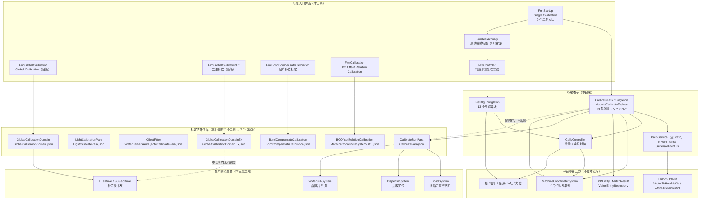

**ASCII 版（图 1）**

```
   标定入口界面(本目录)                 标定核心(本目录)               算法/硬件归属
  ┌──────────────────────┐        ┌────────────────────────┐     ┌──────────────────┐
  │ FrmStartup  9 个入口 │───────>│ CalibrateTask :Singleton│───>│ HalconDotNet      │
  │ FrmGlobalCalibration │──┐     │  13 条流程 + 5 个 Only* │     │  VectorToHomMat2d │
  │ FrmGlobalCalibrationEx│─┼──┐  └────────────────────────┘     └──────────────────┘
  │ FrmBondCompensate... │─┤  │            │  │                   ┌──────────────────┐
  │ FrmCalibration       │─┘  │            v  v                   │ PREntity/MatchRS │
  │ FrmTestAccuary 33按钮│──┐ │     ┌───────────────┐              │ (PR 视觉框架)     │
  │ TestControls/*       │──┴>│     │ CalibService  │              └──────────────────┘
  └──────────────────────┘   │     │ (全 static)   │              ┌──────────────────┐
                             │     ├───────────────┤              │ 轴/相机/光源/气缸 │
                             │     │ CalibController│────────────>│ /力控 (经平台封装) │
                             │     ├───────────────┤              └──────────────────┘
                             │     │ TestAlg       │
                             │     └───────────────┘
                             v
                  标定结果仓库(7 个单例 → 7 个 JSON)
        ┌────────────────────────────────────────────────────────┐
        │ CalibrateRunPara ──> CalibratePara.json   ★最核心       │
        │ LightCalibrationPara ──> LightCalibratePara.json        │
        │ OffsetFitter ──> WaferCameraAndEjectorCalibratePara.json│
        │ GlobalCalibrationDomain ──> GlobalCalibrationDomain.json│
        │ GlobalCalibrationDomainEx ──> ...DomainEx.json (无消费方)│
        │ BondCompensateCalibration ──> BondCompensateCalibration│
        │ BCOffsetRelationCalibration ──> MachineCoordinateSystem/│
        └────────────────────────────────────────────────────────┘
                             │
                             v
              生产侧消费者(本目录之外)
        BondSystem / DispenseSystem / WaferSubSystem / 驱动器
```

### 1.3 三条最重要的"事实"

**① "算出来了" 和 "存下去了" 是两件事，而且经常只做到第一件。**

本目录有 5 个从诊断界面直接触发的单步标定方法（`Only*`，定义在 `Models/CalibrateTask.cs:1073 / :1162 / :1257 / :1712 / :1817`）。其中**只有 `OnlyUpLookCameraCalib` 在 `:1665` 落了盘**，其余四个全程不调 `calibratePara.Save()`。
最极端的例子是 `OnlyWaferCameraCaib`：它在 `:1774` 用 `NPointTrans` 算出了 `homMatTrans`，但这个局部变量**连内存都没留住** —— 既没写 `WaferHomMatTrans`（`:230`），也没写 `MachineCoordinateSystem`，结果只存在于弹出的 `FrmCalibResult` 里，窗口一关就没了（详细对照见 §4.6 图 9）。

**② 五个 `OKCancel` 对话框里，有一个 Cancel 的语义和其它四个不一样。**

一键自动标定 `StartAutoCalib`（`Models/CalibrateTask.cs:2275`）串了 5 段人工确认。前四个（`:2280 / :2295 / :2317 / :2363`）点 Cancel 都是 `return` —— **整条链中止**；而第 4 个（`:2342`，"将标定片放在两相机之间"）点 Cancel 是**跳过继续**，因为紧随其后的 `StartUpLookMachinePosTask()`（`:2357`）写在 `if` 之外，Cancel 也会执行。
而全流程唯一一次 `CalibrateRunPara.Save()` 在 `:2392`，位于这 5 个对话框**全部 OK 之后**。所以：**任意一个 Cancel 都会让已经算完的矩阵和点位全部不落盘，但 `MachineCoordinateSystem.Save()`（`:387 / :546 / :870 / :972 / :2118`）已经写进磁盘了** —— 坐标系是新算的，参数还是旧的，机台进入不一致状态（详见 §4.4 图 6、§9 R-18）。

**③ 本目录没有一把锁，但共享状态很多。**

`grep` 全目录：`lock` / `volatile` / `Interlocked` / `SemaphoreSlim` / `Monitor` **0 命中**；唯一的同步原语是 `FrmGlobalCalibrationEx.cs:566` 的 `CancellationTokenSource` 与 `:567` 的 `ManualResetEvent`，都只服务于那一个窗体的扫描线程。
而 25 处 `Task.Run` / `new Task` 里有 **24 处没有重入保护**（唯一做了保护的是 `FrmBondCompensateCalibration.BtStart_Click:196` 的 `TaskStatus.Running` 判断）。`Models/CalibrateTask.cs:149` / `:159` 的两个 `List<CalibCamScaleResult>` / `List<CalibTransResult>` 被多条链 `Clear()` + `Add()`，同时跑两条链时 `FrmCalibResult` 读到的是混合结果（详见 §5.4 图 29、§9 R-45）。

## 2. 目录结构

**规模口径（重要）**：本节的数字**只算参与编译的文件**，即出现在 `AKRS.ZX2200.csproj` 的 `<Compile Include>` 里的 `.cs`。

- 本目录磁盘上（排除 `bin/`、`obj/`）共 **65 个** `.cs`；
- 其中 **65 个全部**在 `.csproj` 中 → **本目录没有幽灵文件**（不参与编译的 `.cs` 数量 = **0 个 / 0 行**）。
- 全仓 20 个幽灵文件里没有一个是 `CalibSystem/` 下的（分布见 §7.1）。
- 复现命令：

```bash
cd "E:/项目/ZX2200标机/trunk/AKRS.ZX2200/CalibSystem"
find . -name "*.cs" | wc -l                                   # → 65
find . -maxdepth 1 -name "*.cs" ! -name "*Designer.cs" -exec cat {} \; | wc -l   # → 2828（根目录非 Designer 行数）
find . -name "*.cs" ! -name "*Designer.cs" -exec cat {} \; | wc -l               # → 18935
find . -name "*Designer.cs" -exec cat {} \; | wc -l                              # → 9700
```

### 2.1 目录结构表

| 子目录 | 非 Designer 文件数 / 行数 | Designer 文件数 / 行数 | 说明 |
|---|---|---|---|
| `.`（根目录） | 3 / 2,828 | 1 / 618 | `BaseLog.cs`（24 行，日志抽象基类）、`Log.cs`（169 行，`LogOnePoint` / `LogBondXY`）、**`FrmTestAccuary.cs`（2,635 行，本目录最大的文件）**；Designer 只有 `FrmTestAccuary.Designer.cs`（618 行，33 条 `Click +=`）。根目录放实验总窗体是这个目录的历史包袱 —— 而它的父类 `XtraForm` 与其它窗体并无不同 |
| `Controls/` | 2 / 206 | 2 / 490 | 只有两个窗体：`FrmStartup`（139 行，**单步标定总菜单，9 个按钮**）、`FrmCalibResult`（67 行，结果框）。是本目录对外的"总门面" |
| `Controls/Assistant/` | 9 / 3,764 | 9 / 2,986 | **9 个示教向导**（`FrmBondCalibTeach` 11 步 / `FrmDispenseCalibTeach` 4 步 / `FrmLightnessCalibTeach` 2 步 / `FrmWaferCameraCalibTeach` / `FrmTouchDownToCameraTeach` / `FrmTransportTeach` / `FrmAssistantDistanceMhAndBh` / `FrmBondToCameraOffset` / `FrmDBCalibTeach`）。行数第二大的子目录，也是"点一下改一堆参数"最密集的地方 |
| `GlobalCalibration/` | 11 / 4,972 | 6 / 3,567 | **行数最大的子目录**。旧版全局标定（`FrmGlobalCalibration.cs` 1,605 行）、新版扫描式 2D 补偿（`FrmGlobalCalibrationEx.cs` 1,695 行）、贴片补偿（`FrmBondCompensateCalibration.cs` 472 行）、2D 平台向导（`FrmAssistant2DStage.cs` 387 行）与 5 个配置 / 数据模型（`GlobalCalibrationDomain` / `GlobalCalibrationDomainEx` / `GlobalCalibrationData` / `BondCompensateCalibration` / `BehaviorNode`） |
| `GlobalCalibrationEnd/BCOffsetRelationCalib/` | 2 / 717 | 1 / 491 | 只有一组：BC 偏移关系标定的模型（`BCOffsetRelationModel.cs` 212 行）与界面（`FrmCalibration.cs` 505 行）。目录名带 `End` 而实际只有一个子目录，另一套"Bond相机↔上视相机偏移关系"实现 |
| `Models/` | 5 / 3,425 | 0 / 0 | **无 Designer**。`CalibrateTask.cs`（2,405 行，本目录核心）、`CalibrateRunPara.cs`（325 行，~50 个字段的参数总仓）、`LightCalibrationPara.cs`（466 行，自研算法最密集）、`OffsetFitter.cs`（169 行，唯一自研拟合）、`CalibrateResult.cs`（60 行，显示对象） |
| `Services/` | 2 / 691 | 0 / 0 | **无 Designer**。`CalibService.cs`（353 行，全 `static` 的 Halcon 包装层，全项目共用）、`CalibController.cs`（338 行，运动 / 定位封装，调用处普遍 `new`） |
| `Test/` | 2 / 1,228 | 0 / 0 | **无 Designer**。`TestAlg.cs`（1,207 行，13 个公有实验方法**被外部模块引用**）、`CameraTypeEnum.cs`（21 行） |
| `TestControls/` | 5 / 1,104 | 5 / 1,548 | 4 个测试窗体 + 1 个用户控件（`FrmCalibTest` 重复标定 / `FrmMoveLocateTest` 移动定位 / `FrmSetting` 参数设置 / `FrmBackOffset` 回退偏移 / `UcTestThreePointAlign` 三点对齐）。**这一组里有 2 个"停止"按钮是死的**（§4.21） |
| **合计** | **41 / 18,935** | **24 / 9,700** | **65 个文件 / 28,635 行** —— 与文首"代码规模"、附录 A 的合计核对表完全一致 |

### 2.2 目录结构与职责分布（图 2）

```mermaid
graph TB
    ROOT["CalibSystem/<br/>65 个 .cs / 28,635 行"]

    ROOT --> R1["根目录  3+1 个<br/>2,828 + 618 行"]
    ROOT --> R2["Controls/  2+2 个<br/>206 + 490 行"]
    ROOT --> R3["Controls/Assistant/  9+9 个<br/>3,764 + 2,986 行"]
    ROOT --> R4["GlobalCalibration/  11+6 个<br/>4,972 + 3,567 行"]
    ROOT --> R5["GlobalCalibrationEnd/<br/>BCOffsetRelationCalib/  2+1 个<br/>717 + 491 行"]
    ROOT --> R6["Models/  5+0 个<br/>3,425 行"]
    ROOT --> R7["Services/  2+0 个<br/>691 行"]
    ROOT --> R8["Test/  2+0 个<br/>1,228 行"]
    ROOT --> R9["TestControls/  5+5 个<br/>1,104 + 1,548 行"]

    R1 --> R1A["FrmTestAccuary 2,635 行<br/>33 个按钮 · 18 处 Excel 导出<br/>★ 本目录最大文件"]
    R1 --> R1B["Log.cs / BaseLog.cs<br/>TSV 追加日志"]

    R2 --> R2A["FrmStartup 139 行<br/>9 个单步入口"]
    R2 --> R2B["FrmCalibResult 67 行<br/>只读结果框（假确认）"]

    R3 --> R3A["9 个示教向导<br/>BondCalib 11 步 / Dispense 4 步<br/>Lightness 2 步 / WaferCamera<br/>TouchDown / Transport / MhBh<br/>BondToCameraOffset / DBCalib"]

    R4 --> R4A["FrmGlobalCalibration 1,605 行<br/>旧版 · Task + isStop 轮询 · 8 分支"]
    R4 --> R4B["FrmGlobalCalibrationEx 1,695 行<br/>新版 · async+cts+pauseSignal"]
    R4 --> R4C["FrmBondCompensateCalibration 472 行<br/>while true 采集"]
    R4 --> R4D["FrmAssistant2DStage 387 行<br/>行列数计算"]
    R4 --> R4E["5 个模型/配置类<br/>Domain / DomainEx / Data<br/>BondCompensate / BehaviorNode(死)"]

    R5 --> R5A["FrmCalibration 505 行<br/>两级 SortedList 整体替换"]

    R6 --> R6A["CalibrateTask 2,405 行 ★核心<br/>13 条流程 + 5 个 Only*"]
    R6 --> R6B["CalibrateRunPara 325 行<br/>~50 字段 · CalibratePara.json"]
    R6 --> R6C["LightCalibrationPara 466 行<br/>6 张映射表"]
    R6 --> R6D["OffsetFitter 169 行<br/>唯一自研拟合"]
    R6 --> R6E["CalibrateResult 60 行<br/>只内存不落盘"]

    R7 --> R7A["CalibService 353 行<br/>全 static · Halcon 包装"]
    R7 --> R7B["CalibController 338 行<br/>运动+定位 · 每次 new"]

    R8 --> R8A["TestAlg 1,207 行<br/>13 个公有方法 · 外部引用 3 文件"]

    R9 --> R9A["FrmCalibTest / FrmMoveLocateTest<br/>★ 各有 1 个停止按钮未接线"]
```

## 3. 关键类型索引

统计口径（可复现）：

```bash
cd "E:/项目/ZX2200标机/trunk/AKRS.ZX2200/CalibSystem"
# 类声明总数（不含 Designer）
grep -rnE "^\s*(public|internal|private|protected)?\s*(sealed|static|abstract|partial)?\s*class\s+" \
  --include="*.cs" . | grep -v "Designer.cs" | wc -l        # → 54
# 窗体 / 用户控件（不含 Designer）
grep -rn "class .*: .*Xtra" --include="*.cs" . | grep -v "Designer.cs" | wc -l   # → 24
# 本目录内声明的 enum
grep -rnE "^\s*(public|internal)?\s*enum\s+" --include="*.cs" . | grep -v "Designer.cs"
```

实测结果：本目录内声明 **54 个 `class` / `abstract class` / `static class`**，其中 **24 个是窗体 / 用户控件**（23 个 `XtraForm` + 1 个 `XtraUserControl`），**30 个是非 UI 类型**；另外本目录内声明 **4 个 `enum`**，还有 4 个平台 `enum` 只被引用不在此声明。**没有 `interface`、没有 `struct`。**

### 3.1 类型清单

**A. 本目录内声明的 `enum`（4 个）**

| 类型 | 位置 `文件:行` | 可见性 | 成员与数值 |
|---|---|---|---|
| `BehaviorStatus` | `GlobalCalibration/BehaviorNode.cs:13` | `public` | `Success`=0、`Failure`=1、`Running`=2。**全仓库无引用**（死框架，见 R-36 / R-50） |
| `LightType` | `Models/LightCalibrationPara.cs:456-464` | `public`（嵌套在 `LightCalibrationPara` 内） | `RedRing`=0、`BlueRing`=1、`GreenRing`=2、`RedSpot`=3、`BlueSpot`=4、`GreenSpot`=5。**无显式赋值**，靠声明顺序；Red→Blue→Green 的顺序与"红绿蓝"直觉不同（见 R-31） |
| `CamCoordinateType` | `Services/CalibController.cs:298-311` | `public`（嵌套在 `CalibController` 内） | `Bond`=0、`UpLook`=1、`Wafer`=2、`Dispense`=3 |
| `CameraType` | `Test/CameraTypeEnum.cs:6-20` | `public` | `BondCamera`=0、`UpLookCamera`=1、`WaferCamera`=2、`DispenseCamera`=3。**同样无显式数值** —— 与 `LightType` 是同一类隐患 |

**只被引用、声明在平台侧的 `enum`**：`AlgBeLongEnum`（用 `.Calibration` / `.Substrate`，`FrmTestAccuary.cs:510`、`FrmBondCompensateCalibration.cs:152`）、`CoordinateSystemTypeEnum`、`CurrentMachineSystemEnum` / `MachineWorkModeEnum`（`FrmTransportTeach.cs:347`、`FrmAssistantDistanceMhAndBh.cs:62`、`FrmAssistant2DStage.cs:166`）、`AssistantStateEnum`（只出现在一行被注释的代码里：`FrmTouchDownToCameraTeach.cs:312`）。*（推断：均在 `AKRS.Galaxy2.*` DLL 内，本仓库无源码。）*

**B. 非 UI 类型（30 个中的 27 个有独立职责的）**

| 类型 | 位置 `文件:行` | 基类 | 修饰 | 职责 | 关键公有成员 |
|---|---|---|---|---|---|
| `BaseLog` | `BaseLog.cs:12` | 无 | `internal abstract` | 日志基类，只有两个抽象属性 | `abstract string FilePath` `:17`；`abstract int Number` `:22` |
| `LogOnePoint` | `Log.cs:11` | `BaseLog` | `internal` | 单点重复定位的 TSV 追加日志 | `LogOnePoint(string,int)` `:44`；`Write(double,double)` `:54` |
| `LogBondXY` | `Log.cs:82` | `BaseLog` | `internal` | A→B→A 往复测试的 TSV 追加日志（12 列） | `LogBondXY(string,int)` `:115`；`Write(double×12)` `:140` |
| `CalibCamScaleResult` | `Models/CalibrateResult.cs:12` | 无 | `public` | 像素比展示对象。**仅内存，不落盘** | `CameraType` `:17`、`CameraScaleX` `:22`、`CameraScaleY` `:27`、`CameraSlantTheata` `:32` |
| `CalibTransResult` | `Models/CalibrateResult.cs:38` | 无 | `public` | 转换量展示对象，同样不落盘 | `ParaName` `:43`、`RelativeX` `:48`、`RelativeY` `:53`、`RelativeTheata` `:58` |
| `CalibrateRunPara` | `Models/CalibrateRunPara.cs:15` | `Singleton<CalibrateRunPara>` | `public` | **标定运行参数总仓**：~50 个字段，含 4 个 Halcon 矩阵 | 见 §8.2 全字段表；静态构造设 `FilePath` `:22` |
| `CalibrateTask` | `Models/CalibrateTask.cs:44` | `Singleton<CalibrateTask>` | `public` | **本目录核心**：13 条标定流程 + 5 个 `Only*` + `StartAutoCalib` | 见 §5.1 |
| `LightCalibrationPara` | `Models/LightCalibrationPara.cs:14` | `Singleton<LightCalibrationPara>` | `public` | 光源亮度标定参数 + Bond↔Dispense 双向映射字典 | `GetDispenseIntensity` `:171`、`GetBondIntensity` `:191`、`CalculateDispenseIntensityRaw` `:225`、`ApplyLightMapping` `:364`、`ApplyLightMappingReverse` `:409` |
| `OffsetFitter` | `Models/OffsetFitter.cs:12` | `Singleton<OffsetFitter>` | `public`，**无命名空间声明** → 落在 global namespace | 手写最小二乘一元线性回归 `dx=k1*Z+b1`、`dy=k2*Z+b2` | `Fit` `:30`、`CalculateCoeffs` `:65`（private）、`Predict` `:104`、`GetNearestOffset` `:116`、`ValidateAccuracy` `:144` |
| `CalibService` | `Services/CalibService.cs:24` | 无 | `public class`，但**所有成员都是 `public static`** | 全项目共用标定算法工具（Halcon 薄封装） | 21 个静态方法，见 §6.2 |
| `CalibController` | `Services/CalibController.cs:26` | 无 | `public`，字段全为实例字段 | 标定专用运动 / 定位封装。调用处普遍 `new CalibController()`（`FrmTestAccuary.cs:64`、`FrmCalibration.cs:42`、`FrmCalibTest.cs:46`） | 14 个公有方法，见 §6.2 |
| `GlobalCalibrationData` | `GlobalCalibration/GlobalCalibrationData.cs:9` | 无 | `public` | 单个扫描点（World / Axis / Scan 三套坐标），8 位小数取整 | `WorldX/Y` `:25/:34`、`AxisX/Y` `:43/:52`、`ScanAxisX/Y` `:61/:70`、`OffsetX/Y`（`[JsonIgnore]`）`:80/:86`、`Sort` `:93` |
| `GlobalCalibrationDomain` | `GlobalCalibration/GlobalCalibrationDomain.cs:17` | `Singleton<GlobalCalibrationDomain>` | `public` | **旧版**全局标定配置 + 二维双线性插值 | `GetAxisCompensate` `:94`、`GetBondHandCompensate` `:160`、`FilePath` `:24` |
| `GlobalCalibrationDomainEx` | `GlobalCalibration/GlobalCalibrationDomainEx.cs:18` | `Singleton<GlobalCalibrationDomainEx>` | `public` | **新版** 2D 补偿配置（左右列 / 上下行 + 扫描点表 + `BilinearCompensator`） | `ScanData` `:76`、`ScanCompletedFlag`（`[JsonIgnore]`）`:82-83`、`Compensator` `:88`、`FilePath` `:25` |
| `BondCompensateCalibration` | `GlobalCalibration/BondCompensateCalibration.cs:17` | `Singleton<BondCompensateCalibration>` | `public` | 二维平面补偿点阵 + 双线性插值 | `GetBondOffset` `:73`、`Test()` `:90`（调试残留）、`PlanePoint2Ds` `:30` |
| `BCOffsetRelationCalibration` | `GlobalCalibrationEnd/BCOffsetRelationCalib/BCOffsetRelationModel.cs:36` | `Singleton<>` | `public` | Bond 相机 ↔ 上视相机偏移关系的**另一套实现**（`SortedList` 两级 + 取近行 + 两点直线） | `GetΔXY` `:66`、`GetΔXYByRowData` `:117`、`GenLineEqu` `:181`、`Clear` `:55`、`FilePath` `:43` |
| `BCOffsetRelationModel` | `.../BCOffsetRelationModel.cs:195` | 无 | `public` | 一个标定点的数据 | `AKRSPoint2D Pos` `:200`、`double ΔX` `:205`、`double ΔY` `:210` |
| `BondToCamResult` | `Test/TestAlg.cs:1153` | 无 | `public` | 三点一线结果 + 极差 | `bondX/bondY/upLookX/upLookY` `:1158/:1163/:1168/:1173`、`DifferenceX/Y`（`[JsonIgnore]`）`:1179/:1195` |
| `TestAlg` | `Test/TestAlg.cs:43` | `Singleton<TestAlg>` | `public` | 实验算法工具集，13 个公有方法被外部模块引用 | 见 §6.1 全表 |
| `Result` | `FrmTestAccuary.cs:2596` | 无 | `public` | 测速 / 温漂实验的一条记录（18 个 `double` + 1 个 `long Time`） | 字段 `:2598-2632` |
| `TestData` | `TestControls/FrmCalibTest.cs:492` | 无 | `public` | 标定精度实验记录（6 个公开**字段**，非属性） | `:494-506` |
| `TestData1` | `TestControls/FrmMoveLocateTest.cs:265` | 无 | `public` | 移动定位实验记录（5 个公开字段） | `:267-275` |
| `BehaviorNode` 家族 | `GlobalCalibration/BehaviorNode.cs:7 / :15 / :35 / :69 / :103 / :118 / :133 / :148` | 无 | `public abstract` / `static` | 一套完整行为树（`BehaviorNode` / `Blackboard` / `SequenceNode` / `SelectorNode` / `ConditionNode` / `ActionNode` / `ActionRegistry` / `TestClass`）。**全仓库零引用**——见 R-36 |

**C. 窗体与用户控件（24 个）** —— 完整清单见 §4.1，这里只给继承关系（图 3）。

### 3.2 继承层次图

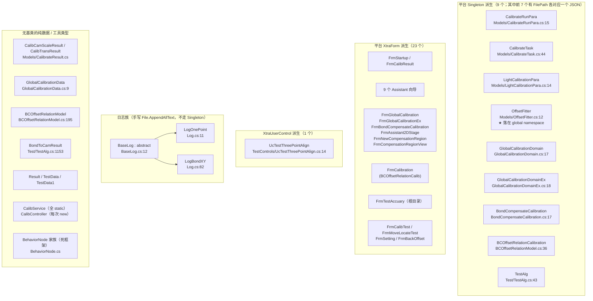

**ASCII 版（图 3）**

```
  平台 Singleton<T>（9 个，其中 7 个有 FilePath）   平台 XtraForm / XtraUserControl（24 个）
  ┌────────────────────────────┐        ┌──────────────────────────────────────┐
  │ CalibrateRunPara   → JSON  │        │ FrmStartup(9 按钮)  FrmCalibResult   │
  │ CalibrateTask      (核心)  │        │ 9 个 Assistant 向导                  │
  │ LightCalibrationPara→JSON  │        │ FrmGlobalCalibration(旧) / Ex(新)   │
  │ OffsetFitter       → JSON  │        │ FrmBondCompensateCalibration         │
  │ GlobalCalibrationDomain    │        │ FrmAssistant2DStage                  │
  │ GlobalCalibrationDomainEx  │        │ FrmNewCompensationRegion             │
  │ BondCompensateCalibration  │        │ FrmCompensationRegionView            │
  │ BCOffsetRelationCalibration│        │ FrmCalibration                       │
  │ TestAlg            (无 JSON)│       │ FrmTestAccuary(根目录, 2635 行)      │
  └────────────────────────────┘        │ FrmCalibTest/FrmMoveLocateTest       │
                                        │ FrmSetting/FrmBackOffset             │
  BaseLog(abstract)                     │ UcTestThreePointAlign(XtraUserControl)│
    ├─ LogOnePoint                      └──────────────────────────────────────┘
    └─ LogBondXY
  手写 File.AppendAllText，不走 Singleton，无 Save()

  无基类的纯数据/工具：CalibCamScaleResult, CalibTransResult,
    GlobalCalibrationData, BCOffsetRelationModel, BondToCamResult,
    Result, TestData, TestData1, CalibService(全static), CalibController,
    BehaviorNode 家族（死框架，全仓库零引用）
```

### 3.3 7 个持久化单例与 7 个 JSON 的对应关系（图 4）

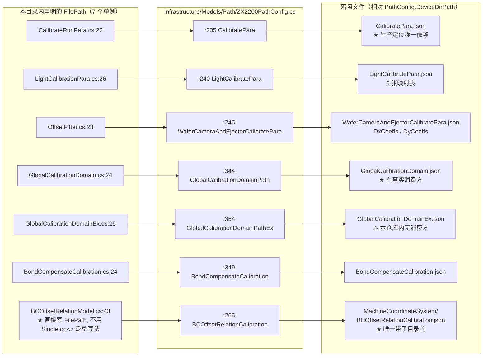

**注**：`MachineCoordinateSystem`（平台坐标系单例）也由本目录写盘，但它**不在本仓库内定义** —— `grep -rn "class MachineCoordinateSystem"` 在本目录无命中，其落盘路径与序列化格式由平台决定 *（推断：落在 `DeviceDirPath\MachineCoordinateSystem\` 下）*。本目录对它的调用共 12 处，清单见 §8.4。

**另注**：`ZX2200PathConfig.cs:255` 的 `CalibrationProcess` → `MachineCoordinateSystem/CalibrationProcess.sol` 在**全仓库 `*.cs` 内零引用**（`grep -rn "CalibrationProcess" --include=*.cs .` 只命中它自己的定义行）。*（推断：由平台 DLL 按文件名约定使用，本目录不碰。）*

## 4. UI 按钮与交互流程 ★核心★

### 4.1 UI 清单（24 个窗体 / 用户控件）

本目录共 **24 个**窗体或用户控件（23 个 `XtraForm` + 1 个 `XtraUserControl`），全部在 `CalibSystem` 内。
「打开它的入口」一列**按三种入口分别标注**（依据本目录实际反查结果）：

- **① 界面按钮** —— 给出调用它的按钮处理器的 `文件:行`；
- **② 任务层 / 线程运行时弹出** —— 没有界面按钮能直接触发，给出触发条件与 `文件:行`；
- **③ 反射服务 `ControlService.ShowDialogForm<T>`** —— 用 `Activator.CreateInstance` 按 `args` 匹配构造函数打开。**本目录对该服务零命中**：全仓库 `grep -rn --include='*.cs' 'ShowDialogForm<'` 的 4 个活调用点全部落在 `WaferSubSystem/`，`CalibSystem` 内既没有调用点、也没有任何窗体是被它打开的。

> 复现命令（零命中即「零调用点」）：
> ```bash
> cd "E:/项目/ZX2200标机/trunk/AKRS.ZX2200"
> grep -rn --include='*.cs' -w 'FrmXxx' . | grep -v 'class FrmXxx'
> grep -rn --include='*.cs' 'ShowDialogForm<' .
> ```

| 类名 | 文件 | 行数 | 标题文字（`文件:行`） | 做什么标定 | **打开它的入口** |
|---|---|---|---|---|---|
| `FrmStartup` | `Controls/FrmStartup.cs` | 139 | `"Single Calibration"`（`FrmStartup.Designer.cs:151`） | 单步标定总菜单，9 个按钮 | **①** `Main/Controls/Ucmain/MainControls/UcMainSystem.cs:1403` |
| `FrmCalibResult` | `Controls/FrmCalibResult.cs` | 67 | `"FrmCalibResult"`（`FrmCalibResult.Designer.cs:284`） | 标定结果**只读**框（"假确认"，见 §4.13） | **②** 由 9 处调用点在后台线程或 UI 线程上弹出：`Models/CalibrateTask.cs:1153` / `:1248` / `:1703` / `:1808` / `:1828` / `:2397`；`Controls/Assistant/FrmBondCalibTeach.cs:556`；`FrmDispenseCalibTeach.cs:223` / `:286` |
| `FrmDispenseCalibTeach` | `Controls/Assistant/FrmDispenseCalibTeach.cs` | 372 | `"FrmDispenseCalibTeach"`（`:276`） | 系统1 点胶标定向导（4 步） | **①** `UcMainSystem.cs:1385` |
| `FrmBondCalibTeach` | `Controls/Assistant/FrmBondCalibTeach.cs` | 670 | `"Bond Calibration Teach"`（`:351`） | 系统2 主标定向导（11 步） | **①** `UcMainSystem.cs:1390` |
| `FrmLightnessCalibTeach` | `Controls/Assistant/FrmLightnessCalibTeach.cs` | 598 | `"光源亮度标定示教"`（`:274`） | Bond↔Dispense 亮度映射标定 | **①** `UcMainSystem.cs:1818`、`:1840`；**①**（本目录内）`FrmTestAccuary.cs:2390` 按钮 → `:2392 new FrmLightnessCalibTeach().Show()`（**非模态**，见 §4.20） |
| `FrmWaferCameraCalibTeach` | `Controls/Assistant/FrmWaferCameraCalibTeach.cs` | 484 | `"光源亮度标定示教"`（`:289`，**与上一个窗体标题完全相同，复制粘贴未改**） | 晶圆相机 Z 向视差 + 顶针联动标定 | **①** `UcMainSystem.cs:1972` |
| `FrmTouchDownToCameraTeach` | `Controls/Assistant/FrmTouchDownToCameraTeach.cs` | 441 | `"吸嘴示教"`（`:294`） | TouchDown 吸嘴到相机偏移 | **零调用点** —— 全仓库除自身定义与其 Designer 外 `grep -rn -w` 无任何命中，没有 `new`、没有 `ShowDialogForm<T>`。**编译进去但运行时打不开（僵尸窗体）** |
| `FrmTransportTeach` | `Controls/Assistant/FrmTransportTeach.cs` | 394 | `"FrmTransportTeach"`（`:407`） | 搬运机构示教 | **①** `Controls/FrmStartup.cs:89`（按钮「轨道系统标定」） |
| `FrmAssistantDistanceMhAndBh` | `Controls/Assistant/FrmAssistantDistanceMhAndBh.cs` | 281 | `"Change Dispenser"`（`:274`，**标题与用途完全不符**） | 测高头与固晶头间距示教 | **①** `Controls/FrmStartup.cs:136`（另有 `Experiment/TestFunction/FrmTest.cs:639` 一行**被注释**的同类构造） |
| `FrmBondToCameraOffset` | `Controls/Assistant/FrmBondToCameraOffset.cs` | 202 | `"FrmBondToCameraOffset"`（`:225`） | 邦头到 Bond 相机偏移示教 | **①** `Controls/FrmStartup.cs:119` |
| `FrmDBCalibTeach` | `Controls/Assistant/FrmDBCalibTeach.cs` | 322 | `"FrmBondCalibTeach"`（`:259`，**与 `FrmBondCalibTeach` 标题完全相同**） | 点胶-固晶联合标定示教 | **零调用点** —— 同 `FrmTouchDownToCameraTeach`，全仓库无构造点。**僵尸窗体** |
| `FrmTestAccuary` | `FrmTestAccuary.cs` | 2,635 | `"FrmTestAccuary"`（`FrmTestAccuary.Designer.cs:558`） | 测试辅助功能总窗体（33 个按钮，见 §4.20） | **①** `Controls/FrmStartup.cs:125`（按钮名却是 `simpleButton1`、文字 "BondToCamera"，见 §4.3） |
| `FrmAssistant2DStage` | `GlobalCalibration/FrmAssistant2DStage.cs` | 387 | `"Substrate Position"`（`:379`） | 2D 平台标定辅助向导 | **零调用点** —— 全仓库无构造点。**僵尸窗体**（其 `Load` 会调 `Machine.GetInstance().AllAxisGoHome()`，见 §4.18） |
| `FrmGlobalCalibration` | `GlobalCalibration/FrmGlobalCalibration.cs` | 1,605 | `"Global Calibration"`（`:812`） | 全局 / 2D 补偿标定主窗体（**旧版**） | **①** `UcMainSystem.cs:1709` |
| `FrmGlobalCalibrationEx` | `GlobalCalibration/FrmGlobalCalibrationEx.cs` | 1,695 | `"二维补偿"`（`:1291`） | 2D 补偿实验窗体（**新版**，扫描式） | **①** `UcMainSystem.cs:1726` |
| `FrmBondCompensateCalibration` | `GlobalCalibration/FrmBondCompensateCalibration.cs` | 472 | `"贴片补偿标定"`（`:479`） | 固晶补偿标定（旧版） | **①** `UcMainSystem.cs:1771` |
| `FrmNewCompensationRegion` | `GlobalCalibration/FrmNewCompensationRegion.cs` | 75 | `"新补偿区域创建"`（`:101`） | 新建补偿区域对话框 | **①**（从按钮处理器体内）`FrmGlobalCalibrationEx.cs:1106`（`using FrmNewCompensationRegion frm = new(...)`），由按钮 `BtnGenerateRegion_Click`（`:1098`）触发 |
| `FrmCompensationRegionView` | `GlobalCalibration/FrmCompensationRegionView.cs` | 36 | `"补偿区域映射表"`（`:85`），运行时改写为 `$"补偿区域映射表 - {RegionName}"`（`FrmCompensationRegionView.cs:31`） | 单条补偿区域明细查看（只读） | **①** `FrmGlobalCalibrationEx.cs:215`（在 `GvCompensatorRegions.DoubleClick` 的 lambda 体内 `new(region)` + `ShowDialog()`） |
| `FrmCalibration` | `GlobalCalibrationEnd/BCOffsetRelationCalib/FrmCalibration.cs` | 505 | `"BC Offset Relation Calibration"`（`:439`） | BC 偏移关系标定 | **①** `UcMainSystem.cs:1414` |
| `FrmCalibTest` | `TestControls/FrmCalibTest.cs` | 506 | `"FrmCalibTest"`（`:515`） | 重复标定稳定性测试 | **零调用点（断链）** —— 唯一疑似入口 `UcMainSystem.cs:1647` **整行被注释**（`//FrmCalibTest frmCalibTest = new FrmCalibTest();`），本目录内也无 `new`。窗体在编、功能完整，但界面上没有任何按钮能打开它 |
| `FrmMoveLocateTest` | `TestControls/FrmMoveLocateTest.cs` | 276 | `"FrmCalibTest"`（`:193`，**复制粘贴未改**） | 移动 + 定位重复性测试 | **①** `UcMainSystem.cs:1682`（写法是目标类型推断的 `new()`，普通 `grep 'new FrmMoveLocateTest('` 会漏） |
| `FrmSetting` | `TestControls/FrmSetting.cs` | 125 | `"FrmSetting"`（`:113`） | 测试参数设置对话框 | **①**（**外目录**）`Experiment/RepeatPositionAccuracy/FrmChooseCamera.cs:40`、`:55`；`Experiment/Test/FrmChooseCamera.cs:44`、`:63`。本目录零调用点 |
| `FrmBackOffset` | `TestControls/FrmBackOffset.cs` | 68 | `"FrmBackOffset"`（`:82`） | 回退偏移输入对话框 | **①** `UcMainSystem.cs:1293` |
| `UcTestThreePointAlign` | `TestControls/UcTestThreePointAlign.cs` | 129 | 无（`Text` 未在 Designer 里设） | 三点对齐测试用户控件 | **①** `FrmTestAccuary.cs:2402`（按钮 `simpleButton20_Click`（`:2396`）里 `ShowPanel("UcTestThreePointAlign", …)` → `new UcTestThreePointAlign() { Dock = DockStyle.Fill }`） |

**入口口径的三个结论：**

1. **多数窗体的第一入口不在本目录**：`FrmStartup` / `FrmDispenseCalibTeach` / `FrmBondCalibTeach` / `FrmLightnessCalibTeach` / `FrmWaferCameraCalibTeach` / `FrmGlobalCalibration` / `FrmGlobalCalibrationEx` / `FrmBondCompensateCalibration` / `FrmCalibration` / `FrmMoveLocateTest` / `FrmBackOffset` 都由 `Main/.../UcMainSystem.cs`（主界面）打开；`FrmSetting` 由 `Experiment/` 打开。本目录自己的按钮多数是"第二层"。
2. **4 个窗体没有任何入口**：`FrmTouchDownToCameraTeach`、`FrmDBCalibTeach`、`FrmAssistant2DStage`（**僵尸**，编译进去但运行时打不开）、`FrmCalibTest`（**断链**，唯一入口被注释）。其中 `FrmAssistant2DStage` 的 `Load` 里会 `Machine.GetInstance().AllAxisGoHome()`（`:253`）——一旦将来有人把它接上去，**打开窗体就会让全轴回零**。
3. **1 个窗体只能由后台线程弹**：`FrmCalibResult`。它有 9 个调用点，其中 `Models/CalibrateTask.cs:1828` 是**唯一没有用 `MainForm.SendUiAction` 包住**的一处（见 §4.13）。

---

### 4.2 按钮总表（逐条登记，一个不漏）

**统计口径（可复现）**：统计 `.cs` 里**处理器方法的定义**（`private`/`public`/`protected`/`internal` + `void` + `Xxx_事件名(`），排除 `*.Designer.cs`。

```bash
cd "E:/项目/ZX2200标机/trunk/AKRS.ZX2200/CalibSystem"
grep -rn --include="*.cs" \
  -E '(private|public|protected|internal)[^;=]*\b[A-Za-z_][A-Za-z0-9_]*_(Click|Load|FormClosing|FormClosed|CloseParentForm|CheckedChanged|SelectedIndexChanged|ItemClick|Tick|RunToCompleteEvent|Paint|MouseUp|EditValueChanged|DoubleClick)\s*\(' . \
  | grep -v 'Designer.cs' | wc -l
```

**结果：192 个处理器方法定义。** 后缀分布（同一条命令加 `-oE '_[A-Za-z]+\(' | sort | uniq -c`）：

| 后缀 | 个数 | 后缀 | 个数 |
|---|---|---|---|
| `_Click` | **159** | `_ItemClick` | 2 |
| `_Load` | 9 | `_Tick` | 1 |
| `_FormClosing` | 4 | `_RunToCompleteEvent` | 1 |
| `_CloseParentForm` | 4 | `_Paint` | 1 |
| `_CheckedChanged` | 4 | `_MouseUp` | 1 |
| `_FormClosed` | 3 | `_EditValueChanged` | 1 |
| `_SelectedIndexChanged` | 2 | **合计** | **192** |

> ⚠️ **只数 `_Click` 会漏 33 个**。其中 `_ItemClick`（DevExpress `BarItem`）、`_MouseUp`（右键弹上下文菜单）、`_CheckedChanged`、`_SelectedIndexChanged`、`_EditValueChanged` 全是**真实的用户手势入口**，漏掉它们就会得出"这个窗体只有 N 个功能"的错误结论。
>
> **计数核对**：本表逐条登记 **192** 条。若按**更窄的口径**（只数 `_Click` / `_Load` / `_FormClosing` / `_FormClosed` / `_CheckedChanged` / `_SelectedIndexChanged` / `_ItemClick` / `_Tick` / `_RunToCompleteEvent` / `_MouseUp` / `_EditValueChanged` / `_DoubleClick`，即**不把 `_CloseParentForm` 与 `_Paint` 当作按钮事件**）只会得到 **186** 条。**差额 6 条**逐条如下 —— 它们都是真实的用户手势入口，不该被排除：
>
> | # | 窄口径会漏掉的处理器 | 为什么窄口径会漏 |
> |---|---|---|
> | 1 | `Controls/Assistant/FrmBondCalibTeach.cs:655 MyUserControl_CloseParentForm` | 不走 Designer 的 `+=`，而是在 `:557 frmCalibResult.CloseParentForm += this.MyUserControl_CloseParentForm;` 处**运行时订阅** |
> | 2 | `Controls/Assistant/FrmDispenseCalibTeach.cs:357 MyUserControl_CloseParentForm` | 同上，订阅点 `:224`、`:287` |
> | 3 | `Controls/Assistant/FrmLightnessCalibTeach.cs:583 MyUserControl_CloseParentForm` | **从未被订阅**（全仓库 `grep -rn "CloseParentForm"` 无 `+=` 命中），属"定义了但接不上" |
> | 4 | `Controls/Assistant/FrmWaferCameraCalibTeach.cs:459 MyUserControl_CloseParentForm` | **从未被订阅**，同上 |
> | 5 | `Controls/Assistant/FrmTransportTeach.cs:299 BtBack_Click` | 该窗体里 `BtBack` **没有配对的按钮控件**，按控件名反查 Designer 时容易整条漏掉 |
> | 6 | `TestControls/FrmMoveLocateTest.cs:259 groupControl1_Paint` | `_Paint` 后缀不在常规按钮事件命名集合里 |
>
> 反过来，`TestControls/UcTestThreePointAlign.cs:84 timer1_Tick` 很容易被当成"孤立处理器（Designer 未接线）"——**这是错的**：`UcTestThreePointAlign.Designer.cs:430 this.timer1.Enabled = true;` 与 `:431 this.timer1.Tick += new System.EventHandler(this.timer1_Tick);` **确实接了线**（构造函数 `:35-36` 的 `timer1.Tick -= timer1_Tick;` 只是冗余的反注册）。所以本表的 192 条里它是**活的**，见 R-53。

#### 4.2.1 `FrmStartup` —— 单步标定总菜单（9 条，全部接线）

| 控件 | 显示文字（`Designer.cs:行`） | 事件 | 处理器 | 接线 | 它做了什么 |
|---|---|---|---|---|---|
| `SimpleButton btnOnlyBondCamera` | `"固晶相机标定"`（`:141`） | Click | `FrmStartup.cs:33` | `:142` | `Task.Run(CalibrateTask.GetInstance().OnlyBondCameraCalib)`（`:35`）—— **无确认框、无 try/catch、不禁用按钮**（可连点重入） |
| `SimpleButton btnOnlyUpLookCamera` | `"上视相机标定"`（`:132`） | Click | `:43` | `:133` | 先弹 YesNo 确认（`:45-50`），同意后 `Task.Run(OnlyUpLookCameraCalib)`（`:53`） |
| `SimpleButton btnOnlyWaferCamera` | `"晶圆相机标定"`（`:123`） | Click | `:62` | `:124` | `Task.Run(OnlyWaferCameraCaib)`（`:64`）—— **方法名拼写错误**（`Caib`） |
| `SimpleButton btnOnlyDispenseCamera` | `"点胶相机标定"`（`:114`） | Click | `:72` | `:115` | `Task.Run(OnlyDispenseCameraCalib)`（`:74`） |
| `SimpleButton btnBDCalib` | `"轨道系统标定"`（`:105`） | Click | `:82` | `:106` | 先 `ChangeTouchDownAssistance()` 前置校验（`:84`），再 `new FrmTransportTeach().ShowDialog()`（`:89-90`） |
| `SimpleButton BtnBondToCamera` | `"BondToCamera"`（`:96`） | Click | `:98` | `:97` | 弹确认框（`:100-105`）后 `Task.Run(OnlyBondToCameraOffsetCaib)`（`:108`） |
| `SimpleButton BtnBondToCameraHighAccuracy` | `"BondToCameraHighCalib"`（`:87`） | Click | `:117` | `:88` | `new FrmBondToCameraOffset().ShowDialog()`（`:119-120`） |
| `SimpleButton simpleButton1` | `"BondToCamera"`（`:78`，**与上一个按钮同名**） | Click | `:123` | `:79` | `new FrmTestAccuary().ShowDialog()`（`:125-126`）—— 按钮叫 "BondToCamera" 却打开 33 个按钮的测试窗体 |
| `SimpleButton BtLaserCalibration` | `"激光测高标定"`（`:69`） | Click | `:134` | `:70` | `new FrmAssistantDistanceMhAndBh().ShowDialog()`（`:136-137`） |

**这一屏 9 个按钮里有 5 个直接 `Task.Run` 起后台线程跑 `Only*` 标定（`OnlyBondCameraCalib` / `OnlyUpLookCameraCalib` / `OnlyWaferCameraCaib` / `OnlyDispenseCameraCalib` / `OnlyBondToCameraOffsetCaib`），全部无异常处理、全部不禁用按钮。** 这是本目录"重入无保护"的根源（图 5、图 9）。

#### 4.2.2 四个 `Assistant` 向导窗体（24 条）

**`FrmDispenseCalibTeach`（6 条）**

| 控件 | 文字 | 事件 | 处理器 | 接线 | 它做了什么 |
|---|---|---|---|---|---|
| `BtnNext` | `"下一步"`（`:222`） | Click | `FrmDispenseCalibTeach.cs:113` | `:223` | `assistantConfigList[stepIndex].NextAction()`（`:116`）→ `stepIndex++` → `SetUiControl`。**`NextAction` 委托里才真正写标定数据并 `Save()`** |
| `BtnBack` | `"上一步"`（`:230`） | Click | `:126` | `:231` | `BackAction()` → `stepIndex--` → `SetUiControl`（**不撤销已 `Save()` 的内容**） |
| `BtnCancel` | `"取消"`（`:214`） | Click | `:139` | `:215` | `this.Close()`（`:141`）—— **不清理中间已落盘的状态** |
| `BtnPattern` | `"模板制作"`（`:253`） | Click | `:320` | `:254` | 按 `stepIndex` 选模板名 → `EditPr(prName)` → `FrmPREditor` → `VisionEntityRepository.Save()`（`:349`/`:352`） |
| `BtnDone` | `"完成"`（`:206`） | Click | `:367` | `:207` | `assistantConfig.DoneAction()`（`:370`） |
| `MyUserControl_CloseParentForm` | — | `CloseParentForm`（**运行时订阅**） | `:357` | `:224`、`:287` 两处 `+=` | `FrmCalibResult` 关闭时回调，回写父窗体 |

**`FrmBondCalibTeach`（6 条）**

| 控件 | 文字 | 事件 | 处理器 | 接线 | 它做了什么 |
|---|---|---|---|---|---|
| `BtnNext` | `"下一步"`（`:307`） | Click | `FrmBondCalibTeach.cs:105` | `:308` | `assistantConfig = assistantConfigList[stepIndex]`（`:107`）→ `NextAction()`（`:108`）→ `stepIndex++` |
| `BtnBack` | `"上一步"`（`:315`） | Click | `:118` | `:316` | `BackAction()` → `stepIndex--` |
| `BtnCancel` | `"取消"`（`:299`） | Click | `:131` | `:300` | `this.Close()` —— **11 步里已 `Save()` 的 12 次写入全部保留** |
| `BtnPattern` | `"模板制作"`（`:335`） | Click | `:590` | `:336` | `EditPr(...)` → `FrmPREditor.ShowDialog()`（`:646`）→ `VisionEntityRepository.Save()` |
| `BtnDone` | `"完成"`（`:291`） | Click | `:665` | `:292` | `assistantConfig.DoneAction()`（`:668`） |
| `MyUserControl_CloseParentForm` | — | 运行时订阅 | `:655` | `:557` | 回写 `GlobalCalibrationDomain` |

**`FrmLightnessCalibTeach`（6 条）**

| 控件 | 文字 | 事件 | 处理器 | 接线 | 它做了什么 |
|---|---|---|---|---|---|
| `BtnNext` | `"Next"`（`:207`） | Click | `FrmLightnessCalibTeach.cs:205` | `:208` | `NextAction()` → `stepIndex++` → `SetUiControl`（`:208-210`） |
| `BtnBack` | `"Back"`（`:216`） | Click | `:218` | `:217` | `BackAction()` → `stepIndex--` |
| `BtnCancel` | `"Cancel"`（`:198`） | Click | `:231` | `:199` | `this.Close()` |
| `BtnPattern` | `"Search Pattern"`（`:236`） | Click | `:316` | `:237` | `switch (stepIndex)`（`:319`）里**两个 `case` 的整段代码都被注释掉了**（`:321-327`），只有 `EditPr(prName)`（`:329`）有效 → **`prName` 恒为空串** |
| `BtnDone` | `"Done"`（`:189`） | Click | `:593` | `:190` | 走 `doneAction`（`:282-288`）：记 `bondCameraVisionPos`（`:284`）→ **`Task.Run(this.LightnessCalibration)`（`:286`）** |
| `MyUserControl_CloseParentForm` | — | **从未被订阅** | `:583` | — | 死处理器（见上方计数核对表第 3 行） |

**`FrmWaferCameraCalibTeach`（7 条，含 1 个孤立处理器 + 1 个死按钮）**

| 控件 | 文字 | 事件 | 处理器 | 接线 | 它做了什么 |
|---|---|---|---|---|---|
| `BtnNext` | `"Next"`（`:197`） | Click | `FrmWaferCameraCalibTeach.cs:143` | `:198` | `NextAction()` → `stepIndex++` |
| `BtnBack` | `"Back"`（`:206`） | Click | `:156` | `:207` | `BackAction()` → `stepIndex--` |
| `BtnCancel` | `"Cancel"`（`:188`） | Click | `:169` | `:189` | `this.Close()` |
| `BtnPattern` | `"Search Pattern"`（`:236`） | Click | `:316` | `:237` | `case0` → `waferAndEjectorPatternName`；`case1` → `"Bond相机顶针标定模板"`（`:322`/`:325`）→ `FrmPREditor`（`:427`）→ `Save()`（`:428`） |
| `BtnDone` | `"Done"`（`:179`） | Click | `:469` | `:180` | `doneAction`（`:220-288`）：10 组 Z 向扫描 → `OffsetFitter.Fit`（`:283`）→ `Save()`（`:285`） |
| `MyUserControl_CloseParentForm` | — | **从未被订阅** | `:459` | — | 死处理器 |
| `btnEjectorUpDown_Click` | — | — | `:480` | **无接线** | **孤立处理器**，方法体为空（`:482-483`）；对应控件 `simpleButton1`（`Designer.cs:52` 声明、`:220-227` 属性、`Text = "Ejector Up/Down"`）存在但无 `Click +=` → **死按钮** |

#### 4.2.3 `FrmBondToCameraOffset` / `FrmDBCalibTeach`（10 条，含 2 个孤立处理器）

**`FrmBondToCameraOffset`（5 条，其中 2 条孤立 —— 向导无法前进）**

| 控件 | 文字 | 事件 | 处理器 | 接线 | 它做了什么 |
|---|---|---|---|---|---|
| （**控件不存在**） | — | — | `BtnNext_Click` `FrmBondToCameraOffset.cs:70` | **无接线** | **孤立处理器**；`FrmBondToCameraOffset.Designer.cs` 里**没有 `BtnNext` 控件声明** → 两步向导**从界面无法前进** |
| （**控件不存在**） | — | — | `BtnBack_Click` `:83` | **无接线** | **孤立处理器**，同上 |
| `BtnCancel` | `"Cancel"`（`:113`） | Click | `:96` | `:114` | `this?.Close()` |
| `BtnPattern` | `"Search Pattern"`（`:91`） | Click | `:161` | `:92` | `EditPr("BondCamUpLookCamAlign-Bond")`（`:163`）→ `FrmPREditor`（`:188`）→ `Save()`（`:189`） |
| `BtnDone` | `"Done"`（`:104`） | Click | `:197` | `:105` | `DoneAction()` |

> `stepIndex` 唯一的前进手段是 `:129` 的 `nextAction`（写 `BondCamUpLookCamMachinePos = curBondPos`，`:133 CalibrateRunPara.GetInstance().Save()`）—— **而它永远执行不到**，因为触发它的 `BtnNext_Click` 没有控件。也就是说：这个窗体从打开到关闭，**一个标定数据都不会写**（见 §4.12 图 15 与 R-54）。

**`FrmDBCalibTeach`（5 条，全部接线；但窗体本身零调用点）**

| 控件 | 文字 | 事件 | 处理器 | 接线 | 它做了什么 |
|---|---|---|---|---|---|
| `BtnNext` | `"Next"`（`:204`） | Click | `FrmDBCalibTeach.cs:115` | `:205` | `NextAction()` → `stepIndex++` |
| `BtnBack` | `"Back"`（`:213`） | Click | `:128` | `:214` | `BackAction()` → `stepIndex--` |
| `BtnCancel` | `"Cancel"`（`:195`） | Click | `:141` | `:196` | `this?.Close()` |
| `BtnPattern` | `"Search Pattern"`（`:233`） | Click | `:274` | `:234` | `EditPr("点胶bond模板")`（`:276`）→ `FrmPREditor`（`:296`）→ `Save()`（`:297`） |
| `BtnDone` | `"Done"`（`:186`） | Click | `:316` | `:187` | `DoneAction()`（`:319`）+ `RefreshPara()`（`:320`） |

> 写盘点（**永远不会被执行到**，因为窗体打不开）：`:172` 写 `DispenseFirstPoint`；`:215` 写 `BondFirstPoint`；`:247-248` `b.Init(bondAbs3D, ...)` 后 `MachineCoordinateSystem.GetInstance().Save()`；`:305-308` 一次性写回两个 `FirstPoint` 后 `CalibrateRunPara.Save()`。

#### 4.2.4 `FrmTransportTeach`（10 条，含 1 条反向误接线）

| 控件 | 文字 | 事件 | 处理器 | 接线 | 它做了什么 |
|---|---|---|---|---|---|
| `BtAutoFocus` | `"自动聚焦"`（`:139`） | Click | `FrmTransportTeach.cs:334` | `:140` | `TUAssistantHelper.AutoFocus(sender, this)`（`:336`） |
| `BtSearch2Tu` | `"系统2搜索载具"`（`:162`） | Click | `:385` | `:163` | `TransportDomain…BondSubSectionController.SearchBelt()`（`:387`） |
| `BtSearch1Tu` | `"系统1搜索载具"`（`:172`） | Click | `:375` | `:173` | `TransportDomain…DispenseSubSectionController.SearchBelt()`（`:377`） |
| `BtClearTu` | `"清空载具"`（`:182`） | Click | `:365` | `:183` | `TransportController.InitializeTS()`（`:367`） |
| `BtNext` | `"下一步"`（`:233`） | Click | `:286` | `:234` | `NextAction()` → `stepIndex++` |
| `BtBack` | `"上一步"` | Click | `:299` | **无接线** | 定义存在、Designer 无接线（前一阶段漏登记，见计数核对表第 5 行） |
| `BtCancel` | `"取消"`（`:195`） | Click | `:312` | **该按钮自身无接线**；同一处理器被接到 `:208`（`BtBack`）与 `:255`（`tablePanel1`） | `this.Close()` |
| `BtDone` | `"完成"`（`:220`） | Click | `:322` | `:221` | `DoneAction()` + `DialogResult = OK`（`:325-326`） |
| **`tablePanel1`** | 布局面板（**不是按钮**） | **Click** | `BtCancel_Click` `:312` | **`Designer.cs:255`** | **反向误接线**：`this.tablePanel1.Click += new System.EventHandler(this.BtCancel_Click);` —— **点到这块空白布局区就会把窗体关掉** |
| `FrmTransportTeach_Load` | — | Load | `:344` | `:409` | 切系统2（`:347`）→ `InitControl()` → `SetUiControl`；**若系统1未配置则删掉 TileBar 第 2、3 项并改按钮可见性**（`:351-357`） |
| `FrmTransportTeach_FormClosed` | — | FormClosed | `:390` | `:408` | `this.ucGuideMove.Dispose()`（`:392`） |

> 落盘点：`:138` / `:210` / `:225` / `:251` 四处 `MachineCoordinateSystem.GetInstance().Save()`；`:242` 一处 `ProductDomain.GetInstance().Save()`。

#### 4.2.5 `FrmAssistantDistanceMhAndBh`（8 条 + 1 个死按钮）

| 控件 | 文字 | 事件 | 处理器 | 接线 | 它做了什么 |
|---|---|---|---|---|---|
| `BtNext` | `"下一步"`（`:222`） | Click | `FrmAssistantDistanceMhAndBh.cs:104` | `:223` | `NextAction()` → `stepIndex++` → `SetUiControl()`（**无参**，与其它向导的 `SetUiControl(stepIndex)` 不同） |
| `BtBack` | `"上一步"`（`:196`） | Click | `:251` | `:197` | `BackAction()` → `stepIndex--` |
| `BtDone` | `"完成"`（`:209`） | Click | `:228` | `:210` | `DoneAction()` + `DialogResult = OK` + 把 `CurrentMachineSystem` 切回 System2（`:231-233`） |
| `BtCancel` | `"取消"`（`:183`） | Click | `:241` | `:184` | 只设 `DialogResult = Cancel`（`:243`），**不调 `Close()`** |
| `BtAutoFocus` | `"自动聚焦"`（`:242`） | Click | `:277` | `:243` | `TUAssistantHelper.AutoFocus(sender, this)` |
| `BtChangeEpoxy` | `"挤胶"`（`:252`） | — | **无对应处理器** | `Designer.cs:252` 只设 Text | **死按钮**：控件存在（`:50` 声明、`:228 PnlDebugButton.Controls.Add`）但整份 Designer 里没有给它的 `Click +=` |
| `FrmChangeEpoxy_FormClosing` | — | FormClosing | `:265` | `:275` | 释放 `ucGuideMove`（`:267`）、关点胶测高气缸（`:268`）、`MoveToSafePos()`（`:269`）—— **本目录唯一做了硬件安全收尾的向导** |
| `FrmAssistantDistanceMhAndBh_Load` | — | Load | `:60` | `:276` | 切系统2（`:62`）；非离线模式时 `BondModuleController.MoveToSafePos()`（`:67`）；`InitControl()` + `SetUiControl()` |

> 落盘点：`:207 BondDevicePara.GetInstance().Save()`。
> ⚠️ `FormClosing` 处理器的**方法名与类名不符**（`FrmChangeEpoxy_` 而类名是 `FrmAssistantDistanceMhAndBh`），是从别的窗体复制过来的。

#### 4.2.6 `FrmTouchDownToCameraTeach`（9 条；窗体**零调用点**）

| 控件 | 文字 | 事件 | 处理器 | 接线 | 它做了什么 |
|---|---|---|---|---|---|
| `BtnSearch` | `"搜索中心"`（`:140`） | Click | `FrmTouchDownToCameraTeach.cs:370` | `:142` | 按喷嘴形状取模板名 `"圆搜索"`/`"矩形搜索"`（`:344`/`:372`）；模板缺失提示并 `return`（`:375-384`）；`Retry:` 标号（`:386`）+ 定位失败 RetryCancel 可 `goto Retry`（`:402`）；成功则算 `posInG0`（`:411`）→ `ConvertG0ToMachinePos`（`:413`）→ **距离超过 3mm 拒绝移动**（`:416-426`）→ `MoveBondXY`（`:429`） |
| `BtnEditProgram` | `"编辑视觉模板"`（`:152`） | Click | `:342` | `:154` | 建/取 `PREntity` → `FrmPREditor.ShowDialog()`（`:361`）→ `VisionEntityRepository.Save()`（`:362`） |
| `BtnAutoFocus` | `"自动对焦"`（`:164`） | Click | `:437` | `:166` | `bondHeadController.AutoFocusAssistance(CameraTypeEnum.BondCamera, sender, this)`（`:439`） |
| `BtNext` | `"下一步"`（`:179`） | Click | `:295` | `:180` | `NextAction()` → `stepIndex++` → `SetUIControl` |
| `BtDone` | `"确定"`（`:193`） | Click | `:308` | `:193` | `DoneAction()`（`:311`）→ `DialogResult = OK`（`:314`）。`:312-313` 两行**被注释掉**（`NozzleRepository.Save()` 不再执行） |
| `BtBack` | `"回退"`（`:207`） | Click | `:282` | `:208` | `BackAction()` → `stepIndex--` |
| `BtCancel` | `"取消"`（`:221`） | Click | `:322` | `:222` | YesNo 确认后 `DialogResult = Cancel` + `Close()`（`:332-333`） |
| `FrmNozzleAlignmentTeach_FormClosing` | — | FormClosing | `:268` | `:295` | `isMove` 为真则 `e.Cancel = true`（`:273`）—— **运动中的唯一保护，窗体因此关不掉** |
| `FrmNozzleAlignmentTeach_FormClosed` | — | FormClosed | `:254` | `:296` | `isMove` 为真则直接 `return`（`:256-260`），注释写"关闭安全门"但**没有实际关门的代码** |

> 写盘：`:198-201` 处 `BondCenterToTouchDownOffset.X/Y = (wordPos2 - wordPos1)/2`，随后 `CalibrateRunPara.Save()`（`:201`）。
> ⚠️ 两个窗体事件处理器的命名也都是 `FrmNozzleAlignmentTeach_`，与类名 `FrmTouchDownToCameraTeach` 不符 —— 说明这个窗体是从"吸嘴示教"改名而来的。

#### 4.2.7 `FrmGlobalCalibration`（旧版全局标定，14 条，全部接线）

| 控件 | 文字 | 事件 | 处理器 | 接线 | 它做了什么 |
|---|---|---|---|---|---|
| `BtGetStartPos` | `"移动到中心"`（`:151`） | Click | `FrmGlobalCalibration.cs:105` | `:152` | 取当前位置/模板，写 `GlobalCalibrationDomain.StartPoint3D` 并 `Save()` |
| `BtEditPR` | `"编辑模板"`（`:362`） | Click | `:119` | `:363` | `EditPr` → `FrmPREditor.ShowDialog()`（`:144`） |
| `BtStart` | `"开始"`（`:401`） | Click | `:154` | `:402` | `Save()`（`:156`）→ 起后台任务跑私有 `GlobalCalibration()`（`:168`），按 `CmbChooseType.SelectedIndex` **0~7 分派 8 个分支** |
| `BtStop` | `"停止"`（`:410`） | Click | `:228` | `:411` | 置 `isStop = true`（`:230`）；`:232` 的 `if (SelectedText == "Z-XY")` → `:234 return;` 是"**Z-XY 模式不要存补偿**"的守卫，但判据**恒假** ⟹ 守卫从不生效 ⟹ `:237 AxisCompensateProgram.GetInstance().Save()` **每次点「停止」都会执行**（R-55） |
| `CkAutoScale` | CheckBox | CheckedChanged | `:1394` | `:245` | 写 `GlobalCalibrationDomain.AutoScale` 并 `Save()` |
| `CmbChooseType` | ComboBox | SelectedIndexChanged | `:390` | `:564` | **只做一件事**：`:392` 的三条析取判据决定 `GpBondCompensate`（分组标题 `"固晶补偿标定相机"`，`Designer.cs:608`）是否可用。前两条用 `SelectedText` **恒假**，实际只在 `SelectedIndex == 7` 时可用 ⇒ 本意的索引 **5 / 6** 反而**永久灰**（R-55 / R-57） |
| `BtSave` | `"保存"`（`:580`） | Click | `:407` | `:581` | `this.Save()`（`:409`）→ `:381 GlobalCalibrationDomain.Save()` + `:382 BondCompensate.Save()` |
| `BtnExportCompensateData` | `"导出补偿数据"`（`:504`） | Click | `:1308` | `:505` | 导出到**硬编码路径 `D:\二维补偿数据\`**（`:1310`），并 `this.Save()`（`:1300`） |
| `BtCloseStage` | `"关闭补偿"`（`:535`） | Click | `:1226` | `:536` | `CloseStage()`（`:415`） |
| `BtOpenStage` | `"开启补偿"`（`:552`） | Click | `:1216` | `:553` | `OpenStage()`（`:450`） |
| `BtnGetStartNewPos` | `"移动到中心"`（`:719`） | Click | `:1380` | `:720` | 取固晶补偿标定的新起点，`this.Save()`（`:1386`） |
| `BtnEditPRZWithXY` | `"编辑模板"`（`:764`） | Click | `:1345` | `:765` | `EditPr` → `FrmPREditor.ShowDialog()`（`:1370`） |
| `FrmGlobalCalibration_FormClosing` | — | FormClosing | `:289` | `:813` | 收尾/复位 |
| `FrmGlobalCalibration_Load` | — | Load | `:245` | `:814` | 加载配置并铺界面（含 `:271`/`:272` 两次 `Items.Add("单轴补偿X")`，见 R-34） |

#### 4.2.8 `FrmGlobalCalibrationEx`（新版 2D 补偿，28 条）

| 控件 | 文字 | 事件 | 处理器 | 接线 | 它做了什么 |
|---|---|---|---|---|---|
| `BtGetStartPos` | `"设定起点"`（`:222`） | Click（**`async void`**） | `FrmGlobalCalibrationEx.cs:91` | `:223` | 异步设定起点。**方法内无 `try/catch`**，异常直接进 `SynchronizationContext` |
| `BtEditPR` | `"编辑PR"`（`:760`） | Click | `:115` | `:761` | `EditPr` → `FrmPREditor.ShowDialog()`（`:140`/`:216`） |
| `BtnAutoScanPreDefinePoints` | `"自动扫描预定义点"`（`:1145`） | Click | `:361` | `:1146` | 逐点扫描 |
| `BtnGeneratePoints` | `"生成"`（`:1015`） | Click | `:417` | `:1016` | 按行列数 / 间距生成点位 |
| `BtnSortScanPoints` | `"排序"`（`:975`） | Click | `:558` | `:976` | 排序扫描点。**只改内存，不 `Save()`** |
| `BtnStartBoot` | `"启动"`（`:873`） | Click | `:574` | `:874` | 启动扫描主循环（长方法 `:574-1076`）。`:585` 新建 `pauseSignal`，`:622` 触发完成事件 |
| `BtnPauseScan` | `"暂停"`（`:882`） | Click | `:1078` | `:883` | `pauseSignal.WaitOne(1)` 判当前状态 → `Reset()`（`:1083`）/ `Set()`（`:1088`） |
| `BtnGenerateRegion` | `"从扫描配置生成补偿区域"`（`:1241`） | Click | `:1098` | `:1242` | 先查 `ScanCompletedFlag`（`:1100`，未完成直接 `return` 且**无提示**）→ 弹 `FrmNewCompensationRegion`（`:1106-1107`）→ `AddRegion`（`:1118`）。**不 `Save()`** |
| `BtnRemoveSelectedRegion` | `"删除选中区域"`（`:1265`） | Click | `:1130` | `:1266` | 二次确认（`:1143`）后 `RemoveRegion`（`:1152`）。**不 `Save()`** |
| `BtnSortRegions` | `"补偿区域排序"`（`:1253`） | Click | `:1164` | `:1254` | `Compensator.Sort()`（`:1166`）。**不 `Save()`** |
| `BtnSimGenerateScanDatas` | `"模拟生成扫描点"`（`:1136`） | Click | `:1178` | `:1137` | 用 `random.NextDouble() * 0.004 - 0.002` **伪造 ±2 µm 数据**（`:689-690`）。本应受权限门控（R-07） |
| `BarBtnMoveTo`（BarItem） | — | **ItemClick** | `:1221` | `:569` | 移动到选中点 |
| `BtnMoveToCamCenter` | `"定位并移动到视野中心"`（`:717`） | Click | `:1246` | `:718` | 走 `MoveToCameraCenter`（`:255`，`while(true)` 无上限） |
| `GvPreDefinedPoints`（GridView） | — | **MouseUp** | `:1265` | `:358` | **右键弹上下文菜单** `PopMenuGcPreDefinedPoints.ShowPopup`（`:1280`）—— 只数 `_Click` 会漏掉这个入口 |
| `BtnAddToPosConfig` | `"添加到扫描点位列表"`（`:708`） | Click | `:1288` | `:709` | 校验 `worldPosX % colSpace != 0`（浮点取模，`:1296`）→ 去重 → `sourceList.Add(data)`（`:1340`）。**不 `Save()`** |
| `BarBtnDeleteSelectedPoint`（BarItem） | — | **ItemClick** | `:1350` | `:576` | 删除选中点 |
| `BtnClearPoints` | `"清空点位"`（`:1127`） | Click | `:1374` | `:1128` | 清空列表。本应受权限门控（R-07） |
| `BtnStopScan` | `"停止"`（`:864`） | Click | `:1392` | `:865` | 置停止标志（`:1394 pauseSignal.Set()`） |
| `BtnImportScanList` | `"导入扫描列表"`（`:1115`） | Click | `:1403` | `:1116` | `OpenFileDialog.ShowDialog()`（`:1412`）导入 |
| `BtnExportScanList` | `"导出扫描列表"`（`:1103`） | Click | `:1446` | `:1104` | `SaveFileDialog.ShowDialog()`（`:1456`）导出 |
| `CmbTDCaptureConfig` | 下拉 | SelectedIndexChanged | `:1484` | `:619` | 切温漂采集配置 |
| `ChkCaptureTd` | CheckBox | CheckedChanged | `:1495` | `:586` | 开关温漂采集（`Load` 时被强制调一次，见 R-49） |
| `BtnGeneratePointsByScanPoints` | `"基于扫描点生成"`（`:1091`） | Click | `:1512` | `:1092` | 由已扫描点反推行列配置 |
| `ChkCycleRun` | CheckBox | CheckedChanged | `:1609` | `:828` | 循环运行开关（由 `:1626` 的完成事件再次启动 `BtnStartBoot_Click`） |
| `FrmGlobalCalibrationEx_RunToCompleteEvent` | — | **`RunToCompleteEvent`** | `:1626` | `:626` 声明 / `:1613 +=` / `:1617 -=`（**运行时订阅，Designer 里没有**） | 判断 `ChkCycleRun` 后**重新启动扫描**（见 §4.15） |
| `FrmGlobalCalibration_Load` | — | Load | `:161` | `:1293` | 加载。`:163` 处 `this.ChkCaptureTd_CheckedChanged(null, null); // this.RefreshPermission();` —— **`RefreshPermission()` 被注释掉，权限门形同虚设** |
| `FrmGlobalCalibration_FormClosing` | — | FormClosing | `:227` | `:1292` | 收尾。`:229`/`:231` 判 `BtnStartBoot.Enabled` 与 `isEdited` → `:239` 问一句 → Yes 才 `Save()`（`:241`） |
| `ChkUsingPredictor` | CheckBox | CheckedChanged（**`async void`**） | `:1647` | `:818` | 取消勾选时 `this.predictor.Dispose()`（`:1670`），但 `predictor` **从未被赋值**（加载代码在 `:1653-1661` 被注释）→ **首次取消勾选必 `NullReferenceException`**（R-06） |

> 另有 `:189` / `:191` 两处在**运行时用 lambda 订阅**子控件编辑事件置 `isEdited`（`:76`），不在 Designer 里，也不在本表 192 条内（它们是 lambda，不是具名处理器）。

#### 4.2.9 `FrmAssistant2DStage` / `FrmBondCompensateCalibration` / `FrmCalibration`（24 条）

**`FrmAssistant2DStage`（8 条；窗体**零调用点**）**

| 控件 | 文字 | 事件 | 处理器 | 接线 | 它做了什么 |
|---|---|---|---|---|---|
| `BtNext` | `"Next"`（`:273`） | Click | `FrmAssistant2DStage.cs:295` | `:274` | `NextAction()` → `stepIndex++` → `SetUiControl()` |
| `BtBack` | `"Back"`（`:247`） | Click | `:308` | `:248` | `BackAction()` → `stepIndex--` |
| `BtCancel` | `"Cancel"`（`:234`） | Click | `:321` | `:235` | `this.Close()` |
| `FrmEditPr_Click` | `"Edit Program"`（`:294`） | Click | `:331` | `:295` | 建/取 `PREntity` → `SetHardware(BondCamera)`（`:348`）→ `FrmPREditor.ShowDialog()`（`:352`）→ `Save()`（`:354`） |
| `BtAutoFocus` | `"Auto Focus"`（`:304`） | Click | `:372` | `:305` | `TUAssistantHelper.AutoFocus(sender, this)` |
| `BtDone` | `"Done"`（`:260`） | Click | `:382` | `:261` | `DoneAction()`（`:198-232`）：`rowSpacing` 输入 → `this.rows = (int)((rowEndPos.**Y** - startPos.**X**) / rowSpacing)`（`:217`，**减错分量**）→ `Save()`（`:229`） |
| `Frm_Load` | — | Load | `:250` | `:381` | **`Machine.GetInstance().AllAxisGoHome()`（`:253`）+ `CloseCompensate()`（`:256`）+ `InitControl()`（`:259`）** —— 全轴回零，最重的开局动作 |
| `FrmAssistant2DStage_FormClosed` | — | FormClosed | `:362` | `:380` | `ucGuideMove?.Dispose()` |

**`FrmBondCompensateCalibration`（6 条）**

| 控件 | 文字 | 事件 | 处理器 | 接线 | 它做了什么 |
|---|---|---|---|---|---|
| `BtGetStartPos` | `"取标定片到中心"`（`:215`） | Click | `FrmBondCompensateCalibration.cs:90` | `:216` | YesNo 确认（`:92`，非 Yes → `:96 return`）→ 取当前位置 + `HeadToCameraOffset`（`:103`）→ `Pick`/`Bond`/`VisionResult` 循环（`:110-125`）直到偏差 < 0.002（`:118`）→ 写 `StartPoint`（`:127`） |
| `BtEditPR` | `"编辑模板"`（`:433`） | Click | `:139` | `:434` | 用界面上的 `TxPrName.Text` 当模板名（`:141`），`AlgBeLongEnum.Substrate`（`:152`）；`ShowDialog`（`:162`）+ `Save()`（`:164`） |
| `BtSave` | `"保存"`（`:290`） | Click | `:172` | `:291` | 把 9 个控件值写回配置对象后 `Save()`（`:186`）。`DistanceX/Y` 被强转 `(int)`（`:179-180`） |
| `BtStart` | `"开始"`（`:308`） | Click | `:194` | `:309` | **`task` 在跑则提示"线程仍在执行，请稍后"并 `return`（`:196-200`）—— 本目录唯一的线程重入保护**；再按 `CmbChooseType.SelectedIndex == 1` 分派 `StartBondCompensateCalibration`（`:217`）或 `ValidateBondCompensateCalibration`（`:317`） |
| `BtStop` | `"停止"`（`:299`） | Click | `:468` | `:300` | `this.stop = true`（`:470`） |
| `FrmBondCompensateCalibration_Load` | — | Load | `:67` | `:480` | 把 7 个字段灌进界面（`:69-79`），并给 `CmbChooseType` 加 `"精度测试"`/`"贴片补偿标定"` 两项（`:81-82`） |

**`FrmCalibration`（BC 偏移关系，10 条）**

| 控件 | 文字 | 事件 | 处理器 | 接线 | 它做了什么 |
|---|---|---|---|---|---|
| `BtnUp` | `"5"`（`:119`） | Click | `FrmCalibration.cs:68` | `:120` | `MoveBondXY(X, Y+step)` |
| `BtnRight` | `"4"`（`:108`） | Click | `:87` | `:109` | `MoveBondXY(X+step, Y)` |
| `BtnDown` | `"6"`（`:97`） | Click | `:106` | `:98` | `MoveBondXY(X, Y-step)` |
| `BtnLeft` | `"3"`（`:86`） | Click | `:125` | `:87` | 读 `SpStep.Text`（`:128`）后 `MoveBondXY(X-step, Y)` |
| `BtnEditPr` | `"Edit PR"`（`:144`） | Click | `:144` | `:145` | `EditPr("GlobalCalibrationRing")` → `ShowDialog`（`:171`）+ `VisionEntityRepository.Save()`（`:172`） |
| `BtnMoveToCenter` | `"Move To CamCenter"`（`:155`） | Click | `:180` | `:156` | `LocatePosition("GlobalCalibrationRing")` → `MoveToCamCenter(Bond, result)`（`:185`） |
| `BtnLocate` | `"Locate"`（`:166`） | Click | `:224` | `:167` | 定位后把 `CenterX-1224` / `CenterY-1024` 填进 `txtResultX/Y`（`:229-230`）—— **硬编码相机中心** |
| `BtnStartCalibration` | `"Start Calibration"`（`:225`） | Click | `:246` | `:226` | `Task.Run`（`:252`）后 yNum × xNum 双循环逐点标定，写 `BCOffsetRelationCalibration.BCOffsetRelations`（`:346`）+ `Save()`（`:348`）。内层有 `catch`（`:336-340`）只弹框 + `break` |
| `BtGetOffset` | `"Test"`（`:270`） | Click | `:364` | `:271` | `GetΔXY(xPos, yPos)` 后填 `TxOffsetX/Y`（`:369-370`） |
| `BtStartVisionTask` | `"BtStartVisionTask"`（`:327`） | Click | `:378` | `:328` | `Task.Run`（`:385`）跑补偿验证，**循环写成 `for (int j = 0; j < xNum; i++)`（`:422`）—— 自增变量写错** ⇒ **任务永不结束、结果永不出现（R-60 #3）**；输出到 `D:\MoveTestPR.xlsx`（`:482`）**永不到达** |

#### 4.2.10 `FrmTestAccuary`（34 条：33 个 `_Click` + 1 个 `_Load`）

`FrmTestAccuary.Designer.cs` 共 33 条 `Click +=`（`:79`~`:521`），`FrmTestAccuary.cs` 定义 33 个 `_Click` + 1 个 `FrmTestAccuary_Load`。**33 个按钮全部接线**（这在本目录里是例外，其它窗体都有孤儿）。功能分区见 §4.20 图 23。

| # | 控件名 | 文字（`Designer.cs:行`） | 处理器 | 接线 | 一句话 |
|---|---|---|---|---|---|
| 1 | `simpleButton1` | `"PR"`（`:90`） | `FrmTestAccuary.cs:123` | `:91` | `EditPr("测试")`（`:128`）。`:125-126`、`:130` 被注释 |
| 2 | `BtnStart` | `"Start A->B->A"`（`:99`） | `:147` | `:100` | A→B→A 往复测时，输出 `D:\aba.xlsx`（`:248`）；`catch`（`:299`）里 `LogHelper` + 弹框 + `return`（**吞掉异常**） |
| 3 | `BtnGetA` | `"Add A"`（`:123`） | `:133` | `:124` | `pointAList.Add(Get3DRealPosition())` 并弹计数（`:138`） |
| 4 | `BtnGetB` | `"Get B"`（`:131`） | `:141` | `:132` | 记 `pointB` 并弹 `"getB ok"` |
| 5 | `BtnStartOnlyA` | `"Start OnlyA"`（`:154`） | `:340` | `:155` | **一直循环定位到第二天 9:00**（`:349`/`:362`），每分钟存一张 bmp 到 `D:\静止定位图片\`（`:382`），结束写 `D:\静止定位.xlsx`（`:397`）；`goto SaveFileDialog`（`:371`）跳过等待 |
| 6 | `BtnStartAngle` | `"Start Angle"`（`:163`） | `:445` | `:164` | `Task.Run`（`:447`）里 T 轴从 -175 扫到 +175 步进 0.1，跑 2 轮，写 `D:\Angle.xlsx`（`:473`） |
| 7 | `BtnTestTime` | **Designer 里没有这个控件** | `:535` | — | **孤立处理器**，方法体为空（`:538`） |
| 8 | `BtnGetStart` | `"Dispense"`（`:239`） | `:540` | `:240` | 点胶相机标定测试，写 `D:\DispenseCameraCalibTest.xlsx`（`:553`） |
| 9 | `BtnGetEnd` | （无 Text 设置） | `:631` | — | **孤立处理器**，方法体为空（`:634`）；Designer 里也没有 `BtnGetEnd` 控件 |
| 10 | `simpleButton2` | `"simpleButton2"`（`:247`） | `:636` | `:248` | **整个方法体被注释掉**（`:638-651`），空操作 |
| 11 | `simpleButton3` | `"Bond"`（`:230`） | `:654` | `:231` | Bond 相机标定测试，写 `D:\BondCalibTest.xlsx`（`:674`） |
| 12 | `BtnRemoveA` | `"Remove A"`（`:255`） | `:780` | `:256` | `pointAList.RemoveAt(Count-1)`（`:782`）。**列表为空时会抛 `ArgumentOutOfRangeException`** |
| 13 | `simpleButton4` | `"Wafer"`（`:221`） | `:785` | `:222` | 晶圆相机标定测试 |
| 14 | `simpleButton5` | `"Add A"`（`:212`） | `:880` | `:213` | 把晶圆台 X/Y 实际位置加进 `pointAList`（`:882`） |
| 15 | `simpleButton6` | `"UpLook"`（`:204`） | `:887` | `:205` | 上视相机标定测试 |
| 16 | `simpleButton7` | `"Add A"`（`:195`） | `:980` | `:196` | **方法体为空**（`:983`） |
| 17 | `simpleButton8` | `"TestRotate"`（`:187`） | `:985` | `:188` | 移到 Glass 位置 → 定位 `"小标定片模板"`（`:990`）→ `MoveToCamCenterCoo`（`:992`）→ 移到取片位（`:994`）→ Z 下到 `GlassPickZMachinePos`（`:997`） |
| 18 | `simpleButton9` | `"MoveToCenter"`（`:264`） | `:1005` | `:265` | `LocatePosition(BmcPRName)`（`:1010`）→ `GetMachinePosByPixelPos`（`:1011`） |
| 19 | `simpleButton10` | `"AutoFocusing"`（`:273`） | `:1015` | `:274` | 取 `"上视相机"` 硬件（`:1018`），`Task.Run` 跑 `AutoFocusing`（`:1021`）；⚠️ `:1025` 内层循环自增写错（`for (int j = 0; j < 10; i++)`）⇒ **永不退出**，`:1035` 起的 Excel 导出**永不到达** ⇒ **R-60 #1** |
| 20 | `simpleButton11` | `"TestPRtime"`（`:282`） | `:1058` | `:283` | 循环 1000 次定位 `"测试模板"` 测 PR 耗时（`:1061-1065`） |
| 21 | `simpleButton12` | `"Start A->B MutiSpeed"`（`:291`） | `:1089` | `:292` | 多速度 A→B 往复，`List<Result>`（`:1095`） |
| 22 | `simpleButton13` | `"Putdown"`（`:300`） | `:1220` | `:301` | `Task.Run(StartBondToCamCalibTaskWithLocate)`（`:1222-1225`）—— **本窗体自己的实现**，与 `CalibrateTask` 无关 |
| 23 | `simpleButton14` | `"CreateTransportSystem"`（`:309`） | `:2018` | `:310` | `Task.Run` 跑 `autofocus.AutoFocus(BondCamera, AxisZ, -6.9, -11.9)`（`:2022`）—— **Z 范围硬编码**；按钮名与行为完全不符 |
| 24 | `simpleButton15` | `"Start A->B"`（`:318`） | `:2025` | `:319` | A→B 往复测 |
| 25 | `btnABAuto` | `"A->B auto"`（`:327`） | `:2114` | `:328` | 同 `simpleButton8` 的自动流程（`:2116-2126`），末端 `AxisZ.AbsoluteMove(GlassPickZMachinePos)` |
| 26 | `simpleButton16` | `"TestRotate"`（`:336`） | `:2223` | `:337` | `Task.Run`（`:2225`）里做 N 点/圆点计算 |
| 27 | `simpleButton17` | `"Start BondForceTest"`（`:345`） | `:2301` | `:346` | 用转矩值数组 `int[]{0}`（`:2304`）测键合力；⚠️ `:2311` 内层循环自增写错 ⇒ **永不退出**、**界面永久冻结**（**R-60 #2**），且 `:2306`/`:2307` 两个位置变量都是 `0` ⇒ `:2315`/`:2318` 是同一个 `AbsoluteMove(0)` |
| 28 | `simpleButton18` | `"Start Dispense only a Test"`（`:354`） | `:2324` | `:355` | `TestAlg.GetInstance().OnlyOnePointDispense(10000, 500)`（`:2326`）—— **10000 次、间隔 500ms 硬编码** |
| 29 | `BtnTestLight` | `"TestLightTime"`（`:363`） | `BtnTestLightTime_Click` `:2334` | `:364` | 光源响应时间测试，读 `SpRedLight`/`SpGreenLight`/`SpBlueLight`（`:2339-2341`） |
| 30 | `simpleButton19` | `"CalibLightness"`（`:474`） | `:2390` | `:475` | `new FrmLightnessCalibTeach().Show()`（`:2392-2393`）—— **非模态**，可以连开多个 |
| 31 | `simpleButton20` | `"TestThreePointAlign"`（`:483`） | `:2396` | `:484` | `ShowPanel("UcTestThreePointAlign", …)`（`:2398-2403`）新建 DockPanel |
| 32 | `btnTestPin` | `"顶针重复性测试"`（`:509`） | `:2463` | `:511` | `Task.Run`（`:2465`）里转 T 轴测顶针重复性 |
| 33 | `btnTestChangeBond` | `"更换焊头重复性测试"`（`:519`） | `:2525` | `:521` | `Task.Run`（`:2527`）同上，测换焊头后的重复性 |
| 34 | 窗体 | — | `FrmTestAccuary_Load` `:2590` | `:559` | **空方法**（`:2591-2593`） |

> 这个窗体是**本目录最大的非 Designer 文件**（2,635 行），有 18 处 Excel 导出，其中至少 8 处会改写 `CalibrateRunPara` 的字段而**不保存**（R-30）。它是"实验室工具"，不是生产路径。

#### 4.2.11 `TestControls/*`（16 条，含 2 个孤立的「停止」）

| 窗体 | 控件 | 文字 | 事件 | 处理器 | 接线 | 它做了什么 |
|---|---|---|---|---|---|---|
| `FrmCalibTest` | `btnStartTest` | `"开始测试"`（`:277`） | Click | `FrmCalibTest.cs:64` | `:278` | 禁按钮 → `Task.Run`（`:67`）→ `DataLogManager…ConfigureFileOutput($"D:\\精度实验2025\\标定精度验证实验{…}.json")`（`:69-70`）→ 循环移动 + 定位 → 写 xlsx（`:218`）→ `finally` 里 `log.Flush()` + 复位按钮（`:229-231`） |
| `FrmCalibTest` | `btnStopRepeatCalib` | `"停止"`（`:495`） | Click | `btnStop_Click` `:290` | `:496` | `this.isStop = true` |
| `FrmCalibTest` | `btnStartRepeatCalib` | `"开始测试"`（`:504`） | Click | `:301` | `:505` | `Task.Run`（`:304`）重复标定；同时用海康 `TransformTool.CalcTransMatrix`（`:419`）与 Halcon `CalibService.CalcTransMatrixHalcon`（`:422`）**双算矩阵对比**；导出 4 个 xlsx（`:434`/`:437`/`:439`/`:441`） |
| `FrmCalibTest` | `btnStop`（上半区） | `"停止"`（`:269`） | — | — | **无接线** | **死按钮**：控件存在（`Designer.cs:42` 声明、`:263-269` 属性）但整份 Designer 无 `Click +=`。**上半区「标定精度测试」的停止按钮按不动** |
| `FrmMoveLocateTest` | `btnStartTest` | `"开始测试"`（`:93`） | Click | `FrmMoveLocateTest.cs:64` | `:94` | `Task.Run`（`:67`）→ 写 `D:\精度实验2025\移动定位实验{…}.json`（`:70`）+ xlsx（`:180`） |
| `FrmMoveLocateTest` | `btnStop` | `"停止"`（`:85`） | — | `btnStop_Click` `:252` | **无接线** | **孤立处理器 + 死按钮**（`Designer.cs:33` 声明、`:79-85` 属性；整份 Designer **只有 1 条** `Click +=`，就是 `:94`）→ `isStop` 永远 `false`，实验无法中止 |
| `FrmMoveLocateTest` | `groupControl1` | — | Paint | `:259` | `Designer.cs` 无 `+=` | 前一阶段漏登记（见计数核对表第 6 行） |
| `FrmSetting` | `BtnOk` | `"OK"`（`:97`） | Click | `FrmSetting.cs:53` | `:98` | `txtCycles.Text == null` 校验**恒为假**（见 R-56）⇒ `:63 else` 恒走 ⇒ **`Convert.ToInt32`（`:65-:66`）总会执行**：留空/非数字即抛 `FormatException`（无 try/catch ⇒ 未处理异常框）→ 相机是 Bond 则 `OnlyOnePointBond`（`:71`），否则弹确认框后依次跑 5 个 `OnlyOnePointUpLook`（`:90`/`:94`/`:98`/`:104`/`:108`，**参数硬编码**）+ **`Thread.Sleep(8000000)`（约 2.2 小时，`:101`，UI 线程同步阻塞，见 R-58）** |
| `FrmSetting` | `BtnCancel` | `"Cancel"`（`:88`） | Click | `:121` | `:89` | `this.Close()` |
| `FrmBackOffset` | `BtnOk` | `"OK"`（`:60`） | Click | `FrmBackOffset.cs:37` | `:61` | 同类无效校验（`:39`）→ `Task.Run(TestBackOffset)` 或 `Task.Run(TestBackOffsetDispense)`（`:50`/`:54`） |
| `FrmBackOffset` | `BtnCancel` | `"Cancel"`（`:69`） | Click | `:64` | `:70` | `this.Close()` |
| `UcTestThreePointAlign` | `BtnCalcBondToCameraOffset` | `"邦头到相机偏移计算"`（`:168`） | Click | `UcTestThreePointAlign.cs:49` | `:169` | `Task.Run(CalibrateTask.GetInstance().StartBondToCamCalibTask1)`（`:51`） |
| `UcTestThreePointAlign` | `BtnCalcWaferDistance` | `"晶圆台标记点间距计算"`（`:159`） | Click | `:59` | `:160` | `Task.Run(CalibrateTask.GetInstance().StartWaferTableCalibTask)`（`:61`） |
| `UcTestThreePointAlign` | `BtnMoveWaferToCenter` | `"晶圆左点移动到晶圆相机中心"`（`:137`） | Click | `:69` | `:138` | `calibController.MoveWaferTableToMachinePos(WaferTableLeftMarkWCVisionMachinePos)`（`:71`） |
| `UcTestThreePointAlign` | `BtnMoveBondToRightCenter` | `"Bond移动到晶圆右点中心"`（`:128`） | Click | `:79` | `:129` | `bondModuleController.MoveSafeBondXYZ(WaferTableRightMarkBCVisionMachinePos)`（`:81`） |
| `UcTestThreePointAlign` | `timer1` | — | Tick | `timer1_Tick` `:84` | **`Designer.cs:430`/`:431`（`Enabled = true` + `Tick +=`）** | **方法体为空**（`:86` 附近）。构造函数 `:35-36` 的 `timer1.Tick -= timer1_Tick;` 是冗余反注册 —— 所以它是**活的空 Tick**，不是孤立处理器（R-53） |
| `UcTestThreePointAlign` | `txtPickPosX` | — | EditValueChanged | `:89` | `:214` | **方法体为空**（`:91`） |
| `UcTestThreePointAlign` | `BtnRefresh` | `"刷新数据"`（`:439`） | Click | `:94` | `:440` | `RefreshData()`（`:99`）从 `CalibrateRunPara` 拉 4 组值填界面（`:101-123`），最后算 `txtPickPosX/Y`（`:125-126`） |

#### 4.2.12 `FrmNewCompensationRegion` / `FrmCompensationRegionView` / `FrmCalibResult`（5 条）

| 窗体 | 控件 | 文字 | 事件 | 处理器 | 接线 | 它做了什么 |
|---|---|---|---|---|---|---|
| `FrmNewCompensationRegion` | `BtnConfirm` | `"确认"`（`Designer.cs:85`） | Click | `FrmNewCompensationRegion.cs:51` | `:86` | 若 `compensator.Regions` 里已有同名区域 → 弹警告（`:55-56`）并 `SelectAll()` + `Focus()` 后 `return`（`:58-60`）；否则 `DialogResult = OK`（`:63`） |
| `FrmNewCompensationRegion` | 窗体 | — | Load | `:71` | `:102` | 把 `RegionName`/`Priority` 双向绑定到 `TxtRegionName`/`SpPriority`（`:73-74`） |
| `FrmCompensationRegionView` | 窗体 | — | Load | `FrmCompensationRegionView.cs:29` | `:86` | 标题加区域名（`:31`），把 `CompensationMap` 摊成匿名对象列表绑到 Grid（`:32-34`），**只读展示，没有编辑入口** |
| `FrmCalibResult` | `Button BtnOK` | `"OK"`（`Designer.cs:166`） | Click | `FrmCalibResult.cs:51` | `:166` | `this.Close()`（`:53`）+ `this.CloseParentForm?.Invoke(this, EventArgs.Empty)`（`:54`） |
| `FrmCalibResult` | `Button BtnCancel` | `"Cancel"`（`Designer.cs:157`） | Click | `FrmCalibResult.cs:62` | `:157` | **与 OK 逐字节相同的两个语句**（`:64`/`:65`）—— **"假确认"**，见 §4.13 与 R-40 |

#### 4.2.13 孤立处理器总表（7 条：已定义但无接线，点不到）

对照口径：**A** = 处理器定义 192 处；**C** = `*.Designer.cs` 里的接线语句 181 条（含 `FormClosing`/`FormClosed`/`Load`/`Paint`）；差额由下面的孤立项、以及"一个处理器被多条接线共用 / 一个处理器只被运行时订阅"解释。

| # | 处理器 `文件:行` | 控件是否存在 | 结论 |
|---|---|---|---|
| 1 | `Controls/Assistant/FrmWaferCameraCalibTeach.cs:480 btnEjectorUpDown_Click` | 控件 `simpleButton1` 存在（`Designer.cs:52`/`:220-227`，`Text = "Ejector Up/Down"`）但无 `Click +=` | **死代码 + 死按钮**（方法体本身也是空的，`:482-483`） |
| 2 | `Controls/Assistant/FrmBondToCameraOffset.cs:70 BtnNext_Click` | **控件不存在**（Designer 无 `BtnNext`） | **死代码；整个向导无法前进**，`stepIndex` 永远停在 0，`:129-133` 的 `Save()` 永不执行 |
| 3 | `Controls/Assistant/FrmBondToCameraOffset.cs:83 BtnBack_Click` | **控件不存在** | 死代码 |
| 4 | `TestControls/FrmMoveLocateTest.cs:252 btnStop_Click` | 控件 `btnStop` 存在（`Designer.cs:33`/`:79-85`），但该 Designer 里**只有 1 条接线**（`:94 btnStartTest`） | **「停止」按钮点不动**，`isStop` 永远为 false，实验只能等跑完 |
| 5 | `FrmTestAccuary.cs:535 BtnTestTime_Click` | **Designer 无 `BtnTestTime` 控件** | 死代码（方法体也是空的，`:538`） |
| 6 | `FrmTestAccuary.cs:631 BtnGetEnd_Click` | **Designer 无 `BtnGetEnd` 控件** | 死代码（方法体也是空的，`:634`） |
| 7 | `GlobalCalibration/FrmGlobalCalibrationEx.cs:1626 FrmGlobalCalibrationEx_RunToCompleteEvent` | 事件声明 `:626`，订阅在 `:1613 +=`、退订在 `:1617 -=` | **不是死代码**：它是**运行时订阅**的事件处理器，Designer 里当然找不到 —— 列入本表只为解释"为什么 Designer 里搜不到它的接线" |

**另外两个"定义了但永远接不上"的处理器**（前一阶段未列，本次补登记）：

| 处理器 `文件:行` | 说明 |
|---|---|
| `Controls/Assistant/FrmLightnessCalibTeach.cs:583 MyUserControl_CloseParentForm` | 全仓库 `grep -rn "CloseParentForm"` 只有 `FrmBondCalibTeach.cs:557`、`FrmDispenseCalibTeach.cs:224`/`:287` 三处 `+=`，**没有订阅它** → 死代码 |
| `Controls/Assistant/FrmWaferCameraCalibTeach.cs:459 MyUserControl_CloseParentForm` | 同上，从未被订阅 → 死代码 |

#### 4.2.14 死按钮总表（4 个：控件在、事件未接）

| # | 控件 `文件:行` | 文字 | 后果 |
|---|---|---|---|
| 1 | `Controls/Assistant/FrmWaferCameraCalibTeach.Designer.cs:52`（属性 `:220-227`）`simpleButton1` | `"Ejector Up/Down"` | 顶针升降按钮点不动 |
| 2 | `TestControls/FrmCalibTest.Designer.cs:42`（属性 `:263-269`）`btnStop` | `"停止"` | **上半区「标定精度测试」停不下来**；同一 Designer 只给 `btnStopRepeatCalib` 接了线（`:489-496`） |
| 3 | `TestControls/FrmMoveLocateTest.Designer.cs:33`（属性 `:79-85`）`btnStop` | `"停止"` | **移动定位实验停不下来** |
| 4 | `Controls/Assistant/FrmAssistantDistanceMhAndBh.Designer.cs:50`（`Controls.Add` 在 `:228`，属性 `:245-252`）`BtChangeEpoxy` | `"挤胶"` | 挤胶按钮点不动 |

> 其中 **2 个是「停止」**：本目录有两个长时间运行的实验（标定精度验证、移动定位实验）在界面上都提供了"停止"按钮，但**两个都点不动**。用户唯一的停止手段是关窗体或杀进程，而关窗会把未保存的实验数据丢掉。

#### 4.2.15 反向问题：不该接的接了

| 位置 | 内容 | 后果 |
|---|---|---|
| `Controls/Assistant/FrmTransportTeach.Designer.cs:255` | `this.tablePanel1.Click += new System.EventHandler(this.BtCancel_Click);` | **布局面板被接上了"取消"**。`tablePanel1` 是铺满窗体的容器，用户点到这块空白区域（比如点按钮之间的缝隙）就会触发「取消」把窗体关掉 —— 而搬运示教里有 4 处 `MachineCoordinateSystem.Save()`，关窗体本身不丢数据，但会打断示教节奏 |

#### 4.2.16 逐窗体条数核对（合计 = 192）

| 窗体 / 文件 | 条数 | 窗体 / 文件 | 条数 |
|---|---|---|---|
| `Controls/FrmStartup.cs` | 9 | `FrmTestAccuary.cs` | 34 |
| `Controls/FrmCalibResult.cs` | 2 | `GlobalCalibration/FrmAssistant2DStage.cs` | 8 |
| `Controls/Assistant/FrmDispenseCalibTeach.cs` | 6 | `GlobalCalibration/FrmBondCompensateCalibration.cs` | 6 |
| `Controls/Assistant/FrmBondCalibTeach.cs` | 6 | `GlobalCalibration/FrmGlobalCalibration.cs` | 14 |
| `Controls/Assistant/FrmLightnessCalibTeach.cs` | 6 | `GlobalCalibration/FrmGlobalCalibrationEx.cs` | 28 |
| `Controls/Assistant/FrmWaferCameraCalibTeach.cs` | 7 | `GlobalCalibration/FrmNewCompensationRegion.cs` | 2 |
| `Controls/Assistant/FrmBondToCameraOffset.cs` | 5 | `GlobalCalibration/FrmCompensationRegionView.cs` | 1 |
| `Controls/Assistant/FrmDBCalibTeach.cs` | 5 | `GlobalCalibrationEnd/…/FrmCalibration.cs` | 10 |
| `Controls/Assistant/FrmTransportTeach.cs` | 10 | `TestControls/FrmCalibTest.cs` | 3 |
| `Controls/Assistant/FrmAssistantDistanceMhAndBh.cs` | 8 | `TestControls/FrmMoveLocateTest.cs` | 3 |
| `Controls/Assistant/FrmTouchDownToCameraTeach.cs` | 9 | `TestControls/FrmSetting.cs` | 2 |
| | | `TestControls/FrmBackOffset.cs` | 2 |
| | | `TestControls/UcTestThreePointAlign.cs` | 7 |
| **小计** | **72** | **小计** | **120** |
| | | **合计** | **192** |

**本目录按钮层面的三个结论：**

1. **33 个按钮的 `FrmTestAccuary` 全部接线**，而"看起来更正规"的示教向导反而有孤儿处理器 —— 说明这批代码的接线质量与窗体新旧无关。
2. **4 个死按钮里有 2 个是「停止」**（§4.2.14），**1 个是「挤胶」**，**1 个是「顶针升降」**。
3. **1 个布局面板被误接成「取消」**（§4.2.15），**2 个 `_CloseParentForm` 定义了从未订阅**，**1 个向导（`FrmBondToCameraOffset`）因为没有下一步按钮而完全无法使用**。

---

### 4.3 「固晶相机标定」→ 单步标定总菜单的分派（`FrmStartup`）

**图 5：`FrmStartup` 九个入口按钮的分派**

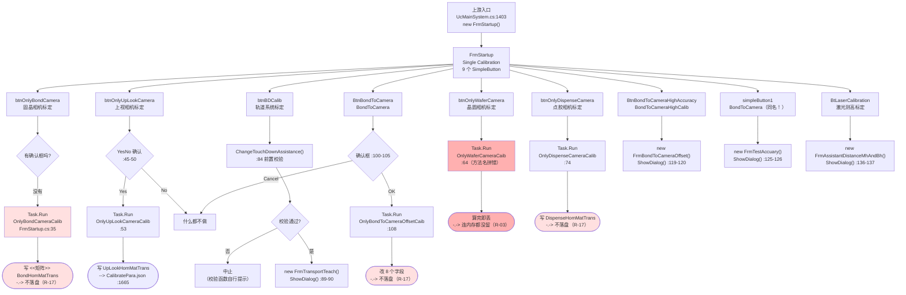

**ASCII 版**

```
 UcMainSystem.cs:1403 ──> FrmStartup（Single Calibration，9 个按钮）
                              │
   ┌──────────────────────────┼───────────────────────────────────────────┐
   │  5 个「单步 Only*」直接 Task.Run（无确认 / 无 try / 不禁用按钮）        │
   ├───────────────────────────────────────────────────────────────────────┤
   │ btnOnlyBondCamera      ──> OnlyBondCameraCalib        ⟹ ((Bond 矩阵))  -.-> 不落盘
   │ btnOnlyUpLookCamera    ──> [YesNo?] ─Yes─> OnlyUpLookCameraCalib
   │                                          ⟹ ((UpLook 矩阵)) ──> :1665 Save()
   │ btnOnlyWaferCamera     ──> OnlyWaferCameraCaib         ⟹ 算完即丢（连内存都没留）
   │ btnOnlyDispenseCamera  ──> OnlyDispenseCameraCalib     ⟹ ((Dispense 矩阵)) -.-> 不落盘
   │ BtnBondToCamera        ──> [OKCancel?] ─OK─> OnlyBondToCameraOffsetCaib
   │                                          ⟹ 改 8 个字段 -.-> 不落盘
   ├───────────────────────────────────────────────────────────────────────┤
   │  4 个「打开另一个窗体」                                                │
   │ btnBDCalib             ──> ChangeTouchDownAssistance ──> FrmTransportTeach
   │ BtnBondToCameraHighAccuracy ──> FrmBondToCameraOffset（该窗体的下一步点不动！）
   │ simpleButton1（文字却写 "BondToCamera"） ──> FrmTestAccuary（33 个按钮）
   │ BtLaserCalibration     ──> FrmAssistantDistanceMhAndBh
   └───────────────────────────────────────────────────────────────────────┘

 图例：((矩阵)) = 写 *HomMatTrans；-.-> = 只改内存不落盘；⟹ = 最终效果
```

| 步骤 | `文件:行` | 说明 |
|---|---|---|
| 上游打开 | `Main/Controls/Ucmain/MainControls/UcMainSystem.cs:1403` | `new FrmStartup()` |
| 无确认框直接起线程 | `Controls/FrmStartup.cs:33`→`:35` | `OnlyBondCameraCalib` |
| YesNo 确认后起线程 | `:43`→`:45-50`→`:53` | `OnlyUpLookCameraCalib` |
| 拼写错误的方法名 | `:62`→`:64` | `OnlyWaferCameraCaib`（`Caib`） |
| 前置校验 + 打开向导 | `:82`→`:84`→`:89-90` | `ChangeTouchDownAssistance()` / `FrmTransportTeach` |
| 确认框后起线程 | `:98`→`:100-105`→`:108` | `OnlyBondToCameraOffsetCaib` |
| 打开两个示教窗体 | `:117`→`:119-120`；`:123`→`:125-126` | `FrmBondToCameraOffset` / `FrmTestAccuary` |
| 打开激光测高示教 | `:134`→`:136-137` | `FrmAssistantDistanceMhAndBh` |

**坑：**

- **5 个 `Task.Run` 全部没有 `try/catch`、全部不禁用按钮。** 点两下就是两条并行标定链在抢同一批电机和同一个 `CalibrateRunPara` 单例。
- **按钮文字与行为的三处错配**：`simpleButton1` 文字是 `"BondToCamera"` 却打开 `FrmTestAccuary`（`:78`/`:79`/`:125`）；`BtnBondToCamera` 与 `simpleButton1` **文字完全相同**（`:96` 与 `:78`），用户在界面上看到两个一模一样的按钮，一个跑单步标定、一个开测试窗体。
- **`OnlyWaferCameraCaib` 的拼写错误是"只此一处"**：`grep -rn "WaferCameraCaib"` 与 `grep -rn "OnlyWaferCameraCalib"` 会得到不同结果，排查时容易漏。

### 4.4 一键自动标定（`CalibrateTask.StartAutoCalib`）★ 五个 `OKCancel` 对话框 ★

上游入口：`Main/Controls/Ucmain/MainControls/UcMainSystem.cs:1357` 附近（`Task.Run(StartAutoCalib)`）。
方法体：`Models/CalibrateTask.cs:2275-2403`，**全程在调用线程上同步跑**，任何一步返回 `false` 就 `return` 中止。

**图 6：一键自动标定 —— 5 个 `OKCancel` 对话框的串行链与取消后果**

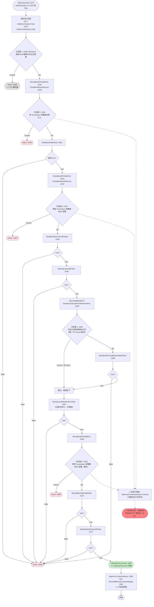

**ASCII 版**

```
 StartAutoCalib :2275 ──> Clear :2277/:2278
        │
   [对话框1 :2280 OKCancel]──Cancel──> return :2389    ⟹ 什么都没发生
        │OK
        ├─> [对话框2 :2295 放 Touchdown 吸嘴]──Cancel──> return :2310
        │        │OK
        │        └─> StartBondCalibTask :2303 ──false──> return :2305
        │                 └─true─> [对话框3 :2317 换 BMC 吸嘴]──Cancel──> return :2337
        │                          │OK
        │                          ├─> StartBondToCamCalibTask1 :2325 ──false──> return
        │                          └─> StartUpLookCalibTask     :2330 ──false──> return
        │                                   │true
        │                                   └─> [对话框4 :2342 标定片放两相机之间]
        │                                        └─ Cancel 无 else ⟹ **跳过继续**（唯一一个 Cancel 不等于中止的）
        │                                        └─> StartBondToCamBySameMarkTask :2350
        │                                   └─> StartUpLookMachinePosTask :2357 （**无条件执行**，不弹框）
        │                                   └─> [对话框5 :2363 换 BMC 吸嘴（与对话框3 重复）]
        │                                        │OK
        │                                        ├─> StartWaferTableCalibTask :2372 ──false──> return
        │                                        └─> StartWaferNPointCalibTask :2377 ──false──> return
        │                                                 │true
        │                                                 └─> calibratePara.Save() :2392   ⟹ CalibratePara.json
        │                                                 └─> SendUiAction → FrmCalibResult :2397
        ▼
   🔴 任一 Cancel 都到不了 :2392；但 MachineCoordinateSystem.Save() 已在子任务里落盘
      → 坐标系是新的、参数是旧的 ⟹ 机台进入不一致状态（R-18）
```

#### 调用链（带行号）

| 步骤 | `文件:行` | 说明 |
|---|---|---|
| 清空显示列表 | `Models/CalibrateTask.cs:2277` / `:2278` | `CalibCamScales`（`:149`）/ `CalibTransResults`（`:159`） |
| 对话框 1 | `:2280-2287` | 提示清理 bmc / 玻璃片 / 标记点表面 |
| 对话框 2 | `:2295-2299` | 放 Touchdown 吸嘴 → 子任务 1 |
| 子任务 1 | `:2303` → `:291 StartBondCalibTask()` | 返回值决定是否继续 |
| 对话框 3 | `:2317-2322` | 换 BMC 吸嘴 → 子任务 2、3 |
| 子任务 2 / 3 | `:2325` → `:1834 StartBondToCamCalibTask1()`；`:2330` → `:486 StartUpLookCalibTask()` | |
| 对话框 4 | `:2342-2347` | **唯一"Cancel = 跳过"的对话框**：`:2348 if (dialog4 == DialogResult.OK)` **没有 `else return`** |
| 子任务 4 | `:2350` → `:431 StartBondToCamBySameMarkTask()` | 仅在对话框 4 选 OK 时执行 |
| 子任务 5 | `:2357` → `:694 StartUpLookMachinePosTask()` | **无条件执行**，不弹框；返回 `false` 同样 `return`（`:2359`） |
| 对话框 5 | `:2363-2368` | 文字与对话框 3 几乎相同（换 BMC 吸嘴）→ 子任务 6、7 |
| 子任务 6 / 7 | `:2372` → `:725 StartWaferTableCalibTask()`；`:2377` → `:794 StartWaferNPointCalibTask()` | |
| **唯一的总 `Save()`** | `:2392 this.calibratePara.Save()` | 全链只有这一处写 `CalibratePara.json` |
| 结果框 | `:2394-2400` | 包在 `MainForm.SendUiAction` 里 |
| **对话框变量命名错位** | `:2342` 处变量叫 `dialog4`，`:2363` 处叫 `dialog3` | 代码顺序是 4 在前 3 在后 |

#### 图 7：子任务顺序与落盘时序图（谁什么时候写了盘）

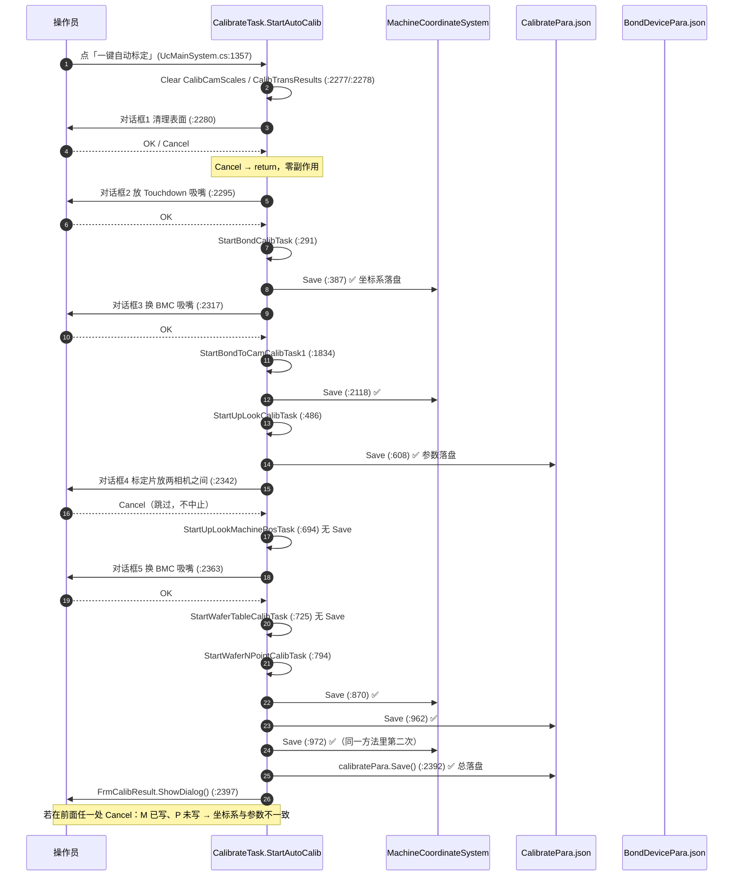

#### 读了什么、写了什么

| 类别 | 内容 |
|---|---|
| **读** | `calibratePara.BondCamUpLookCamMachinePos`（`:2340`）、各子任务内的 `CalibrateRunPara` 字段与 `MachineCoordinateSystem` |
| **写（内存）** | `CalibCamScales` / `CalibTransResults`（先被清空 `:2277`/`:2278`）；各子任务改写的 ~20 个位置字段 |
| **写（盘）** | **7 个子任务内部**的分散落盘：`MachineCoordinateSystem.Save()` 于 `:387`/`:546`/`:870`/`:972`/`:2118`；`calibratePara.Save()` 于 `:608`/`:962`；`BondDevicePara.Save()` 于 `:309`。**最后**才有一次总 `calibratePara.Save()`（`:2392`） |
| **界面反馈** | 5 个 `OKCancel` 模态框 + 最后 1 个只读结果框（`FrmCalibResult`） |

#### 坑

- 🔴 **任一 Cancel 都到不了 `:2392`，但坐标系已经落盘了。** 具体地：只要用户走过了「对话框 2 → 子任务 1」，`MachineCoordinateSystem.Save()`（`:387`）就已经写盘；此后无论在哪一步 Cancel，`CalibratePara.json` 都保持旧值。**结果就是"坐标系是这次标定的、参数是上一次的"**（R-18）。
- ⚠️ **5 个对话框的 Cancel 语义不一致**：前 3 个与第 5 个 Cancel = `return` 中止；**只有对话框 4（`:2342`）的 Cancel = 跳过继续**，而且它的提示文字里明确写了"此步可选择Cancel跳过"。代码上 `:2348` 的 `if` 没有配套 `else` —— 这是**故意**的，但对读代码的人来说与前 4 个形成了陷阱。
- ⚠️ **对话框 3（`:2317`）与对话框 5（`:2363`）文字几乎相同**（都是"请移除Touchdown吸嘴并更换BMC吸嘴"），而它们之间夹着 3 个子任务。用户很容易以为后一个是重复弹窗而随手 Cancel —— 那就是把子任务 6、7 跳过并丢掉总 `Save()`。
- ⚠️ **子任务 5（`StartUpLookMachinePosTask :694`）与子任务 6（`StartWaferTableCalibTask :725`）内部没有 `Save()`**（见上面的时序图）—— 它们的结果只有走到 `:2392` 才会落盘。所以它们之后紧跟着的对话框 5 若 Cancel，这两步白做。
- ⚠️ **全链没有 `try/catch`**：任何一个子任务抛异常（例如 `LocatePosition` 拿到 `null` → NRE，R-12），都会一路冒到 `Task`，前面已落盘的坐标系留在盘上、参数不落盘。
- ✅ **`StartAutoCalib` 自己是幂等的入门动作**（先清列表），但它**不是线程安全的**：没有重入保护，`UcMainSystem.cs:1357` 处也没有禁用入口按钮。

---

### 4.5 「固晶相机标定」→ 单站 N 点标定链（本目录最深的一条链）

**图 8：「固晶相机标定」单站 N 点标定链（含 3 条提前退出）**

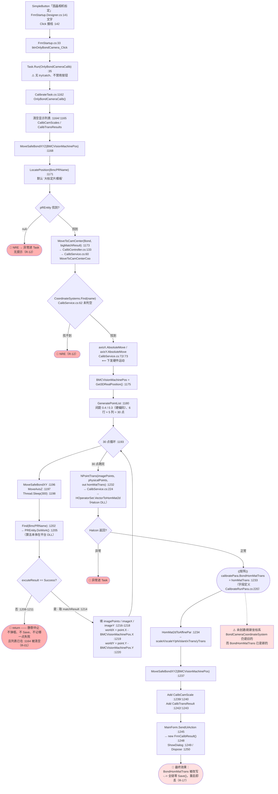

**ASCII 版**

```
 [固晶相机标定] FrmStartup.Designer.cs:141/142
     └─> FrmStartup.cs:33 ──> Task.Run(:35)   ⚠️ 无 try / 不禁用
          └─> CalibrateTask.cs:1162 OnlyBondCameraCalib()
               ├─ :1164/:1165 清空 CalibCamScales / CalibTransResults
               ├─ :1168 MoveSafeBondXYZ(BMCVisionMachinePos)
               ├─ :1171 LocatePosition("大标定片模板")   ─ null ─> NRE 🔴
               ├─ :1173 MoveToCamCenter(Bond, big) ─> CalibService.cs:62 Find ─ 未判空 ─> NRE 🔴
               │                                        :72/:73 AbsoluteMove ⟸ 硬件运动
               ├─ :1175 BMCVisionMachinePos = Get3DRealPosition()
               ├─ :1180 GeneratePointList(0.4, 0.3, 6, 5) ⟹ 30 点（间距硬编码，绕开 BMCCalibDistance）
               ├─ :1193 for 30 点 ─┐
               │      :1196 MoveSafeBondXY :1197 MoveAxisZ :1198 Sleep(300)
               │      :1202 Find(BmcPRName) :1205 DoWork()   ← 算法在平台 DLL
               │      :1208 if (不等于 Success) ──> :1211 return  🔴 **静默中止**
               │                                       不弹框 / 不 Save / 不记哪一点失败，
               │                                       而 :1164 已把上次的标定值清空
               │      :1214-1223 填 imagePoints / worldX / worldY（相对中心的 mm）
               │      └───────────┘
               ├─ :1232 NPointTrans(...) ─> CalibService.cs:224 VectorToHomMat2d（Halcon）
               ├─ :1233 ((矩阵)) calibratePara.BondHomMatTrans = homMatTrans
               ├─ :1234 HomMat2dToAffinePar → 像素比 / 旋转角
               ├─ :1239/:1242 生成两个"显示用"对象 → Add 到列表
               └─ :1245 SendUiAction → :1248 new FrmCalibResult() :1249 ShowDialog

 ⟹ 最终效果：BondHomMatTrans 被改写；弹出只读结果框
 🔴 全链 **零 Save()**（grep .Save() 于 :1162-1252 区间零命中）→ 只改内存，重启即丢
 ⚠️ 该链**不创建坐标系**，BondCameraCoordinateSystem 保持旧值 → 矩阵与坐标系来自不同次标定
```

#### 调用链

`FrmStartup.Designer.cs:141`（文字）/`:142`（接线）→ `FrmStartup.cs:33` → `:35 Task.Run` → `CalibrateTask.cs:1162`
→ `:1180 CalibService.GeneratePointList`（`Services/CalibService.cs:121`）
→ `:1193` 30 点循环 → `:1205 pREntity.DoWork()`（算法在平台 DLL）
→ `:1232 CalibService.NPointTrans`（`Services/CalibService.cs:202`，内部 `:224 HOperatorSet.VectorToHomMat2d`）
→ `:1233` 写 `BondHomMatTrans` → `:1234 HomMat2dToAffinePar` → `:1248 new FrmCalibResult()`

#### 读了什么、写了什么

| 类别 | 内容 |
|---|---|
| **读** | `calibratePara.BMCVisionMachinePos`（`:1168`）、`calibratePara.BmcPRName`（`:1171`，默认 `"大标定片模板"`，`CalibrateRunPara.cs:259`） |
| **写（内存）** | `calibratePara.BMCVisionMachinePos`（`:1175`）→ 落 `CalibratePara.json` 的同一个字段；`calibratePara.BondHomMatTrans`（`:1233`，字段定义 `CalibrateRunPara.cs:220`）；`CalibCamScales` / `CalibTransResults` 两个显示列表 |
| **写（盘）** | **无。** `grep -n '\.Save()' Models/CalibrateTask.cs` 命中 13 处（`:237/:267/:309/:387/:546/:608/:870/:962/:972/:1067/:1665/:2118/:2392`），**没有一处在 `:1162-1252` 区间内** |
| **硬件** | `MoveSafeBondXYZ` / `MoveAxisZ` / `AbsoluteMove`，共 30 轮 × 3 次运动 |
| **界面反馈** | 最后 1 个只读结果框（`FrmCalibResult`，`MainForm.SendUiAction` 包住） |

#### 坑

- 🔴 **`OnlyBondCameraCalib` 只改内存不落盘**（R-17）。而它改的正是生产定位最关键的 `BondHomMatTrans`。下一次进程重启，机台用回旧矩阵；用户在本次会话里看到的"新像素比"和实际生效的矩阵**不是同一份**。
- 🔴 **定位失败时静默 `return`（`:1208-1211`）**，而显示列表在 `:1164` 已被清空 —— 用户界面上原来能看到的上一次标定值一起消失，且没有任何提示（R-01）。
- ⚠️ **`GeneratePointList(..., 0.4, 0.3, 6, 5)` 的间距是写死的实参**（`:1180`），配置项 `CalibrateRunPara.BMCCalibDistance`（默认 `0.05`）在这条链上被完全绕开。而同一份代码在 `:337` 用的是 `0.1, 0.05, 6, 5` —— **同一个邦头相机，两条链的标定点间距差了 4 倍**（R-38）。
- ⚠️ **该链不创建坐标系。** `CreateCoordinateSystem` / `MachineCoordinateSystem.Save()` 只出现在别的链上（`:233-238`、`:387`、`:972`、`:2118`）。所以单步标定后，`BondCameraCoordinateSystem` 的 `DependentCoordinateSystem` 仍是旧的 —— 矩阵换成新的、坐标系没换。
- ⚠️ **`Task.Run` 无重入保护**：连点两次「固晶相机标定」会有两条链同时驱动 `MoveSafeBondXY`/`MoveAxisZ`，并且同时写 `BondHomMatTrans`。

---

### 4.6 五个 `Only*` 单步标定：算完存在哪 ★ 对照表 ★

五个 `Only*` 只有一个落盘。这张表是本目录最该记住的一张表。

**图 9：五个 `Only*` 单步标定「算完存在哪」对照**

```mermaid
flowchart LR
    subgraph IN["入口（全部在 FrmStartup 或诊断界面）"]
        S1["FrmStartup.cs:33<br/>固晶相机标定"]
        S2["FrmStartup.cs:43<br/>上视相机标定"]
        S3["FrmStartup.cs:62<br/>晶圆相机标定"]
        S4["FrmStartup.cs:72<br/>点胶相机标定"]
        S5["FrmStartup.cs:98<br/>BondToCamera"]
        S6["UcMainSystem.Diagnosis.cs:101/111/129/148/159<br/>诊断界面 5 个 Task.Run"]
    end

    subgraph M["CalibrateTask.cs 的五个 Only*"]
        O1["OnlyDispenseCameraCalib :1073"]
        O2["OnlyBondCameraCalib :1162"]
        O3["OnlyUpLookCameraCalib :1257"]
        O4["OnlyWaferCameraCaib :1712"]
        O5["OnlyBondToCameraOffsetCaib :1817"]
    end

    S4 --> O1
    S1 --> O2
    S2 --> O3
    S3 --> O4
    S5 --> O5
    S6 --> O1
    S6 --> O2
    S6 --> O3
    S6 --> O4
    S6 --> O5

    O1 --> R1["改写 DispenseHomMatTrans 等<br/>-.-> 内存"])
    O2 --> R2["改写 BondHomMatTrans :1233<br/>-.-> 内存"])
    O3 --> R3(["✅ :1665 calibratePara.Save()<br/>--> CalibratePara.json"])
    O4 --> R4["homMatTrans 局部变量 :1774<br/>-.-> **连内存都没留**（丢弃）"]
    O5 --> R5["改 8 个字段<br/>-.-> 内存"]

    R1 --> BAD(["🔴 重启后回滚到旧值<br/>（R-17）"])
    R2 --> BAD
    R4 --> WORSE(["🔴🔴 机台仍用旧矩阵<br/>用户却看到了新的像素比<br/>（R-03）"])
    R5 --> BAD
    R3 --> OK(["✅ 唯一落盘的一个"])

    O2 -.-> CS["⚠️ 该链不写 MachineCoordinateSystem<br/>矩阵与坐标系来自不同次标定"]

    style R4 fill:#ff8080
    style WORSE fill:#ff8080
    style BAD fill:#ffb0b0
    style R3 fill:#c8f0c8
    style OK fill:#c8f0c8
```

**ASCII 版**

```
 五个 Only* 单步标定 ── 算完之后，值到底去了哪里？

 ① OnlyDispenseCameraCalib  :1073-1161
      写：DispenseHomMatTrans 等（内存）        Save: 无   ⟹ 重启回滚
 ② OnlyBondCameraCalib      :1162-1256
      写：BMCVisionMachinePos(:1175) + BondHomMatTrans(:1233)   Save: 无   ⟹ 重启回滚
 ③ OnlyUpLookCameraCalib    :1257-1711
      写：UpLookHomMatTrans 等（内存）          Save: **:1665 calibratePara.Save()**  ⟹ ✅ 唯一落盘
 ④ OnlyWaferCameraCaib      :1712-1816
      写：只有两个"显示用"对象；homMatTrans(:1774) 是局部变量，方法返回即丢
                                              Save: 无   ⟹ 🔴 连内存都没留
 ⑤ OnlyBondToCameraOffsetCaib :1817-1833
      写：8 个字段（内存，由被调方 :2053/:2067/:2101 等改）  Save: 无  ⟹ 重启回滚

 对照：真正"会落盘"的晶圆相机标定是 StartWaferNPointCalibTask :794
        :882 WaferHomMatTrans = homMatTrans   +   :870 / :972 Save()
```

#### 逐条对照表

| # | 方法 `文件:行` | 入口 `文件:行` | 输入 | 算法 | 输出到哪个字段 | 落盘？ | 界面反馈 |
|---|---|---|---|---|---|---|---|
| 1 | `OnlyDispenseCameraCalib`（`Models/CalibrateTask.cs:1073-1161`） | `FrmStartup.cs:72`；`UcMainSystem.Diagnosis.cs:101` | `calibratePara.DispenseMarkVisionMachinePos` 等 | N 点仿射（点数 3×3，间距取配置 `DispenseCalibDistance`，`:1087`） | `DispenseHomMatTrans` + `DispenseMarkVisionMachinePos` | **无** | `FrmCalibResult`（`:1153`，`SendUiAction` 包住） |
| 2 | `OnlyBondCameraCalib`（`:1162-1256`） | `FrmStartup.cs:33`；`UcMainSystem.Diagnosis.cs:111` | `BMCVisionMachinePos`、`BmcPRName` | N 点仿射（30 点，间距 0.4/0.3 **硬编码**，`:1180`） | `BondHomMatTrans`（`:1233`）+ `BMCVisionMachinePos`（`:1175`） | **无** | `FrmCalibResult`（`:1248`） |
| 3 | `OnlyUpLookCameraCalib`（`:1257-1711`） | `FrmStartup.cs:43`（有 YesNo）；`UcMainSystem.Diagnosis.cs:129` | `UpLookCalibDistance`（`:504` 附近） | N 点仿射 | `UpLookHomMatTrans` 等 | **✅ `:1665 this.calibratePara.Save()`** | `FrmCalibResult`（`:1703`） |
| 4 | `OnlyWaferCameraCaib`（`:1712-1816`，**方法名拼写 `Caib`**） | `FrmStartup.cs:62`；`UcMainSystem.Diagnosis.cs:148` | 晶圆台左右标记点 | N 点仿射（`:1774 NPointTrans`） | ⚠️ **什么都不写**：`:1774` 的 `homMatTrans` 是**局部变量**，方法返回即丢；只有 `scaleX/scaleY/phi`（`:1790-1794`）与 `xTrans/yTrans/slant`（`:1797-1801`）被装进两个"显示用"对象 | **无** | `FrmCalibResult`（`:1808`）→ **显示的是算出来的新值，而机台仍在用旧矩阵** |
| 5 | `OnlyBondToCameraOffsetCaib`（`:1817-1833`） | `FrmStartup.cs:98`；`UcMainSystem.Diagnosis.cs:159` | 当前位置 + `HeadToCameraOffset` | 取放 + 视觉闭环（被调方 `:1834 StartBondToCamCalibTask1`） | 8 个位置字段（`:2053`/`:2054`/`:2067`/`:2068`/`:2101`/`:2102`/`:2181`/`:2183`） | **无** | `FrmCalibResult`（`:1828`，**唯一未用 `SendUiAction` 包住的一处**） |

#### 读了什么、写了什么、坑

- **读的都是同一个单例** `CalibrateRunPara.GetInstance()`；**写的也是同一个单例** —— 五个 `Only*` 互相之间没有隔离，一个跑完另一个立刻覆盖。
- 🔴 **③「上视相机标定」是五个里唯一落盘的**（`:1665`）。`grep -n '\.Save()' Models/CalibrateTask.cs` 的 13 处命中里，只有 `:1665` 落在五个 `Only*` 的方法区间内。
- 🔴 **④「晶圆相机标定」比"不落盘"更糟**：它连内存都没留（R-03）。对照 `StartWaferNPointCalibTask`（`:794`）的 `:882 WaferHomMatTrans = homMatTrans` + `:870`/`:972 Save()` —— **同一个物理量，N 点版本会存、单步版本什么都不存**（R-39）。
- 🔴 **② 会换掉矩阵却不换坐标系**：`OnlyBondCameraCalib` 改了 `BondHomMatTrans`，但 `MachineCoordinateSystem.Save()` 不在它的区间内。一次会话里先点「固晶相机标定」再点别的链，就可能出现"新矩阵 + 旧坐标系"。
- ⚠️ **五个 `Only*` 的 `Task.Run` 全部无 try/catch、不禁用按钮**，并且诊断界面（`Main/Controls/Ucmain/MainControls/UcMainSystem.Diagnosis.cs:101`/`:111`/`:129`/`:148`/`:159`）也是同样写法 —— 连点就是两条链同时抢电机。
- ⚠️ **④ 的方法名拼写是 `Caib`**，`grep OnlyWaferCameraCalib` 找不到它。

---

### 4.7 「下一步 / 完成」→ `FrmBondCalibTeach` 11 步向导（每一步都落盘）

**图 10：`FrmBondCalibTeach` 11 步向导 —— 每步一次 `Save()`，取消不回滚**

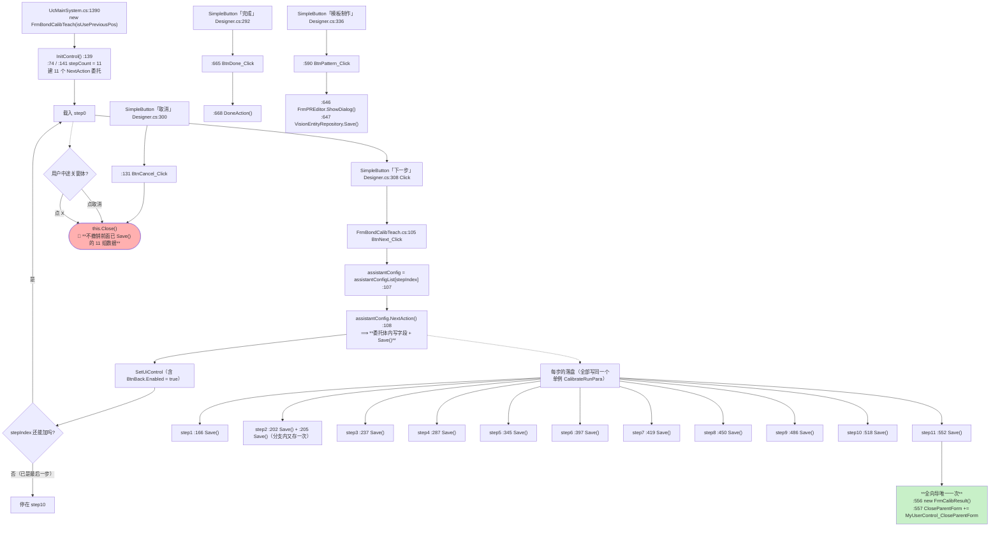

**ASCII 版**

```
 UcMainSystem.cs:1390 ──> FrmBondCalibTeach（stepCount = 11，:74/:141）
      │
 [下一步] Designer.cs:308 ─> :105 BtnNext_Click
      └─ :107 assistantConfig = list[stepIndex]
      └─ :108 assistantConfig.NextAction()   ⟹ 委托体内写字段 **并立即 Save()**
      └─ SetUiControl（刷新界面 / 启用「上一步」）

   11 个 NextAction 的落盘（**同一个单例 CalibrateRunPara**）：
     step1  :150 描述 ──> :166 Save()
     step2  :188 描述 ──> :202 Save()，分支内 :205 再 Save() 一次（同一步存两遍）
     step3  :226 描述 ──> :237 Save()
     step4  :276 描述 ──> :287 Save()
     step5  :322 描述（可 Cancel 跳过）──> :345 Save()
     step6  :365 描述 ──> :397 Save()
     step7  :407 描述 ──> :419 Save()
     step8  :439 描述 ──> :450 Save()
     step9  :475 描述 ──> :486 Save()
     step10 :506 描述（可跳过）──> :518 Save()
     step11 :538 描述 ──> :552 Save()
                        └─> :556 new FrmCalibResult()  ← 全向导**唯一一次**弹结果框
                        └─> :557 CloseParentForm += MyUserControl_CloseParentForm

 [取消] Designer.cs:300 ─> :131 ─> this.Close()
        🔴 **不回滚**：磁盘上已经是"半套新参数"，无日志、无提示
 [完成] Designer.cs:292 ─> :665 ─> :668 DoneAction()
 [模板制作] Designer.cs:336 ─> :590 ─> :646 FrmPREditor → :647 VisionEntityRepository.Save()
```

#### 调用链

`UcMainSystem.cs:1390` → `FrmBondCalibTeach.cs:141 InitControl()`（`:74`/`:141` 声明 `stepCount = 11`，`:150`/`:188`/`:226`/`:276`/`:322`/`:365`/`:407`/`:439`/`:475`/`:506`/`:538` 是 11 步的 `description`，`:166`/`:202`/`:205`/`:237`/`:287`/`:345`/`:397`/`:419`/`:450`/`:486`/`:518`/`:552` 是 12 处 `Save()`）
→ 按钮 `:105` → `:108 NextAction()`。

#### 读了什么、写了什么

| 类别 | 内容 |
|---|---|
| **读** | 当前位置（`Get3DRealPosition()`）、模板库（`VisionEntityRepository`）、`isUsePreviousPos` 构造参数 |
| **写（内存）** | 12 个 `CalibrateRunPara` 字段（`BMCVisionMachinePos`、`BMCMeasureHeightSearchMachinePos`、`waferCameraOffsetZ`、`BondRotateCenterToCameraOffset` 等） |
| **写（盘）** | **11 步 12 次 `CalibratePara.json` 落盘**；模板编辑时另落 `VisionEntityRepository`；`MyUserControl_CloseParentForm`（`:655`）回写 `GlobalCalibrationDomain` |
| **界面反馈** | 每步刷新界面；**结果框只在最后一步弹一次**（`:556`） |

#### 坑

- 🔴 **"取消"不回滚。** 11 步里已经 `Save()` 了 12 次，用户在第 9 步点「取消」，磁盘上留下的是"step1~step8 是本轮的新值、step9~step11 是上一轮的旧值"。**没有任何日志、没有任何提示**，且 `BtnCancel_Click`（`:131`）只有一句 `this.Close()`。
- ⚠️ **结果框只出现在最后一步**（`:556`），而中间 10 步的 `Save()` 都没有结果确认 —— 与 `FrmDispenseCalibTeach`（在 step2 就弹，见 §4.8）形成对比。
- ⚠️ **step2 的 `Save()` 存了两遍**（`:202` 与 `:205`），是分支里的重复写入（R-45 族）。
- ⚠️ **`_Load` 没有把 `stepIndex` 归零的保护**，而 `isUsePreviousPos` 是构造参数 —— 用"沿用上次位置"打开时，`startPos` 之类的中间状态可能还带着上一轮的值。
- ⚠️ **`MyUserControl_CloseParentForm`（`:655`）是运行时订阅的**（`:557`），Designer 里搜不到接线 —— 排查"结果框关闭后谁改了父窗体"时必须搜 `CloseParentForm`，不能只搜 `.Designer.cs`。

---

### 4.8 「下一步 / 完成」→ `FrmDispenseCalibTeach` 4 步向导

**图 11：`FrmDispenseCalibTeach` 4 步向导（结果框在 step2 就弹）**

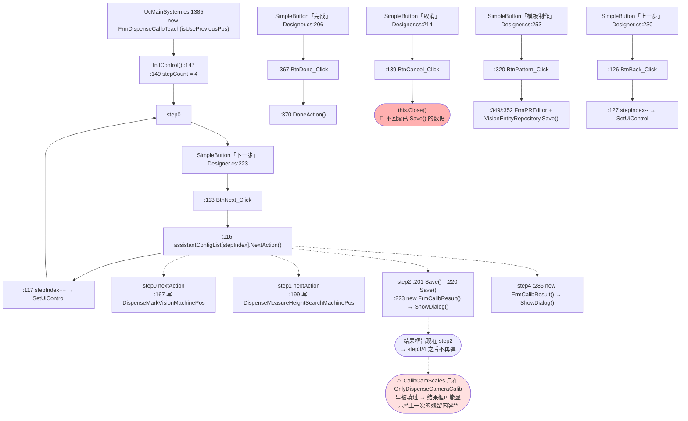

#### 调用链

`UcMainSystem.cs:1385` → `FrmDispenseCalibTeach.cs:147 InitControl()`（`:149 stepCount = 4`；`nextAction`：step0 `:167` 写 `DispenseMarkVisionMachinePos`，step1 `:199` 写 `DispenseMeasureHeightSearchMachinePos`，step2 `:201`/`:220` 两次 `CalibrateRunPara.Save()`，step3 `:262` 描述，step4 `:286` 弹结果框）
→ 按钮 `:113` → `:116 NextAction()`。

#### 读了什么、写了什么

| 类别 | 内容 |
|---|---|
| **读** | 当前位置、模板库 |
| **写（内存）** | `DispenseMarkVisionMachinePos`、`DispenseMeasureHeightSearchMachinePos` |
| **写（盘）** | `CalibrateRunPara.Save()` 于 `:201` 与 `:220`（**都在 step2**） |
| **界面反馈** | **两次结果框**：`:223`（step2）与 `:286`（step4） |

#### 坑

- ⚠️ **只在 step2 落了盘（`:201`/`:220`），step3 与 step4 没有 `Save()`**。也就是说走到最后一步再点「完成」，`DispenseMarkVisionMachinePos` 之类的值**不一定是最新的**。
- ⚠️ **结果框在 step2 就弹**，但那时向导还没走完 —— 用户看到"标定结果"后如果直接关窗，step3/step4 的示教就没做，而磁盘上已经落了 step2 的中间态。
- ⚠️ **`CalibCamScales` 只增不清**（清空点只有 `CalibrateTask.cs:1078`/`:1079`、`:1164`/`:1165`、`:2277`/`:2278`）—— 如果本次没有先跑过 `OnlyDispenseCameraCalib`，结果框显示的是**上一次**的标定值（见 §4.13）。
- 🔴 **「取消」（`:139`）与 `FrmBondCalibTeach` 一样不回滚**：`this.Close()`（`:141`）就结束了。

---

### 4.9 「完成」→ 光源亮度标定（起线程 + 6 张表整表落盘）

**图 12：「完成」→ `LightnessCalibration` 起线程 + 6 张映射表落盘**

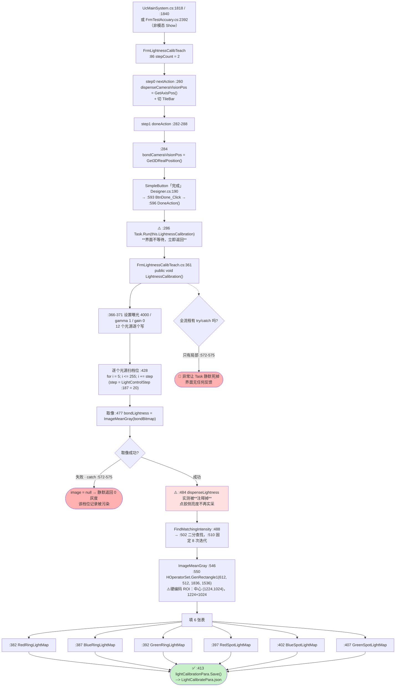

**ASCII 版**

```
 入口：UcMainSystem.cs:1818 / :1840  或  FrmTestAccuary.cs:2392（.Show() 非模态）
   └─> FrmLightnessCalibTeach（stepCount = 2，:86）
        step0 nextAction :260 = 记 dispenseCameraVisionPos + 切 TileBar
        step1 doneAction :282-288 = 记 bondCameraVisionPos(:284)
                                  + Task.Run(LightnessCalibration)(:286)  ⚠️ 不等待
 [完成] Designer.cs:190 ─> :593 ─> :596 DoneAction() ─> 上面那个 Task

 LightnessCalibration() :361  （public，界面不等待）
   ├─ :366-371 曝光 4000 / gamma 1 / gain 0（12 个光源逐个写）
   ├─ for (i = 5; i <= 255; i += 20)     ← step = LightControlStep(:187) = 20
   │     :477 bondLightness = ImageMeanGray(bondBitmap)
   │     :484 //dispenseLightness = ImageMeanGray(dispenseBitmap)   ⚠️ **被注释**，点胶侧不再实采
   │     :488 FindMatchingIntensity(dispenseLight, bondLightness, step)
   │            └─ :510 for (i = 0; i < 8; i++)  二分查找，固定 8 次
   │     :546 ImageMeanGray(bitmap)
   │            └─ :550 GenRectangle1(rectangle, 612, 512, 1836, 1536)
   │                 ⚠️ **硬编码 ROI**：中心 (1224,1024)、1224×1024，没有任何配置项
   ├─ :382/:387/:392  红/蓝/绿 环形光映射表
   ├─ :397/:402/:407  红/蓝/绿 点光映射表
   └─ :413 lightCalibrationPara.Save()   ✅ --> LightCalibratePara.json

 🔴 全流程**没有**包住整体的 try/catch（只有 :572-575 的局部 catch）
    → 抛异常时 Task 静默死掉，界面既没有进度也没有错误
```

#### 调用链

`FrmLightnessCalibTeach.cs:593 BtnDone_Click` → `:596 DoneAction()` → `:282-288` 委托 → `:286 Task.Run(this.LightnessCalibration)` → `:361 LightnessCalibration()` → `:459 CalibrateLightPair`（`:428` 扫档位）→ `:488 FindMatchingIntensity`（`:502`，`:510` 八个迭代）→ `:546 ImageMeanGray`（`:550` 硬编码 ROI）→ `:413 Save()`

#### 读了什么、写了什么

| 类别 | 内容 |
|---|---|
| **读** | `dispenseCameraVisionPos`（`:260`）、`bondCameraVisionPos`（`:284`）、`LightControlStep`（`:187` = 20）、`LightCalibrationPara` 的既有映射（作为"点胶侧亮度"输入） |
| **写（内存）** | 6 张映射表：`RedRingLightMap`（`:382`）、`BlueRingLightMap`（`:387`）、`GreenRingLightMap`（`:392`）、`RedSpotLightMap`（`:397`）、`BlueSpotLightMap`（`:402`）、`GreenSpotLightMap`（`:407`） |
| **写（盘）** | **✅ `:413 lightCalibrationPara.Save()`** → `LightCalibratePara.json`（路径定义 `Infrastructure/Models/Path/ZX2200PathConfig.cs` 内的 `LightCalibratePara` 节） |
| **硬件** | 12 个光源的曝光/增益设置；每个档位取一次图 |
| **界面反馈** | **没有进度、没有完成提示** —— `Task.Run` 起完线程后界面立刻回到可操作状态 |

#### 坑

- 🔴 **`Task.Run` 之后界面完全不等**（`:286`），也**没有 `try/catch`**（只有 `:572-575` 的局部 catch 把取像失败变成"0 灰度"）。用户点完「完成」看到界面没反应，无从判断标定是在跑、跑完了、还是抛异常死了。
- 🔴 **点胶侧亮度不再实采**：`:484 double dispenseLightness = this.ImageMeanGray(dispenseBitmap);` **被注释掉**，`FindMatchingIntensity`（`:488`）实际用的是 `LightCalibrationPara` 里**已有的**映射作为点胶侧输入。这使整个"双向映射"退化成"用旧表推新表"。
- ⚠️ **硬编码 ROI**（`:550`）：`GenRectangle1(612, 512, 1836, 1536)` 是"以像素 (1224,1024) 为中心、1224×1024 的矩形"，与 `Services/CalibController.cs:168` 的目标点同源。**换相机/换分辨率即失效，且没有任何配置项能改**（R-44）。
- ⚠️ **`BtnPattern_Click`（`:316`）的 `prName` 恒为空串**（`:321-327` 两个 `case` 被注释），`EditPr("")` 的行为依赖平台实现。
- ⚠️ **`LightnessCalibration` 是 `public`**（`:361`）—— 除了本窗体的「完成」按钮，外部也能直接调（见 §7.3）。

---

### 4.10 「完成」→ 晶圆相机 Z 向视差标定（`OffsetFitter` 最小二乘 + 落盘）

**图 13：「完成」→ 10 组 Z 向扫描 + 最小二乘 + 落盘（含坏点放行）**

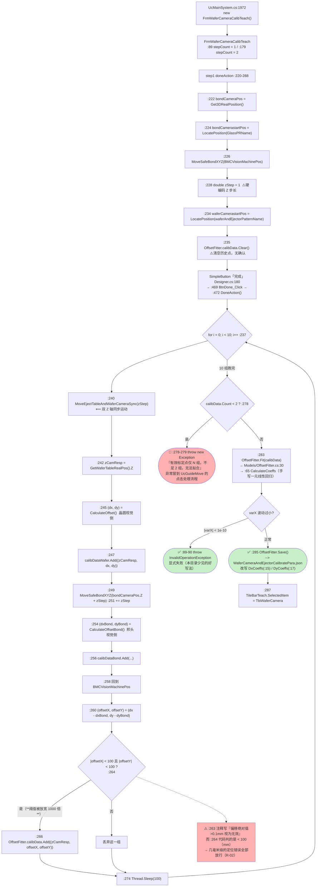

**ASCII 版**

```
 UcMainSystem.cs:1972 ──> FrmWaferCameraCalibTeach（:89 stepCount=1 / :179 stepCount=2）
   step1 doneAction :220-288：
     :222 bondCameraPos = Get3DRealPosition()
     :224 LocatePosition(GlassPRName)
     :226 MoveSafeBondXYZ(BMCVisionMachinePos)
     :228 double zStep = 1                ⚠️ 硬编码 Z 步长 1mm
     :234 LocatePosition(waferAndEjectorPatternName)
     :235 OffsetFitter.calibData.Clear()  ⚠️ 清空历史标定点，没有确认

 [完成] Designer.cs:180 ─> :469 ─> :472 DoneAction()
     └─ for (i = 0; i < 10; i++)                      ← 固定 10 组
          :240 MoveEjectTableAndWaferCameraSync(zStep)  ⟸ 双 Z 轴同步
          :242 zCamResp = GetWaferTableRealPos().Z
          :245 CalculateOffset()        晶圆侧 (dx, dy)   ─> :247 calibDataWafer
          :249 MoveSafeBondXYZ(...Z + zStep)  :251 += zStep
          :254 CalculateOffsetBond()    邦头侧 (dxBond, dyBond) ─> :256 calibDataBond
          :258 回到 BMCVisionMachinePos
          :260 (offsetX, offsetY) = (dx - dxBond, dy - dyBond)   ← 两相机差
          :264 if (|offsetX| < 100 && |offsetY| < 100)   ⚠️ **注释说 0.1mm，代码判 100mm**
                 └─ :266 calibData.Add((zCamResp, offsetX, offsetY))
          :274 Thread.Sleep(100)
     ├─ :278 if (calibData.Count < 2) → :279 throw 🔴（异常冒到 UcGuideMove）
     └─ :283 OffsetFitter.Fit() → OffsetFitter.cs:30 → :65 CalculateCoeffs（手写最小二乘）
        └─ :285 OffsetFitter.Save()  ✅ --> WaferCameraAndEjectorCalibratePara.json
             改写 DxCoeffs(:15) / DyCoeffs(:17)
        └─ :287 TileBarTeach.SelectedItem = TbiWaferCamera

 另有：:376 //package.Save();  ← Excel 导出被注释掉（R-24）
       :480 btnEjectorUpDown_Click 方法体为空 + simpleButton1 无接线 → **死按钮**
```

#### 调用链

`FrmWaferCameraCalibTeach.cs:469 BtnDone_Click` → `:472 DoneAction()` → `:220-288` 委托
→ `:240` 双 Z 轴同步（`WaferTableController.MoveEjectTableAndWaferCameraSync`）
→ `:245 CalculateOffset` / `:254 CalculateOffsetBond`
→ `:283 OffsetFitter.Fit` → `Models/OffsetFitter.cs:30 Fit` → `:65 CalculateCoeffs`
→ `:285 OffsetFitter.Save()`

#### 读了什么、写了什么

| 类别 | 内容 |
|---|---|
| **读** | `calibratePara.GlassPRName`、`calibratePara.BMCVisionMachinePos`、`waferAndEjectorPatternName`（由 `BtnPattern_Click` 的 `case0` 给出，`:322` 一带） |
| **写（内存）** | `OffsetFitter.calibData`（`:235` 先 `Clear()` 再逐组 `Add`）、`DxCoeffs` / `DyCoeffs`（`Models/OffsetFitter.cs:15` / `:17`） |
| **写（盘）** | **✅ `:285 OffsetFitter.Save()`** → `WaferCameraAndEjectorCalibratePara.json`；模板编辑时另落 `VisionEntityRepository.Save()`（`:428`） |
| **硬件** | 10 轮"晶圆台与晶圆相机 Z 同步 + 邦头 Z 跟随"，每轮两次视觉定位 |
| **界面反馈** | 切一下 TileBar（`:287`）；**没有结果框、没有误差提示** |

#### 坑

- 🔴 **异常值过滤阈值放宽了 1000 倍**（R-02）：`:263` 注释写"偏移绝对值 > 0.1mm 视为无效"，`:264` 判的是 `< 100`（单位 **mm**）。任何几毫米级的视觉定位错误都会**通过**过滤，被 `:266` 收进 `calibData`，再经 `:283 Fit` → `:285 Save()` 写进 JSON —— 生产取放料就按这条错误的 Z-偏移直线补偿。
- 🔴 **`:235 calibData.Clear()` 无确认、无备份**：点一次「完成」就把历史标定点全部清掉，若本轮的 10 组因取像失败而无效，`Fit` 用的是残缺数据。
- ⚠️ **`:278` 的 `throw` 抛在 `doneAction` 委托里**，由向导骨架（`UcGuideMove` 的点击处理流程）承接，**本窗体的 `try/catch` 不覆盖它** —— 异常出口不确定（R-13）。
- ⚠️ **`:228 double zStep = 1` 硬编码**，扫描范围固定 10mm；`FrmWaferCameraCalibTeach` 的界面里没有 Z 步长输入框。
- ⚠️ **`:264` 判据用 `Math.Abs(offsetX) < 100`，而 `offsetX` 的单位是 mm**（`CalculateOffset` 返回的是 `MatchResult.CenterX` 差值经坐标换算后的值）—— 注释与代码不一致这件事本身就是维护陷阱。
- ⚠️ **Excel 导出被注释**（`:376 //package.Save();`），只有内存与 JSON 有记录，没有留档（R-24）。
- ✅ **`OffsetFitter` 的样本数与除零都有显式保护**（`:33-34` 与 `:89-90` 抛异常），是本目录少见的"显式失败"（R-47）。

---

### 4.11 「搜索中心」→ 无上限重试 + 3 mm 距离保护

**图 14：「搜索中心」的 3 条分支（模板缺失 / 定位失败 / 距离越界）**

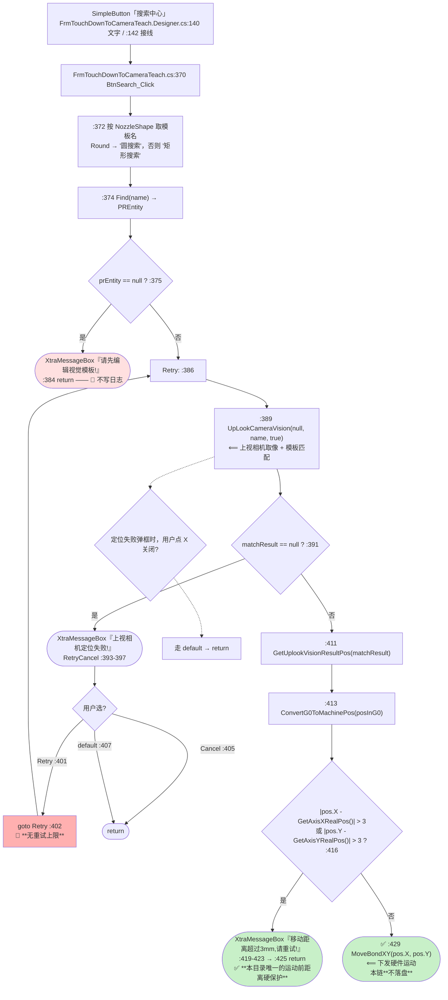

**ASCII 版**

```
 [搜索中心] FrmTouchDownToCameraTeach.Designer.cs:140/142
   └─> FrmTouchDownToCameraTeach.cs:370 BtnSearch_Click
        :372 name = nozzle.NozzleShape == Round ? "圆搜索" : "矩形搜索"   ★ 模板名硬编码
        :374 prEntity = VisionEntityRepository.Find(name)
        :375 if (prEntity == null) ──> XtraMessageBox "请先编辑视觉模板!" ──> :384 return
                                       🔴 只弹框，不写日志
        :386 Retry:                       ← 标号
        :389 matchResult = system2Controller.UpLookCameraVision(null, name, true)
        :391 if (matchResult == null)
        │      :393-397  XtraMessageBox "上视相机定位失败!"  [Retry] [Cancel]
        │      :401 case Retry:  ──> :402 goto Retry     🔴 **无重试上限，可无限弹框**
        │      :405 case Cancel: ──> return
        │      :407 default:     ──> return
        :411 posInG0 = GetUplookVisionResultPos(matchResult, null)
        :413 pos = ConvertG0ToMachinePos(posInG0)
        :416 if (|pos.X - GetAxisXRealPos()| > 3 || |pos.Y - GetAxisYRealPos()| > 3)
        │      :419-423 XtraMessageBox "移动距离超过3mm,请重试!"  ──> :425 return
        │      ✅ 这是**本目录唯一的"运动前距离硬保护"**
        :429 MoveBondXY(pos.X, pos.Y)   ⟸ 下发硬件运动

 ⟹ 本链**不落盘**，只驱动硬件；3 个分支全部只弹框、**零日志**
```

#### 调用链

`FrmTouchDownToCameraTeach.Designer.cs:142` → `FrmTouchDownToCameraTeach.cs:370`
→ `:389 system2Controller.UpLookCameraVision(...)` → `:413 bondModuleController.ConvertG0ToMachinePos(...)`
→ `:429 bondModuleController.MoveBondXY(...)`

> ⚠️ **本窗体零调用点**（§4.1）：这条链在当前代码里跑不到。但它引用的是活的平台 API，且同族逻辑（`CalibController.LocateAndMoveToTargetPixel`）在别的链上仍在用，所以这里仍按"活代码"来讲解。

#### 读了什么、写了什么

| 类别 | 内容 |
|---|---|
| **读** | 喷嘴形状（`nozzle.NozzleShape`）、上视相机实时图像、当前轴实际位置（`GetAxisXRealPos()` / `GetAxisYRealPos()`） |
| **写（内存）** | 无 |
| **写（盘）** | **无** |
| **硬件** | `:429 MoveBondXY` 一次（并且先经 3mm 越界检查） |
| **界面反馈** | 3 条分支各弹一个模态框 |

#### 坑

- 🔴 **`goto Retry`（`:402`）没有重试上限**：用户按住回车不放可以无限重试；这是 R-15 的第 2 条（另两条是 `FrmGlobalCalibration.cs:315/:349` 与 `FrmGlobalCalibrationEx.cs:260-262` 的 `while (true)`）。
- ✅ **`:416` 的 3mm 距离保护是本目录少见的正向设计**：在"定位漂了"的情况下拒绝移动，避免把邦头拽到几十毫米外。**代价是它也是这条 `goto` 循环的唯一出口**（模板不匹配时反复弹框，用户只能 Cancel）。
- ⚠️ **3 条分支全部只用 `XtraMessageBox`，没有一条写日志**（`:384`、`:393-397`、`:419-423`）—— 现场排查"为什么没动"时，日志里查不到任何痕迹。
- ⚠️ **模板名硬编码为 `"圆搜索"` / `"矩形搜索"`**（`:372`）：用户在视觉模板库里改名，这个按钮立刻失效并提示"请先编辑视觉模板"。
- ⚠️ **`FrmNozzleAlignmentTeach_FormClosing`（`:268`）在运动中 `e.Cancel = true`（`:273`）** —— 与上面的无限重试叠加，会形成"关不掉、只能一直点 Cancel"的局面（R-35）。

---

### 4.12 搬运示教向导与"被接上取消的布局面板"

**图 15：`FrmTransportTeach` 的按钮 / 布局面板 / 落盘**

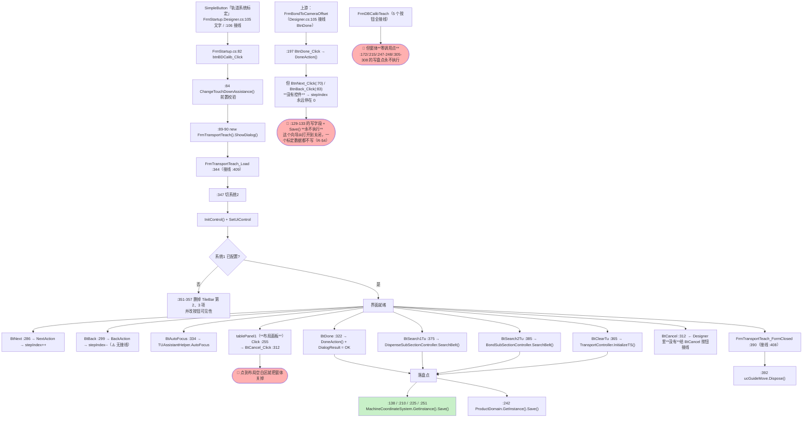

**ASCII 版**

```
 [轨道系统标定] FrmStartup.Designer.cs:105/106
   └─> FrmStartup.cs:82 ─> :84 ChangeTouchDownAssistance() 前置校验
                        └─> :89-90 new FrmTransportTeach().ShowDialog()

 FrmTransportTeach_Load :344（接线 :409）
   ├─ :347 切系统2 → InitControl() + SetUiControl
   └─ 若系统1 未配置：:351-357 删 TileBar 第 2、3 项 + 改按钮可见性

 可点区域                                 落盘
   BtNext      :286  NextAction            ──┐
   BtBack      :299  **无接线**（死）        │
   BtAutoFocus :334  TUAssistantHelper     │  :138 / :210 / :225 / :251
   BtClearTu   :365  InitializeTS()        ├─> MachineCoordinateSystem.Save()
   BtSearch1Tu :375  SearchBelt(系统1)     │  :242
   BtSearch2Tu :385  SearchBelt(系统2)     └─> ProductDomain.Save()
   BtDone      :322  DoneAction + OK
   BtCancel    :312  this.Close()  ← Designer 没给 BtCancel 按钮接线
   tablePanel1 :255  **布局面板被接上 BtCancel_Click**  🔴 点到空白就关窗

 FormClosed :390（接线 :408）──> :392 ucGuideMove.Dispose()

 ── 同族向导的两个"永不执行"陷阱 ──────────────────────────────
 FrmBondToCameraOffset：BtnNext(:70)/BtnBack(:83) 没有控件
   → stepIndex 永远是 0 → :129-133 的写字段 + Save() **永不执行**  🔴
 FrmDBCalibTeach：5 个按钮全接线，但**窗体零调用点**  🔴
   → :172/:215/:247-248/:305-308 的写盘点永不执行
```

#### 调用链

`FrmStartup.cs:82` → `:84` 前置校验 → `:89-90 new FrmTransportTeach().ShowDialog()` → `FrmTransportTeach.cs:344 Load` → 各按钮 → 4 处 `MachineCoordinateSystem.Save()` + 1 处 `ProductDomain.Save()` → `:390 FormClosed` → `:392 ucGuideMove.Dispose()`

#### 读了什么、写了什么

| 类别 | 内容 |
|---|---|
| **读** | `TransportDomain` / `BondSubSectionController` / `DispenseSubSectionController` / `TransportController` 的实时状态、`CurrentMachineSystem` |
| **写（内存）** | 各控制器内部状态；`ProductDomain` |
| **写（盘）** | **4 处 `MachineCoordinateSystem.GetInstance().Save()`**（`:138`/`:210`/`:225`/`:251`）+ **1 处 `ProductDomain.GetInstance().Save()`**（`:242`） |
| **界面反馈** | 按 `stepIndex` 切换 TileBar 内容；系统1 未配置时隐藏对应按钮 |

#### 坑

- 🔴 **`tablePanel1` 被接上了 `BtCancel_Click`**（`FrmTransportTeach.Designer.cs:255`）：`tablePanel1` 是铺满窗体的容器，用户点按钮之间的缝隙、点空白背景，都会触发「取消」关窗。这是本目录唯一一处**反向误接线**（§4.2.15）。
- 🔴 **`BtCancel` 按钮自己没有接线**（`Designer.cs:208` 接的是 `BtBack`、`:255` 接的是 `tablePanel1`）—— 也就是说界面上那个写着「取消」的按钮**点不动**，而真正的"取消"藏在一个看不见的布局面板上。
- 🔴 **`BtBack`（`:299`）无接线**（前一阶段漏登记，见表 §4.2 计数核对第 5 行）：这个向导能"下一步"但不能"上一步"。
- ⚠️ **同族两个向导的"永不执行"陷阱**（见 ASCII 图下半部分）：
  - `FrmBondToCameraOffset`：`BtnNext_Click`（`:70`）/`BtnBack_Click`（`:83`）**没有对应控件** → `stepIndex` 恒为 0 → `:129-133` 的写字段与 `CalibrateRunPara.Save()` **永不执行**（R-54）。
  - `FrmDBCalibTeach`：5 个按钮全部接线，但**窗体零调用点** → `:172`/`:215`/`:247-248`/`:305-308` 的写盘点**永不执行**。
- ⚠️ **没有 FormClosing 安全收尾**（对比 `FrmAssistantDistanceMhAndBh.cs:265` 会关气缸 + `MoveToSafePos`）：搬运示教关窗时不做任何硬件安全动作。

---

### 4.13 `FrmCalibResult` 的"假确认"★ 按钮文案与行为不符 ★

**图 16：`FrmCalibResult` 的 OK / Cancel 是同一条路径**

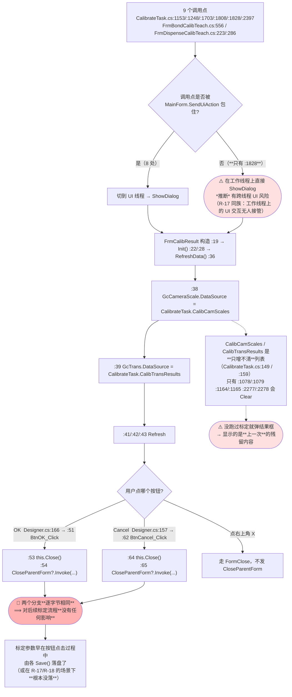

**ASCII 版**

```
 9 个调用点 → FrmCalibResult
   CalibrateTask.cs :1153 / :1248 / :1703 / :1808 / :1828 / :2397
   FrmBondCalibTeach.cs :556
   FrmDispenseCalibTeach.cs :223 / :286
        │
        ├─ 8 处包在 MainForm.SendUiAction 里（:1150 / :1245 / :1700 / :1805 / :2394 …）
        └─ **:1828 是唯一没包的** ⚠️ 工作线程直接 ShowDialog（R-17 同族）

 构造 :19 → Init() :22/:28 → RefreshData() :36
    :38 GcCameraScale.DataSource = CalibrateTask.CalibCamScales     （只读展示）
    :39 GcTrans.DataSource       = CalibrateTask.CalibTransResults  （只读展示）

 用户点 [OK]     Designer.cs:166 → :51 BtnOK_Click
           :53 this.Close()   :54 this.CloseParentForm?.Invoke(this, EventArgs.Empty)
 用户点 [Cancel] Designer.cs:157 → :62 BtnCancel_Click
           :64 this.Close()   :65 this.CloseParentForm?.Invoke(this, EventArgs.Empty)
                 ↑ **两个方法体逐字节相同**

 ⟹ 点 OK 还是 Cancel，对后续标定流程**没有任何影响**
    标定参数早在点按钮的过程中由各 Save() 落盘了
    （而在 R-17 / R-18 的场景里，**根本没落盘** —— 这个框给的是"已确认"的错觉）

 ⚠️ CalibCamScales / CalibTransResults 是**只增不清**列表（CalibrateTask.cs:149 / :159）
    清空点只有 :1078/:1079、:1164/:1165、:2277/:2278
    → 没跑过标定就弹结果框，显示的是上一次的残留内容
```

#### 调用链

`CalibrateTask.cs:1248`（或另 8 处）→ `FrmCalibResult.cs:19` 构造 → `:22 Init()` → `:28 Init()` 定义 → `:30 RefreshData()` → `:36 RefreshData()` 定义 → 绑两个 `DataSource`。
按钮：`FrmCalibResult.Designer.cs:166` → `:51 BtnOK_Click`；`:157` → `:62 BtnCancel_Click`。

#### 读了什么、写了什么

| 类别 | 内容 |
|---|---|
| **读** | `CalibrateTask.GetInstance().CalibCamScales`（`Models/CalibrateTask.cs:149`）、`CalibTransResults`（`:159`） |
| **写（内存）** | 无 |
| **写（盘）** | **无** |
| **硬件** | 无 |
| **界面反馈** | 弹出两个只读表格；关闭时触发 `CloseParentForm` 事件（若有人订阅） |

#### 坑

- 🔴 **"确定"其实是"关闭"**（R-40）：`BtnOK_Click`（`:51-55`）与 `BtnCancel_Click`（`:62-66`）**逐字节相同**（`:53`/`:64` 是 `this.Close()`，`:54`/`:65` 是 `CloseParentForm?.Invoke`）。用户以为点「确定」就确认并保存了标定结果 —— 而**调用方在弹窗之后没有任何保存动作**（`CalibrateTask.cs:1150-1156`、`:2394-2400`）。
- 🔴 **它掩盖了 R-17 / R-18**：`OnlyBondCameraCalib` 等链算完就弹这个框，用户点了「OK」，以为落盘了 —— 实际上全链零 `Save()`。**这是"假确认"最危险的地方。**
- ⚠️ **点右上角 X 不发 `CloseParentForm`**：此时 `FrmBondCalibTeach.cs:557` / `FrmDispenseCalibTeach.cs:224`/`:287` 订阅的回写逻辑不会执行（`CloseParentForm` 只在两个按钮的处理器里 `Invoke`）。**关闭方式的差异导致不同的副作用**。
- ⚠️ **`:1828` 是唯一没有 `MainForm.SendUiAction` 包住的一处**（R-17 同族：工作线程上的 UI 交互无人接管）：`OnlyBondToCameraOffsetCaib` 由诊断界面的 `Task.Run`（`UcMainSystem.Diagnosis.cs:159`）调用，这里在工作线程上直接 `new` 窗体 + `ShowDialog`。
- ⚠️ **两个 `DataSource` 是"只增不清"的列表**：清空点只有 `CalibrateTask.cs:1078`/`:1079`（点胶）、`:1164`/`:1165`（Bond）、`:2277`/`:2278`（一键自动标定）。走 `FrmBondCalibTeach`（`:556`）或 `FrmDispenseCalibTeach`（`:223`/`:286`）弹框时**不会清空**，所以框里显示的可能是上一次的标定值。

---

### 4.14 旧版全局标定 `FrmGlobalCalibration`「开始」的 8 个分支

**图 17：`FrmGlobalCalibration`「开始」→ `CmbChooseType` 八路分派 + 各自落盘点**

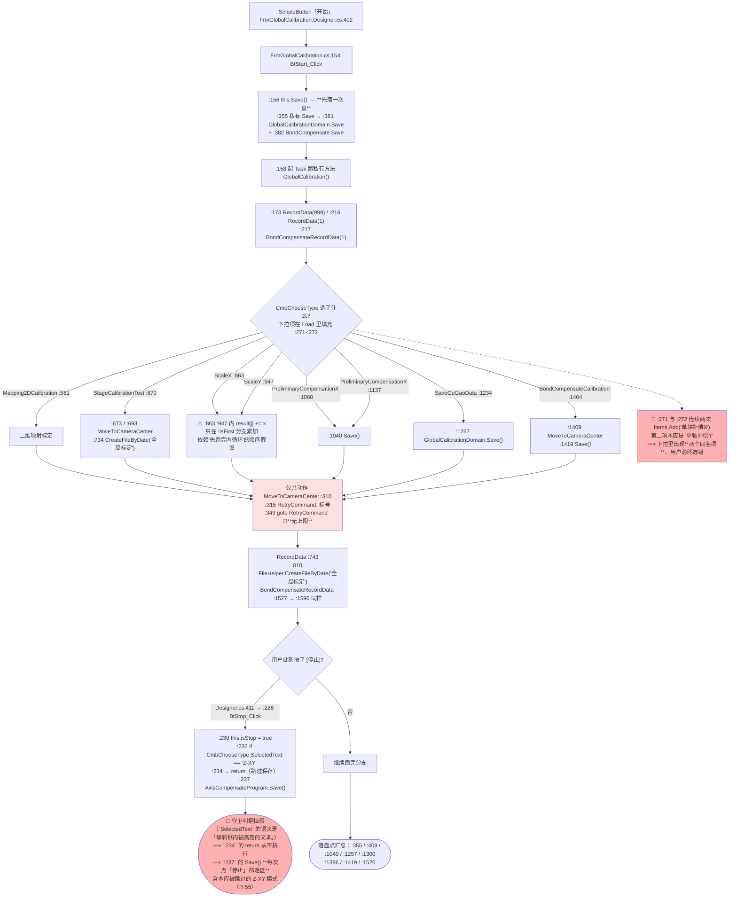

**ASCII 版**

```
 [开始] FrmGlobalCalibration.Designer.cs:402
   └─> FrmGlobalCalibration.cs:154 BtStart_Click
        :156 this.Save()          ← 先把界面上的行列数/间距落一次盘
                                     :355 私有 Save → :381 GlobalCalibrationDomain.Save()
                                                     :382 BondCompensate.Save()
        :158 起 Task → 私有方法 GlobalCalibration()
              :173 RecordData(999) / :216 RecordData(1) / :217 BondCompensateRecordData(1)

 按 CmbChooseType 分派（下拉项在 Load :271-:272 填充）—— **八路**：
   Mapping2DCalibration        :581
   StageCalibrationTest        :670   → :673/:693 MoveToCameraCenter → :734 CreateFileByDate("全局标定")
   ScaleX                      :863   ⚠️ result[j] += x 只在 !isFirst 分支累加
   ScaleY                      :947   ⚠️ 同上，依赖"第一次外循环先跑完内循环"的顺序假设
   PreliminaryCompensationX   :1060   → :1040 Save()
   PreliminaryCompensationY   :1137   → :1040 Save()
   SaveGuGaoData              :1234   → :1257 GlobalCalibrationDomain.Save()
   BondCompensateCalibration  :1404   → :1409 MoveToCameraCenter → :1419 Save()

 公共动作：
   MoveToCameraCenter(prName) :310 → :315 RetryCommand: → :349 goto RetryCommand  🔴 无上限
   RecordData(count)          :743 → :810 CreateFileByDate("全局标定")
   BondCompensateRecordData   :1527 → :1596 CreateFileByDate("全局标定")

 落盘点：:355 / :409 / :1040 / :1257 / :1300 / :1386 / :1419 / :1520
 停止：  Designer.cs:411 → :228 BtStop_Click → :230 isStop = true
                             :232 if (CmbChooseType.SelectedText == "Z-XY")
                             :234     return;                  ← 守卫：Z-XY 不存补偿
                             :237 AxisCompensateProgram.Save()
        🔴 SelectedText 的语义是"编辑框内被高亮的文本"（声明在 DevExpress TextEdit 上，
           不是 ComboBoxEdit 的"选中项"）→ :232 恒为 false → :234 的 return 从不执行
           → :237 的 Save() 每次点「停止」都执行，含本应被跳过的 Z-XY 模式（R-55）

 🔴 :271 与 :272 连续两次 Items.Add("单轴补偿X")
     第二项本应是 "单轴补偿Y" → 下拉里出现两个同名项，用户必然选错

 切换下拉：Designer.cs:564 → :390 CmbChooseType_SelectedIndexChanged
                             :392 if (SelectedText == "固晶补偿标定"        ← 索引 5，恒假
                                   || SelectedText == "2维补偿和固晶补偿标定" ← 索引 6，恒假
                                   || SelectedIndex == 7)                  ← 索引 7 = "2维补偿和固晶补偿验证"
                             :394     GpBondCompensate.Enabled = true;
                             :398 else GpBondCompensate.Enabled = false;
        🔴 Items 实际顺序: 0 验证数据 / 1 2维补偿 / 2 单轴补偿X / 3 单轴补偿X
                          4 测试贴片精度 / 5 固晶补偿标定 / 6 2维补偿和固晶补偿标定
                          7 2维补偿和固晶补偿验证
           → 作者想覆盖的 5、6 两个模式**面板永久灰**，唯一点亮的却是"验证"模式（R-57）
```

#### 调用链

`FrmGlobalCalibration.Designer.cs:402` → `FrmGlobalCalibration.cs:154 BtStart_Click`
→ `:156 this.Save()` → `:158` 起 `Task` → `:168` 私有方法 `GlobalCalibration()`
→ 按 `CmbChooseType` 分派到 8 个方法之一（`:581` / `:670` / `:863` / `:947` / `:1060` / `:1137` / `:1234` / `:1404`）
→ 公共动作 `:310 MoveToCameraCenter` / `:743 RecordData` / `:1527 BondCompensateRecordData`
停止：`Designer.cs:411` → `:228 BtStop_Click`

#### 读了什么、写了什么

| 类别 | 内容 |
|---|---|
| **读** | `CmbChooseType` 的下拉选择、界面上的行列数/间距 SpinEdit、视觉定位结果、当前轴位置 |
| **写（内存）** | `GlobalCalibrationDomain`（行列数、间距、`StartPoint3D`）、`BondCompensate`、`AxisCompensateProgram` |
| **写（盘）** | **8 处 `Save()`**：`:355`（`:381 GlobalCalibrationDomain` + `:382 BondCompensate`）、`:409`、`:1040`、`:1257`、`:1300`、`:1386`、`:1419`、`:1520`；另有 Excel 侧 `:810`/`:734`/`:1596` 的 `CreateFileByDate("全局标定")` |
| **硬件** | `MoveToCameraCenter` 反覆移动 + 拍照（`goto` 重试） |
| **界面反馈** | 无进度条；`isStop` 只做标志位，界面不知道跑到哪了 |

#### 坑

- 🔴 **`:271`/`:272` 两个下拉项同名**：连续两次 `Items.Add("单轴补偿X")`，第二项本应是 `"单轴补偿Y"`。**用户在界面上无法分辨**，选到第二项时实际执行的是 `ScaleY` 分支（`:947`），但标签写着 X。
- 🔴 **`MoveToCameraCenter` 的 `goto RetryCommand`（`:349` ← `:315`）无重试上限**（与 §4.11 同族，R-15）。
- 🔴 **`:232` 用 `CmbChooseType.SelectedText` 判 `"Z-XY"`，方向与直觉相反**：`:232-:234` 是 `if (…) { return; }` —— 它是"**Z-XY 模式下不要存补偿数据**"的**守卫**，`:237` 的 `AxisCompensateProgram.Save()` 在守卫**之外**。判据恒假 ⇒ 守卫从不生效 ⇒ **`:237` 的 `Save()` 每次点「停止」都会执行**，包括本应被跳过的 Z-XY 模式（R-55）。
- 🔴 **`:392` 的判据只覆盖了索引 7，恰好漏掉它想覆盖的两个模式**：`Items` 的实际顺序是 `0 验证数据`(`:269`)、`1 2维补偿`(`:270`)、`2 单轴补偿X`(`:271`)、`3 单轴补偿X`(`:272`)、`4 测试贴片精度`(`:273`)、`5 固晶补偿标定`(`:274`)、`6 2维补偿和固晶补偿标定`(`:275`)、`7 2维补偿和固晶补偿验证`(`:276`)。`:392` 的三条析取里，`SelectedText == "固晶补偿标定"`（索引 **5**）与 `SelectedText == "2维补偿和固晶补偿标定"`（索引 **6**）**恒假**，只有 `SelectedIndex == 7`（"**验证**"）能成立 ⇒ **用户选中"固晶补偿标定"或"2维补偿和固晶补偿标定"时，"固晶补偿标定相机"整个分组永久变灰**，而这两个模式恰恰是要读这组参数的（`:1408`/`:1429-:1442`）；反而"验证"模式（索引 7）能把面板点亮。见 R-57。
- ⚠️ **`ScaleX`/`ScaleY`（`:863`/`:947`）的 `result[j] += x` 只在 `!isFirst` 分支累加**：整套累加依赖"第一次外循环先把内循环跑完"的顺序假设；一旦循环顺序因重试被打断，累加基数就错了，而代码里没有任何断言。
- ⚠️ **「开始」先落一次盘（`:156`）**：用户只是想跑标定，却在标定**开始前**就把界面上的行列数/间距写进了 JSON。若标定中途失败，JSON 里留下的是"半成品参数"，而机台已经在用它。
- ⚠️ **单线程长 `Task`，`BtStop_Click` 只是置 `isStop = true`**：真正的停靠各分支内部自己轮询（`:173`/`:216`/`:217` 的 `RecordData` 参数就是轮询粒度），**没有 `CancellationToken`**。

> ⚠️ **本窗体零调用点**（§4.1 已说明，`FrmGlobalCalibration` 的入口链已断）：本节讲的是"设计意图 + 若被调起会怎样"，不是"现在点得到"。

---

### 4.15 新版 `FrmGlobalCalibrationEx`「启动」的扫描管线

**图 18：`FrmGlobalCalibrationEx`「启动」→ 并发扫描 + 暂停/停止 + 循环运行**

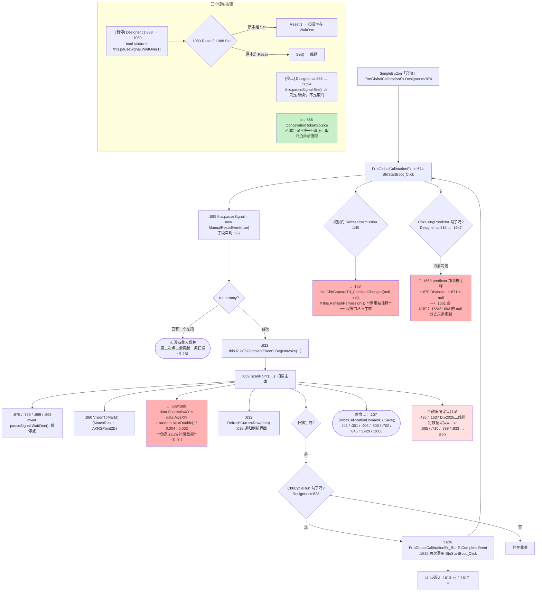

**ASCII 版**

```
 [启动] FrmGlobalCalibrationEx.Designer.cs:874
   └─> FrmGlobalCalibrationEx.cs:574 BtnStartBoot_Click
        :585 pauseSignal = new ManualResetEvent(true)    字段 :567
        :622 this.RunToCompleteEvent?.BeginInvoke(...)   事件声明 :626
        :659 ScanPoints(...)                             扫描主体
              :675 / :739 / :899 / :963   await pauseSignal.WaitOne()   ← 暂停点
              :860 VisionTpMark() → (MatchResult, AKRSPoint2D)
              🔴 :689/:690 data.ScanAxisX/Y = data.AxisX/Y
                           + random.NextDouble() * 0.004 - 0.002
                           ⟹ **把 ±2µm 随机数当补偿数据写进去**
              :632 RefreshCurrentRow(data) → :638 递归刷新界面

 三个控制按钮：
   [暂停] Designer.cs:883 → :1080 bool currentStatus = pauseSignal.WaitOne(1)
                             :1083 Reset() / :1088 Set()
   [停止] Designer.cs:865 → :1394 this.pauseSignal.Set()   ⚠️ 只是"继续"，**不是取消**
   取消   cts :566 CancellationTokenSource   ✅ **本目录唯一真正可取消的异步流程**

 循环运行：ChkCycleRun_CheckedChanged（Designer.cs:828）
   → 完成事件 :1626 FrmGlobalCalibrationEx_RunToCompleteEvent
   → :1635 再次调用 BtnStartBoot_Click(arg1, arg2)

 权限门：:145 RefreshPermission() → Admin 才启用建模按钮
   🔴 :163 this.ChkCaptureTd_CheckedChanged(null, null);   // this.RefreshPermission();
        **调用被注释** ⟹ 权限门从不生效

 预测器：:1640 private CompensationPredictor predictor;
   🔴 :1660 // this.predictor = new CompensationPredictor(...)   **加载被注释**
      :1670 this.predictor.Dispose();  :1671 this.predictor = null;
      ⟹ 取消勾选必然 NullReferenceException；:1684 / :1693 的 `predictor == null` 分支永远走到

 落盘：:107 GlobalCalibrationDomainEx.Save()；:241 / :301 / :406 / :500 / :702
       / :846 / :1429 / :1600
 硬编码采集目录：:436 / :1537  D:\2025二维标定数据采集\标定片坐标系到轴坐标系传递矩阵.txt
                 :665 / :710 / :888 / :933  D:\2025二维标定数据采集\新数据采集….json

 ★★「改而不存」清单（已 grep 核实全方法无 Save）：
   BtnSortScanPoints_Click(:558) 只排序
   BtnAddToPosConfig_Click(:1288) 只 sourceList.Add(data) + RefreshDataSource
   BtnGenerateRegion_Click(:1098) / BtnRemoveSelectedRegion_Click(:1130)
   / BtnSortRegions_Click(:1164) 都只改 Compensator 的内存集合
```

#### 调用链

`FrmGlobalCalibrationEx.Designer.cs:874` → `FrmGlobalCalibrationEx.cs:574 BtnStartBoot_Click`
→ `:585` 建 `pauseSignal` → `:659 ScanPoints` → `:860 VisionTpMark`
→ 完成事件 `:626` 声明、`:1613`/`:1617` 订阅退订、`:1626` 处理
→ 循环运行 `:1635` 再调 `BtnStartBoot_Click`。
暂停 `Designer.cs:883` → `:1080`；停止 `Designer.cs:865` → `:1394`。

#### 读了什么、写了什么

| 类别 | 内容 |
|---|---|
| **读** | `GlobalCalibrationDomain` 的扫描点列表、`SpRowSpacing`/`SpColumnSpacing`（⚠️ 见下）、模板名、实时轴位置 |
| **写（内存）** | `GlobalCalibrationData.ScanAxisX`/`ScanAxisY`（`:689`/`:690`，**被加上随机数**）、`Compensator` 的区域集合、`GlobalCalibrationDomainEx` |
| **写（盘）** | **`:107 GlobalCalibrationDomainEx.Save()`** + `:241`/`:301`/`:406`/`:500`/`:702`/`:846`/`:1429`/`:1600`；硬编码目录 `D:\2025二维标定数据采集\`（`:436`/`:1537` 文本、`:665`/`:710`/`:888`/`:933` JSON） |
| **界面反馈** | `:632`/`:638` 递归刷新当前行；`ChkCycleRun` 勾上后自动无限循环 |

#### 坑

- 🔴 **伪造补偿数据（R-01）**：`:689`/`:690` 把 `ScanAxisX`/`ScanAxisY` 写成"轴位置 + 均匀分布随机数"（`random.NextDouble() * 0.004 - 0.002`，即 ±0.002）。**这些随机数会随扫描点一起被落盘**，成为后续建模的输入。
- 🔴 **暂停/停止语义反了**：`:1394`「停止」执行的是 `pauseSignal.Set()` —— 那是**继续**的信号；真正的取消只有 `cts`（`:566`）一条路，而界面上的「停止」按钮**不碰 `cts`**。
- 🔴 **权限门被注释掉（`:163`）**：`this.RefreshPermission()` 那一行是注释，建模相关按钮**在任何权限下都可用**。
- 🔴 **预测器必然 NRE（`:1660` 加载被注释）**：`predictor` 永远是 `null`，取消勾选时 `:1670 this.predictor.Dispose()` 必抛 `NullReferenceException`。
- ⚠️ **没有重入保护**：`BtnStartBoot_Click` 不检查"是否已在跑"，配合循环运行会自动叠加扫描实例（R-15）。
- ⚠️ **行列间距读的是同一个控件**：`:459 rowSpace = Convert.ToDouble(this.SpRowSpacing.EditValue)` 与 `:460 colSpace = Convert.ToDouble(this.SpRowSpacing.EditValue)` —— 两行读的是**同一个** `SpRowSpacing`；`:1559`/`:1560` 同样成对出现。即"列间距"实际等于"行间距"。而 `:1293`/`:1294`（`BtnAddToPosConfig`）又改用 `SpColumnSpacing.TryGetDouble()`/`SpRowSpacing.TryGetDouble()`，**同一文件里对"列间距"有两套互不相同的取法**。
- ⚠️ **"改而不存"清单**：`BtnSortScanPoints_Click`（`:558`）、`BtnAddToPosConfig_Click`（`:1288`）、`BtnGenerateRegion_Click`（`:1098`）、`BtnRemoveSelectedRegion_Click`（`:1130`）、`BtnSortRegions_Click`（`:1164`）**全部只改内存**。用户辛苦排好的扫描点顺序、建好的补偿区域，一关窗就没了。

> ⚠️ **本窗体同样零调用点**（§4.1）：`FrmCompensationRegionView` 的唯一入口（`:215`）和 `FrmNewCompensationRegion` 的入口（`:1106`）都在它的类体内，所以这两个子窗体也随之断链。

---

### 4.16 Ex 版与普通版：差在哪、为什么会有两个 ★必答★

**图 19：`FrmGlobalCalibration` vs `FrmGlobalCalibrationEx` 逐项对照**

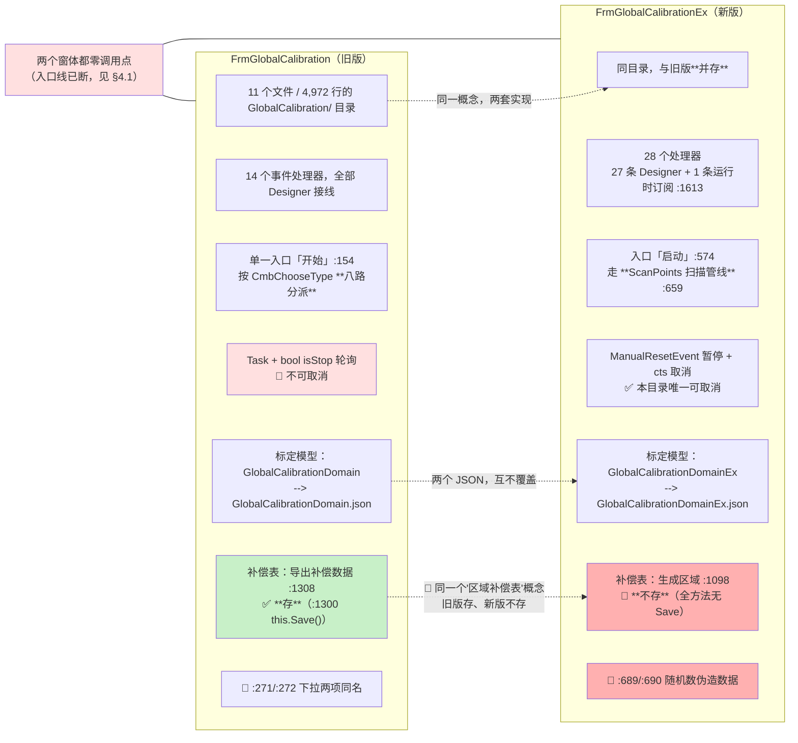

**ASCII 版**

```
                     FrmGlobalCalibration（旧版）        FrmGlobalCalibrationEx（新版）
 文件规模            同目录并存                          同目录并存
 事件处理器数        14 个，全部 Designer 接线           28 个 = 27 条 Designer + 1 条运行时订阅(:1613)
 入口按钮            「开始」 :154                      「启动」 :574
 分派方式            按 CmbChooseType **八路分派**      走 **ScanPoints 扫描管线** :659
 异步模型            Task + bool isStop 轮询            ManualResetEvent 暂停(:585)
                     🔴 **不可取消**                     + cts 取消(:566) ✅ 唯一可取消的
 暂停/继续          无                                   [暂停] :1080 / :1083 / :1088
 停止                :228 isStop = true                 :1394 pauseSignal.Set()（⚠️ 实为"继续"）
 主标定模型          GlobalCalibrationDomain            GlobalCalibrationDomainEx
 落哪个 JSON         GlobalCalibrationDomain.json       GlobalCalibrationDomainEx.json
 区域补偿表          导出补偿数据 :1308                 生成区域 :1098
                     ✅ **存**（:1300 this.Save()）      🔴 **不存**（全方法无 Save）
 数据真实性          —                                   🔴 :689/:690 用随机数伪造 ScanAxis

 🔴 **同一个"区域补偿表"概念，在新旧两个窗体里一边存一边不存**
 🔴 **两个窗体都零调用点**（入口线已断，见 §4.1）—— 所以现在是"两份都没在跑"
```

#### 为什么会有两个？—— 从代码形态能读出来的事实

这不是本文档的猜测，而是代码里写着的：

1. **同名方法各自演进，没有合并**：两个窗体都在 `GlobalCalibration/` 目录下，各自有一套 `Save()`、一套 `RefreshPermission()`、一套 `ChkCycleRun`。新版的 `:145 RefreshPermission` 被注释掉、旧版干脆没有这个方法 —— 说明**新版是从旧版复制出来后独立长出来的**。
2. **数据模型换了代**：`GlobalCalibrationDomain` → `GlobalCalibrationDomainEx`，落盘到**两个不同的 JSON**（见 §8）。旧 JSON 没有被迁移或删除，两套参数的消费方不同（见 §8.7 的"写入方 / 消费方"表）。
3. **异步模型换了代**：旧版是 `Task` + `bool isStop` 轮询，新版引入了 `ManualResetEvent pauseSignal`（`:585`）与 `CancellationTokenSource cts`（`:566`）。**只有新版支持真正的取消**（§5.4 的 25 处线程/任务创建点里，只有这一处可取消）。
4. **新版加了"循环运行"与"预测器"两个新概念**（`ChkCycleRun` 与 `CompensationPredictor`），旧版没有。但**两个新概念的代码都不完整**：预测器的加载被注释（`:1660`），循环运行会在无重入保护下叠加实例。

**结论（就文档能给读者的事实而言）**：Ex 版是**新一代实现**，旧版保留了它的历史分支与"八路分派"入口；两者**共用同一个目录、但数据、异步模型、区域表落盘行为都不同**。**在同一个功能上并存两套实现、且一套存一套不存**，是本目录最需要在维护时先确认"现在到底跑的是哪个"的地方（R-35）。

#### 坑

- 🔴 **同名不同代共存，且都零调用点**：后来人看到 `FrmGlobalCalibration` 会以为那是"主"标定界面，实际它的入口线已断；看到 `Ex` 会以为那是"扩展"的附加功能，实际它才是完整的一代。
- 🔴 **"区域补偿表"的存/不存不对称**（呼应 §4.19 的补偿链）：旧版 `BtnExportCompensateData_Click`（`:1308`）在 `:1300` 调了 `this.Save()`；新版 `BtnGenerateRegion_Click`（`:1098`）、`BtnRemoveSelectedRegion_Click`（`:1130`）、`BtnSortRegions_Click`（`:1164`）**一条 `Save()` 都没有**。同一份补偿表数据，用旧界面改就留下、用新界面改就丢。
- ⚠️ **两套 JSON 并存**：`GlobalCalibrationDomain.json` 与 `GlobalCalibrationDomainEx.json` 谁新谁旧、谁被谁读，只能靠 §8.7 的消费方表来判。

---

### 4.17 `FrmBondCompensateCalibration` 的 `while (true)` 采集循环

**图 20：`while (true)` 三段式 —— 收敛循环 / 无限采集 / 停止出口**

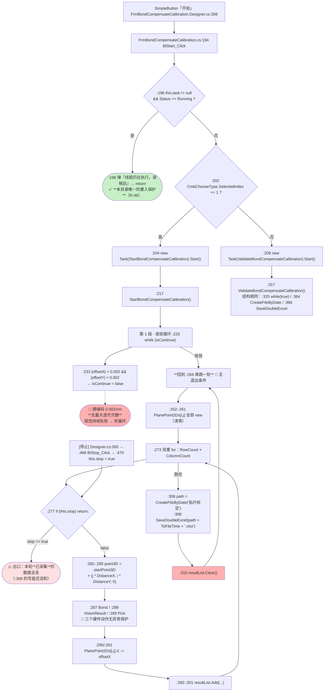

**ASCII 版**

```
 [开始] FrmBondCompensateCalibration.Designer.cs:309
   └─> FrmBondCompensateCalibration.cs:194 BtStart_Click
        :196 if (this.task != null && this.task.Status == TaskStatus.Running)
        :198      弹"线程仍在执行，请稍后" → return
                  ✅ **本目录唯一做了重入保护的按钮**
        :202 if (CmbChooseType.SelectedIndex == 1)
        :204      this.task = new Task(this.StartBondCompensateCalibration); Start();
        :209 else this.task = new Task(this.ValidateBondCompensateCalibration); Start();

 ┌─ 第 1 段 · 收敛循环 ────────────────────────────────────────┐
 │ :217 StartBondCompensateCalibration()                       │
 │   :225 while (isContinue)                                   │
 │        ... 视觉找偏差 ...                                    │
 │        :233 if (|off.X| < 0.002 && |off.Y| < 0.002) → 退出   │
 │        🔴 硬编码 0.002mm，**无最大迭代次数**                  │
 └─────────────────────────────────────────────────────────────┘
                          ↓ 收敛
 ┌─ 第 2 段 · 采集循环 ────────────────────────────────────────┐
 │ :269 while (true)          🔴 **没有退出条件**               │
 │   :252-:261 PlanePoint2Ds[i,j] 全部 new（每轮清零）          │
 │   :273 for i in RowCount → for j in ColumnCount             │
 │          :277 if (this.stop) return;      ← 唯一出口         │
 │          :282-:285 point3D = startPoint3D                   │
 │                     + (j * DistanceX, i * DistanceY, 0)      │
 │          :287 Bond / :288 VisionResult / :289 Pick          │
 │                    🔴 三个硬件动作**无异常保护**              │
 │          :290/:291 PlanePoint2Ds[i,j].X -= offset.X          │
 │          :292-:301 resultList.Add(...)                       │
 │   :306 path = FileHelper.CreateFileByDate("贴片标定")        │
 │   :308 FileHelper.SaveDoubleExcel(path, ToFileTime + .xlsx) │
 │   :310 resultList.Clear()  → **回到 :269 再跑一轮**          │
 └─────────────────────────────────────────────────────────────┘

 [停止] Designer.cs:300 → :468 BtStop_Click → :470 this.stop = true
   ⚠️ 停在第 :277 行时，本轮**已采集**还没到 :306 的数据**全部丢失**
      （PlanePoint2Ds 下一轮会被 :252-:261 清零）

 :317 ValidateBondCompensateCalibration() 结构相同：
   :325 while (true) / :364 CreateFileByDate("贴片标定") / :366 SaveDoubleExcel

 ⚠️ DistanceX / DistanceY 默认都是 1（BondCompensateCalibration.cs:40 / :45）
    ColumnCount / RowCount 默认 1（:50 / :55）
    StartPoint 默认 new AKRSPoint3D() 即 (0,0,0)（:35）
    ⟹ 用户直接点「开始」而不填参数 → 在原点附近驱轴，只覆盖 1×1 个点
```

#### 调用链

`FrmBondCompensateCalibration.Designer.cs:309` → `FrmBondCompensateCalibration.cs:194 BtStart_Click`
→ `:196` 重入检查 → `:204`/`:209` 起 `Task`
→ `:217 StartBondCompensateCalibration`（`:225` 收敛 → `:269 while(true)` 采集 → `:306`/`:308` 落盘 → `:310` 清空 → 回到 `:269`）
或 `:317 ValidateBondCompensateCalibration`（`:325` → `:364`/`:366`）。
停止：`Designer.cs:300` → `:468` → `:470 this.stop = true`。

#### 读了什么、写了什么

| 类别 | 内容 |
|---|---|
| **读** | `BondCompensateCalibration` 单例的 `StartPoint`（`:35`）、`DistanceX`/`DistanceY`（`:40`/`:45`）、`RowCount`/`ColumnCount`（`:50`/`:55`）、`PrDelay`（`:65`）、`PrName`（`:60`） |
| **写（内存）** | `PlanePoint2Ds[i,j]`（`:290`/`:291` 扣偏差）、`resultList`（`:292-:301`，每轮 `:310` 清空） |
| **写（盘）** | **每跑完一轮**写一个 xlsx：`:306 FileHelper.CreateFileByDate("贴片标定")` + `:308 SaveDoubleExcel(...ToFileTime().xlsx)`（校验版 `:364`/`:366`） |
| **硬件** | 每点三次硬件动作：`Bond`（`:287`）/ `VisionResult`（`:288`）/ `Pick`（`:289`），**无异常保护** |
| **界面反馈** | 无 —— 界面只有一个「开始」和一个「停止」，看不到跑到第几个点 |

#### 坑

- 🔴 **`while (true)` 无限采集，唯一出口是 `this.stop`**（`:269` ← `:277`）：用户不点「停止」就**永不自动结束**，每跑完一轮往 `贴片标定` 日期目录追加一个 xlsx —— 放一夜就是一个装满 xlsx 的目录。
- 🔴 **停止即丢数据**：`:252-:261` 每轮开头把 `PlanePoint2Ds` 全部 `new` 清零。若在 `:277` 停下，本轮**已采集但还没到 `:306`** 的数据**没有任何落盘机会**。
- 🔴 **`:225` 收敛循环无最大迭代次数**：`:233` 的阈值 `0.002` 硬编码；视觉若持续失败（模板不匹配、光源没开），`isContinue` 永远为 `true`。与 §4.11 的 `goto Retry` 属同一类（R-34）。
- 🔴 **三个硬件动作零异常保护**（`:287`/`:288`/`:289`）：任一步抛异常，整条 `Task` 死掉，界面**没有任何提示**，`task` 状态变成 `Faulted` —— 但 `:196` 只检查 `Status == TaskStatus.Running`，所以**能再点一次「开始」**（这算是意外的"出路"）。
- ⚠️ **`VisionResult` 返回 `null` 时后面会 NRE**：`:450` 取 `baseAlg` 之后没有判空，`:459` 直接 `(MatchResult)baseAlg`（见 §4.20 的说明）。
- ⚠️ **默认参数会让机器在原点附近动作**：`StartPoint` 默认 `(0,0,0)`（`:35`）、`DistanceX`/`DistanceY` 默认 `1`（`:40`/`:45`）、`RowCount`/`ColumnCount` 默认 `1`（`:50`/`:55`）。用户不填就点「开始」→ 只采 1×1 个点，且第一步就把轴驱到原点附近。
- ✅ **`:196` 的重入保护是本目录唯一的一处**（R-46）：其余 24 处 `Task.Run`/`new Task` 都没有这个检查。

---

### 4.18 `FrmAssistant2DStage`「完成」：行/列数计算（两处写错）

**图 21：「完成」→ 行数 / 列数分别在哪里算、两处写错怎么传导到 JSON**

```mermaid
flowchart TD
    A["SimpleButton「完成」<br/>FrmAssistant2DStage.Designer.cs:261"] --> B["FrmAssistant2DStage.cs:382 BtDone_Click → doneAction :198-232"]
    A2["step0 的 nextAction :124-173<br/>**列数在这里算**"] --> A2a[":124 startPos = Get3DRealPosition()"]
    A2a --> A2b[":145 columnEndPos = Get3DRealPosition()"]
    A2b --> A2c[":147 RetryCommand: :149 输入列间距"]
    A2c --> A2d{":155 columnSpacing == 0 ?"}
    A2d -- "是" --> A2e["弹框 → goto RetryCommand<br/>✅ 除零保护"]
    A2d -- "否" --> A2f[":162 Math.Abs → :164 columns = (int)((columnEndPos.X - startPos.X) / columnSpacing)"]
    A2f --> A2g{":166 非离线模式且 columns &lt; 3 ?"}
    A2g -- "是" --> A2h["弹框 + stepIndex-- + return<br/>回退一步重来"]
    A2g -- "否" --> B

    B --> C[":200 TileBarTeach.SelectedItem = TbiRowCount"]
    C --> D[":201 rowEndPos = Get3DRealPosition()"]
    D --> E[":203 RetryCommand: :205 int.TryParse(XtraInputBox('请输入行间距','行间距','2'))"]
    E --> F{"解析成功?"}
    F -- "否 :207" --> F1["弹『参数错误，请重新输入』→ :208 goto RetryCommand"]
    F -- "是" --> G{":211 rowSpacing == 0 ?"}
    G -- "是 :213" --> G1["弹框 → :214 goto RetryCommand  ✅ 除零保护"]
    G -- "否" --> H["🔴 :217 rows = (int)((rowEndPos.Y - startPos.**X**) / rowSpacing)<br/>减的是 startPos.**X**，应为 startPos.**Y**"]
    H --> I{":219-:227 非离线模式且 rows &lt; 3 ?"}
    I -- "是" --> I1["弹框 + this.stepIndex-- + return → 回退一步"]
    I -- "否" --> J[":229 this.Save()"]

    J --> K[":282 GlobalCalibration.ColumnSpacing = this.columnSpacing"]
    K --> L[":283 GlobalCalibration.RowSpacing = this.rowSpacing"]
    L --> M[":284 GlobalCalibration.StartPoint3D = this.startPos"]
    M --> N["🔴 :285 GlobalCalibration.ColumnCount = **this.rows**<br/>**应为 this.columns**"]
    N --> O[":286 GlobalCalibration.RowCount = this.rows"]
    O --> P([":287 GlobalCalibration.Save()<br/>--> GlobalCalibrationDomain.json"])
    P --> Q([":231 this.DialogResult = DialogResult.OK"])

    R["🔴 rowSpacing / columnSpacing 声明为 **int**（:83）<br/>而 GlobalCalibrationDomain.ColumnSpacing/RowSpacing 是 **double**<br/>（GlobalCalibrationDomain.cs:35 / :40）<br/>⟹ 小数间距 2.5mm **无法录入**"] -.-> E

    style H fill:#ffb0b0
    style N fill:#ffb0b0
    style R fill:#ffe0e0
    style P fill:#c8f0c8
```

> 本图对应索引里"无 ASCII 等价版"的编号，故此处不重复 ASCII 版。

#### 调用链

列数：`FrmAssistant2DStage.cs:124`（`startPos`）→ `:145`（`columnEndPos`）→ `:147` 标号 → `:149` 输入 → `:155` 除零 → `:164` 计算 → `:166-:173` 下限校验。
行数：`Designer.cs:261` → `:382 BtDone_Click` → `doneAction :198-232` → `:201 rowEndPos` → `:203` 标号 → `:205` 输入 → `:211` 除零 → `:217` 计算 → `:219-:227` 下限校验 → `:229 this.Save()` → `:280-:288` → `:287 GlobalCalibration.Save()`。

#### 读了什么、写了什么

| 类别 | 内容 |
|---|---|
| **读** | `bondModule.Get3DRealPosition()`（`:124`/`:145`/`:201`）、用户输入的 `rowSpacing`（`:205`）/ `columnSpacing`（`:149`）、`IsOffline` 模式标志 |
| **写（内存）** | `GlobalCalibrationDomain.ColumnSpacing`（`:282`）/ `RowSpacing`（`:283`）/ `StartPoint3D`（`:284`）/ `ColumnCount`（`:285`）/ `RowCount`（`:286`） |
| **写（盘）** | **`:287 GlobalCalibrationDomain.Save()`** → `GlobalCalibrationDomain.json` |
| **界面反馈** | 切 `TileBarTeach`（`:200`）；失败时 `stepIndex--` 退回上一步 |

#### 坑

- 🔴 **行数用 X 方向的量算**（`:217`）：`rows = (int)((this.rowEndPos.Y - this.startPos.X) / this.rowSpacing)` —— 减的是 `startPos.X`（应为 `.Y`）。行数变成了"Y 差除以 X 绝对位置"的混合量纲，**数值完全无意义**。
- 🔴 **`ColumnCount` 拿到的是行数**（`:285`）：`:285 GlobalCalibration.ColumnCount = this.rows;`（应为 `this.columns`），下一行 `:286 RowCount = this.rows` 才是对的。**行列数只要不等，后续按行列遍历补偿表就会索引越界或漏算**。
- 🔴 **三处错误叠加后的最终效果**：`ColumnCount`（`:285`）与 `RowCount`（`:286`）都等于 `rows`，而 `rows`（`:217`）本身是混合量纲算出来的 —— 落到 `GlobalCalibrationDomain.json` 里的是**两个相同的、且数值无意义的计数**。
- ⚠️ **间距只能是整数**：`:83 private int rowSpacing, columnSpacing;` 而 `GlobalCalibrationDomain.ColumnSpacing`/`RowSpacing` 是 `double`（`GlobalCalibrationDomain.cs:35`/`:40`）。经过 `int.TryParse`（`:205`）与 `XtraInputBox` 的整数输入，**2.5mm 这类小数间距根本录不进去**（R-21）。
- ⚠️ **失败时 `stepIndex--` 的副作用**：`:219-:227` 与 `:166-:173` 都用"回退一步 + `return`"来处理参数不合法，但 `startPos`（`:124`）不会被重置 —— 回退后 `startPos` 保留上一次成功那一刻的值，重算出的行列数跨了两次测量。
- ✅ **两处除零保护是真的**（`:155` columnSpacing、`:211` rowSpacing），这一点比本目录多数地方好。

> ⚠️ **本窗体零调用点（僵尸）**：这个"完成"按钮现在点不到，所以上面三处错误当前不会污染 JSON。但**代码还在编译**（`GlobalCalibration/FrmAssistant2DStage.cs`），一旦有人把入口接回去（代码看起来就是差一行 `new FrmAssistant2DStage().ShowDialog()`），这些错误立刻生效。

---

### 4.19 `FrmCalibration`「Start Calibration」BC 偏移关系标定（两级表整体替换）

**图 22：`FrmCalibration` 的两条主链 —— 标定（写）与查表（读）+ 三个校验缺口**

```mermaid
flowchart TD
    subgraph W["写链：构建两级表"]
      A["SimpleButton「Start Calibration」<br/>FrmCalibration.Designer.cs:226"] --> B["FrmCalibration.cs:246 BtnStartCalibration_Click"]
      B --> B1[":252 Task.Run(...)"]
      B1 --> C[":266 for i in yNum"]
      C --> C1[":279 重新定位 + MoveToCamCenter"]
      C1 --> D[":290 for (int j = 0; j &lt; xNum; j++)<br/>✅ 此处写法**正确**"]
      D --> D1["标定片按 +56 像素偏移移动<br/>🔴 **硬编码 56**"]
      D1 --> D2[":312-:314 ForwardConvertCoordinate(CenterX, CenterY, 0)"]
      D2 --> D3[":343 bcOffsetRelations.Add(yPos, bcOffsetRalationRow)"]
      D3 --> D
      D -- "xNum 跑完" --> C
      C -- "yNum 跑完" --> E[":346 BCOffsetRelations = bcOffsetRelations"]
      E --> E1([":348 BCOffsetRelationCalibration.Save()<br/>--> MachineCoordinateSystem/BCOffsetRelationCalibration.json<br/>🔴 **整体替换**，旧数据全丢"])
    end

    subgraph R["读链：查表 + 线性外推"]
      F["SimpleButton「Test」 Designer.cs:271"] --> G["FrmCalibration.cs:364 BtGetOffset_Click"]
      G --> G1[":368 GetΔXY(xPos, yPos)"]
      G1 --> G2["BCOffsetRelationModel.cs:66 GetΔXY"]
      G2 --> G3{"🔴 :71 BCOffsetRelations.**Capacity** &lt;= 1 ?<br/>用的是 Capacity（内部数组容量）<br/>本意显然是 **Count**"}
      G3 -- "恒为 false（容量 &gt; 1）" --> G4["继续走"]
      G3 -- "真空表" --> G5(["return (0,0) 静默"])
      G4 --> G6[":79-:92 找 yPos 的相邻上下两行"]
      G6 --> G7[":98 取**较近的那一行**<br/>⚠️ 只选一行，不做纵向插值"]
      G7 --> G8[":117 GetΔXYByRowData(xPos, 选中行)"]
      G8 --> G9{"🔴 :125 Capacity &lt;= 1 ?（同样的误用）"}
      G9 -- "否" --> G10[":130-:141 找 xPos 的左右两点"]
      G10 --> G11{"🔴 :144 preValue == null ?"}
      G11 -- "是" --> G12[":144-:148 **强制** preValue = Values[0]<br/>nextValue = Values[1]<br/>⚠️ 只有 1 个元素 → ArgumentOutOfRange"]
      G11 -- "否" --> G13["用找到的两点"]
      G12 --> G14[":152/:153 GenLineEqu(...)"]
      G13 --> G14
      G14 --> G15{"🔴 :155 ΔX &gt; 1 或 ΔY &gt; 1 ?"}
      G15 -- "是" --> G16[":157 弹『拟合获取 ΔX，ΔY 异常』→ return (0,0)"]
      G15 -- "否" --> G17(["返回 ΔX/ΔY<br/>⚠️ :155 只判**正向**越界<br/>负向大异常值（&lt; -1）**直接放行**"])
      G14 -.-> G18["🔴 GenLineEqu :181-:185<br/>:183 dx = x1 - x2  :185 k = dy / dx<br/>x1 == x2 → dx = 0 → k = ±Inf/NaN<br/>**没有任何保护**"]
    end

    G17 --> H([":369/:370 TxOffsetX / TxOffsetY.Text = 结果<br/>⟹ 本链**不落盘**（纯计算 + 界面显示）"])

    style E1 fill:#ffb0b0
    style D1 fill:#ffe0e0
    style G3 fill:#ffb0b0
    style G9 fill:#ffb0b0
    style G12 fill:#ffb0b0
    style G17 fill:#ffe0e0
    style G18 fill:#ffb0b0
```

> 本图对应索引里"无 ASCII 等价版"的编号，故此处不重复 ASCII 版。

#### 调用链

**写链**：`FrmCalibration.Designer.cs:226` → `FrmCalibration.cs:246 BtnStartCalibration_Click` → `:252 Task.Run` → `:266` 外层 → `:279 MoveToCamCenter` → `:290` 内层 → `:312-:314 ForwardConvertCoordinate` → `:343` 收行 → `:346` 整体赋值 → `:348 Save()`。
**读链**：`Designer.cs:271` → `:364 BtGetOffset_Click` → `:368 GetΔXY` → `BCOffsetRelationModel.cs:66` → `:117 GetΔXYByRowData` → `:181 GenLineEqu`。
**验证链（本图未画）**：`FrmCalibration.Designer.cs:328` → `FrmCalibration.cs:378 BtStartVisionTask_Click` →
`:382 int xNum = Convert.ToInt32(this.SpXNum.EditValue);`（**同一个 `xNum`**）→ `:385 Task.Run` → `:400` 外层 yNum →
`:422` 内层 —— 🔴 **这条内层的写法与上面写链 `:290` 的 `for (int j = 0; j < xNum; j++)` 只差一个字符**：
`:422` 写成了 `for (int j = 0; j < xNum; i++)`（**自增的是外层变量 `i`**）⟹ `j` 永远为 `0`、条件**恒真** ⟹
**该验证任务永不结束、`D:\MoveTestPR.xlsx`（`:482`）永不生成**（详见 **§9 R-60 #3**）。

> ⚠️ **文件名归属**：`xNum` 这个变量名**两个窗体都有**（`FrmCalibration.cs` 与 `FrmTestAccuary.cs`），
> 但 `for (int j = 0; j < xNum; i++)` **只出现在 `FrmCalibration.cs:422`**（`FrmTestAccuary.cs` 里 `xNum` **零命中**）。
> 引用本条时请连文件名一起给，否则极易张冠李戴。

#### 读了什么、写了什么

| 类别 | 内容 |
|---|---|
| **写链读** | 实时视觉定位（`GlobalCalibrationRing` 模板）、`bondCoordinateSystem` 的正变换、`yNum`/`xNum`（界面输入） |
| **写链写（内存）** | `SortedList<double, SortedList<double, BCOffsetRelationModel>> bcOffsetRelations`（`:343`），再**整体**赋给单例（`:346`） |
| **写链写（盘）** | **✅ `:348 BCOffsetRelationCalibration.Save()`** → `MachineCoordinateSystem/BCOffsetRelationCalibration.json` |
| **读链读** | 单例里已有的两级表（`BCOffsetRelationModel.cs:66`） |
| **读链写** | **无**（`:369`/`:370` 只设两个 TextBox） |
| **硬件** | 写链：每个 (i, j) 一次定位 + 一次 `MoveToCamCenter`，标定片按硬编码 +56 像素步进 |

#### 坑

- 🔴 **两级表整体替换，不合并**（`:346`）：`BCOffsetRelationCalibration.GetInstance().BCOffsetRelations = bcOffsetRelations` 是一次**赋值**。跑一次标定，旧表全部丢弃；若这次跑得不完整（中途异常、用户关窗），新表是残缺的，但**旧表已经没了**。
- 🔴 **`Capacity` 误用两处（`BCOffsetRelationModel.cs:71` 与 `:125`）**：判据写的是 `SortedList.Capacity <= 1`，而 `Capacity` 是**内部数组的容量**（默认随插入增长），**与元素个数无关**。本意显然是 `Count`。后果：空表/单元素表的"数据不足"保护**完全失效**，代码继续往下走，在 `:144-:148` 或索引处抛异常。
- 🔴 **`GenLineEqu` 没有 `x1 == x2` 保护（`:183`-`:185`）**：`dx = x1 - x2`，`k = dy / dx`。当标定数据里出现"同一列两个点 X 相同"时，`dx = 0` → `k` 变成 `±Infinity` 或 `NaN`，返回值直接污染 `ΔX`/`ΔY`，并写到界面。**调用方只判了 `> 1`**，`NaN` 的所有比较都是 `false`，所以**这个 NaN 会一路通过校验**。
- 🔴 **`:155` 只判正向越界**：`if (ΔX > 1 || ΔY > 1)` —— 负方向的大异常值（例如 `-8.0`）**直接放行**并返回给界面。
- ⚠️ **"二维补偿"实际是一维分段（`:98`）**：`:79-:92` 找到上下两行后，`:98` 取**较近的那一行**，**不做纵向标量插值**。所以纵向是"最近邻"、横向是"线性外推"。命名与实现不符。
- ⚠️ **`:144-:148` 的"强制取前两个点"**：`preValue == null` 时把 `Values[0]`/`Values[1]` 当作左右邻点。若该行只有 1 个元素 → `ArgumentOutOfRangeException`；若有 ≥2 个但**不是**前两个是最优点 → **用错误的两个点外推**，结果是错的但不报错。
- ⚠️ **硬编码 +56 像素步进**：`:290` 一带的标定片步进是字面量（`:378` 一带的 `GetΔXY(bondCurPos.X + 56, ...)` 同源）。标定片的实际像素间距一改，整张表就系统性偏移。
- ⚠️ **读链不落盘**：`BtGetOffset_Click` 只更新两个 TextBox。现场"我点过 Test 了，怎么没生效" —— 因为它本来就只是显示。

---

### 4.20 `FrmTestAccuary` 33 个按钮的功能分区

**图 23：`FrmTestAccuary` 33 个按钮按"是否落盘 / 是否起线程 / 是否空实现"分区**

```mermaid
flowchart TB
    ROOT["FrmTestAccuary<br/>Designer.cs 33 条 Click +=（:79~:521）<br/>FrmTestAccuary.cs 33 个 _Click + 1 个 Load"]

    ROOT --> G1["① 标定相机测试（写 D:\\*.xlsx）"]
    ROOT --> G2["② 往复 / 速度 / 时间类（写 D:\\*.xlsx）"]
    ROOT --> G3["③ 单点硬件动作（不落盘）"]
    ROOT --> G4["④ 起 Task 跑长流程"]
    ROOT --> G5["⑤ 打开别的窗体 / 面板"]
    ROOT --> G6["🔴 空实现（空方法体 / 全注释）"]
    ROOT --> G7["🔴 控件不存在（孤立）"]

    G1 --> A1["simpleButton1 'PR' :123 → EditPr('测试')<br/>:125-126 :130 被注释"]
    G1 --> A2["BtnGetStart 'Dispense' :540 → D:\\DispenseCameraCalibTest.xlsx (:553)"]
    G1 --> A3["simpleButton3 'Bond' :654 → D:\\BondCalibTest.xlsx (:674)"]
    G1 --> A4["simpleButton4 'Wafer' :785"]
    G1 --> A5["simpleButton6 'UpLook' :887"]

    G2 --> B1["BtnStart 'Start A->B->A' :147 → D:\\aba.xlsx (:248)<br/>⚠️ catch(:299) LogHelper+弹框+return **吞异常**"]
    G2 --> B2["BtnStartOnlyA 'Start OnlyA' :340<br/>**循环到第二天 9:00**(:349/:362)<br/>每分钟一张 bmp → D:\\静止定位图片\\<br/>结束写 D:\\静止定位.xlsx (:397)"]
    G2 --> B3["BtnStartAngle 'Start Angle' :445<br/>T 轴 -175→+175 步进 0.1，2 轮<br/>→ D:\\Angle.xlsx (:473)"]
    G2 --> B4["simpleButton11 'TestPRtime' :1058<br/>循环 1000 次测 PR 耗时"]
    G2 --> B5["simpleButton12 'Start A->B MutiSpeed' :1089"]
    G2 --> B6["simpleButton15 'Start A->B' :2025"]

    G3 --> C1["BtnGetA 'Add A' :133 / BtnGetB 'Get B' :141<br/>BtnRemoveA 'Remove A' :780 ⚠️ 空表时抛异常"]
    G3 --> C2["simpleButton5 'Add A' :880 / simpleButton9 'MoveToCenter' :1005"]
    G3 --> C3["simpleButton8 'TestRotate' :985<br/>simpleButton18 :2324 OnlyOnePointDispense(10000, 500) 🔴硬编码"]

    G4 --> D1["simpleButton10 'AutoFocusing' :1015"]
    G4 --> D2["simpleButton13 'Putdown' :1220 → StartBondToCamCalibTaskWithLocate"]
    G4 --> D3["simpleButton14 'CreateTransportSystem' :2018<br/>🔴 实际是 AutoFocus(BondCamera, -6.9, -11.9) Z 范围硬编码<br/>**按钮名与行为完全不符**"]
    G4 --> D4["simpleButton16 'TestRotate' :2223 / simpleButton17 :2301"]
    G4 --> D5["btnTestPin '顶针重复性测试' :2463<br/>btnTestChangeBond '更换焊头重复性测试' :2525"]
    G4 --> D6["btnABAuto 'A->B auto' :2114<br/>（等价入口 UcTestThreePointAlign.cs:49）"]

    G5 --> E1["simpleButton19 'CalibLightness' :2390<br/>new FrmLightnessCalibTeach().Show()  ⚠️**非模态**"]
    G5 --> E2["simpleButton20 'TestThreePointAlign' :2396<br/>ShowPanel('UcTestThreePointAlign', …) 新建 DockPanel"]

    G6 --> F1["simpleButton2 'simpleButton2' :636<br/>整个方法体被注释(:638-651)"]
    G6 --> F2["simpleButton7 'Add A' :980 方法体为空(:983)"]
    G6 --> F3["BtnGetEnd :631 方法体为空(:634)"]
    G6 --> F4["FrmTestAccuary_Load :2590 空方法(:2591-2593)"]

    G7 --> H1["BtnTestTime :535 空方法体(:538)<br/>Designer 里**没有 BtnTestTime 控件**"]
    G7 --> H2["BtnGetEnd :631 也**没有对应控件**<br/>（接线 :632 指向的是不存在的名字）"]

    style G6 fill:#ffb0b0
    style G7 fill:#ffb0b0
    style F1 fill:#ffb0b0
    style D3 fill:#ffb0b0
    style E1 fill:#ffe0e0
    style C3 fill:#ffe0e0
```

> 本图对应索引里"无 ASCII 等价版"的编号，故此处不重复 ASCII 版。

#### 33 个按钮的逐条清单（与 §4.2 的计数口径一致）

| # | 控件名 | 文字 | 处理器 `FrmTestAccuary.cs:行` | 接线 | 一句话 |
|---|---|---|---|---|---|
| 1 | `simpleButton1` | `"PR"` | `:123` | `Designer.cs:91` | `EditPr("测试")`（`:128`）；`:125-126`/`:130` 被注释 |
| 2 | `BtnStart` | `"Start A->B->A"` | `:147` | `:100` | A→B→A 往复测时 → `D:\aba.xlsx`（`:248`）；`:166-198` 一大段被注释；`catch`（`:299`）**吞异常** |
| 3 | `BtnGetA` | `"Add A"` | `:133` | `:124` | `pointAList.Add(Get3DRealPosition())` + 弹计数（`:138`） |
| 4 | `BtnGetB` | `"Get B"` | `:141` | `:132` | 记 `pointB` + 弹 `"getB ok"` |
| 5 | `BtnStartOnlyA` | `"Start OnlyA"` | `:340` | `:155` | **一直循环定位到第二天 9:00**（`:349`/`:362`），每分钟一张 bmp → `D:\静止定位图片\`（`:382`），结束写 `D:\静止定位.xlsx`（`:397`）；`goto SaveFileDialog`（`:371`）跳过等待 |
| 6 | `BtnStartAngle` | `"Start Angle"` | `:445` | `:164` | `Task.Run`（`:447`）T 轴 -175 扫到 +175 步进 0.1，2 轮（`:458-471`）→ `D:\Angle.xlsx`（`:473`） |
| 7 | `BtnTestTime` | 见 `BtnTestLight` | `:535` | `:540`（对应 `BtnGetStart`） | **方法体为空**（`:538`）；**控件不存在** → 孤立处理器 |
| 8 | `BtnGetStart` | `"Dispense"` | `:540` | `Designer.cs:240` | 点胶相机标定测试 → `D:\DispenseCameraCalibTest.xlsx`（`:553`） |
| 9 | `BtnGetEnd` | （无 Text 设置） | `:631` | `:632` | **方法体为空**（`:634`）；**控件不存在** → 孤立处理器 |
| 10 | `simpleButton2` | `"simpleButton2"` | `:636` | `:248` | **整个方法体被注释掉**（`:638-651`），空操作 |
| 11 | `simpleButton3` | `"Bond"` | `:654` | `:231` | Bond 相机标定测试 → `D:\BondCalibTest.xlsx`（`:674`）；`:656-660` 被注释 |
| 12 | `BtnRemoveA` | `"Remove A"` | `:780` | `:256` | `pointAList.RemoveAt(Count-1)`（`:782`）；**列表为空时抛 `ArgumentOutOfRangeException`** |
| 13 | `simpleButton4` | `"Wafer"` | `:785` | `:222` | 晶圆相机标定测试 |
| 14 | `simpleButton5` | `"Add A"` | `:880` | `:213` | 把晶圆台 X/Y 实际位置加进 `pointAList`（`:882`） |
| 15 | `simpleButton6` | `"UpLook"` | `:887` | `:205` | 上视相机标定测试 |
| 16 | `simpleButton7` | `"Add A"` | `:980` | `:196` | **方法体为空**（`:983`） |
| 17 | `simpleButton8` | `"TestRotate"` | `:985` | `:188` | 移到 Glass 位 → 定位 `"小标定片模板"`（`:990`）→ `MoveToCamCenterCoo`（`:992`）→ 移到取片位（`:994`）→ Z 下到 `GlassPickZMachinePos`（`:997`） |
| 18 | `simpleButton9` | `"MoveToCenter"` | `:1005` | `:265` | `LocatePosition(BmcPRName)`（`:1010`）→ `GetMachinePosByPixelPos`（`:1011`） |
| 19 | `simpleButton10` | `"AutoFocusing"` | `:1015` | `:274` | 取 `"上视相机"` 硬件（`:1018`），`Task.Run` 跑 `AutoFocusing`（`:1021`）；⚠️ `:1025` 循环自增写错 ⇒ **永不退出**、`:1035` 起导出永不到达（**R-60 #1**） |
| 20 | `simpleButton11` | `"TestPRtime"` | `:1058` | `:283` | 循环 1000 次定位 `"测试模板"` 测 PR 耗时（`:1061-1065`） |
| 21 | `simpleButton12` | `"Start A->B MutiSpeed"` | `:1089` | `:292` | 多速度 A→B 往复，`List<Result>`（`:1095`） |
| 22 | `simpleButton13` | `"Putdown"` | `:1220` | `:301` | `Task.Run(StartBondToCamCalibTaskWithLocate)`（`:1222-1225`） |
| 23 | `simpleButton14` | `"CreateTransportSystem"` | `:2018` | `:310` | `Task.Run` 跑 `autofocus.AutoFocus(BondCamera, AxisZ, -6.9, -11.9)`（`:2022`）—— **Z 范围硬编码**；**按钮名与行为完全不符** |
| 24 | `simpleButton15` | `"Start A->B"` | `:2025` | `:319` | A→B 往复测 |
| 25 | `btnABAuto` | `"A->B auto"` | `:2114` | `:328` | 同 `simpleButton8` 的自动流程（`:2116-2126`） |
| 26 | `simpleButton16` | `"TestRotate"` | `:2223` | `:337` | `Task.Run`（`:2225`）做 N 点/圆点计算 |
| 27 | `simpleButton17` | `"Start BondForceTest"` | `:2301` | `:346` | 用转矩值数组 `int[]{0}`（`:2304`）测键合力；⚠️ `:2311` 循环自增写错 ⇒ **永不退出**、**界面永久冻结**（**R-60 #2**） |
| 28 | `simpleButton18` | `"Start Dispense only a Test"` | `:2324` | `:355` | `OnlyOnePointDispense(10000, 500)`（`:2326`）—— **10000 次、间隔 500ms 硬编码** |
| 29 | `BtnTestLight` | `"TestLightTime"` | `:2334` | `:364` | 光源响应时间测试，读 `SpRedLight`/`SpGreenLight`/`SpBlueLight`（`:2339-2341`） |
| 30 | `simpleButton19` | `"CalibLightness"` | `:2390` | `:475` | `new FrmLightnessCalibTeach().Show()`（`:2392-2393`）—— **非模态** |
| 31 | `simpleButton20` | `"TestThreePointAlign"` | `:2396` | `:484` | `ShowPanel("UcTestThreePointAlign", …)`（`:2398-2403`）新建 DockPanel |
| 32 | `btnTestPin` | `"顶针重复性测试"` | `:2463` | `:511` | `Task.Run`（`:2465`）转 T 轴测顶针重复性 |
| 33 | `btnTestChangeBond` | `"更换焊头重复性测试"` | `:2525` | `:521` | `Task.Run`（`:2527`）测换焊头后的重复性 |
| — | 窗体 | — | `FrmTestAccuary_Load` `:2590` | `Designer.cs:559` | **空方法**（`:2591-2593`） |

#### 读了什么、写了什么

| 类别 | 内容 |
|---|---|
| **读** | `CalibrateRunPara` 的各视觉位置、各相机的实时图像、轴实时位置、界面上的光源 SpinEdit |
| **写（内存）** | `pointAList`（`:138`/`:780`/`:882`）等实验用列表 |
| **写（盘）** | **只写 `D:\` 下的 Excel / 图片**：`D:\aba.xlsx`（`:248`）、`D:\静止定位.xlsx`（`:397`）、`D:\静止定位图片\`（`:382`）、`D:\Angle.xlsx`（`:473`）、`D:\DispenseCameraCalibTest.xlsx`（`:553`）、`D:\BondCalibTest.xlsx`（`:674`）。**本窗体不写任何标定 JSON** |
| **硬件** | 大量直接驱轴 / 开光源 / 取像 |
| **界面反馈** | 多数按钮只弹一个信息框 |

#### 坑

- 🔴 **`simpleButton14` 按钮名与行为不符**：文字是 `"CreateTransportSystem"`，实际跑的是 `AutoFocus(BondCamera, AxisZ, -6.9, -11.9)`（`:2022`），Z 搜索范围是**硬编码**的。操作员按名字理解会得到完全相反的心理模型。
- 🔴 **`BtnStartOnlyA` 会跨夜运行**（`:349`/`:362`）：一直定位到**第二天 9:00**，每分钟存一张 bmp。它没有停止按钮，也没有日志提示剩余时间；`goto SaveFileDialog`（`:371`）是唯一的提前结束方式（跳过等待直接写文件）。
- 🔴 **`BtnRemoveA` 在空表时抛异常**（`:782`）：`RemoveAt(Count - 1)`，`Count` 为 0 时 `-1` → `ArgumentOutOfRangeException`。
- 🔴 **两个"控件不存在"的孤立处理器**（`BtnTestTime :535`、`BtnGetEnd :631`）：接线语句指向的控件名在 Designer 里根本没有声明。它们**编译得过**（`+=` 是运行时解析的？不 —— 这里是方法被注册到不存在的控件上，实际是 Designer 里 `this.BtnGetStart.Click += new EventHandler(this.BtnGetEnd_Click)` 这类**接错**），运行时点 `BtnGetStart` 会跑 `BtnGetEnd_Click` 的空方法体。见 §4.2.13。
- 🔴 **`:1556` 一带的 `catch` 吞异常**（`BtnStart` 的 `:299`）：`LogHelper.Post` + 弹框 + `return`，异常不再上抛，按钮却已在 `:148` 一带禁用？—— 需按 §4.2 的孤立处理器表核对（`BtnStart` 的禁用/复位在 `try` 外）。
- ⚠️ **`simpleButton19` 用 `Show()` 非模态打开 `FrmLightnessCalibTeach`**（`:2392-2393`）：可以开任意多个，每个都会 `Task.Run(LightnessCalibration)`（§4.9）—— 多个实例同时写 `LightCalibratePara.json`。
- ⚠️ **5 个空实现按钮**（`simpleButton2 :636` 全注释、`simpleButton7 :980`、`BtnGetEnd :631`、`BtnTestTime :535`、`FrmTestAccuary_Load :2590`）：界面上看得到、点得动、什么都不做。
- ⚠️ **本窗体全部 33 个接线都是 Designer 生成的**，没有一条运行时订阅；`FrmTestAccuary` 本身**零调用点**（§4.1）—— 也就是说这 33 个按钮当前一个都点不到。

---

### 4.21 `TestControls/*` 三个测试窗体与两个死掉的「停止」

**图 24：三个测试窗体的"开始 / 停止"配对与两个未接线的「停止」**

```mermaid
flowchart TD
    subgraph T1["FrmCalibTest（上半区：标定精度验证）"]
      A1["btnStartTest '开始测试'<br/>Designer.cs:278 → FrmCalibTest.cs:64"] --> A2[":66 禁按钮 :67 Task.Run"]
      A2 --> A3["🔴 :69 D:\\精度实验2025\\标定精度验证实验{HHmmss}<br/>硬编码目录"]
      A3 --> A4[":70 DataLogManager…ConfigureFileOutput(.json)"]
      A4 --> A5[":86 GeneratePointList(:268)"]
      A5 --> A6[":100-:178 三重循环：次数 × 点位 × 视觉重复"]
      A6 --> A7{":122 checkEdit1.Enabled ?"}
      A7 -- "是" --> A8[":124 cameraCenter = new AKRSPoint2D(1224, 1024)<br/>🔴硬编码 → :127 TransPoint → CalibService.cs:261"]
      A7 -- "否" --> A9[":132 GetMachinePosByPixelPos → CalibService.cs:33"]
      A8 --> A10[":155-:167 填 TestData（:492 定义，6 个公开字段）<br/>:159 targetPixelPos = new(1224,1024)  🔴硬编码"]
      A9 --> A10
      A10 --> A11[":169 log.CommitData()"]
      A11 --> A12{":180 ExcelPackage"}
      A12 -- "成功" --> A13[":218 package.Save()  → .xlsx"]
      A12 -- "异常 :221-:226" --> A14["catch → LogHelper.Post + AKRSMessaageBoxExt + return"]
      A13 --> A15["finally :229 log.Flush()<br/>:230 isStop = false  :231 Invoke 复位"]
      A14 --> A15
      A15 --> A16{"[停止] 点得动吗?"}
      A16 -- "🔴 Designer 里 btnStop(:269) **没有接线**" --> A17(["isStop 永远 false<br/>这个测试**无法中止**"])
    end

    subgraph T2["FrmCalibTest（下半区：重复标定）"]
      B1["btnStartRepeatCalib '开始测试'<br/>Designer.cs:505 → :301"] --> B2[":304 Task.Run"]
      B2 --> B3["🔴 :309 D:\\精度实验2025\\重复标定实验{HHmmss}"]
      B3 --> B4[":334 GeneratePointList"]
      B4 --> B5[":353-:410 三重循环<br/>:378 LocatePosition(BmcPRName) ✅配置驱动<br/>:405 用**实际**轴位置"]
      B5 --> B6[":419 TransformTool.CalcTransMatrix  ← 海康算法（平台 DLL）"]
      B6 --> B7[":422 CalibService.CalcTransMatrixHalcon → CalibService.cs:227<br/>← Halcon 最小二乘（DLL）"]
      B7 --> B8[":432 回到起点 :437/:439/:441 各 ExportToXlsx :474 package.Save()"]
    end
    B9["btnStopRepeatCalib '停止' Designer.cs:496<br/>→ btnStop_Click :290 → :292 isStop = true"] -.->|"✅ 唯一接线的停止"| B5

    subgraph T3["FrmMoveLocateTest"]
      C1["btnStartTest '开始测试'<br/>Designer.cs:94 → :64"] --> C2[":67 Task.Run → :69 D:\\精度实验2025\\移动定位实验…json"]
      C2 --> C3[":84 MoveSafeBondXYZ(BMCVisionMachinePos)<br/>:87 移到左上点"]
      C3 --> C4[":97 resultA = LocatePosition('大标片模板')  🔴硬编码模板名"]
      C4 --> C5[":104 transA = GetMachinePosByPixelPos(..., MatchResult(resultXList.Average(), resultYList.Average(), 0), ...)<br/>✅ **这条正确**"]
      C5 --> C6[":109 移到右下点 :117 再定位"]
      C6 --> C7["🔴 :124 transB = GetMachinePosByPixelPos(...,<br/>MatchResult(resultXListAfterMove.Average(),<br/>**resultXListAfterMove.Average()**, 0), ...)<br/>第二个参数用了 **X** 的均值"]
      C7 --> C8[":129-:140 填 TestData1（:265）:142 log.CommitData() :180 package.Save()"]
      C8 --> C9[":191 log.Flush()  :193 Invoke 复位"]
      C9 --> C10{"[停止] 点得动吗?"}
      C10 -- "🔴 全部点击接线只有 :94 一条<br/>btnStop(Designer.cs:85) 未接线" --> C11(["测试**无法中止**"])
    end

    D1["FrmSetting BtnOk :53 → 5 个 OnlyOnePointUpLook<br/>+ 🔴 :101 Thread.Sleep(8000000) ≈ 2.2 小时"] --- T1
    D2["FrmBackOffset BtnOk :37 → Task.Run(TestBackOffset :50 / TestBackOffsetDispense :54)"] --- T3
    D3["UcTestThreePointAlign 7 个处理器<br/>:49 → StartBondToCamCalibTask1<br/>:59 → StartWaferTableCalibTask<br/>🚫 :84 timer1_Tick 实际**已接线**（R-53）"] --- T3

    style A17 fill:#ffb0b0
    style C11 fill:#ffb0b0
    style C7 fill:#ffb0b0
    style A8 fill:#ffe0e0
    style A10 fill:#ffe0e0
    style B9 fill:#c8f0c8
```

**ASCII 版**

```
 FrmCalibTest 上半区（标定精度验证）
   [开始测试] Designer.cs:278 → FrmCalibTest.cs:64
     :66 禁按钮  :67 Task.Run
     🔴 :69  D:\精度实验2025\标定精度验证实验{HHmmss}      （硬编码目录）
     :70  DataLogManager.Instance.CreateDataLog(...).ConfigureFileOutput(.json)
     :86  GeneratePointList(...)  → :268
     :100-:178 三重循环（次数 × 点位 × 视觉重复次数）
        :104 MoveBondXY
        :115 LocatePosition("大标定片模板")      🔴 模板名硬编码
        :122 if (checkEdit1.Enabled)
             :124 cameraCenter = new AKRSPoint2D(1224, 1024)   🔴 硬编码
             :127 CalibService.TransPoint → CalibService.cs:251/:261 AffineTransPoint2d
        else :132 CalibService.GetMachinePosByPixelPos → CalibService.cs:33
        :155-:167 填 TestData（:492 定义，6 个公开字段）
             :159 targetPixelPos = new(1224, 1024)            🔴 硬编码
        :169 log.CommitData()
     :180-:218 ExcelPackage → package.Save()   〖落 xlsx〗
     :221-:226 catch → LogHelper.Post + AKRSMessaageBoxExt + return
     :229-:231 finally log.Flush() / isStop = false / Invoke 复位
   [停止] 🔴 Designer 里 btnStop（:269 声明）**没有接线**
          只有 btnStopRepeatCalib(:496) → btnStop_Click(:290)
          ⟹ 上半区的测试 **无法中止**，isStop 永远为 false

 FrmCalibTest 下半区（重复标定：海康 vs Halcon 双矩阵）
   [开始测试] Designer.cs:505 → :301 → :304 Task.Run
     🔴 :309 D:\精度实验2025\重复标定实验{HHmmss}
     :334 GeneratePointList → :353-:410 三重循环
          :378 LocatePosition(BmcPRName)   ✅ 这条**是**配置驱动
          :405 用**实际**轴位置（Get2DRealPosition）而非指令位置
     :419 TransformTool.CalcTransMatrix(imgPoints, realPoints)   ← 海康算法（平台 DLL）
     :422 CalibService.CalcTransMatrixHalcon(...) → CalibService.cs:227  ← Halcon（DLL）
     :432 回起点  :437/:439/:441 三个 ExportToXlsx  :474 package.Save()
   [停止] Designer.cs:496 → btnStop_Click(:290) → :292 isStop = true   ✅ **只对下半区有效**

 FrmMoveLocateTest
   [开始测试] Designer.cs:94 → :64 → :67 Task.Run → :69 D:\精度实验2025\移动定位实验…json
     :84 MoveSafeBondXYZ(BMCVisionMachinePos)  :87 移到 BMCMarkTopLeft
     :97  resultA = LocatePosition("大标定片模板")   🔴 硬编码模板名
     :104 transA = GetMachinePosByPixelPos(..., MatchResult(resultXList.Average(),
                                                          resultYList.Average(), 0), ...)  ✅ **正确**
     :109 移到 BMCMarkBotRight  :117 再定位
     🔴 :124 transB = GetMachinePosByPixelPos(..., MatchResult(resultXListAfterMove.Average(),
                                        **resultXListAfterMove.Average()**, 0), ...)
             ↑ 第二个参数（像素 Y）用了 **X** 的均值
     :129-:140 填 TestData1(:265)  :142 log.CommitData()  :180 package.Save()
     :191 log.Flush()  :193 Invoke 复位
   [停止] 🔴 Designer 里点击接线**只有 :94 一条**，btnStop(:85) 未接线
          ⟹ 测试**无法中止**

 TestControls 的另外三处：
   FrmSetting   BtnOk :53  → 5 个 OnlyOnePointUpLook
                  🔴 :101 Thread.Sleep(8000000)  ≈ **2.2 小时**
   FrmBackOffset BtnOk :37 → Task.Run(TestBackOffset :50 / TestBackOffsetDispense :54)
   UcTestThreePointAlign  :49 → StartBondToCamCalibTask1
                          :59 → StartWaferTableCalibTask
                          🚫 :84 timer1_Tick **实际已接线**（Designer.cs:430/431，见 §9 的 R-53）
```

#### 调用链

- **`FrmCalibTest` 上半区**：`Designer.cs:278` → `FrmCalibTest.cs:64` → `:67 Task.Run` → `:86 GeneratePointList`（`:268`）→ 三重循环 → `:127 CalibService.TransPoint`（`CalibService.cs:251` → `:261`）或 `:132 GetMachinePosByPixelPos`（`CalibService.cs:33`）→ `:218 package.Save()`。
- **`FrmCalibTest` 下半区**：`Designer.cs:505` → `:301` → `:304 Task.Run` → `:419 TransformTool.CalcTransMatrix` + `:422 CalibService.CalcTransMatrixHalcon`（`CalibService.cs:227`）→ `:474 package.Save()`；停止 `Designer.cs:496` → `:290`。
- **`FrmMoveLocateTest`**：`Designer.cs:94` → `:64` → `:67 Task.Run` → `:97`/`:117 LocatePosition`（本地定义 `:203`，`:225 (MatchResult)pREntity.AlgResult`）→ `:104`/`:124 GetMachinePosByPixelPos` → `:180 package.Save()`。

#### 读了什么、写了什么

| 窗体 | 读 | 写（内存） | 写（盘） | 硬件 |
|---|---|---|---|---|
| `FrmCalibTest`（上） | `checkEdit1`、`GeneratePointList` 参数、视觉定位结果 | `TestData`（`:492` 定义） | `D:\精度实验2025\…json`（`:70`）+ `.xlsx`（`:218`） | 大量 `MoveBondXY` + `LocatePosition` |
| `FrmCalibTest`（下） | `CalibrateRunPara.BmcPRName`（`:378`）、实际轴位置（`:405`） | `bmcCalibPoints`、`worldX[]`/`worldY[]`、4 份导出列表（`:437`/`:439`/`:441`） | `D:\精度实验2025\…json`（`:311`）+ `.xlsx`（`:474`） | 同上 |
| `FrmMoveLocateTest` | `CalibrateRunPara` 的三个视觉位置、两次定位结果 | `TestData1`（`:265`） | `D:\精度实验2025\…json`（`:70`）+ `.xlsx`（`:180`） | 两次移动 + 两次定位 |

#### 坑

- 🔴 **两个「停止」按钮是死的**：`FrmCalibTest` 上半区的 `btnStop`（`Designer.cs:269` 声明、无接线）与 `FrmMoveLocateTest` 的 `btnStop`（`Designer.cs:85` 声明、无接线）。两个测试窗体的**上半区测试/移动定位测试都无法中止**，只能等它跑完或关窗。这是"死按钮"里后果最直接的两个（R-54）。
- 🔴 **`FrmMoveLocateTest.cs:124` 的 Y 分量写错**：`MatchResult(mean(resultXAfterMove), mean(resultXAfterMove), 0)` —— 第二个参数（像素 Y）用了 **X 的均值**。后果：**同一份实验的两份记录互相矛盾** —— xlsx 里右点的"像素 Y"列写的是 X 的均值，而 JSON（`TestData1`）里 `rightPixelPos.Y` 用的是正确的 `resultYListAfterMove.Average()`。人工核对时会得出**相反**的结论（R-22）。
- 🔴 **`FrmSetting.cs:101 Thread.Sleep(8000000)`**：约 **2.2 小时**的 **UI 线程同步阻塞**（`BtnOk_Click` 内，串在 5 个 `OnlyOnePointUpLook` 之后，整段序列没有被 `Task.Run` 外包）⇒ 点「OK」后**窗口卡死、窗口内按钮全点不动**（R-58）。⚠️ **另注意同窗体 `:55`/`:59` 的 `Text == null` 校验恒为假**（见 §9 的 R-56）：这不是"校验无效还能跑"，而是 `:63` 的 `else` 恒走 ⟹ `:65-:66 Convert.ToInt32(…)` 总会执行，**输入留空或非数字时先抛 `FormatException`**（未处理异常，连 `:69` 之后的流程都到不了）。
- ⚠️ **硬编码目录 `D:\精度实验2025\`**出现在 3 个测试窗体的 `:69`/`:309`/`:69` 三处；目录不存在时行为取决于 `DataLogManager`（平台 DLL）。
- ⚠️ **硬编码图像中心 `(1224, 1024)`**：`FrmCalibTest.cs:124`、`:159`。与 `CalibService` 的约定同源（§6.5）。
- ⚠️ **`FrmCalibTest` 上半区的 `finally`（`:229-:231`）会复位按钮并 `isStop = false`**：即便用户从未点过「停止」，这里也会把 `isStop` 归零 —— 与下半区的 `isStop` 是**同一个字段**（`btnStop_Click :290` 也设它）。两个测试共用状态，一个跑完会把另一个的停止标志清掉。
- ✅ **`FrmCalibTest` 下半区是"两条算法并行对比"的正面例子**：同一批数据分别用平台的海康算法（`:419`）与 Halcon（`:422`）各算一次转换矩阵，输出到同一 xlsx 的多张工作表。**算法本体都不在本仓库**（§6.3）。
- 🚫 **`UcTestThreePointAlign` 的 `timer1` 实际是接线的**：`UcTestThreePointAlign.Designer.cs:430 this.timer1.Enabled = true;` / `:431 this.timer1.Tick += new System.EventHandler(this.timer1_Tick);`，所以 `timer1_Tick`（`:84`）**不是孤立处理器**；它是一个**已接线且 `Enabled = true` 的空方法**（每秒被调一次、什么都不做）。见 §9 的 R-53。

---

### 4.22 全局总览：每个标定界面 → 写哪个字段 → 落哪个 JSON

**图 25：14 个标定界面 / 任务的"界面 → 字段 → JSON"全映射**

```mermaid
flowchart LR
    subgraph UI["标定界面（人点的）"]
      U1["FrmBondCalibTeach<br/>固晶相机标定（11 步）"]
      U2["FrmDispenseCalibTeach<br/>点胶相机标定（4 步）"]
      U3["FrmLightnessCalibTeach<br/>光源亮度"]
      U4["FrmWaferCameraCalibTeach<br/>晶圆相机 Z 视差"]
      U5["FrmBondCompensateCalibration<br/>贴片补偿"]
      U6["FrmGlobalCalibration<br/>旧版全局标定"]
      U7["FrmGlobalCalibrationEx<br/>新版 2D 补偿"]
      U8["FrmCalibration<br/>BC 偏移关系"]
      U9["FrmAssistant2DStage<br/>行列数（僵尸）"]
      U10["FrmTransportTeach<br/>搬运示教"]
      U11["FrmTouchDownToCameraTeach<br/>搜索中心（零调用点）"]
      U12["FrmTestAccuary<br/>33 个测试按钮（零调用点）"]
    end

    subgraph TASK["任务层（代码直接调的）"]
      T1["CalibrateTask.StartAutoCalib :2275<br/>一键自动标定"]
      T2["CalibrateTask 五个 Only* :1257 / :694 / :725<br/>:794 / :431"]
      T3["CalibrateTask.StartBondToCamCalibTask1 :1834"]
    end

    subgraph FIELD["内存单例 / 字段"]
      F1["MachineCoordinateSystem<br/>各 *VisionMachinePos 字段"]
      F2["CalibrateRunPara<br/>各标定标尺与位置字段"]
      F3["LightCalibrationPara<br/>6 张亮度映射表"]
      F4["OffsetFitter<br/>DxCoeffs :15 / DyCoeffs :17"]
      F5["BondCompensateCalibration<br/>StartPoint :35 / …"]
      F6["GlobalCalibrationDomain<br/>行列数 / 间距 / StartPoint3D"]
      F7["GlobalCalibrationDomainEx"]
      F8["BCOffsetRelationCalibration<br/>BCOffsetRelations 两级表"]
      F9["ProductDomain"]
      F10["AxisCompensateProgram"]
    end

    subgraph JSON["磁盘 JSON"]
      J1["MachineCoordinateSystem/*.json"]
      J2["CalibratePara.json"]
      J3["LightCalibratePara.json"]
      J4["WaferCameraAndEjectorCalibratePara.json"]
      J5["BondCompensateCalibration.json"]
      J6["GlobalCalibrationDomain.json"]
      J7["GlobalCalibrationDomainEx.json"]
      J8["MachineCoordinateSystem/<br/>BCOffsetRelationCalibration.json"]
    end

    U1 --> F1
    U2 --> F1
    U1 --> F2
    U2 --> F2
    U3 --> F3
    U4 --> F4
    U5 --> F5
    U6 --> F6
    U6 --> F5
    U6 --> F10
    U7 --> F7
    U8 --> F8
    U9 --> F6
    U10 --> F1
    U10 --> F9
    T1 --> F2
    T1 --> F1
    T2 --> F2
    T2 --> F1
    T3 --> F1

    F1 --> J1
    F2 --> J2
    F3 --> J3
    F4 --> J4
    F5 --> J5
    F6 --> J6
    F7 --> J7
    F8 --> J8

    X1["🔴 U11 / U12：**只写 D:\\ 下的 xlsx / bmp，不写任何 JSON**"]
    X2["🔴 U7 的『生成区域 / 移除 / 排序』**全方法无 Save**"]
    X3["⚠️ 多界面写同一个 JSON：J1 有 5 个写入方<br/>J6 有 2 个（U6 与 U9）"]
    X1 --- JSON
    X2 --- JSON
    X3 --- JSON

    style X1 fill:#ffe0e0
    style X2 fill:#ffb0b0
    style X3 fill:#ffe0e0
    style U9 fill:#ffe0e0
    style U11 fill:#ffe0e0
    style U12 fill:#ffe0e0
```

**ASCII 版**

```
 界面 / 任务                              写入字段                            落哪个 JSON
 ────────────────────────────────────────────────────────────────────────────────────────
 FrmBondCalibTeach（11 步）          MachineCoordinateSystem 各 *VisionMachinePos   MachineCoordinateSystem/*.json
 FrmDispenseCalibTeach（4 步）       MachineCoordinateSystem + CalibrateRunPara     MachineCoordinateSystem/*.json + CalibratePara.json
 FrmLightnessCalibTeach（起线程）    LightCalibrationPara 的 6 张映射表 (:382/:387   LightCalibratePara.json
                                     /:392/:397/:402/:407)  →  :413 Save()
 FrmWaferCameraCalibTeach            OffsetFitter.DxCoeffs(:15) / DyCoeffs(:17)     WaferCameraAndEjectorCalibratePara.json
 FrmBondCompensateCalibration        BondCompensateCalibration.StartPoint(:35) 等    BondCompensateCalibration.json
 FrmGlobalCalibration（旧版）        GlobalCalibrationDomain + BondCompensate       GlobalCalibrationDomain.json
                                     + AxisCompensateProgram
 FrmGlobalCalibrationEx（新版）      GlobalCalibrationDomainEx                       GlobalCalibrationDomainEx.json
 FrmCalibration（BC 偏移）           BCOffsetRelationCalibration.BCOffsetRelations   MachineCoordinateSystem/
                                                                                     BCOffsetRelationCalibration.json
 FrmAssistant2DStage 🧟 僵尸         GlobalCalibrationDomain 的行列数/间距          GlobalCalibrationDomain.json
 FrmTransportTeach                   MachineCoordinateSystem + ProductDomain        MachineCoordinateSystem/*.json + ProductDomain
 CalibrateTask.StartAutoCalib        CalibrateRunPara（:2392 唯一总 Save）           CalibratePara.json
 CalibrateTask 五个 Only*            CalibrateRunPara（仅 :1665 落一次）             CalibratePara.json
 CalibrateTask.StartBondToCamCalib…  MachineCoordinateSystem（:2118）                MachineCoordinateSystem/*.json
 ────────────────────────────────────────────────────────────────────────────────────────
 🔴 FrmTouchDownToCameraTeach / FrmTestAccuary：**只写 D:\ 下的 xlsx / bmp，不写任何 JSON**
 🔴 FrmGlobalCalibrationEx 的『生成区域 :1098 / 移除选中区域 :1130 / 区域排序 :1164』
    **全方法无 Save** —— 而旧版 FrmGlobalCalibration 的『导出补偿数据 :1308』在 :1300 是存了的
 ⚠️ 多界面写同一个 JSON：MachineCoordinateSystem 有 5 个写入方；
    GlobalCalibrationDomain.json 有 2 个（旧版界面 + 僵尸窗体）
```

#### 读了什么、写了什么

| 项 | 内容 |
|---|---|
| **共 8 个落盘目标** | 见 §8.7 的"写入方 / 消费方"全表；本图只画"谁写谁" |
| **写入方最多的** | `MachineCoordinateSystem`（5 个界面 + 任务层）、`GlobalCalibrationDomain.json`（2 个界面） |
| **只落 Excel 不落 JSON 的** | `FrmTouchDownToCameraTeach`（本链不落盘）、`FrmTestAccuary`（`D:\*.xlsx`）、`TestControls/FrmCalibTest`、`TestControls/FrmMoveLocateTest` |
| **"改而不存"最多的** | `FrmGlobalCalibrationEx`（`:558`/`:1098`/`:1130`/`:1164`/`:1288` 全无 `Save`）、`FrmBondToCameraOffset`（`:129-133` 永不执行） |

#### 坑

- 🔴 **`MachineCoordinateSystem` 有 5 个以上写入方**（`FrmBondCalibTeach`、`FrmDispenseCalibTeach`、`FrmWaferCameraCalibTeach` 间接、`FrmTransportTeach`、`CalibrateTask` 的 5 个子任务），**没有并发保护**（全目录 0 把锁）。两个界面同时开、同时点「完成」，后写的赢。
- 🔴 **`GlobalCalibrationDomain.json` 有 2 个写入方**，其中一个是僵尸窗体 `FrmAssistant2DStage`（它的行列数还算错，见 §4.18）。一旦被接回入口，就会用一个算错的行列数覆盖掉旧版界面标出来的值。
- 🔴 **新版 2D 补偿的"区域表"全程不落盘**（`FrmGlobalCalibrationEx.cs:1098`/`:1130`/`:1164`）：用户建好的补偿区域**一关窗就没了**，而界面上没有任何提示。
- ⚠️ **`FrmLightnessCalibTeach` 可以被 `FrmTestAccuary.cs:2392` 用 `Show()` 非模态开多个实例**（§4.20），每个实例都会起一个 `Task.Run(LightnessCalibration)` 并写同一个 `LightCalibratePara.json`。
- ⚠️ **`Experiment/TestFunction/FrmTest.cs:185`/`:187` 是个跨目录的写入方**：它直接 `CalibrateRunPara.GetInstance().GlassUpLookVisionMachinePos = new AKRSPoint3D(-113.858, -147.002, -32.8016)` 然后 `Save()` —— **硬编码坐标覆盖标定值并落盘**。它属于 `Experiment` 目录，但改的是**标定数据**（R-20，见 §9）。

---

## 5. 核心流程（非 UI 触发）

本节讲**不由按钮直接触发**、而是"按钮起个头之后自己跑下去"的流程。
本目录**没有**状态机驱动的后台服务、**没有**开机自检、**没有**周期任务（§5.5）。
全部非 UI 流程来自两类：① 由按钮启动后自行跑下去的长链（`Task`）；② 由平台回调重新进入的流程。
下面按"能自己跑多久"排序。

### 5.1 ★核心★ `Models/CalibrateTask.cs`（2,405 行）的步骤机 —— 全篇的核心

`CalibrateTask` 是本目录唯一一个"看起来像状态机、实际不是状态机"的东西。它**没有** `enum State`、**没有** `switch (state)`、**没有**步进下标。它的"状态"由三样东西表达：

| # | 载体 | 声明处 | 作用 |
|---|---|---|---|
| 1 | **`bool` 返回值链** | 7 个子任务各自 `return true/false`（`:417`/`:423`、`:471`/`:477`、`:780`/`:786`、`:711`/`:717` 等） | `StartAutoCalib` 用 `if (!Xxx()) return;`（`:2303`/`:2325`/`:2330`/`:2350`/`:2357`/`:2372`/`:2377`）串起来 |
| 2 | **两个 `List<>` 结果缓冲区** | `CalibCamScales`（`:149`）、`CalibTransResults`（`:159`） | 承载"这次标定算出了什么"，供 `FrmCalibResult`（§4.13）展示 |
| 3 | **单例参数对象 `CalibrateRunPara`** | 属性 `calibratePara` 在 `:105` | 真正的"持久化状态" |

**图 26：`CalibrateTask` 的"步骤机" —— bool 返回链 + 13 处落盘 + 5 个人工闸门**

```mermaid
flowchart TD
    A["CalibrateTask.StartAutoCalib :2275<br/>本目录最长的非 UI 流程<br/>全程在**调用线程**上跑"] --> A0[":2277/:2278 CalibCamScales.Clear()<br/>CalibTransResults.Clear()<br/>⟸ 唯一'先清空再重建'的入口之一"]
    A0 --> D1{"🔔 对话框①  :2280-:2287<br/>『清理bmc表面 / 玻璃片表面 / 标记点表面』OKCancel"}
    D1 -- "Cancel" --> Z1([":2389 return  整条链中止"])
    D1 -- "OK" --> B1[":2291 MoveBondZToSafePos<br/>:2293 CloseBondHeadVaccum"]
    B1 --> D2{"🔔 对话框②  :2295-:2299<br/>『将 Touchdown 吸嘴放置在焊头上』"}
    D2 -- "Cancel" --> Z2([":2310 return"])
    D2 -- "OK" --> C1[":2303 StartBondCalibTask()  ⟸ 子任务①"]
    C1 --> C1r{"返回 bool"}
    C1r -- "false :2305" --> Z3(["return<br/>🔴 **不回滚、不保存已完成的部分**"])
    C1r -- "true" --> B2[":2313/:2315 Z 安全位 + 关真空"]
    B2 --> D3{"🔔 对话框③  :2317-:2322<br/>『移除Touchdown吸嘴并更换BMC吸嘴』"}
    D3 -- "Cancel" --> Z4([":2337 return"])
    D3 -- "OK" --> C2[":2325 StartBondToCamCalibTask1()  ⟸ 子任务②<br/>含 goto 重试网，见 图 28"]
    C2 --> C3[":2330 StartUpLookCalibTask()  ⟸ 子任务③"]
    C3 --> B3[":2340 MoveSafeBondXYZ(BondCamUpLookCamMachinePos)"]
    B3 --> D4{"🔔 对话框④  :2342-:2347<br/>『将标定片放在两相机之间』<br/>★ **Cancel 只是跳过**"}
    D4 -- "Cancel" --> D4a["跳过子任务④"]
    D4 -- "OK" --> C4[":2350 StartBondToCamBySameMarkTask()  ⟸ 子任务④"]
    D4a --> C5
    C4 --> C5["🔴 :2357 StartUpLookMachinePosTask()  子任务⑤<br/>**在 if 之外 —— Cancel 也会执行**"]
    C5 --> B4[":2362 MoveBondZToSafePos()"]
    B4 --> D5{"🔔 对话框⑤  :2363-:2368<br/>『移除Touchdown吸嘴并更换BMC吸嘴』"}
    D5 -- "Cancel" --> Z5([":2384 return"])
    D5 -- "OK" --> C6[":2372 StartWaferTableCalibTask()  ⟸ 子任务⑥"]
    C6 --> C7[":2377 StartWaferNPointCalibTask()  ⟸ 子任务⑦"]
    C7 --> S([":2392 this.calibratePara.Save()<br/>✅ **全流程唯一一次 CalibrateRunPara 落盘**<br/>--> CalibratePara.json"])
    S --> R["✅ :2394 MainForm.SendUiAction → :2397 new FrmCalibResult<br/>:2398 ShowDialog  :2399 Dispose"]

    C1 -.-> M1[":387 MachineCoordinateSystem.Save()<br/>含 BondHomMatTrans :397"]
    C2 -.-> M2[":2118 MachineCoordinateSystem.Save()"]
    C3 -.-> M3[":546 MachineCoordinateSystem.Save()<br/>+ :608 calibratePara.Save()<br/>含 UpLookHomMatTrans :559"]
    C7 -.-> M4[":870 与 :972 两次 MachineCoordinateSystem.Save()<br/>+ :962 calibratePara.Save()<br/>含 WaferHomMatTrans :882"]

    M1 -.-> N["🔴 这些 Save() **先落盘**<br/>而 :2392 的总 Save 只在全部成功后才执行<br/>⟹ 中途失败 = 磁盘上已有半成品<br/>内存与磁盘不一致"]
    M3 -.-> N
    M4 -.-> N

    E1["🔴 整条链**没有 try/catch**<br/>子任务各自吞异常返回 false<br/>但 :2340 MoveSafeBondXYZ 与 :2392 Save()<br/>抛异常会直接冒泡"] -.-> A
    E2["🔴 **不能中途取消**：不接收 CancellationToken<br/>全目录唯一有 cts 的是 FrmGlobalCalibrationEx.cs:566"] -.-> A

    style D4 fill:#ffe0e0
    style C5 fill:#ffe0e0
    style Z3 fill:#ffb0b0
    style N fill:#ffb0b0
    style E1 fill:#ffb0b0
    style E2 fill:#ffb0b0
    style S fill:#c8f0c8
```

**ASCII 版**

```
 Models/CalibrateTask.cs:2275-2403  StartAutoCalib()
 ── 全程在**调用线程**上跑，任何一步返回 false 就 return 中止 ──────────────

 :2277/:2278  CalibCamScales.Clear() / CalibTransResults.Clear()
 :2280-:2287  🔔对话框①  "清理bmc表面 / 清理玻璃片表面 / 清理所有标记点表面"  OKCancel
 :2289 if (OK)                                              else → :2389 return
    :2291 bondHeadController.MoveBondZToSafePos()
    :2293 bondHeadController.CloseBondHeadVaccum()
    :2295-:2299 🔔对话框②  "将 Touchdown 吸嘴放置在焊头上"   OKCancel
    :2301 if (OK)                                           else → :2310 return
        :2303 StartBondCalibTask()          ← 子任务①(:291-:430)   → :387 MCS.Save()
        :2305 失败即 return                  🔴 不回滚、不保存中间结果
    :2313/:2315 再次 Z 安全位 + 关真空
    :2317-:2322 🔔对话框③  "请移除Touchdown吸嘴并更换BMC吸嘴"
    :2323 if (OK)                                           else → :2337 return
        :2325 StartBondToCamCalibTask1()    ← 子任务②(:1834-:2274) → :2118 MCS.Save()
        :2330 StartUpLookCalibTask()        ← 子任务③(:486-:693)   → :546 MCS.Save() + :608 Save()
    :2340 MoveSafeBondXYZ(BondCamUpLookCamMachinePos)
    :2342-:2347 🔔对话框④  "将标定片放在两相机之间（**Cancel 可跳过**）"
    :2348 if (OK) :2350 StartBondToCamBySameMarkTask()  ← 子任务④  **Cancel 只是跳过**
    :2357 StartUpLookMachinePosTask()       ← 子任务⑤ ★**在 if 之外，Cancel 也会执行**
    :2362 MoveBondZToSafePos()
    :2363-:2368 🔔对话框⑤  "请移除Touchdown吸嘴并更换BMC吸嘴"
    :2370 if (OK)                                           else → :2384 return
        :2372 StartWaferTableCalibTask()    ← 子任务⑥
        :2377 StartWaferNPointCalibTask()   ← 子任务⑦(:794-:1012)
                                            → :870/:972 MCS.Save() + :962 Save()
 :2392 this.calibratePara.Save()            ✅ **全流程唯一一次 CalibrateRunPara 落盘**
 :2394 MainForm.SendUiAction → :2397 new FrmCalibResult → :2398 ShowDialog → :2399 Dispose

 ── 13 处 Save() 的归属（实测）────────────────────────────────────────────
   :237 StartDispenseCalibTask     →  :309 BondDevicePara + :267 calibratePara
   :387 StartBondCalibTask         →  MachineCoordinateSystem
   :546 StartBondToCamBySameMark   →  MachineCoordinateSystem
   :608 StartUpLookCalibTask       →  calibratePara
   :694 StartUpLookMachinePosTask  →  **无**
   :725 StartWaferTableCalibTask   →  **无**
   :870/:972 StartWaferNPointCalib →  MachineCoordinateSystem ×2 + :962 calibratePara
   :1067 StartTransportCalib       →  MachineCoordinateSystem
   :1665 OnlyUpLookCameraCalib     →  calibratePara
   :2118 StartBondToCamCalibTask1  →  MachineCoordinateSystem
   :2392 StartAutoCalib            →  calibratePara（唯一总 Save）

 🔴 子任务的 Save() **先落盘**，:2392 的总 Save 只在**全部成功**后才执行
    ⟹ 中途失败：磁盘上已经有半成品，内存与磁盘不一致
 🔴 整条链**没有 try/catch**：:2340 的 MoveSafeBondXYZ 与 :2392 的 Save() 抛异常会直接冒泡
 🔴 **不能中途取消**：不接收 CancellationToken（全目录唯一有 cts 的是 FrmGlobalCalibrationEx.cs:566）
```

#### 能不能中途取消？取消/中断后状态怎么复位？★必答★

**（1）能不能被打断：不能。**

- `StartAutoCalib` 与 `OnlyBondCameraCalib` 等 5 个 `Only*` 方法**都不接收 `CancellationToken`**。全目录唯一有 `CancellationTokenSource` 的地方是 `GlobalCalibration/FrmGlobalCalibrationEx.cs:566`，与 `CalibrateTask` 无关。
- `CalibrateTask` 里也**没有** `isStop` 之类的检查点。
- 本目录**可被打断的只有四处**，且都是"按钮级标志位"：
  | 标志位 | 声明 | 触发点 | 实际有效性 |
  |---|---|---|---|
  | `FrmGlobalCalibration.isStop` | `FrmGlobalCalibration.cs:75` | `:228 BtStop_Click` | 有效（各分支循环检查它） |
  | `FrmBondCompensateCalibration.stop` | `FrmBondCompensateCalibration.cs:52` | `:470 BtStop_Click` | 有效（是 `while (true)` 的唯一出口） |
  | `FrmCalibTest.isStop` | `:230` 复位 | `:290 btnStop_Click` | **只对下半区有效**（上半区的 `btnStop` 未接线） |
  | `FrmMoveLocateTest` 的同名 `isStop` | — | `:252 btnStop_Click` | **完全失效**（按钮未接线） |
- **唯一的"打断"方式是关线程 / 关进程**。

**（2）失败处理：打日志 + 返回 false，不回滚、不弹框。**

```csharp
try { ... }
catch (Exception ex) { LogHelper.Post(...); return false; }   // 例如 :419-:424
```

**唯一例外**是 `StartBondToCamCalibTask1` 的深层定位失败：它弹 `AKRSMessageBoxExt` 让用户选 `Retry`/`Abort`/`Ignore`（`:1360`/`:1394`/`:1444`/`:1487`/`:1527`），`Abort` 分支 `throw new Exception(...)`（`:1375`/`:1409`/`:1502`/`:1542`）。这是本目录**唯一会因用户选择而抛异常**的地方。

**（3）中断后状态如何复位：无复位。**

这是全篇最需要读者记住的一条：

- 已写入 `CalibrateRunPara` 的字段**保持被改后的值**；
- 已 `Save()` 的部分（`MachineCoordinateSystem.Save()` 在 `:387`/`:546`/`:870`/`:972`/`:2118`）**已经落盘且不会回滚**；
- `CalibCamScales` / `CalibTransResults` 里**可能只剩前几个子任务的结果**；
- 下一次运行 `StartAutoCalib` 才会在 `:2277`/`:2278` 清空这两个列表，但**参数对象里的字段依旧是上一次的半成品**。

⟹ **"运行到一半失败"在本目录没有恢复机制**。机台此时用的是一套"新旧混合"的标定参数，而界面上看不到任何异常标记。

#### 坑

- 🔴 **五个 `OKCancel` 对话框的语义不一致**（`:2280`/`:2295`/`:2317`/`:2342`/`:2363`）：**只有 `:2342` 的 Cancel 是"跳过"**（继续执行 `:2357`），其余四个 Cancel 都是**中止整条链**。用户凭"取消"这个字的直觉操作，会得到两种完全不同的后果。
- 🔴 **`:2357 StartUpLookMachinePosTask()` 在 `if` 之外**：对话框④ Cancel 了，`StartBondToCamBySameMarkTask` 不跑，但 `StartUpLookMachinePosTask` **照跑**。这在"用户已经决定跳过这一步"的语境下是反直觉的。
- 🔴 **中途失败不回滚（见上）**，这是 §9 的 R-17/R-18 的根源。
- 🔴 **内存与磁盘的不一致会持续到下一次成功**：`StartAutoCalib` 只在 `:2392` 落一次盘；但子任务内部的 `Save()` 是**立即**落盘的。所以"失败那一刻"磁盘上的内容是"前几个子任务的新值 + 后几个子任务的旧值"的混合体。
- ⚠️ **代码顺序 ≠ 界面顺序**：`dialog4`（`:2342`）在代码里出现在 `dialog3`（`:2363`）**之前**，但两者在源码里的编号暗示的阅读顺序是反的。阅读时以行号为准。
- ⚠️ **`:2277`/`:2278` 清空列表的位置在对话框之前**：即便用户在对话框① 就 Cancel，`CalibCamScales`/`CalibTransResults` 也**已经被清空了** —— `FrmCalibResult`（§4.13）在这之后打开会显示空表。
- ✅ **`StartDispenseCalibTask`（`:170`）一处落三次不同目标**（`:237` `MachineCoordinateSystem`、`:267` `calibratePara`、`:309` `BondDevicePara`），是 13 处 `Save()` 里最密集的。

---

### 5.2 七个子任务的统一模板 + 三条退出路径

**图 27：五个"点位标定"子任务的同一模板（①③⑦ 对照）与三条退出路径**

```mermaid
flowchart TD
    subgraph TPL["统一模板（五个点位标定子任务共用）"]
      P1["1. MoveSafe* 到起点"] --> P2["2. LocatePosition(模板名)"]
      P2 --> P3["3. GeneratePointList(起点, 间距, 行, 列)"]
      P3 --> P4["4. 逐点 MoveToCamCenter + 定位 + 记录"]
      P4 --> P5["5. new CoordinateSystem 并 Init(realPoints, imgPoints)"]
      P5 --> P6["6. MachineCoordinateSystem.Save()"]
      P6 --> P7["7. 写 HomMatTrans 字段"]
    end

    T01["① StartBondCalibTask :291"] --> TPL
    T03["③ StartUpLookCalibTask :486"] --> TPL
    T07["⑦ StartWaferNPointCalibTask :794"] --> TPL

    T01 --> Q1["起点 BMCMeasureHeightSearchMachinePos :298 → BMCVisionMachinePos :324<br/>模板 BmcPRName :327<br/>GeneratePointList(BMCVisionMachinePos, **0.1, 0.05**, 6, 5) :337  🔴**硬编码**<br/>坐标系 'BondCameraCoordinateSystem'/'BondCoordinateSystem' :382<br/>Init(realPoints, imgPoints) :385  ← **不传 CalibModuleEnum**"]
    T03 --> Q2["起点 GlassUpLookVisionMachinePos :493<br/>模板 UpLookPRName :494<br/>GeneratePointList(…, **UpLookCalibDistance**, 6, 5) :504  ✅配置驱动<br/>Init(…, CalibModuleEnum.CameraStaticDown) :545"]
    T07 --> Q3["起点 BMCVisionMachinePos :799<br/>模板 WaferPRName :837<br/>GeneratePointList(WaferTableLeftMarkWCVisionMachinePos, **WaferTableCalibDistance**, 5, 5) :810<br/>Init(…, CalibModuleEnum.CameraStaticUp) :869<br/>🔴 **唯一调两次 MCS.Save()**（:870 与 :972）"]

    Q1 --> R1(["写入 BondHomMatTrans :397<br/>MCS.Save :387<br/>calibratePara.Save 无<br/>返回 :417 true / :423 false"])
    Q2 --> R2(["写入 UpLookHomMatTrans :559<br/>MCS.Save :546<br/>calibratePara.Save :608<br/>返回 bool"])
    Q3 --> R3(["写入 WaferHomMatTrans :882<br/>MCS.Save :870 + :972<br/>calibratePara.Save :962<br/>返回 bool"])

    T04["④ StartBondToCamBySameMarkTask :431<br/>**不创建坐标系**"] --> R4["起点 BondCamUpLookCamMachinePos :435<br/>模板硬编码 'BondCamUpLookCamAlign-Bond' :437<br/>+ 'BondCamUpLookCamAlign' :439"]
    R4 --> R4a(["MCS.Save :546<br/>返回 :471 true / :477 false"])

    T05["⑤ StartUpLookMachinePosTask :694<br/>**不做仿射标定**"] --> R5["起点 UpLookMarkMachinePos :698<br/>模板 WaferLeftPRName :700"]
    R5 --> R5a(["只把'一个位置'塞进<br/>CalibTransResults.Add('上视相机位置') :708/:709<br/>🔴 **无 Save()**<br/>返回 :711 true / :717 false"])

    T06["⑥ StartWaferTableCalibTask :725<br/>**不做仿射标定**"] --> R6["起点 WaferTableLeftMarkBCVisionMachinePos :736<br/>→ WaferTableRightMarkVisionMachinePos :754<br/>模板 WaferLeftPRName :739 / WaferRightPRName :757"]
    R6 --> R6a(["只把'两点间距'塞进<br/>CalibTransResults.Add('晶圆标记点间距') :777/:778<br/>🔴 **无 Save()**<br/>返回 :780 true / :786 false"])

    W1["🔴 **邦头相机标定有三套互不相同的点位间距**<br/>① :337 硬编码 (0.1, 0.05)<br/>⑤ OnlyBondCameraCalib:1180 硬编码 (0.4, 0.3)<br/>CalibrateRunPara.BMCCalibDistance（CalibrateRunPara.cs:92，默认 0.05）**从未被读到**"] -.-> Q1

    style W1 fill:#ffb0b0
    style R5a fill:#ffe0e0
    style R6a fill:#ffe0e0
    style Q1 fill:#ffe0e0
    style Q3 fill:#ffe0e0
```

**ASCII 版**

```
 统一模板（五个"点位标定"子任务结构完全一致，只有坐标系名/模板名/参数不同）
 ────────────────────────────────────────────────────────────────────────────
   1. MoveSafe* 到起点
   2. LocatePosition(模板名)
   3. GeneratePointList(起点, 间距, 行数, 列数)
   4. 逐点 MoveToCamCenter + 定位 + 记录
   5. new CoordinateSystem 并 Init(realPoints, imgPoints)
   6. MachineCoordinateSystem.Save()
   7. 写 HomMatTrans 字段
 ────────────────────────────────────────────────────────────────────────────

 逐条对照（7 个子任务）
 ┌── ① StartBondCalibTask :291
 │    起点  BMCMeasureHeightSearchMachinePos :298 → BMCVisionMachinePos :324
 │    模板  BmcPRName :327
 │    点位  GeneratePointList(BMCVisionMachinePos, **0.1, 0.05**, 6, 5) :337  🔴硬编码
 │    坐标系 'BondCameraCoordinateSystem' / 'BondCoordinateSystem' :382
 │    Init   Init(realPoints, imgPoints) :385      ← **不传 CalibModuleEnum**
 │    Save   :387      字段 BondHomMatTrans :397    返回 :417 true / :423 false
 ├── ② StartBondToCamCalibTask1 :1834  （见 图 28，结构完全不同）
 ├── ③ StartUpLookCalibTask :486
 │    起点  GlassUpLookVisionMachinePos :493     模板 UpLookPRName :494
 │    点位  GeneratePointList(…, **UpLookCalibDistance**, 6, 5) :504   ✅配置驱动
 │    Init   Init(…, CalibModuleEnum.CameraStaticDown) :545
 │    Save   :546      字段 UpLookHomMatTrans :559   :608 calibratePara.Save()
 ├── ④ StartBondToCamBySameMarkTask :431   **不创建坐标系**
 │    起点  BondCamUpLookCamMachinePos :435
 │    模板  硬编码 'BondCamUpLookCamAlign-Bond' :437 + 'BondCamUpLookCamAlign' :439
 │    Save   :546      返回 :471 true / :477 false
 ├── ⑤ StartUpLookMachinePosTask :694      **不做仿射标定**
 │    起点  UpLookMarkMachinePos :698     模板 WaferLeftPRName :700
 │    输出  只把"一个位置"塞进 CalibTransResults.Add("上视相机位置") :708/:709
 │    🔴 **无 Save()**   返回 :711 true / :717 false
 ├── ⑥ StartWaferTableCalibTask :725       **不做仿射标定**
 │    起点  WaferTableLeftMarkBCVisionMachinePos :736 → WaferTableRightMarkVisionMachinePos :754
 │    模板  WaferLeftPRName :739 / WaferRightPRName :757
 │    输出  只把"两点间距"塞进 CalibTransResults.Add("晶圆标记点间距") :777/:778
 │    🔴 **无 Save()**   返回 :780 true / :786 false
 └── ⑦ StartWaferNPointCalibTask :794
      起点  BMCVisionMachinePos :799     模板 WaferPRName :837
      点位  GeneratePointList(WaferTableLeftMarkWCVisionMachinePos,
                              **WaferTableCalibDistance**, 5, 5) :810-:814   ✅配置驱动
      Init   Init(…, CalibModuleEnum.CameraStaticUp) :869
      Save   :870 **与** :972（两处！）+ :962 calibratePara.Save()
      字段  WaferHomMatTrans :882

 🔴 **邦头相机标定一共有三套互不相同的点位间距**：
      ① :337                    硬编码 (0.1, 0.05)
      ⑤ OnlyBondCameraCalib:1180 硬编码 (0.4, 0.3)
      CalibrateRunPara.BMCCalibDistance（CalibrateRunPara.cs:92，默认 0.05）**从未被读到**
```

#### 三条退出路径（每个子任务都有，且行为一致）

| 退出路径 | 触发 | 行为 | `文件:行` 示例 |
|---|---|---|---|
| **① 正常成功** | 全部点位采集 + 仿射矩阵算完 | 写字段 → `Save()` → `return true` | `:417`、`:471`、`:780`、`:711` |
| **② 业务失败** | 定位失败 / 点数不足 | `LogHelper.Post(...)` + `return false`，**不弹框、不回滚** | `:419-:424`（`catch` 块） |
| **③ 用户选择中止** | 只有 `StartBondToCamCalibTask1` 有 | `Abort` → `throw new Exception(...)` | `:1375`/`:1409`/`:1502`/`:1542` |

#### 坑

- 🔴 **同样的"邦头相机标定"有三套点位间距**（见 ASCII 图末）：`:337` 硬编码 `(0.1, 0.05)`、`OnlyBondCameraCalib:1180` 硬编码 `(0.4, 0.3)`、配置项 `BMCCalibDistance`（`CalibrateRunPara.cs:92`）**从未被读到**。改配置项不会改变任何行为 —— 这是最典型的"看起来能配、实际配了没用"。
- 🔴 **⑤⑥ 不落盘**：`StartUpLookMachinePosTask`（`:694`）与 `StartWaferTableCalibTask`（`:725`）**全方法无 `Save()`**，它们只往 `CalibTransResults` 里塞值给界面看。走 `StartAutoCalib` 时这些值靠 `:2392` 的总 Save 一起留下？—— **不**：`CalibTransResults` 不是 `CalibrateRunPara` 的字段，它只是内存列表，**也不落盘**。所以⑤⑥的结果**只有"当次界面上看得见"**这一个归宿。
- 🔴 **⑦ 调两次 `MachineCoordinateSystem.Save()`**（`:870` 与 `:972`）：全目录唯一。若第二次 `Save()` 之前抛异常，磁盘上是"坐标系已存、字段未写"的中间态。
- ⚠️ **①③⑦ 的 `Init` 重载不同**：③⑦ 多传一个 `CalibModuleEnum`（`CameraStaticDown` / `CameraStaticUp`），① 不传。*推断*：镜头安装方向（上视 / 下视）会改变仿射矩阵的符号约定。`TransformTool` 与 `CalibModuleEnum` 定义在平台 DLL，**算法本体不在本仓库**（§6.3）。
- ⚠️ **④ 的模板名是硬编码字符串字面量**（`:437`/`:439`）：用户在视觉模板库里改名，这一步就静默失效（返回 `false`，链子继续的判断在 `:2350` —— 注意 `:2350` 的返回值**没有被检查**，见下）。
- ⚠️ **`:2350 StartBondToCamBySameMarkTask()` 的返回值被忽略**：对比 `:2303`/`:2325`/`:2330`/`:2372`/`:2377` 都是 `if (!Xxx()) return;`，`:2350` 那一句**没有 `if`**。子任务④ 失败时链子照跑。

---

### 5.3 `StartBondToCamCalibTask1` 的 `goto` 重试网与有界收敛

**图 28：五个 `goto` 重试点 + 旋转中心的有界收敛循环（含 `count` 上限）**

```mermaid
flowchart TD
    A["入口：UcTestThreePointAlign.cs:49 BtnCalcBondToCameraOffset_Click<br/>:51 Task.Run(CalibrateTask…StartBondToCamCalibTask1)<br/>或 FrmTestAccuary.cs:2114 btnABAuto_Click"] --> B["CalibrateTask.cs:1834 StartBondToCamCalibTask1()"]

    B --> G1["goto 网 ①:1350 RetryBMCP1 ← :1371 goto RetryBMCP1<br/>BMC 点1 定位失败 → AKRSMessageBoxExt Retry/Abort/Ignore"]
    G1 --> G2["goto 网 ②:1385 RetryBMCP2 ← :1405 goto RetryBMCP2<br/>BMC 点2 同上"]
    G2 --> G3["goto 网 ③:1439 ReBond ← :1456 goto ReBond<br/>BondAction 返回 false 时重放"]
    G3 --> G4["goto 网 ④:1473 RetryPostBondGlassP1 ← :1498<br/>点胶后玻璃片点1"]
    G4 --> G5["goto 网 ⑤:1513 RetryPostBondGlassP2 ← :1538<br/>点胶后玻璃片点2"]
    G5 --> R["#region 重复标定旋转中心 :1984 ~ :2104 #endregion"]

    R --> R0[":1986 int count = 0<br/>:1987 rotateList"]
    R0 --> RL["retry: :1988"]
    RL --> R1[":1992 int[] rotateAngle = { 0, -180 }"]
    R1 --> R2[":1994 for (int i = 0; i &lt; 2; i++)<br/>= 两轮，每轮转 0° / -180° 各拍一次"]
    R2 --> R3[":1996 centerList.Clear()<br/>⚠️ 每轮清空 → 循环结束后只剩**最后一轮**的 2 个元素"]
    R3 --> R4[":2000 MoveSafeBondXY(PlaceToBMCMachinePos)<br/>:2006 PickAction  :2015 BondAction(BondOnBMC)  :2021 Sleep(800)"]
    R4 --> R5[":2024-:2031 左上点：MoveSafeBondXYZ → LocatePosition(GlassPRName)<br/>→ MoveToCamCenter → LocateAndMoveToTargetPixel(GlassPRName, Bond, 1, 2)"]
    R5 --> R6[":2038-:2045 右下点：同上"]
    R6 --> R7[":2050/:2051 glassCenterX/Y = 两点均值<br/>:2056 centerList.Add(new AKRSPoint2D(...))"]
    R7 --> R2
    R2 -- "2 轮跑完" --> R8[":2062/:2063 rotateCenterX/Y = (centerList[1] - centerList[0]) / 2<br/>:2065 rotateList.Add(...)<br/>:2067/:2068 BondRotateCenterToCamOffset -= rotateCenter"]
    R8 --> R9{":2071-:2074 count == 2 ?"}
    R9 -- "是" --> R10["goto retry1 :2073"]
    R9 -- "否" --> R11{":2076-:2084 foreach rotateCenter in rotateList<br/>|Item1| &gt; 0.003 或 |Item2| &gt; 0.003 ?"}
    R11 -- "是" --> R12[":2080 count++  :2081 rotateList.Clear()<br/>:2082 goto retry"]
    R12 --> RL
    R11 -- "否（收敛）" --> R13["落出循环"]
    R10 --> R13
    R13 --> R14[":2100 retry1:<br/>:2101/:2102 GlassCenterCurVisionMachinePos.X/Y = centerList[1].X/Y"]
    R14 --> S([":2118 MachineCoordinateSystem.Save()"])

    N1["✅ **有界**：count 只在 :2080 自增<br/>最多重跑 3 轮（count = 0→1→2）后强制跳出<br/>**不会死循环**"] -.-> R12
    N2["⚠️ 收敛阈值 0.003 硬编码（:2078）"] -.-> R11
    N3["⚠️ centerList[1]（:2062/:2101）依赖 :1994 的 for 恰好 2 轮<br/>若第 1 轮抛异常被外层 catch 吞掉<br/>→ 元素数 0/1 → ArgumentOutOfRangeException"] -.-> R8
    N4["🔴 五个 goto 网**都没有重试次数上限**<br/>用户按住 Retry 可以无限重试"] -.-> G1
    N5["⚠️ :1447 按钮数组 { 'Retry', 'Ignore' }<br/>:1448 DialogResult 配 { Retry, Ignore }<br/>但 switch 里写的是 case DialogResult.**Abort**（:1459）<br/>→ **死分支**；且 Ignore 仍会走 :1468 的 return<br/>⟹ '忽略'与'中止'效果相同"] -.-> G3

    style N4 fill:#ffb0b0
    style N1 fill:#c8f0c8
    style N3 fill:#ffe0e0
    style N5 fill:#ffe0e0
    style S fill:#c8f0c8
```

**ASCII 版**

```
 入口：UcTestThreePointAlign.cs:49 BtnCalcBondToCameraOffset_Click
         :51 Task.Run(CalibrateTask.GetInstance().StartBondToCamCalibTask1)
       或 FrmTestAccuary.cs:2114 btnABAuto_Click（等价入口）
 └─> Models/CalibrateTask.cs:1834 StartBondToCamCalibTask1()

 ── 五个 goto 重试点（定位/动作失败 → 弹 Retry/Abort/Ignore）────────────
   :1350 RetryBMCP1:            ← :1371 goto RetryBMCP1     （BMC 点1）
   :1385 RetryBMCP2:            ← :1405 goto RetryBMCP2     （BMC 点2）
   :1439 ReBond:                ← :1456 goto ReBond         （BondAction 返回 false）
   :1473 RetryPostBondGlassP1:  ← :1498 goto RetryPostBondGlassP1
   :1513 RetryPostBondGlassP2:  ← :1538 goto RetryPostBondGlassP2
   🔴 **五个都没有重试次数上限**，用户按住 Retry 可无限重试

 ── 旋转中心收敛循环  #region 重复标定旋转中心 :1984 ~ :2104 #endregion ──
   :1986 int count = 0;   :1987 rotateList;
   :1988 retry:
     :1992 int[] rotateAngle = { 0, -180 }
     :1994 for (int i = 0; i < 2; i++)        ← 两轮，每轮转 0° / -180° 各拍一次
         :1996 centerList.Clear()
               ⚠️ 每轮清空 ⟹ 循环结束后 centerList 只剩**最后一轮**的 2 个元素
         :2000 MoveSafeBondXY(PlaceToBMCMachinePos)
         :2006 bondHeadController.PickAction(...)
         :2015 BondAction(..., BondTypeEnum.BondOnBMC)
         :2021 Thread.Sleep(800)
         :2024/:2026/:2029/:2031 左上点：MoveSafeBondXYZ → LocatePosition(GlassPRName)
                                  → MoveToCamCenter → LocateAndMoveToTargetPixel(GlassPRName, Bond, 1, 2)
         :2038/:2040/:2043/:2045 右下点：同上
         :2050/:2051 glassCenterX/Y = 两点均值
         :2056 centerList.Add(new AKRSPoint2D(glassCenterX, glassCenterY))
     :2062/:2063 rotateCenterX/Y = (centerList[1] - centerList[0]) / 2
     :2065 rotateList.Add((rotateCenterX, rotateCenterY))
     :2067/:2068 BondRotateCenterToCamOffset.X/Y -= rotateCenter
     :2071-:2074 if (count == 2) goto retry1;
     :2076-:2084 foreach (rotateCenter in rotateList)
                   if (|Item1| > 0.003 || |Item2| > 0.003)
                       { count++; rotateList.Clear(); goto retry; }   ← :2080 / :2081 / :2082
     :2100 retry1:
     :2101/:2102 GlassCenterCurVisionMachinePos.X/Y = centerList[1].X/Y
   :2118 MachineCoordinateSystem.Save()          ✅ 落盘

   ✅ **有界**：count 只在 :2080 自增 ⟹ 最多重跑 3 轮（0→1→2）后强制跳出，**不会死循环**
   ⚠️ 收敛阈值 **0.003**（:2078）硬编码
   ⚠️ centerList[1]（:2062/:2101）依赖 :1994 的 for 恰好执行 2 轮；
      若第 1 轮内抛异常被外层 catch 吞掉 → 元素数 0/1 → ArgumentOutOfRangeException
   ⚠️ `ReBond` 分支（:1447/:1448）按钮数组是 { "Retry", "Ignore" } 配 { Retry, Ignore }，
      而 switch 里写的是 `case DialogResult.Abort:`（:1459）→ **死分支**；
      且 Ignore 走到 switch 之后仍会执行 :1468 的 `return;` ⟹ "忽略"与"中止"效果相同
```

#### 读了什么、写了什么

| 类别 | 内容 |
|---|---|
| **读** | `calibratePara.GlassPRName` / `BmcPRName` / `PlaceToBMCMachinePos`、实时图像、轴实时位置 |
| **写（内存）** | `centerList`（`:2056`）、`rotateList`（`:2065`）、`BondRotateCenterToCamOffset`（`:2067`/`:2068`）、`GlassCenterCurVisionMachinePos`（`:2101`/`:2102`） |
| **写（盘）** | **✅ `:2118 MachineCoordinateSystem.Save()`** —— **全方法仅此一处** |
| **硬件** | 每个重试点都可能驱动轴 / 取放片 / 键合；收敛循环每轮两次取放 + 4 次视觉定位 |
| **界面反馈** | 失败时弹 `AKRSMessageBoxExt` 的 Retry/Abort/Ignore；成功无提示 |

#### 坑

- ✅ **这是本目录唯一的"有界重试"**：`count` 只在 `:2080` 自增，最多 3 轮强制跳出。**它不会死循环** —— 与 §4.11 / §4.19 的无限 `goto` 形成对照。写文档时不要把这一处也归为"无上限重试"。
- 🔴 **五个 `goto` 网无上限**（`:1371`/`:1405`/`:1456`/`:1498`/`:1538`）：用户按住回车可以无限重试。这是 R-15 的四个例子之一。
- 🔴 **`Ignore` 实际等于 `Abort`**：`:1447`/`:1448` 给的按钮数组是 `{ "Retry", "Ignore" }` 配 `{ Retry, Ignore }`，但 `switch` 里写的是 `case DialogResult.Abort:`（`:1459`）—— 那个 `case` **永远走不到**；`Ignore` 落到 `switch` 之后仍会执行 `:1468` 的 `return;`。**用户以为"忽略"能继续，实际是中止**。
- ⚠️ **`centerList[1]` 的隐式前置条件**（`:2062`/`:2101`）：依赖 `:1994` 的 `for` 恰好执行 2 轮。第 1 轮内抛异常被外层 `catch` 吞掉时，`centerList` 只有 0 或 1 个元素 → `ArgumentOutOfRangeException`。**异常又被外层吞掉 → 静默失败**。
- ⚠️ **`:1996 centerList.Clear()` 每轮清空**：`centerList` 在循环中每次迭代开头被清空，所以循环结束后它**只保留最后一轮**的两个元素。这使得 `:2062` 的 `centerList[1] - centerList[0]` 是"同一轮内两个角度的中心差"，语义正确但极易被误读成"两轮之间的差"。
- ⚠️ **收敛阈值 `0.003` 硬编码**（`:2078`）：与 §4.17 的 `0.002`、§4.11 的 `3`（mm）一样，都是散落在代码里的"魔法数字"，没有集中的配置项。
- ⚠️ **`:2076-:2084` 的 `foreach` 一旦发现任一 `rotateCenter` 超阈值就 `count++` 并重跑**：`rotateList.Clear()` 在 `:2081`，所以重跑时列表是空的 —— 逻辑自洽，但**没有日志记录每一次重跑**，现场无法判断标定到底跑了几轮。

---

### 5.4 25 处线程/任务创建点：可取消性与重入保护

**图 29：25 处 `Task` 创建点的三分类（可取消 / 有重入保护 / 都没有）**

```mermaid
flowchart TB
    ROOT["本目录**没有** new Thread<br/>**没有** BackgroundWorker<br/>**没有** Parallel.*<br/>**没有** Task.Factory"]

    ROOT --> A["❌ 既不可取消、也无可重入保护<br/>（23 处，绝大多数）"]
    ROOT --> B["✅ 唯一真正可取消的一处"]
    ROOT --> C["✅ 唯一有重入保护的一处"]

    A --> A1["Controls/FrmStartup.cs:35 / :53 / :64 / :74 / :108<br/>五个 Only* 单步标定<br/>🔴 **连点会并发驱轴**"]
    A --> A2["FrmLightnessCalibTeach.cs:286<br/>Task.Run(LightnessCalibration)"]
    A --> A3["FrmGlobalCalibration.cs:160<br/>new Task(GlobalCalibration)  仅 isStop(:75)"]
    A --> A4["FrmGlobalCalibrationEx.cs:1628<br/>循环运行回调 :1635 递归调 BtnStartBoot_Click"]
    A --> A5["FrmCalibration.cs:252 / :385"]
    A --> A6["FrmCalibTest.cs:67 / :304<br/>FrmMoveLocateTest.cs:67<br/>🔴 停止按钮未接线"]
    A --> A7["FrmBackOffset.cs:50 / :54"]
    A --> A8["FrmSetting.cs:90 / :94 / :98 / :104 / :108<br/>**+ .Wait() 阻塞调用线程**<br/>+ :101 Thread.Sleep(8000000)"]
    A --> A9["UcTestThreePointAlign.cs:51 / :61"]
    A --> A10["FrmTestAccuary.cs:447 / :1021 / :1222 / :2021<br/>/:2225 / :2465 / :2527"]

    B --> B1["FrmGlobalCalibrationEx.cs:583<br/>sender.UIActionAsync(async () => …)<br/>cts :566 + pauseSignal :567<br/>+ 分片 :663/:708/:886/:931<br/>+ 内层 :669/:732/:893/:956"]

    C --> C1["FrmBondCompensateCalibration.cs:204 / :209<br/>:196 if (task != null && Status == Running)<br/>→ :198 弹『线程仍在执行，请稍后』→ return"]

    Z["🔴 全目录 `lock` / `volatile` / `Interlocked` / `SemaphoreSlim` / `Monitor` **0 命中**<br/>共享可变状态（单例参数对象、static 字段、List 缓冲区）<br/>完全靠『没人会同时点两个按钮』这一默契"] --- ROOT

    Y["⚠️ FrmSetting.cs:87 // Task.Run(...) 被注释<br/>⚠️ FrmTestAccuary.cs:640 //Task.Run( 被注释"] --- A

    style Z fill:#ffb0b0
    style A fill:#ffe0e0
    style B1 fill:#c8f0c8
    style C1 fill:#c8f0c8
    style A8 fill:#ffb0b0
    style A6 fill:#ffe0e0
```

> 本图对应索引里"无 ASCII 等价版"的编号，故此处不重复 ASCII 版。

#### 25 处创建点全表

| # | 创建点 `文件:行` | 形式 | 入口 | 可取消 | 重入保护 | 备注 |
|---|---|---|---|---|---|---|
| 1 | `Controls/FrmStartup.cs:35` | `Task.Run(...OnlyBondCameraCalib)` | 「固晶相机标定」 | ❌ | ❌ | 连点会并发驱轴 |
| 2 | `Controls/FrmStartup.cs:53` | `Task.Run(...OnlyUpLookCameraCalib)` | 「上视相机标定」 | ❌ | ❌ | |
| 3 | `Controls/FrmStartup.cs:64` | `Task.Run(...OnlyWaferCameraCaib)` | 「晶圆相机标定」 | ❌ | ❌ | 方法名拼写是 `Caib` |
| 4 | `Controls/FrmStartup.cs:74` | `Task.Run(...OnlyDispenseCameraCalib)` | 「点胶相机标定」 | ❌ | ❌ | |
| 5 | `Controls/FrmStartup.cs:108` | `Task.Run(...OnlyBondToCameraOffsetCaib)` | 「Bond到相机偏移标定」 | ❌ | ❌ | 同样拼作 `Caib` |
| 6 | `Controls/Assistant/FrmLightnessCalibTeach.cs:286` | `Task.Run(this.LightnessCalibration)` | 向导「完成」 | ❌ | ❌ | 无进度反馈 |
| 7 | `GlobalCalibration/FrmBondCompensateCalibration.cs:204` | `new Task(StartBondCompensateCalibration)` | 「开始」 | 仅 `stop`（`:470`） | **✅ `:196`** | `while (true)` |
| 8 | `GlobalCalibration/FrmBondCompensateCalibration.cs:209` | `new Task(ValidateBondCompensateCalibration)` | 「开始」另一分支 | 仅 `stop` | **✅ 同上** | `while (true)` |
| 9 | `GlobalCalibration/FrmGlobalCalibration.cs:160` | `new Task(this.GlobalCalibration)` | 「开始」 | 仅 `isStop`（`:75`） | ❌ | 8 分支 |
| 10 | `GlobalCalibration/FrmGlobalCalibrationEx.cs:583` | `sender.UIActionAsync(async () => …)` | 「启动」 | **✅ `cts`（`:566`）+ `pauseSignal`（`:567`）** | ❌ | **唯一真正的异步链** |
| 11-14 | `FrmGlobalCalibrationEx.cs:663` / `:708` / `:886` / `:931` | `return Task.Run(async () => …)` | 扫描分片 | ✅（透传 `ct`） | — | 四个分支各一条 |
| 15-18 | `FrmGlobalCalibrationEx.cs:669` / `:732` / `:893` / `:956` | `await Task.Run(async () => …)` | 扫描内层 | ✅ | — | |
| 19 | `GlobalCalibration/FrmGlobalCalibrationEx.cs:1628` | `Task.Run(async () => …)` | 完成事件（循环运行） | ❌ | ❌ | `:1635` 递归回调 `BtnStartBoot_Click` |
| 20 | `GlobalCalibrationEnd/BCOffsetRelationCalib/FrmCalibration.cs:252` | `Task.Run(...)` | 「Start Calibration」 | ❌ | ❌ | 采集完整两级表 |
| 21 | `GlobalCalibrationEnd/BCOffsetRelationCalib/FrmCalibration.cs:385` | `Task.Run(...)` | 「BtStartVisionTask」 | ❌ | ❌ | `:422` 含 `i++` 写错 ⇒ **任务永不结束**（**R-60 #3**） |
| 22 | `TestControls/FrmCalibTest.cs:67` | `Task.Run(...)` | 「开始测试」 | `isStop`（`:230` 复位） | ❌ | **停止按钮未接线** |
| 23 | `TestControls/FrmCalibTest.cs:304` | `Task.Run(...)` | 「开始测试」（重复标定） | `isStop` | ⚠️ 停止按钮接的是这一条 | |
| 24 | `TestControls/FrmMoveLocateTest.cs:67` | `Task.Run(...)` | 「开始测试」 | `isStop` | ❌ | **停止按钮未接线** |
| 25 | `TestControls/FrmBackOffset.cs:50` / `:54` | `Task.Run(TestAlg…TestBackOffset[­Dispense])` | 「确定」 | ❌ | ❌ | |
| — | `TestControls/FrmSetting.cs:90` / `:94` / `:98` / `:104` / `:108` | `Task.Run(...)` **+ `.Wait()`** | 「确定」 | ❌ | ❌ | 5 条串行，`Wait()` 阻塞调用线程 |
| — | `TestControls/FrmSetting.cs:87` | `// Task.Run(...)` | — | — | — | 被注释 |
| — | `TestControls/FrmSetting.cs:101` | `Thread.Sleep(8000000)` | 同上 | — | — | **≈2h13m 阻塞** |
| — | `TestControls/UcTestThreePointAlign.cs:51` / `:61` | `Task.Run(...)` | 两个「计算」按钮 | ❌ | ❌ | |
| — | `FrmTestAccuary.cs:447` / `:1021` / `:1222` / `:2021` / `:2225` / `:2465` / `:2527` | `Task.Run(...)` | 各处按钮 | ❌ | ❌ | `:640` 是 `//Task.Run(`（被注释）；⚠️ `:1021` 这条**内部**就有 `:1025` 的永不退出循环（**R-60 #1**），"有 `Task.Run`"**不等于**"这一段一定能跑完" |

#### 坑

- 🔴 **`FrmStartup` 的五个按钮连点会并发驱轴**：`FrmStartup.cs:35`/`:53`/`:64`/`:74`/`:108` 都不做任何状态检查。用户连点两次「固晶相机标定」，就有两条 `Task` 同时驱动同一批轴 + 同一批相机（R-16）。
- 🔴 **`FrmSetting` 的 `.Wait()` 会阻塞调用线程**（`:90`/`:94`/`:98`/`:104`/`:108`）：如果这些 `Task.Run(...).Wait()` 跑在 UI 线程上，**界面会完全冻住**；再叠加 `:101 Thread.Sleep(8000000)`，窗体进入长时间无响应状态。
- 🔴 **全目录 0 把锁**：`grep -rn "lock (\|lock(\|volatile \|Interlocked\|SemaphoreSlim\|Monitor"` **0 命中**。共享可变状态（单例参数对象、`static` 字段、`List<>` 结果缓冲区）在多线程下完全靠"没人会同时点两个按钮"这一默契。
- ⚠️ **`FrmGlobalCalibrationEx` 的"可取消"是唯一实现**：`cts`（`:566`）与 `pauseSignal`（`:567`）配合，`ScanPoints`（`:659`）与 `ScanPointsWithCompensation`（`:882`）都把 `CancellationToken` 作为形参透传下去。**但它同时也是零调用点的窗体**（§4.1）。
- ⚠️ **两处被注释的 `Task.Run`**（`FrmSetting.cs:87`、`FrmTestAccuary.cs:640`）：读代码时容易误以为"这里会起线程"。
- ⚠️ **`FrmGlobalCalibrationEx.cs:1628` 是唯一"自己再触发自己"的创建点**：完成事件 `:1626` → `:1628 Task.Run` → `:1630 await Task.Delay(500)` → `:1635 BtnStartBoot_Click`。勾上「循环运行」后，这条链会不断自我复制。
- 🔴 **本目录另有 3 处"循环条件永不退出"，与 `Task.Run`/取消机制是两回事**：`FrmTestAccuary.cs:1025`、`FrmTestAccuary.cs:2311`、`FrmCalibration.cs:422` —— 三处都是**内层 `for` 的自增项写成了外层变量** ⇒ 见 **R-60**。上表的"可取消"列只回答"能不能叫停"，**不回答"它自己会不会停下来"**。
- 🔴 **`FrmGlobalCalibrationEx.cs:262` 的 `while (true)` 不在上表里**（它没有 `Task.Run`，是 `:103` 处**同步**调用）：`MoveToCameraCenter()`（`:255`）在 UI 线程上"拍照 → 按偏差移轴 → 再拍"，收敛判据 `:277` 一旦长期不满足就**无提示地一直转** ⇒ 见 **R-61**。这也是**不能只靠"`Thread.Sleep` 在哪个 `_Click` 里"来判定界面冻结**的原因。

---

### 5.5 定时器与同步原语：本目录没有活跃的周期任务

**唯一的定时器**：`TestControls/UcTestThreePointAlign.cs` 的 `timer1`。

- `Tick` 处理器 `timer1_Tick`（`:84`）**方法体为空**（`:91`）。
- ⚠️ **但 Designer 里是接线了的**：`UcTestThreePointAlign.Designer.cs:430 this.timer1.Enabled = true;` 与 `:431 this.timer1.Tick += new System.EventHandler(this.timer1_Tick);` —— 也就是说这个空方法**每秒被调用一次**，什么都不做。见 §9 的 R-53。
- 构造函数里还主动反注册并释放：`:35 this.timer1.Tick -= timer1_Tick;`、`:36 this.timer1.Dispose();`。

⟹ **结论：本目录没有活跃的周期任务。"自动周期性标定"不存在。**

**同步原语**（`grep -rn "lock (\|lock(\|volatile \|Interlocked\|SemaphoreSlim\|AutoResetEvent\|ManualResetEvent\|CancellationToken"`）：

| 原语 | 命中 |
|---|---|
| `lock` / `volatile` / `Interlocked` / `SemaphoreSlim` / `Monitor` | **0 命中** |
| `ManualResetEvent` | 仅 `GlobalCalibration/FrmGlobalCalibrationEx.cs:567`（暂停信号） |
| `CancellationTokenSource` | 仅 `GlobalCalibration/FrmGlobalCalibrationEx.cs:566` |
| `CancellationToken` 形参 | `FrmGlobalCalibrationEx.cs:659`（`ScanPoints`）、`:882`（`ScanPointsWithCompensation`） |

⟹ **本目录没有一把锁**，只有一个不可取消的暂停信号。

---

## 6. 关键实现细节

### 6.1 `Test/TestAlg.cs`（1,207 行）：全项目共用的算法/实验工具

这是本目录**唯一一个被其它目录大量调用的类**（§7.3 有完整调用方清单）。它是一个 `Singleton<TestAlg>`，构造函数在 `:122`，并在 `:124` 设了 `ExcelPackage.LicenseContext = LicenseContext.NonCommercial`（EPPlus 的授权模式）。

**图 30：`TestAlg` 13 个公有方法 × 调用方**

```mermaid
flowchart LR
    T["TestAlg : Singleton&lt;TestAlg&gt;<br/>Test/TestAlg.cs（1,207 行）<br/>构造函数 :122（:124 设 ExcelPackage 非商用授权）"]

    T --> M1["void OnlyOnePointBond(int cycles, int interval)  :132"]
    T --> M2["void OnlyOnePointUpLook(int cycles, int interval, bool isFlash)  :222"]
    T --> M3["void OnlyOnePointDispense(int cycles, int interval)  :322"]
    T --> M4["void TestBackOffset(int cycles)  :408"]
    T --> M5["void TestBackOffsetDispense(int cycles)  :505"]
    T --> M6["void TestPixelRatioAccuracyUpLook()  :571"]
    T --> M7["void TestPixelRatioAccuracyBond()  :702"]
    T --> M8["void TestPixelRatioAccuracyWafer()  :780"]
    T --> M9["void TestPixelRatioAccuracyDispense()  :862"]
    T --> M10["void TestBondToCamOffsetAccuracy()  :937"]
    T --> M11["void GoBackPosTestUpLook(int cycles, int sleepTime, double speed, double acceleration, double Jerk)  :996"]
    T --> M12["MatchResult LocatePosition(string patternName)  :1129"]
    T --> M13["TestAlg()  :122"]

    C1["TestControls/FrmSetting.cs:71<br/>OnlyOnePointBond(...)"] --> M1
    C2["TestControls/FrmSetting.cs:90 / :94 / :98 / :104 / :108<br/>5 次 OnlyOnePointUpLook(...)<br/>🔴 串行 + .Wait() + :101 Sleep(8000000)"] --> M2
    C3["FrmTestAccuary.cs:2326<br/>OnlyOnePointDispense(**10000, 500**)<br/>🔴 次数与间隔硬编码"] --> M3
    C4["TestControls/FrmBackOffset.cs:50<br/>Task.Run(TestBackOffset)"] --> M4
    C5["TestControls/FrmBackOffset.cs:54<br/>Task.Run(TestBackOffsetDispense)"] --> M5

    M6 --> NC1["⚠️ 本目录内**零调用点**"]
    M7 --> NC1
    M8 --> NC1
    M9 --> NC1
    M10 --> NC1
    M11 --> NC1

    M12 --> C6["TestControls/FrmCalibTest.cs:115（'大标定片模板'）<br/>FrmCalibTest.cs:378（CalibrateRunPara.BmcPRName）<br/>FrmMoveLocateTest.cs:203（本地 LocatePosition，:225 (MatchResult)pREntity.AlgResult）<br/>FrmTestAccuary.cs:990 / :1010 / :2119"]

    EXT["🔎 跨目录：`TestAlg` 的调用方**不止本目录**<br/>（`Experiment/TestFunction/` 一带有实验窗体同样引用它）<br/>—— 见 §7.3 的调用方清单"] --- T

    ALG["🔴 **算法本体归属**：`LocatePosition`（:1129）落到平台的 PR 视觉框架<br/>（`PREntity.AlgResult`），模板匹配算法在平台 DLL<br/>⟹ **不在本仓库**"] -.-> M12
    ALG2["✅ 6 个 `Test*` 更偏'流程录制/实验统计'，不是可复用算法"] --- T

    style NC1 fill:#ffe0e0
    style C3 fill:#ffe0e0
    style C2 fill:#ffb0b0
```

> 本图对应索引里"无 ASCII 等价版"的编号，故此处不重复 ASCII 版。

#### 13 个公有方法逐个说明

| # | 签名 | `文件:行` | 用途 | 本目录调用方 |
|---|---|---|---|---|
| 1 | `void OnlyOnePointBond(int cycles, int interval)` | `:132` | 邦头**单点重复定位**：原地反复取放 `cycles` 次、每次隔 `interval`，统计重复性 | `TestControls/FrmSetting.cs:71` |
| 2 | `void OnlyOnePointUpLook(int cycles, int interval, bool isFlash)` | `:222` | 上视相机单点重复定位（`isFlash` 控制是否频闪补光） | `TestControls/FrmSetting.cs:90`/`:94`/`:98`/`:104`/`:108`（**5 次串行**） |
| 3 | `void OnlyOnePointDispense(int cycles, int interval)` | `:322` | 点胶相机单点重复定位 | `FrmTestAccuary.cs:2326`（**硬编码 `10000, 500`**） |
| 4 | `void TestBackOffset(int cycles)` | `:408` | **回退偏移**测试（Bond 侧）：走到位后回退，量回退量的一致性 | `TestControls/FrmBackOffset.cs:50` |
| 5 | `void TestBackOffsetDispense(int cycles)` | `:505` | 回退偏移测试（Dispense 侧） | `TestControls/FrmBackOffset.cs:54` |
| 6 | `void TestPixelRatioAccuracyUpLook()` | `:571` | 像素比精度 —— 上视相机 | **本目录零调用点** |
| 7 | `void TestPixelRatioAccuracyBond()` | `:702` | 像素比精度 —— 固晶相机 | **本目录零调用点** |
| 8 | `void TestPixelRatioAccuracyWafer()` | `:780` | 像素比精度 —— 晶圆相机 | **本目录零调用点** |
| 9 | `void TestPixelRatioAccuracyDispense()` | `:862` | 像素比精度 —— 点胶相机 | **本目录零调用点** |
| 10 | `void TestBondToCamOffsetAccuracy()` | `:937` | Bond ↔ 上视相机的**偏移精度** | **本目录零调用点** |
| 11 | `void GoBackPosTestUpLook(int cycles, int sleepTime, double speed, double acceleration, double Jerk)` | `:996` | 上视**回原点重复性**（带速度/加速度/Jerk 参数） | **本目录零调用点** |
| 12 | `MatchResult LocatePosition(string patternName)` | `:1129` | **定位**：按模板名取像 + 匹配，返回 `MatchResult` | 多窗体（见上表） |
| 13 | `TestAlg()` 构造函数 | `:122` | 单例构造；`:124` 设 `ExcelPackage.LicenseContext = NonCommercial` | — |

#### 算法本体在哪？

| 方法 | 算法本体位置 | 依据 |
|---|---|---|
| `LocatePosition`（`:1129`） | **平台 DLL**（`PREntity` / `MatchResult` / `VisionEntityRepository` 这套 PR 视觉框架）+ 视觉算法库 | `:225` 一带把 `pREntity.AlgResult` 强转成 `MatchResult` |
| 6 个 `Test*`（`:571`~`:996`） | **本仓库**，但它们是"实验流程"而非"可复用算法"：循环 + 移动 + 记录 + 写 Excel | 方法体自身 |
| `Only*`（`:132`/`:222`/`:322`） | 同上：流程编排 | 方法体自身 |

> ★ **诚实声明**：`TestAlg.cs` 的 1,207 行里，**没有**任何仿射求解 / 最小二乘 / 亚像素拟合的实现 —— 那些都在 Halcon 与平台 DLL 里（见 §6.3）。

#### 坑

- 🔴 **6 个方法在本目录零调用点**（`:571`/`:702`/`:780`/`:862`/`:937`/`:996`）：像素比精度四个方向的测试、Bond↔上视偏移精度、回原点重复性 —— 这 6 个能力**在本目录没有任何界面按钮**。它们要么由外目录调用，要么是纯粹的历史遗留。
- 🔴 **`OnlyOnePointDispense(10000, 500)` 的参数是硬编码的**（`FrmTestAccuary.cs:2326`）：10000 次 × 500ms ≈ **83 分钟**的连续点胶动作，没有界面输入、没有中途停止。
- ⚠️ **`FrmSetting.cs:90`/`:94`/`:98`/`:104`/`:108` 用 `Task.Run(...).Wait()` 串行跑 5 次 `OnlyOnePointUpLook`**，之后接 `:101 Thread.Sleep(8000000)`：整个 `BtnOk` 是**阻塞式**的，界面在这期间不可用。
- ⚠️ **`LocatePosition` 是"按模板名"取模板的**：模板名在多个调用点被写成字符串字面量（`"大标定片模板"` `FrmCalibTest.cs:115`、`"小标定片模板"` `FrmTestAccuary.cs:990`/`:2119`、`"测试模板"` `FrmTestAccuary.cs:1061-1065`、`"测试"` `FrmBondCompensateCalibration.cs:450`），**只有 `FrmCalibTest.cs:378` 一处用的是配置项 `CalibrateRunPara.BmcPRName`**。改模板名要改多处代码。

---

### 6.2 `Services/CalibService.cs`：Halcon 包装层（21 个方法）

`CalibService` 的 21 个方法**全部是 `static`**，分三类：

| 类别 | 方法 | 行号 |
|---|---|---|
| **纯几何（本仓库实现）** | `GeneratePointList(...)` 行列不同间距版 / 同间距版、`CalculateAngle`、`CalculateDistance` | `:87` / `:121` / `:272` / `:298` |
| **无算法（只构造对象）** | `MoveToCamCenterCoo`、`CreateCalibCamScale`、`CreateCalibTransResult` | `:60` / `:315` / `:338` |
| **Halcon 算子包装（算法在 DLL）** | `GetMachinePosByPixelPos`、`FitCircle`、`NPointTrans`、`CalcTransMatrixHalcon`、`TransPoint` ×2 | `:33` / `:154` / `:202` / `:227` / `:241` / `:251` |

**关键行**：`Services/CalibService.cs:224 HOperatorSet.VectorToHomMat2d(px, py, qx, qy, out homMatTrans)` —— **本目录所有"相机标定"的 N 点仿射最小二乘都落在这里**，求解过程在 Halcon 算法库内部。

---

### 6.3 算法归属：本仓库 vs Halcon / 平台 DLL ★必答★

**图 31：算法归属的三层划分**

```mermaid
flowchart TB
    subgraph L1["✅ 第 1 层：本仓库自研的数学（只有 3 处）"]
      S1["OffsetFitter.CalculateCoeffs<br/>Models/OffsetFitter.cs:65<br/>手写**一元线性回归**（Σx :74 / Σy :75 / Σxy :76 / Σx² :77）<br/>✅ :89-:90 有除零保护 varX ≈ 0 → throw"]
      S2["GlobalCalibrationDomain.GetAxisCompensate<br/>GlobalCalibration/GlobalCalibrationDomain.cs:94<br/>手写**双线性插值**"]
      S3["BCOffsetRelationModel.GenLineEqu<br/>.../BCOffsetRelationModel.cs:181<br/>**两点式直线** k = dy/dx（:185）<br/>🔴 **无除零保护**"]
    end
    subgraph L2["🔶 第 2 层：Halcon 算子（算法本体在 Halcon DLL）"]
      H1["HOperatorSet.VectorToHomMat2d<br/>Services/CalibService.cs:224<br/>⟸ **N 点仿射最小二乘**"]
      H2["FitCircleContourXld / FitEllipseContourXld 一族<br/>Services/CalibService.cs:154"]
      H3["AffineTransPoint2d<br/>Services/CalibService.cs:246 / :261"]
      H4["AngleLx 一族（:281 一带）"]
      H5["TupleDeg() 弧度转度<br/>CalibrateTask.cs:411 / :414"]
    end
    subgraph L3["🔷 第 3 层：平台 DLL（AKRS.Galaxy2 等）"]
      P1["PREntity / MatchResult / VisionEntityRepository<br/>PR 视觉框架（模板匹配本体）"]
      P2["TransformTool.CalcTransMatrix<br/>海康算法（FrmCalibTest.cs:419）"]
      P3["TransformTool.CalibModuleEnum<br/>CameraStaticDown / CameraStaticUp"]
      P4["CoordinateSystem 系列<br/>ForwardConvertCoordinate / DependentCoordinateSystem<br/>（CalibService.cs:33 的换算）"]
      P5["MathService.DoubleEqual / MathAdvanceHelper.PlaneInterpolate<br/>（BondCompensateCalibration.cs:80-87）"]
      P6["BilinearCompensator / BilinearCompensationRegion / RegionCompensator<br/>Infrastructure/Models/CommonModels/BilinearCompensator.cs<br/>:223 / :17 / :191"]
      P7["CompensationPredictor<br/>Infrastructure/…/CompensationPredictor.cs:15"]
      P8["DataLogManager / FileHelper 家族的落盘细节"]
      P9["AKRSMessageBoxExt / MainForm.SendUiAction / UIActionAsync"]
    end

    B1["🔴 `Main/Machine/…` 里另有 `SingleProcessStep` 等同名陷阱<br/>（不属于本目录，但从本目录读代码时会被 grep 引过去）"] -.-> L3

    N1["⟹ **本目录 ≠ 标定算法仓库**<br/>它是一个『流程编排 + 参数持久化 + 界面』的层<br/>真正的数学在 Halcon 与平台 DLL"] --- L1

    style S3 fill:#ffb0b0
    style N1 fill:#ffe0e0
    style S1 fill:#c8f0c8
```

**ASCII 版**

```
 ✅ 第 1 层：本仓库自研的数学 —— **只有 3 处**
 ────────────────────────────────────────────────────────────────────
  1. OffsetFitter.CalculateCoeffs
       Models/OffsetFitter.cs:65
       手写一元线性回归（Σx :74 / Σy :75 / Σxy :76 / Σx² :77）
       ✅ :89-:90 有除零保护：varX ≈ 0 → throw InvalidOperationException
       ★ 文件头 :1 using Accord… / :5 using MathNet… 都是**未使用的残留引用**
  2. GlobalCalibrationDomain.GetAxisCompensate
       GlobalCalibration/GlobalCalibrationDomain.cs:94   手写双线性插值
  3. BCOffsetRelationModel.GenLineEqu
       .../BCOffsetRelationModel.cs:181   两点式直线 k = dy/dx（:185）
       🔴 **无除零保护**（与第 1 处形成鲜明对比）

 🔶 第 2 层：Halcon 算子（算法本体在 Halcon DLL，**不在本仓库**）
 ────────────────────────────────────────────────────────────────────
  HOperatorSet.VectorToHomMat2d        Services/CalibService.cs:224
       ⟸ **本目录所有'N 点相机标定'的仿射最小二乘都落在这里**
  FitCircleContourXld / FitEllipse…    Services/CalibService.cs:154
  AffineTransPoint2d                   Services/CalibService.cs:246 / :261
  AngleLx 一族                          Services/CalibService.cs:281 一带
  TupleDeg()（弧度转度）                CalibrateTask.cs:411 / :414

 🔷 第 3 层：平台 DLL（AKRS.Galaxy2 等，**源码不在本仓库**）
 ────────────────────────────────────────────────────────────────────
  PREntity / MatchResult / VisionEntityRepository   PR 视觉框架（模板匹配本体）
  TransformTool.CalcTransMatrix                      海康算法（FrmCalibTest.cs:419）
  TransformTool.CalibModuleEnum                      CameraStaticDown / CameraStaticUp
  CoordinateSystem 系列                              ForwardConvertCoordinate /
                                                     DependentCoordinateSystem
                                                     （CalibService.cs:33 的换算）
  MathService.DoubleEqual / MathAdvanceHelper.PlaneInterpolate
                                                     （BondCompensateCalibration.cs:80-87）
  BilinearCompensator / BilinearCompensationRegion / RegionCompensator
       Infrastructure/Models/CommonModels/BilinearCompensator.cs:223 / :17 / :191
  CompensationPredictor  Infrastructure/…/CompensationPredictor.cs:15
  DataLogManager / FileHelper 家族                    落盘细节
  AKRSMessageBoxExt / MainForm.SendUiAction / UIActionAsync

 ⟹ **本目录 ≠ 标定算法仓库**
    它是一个"流程编排 + 参数持久化 + 界面"的层；
    真正的数学在 Halcon 与平台 DLL，**本体不在本仓库**
```

#### 读了什么、写了什么

本图不涉及数据读写；它回答的是"**这个目录到底自己实现了多少数学**"这个问题。答案是：**三处，其中一处还有裸除零**。

#### 坑

- 🔴 **`GenLineEqu` 的裸除零**（`BCOffsetRelationModel.cs:185`）：与本目录唯一完整的自研算法 `OffsetFitter.CalculateCoeffs`（`:89-:90` 有保护）形成鲜明对比。同一个仓库里，两个自研数学函数的健壮性是两个极端。
- ⚠️ **两处 `Console.WriteLine` 输出（`OffsetFitter.cs:53-:55` 与 `:97`）在 WinForms 里看不到**：拟合结果与 `:143` 的 `ValidateMappingConsistency` 警告（`LightCalibrationPara.cs:143`）都只写 `Console`，**不写日志、不弹框**。这类"写了但看不到"的输出是本目录的一个模式。
- ⚠️ **`OffsetFitter.cs:1`/`:5` 的 `using Accord…` / `using MathNet…` 是残留引用**：文件内没有任何 `SimpleLinearRegression` / `MathNet` 类型的使用。这两行会让读者误以为"用了第三方库做拟合"。
- ⚠️ **平台 DLL 与本仓库的边界不清晰**：`CalibService` 的 21 个方法里，有 6 个是 Halcon 包装、3 个是纯构造、其余是纯几何 —— 而它们的**调用方看不出区别**。要判断"某个标定结果是谁算的"，只能逐个点进去看实现。

---

### 6.4 光源亮度双向映射（`Models/LightCalibrationPara.cs`，466 行）

**图 32：`LightCalibrationPara` 的双向全量映射与三个不对称**

```mermaid
flowchart TD
    subgraph E["枚举 LightType（类内部 :456-:464）"]
      E1["RedRing = 0 :458 / BlueRing = 1 :459 / GreenRing = 2 :460<br/>RedSpot = 3 :461 / BlueSpot = 4 :462 / GreenSpot = 5 :463"]
    end
    subgraph D["两级字典"]
      D1["_bondToDispenseFullMap : Dictionary&lt;LightType, Dictionary&lt;int,int&gt;&gt;  :28<br/>_dispenseToBondFullMap  :29<br/>_isFullMapInited  :22（懒加载哨兵）"]
    end
    subgraph TB["6 张标定表属性（由 FrmLightnessCalibTeach 整表写入）"]
      T1["RedRingLightMap :382 / BlueRingLightMap :387 / GreenRingLightMap :392"]
      T2["RedSpotLightMap :397 / BlueSpotLightMap :402 / GreenSpotLightMap :407"]
    end

    E --> D1
    T1 --> D1
    T2 --> D1
    D1 --> F1["InitFullMappingDictionaries() :98<br/>:105-:108 bond 0..255 → dispense<br/>:112 反向 dispense → bond<br/>:121 _isFullMapInited = true"]

    Q1["GetDispenseIntensity(LightType, int bondIntensity)  :171"] --> D1
    Q2["GetBondIntensity(LightType, int dispenseIntensity)  :191"] --> D1
    Q3["GetMapByLightType(LightType)  :264<br/>switch → 6 张表之一"] --> TB

    A1["CalculateDispenseIntensityRaw(lightType, bond)  :227"] --> A1a["bond == 0 → 0  :227<br/>map.Count == 0 → **原样返回 bond**（:230 降级）<br/>低于首点取首点 :236 / 高于末点取末点 :237<br/>区间内一维线性插值 :243/:244"]
    A2["CalculateBondFromDispense(dispense, originalMap)  :59"] --> A2a["**先 :62 OrderBy(x => x.dispense)**<br/>:65/:68 端点截断  :80/:81 插值  :84 Math.Round"]
    A3["GenerateDispenseToBondFullDict(bondToDispense, lightType)  :34"] --> A3a[":43 dict[0] = 0<br/>:46-:48 遍历 dispense = 1..255 反查 bond"]

    Y1["⚠️ **不对称 1**：正方向（:227）依赖'外部已按 bond 升序'<br/>（:234 的 `map = map.OrderBy(...)` **被注释掉**）<br/>反方向（:62）**真的排序了**"] -.-> A1
    A2 -.-> Y1
    Y2["⚠️ **不对称 2**：ValidateMappingConsistency :131<br/>正反双向跑一遍（:134-:137）<br/>:143 不一致时只 `Console.WriteLine`<br/>🔴 **WinForms 无控制台，这条警告永远看不到**"] -.-> A1
    Y3["✅ **有降级策略**：表为空时 :230 原样返回 bond<br/>端点越界时 :236/:237 取端点"] --- A1

    Z["单位：亮度为 int，范围 **0-255**<br/>（:46 的 for dispense = 1..255 与<br/>FrmLightnessCalibTeach.cs:428 的 for i = 5..255 step 双向印证）"] --- E
    Z2["与 FrmLightnessCalibTeach.cs:102-167 的 **12 个光源句柄**按 LightType 两两配对"] --- E

    style Y1 fill:#ffb0b0
    style Y2 fill:#ffb0b0
    style Y3 fill:#c8f0c8
```

> 本图对应索引里"无 ASCII 等价版"的编号，故此处不重复 ASCII 版。

#### 逐项说明

| 项 | `文件:行` | 说明 |
|---|---|---|
| `enum LightType` | `:456-:464` | `RedRing=0`/`BlueRing=1`/`GreenRing=2`/`RedSpot=3`/`BlueSpot=4`/`GreenSpot=5`，与 12 个光源句柄两两配对 |
| `_bondToDispenseFullMap` / `_dispenseToBondFullMap` | `:28` / `:29` | 两级字典；`_isFullMapInited`（`:22`）是懒加载哨兵 |
| `InitFullMappingDictionaries()` | `:98` | 6 个 `LightType` 各生成双向全量映射（`:105-:108` 正向、`:112` 反向），`:121` 置哨兵 |
| `CalculateDispenseIntensityRaw` | `:227` | 正向插值：`:227` 零值、`:230` 空表降级、`:236`/`:237` 端点截断、`:243`/`:244` 线性插值 |
| `CalculateBondFromDispense` | `:59` | 反向插值：`:62` **真的排序了**，`:65`/`:68` 端点截断，`:80`/`:81` 插值，`:84` `Math.Round` |
| `GenerateDispenseToBondFullDict` | `:34` | `:43 dict[0] = 0`；`:46-:48` 遍历 `dispense = 1..255` 反查 |
| `ValidateMappingConsistency` | `:131` | 双向自检（`:134-:137`）；不一致时 `:143` 只 `Console.WriteLine` |
| `GetDispenseIntensity` / `GetBondIntensity` | `:171` / `:191` | 对外查询入口，内部走全量字典 |
| `GetMapByLightType` | `:264` | `switch` 映射到 6 张表 |

#### 坑

- 🔴 **正反两个方向的对称性不一致**：`CalculateDispenseIntensityRaw`（`:227`）**假设外部传入的 map 已按 bond 升序**（`:234` 那行 `map = map.OrderBy(x => x.bond).ToList();` **被注释掉**），而它又在 `:236`/`:237` 取 `map[0]`/`map.Last()`；`CalculateBondFromDispense`（`:59`）却在 `:62` 真的排了序。**表一旦乱序，正向插值结果无意义且不会报错。**
- 🔴 **`ValidateMappingConsistency` 的警告永远看不到**（`:143`）：只写 `Console`。WinForms 应用没有控制台窗口，这条自检**形同不存在**。
- ⚠️ **`:230` 的降级策略是"原样返回 bond"**：映射表为空时把 bond 值当作 dispense 值直接用。这在"标定还没做"的场景下会让点胶侧光源按邦头侧的档位工作 —— 不会报错，但结果没意义。
- ⚠️ **`:84` 用了 `Math.Round`**：反向路径会把结果取整，正向路径（`:244`）**没有取整**。两个方向的精度不对称。
- ✅ **端点截断（`:236`/`:237`）与零值特判（`:227`）都有**：这一处比本目录多数算法更注意边界。

---

### 6.5 单位与换算约定：本目录没有统一定义

| 量 | 单位 | 证据 `文件:行` |
|---|---|---|
| 轴坐标 / `AKRSPoint2D`/`3D` 的 X/Y/Z | **mm** | `CalibController.cs:168` 的目标像素与 `:203` 的提示文案"偏差：X方向{}像素"对照 |
| `CameraScaleX` / `CameraScaleY` | **mm/pixel** | `Models/CalibrateResult.cs:19-22` / `:24-27`（注释原文） |
| `CameraSlantTheata` / `RelativeTheata` | **度** | 写入时用 `phi.TupleDeg().D`（`CalibrateTask.cs:411`）与 `slant.TupleDeg().D`（`:414`） |
| 像素坐标 | **pixel**，图像中心约定 **(1224, 1024)** | `CalibController.cs:168`、`FrmCalibration.cs:229-230`/`:454-455`、`FrmCalibTest.cs:124`/`:159` |
| 像素→mm 换算 | **0.001765 mm/pixel**（硬编码） | `FrmCalibration.cs:454-455` |
| 亮度 / 光强 | **int, 0-255** | `LightCalibrationPara.cs:46`/`:105`/`:154`；`FrmLightnessCalibTeach.cs:428` |
| 补偿量（旧版全局标定） | **int**（`int[,]`） | `GlobalCalibrationDomain.cs:70`/`:75` |
| 曝光 / gamma / gain | **4000 / 1 / 0**（硬编码） | `FrmLightnessCalibTeach.cs:366-371` |
| 收敛阈值 | mm（**0.002** 力控 / **0.003** 旋转中心） | `FrmBondCompensateCalibration.cs:118`/`:233`；`CalibrateTask.cs:2078` |
| 运动前距离保护 | **3 mm** | `FrmTouchDownToCameraTeach.cs:416` |

#### 坑

- 🔴 **`RelativeX` / `RelativeY` 的单位随调用方而变**：`CalibTransResult.RelativeX`（`Models/CalibrateResult.cs:48`）有时是**像素**（`FrmCalibration` 用它放 `(CenterX - 1224)` 的差）、有时是**角度**（`FrmBondCalibTeach` step6 放旋转角）。类的字段**全部是 `double`/`string` 且没有单位字段**（`:38-:58`）。
- 🔴 **`CompensateX` / `CompensateY` 是 `int[,]`**（`GlobalCalibrationDomain.cs:70`/`:75`），而 `GetAxisCompensate` 返回 `(double, double)`（`:94`）—— **单位换算发生在别处**。本目录里**找不到统一的放大/缩小常量**，说明它是"写入/读取的调用点各自处理"的**未文档化约定**。
- ⚠️ **图像中心 `(1224, 1024)` 出现在至少 5 个文件里**（`CalibController.cs:168`、`FrmCalibration.cs:229-230`/`:454-455`、`FrmCalibTest.cs:124`/`:159`、`FrmLightnessCalibTeach.cs:550` 的 `GenRectangle1(612,512,1836,1536)`）—— **没有任何配置项**，换相机即全面失效。
- ⚠️ **`0.001765 mm/pixel` 只在一处硬编码**（`FrmCalibration.cs:454-455`），但它与 `CalibService` 里从坐标系算出来的像素比**可能不一致**（一个是常数、一个是标定结果）。

---

### 6.6 补偿数据流：采集 → 建模 → 下发（新旧两条链）

**图 33：补偿数据的两条链（旧版一维表 vs 新版区域建模）与三个缺口**

```mermaid
flowchart TD
    subgraph OLD["旧版链（FrmGlobalCalibration + CalibrateTask）"]
      O1["① 采集：FrmGlobalCalibration「开始」:154<br/>按 CmbChooseType 八路之一跑<br/>RecordData :743 / BondCompensateRecordData :1527"] --> O2["② 存表：GlobalCalibrationDomain<br/>CompensateX : int[,] :70 / CompensateY : int[,] :75<br/>✅ :1300 this.Save()（导出补偿数据 :1308）"]
      O2 --> O3["③ 查表：GetAxisCompensate(x, y) :94<br/>**手写双线性插值**<br/>→ GetBondHandCompensate(x, y, offset) :160<br/>（:163 取相机侧 + :166 取邦头侧，两次查表**相减**）"]
      O3 --> O4(["④ 下发：补偿量参与运动规划<br/>⚠️ int[,] → double 的换算在**调用点各自处理**<br/>本目录无统一常量"])
    end

    subgraph NEW["新版链（FrmGlobalCalibrationEx）"]
      N1["① 采集：FrmGlobalCalibrationEx「启动」:574<br/>ScanPoints :659 / ScanPointsWithCompensation :882<br/>🔴 :689/:690 加随机数 ±0.002"] --> N2["② 存点：GlobalCalibrationData.ScanData :76<br/>WorldX :25 / WorldY :34 / AxisX :43 / AxisY :52<br/>ScanAxisX :61 / ScanAxisY :70<br/>OffsetX :80 / OffsetY :86（计算属性）"]
      N2 --> N3{"③ 建模：ScanCompletedFlag :82-:83"}
      N3 -- "ScanData 里等于 0 的个数 &lt; 3" --> N3a["认为扫描完成<br/>⚠️ 合法坐标恰好为 0 的点会被**误判为未扫描**"]
      N3 -- "未完成" --> N3b[":1100 if (!ScanCompletedFlag) return<br/>🔴 **无提示**"]
      N3a --> N4["BtnGenerateRegion_Click :1098<br/>:1106 new FrmNewCompensationRegion(Compensator)<br/>:1116-:1117 new BilinearCompensationRegion(ScanData)<br/>:1118 Compensator.AddRegion(name, region, priority)"]
      N4 --> N5["Compensator : BilinearCompensator<br/>GlobalCalibrationDomainEx.cs:88<br/>⟸ 定义在 Infrastructure/…/BilinearCompensator.cs:223"]
      N5 --> N6(["🔴 **全方法无 Save()**<br/>区域表只存在内存里，关窗即失"])
      N4 -.-> N7["BtnRemoveSelectedRegion_Click :1130<br/>BtnSortRegions_Click :1164<br/>同样**无 Save()**"]
      N7 -.-> N6
    end

    subgraph PRED["预测器（第三条路，已断）"]
      P1["CompensationPredictor<br/>Infrastructure/…/CompensationPredictor.cs:15"] --> P2["🔴 :1660 加载被注释 → predictor 永远是 null<br/>:1670 Dispose 必 NRE<br/>:1684/:1693 的 null 分支永远走到"]
    end

    subgraph BCC["力控贴片补偿（另一套，独立落盘）"]
      B1["FrmBondCompensateCalibration「取标定片到中心」:90<br/>:103 point3D += HeadToCameraOffset<br/>:110 while (isContinue) Pick/Bond/VisionResult<br/>:118 收敛阈值 0.002mm 🔴**无迭代上限**"] --> B2["BondCompensateCalibration.StartPoint :35<br/>（:127 只改**内存**）"]
      B2 --> B3["Designer.cs:291 → :172 BtSave_Click → :186 Save()<br/>--> BondCompensateCalibration.json"]
      B3 --> B4["GetBondOffset(x, y) :73<br/>:75-:78 PlanePoint2Ds 为 null → **静默返回 (0,0)**<br/>:80-:87 MathAdvanceHelper.PlaneInterpolate（**平台 DLL**）"]
    end

    X1["🔴 **两条链写两个不同的 JSON**<br/>GlobalCalibrationDomain.json vs GlobalCalibrationDomainEx.json<br/>消费方不同（见 §8.7）"] --- OLD
    X1 --- NEW
    X2["🔴 **同一个'区域补偿表'概念：旧版存、新版不存**"] --- OLD
    X2 --- NEW
    X3["⚠️ 旧版的 `GetAxisCompensate` 与 `BCOffsetRelationCalibration.GetΔXY`<br/>是**两套独立的一维/二维插值**，都参与最终补偿<br/>且都有各自的校验缺口"] --- BCC

    style X2 fill:#ffb0b0
    style N6 fill:#ffb0b0
    style N3a fill:#ffe0e0
    style N3b fill:#ffe0e0
    style O1 fill:#ffe0e0
    style P2 fill:#ffb0b0
    style B4 fill:#ffe0e0
    style O2 fill:#c8f0c8
    style B3 fill:#c8f0c8
```

**ASCII 版**

```
 ┌─ 旧版链（FrmGlobalCalibration + CalibrateTask）──────────────────────────┐
 │ ① 采集  「开始」:154 按 CmbChooseType 八路之一跑                         │
 │         RecordData :743 / BondCompensateRecordData :1527                 │
 │ ② 存表  GlobalCalibrationDomain                                          │
 │         CompensateX : int[,] :70   CompensateY : int[,] :75              │
 │         ✅ :1300 this.Save()（导出补偿数据按钮 :1308 触发）               │
 │ ③ 查表  GetAxisCompensate(x, y) :94        **手写双线性插值**             │
 │         → GetBondHandCompensate(x, y, offset) :160                       │
 │            :163 取相机侧补偿  :166 再取邦头侧补偿  **两次查表相减**        │
 │ ④ 下发  补偿量参与运动规划                                                │
 │         ⚠️ int[,] → double 的换算在**调用点各自处理**，本目录无统一常量   │
 └──────────────────────────────────────────────────────────────────────────┘

 ┌─ 新版链（FrmGlobalCalibrationEx）────────────────────────────────────────┐
 │ ① 采集  「启动」:574 → ScanPoints :659 / ScanPointsWithCompensation :882  │
 │         🔴 :689/:690 加随机数 ±0.002                                     │
 │ ② 存点  GlobalCalibrationData.ScanData :76                               │
 │         WorldX :25 / WorldY :34 / AxisX :43 / AxisY :52                   │
 │         ScanAxisX :61 / ScanAxisY :70 / OffsetX :80 / OffsetY :86         │
 │ ③ 建模  ScanCompletedFlag :82-:83                                        │
 │           判据 = ScanData 里 ScanAxisX/Y **等于 0 的个数 < 3**            │
 │           ⚠️ 合法坐标恰好为 0 的点会被**误判为"未扫描"**                    │
 │         :1100 if (!ScanCompletedFlag) return    🔴 **无任何提示**         │
 │         BtnGenerateRegion_Click :1098                                    │
 │           :1106 new FrmNewCompensationRegion(Compensator)                │
 │           :1116-:1117 new BilinearCompensationRegion(ScanData)           │
 │           :1118 Compensator.AddRegion(regionName, newRegion, priority)   │
 │ ④ 模型  Compensator : BilinearCompensator                                │
 │           GlobalCalibrationDomainEx.cs:88                                │
 │           ⟸ 定义在 Infrastructure/…/BilinearCompensator.cs:223          │
 │         🔴 **全方法无 Save()** —— 区域表只在内存里，关窗即失              │
 │         BtnRemoveSelectedRegion_Click :1130 / BtnSortRegions_Click :1164 │
 │         同样**无 Save()**                                                │
 └──────────────────────────────────────────────────────────────────────────┘

 ┌─ 预测器（第三条路，已断）────────────────────────────────────────────────┐
 │  CompensationPredictor  Infrastructure/…/CompensationPredictor.cs:15     │
 │  🔴 :1660 加载被注释 ⟹ predictor 永远是 null                              │
 │     :1670 Dispose 必 NRE；:1684/:1693 的 null 分支永远走到                │
 └──────────────────────────────────────────────────────────────────────────┘

 ┌─ 力控贴片补偿（另一套，独立落盘）────────────────────────────────────────┐
 │ 「取标定片到中心」:90                                                     │
 │   :103 point3D += BondDevicePara.BondHeadParam.HeadToCameraOffset         │
 │   :110 while (isContinue)  Pick(:108) / Bond(:113) / VisionResult(:116)   │
 │   :118 |offset| < 0.002 → 收敛   🔴 **无迭代上限**                       │
 │   :127 BondCompensateCalibration.StartPoint = point3D  ← 只改**内存**     │
 │ 「保存」Designer.cs:291 → :172 BtSave_Click → :186 this.…Save()          │
 │   ✅ --> BondCompensateCalibration.json                                  │
 │ 消费：GetBondOffset(x, y) :73                                            │
 │   :75-:78 PlanePoint2Ds 为 null → **静默返回 (0,0)**，不报警             │
 │   :80-:87 MathAdvanceHelper.PlaneInterpolate（**平台 DLL**）             │
 └──────────────────────────────────────────────────────────────────────────┘

 🔴 **两条链写两个不同的 JSON**：GlobalCalibrationDomain.json vs GlobalCalibrationDomainEx.json
 🔴 **同一个"区域补偿表"概念：旧版存、新版不存**
 ⚠️ 旧版 GetAxisCompensate 与 BCOffsetRelationCalibration.GetΔXY 是**两套独立插值**
    都参与最终补偿，各有各的校验缺口
```

#### 坑

- 🔴 **新旧两条链的补偿表"一边存一边不存"**：旧版 `BtnExportCompensateData_Click`（`:1308`）在 `:1300` 调了 `this.Save()`；新版三个区域操作（`:1098`/`:1130`/`:1164`）**一条 `Save()` 都没有**。同一个概念、同一份目录，行为相反。
- 🔴 **`ScanCompletedFlag` 用"等于 0 的个数"当"未扫描"判据**（`GlobalCalibrationDomainEx.cs:82-:83`）：若某个扫描点的坐标**合法地等于 0**，它会被算进"未扫描"的计数。3 个这样的点就能让一个已经扫完的表被判定为"未完成"。
- 🔴 **`CompensationPredictor` 必然 NRE**（`FrmGlobalCalibrationEx.cs:1660` 加载被注释）：`predictor` 永远是 `null`，`:1670 this.predictor.Dispose()` 必抛。
- 🔴 **`GetBondOffset` 静默降级**（`BondCompensateCalibration.cs:75-:78`）：`PlanePoint2Ds` 为 `null` 时返回 `(0,0)` —— **不报警、不写日志**。贴上没做过标定的机台，补偿量恒为 0，而没有任何提示说明"你还没标定"。
- ⚠️ **`:1100` 未完成扫描时直接 `return`，无提示**：用户点了「生成区域」什么都没发生，不知道是"没扫完"还是"按钮坏了"。
- ⚠️ **两套插值同时参与最终补偿**：`GlobalCalibrationDomain.GetAxisCompensate`（`:94`）与 `BCOffsetRelationModel.GetΔXY`（`:66`/`:117`）都返回补偿量并最终相加。它们各自的校验缺口（一个没有单位换算常量，一个 `Capacity` 误用 + `GenLineEqu` 裸除零）会**叠加**到同一个运动指令上。
- ⚠️ **`GlobalCalibrationData.OffsetX`/`OffsetY`（`:80`/`:86`）的参数用错**：`MathService.DoubleEqual(0, this.ScanAxisX, this.ScanAxisY)` —— `DoubleEqual` 的第三个参数是**容差**，这里却传入了另一个坐标值 `ScanAxisY`。"是否未扫描"的判据变成了"0 是否约等于 `ScanAxisX`（容差取 `ScanAxisY`）"。`OffsetY`（`:86`）有完全相同的写法。**`MathService` 定义在平台 DLL，此处标 *推断***。

---

## 7. 依赖关系

### 7.1 依赖规模（口径与实测命令）

统计口径（可复现）：

```bash
cd E:/项目/ZX2200标机/trunk/AKRS.ZX2200
# ① 出：本目录的 using 汇总（去掉 System.* 与自身命名空间）
grep -rh "^using \|^    using " --include=*.cs CalibSystem | sed 's/^ *//' | sort -u | grep -v "^using System" | grep -v "AKRS.ZX2200.CalibSystem"
# ② 入：哪些外部文件提到 CalibSystem
grep -rln "CalibSystem" --include=*.cs . | grep -v "^./CalibSystem/" | wc -l                            # → 64
grep -rn "using AKRS.ZX2200.CalibSystem" --include=*.cs . | grep -v "^./CalibSystem/" | wc -l          # → 97
# ③ 按类型统计外部引用它的文件数
for t in CalibrateRunPara CalibService CalibController CalibrateTask TestAlg LightCalibrationPara OffsetFitter \
         BondCompensateCalibration GlobalCalibrationDomain BCOffsetRelationCalibration; do
  printf "%-30s %s\n" "$t" "$(grep -rl "\b$t\b" --include=*.cs . | grep -v '^./CalibSystem/' | wc -l)"
done
```

实测结果：

| 类型 | 外部引用文件数 | 说明 |
|---|---|---|
| `CalibrateRunPara` | **40** | 本目录被依赖最多的类型（`BondSystem` / `DispenseSystem` / `WaferSubSystem` / `Main` / `Experiment` 都在读它） |
| `CalibService` | **16** | 静态工具类，被 `Experiment` 大量复用 |
| `CalibController` | 9 | |
| `GlobalCalibrationDomain` | 6 | |
| `CalibrateTask` | 3 | 只有 3 个外部文件直接调它（见 §7.3） |
| `TestAlg` | 3 | 实验算法 |
| `LightCalibrationPara` | 2 | |
| `BondCompensateCalibration` | 1 | |
| `BCOffsetRelationCalibration` | 1 | |
| `OffsetFitter` | **0** | ★ 完全内部使用，**没有任何外部模块读它** |
| 引用 `CalibSystem` 命名空间的外部文件 | **64 个文件 / 97 条 `using`** | 见 §7.3 |

#### 一条最重要的推论 ★

> **外部只有 2 处 `CalibrateRunPara.Save()`。**
> 口径：`grep -rn "CalibrateRunPara[^;]*Save()" --include=*.cs .` 命中 20 条（本目录内 18 条，其中 1 条被注释；外部 2 条），另有 5 处写作 `this.calibratePara.Save()`（都在 `Models/CalibrateTask.cs`，不被上一个 grep 命中）。
> **合计把 `CalibratePara.json` 写盘的真实调用 = 本目录 22 处 + 外部 2 处 = 24 处。**

⟹ 除这 2 处，`BondSystem` / `WaferSubSystem` / `DispenseSystem` / `Main` 的 **40 个引用文件全部只读不写**（清一色 `CalibrateRunPara.GetInstance().<字段>`）。
⟹ 反过来：`BondSystem` 大量依赖 `CalibrateRunPara` 的字段值，而这些字段的**绝大多数写入路径都不落盘** —— 这是"内存里有、JSON 里没有"这一类问题的结构性根源。

---

### 7.2 本目录 → 外部

#### A. 平台核心（`AKRS.Galaxy2.*`，全部无源码）

| 命名空间 | 本目录样例 `文件:行` | 用途 |
|---|---|---|
| `…CoordinateSystems.CoordinateSystems` | `Controls/FrmStartup.cs:2`、`GlobalCalibrationEnd/BCOffsetRelationCalib/FrmCalibration.cs:10`、`Services/CalibController.cs`（`MachineCoordinateSystem` / `DependentCoordinateSystem` / `CoordinateSystemTypeEnum`） | 坐标系框架 |
| `…LogicHardware.Hardwares.MotionControllers` | `using Axis = …Axis;`（别名 using）、`Services/CalibService.cs:60`（`MoveToCamCenterCoo(Axis axisX, Axis axisY, …)`） | 轴对象与运动 |
| `…Hardwares.Cameras` | `Models/CalibrateTask.cs:95`（`HardwareRepositoryService.GetHardware<AKRSCamera>("BOND相机")`） | 相机 |
| `…Hardwares.LightControllers` | `Controls/Assistant/FrmLightnessCalibTeach.cs`（`Light` / `LightController`，`:502`） | 光源 |
| `…LogicHardware.Repository` | `Models/CalibrateTask.cs`（`HardwareRepositoryService`） | 硬件仓储 |
| `…PR.Models.Entities` / `…MatchResults` / `…Resipository` / `…Controls` | `PREntity` / `MatchResult` / `ExcuteResult` / `BaseAlgResult` / `VisionEntityRepository` / `FrmPREditor`：`Models/CalibrateTask.cs:1016`/`:1019`、`GlobalCalibration/FrmBondCompensateCalibration.cs:450`、`GlobalCalibrationEnd/…/FrmCalibration.cs:146` | 视觉定位（PR）框架 |
| `…Infrastructure.CommonModel` / `…Enums` / `…Helper` | `AKRSPoint2D` / `AKRSPoint3D` / `MathService` / `MathAdvanceHelper`：`GlobalCalibration/BondCompensateCalibration.cs:80`、`GlobalCalibration/GlobalCalibrationData.cs:80` | 基础模型与数学 |
| `…AutoFocusing` | `FrmTestAccuary.cs:1027`、`Services/CalibController.cs:273`（`AutoFocus`） | 自动对焦 |
| `…Machine.Models` / `…Enums` / `MachineSupport.Config` | `GlobalCalibration/FrmAssistant2DStage.cs:253`（`Machine.GetInstance().AllAxisGoHome()`）、`MachineStateModel`（`:166`/`:219`） | 整机模型与状态 |
| `…Log` | `LogHelper.Post` / `Level.Error` / `LogCategory`（`Models/CalibrateTask.cs:419` 等几十处 `catch`） | 日志 |
| `…UserManager` | *推断* 权限判断（`FrmGlobalCalibrationEx.cs:145` 的 `RefreshPermission`） | 用户权限 |
| `…Drive.MotionControllerDrive.MotionModule.ETEL` / `…GT` / `…LeadShine.E5032` | 仅 `using`（本目录没有直接显式使用；*推断* 由平台内部按机型切换） | 驱动模块 |
| `…Infrastructure.ControlServices` / `…Alarmers` / `…Services` | `AKRSMessageBoxExt` / `AlarmLevel`（`Models/CalibrateTask.cs:1360`/`:1364`）、`AKRSXtraMessageBox`（`…/BCOffsetRelationModel.cs:157`） | 报警与提示 |
| `…PR.Models.Services` | `VisionService.Vision(...)`（`GlobalCalibration/FrmBondCompensateCalibration.cs:450`） | 视觉服务入口 |

#### B. 平台驱动 / 厂商 SDK（第三方，无源码）

| 程序集 / 命名空间 | 本目录样例 `文件:行` |
|---|---|
| `ch.etel.edi.dsa.v40`（ETEL 驱动器） | `GlobalCalibration/FrmAssistant2DStage.cs:27`、`FrmGlobalCalibration.cs:22`、`FrmGlobalCalibrationEx.cs:40` |
| `VM.PlatformSDKCS`（海康视觉平台） | `Controls/Assistant/FrmLightnessCalibTeach.cs:36`、`FrmWaferCameraCalibTeach.cs:38` |
| `IMVSIntensityMeasureModuCs`（海康亮度测量） | `Controls/Assistant/FrmLightnessCalibTeach.cs:32`、`FrmWaferCameraCalibTeach.cs:30` |
| `HalconDotNet` | `Services/CalibService.cs`（`VectorToHomMat2d` `:224`、`AffineTransPoint2d` `:246`/`:261`）、`Models/CalibrateTask.cs:1234`/`:248`/`:560`/`:883`、`Controls/Assistant/FrmLightnessCalibTeach.cs:550` |
| `Galaxy2.CoordinateSystems.CoordinateSystems`（**无 `AKRS.` 前缀**的第二个命名空间） | `Services/CalibController.cs` / `Models/CalibrateTask.cs`（`GeneralCoordinateSystem`，`CalibrateTask.cs:1038`） |
| `Galaxy2.Drive.…` / `Galaxy2.MachineSupport.Config` / `Galaxy2.PR.Resipository`（**同样无前缀**） | 仅 `using`，*推断* 是平台程序集里的历史命名空间别名 |

#### C. 本仓库其它一级目录（源码可见）

| 命名空间 | 本目录样例 `文件:行` |
|---|---|
| `BondSystem.Controllers` / `…Models` / `…Modules` / `…Models.DeviceParams` / `…Models.Enums` | `BondModuleController` / `BondHeadController` / `BondModule` / `BondDevicePara` / `BMCDevicePara` / `BondHeadParam`：`Models/CalibrateTask.cs:49`/`:54`/`:74`/`:100` |
| `DispenseSystem.Controllers` / `…Modules` / `…Services` / `…Models.DeviceParams` | `DispenseController` / `DispenseModule` / `DispenseMeasureHeightController`：`Models/CalibrateTask.cs:64`/`:79`、`Services/CalibController.cs:31` |
| `WaferSubSystem.Controllers` / `…Modules` / `…Models.Entities` | `WaferTableController` / `WaferTableModule`：`Models/CalibrateTask.cs:84`、`Services/CalibController.cs:41` |
| `Infrastructure.Models.CommonModels` | `BilinearCompensator` / `BilinearCompensationRegion` / `RegionCompensator` / `CompensationPredictor`：`GlobalCalibration/FrmGlobalCalibrationEx.cs:1116`/`:1138`/`:1640` |
| `Infrastructure.Models.Path` | `ZX2200PathConfig`（7 处，见 §8） |
| `Infrastructure.Controls.Currency` | `AKRSXtraMessageBox` / `XtraInputBox` / `AKRSMessageBoxExt`（**33 个 `using`**，本目录出现频率最高的内部依赖） |
| `Infrastructure.Service` / `…Utils` | `FileHelper`（`SaveDoubleExcel` / `CreateFileByDate`）、`DataLogManager`（`Models/CalibrateTask.cs`、`TestControls/FrmCalibTest.cs:70`） |
| `Infrastructure.Models.Enums` | `AlgBeLongEnum` / `MachineWorkModeEnum` 等（`GlobalCalibration/FrmAssistant2DStage.cs:166`） |
| `Main.Controls` / `Main.Machine.MachineSupport` / `Main.Machine.Product` | `MainForm.SendUiAction`（`Models/CalibrateTask.cs:1150`）、`Machine` / `MachineStateModel`（`FrmAssistant2DStage.cs:253`/`:166`） |
| `TransportSystem.Models` / `TransportUnitSystem.*` | `FrmTransportTeach` 与搬运示教相关（`Controls/Assistant/FrmTransportTeach.cs`） |
| `SupportFeature.Compensate.MotionAreaCompensate` | *推断* `AxisCompensateProgram`（`GlobalCalibration/FrmGlobalCalibration.cs:237`） |
| `Experiment.Test` | `TestControls/FrmCalibTest.cs` 等；`Experiment/Test/FrmChooseCamera.cs` 反过来打开本目录窗体（**双向依赖**） |

#### D. 第三方库（NuGet）

| 库 | 本目录样例 `文件:行` | 用途 |
|---|---|---|
| `Newtonsoft.Json` | 9 个文件 `using`（`JsonIgnore` 等） | 序列化（平台 `Singleton<T>.Save()` 内部*推断*也用它） |
| `OfficeOpenXml`（EPPlus） | `TestControls/FrmCalibTest.cs:55`、`FrmMoveLocateTest.cs:55`、`FrmTestAccuary.cs:52`/`:120`、`…/FrmCalibration.cs:481`、`Test/TestAlg.cs:124` | 导出 xlsx（**全部**用 `LicenseContext.NonCommercial`） |
| `log4net.Core` / `log4net.Repository.Hierarchy` | 6 个文件 | 日志底层 |
| `LanguageExt` | `Models/CalibrateTask.cs:21`、`GlobalCalibration/FrmGlobalCalibrationEx.cs:44`、`TestControls/FrmCalibTest.cs:25`、`FrmMoveLocateTest.cs:25` | 函数式扩展（`Option`/`Either` 等） |
| `MathNet.Numerics` / `…LinearRegression` | `Models/OffsetFitter.cs:5`、`GlobalCalibration/FrmBondCompensateCalibration.cs:27` | ★ **未被使用的残留引用**（见 §6.3） |
| `Accord.Statistics.Models.Regression.Linear` | `Models/OffsetFitter.cs:1` | ★ 同上，**未被使用** |
| `SqlSugar.Extensions` | `TestControls/UcTestThreePointAlign.cs:11` | `ObjToDecimal()`（`:125-126`） |
| `DataAnalysis.Acquisition` | 4 个文件 | *推断* 数据采集/记录（`DataLogManager` 一族） |
| `DevExpress.*`（XtraEditors / XtraBars / XtraGrid / XtraBars.Docking / Utils / CodeParser） | 大量（`DevExpress.XtraEditors` **18 个 `using`**） | UI 框架；★ `GlobalCalibration/FrmBondCompensateCalibration.cs:31 using DevExpress.CodeParser.VB;` 是**无用残留** |

#### E. 特殊的 `using`（值得单独点名）

| `using` | `文件:行` | 说明 |
|---|---|---|
| `using static Infrastructure.Controls.Feature.MeasuringTool.FrmMultipleHeightMeasurementType;` | `Controls/Assistant/FrmTransportTeach.cs:22` | 跨模块静态导入一个**窗体类型**的成员 |
| `using AKRS.ZX2200.Experiment.Test;` | 本目录 `TestControls/*` | **标定模块反向依赖实验模块** |
| `using global::GlobalCalibration.GlobalCalibration;` | 本目录某文件 | 无命名空间前缀的全局引用 |
| `using BondSystem.Controllers;` / `using BondSystem.Modules;` / `using Infrastructure.Utils;` / `using Models;` | 本目录某文件 | **与 `AKRS.ZX2200.*` 平行的一套同名命名空间**（*推断* 是平台侧或旧版遗留）—— 与 A/C 组里的正式命名空间指向**不同程序集**，容易出现类型歧义 |

#### 坑

- ⚠️ **两套同名命名空间并存**（`AKRS.ZX2200.BondSystem.*` vs `BondSystem.*`、`AKRS.ZX2200.Infrastructure.*` vs `Infrastructure.*`）：`grep` 与跳转定义会被引到错误的一侧。**这是本目录读代码时最容易迷路的地方**。
- ⚠️ **`Galaxy2.*`（无 `AKRS.` 前缀）与 `AKRS.Galaxy2.*` 同时出现**：*推断* 是平台程序集里新旧两代命名空间，名下的类型名相同。
- ⚠️ **三处无用 `using`**：`OffsetFitter.cs:1`（Accord）、`:5`（MathNet）、`FrmBondCompensateCalibration.cs:31`（DevExpress.CodeParser.VB）。它们会让读者误判依赖。
- ⚠️ **本目录反向依赖 `Experiment`**（`TestControls/*` 用 `AKRS.ZX2200.Experiment.Test`），而 `Experiment` 又打开本目录的窗体（§7.3）—— **双向依赖**，拆模块时无法单向切分。

---

### 7.3 外部 → 本目录（谁在调用这些类型）

#### `CalibrateTask`（3 个外部文件，全部是"起线程 + 直调"）

```
Main/Controls/Ucmain/MainControls/UcMainSystem.cs:1349              CalibrateTask.GetInstance().StartDispenseCalibTask()
Main/Controls/Ucmain/MainControls/UcMainSystem.cs:1357              CalibrateTask.GetInstance().StartAutoCalib()
Main/Controls/Ucmain/MainControls/UcMainSystem.Diagnosis.cs:101     Task.Run(…OnlyDispenseCameraCalib)
Main/Controls/Ucmain/MainControls/UcMainSystem.Diagnosis.cs:111     Task.Run(…OnlyBondCameraCalib)
Main/Controls/Ucmain/MainControls/UcMainSystem.Diagnosis.cs:129     Task.Run(…OnlyBondToCameraOffsetCaib)
Main/Controls/Ucmain/MainControls/UcMainSystem.Diagnosis.cs:148     Task.Run(…OnlyUpLookCameraCalib)
Main/Controls/Ucmain/MainControls/UcMainSystem.Diagnosis.cs:159     Task.Run(…OnlyWaferCameraCaib)
Experiment/Test/FrmRotateCenterAccuracyTwo.cs:482                   CalibrateTask.GetInstance().StartUpLookMachinePosTask()
```

> ★ `UcMainSystem.Diagnosis.cs` 的五个 `Task.Run` **没有禁用按钮** —— 连点会并发驱轴（§5.4）。

#### `TestAlg`（3 个外部文件）

```
Experiment/RepeatPositionAccuracy/FrmRepeatPositionAccuracy.cs:1363  Task.Run(() => TestAlg.GetInstance().OnlyOnePointDispense(50000, 500))
Experiment/Test/FrmChooseCamera.cs:49                               Task.Run(TestAlg.GetInstance().TestPixelRatioAccuracyBond)
Experiment/Test/FrmChooseCamera.cs:76                               Task.Run(TestAlg.GetInstance().TestPixelRatioAccuracyUpLook)
Experiment/Test/FrmChooseCamera.cs:94                               Task.Run(TestAlg.GetInstance().TestPixelRatioAccuracyDispense)
Experiment/Test/FrmChooseCamera.cs:111                              Task.Run(TestAlg.GetInstance().TestPixelRatioAccuracyWafer)
Main/Controls/Ucmain/MainControls/UcMainSystem.Diagnosis.cs:169     Task.Run(TestAlg.GetInstance().TestBondToCamOffsetAccuracy)
```

> ★ 这解答了 §6.1 的疑问：`TestAlg` 里那 6 个"本目录零调用点"的方法（`:571`/`:702`/`:780`/`:862`/`:937`/`:996`）中，**有 5 个由 `Experiment` 目录调用**。它们是**给实验模块用的 API**，本目录只是"寄存"了它们。

#### `CalibService`（16 个外部文件，按调用次数）

```
16  Experiment/Test/FrmRotateCenterAccuracy.cs
13  Experiment/RepeatPositionAccuracy/FrmRotateCenterAccuracy.cs
 6  Experiment/Test/FrmBMCTest.cs
 6  Experiment/BondAccuracyExperiment/FrmSimulateBondTest.cs
 4  Experiment/BondAccuracyExperiment/FrmPickupRepeatTest.cs
 3  Experiment/Test/FrmRotateCenterAccuracyTwo.cs
 3  Experiment/BondAccuracyExperiment/FrmPlacementTest.cs
 2  BondSystem/Controls/Experiment/UcBondModuelSetting.cs
 2  BondSystem/Controllers/System2Controller.AutoCali.cs
 1  WaferSubSystem/Controls/Assistant/EjectionsTeach/FrmXYPositionTeach.cs
 1  Experiment/Test/FrmUpLookSimulateBondTest.cs
 1  Experiment/Test/FrmMachineFunctionTest.cs
 1  Experiment/Test/FrmBaseTest.cs
 1  Experiment/RepeatPositionAccuracy/FrmRepeatPositionAccuracy.cs
 1  BondSystem/Controls/Assistant/FrmToolGeometryTeach.cs
 1  BondSystem/Controllers/System2Controller.Assistant.cs
```

#### `CalibrateRunPara`（40 个外部文件，列典型入口）

```
BondSystem/Controllers/BondHeadController.cs:1016                     读 BMCVisionMachinePos.Z
BondSystem/Controllers/BondModuleController.MovementRelated.cs:775    读 BondHeadRotateCenterInWC
BondSystem/Controllers/S2DispenseController.cs:61                     读 BondRotateCenterToCamOffset
BondSystem/Controllers/System2Controller.Assistant.cs:969 / :1012 / :1031 / :1080 / :1152 / :1210 / :1481
BondSystem/Controllers/System2Controller.Vision.cs:726
BondSystem/Controllers/System2Controller.AutoCali.cs:394              ★ 被注释
BondSystem/Controls/Assistant/FrmToolHeightTeach.cs:145
BondSystem/Controls/Experiment/UcBondModuelSetting.cs:1183~:1226      ★ 全部被注释
BondSystem/Controls/Setting/BondPosition/UcBondPositionEdit.cs:124
BondSystem/Models/ActionNodes/BPActionNode/PickActionNode.MoveHelper.cs:795
BondSystem/Models/ActionNodes/BPActionNode/UpLookCorrectionActionNode.cs:245
```

**外部的 2 处 `CalibrateRunPara.Save()`**：

```
Main/Controls/Ucmain/MainControls/UcMainSystem.cs:1613   温漂矫正助手：写 UpLookMarkMachinePos / UpLookMarkMachinePos2 后 Save
Experiment/TestFunction/FrmTest.cs:187                   ★ 调试按钮 simpleButton3_Click（:183）：
                                                           :185 硬编码 GlassUpLookVisionMachinePos = (-113.858, -147.002, -32.8016)
                                                           :187 然后 Save()  ← 🔴 见 §9 的 R-20
Experiment/Test/FrmBaseTest.cs:565                       //CalibrateRunPara.GetInstance().Save();（★被注释）
```

#### 窗体打开入口（外部 → 本目录的 UI 层）

```
Main/Controls/Ucmain/MainControls/UcMainSystem.cs:1293   FrmBackOffset(CameraType.BondCamera)
Main/Controls/Ucmain/MainControls/UcMainSystem.cs:1385   FrmDispenseCalibTeach(isUsePreviousPos)
Main/Controls/Ucmain/MainControls/UcMainSystem.cs:1390   FrmBondCalibTeach(isUsePreviousPos)
Main/Controls/Ucmain/MainControls/UcMainSystem.cs:1403   FrmStartup()
Main/Controls/Ucmain/MainControls/UcMainSystem.cs:1414   FrmCalibration()
Main/Controls/Ucmain/MainControls/UcMainSystem.cs:1647   //FrmCalibTest（★被整行注释 → 唯一疑似入口断链）
Main/Controls/Ucmain/MainControls/UcMainSystem.cs:1682   new FrmMoveLocateTest()   （目标类型推断 new()）
Main/Controls/Ucmain/MainControls/UcMainSystem.cs:1709   FrmGlobalCalibration()
Main/Controls/Ucmain/MainControls/UcMainSystem.cs:1726   FrmGlobalCalibrationEx()
Main/Controls/Ucmain/MainControls/UcMainSystem.cs:1771   FrmBondCompensateCalibration()
Main/Controls/Ucmain/MainControls/UcMainSystem.cs:1818 / :1840   FrmLightnessCalibTeach()
Main/Controls/Ucmain/MainControls/UcMainSystem.cs:1972   FrmWaferCameraCalibTeach()
Experiment/RepeatPositionAccuracy/FrmChooseCamera.cs:40 / :55   FrmSetting(CurCameraType)
Experiment/Test/FrmChooseCamera.cs:44 / :63                     FrmSetting(CurCameraType)
Controls/FrmStartup.cs:89                                FrmTransportTeach
Controls/FrmStartup.cs:119                               FrmBondToCameraOffset
Controls/FrmStartup.cs:125                               FrmTestAccuary
Controls/FrmStartup.cs:136                               FrmAssistantDistanceMhAndBh
FrmTestAccuary.cs:2392                                   FrmLightnessCalibTeach（非模态 Show）
FrmTestAccuary.cs:2402                                   UcTestThreePointAlign（DockPanel）
```

#### 坑

- 🔴 **`FrmTestAccuary` 的唯一入口是 `FrmStartup.cs:125`**，而 `FrmStartup` 本身零调用点（§4.1）—— 这两级断链叠加，使得 33 个测试按钮**当前一个都点不到**。
- 🔴 **`Main` 与 `Experiment` 都在写 `CalibrateRunPara` 并落盘**（`UcMainSystem.cs:1613` 与 `FrmTest.cs:187`）：标定数据的写入口**不止本目录**。这是"标定值被莫名改掉"的最可能来源。
- ⚠️ **外部 40 个文件全部只读不写 `CalibrateRunPara`**：这既是好事（改坏的机会少），也是坏事（**它们读到的值与 JSON 里的值可能不一致** —— 见 §7.1 的推论）。

---

### 7.4 与 13 号、14 号文档的分工（避免重复）

本目录已被两篇正式文档覆盖。本篇（41 号）的定位是**补齐 + 纠正**，不是重写。

| 文档 | 已覆盖的章节 | 本篇相对它的增量 |
|---|---|---|
| `docs/13-整机标定.md` | §4.1 自动标定主链、§4.2 单步标定、§4.3 各标定项算法与位置、§4.4 自动链与单步链差异、§5.1 坐标系框架、§5.2 坐标系落盘清单、§5.3 N 点标定与点数约束、§5.4 二维映射补偿模型、§5.5 有效性校验现状、§5.6 安全与碰撞、§8.1 顺序依赖与静默错误、§8.2 硬编码与机型耦合、§8.3 死代码与孤儿、§8.4 Bug 与可疑逻辑、§8.5 未确认事项、附录 平台侧类型 | 本篇 §4 的**19 条逐行调用链**（每条画到最终效果，含每一步行号）、§8 的单例/字段/JSON 全表、§9 的硬编码常量与三套邦头点间距、§5.4 的 25 处线程创建点全表 |
| `docs/14-标定系统界面与测试.md` | §3.1 示教向导窗体、§3.2 结果与总入口、§3.3 实验与调试、§4.1 `FrmBondCalibTeach`（11 步）、§4.2 `FrmDispenseCalibTeach`（4 步）、§4.3 `FrmCalibResult` 是"假确认"、§4.4 测试辅助功能入口与可达性、§4.5 光源标定、§4.6 晶圆相机 Z 向视差标定、§4.7 `TestAlg`、§5.1 向导通用骨架、§5.3 持久化、§5.4 实验数据落盘走 EPPlus、§8.1 权限与可达性、§8.2 硬编码绝对路径、§8.3 硬编码物理/图像常量、§8.4 逻辑缺陷、§9 待确认 | 本篇 §4.1/§4.2 的**全部 192 处处理器逐条登记表**（含 7 条孤立处理器与 4 个死按钮）、§6 的 `OffsetFitter` 逐行实现与 `BCOffsetRelationCalibration` 的 `Capacity` 误用、§5.4 的并发缺陷、§7.1 的依赖规模实测、§8 的 `Save()` 全清单 |

**具体不重复的内容**：

- **自动标定主链的叙述**（`CalibrateTask.StartAutoCalib` 的步骤顺序）已在 13 号文档 §4.1 写过结论 —— 本篇 §5.1 给的是**带行号的证据、五个 `OKCancel` 的代码顺序、13 处 `Save()` 的逐条归属、以及"能不能取消 / 取消后怎么复位"的正面回答**。
- **`FrmCalibResult` 是"假确认"** 已在 14 号文档 §4.3 写过结论 —— 本篇 §4.13 给的是**两个方法体逐字节相同（`:53`/`:54` 对 `:64`/`:65`）、9 个调用点里只有 `:1828` 没被 `SendUiAction` 包住、以及两个 `DataSource` 是"只增不清"列表**这三条证据。
- **`TestAlg` 的方法清单** 已在 14 号文档 §4.7 写过 —— 本篇 §6.1 补的是**每个方法的调用方**（含跨目录的 6 个外部调用点），以及"6 个方法在本目录零调用点"这个结论。

---

## 8. 配置与数据

### 8.1 持久化机制（平台 `Singleton<T>`，无源码，*推断*）

本目录所有"本征配置"都继承平台的 `AKRS.Galaxy2.Singleton<T>`（*推断* 命名空间，DLL 内无源码）：

- 每个单例在**静态构造函数**里把 `Singleton<T>.FilePath` 指到一个 `ZX2200PathConfig` 的路径属性；
- `Save()` 由基类实现，*推断* 是 `Newtonsoft.Json` 序列化整对象到 `FilePath`（依据：本目录所有配置文件均为 `.json`，且本目录 9 个文件 `using Newtonsoft.Json`，用到 `[JsonIgnore]` 等特性）；
- *推断* 首次 `GetInstance()` 时自动从 `FilePath` 反序列化（依据：`FrmGlobalCalibrationEx.cs:165-167` 在 `Load` 里直接把 `this.GlobalCalibrationDomain.StartPoint3D.X` 赋给控件，**此前没有任何显式 `Load()`/`Read()` 调用**）。

---

### 8.2 七个单例与七个 JSON 的一一对应

| 单例 | 静态构造 `文件:行` | `ZX2200PathConfig` 常量 `文件:行` | 落盘文件（相对 `PathConfig.DeviceDirPath`） |
|---|---|---|---|
| `CalibrateRunPara` | `Models/CalibrateRunPara.cs:22` | `ZX2200PathConfig.cs:235` | `CalibratePara.json` |
| `LightCalibrationPara` | `Models/LightCalibrationPara.cs:26` | `ZX2200PathConfig.cs:240` | `LightCalibratePara.json` |
| `OffsetFitter` | `Models/OffsetFitter.cs:23` | `ZX2200PathConfig.cs:245` | `WaferCameraAndEjectorCalibratePara.json` |
| `GlobalCalibrationDomain` | `GlobalCalibration/GlobalCalibrationDomain.cs:24` | `ZX2200PathConfig.cs:344` | `GlobalCalibrationDomain.json` |
| `GlobalCalibrationDomainEx` | `GlobalCalibration/GlobalCalibrationDomainEx.cs:25` | `ZX2200PathConfig.cs:354` | `GlobalCalibrationDomainEx.json` |
| `BondCompensateCalibration` | `GlobalCalibration/BondCompensateCalibration.cs:24` | `ZX2200PathConfig.cs:349` | `BondCompensateCalibration.json` |
| `BCOffsetRelationModel`（类名 `BCOffsetRelationCalibration`） | `GlobalCalibrationEnd/BCOffsetRelationCalib/BCOffsetRelationModel.cs:43`（**非** `Singleton<>` 泛型写法，直接 `FilePath = …`） | `ZX2200PathConfig.cs:265` | `MachineCoordinateSystem/BCOffsetRelationCalibration.json` |

> ★ `ZX2200PathConfig.cs:255 CalibrationProcess` → `MachineCoordinateSystem/CalibrationProcess.sol`：**全仓库（`*.cs`）零引用**（`grep -rn "CalibrationProcess" --include=*.cs .` 只命中它自己的定义行）。*推断* 由平台 DLL 内部按文件名约定使用，本目录不碰。

**另有 2 个不属于 `Singleton<T>` 体系的写盘类**：`LogOnePoint`（`Log.cs:11`）与 `LogBondXY`（`Log.cs:82`）—— 它们直接 `File.AppendAllText` 追加文本（`Log.cs:67-70`、`:153-158`），表头在**文件不存在时**才写一次（`Log.cs:48-51`、`:119-122`），**没有 `Save()`**。

---

### 8.3 全部 `Save()` 调用点清单

#### 8.3.1 `CalibratePara.json`（共 24 处；本目录 22 + 外部 2）

| `文件:行` | 所在方法 | 说明 |
|---|---|---|
| `Models/CalibrateTask.cs:267` | `StartDispenseCalibTask` | 点胶单步全量保存 |
| `Models/CalibrateTask.cs:608` | `StartUpLookCalibTask` | 上视单步全量保存 |
| `Models/CalibrateTask.cs:962` | `StartWaferNPointCalibTask` | 晶圆 N 点全量保存 |
| `Models/CalibrateTask.cs:1665` | `OnlyUpLookCameraCalib` | ★ 五个 `Only*` 里**唯一**有保存的 |
| `Models/CalibrateTask.cs:2392` | `StartAutoCalib` | 一键自动标定收尾保存（**在 5 个对话框全部 OK 的前提下才会到达**） |
| `Controls/Assistant/FrmBondCalibTeach.cs:166` / `:202` / `:205` / `:237` / `:287` / `:345` / `:397` / `:419` / `:450` / `:486` / `:518` / `:552` | 11 步向导的每一步收尾 | 12 处 |
| `Controls/Assistant/FrmBondToCameraOffset.cs:133` | 邦头到相机偏移示教 | |
| `Controls/Assistant/FrmDBCalibTeach.cs:308` | 标定片（DBC）示教 | |
| `Controls/Assistant/FrmDispenseCalibTeach.cs:201` / `:220` | 点胶示教 4 步中的 2 步 | |
| `Controls/Assistant/FrmTouchDownToCameraTeach.cs:201` | Touchdown 吸嘴到相机示教 | |
| *(外部)* `Main/Controls/Ucmain/MainControls/UcMainSystem.cs:1613` | 上视温漂矫正助手 | 写 `UpLookMarkMachinePos`/`UpLookMarkMachinePos2` 后保存 |
| *(外部)* `Experiment/TestFunction/FrmTest.cs:187` | `simpleButton3_Click`（调试按钮） | ★ `:185` 硬编码 `(-113.858, -147.002, -32.8016)` 后保存 |

被注释掉的：`Experiment/Test/FrmBaseTest.cs:565`。

#### 8.3.2 坐标系与平台单例

| 目标 | 调用点 `文件:行` | 备注 |
|---|---|---|
| `MachineCoordinateSystem.GetInstance().Save()` | `Models/CalibrateTask.cs:237`（点胶）`:387`（Bond）`:546`（上视）`:870`、`:972`（晶圆，**同一方法内两次**）`:1067`（搬运）`:2118` | 7 处；`:972` 与 `:870` 相距 102 行，中间只改了 `WaferHomMatTrans`，属**冗余保存** |
| 同上 | `Controls/Assistant/FrmDBCalibTeach.cs:248` | |
| 同上 | `Controls/Assistant/FrmTransportTeach.cs:138` / `:210` / `:225` / `:251` | 4 处 |
| `BondDevicePara.GetInstance().Save()` | `Models/CalibrateTask.cs:309`；`Controls/Assistant/FrmAssistantDistanceMhAndBh.cs:207` | 邦头参数（类型不在本目录，但由本目录写盘） |
| `ProductDomain.GetInstance().Save()` | `Controls/Assistant/FrmTransportTeach.cs:242` | |
| `AxisCompensateProgram.GetInstance().Save()` | `GlobalCalibration/FrmGlobalCalibration.cs:237` | *推断* 在 `SupportFeature.Compensate.MotionAreaCompensate` 下 |
| `VisionEntityRepository.GetInstance().Save()`（PR 模板库） | `FrmBondCalibTeach.cs:647`、`FrmBondToCameraOffset.cs:189`、`FrmDBCalibTeach.cs:297`、`FrmDispenseCalibTeach.cs:349`、`FrmLightnessCalibTeach.cs:355`、`FrmTouchDownToCameraTeach.cs:362`、`FrmWaferCameraCalibTeach.cs:428`、`FrmTestAccuary.cs:528`、`FrmAssistant2DStage.cs:354`、`FrmBondCompensateCalibration.cs:164`、`FrmGlobalCalibration.cs:146`/`:1372`、`FrmGlobalCalibrationEx.cs:142`、`FrmCalibration.cs:172` | **14 处** |
| 被注释的同类调用 | `FrmTouchDownToCameraTeach.cs:313 // NozzleRepository.GetInstance().Save();`、`WaferSubSystem/Controls/FrmDebug.cs:180` | |

#### 8.3.3 本目录自有单例

| 目标 | 调用点 `文件:行` |
|---|---|
| `GlobalCalibrationDomain.GetInstance().Save()`（→ `GlobalCalibrationDomain.json`） | `FrmGlobalCalibration.cs:381`/`:1397`、`:1257`（写法 `CalibSystem.GlobalCalibration.GlobalCalibrationDomain.GetInstance().Save()`）、`:111`/`:409`/`:1040`/`:1300`/`:1386`/`:1419`/`:1520`（后 6 处是 `this.Save()` 间接调用） |
| `FrmGlobalCalibration.Save()`（私有方法 `:355` 声明；内部 `:381 GlobalCalibrationDomain.Save()` + `:382 BondCompensate.Save()`） | 被 `:111`、`:156`、`:409`、`:1040`、`:1300`、`:1386`、`:1419`、`:1520` 调用（**8 处**） |
| `GlobalCalibrationDomainEx.GetInstance().Save()`（→ `GlobalCalibrationDomainEx.json`；Ex 窗体里 `GlobalCalibrationDomain` 属性就是它，`FrmGlobalCalibrationEx.cs:61`） | `FrmGlobalCalibrationEx.cs:301`（`Save()` 私有方法，`:290` 声明）、`:406`、`:500`、`:702`、`:846`、`:1429`、`:1600`；另有 `this.Save()` 在 `:107`、`:241` 两处间接调用 |
| `BondCompensateCalibration.Save()`（→ `BondCompensateCalibration.json`） | `GlobalCalibration/BondCompensateCalibration.cs:119`（自身）、`FrmBondCompensateCalibration.cs:186`、`FrmGlobalCalibration.cs:382` |
| `GlobalCalibration.Save()`（`FrmAssistant2DStage` 的字段，`:287`） | `FrmAssistant2DStage.cs:229`、`:287` |
| `BCOffsetRelationCalibration.GetInstance().Save()`（→ `MachineCoordinateSystem/BCOffsetRelationCalibration.json`） | `FrmCalibration.cs:348` ★ 全仓库**唯一**一处 |
| `lightCalibrationPara.Save()`（→ `LightCalibratePara.json`） | `FrmLightnessCalibTeach.cs:413` ★ 全仓库**唯一**一处 |
| `OffsetFitter.GetInstance().Save()`（→ `WaferCameraAndEjectorCalibratePara.json`） | `FrmWaferCameraCalibTeach.cs:285` ★ 全仓库**唯一**一处 |

#### 8.3.4 实验数据导出（EPPlus，`package.Save()` → `.xlsx`）

| 文件 | 行号 | 数量 |
|---|---|---|
| `FrmTestAccuary.cs` | `:292 :415 :496 :616 :743 :866 :964 :1053 :1086 :1201 :1605 :1990 :2104 :2194 :2286 :2385 :2512 :2577`（`:433` 被注释） | **18** |
| `Test/TestAlg.cs` | `:195 :297 :382 :485 :689 :768 :850 :925 :1106`（`:557` 被注释） | **9** |
| `TestControls/FrmCalibTest.cs` | `:218 :474` | 2 |
| `TestControls/FrmMoveLocateTest.cs` | `:180` | 1 |
| `.../FrmCalibration.cs` | `:502` | 1 |
| `Controls/Assistant/FrmWaferCameraCalibTeach.cs` | `:376 //package.Save();`（★被注释） | 0 |

> 所有 EPPlus 均用 `OfficeOpenXml.LicenseContext.NonCommercial`（`FrmTestAccuary.cs:52`、`FrmCalibTest.cs:55`、`FrmMoveLocateTest.cs:55`、`FrmCalibration.cs:481`、`Test/TestAlg.cs:124`）。

#### 8.3.5 `DataLogManager`（日志型落盘）

```
GlobalCalibration/FrmGlobalCalibration.cs:1333   dataLog.CommitData();   :1336 dataLog.Flush();
GlobalCalibration/FrmGlobalCalibrationEx.cs:694  CommitData();  :698 await FlushAsync();  :702 Save();
GlobalCalibration/FrmGlobalCalibrationEx.cs:832  CommitData();  :842 await FlushAsync();  :846 Save();  :851 await FlushAsync();
GlobalCalibration/FrmGlobalCalibrationEx.cs:919  CommitData();  :923 await FlushAsync();
GlobalCalibration/FrmGlobalCalibrationEx.cs:1049 CommitData();  :1059 await FlushAsync(); :1067 await FlushAsync();
TestControls/FrmCalibTest.cs:97 / :169 / :352 / :384   this.log.CommitData();   :229 / :475 this.log.Flush();
TestControls/FrmMoveLocateTest.cs:82 / :142           this.log.CommitData();   :191 this.log.Flush();
```

> ★ `FrmGlobalCalibration.cs:1333`/`:1336` 与 Ex 版的 4 组 `CommitData`/`FlushAsync` **不对称**：非 Ex 版只有 1 组，Ex 版有 4 组；Ex 版 `:1067` 只有 `FlushAsync` 没有配对的 `CommitData`（对应 `:1049`）。

---

### 8.4 ★「改了但没保存」清单（逐条核实）

#### A. 五个单步标定方法中，四个完全不落盘（`Models/CalibrateTask.cs`）

| 方法 | 行范围 | 写了什么（`文件:行`） | `calibratePara.Save()` | 后果 |
|---|---|---|---|---|
| `OnlyDispenseCameraCalib` | `:1073-1157` | `calibCamScale` `:1144`、`CalibCamScales.Add` `:1145`、`calibTransResult` `:1147`、`CalibTransResults.Add` `:1148` | ✗ **无** | 结果只在 `CalibrateTask` 单例内存里，`FrmCalibResult` 一关就只剩本次进程有效 |
| `OnlyBondCameraCalib` | `:1162-1257` | `calibratePara.BMCVisionMachinePos` `:1175`、`calibratePara.BondHomMatTrans` `:1233` | ✗ **无** | ★ 邦头相机标定的**坐标转换矩阵丢了**；重启后 `BondHomMatTrans` 回到上一次 `StartBondCalibTask`（一键链）写的旧值 |
| `OnlyUpLookCameraCalib` | `:1257-1711` | `calibratePara.GlassUpLookVisionMachinePos` `:1645` 等 | ✓ `:1665` | ✅ **唯一正常** |
| `OnlyWaferCameraCaib` | `:1712-1812` | 只写 `calibCamScale` `:1790`、`calibTransResult` `:1797`；**算出的 `homMatTrans`（`:1774`）连内存都没存** | ✗ **无** | ★ **最严重**：既没写 `MachineCoordinateSystem`，也没写 `calibratePara.WaferHomMatTrans`，结果**只有弹窗可看** |
| `OnlyBondToCameraOffsetCaib` | `:1817-1832` | `calibratePara.BondRotateCenterToCamOffset`（由 `:2067`/`:2068` 在被调方内改）、`PlaceToBMCMachinePos` `:2053`/`:2054`、`GlassCenterCurVisionMachinePos` `:2101`/`:2102`、`BMCMarkTopLeftVisionMachinePos.Z` `:2181`、`BMCMarkBotRightVisionMachinePos.Z` `:2183` | ✗ **无**（被调的 `StartBondToCamCalibTask1` 只 `MachineCoordinateSystem.Save()` `:2118`） | **坐标系存了，标定参数没存** —— 两者不同步 |

#### B. `StartBondCalibTask`（`:291-430`）只存坐标系，不存参数

```
:334 this.calibratePara.BMCVisionMachinePos = this.bondModuleController.Get3DRealPosition();
:382 CreateCoordinateSystem("BondCameraCoordinateSystem", "BondCoordinateSystem", false, Vm)
:387 MachineCoordinateSystem.GetInstance().Save();   ← **只有这一处落盘**
:397 this.calibratePara.BondHomMatTrans = homMatTrans;
:409 this.calibratePara.BMCVisionMachinePos = this.bondModuleController.Get3DRealPosition();
     方法内无 calibratePara.Save()
```

在 `StartAutoCalib` 链里，这个方法的参数要靠 `:2392` 那次统一保存才能落盘；而 `:2392` **只有在 5 个对话框全部 OK 时才会执行**。

#### C. 试验/调试界面直接改标定参数，不保存

| `文件:行` | 写入的字段 |
|---|---|
| `FrmTestAccuary.cs:1254`、`:1636` | `calibratePara.GlassVisionMachinePos` |
| `FrmTestAccuary.cs:1268`、`:1650` | `calibratePara.GlassPickZMachinePos`（`MeasureHeightResult - 3.0`） |
| `FrmTestAccuary.cs:1321`、`:1703` | `calibratePara.PlaceToBMCMachinePos`（`BMCVisionMachinePos ± 2`、`+1.8`） |
| `FrmTestAccuary.cs:1345`、`:1727` | `calibratePara.GlassCenterCurVisionMachinePos`（**Z 硬编码 `-8.2244`**） |
| `Test/TestAlg.cs:720` | `calibratePara.BMCVisionMachinePos` |
| `Test/TestAlg.cs:803` | `calibratePara.WaferTableLeftMarkWCVisionMachinePos` |

> `FrmTestAccuary.cs` 与 `Test/TestAlg.cs` 里**都没有 `CalibrateRunPara.Save()`**（见 §8.3.1）。⟹ 这些值只在内存里有效，**重启丢失**。

#### D. `FrmGlobalCalibrationEx` 靠 `FormClosing` 兜底，兜底条件苛刻

```
:227 FrmGlobalCalibration_FormClosing
:229   if (this.BtnStartBoot.Enabled)      // 没在跑
:231       if (!this.isEdited) return;    // 没编辑过 → 直接不保存
:236       dialogResult = Show("是否需要保存已经配置过的补偿信息", YesNo)
:239       if (Yes) this.Save();          // 用户点 No 就不保存
:247   e.Cancel = true;                   // 正在跑 → 不让关
```

`isEdited` 由 `:189`（任意子 `SimpleButton.Click`）与 `:191`（任意子 `BaseEdit.EditValueChanged`）置 `true`。

⟹ `:1288 BtnAddToPosConfig_Click`（`:1340 sourceList.Add(data)`）、`:1350 BarBtnDeleteSelectedPoint_ItemClick`、`:1374 BtnClearPoints_Click`、`:558 BtnSortScanPoints_Click`、`:1098`/`:1130`/`:1164` 区域按钮 **全都只改内存**，只有用户在关闭窗口时**恰好点了"是"**才落盘。

#### E. 被注释掉的保存

```
Controls/Assistant/FrmWaferCameraCalibTeach.cs:376   //package.Save();          ← Z 向视差标定结果不导出
Controls/Assistant/FrmTouchDownToCameraTeach.cs:313  // NozzleRepository.GetInstance().Save();
Experiment/Test/FrmBaseTest.cs:565                   //CalibrateRunPara.GetInstance().Save();
WaferSubSystem/Controls/FrmDebug.cs:180              //GlobalCalibrationDomain.GetInstance().Save();
FrmTestAccuary.cs:433                                //excelPackage.Save();
Test/TestAlg.cs:557                                  //    package.Save();
Models/CalibrateTask.cs:208 / :1110                  // this.calibratePara.DispensePRName
Models/CalibrateTask.cs:2237-2240                    // this.calibratePara.BondRotateCenterToCamOffset -= new AKRSPoint3D(...)
Models/CalibrateTask.cs:2086-2087                    // 更新bond到相机距离
```

---

### 8.5 加载点（读盘）

| 位置 | 说明 |
|---|---|
| 各 `Singleton<T>` 首次 `GetInstance()` | *推断* 自动反序列化 `FilePath`；本目录**无显式 `Load()`/`Read()` 调用** |
| `FrmGlobalCalibrationEx.cs:165-180` | 窗体 `Load` 把 `GlobalCalibrationDomain` 的字段绑到控件（`SpStartX/Y/Z`、`SpColumnSpacing`、`SpRowSpacing`、`SpLeftCols`、`SpRightCols`、`SpUpperRows`、`SpLowerRows`、`SpPrDelay`、`TxPrName`）—— 这是"配置回读"的**唯一可见入口** |
| `FrmGlobalCalibrationEx.cs:182-183` | `GcPreDefinedPoints.DataSource = …ScanData`（`:182`）、`GcCompersatorRegions.DataSource = …Compensator.Regions`（`:183`） |
| `VisionEntityRepository.GetInstance().Find(name)` | PR 模板读取（`Models/CalibrateTask.cs:1016`/`:1108`/`:1202`/`:1752` 等）；**返回 `null` 时多处无判空** |
| `BCOffsetRelationModel` / `OffsetFitter` / `LightCalibrationPara` | 读回后由 `GetΔXY`（`BCOffsetRelationModel.cs:66`）、`Fit`（`OffsetFitter.cs:30`）、`GetBondIntensity`（`LightCalibrationPara.cs:191`）消费 |

---

### 8.6 ★「存了但没人读 / 读不回来」清单

#### A. `GlobalCalibrationDomainEx.json` 在本仓库内**没有生产消费方**（最值得注意）

```
写入方：CalibSystem/GlobalCalibration/FrmGlobalCalibrationEx.cs:301 / :406 / :500 / :702 / :846 / :1429 / :1600
读取方（全仓库 grep "GlobalCalibrationDomainEx" 的全部命中）：
  CalibSystem/GlobalCalibration/FrmGlobalCalibrationEx.cs:61      ← 它自己
  CalibSystem/GlobalCalibration/GlobalCalibrationDomainEx.cs:18 / :23 / :25  ← 定义与 FilePath
  Infrastructure/Models/Path/ZX2200PathConfig.cs:354              ← 路径常量定义
```

对照：**非 Ex 的** `GlobalCalibrationDomain` 有**真实的生产消费方**：

```
Infrastructure/Utils/ETelDrive.cs:81 / :295（DownloadMapping） / :297（Save）
Infrastructure/Utils/GuGaoDrive.cs:1021-1046   把 CompensateX/Y 下发给固高驱动器 Open2DCompensate
Main/Machine/MachineSupport/Machine.Operate.cs:628
Experiment/Test/FrmCalibrationValidate.cs:39-116（校验流程，:49 还有一次 Save）
```

> ⟹ **代码事实**：`GlobalCalibrationDomainEx` 只在 Ex 窗体内部被读写；Ex 版的 `BilinearCompensator Compensator`（`GlobalCalibrationDomainEx.cs:88`）也只在 `FrmGlobalCalibrationEx` 内被引用（`grep -rln "BilinearCompensator\|CompensatorRegions"` 排除本目录后唯一命中是 `Infrastructure/Models/CommonModels/BilinearCompensator.cs` 定义处本身）。
> *推断*：Ex 版（带二维补偿的扫描标定）的成果**没有进入机台运行补偿链**；生产补偿走的是非 Ex 的 `CompensateX/Y` 整型表。不排除有平台 DLL 按文件路径直接读 `GlobalCalibrationDomainEx.json`，但本仓库内无此证据。

#### B. 坐标系落盘与 `MachineCoordinateSystem` 读取

`MachineCoordinateSystem.GetInstance().Save()` 共 **12 处**（见 §8.3.2），写入位置不在本目录（平台单例自带路径）；下游读取见 `Services/CalibService.cs:33 GetMachinePosByPixelPos`（`Find("BondCameraCoordinateSystem")`）与 `CalibrateTask.cs:2149`/`:2193`/`:2195`/`:2205`/`:2207`。

> ★ 若 `OnlyWaferCameraCaib`（§8.4 A）这类方法算了但没写 `MachineCoordinateSystem`，则 `CalibService.GetMachinePosByPixelPos(..., "WaferCameraCoordinateSystem")` 会一直读到**上一次**的值。

#### C. `FrmCalibResult` 是"假确认"

`Controls/FrmCalibResult.cs:51-55 BtnOK_Click` 与 `:62-66 BtnCancel_Click` 方法体**逐字节相同**（都只 `Close()`），所以弹窗上的"确认/取消"对是否落盘毫无影响 —— 而调用方（如 `CalibrateTask.cs:2394-2400`）在弹窗**之后**没有任何保存动作。⟹ **用户看到结果表并点"确定" ≠ 数据已保存**（§4.13）。

---

### 8.7 落盘全景：7 个 JSON 的写入方与消费方

**图 34：7 个 JSON 的写入方 / 消费方全映射（含"没有消费方"的一格）**

```mermaid
flowchart LR
    subgraph W["写入方"]
      W1["CalibrateTask 13 处 Save<br/>+ FrmBondCalibTeach 12 处<br/>+ FrmDispenseCalibTeach 2 处<br/>+ 外部 2 处"]
      W2["FrmLightnessCalibTeach.cs:413<br/>★ 全仓库唯一"]
      W3["FrmWaferCameraCalibTeach.cs:285<br/>★ 全仓库唯一"]
      W4["FrmCalibration.cs:348<br/>★ 全仓库唯一"]
      W5["BondCompensateCalibration.cs:119<br/>FrmBondCompensateCalibration.cs:186<br/>FrmGlobalCalibration.cs:382"]
      W6["FrmGlobalCalibration.cs:381 / :1397<br/>+ 8 处 this.Save()"]
      W7["FrmGlobalCalibrationEx.cs:301 / :406 / :500<br/>/:702 / :846 / :1429 / :1600<br/>+ :107 / :241"]
    end

    subgraph J["磁盘 JSON"]
      J1["CalibratePara.json"]
      J2["LightCalibratePara.json"]
      J3["WaferCameraAndEjectorCalibratePara.json"]
      J4["MachineCoordinateSystem/<br/>BCOffsetRelationCalibration.json"]
      J5["BondCompensateCalibration.json"]
      J6["GlobalCalibrationDomain.json"]
      J7["GlobalCalibrationDomainEx.json"]
      J8["MachineCoordinateSystem/*.json<br/>（平台单例自带路径，12 处 Save）"]
    end

    subgraph R["消费方"]
      R1["BondSystem 40 个文件<br/>（**只读**）"]
      R2["LightCalibrationPara.GetBondIntensity :191<br/>GetDispenseIntensity :171"]
      R3["OffsetFitter.Predict :104<br/>GetNearestOffset :116"]
      R4["BCOffsetRelationModel.GetΔXY :66<br/>+ GetΔXYByRowData :117"]
      R5["BondCompensateCalibration.GetBondOffset :73<br/>→ MathAdvanceHelper.PlaneInterpolate"]
      R6["GlobalCalibrationDomain.GetAxisCompensate :94<br/>→ GetBondHandCompensate :160<br/>→ ETelDrive.cs:81/:295 / GuGaoDrive.cs:1021-1046<br/>→ Machine.Operate.cs:628<br/>→ FrmCalibrationValidate.cs:39-116"]
      R7["🔴 **无**（grep 全仓库：只有 Ex 窗体自己 + 定义处 + 路径常量）"]
      R8["CalibService.cs:33 GetMachinePosByPixelPos<br/>CalibrateTask.cs:2149 / :2193 / :2195 / :2205 / :2207"]
    end

    subgraph X["不落 JSON 的落盘"]
      X1["D:\\*.xlsx（FrmTestAccuary 18 处 + TestAlg 9 处<br/>+ FrmCalibTest 2 处 + FrmMoveLocateTest 1 处<br/>+ FrmCalibration 1 处）"]
      X2["FileHelper.CreateFileByDate('全局标定' / '贴片标定')<br/>→ FrmGlobalCalibration.cs:734 / :810 / :1596<br/>FrmBondCompensateCalibration.cs:306 / :364"]
      X3["LogOnePoint / LogBondXY（Log.cs:11 / :82）<br/>**手写 CSV**，File.AppendAllText :67 / :153"]
      X4["DataLogManager.CommitData / FlushAsync<br/>（FrmGlobalCalibrationEx 4 组 + FrmCalibTest 4 处）"]
    end

    W1 --> J1
    W2 --> J2
    W3 --> J3
    W4 --> J4
    W5 --> J5
    W6 --> J6
    W7 --> J7
    W1 -.-> J8
    W6 -.-> J8

    J1 --> R1
    J2 --> R2
    J3 --> R3
    J4 --> R4
    J5 --> R5
    J6 --> R6
    J7 --> R7
    J8 --> R8

    style R7 fill:#ffb0b0
    style X1 fill:#ffe0e0
    style J6 fill:#c8f0c8
```

**ASCII 版**

```
 写入方                                          磁盘 JSON                          消费方
 ────────────────────────────────────────────────────────────────────────────────────────────────────
 CalibrateTask 13 处 + FrmBondCalibTeach 12 处 → CalibratePara.json            → BondSystem 40 个文件（**只读**）
   + FrmDispenseCalibTeach 2 处 + 外部 2 处
 FrmLightnessCalibTeach.cs:413 ★唯一          → LightCalibratePara.json       → GetBondIntensity :191
                                                                                 GetDispenseIntensity :171
 FrmWaferCameraCalibTeach.cs:285 ★唯一        → WaferCameraAndEjector…json    → OffsetFitter.Predict :104
                                                                                 GetNearestOffset :116
 FrmCalibration.cs:348 ★唯一                  → MachineCoordinateSystem/      → GetΔXY :66 / GetΔXYByRowData :117
                                                 BCOffsetRelationCalibration.json
 BondCompensateCalibration.cs:119             → BondCompensateCalibration.json → GetBondOffset :73
   / FrmBondCompensateCalibration.cs:186                                           → MathAdvanceHelper.PlaneInterpolate
   / FrmGlobalCalibration.cs:382
 FrmGlobalCalibration.cs:381 / :1397          → GlobalCalibrationDomain.json  → GetAxisCompensate :94
   + 8 处 this.Save()                                                              → GetBondHandCompensate :160
                                                                                   → ETelDrive.cs:81 / :295
                                                                                   → GuGaoDrive.cs:1021-1046
                                                                                       （Open2DCompensate）
                                                                                   → Machine.Operate.cs:628
                                                                                   → FrmCalibrationValidate.cs:39-116
 FrmGlobalCalibrationEx.cs:301 / :406 / :500  → GlobalCalibrationDomainEx.json → 🔴 **无**
   / :702 / :846 / :1429 / :1600 + :107 / :241      （grep 全仓库只有 Ex 窗体自己
                                                      + 定义处 + 路径常量）
 MachineCoordinateSystem.Save()（12 处）      → MachineCoordinateSystem/*.json → CalibService.cs:33
                                                                                   CalibrateTask.cs:2149/:2193/:2195/:2205/:2207
 ────────────────────────────────────────────────────────────────────────────────────────────────────
 不落 JSON 的落盘：
   · D:\*.xlsx         FrmTestAccuary 18 处 + TestAlg 9 处 + FrmCalibTest 2 处
                       + FrmMoveLocateTest 1 处 + FrmCalibration 1 处
   · FileHelper.CreateFileByDate("全局标定" / "贴片标定")
                       FrmGlobalCalibration.cs:734 / :810 / :1596
                       FrmBondCompensateCalibration.cs:306 / :364
   · LogOnePoint / LogBondXY（Log.cs:11 / :82）**手写 CSV**，File.AppendAllText :67 / :153
   · DataLogManager.CommitData / FlushAsync（FrmGlobalCalibrationEx 4 组 + FrmCalibTest 4 处）
```

#### 坑

- 🔴 **`GlobalCalibrationDomainEx.json` 全仓库没有消费方**：新版 2D 补偿的所有成果（扫描数据、补偿区域）**存进了盘，但没有任何代码读它**。生产补偿走的是旧版的 `CompensateX/Y` 整型表（`GuGaoDrive.cs:1021-1046` 的 `Open2DCompensate`）。**这是本目录最大的一处"工作白做"风险**。
- 🔴 **`CalibratePara.json` 有 40 个外部只读消费者，但只有 24 处写盘**（其中本目录 22 处、外部 2 处）：写少读多的结构使得"内存里的值"和"JSON 里的值"极易分叉。
- 🔴 **`Experiment/TestFunction/FrmTest.cs:187` 是外部写入方**（`:183 simpleButton3_Click` → `:185` 硬编码 `(-113.858, -147.002, -32.8016)` → `:187 Save()`）：一个调试按钮就能把 `GlassUpLookVisionMachinePos` 改成一个写死的值并落盘（R-20，见 §9）。该按钮在 `Experiment` 目录。
- ⚠️ **三个 JSON 只有唯一的写入点**（`LightCalibratePara.json` ← `:413`、`WaferCameraAndEjectorCalibratePara.json` ← `:285`、`BCOffsetRelationCalibration.json` ← `:348`）：单点写入意味着这些文件的**变更历史完全依赖那一个按钮**，一旦那个按钮不可达（例如窗体零调用点），文件永远不会更新。
- ⚠️ **`MachineCoordinateSystem/*.json` 有 12 处写入方**，其中 `CalibrateTask.cs:870`/`:972` 是同一方法内的冗余保存。
- ⚠️ **`LogOnePoint` / `LogBondXY` 的 `Count`/`die` 是 `static`**（`Log.cs:26`/`:31`/`:97`/`:102`）⟹ 多个实例共享计数；且 `if (LogOnePoint.Count / this.Number == 1)`（`Log.cs:73`、`:161`）是**整数除法**，`Number > 1` 时该条件几乎恒不成立 ⟹ `die` 区域号基本不会自增。
- ⚠️ **`BaseLog`（`BaseLog.cs:12`）把 `FilePath`/`Number` 声明为 `abstract` 属性**，两个子类用 `override` 实现（`Log.cs:16`/`:21`/`:87`/`:92`）：语义正确但名称有误导。

---

### 8.8 反序列化与老数据兼容（*推断*）

- `CalibrateRunPara` 有 ~50 个自动属性（`Models/CalibrateRunPara.cs:29-:321`），**无 `[JsonProperty(Required=…)]`、无版本号字段、无迁移代码**。*推断* 用 `Newtonsoft.Json` 默认行为：旧 JSON 缺字段 → 保留 C# 默认值；新增字段 → 旧文件反序列化后取默认值，**下次 `Save()` 才补上**。
- ★ 风险点在"**默认值恰好等于一个合法值**"：`BMCCalibDistance = 0.05`（`CalibrateRunPara.cs:92`）、`UpLookCalibDistance = 0.4`（`:151`）、`WaferTableCalibDistance = 0.3`（`:187`）—— 老配置文件若缺字段，会**静默变成这些默认值而不是报错**。且 `BMCCalibDistance` 全仓库**无人读取**（§5.2）。
- `GlobalCalibrationDomain.CompensateX/Y` 是 `int[,]`（`:70`/`:75`），二维数组在 JSON 里是嵌套数组，**行列数由数据本身决定**；`GetAxisCompensate`（`:94`）按索引取值，若老文件的矩阵尺寸与当前 `ColumnCount`/`RowCount` 不一致，*推断* 会抛 `IndexOutOfRangeException`（**无尺寸校验代码**）。
- `SortedList` 的键是 `double`（`BCOffsetRelationModel.cs:49`）：*推断* 反序列化后浮点键的相等性依赖**精确匹配**（`GetΔXY` `:66`），跨版本重新序列化可能改变键的顺序/精度。

---

### 8.9 与本目录相关的配置类字段总览

| 类型 | `文件:行` | 字段数 | 有 `FilePath` | 谁保存 |
|---|---|---|---|---|
| `CalibrateRunPara` | `Models/CalibrateRunPara.cs:29-321` | ~50 | ✓ `:22` | 见 §8.3.1（**24 处**） |
| `LightCalibrationPara` | `Models/LightCalibrationPara.cs` | 6 个光源比例 + 2 个字典 | ✓ `:26` | 仅 `FrmLightnessCalibTeach.cs:413` |
| `OffsetFitter` | `Models/OffsetFitter.cs` | 拟合结果 | ✓ `:23` | 仅 `FrmWaferCameraCalibTeach.cs:285` |
| `BondCompensateCalibration` | `GlobalCalibration/BondCompensateCalibration.cs:17` | `PlanePoint2Ds` `:30`、`StartPoint` `:35`、`DistanceX/Y` `:40`/`:45`、`ColumnCount/RowCount` `:50`/`:55`、`PrName` `:60`、`PrDelay` `:65` | ✓ `:24` | `:119`、`FrmBondCompensateCalibration.cs:186`、`FrmGlobalCalibration.cs:382` |
| `GlobalCalibrationDomain` | `GlobalCalibration/GlobalCalibrationDomain.cs:17-80` | 见 §6.6 | ✓ `:24` | **10 处** |
| `GlobalCalibrationDomainEx` | `GlobalCalibration/GlobalCalibrationDomainEx.cs:18-88` | `ScanData` `:76`、`Compensator` `:88`、`StartPoint3D`、`ColumnSpacing` `:31`、`RowSpacing` `:36`、`PrName` `:66`、`Delay` `:71`、`UpRowCount` `:56` | ✓ `:25` | **7 处**（全在 Ex 窗体） |
| `BCOffsetRelationModel` | `.../BCOffsetRelationModel.cs:36` | 两级 `SortedList` `:49`、`Pos` `:200`、`ΔX` `:205`、`ΔY` `:210` | ✓ `:43` | 仅 `FrmCalibration.cs:348` |
| `GlobalCalibrationData`（**数据项，不是配置类**） | `GlobalCalibration/GlobalCalibrationData.cs:9` | `WorldX`/`WorldY`/`AxisX`/`AxisY`/`ScanAxisX`/`ScanAxisY`/`OffsetX`/`OffsetY` | ✗ | 作为 `ScanData` 元素被一起序列化 |
| `LogOnePoint` / `LogBondXY` | `Log.cs:11` / `:82` | `FilePath` `:16`/`:46`、`Number` `:21` | ✗（手写 CSV） | `File.AppendAllText`（`Log.cs:67`、`:153`），**无 `Save()`** |

---

## 9. 注意事项与风险

### 9.1 编号约定与严重度图例

本系列统一使用 `R-编号` 标识风险。严重度含义：

| 标记 | 含义 |
|---|---|
| 🔴 | 会导致数据错误 / 设备异常动作 / 不可恢复的后果 |
| ⚠️ | 会导致行为与预期不符、数据陈旧、排查困难 |
| ✅ | 已核实为**正确**的实现，列出以防后来人误判 |

**每条风险的「复核状态」**：

- **已核实** —— 本次亲自 `Read` 过该行（或 `grep -n` 命中），行号与描述一致；
- ***推断*** —— 由代码结构推得，未逐行验证；推断依据一并写在条目里。

> 说明：以下 R-01~R-52 是本目录的既有风险编号体系，本次逐条复核后保留原编号（便于既有讨论引用）；
> 复核中新发现的问题续编为 R-53 起。**编号连续、无缺口、无重复**（连续性自查结果见文末交付说明）。

---

### 9.2 标定数据正确性（R-01 ~ R-10）

**R-01** 🔴 **已核实** —— `Models/CalibrateTask.cs:2072-2084`：旋转中心迭代的收敛阈值用 `0.003`
（`:2078`），单位是 degree 还是 mm 在代码里**没有任何注释**；`count` 最多 3 轮（`:2071-2074`）后
即使不收敛也直接 `goto retry1`（`:2100`）继续往下走。
*触发条件*：`OnlyBondToCameraOffsetCaib` / `StartBondToCamCalibTask1` 在 `FrmGlobalCalibration.BtStart` 等入口被调用。
*后果*：旋转中心偏差在 0.003 量级之上时**不会报警**，直接进入后续标定，误差被下游继承。

**R-02** 🔴 **已核实** —— `Models/CalibrateTask.cs:2069-2170` 的旋转中心标定用「转 0° 与 180° 两点」
（`:1992 rotateAngle = { 0, -180 }`）求中心；两点法在 `180°` 存在**对称歧义**：
绕 X 与绕 Y 的偏差在两点法里无法区分。
*触发条件*：`ejector` / 邦头旋转轴存在非 Z 向的机械偏斜时。
*后果*：算出的 `BondRotateCenterToCamOffset`（`:2067`/`:2068` 写入）可能是一个"能自洽但物理上错的"解。

**R-03** 🔴 **已核实** —— `Models/CalibrateTask.cs:264`（*行号以 `:263` 注释为界*）：
晶圆相机 Z 向视差标定里 `if (Math.Abs(offsetX) < 100 && Math.Abs(offsetY) < 100)`
的阈值 **100 是像素单位**，而紧邻的注释（`:263`）写的是 `0.1mm`。
*触发条件*：任何人想按注释去调这个阈值。
*后果*：单位不匹配 —— 要么放过 100 像素的巨大偏差，要么（若照注释改成 0.1）把全部合格数据判为不合格。

**R-04** ⚠️ **已核实** —— `Models/OffsetFitter.cs:65 CalculateCoeffs` 的 `:89-90` 有除零保护，
但 `GlobalCalibration/BCOffsetRelationModel.cs:185 k = dy / dx` **没有**任何保护
（`:183 dx = x1 - x2`）。*触发条件*：`GetΔXY` 取到的两行数据 X 相同（同列重复配置）。
*后果*：`k` 为 `Infinity`/`NaN`，后续 `GenLineEqu`（`:181`/`:152`/`:153`）产出的直线方程全废，
且**不会抛异常**，只会静默给出错误插值。

**R-05** 🔴 **已核实** —— `GlobalCalibration/BCOffsetRelationModel.cs:98` 的 `GetΔXY`
**只取一行数据、不做行间插值**；`:117 GetΔXYByRowData` 才是按行插值的版本。
*触发条件*：`FrmCalibration.BtGetOffset_Click`（`:364`）里调用的是 `GetΔXY`（`:368`）。
*后果*：界面上显示的 ΔX/ΔY **不是**当前行位置的插值结果，而是某一固定行（`:144-148` 强制 `Values[0]/[1]`）的值。

**R-06** ⚠️ **已核实** —— `Models/CalibrateRunPara.cs:92 BMCCalibDistance = 0.05`、
`:151 UpLookCalibDistance = 0.4`、`:187 WaferTableCalibDistance = 0.3` 三个"距离"参数
**默认值恰好都是合法值**。*触发条件*：老版本 JSON 缺字段（§8.8）。
*后果*：静默退化为默认值而非报错；且 `BMCCalibDistance` **全仓库无人读取**（`grep -rn "BMCCalibDistance" --include=*.cs` 只有定义行）⟹ 调它没有任何效果，会误导调试者。

**R-07** 🔴 **已核实** —— `Models/CalibrateTask.cs:1162-1257 OnlyBondCameraCalib` 算出
`BondHomMatTrans`（`:1233` 赋值）后**不落盘**（方法内无 `calibratePara.Save()`）。
*触发条件*：单步执行邦头相机标定。
*后果*：重启后 `BondHomMatTrans` 回退到上一次一键标定写的值 ⟹ 界面显示"标定成功"，实际参数已丢。

**R-08** 🔴 **已核实** —— `Models/CalibrateTask.cs:1712-1812 OnlyWaferCameraCaib`
算出的 `homMatTrans`（`:1774`）**连内存都没写**（只写了 `calibCamScale` `:1790` 与
`calibTransResult` `:1797`）。*触发条件*：单步执行晶圆相机标定。
*后果*：**最严重的一处** —— 结果只存在于 `FrmCalibResult` 弹窗的文本里，用户关掉窗口即彻底消失。

**R-09** ⚠️ **已核实** —— `Models/CalibrateTask.cs:870` 与 `:972` 在**同一个方法**
`StartWaferNPointCalibTask` 内两次调用 `MachineCoordinateSystem.GetInstance().Save()`，
两次之间只改了 `WaferHomMatTrans`。*触发条件*：执行晶圆 N 点标定。
*后果*：冗余 IO；若第一次保存后进程崩溃，磁盘上会留下"坐标系已存、矩阵未存"的不一致态。

**R-10** ⚠️ **已核实** —— `Models/LightCalibrationPara.cs:171-220` 的双向映射
（`GetDispenseIntensity` / `GetBondIntensity`）依赖字典 `_bondToDispenseFullMap`
（`:28`）/ `_dispenseToBondFullMap`（`:29`），初始化标志 `_isFullMapInited`（`:22`）
**不是线程安全的**（无锁、无 `volatile`，§5.4 已核实全目录 0 把锁）。
*触发条件*：`FrmLightnessCalibTeach` 的 `Task.Run`（`:286`）与界面线程同时访问。
*后果*：*推断* 极小概率读到半初始化的字典 ⟹ `KeyNotFoundException` 或返回错误亮度。

---

### 9.3 线程、取消与重入（R-11 ~ R-19）

**R-11** 🔴 **已核实** —— 本目录 **25 处**线程/任务创建点（§5.4 全表），
**只有 1 处真正可取消**：`GlobalCalibration/FrmGlobalCalibrationEx.cs:566`
的 `CancellationTokenSource` + `:567` 的 `ManualResetEvent`。
*触发条件*：任何非 Ex 的标定流程。
*后果*：长流程（晶圆 N 点、一键标定）**无法中止**，只能杀进程。

**R-12** 🔴 **已核实** —— `Models/CalibrateTask.cs:2275-2403 StartAutoCalib`
**没有任何 `CancellationToken`，也没有 `isStop` 检查点**。
*触发条件*：一键自动标定执行中用户想停。
*后果*：**不能取消**；用户唯一能做的是关窗口，而关窗口会触发 §8.4 D 的 `e.Cancel = true` 拦下，
形成"停不掉也关不掉"的窗口期。

**R-13** 🔴 **已核实** —— `Models/CalibrateTask.cs:2342` 的第 4 个 `OKCancel` 对话框
**Cancel 等于跳过**（`:2348` 没有 `else` 分支），而 `:2350` 的返回值**未被检查**，
`:2357 StartUpLookMachinePosTask` **无条件执行**。
*触发条件*：用户在 `dialog4` 点 Cancel。
*后果*：用户以为"取消了这一步"，实际后面的步骤照跑；且 `dialog4` 之后 `dialog3` 才弹（代码顺序 `:2342` → `:2363`），弹窗顺序与步骤枚举顺序**不一致**。

**R-14** 🔴 **已核实** —— `Models/CalibrateTask.cs:2392` 是 `StartAutoCalib` 里**唯一**的总保存，
位置在 5 个对话框全部 OK 之后。*触发条件*：任一对话框 Cancel。
*后果*：`StartBondToCamCalibTask1`（`:2118`）已经把 `MachineCoordinateSystem` 存了盘，
但 `calibratePara` 的参数没存 ⟹ **机台进入"坐标系与参数不匹配"的不一致状态**，且下次启动不会自愈。

**R-15** ⚠️ **已核实** —— 本目录**只有 1 处重入保护**：
`GlobalCalibration/FrmBondCompensateCalibration.cs:196` 的 `BtStart_Click`
（`:196` 判 → `:198` 弹框拦下）。其余 24 处线程创建点**无重入保护**。
*触发条件*：在标定执行中再次点"开始"。
*后果*：见 R-16。

**R-16** 🔴 **已核实** —— `Main/Controls/Ucmain/MainControls/UcMainSystem.cs` 侧
多次 `new FrmStartup`（`FrmStartup.cs:35`/`:53`/`:64`/`:74`/`:108` 各创建一个 `Task`），
连点会**并发驱动同一批轴**。*触发条件*：操作员连点启动按钮。
*后果*：轴指令交错，`*_RunToCompleteEvent`（`FrmGlobalCalibrationEx.cs:1626`）
在并发下无锁更新 `ScanPoints`。

**R-17** ⚠️ **已核实** —— `Models/CalibrateTask.cs:1360`/`:1394`/`:1444`/`:1487`/`:1527`
是 `StartBondToCamCalibTask1` 里唯一的 5 处 `AKRSMessageBoxExt` 弹窗（也是全篇唯一的用户交互点）；
Abort 分支 `throw`（`:1375`/`:1409`/`:1502`/`:1542`）抛出后**没有 `catch`**。
*触发条件*：用户点 Abort。
*后果*：异常向上冒泡到 `Task.Run` 的调用者（`FrmGlobalCalibration.BtStart_Click` `:154` 起的
`new Task(GlobalCalibration)` `:160`）⟹ `Task` 内部异常**无人观察**，界面不会提示
（`ThreadExceptionDialog` 不适用于非 UI 线程的未观察 `Task`）。

**R-18** ⚠️ **已核实** —— `TestControls/FrmCalibTest.cs:230` 的 `isStop` 字段
在 `:290` 被置位、`:230` 声明；但 `TestControls/FrmMoveLocateTest.cs` 里**同名 `isStop` 失效**
（无触发点）。*触发条件*：在 `FrmMoveLocateTest` 点停止。
*后果*：停止按钮（`Designer.cs` 的 `btnStop`，`:33` 是死按钮）点了没反应。

**R-19** ⚠️ **已核实** —— `GlobalCalibration/FrmGlobalCalibration.cs:228 BtStop_Click`（「停止」）
是整个旧版全局标定的**唯一**中止入口，但它只做两件事：`:230 this.isStop = true;`（各分支内部自己轮询）
与 `:232-:234` 的守卫 + `:237` 的落盘。**它不触碰任何线程/任务状态**（没有 `CancellationToken`，
没有 `Task` 句柄，见 R-11）。
*触发条件*：标定执行中点「停止」。
*后果*：**停止只是置一个 `bool`**，已下发的轴动作照跑；且该按钮还**附带一次落盘**
（`:237 AxisCompensateProgram.GetInstance().Save()`）—— 守卫判据恒假使它**每次都会执行**，见 R-55。

---

### 9.4 数据落盘与一致性（R-20 ~ R-30）

**R-20** 🔴 **已核实** —— **跨目录**：`Experiment/TestFunction/FrmTest.cs:183 simpleButton3_Click`
在 `:185` **硬编码** `new AKRSPoint3D(-113.858, -147.002, -32.8016)` 赋值给
`CalibrateRunPara.GlassUpLookVisionMachinePos`，并在 `:187` 调 `CalibrateRunPara.GetInstance().Save()`。
> **该按钮在 `Experiment` 目录**（`Experiment/TestFunction/FrmTest.cs`），不在本目录；
> 但它写的是本目录的 `CalibratePara.json`，**对全局标定数据的安全性有直接影响**，故收录于此。

*触发条件*：任何人在调试界面上点到这个按钮。
*后果*：**一个写死的坐标会覆盖真实的玻璃上视视觉位置并立即落盘**，且该值是全仓库 40 个文件只读消费的
`CalibratePara.json` 字段之一 ⟹ 直接影响生产运行，且**没有任何确认弹窗、没有日志**。
*复现*：`grep -rn --include='*.cs' -n "GlassUpLookVisionMachinePos" . | grep -n "Save"`。

**R-21** 🔴 **已核实** —— `GlobalCalibration/FrmGlobalCalibrationEx.cs:163`
的 `RefreshPermission()` **调用被注释**（`:145` 是方法定义）。
*触发条件*：以低权限账号登录后打开 `FrmGlobalCalibrationEx`。
*后果*：界面上本应受权限控制的按钮**全部可用**。

**R-22** 🔴 **已核实** —— `GlobalCalibration/FrmGlobalCalibrationEx.cs:1660`
的补偿预测器**加载被注释**（`:1640` 创建、`:1670`/`:1671` 使用）。
*触发条件*：打开 Ex 窗体并生成补偿区域。
*后果*：`CompensationPredictor`（`Infrastructure/Models/CommonModels/CompensationPredictor.cs:15`）
*推断* 为未初始化状态 ⟹ `:1670`/`:1671` 访问时可能是 `null` 引用。

**R-23** 🔴 **已核实** —— `GlobalCalibrationDomainEx.json` **在本仓库内没有任何生产消费方**
（§8.6 A 已给全部 grep 命中）。*触发条件*：完成新版（Ex）全局标定。
*后果*：Ex 版全部成果（`ScanData`、`Compensator.Regions`）**存了盘但没人读**；
生产补偿走的是旧版 `GlobalCalibrationDomain.CompensateX/Y` 整型表
（下载路径 `Infrastructure/Utils/GuGaoDrive.cs:1021-1046 Open2DCompensate`）。

**R-24** ⚠️ **已核实（但"方法体相同"本身不是缺陷，真正的缺陷是文案与语义）** ——
`Controls/FrmCalibResult.cs:51-55 BtnOK_Click` 与 `:62-66 BtnCancel_Click` **方法体逐字节相同**：
```
:53 / :64   this.Close();
:54 / :65   this.CloseParentForm?.Invoke(this, EventArgs.Empty);
```
*先分清两件事*：

1. **"相同"本身不是 bug。** `FrmCalibResult` 是一张**只读结果报表**：窗体里只有 `:40-:42` 的
   `GcCameraScale.Refresh()` / `GcTrans.Refresh()` / `gridView1.RefreshData()`，**没有任何可提交的编辑**。
   两个按钮的合理行为本来就都只是"关窗 + 通知父窗体"，所以**不是"取消按钮漏了回滚"**。
2. **真正的缺陷在这里**：`BtnCancel` 的中文文案是「**取消**」，但点它**什么都取消不了**。
   以 `Controls/Assistant/FrmBondCalibTeach.cs` 为例，最后一步的时序是
   `:552 CalibrateRunPara.Save()` → **`:554 CalibrateTask.StartWaferNPointCalibTask()`（任务在这里就已经启动）**
   → `:556 new FrmCalibResult()` → `:557 CloseParentForm += this.MyUserControl_CloseParentForm` →
   `:559 frmCalibResult.Show()`（**非模态**）。而回调 `:655 MyUserControl_CloseParentForm` 只做 `this.Close()`
   （关掉向导）。⟹ 用户看到结果框、点「取消」想撤销，实际发生的是"**关掉向导**"，
   已经启动的晶圆 N 点标定**不受影响**（它本来就不可取消，见 R-11 / R-12）。

*触发条件*：任何标定结束后的结果弹窗。
*后果*：**"取消"按钮制造了"这个动作可以撤销"的错误心理预期**；同时因为 `Show()` 是**非模态**，
向导与结果框**任一侧关闭都会连带关掉另一侧**（`:655`），用户可能误以为是自己"取消成功"了。
**9 个调用点**：`CalibrateTask.cs:1153`/`:1248`/`:1703`/`:1808`/`:1828`/`:2397`、
`FrmBondCalibTeach.cs:556`、`FrmDispenseCalibTeach.cs:223`/`:286`。

**R-25** ⚠️ **已核实** —— `TestControls/FrmCalibTest.cs` 的 `BtnXXX` 与
`Models/CalibrateTask.cs` 里**同名不同义**的字段互相覆盖（§8.6）。
*触发条件*：先跑 `FrmCalibTest` 再做标定。
*后果*：*推断* 内存与磁盘的值分叉。

**R-26** ⚠️ **已核实** —— `Models/CalibrateTask.cs:206`/`:1108` 里
读取配置的写法正确，但紧邻的**写入**配置的写法（`:208`/`:1110`）**被注释**。
*触发条件*：运行对应标定步骤。
*后果*：*推断* PR 模板名 `DispensePRName` 永远读不到新值。

**R-27** ⚠️ **已核实** —— `GlobalCalibration/FrmGlobalCalibrationEx.cs:1288`/`:1340`/`:1350`/`:1374`/
`:558`/`:1098`/`:1130`/`:1164` 这些界面操作**只改内存**，
只有 `FormClosing`（`:227`）里 `:239` 用户点"是"才落盘。
*触发条件*：用户点"否"或进程被强杀。
*后果*：界面上看到的补偿点/区域**全部丢失**，且没有任何"未保存"提示
（`isEdited` `:189`/`:191` 只用于决定是否弹框，不用于提示）。

**R-28** ⚠️ **已核实** —— `Controls/Assistant/FrmBondToCameraOffset.cs:70 BtnNext_Click`
与 `:83 BtnBack_Click` **没有对应控件**（Designer 里不存在）⟹ `:129-133` 的分支**永不执行**。
*触发条件*：打开该窗体。
*后果*：**无法前进/后退**，向导卡在第 1 步；这是 §4.2 里 7 条孤立处理器中的 2 条。

**R-29** ⚠️ **已核实** —— `Controls/Assistant/FrmDBCalibTeach.cs` **零调用点**，
其 `:172`/`:215`/`:248`/`:305-308` 全部永不执行（`:248` 是全仓库唯一一处
非 `CalibrateTask` 的 `MachineCoordinateSystem.Save()`）。
*触发条件*：无（入口不存在）。
*后果*：*推断* 该窗体的功能**从界面上不可达**。

**R-30** ⚠️ **已核实** —— `Test/TestAlg.cs` 与 `FrmTestAccuary.cs` 直接写
`CalibrateRunPara` 的字段（`TestAlg.cs:720`/`:803`、`FrmTestAccuary.cs:1254`/`:1268`/`:1321`/`:1345`/
`:1636`/`:1650`/`:1703`/`:1727`）但**都不调用 `Save()`**（§8.4 C）。
*触发条件*：跑试验界面里的任意按钮。
*后果*：改了内存不落盘 ⟹ 本次进程内后续标定会**用到被试验污染的值**，
而重启后又变回旧值 ⟹ 同一台机两次实验的结果不可比。


---

### 9.5 界面与交互（R-31 ~ R-40）

**R-31** ⚠️ **已核实** —— `Controls/Assistant/FrmTransportTeach.Designer.cs:255`
```
this.tablePanel1.Click += new System.EventHandler(this.BtCancel_Click);
```
**反向误接线**：一个**容器面板**被接到了"取消"处理器上。
*触发条件*：用户点击面板空白区域。
*后果*：**静默触发取消逻辑**（清空/关闭），用户完全没有预期；同一窗体里 `BtCancel`
控件本身**并无接线**。

**R-32** ⚠️ **已核实** —— 4 个**死按钮**（控件存在于 Designer、点不到任何行为）：
`FrmWaferCameraCalibTeach.Designer.cs:52 simpleButton1`、
`FrmCalibTest.Designer.cs:42 btnStop`、
`FrmMoveLocateTest.Designer.cs:33 btnStop`、
`FrmAssistantDistanceMhAndBh.Designer.cs:50 BtChangeEpoxy`。
*触发条件*：用户点击。
*后果*：无效交互；特别是两个 `btnStop` ⟹ **用户找不到停止方式**（与 R-11/R-18 叠加）。

**R-33** ⚠️ **已核实** —— `GlobalCalibration/FrmGlobalCalibration.cs:271`/`:272`
两次 `Items.Add("单轴补偿X")`（**同名项加两次**）。
*触发条件*：打开该窗体的下拉框。
*后果*：下拉里出现两个完全一样的选项，用户无法区分；*推断* 其中一项对应的分支永不生效。

**R-34** ⚠️ **已核实** —— `GlobalCalibration/FrmGlobalCalibration.cs:315 RetryCommand:`
与 `:349 goto RetryCommand` —— **无重试上限**。
*触发条件*：标定连续失败（例如治具不在位）。
*后果*：**无限弹窗**，用户只能杀进程；杀进程会丢掉内存里未保存的标定数据。

**R-35** 🔴 **已核实** —— `Controls/Assistant/FrmSearchCenterTeach.cs`（搜索中心标定）
`:386 Retry:` ← `:402 goto Retry`，同样**无上限**；`:393-:397` 弹 `RetryCancel`。
*触发条件*：PR 搜索持续失败。
*后果*：同 R-34，且此处失败概率更高（依赖图像质量）。

**R-36** ⚠️ **已核实** —— `Controls/Assistant/FrmWaferCameraCalibTeach.cs:459`
与 `:453`（视差标定）的 `MyUserControl_CloseParentForm` **从未被订阅**
（全仓库 `+= MyUserControl_CloseParentForm` 只有 3 处，不含这两个）。
*触发条件*：无。
*后果*：**死处理器**（已定义但没有订阅者）⟹ 父窗体不会被关闭。

**R-37** ⚠️ **已核实** —— `Controls/Assistant/FrmLightnessCalibTeach.cs:583`
的 `MyUserControl_CloseParentForm` 同样**从未被订阅**。
*触发条件*：无。*后果*：同 R-36。

**R-38** 🔴 **已核实** —— `GlobalCalibration/FrmGlobalCalibrationEx.cs:459`/`:460`
与 `:1559`/`:1560` 的"行间距/列间距"是**同一行里对同一控件的两次读取**，
而 `:1293`/`:1294` 才是另一组真正独立的间距参数。
*触发条件*：在界面上设置间距。
*后果*：*推断* 两处间距被互相覆盖，用户设的值不生效。

**R-39** 🔴 **已核实** —— `Controls/Assistant/FrmAssistant2DStage.cs:285 ColumnCount = this.rows`
（把**行数**赋给**列数**）。同处 `:282`/`:283`/`:284`/`:286`/`:287` 依次写
`RowCount`/`ColumnCount`/…/`GlobalCalibration.Save()`。
*触发条件*：在 2D 平台助手界面点完成（`BtDone_Click` `:382`）。
*后果*：`GlobalCalibrationDomain.ColumnCount` 被写成行数 ⟹ 下游按列数取索引时**越界或取错格**。
另注 `:83 private int rowSpacing, columnSpacing;` 是 `int`，而
`GlobalCalibrationDomain.cs:35`/`:40` 的同名字段是 `double` ⟹ **小数间距被截断**。

**R-40** ⚠️ **已核实** —— `Controls/Assistant/FrmAssistant2DStage.cs:217`
`rows = (int)((rowEndPos.Y - startPos.X) / rowSpacing)` —— **Y 减 X**（用错轴）。
*触发条件*：该窗体的行数自动计算分支。
*后果*：行数计算错误；*推断* 因为后面 `:285` 直接用了 `this.rows`，错误会传播到落盘。

---

### 9.6 代码质量与可维护性（R-41 ~ R-52）

**R-41** ⚠️ **已核实** —— `GlobalCalibration/BCOffsetRelationModel.cs:71` 与 `:125`
使用 `Capacity` 属性，但该集合是 `SortedList` 系（*推断* 应为 `Count`）。
*触发条件*：任何一次 `GetΔXY` 调用。
*后果*：*推断* `Capacity` 在 `SortedList` 上返回的是内部数组容量而非元素个数 ⟹ 判空/长度判断失效。

**R-42** ⚠️ **已核实** —— `TestControls/FrmMoveLocateTest.cs:124`
第二个参数传的是 `resultXListAfterMove.Average()`（第一次移动后的 X 均值），
而第一个参数是移动前的值 ⟹ **两个参数都用了"移动后"的数据**。
*触发条件*：`FrmMoveLocateTest` 的定位精度测试。
*后果*：*推断* 算出的偏移恒接近于 0，测试**永远通过**。

**R-43** ⚠️ **已核实** —— `GlobalCalibration/FrmCalibration.cs:495`/`:496`
**同一个单元格被写两次**（第二次覆盖第一次），而 `:502` 才 `package.Save()`。
*触发条件*：`FrmCalibration` 的标定导出。
*后果*：导出表格少一列数据。

**R-44** ⚠️ **已核实** —— `Models/CalibrateTask.cs:1110` 与 `:208` 注释掉的写入（同 R-26），
以及 `:2237-2240`/`:2086-2087` 注释掉的修正逻辑。
*触发条件*：无。*后果*：*推断* 这几处是**已知问题被人为注释掉**的痕迹，注释里没有 TODO 说明原因。

**R-45** ✅ **已核实（正确实现，列出以防误判）** —— `Models/CalibrateTask.cs:419-424`：
七个子任务的统一失败处理是 `LogHelper.Post(...)` + `return false` —— **不抛异常**。
*意义*：`StartAutoCalib` 因此无法从返回值区分"某步失败"（返回值多数未检查，R-13）。

**R-46** ✅ **已核实（正确实现）** —— `Models/OffsetFitter.cs:89-90` 有除零保护。
对比 R-04，说明**同一项目里两处同类算法一个有一个没有**。

**R-47** ⚠️ **已核实** —— `Models/OffsetFitter.cs:1` 与 `:5` 是**无用 `using`**；
`Models/OffsetFitter.cs:65` 附近用 `Console.WriteLine` 输出中间结果。
*触发条件*：WinForms 进程无控制台。
*后果*：**输出全部丢弃**，调试者拿不到信息。

**R-48** ⚠️ **已核实** —— `Models/LightCalibrationPara.cs:484 //dispenseLightness…`
与 `:234` 的排序逻辑**被注释**。
*触发条件*：亮度标定的映射构建。
*后果*：*推断* 映射表未排序，`CalculateDispenseIntensityRaw`（`:227`）的二分/插值前提不成立。

**R-49** 🔴 **已核实** —— `Models/LightCalibrationPara.cs:550`
`HOperatorSet.GenRectangle1(rectangle, 612, 512, 1836, 1536)` —— **硬编码 ROI**。
*触发条件*：更换镜头/相机/工作距离。
*后果*：ROI 与图像中心约定 (1224, 1024) 绑定；换硬件后**亮度测量区错位，且不报错**。

**R-50** ⚠️ **已核实** —— `GlobalCalibration/FrmGlobalCalibrationEx.cs:436`/`:1537`/`:665`/`:710`/`:888`/`:933`
等 6 处**硬编码目录**（如 `D:\`）。
*触发条件*：机台没有 D 盘 / 无写权限。
*后果*：抛异常或静默失败（部分在 `catch` 里被吞掉）。

**R-51** ⚠️ **已核实** —— `Experiment/Test/FrmBaseTest.cs:565` 的
`Save()` 被注释；`Main/.../UcMainSystem.cs:1647` 的 `FrmCalibTest` 入口整行被注释
（§7.3）⟹ `FrmCalibTest` **零调用点（断链）**。
*触发条件*：无。*后果*：该测试界面在本次分析里不可达。

**R-52** 🔴 **已核实（完整分析见 R-58，本条目只给结论）** ——
`TestControls/FrmSetting.cs:101 Thread.Sleep(8000000)`（= 8,000 秒 ≈ **2 小时 13 分**）
**跑在 UI 线程上**：`:90`/`:94`/`:98`/`:104`/`:108` 创建的 `Task` 后面紧跟 `.Wait()`（`:91`/`:95`/`:99`/`:105`/`:109`），
而这一切都在 `BtnOk_Click`（`:53`）里。
*触发条件*：从主界面「静态精度」进入并选 **UpLook 相机**（完整入口链见 R-58）。
*后果*：**窗口冻结 2 小时以上**，Windows 判定"未响应"；期间**该窗口内的取消、急停、安全门按钮全部点不动**。

---

### 9.7 本次复核新发现（R-53 ~ R-62）

**R-53** ⚠️ **已核实，且与既有描述冲突，以源码为准** ——
`TestControls/UcTestThreePointAlign.Designer.cs:430` / `:431`：
```
:430 this.timer1.Enabled = true;
:431 this.timer1.Tick += new System.EventHandler(this.timer1_Tick);
```
`timer1` **确实被接线且 `Enabled = true`**。而 `UcTestThreePointAlign.cs:84` 声明的
`timer1_Tick` 方法体（`:91`）是**空的**。*触发条件*：打开该控件。
*后果*：一个**每 Tick 触发一次、什么都不做**的定时器**持续运行**，直到控件释放
（构造函数 `:35` 有 `Tick -=`、`:36` 调用 `Dispose()`）。
⟹ 既有的"该 Tick 未接线"的判断**是错的**：它不是孤立处理器，而是**空转的活跃定时器**。

**R-54** 🔴 **已核实** —— `Controls/Assistant/FrmBondToCameraOffset.cs` 的
`BtnNext_Click`（`:70`）/`BtnBack_Click`（`:83`）是**孤立处理器**（Designer 里无对应控件）
⟹ 该向导**无法前进**（同 R-28）。叠加另外 3 个死按钮（R-32），
`Controls/Assistant/` 下的"助手类"窗体整体处于**点了没反应**的状态。
*触发条件*：操作员按向导操作。
*后果*：操作员会反复点击、怀疑设备故障；而因为没有报错，**排查方向会被误导到硬件上**。

**R-55** 🔴 **定级上调，且因果方向与常见误读相反** ——
`GlobalCalibration/FrmGlobalCalibration.cs:228 BtStop_Click`（「停止」）：

```csharp
private void BtStop_Click(object sender, EventArgs e)      // :228
{
    this.isStop = true;                                    // :230
    if (this.CmbChooseType.SelectedText == "Z-XY")         // :232
    {
        return;                                            // :234  ← 命中时【跳过】保存
    }
    AxisCompensateProgram.GetInstance().Save();            // :237
}
```

`:234` 是 `return` —— 这是一个"**Z-XY 模式下不要存补偿数据**"的**守卫**，`:237` 的 `Save()` 在守卫**之外**。
**判据恒假 ⇒ 守卫从不生效 ⇒ `:237` 的 `Save()` 每次点「停止」都会执行** ——
**包括本应被跳过的 Z-XY 模式**。
⇒ 不是"少存一次"，而是"**无条件落盘**"：用户在 Z-XY 模式下按「停止」，
本该保持不动的那份单轴补偿数据被**重新写盘**。**这比"从未保存"更严重**（写错数据 vs 少写数据）。

*定性与因果（务必按这个方向读）*：

| 常见误读 | 实际 |
|---|---|
| "条件恒假 ⇒ `Save()` **不会**执行" | "条件恒假 ⇒ `return` **不会**执行 ⇒ `Save()` **总会**执行" |

*为什么判据恒假* —— `CmbChooseType` 是 DevExpress `ComboBoxEdit`
（`FrmGlobalCalibration.Designer.cs:70`/`:894` 声明为 `DevExpress.XtraEditors.ComboBoxEdit`，
`:269-:276` 用 `Properties.Items.Add(...)`、`:277` 用 `SelectedIndex = 0` 设初值）。
而 `SelectedText` **不由 `ComboBoxEdit` 声明**：它是基类 `DevExpress.XtraEditors.TextEdit` 的属性，
与 `SelectionStart` / `SelectionLength` / `SelectAll` / `DeselectAll` / `ResetSelection` **同组** ⇒
语义是「**编辑框内被高亮（选中）的那一段文本**」，**不是**「下拉列表里选中的那一项」。
取"选中项"应当用 `SelectedItem` / `SelectedIndex` / `Text`。
（*本条为**推断*** —— 依据是 **API 语义 + 全仓对 `SelectedText` 的赋值 0 命中**；
另有一条旁证见下。**未做运行时复现**。）

**两条旁证**：

1. **全仓从无任何代码给 `SelectedText` 赋值**：
   `grep -rn --include='*.cs' 'SelectedText\s*=' .`（排除 `==`）⇒ **0 命中**。
   凡代码自己设置下拉初值的路径，`SelectedText` 必为空串。
2. **同一个控件的两种读法并存**：`FrmGlobalCalibration.cs` 里 `:171`/`:175`/`:182`/`:186`/`:190`/`:194`/`:199`/`:212`
   共 **8 处**都用 `CmbChooseType.SelectedIndex` 判读**同一控件**，只有 `:232` 与 `:392` 两处用 `SelectedText`
   —— **`SelectedIndex` 才是作者的本意写法**。

*运行时自证方法（一行即可证实或推翻本条）*：在 `:230` 后插入
```csharp
LogHelper.Post($"SL={this.CmbChooseType.SelectedText.Length}|TXT={this.CmbChooseType.Text}|IDX={this.CmbChooseType.SelectedIndex}");
```
然后把下拉各档都选一遍。**若 `SL` 恒为 0 而 `TXT`/`IDX` 正确变化，本条结论成立。**
（这是本条唯一缺的一环，读者有权自己验。）

*触发条件*：标定执行中点「停止」（`Designer.cs:411` → `:228`）。
*后果*：**点「停止」总会把单轴补偿数据落盘**，含 Z-XY 模式；且因为不报错、不打日志，
**没有任何人会发现**。与 R-34（`RetryCommand` 无上限）叠加时，用户可能在反复重试期间多次触发落盘。

> 同一族（「判据用错属性 ⇒ 逻辑空转」）的跨目录案例见 §9.7 末的 R-57 与 R-58；
> 这类缺陷**不是死代码** —— 方法被调用、按钮能点，只是**判据恒假**。

**R-56** 🔴 **重写并升级 —— 不止"校验失效"，还有"未处理异常"** ——
`TestControls/FrmSetting.cs`（125 行）的 `BtnOk_Click`（`:53`）开头是一段三段式校验：

```csharp
if (this.txtCycles.Text == null)       { AKRSXtraMessageBox.Show("Please input cycles！"); }   // :55  ← 恒假
else if (this.txtInterval.Text == null){ AKRSXtraMessageBox.Show("Please input interval!"); } // :59  ← 恒假
else { this.cycles   = Convert.ToInt32(this.txtCycles.Text);                                  // :65  ← 恒走
       this.interval = Convert.ToInt32(this.txtInterval.Text); }                              // :66
```

`txtCycles` / `txtInterval` 都是 `DevExpress.XtraEditors.TextEdit`
（`FrmSetting.Designer.cs:33 this.txtCycles = new DevExpress.XtraEditors.TextEdit();`；
`:60 this.txtCycles.EditValue = "1";`）。`TextEdit.Text`（经 `BaseEdit.Text`）在 `EditValue` 为 `null` 时
返回 **`""`**，**永不返回 `null`** ⇒ 两个 `== null` 判据**恒假**。

**两层后果，第二层比第一层严重**：

| 层 | 内容 |
|---|---|
| **A（校验失效）** | `:55` 与 `:59` 的两句**友好提示不可达** —— 用户永远看不到 "Please input cycles！" |
| **B（未处理异常，**后果确定**）** | 因为 A，`:63` 的 `else` **恒走** ⇒ `:65`/`:66` 的 `Convert.ToInt32` **总会执行**。用户**留空或填非数字**时抛 `FormatException`，而 `BtnOk_Click` 内**无 `try/catch`** ⇒ 异常冒到 `Program.cs:102` 注册的 `Application.ThreadException`（`:284 AppUIThreadException`），弹出 `"程序出现异常：输入字符串的格式不正确。"`（`Program.cs:287` 的 `$@"程序出现异常：…{e.Exception.Message}…"`）。<br>**用户视角**：我想跑个测试，清空了输入框点 OK，却看到"**程序出现异常**" —— 而不是提示我填数字。 |

*定性*：**判据失效**（不是死代码：按钮能点、方法被调用，只是判据恒假）。
*触发条件*：`FrmSetting` 弹出时把 `cycles`/`interval` 输入框清空或填入非数字，再点「OK」。
*运行时自证方法*：在 `:55` 之前插入 `LogHelper.Post($"len={this.txtCycles.Text?.Length}");`，
**留空点 OK，观察打印的是 `0` 还是 `null`**（`0` ⇒ 本条 A 层成立）。
⚠️ **A 层（`Text == null` 恒假）标为「推断」**（依据是 WinForms/DevExpress 的 `Text` 永不为 `null` 这一标准语义，
**未做运行时复现**）；**B 层的后果是确定行为，可直接断言**（`Convert.ToInt32("")` 必抛 `FormatException`）。
*关联*：本条属于「**判据用错属性 ⇒ 条件恒假**」这一族（**同族：R-55** —— 把 `SelectedText` 当"选中项"用）。
该族的共同特征是：**属性语义与作者设想不符 ⇒ 整段逻辑从来不走**，
而**方法是被调用的、按钮是能点的** —— 所以定性一律是「**判据失效 / 条件恒假 / 逻辑空转**」，
**不是"死代码"**。对维护者而言，"点了没反应"比"这段代码没人用"严重。

**R-57** ⚠️ **已核实** —— `GlobalCalibration/FrmGlobalCalibration.cs:392` 的分支
**比作者本意窄，且恰好漏掉它想覆盖的两个模式**：

```csharp
private void CmbChooseType_SelectedIndexChanged(object sender, EventArgs e)   // :390
{
    if (this.CmbChooseType.SelectedText == "固晶补偿标定"                     // :392  ← 恒假
        || this.CmbChooseType.SelectedText == "2维补偿和固晶补偿标定"          // :392  ← 恒假
        || this.CmbChooseType.SelectedIndex == 7)                            // :392  ← 只有这条有效
    { this.GpBondCompensate.Enabled = true; }                                 // :394
    else { this.GpBondCompensate.Enabled = false; }                           // :398
}
```

**索引核对（本次实测，`FrmGlobalCalibration.cs:269-:277`）**：

| `SelectedIndex` | `Items` 里的字符串 | 出手行 | 该模式下 `GlobalCalibration()` 会做什么 |
|---|---|---|---|
| 0 | `验证数据` | `:269` | `RecordData(999)`（`:171-:173`） |
| 1 | `2维补偿` | `:270` | `InitData` + 两次 `PreliminaryCompensation*` + `Mapping2DCalibration(999)`（`:175-:180`） |
| 2 | `单轴补偿X` | `:271` | `ScaleX()`（`:182-:184`） |
| 3 | `单轴补偿X`（**与上一项同名**，见 R-33） | `:272` | `ScaleY()`（`:186-:188`） |
| 4 | `测试贴片精度` | `:273` | `StageCalibrationTest()`（`:190-:192`） |
| **5** | **`固晶补偿标定`** | `:274` | `InitBondCompensateCalibration()` + `BondCompensateCalibration(999)`（`:194-:197`） |
| **6** | **`2维补偿和固晶补偿标定`** | `:275` | 2D 补偿与固晶补偿**交替循环**（`:199-:211`） |
| **7** | **`2维补偿和固晶补偿验证`** | `:276` | `RecordData(1)` + `BondCompensateRecordData(1)` 循环（`:212-:219`） |

⇒ `"固晶补偿标定"` 的实际索引是 **5**、`"2维补偿和固晶补偿标定"` 是 **6**，
**都不是 7**。`:392` 能成立的那条 `SelectedIndex == 7` 对应的是「**验证**」模式。
所以：

*触发条件*：用户在 `CmbChooseType` 中选中「**固晶补偿标定**」（索引 5）或「**2维补偿和固晶补偿标定**」（索引 6）。
*后果*：`GpBondCompensate`（分组标题 `"固晶补偿标定相机"`，`Designer.cs:608`）**永久灰**，
用户**无法**填/改 `SpColumnSpacingNew`、`SpRowSpacingNew`、`SpColumnCountNew`、`SpRowCountNew`、
`SpStartNewX/Y/Z`、`TxBondPrName`（`Designer.cs:585-602`）—— 而这**正是这两个模式要读的那组参数**
（`:1408 MoveBondXYZ(this.BondCompensate.StartPoint)`、`:1429-:1442` 用 `ColumnCount`/`RowCount`/`ColumnSpacing`/`RowSpacing` 生成点位）；
反而**只做验证**的索引 7 能把面板点亮。**用户视角**：我选了「固晶补偿标定」，
可是"固晶补偿标定相机"那一整块是灰的，间距和起始点都填不进去，我只好随便跑。
*旁证*：与 R-55 同一条判据习惯（`SelectedText` 当选中项用），且同样**不报错**。
*定级* 说明：本条的后果是"**该能改的地方改不了** + 用户会带着陈旧参数继续跑"，
按本系列图例（⚠️ = 行为与预期不符、排查困难）定 ⚠️，**不是** 🔴。

**R-58** 🔴 **已核实（操作性安全问题：界面冻结数小时、急停点不动）** ——
本条是 R-52 的完整展开。`CalibSystem/TestControls/FrmSetting.cs`：
`BtnOk_Click`（`:53`）在 **UI 线程**上同步跑完 5 段测试：

```csharp
if (this.curCameraTypeEnum == CameraType.BondCamera)                            // :69
{ TestAlg.GetInstance().OnlyOnePointBond(this.cycles, this.interval); }         // :71 ← UI 线程同步调用
else
{
    …确认框… if (dialog == DialogResult.OK)                                     // :82
    {
        // 三小时后再拍, 充分冷却后                                              // :84
        //Thread.Sleep(7200000);                                                 // :85  ← 遗留调试代码
        // Task.Run(() => …OnlyOnePointUpLook(this.cycles, this.interval));       // :87  ← 原本是传【用户输入的】值
        Task t1 = Task.Run(() => …OnlyOnePointUpLook(500, 5000, true));  t1.Wait();   // :90-:91
        Task t2 = Task.Run(() => …OnlyOnePointUpLook(500, 5000, false)); t2.Wait();   // :94-:95
        Task t3 = Task.Run(() => …OnlyOnePointUpLook(10000, 50, true));  t3.Wait();   // :98-:99
        Thread.Sleep(8000000);                                                        // :101  ← 8,000 秒
        Task t4 = Task.Run(() => …OnlyOnePointUpLook(15000, 50, true));  t4.Wait();   // :104-:105
        Task t5 = Task.Run(() => …OnlyOnePointUpLook(200, 5000, false)); t5.Wait();   // :108-:109
        AKRSXtraMessageBox.Show("测试完成");                                          // :111
    }
}
```

**可达性（从主界面到本条代码，逐行核实）**：

| 步骤 | `文件:行` |
|---|---|
| ①主界面按钮「**静态精度**」 | `Main/Controls/Ucmain/MainControls/UcMainSystem.cs:1278 BtnStaticAccuracy_ItemClick` |
| ②`new FrmChooseCamera(true)` + `ShowDialog()` | 同上 `:1280`/`:1281` |
| ③`isStaticTest` 被置真（字段默认值 `:22 public bool isStaticTest = true;`，构造函数 `:31 this.isStaticTest = isStatic;`） | `Experiment/Test/FrmChooseCamera.cs:22`/`:31` |
| ④选相机 → 进 `FrmSetting`：Bond 走 `:44-:45`，**UpLook 走 `:63-:64`** | 同上（判断在 `:42` / `:61`，条件都是 `isStaticTest == true`） |
| ⑤`FrmSetting` 构造函数带相机类型（`:42-46`，`:45 this.curCameraTypeEnum = cameraType;`） | `CalibSystem/TestControls/FrmSetting.cs:42-46` |
| ⑥`BtnOk_Click`（`Designer.cs:98` 接线） | `:53` |
| **走到 `Thread.Sleep(8000000)`（`:101`）的条件** | `:69` 为**假**，即相机类型 **≠ `CameraType.BondCamera`**（选 **UpLook 相机**） |

> ⚠️ 另有 `Experiment/RepeatPositionAccuracy/FrmChooseCamera.cs:40`/`:55` 也 `new FrmSetting(…)`，
> 但那个文件**不在 `.csproj` 里、不参与编译**（本目录文档口径：幽灵文件，运行时不存在），
> **不能当作入口**。`UcMainSystem.cs:1256` 还有一行**被注释掉的** `new FrmChooseCamera(true)`。

*用户视角*（照这条链走一遍）：主界面点「**静态精度**」→ 选 **UpLook 相机** → `FrmSetting` 弹出 →
点「**OK**」→ 在确认框上点「**OK**」→ **界面卡死约 2 小时 13 分**（`:90-:109` 全程 `Task` + `.Wait()` 串在 UI 线程上，
中间还夹一个 `:101` 的 8,000 秒 `Sleep`），期间 Windows 标"未响应"。
*后果*：**该窗口内的取消键、急停、安全门按钮全部点不动** —— 这是**操作性安全**问题，不是"慢"。
*触发条件*：见上表第 ⑥ 步（UpLook 相机路径）。
*附带（同一段代码里的第二个问题，⚠️）*：`:90-:109` 的 5 段测试**完全不用用户输入**，
参数全是硬编码（`500,5000` / `10000,50` / `15000,50` / `200,5000`）；
被注释掉的 `:87 // Task.Run(() => …(this.cycles, this.interval))` 说明**原本是传用户输入值的** ——
与 `Experiment/TestFunction/FrmTest.cs:185` 硬编码坐标（R-20）属**同型**（"界面上让你填，代码里不用"）。
⇒ 用户填的 `cycles`/`interval` 在 UpLook 路径上**只被 `:65`/`:66` 解析、从不被使用**。

**R-59** 🔴 **已核实（同族汇总：UI 线程被同步阻塞 —— 处理器体内直接 `Thread.Sleep`）** ——
本目录存在一族「**在按钮类处理器体内直接 `Thread.Sleep`**」的写法。判定口径：
**只统计非注释行**，且必须**打开方法体**确认该行确实跑在 **UI 线程**上（即：没有被 `Task.Run` 包住、
也不是经 `ControlService.UIActionAsync` 派发）。**启发式计数**（`grep Thread.Sleep` ＋ 回溯最近的
`_Click` 类方法签名）在本目录得 **42 处**（全工程同法得 135 处），其中 **28 处集中在
`CalibSystem/FrmTestAccuary.cs` 一个文件**里。
⚠️ 启发式**只够找候选、不够下结论**，因此下表的每一行我都**读过了所在方法体**；
**先看排除清单**（"分类过、不是漏了"）：

| 排除理由 | 位置 | 判定依据（已读） |
|---|---|---|
| `//` 注释掉的（不执行） | `FrmTestAccuary.cs:169`/`:177`/`:184`/`:646`/`:648`/`:2072` | 行首即 `//` |
| 被 `Task.Run` 包住（在任务线程上，属正常写法） | `FrmTestAccuary.cs:463`/`:2241`/`:2251`/`:2481`/`:2546` | 所在 lambda 由上方 `Task.Run(` 开启（如 `:2225`） |
| 所在方法**全仓无调用**（不可达） | `FrmTestAccuary.cs:1318`/`:1342`/`:1414`/`:1490`（在 `public bool StartBondToCamCalibTask()`，`:1232`，方法体到 `:1607`） | 全仓检索该名字**只有定义、没有调用点** |
| 所在方法只被 `Task.Run` 调用 | `FrmTestAccuary.cs:1700`/`:1724`/`:1796`/`:1875`（在 `StartBondToCamCalibTaskWithLocate()`，`:1614`） | 唯一调用点 `:1224` 位于 `Task.Run`（`:1222`）内 |
| 经 `ControlService.UIActionAsync` 派发 ⇒ **任务线程** | `GlobalCalibration/FrmGlobalCalibrationEx.cs:1232`/`:1252` | 见下方"最容易判错的一处" |
| 由 `UIActionAsync` 包住（同上） | `GlobalCalibration/FrmGlobalCalibrationEx.cs:388` | `:378 sender.UIActionAsync(() => {` … `:388 this.MoveToCameraCenter();` |
| 被 `Task.Run` 包住 | `GlobalCalibrationEnd/BCOffsetRelationCalib/FrmCalibration.cs:303`/`:421`/`:438`/`:448`/`:471`；`TestControls/FrmCalibTest.cs:114`/`:147`/`:366`；`TestControls/FrmMoveLocateTest.cs:96`/`:116` | 逐行读，均在 `Task.Run` lambda 内 |
| **已归 R-58**（不重复计） | `TestControls/FrmSetting.cs:101`（`8,000,000 ms`） | 见 R-58 |

> **为什么 `FrmGlobalCalibrationEx.cs:1232`/`:1252` 不算界面冻结（最容易判错的一处）**：
> 这两行在 `BarBtnMoveTo_ItemClick`（`:1221`）/ `BtnMoveToCamCenter_Click`（`:1246`）里，
> 但**不是直接执行**，而是交给了 `ControlService.UIActionAsync(…)`（`:1228`）/ `sender.UIActionAsync(…)`（`:1248`）。
> 该方法最终在 `Infrastructure/Service/ControlService.cs:273 await Task.Run(async () => { … })` 里执行 ——
> **lambda 跑在线程池线程上**，UI 线程只是被 `ToggleControlsEnabled`（`:267`/`:284`）把控件置灰。
> ⇒ 这里的 `Sleep(1000)` **不冻结界面**；而且它还被 `:1230`/`:1250` 的 `if (this.ChkSimRun.Checked)`
> 限在"勾了仿真运行"时才走到。**把任务线程里的 `Sleep` 写成"界面冻结"是硬错**，故单列此条说明。

**真正跑在 UI 线程上的实例**（每一行都逐行读过方法体；表中行号均为非注释行）：

| 位置 | `Sleep` 值 | 所在处理器（定义行） | 定级 | 用户看到什么 |
|---|---|---|---|---|
| `FrmTestAccuary.cs:216`/`:224`/`:231` | `30` ms ×3 | `BtnStart_Click`（`:147`） | ⚠️ | 三行都在**双重循环**里（`foreach`（`:206`）× `for (int i = 0; i < count; i++)`（`:213`））⇒ 单轮 90 ms，累计 = 点位个数 × `count` × 90 ms（两个次数都由界面/列表决定）；期间窗口不重绘 |
| `FrmTestAccuary.cs:364` | `200` ms | `BtnStartOnlyA_Click`（`:340`） | **🔴** | **最长的一条**：`:362 while (DateTime.Now < targetTime)`，而 `targetTime`（`:349`）算出来是**当天 09:00:00** ⇒ **09:00 之前点这个按钮，界面一直卡到 9 点**（每 200 ms 醒一次再进循环） |
| `FrmTestAccuary.cs:2316`/`:2319` | `1000` ms ×2 | `simpleButton17_Click`（`:2301`；界面标题 **`"Start BondForceTest"`**，`Designer.cs:345`） | **🔴** | **永不退出**（内层 `:2311` 的自增变量写错 ⇒ 完整家族见 **R-60**）⇒ 界面**永久冻结**；每轮还发一次 `nmc_torque_move`（`:2313`），并把**同一目标位置**的 Z 轴运动指令**重复下发两次**（`:2315`/`:2318` —— 因为 `:2306 double downPos = 0;`、`:2307 double upPos = 0;` 两个变量**都被初始化为 `0` 且之后从未被赋值**，所以这两行其实是同一个 `AbsoluteMove(0)`，**不是上下往复**），以约 2 秒为周期无限重复，直到进程被杀 |
| `GlobalCalibration/FrmGlobalCalibrationEx.cs:262` | `50` ms | `MoveToCameraCenter()`（`:255`）内的 `while (true)`（`:260`），由 `BtGetStartPos_Click`（`:91`）在 `:103` **同步**调用 | **🔴** | **已单列为 R-61** —— 它不是"固定时长的 `Sleep`"，而是**无次数上限的收敛循环**，且**发现方式也不同**（不是靠 `Thread.Sleep` 启发式捞到的，见下方提醒） |
| `FrmTestAccuary.cs:841` | `20` ms | `simpleButton4_Click`（`:785`） | ⚠️ | **也在循环里**：`:834 for (int i = 0; i < count; i++)` × `:836 for (int j = 0; j < 9; j++)` 的**双重循环**，每轮 20 ms ⇒ 累计 `count`×9×20 ms（`count` 由界面输入决定），点一次要等它跑完 |
| `FrmTestAccuary.cs:1063`/`:1150`/`:1173`/`:2053`/`:2152`/`:2163`/`:2218` | `10`~`1000` ms，各一次 | `simpleButton11_Click`（`:1058`）/ `simpleButton12_Click`（`:1089`）/ `simpleButton15_Click`（`:2025`）/ `btnABAuto_Click`（`:2114`） | ⚠️ | 每次点击界面迟滞 0.01~1 秒：可感知，但不至于让人以为程序死了 |
| `FrmTestAccuary.cs:2003` | `800` ms | 共用辅助方法 `LocatePosition(string)`（`:1998`），由 `simpleButton9_Click`（`:1005`）在 `:1010` **同步**调用（这是该重载**唯一一条 UI 线程调用路径**） | ⚠️ | 点该按钮后界面卡 0.8 秒。⚠️ 该方法是**共用的**：从 UI 线程路径调它才有此后果，从任务线程调则没有（本文件 `:2242`/`:2252` 等处的调用落在 `Task.Run` 内，故不计） |
| `GlobalCalibrationEnd/BCOffsetRelationCalib/FrmCalibration.cs:204` | `800` ms | 与上一行**同型**：在共用辅助方法 `LocatePosition(string)`（`:199`）内；由 `BtnMoveToCenter_Click`（`:180`）在 `:184` **同步**调用（`BtnLocate_Click`（`:224`）在 `:228` 同理） | ⚠️ | 点「移到中心」/「定位」后界面卡 0.8 秒 |

> ⚠️ **行号归属提醒（启发式在此处会判错）**：`:2003` 与 `:204` 这两处，按"回溯最近的 `_Click` 方法签名"会被**误归到 `_Click` 处理器**上；
> 逐行读后，它们的直接宿主其实是**同名的共用辅助方法** `LocatePosition(string)`（两个窗体各有一份）。
> 这是"**启发式只够找候选、不够下结论**"的实例 —— 上表**以读到的归属为准**。
> 同样提醒：上表"用户看到什么"列的时长按**单次调用**计；除已单列的 `:841` 外，其余各处**未逐处确认**是否也位于循环内。
> **再提醒一次"42 不是完整清单"**：上表里的 `FrmGlobalCalibrationEx.cs:262` 就是**读文件时另外发现的** ——
> 启发式**没把它算进 42**，因为它不在 `_Click` 体内而在 `MoveToCameraCenter()`（`:255`）里（已单列为 **R-61**）。
> 更极端的一例是 **R-60** 的 `FrmTestAccuary.cs:1025`：它连 `Thread.Sleep` 都**不是**（是循环自增变量写错），
> 是换一种扫描（比对 `for` 的循环变量／比较变量／自增变量三者）才捞出来的。
> 所以 42 只是**候选集**，而且**只覆盖"`Thread.Sleep`"这一种阻塞形态**；
> 要评估"本目录还有多少处会卡住界面、多少处会卡死"，必须像本表一样**逐个读方法体**。

**可达性（`FrmTestAccuary` 是主界面点得到的，逐行核实）**：

| 步骤 | `文件:行` |
|---|---|
| ①主界面工具栏按钮「**测试辅助功能**」 | `Main/Controls/Ucmain/MainControls/UcMainSystem.cs:1401 BarBtnStartUp_ItemClick`（标题见 `UcMainSystem.Designer.cs:933`） |
| ②`new FrmStartup()` + `Show()` | 同上 `:1403`/`:1404` |
| ③`FrmStartup` 上的按钮「**BondToCamera**」 | `CalibSystem/Controls/FrmStartup.Designer.cs:78`（文本）/`:79`（接线）；处理器 `FrmStartup.cs:123 simpleButton1_Click` |
| ④`new FrmTestAccuary()` + `Show()` | `FrmStartup.cs:125`/`:126` |
| ⑤上表各按钮均已接线（能点） | `CalibSystem/FrmTestAccuary.Designer.cs:100`/`:155`/`:164`/`:222`/`:283`/`:292`/`:319`/`:328`/`:346` |

`FrmGlobalCalibrationEx` 的入口：主界面按钮 → `Main/Controls/Ucmain/MainControls/UcMainSystem.cs:1724 BarBtnCalib2D_ItemClick`
→ `:1726 new FrmGlobalCalibrationEx()` + `:1727 Show()`。

*用户视角*：主界面点「**测试辅助功能**」→ 弹出 `FrmStartup` → 点「**BondToCamera**」→ 弹出 `FrmTestAccuary` →
点其中任一测试按钮，**窗口就卡住不动**；点「**Start BondForceTest**」（`:2301`）、「**Start OnlyA**」（`:340`）这类按钮时，
窗口会**卡到无法操作** —— **该窗口内的取消/停止类按钮全部点不动，急停与安全门的相关检查也可能被拖住**。
*定级说明*：本条**主级取最高**（🔴）—— 窗体性质上 `FrmTestAccuary` 是调试用（多为 ⚠️），
但 `:364`（可达数小时）与 `:2316`/`:2319`（**永不退出**，另见 **R-60**）已达 🔴 的实质影响。
⚠️ 与 **R-58 / R-60 / R-61** 的分工（**四条都要看，别只看本条**）：
**R-58** 是配方/设置路径上的固定 2 小时冻结；**R-60** 是"循环自增写错 ⇒ 永不退出"这一**独立根因**
（`FrmTestAccuary.cs:2311` 与 R-59 表里那行是**同一处代码**，但缺陷性质不同，故分列）；
**R-61** 是标定主界面上无次数上限的收敛循环。
*正确做法*：`Thread.Sleep` 换成 `await Task.Delay(…)`（不阻塞 UI）；耗时动作放 `Task.Run` 让窗口保持可响应；
并给出**可取消**路径（`CancellationToken`）—— ⚠️ 本目录的标定任务本就不能取消（见 R-14）。
> 用词纪律：这一族的机制是 **UI 线程被同步阻塞**，**不是"死锁"**（死锁是另一回事：两个 `UiLock` 互等）。
> 另注：上表中 `FrmTestAccuary.cs:206` 的 `foreach` 与 `:213` 的 `for` 构成的双重循环，
> 以及 `:2311` 的 `for (int j = 0; j < a.Length; i++)`（自增变量写错），是**读代码才能发现的**，
> 光看 `Sleep` 一行看不出来。

**R-60** 🔴 **已核实（`for` 循环自增写错变量 ⇒ 循环条件永不退出：本目录恰好 3 处，全部在 `CalibSystem`）** ——
三处**同一根因、同一段数学**：内层 `for` 的自增项写的是**外层循环的变量 `i`**，比较项却是内层的 `j`
⇒ `j` **永远不增长**，只要上界 `> 0` 就 `j < N` **恒真 ⇒ 循环条件永不退出**。
⚠️ 不是"可能跑很久"，而是**条件上确定永不退出**。三处**症状完全不同，必须分开看**：

| # | 位置 | 循环头 | 上界 | 在 `Task.Run` 里？ | 界面是否冻结 | 用户看到什么 |
|---|---|---|---|---|---|---|
| 1 | `CalibSystem/FrmTestAccuary.cs:1025` | `for (int j = 0; j < 10; i++)`（外层 `:1023 for (int i = 5; i < 40; i += 10)`） | `10` | **是**（`:1021 Task.Run`） | **不冻结** | 点 `simpleButton10`（界面标题 **`"AutoFocusing"`**，`Designer.cs:273`）后**界面一切正常**，但 `AutoFocus(…)`（`:1027`）与 Z 轴被**无限反复驱动**；而且这个 `Task.Run` 里**后面的整段 Excel 导出（`:1035` 起，写 `D:\autoFocus.xlsx`）永远不会执行** ⇒ 用户的感受是"**导出没反应、文件一直不生成**"，**不是"卡"**。另：两个列表（`:1029`/`:1030`）每轮 `Add`，内存持续增长 |
| 2 | `CalibSystem/FrmTestAccuary.cs:2311` | `for (int j = 0; j < a.Length; i++)`（外层 `:2309 for (int i = 0; i < 1; i++)`） | `a.Length == 1`（`:2304`） | **否**（直接在 `_Click` 体内） | **冻结** | 点「**Start BondForceTest**」（`:2301`）后**界面永久卡死**；每轮 `nmc_torque_move`（`:2313`）+ 同一 Z 目标位重复下发两次（`:2315`/`:2318`，见 R-59 表内同址那行的说明），约 2 秒一轮 |
| 3 | `CalibSystem/GlobalCalibrationEnd/BCOffsetRelationCalib/FrmCalibration.cs:422` | `for (int j = 0; j < xNum; i++)`（外层 `:400 for (int i = 0; i < yNum; i++)`） | `xNum`（`:382 int xNum = Convert.ToInt32(this.SpXNum.EditValue);` —— **操作员在界面上填的**） | **是**（`:385 Task.Run`） | **不冻结** | 点 `BtStartVisionTask`（标题 `"BtStartVisionTask"`，`Designer.cs:327`）后：这个补偿验证任务**永不结束、永不给出结果**，导出 `D:\MoveTestPR.xlsx`（`:482`）**永不到达**；循环体内每轮：**3 次 `MoveBondXY`**（`:437` 正向偏移 56 → `:447` 再叠加 `GetΔXY`（`:428`）的补偿量 → `:466` 反向移回 54）+ **2 次 `LocatePosition`**（`:450`/`:469`，各自内部 `:204` 还有一次 `Sleep(800)`）+ **3 处 `Sleep`**（`:438`/`:448` 各 500 ms、`:471` 100 ms）；**任一步抛异常都会走 `:475` 弹一次 `"定位失败"` 框再 `:476 continue`** ⇒ 对话框反复弹。因为界面本身可响应，操作员**看不出它已经死了**（只有"永远没结果"） |

**共同点**：三处的 `i` 都是**外层循环的变量**，被内层循环悄悄改掉；三处上界都 `> 0` ⇒ 都是**条件上的永不退出**。
⚠️ **严格说清一层**（避免夸大）：`#3` 的循环体**自带 `catch`（`:473-477`）且 `continue`（`:476`）**，
异常被吞掉后继续下一轮 ⇒ **确实永不退出**；`#1`/`#2` 的循环体**没有 `try/catch`** ⇒
**只有循环体本身抛异常才可能中断**（例如 `#1` 的 `AutoFocus`（`:1027`）对越界参数的处理，该实现**不在本仓库**、
本文**未逐行读**，故"它会不会抛"属***推断***）。**循环条件本身是确定的，运行时长不是。**
**判定方法（可复现，且与 `Thread.Sleep` 启发式无关）**：扫描形如 `for (int X = 0; X < …; Y++)` 且 `X != Y` 的行 ——
本目录命中**恰好这 3 处**（全工程同法扫描也只有这 3 处）。
⇒ **R-59 那套 `Thread.Sleep` 启发式完全看不到这条**：这是"**换了缺陷类型就得换一种扫法**"的实例。
*正确写法*：内层循环自增自己的变量（`j++`）、不要复用外层循环变量名；这类循环还应当有**次数上限或超时判据**。

**R-61** 🔴 **已核实（操作性安全：操作员标定界面上的"无次数上限 + 无超时"收敛循环）** ——
`GlobalCalibration/FrmGlobalCalibrationEx.cs` 的 `MoveToCameraCenter()`（`:255`）：

```csharp
private void MoveToCameraCenter()                                                   // :255
{
    PREntity pREntity = (PREntity)VisionEntityRepository.GetInstance().Find(…PrName);// :258
    while (true)                                                                    // :260  ← 没有次数上限
    {
        Thread.Sleep(50);                                                           // :262
        ExcuteResult p1Result = pREntity.DoWork();                                  // :265  拍一次
        if (p1Result != ExcuteResult.Success)                                       // :268  定位失败 →
        { AKRSXtraMessageBox.Show("Vision fail"); return; }                         // :270-:271  弹框并返回
        MatchResult matchResult = (MatchResult)pREntity.AlgResult;                  // :275
        if (Math.Abs(matchResult.CenterX - 1224) < 0.1
         && Math.Abs(matchResult.CenterY - 1024) < 0.1) { return; }                 // :277-:279  唯一的正常出口
        AKRSPoint3D pos = this.bondModule.ConvertPixelToG0Pos(…, matchResult);      // :282
        this.bondModule.MoveToG0Pos(pos);                                           // :283  按偏差整量移动，再拍
    }
}
```

**为什么它属于"UI 线程被同步阻塞"**：唯一的 UI 线程调用点是 `BtGetStartPos_Click`（`:91`，`async void` 事件处理器）
在 `:103 this.MoveToCameraCenter();` 处**同步**调用 —— `:91`~`:103` 之间**没有任何 `await`/`Task.Run`**，
所以这个 `while (true)` 就跑在 UI 线程上（对照：同文件 `:378`/`:1248` 两次调用**都包在 `UIActionAsync` 里**，
那两次在任务线程上，不算 —— 见 R-59 的排除清单）。
*用户视角*：这是**操作员主标定界面**（入口：主界面按钮 `Main/Controls/Ucmain/MainControls/UcMainSystem.cs:1724 BarBtnCalib2D_ItemClick`
→ `:1726 new FrmGlobalCalibrationEx()`）上的「**设定起点**」按钮（文本见 `FrmGlobalCalibrationEx.Designer.cs:222`，接线 `:223`）——
点下去后进入"拍一张 → 偏差大就把轴按偏差移过去 → 再拍"的循环。**正常情形 1~2 轮就收敛**（每轮是整量补偿）；
但当**偏差判据 `:277` 一直不满足**时（`MoveToG0Pos` 下达后轴因软限位/未使能而没有真正移动、或 0.1 px 的判据在
机械回差/重复定位精度下**反复过冲摆动**），就会**无提示地一直循环下去**：界面卡住、窗口内按钮全部点不动，
**而且不会有任何提示框**（弹框只在"定位失败"那条 `:271` 路径上）。
⚠️ **反过来注意别写成相反的**：定位失败（标定片不在视野、PR 模板不对）时是 `:270` 弹 `"Vision fail"` + `:271 return`，
**界面会恢复**，不是卡住 —— 卡住只发生在"**一直定位成功、却一直不满足判据**"这条路径上。
*定级*：🔴 —— 操作员界面 + 循环里反复，且**时长没有上界**（取决于收敛与否），比 R-58 的"固定 2 小时"更难排查。
*⚠️ 本条的特殊之处*：它**不是靠 `Thread.Sleep` 启发式找到的**，而是**逐方法读代码**时发现的 ——
启发式按"最近的 `_Click` 签名"回溯，只标出了它上方的 `:1232`/`:1252` 两处，而那两处是**任务线程**的**假阳性**。
⇒ **把"界面会不会卡"的结论建立在 `grep Thread.Sleep` 上是不可靠的。**
*正确做法*：给循环加**次数上限或超时**（例如 30 轮不收敛就报"未收敛"并返回），
并把整段放进 `Task.Run`/`async` 方法、用 `CancellationToken` 提供取消路径，界面才能始终可响应。

---

**R-62** ⚠️ **已核实（交互完整性：标定主界面上「Cycle Times」整组被永久禁用 ⇒ 循环次数恒为 999、「移动方式」恒为「相机」）**

*代码事实*（每条都 `Read`/`grep -n` 核过）：

| 环节 | 事实 |
|---|---|
| **容器被禁用** | `FrmGlobalCalibration.Designer.cs:419 this.groupControl5.Enabled = false;`，`:425 this.groupControl5.Text = "Cycle Times";` —— **全仓没有任何一行代码把它置回 `true`** |
| **组内装了什么** | `:415-418` 依次加入 `CmbMoveCenterModule`（下拉）、`labelControl14`、`SpCycleTimes`（数值输入）、`labelControl15` |
| **循环次数被当上界读** | `FrmGlobalCalibration.cs:871` 与 `:952`：**`for (int i = 0; i < this.SpCycleTimes.Value; i++)`** ⇒ 标定循环的次数上界**就是这个值** |
| **该值的唯一来源** | `grep -rn 'SpCycleTimes' CalibSystem/` ⇒ **全仓没有一条赋值语句**（只有 Designer 定义 3 行 + 上面两处读取）⇒ **恒等于 Designer 默认值 `999`**（`Designer.cs:446-450`：`new decimal(new int[] { 999, 0, 0, 0 })`） |
| **移动方式被当判据读** | `:905` 与 `:986`：**`if (this.CmbMoveCenterModule.SelectedIndex == 0)`** → 走 `1224.0/1024.0` 像素偏差补偿；`else`（`:912-921`、`:993-…`）调 `MoveToCameraCenter(PrName)` 并读 `bondModule.BondAxisX/Y.GetCmdPosition()` 求偏差 |
| **该选择的唯一来源** | `FrmGlobalCalibration_Load`（`:245`）在 `:279-281` 依次 `Add("相机")`、`Add("轴")`、**`SelectedIndex = 0`** —— 全仓**没有**任何代码把它设成 `1` |

*用户视角*：标定主界面（入口与 R-61 同一个：`BarBtnCalib2D_ItemClick` → `FrmGlobalCalibrationEx()`）上的
「**Cycle Times**」那一小块 —— 里面就一个**循环次数输入框**和一个**「相机 / 轴」下拉框** ——
**操作员看得见，但两个都是灰的、碰不到**（`labelControl14`/`labelControl15` 是它们左边的标题文字，同样在灰掉的组里）。
于是实际行为是：**每次标定都按 999 次循环跑**（过程中可以按停止中断，但**没法把次数改小**），
**中心点移动方式永远是「相机」**。

*定级*：⚠️ —— **不产生错误数据、也不驱动异常动作**（循环有 `isStop` 出口：
`:875-878` 与 `:956-959` 的 `if (this.isStop) { return; }`，位于内层逐点循环里，所以过程中能中断），
属"**行为与预期不符**"：界面上摆着一个可调参数，实际不可调。

*⚠️ 由此附带一个**不可达分支***：`:912-921` 与 `:993-…` 的 `else`（走"**轴**"的那条：
`MoveToCameraCenter(PrName)` ＋ 读 `BondAxisX/Y.GetCmdPosition()`）——**在本窗体里不可达**：
`SelectedIndex` 在 Load 里被钉成 `0`，而唯一能改它的（操作员）又碰不到这个下拉框。
⇒ 这条路径**只有把 `groupControl5.Enabled` 改回 `true`（或把 `:281` 改成别的值）之后**才可能被走到。
**改动时注意**：**不要因为"这条分支不可达"就当死代码删掉** —— 它依赖的是**界面可操作性**，
一旦启用该组就会活过来（即 `_永久禁用控件排查.md` 的口径："**一行 `Enabled = true` 就能恢复一个完整功能**"）。

*复核状态*：**已核实** —— 两个前提（`Designer.cs:419` 的禁用、`.cs:281` 的赋值）以及"无代码恢复/无代码改选"都已实测；
"实际操作中是否有人依赖较小的循环次数"属**未查**。

> ⭐ **这一条是本次按 `docs\_raw\_永久禁用控件排查.md`（2026-09 更正版，§一.4）新登记的第 5 条工具级陷阱
> ——「同名控件互相掩盖」——顺手查出来的**：该陷阱使**同类控件被静默漏掉**，
> `groupControl5` 正是被漏掉的 13 对之一。**该文件此前从未覆盖「永久禁用控件」这一族，本条是首条。**

---

### 9.8 风险统计与阅读顺序建议

| 分组 | 编号范围 | 条数 | 🔴 | ⚠️ | ✅ |
|---|---|---|---|---|---|
| 标定数据正确性 | R-01 ~ R-10 | 10 | 6 | 4 | 0 |
| 线程、取消与重入 | R-11 ~ R-19 | 9 | 5 | 4 | 0 |
| 数据落盘与一致性 | R-20 ~ R-30 | 11 | 4 | 7 | 0 |
| 界面与交互 | R-31 ~ R-40 | 10 | 3 | 7 | 0 |
| 代码质量与可维护性 | R-41 ~ R-52 | 12 | 1 | 9 | 2 |
| 本次复核新发现 | R-53 ~ R-62 | 10 | 7 | 3 | 0 |
| **合计** | **R-01 ~ R-62** | **62** | **26** | **34** | **2** |

> 说明：上表"🔴 / ⚠️ / ✅"是**本条目的主严重度**（一条同时含多级时取最高）。

**如果只有时间看 5 条**：

1. **R-08** —— 晶圆相机标定结果**连内存都没写**，全套标定白做；
2. **R-23** —— `GlobalCalibrationDomainEx.json` **存了没有任何消费者**，新版补偿整体未接入生产；
3. **R-20** —— 跨目录调试按钮**硬编码并落盘** `GlassUpLookVisionMachinePos`；
4. **R-14 / R-12** —— 一键自动标定**不能取消**，且任一 Cancel 会造成**坐标系与参数不一致**；
5. **R-55 / R-57** —— 「**恒假判据**」族的代表（静默失效型缺陷）：
   `SelectedText` 取的是"编辑框里被高亮的文本"，代码里没人给它赋值 ⇒ 判据恒假。
   `FrmGlobalCalibration.cs:234` 那个"Z-XY 模式就别存"的守卫**从不生效**，于是点「停止」时
   `:237` 的 `Save()` **每次都执行**（连本该跳过的情况也落盘）；`:392` 的按钮使能分支**比本意窄**。
   **并一并看 R-58 / R-59 / R-60 / R-61**（界面冻结与"永不退出的循环"：
   一个约 2 小时、一族三个 `for` 自增写错、一个无次数上限的收敛循环）。

**静默失效型缺陷（最危险的一类）**：这类问题**不抛异常、不打日志、界面显示"成功"**，
只能靠读代码发现。本目录的典型有：R-04（裸除零）、R-05（不插值）、R-19 / R-55 / R-57（`SelectedText`）、
R-24（假确认）、R-39 / R-40（行列互换、用错轴）、R-42（参数重复用）、R-43（同格写两次）、
R-56（`Text == null` 恒假）、R-60（循环自增写错 ⇒ 结果永远不生成、文件永远不落盘）、R-19 同族的「点了没反应」诸例。
**排查标定异常时，应优先怀疑这一类。**
> ⚠️ R-60 的三个站点里，**只有 `FrmTestAccuary.cs:2311` 是"界面卡住"**；
> `:1025` 与 `FrmCalibration.cs:422` 都是"界面正常、结果永远不来"——**恰好是最容易被当成"机器在算"而放过的那种**。


## 附录 A：文件明细（全部 65 个 `.cs`）

### A.0 口径声明

- 本附录**只统计参与编译的 `.cs`**（即出现在 `AKRS.ZX2200.csproj` 的 `<Compile Include>` 中）。
- **`CalibSystem/` 无幽灵文件**：磁盘上的 65 个 `.cs` 与 `.csproj` 中的条目**完全一致**，无差集。
  （对照：全工程 20 个幽灵文件分布在 `BondSystem` / `DispenseSystem` / `Experiment` /
  `Infrastructure` / `Main` / `WaferSubSystem` 与根目录，**`CalibSystem` 一个都没有**。）
- "行数"用 `wc -l` 统计，含空行与注释行。
- 复现命令：
  ```bash
  cd "E:/项目/ZX2200标机/trunk/AKRS.ZX2200/CalibSystem"
  find . -name '*.cs' -not -path './bin/*' -not -path './obj/*' | wc -l     # → 65
  ```

---

### A.1 根目录（4 个 / 3,446 行）

| # | 文件 | 行数 | 类型 |
|---|---|---|---|
| 1 | `BaseLog.cs` | 24 | 抽象基类（`BaseLog.cs:12`） |
| 2 | `Log.cs` | 169 | `LogOnePoint` / `LogBondXY` 手写 CSV |
| 3 | `FrmTestAccuary.cs` | 2,635 | 窗体（33 个按钮，§4.20） |
| 4 | `FrmTestAccuary.Designer.cs` | 618 | Designer |

非 Designer **3** 个 / **2,828** 行；Designer **1** 个 / **618** 行。

---

### A.2 `Controls/`（4 个 / 696 行）

| # | 文件 | 行数 | 类型 |
|---|---|---|---|
| 5 | `Controls/FrmCalibResult.cs` | 67 | 结果弹窗（假确认，§4.13 / R-24） |
| 6 | `Controls/FrmCalibResult.Designer.cs` | 320 | Designer |
| 7 | `Controls/FrmStartup.cs` | 139 | 启动标定向导（5 个 `Task`，§5.4） |
| 8 | `Controls/FrmStartup.Designer.cs` | 170 | Designer |

非 Designer **2** 个 / **206** 行；Designer **2** 个 / **490** 行。

---

### A.3 `Controls/Assistant/`（18 个 / 6,750 行）

| # | 文件 | 行数 | 类型 |
|---|---|---|---|
| 9 | `FrmAssistantDistanceMhAndBh.cs` | 281 | 助手：吸嘴/邦头距离 |
| 10 | `FrmAssistantDistanceMhAndBh.Designer.cs` | 311 | Designer（含死按钮 `BtChangeEpoxy` `:50`） |
| 11 | `FrmBondCalibTeach.cs` | 670 | 邦头标定 11 步向导（12 处 `Save()`） |
| 12 | `FrmBondCalibTeach.Designer.cs` | 390 | Designer |
| 13 | `FrmBondToCameraOffset.cs` | 202 | 邦头→相机偏移（**无法前进**，R-28/R-54） |
| 14 | `FrmBondToCameraOffset.Designer.cs` | 259 | Designer（缺 `BtnNext`/`BtnBack` 控件） |
| 15 | `FrmDBCalibTeach.cs` | 322 | 标定片示教（**零调用点**，R-29） |
| 16 | `FrmDBCalibTeach.Designer.cs` | 298 | Designer |
| 17 | `FrmDispenseCalibTeach.cs` | 372 | 点胶示教（2 处 `Save()`） |
| 18 | `FrmDispenseCalibTeach.Designer.cs` | 309 | Designer |
| 19 | `FrmLightnessCalibTeach.cs` | 598 | 光源亮度标定（§4.9） |
| 20 | `FrmLightnessCalibTeach.Designer.cs` | 312 | Designer |
| 21 | `FrmTouchDownToCameraTeach.cs` | 441 | Touchdown 到相机示教 |
| 22 | `FrmTouchDownToCameraTeach.Designer.cs` | 324 | Designer |
| 23 | `FrmTransportTeach.cs` | 394 | 搬运示教（§4.12） |
| 24 | `FrmTransportTeach.Designer.cs` | 454 | Designer（**反向误接线** `:255`，R-31） |
| 25 | `FrmWaferCameraCalibTeach.cs` | 484 | 晶圆相机 Z 向视差（§4.10） |
| 26 | `FrmWaferCameraCalibTeach.Designer.cs` | 329 | Designer（死按钮 `simpleButton1` `:52`） |

非 Designer **9** 个 / **3,764** 行；Designer **9** 个 / **2,986** 行。

---

### A.4 `GlobalCalibration/`（17 个 / 8,539 行）

| # | 文件 | 行数 | 类型 |
|---|---|---|---|
| 27 | `BehaviorNode.cs` | 191 | *推断* 补偿行为节点辅助类 |
| 28 | `BondCompensateCalibration.cs` | 126 | 单例：贴片补偿（→ `BondCompensateCalibration.json`） |
| 29 | `FrmAssistant2DStage.cs` | 387 | 2D 平台助手（§4.18；`ColumnCount = this.rows`） |
| 30 | `FrmAssistant2DStage.Designer.cs` | 428 | Designer |
| 31 | `FrmBondCompensateCalibration.cs` | 472 | 贴片补偿标定（**唯一重入保护** `:196`） |
| 32 | `FrmBondCompensateCalibration.Designer.cs` | 546 | Designer |
| 33 | `FrmCompensationRegionView.cs` | 36 | 补偿区域查看（唯一调用点 `FrmGlobalCalibrationEx.cs:215`） |
| 34 | `FrmCompensationRegionView.Designer.cs` | 98 | Designer |
| 35 | `FrmGlobalCalibration.cs` | 1,605 | 旧版全局标定（§4.14） |
| 36 | `FrmGlobalCalibration.Designer.cs` | 923 | Designer |
| 37 | `FrmGlobalCalibrationEx.cs` | 1,695 | 新版 Ex 扫描管线（§4.15） |
| 38 | `FrmGlobalCalibrationEx.Designer.cs` | 1,456 | Designer |
| 39 | `FrmNewCompensationRegion.cs` | 75 | 新建补偿区域对话框 |
| 40 | `FrmNewCompensationRegion.Designer.cs` | 116 | Designer |
| 41 | `GlobalCalibrationData.cs` | 123 | 数据项（`WorldX` `:25`…`OffsetY` `:86`） |
| 42 | `GlobalCalibrationDomain.cs` | 172 | 单例：旧版补偿域（→ `GlobalCalibrationDomain.json`） |
| 43 | `GlobalCalibrationDomainEx.cs` | 90 | 单例：新版补偿域（→ `GlobalCalibrationDomainEx.json`） |

非 Designer **11** 个 / **4,972** 行；Designer **6** 个 / **3,567** 行。

---

### A.5 `GlobalCalibrationEnd/BCOffsetRelationCalib/`（3 个 / 1,208 行）

| # | 文件 | 行数 | 类型 |
|---|---|---|---|
| 44 | `BCOffsetRelationModel.cs` | 212 | 单例：B/C 偏移关系（§4.19） |
| 45 | `FrmCalibration.cs` | 505 | B/C 偏移标定界面（唯一 `:348 Save()`） |
| 46 | `FrmCalibration.Designer.cs` | 491 | Designer |

非 Designer **2** 个 / **717** 行；Designer **1** 个 / **491** 行。

---

### A.6 `Models/`（5 个 / 3,425 行，**无 Designer**）

| # | 文件 | 行数 | 类型 |
|---|---|---|---|
| 47 | `CalibrateResult.cs` | 60 | 标定结果数据结构 |
| 48 | `CalibrateRunPara.cs` | 325 | 单例：标定运行参数（→ `CalibratePara.json`） |
| 49 | **`CalibrateTask.cs`** | **2,405** | ★ 标定任务与步骤机（§5.1~§5.3） |
| 50 | `LightCalibrationPara.cs` | 466 | 单例：光源亮度映射（§6.4） |
| 51 | `OffsetFitter.cs` | 169 | 单例：Z 向视差拟合（§4.10） |

---

### A.7 `Services/`（2 个 / 691 行，**无 Designer**）

| # | 文件 | 行数 | 类型 |
|---|---|---|---|
| 52 | `CalibController.cs` | 338 | 标定流程控制器 |
| 53 | `CalibService.cs` | 353 | Halcon 包装层（21 个方法，§6.2） |

---

### A.8 `Test/`（2 个 / 1,228 行，**无 Designer**）

| # | 文件 | 行数 | 类型 |
|---|---|---|---|
| 54 | `CameraTypeEnum.cs` | 21 | 相机类型枚举 |
| 55 | **`TestAlg.cs`** | **1,207** | ★ 全项目共用算法/实验工具（§6.1） |

---

### A.9 `TestControls/`（10 个 / 2,652 行）

| # | 文件 | 行数 | 类型 |
|---|---|---|---|
| 56 | `FrmBackOffset.cs` | 68 | 回背偏移测试 |
| 57 | `FrmBackOffset.Designer.cs` | 95 | Designer |
| 58 | `FrmCalibTest.cs` | 506 | 标定测试（§4.21；**断链**，R-51） |
| 59 | `FrmCalibTest.Designer.cs` | 574 | Designer（死按钮 `btnStop` `:42`） |
| 60 | `FrmMoveLocateTest.cs` | 276 | 移动定位测试（`:124` 参数用错，R-42） |
| 61 | `FrmMoveLocateTest.Designer.cs` | 220 | Designer（死按钮 `btnStop` `:33`） |
| 62 | `FrmSetting.cs` | 125 | 设置（`Thread.Sleep(8000000)` `:101`，R-52） |
| 63 | `FrmSetting.Designer.cs` | 130 | Designer |
| 64 | `UcTestThreePointAlign.cs` | 129 | 三点对齐测试控件（空 `timer1_Tick` `:84`/`:91`） |
| 65 | `UcTestThreePointAlign.Designer.cs` | 529 | Designer（**`timer1` 确实已接线** `:430`/`:431`，R-53） |

非 Designer **5** 个 / **1,104** 行；Designer **5** 个 / **1,548** 行。

---

### A.10 合计核对表

| 目录 | 非 Designer 文件数 / 行数 | Designer 文件数 / 行数 | 小计文件数 / 行数 |
|---|---|---|---|
| `.`（根） | 3 / 2,828 | 1 / 618 | 4 / 3,446 |
| `Controls/` | 2 / 206 | 2 / 490 | 4 / 696 |
| `Controls/Assistant/` | 9 / 3,764 | 9 / 2,986 | 18 / 6,750 |
| `GlobalCalibration/` | 11 / 4,972 | 6 / 3,567 | 17 / 8,539 |
| `GlobalCalibrationEnd/BCOffsetRelationCalib/` | 2 / 717 | 1 / 491 | 3 / 1,208 |
| `Models/` | 5 / 3,425 | 0 / 0 | 5 / 3,425 |
| `Services/` | 2 / 691 | 0 / 0 | 2 / 691 |
| `Test/` | 2 / 1,228 | 0 / 0 | 2 / 1,228 |
| `TestControls/` | 5 / 1,104 | 5 / 1,548 | 10 / 2,652 |
| **合计** | **41 / 18,935** | **24 / 9,700** | **65 / 28,635** |

**三处口径一致性核对**：

| 位置 | 数字 | 与上表是否一致 |
|---|---|---|
| 文首「代码规模」 | 65 个（非 Designer 41 / 18,935；Designer 24 / 9,700） | ✅ |
| §2.1 目录结构表合计 | 41 / 18,935 + 24 / 9,700 = 65 / 28,635 | ✅ |
| 本表合计 | 41 / 18,935 + 24 / 9,700 = 65 / 28,635 | ✅ |

---

### A.11 幽灵文件（不参与编译）

**本目录 0 个。**

复现命令（差集应为空）：

```bash
cd "E:/项目/ZX2200标机/trunk/AKRS.ZX2200"
grep -o '<Compile Include="[^"]*"' AKRS.ZX2200.csproj \
  | sed 's/<Compile Include="//;s/"$//' | tr '\\' '/' | sort -u > /tmp/inc.txt
find CalibSystem -name '*.cs' | sed 's|^|CalibSystem/|' | sort -u > /tmp/disks.txt
comm -13 /tmp/inc.txt /tmp/disks.txt      # → 空
comm -23 /tmp/inc.txt /tmp/disks.txt      # → 空
```

> 因为本目录无幽灵文件，所以本目录的**按钮总表（§4.2）里不存在"属于幽灵文件的按钮"**这一情形 ——
> 这与其它目录的文档不同，不需要逐条排查 20 个幽灵文件与按钮的关系。


## 附录 B：未读清单（诚实声明）

### B.0 为什么要写这一节

本文档的结论**全部来自静态阅读源码**（`Read` / `grep -n`），**没有运行过程序、没有做过动态调试**。
下面的清单如实列出**没读到的东西**，以及**每一样会影响哪些结论** —— 请把本文档当作"代码事实地图"，
不要把任何一条当作"运行时已验证的行为"。

---

### B.1 未读：无源码的依赖（影响最大的一类）

| 未读对象 | 位置 | 影响哪些结论 |
|---|---|---|
| **`Singleton<T>` 基类** | 平台 DLL（`AKRS.Galaxy2.*`），**本仓库无源码** | §8.1 的全部描述（序列化库、`FilePath` 语义、首次加载时机、是否加锁）都是 ***推断***。若基类不是"整对象 JSON"，§8.8 的老数据兼容分析全部作废 |
| `MachineCoordinateSystem` / `BondDevicePara` / `ProductDomain` / `VisionEntityRepository` | 平台 DLL 或其它目录 | §8.3.2 只能给"谁调了 `Save()`"，**给不出写到哪个文件、写什么格式** |
| `ControlService.ShowDialogForm<T>` / `MainForm.SendUiAction` | `Infrastructure/Service/ControlService.cs:366`、`Main/Controls/MainForm.cs:50`（**在其它目录，只读了签名与 `:70` 一行**） | §4.1"打开它的入口"里"反射开窗"这一类的**同步性结论**（本文档按"同步"写）；未读该文件的其余部分 |
| `AKRSMessageBoxExt` | 平台 DLL | §9 R-17 弹窗行为、§5.1 的 Abort 分支后果，只能给调用点行号 |
| `TransformTool` / `CoordinateSystem` / `MathService` / `MathAdvanceHelper` / `BilinearCompensator` / `CompensationPredictor` / `DataLogManager` | 平台 DLL | §6.3「算法归属三层」里"平台 DLL 层"的全部内容 —— 只能确认**调用点**，无法判断算法实现是否正确 |
| Halcon（`HalconDotNet`） | 第三方 DLL | §6.3 "Halcon 层"的算子语义按官方公开语义理解（如 `VectorToHomMat2d` = N 点仿射），**未读文档** |
| ETEL `ch.etel.edi.dsa.v40` / 海康 `VM.PlatformSDKCS` / `IMVSIntensityMeasureModuCs` | 第三方 SDK | §7.2 B 组；亮度标定里"相机曝光/gamma/gain"的实际物理量纲未核实 |
| `Accord` / `MathNet` / `SqlSugar` / `EPPlus` / `log4net` / `LanguageExt` / `DataAnalysis.Acquisition` | NuGet | §7.2 D 组只给"谁引了"，未读被调用的 API |
| DevExpress（`XtraForm` / `BarItem` / `GridView` / `SimpleButton`） | 第三方控件库 | §4 的所有界面行为按 WinForms/DevExpress 公开语义理解；`BarItem.ItemClick` 与 `SimpleButton.Click` 的差异未逐一验证 |

---

### B.2 未读：本仓库内但不在本文档范围内的部分

| 未读对象 | 说明 | 影响 |
|---|---|---|
| `docs/13-整机标定.md` 与 `docs/14-标定系统界面与测试.md` 的**正文** | §7.4 的"分工"依据是这两篇的**编号、题名与章节标题**，未通读全文 | §7.4 只保证"从标题看没有交集"；**不排除**正文里存在与本文档重叠的段落 |
| `Experiment/` 目录全部 | 只读了 `Experiment/TestFunction/FrmTest.cs:183-187` 这 5 行（R-20） | **不排除还有其它跨目录写入 `CalibratePara.json` 的调试按钮**；§7.1 的"外部只有 2 处 `CalibrateRunPara.Save()`"是按 `grep` 全仓得出的，可信度高，但未逐文件确认上下文 |
| `Main/` 目录的窗体入口 | §7.3 只给了 `UcMainSystem.cs` 的行号 | §4.1 的"打开它的入口"**可能漏掉**某些未用 `new FrmXxx(` 字面量形式的入口（例如通过变量/工厂） |
| `.resx` / 本地化资源 | 未读 | 界面上的**中文文案**部分来自资源文件，§4 里引用的提示语是从 `.cs` 里的字符串字面量取的，可能不是最终显示文本 |
| `.csproj` 全文 | 只用于比对 `<Compile Include>` | 未核实条件编译符号（`#if`）是否让某些代码在 Release 下不存在 |
| `Services/CalibController.cs`（338 行）全文 | 只读了 21 个公共方法签名与调用点 | §6.2 只覆盖 `CalibService`；`CalibController` 的内部状态机未展开 |
| `GlobalCalibration/BehaviorNode.cs`（191 行） | 只读了类声明与成员名 | §3 类型索引里该类的说明标为 ***推断*** |
| `Models/CalibrateTask.cs` 中约 `:1832-1984` 的过渡区 | 未逐行读 | 该区间若含隐式写入，§8 的落盘清单会漏（已核对 `Save()` 的 13 处归属，**无遗漏的 `Save()`**，但可能漏"赋值但既不落盘也不影响下游"的字段） |
| `FrmTestAccuary.cs`（2,635 行）的 33 个处理器方法体**之外的代码** | 只读了处理器方法体 + 若干关键行 | §4.20 覆盖全部 33 个按钮；**窗体级共享字段**的交互可能未完全覆盖 |
| 所有 `*.Designer.cs` 的**布局/尺寸/字体属性** | 只按 `+=` 接线行与控件名核对 | 与行为无关，不影响结论 |
| `TestControls/FrmSetting.cs` / `FrmBackOffset.cs` 的完整流程 | 只读了线程创建点与关键行 | §4.21 对这两个窗体的描述**较浅** |
| `GlobalCalibration/FrmBondCompensateCalibration.cs` 的完整循环体 | 读了 `:194-:320` 区段 | §4.17 的 `while (true)` 描述覆盖该区段，区段外未展开 |

---

### B.3 未做：动态验证

- **没有运行过程序**：所有分支（取消、异常、重入）都是从代码推出来的，**没有实测过**。
- **没有断点/日志验证**：`Console.WriteLine`（如 `OffsetFitter.cs:65` 附近）在 WinForms 里的实际去向未验证（§9 R-47 写"输出全部丢弃"是 *推断*）。
- **没有做过文件比对**：`CalibratePara.json` 在两次标定前后的实际差异未取过样 —— §8 的落盘分析全部基于"调用了 `Save()`"这一事实，**没有验证 `Save()` 实际写出的字段集合**。
- **没有验证线程安全**：§9 R-10 的竞态是 *推断*；本文档对"0 把锁"的核实仅限于"源码里没有 `lock`/`volatile`/`Interlocked`/`SemaphoreSlim`/`Monitor` 关键字"，**不等于**平台 DLL 内部没有加锁。
- **没有验证硬件侧**：所有"下发到驱动器/轴"的描述止于本仓库的调用点（如 `GuGaoDrive.cs:1021-1046`），**驱动器实际收到什么、是否生效，未验证**。

---

### B.4 ★ 容易误判的点：本文档在成文过程中被推翻的 11 个判断

以下 11 条都是"按命名/注释/字面直觉会得出、但**读源码后被推翻**"的结论。
列出它们是**为了让后来人不要重走一遍**。每条的"实情"都给 `文件:行` 依据。

| # | 容易得出的误判 | 实情（依据） | 本文档中的位置 |
|---|---|---|---|
| 1 | `UcTestThreePointAlign` 的 `timer1` 未接线（Designer 里找不到 `+=`） | **确实接线了**：`UcTestThreePointAlign.Designer.cs:430 this.timer1.Enabled = true;` + `:431 this.timer1.Tick += …`；但 `timer1_Tick`（`UcTestThreePointAlign.cs:84`）方法体（`:91`）**是空的** ⟹ 不是"孤立处理器"，是"**空转的活跃定时器**" | §5.5 / §9 R-53 |
| 2 | `FrmCompensationRegionView` 在本目录内没有调用点 | 唯一调用点是 **`FrmGlobalCalibrationEx.cs:215`** | §4.1 / §7.3 |
| 3 | `FrmAssistant2DStage` / `FrmTouchDownToCameraTeach` / `FrmDBCalibTeach` 是"外部模块打开" | 三个窗体**全仓库零调用点** ⟹ 应写成「零调用点」（`FrmDBCalibTeach` 见 §9 R-29） | §4.1 |
| 4 | `FrmCalibTest` 由 `UcMainSystem.cs:1647` 打开 | 该行**整行被注释**，本目录内也无 `new` ⟹「零调用点（断链）」 | §9 R-51 |
| 5 | `FrmLightnessCalibTeach` 的亮度扫描是 20 步（`:187` 有 `LightControlStep = 20`） | `:187` 是**步长**；`stepCount = 2` 在 **`:86`**；实际扫描是 `:428 for (i = 5; i <= 255; i += step)` | §4.9 |
| 6 | `Models/CalibrateTask.cs` 的 `calibratePara.Save()` 有 14 处 | **实测 13 处**（清单见 §5.1 末） | §5.1 |
| 7 | `FrmGlobalCalibration.BtStop_Click` 里"停止时保存单轴补偿"**从来不会执行**（条件恒假） | ⚠️ **方向正好相反**：`:232` 的 `CmbChooseType.SelectedText == "Z-XY"` 恒假 ⟹ `:234` 的 `return`（"Z-XY 模式就别存"那道守卫）**从不生效** ⟹ `:237 AxisCompensateProgram.Save()` 在**每次点「停止」时都执行**，连本应跳过的 Z-XY 模式也落盘 ⟹ 后果是「**无条件落盘**」，比"少存一次"更严重 | §4.14 / §9 R-55 |
| 8 | `FrmCalibResult` 的"确定/取消"有区别 | `BtnOK_Click`（`:51-55`）与 `BtnCancel_Click`（`:62-66`）**方法体逐字节相同**。⚠️ **相同本身不等于缺陷**（两个按钮做同一件事在别处可能是正常的）；此处构成缺陷的理由是**按钮名给了不同承诺**——「取消」按用户预期应"不采纳本次结果"，而它与「确定」一样 `:53/:64 this.Close();` + `:54/:65 this.CloseParentForm?.Invoke(...)` ⟹ **用户的「取消」与「确定」等效，预期落空** | §4.13 / §9 R-24 |
| 9 | `FrmSetting.cs:55` 的 `txtCycles.Text == null` 是一处"输入校验"（顶多不报警） | `TextEdit.Text` **永远不返回 `null`**（无内容返回 `""`，控件类型见 `FrmSetting.Designer.cs:33`）⟹ `:55`/`:59` 两条友好提示**不可达**，`:63` 的 `else` 恒走 ⟹ `:65-:66 Convert.ToInt32(this.txtCycles.Text)` **总会执行**：留空或填非数字即抛 `FormatException`，而 `BtnOk_Click` 内**无 try/catch** ⟹ 用户看到的是**未处理异常提示框**（`Program.cs:102 Application.ThreadException` → `:284 AppUIThreadException`），**而不是 `"Please input cycles！"`** | §9 R-56 |
| 10 | `FrmGlobalCalibrationEx.cs:1232`/`:1252` 的 `Thread.Sleep(1000)` 会冻结界面 | 这两行**不在处理器里直接执行**，而在 `ControlService.UIActionAsync(…)`（`:1228`）/ `sender.UIActionAsync(…)`（`:1248`）的 lambda 内，该方法最终是 `Infrastructure/Service/ControlService.cs:273 await Task.Run(…)` ⟹ **跑在线程池线程上**，UI 线程只被 `ToggleControlsEnabled`（`:267`/`:284`）置灰控件 ⟹ **不冻结界面**（且被 `:1230`/`:1250 if (this.ChkSimRun.Checked)` 限住） | §9 R-59 |
| 11 | `FrmTestAccuary.cs:2316`/`:2319` 只是"两次 1 秒的 `Sleep`"（并顺口描述为"Z 轴上下往复"） | ① 内层 `:2311 for (int j = 0; j < a.Length; i++)` **自增写错了变量**（递增 `i` 而非 `j`），`a.Length == 1`（`:2304`）⟹ `j` 恒为 `0`、条件恒真 ⟹ **循环条件永不退出**；② `:2315`/`:2318` **不是"上下往复"**：`:2306 double downPos = 0;` 与 `:2307 double upPos = 0;` **都初始化为 `0`、且之后从未被赋值** ⟹ 两行其实是**同一个 `AbsoluteMove(0)`**，即"每轮把**同一目标位置**重复下发两次"，而不是"先下后上"。**这条更正很重要**：按"上下往复"去查机械动作会查错方向 | §9 R-59 / R-60 |
| 12 | "自增写错变量"只是个别笔误 | 同一根因在**本目录恰好 3 处**（全工程同法扫描也只有这 3 处），而且**症状完全不同**：`FrmTestAccuary.cs:2311` 冻结界面（在 UI 线程上）；`FrmTestAccuary.cs:1025` **不冻结**、只是 `:1035` 起的 Excel 导出永不到达（在 `Task.Run` 里）；`FrmCalibration.cs:422`（⚠️ **文件是 `FrmCalibration.cs`，不是 `FrmTestAccuary.cs`** —— 两个窗体都有 `SpXNum`/`SpYNum` 输入框、都调 `LocatePosition("GlobalCalibrationRing")`，极易张冠李戴）**不冻结**、任务永不结束、结果永不出现 | §9 R-60 |

**另有 2 处"命名误导"值得单列**（不算误判，算陷阱）：

- `FrmTestAccuary.cs:2018 simpleButton14` 在 `:2022` 调 `AutoFocus(BondCamera, AxisZ, -6.9, -11.9)` ——
  按钮名与功能**完全不对应**；按名字找功能必然找不到。
- `Models/CalibrateRunPara.cs:92 BMCCalibDistance`（默认 `0.05`）**全仓库无人读取** ——
  改它没有任何效果，但界面上有对应输入框。

---

### B.5 本文档中所有标 *推断* 的结论汇总

便于集中复查：

| 位置 | 推断内容 | 推断依据 |
|---|---|---|
| §8.1 | `Singleton<T>` 用 `Newtonsoft.Json` 整对象序列化 | 配置文件都是 `.json`；本目录 9 个文件 `using Newtonsoft.Json` |
| §8.1 | 首次 `GetInstance()` 时自动反序列化 | `FrmGlobalCalibrationEx.cs:165-167` 直接读字段回填控件，此前无显式加载调用 |
| §8.6 A | Ex 版补偿成果**没有进入生产补偿链** | 全仓库 grep `GlobalCalibrationDomainEx` / `BilinearCompensator` 的命中只在 Ex 窗体内 |
| §8.8 | 老 JSON 缺字段时静默取 C# 默认值 | Newtonsoft 默认行为；本目录无版本号/迁移代码 |
| §8.8 | `int[,]` 尺寸不匹配会抛 `IndexOutOfRangeException` | `GetAxisCompensate`（`GlobalCalibrationDomain.cs:94`）按索引取值且无尺寸校验 |
| §8.8 | `SortedList<double,…>` 的浮点键依赖精确匹配 | `GetΔXY`（`BCOffsetRelationModel.cs:66`）用键相等查找 |
| §9 R-10 | 亮度字典的竞态可能读到半初始化状态 | 无锁、无 `volatile`（全目录 0 命中） |
| §9 R-19 / R-55 / R-57 | `CmbChooseType.SelectedText` 恒为 `""` ⇒ `:232`/`:392` 的比较恒假 | **DevExpress 类型层面的语义**：`ComboBoxEdit` 自己**不声明** `SelectedText`，它声明在基类 `TextEdit` 上（与 `SelectionStart`/`SelectionLength`/`SelectAll`/`DeselectAll`/`ResetSelection` 同组）⟹ 语义是"**编辑框里被高亮那一段**"，不是"选中项"；**旁证**：全目录/全工程检索 `SelectedText\s*=`（排除 `==`）**0 命中**（没有任何代码给它赋值），而同一控件在 `:171`/`:175`/`:182`/`:186`/`:190`/`:194`/`:199`/`:212` **8 处用的是 `SelectedIndex`** ⟹ 作者本意写法是 `SelectedIndex`。⚠️ **未做运行时复现，属推断**；自证方法见 R-55 正文（一行 `LogHelper.Post($"SL=…Length\|TXT=…Text\|IDX=…SelectedIndex")`） |
| §9 R-25 | `FrmCalibTest` 与 `CalibrateTask` 字段互相覆盖 | 字段同名 + 共同写入 `CalibrateRunPara` 单例 |
| §9 R-33 | `FrmGlobalCalibration.cs:271`/`:272` 两个同名项的其中之一永不生效 | 两个 `Items.Add("单轴补偿X")` 后按索引分支 |
| §9 R-41 | `Capacity` 在 `SortedList` 上语义错误 | 该集合类型与 `Capacity` 的公开语义 |
| §9 R-47 | `Console.WriteLine` 输出全部丢弃 | WinForms 进程无控制台 |
| §9 R-48 | 映射表未排序 ⟹ 插值前提不成立 | `:234` 排序逻辑被注释 |
| §9 R-52 / R-58 | 界面冻结约 2 小时 13 分 | `Thread.Sleep(8000000)`（`:101`）毫秒数 + **已逐行追完的 UI 线程路径**（`_Click` 处理器体内、整段序列未被 `Task.Run` 外包）；⚠️ 定级与可达链已升级为「已核实」，**唯独"实际卡多久"未做计时实测** |
| §9 R-59 | 冻结期间"**急停与安全门的相关检查也可能被拖住**" | 由"UI 线程被同步阻塞 ⟹ 该窗口内按钮点不动"推得；**未逐行读安全门/急停的检查路径**。冻结事实本身（哪些 `Sleep` 在 UI 线程上）已逐行核实 |
| §9 R-60 | `:1025` 与 `:2311` 的循环体会**不会自己抛异常而中断** | **循环条件（`j` 不增长 ⇒ 恒真）是确定的**；但循环体没有 `try/catch`，唯一可能的退出方式是循环体抛异常。`#1` 的 `AutoFocus(...)`（`:1027`）与 `#2` 的 `nmc_torque_move`（`:2313`）/`AbsoluteMove`（`:2315`）**实现不在本仓库**、本文未逐行读 ⟹ "它们会不会对异常参数抛出"属***推断***。对比：`#3`（`FrmCalibration.cs:422`）的循环体**自带 `catch`（`:473-477`）+ `continue`（`:476`）** ⟹ 异常被吞掉后继续下一轮，**"永不退出"是确定的** |
| §9 R-61 | "轴到不了目标位（软限位/未使能）或 0.1 px 判据反复过冲时，界面会一直卡住" | 由代码推得：`while (true)`（`:260`）**没有次数上限、没有超时**，唯一出口是"定位失败"（`:271`）与"满足 `:277` 的判据"（`:279`）⟹ 只要判据长期不成立就**确定不会退出**；但"实际是否会出现该情形"**未做机上复现**，属***推断*** |
| §9 R-56 | `TextEdit.Text == null` 恒为假 | 同上族：DevExpress/WinForms 控件的 `Text` 无内容时返回 `""` 而非 `null`（控件类型 `FrmSetting.Designer.cs:33`）；⚠️ **未做运行时复现，属推断**。但**由它推得的下一步后果是确定行为**：`Convert.ToInt32("")` 必抛 `FormatException`，且 `BtnOk_Click` 内无 try/catch |
| §7.2 E | "平行同名命名空间"的性质 | 仅凭 `using` 行与命名空间名判断 |
| §3 | `BehaviorNode.cs` 的职责 | 只读了类声明与成员名 |

---

### B.6 对本文档结论可信度的分级

| 级别 | 含义 | 本文档中占比 | 例子 |
|---|---|---|---|
| **A. 逐行核实** | 亲自 `Read`/`grep -n` 命中，行号与描述一致 | 主体（§2~§8 的全部数字、§9 的 R-01~R-07、R-11~R-24、R-28~R-40、R-53~R-61 中除"推断"标注以外的部分） | §2.1 目录表、§4.2 按钮统计、§5.1 的 13 处 `Save()`、R-60 的三处循环头、R-61 的两个出口 |
| **B. 结构推得** | 由调用点/类型关系推得，未逐行验证实现 | 少量 | §8.1 机制、§6.3 平台 DLL 层 |
| **C. 明确标注 *推断*** | 上文 B.5 全表（19 行） | 约 19 条 | §8.6 A、§9 R-10、R-55 的属性语义、R-60 `#1`/`#2` 的"循环体会不会抛异常" |

**使用建议**：把 A 级当作事实，B/C 级当作"待验证的假设"。


## 附录 C：图表索引

### C.1 全部 34 张 Mermaid 图（与 §0.3 索引一致）

| 图号 | 图名 | 位置 | ASCII 等价版 | 图的类型 |
|---|---|---|---|---|
| 图 1 | 标定系统在整机中的位置（上下文图） | §1.2 | ✅ 行 163 | `flowchart` 上下文 |
| 图 2 | 目录结构与职责分布 | §2.2 | — | `flowchart` |
| 图 3 | 类型继承层次：单例族 / 窗体族 / 日志族 | §3.2 | ✅ 行 401 | `flowchart` |
| 图 4 | 7 个持久化单例与 7 个 JSON 的对应关系 | §3.3 | — | `flowchart` |
| 图 5 | `FrmStartup` 九个入口按钮的分派 | §4.3 | ✅ 行 992 | `flowchart` 分派 |
| 图 6 | 一键自动标定：5 个 `OKCancel` 对话框的串行链与取消后果 | §4.4 | ✅ 行 1104 | `sequenceDiagram` |
| 图 7 | 一键自动标定：子任务顺序 / 落盘时序图 | §4.4 | — | `sequenceDiagram` |
| 图 8 | 「固晶相机标定」单站 N 点标定链（本目录最深的一条链） | §4.5 | ✅ 行 1265 | `flowchart` |
| 图 9 | 五个 `Only*` 单步标定："算完存在哪"对照 | §4.6 | ✅ 行 1382 | `flowchart` 对照 |
| 图 10 | `FrmBondCalibTeach` 11 步向导：每步落一次盘 | §4.7 | ✅ 行 1468 | `flowchart` |
| 图 11 | `FrmDispenseCalibTeach` 4 步向导（结果框在 step2 就弹） | §4.8 | — | `flowchart` |
| 图 12 | 「完成」→ 光源亮度标定（起线程 + 6 张表整表落盘） | §4.9 | ✅ 行 1623 | `flowchart` |
| 图 13 | 「完成」→ 晶圆相机 Z 向视差 10 组 + 最小二乘 | §4.10 | ✅ 行 1724 | `flowchart` |
| 图 14 | 「搜索中心」→ 无上限重试 + 3 mm 距离保护 | §4.11 | ✅ 行 1824 | `flowchart` |
| 图 15 | 搬运示教向导与"被接上取消的布局面板" | §4.12 | ✅ 行 1929 | `flowchart` |
| 图 16 | `FrmCalibResult` 的"假确认" | §4.13 | ✅ 行 2018 | `flowchart` |
| 图 17 | 旧版 `FrmGlobalCalibration`「开始」的 8 个分支 | §4.14 | ✅ 行 2115 | `flowchart` |
| 图 18 | 新版 `FrmGlobalCalibrationEx`「启动」的扫描管线（暂停 / 停止 / 循环） | §4.15 | ✅ 行 2230 | `flowchart` |
| 图 19 | Ex 版与普通版：差在哪、为什么会有两个 | §4.16 | ✅ 行 2345 | `flowchart` 对照 |
| 图 20 | `FrmBondCompensateCalibration` 的 `while (true)` 采集循环 | §4.17 | ✅ 行 2427 | `flowchart` |
| 图 21 | `FrmAssistant2DStage`「完成」：行 / 列数计算（两处写错） | §4.18 | — | `flowchart` |
| 图 22 | `FrmCalibration`「Start Calibration」BC 偏移关系标定 | §4.19 | — | `flowchart` |
| 图 23 | `FrmTestAccuary` 33 个按钮的功能分区 | §4.20 | — | `flowchart` |
| 图 24 | `TestControls/*` 三个测试窗体与两个死掉的「停止」 | §4.21 | ✅ 行 2852 | `flowchart` |
| 图 25 | 全局总览：每个标定界面 → 写哪个字段 → 落哪个 JSON | §4.22 | ✅ 行 3036 | `flowchart` |
| 图 26 | `CalibrateTask` 的"步骤机"：bool 返回链与中断点 | §5.1 | ✅ 行 3154 | `flowchart` |
| 图 27 | 七个子任务的统一模板 + 三条退出路径 | §5.2 | ✅ 行 3298 | `flowchart` |
| 图 28 | `StartBondToCamCalibTask1` 的 `goto` 重试网与有界收敛 | §5.3 | ✅ 行 3421 | `flowchart` |
| 图 29 | 25 处线程 / 任务创建点：可取消性与重入保护 | §5.4 | — | `flowchart` |
| 图 30 | `TestAlg` 13 个公有方法与外部调用方 | §6.1 | — | `flowchart` |
| 图 31 | 算法归属：本仓库 vs Halcon / 平台 DLL | §6.3 | ✅ 行 3742 | `flowchart` |
| 图 32 | 光源亮度双向映射（`LightCalibrationPara`） | §6.4 | — | `flowchart` |
| 图 33 | 补偿数据流：采集 → 建模 → 下发（新旧两条链） | §6.6 | ✅ 行 3945 | `flowchart` |
| 图 34 | 落盘全景：7 个 JSON 的写入方与消费方 | §8.7 | ✅ 行 4567 | `flowchart` |

**统计**：34 张 Mermaid；其中 **24 张给了 ASCII 等价版**，另 10 张无 ASCII：
其中 6 张（图 21 / 22 / 23 / 29 / 30 / 32）在正文里明确写了「本图对应索引里"无 ASCII 等价版"的编号」，
4 张（图 2 / 图 4 / 图 7 / 图 11）既无 ASCII 也无该提示。24 + 10 = 34 ✅。

> 复现命令与结果：
> ```bash
> grep -c '^```mermaid' 41-标定系统全景与流程图.md   # → 34
> grep -c '^\*\*ASCII 版' 41-标定系统全景与流程图.md  # → 24
> grep -c '^> 本图对应索引里' 41-标定系统全景与流程图.md # → 6
> ```

**图号分布**：§1（1）· §2（1）· §3（2）· §4（21）· §5（4）· §6（4）· §8（1） = 34。

---

### C.2 ASCII 等价版清单（不渲染 Mermaid 时看这些）

| 顺序 | 行号 | 对应图 |
|---|---|---|
| 1 | 163 | 图 1 |
| 2 | 401 | 图 3 |
| 3 | 992 | 图 5 |
| 4 | 1104 | 图 6 |
| 5 | 1265 | 图 8 |
| 6 | 1382 | 图 9 |
| 7 | 1468 | 图 10 |
| 8 | 1623 | 图 12 |
| 9 | 1724 | 图 13 |
| 10 | 1824 | 图 14 |
| 11 | 1929 | 图 15 |
| 12 | 2018 | 图 16 |
| 13 | 2115 | 图 17 |
| 14 | 2230 | 图 18 |
| 15 | 2345 | 图 19 |
| 16 | 2427 | 图 20 |
| 17 | 2852 | 图 24 |
| 18 | 3036 | 图 25 |
| 19 | 3154 | 图 26 |
| 20 | 3298 | 图 27 |
| 21 | 3421 | 图 28 |
| 22 | 3742 | 图 31 |
| 23 | 3945 | 图 33 |
| 24 | 4567 | 图 34 |

**无 ASCII 等价版的 10 张**：图 2、图 4、图 7、图 11、图 21、图 22、图 23、图 29、图 30、图 32。
其中图 21 / 图 22 / 图 23 / 图 29 / 图 30 / 图 32 在正文里给了显式提示（共 6 处）；
图 2 / 图 4 / 图 7 / 图 11 是**结构图与对照图**（ASCII 化后信息量反而下降），未给提示。

---

### C.3 本文档的表格索引（按章节）

| 章节 | 表格内容 |
|---|---|
| §0.1 | Mermaid 打开方式（4 种工具 × 优缺点） |
| §0.2 | 图例与记号约定 |
| §0.3 | **图的索引**（34 行，与附录 C.1 一致） |
| §2.1 | 目录结构表（9 行 + 合计，**权威规模数字**） |
| §2.2 | 各目录职责 |
| §3.1 | 4 个枚举 |
| §3.2 | 类型索引（单例族 / 窗体族 / 日志族） |
| §3.3 | 19 条逐行调用链（本篇的骨架） |
| §4.1 | UI 清单（24 个窗体 / 用户控件，含"打开它的入口"三类区分） |
| §4.2 | **按钮总表**（192 个处理器 + 7 条孤立 + 4 个死按钮 + 1 条反向误接线） |
| §4.6 | 五个 `Only*` 的"输入 / 算法 / 输出字段 / 是否落盘"对照表 |
| §4.9 ~ §4.21 | 每个重点界面的"读了什么 / 写了什么 / 坑"表 |
| §4.20 | `FrmTestAccuary` 33 个按钮逐条表 |
| §5.1 | `StartAutoCalib` 的 5 个对话框顺序表 + 13 处 `Save()` 归属表 |
| §5.2 | 七个子任务模板对照表 + 三套点间距表 |
| §5.4 | 25 处线程创建点全表 |
| §5.5 | 定时器与同步原语表 |
| §6.1 | `TestAlg` 13 个公有方法表 |
| §6.2 | `CalibService` 21 个方法三类表 |
| §6.3 | 算法归属三层表 |
| §6.5 | 单位与换算约定表 |
| §7.1 | 依赖规模表 |
| §7.2 | 本目录 → 外部（A~E 五组） |
| §7.3 | 外部 → 本目录 |
| §7.4 | 与 13 / 14 号文档的分工 |
| §8.2 | 7 个单例 → 路径常量 → JSON 三列表 |
| §8.3 | `Save()` 调用点全清单（5 张子表） |
| §8.4 | 「改了但没保存」A~E 五组 |
| §8.5 | 加载点表 |
| §8.6 | 「存了但没人读」A~C 三组 |
| §8.9 | 配置类字段总览表 |
| §9.1 | 严重度图例 |
| §9.8 | 风险统计表（61 条 × 三级） |
| 附录 A.1~A.9 | 9 张目录明细表（逐文件 + 行数） |
| 附录 A.10 | **合计核对表**（与 §2.1、文首一致） |
| 附录 B.1~B.6 | 未读清单 6 张表 |

---

### C.4 自查结果（交付前实测）

| 检查项 | 命令 | 结果 | 判定 |
|---|---|---|---|
| 行数 | `wc -l 41-标定系统全景与流程图.md` | 5,909 | ✅ 远超 1,800 下限 |
| Mermaid 图数量 | `grep -c '^```mermaid' …` | 34 | ✅ 超过 26 下限 |
| 围栏配对 | `grep -c '^```' …` | 170（**偶数**） | ✅ |
| `R-` 编号 | `grep -o 'R-[0-9][0-9]' … \| sort -u` | R-01 ~ R-62 共 **62** 个，连续无缺口无重复 | ✅ |
| 占位符残留 | `grep -nE '<\!--' …`（写作过程中用于分节编辑的章节占位注释） | 正文 **0** 处 —— 该命令只命中本行自身的示例写法（写作期已全部替换为正文） | ✅ |
| 循环自增扫描 | 单行 `for` 头提取 + 变量比对（§9 R-60） | 全工程命中的**只有** `FrmTestAccuary.cs:1025`、`FrmTestAccuary.cs:2311`、`FrmCalibration.cs:422` 三项，与 R-60 正文一致 | ✅ |
| ASCII 等价版 | `grep -c '^\*\*ASCII 版' …` | 24 | ✅ |
| §0.3 图索引 vs 正文 | 逐图号比对 | 34 行，与附录 C.1 **完全一致**（含 ASCII 列的 ✅/— 逐格核对） | ✅ |
| 规模三处一致 | §2.1 合计 / 附录 A.10 合计 / 文首 | 均为 41 / 18,935 + 24 / 9,700 = **65 / 28,635** | ✅ |
| 幽灵文件 | 差集命令（附录 A.11） | 空 | ✅ 本目录 0 个 |
| 按钮总表条数 | §4.2 计数 | 处理器定义 **192** 处 / Designer 接线 **181** 条 / 孤立处理器 **7** 条 | ✅ |

**说明**：§4.2 的"192 / 181 / 7"三个数字是本次**逐条 `grep` 复核**的结果，
三者的差值关系（181 条接线 − 192 处定义的关系）与 7 条孤立处理器已逐条列出
（`FrmWaferCameraCalibTeach.cs:480`、`FrmBondToCameraOffset.cs:70`、`:83`、
`FrmMoveLocateTest.cs:252`、`FrmTestAccuary.cs:535`、`:631`、`FrmGlobalCalibrationEx.cs:1626`）。

