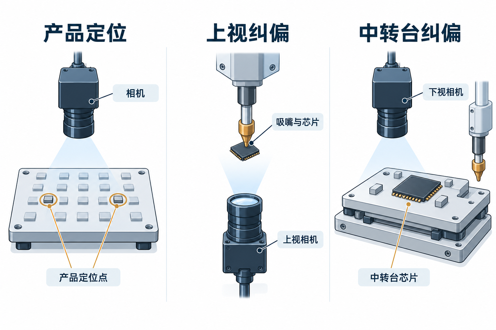
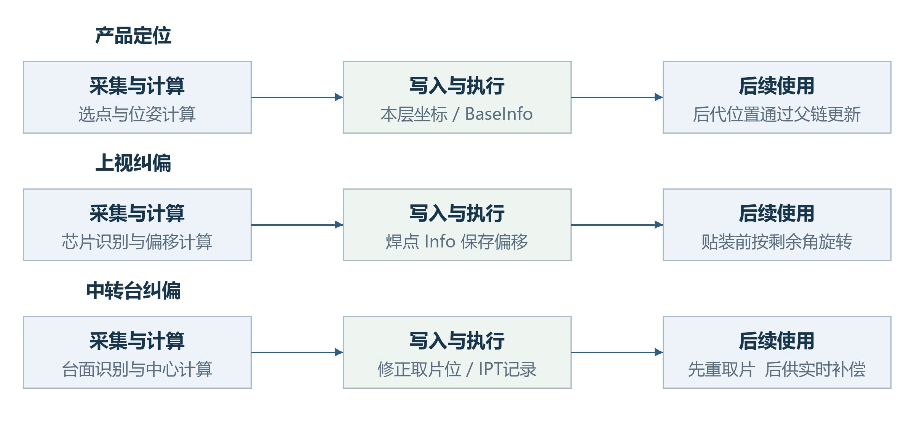
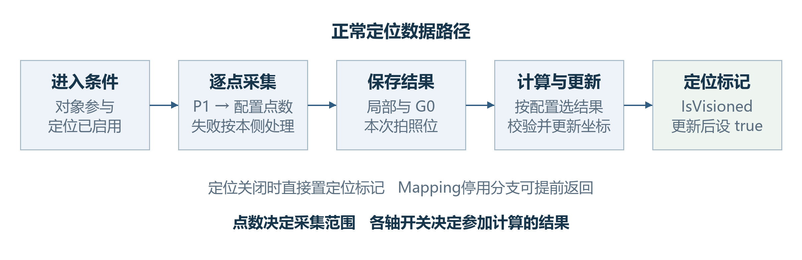
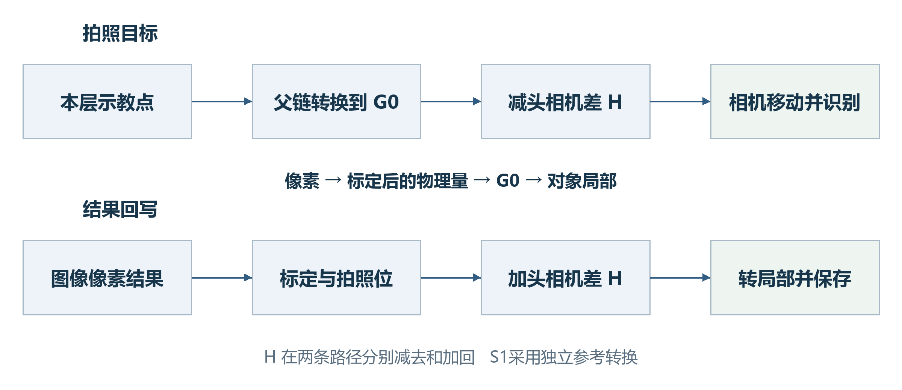
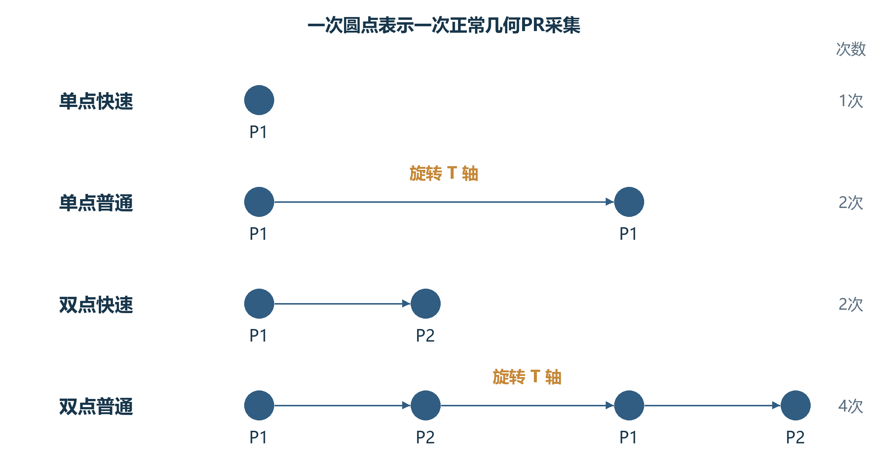
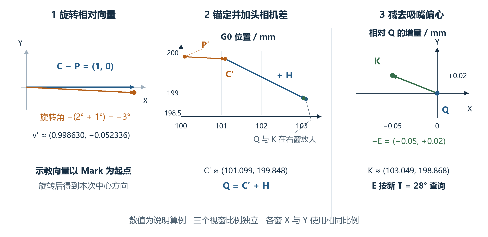
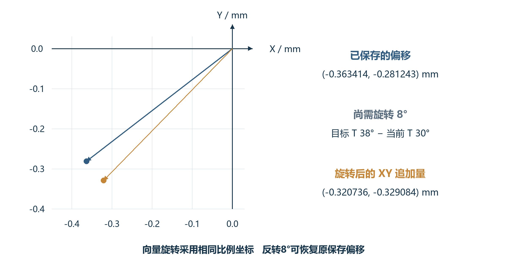
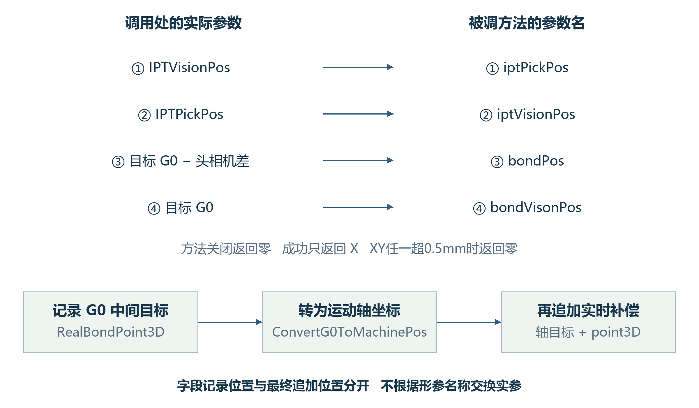
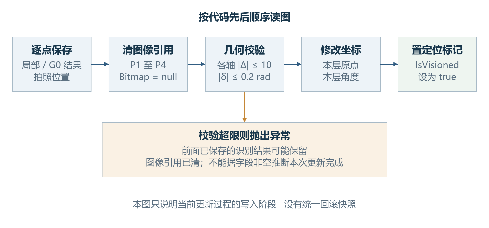

# 纠偏过程设计文档

ZX2200视觉定位与芯片纠偏 · 第2版 · 2026年10月20日

# 1 纠偏对象与设计范围

## 1.1 三类流程分别修正什么

ZX2200中的纠偏涉及不同对象。产品层级定位修正TU、基板、基岛或焊点的当前坐标，使加工点跟随产品实际位姿变化。上视芯片纠偏观察吸嘴上的芯片，计算芯片相对旋转中心的偏移。中转台芯片纠偏先把芯片放到台面识别，再计算修正后的取片位置并重新取片。三者的输入、执行时机和输出含义分别定义。[1][2][4][5]

图1-1 产品定位 上视纠偏与中转台纠偏的观察对象

本图是三种观察方式的概念插画，不是ZX2200设备照片，也不表示机械尺寸或实际工位布局。左侧定位产品上的特征；中间由下方上视相机观察吸嘴上的芯片；右侧由下视相机观察中转台上的芯片，再按修正位置重新取片。

研发人员需要理解配置、坐标、结果写入和返回值之间的契约；设备调试人员需要理解当前使用哪条流程、实际拍了几次、结果作用在哪个阶段。后续各章沿同一顺序展开：进入条件、采集动作、几何计算、数据写入、后续使用和失败边界。

## 1.2 模块职责与外部输入

定位领域方法组织产品定位采集，TuService负责选点和调用坐标更新。上视及中转台动作节点组织芯片移动、识别和纠偏；相机与运动控制器提供标定转换、当前位置及吸嘴偏心。动作控制器管理工作消息，固晶任务根据动作返回值决定继续、重试或退出。图2-1给出这些数据的去向。[2][3][4][5][8]

本册解释纠偏设计及其输出在贴装入口中的必要使用。相机标定矩阵、吸嘴偏心标定、产品示教和实际配方属于运行输入；文中用明确给定的说明值复算公式。测高的Z增量、TU构建与跨工位交接在Transport Unit分册说明，本册只在需要判断位置有效期时引用这些前提。

# 2 输入输出与坐标约定

## 2.1 产品配置与芯片配置分别提供参数

产品定位使用本层的定位配置LocateConfig，回答“在产品上观察哪些特征、哪些结果用于修正本层位置”。它配置1至4个定位点、视觉识别任务PR名称，以及各点是否提供X、Y和角度；还包括距离检查、两点定角和三点拟合圆。[1]

芯片纠偏使用芯片载具的AdjustConfig，回答“识别芯片后，怎样计算芯片中心或取片目标”。它提供单点或双点PR、示教位置，以及特征中心到芯片中心的距离和角度。两组配置服务不同对象，解释参数时要连同其参考系与结果用途一起阅读。[1]

表2-1 三条流程的主要输入与输出

| 流程 | 主要输入 | 主要输出 |
|---|---|---|
| 产品层级定位 | 本层LocateConfig、定位PR、当前父链 | 本层坐标更新；LocateResultInfo与IsVisioned |
| 上视芯片纠偏 | 芯片上视AdjustConfig、快速开关、相机标定与轴位置 | 焊点Info中的ComponentOffSet与ComponentAngleOffSet |
| 中转台芯片纠偏 | 芯片下视AdjustConfig、台面位置、头相机差与吸嘴偏心 | 修正取片动作；IPT位置和角度记录 |

图2-1 纠偏结果的写入位置及后续使用

蓝色为采集或计算模块，绿色为结果保存位置，箭头表示数据流。产品定位更新本层坐标；上视偏移保存在当前焊点Info并在贴装前使用；中转台的几何修正先用于重取片，其位置记录随后供实时补偿入口使用。

## 2.2 位置必须带上参考系

同一个X、Y数值可能是图像像素、标定后的物理位移、产品局部点、G0位置或运动轴位置。图像结果必须先经过相机标定；产品局部点通过产品父链转换；G0与运动轴位置则调用运动控制器转换。头相机差与吸嘴偏心还会在指定位置分别加减。使用字段名称前，要先核对产生该值的转换过程。[2][3][5]

表2-2 本册使用的量与单位

| 量 | 含义与单位 | 使用约束 |
|---|---|---|
| 像素中心CenterX/Y | 识别结果中的图像坐标，pixel | 先经过本相机标定，不能直接加到运动目标 |
| 本层局部点 | 相对当前产品对象的物理位置，mm | 进入产品父链时标明所属层级 |
| G0位置 | 机器全局参考中的物理位置，mm | 与运动轴位置通过控制器转换 |
| 运动轴位置M | 控制器返回的轴位置，mm | 上视计算中的M与玻璃参考G使用同类轴参考 |
| Degree与δ | 产品坐标角及更新角，rad | 坐标与三角函数内部使用弧度 |
| Angle与T | 视觉识别角和旋转轴角，度 | 进入三角函数前换算为弧度 |

## 2.3 旋转符号与结果有效期

以下R(φ)表示按源码三角公式执行的平面旋转，φ使用弧度；R_d(α)表示先把角度α乘π/180再执行旋转。判断方向以公式的X、Y定义为准，不能只依据帮助方法注释中的“顺时针”字样。所有说明算例均明确采用本册公式坐标约定。[3]

结果记录、几何更新和动作返回是不同阶段。产品定位先逐点保存结果，再更新坐标并设置IsVisioned。上视偏移写入之后，还可能有二维码与温漂步骤。中转台记录取片位之后，还需移动、取片和检测。因此，读到一个非空字段，不足以证明本次纠偏已完整成功。

# 3 产品层级定位设计

## 3.1 进入条件与定位点数

领域方法先检查定位配置。AdjustType为None时直接设置IsVisioned并返回true；在按Mapping处理且对象停用的分支中，也可提前返回。正常采集按P1、P2、P3、P4推进，在配置点数对应的出口调用UpdateEntity。点数决定要采哪些点，X、Y和角度开关再分别决定哪些结果进入计算。[2]

图3-1 产品定位从入口到坐标更新的主要步骤

此图概括正常数据路径。定位关闭及Mapping停用分支不进入完整采集链；采集失败和两点距离检查按本侧返回路径处理，见3.5节。UpdateEntity的计算读取当前LocateConfig，传入P1至P4枚举不能理解为一份独立的计算快照。

## 3.2 每个定位点如何形成结果

以S2为例：先将示教定位点从产品局部转到G0，再减去头相机差，得到拍照移动目标。识别结果经过相机标定并结合本次拍照位置转换，再加回头相机差，得到产品特征的G0位置；随后转回对象局部，连同识别结果和拍照位置一起保存。S1使用其独立的相机与测高参考转换，不能直接套用S2的偏移公式。[2][3]

图3-2 S2定位点的拍照目标与识别结果转换

上行是移动目标，下行是识别结果回写。头相机差在两条路径中的加减位置分别标出；G0到本层局部转换发生在保存结果之前。图中相机标定是运行输入，不把像素值当作mm。

## 3.3 锚点选择与角度计算

**锚点是用于比较示教位置与本次识别位置的代表点**。示教锚点和识别锚点分别计算；其中X由启用UseX的点取均值，Y由启用UseY的点独立取均值，采样范围受配置点数限制。某轴没有启用点时，该轴计算结果为0。[2]

**默认角度**对启用UseAngle的MatchResult.Angle取算术均值，再换为弧度；它不按圆周处理±180度跨界。默认更新角取负识别均角，再减父链全局角。[2]

**四点模式**有一个需要保留的实现细节：P4是否参加角度均值，实际由第3点的UseAngle控制。例取四点角度1、2、3、40度，四个开关为true、false、false、true，实际只纳入P1，结果为1度。按第4点开关计算出的20.5度不符合当前代码。[2]

**启用两点定角**时，角度来源改为两条连线。代码先用Atan2分别求示教连线角与识别连线角，再对两者之差执行Atan，最后减去父链全局角。这里保留的是当前计算路径，不能省掉中间的Atan。[2]

例如两条连线角差为0.1rad，中间结果为Atan(0.1)≈0.09966865rad。这个例子用来区分实际算法与直接使用角差的算法；后续更新应使用实际结果。

**启用三点拟合圆**且点数为3或4时，锚点改为P1至P3的圆心；P4不参加圆心拟合。当前GetCentre使用PointF运算，精确共线时返回P1与P2的中点。这一退化分支会产生一个结果，不能在设计说明中改写成必然抛出拟合失败。[2][3]

## 3.4 坐标如何围绕锚点更新

位置更新要同时解决平移和旋转。先让示教锚点到达本次识别出的目标，再围绕这个目标旋转本层坐标；这样，本层中的其他加工点也随同改变全局位置。下面把这两个动作写成可复算的几何关系。

记更新前本层到直接父参考系的变换为F。示教与识别局部锚点为p_o、p_n，本层原点为D，更新角为δ；D以父参考系表示。先求U_o、U_n与Δ，再绕U_n旋转平移后的原点。[2]

$$U_o = F(p_o)   U_n = F(p_n)	ag{3-1}$$

$$Δ = U_n − U_o	ag{3-2}$$

$$D′ = R(δ)(D + Δ − U_n) + U_n	ag{3-3}$$

$$θ′ = θ + δ	ag{3-4}$$

更新前先检查Δ的XYZ任一分量绝对值是否大于10mm，以及δ绝对值是否大于0.2rad；超过时抛异常。比较使用严格大于，因此等于边界值不会被这些判断拒绝。本产品定位的选点函数把锚点Z置为0，测高的Z修正在TU分册另述；通用坐标更新方法仍保留Z分量校验和累加。本册公式说明General平面几何，机器父链中的标定变换仍由实际坐标实现处理。[2]

图3-3 一个定位锚点在更新前后的父参考系位置

本图采用独立说明输入：本层原点D=(100,200)，旧角为0，示教锚点(10,0)，识别局部锚点(10.2,0.1)，指定δ=0.01rad，父参考系在本例取G0。局部视窗只显示锚点附近区域，X/Y使用相同比例。更新后示教锚点与本次目标(110.2,200.1)重合。

按式3-3复算，新原点约为(100.200500,200.000002)，新角为0.01rad。将原示教锚点(10,0)按新坐标转换，得到(110.2,200.1)。这里验证的是给定更新量的几何关系，δ是说明输入，不假设某次真实识别必然产生该角。

## 3.5 距离检查与两侧异常路径

两点距离检查比较示教P1/P2间距与本次识别局部P1/P2间距，差值绝对值超过DistanceTolerance时进入报警。领域方法把这个检查放在TwoPoints出口，不能据开关名称推断3点、4点路径也执行同一检查。[2][7]

图3-4 两点距离异常时S1与S2的处理差异

两侧Abort都会停止并返回false。S1的Retry从P1重走人工报警对点，并以visionAlarm跳过下一次距离检查；S2的Retry重新采P1/P2后再次检查。None在两侧都停用本层，但S1继续更新坐标，S2直接返回true。

单点识别失败时，两侧还可按配置向四周搜索，再进入人工确认。普通匹配PR的人工OK会重新运行PR并返回匹配结果；Ignore执行本层停用后返回失败，Abort停机返回失败。S2基板定位动作调用领域方法后没有使用其bool值，随后返回Success，因此动作Success与坐标已更新、IsVisioned已置位要分开判断。[2][7][8]

# 4 上视芯片纠偏设计

## 4.1 入口条件与四种采集次序

动作外层先按焊点工艺参与和当前工序是否需要执行进行判断。进入DoWork后，精度关闭、选用下视相机或离线模式都可提前返回Success；DryCycle使用独立空跑动作。正常上视路径再依据单点或双点、快速或普通模式决定采集与旋转次序。[4][8]

图4-1 四种上视模式的正常几何采集次序

每个圆点代表一次几何PR采集，不表示耗时。单点快速1次、单点普通2次、双点快速2次、双点普通4次；普通模式在前后两组采集之间旋转T轴。重取、二维码和温漂等附加拍照不计入这些数量。

## 4.2 快速模式的偏移与角度

快速上视先保存芯片偏移，贴装时再按剩余旋转角使用。计算时，先把本次识别位置与玻璃参考位置对应起来，再扣除特征中心到芯片中心的示教向量；该向量需要先按识别角与示教角之差旋转。[3][4]

式4-1中，M是采集时轴位置，G是玻璃上视参考轴位置，d是相机标定后的识别位移，c是示教特征中心到芯片中心的向量，a是识别角，a_0是示教中心角。单点直接代入；双点分别对M、d、a取两次采集的均值，再代入同一式子。

$$o = (M − G) + d − R_d (−(a − a_0)) c	ag{4-1}$$

ComponentAngleOffSet保存a，单点为首次识别角，双点为两角算术均值，单位为度。ComponentOffSet保存o。快速模式在这一步保留芯片偏移供后续贴装按剩余旋转角处理，不把该向量直接当作某个焊点的G0位置。

说明输入取d=(0.12,−0.08)mm，M−G=(0.02,−0.01)mm，c=(0.5,0.2)mm，a=2度，a_0=1度。按式4-1得到o≈(−0.363414,−0.281243)mm，角度记录为2度。标定位移与参考差均为已给定的算例输入，不由像素数直接猜测比例。

## 4.3 普通模式与镜像分支

普通上视在计算位置前，先实际旋转芯片，再重新拍照。因此，位置公式使用旋转后的测量值，不能沿用第一次照片的位置。单点前后各采一次；双点前后各采P1与P2。[4]

非镜像时，实际T轴相对旋转量由识别角、焊点全局角和硬角度补偿组成。式4-2中的M′、d′均来自旋转后的采集；双点分别取旋转后两次结果的均值。

$$o = (M′ − G) + d′ − c	ag{4-2}$$

普通模式的ComponentAngleOffSet写成负的“焊点全局角＋硬角度补偿”，其含义与快速模式不同。例取焊点全局角5度、硬补偿1度，记录为−6度；当前T已在前一步转到40度时，后续目标T按40−6+5+1得到40度，从而不重复执行已完成的目标旋转。

镜像分支在实际T旋转中使用180度减硬角度补偿，但保存的ComponentAngleOffSet仍使用负的焊点全局角与硬补偿之和。这两个表达式按代码分别保留，不能把非镜像算例直接当作镜像推导。镜像产品还应连同示教方向、当前T角和工序配置审查。

## 4.4 温漂调用与动作结束

上视动作完成几何计算后还没有立即结束：它先保存偏移和角度，随后可识别二维码，再处理温漂。因此，字段已经有值与本次动作已成功返回，需要分别判断。[4]

温漂包装方法检查开关和时间条件，必要时调用底层计算。当前包装没有使用底层bool结果，最终始终返回true；上视调用处虽写有“返回false则Abort”，这条判断不能证明底层温漂成功。

底层温漂识别失败时会请求停机并返回false，该分支不清空之前的UpLookCompensation。读取漂移量时，开关关闭或记录为空返回零；XY任一绝对值大于0.2mm则抛异常，由上视外层捕获并返回Exception。[4]

正常取得的漂移量写入TpMarkCompensate，再累加到ComponentOffSet。若后续步骤失败，前面保存的几何字段可能仍在；解释字段时应同时核对本次动作的返回与停止状态。

# 5 中转台芯片纠偏设计

## 5.1 放片识别与重新取片

中转台动作先准备当前焊点、吸嘴和速度。精度关闭或相机选择为上视时提前返回Success；DryCycle使用独立空跑流程。当前DoWork没有与上视相同的离线提前返回分支，文档不能把上视模式开关原样复制到这里。[5]

图5-1 中转台纠偏把识别结果用于重新取片

按左上、右上、左下、右下阅读：先把芯片放在台面；相机识别时芯片保持在台面；计算位置后移动吸嘴对位；最后重新取起。第3步移动的是吸嘴，图中没有台面带动芯片旋转。该图为物理阶段概念插画，不表示设备尺寸、实际工位布局或完整检测动作；几何关系见图5-2，重试分支见5.4节。

放片位置使用台面位置转换到轴坐标后，加芯片台面中心偏移、减放片角下的吸嘴偏心；高度结合台面高度、吸嘴测高差与芯片厚度。放片完成后再移动到下视拍照位。单点采P1，双点采P1和P2，识别位移经下视相机标定并结合实际拍照位置求得。[3][5]

## 5.2 芯片中心与取片位置计算

中转台纠偏先求芯片实际中心，再求吸嘴应该到达的位置。芯片上的Mark与芯片中心之间有一个示教向量；本次识别确定这个向量应旋转多少、应从哪个Mark位置出发。式5-1完成这个几何步骤。[5]

C是示教芯片中心，P是示教Mark，P′是本次识别Mark，a是识别角，a_0是示教下视角。双点模式用两个示教Mark的中点代替P，用两个识别Mark的中点代替P′，并对识别角取算术均值。参与运算的点使用同一组相机与G0转换给出的物理参考。

$$C′ = R_d (−(a + a_0)) (C − P) + P′	ag{5-1}$$

新取片T为当前T减a。用这个新角度查询吸嘴偏心E，加上头相机差H，得到修正取片G0位置K。随后控制器把K转为轴坐标，和取片高度及新T一起形成移动目标。

$$K_G0 = C′ + H − E(T − a)	ag{5-2}$$

图5-2 从示教中心到修正取片位置的计算关系

使用5.2节单点算例。左窗旋转示教相对向量；中窗以G0坐标把向量接到本次Mark P′，得到芯片中心C′，再加头相机差H得到中间点Q；右窗放大Q附近的增量，减去新T角下的吸嘴偏心E才到达取片目标K。三窗比例独立，每窗X/Y等比例；右窗刻度是相对Q的mm增量。完整数值在正文给出。

独立单点算例取C=(101,200)，P=(100,200)，P′=(100.1,199.9)mm，a=2度，a_0=1度，当前T=30度，H=(2,−1)mm，新角下E=(0.05,−0.02)mm。得到C′≈(101.098630,199.847664)，K≈(103.048630,198.867664)mm，新T=28度。吸嘴偏心是接口返回的说明输入，不据此推断设备标定曲线。

## 5.3 拍照位 取片位与统计字段

拍照位置说明“相机当时在哪里”，取片位置说明“吸嘴随后应到哪里”；两者承担不同职责。解释IPT字段时，应先追踪它来自哪一次移动和转换，再判断是否可用于当前计算。[5]

P1拍照目标先把配置G0位置转成轴位置，再减头相机差；保存IPTVisionPos时又转换回G0。P2用配置G0位置减头相机差，经另一条G0移动接口执行，并保存IPTP2VisionPos。最终取片位转换到轴坐标后，再转回G0保存为IPTPickPos。[5]

实际取片几何与统计补偿分别产生。SubstrateCameraCompensate用于后续结果统计，当前CalculateBondPos没有把它直接当作本次修正取片位叠加。判断芯片怎样重新取起，应看前面的中心与取片位置计算。[5][6]

双点统计表达式还会在P2位置重新转换P1识别结果，没有复用前面缓存的P1实际点。因此，统计字段与几何中心不能仅因名称中都有“补偿”就被合并解释。[5]

## 5.4 视觉失败与取片检测失败

下视识别失败后，人工OK返回匹配结果继续计算，Abort退出。Ignore分支会回到原放片位置取回芯片、抛料、更新拒收计数并重置相关动作消息，随后返回Retry；它不是按失败识别点继续贴装的出口。[5][7]

图5-3 取片后检测的Retry与实际重新执行Pick的区别

本图对应正常纠偏取片后的RePick标签：标签位于Pick调用之后，检测失败选择Retry只回到检测位置。视觉失败Ignore分支中的Repick标签则位于其PickAction之前。两个标签的大小写和位置不同，不能按按钮名称把两条路径画成相同重取动作。

正常重取片后的检测受芯片检测与取片后慢行程配置共同控制。检测失败选择下一颗，会抛料、暂停、按需要请求芯片、重置取片与中转台纠偏动作并返回Retry；选择终止返回Abort。是否真正重新执行了取片，应看跳转标签与调用位置。

# 6 纠偏输出在贴装入口中的使用

## 6.1 上视偏移按剩余旋转角使用

当前贴装入口先求目标T：当前轴角T_now加ComponentAngleOffSet，再加焊点父链给出的全局角b和硬角度补偿c。上视分支将ComponentOffSet按目标T减当前T旋转后，取XY加到G0贴装目标。公式仅描述纠偏输出的使用，完整目标还包含产品局部补偿、焊后补偿及其他配置项。[6]

$$T_goal = T_now + a_off + b + c	ag{6-1}$$

$$o_G0 = R_d (T_goal − T_now) o	ag{6-2}$$

图6-1 上视偏移从保存到贴装使用的角度关系

图中向量采用4.2节快速单点算例。当前T为30度、角度记录2度、焊点全局角5度、硬角度补偿1度，得到目标T为38度、尚需旋转8度；保存向量按8度旋转后形成G0的XY追加量。

算例得到XY追加量约为(−0.320736,−0.329084)mm；把该向量反转8度，可回到原保存偏移(−0.363414,−0.281243)mm。这个逆算只核对纠偏向量的使用关系，其余补偿在本例中设为零；它不代表设备最终完整贴装坐标。

## 6.2 中转台记录与实时补偿接口

中转台相机的贴装分支先按目标T处理吸嘴偏心，再调用实时补偿。实际传入前两个位置依次为IPTVisionPos、IPTPickPos，但被调方法的前两个参数名依次为iptPickPos、iptVisionPos。本册保留实参次序，不能依据名称在图或算例中悄悄调换。[6]

图6-2 实时补偿的实参与形参及追加位置

左侧按调用表达式给出实际参数顺序，右侧保留方法参数名。当前方法关闭时返回零；成功返回只保留X，XY任一绝对值超过0.5mm时返回零。返回量在G0目标转为轴坐标后追加，RealBondPoint3D记录在这次追加之前。

实时补偿开启时要求位置输入、参考点集合及示教状态可用，缺少时抛异常。当前返回值在轴坐标转换之后直接追加，而RealBondPoint3D保存的是此前的G0中间结果；二者不能被说明成完全相同的一份最终运动目标。接口顺序与参考假设属于评审时需要保持可见的实现边界。

## 6.3 其他补偿项与结果记录的边界

产品局部硬位置补偿先通过焊点父链转换到G0；焊后与单点补偿加入后，再进入相机分支；之后还会处理TU补偿、可选参考点并记录RealBondPoint3D，随后转为轴目标并追加实时补偿。Z目标又结合基准高度、吸嘴测高差、芯片厚度、局部Z补偿及压合距离单独计算。本册解释纠偏结果在其中的准确位置，不以简化XY公式替代完整贴装设计。[6]

# 7 异常处理与状态有效性

## 7.1 采集成功 更新成功与动作返回

产品定位的SaveInfo在每个点采集完成后保存识别结果、局部点、G0点与拍照位置。UpdateEntity先清四个结果Bitmap，再执行几何校验与坐标修改，最后才设置IsVisioned。若更新超限抛异常，结果字段和图像引用已经可能改变；当前流程没有把这些数据统一回滚成采集前的快照。[2]

图7-1 产品定位的写入阶段与可能的失败位置

顺序为逐点保存结果、清图像引用、几何校验、修改坐标、置定位标记。图中强调校验失败时前两步可能已经发生，IsVisioned不能仅根据结果字段非空推断；其他动作包装还可能对返回值另行处理。

## 7.2 人工确认的返回契约

报警委托通过UI锁串行显示对话框，返回DialogResult与算法结果，并记录报警处理时间与方式。对普通匹配PR，确认按钮会重新执行PR；成功后复制CenterX、CenterY、Angle形成结果。上视与中转台在人工OK处直接返回该结果，绕过后面的GetMatchResultByConfig；不能把人工确认理解为与正常识别完全相同的后处理路径。[7]

正常后处理会原地修改匹配结果：关闭X时写1224，关闭Y时写1024，关闭角度时写0。这些是图像结果中的替代值，后续仍需标定转换，不等于物理位移直接归零。人工OK绕过这一步，解释关闭某轴后的行为时必须同时指明使用哪个出口。[4][5]

## 7.3 Retry如何回到动作编排

上视自动跳过或人工重取会抛料、更新拒收计数，并按浸胶模式重置取片、可选浸胶及上视等动作消息。中转台也有自己的重做动作集合。控制器SetActionNodeReWork按当前地址与工序选择消息，把Finished改为false；固晶任务收到Retry后继续循环，不把当前消息标为完成。[4][5][8]

动作消息记录本轮编排执行到哪里，焊点工序字典记录产品工序是否完成。重置消息不自动恢复所有Info结果，也不能据此证明芯片仍在同一位置。调试判读应把当前物理阶段、位置记录和本次动作返回放在一起；本册不把这些分散操作描述成通用断点恢复协议。

# 8 接口契约与设计核对

## 8.1 主要接口的输入输出

表8-1 定位与纠偏接口的调用契约

| 接口 | 输入与前提 | 输出及主要副作用 |
|---|---|---|
| System1MatterVision System2MatterVision | 本层对象、当前LocateConfig、可用父坐标与PR | bool；可能保存结果、更新本层坐标或提前返回；S1/S2异常分支分别判断 |
| TuService.UpdateEntity | 本层配置与已采集定位结果；几何更新量在允许范围 | void；清Bitmap、更新坐标后置IsVisioned；异常无统一回滚 |
| 上视 DoWork UpLookCorrectionActionNode | 当前焊点/芯片/吸嘴及上视标定；模式决定是否进入采集 | ExcuteResult；写偏移与角度，正常几何后仍有附加步骤 |
| 中转台 DoWork SubstrateCameraCorrection ActionNode | 当前焊点/芯片/吸嘴、台面与下视标定 | ExcuteResult；放片、定位、修正取片与检测，按分支重置消息 |
| CalculateBondPos | 当前产品位置及当前工序的纠偏记录；补偿配置和标定可用 | 返回运动轴XYZT；同时写中间G0位置，记录不等于全部追加后的目标 |

## 8.2 两类读者共用的核对问题

研发评审可从接口与数据归属检查下列问题，设备调试可从同一问题定位需要观察的阶段。每项答案均在前文有图示或公式依据；源码入口集中放在附录A，完整路径和逐项结论见配套索引。

表8-2 阅读与评审核对问题

| 问题 | 本册给出的判断依据 |
|---|---|
| 产品位置由谁改变 | 本层坐标更新及父链传播，见图3-2、图3-3 |
| 为什么普通双点上视有四次几何采集 | 旋转前后各采P1/P2，见图4-1 |
| 保存的芯片偏移能否直接加到贴装位 | 要结合剩余旋转角，见图6-1与式6-2 |
| 中转台取片位与统计补偿是否同一量 | 取片几何与统计字段分别产生，见5.2与5.3节 |
| 点了重取是否一定执行了Pick | 看标签在Pick之前还是之后，见图5-3 |
| 结果字段有值是否代表本次动作成功 | 检查写入阶段和后续返回，见图7-1及4.4节 |

# 附录A 源码依据与阅读定位

本册以2026年10月20日本地ZX2200源码为依据。下列主题提供主要文件短名与行号；完整文件路径、方法及锚点见source-guide.md，文件哈希及阅读区间见source-analysis.json和source-baseline.json，结论映射见claim-map.json。说明算例及独立复算结果保存在arithmetic-examples.json，不作为设备实测。

## [1] 纠偏对象与配置

产品定位和芯片纠偏的配置入口及字段归属

- ZX/TransportUnitSystem/Module/Config/LocateConfig.cs：class LocateConfig，L20；string P1PRName => MachineConfigContext.GetInstance().RecipeName + this.Name + "Mark1";，L43
- ZX/Infrastructure/Models/CommonModels/AdjustConfig.cs：class AdjustConfig，L32；AKRSPoint3D P1VisionPos { get; set; } = new AKRSPoint3D();，L42
- ZX/WaferSubSystem/Models/Repositories/Carrier/BaseCarrierConfig.cs：AdjustConfig UpLookAdjustConfig { get; set; } = new AdjustConfig();，L482；AdjustConfig DownLookAdjustConfig { get; set; } = new AdjustConfig();，L490
- ZX/TransportUnitSystem/Module/Information/BondPositionInfo.cs：class BondPositionInfo : BaseInformation，L18；MatchResult UpLookMatchResult1 { get; set; } = new MatchResult();，L23

## [2] 产品层级定位

采集、选点、几何更新与两侧距离检查

- ZX/DispenseSystem/Models/System1Domain.cs：bool System1MatterVision(BaseMatter baseEntity, bool byMapping = true)，L96；bool System1VisionByPos(BaseMatter baseEntity, TuService.NormalVisionType type,bool alarm = false)，L205
- ZX/BondSystem/Models/System2Domain.cs：bool System2ObjectVision(BaseMatter baseEntity, bool byMapping = true)，L267；bool System2MatterVision(BaseMatter baseEntity, bool byMapping = true)，L279
- ZX/TransportUnitSystem/Service/TuService.cs：enum NormalVisionType，L443；static (AKRSPoint3D point3D, string pRName,bool Autofocus) GetVisionInfo(BaseMatter baseEntity, NormalVisionType type)，L472
- ZX/TransportUnitSystem/Model/VisionResult.cs：class VisionResult，L11；void SaveInfo(MatchResult matchResult, AKRSPoint3D resultPoint3D, AKRSPoint3D resultPoint3DInG0, AKRSPoint3D visionPoint3DInG0)，L60
- CS/BaseCoordinateSystem.cs：AKRSPoint3D ForwardConvertCoordinate(AKRSPoint3D value)，L84；void UpdateCoordinateSystem(AKRSPoint3D oldPoint3D, AKRSPoint3D newPoint3D, double degree)，L204
- CS/GeneralCoordinateSystem.cs：double DegreeInG0()，L107

## [3] 坐标转换与标定输入

相机像素到物理位置、吸嘴偏心及旋转帮助方法

- ZX/BondSystem/Modules/UpLookModule.cs：class UpLookModule，L19；AKRSCamera UpLookCamera => HardwareRepositoryService.GetHardware<AKRSCamera>("上视相机");，L25
- ZX/BondSystem/Controllers/System2Controller.Vision.cs：BaseAlgResult BondCameraVision(AKRSPoint3D visionPosition, string pRName, bool isZSafe = false, bool isDefect = false, bool autofocus = false)，L159；AKRSPoint3D GetBondVisionResultPos(MatchResult result, AKRSPoint3D visionPos = null)，L652
- ZX/DispenseSystem/Controllers/DispenseController.cs：AKRSPoint3D GetG0VisionPos(AKRSPoint3D point3D)，L262；AKRSPoint3D GetG0PosFromVision(AKRSPoint3D point3D)，L273
- ZX/BondSystem/Controllers/BondHeadController.cs：AKRSPoint2D GetNozzleOffset(string nozzleName, double angle)，L970；AKRSPoint2D GetNozzleOffset(AKRSPoint2D offset, double angle)，L987
- ZX/Infrastructure/Utils/MathHelper.cs：static class MathHelper，L26；static AKRSPoint3D RotateCenter(AKRSPoint3D distanceToCenter,double degree)，L34

## [4] 上视纠偏与温漂

入口模式、采集次序、偏移计算与温漂调用链

- ZX/BondSystem/Models/ActionNodes/BPActionNode/UpLookCorrectionActionNode.cs：override ExcuteResult DoWork()，L131；override bool IsDoWork()，L520
- ZX/BondSystem/Models/Parameter/System2RunTimeProvider.cs：static MatchResult GetMatchResultByConfig(MatchResult matchResult,LocateUseConfig locateUseConfig)，L415
- ZX/SupportFeature/Compensate/TemperatureCompensate/TpMarkCompensate.cs：static bool TemperatureCompensation(bool firstTu)，L64；static AKRSPoint3D GetTemperatureCompensation()，L240
- ZX/BondSystem/Controllers/System2Controller.Vision.cs：BaseAlgResult BondCameraVision(AKRSPoint3D visionPosition, string pRName, bool isZSafe = false, bool isDefect = false, bool autofocus = false)，L159；AKRSPoint3D GetBondVisionResultPos(MatchResult result, AKRSPoint3D visionPos = null)，L652

## [5] 中转台纠偏

放片、定位、修正取片位与重取分支

- ZX/BondSystem/Models/ActionNodes/BPActionNode/SubstrateCameraCorrectionActionNode.cs：override ExcuteResult DoWork()，L136；override bool IsDoWork()，L520
- ZX/BondSystem/Models/ActionNodes/BPActionNode/SubstrateCameraCorrectionActionNode.Provider.cs：partial class SubstrateCameraCorrectionActionNode，L28；void PrepareBeforeAction()，L33

## [6] 贴装输出使用

角度与XY使用、补偿次序和统计数据边界

- ZX/BondSystem/Models/ActionNodes/BPActionNode/BondActionNode.Provider.cs：AKRSPoint4D CalculateBondPos()，L498
- ZX/BondSystem/Models/ActionNodes/BPActionNode/BondActionNode.cs：override ExcuteResult DoWork()，L118
- ZX/SupportFeature/Compensate/MotionAreaCompensate/RealTimeCorrection.cs：AKRSPoint3D GetCompensatePoint3D(AKRSPoint3D iptPickPos, AKRSPoint3D iptVisionPos, AKRSPoint3D bondPos, AKRSPoint3D bondVisonPos)，L149
- ZX/BondSystem/Models/ActionNodes/BPActionNode/AfterBondCheckActionNode.cs：double distanceY = Math.Round(point4D.Y - this.PostBondInspection.PostBondDistanceY, 5);，L560

## [7] 报警与人工确认

报警返回、PR重跑与距离检查选项

- ZX/Main/Controls/Ucmain/MainControls/UcmainSystem.Action.cs：(DialogResult, BaseAlgResult) VisionAlarm(PREntity pREntity, string message, string caption)，L234；(DialogResult, BaseAlgResult) VisionAlarm(PREntity pREntity, string message, string caption, PRHardware pRHardware = null)，L273
- ZX/Infrastructure/Controls/Currency/FrmVisionAlarm.cs：void BtOK_Click(object sender, EventArgs e)，L339；void BtSkip_Click(object sender, EventArgs e)，L505
- ZX/Infrastructure/Service/VisionService.cs：static BaseAlgResult Vision(string pRName, PRHardware prHardware, string systemName = "Other", string bitmapName = "", bool setLight = true)，L78；static DialogResult DistanceCheck(BaseMatter baseMatter)，L257

## [8] 动作编排与完成记录

重做动作的选择、Retry及消息完成处理

- ZX/Main/Machine/Process/S2ActionNodeController.cs：List<ActionNodeMessage> GetActionNodeMessageByProcess(SingleProcessStep singleProcess, int substrateIndex, int moduleIndex)，L715；void SetActionNodeReWork(List<ActionNode> actionNodes)，L1099
- ZX/BondSystem/Tasks/BondTask.cs：ExcuteResult ret = actionNode.DoWork();，L232
- ZX/BondSystem/Models/ActionNodes/AdjustActionNode/S2SubstrateVisionActionNode.cs：class S2SubstrateVisionActionNode : ActionNode，L29；System2Domain system2Domain => System2Domain.GetInstance();，L34
- ZX/TransportUnitSystem/Module/Information/BondPositionInfo.cs：class BondPositionInfo : BaseInformation，L18；MatchResult UpLookMatchResult1 { get; set; } = new MatchResult();，L23

# 附录B 术语与图表索引

## B.1 常用术语

表B-1 本册常用术语

| 术语 | 本文中的含义 |
|---|---|
| 产品层级定位 | 更新TU或其下层当前对象的位姿，后代通过父链使用新位置 |
| 上视纠偏 | 识别吸嘴上芯片，计算偏移供后续贴装使用 |
| 中转台纠偏 | 芯片放台后识别，并按修正位置重新取片 |
| 示教锚点与识别锚点 | 按配置选择后分别形成的旧点与本次测得点 |
| G0与轴坐标 | 机器全局参考与运动轴位置，按控制器实际方法转换 |
| 头相机差H | 焊头与下视相机参考之间配置的偏移，按具体流程加减 |
| 吸嘴偏心E | 按当前吸嘴与角度查询的标定返回量 |
| 快速与普通上视 | 分别在本次采集后保存偏移，或先旋转再采集位置 |
| ComponentOffSet | 焊点Info保存的芯片偏移向量 |
| ComponentAngleOffSet | 与纠偏模式相关的角度记录，单位度 |
| Finished与工序字典 | 控制器消息状态与产品工序记录，分别维护 |
| R与R_d | 按源码公式的平面旋转；参数分别采用弧度与度 |

## B.2 图目录

- 图1-1 产品定位 上视纠偏与中转台纠偏的观察对象
- 图2-1 纠偏结果的写入位置及后续使用
- 图3-1 产品定位从入口到坐标更新的主要步骤
- 图3-2 S2定位点的拍照目标与识别结果转换
- 图3-3 一个定位锚点在更新前后的父参考系位置
- 图3-4 两点距离异常时S1与S2的处理差异
- 图4-1 四种上视模式的正常几何采集次序
- 图5-1 中转台纠偏把识别结果用于重新取片
- 图5-2 从示教中心到修正取片位置的计算关系
- 图5-3 取片后检测的Retry与实际重新执行Pick的区别
- 图6-1 上视偏移从保存到贴装使用的角度关系
- 图6-2 实时补偿的实参与形参及追加位置
- 图7-1 产品定位的写入阶段与可能的失败位置

## B.3 表目录

- 表2-1 三条流程的主要输入与输出
- 表2-2 本册使用的量与单位
- 表8-1 定位与纠偏接口的调用契约
- 表8-2 阅读与评审核对问题
- 表B-1 本册常用术语
- 表C-1 需要保留的实现边界

# 附录C 当前实现的特定边界

下表集中保留会影响算法解释和调试判断的当前行为。它们已经在对应章节按源码说明；本册未修改业务实现，也不把这些行为改画为理想流程。

表C-1 需要保留的实现边界

| 位置 | 当前行为 | 阅读影响 |
|---|---|---|
| 四点角度选项 | P4参与条件读取第3点UseAngle | 不能按第4点开关重写计算 |
| 两点定角 | Atan应用于两连线角之差 | 不是直接角度差或归一化角差 |
| S2基板定位动作 | 未使用领域方法bool返回 | 动作Success不独立证明位姿更新 |
| 温漂包装方法 | 丢弃底层bool并始终返回true | 底层停机副作用与包装返回分别判断 |
| 人工OK出口 | 直接返回人工确认后的匹配结果 | 绕过正常轴选择后处理 |
| 正常取片后RePick | 标签位于Pick调用之后 | Retry回检测，不自动重执行该Pick |
| 实时补偿调用 | IPTVisionPos、IPTPickPos与形参名顺序不同 | 按实参顺序核对；保留轴转换后追加位置 |
| 几何与动作有效期 | 若后续失败，先前结果可能仍在 | 字段存在不能替代本次流程成功依据 |
