# 纠偏过程 设计文档

介绍供料端定位、产品层级定位、上视与中转台纠偏，
说明计算依据、结果保存、生效时机及失败处理。

# 1 纠偏对象与设计范围

## 1.1 四类流程分别修正什么

ZX2200的生产定位与纠偏沿产品和芯片两条路径展开。供料端定位在取片前确定芯片位置与角度；产品层级定位更新Transport Unit（TU，产品运行树的根）及基板、基岛或焊点的当前坐标；上视纠偏观察吸嘴上的芯片；中转台纠偏先放片识别，再按修正目标重新取片。四类流程的修正对象和结果用途分别定义。[1][2][4][5][9]

图1-1 产品与贴装侧的三种视觉观察对象

左侧观察产品特征，中间上视相机观察吸嘴上的芯片，右侧下视相机观察中转台芯片。供料端观察见图3-1。图示用于区分观察对象，机械尺寸与布局不按比例表达。

研发人员需要理解配置、坐标、结果写入和返回值之间的契约；设备调试人员需要理解当前使用哪条流程、实际拍了几次、结果作用在哪个阶段。后续各章沿同一顺序展开：进入条件、采集动作、几何计算、数据写入、后续使用和失败边界。

## 1.2 模块职责与外部输入

定位领域方法组织产品定位采集，TuService负责选点和调用坐标更新。上视及中转台动作节点组织芯片移动、识别和纠偏；相机与运动控制器提供标定转换、当前位置及吸嘴偏心。动作控制器管理工作消息，固晶任务根据动作返回值决定继续、重试或退出。图2-1给出这些数据的去向。[2][3][4][5][8]

本册覆盖供料定位、产品定位、芯片纠偏及相关补偿的生产调用。相机标定、吸嘴标定和示教数据作为运行输入；TU对象构建、跨工位流转及测高数据归属见Transport Unit分册。手动贴片测试与生产动作分别说明，避免将相似方法名当作完全相同的实现。

# 2 输入输出与坐标约定

## 2.1 产品配置与芯片配置分别提供参数

产品定位使用本层的定位配置LocateConfig，回答“在产品上观察哪些特征、哪些结果用于修正本层位置”。PR在本工程中指按名称调用的视觉识别任务。配置包含1至4个定位点及其PR名称，各点的X、Y和角度开关，以及距离检查、两点定角和三点拟合圆选项。[1]

芯片纠偏使用芯片载具的AdjustConfig，回答“识别芯片后，怎样计算芯片中心或取片目标”。它提供单点或双点PR、示教位置，以及特征中心到芯片中心的距离和角度。两组配置服务不同对象，解释参数时要连同其参考系与结果用途一起阅读。[1]

表2-1 四类流程的主要输入与输出

| 流程 | 主要输入 | 主要输出 |
|---|---|---|
| 供料定位与取片 | 搜晶配置、供料相机或焊头下视相机、载具和吸嘴参数 | 芯片定位角、供料中心、取片XYZT |
| 产品层级定位 | 本层LocateConfig、定位PR、当前父链 | 本层坐标更新；LocateResultInfo与IsVisioned |
| 上视芯片纠偏 | 芯片上视AdjustConfig、快速开关、相机标定与轴位置 | 焊点Info中的ComponentOffSet与ComponentAngleOffSet |
| 中转台芯片纠偏 | 芯片下视AdjustConfig、台面位置、头相机差与吸嘴偏心 | 修正取片动作；IPT（中转台）位置和角度记录 |

图2-1 纠偏结果的写入位置及后续使用

蓝色为采集或计算模块，绿色为结果保存位置，箭头表示数据流。产品定位更新本层坐标；上视偏移保存在当前焊点Info并在贴装前使用；中转台的几何修正先用于重取片，其位置记录随后供实时补偿入口使用。

## 2.2 位置必须带上参考系

同一个X、Y数值可能是图像像素、标定后的物理位移、产品局部点、G0位置或运动轴位置。图像结果必须先经过相机标定；产品局部点通过产品父链转换；G0与运动轴位置则调用运动控制器转换。头相机差与吸嘴偏心还会在指定位置分别加减。使用字段名称前，要先核对产生该值的转换过程。[2][3][5]

表2-2 本册使用的量与单位

| 量 | 含义与单位 | 使用约束 |
|---|---|---|
| 像素中心CenterX/Y | 识别结果中的图像坐标，pixel | 先经过本相机标定，不能直接加到运动目标 |
| 本层局部点 | 相对当前产品对象的物理位置，mm | 进入产品父链时标明所属层级 |
| G0位置 | 机器全局参考中的物理位置，mm | 与运动轴位置通过控制器转换 |
| 运动轴位置M | 控制器返回的轴位置，mm | 上视计算中的M与玻璃参考G使用同类轴参考 |
| Degree与δ | 产品坐标角及更新角，rad | 坐标与三角函数内部使用弧度 |
| Angle与T | 视觉识别角和旋转轴角，度 | 进入三角函数前换算为弧度 |

## 2.3 旋转符号与结果有效期

以下R(φ)表示按源码三角公式执行的平面旋转，φ使用弧度；R_d(α)表示先把角度α乘π/180再执行旋转。判断方向以公式的X、Y定义为准，不能只依据帮助方法注释中的“顺时针”字样。所有说明算例均明确采用本册公式坐标约定。[3]

结果记录、几何更新和动作返回是不同阶段。产品定位先逐点保存结果，再更新坐标并设置IsVisioned。上视偏移写入之后，还可能有二维码与温漂步骤。中转台记录取片位之后，还需移动、取片和检测。因此，读到一个非空字段，不足以证明本次纠偏已完整成功。

# 3 供料端定位与取片位置修正

## 3.1 先确定芯片在哪里 再决定怎样取起

供料端定位发生在芯片被吸嘴取起之前。晶圆和普通华夫盒通常由供料任务确定候选位置、识别并移动芯片；静态华夫盒的部分路径先提供拍照目标，再由焊头下视相机识别芯片。得到的定位角与位置用于取片，不是产品焊点的坐标修正。[9]

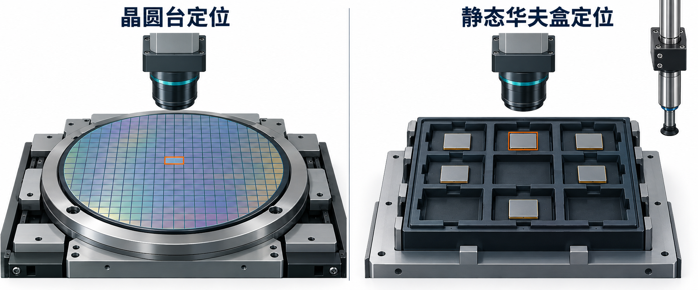

图3-1 晶圆台与静态华夫盒在取片前观察芯片

左侧相机观察晶圆上的候选芯片，校正可通过晶圆台移动完成；右侧芯片仍在固定槽位中，焊头相机识别后计算吸嘴取片位。图示比较观察方式，尺寸和槽位数量不表示实际设备配置。

WaferSubSystemTask调用Block.NextDie，Block再按SearchMode分派Single、Nine、WaferMap或Box。成功形成的结果经允许取料信号交给取片动作。取片动作根据载具类型取得供料定位角或重新识别静态华夫盒，调用CalculatePickPos后才形成XYZT目标。[9]

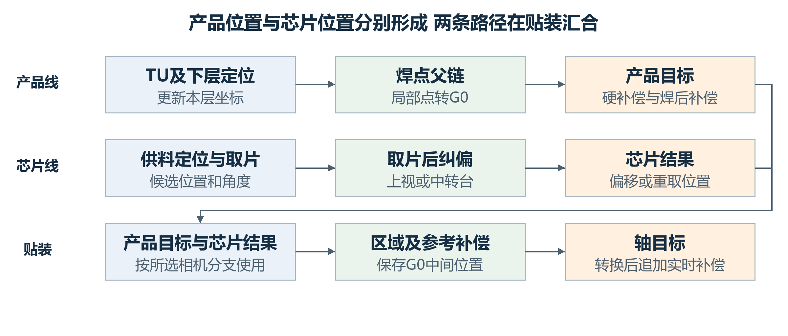

图3-2 产品线与芯片线在贴装位置计算处汇合

上路处理TU及其后代的位置，下路处理供料芯片、取片和取片后的纠偏。上视与中转台依据相机配置选用；两条数据路径不表示所有任务必须按图中横向位置串行执行。

## 3.2 搜晶方式与重复校正

表3-1 供料定位分支的结果形成

| 入口 | 结果形成方式 | 需要区别的条件 |
|---|---|---|
| Single | 按搜索方向取得候选，单点或双点PR后移向取料中心 | 双点分别采特征，中心取两实测点中点，角度取均值 |
| Nine | 先用九宫格存在标记选择候选；MoveDieToPickCenter中再次识别并刷新邻片 | 候选可复用；整条成功路径仍调用CalculateDiesPosition，不能写成免拍照 |
| WaferMap | 标准单点按Map候选定位，跳板或跳片后继续选取 | 当前两点、MultipleSearch和关闭定位的分支均抛异常，不作为已支持模式 |
| Box | 按槽位取候选；普通华夫盒可在供料侧识别 | 静态华夫盒标准单点分支只先给拍照目标 |

AnalyseDie在IsTimesLocation开启且非跳板时调用ToRequiredAccuracy。每轮识别后，把像素结果转换成物理偏差；角度绝对值不超过TarAngle且XY偏差分别不超过TarAccuracy时返回成功。比较包含等号。未满足且尚有次数时，调用MoveToCameraCenterWithThread后重新识别；达到MaxLocationTimes仍未满足则返回失败。[9]

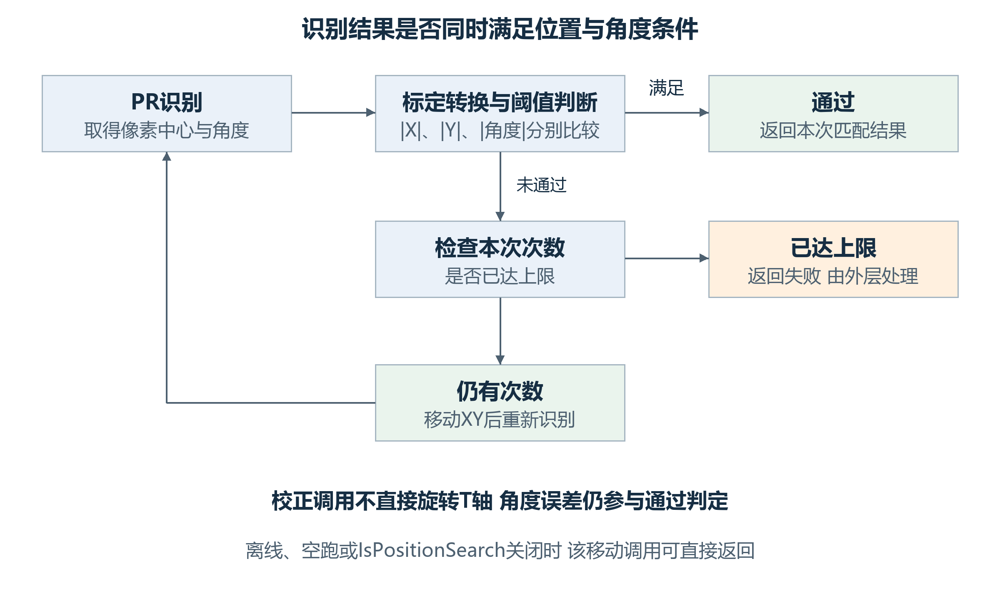

图3-3 多次定位如何判定通过与继续校正

每轮都检查位置与角度，但循环内的校正调用移动晶圆台XY，没有直接调用T轴旋转。MoveToCameraCenterWithThread还受IsPositionSearch、离线和空跑条件控制，配置多次定位并不等于每轮都有有效运动。

这条循环的目标是使本次结果满足配置阈值。不能将“允许多次”理解为必然达到精度，尤其角度条件虽参与判定，该循环本身不直接回正旋转轴。失败后外层可让操作者重新检测或跳过当前芯片；最终仍需结合isSkip及返回结果决定是否允许取料。[9]

内部PR未识别时，Retry从RetryCommand重新开始并重置次数；人工OK直接返回(true, matchResults[0])，不再经过阈值判定，仍要求结果数组可取到首项。Skip返回(false, CameraCenterPixel)，Abort抛异常。外层AnalyseDie收到未达标结果后，Retry回到RetryTimesLocation重走多次定位，Ignore则把isSkip设为true。因此人工OK的true与自动阈值通过不能混为一谈。[9]

## 3.3 从识别结果计算取片XYZT

取片角由芯片定位角、取料硬角补偿及吸嘴校准角组合。记定位角为a、取片硬角为p、吸嘴校准角为n；未启用翻转时取片轴角为p−a+n，启用翻转时为p+a+n。吸嘴偏心接口接收最终轴角减n；不能把芯片角直接当作偏心旋转参数。[9]

$$T_pick = p − a + n\tag{3-1}$$

晶圆路径从固定取料参考中心出发，减吸嘴偏心，加顶针中心与相机中心的偏差及芯片取料补偿；翻转路径改从当前翻转工具位置出发。静态华夫盒则把识别Mark位置与头相机差组合后转为轴坐标，再扣吸嘴偏心及旋转后的Mark到芯片中心向量，并加取料补偿。各载具的Z分别取示教、测高和厚度等配置，不能共用一条简化高度式。[9]

静态华夫盒例中，令A(V+H)为识别Mark加头相机差后转换出的轴位置，q为取料补偿，r为示教Mark到芯片中心向量，E为当前取片轴角下的吸嘴偏心。式3-2只表达该分支的XY。

$$K_XY = A(V + H)_XY − E + q − R_d(−a)r\tag{3-2}$$

取A(V+H)=(200,100)mm，a=2度，p=5度，n=30度，r=(0.5,0.2)mm，q=(0.01,0.03)mm，E=(0.05,−0.02)mm。未翻转时T为33度；r按−2度旋转后约为(0.506675,0.182428)mm，取片XY约为(199.453325,99.867572)mm。A的值与E均为本例已给定的接口返回量。

## 3.4 取片漂移与结果交接

生产取片动作在进入本颗定位前调用PickUpCompensationVision(true)。开关开启时，firstTu为true足以进入参考点采集；当前调用不能解释成仅由间隔定时触发。识别失败请求停机并返回false，取片动作据此Abort。读取GetPickCompensation后，XY在预取片目标上相加。[9][12]

取片漂移与上视漂移的符号和超限行为不同。取片读取返回保存的正XY，超过0.2mm显示提示但仍返回该量；上视漂移读取返回负XY，超过0.2mm会抛异常。两者关闭或记录为空时均可返回零，不能因都叫温漂而互换解释。[12]

表3-2 供料与取片结果的去向

| 数据 | 写入或产生阶段 | 后续使用 |
|---|---|---|
| Block的定位角与Mark中心 | MoveDieToPickCenter形成并更新 | GetBondSpinAngle及供料移动、取片位置计算 |
| ComponentAngleOnWafer | 取片动作取得供料角后写入焊点Info | 记录该颗取片前的芯片角；不同于上视角记录 |
| 静态华夫盒MatchResult | StaticWaffleVision成功或人工OK后取得 | CalculatePickPos求该颗XY和取片角 |
| 取片漂移量 | 参考点识别并保存后读取 | 追加到预取片XY；与取片后纠偏分别维护 |

## 3.5 候选 跳片与取后更新如何衔接

Nine的候选和本次识别结果是两个阶段。SearchNine优先检查上邻片，再依搜索方向、空位计数及记忆分叉选择候选；AnalyseDies在候选Exist为true时直接把该候选及其MatchResult交给MoveDieToPickCenter，否则先执行CalculateDiesPosition。MoveDieToPickCenter的Nine分支移动到芯片Mark中心后仍调用CalculateDiesPosition，再以当前晶圆台位置建立起点记忆并移向取料中心。因此缓存命中只省略前面的候选确认阶段，不等于整条取片前路径不拍照。[9]

CalculateDiesPosition先把九个Exist清false并按当前台位重建理论位置，再运行PR、转换结果并分配到最近的九宫格位置。启用墨点检测时，检测出墨点或检测执行失败会把对应Exist设false。中心不存在或越界时，AnalyseDies增加空位与递归计数后重进NextDie；超限触发PickRefEnd，搜索侧置换料标记并返回false，不向取片动作给出本轮成功结果。

当前取片角还有独立的写入时点：MoveDieToPickCenter先将matchResult.Angle写入bondSpinAngle，再在Nine分支执行后次九宫格PR；这段代码没有用后次结果重新覆盖bondSpinAngle。后次CalculateDiesPosition返回void，PR失败时不填充邻片，调用方没有据此把本轮搜索结果改为false。因此搜索Success、当前取片角与后次邻片识别是否成功，需要分别判断。[9]

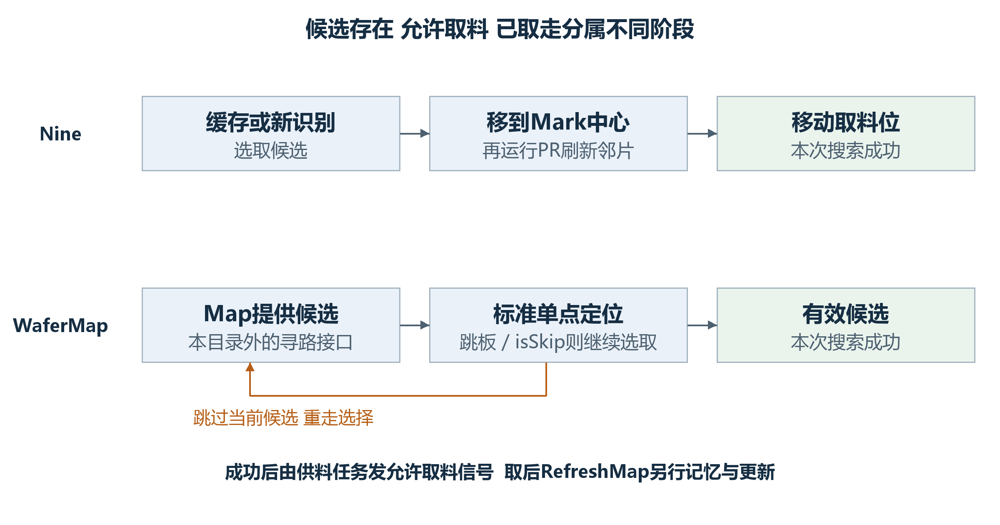

图3-4 候选缓存 本次识别与取后更新的不同阶段

上路为Nine，下路为WaferMap。橙色节点表示跳过或失败处理；绿色节点才进入取料放行。取后更新属于另一次调用，不能把候选存在、允许取料与已取走合并成一个完成标记。

WaferMap当前只支持开启定位的StandardSearch单点分支。每轮取得候选及物理坐标，移动后调用AnalyseDie；当前候选为跳板或isSkip为true时继续循环，不进入最终MoveDieToPickCenter。预取开关开启时先PreGetNextPositionInfo，跳板及跳片分支可推进游标；实际取后RemeberPickedDieInfo又按该开关推进并记住lastPickedDieInfo。这里按当前接口调用次序解释，不假设目录外寻路器内部如何管理游标。

表3-3 四类搜索在取后更新中的差异

| 模式 | RefreshMap中的本地操作 | 下一轮的有效性判断 |
|---|---|---|
| Single | 该模式分支没有额外Map改写 | 下一轮仍由搜索与识别决定候选 |
| Nine | 调用ReMoveDieToWaferCameraCenter | 再次按存在标记及本次PR刷新邻片 |
| WaferMap | 记lastPickedDieInfo；更新芯片类型并异步保存；参考点队列另移首项 | 跳板和isSkip继续选取；没有可达候选时进入收尾/换料路径 |
| Box | 当前槽号改为已取槽号+1并保存；记忆及更新华夫盒结果 | 下一轮按槽位和载具类型选择识别路径 |

RefreshMap由取片、翻转协作及部分重取/辅助路径调用，它不直接证明本次吸嘴已成功持片。非静态华夫盒且非离线时，还先等待焊头Z达到配置的抬升距离。真正放行在供料任务成功完成NextDie后：先复位IsBondNeedChipSignal，再置IsWaferAllowPickSignal；失败路径不经过这个成功出口。WaferMap双点、MultipleSearch及关闭定位的抛异常分支，必须在配置时排除；不能把它们与已支持的普通模式并列表述。

# 4 产品层级定位设计

## 4.1 进入条件与定位点数

领域方法先检查定位配置。AdjustType为None时直接设置IsVisioned并返回true；在按Mapping处理且对象停用的分支中，也可提前返回。正常采集按P1、P2、P3、P4推进，在配置点数对应的出口调用UpdateEntity。点数决定要采哪些点，X、Y和角度开关再分别决定哪些结果进入计算。[2]

图4-1 产品定位从入口到坐标更新的主要步骤

此图概括正常数据路径。定位关闭及Mapping停用分支不进入完整采集链；采集失败和两点距离检查按本侧返回路径处理，见4.6节。UpdateEntity的计算读取当前LocateConfig，传入P1至P4枚举不能理解为一份独立的计算快照。

## 4.2 八个层级定位动作的进入条件

相同领域算法由不同动作调用。动作先决定是否执行，领域方法再按定位配置采点。八个入口的条件并不完全相同；尤其S1离线分支置标记后继续调用领域方法，S2对应分支则直接返回Success。动作外层、领域返回及结果有效性需要分开看。[8]

相对固晶还改变拍照时机。S2控制器Init调用SortRelativeBond，先移除相关工序原有的焊点定位消息，再在对应PickActionNode之前插入定位消息。该分支服务于依赖前序贴片形成特征的焊点；具体可执行仍由工序顺序和动作条件共同决定。[8]

表4-1和表4-2将八个入口逐项展开。“已完成”分别指TU、基板、基岛的本侧汇总属性，或焊点本侧IsFinished；不是当前工作消息的Finished。每行条件按源码顺序检查，满足任一跳过条件即返回false。S1各入口对对象空值显式抛异常；S2这些入口直接读取对象，空引用也不会成为正常跳过。[8]

表4-1 S1四个定位入口的完整跳过条件

| 入口对象 | IsDoWork返回false的条件 | DoWork中的另外分支 |
|---|---|---|
| TU | 参与范围为Disable或仅S2；已定位；TU本侧汇总已完成。这里不单独检查AdjustType | 离线先置IsVisioned再继续；Divide直接Success；其余调用System1MatterVision |
| 基板 | AdjustType=None；Disable或仅S2；已定位；基板本侧汇总已完成 | 离线置IsVisioned后仍调用System1MatterVision |
| 基岛 | AdjustType=None；Disable或仅S2；已定位；基岛本侧汇总已完成 | 离线置IsVisioned后仍调用System1MatterVision |
| 焊点 | AdjustType=None；Disable或仅S2；已定位；本侧IsFinished | 离线先置标记；常规模式且RelativeBondPosition=true时直接Success；异形不走该常规判断 |

表4-2 S2四个定位入口的完整跳过条件

| 入口对象 | IsDoWork返回false的条件 | DoWork中的另外分支 |
|---|---|---|
| TU | AdjustType=None；Disable或仅S1；已定位；TU本侧汇总已完成 | 离线置标记后Success；Divide直接Success；其余调用System2ObjectVision |
| 基板 | EntityState不为Process；AdjustType=None；Disable或仅S1；已定位；基板本侧汇总已完成 | 离线置标记后Success；其余调用System2ObjectVision |
| 基岛 | AdjustType=None；Disable或仅S1；已定位；基岛本侧汇总已完成。未另查EntityState | 离线置标记后Success；其余调用System2ObjectVision |
| 焊点 | AdjustType=None；Disable或仅S1；已定位。此入口未另查本侧完成或EntityState | 离线置标记后Success；其余调用System2ObjectVision |

八个动作的DoWork都没有把领域方法的bool作为最终Success条件。S2ObjectVision包装继续调用System2MatterVision，领域方法可提前返回、停用对象或写入部分结果；异常由动作外层捕获为Exception。若直接从示教或手动入口调用领域方法，则要按该调用方是否检查bool判断后续行为，不能套用动作层结果。

## 4.3 定位点如何形成结果

以S2为例：先将示教定位点从产品局部转到G0，再减去头相机差，得到拍照移动目标。识别结果经过相机标定并结合本次拍照位置转换，再加回头相机差，得到产品特征的G0位置；随后转回对象局部，连同识别结果和拍照位置一起保存。S1使用其独立的相机与测高参考转换，不能直接套用S2的偏移公式。[2][3]

图4-2 S2定位点的拍照目标与识别结果转换

上行是移动目标，下行是识别结果回写。头相机差在两条路径中的加减位置分别标出；G0到本层局部转换发生在保存结果之前。图中相机标定是运行输入，不把像素值当作mm。

## 4.4 锚点选择与角度计算

**锚点是用于比较示教位置与本次识别位置的代表点**。示教锚点和识别锚点分别计算；其中X由启用UseX的点取均值，Y由启用UseY的点独立取均值，采样范围受配置点数限制。某轴没有启用点时，该轴计算结果为0。[2]

**默认角度**对启用UseAngle的MatchResult.Angle取算术均值，再换为弧度；它不按圆周处理±180度跨界。默认更新角取负识别均角，再减父链全局角。[2]

**四点模式**有一个需要保留的实现细节：P4是否参加角度均值，实际由第3点的UseAngle控制。例取四点角度1、2、3、40度，四个开关为true、false、false、true，实际只纳入P1，结果为1度。按第4点开关计算出的20.5度不符合当前代码。[2]

**启用两点定角**时，角度来源改为两条连线。代码先用Atan2分别求示教连线角与识别连线角，再对两者之差执行Atan，最后减去父链全局角。这里保留的是当前计算路径，不能省掉中间的Atan。[2]

例如两条连线角差为0.1rad，中间结果为Atan(0.1)≈0.09966865rad。这个例子用来区分实际算法与直接使用角差的算法；后续更新应使用实际结果。

**启用三点拟合圆**且点数为3或4时，锚点改为P1至P3的圆心；P4不参加圆心拟合。当前GetCentre使用PointF运算，精确共线时返回P1与P2的中点。这一退化分支会产生一个结果，不能在设计说明中改写成必然抛出拟合失败。[2][3]

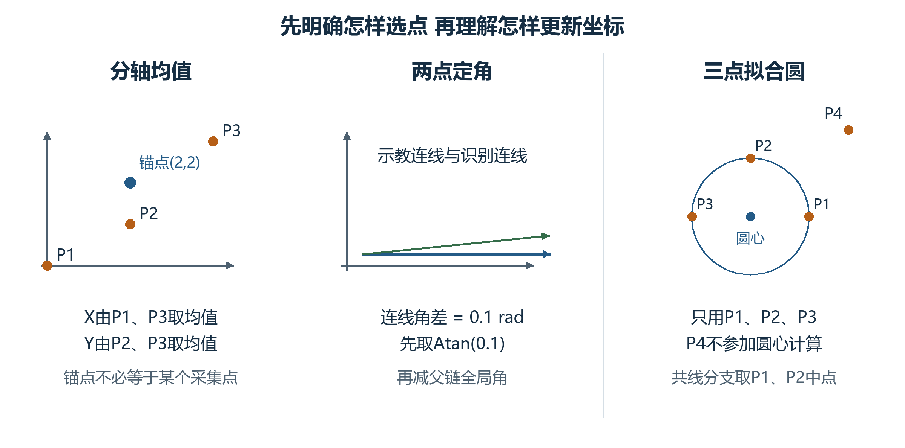

图4-3 分轴选点 两点定角与三点拟合圆的不同含义

左窗取P1=(0,0)、P2=(2,1)、P3=(4,3)mm，X只启用P1/P3，Y只启用P2/P3，得到锚点(2,2)。中窗保留当前Atan处理；右窗只让P1至P3参与圆心计算。三窗分别说明不同选项，不能混成同一次定位的必经顺序。

## 4.5 坐标如何围绕锚点更新

位置更新要同时解决平移和旋转。先让示教锚点到达本次识别出的目标，再围绕这个目标旋转本层坐标；这样，本层中的其他加工点也随同改变全局位置。下面把这两个动作写成可复算的几何关系。

为说明锚点、平移与角度的关系，以下采用平面刚体变换F。示教与识别局部锚点为p_o、p_n，本层原点D用直接父参考系表达，指定更新角为δ。实际流程把这三项传入当前坐标的UpdateCoordinateSystem；下式是几何说明模型。

$$U_o = F(p_o)   U_n = F(p_n)\tag{4-1}$$

$$Δ = U_n − U_o\tag{4-2}$$

$$D′ = R(δ)(D + Δ − U_n) + U_n\tag{4-3}$$

$$θ′ = θ + δ\tag{4-4}$$

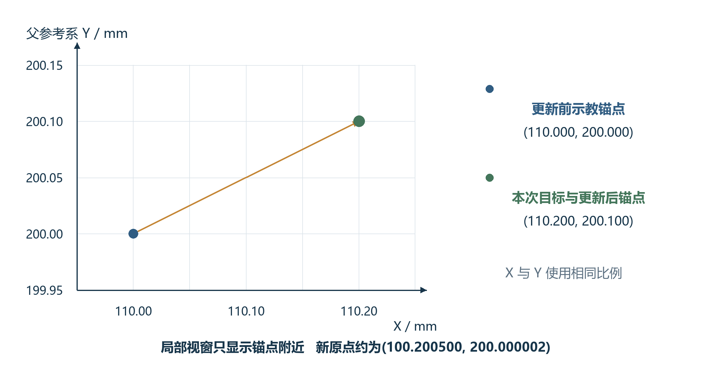

图4-4 一个定位锚点在更新前后的父参考系位置

本图采用独立说明输入：本层原点D=(100,200)，旧角为0，示教锚点(10,0)，识别局部锚点(10.2,0.1)，指定δ=0.01rad，父参考系在本例取G0。局部视窗只显示锚点附近区域，X/Y使用相同比例。更新后示教锚点与本次目标(110.2,200.1)重合。

将给定参数代入式4-3，新原点约为(100.200500,200.000002)，新角为0.01rad。示教锚点(10,0)按新坐标转换后到达目标(110.2,200.1)；本例的更新角δ固定取0.01rad。

## 4.6 距离检查与两侧异常路径

两点距离检查比较示教P1/P2间距与本次识别局部P1/P2间距，差值绝对值超过DistanceTolerance时进入报警。领域方法把这个检查放在TwoPoints出口，不能据开关名称推断3点、4点路径也执行同一检查。[2][7]

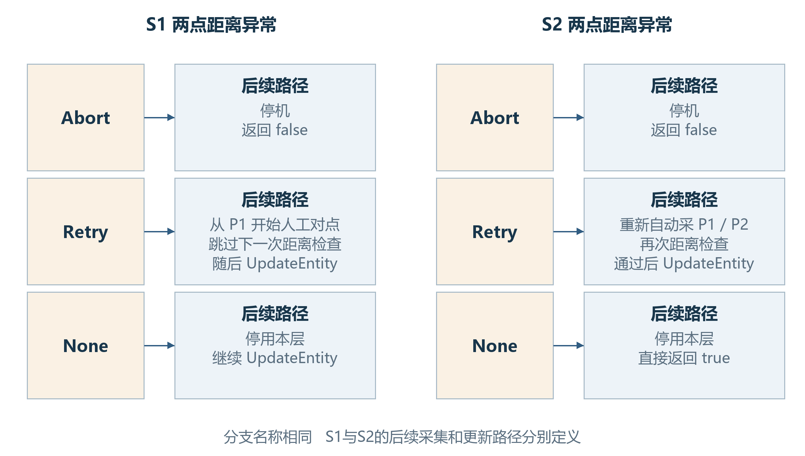

图4-5 两点距离异常时S1与S2的处理差异

两侧Abort都会停止并返回false。S1的Retry从P1重走人工报警对点，并以visionAlarm跳过下一次距离检查；S2的Retry重新采P1/P2后再次检查。None在两侧都停用本层，但S1继续更新坐标，S2直接返回true。

单点识别失败时，两侧还可按配置向四周搜索，再进入人工确认。普通匹配PR的人工OK会重新运行PR并返回匹配结果；Ignore执行本层停用后返回失败，Abort停机返回失败。S2基板定位动作调用领域方法后没有使用其bool值，随后返回Success，因此动作Success与坐标已更新、IsVisioned已置位要分开判断。[2][7][8]

# 5 上视芯片纠偏设计

## 5.1 入口条件与四种采集次序

动作外层先按焊点工艺参与和当前工序是否需要执行进行判断。进入DoWork后，精度关闭、选用下视相机或离线模式都可提前返回Success；DryCycle使用独立空跑动作。正常上视路径再依据单点或双点、快速或普通模式决定采集与旋转次序。[4][8]

图5-1 四种上视模式的正常几何采集次序

每个圆点代表一次几何PR采集，不表示耗时。单点快速1次、单点普通2次、双点快速2次、双点普通4次；普通模式在前后两组采集之间旋转T轴。重取、二维码和温漂等附加拍照不计入这些数量。

## 5.2 快速模式的偏移与角度

快速上视先保存芯片偏移，贴装时再按剩余旋转角使用。计算时，先把本次识别位置与玻璃参考位置对应起来，再扣除特征中心到芯片中心的示教向量；该向量需要先按识别角与示教角之差旋转。[3][4]

式5-1中，M是采集时轴位置，G是玻璃上视参考轴位置，d是相机标定后的识别位移，c是示教特征中心到芯片中心的向量，a是识别角，a_0是示教中心角。单点直接代入；双点分别对M、d、a取两次采集的均值，再代入同一式子。

$$o = (M − G) + d − R_d (−(a − a_0)) c\tag{5-1}$$

ComponentAngleOffSet保存a，单点为首次识别角，双点为两角算术均值，单位为度。ComponentOffSet保存o。快速模式在这一步保留芯片偏移供后续贴装按剩余旋转角处理，不把该向量直接当作某个焊点的G0位置。

说明输入取d=(0.12,−0.08)mm，M−G=(0.02,−0.01)mm，c=(0.5,0.2)mm，a=2度，a_0=1度。按式5-1得到o≈(−0.363414,−0.281243)mm，角度记录为2度。标定位移与参考差均为已给定的算例输入，不由像素数直接猜测比例。

## 5.3 普通模式与镜像分支

普通上视在计算位置前，先实际旋转芯片，再重新拍照。因此，位置公式使用旋转后的测量值，不能沿用第一次照片的位置。单点前后各采一次；双点前后各采P1与P2。[4]

非镜像时，实际T轴相对旋转量由识别角、焊点全局角和硬角度补偿组成。式5-2中的M′、d′均来自旋转后的采集；双点分别取旋转后两次结果的均值。

$$o = (M′ − G) + d′ − c\tag{5-2}$$

普通模式的ComponentAngleOffSet写成负的“焊点全局角＋硬角度补偿”，其含义与快速模式不同。例取焊点全局角5度、硬补偿1度，记录为−6度；当前T已在前一步转到40度时，后续目标T按40−6+5+1得到40度，从而不重复执行已完成的目标旋转。

镜像分支在实际T旋转中使用180度减硬角度补偿，但保存的ComponentAngleOffSet仍使用负的焊点全局角与硬补偿之和。这两个表达式按代码分别保留，不能把非镜像算例直接当作镜像推导。镜像产品还应连同示教方向、当前T角和工序配置审查。

## 5.4 温漂调用与动作结束

上视动作完成几何计算后还没有立即结束：它先保存偏移和角度，随后可识别二维码，再处理温漂。因此，字段已经有值与本次动作已成功返回，需要分别判断。[4]

温漂包装方法检查开关和时间条件，必要时调用底层计算。当前包装没有使用底层bool结果，最终始终返回true；上视调用处虽写有“返回false则Abort”，这条判断不能证明底层温漂成功。

底层温漂识别失败时会请求停机并返回false，该分支不清空之前的UpLookCompensation。读取漂移量时，开关关闭或记录为空返回零；XY任一绝对值大于0.2mm则抛异常，由上视外层捕获并返回Exception。[4]

正常取得的漂移量写入TpMarkCompensate，再累加到ComponentOffSet。若后续步骤失败，前面保存的几何字段可能仍在；解释字段时应同时核对本次动作的返回与停止状态。

## 5.5 镜像与非镜像的完整角度追踪

普通生产上视在首次识别后采用相对T旋转。记首次识别角或双点均角为a，焊点全局角为b，GetRotaryCompensate返回h；非镜像相对量为a+b+h，镜像为a+b+180−h。旋转后重新采集，使用式5-2求偏移；两者保存的ComponentAngleOffSet仍为−(b+h)。贴装入口据新的当前T加此记录、b与h，所以正常完成后不会再次追加同一目标转角。[4][6]

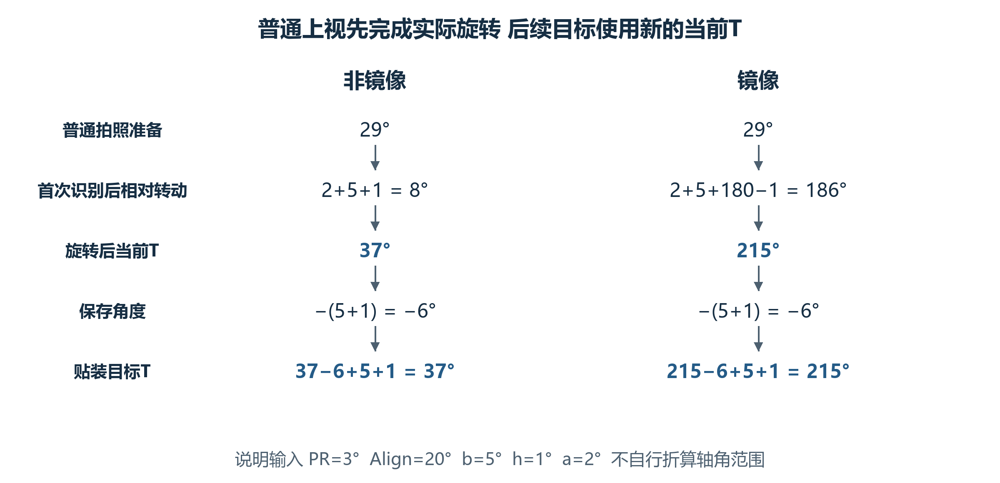

图5-2 普通生产模式镜像与非镜像的角度流水

两个分支使用同一组说明角度。T为轴角记录，不在图中自行模360度；普通双点用前两次识别角均值代替a。旋转后的偏移另由新采集求得，不能旋转前后复用一张图像结果。

表5-1 普通模式从拍照准备到贴装的角度记录

| 阶段 | 非镜像 | 镜像 |
|---|---|---|
| 给定输入 | PRVisionAngle=3°；吸嘴AlignAngle=20°；b=5°；h=1°；首次a=2° | 相同说明输入 |
| 普通拍照准备T | 3+20+5+1=29° | 29°；准备段没有在这里加180° |
| 识别后相对旋转 | 2+5+1=8° | 2+5+180−1=186° |
| 旋转后当前T | 37° | 215° |
| 保存角度偏移 | −(5+1)=−6° | −6° |
| 后续贴装目标T | 37−6+5+1=37° | 215−6+5+1=215° |

为了单独核对位置，给旋转后的测量接口输入M′−G=(0.02,−0.01)mm、d′=(0.12,−0.08)mm、c=(0.5,0.2)mm，则o=(−0.36,−0.29)mm。此时贴装剩余角为0，追加量仍为o。两个镜像分支的测量输入须分别取得；本例人为采用相同输入只用于核对公式，不表示镜像产品实际照片或识别位移相同。

快速模式不进入上述普通相对旋转和重新采集分支；当前生产快速计算没有单独的IsMirror角度项，仍保存识别角及式5-1的偏移，后续按剩余转角使用。由普通镜像推出的186°不能加进快速模式。两种模式的示教方向、配置与实际识别输入须分别成立。

# 6 中转台芯片纠偏设计

## 6.1 放片识别与重新取片

中转台动作先准备当前焊点、吸嘴和速度。精度关闭或相机选择为上视时提前返回Success；DryCycle使用独立空跑流程。当前DoWork没有与上视相同的离线提前返回分支，文档不能把上视模式开关原样复制到这里。[5]

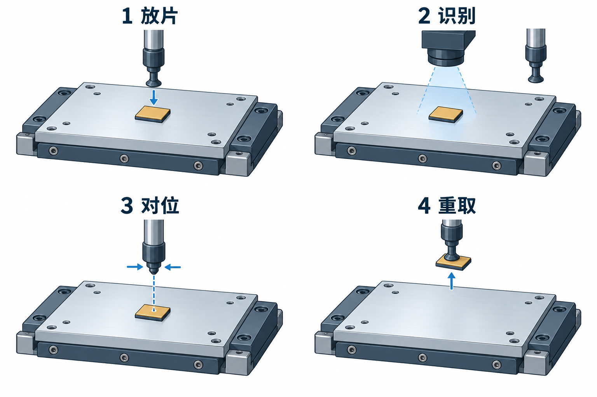

图6-1 中转台纠偏把识别结果用于重新取片

按左上、右上、左下、右下阅读：先把芯片放在台面；相机识别时芯片保持在台面；计算位置后移动吸嘴对位；最后重新取起。第3步移动的是吸嘴，图中没有台面带动芯片旋转。该图为物理阶段概念插画，不表示设备尺寸、实际工位布局或完整检测动作；几何关系见图6-2，重试分支见6.4节。

放片位置使用台面位置转换到轴坐标后，加芯片台面中心偏移、减放片角下的吸嘴偏心；高度结合台面高度、吸嘴测高差与芯片厚度。放片完成后再移动到下视拍照位。单点采P1，双点采P1和P2，识别位移经下视相机标定并结合实际拍照位置求得。[3][5]

## 6.2 芯片中心与取片位置计算

中转台纠偏先求芯片实际中心，再求吸嘴应该到达的位置。芯片上的Mark与芯片中心之间有一个示教向量；本次识别确定这个向量应旋转多少、应从哪个Mark位置出发。式6-1完成这个几何步骤。[5]

C是示教芯片中心，P是示教Mark，P′是本次识别Mark，a是识别角，a_0是示教下视角。双点模式用两个示教Mark的中点代替P，用两个识别Mark的中点代替P′，并对识别角取算术均值。参与运算的点使用同一组相机与G0转换给出的物理参考。

$$C′ = R_d (−(a + a_0)) (C − P) + P′\tag{6-1}$$

新取片T为当前T减a。式6-2用E(α)表示当前吸嘴在轴角α下的偏心：实际调用GetNozzleOffset时，角度参数为α减nozzle.AlignAngle；AlignAngle是吸嘴校准角度，两角均为度。加头相机差H并减偏心后得到取片G0位置K，再转换成轴坐标，结合高度与新T形成移动目标。[3][5]

$$K_G0 = C′ + H − E(T − a)\tag{6-2}$$

图6-2 从示教中心到修正取片位置的计算关系

使用6.2节单点算例。左窗旋转示教相对向量；中窗以G0坐标把向量接到本次Mark P′，得到芯片中心C′，再加头相机差H得到中间点Q；右窗放大Q附近的增量，减去新T角下的吸嘴偏心E才到达取片目标K。三窗比例独立，每窗X/Y等比例；右窗刻度是相对Q的mm增量。完整数值在正文给出。

独立单点算例取C=(101,200)，P=(100,200)，P′=(100.1,199.9)mm，a=2度，a_0=1度，当前T=30度，H=(2,−1)mm，新角下E=(0.05,−0.02)mm。得到C′≈(101.098630,199.847664)，K≈(103.048630,198.867664)mm，新T=28度。吸嘴偏心是接口返回的说明输入，不据此推断设备标定曲线。

## 6.3 拍照位 取片位与统计字段

IPT字段记录相机拍照目标与吸嘴取片目标。P1的IPTVisionPos在移动拍照位之前写入，IPTPickPos在移动取片位与实际Pick之前写入；后续运动或取片失败，字段仍可能有值。因此它们不能单独作为已到位、已拍照或已取起的完成证据。[5]

P1拍照目标先把配置G0位置转成轴位置，再减头相机差；保存IPTVisionPos时又转换回G0。P2用配置G0位置减头相机差，经另一条G0移动接口执行，并保存IPTP2VisionPos。最终取片位转换到轴坐标后，再转回G0保存为IPTPickPos。[5]

实际取片几何与统计补偿分别产生。SubstrateCameraCompensate用于后续结果统计，当前CalculateBondPos没有把它直接当作本次修正取片位叠加。判断芯片怎样重新取起，应看前面的中心与取片位置计算。[5][6]

双点统计表达式还会在P2位置重新转换P1识别结果，没有复用前面缓存的P1实际点。因此，统计字段与几何中心不能仅因名称中都有“补偿”就被合并解释。[5]

## 6.4 视觉失败与取片检测失败

下视识别失败后，人工OK返回匹配结果继续计算，Abort退出。Ignore分支会回到原放片位置取回芯片、抛料、更新拒收计数并重置相关动作消息，随后返回Retry；它不是按失败识别点继续贴装的出口。[5][7]

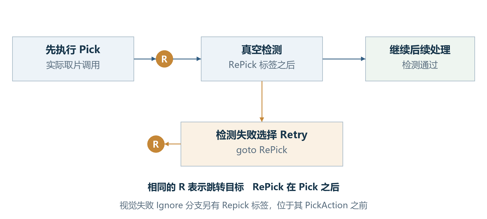

图6-3 取片后检测的Retry与实际重新执行Pick的区别

本图对应正常纠偏取片后的RePick标签：标签位于Pick调用之后，检测失败选择Retry只回到检测位置。视觉失败Ignore分支中的Repick标签则位于其PickAction之前。两个标签的大小写和位置不同，不能按按钮名称把两条路径画成相同重取动作。

正常重取片后的检测受芯片检测与取片后慢行程配置共同控制。检测失败选择下一颗，会抛料、暂停、按需要请求芯片、重置取片与中转台纠偏动作并返回Retry；选择终止返回Abort。是否真正重新执行了取片，应看跳转标签与调用位置。

## 6.5 运动方式怎样影响执行与返回

去中转台放片位由AxisMoveMode选择绝对运动或插补运动。绝对运动将AbsMoveToIPT的返回值交给上层；静态华夫盒以当前目标计算安全高度，其他载具使用中转台参考高度与吸嘴测高偏移。插补运动又按静态华夫盒和晶圆分别调用不同跳跃轨迹。[11]

去拍照位与去重取位也按运动方式分流。插补分支接收并返回JumpToVisionPos或JumpToPickIPTPos的执行结果；绝对分支调用AbsMoveToVisionPos或AbsMoveToIPTPickPos后，没有把返回值赋回ret，正常结束时仍返回初始Success。异常仍会向外传播，但底层返回非Success未必会传到动作检查。不能把该处的Success单独当作到位证明。[11]

空跑使用独立流程，模拟放片、拍照停留和重取运动；不产生本次芯片的有效识别结果。正常生产的视觉结果与重取计算应沿生产分支判断。[11]

# 7 纠偏输出在贴装入口中的使用

## 7.1 上视偏移按剩余旋转角使用

当前贴装入口先求目标T。记a_off为ComponentAngleOffSet，b为焊点父链全局角，h为硬角度补偿，三者均为度；式7-1将它们加到当前轴角T_now。上视分支再按目标T减当前T旋转ComponentOffSet，将XY加到G0贴装目标。完整目标还包含产品局部补偿、焊后补偿及其他配置项。[6]

$$T_goal = T_now + a_off + b + h\tag{7-1}$$

$$o_G0 = R_d (T_goal − T_now) o\tag{7-2}$$

图7-1 上视偏移从保存到贴装使用的角度关系

图中向量采用5.2节快速单点算例。当前T为30度、角度记录2度、焊点全局角5度、硬角度补偿1度，得到目标T为38度、尚需旋转8度；保存向量按8度旋转后形成G0的XY追加量。

算例得到XY追加量约为(−0.320736,−0.329084)mm；把该向量反转8度，可回到原保存偏移(−0.363414,−0.281243)mm。这个逆算只核对纠偏向量的使用关系，其余补偿在本例中设为零；它不代表设备最终完整贴装坐标。

## 7.2 中转台记录与实时补偿接口

中转台相机的贴装分支先按目标T处理吸嘴偏心，再调用实时补偿。实际传入前两个位置依次为IPTVisionPos、IPTPickPos，但被调方法的前两个参数名依次为iptPickPos、iptVisionPos。本册保留实参次序，不能依据名称在图或算例中悄悄调换。[6]

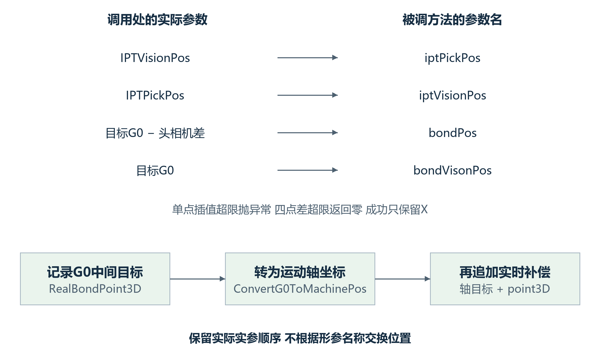

图7-2 实时补偿的实参与形参及追加位置

左侧是实参顺序，右侧是形参名称。方法关闭时返回零；单点插值超限先抛异常，四点差的XY任一绝对值超过0.5mm才按零返回。成功结果只保留X，并在G0转轴后追加；RealBondPoint3D记录此前的G0中间量。

实时补偿开启时要求输入位置、参考点集合及示教状态可用。GetCompensatePosByPoint按X寻找相邻参考点，插值得到位移差；当前点落在最左索引等情况下会抛异常。单点插值XY任一超过0.5mm先抛异常，四点差的XY超过0.5mm则返回零；最终只返回X。返回量在G0转轴后追加，而RealBondPoint3D记录此前的G0中间结果。[6][12]

## 7.3 焊后补偿与区域补偿的生效位置

焊后补偿按当前焊点名称查找关联检测工序。未达到配置样本数返回零；参与均值的XY分别筛选绝对值小于50的统计偏差，再除1000并乘补偿比例。筛选后的集合为空仍会使Average失败，不能把原样本数达到阈值当作必然取得有效均值。[12]

启用按上次产品自动补偿时，GetPostBondCompensation直接返回零；产品结束时NormalizationOffset改写常规焊点硬补偿，并可保存单点补偿。GetBpSeparateOffset也受该自动补偿总开关控制，再按基板、基岛和焊点名查找记录。它们影响后续目标，不回改此前已执行的贴装动作。[12]

当前GetPostBondCompensation对多个结果求均值时，返回Z也取X的均值。贴装入口最终Z另由bondLevel计算，不能据这个中间Z认定最终运动Z按同样数值追加。这个数据字段的行为与实际Z目标应分别解释。[6][12]

TU区域补偿在当前G0贴装XY上查询二维网格，经过双线性插值得到偏移，然后在贴装入口相减。开关关闭或网格为空返回零；XY插值任一绝对值超过1mm抛异常。网格间距、维度及有效覆盖区是输入前提；边缘索引处理不等于提供任意范围的有效标定。[12]

表7-1补充补偿记录的寿命。这里的“关闭返回零”仅说明本次读取，不代表缓存已清空；TU.Refresh只处理产品几何及标记，不统一重置这些单例或静态补偿数据。[12]

表7-1 补偿输入 记录寿命与生效位置

| 补偿 | 记录更新与失败保留 | 本次使用与单位 |
|---|---|---|
| 取片漂移 | 成功采集才替换PickUpCompensation及时间；识别失败返回false，未覆盖旧值 | 关闭/空返回零；正XY加在预取片目标，mm |
| 上视温漂 | 成功才替换UpLookCompensation及时间；失败可留下旧记录，包装仍可能true | 关闭/空返回零；负XY加芯片偏移，mm |
| 焊后实时均值 | 检测结果按工序名进入静态列表，最近结果在前，列表最多保留2000条 | 按配置样本数及严格<50筛选，再/1000及乘百分比；加入G0目标 |
| 按上次产品与单点 | 产品发送前NormalizationOffset按当前TU名筛选并改写配置，随后保存；不回改已执行点 | 常规硬补偿及单点记录影响后续目标，mm |
| TU区域 | 二维网格为配置输入，产品Refresh不重建标定网格 | 查询当前G0 XY后相减，输出mm；超1mm抛异常 |
| 实时补偿 | 示教扫描替换ReferencePoints；本轮扫描全部成功才替换ReferencePointsCompensate，失败保留旧组 | 按X插值；最终只追加轴X，mm；first控制扫描，当前时间触发条件未启用 |

运行补偿的配置输入与本次测量应分别检查。尤其实时扫描中，先创建临时数组，所有点成功后再整体替换补偿点组；失败不表示已经取得本轮完整数据。上视温漂底层方法本身的开关和间隔判断被注释，生产包装负责进入条件；取片漂移的开关和时间/firstTu判断则仍在本方法中执行。两者不能按同一触发器解释。

## 7.4 完整目标与结果记录的边界

产品局部硬位置补偿先通过焊点父链转换到G0；焊后与单点补偿加入后，再进入相机分支；之后还会处理TU补偿、可选参考点并记录RealBondPoint3D，随后转为轴目标并追加实时补偿。Z目标又结合基准高度、吸嘴测高差、芯片厚度、局部Z补偿及压合距离单独计算。本册解释纠偏结果在其中的准确位置，不以简化XY公式替代完整贴装设计。[6]

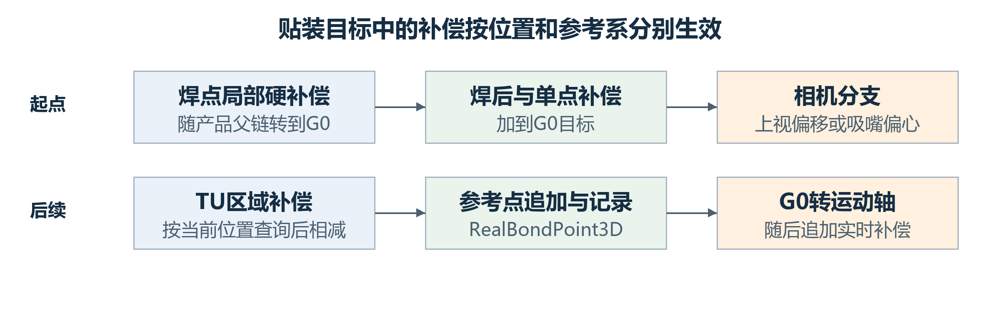

图7-3 各补偿项在G0与轴目标中的生效顺序

同一行从左向右读，上行再接下行。焊后与单点项先加入G0目标，TU区域项随后相减；RealBondPoint3D在轴转换和实时追加之前保存。Z由高度分支单独计算。

# 8 异常处理与状态有效性

## 8.1 采集成功 更新成功与动作返回

产品定位的SaveInfo在每个点采集完成后保存识别结果、局部点、G0点与拍照位置。UpdateEntity先清四个结果Bitmap，再调用当前坐标的更新接口，正常返回后才设置IsVisioned。若更新调用抛异常，结果字段和图像引用已可能改变；当前领域方法没有把这些记录统一恢复到采集前状态。[2]

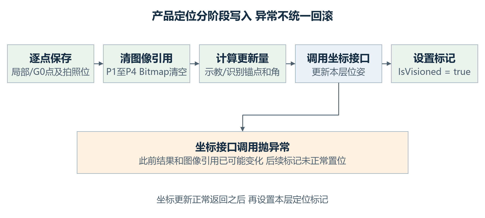

图8-1 产品定位的写入阶段与可能的失败位置

按逐点保存、清图像引用、计算锚点与角、调用坐标接口、置标记的顺序阅读。调用坐标接口抛异常时，前面的结果和图像引用可能已变化，IsVisioned未在正常出口置位。动作包装的返回处理另见4.2节。

## 8.2 人工确认的返回契约

报警委托通过UI锁串行显示对话框，返回DialogResult与算法结果，并记录报警处理时间与方式。对普通匹配PR，确认按钮会重新执行PR；成功后复制CenterX、CenterY、Angle形成结果。上视与中转台在人工OK处直接返回该结果，绕过后面的GetMatchResultByConfig；不能把人工确认理解为与正常识别完全相同的后处理路径。[7]

正常后处理会原地修改匹配结果：关闭X时写1224，关闭Y时写1024，关闭角度时写0。这些是图像结果中的替代值，后续仍需标定转换，不等于物理位移直接归零。人工OK绕过这一步，解释关闭某轴后的行为时必须同时指明使用哪个出口。[4][5]

## 8.3 Retry如何回到动作编排

上视自动跳过或人工重取会抛料、更新拒收计数，并按浸胶模式重置取片、可选浸胶及上视等动作消息。中转台也有自己的重做动作集合。控制器SetActionNodeReWork按当前地址与工序选择消息，把Finished改为false；固晶任务收到Retry后继续循环，不把当前消息标为完成。[4][5][8]

动作消息记录本轮编排执行到哪里，焊点工序字典记录产品工序是否完成。重置消息不自动恢复所有Info结果，也不能据此证明芯片仍在同一位置。调试判读应把当前物理阶段、位置记录和本次动作返回放在一起；本册不把这些分散操作描述成通用断点恢复协议。

## 8.4 各流程失败后哪些数据已经发生变化

表8-1 失败位置与结果有效性

| 失败阶段 | 可能已经写入或执行 | 返回及重试位置 |
|---|---|---|
| 供料重复定位未通过 | 此前识别、相机中心移动；未证明满足阈值 | 返回false及相机中心；外层Retry重走多次定位，Ignore置isSkip |
| 产品坐标更新失败 | 定位点结果、Bitmap清除；标记未正常置位 | 异常由动作捕获；没有统一回滚，领域bool与动作返回分开判断 |
| 中转台去拍照位失败 | IPTVisionPos目标；放片可能已完成 | 向上返回本次ret；绝对分支未接收底层返回的差异见6.5节 |
| 中转台去取片位或Pick失败 | IPTPickPos目标、角度与统计记录 | 运动/Pick失败返回ret；取后检测Retry只回检测，不再Pick |
| 上视漂移读取或后续步骤失败 | 芯片偏移、角度和部分识别记录 | 漂移读取超限由外层返回Exception；重取重置消息，见8.3节 |

## 8.5 手动上视与生产上视的逐模式差异

手动入口FrmComponentPlacement调用PlacementTest。它通过JudgeTuExist取得对象，按Index找基板、基岛及焊点，并依次直接调用System2MatterVision；任一bool为false则Abort。启用纠偏时仅支持上视，其他相机抛异常；它没有经过八个生产定位动作的IsDoWork筛选，也不使用生产BondActionNode的CalculateBondPos。[10]

表8-2 手动与生产上视的共同量及不同入口

| 项目 | 生产动作 | 手动辅助 |
|---|---|---|
| 拍照准备T | 快速为PRVisionAngle+AlignAngle；普通再加b+h | 所有模式先用AlignAngle+b+芯片RotaryPosition+单焊点RotaryPosition |
| 快速单/双点 | 1/2次PR；保存式5-1及识别角/均角 | 同样的几何表达式；起始T与入口条件不同 |
| 普通单点 | 2次PR；相对a+b+h或a+b+180−h | 同样按IsMirror和GetRotaryCompensate选择相对量 |
| 普通双点 | 4次PR；相对均角+b+h或均角+b+180−h | 相对均角+b+单焊点硬角h；这里不查IsMirror |
| 角度与偏移保存 | 普通保存−(b+h)与旋转后偏移 | 普通也保存−(b+h)；四点采集后的相对旋转却按上一行单独计算 |
| 后续附加步骤 | 可识别二维码、温漂并重置生产工作消息 | 该上视方法没有同一二维码/温漂尾段；重取仅返回Retry交给手动调用方 |

手动单点快速写UpLookMatchResult1、ComponentOffSet和ComponentAngleOffSet后直接返回，返回四维量的T含识别角，也会绕过方法末尾关闭灯光。其余成功路径在公共尾段返回的四维量T为0，但Info中的角度记录仍保留。PlacementTest只检查返回的ExcuteResult，没有使用返回四维量代替后续目标计算。判断结果时要明确读Info还是读返回值。

手动PR辅助没有生产GetMatchResultByConfig的正常后处理。人工OK直接返回对话框结果；Abort停机并返回Abort；Ignore返回Fail；Retry刷新供料Map、发要料信号、抛料、增加拒收计数并返回Retry。PlacementTest收到非Success立即返回，没有生产BondTask接收Retry后继续当前工作消息的循环。因此手动“重取”不是自动重跑完整贴片测试。

## 8.6 手动贴片目标怎样使用纠偏记录

手动贴片从ComponentOffSet取XY形成局部点q=(o.X,o.Y,0)，计算SelfPosToG0(q)+o后再转成轴坐标。局部转换与后续追加都使用芯片偏移。生产路径的配置硬补偿则由GetPositionCompensate读取，来源不同。手动路径没有在此按角度记录重新计算生产贴装目标T。[10]

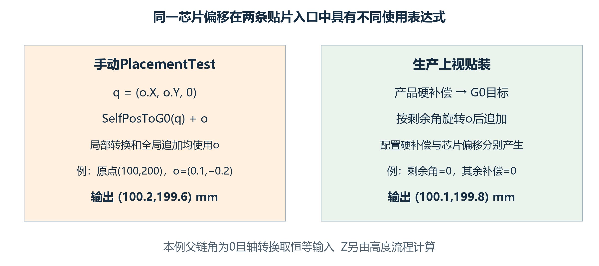

图8-2 手动贴片与生产贴装对同一偏移的不同使用

左侧手动表达式先把偏移XY当局部点转换，再追加完整偏移；右侧为生产上视分支，产品硬补偿与芯片偏移分别产生。说明例令产品角为0、其余补偿为0，只比较当前表达式，不作为修改算法的建议。

说明例令焊点原点G0=(100,200)mm、本层及父链角均为0、o=(0.1,−0.2,0)mm，轴转换在本例取恒等接口输入。手动中间目标为(100.2,199.6)mm；生产上视若剩余角为0且其他补偿为0，则目标为(100.1,199.8)mm。二者是两条独立实现的输出，不能把生产算例当成手动结果。手动Z另结合基准、吸嘴测高、厚度、局部Z与压合距离，并以bondLevel−0.01执行，XY中间量不替代该高度分支。

手动普通双点的镜像差异、偏移两处参与位置计算以及返回四维量T差异均属于当前实现的特定行为。研发评审需要据实际入口判断契约；设备调试不能用另一入口的成功记录证明本路径相同。它们没有在文档中被改写成统一算法。

# 9 接口契约与设计核对

## 9.1 主要接口的输入输出

表9-1 定位与纠偏接口的调用契约

| 接口 | 输入与前提 | 输出及主要副作用 |
|---|---|---|
| System1MatterVision System2MatterVision | 本层对象、当前LocateConfig、可用父坐标与PR | bool；可能保存结果、更新本层坐标或提前返回；S1/S2异常分支分别判断 |
| TuService.UpdateEntity | 本层配置与已采集结果；当前父坐标及更新接口可用 | void；清Bitmap、更新坐标后置IsVisioned；异常无统一回滚 |
| 上视 DoWork UpLookCorrectionActionNode | 当前焊点/芯片/吸嘴及上视标定；模式决定是否进入采集 | ExcuteResult；写偏移与角度，正常几何后仍有附加步骤 |
| 中转台 DoWork SubstrateCameraCorrection ActionNode | 当前焊点/芯片/吸嘴、台面与下视标定 | ExcuteResult；放片、定位、修正取片与检测，按分支重置消息 |
| CalculateBondPos | 当前产品位置及当前工序的纠偏记录；补偿配置和标定可用 | 返回运动轴XYZT；同时写中间G0位置，记录不等于全部追加后的目标 |

## 9.2 两类读者共用的核对问题

研发评审可从接口与数据归属检查下列问题，设备调试可从同一问题定位需要观察的阶段。每项答案均在前文有图示或公式依据；源码入口集中放在附录A，完整路径和逐项结论见配套索引。

表9-2 阅读与评审核对问题

| 问题 | 本册给出的判断依据 |
|---|---|
| 产品位置由谁改变 | 本层坐标更新及父链传播，见图4-2、图4-4 |
| 为什么普通双点上视有四次几何采集 | 旋转前后各采P1/P2，见图5-1 |
| 保存的芯片偏移能否直接加到贴装位 | 要结合剩余旋转角，见图7-1与式7-2 |
| 中转台取片位与统计补偿是否同一量 | 取片几何与统计字段分别产生，见6.2与6.3节 |
| 点了重取是否一定执行了Pick | 看标签在Pick之前还是之后，见图6-3 |
| 结果字段有值是否代表本次动作成功 | 检查写入阶段和后续返回，见图8-1及5.4节 |

# 附录A 源码依据与阅读定位

## [1] 纠偏对象与配置

产品定位与芯片定位的独立配置

- LocateConfig.cs：GetPrNames / VisionPosOffSet
- AdjustConfig.cs：字段定义

## [2] 产品定位计算

采集、分轴选点、角度和坐标更新调用

- System1Domain.cs：System1MatterVision
- System2Domain.cs：System2MatterVision

## [3] 坐标及标定接口

相机结果转换和吸嘴校准角度

- System2Controller.Vision.cs：GetBondVisionResultPos
- BondHeadController.cs：GetNozzleOffset / GetCurrentNozzle

## [4] 生产上视纠偏

快速、普通、镜像和温漂调用

- UpLookCorrectionActionNode.cs：DoWork
- System2RunTimeProvider.cs：RecordTime

## [5] 生产中转台纠偏

放片、拍照、重取及重试

- SubstrateCameraCorrectionActionNode.cs：DoWork
- SubstrateCameraCorrectionActionNode.Provider.cs：PrepareBeforeAction

## [6] 贴装目标

补偿次序、位置记录与运动轴目标

- BondActionNode.Provider.cs：CalculateBondPos
- BondActionNode.cs：DoWork

## [7] 报警与人工确认

PR重跑和距离检查

- UcmainSystem.Action.cs：InitAction
- FrmVisionAlarm.cs：FrmVisionAlarm / TimerVision_Tick

## [8] 定位动作与编排

八个层级定位入口及相对固晶时机

- S1CarrierVisionActionNode.cs：DoWork
- S1SubstrateVisionActionNode.cs：DoWork

## [9] 供料端定位及取片

搜晶分支、多次校正、静态华夫盒和取片位

- Block.cs：NextDie / ToRequiredAccuracy
- Block.SearchSingle.cs：SearchSingle

## [10] 手动辅助入口

贴片测试、示教定位与独立上视实现

- System2Controller.Assistant.cs：PlacementTest / UplookVisionAction
- FrmComponentPlacement.cs：PlacementTest

## [11] 中转台运动分支

绝对运动、插补运动与空跑

- SubstrateCameraCorrectionActionNode.MoveHelper.cs：MoveToIPTVisionPos / MoveToIPTPickPos
- SubstrateCameraCorrectionActionNode.cs：DoWork

## [12] 相关运行补偿

取片温漂、焊后、单点、TU区域与实时补偿

- TpMarkCompensate.cs：GetPickCompensation
- DefectCompensate.cs：GetPostBondCompensation / NormalizationOffset

# 附录B 术语与图表索引

## B.1 常用术语

表B-1 本册常用术语

| 术语 | 本文中的含义 |
|---|---|
| TU / Transport Unit | 产品运行对象树的根；包含基板、基岛和焊点 |
| PR | 按名称调用的视觉识别任务；识别输出还需经相机标定转换 |
| IPT | 本工程中转台相关的代码命名，如IPTVisionPos、IPTPickPos |
| S1 / S2 | 本工程分别对应点胶系统与固晶系统 |
| 产品层级定位 | 更新TU或其下层当前对象的位姿，后代通过父链使用新位置 |
| 上视纠偏 | 识别吸嘴上芯片，计算偏移供后续贴装使用 |
| 中转台纠偏 | 芯片放台后识别，并按修正位置重新取片 |
| 示教锚点与识别锚点 | 按配置选择后分别形成的旧点与本次测得点 |
| G0与轴坐标 | 机器全局参考与运动轴位置，按控制器实际方法转换 |
| 头相机差H | 焊头与下视相机参考之间配置的偏移，按具体流程加减 |
| 吸嘴偏心E(α) | 当前吸嘴在轴角α下的偏心；接口角度按α减AlignAngle处理 |
| 快速与普通上视 | 分别在本次采集后保存偏移，或先旋转再采集位置 |
| ComponentOffSet | 焊点Info保存的芯片偏移向量 |
| ComponentAngleOffSet | 与纠偏模式相关的角度记录，单位度 |
| Finished与工序字典 | 控制器消息状态与产品工序记录，分别维护 |
| R与R_d | 按源码公式的平面旋转；参数分别采用弧度与度 |
| 供料定位 | 取片前确定候选芯片的物理位置和角度 |
| 定位目标与到位记录 | 预先保存的目标不证明相应移动或取片已经完成 |

## B.2 图目录

- 图1-1 产品与贴装侧的三种视觉观察对象
- 图2-1 纠偏结果的写入位置及后续使用
- 图3-1 晶圆台与静态华夫盒在取片前观察芯片
- 图3-2 产品线与芯片线在贴装位置计算处汇合
- 图3-3 多次定位如何判定通过与继续校正
- 图3-4 候选缓存 本次识别与取后更新的不同阶段
- 图4-1 产品定位从入口到坐标更新的主要步骤
- 图4-2 S2定位点的拍照目标与识别结果转换
- 图4-3 分轴选点 两点定角与三点拟合圆的不同含义
- 图4-4 一个定位锚点在更新前后的父参考系位置
- 图4-5 两点距离异常时S1与S2的处理差异
- 图5-1 四种上视模式的正常几何采集次序
- 图5-2 普通生产模式镜像与非镜像的角度流水
- 图6-1 中转台纠偏把识别结果用于重新取片
- 图6-2 从示教中心到修正取片位置的计算关系
- 图6-3 取片后检测的Retry与实际重新执行Pick的区别
- 图7-1 上视偏移从保存到贴装使用的角度关系
- 图7-2 实时补偿的实参与形参及追加位置
- 图7-3 各补偿项在G0与轴目标中的生效顺序
- 图8-1 产品定位的写入阶段与可能的失败位置
- 图8-2 手动贴片与生产贴装对同一偏移的不同使用

## B.3 表目录

- 表2-1 四类流程的主要输入与输出
- 表2-2 本册使用的量与单位
- 表3-1 供料定位分支的结果形成
- 表3-2 供料与取片结果的去向
- 表3-3 四类搜索在取后更新中的差异
- 表4-1 S1四个定位入口的完整跳过条件
- 表4-2 S2四个定位入口的完整跳过条件
- 表5-1 普通模式从拍照准备到贴装的角度记录
- 表7-1 补偿输入 记录寿命与生效位置
- 表8-1 失败位置与结果有效性
- 表8-2 手动与生产上视的共同量及不同入口
- 表9-1 定位与纠偏接口的调用契约
- 表9-2 阅读与评审核对问题
- 表B-1 本册常用术语
