# 纠偏过程设计文档

接着产品P1的A点 看芯片C1怎样找到 取起 对准并贴装

先读第一部分的一次完整贴装。第二部分的上视模式和中转台是可选路线，按配置选择。

与TU册共用产品P1、基板1／基岛2／A点和芯片C1。布局为示意，数值用于理解流程，不是本机参数。

# 01 接着TU册把C1贴到当前A点

第一部分 跟着C1贴到A点

● 找A点 → 找C1 → 取片 → 拍芯片 → 算目标 → 贴装

TU册中，产品P1已经到S2，软件仍持有同一个N1。当前A点点过胶，还没有固晶；交接刷新后的基础G0位置为(140,210)毫米。

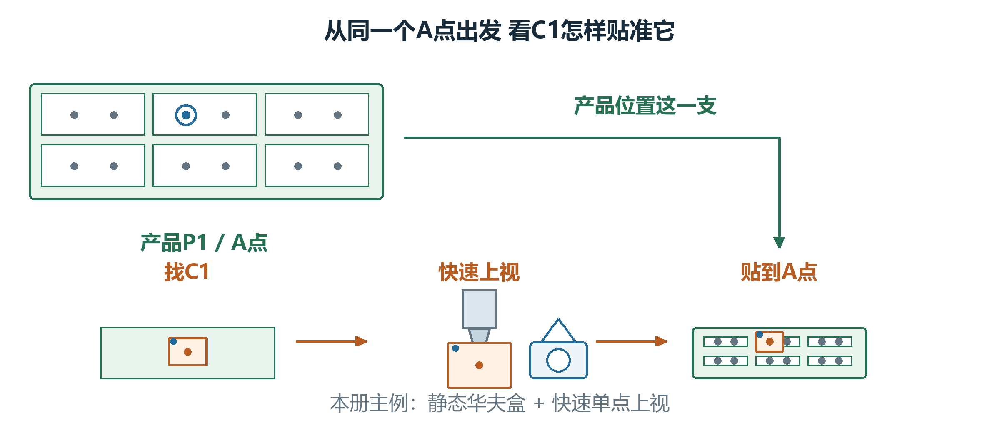

图1 产品A点和芯片C1分别确认位置 最后在贴装目标汇合

本册接着做一件事：让芯片C1贴准这个A点。先找准产品，再从静态华夫盒找到并取起C1，选择快速单点上视，最后计算贴装目标并执行。

实际调度可以交叉安排产品定位和供料准备。本册按理解顺序展开两路信息，箭头表示数据怎样汇合。普通上视和中转台另在第二部分比较。

**产品P1、焊点A和芯片C1会一直沿用，不在中途另换数字例子。**

先看产品这一侧：相机怎样把基础A点更新到实际位置。

# 02 先确认产品上的A点在哪里

第一部分 跟着C1贴到A点

● 找A点 → 找C1 → 取片 → 拍芯片 → 算目标 → 贴装

配方知道A点的理论位置，实物P1仍可能放偏。本例只给产品平移(0.2,−0.1)毫米，各层角度仍为0，所以A点从(140,210)变为(140.2,209.9)。

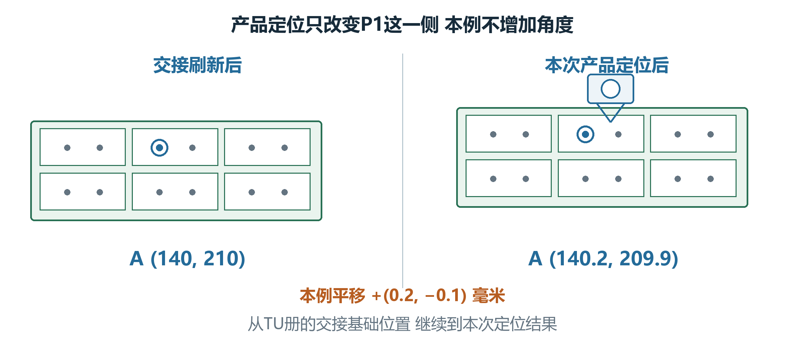

图2 蓝圈始终是同一个A点 产品定位改变它的当前位置

S2先把示教Mark换成拍照目标，再把识别结果经相机标定和参考转换带回产品坐标。更新了相应父层后，A点换算时就使用新的位置。

本例假定应做的产品定位已成功，没有额外旋转。实际拍几处、哪层需要拍，由定位开关和当前状态决定。这里的P1是产品编号；代码里的PR点P1/P2指第一、第二个特征点。

**从这一页起，本次产品定位后的A点为(140.2,209.9)毫米。**

产品这一侧准备好了，再去供料端找这次要贴的C1。

# 03 在华夫盒里找到这次要取的C1

第一部分 跟着C1贴到A点

找A点 → ● 找C1 → 取片 → 拍芯片 → 算目标 → 贴装

本例采用静态华夫盒：设备先找到候选槽位，再由焊头下视相机识别C1。候选位置用于引导找片，识别后还要计算真正的取片目标。

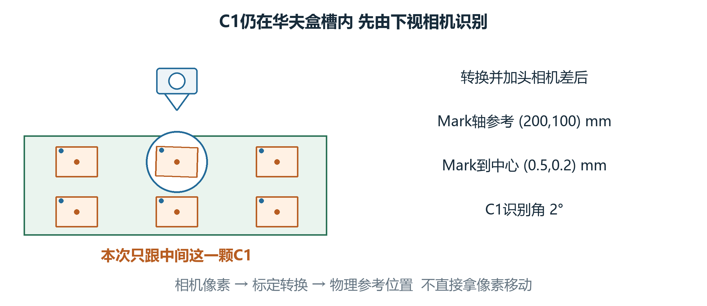

图3 先认出槽位里的C1 再把相机结果换成机械位置

相机先给像素结果，需要用这台相机的标定转成物理长度。本例把Mark换算并加头相机差后，给定轴参考位置(200,100)毫米；Mark到芯片中心的示教向量为(0.5,0.2)毫米。

定位角给2°，本例不翻转。晶圆、九宫格和WaferMap另有候选与更新方式，不能照搬华夫盒公式。供料允许取片也不等于吸嘴已经持片。

**此时C1还在槽位里，A点坐标没有因供料识别而改变。**

位置和识别角有了，先把吸嘴该转到多少度讲清楚。

# 04 取片时吸嘴为什么转到33度

第一部分 跟着C1贴到A点

找A点 → 找C1 → ● 取片 → 拍芯片 → 算目标 → 贴装

C1识别角为2°，取料硬角补偿给5°，吸嘴校准角给30°。本例未翻转，取片T为5−2＋30＝33°。T表示旋转轴角。

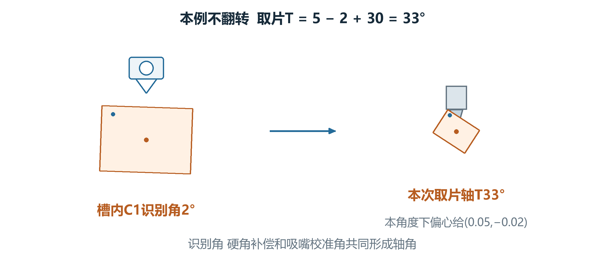

图4 识别角只是输入之一 本次取片轴角为33度

吸嘴还可能有偏心：转到不同角度，实际吸附中心会变化。本例直接给当前取片角下的偏心(0.05,−0.02)毫米；实际应由对应标定接口取得。

若改成翻转配置，定位角会变成相加，结果为37°。这是改配置的对照，后面的主例仍按未翻转33°继续。取片Z由示教、测高和芯片厚度等另算。

**取片T为33°；后面上视拍照时还会转到自己的准备角。**

接下来使用同一组输入，把取片XY也算出来。

# 05 把取片位置落到C1上

第一部分 跟着C1贴到A点

找A点 → 找C1 → ● 取片 → 拍芯片 → 算目标 → 贴装

沿用上一页的C1：Mark到中心向量(0.5,0.2)按−2°旋转，约为(0.507,0.182)毫米。再给取料补偿(0.01,0.03)毫米。

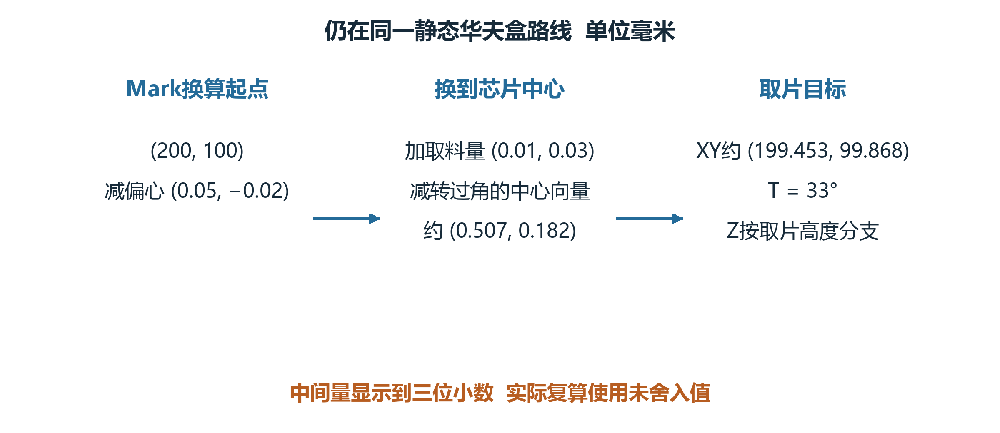

图5 先转示教向量 再从Mark换算到吸嘴取片目标

从(200,100)减吸嘴偏心，加取料补偿，再减转过角的示教向量，取片XY约为(199.453, 99.868)毫米，T为33°。正文只显示到小数点后三位，计算使用未舍入值。

取片动作据此形成自己的XYZT并执行。取后还要按该路线的条件判断持片；算出了目标、动作消息到达和实际取起C1，是相继发生的几件事。

**以下继续假定C1已取起并通过本次持片判断。**

C1现在在吸嘴上，下一站是本例选择的上视相机。

# 06 带着C1到上视相机准备拍照

第一部分 跟着C1贴到A点

找A点 → 找C1 → 取片 → ● 拍芯片 → 算目标 → 贴装

上视相机从下面看吸嘴上的C1。本例选择快速单点：几何PR正常拍1次。本例的拍照示教角为0°、吸嘴校准角30°，准备T为30°。

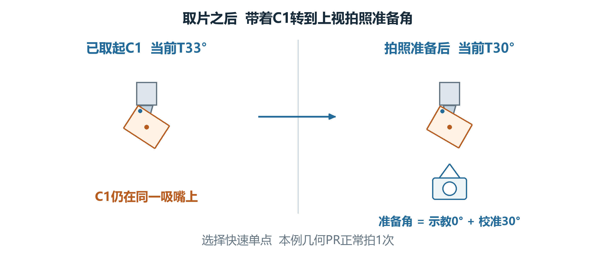

图6 取片时T为33度 到上视前转到准备角30度

所以取片33°和当前30°并不冲突，中间确实执行了拍照准备转向。快速模式还没有完成最终贴装转角，先在当前方向测C1的位置和角度。

本例假定精度开启、选择上视、在线运行且本次PR正常通过。二维码、温漂采集和重试可能增加照片；普通模式、双点模式的次数在后面比较。

**从现在开始，快速上视例的当前T为30°。**

相机接下来测到的偏移，首先属于这一张照片的方向。

# 07 这张照片怎样看出C1偏在哪里

第一部分 跟着C1贴到A点

找A点 → 找C1 → 取片 → ● 拍芯片 → 算目标 → 贴装

本次给定标定后位移(0.12,−0.08)毫米，拍照位置减玻璃参考为(0.02,−0.01)毫米。C1上的Mark与芯片中心并不重合，还要扣掉示教的中心向量。

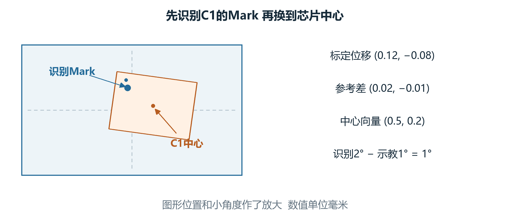

图7 照片中的Mark和C1中心分别表示 先找到Mark再换到中心

中心示教向量给(0.5,0.2)毫米，本次识别角2°、示教角1°。先把该向量按−1°转向，再用前两项之和减去它，得到本次保存的芯片偏移。

这些量已经处在公式要求的物理参考中，不能再把原始像素或其他相机的坐标直接加进来。照片测量描述C1，没有重新改写产品A点。

**产品A点的位置和C1的芯片偏移，分别来自两路信息。**

下一页看这次结果放在哪里，以及它为什么还不是最终贴装位置。

# 08 先保存偏移还没有走到A点

第一部分 跟着C1贴到A点

找A点 → 找C1 → 取片 → 拍芯片 → ● 算目标 → 贴装

计算得到芯片偏移约(-0.363, -0.281)毫米，角度记录为2°。软件把它们保存在当前A点的过程信息里，供本次后续贴装使用。

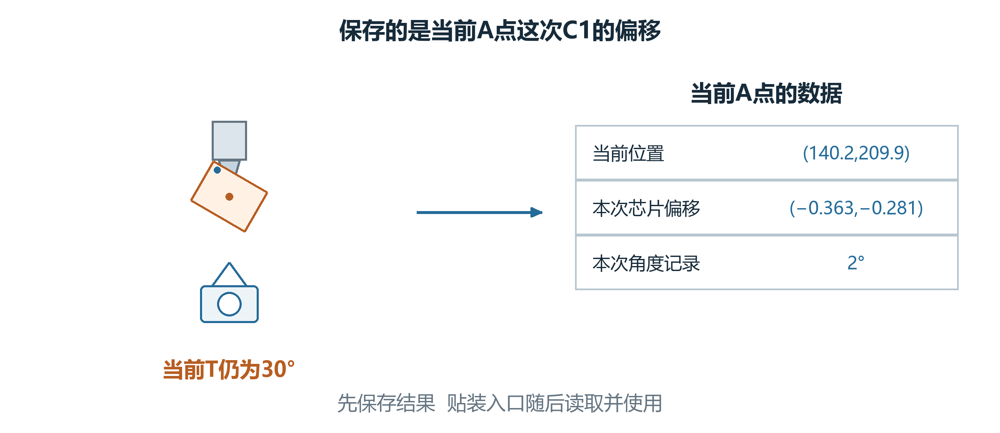

图8 当前A点持有本次C1的纠偏结果 保存值尚未追加到贴装目标

产品当前位置仍为(140.2,209.9)，当前T仍为30°。保存的XY是待使用的修正向量；把它当作芯片的绝对坐标、或直接当成最终运动轴目标，含义都会错。

本例取本次正常PR写回。人工确认、识别失败或重试可能留下不同记录，所以字段里有值时还要对应采集轮次和当前芯片。

**接下来贴装入口会读取这一轮保存的偏移和角度。**

读取之后，先问吸嘴还要转多少度，再决定怎样使用这段偏移。

# 09 贴装前还要转3度偏移也跟着转

第一部分 跟着C1贴到A点

找A点 → 找C1 → 取片 → 拍芯片 → ● 算目标 → 贴装

本例当前T=30°、角度记录2°、A点全局角0°、贴装硬角1°。目标T为30＋2＋0＋1＝33°，相对当前还要转3°。

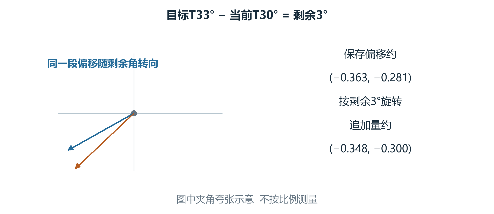

图9 橙色向量从拍照方向转到本次贴装方向 角度示意作了放大

把刚才保存的未舍入偏移按3°旋转，G0追加量约为(-0.348, -0.300)毫米。这里的3°来自贴装剩余角，与取片时那次33°不是同一个含义。

本页沿用产品角0°的主例。若产品定位带来转角或改了工艺硬角，剩余角也要重新算；不能把某页的3°或别册旧例的8°固定带到所有产品。

**这次C1的目标T为33°，对应XY追加量约(−0.348,−0.300)毫米。**

现在把这个追加量接到同一个A点上，看完整XY目标。

# 10 把产品位置和C1偏移合成贴装目标

第一部分 跟着C1贴到A点

找A点 → 找C1 → 取片 → 拍芯片 → 算目标 → ● 贴装

产品A点为(140.2,209.9)，加本次旋转后的芯片偏移，得到G0中间位置约(139.852, 209.600)毫米。本例其他XY补偿取0，轴转换取恒等，轴后实时量取0。

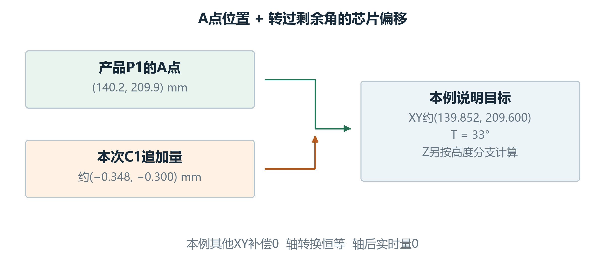

图10 两路信息在这里汇合 本例简化条件下XY约为139.852和209.600

因此本例说明XY目标约为(139.852,209.600)，目标T为33°。实际代码还会按顺序处理焊后、单点、工具、TU区域等启用项，再换到运动轴并加对应实时量。

Z要另外合并基准高度、吸嘴测高差、芯片厚度、局部Z和压合距离等。这里没有给真实Z参数，不把前面的产品Z当成焊头工作高度；真实轴转换也不一定是恒等。

**主例只把XY和T接完整，其他配置启用时需继续按各自阶段计算。**

目标算好以后，还要执行实际贴装，成功出口才写A点的固晶完成。

# 11 C1贴到A点后回看这一次完整贴装

第一部分 跟着C1贴到A点

找A点 → 找C1 → 取片 → 拍芯片 → 算目标 → ● 贴装

假定本次固晶动作正常成功，当前A点的固晶工序置完成，原来的点胶完成记录保留。这就接回TU册中的同一个产品N1。

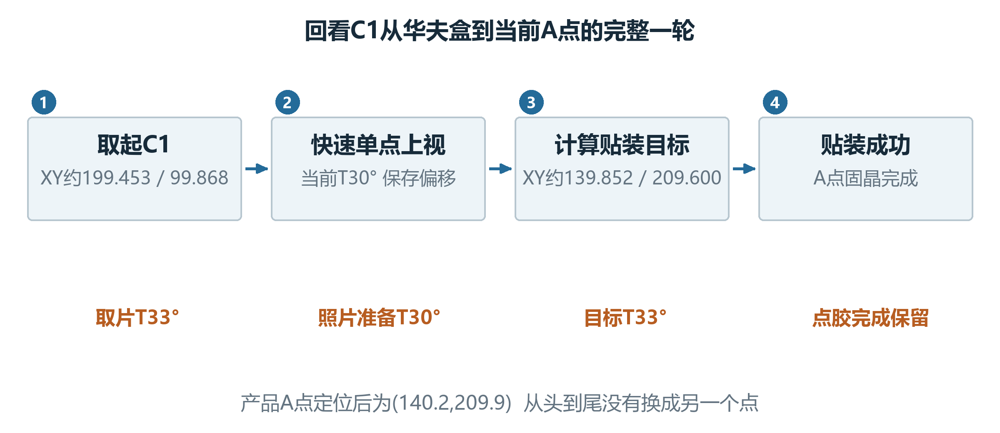

图11 只回看一次C1贴装 位置数值和T轴角分别沿各自路径变化

回看顺序：A点经产品定位到(140.2,209.9)；华夫盒找到C1并以T33°取起；转T30°做快速单点上视；保存偏移；剩余转3°后把偏移加到A点，形成目标并贴装。

后续任务继续其他焊点。本点工序完成并不直接证明整份产品完成或贴装精度合格；焊后检测和人工判断仍有自己的结果。图中所有数值都是说明输入。

**到这里主流程已经走完，后面按配置或现场问题查阅即可。**

如果本机配置不同，先看下一页的路线选择，再进入对应章节。

# 12 上视模式和中转台怎样选择阅读路线

第二部分 换一种路线或增加补偿

找A点 → 找C1 → 取片 → ● 拍芯片 → 算目标 → 贴装

主例已经采用快速单点上视。若配置为普通上视，需要转过角度后重拍；若配置为中转台下视，则先放下芯片再定位重取。它们分别展开，不是每颗芯片顺次做完。

图12 四种上视配置的几何PR次数 中转台另见第15主题

正常几何PR次数：快速单点1次、快速双点2次、普通单点2次、普通双点4次。双点表示两个特征；普通模式的后半照片用于旋转后重新求位置。

上视精度关闭、选择下视或离线等条件可提前成功，空跑走自己的流程。中转台动作的提前判断不完全相同。附加检测、温漂和重试照片另算。

**先确认选了哪条路线，再比较这次拍照次数。**

先对照普通上视，看看为什么它的角度记录不同。

# 13 普通上视先转方向再用新照片算位置

第二部分 换一种路线或增加补偿

找A点 → 找C1 → 取片 → ● 拍芯片 → 算目标 → 贴装

本页改选普通单点，仍给A点角0°、贴装硬角1°、拍照示教角0°和吸嘴校准角30°。普通模式准备T为31°，不沿用主例快速模式的30°。

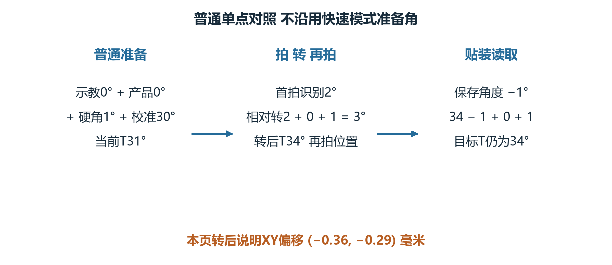

图13 这是普通单点的独立对照 转前和转后各拍一次

首拍识别2°，非镜像相对转2＋0＋1＝3°，当前T变34°。再次拍照才算位置。若转后仍给参考差(0.02,−0.01)、位移(0.12,−0.08)、中心向量(0.5,0.2)，保存XY为(−0.36,−0.29)毫米。

保存角度是−1°；贴装入口算34−1＋0＋1，目标仍为34°，不会再重复转3°。快速模式保存的是本次识别角，不能直接互换这两种记录。

**普通模式用转后照片的位置，最终T在本页条件下为34°。**

如果普通生产焊点还带镜像标记，相对转角又有不同。

# 14 普通镜像上视单独核对转向

第二部分 换一种路线或增加补偿

找A点 → 找C1 → 取片 → ● 拍芯片 → 算目标 → 贴装

继续对照普通模式，但只把当前焊点改为镜像。仍从准备T31°开始，识别2°、A点角0°、硬角1°。镜像相对转角为2＋0＋180−1＝181°。

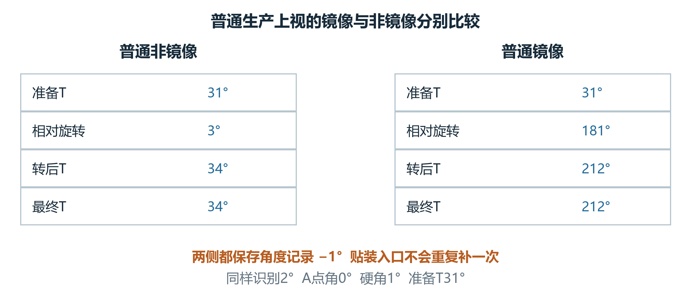

图14 镜像与非镜像并排对照 不表示同一芯片先后做两次

当前T由31°变212°，转后再拍；保存角度仍为−1°，贴装入口212−1＋0＋1仍为212°。轴角在这里不自行折回0到360°。

快速生产分支没有这条独立镜像项，手动普通双点也有实现差异。镜像标记在运行焊点创建时复制，修改配方后只刷新不会重新复制。

**镜像结论要和普通生产入口、示教方向及当前焊点标记一起看。**

如果配置选的是中转台，下一页开始走另一条完整路线。

# 15 中转台纠偏先放下再重新取起

第二部分 换一种路线或增加补偿

找A点 → 找C1 → 取片 → ● 拍芯片 → 算目标 → 贴装

选择下视中转台方式时，吸嘴先把芯片放到台面，再移动相机观察它。识别后算出新中心，吸嘴对到修正位置，再重新取起。此处纠的是重取位置。

图15 按左上 右上 左下 右下看放片 拍照 对位 取片

台面上的芯片在拍照时保持不动。图中计算后移动的是吸嘴，没有把它画成台面自动旋转芯片。放片高度、偏心和芯片厚度按对应设备参数处理。

这条动作在精度关闭或选上视时可提前成功，空跑走另一条流程；当前没有与上视相同的离线提前成功分支。单点拍P1，双点拍P1/P2，后面才进入新的取片计算和检测。

**上视看吸嘴上芯片，中转台下视看台面上芯片。**

放下并拍到Mark之后，接着看怎样换到芯片中心。

# 16 Mark不在芯片中心该怎么找中心

第二部分 换一种路线或增加补偿

找A点 → 找C1 → ● 取片 → 拍芯片 → 算目标 → 贴装

中转台先用示教记住“Mark到芯片中心”这段向量。本次识别出新Mark后，把向量按当前角度关系转过去，再接到新Mark位置，得到芯片中心。

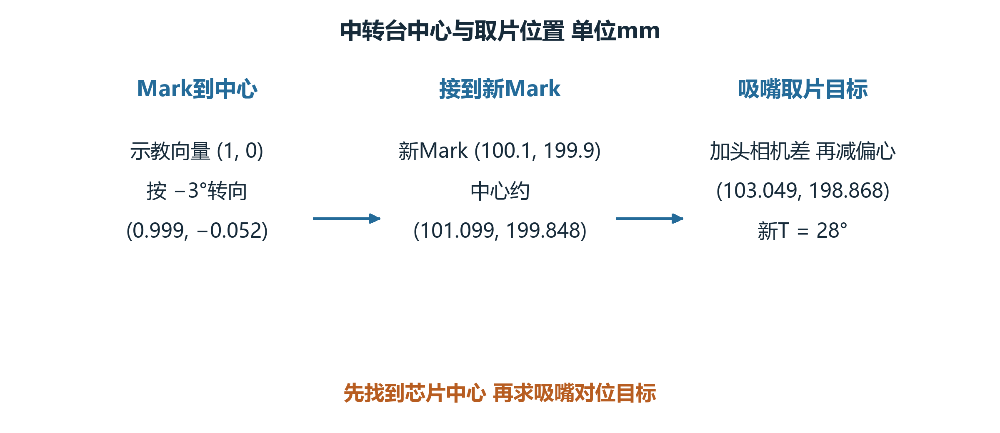

图16 先转一段已知向量 再把它接到本次识别Mark

给示教Mark=(100,200)、芯片中心=(101,200)mm，向量就是(1,0)。本次Mark=(100.1,199.9)mm，识别2°、示教下视角1°，向量按−3°转后约为(0.999,−0.052)。

相加得芯片中心约(101.099,199.848)mm。再给头相机差(2,−1)mm、新角下吸嘴偏心(0.05,−0.02)mm：加前者、减后者，取片G0约(103.049,198.868)mm。当前T=30°，新T=28°。

**算出芯片中心之后，还要换成吸嘴能对准它的取片位置。**

中转台目标、重取和检测的异常放到第三部分查阅；下面回到其他供料和定位方式。

# 17 多次定位为什么有时还是不通过

第二部分 换一种路线或增加补偿

找A点 → ● 找C1 → 取片 → 拍芯片 → 算目标 → 贴装

开启多次定位后，每轮识别都检查XY偏差和角度。三项都在配置阈值内才算自动通过；比较包含等号。还不合格且次数未用完，就校正位置后再拍。

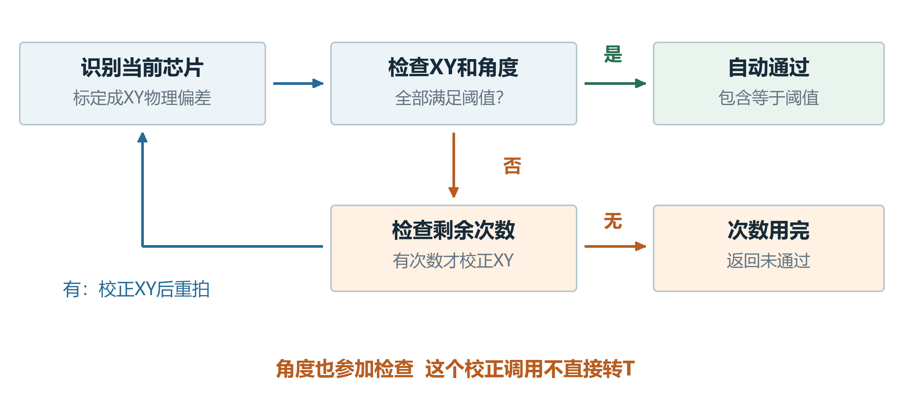

图17 看一轮的测量 检查 移动和再拍照

例如阈值给定为XY各0.02mm、角度0.1°。测得(0.03,0.01)mm、0.05°，X不合格，仍需下一轮。测得(0.02,0.01)mm、0.1°则在边界内，可通过。

这条循环的移动调用校正晶圆台XY，没有直接调用T轴回正。运动还受位置搜索、离线和空跑条件控制。所以允许多次不保证达到角度精度。人工OK的出口也可能绕过自动阈值检查。

**自动通过、人工确认和跳片是不同出口。**

九宫格也有自己的候选缓存，下一页再区分候选和本次取片。

# 18 九宫格有缓存为什么还会拍照

第二部分 换一种路线或增加补偿

找A点 → ● 找C1 → 取片 → 拍芯片 → 算目标 → 贴装

九宫格缓存帮助选下一颗候选；本次取片前的识别和取后更新是另外两个阶段。缓存里Exist为true，只能说明有可用候选信息。

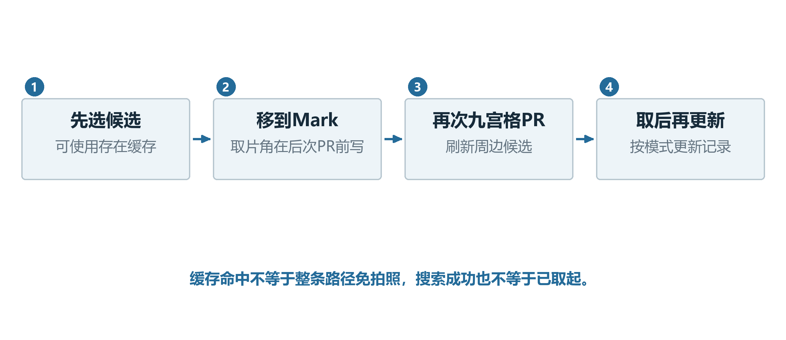

图18 候选 本次定位 取后更新分成三个阶段看

Nine可以省去前面的候选确认，但MoveDieToPickCenter移动到Mark中心后仍会调用九宫格识别。识别会重建邻片存在标记，墨点或检测失败也会令某些位置不可用。

当前取片角在后次九宫格PR之前已写入，后次PR没有再覆盖它。后次识别失败也没有直接把当前搜索成功改为false。WaferMap取后另更新游标和已取记录；Box另更新槽号。记录候选或已取序号，都不能代替吸嘴持片检测。

**缓存命中不等于整条路径免拍照，搜索成功也不等于已取起。**

供料准备讲完后，再看产品存在多个Mark时怎样合并结果。

# 19 多个Mark到底用哪几个来算位置

第二部分 换一种路线或增加补偿

● 找A点 → 找C1 → 取片 → 拍芯片 → 算目标 → 贴装

不是配置了几个点就把所有数一起平均。X只取UseX打开的点，Y只取UseY打开的点，各算各的平均。某轴没有启用点时，该轴结果为0。

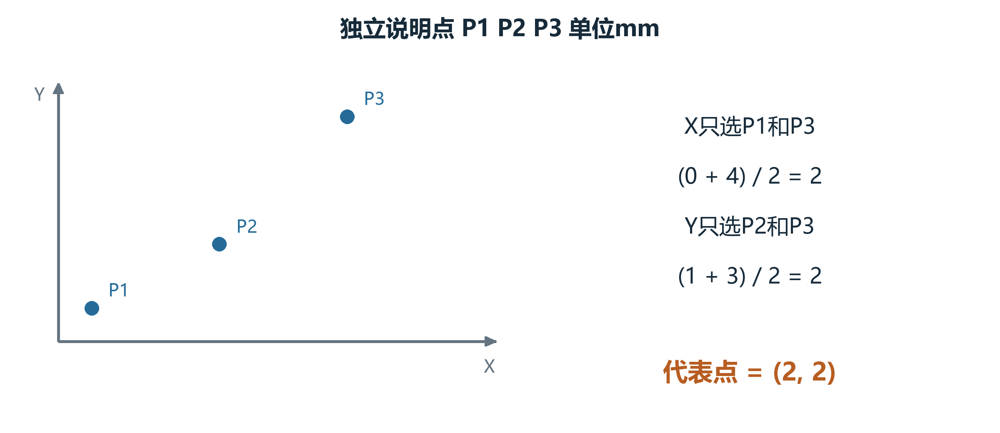

图19 同一组Mark可以为X和Y提供不同的点

例给P1=(0,0)、P2=(2,1)、P3=(4,3)mm。X选P1/P3，均值2；Y选P2/P3，均值2，于是用于对齐的代表点是(2,2)。后面把这个代表点叫锚点。

角度默认取启用点识别角的普通算术均值，再换成弧度，不能自动跨越±180°处理。三点拟合圆只用前三点，精确共线时当前实现返回前两点中点。四点模式的P4角度是否参与，实际看第3点开关。

**先看各点的参与开关，再看点数。**

选出了代表点，再看产品同时平移和转向的情况。

# 20 产品既偏了又歪了怎样一起修

第二部分 换一种路线或增加补偿

● 找A点 → 找C1 → 取片 → 拍芯片 → 算目标 → 贴装

先让示教Mark对应到本次识别Mark，再围绕这个目标调整方向。这样Mark能对上，其他焊点也跟着整层坐标走；只把XY差加上去，不能完整表达产品转角。

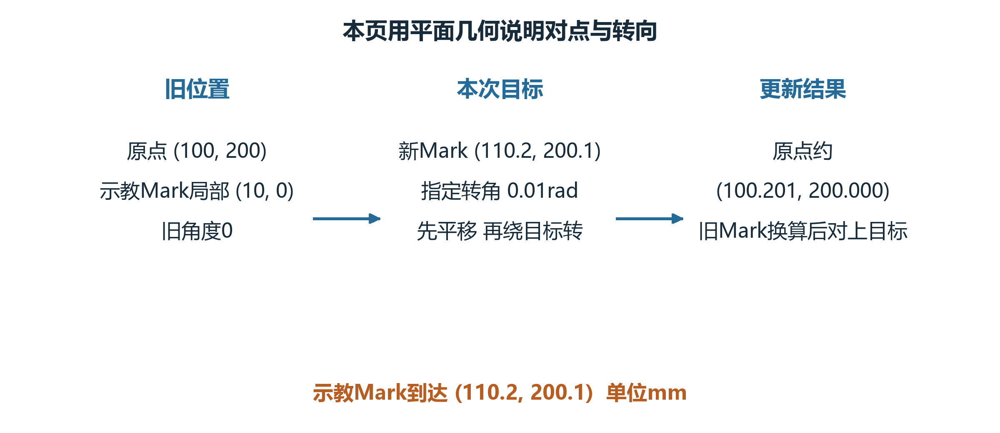

图20 先平移对点 再围绕目标调整方向

用一组独立说明输入：本层原点(100,200)，角0；示教锚点在本层(10,0)，识别锚点(10.2,0.1)，指定转角0.01rad。父参考在本例取G0。

按保留的几何说明模型，新原点约(100.201,200.000)，角0.01rad；原局部Mark换算后对上(110.2,200.1)。启用两点定角时，代码还会对两连线角差取Atan，不能省略。完整精度和依据留在计算与代码索引。

**本页解释对点和转向的关系；坐标库内部执行仍由实际接口负责。**

这是额外带转角的几何对照，不接主例继续累加；下一页返回补偿的使用顺序。

# 21 最终贴装前还有哪些补偿

第二部分 换一种路线或增加补偿

找A点 → 找C1 → 取片 → 拍芯片 → ● 算目标 → 贴装

可以把XY计算看成沿途逐项修正。先从产品焊点和局部硬补偿得到G0目标，加入焊后及单点补偿，再按相机分支处理芯片、工具等量，接着减TU区域补偿。

图21 上行处理G0 下行转换到运动轴并追加实时量

RealBondPoint3D记录的是转轴之前的G0中间位置。随后转换到运动轴，再追加实时补偿；所以这个记录不一定等于最终轴目标。

Z还有独立高度分支，合并基准高度、吸嘴测高差、芯片厚度、局部Z和压合距离等。不能只用XY的相加方式推断最终Z，也不能把记录里的XYZ与轴显示直接逐项比较。

**排查落点时，按计算先后找是哪一项把目标改变了。**

接下来分别看温漂和焊后结果怎样改变后续目标。

# 22 温漂补偿为什么不能统一理解

第二部分 换一种路线或增加补偿

找A点 → 找C1 → 取片 → 拍芯片 → ● 算目标 → 贴装

取片漂移修正预取片XY；上视漂移修正保存的芯片偏移。两者名字相近，但返回符号、触发和超限处理不同。关闭或记录为空时，两者本次读取都可返回0。

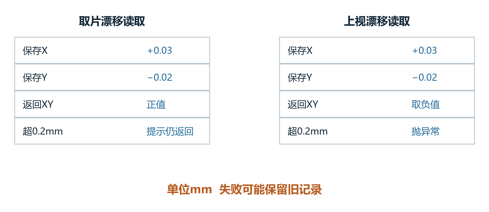

图22 同一说明漂移值 在两条读取路径中符号相反

给保存XY=(0.03,−0.02)mm，取片读取返回正值并加到预取片目标；上视读取返回负值(−0.03,0.02)并加入芯片偏移。XY任一绝对值超过0.2mm时，取片提示但仍返回，上视则抛异常。

识别失败可保留旧记录；上视包装还没有把底层false传播出去。生产取片调用带firstTu=true，足以按开关条件进入采集，不能简单理解成只按时间间隔触发。TU刷新也不统一清掉这些缓存。

**看本轮是否采集成功，再看实际读到了哪一次记录。**

温漂读取看的是自己的缓存，焊后补偿则来自已经检测过的点。

# 23 焊后发现偏差怎样影响后面的点

第二部分 换一种路线或增加补偿

找A点 → 找C1 → 取片 → 拍芯片 → ● 算目标 → 贴装

焊后检测得到的统计偏差，可用于后续贴装补偿。未达到配置样本数时返回0；满足数量后，XY还分别筛选绝对值严格小于50的偏差，再除1000换成mm，并乘补偿比例。

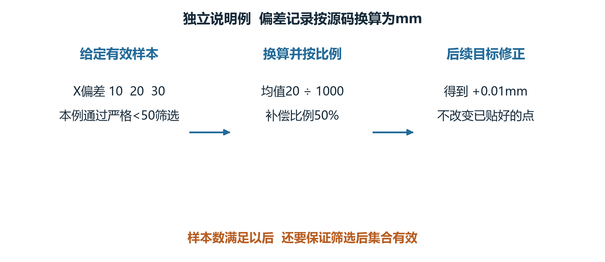

图23 历史检测形成后续修正 已贴好的点不会被回改

例如有效X偏差为10、20、30，比例50%，均值20除1000再乘0.5，得到0.01mm。本例只说明换算。筛选后若没有有效值，Average仍会失败；原始样本数够不保证均值可用。

启用按上次产品自动补偿时，实时均值接口直接返回0，产品结束时另改常规硬补偿并可保存单点记录。当前均值返回的中间Z还取X均值，实际运动Z却由高度分支另算，不能混读。

**这些补偿改变后续目标，不会回头移动已经贴好的芯片。**

另一类实时补偿还要看它在轴转换前后哪一步生效。

# 24 实时补偿为什么最后只加到轴X

第二部分 换一种路线或增加补偿

找A点 → 找C1 → 取片 → 拍芯片 → ● 算目标 → 贴装

中转台相关实时补偿按X在参考点之间插值。当前调用先传IPTVisionPos、再传IPTPickPos；被调方法的参数名顺序却相反，解释时必须保留真实传入顺序。

图24 参考位置插值后 只有X量在轴转换后追加

单点插值XY任一超过0.5mm会先抛异常；组合后的四点差超过0.5mm则返回0，正常结果也只保留X。最左侧索引等边界还可能抛异常，不能把表有数据理解成任何位置都可用。

参考扫描全部成功后才整体替换本轮补偿组，失败保留旧组。当前时间触发条件未启用，first参与扫描控制。它与TU区域二维表和驱动表分别存放，RealBondPoint3D又记录在这个轴X追加之前。

**确认是哪张表、哪次扫描、在哪个坐标阶段追加。**

接着把实时、TU区域和设备轴这几套表分开。

# 25 设备轴补偿和TU区域补偿差在哪

第二部分 换一种路线或增加补偿

找A点 → 找C1 → 取片 → 拍芯片 → ● 算目标 → 贴装

设备轴二维补偿把标定表交给驱动，在运动执行层使用。TU区域补偿由应用程序按当前G0贴装位置查表，直接修改要发出的目标。它们是两套数据和两个生效位置。

图25 上面应用改目标 下面驱动使用轴补偿表

TU区域查出(0.02,−0.01)mm时，程序从G0目标中减去它；例如(100,200)会变(99.98,200.01)。轴补偿的内部插值由驱动负责，这里不假设驱动采用同一算法或同一符号。

设备轴表还区分ETEL映射文件和固高脉冲表。当前固高间距先转整数再乘脉冲比；0.8先转整数会成0，不能按理想浮点换算解释。ETEL下载异常部分会提示后继续激活调用，需分别核对下载与生效。

**一项补偿开了，不代表另一项也已开启或适配。**

设备轴表由驱动使用，因此回零结果还要另看开关是否生效。

# 26 回零成功是否说明轴补偿已打开

第二部分 换一种路线或增加补偿

找A点 → 找C1 → 取片 → 拍芯片 → ● 算目标 → 贴装

整机回零确认后，先关闭补偿，再OneKeyHome；回零成功才调用开启补偿。若开关关闭，开启方法直接跳过，整机仍可返回回零成功。

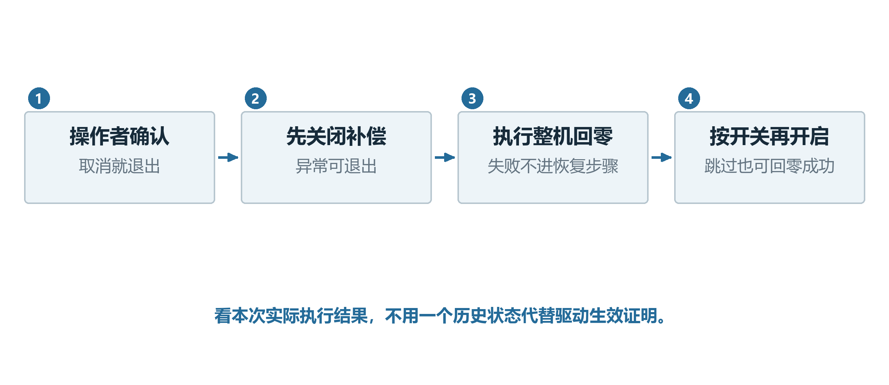

图26 回零成功 开启调用和驱动生效是不同判断

固高开启接口返回false时，当前包装弹提示但没有变成整机回零false；未被内部捕获的异常才走外层失败。ETEL下载的特定异常也可能只提示，后面继续执行激活。

失败出口没有统一恢复二维表，入口也没有统一清掉历史AllAxisReset。全局标定界面另有OpenStage、CloseStage，回零轴的顺序及开关处理不同，不能套整机回零结论。

**看本次实际执行结果，不用一个历史状态代替驱动生效证明。**

除了生产运行，示教也会改变后续定位使用的角度。

# 27 拉角度就是让相机找两个点

第二部分 换一种路线或增加补偿

● 找A点 → 找C1 → 取片 → 拍芯片 → 算目标 → 贴装

两点角度示教让操作员把相机移到左、右两个特征点并记录位置。窗口自己不自动跑PR。两个点都转换到传入坐标对象的上级参考系，再用连线斜率算角度。

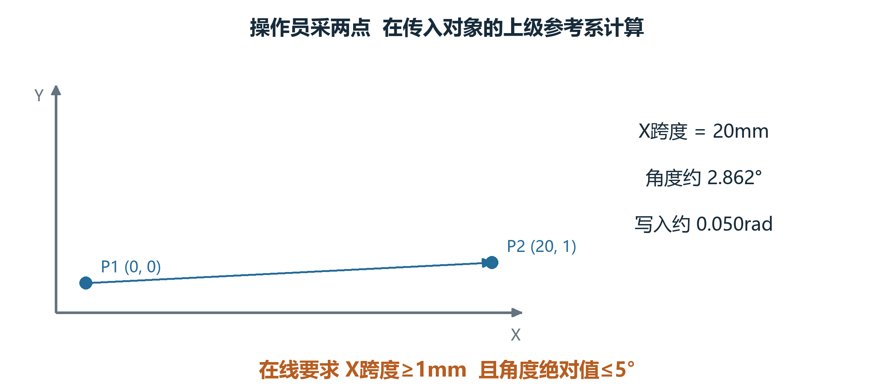

图27 先记左点 再记右点 看连线偏离水平多少

说明输入左点(0,0)、右点(20,1)毫米，角度约2.862°，写入Degree时约0.050rad。在线要求X跨度至少1毫米，角度绝对值不超过5°，等于边界允许。

X跨度不足或角度过大都重新从左点采。这里用Atan斜率，不是任意象限方向判定。离线完成可直接OK，不算新角也不写Degree；调用方仍可能使用RealDegree，不能把离线OK当成有效在线测角。

**这是示教输入，和每轮产品自动定位分开。**

角度得出后，下一页看示教入口实际写了哪一层。

# 28 拉角度后取消为什么仍可能改过数据

第二部分 换一种路线或增加补偿

● 找A点 → 找C1 → 取片 → 拍芯片 → 算目标 → 贴装

窗口通过时先修改传入坐标的Degree，再返回OK并Save。调用方随后还会把角度复制到目标运行对象或配置，所以一次示教包含前后多次写入。

图28 窗口先改传入对象 调用方后写目标配置

TU入口传TU坐标；基板入口可能传TU坐标，再写基板角；基岛入口可能传基板坐标，再写基岛角；焊点入口传基岛坐标，打开窗口前还先把焊点配置角置0。

后续PR编辑取消，没有统一撤销前面已写的运行角或配置角。窗口Save又早于调用方后写字段，不能当成所有后写配置都已落盘。角度最终影响哪层，要按入口连起来读。

**取消结束的是后续步骤，前面发生的写入需单独判断。**

示教角度讲完，再看按产品区域位置查补偿的例子。

# 29 TU区域表怎样按位置给补偿

第二部分 换一种路线或增加补偿

找A点 → 找C1 → 取片 → 拍芯片 → ● 算目标 → 贴装

可以把加工区域想成一张方格地图，每个格点保存X、Y误差。当前贴装点落在四个格点之间时，按距离做双线性插值，得到这个位置的补偿，然后从G0目标相减。

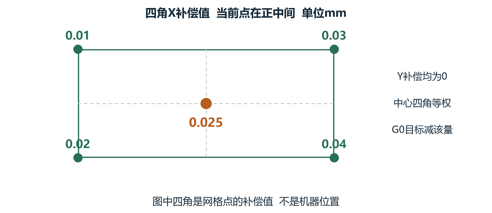

图29 先沿X插值 再沿Y插值 图中单位mm

假设四角X补偿为0.01、0.03、0.02、0.04mm，Y全为0。正中心等权得到X=0.025mm；基础目标(100,200)本例会变成(99.975,200)。这只隔离区域补偿一项。

开关关闭或XY网格为空返回0；任一插值分量绝对值超过1mm抛异常。表还需要正确起点、非零间距、尺寸和覆盖区域，边缘索引处理不能代表任意区域都标定有效。

**数值和它对应的真实位置必须一起正确。**

区域表可以从统计生成，也可以人工导入；下一页比较两条准备路线。

# 30 区域表生成以后还要怎样用到生产

第二部分 换一种路线或增加补偿

找A点 → 找C1 → 取片 → 拍芯片 → ● 算目标 → 贴装

自动路线按完整产品轮次收集位置误差，计算每点代表值，再做行内中位数平滑。人工导入按列表还原位置，采用行内均值平滑，两条算法会得到不同结果。

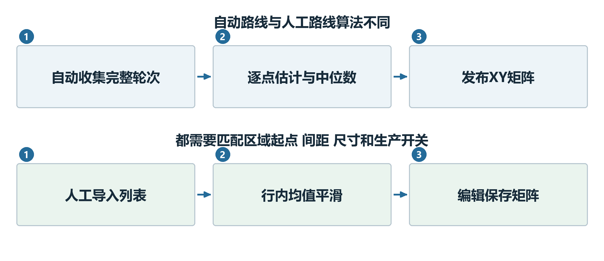

图30 两条路线并排比较 结果要配合正确的区域几何和开关

例如一行[0,0.01,1,0.03,0.04]毫米，自动中位数结果约[0.01,0.02,0.03,0.035,0.04]；人工均值约[0,0.337,0.216,0.357,0.04]。算法细节和完整精度放在计算索引。

计算完成仍可能只是窗口缓存。启用才发布XY矩阵，生产还需要区域起点、间距、尺寸、覆盖范围和开关匹配。自动窗口不会同时补齐这些几何条件，采集失败也可能继续保留旧表。

**先确认数据属于哪些实物位置，再确认本轮生产实际读的是哪一张表。**

前面的章节讲正常数据怎样来，下面集中看结果和现场不一致时从哪里查。

# 31 Mark间距不对时重新拍会做什么

第三部分 记录异常时怎样查

● 找A点 → 找C1 → 取片 → 拍芯片 → 算目标 → 贴装

两点定位可以检查示教间距和实测间距相差多少。差值绝对值大于DistanceTolerance才报警，等于阈值允许。当前检查放在两点出口，不代表三点、四点也执行同一项。

图31 S1和S2的重试会走不同路径

S1选Retry，会从P1重走人工报警对点，并跳过下一次距离检查；S2选Retry重新采P1/P2后还会再检查。两侧Abort都停止并返回false。选None都停用本层，但S1继续更新，S2直接返回true。

单点识别失败还能按配置周边搜索或人工确认。坐标更新异常前，部分识别结果和图像引用可能已经改变；外层动作Success、领域bool和坐标是否更新，也不能只看其中一个。

**同样叫Retry，实际从哪里重来，要按本侧入口读。**

产品重拍和上视、中转台重试的入口不同，下一页接着看中转台。

# 32 中转台字段有值为什么仍可能没取成功

第三部分 记录异常时怎样查

找A点 → 找C1 → ● 取片 → 拍芯片 → 算目标 → 贴装

IPTVisionPos记录拍照目标，IPTPickPos记录取片目标。代码在移动之前就可能写入它们，所以有目标值只说明算过或准备过，不能证明已经到位、拍完或取起。

图32 目标写入在前 运动和持片检测还在后面

绝对运动的部分包装调用底层后没有接回非Success返回，外层仍可能读到初始Success；插补分支则返回实际轨迹结果。异常仍会向外传播，不能只靠包装成功当作到位证明。

正常取后检测的RePick标签位于Pick调用后。检测失败点Retry，只回检测位置，不再执行一次Pick。视觉失败Ignore的另一条Repick分支，则有取回、抛料、重置消息并返回Retry的动作。

**记录、动作返回和实物检测要一起看，重试按钮名字不能代替实际跳转位置。**

如果走的是手动测试，还需要单独核对它的计算路径。

# 33 手动贴片测试为什么不能直接当生产结果

第三部分 记录异常时怎样查

找A点 → 找C1 → 取片 → 拍芯片 → 算目标 → ● 贴装

手动PlacementTest直接调用产品定位，bool为false就退出；它没有经过全部生产动作的筛选。启用纠偏只支持上视，使用自己的准备角和后续位置计算。

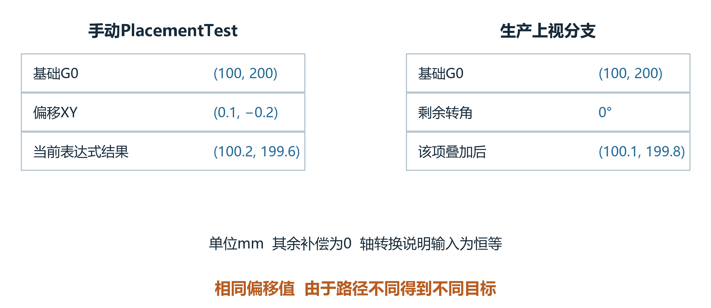

图33 同一个偏移值 在手动和生产中走不同计算路径

给焊点原点(100,200)mm、各层角0、偏移(0.1,−0.2)mm，其他补偿0，轴转换本例取恒等。手动先把偏移当局部点换算又追加一次，得到(100.2,199.6)；生产上视剩余角0则为(100.1,199.8)。

手动普通双点没有同样的镜像检查，手动Retry也不自动重跑整套测试。返回四维量的T、Info中的角度和生产目标T是不同量；手动Z又由自己的高度分支计算。

**说明测试结果时，先说清执行的是哪个入口。**

最后把当前实物、本次照片、保存记录和实际使用位置对起来。

# 34 遇到纠偏问题先把这几件事连起来

第三部分 记录异常时怎样查

找A点 → 找C1 → 取片 → 拍芯片 → 算目标 → ● 贴装

先回到实物：芯片还在料盘、吸嘴上，还是中转台上？再看当前模式、这一轮拍照和返回结果，最后沿记录找到实际消费它的贴装计算。这样能区分算错、没走到和读到旧值。

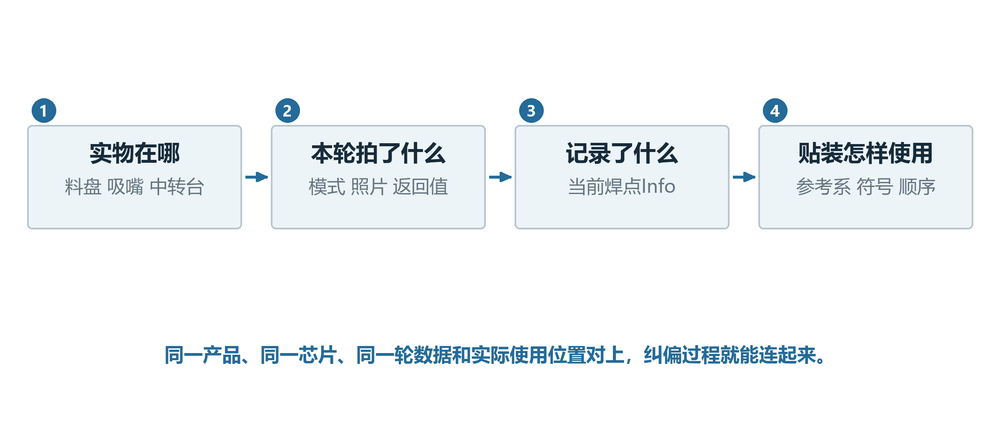

图34 实物阶段 照片结果 保存记录 最终使用连成一条线

人工OK可能绕过正常的结果后处理。正常后处理关闭X、Y时分别写1224、1024，角关闭写0，这是像素替代值，不能当物理偏移直接归零。Retry还会重置指定消息，Info旧值却可能留着。

相机标定、吸嘴标定、IPT示教为生产提供参数；力控、测高和温控作用在各自通道。它们没有统一合成一种XY纠偏。源码入口、八种定位筛选和其他细节放在配套索引，需要时再查。

**同一产品、同一芯片、同一轮数据和实际使用位置对上，纠偏过程就能连起来。**

需要核对完整数值和代码入口时，查本版计算与代码索引；阅读主线则可回到第一部分。
