# 纠偏过程设计文档

先看清板子和芯片的位置 再把芯片贴到A点

先以华夫盒取片、上视拍照为例；中转台另按配置使用。图片中的设备、偏差和位置是示意。

# 芯片怎样贴到A点上

板子已经到固晶工位，A点已经点过胶。设备要找到这颗芯片，把它取起来，再贴到同一个A点。

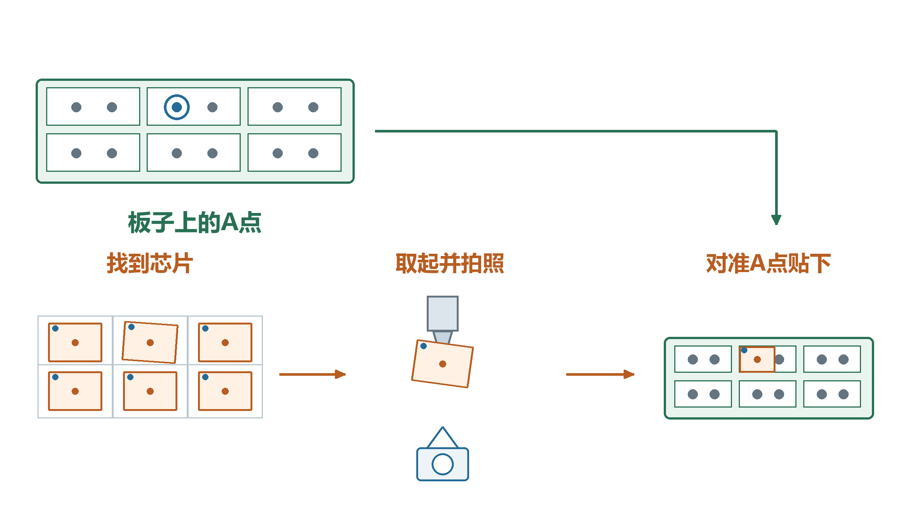

板子上的目标在哪里、芯片实际在哪里，两边都要找准。

只知道A点的位置还不够。芯片放在料盘里可能有偏差，吸到吸嘴上以后，也可能没有正好在中心。

# 先找准板子上的A点

相机按需要找到板子上的特征。板子放偏了，软件就用这次找到的位置更新A点。

蓝圈始终表示同一个A点，变化的是它的实际位置。

例如板子比原来靠右一点，A点也跟着靠右。后面的贴装从这个新位置继续算。

# 在料盘里找到这颗芯片

这里用华夫盒举例：芯片分别放在槽位里。设备先找到候选槽位，再用下视相机看清这次要取的芯片。

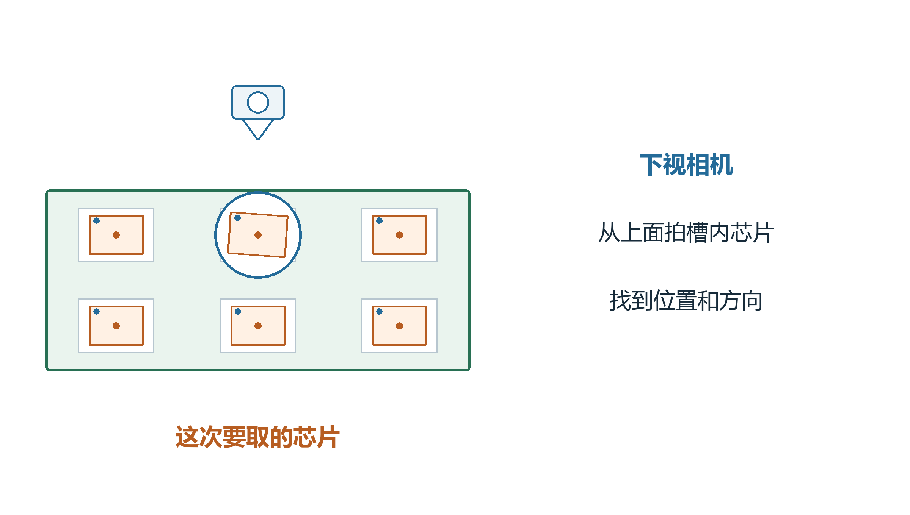

先找到这颗芯片，再确定吸嘴该到哪里取。

相机还会看芯片有没有歪。照片里的位置要经过相机标定，才能变成设备可以使用的位置。

# 吸嘴把芯片取起来

设备根据找到的芯片位置和校准数据准备取片。吸嘴移过去，把芯片吸起来，再按设置检查吸嘴上有没有芯片。

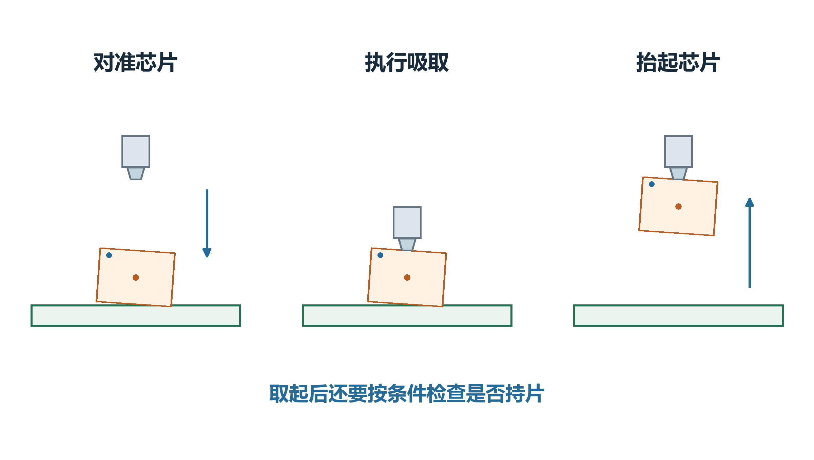

图里分别是取片前、吸取时和取起后。

屏幕上算出了取片位置，还不能证明已经取到。要把动作结果和实际检查一起看。后续例子假定本次已正常取起。

# 取起以后为什么还要拍照

芯片吸起来以后，可能偏在吸嘴一边，也可能有一点歪。只按理想中心去贴，实际落点就可能偏。

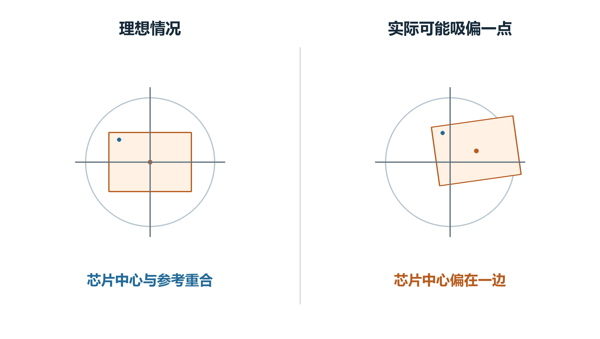

灰色十字是吸嘴旋转参考，橙点是芯片中心。

取后的拍照就是要看清这个偏差，让后面的贴装知道该怎样修正。偏差在图中画大了，方便看清。

# 上视相机从下面看芯片

吸嘴带着芯片来到上视相机。相机从下面拍，软件找到芯片的特征，再换算到芯片中心。

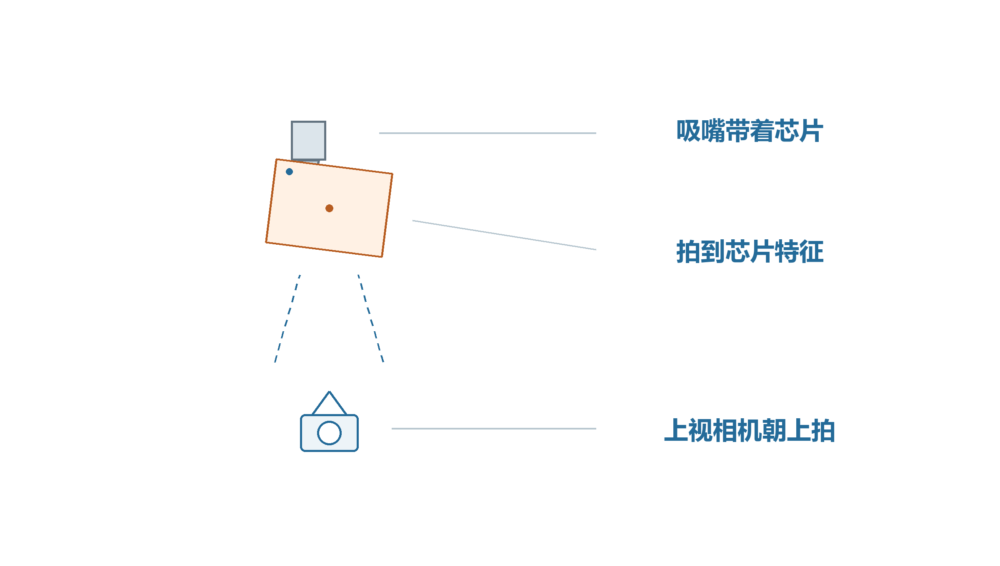

芯片还在吸嘴上，相机在它下面。

例如照片看出芯片偏在参考中心的一边，软件会保存这次的偏移和角度，留给本次贴装使用。

吸嘴会先转到拍照准备角，这和取片时的角度可以不同。

# 拍完以后怎样对准A点

软件把A点的当前位置和这次芯片偏差放在一起，算出吸嘴应该到哪里。吸嘴移到修正位置，芯片中心才能对上A点。

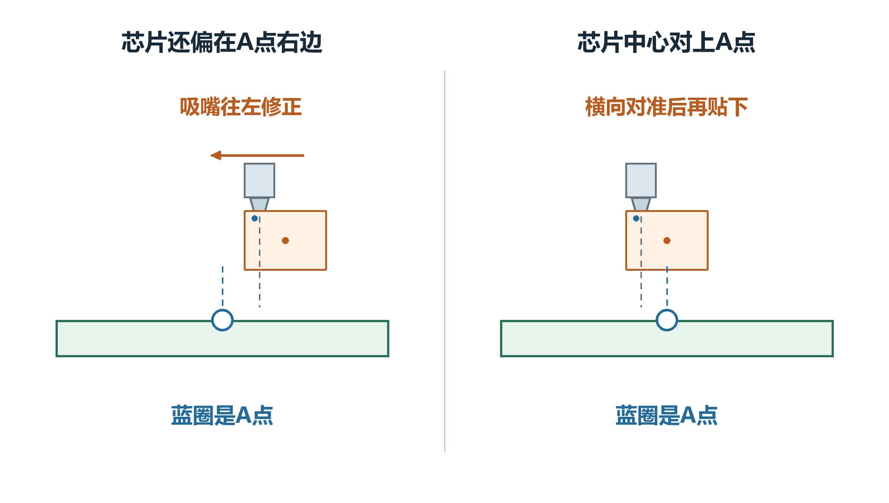

灰色参考线和橙色芯片中心不一定重合。

修正前，芯片偏在A点右边。吸嘴往左挪一点，带着芯片一起移动，最后让芯片中心对上蓝圈。

# 转方向时还要重新看位置

芯片没有吸在旋转参考中心上时，吸嘴一转，芯片中心也会绕着它移动。因此要把后面还需旋转的角度一起算进去。

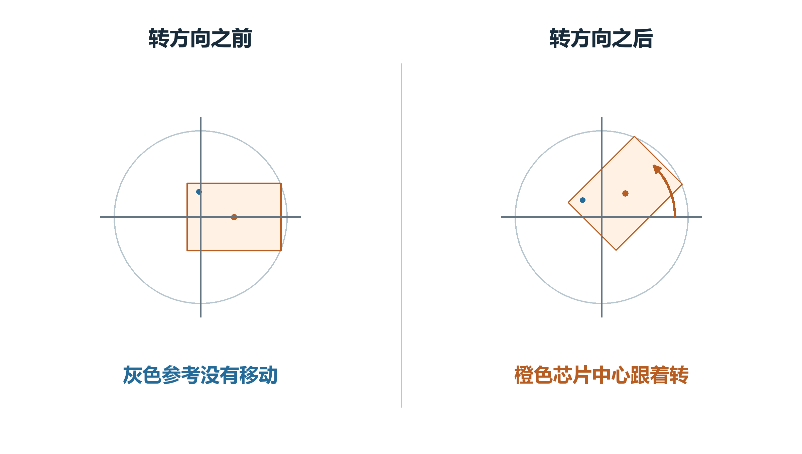

灰色十字没有移动，橙色芯片中心的位置却变了。

快速上视保存的偏移，要按贴装前的剩余转角转过去，再用到贴装目标里。不能把拍照时的方向直接当作贴装时的方向。

# 对准以后把芯片贴下去

位置和方向准备好后，设备再按贴装高度等条件执行动作。这个动作正常成功，A点才记成芯片已贴。

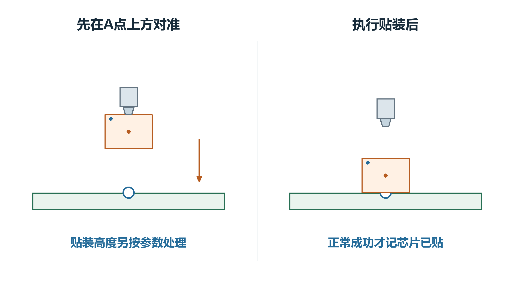

先对准，再按本次贴装动作执行。

横向对准和上下落到多高要分别处理。不能因为图上对齐了，就认为实际高度也已经正确。

# 有些配置会先放到中转台

选用中转台下视时，芯片先放到台面。相机从上面找准芯片，吸嘴再对着新位置把它重新取起。

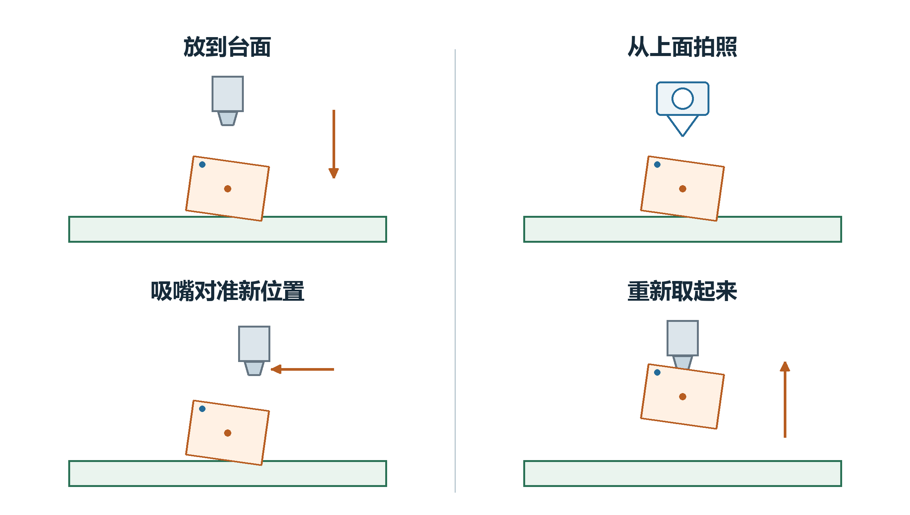

依次看放下、拍照、对准和重新取起。

拍照时台面上的芯片不动，后面移动的是吸嘴。中转台和前面的上视按配置选择，不是每颗芯片都顺次走完两种方式。

# 为什么有时会拍好几张照片

单点看一个特征，双点看两个特征。普通上视会先拍、转方向、再拍，后半次照片用于重新确定位置。

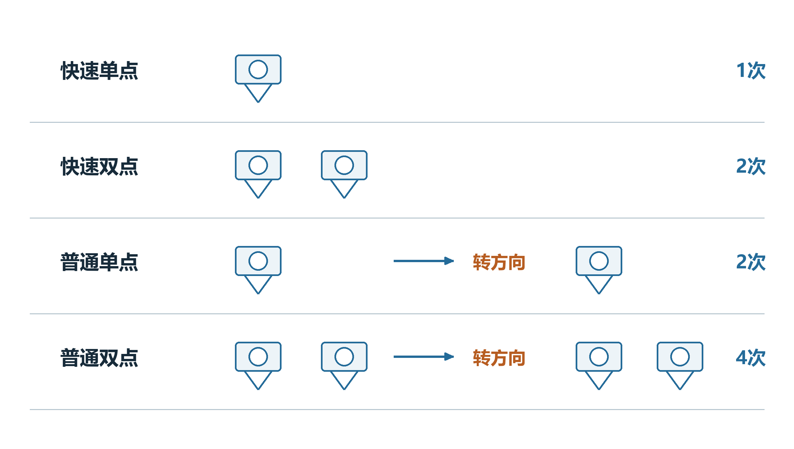

相机符号表示一次正常的几何拍照。

快速单点通常拍1次，快速双点2次；普通单点2次，普通双点4次。重试、二维码和温漂采集可能额外增加照片。

# 芯片已贴还要看检测结果

软件记了“芯片已贴”，不能直接当作贴装精度合格。需要看相应的焊后检测或其他实际确认结果。

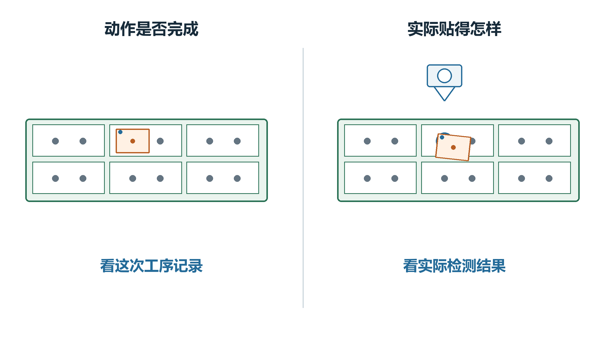

左边说动作是否完成，右边看实际贴得怎样。

如果照片、目标记录或返回值与实物不一致，要确认它们是不是同一颗芯片、同一次动作的数据。

# 偏差总往一边时再看补偿

如果检测发现后续需要修正偏差，启用的补偿会按各自规则调整后面的目标。例如把后面要贴的位置往回修一点。

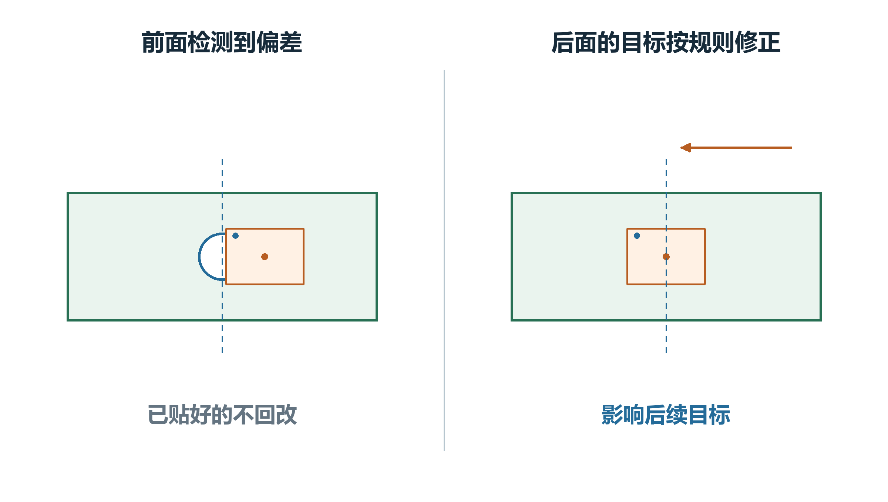

修改的是后面的目标，已经贴好的芯片不会被回改。

不同补偿有不同的来源、开关和生效步骤。先确认本次用的是哪一项，再看它把目标改了多少，不能把所有偏移直接加在一起。

# 报错以后先看芯片在哪里

先看芯片还在料盘、已经在吸嘴上，还是放到了中转台，再核对这一步的照片、记录和检测结果。

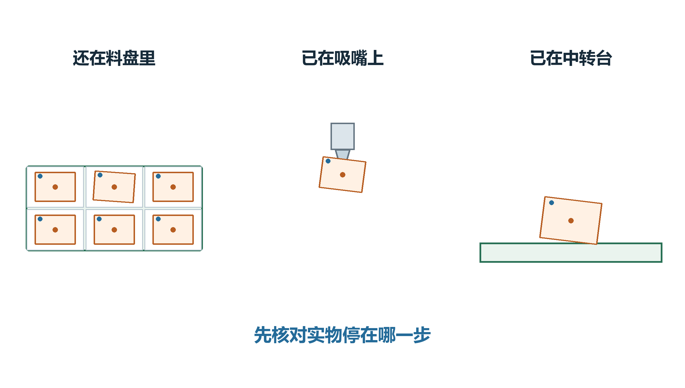

三种实物位置并排比较，不表示依次重做。

按“重试”不一定重新取片，有的动作只重新检查。记录里有取片位置，也不能证明已经到位或取到芯片；要看实际停在哪一步。
