# 纠偏过程设计文档

从找到芯片、拍照纠偏到贴准焊点，按设备动作看懂每一步在修正什么。

图中布局为示意，数字例子用于理解，不是本机参数。

# 01 先看芯片怎样贴到产品上

把贴装想成让两个位置碰到一起：产品上的A点在哪里，吸嘴上这颗芯片的中心又在哪里。产品位置和芯片位置都有偏差，所以设备会在不同阶段拍照。

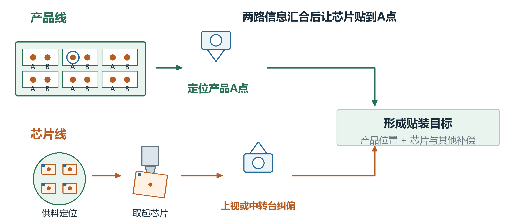

图1 上路找产品焊点 下路找芯片 最后在贴装目标汇合

先在晶圆或华夫盒找到芯片，再取起。取起以后，可以用上视相机看吸嘴上的芯片；也可以按配置放到中转台，用下视相机看清后重新取起。两条纠偏方式按配置选择。

产品侧会定位TU、基板、基岛或焊点。贴装时，把产品当前位置、芯片偏移及启用的补偿一起算成运动目标。本册沿这条路线讲；镜头位置和设备比例均为示意，实际动作由配置决定。

**读一项“纠偏”时，先确认它修的是产品、供料芯片，还是吸嘴上的芯片。**

# 02 相机里的偏十格到底是多少

相机结果首先是像素，机械运动使用的是物理长度。识别结果里的CenterX、CenterY不能直接加进轴目标，必须先经过本相机的标定转换。

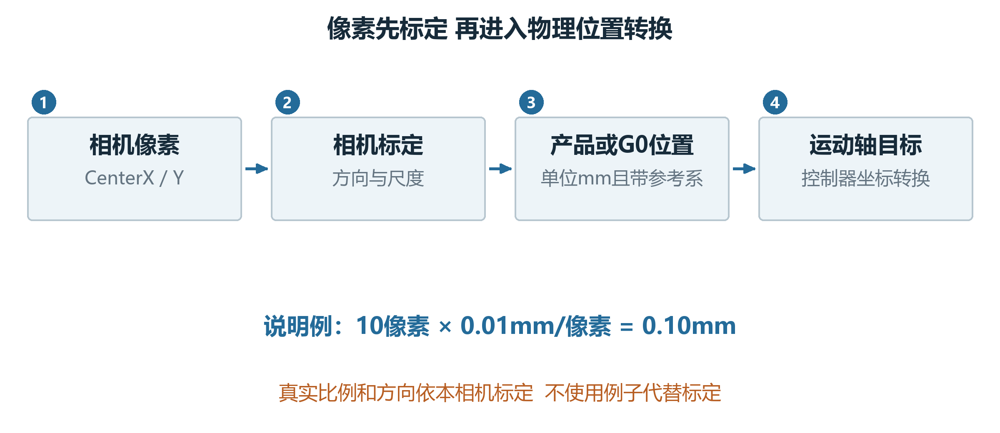

图2 每经过一步转换 数字所处的参考系都会改变

为便于理解，假设一个说明相机在当前方向上每像素对应0.01mm。图上偏10像素才可换算成0.10mm；真实相机的比例、方向和旋转由标定决定，不能照抄这个比例。

物理位置还分产品局部、机器G0和运动轴参考。头相机差说明相机中心与焊头参考的关系，吸嘴偏心说明旋转时实际吸嘴中心的偏差。它们只在指定阶段参与，不能看到“偏移”就全部相加。

**每个数字都带上单位和相对谁，算例才不会串。**

# 03 芯片还没取起来时先找哪里

供料定位先找到一颗候选芯片，确认位置和角度，再让取片动作形成XYZT目标。XYZ是位置，T是旋转轴角。这时处理的是供料芯片，不会直接改变产品A点的坐标。

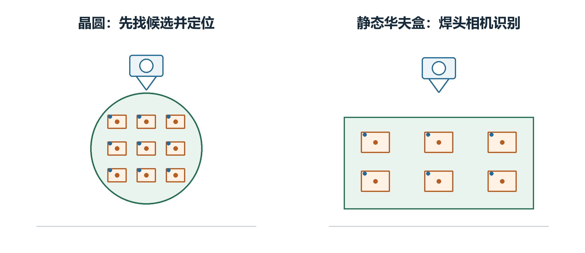

图3 晶圆侧和静态华夫盒侧在不同位置完成识别

晶圆Single、Nine、WaferMap及Box有各自选候选的方法。静态华夫盒的某些分支只先给拍照目标，再由焊头下视相机识别槽内芯片。供料任务成功才发允许取料信号。

当前WaferMap支持开启定位的StandardSearch单点；双点、MultipleSearch或关闭定位的相关分支会抛异常。不能把枚举里有名字，就理解成这些组合全部可用。

**候选位置告诉设备先去哪里找；识别和取片计算决定最后去哪里取。**

# 04 多次定位为什么有时还是不通过

开启多次定位后，每轮识别都检查XY偏差和角度。三项都在配置阈值内才算自动通过；比较包含等号。还不合格且次数未用完，就校正位置后再拍。

图4 看一轮的测量 检查 移动和再拍照

例如阈值给定为XY各0.02mm、角度0.1°。测得(0.03,0.01)mm、0.05°，X不合格，仍需下一轮。测得(0.02,0.01)mm、0.1°则在边界内，可通过。

这条循环的移动调用校正晶圆台XY，没有直接调用T轴回正。运动还受位置搜索、离线和空跑条件控制。所以允许多次不保证达到角度精度。人工OK的出口也可能绕过自动阈值检查。

**自动通过、人工确认和跳片是不同出口。**

# 05 取片角度为什么不是识别角度

吸嘴要怎样转，还得合并取料硬角补偿和吸嘴校准角。未翻转时，取片T＝硬角−定位角＋吸嘴校准角；翻转时，定位角改为相加。

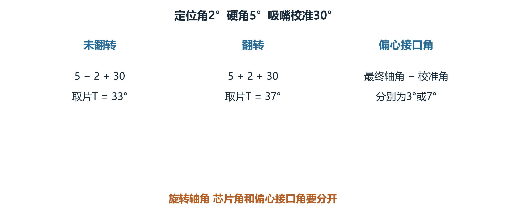

图5 本例未翻转 取片轴角为33度

给定位角2°、硬角5°、吸嘴校准角30°，未翻转得到5−2＋30＝33°；翻转则为37°。求吸嘴偏心时，接口用最终轴角减校准角，不能直接拿芯片的2°代入。

XY还取决于载具。晶圆从取料参考中心出发，处理吸嘴偏心、顶针和相机中心差等；静态华夫盒则从识别Mark换算位置出发，扣偏心和转过角的Mark到芯片中心向量，再加取料补偿。Z另看示教、测高和厚度。

**取片目标包括位置和方向，不能只靠一个视觉角生成。**

# 06 用一组数字看静态华夫盒怎么取片

这一页只算静态华夫盒XY。假定Mark加头相机差并转到轴参考后是(200,100)mm；Mark到芯片中心的示教向量为(0.5,0.2)mm。定位角2°，其余角沿用上一页。

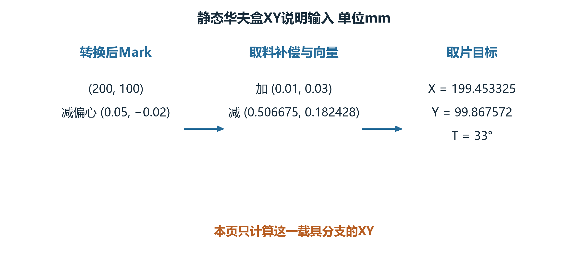

图6 从转换后的Mark位置开始 逐项得到取片目标

示教向量按−2°旋转，得到约(0.506675,0.182428)mm。再给吸嘴偏心(0.05,−0.02)mm、取料补偿(0.01,0.03)mm。目标等于起点减偏心，加补偿，再减旋转后的示教向量。

所以取片XY约为(199.453325,99.867572)mm，T为33°。这些转换结果和偏心均是给定说明输入，图中逐项列出计算；它们不代表本机实测标定参数，其他载具也不能直接照搬。

**看懂每个量从哪里来，比背一条总公式更有用。**

# 07 九宫格有缓存为什么还会拍照

九宫格缓存帮助选下一颗候选；本次取片前的识别和取后更新是另外两个阶段。缓存里Exist为true，只能说明有可用候选信息。

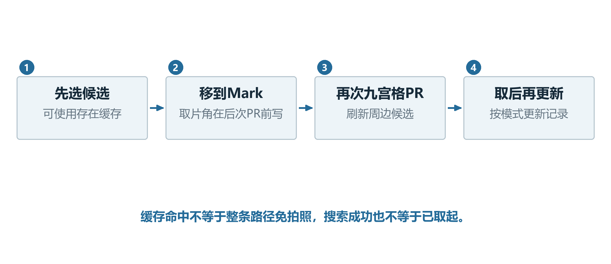

图7 候选 本次定位 取后更新分成三个阶段看

Nine可以省去前面的候选确认，但MoveDieToPickCenter移动到Mark中心后仍会调用九宫格识别。识别会重建邻片存在标记，墨点或检测失败也会令某些位置不可用。

当前取片角在后次九宫格PR之前已写入，后次PR没有再覆盖它。后次识别失败也没有直接把当前搜索成功改为false。WaferMap取后另更新游标和已取记录；Box另更新槽号。记录候选或已取序号，都不能代替吸嘴持片检测。

**缓存命中不等于整条路径免拍照，搜索成功也不等于已取起。**

# 08 产品进来后相机为什么还要找Mark

TU保存的配方位置只是起点。产品实际放置可能有平移或歪斜，设备便找产品上的Mark特征，用识别位置更新本层坐标。改了基板位置，它下面的各岛和焊点换算时都会跟着变。

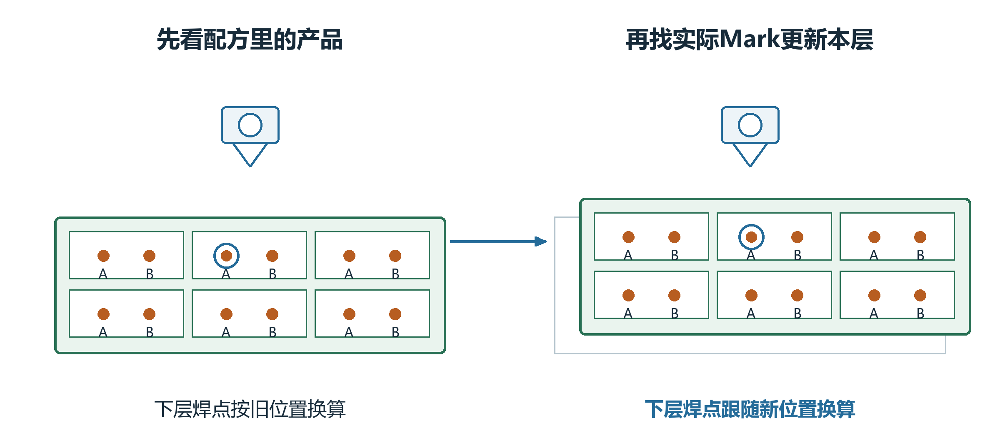

图8 相机找到实际Mark 后代焊点跟随本层坐标变化

产品定位可以发生在TU、基板、基岛或焊点，采点数由本层LocateConfig决定。关闭定位、停用、不参与本侧、已定位或已完成等条件，会让相应入口跳过；不同层和S1、S2的检查并不完全相同。

例如S2基板会另看EntityState，S2焊点入口却不额外检查本侧完成状态。S1离线分支可能置标记后继续调用领域方法，S2对应分支直接成功。要知道为什么没拍，需看实际动作入口。

**产品定位修的是A点所在产品层的位置，和供料芯片定位分别进行。**

# 09 拍完Mark以后位置怎样写回

以S2为例，设备先把示教Mark从产品局部换算到G0，再减头相机差得到拍照目标。识别后，用相机标定和本次拍照位置换算结果，加回头相机差，再转回本层局部保存。

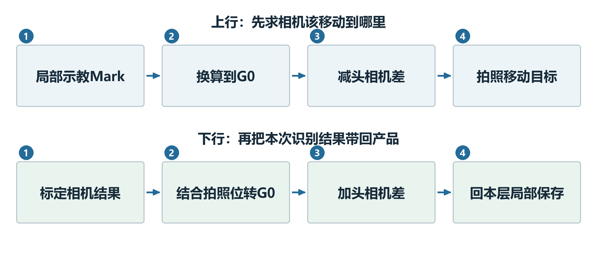

图9 上行去拍照 下行把识别结果带回产品坐标

软件逐点保存识别结果、局部点、G0点和拍照位置，然后计算更新位置与方向。正常坐标更新之后才置IsVisioned。S1使用自己的相机和参考转换，不能套用S2这一条偏移关系。

因此结果里已经看到P1，不表示所有点都采完；IsVisioned为true也可能来自关闭定位的提前分支。八个生产定位动作还没有把领域方法的bool直接作为最终Success条件。

**看采点、坐标更新和动作返回三个阶段，才知道本轮完成到哪里。**

# 10 多个Mark到底用哪几个来算位置

不是配置了几个点就把所有数一起平均。X只取UseX打开的点，Y只取UseY打开的点，各算各的平均。某轴没有启用点时，该轴结果为0。

图10 同一组Mark可以为X和Y提供不同的点

例给P1=(0,0)、P2=(2,1)、P3=(4,3)mm。X选P1/P3，均值2；Y选P2/P3，均值2，于是用于对齐的代表点是(2,2)。后面把这个代表点叫锚点。

角度默认取启用点识别角的普通算术均值，再换成弧度，不能自动跨越±180°处理。三点拟合圆只用前三点，精确共线时当前实现返回前两点中点。四点模式的P4角度是否参与，实际看第3点开关。

**先看各点的参与开关，再看点数。**

# 11 产品既偏了又歪了怎样一起修

先让示教Mark对应到本次识别Mark，再围绕这个目标调整方向。这样Mark能对上，其他焊点也跟着整层坐标走；只把XY差加上去，不能完整表达产品转角。

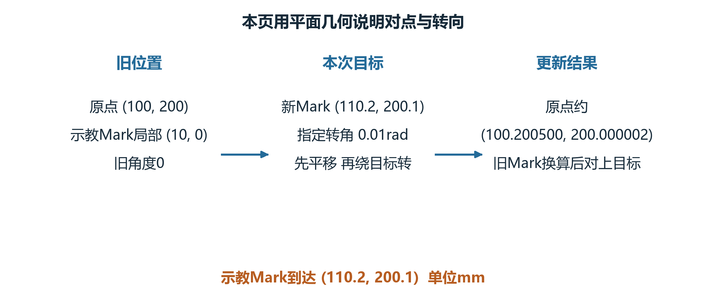

图11 先平移对点 再围绕目标调整方向

用一组独立说明输入：本层原点(100,200)，角0；示教锚点在本层(10,0)，识别锚点(10.2,0.1)，指定转角0.01rad。父参考在本例取G0。

按旧版保留的几何说明模型，新原点约(100.200500,200.000002)，角0.01rad；原来的局部Mark换算后到达(110.2,200.1)。启用两点定角时，当前代码先求两连线角差再取Atan，例如角差0.1rad得到0.09966865rad，不能省这一步。

**本页解释对点和转向的关系；坐标库内部执行仍由实际接口负责。**

# 12 Mark间距不对时重新拍会做什么

两点定位可以检查示教间距和实测间距相差多少。差值绝对值大于DistanceTolerance才报警，等于阈值允许。当前检查放在两点出口，不代表三点、四点也执行同一项。

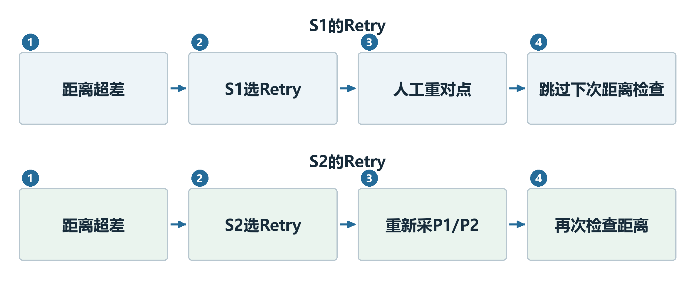

图12 S1和S2的重试会走不同路径

S1选Retry，会从P1重走人工报警对点，并跳过下一次距离检查；S2选Retry重新采P1/P2后还会再检查。两侧Abort都停止并返回false。选None都停用本层，但S1继续更新，S2直接返回true。

单点识别失败还能按配置周边搜索或人工确认。坐标更新异常前，部分识别结果和图像引用可能已经改变；外层动作Success、领域bool和坐标是否更新，也不能只看其中一个。

**同样叫Retry，实际从哪里重来，要按本侧入口读。**

# 13 上视相机到底拍几次

吸嘴取起芯片后，上视相机从下面看它。单点、双点说明看一个还是两个特征；快速、普通说明是否先转芯片再重新拍。正常几何采集次数由这两项组合决定。

图13 每个相机符号表示一次几何PR采集

快速单点拍1次，快速双点拍2次。普通单点先拍、转T、再拍，共2次；普通双点转前拍P1/P2，转后再拍P1/P2，共4次。二维码、温漂和重试附加拍照另算。

进入条件还要看精度开关、相机选择、离线和空跑。上视选择下视相机或关闭精度时可提前Success；空跑走独立模拟流程，不产生本颗芯片的真实识别结果。

**四次照片对应转前两点和转后两点，并非重复做同一件事。**

# 14 快速上视怎样记住芯片偏了多少

快速模式先测出芯片相对参考中心的偏移，保存起来，等贴装时再按剩余转角使用。芯片Mark不一定就在中心，还要扣掉从Mark到中心的示教向量。

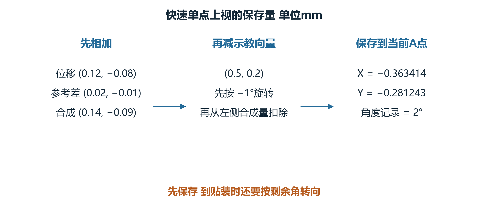

图14 先组合识别位移和参考差 再扣转过角的中心向量

沿用旧版说明输入：标定后位移(0.12,−0.08)mm，采集位置减玻璃参考为(0.02,−0.01)mm，中心示教向量(0.5,0.2)mm，识别2°、示教1°。该向量先按−1°旋转。

把前两项相加，再减旋转后的向量，保存偏移约(−0.363414,−0.281243)mm，角度记录2°。双点分别对采集位置、位移和识别角取均值再计算。偏移存在当前焊点Info，尚不是最终G0贴装位置。

**先存偏移，贴装时按还要转多少度继续处理。**

# 15 普通上视为什么转完还要拍

普通模式先识别角度，实际转动芯片，再拍新照片算位置。旋转可能改变芯片中心的观测位置，所以位置计算使用转后测量，不沿用转前照片。

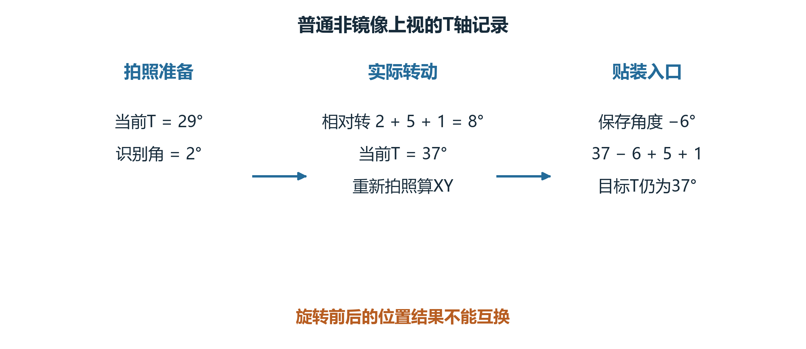

图15 用非镜像说明角度 跟着T轴走一遍

给拍照准备角29°、识别角2°、焊点全局角5°、硬角补偿1°。非镜像相对转2＋5＋1＝8°，当前T变37°。保存的角度偏移是−6°；贴装时37−6＋5＋1仍为37°，避免重复转。

转后XY按“采集位置减玻璃参考，加标定位移，减中心示教向量”计算。示例转后分别给(0.02,−0.01)、(0.12,−0.08)、(0.5,0.2)mm，得到(−0.36,−0.29)mm。

**普通模式位置来自转后照片，角度记录的含义也不同于快速模式。**

# 16 镜像产品为什么多转了一个大角度

普通生产上视的镜像分支，把相对转角写成识别角＋焊点全局角＋180°−硬角补偿。它和非镜像的相加方式不同，不能直接把普通例子的方向照抄。

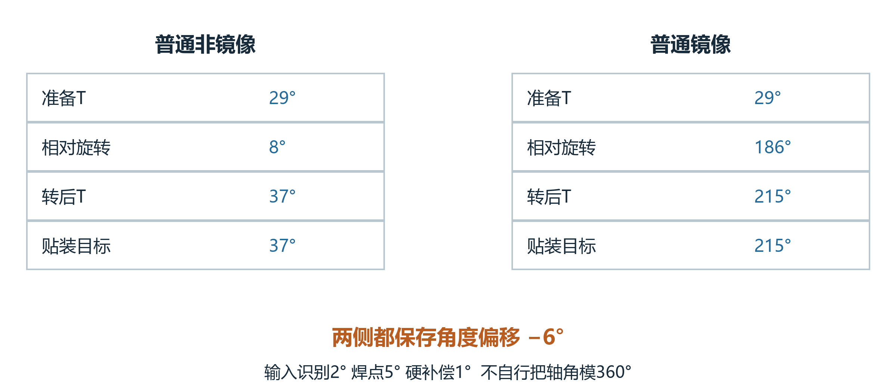

图16 同一组角度输入 镜像和非镜像分开算

仍给准备T=29°、识别2°、焊点5°、硬补偿1°。镜像相对转186°，当前T变215°；保存角度偏移仍为−6°，贴装目标为215−6＋5＋1＝215°。图中轴角不自行折回0到360°。

快速生产分支没有这条独立IsMirror角度项，不能把186°加进去。手动普通双点也有自己的实现差异。镜像标记来自当前运行焊点，修改配方后只Refresh不会重新复制它。

**核对镜像时，连同入口、示教方向和运行焊点标记一起看。**

# 17 保存的偏移怎样用到真正贴装位置

贴装先算目标T＝当前T＋角度记录＋焊点全局角＋硬角补偿。目标比当前还要转多少，保存的芯片偏移就按这个剩余角转多少，然后加到G0目标。

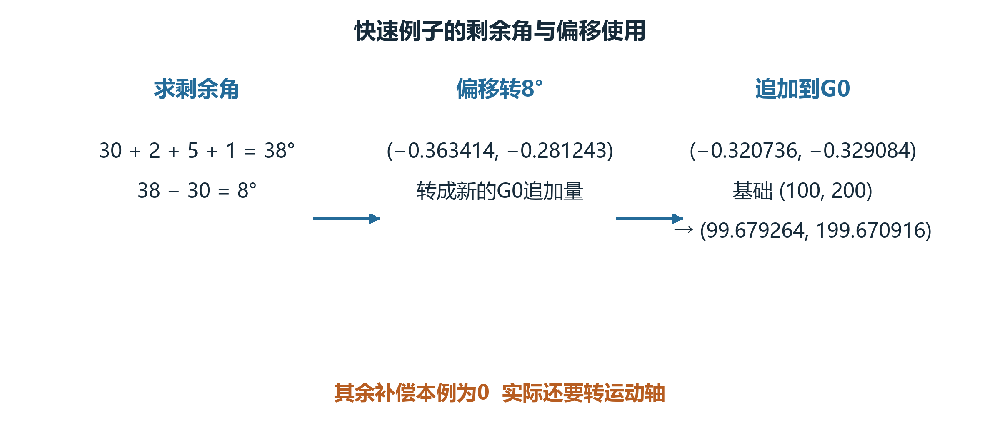

图17 快速模式保存的向量 还要随剩余8度旋转

用快速例：当前T=30°，角度记录2°，焊点全局5°，硬补偿1°，目标T=38°，剩余8°。保存偏移(−0.363414,−0.281243)mm转8°后，追加量约(−0.320736,−0.329084)mm。

若本例的基础G0目标给(100,200)mm，其他补偿都为0，则该项加入后约为(99.679264,199.670916)mm。实际目标还有后面讲的产品补偿及轴转换，不能只用这个简化例代表全部运动。

**芯片偏移带着测量时的方向，使用时要跟上后续转角。**

# 18 中转台纠偏先放下再重新取起

选择下视中转台方式时，吸嘴先把芯片放到台面，再移动相机观察它。识别后算出新中心，吸嘴对到修正位置，再重新取起。此处纠的是重取位置。

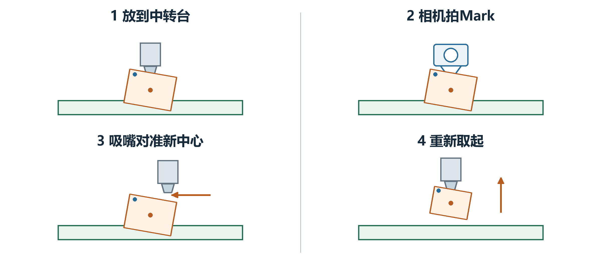

图18 按左上 右上 左下 右下看放片 拍照 对位 取片

台面上的芯片在拍照时保持不动。图中计算后移动的是吸嘴，没有把它画成台面自动旋转芯片。放片高度、偏心和芯片厚度按对应设备参数处理。

这条动作在精度关闭或选上视时可提前成功，空跑走另一条流程；当前没有与上视相同的离线提前成功分支。单点拍P1，双点拍P1/P2，后面才进入新的取片计算和检测。

**上视看吸嘴上芯片，中转台下视看台面上芯片。**

# 19 Mark不在芯片中心该怎么找中心

中转台先用示教记住“Mark到芯片中心”这段向量。本次识别出新Mark后，把向量按当前角度关系转过去，再接到新Mark位置，得到芯片中心。

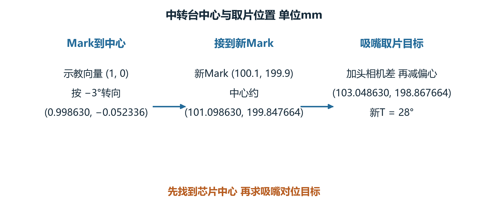

图19 先转一段已知向量 再把它接到本次识别Mark

给示教Mark=(100,200)、芯片中心=(101,200)mm，向量就是(1,0)。本次Mark=(100.1,199.9)mm，识别2°、示教下视角1°，向量按−3°转后约为(0.998630,−0.052336)。

相加得芯片中心约(101.098630,199.847664)mm。再给头相机差(2,−1)mm、新角下吸嘴偏心(0.05,−0.02)mm：加前者、减后者，取片G0约(103.048630,198.867664)mm。当前T=30°，新T=28°。

**算出芯片中心之后，还要换成吸嘴能对准它的取片位置。**

# 20 中转台字段有值为什么仍可能没取成功

IPTVisionPos记录拍照目标，IPTPickPos记录取片目标。代码在移动之前就可能写入它们，所以有目标值只说明算过或准备过，不能证明已经到位、拍完或取起。

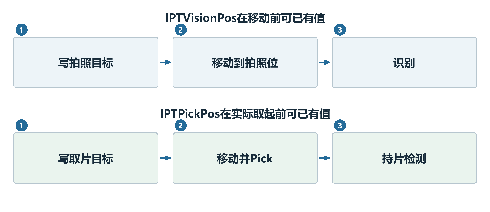

图20 目标写入在前 运动和持片检测还在后面

绝对运动的部分包装调用底层后没有接回非Success返回，外层仍可能读到初始Success；插补分支则返回实际轨迹结果。异常仍会向外传播，不能只靠包装成功当作到位证明。

正常取后检测的RePick标签位于Pick调用后。检测失败点Retry，只回检测位置，不再执行一次Pick。视觉失败Ignore的另一条Repick分支，则有取回、抛料、重置消息并返回Retry的动作。

**记录、动作返回和实物检测要一起看，重试按钮名字不能代替实际跳转位置。**

# 21 最终贴装前还有哪些补偿

可以把XY计算看成沿途逐项修正。先从产品焊点和局部硬补偿得到G0目标，加入焊后及单点补偿，再按相机分支处理芯片、工具等量，接着减TU区域补偿。

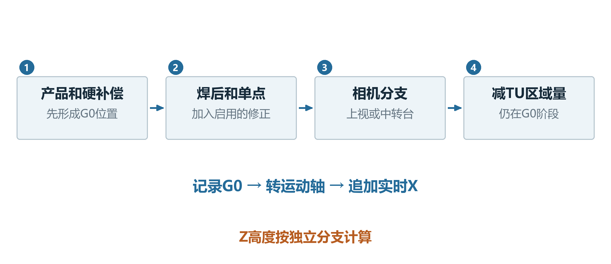

图21 上行处理G0 下行转换到运动轴并追加实时量

RealBondPoint3D记录的是转轴之前的G0中间位置。随后转换到运动轴，再追加实时补偿；所以这个记录不一定等于最终轴目标。

Z还有独立高度分支，合并基准高度、吸嘴测高差、芯片厚度、局部Z和压合距离等。不能只用XY的相加方式推断最终Z，也不能把记录里的XYZ与轴显示直接逐项比较。

**排查落点时，按计算先后找是哪一项把目标改变了。**

# 22 温漂补偿为什么不能统一理解

取片漂移修正预取片XY；上视漂移修正保存的芯片偏移。两者名字相近，但返回符号、触发和超限处理不同。关闭或记录为空时，两者本次读取都可返回0。

图22 同一说明漂移值 在两条读取路径中符号相反

给保存XY=(0.03,−0.02)mm，取片读取返回正值并加到预取片目标；上视读取返回负值(−0.03,0.02)并加入芯片偏移。XY任一绝对值超过0.2mm时，取片提示但仍返回，上视则抛异常。

识别失败可保留旧记录；上视包装还没有把底层false传播出去。生产取片调用带firstTu=true，足以按开关条件进入采集，不能简单理解成只按时间间隔触发。TU刷新也不统一清掉这些缓存。

**看本轮是否采集成功，再看实际读到了哪一次记录。**

# 23 焊后发现偏差怎样影响后面的点

焊后检测得到的统计偏差，可用于后续贴装补偿。未达到配置样本数时返回0；满足数量后，XY还分别筛选绝对值严格小于50的偏差，再除1000换成mm，并乘补偿比例。

图23 历史检测形成后续修正 已贴好的点不会被回改

例如有效X偏差为10、20、30，比例50%，均值20除1000再乘0.5，得到0.01mm。本例只说明换算。筛选后若没有有效值，Average仍会失败；原始样本数够不保证均值可用。

启用按上次产品自动补偿时，实时均值接口直接返回0，产品结束时另改常规硬补偿并可保存单点记录。当前均值返回的中间Z还取X均值，实际运动Z却由高度分支另算，不能混读。

**这些补偿改变后续目标，不会回头移动已经贴好的芯片。**

# 24 实时补偿为什么最后只加到轴X

中转台相关实时补偿按X在参考点之间插值。当前调用先传IPTVisionPos、再传IPTPickPos；被调方法的参数名顺序却相反，解释时必须保留真实传入顺序。

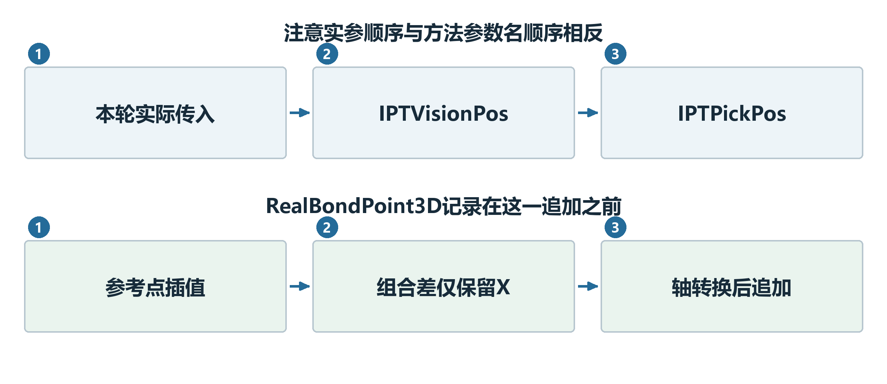

图24 参考位置插值后 只有X量在轴转换后追加

单点插值XY任一超过0.5mm会先抛异常；组合后的四点差超过0.5mm则返回0，正常结果也只保留X。最左侧索引等边界还可能抛异常，不能把表有数据理解成任何位置都可用。

参考扫描全部成功后才整体替换本轮补偿组，失败保留旧组。当前时间触发条件未启用，first参与扫描控制。它与TU区域二维表和驱动表分别存放，RealBondPoint3D又记录在这个轴X追加之前。

**确认是哪张表、哪次扫描、在哪个坐标阶段追加。**

# 25 设备轴补偿和TU区域补偿差在哪

设备轴二维补偿把标定表交给驱动，在运动执行层使用。TU区域补偿由应用程序按当前G0贴装位置查表，直接修改要发出的目标。它们是两套数据和两个生效位置。

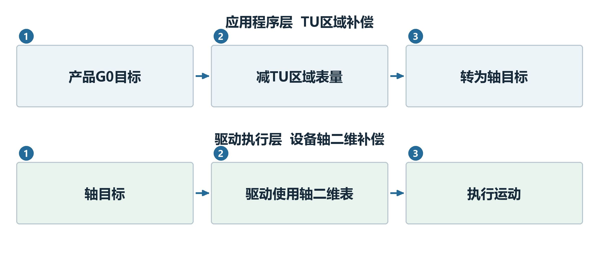

图25 上面应用改目标 下面驱动使用轴补偿表

TU区域查出(0.02,−0.01)mm时，程序从G0目标中减去它；例如(100,200)会变(99.98,200.01)。轴补偿的内部插值由驱动负责，这里不假设驱动采用同一算法或同一符号。

设备轴表还区分ETEL映射文件和固高脉冲表。当前固高间距先转整数再乘脉冲比；0.8先转整数会成0，不能按理想浮点换算解释。ETEL下载异常部分会提示后继续激活调用，需分别核对下载与生效。

**一项补偿开了，不代表另一项也已开启或适配。**

# 26 回零成功是否说明轴补偿已打开

整机回零确认后，先关闭补偿，再OneKeyHome；回零成功才调用开启补偿。若开关关闭，开启方法直接跳过，整机仍可返回回零成功。

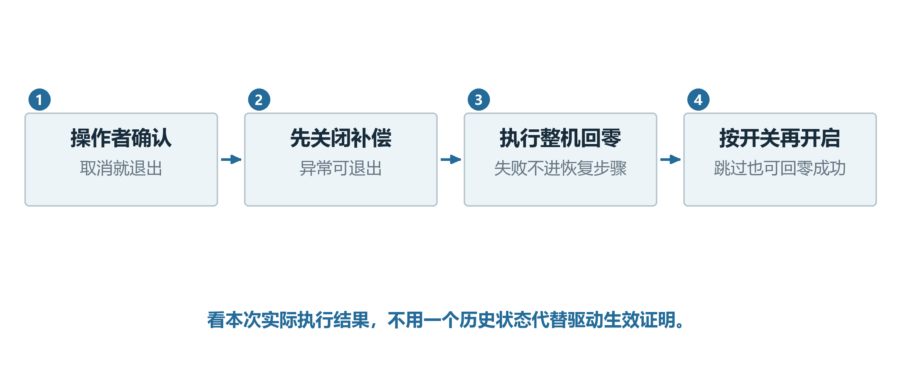

图26 回零成功 开启调用和驱动生效是不同判断

固高开启接口返回false时，当前包装弹提示但没有变成整机回零false；未被内部捕获的异常才走外层失败。ETEL下载的特定异常也可能只提示，后面继续执行激活。

失败出口没有统一恢复二维表，入口也没有统一清掉历史AllAxisReset。全局标定界面另有OpenStage、CloseStage，回零轴的顺序及开关处理不同，不能套整机回零结论。

**看本次实际执行结果，不用一个历史状态代替驱动生效证明。**

# 27 拉角度就是让相机找两个点

两点角度示教让操作员把相机移到左、右两个特征点并记录位置。窗口自己不自动跑PR。两个点都转换到传入坐标对象的上级参考系，再用连线斜率算角度。

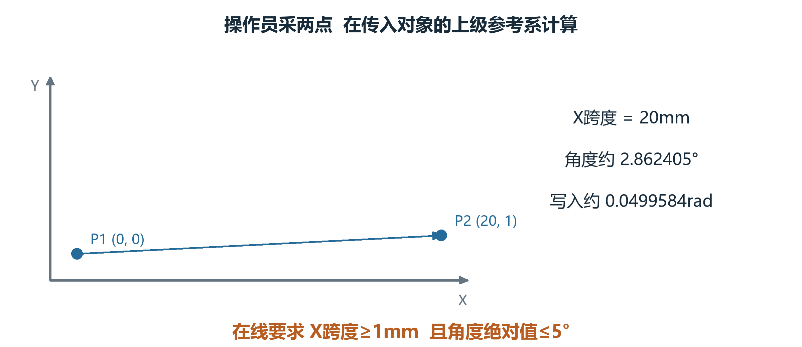

图27 先记左点 再记右点 看连线偏离水平多少

说明输入P1=(0,0)、P2=(20,1)mm，角度约2.862405°，写Degree时为0.0499584rad。在线要求X跨度至少1mm，角度绝对值不超过5°，等于边界允许。

X跨度不足或角度过大都重新从左点采。这里用Atan斜率，不是任意象限方向判定。离线完成可直接OK，不算新角也不写Degree；调用方仍可能使用RealDegree，不能把离线OK当成有效在线测角。

**这是示教输入，和每轮产品自动定位分开。**

# 28 拉角度后取消为什么仍可能改过数据

窗口通过时先修改传入坐标的Degree，再返回OK并Save。调用方随后还会把角度复制到目标运行对象或配置，所以一次示教包含前后多次写入。

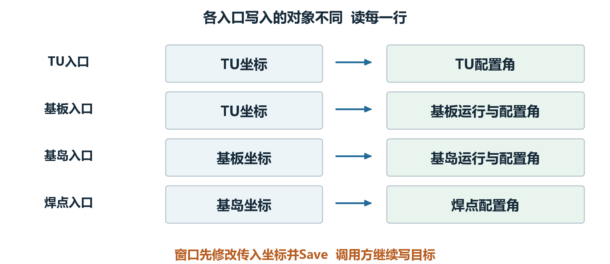

图28 窗口先改传入对象 调用方后写目标配置

TU入口传TU坐标；基板入口可能传TU坐标，再写基板角；基岛入口可能传基板坐标，再写基岛角；焊点入口传基岛坐标，打开窗口前还先把焊点配置角置0。

后续PR编辑取消，没有统一撤销前面已写的运行角或配置角。窗口Save又早于调用方后写字段，不能当成所有后写配置都已落盘。角度最终影响哪层，要按入口连起来读。

**取消结束的是后续步骤，前面发生的写入需单独判断。**

# 29 TU区域表怎样按位置给补偿

可以把加工区域想成一张方格地图，每个格点保存X、Y误差。当前贴装点落在四个格点之间时，按距离做双线性插值，得到这个位置的补偿，然后从G0目标相减。

图29 先沿X插值 再沿Y插值 图中单位mm

假设四角X补偿为0.01、0.03、0.02、0.04mm，Y全为0。正中心等权得到X=0.025mm；基础目标(100,200)本例会变成(99.975,200)。这只隔离区域补偿一项。

开关关闭或XY网格为空返回0；任一插值分量绝对值超过1mm抛异常。表还需要正确起点、非零间距、尺寸和覆盖区域，边缘索引处理不能代表任意区域都标定有效。

**数值和它对应的真实位置必须一起正确。**

# 30 自动生成补偿表先收集什么

自动采集窗口按产品配置的R行、C列，预期每轮R×C个统计点。它查询开始时间之后名为“贴片精度”的统计记录，按TU索引、基板索引和日期分组，再按ModuleIndex排序。

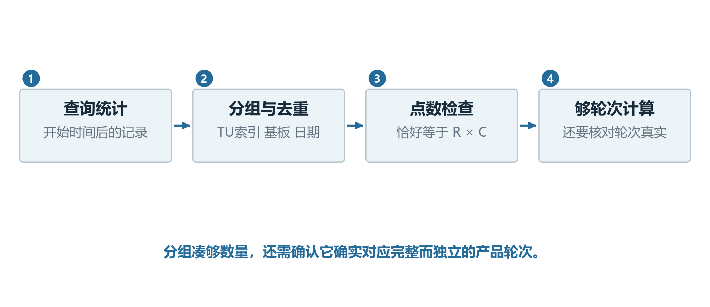

图30 完整一轮统计才进入有效轮次 再凑够目标轮数

组里恰好有预期点数才计有效轮，但没有另查ModuleIndex是否唯一。当前记录生成链把TU名写Id，TuIndex新建默认0；同日同基板索引的不同产品可能合并。查询名称也必须与检测项名匹配。

去重键先记录，后检查点数，首次看到未齐的一组，之后补齐也可能不再重判。达到目标有效轮数优先计算；废轮过多会停机。当前目录未找到别处直接打开该自动窗口的入口，不能把它写成每轮生产必经步骤。

**分组凑够数量，还需确认它确实对应完整而独立的产品轮次。**

# 31 多轮数据怎样变成一张区域表

每个位置收集多轮X和Y误差，先除1000换成mm。X和Y分开算：围绕中位数给偏得远的数较小权重，得到该位置的代表值，再按行列放回表里。

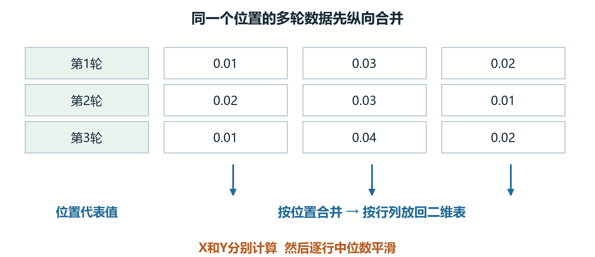

图31 每列位置收多轮 再还原为产品行列布局

这里的一次Huber权重不是自动删除异常轮，也不是反复拟合。零离散时直接取中位数，单值返回自身。代码还对每个位置的残差重复同一估计并乘0.85修正；精确算术下这个残差为0，不能解释成自动去除全局漂移。

随后每行默认做5列滑动中位数，边缘缩短，不跨行。一行说明数据[0,0.01,1,0.03,0.04]mm，平滑后为[0.01,0.02,0.03,0.035,0.04]mm。这个例子只看算法，不是可直接发布的设备参数。

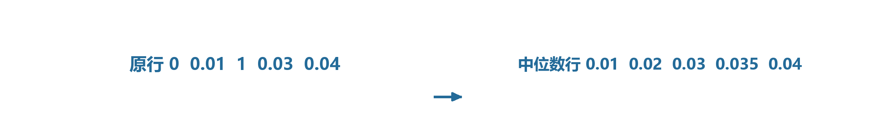

**行列顺序决定某个误差最后落在哪个物理位置。**

# 32 预览和启用之间还差什么

计算后若只到Calculated，新表仍在窗口缓存，生产继续可能使用旧表。人工启用或勾选自动启用，才把新XY矩阵赋给生产配置并Save，窗口显示Enabled。

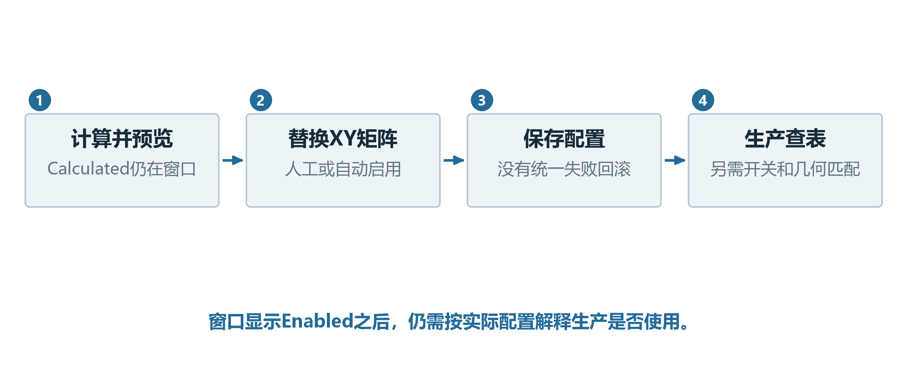

图32 新表算出来 新矩阵写入 生产实际查表要分开看

自动窗口只发布XY矩阵，不同步设置网格起点、行列间距、行列元数据，也不打开IsBondCompensate。生产要真正用上，还需开关开启、几何匹配、矩阵有效。保存异常也没有统一恢复旧数组。

开始新采集不清生产旧表，失败也不能当成旧表已消失。手动停止会停机；采集中直接关窗口只停查询定时器，关闭事件中的设备Stop被注释，不能当成相同操作。

**窗口显示Enabled之后，仍需按实际配置解释生产是否使用。**

# 33 人工导入和自动生成会算出一样的表吗

主界面“贴片补偿”可以打开人工导入窗口。导入统计列表后，用第一条位置作起点，配方行列距作间距，按列表顺序还原矩阵；这条路径不调用自动窗口的Huber计算器。

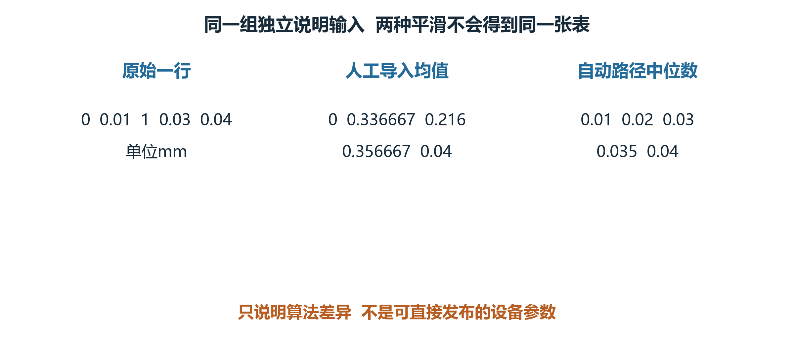

图33 同一行数据 人工均值和自动中位数得到不同结果

人工导入每行首尾不变，第二和倒数第二列取3点均值，中间取5点均值，读取原始行而非逐点递推。同一行[0,0.01,1,0.03,0.04]mm，输出约[0,0.336667,0.216,0.356667,0.04]mm。

人工编辑后保存会写回并Save；清空按钮只把内存XY设null，未在该事件Save。导入数量不符前，行列元数据已先写，旧矩阵没有统一回滚。列表也没有自动按ModuleIndex重排。

**两条生成路线算法不同，不能只看窗口都叫补偿。**

# 34 手动贴片测试为什么不能直接当生产结果

手动PlacementTest直接调用产品定位，bool为false就退出；它没有经过全部生产动作的筛选。启用纠偏只支持上视，使用自己的准备角和后续位置计算。

图34 同一个偏移值 在手动和生产中走不同计算路径

给焊点原点(100,200)mm、各层角0、偏移(0.1,−0.2)mm，其他补偿0，轴转换本例取恒等。手动先把偏移当局部点换算又追加一次，得到(100.2,199.6)；生产上视剩余角0则为(100.1,199.8)。

手动普通双点没有同样的镜像检查，手动Retry也不自动重跑整套测试。返回四维量的T、Info中的角度和生产目标T是不同量；手动Z又由自己的高度分支计算。

**说明测试结果时，先说清执行的是哪个入口。**

# 35 遇到纠偏问题先把这几件事连起来

先回到实物：芯片还在料盘、吸嘴上，还是中转台上？再看当前模式、这一轮拍照和返回结果，最后沿记录找到实际消费它的贴装计算。这样能区分算错、没走到和读到旧值。

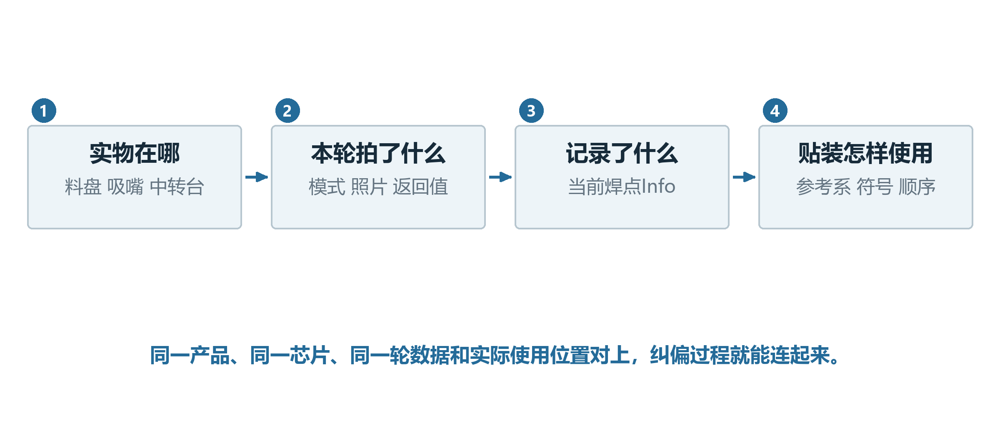

图35 实物阶段 照片结果 保存记录 最终使用连成一条线

人工OK可能绕过正常的结果后处理。正常后处理关闭X、Y时分别写1224、1024，角关闭写0，这是像素替代值，不能当物理偏移直接归零。Retry还会重置指定消息，Info旧值却可能留着。

相机标定、吸嘴标定、IPT示教为生产提供参数；力控、测高和温控作用在各自通道。它们没有统一合成一种XY纠偏。源码入口、八种定位筛选和其他细节放在配套索引，需要时再查。

**同一产品、同一芯片、同一轮数据和实际使用位置对上，纠偏过程就能连起来。**
