# Transport Unit设计文档

ZX2200 产品运行模型  版本2.0  2026年10月20日

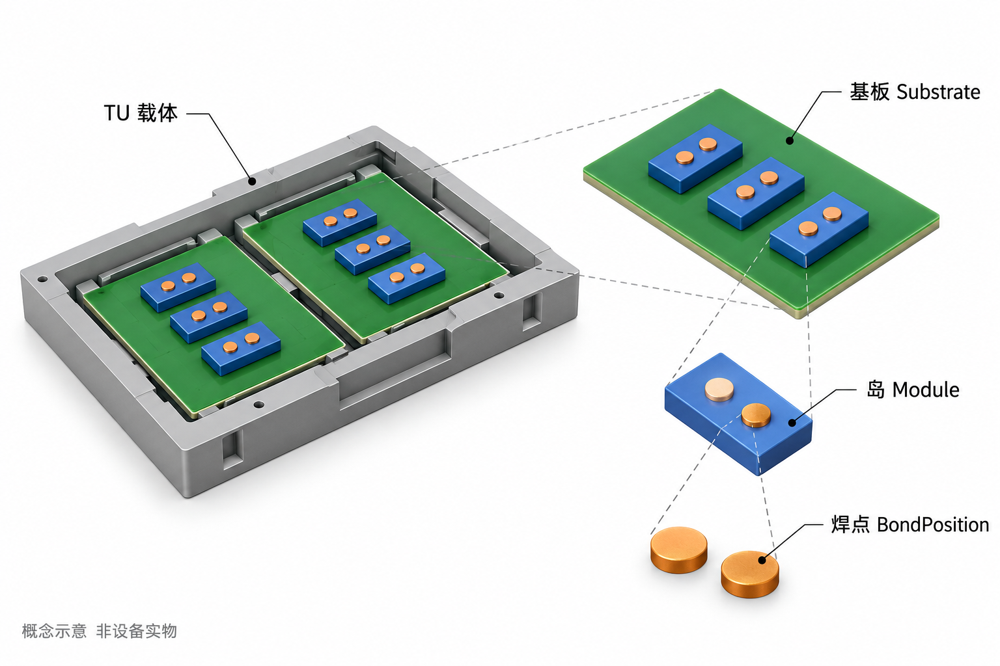

Transport Unit把一份产品的结构、位置与加工记录组织在一起。本文从产品对象出发，解释其构建、坐标、状态与工位交接设计，并给出可追溯的源码依据。

## 1 设计概述

Transport Unit（简称 TU）是 ZX2200 中一份产品的运行模型。它把载具上的基板、基岛和焊点组织为一棵对象树，并为各层保存当前坐标、定位与测高信息、工艺参与范围和加工进度。业务模块通过这棵树找到“这份产品的这个位置”，再决定执行什么动作。

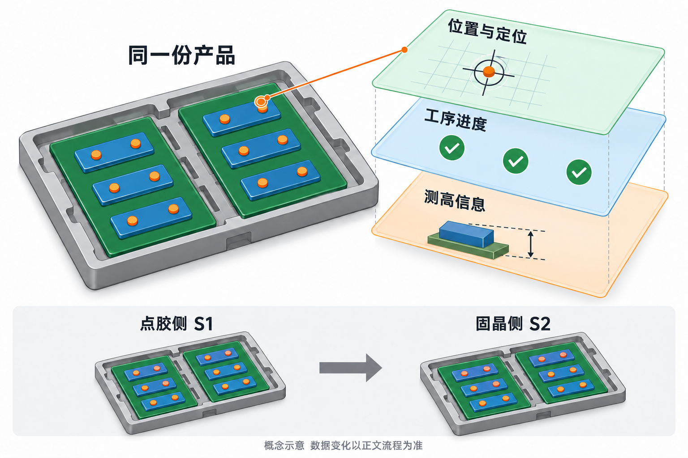
图2 一份产品对应多种运行数据，图中记录仅用于说明数据类别

### 1.1 设计目标与阅读对象

这份设计面向需要评审、维护或调试产品模型的人员。它解释三个关键问题：配方怎样变成可加工的对象；一个焊点的位置和进度怎样随加工更新；交接、刷新或重新创建时，哪些信息继续使用，哪些信息需要重新建立。

### 1.2 职责与范围

TU负责表达产品，不自行驱动皮带、相机或焊头。输送模块管理区段与交接，动作控制器编排工作，加工动作读写焊点。本文展开 TU 的对象、数据、坐标、生命周期和接口设计；纠偏算法另篇说明。后文用“2块基板、每块3个岛、每岛2个焊点”的说明性产品贯穿讲解。

源码依据 S01 S02 S13 S14 S15 S16 S17 S22

## 2 模块组成与职责划分

### 2.1 从配方到加工动作

产品配方是结构与工艺的来源，TU是本次加工的承载对象。两者之间由构建逻辑和 TuService 连接：构建逻辑展开产品层级，TuService建立坐标、换算工作顺序并应用工艺状态。动作控制器再按焊点名称，把配方中的工序加入焊点的步骤字典。

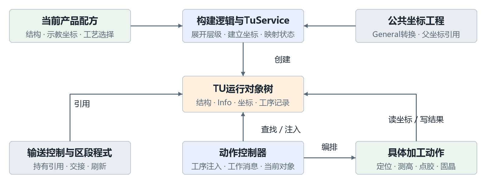
图3 产品模型周边的数据来源与使用方向

运行时，载台程式持有当前 TU 的引用。点胶侧 S1、固晶侧 S2 的动作控制器通过当前工作消息找到基板、岛和焊点，具体动作读取其坐标并写回结果。公共坐标工程完成父子坐标转换；它提供几何计算能力，不承担产品工序管理。

### 2.2 分层带来的设计效果

结构、几何和工艺进度可以分别变化。例如，同一个焊点仍然是原对象，但刷新后换用了新的坐标对象；完成过的工序可以继续保留，而当前定位标记需要重新建立。理解这种分离，是判断“刷新是否会清空生产记录”的基础。

源码依据 S01 S02 S10 S13 S14 S15 S16 S19 S20

## 2.3 数据归属与模块协作约定

模块协作围绕同一组运行对象进行。配置规定产品应该是什么样，运行对象记录这一份产品已经发生了什么，动作控制器决定接下来执行什么。TU内部没有把这些操作封装为一个统一事务，调用顺序直接影响结果。

| 模块 | 持有或产生的数据 | 主要职责 |
| --- | --- | --- |
| 产品配置 | 数量、坐标表、焊点名称、工艺状态配置 | 提供常规模板或异形树 |
| TU对象树 | 各层实例、坐标、BaseInfo、焊点步骤 | 提供层级访问与运行数据 |
| 载台程式与输送控制 | 当前TU引用、区段有料与传输状态 | 检测物料、交接引用、刷新坐标 |
| S1与S2动作控制器 | 工序定义、工作消息、当前动作 | 注入步骤、编排和选择动作 |
| 具体加工动作 | 定位、测高、点胶或固晶结果 | 执行条件判断并写回对应结果 |

### 协作顺序

创建 TU 之前，当前配方、机器坐标和两侧工序定义应已经可用。构建完成后再交给载台和任务使用；加工过程中修改对象信息，交接时先完成本路径要求的机械到位与等待，再转交软件引用。这里的顺序来自被调用路径，TU类本身不提供“全局忙闲锁”。

### 配置变化的影响

常规对象的 Config 每次按当前配方和对象类型读取；焊点还按名称匹配。它不是创建时冻结的配置副本。数量、名称或常规／异形模式发生改变后，不能仅凭旧对象仍存在就继续加工。结构变更对应重新构建；只有几何参数变化且结构一致时，才能沿现有树刷新坐标。

源码依据 S02 S09 S10 S13 S14 S16 S17

## 3 对象模型与数据设计

### 3.1 用对象树表达产品层级

一份 TU 直接包含基板集合，每块基板包含自己的岛集合，每个岛包含焊点集合。图4展开了贯穿本文的示例。两处都叫“A”的焊点可以存在于不同岛中；识别具体焊点需要同时明确基板、岛和焊点名称，不能只用名称定位整份产品。

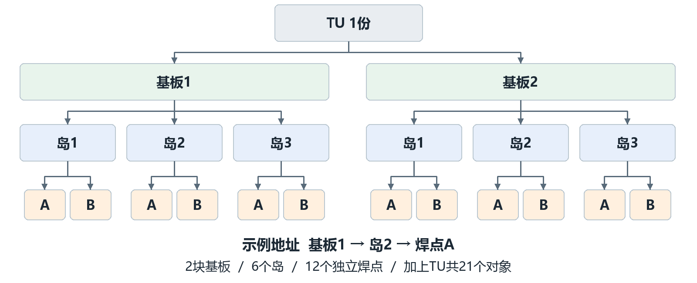
图4 示例对象树与基板1 岛2 焊点A的访问路径

示例共有1个TU、2块基板、6个岛和12个焊点，共21个对象。GetAllBaseMatter遍历TU的全部后代，返回20个对象，不包含根TU。ClearVision与ClearMeasureHeight先处理根，再遍历后代，因此可以覆盖整棵树。

### 公共能力与层级差异

四类对象继承 BaseMatter，统一具有名称、序号、类型、Config、BaseInfo、CoordinateSystem和状态。基板与岛负责组织下层并汇总完成情况；焊点是工序完成标记的最小记录单位。基板和岛的工艺参与范围由下层汇总，不能把它们看成与焊点完全相同的独立状态字段。

工艺范围的汇总按下层实际参与情况计算：任一下层为Enable，或同时存在仅S1和仅S2参与的下层，上层就为Enable；只有单侧参与对象时汇总为对应单侧；全部停用或集合为空时为Disable。汇总表示上层需要覆盖哪些工艺，并不表示下层已经加工完成。

源码依据 S01 S02 S03 S04 S05

## 3.2 常规模板与异形树的配置映射

常规产品按一套基板模板重复创建，再在每块基板内重复使用岛模板，最后按焊点配置列表建立各岛的焊点。这种方式用较少配置表达规则阵列。每次创建仍会产生独立的运行对象和 BaseInfo，重复使用配置不等于共用加工记录。

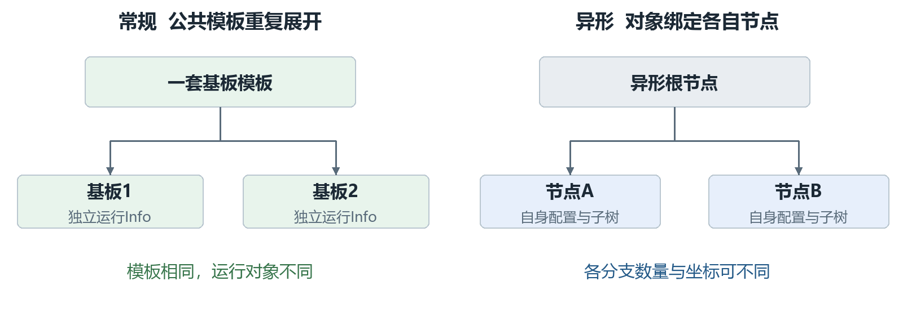
图5 模板复用与异形节点绑定的区别

异形产品沿 OppositeSex.DownConfigs 逐层展开。各节点有自己的名称、坐标和配置，运行对象保留与节点的关联。因此不同基板可以有不同数量或布局的岛，不能用全局常规数量推断每个分支的实际长度。异形构造中，基板和岛的工作序号初始等于其节点序号。

### 配置读取规则与一致性

BaseMatter.Config首先检查当前配方的异形开关。异形模式返回对象关联节点的Config；常规模式按对象类型返回当前产品配置，焊点则在配置列表中按Name查找。这个选择发生在读取时。因此，把一个旧TU留在内存中再切换配置模式，会改变后续配置读取的解释方式；正确使用依赖“对象树与当前配方匹配”的前提。

源码依据 S01 S02 S03 S04 S05 S09

## 3.3 运行信息与字段使用规则

BaseInfo保存本次加工数据。定位结果、测高结果和完成标记相互关联，但含义不同：数值表示曾经得到的结果，标记表示当前流程是否按相应逻辑认为已处理。定位关闭时也会设置IsVisioned，所以它不能解释为“已经真实拍照且成功”。

| 数据组 | 创建与更新来源 | 读取时应理解的含义 |
| --- | --- | --- |
| 公共定位信息 | 构造创建LocateResultInfo；定位流程写入各点结果 | 结果供位姿更新使用；是否重做还受动作条件控制 |
| 公共测高信息 | 测高流程写MeasureHeightResult，并修正当前坐标Z | 记录测得高度相对示教高度的差值 |
| 完成标记 | IsVisioned与IsMeasureHeight；Refresh清为false | 标记复位不等于旧结果数值归零 |
| TU专属信息 | IsProduct、工位偏移标记、预点胶标记等 | 构造初值与后续任务赋值共同决定含义 |
| 焊点工序信息 | S1RemainingSteps与S2RemainingSteps | 工序名为键；false未完成，true已完成 |
| 焊点过程信息 | 芯片角度／偏移、实际位置、取片位置、力值等 | 对应具体加工动作的过程量，不是所有动作都同时有效 |

### 结果数值的生命周期

两侧测高流程都会计算实测平均高度与示教平均高度之差，将差值写入MeasureHeightResult，并累加到该层坐标Distance.Z，再设置完成标记。Refresh重建坐标并清标记，但保留BaseInfo对象。后续代码不能仅见数值非零就认为它属于刷新后的坐标；是否继续使用应遵循具体动作的前置条件。

TU信息中的RecipeName、批次等字段虽然已声明，两个有参构造并不逐项填充它们。设计中应把字段的存在与业务已经写入该字段区分开。

源码依据 S06 S07 S08 S29 S30

## 3.4 对象序号与工作顺序

Index用于表达对象序号；常规构造以1开始，用Index减1读取坐标表。WorkIndex是由阵列行列、排列方式和加工方向计算出的工作序号。两者可能相等，也可能不同。S1当前对象查询按WorkIndex匹配工作消息，S2同样存在按工作序号查找或排序的路径。

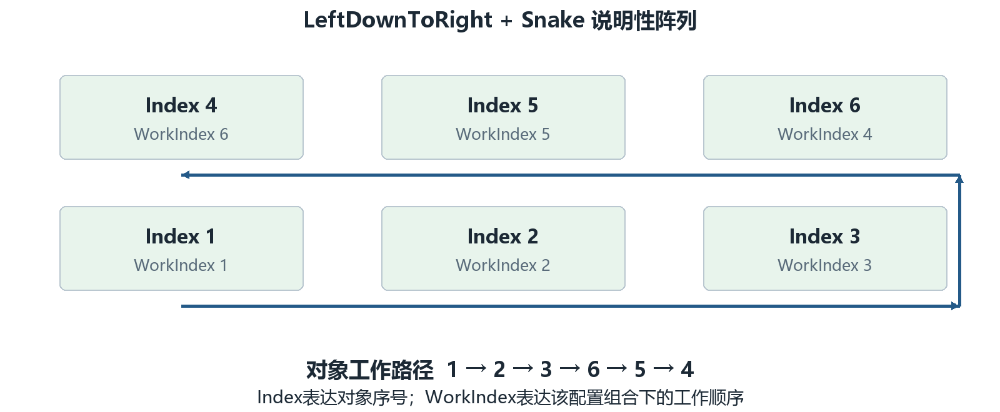
图6 两行三列阵列的序号与蛇形工作顺序示例

图6采用GetIndex的LeftDownToRight与Snake组合。对象1、2、3的工作序号仍为1、2、3；对象4、5、6变为6、5、4，因此实际工作路径为1→2→3→6→5→4。这个例子只解释该组合，不能由“Snake”名称推断所有方向组合的结果。

### 地址 位置与顺序分别维护

基板／岛的Index、行列索引和WorkIndex共同服务于显示、位置组织和加工编排；它们并非同一概念。Refresh沿当前集合重新赋Index，并在常规分支重新计算WorkIndex，但不会完整重建所有行列信息。S2的大数量路径还会按WorkIndex原地排序集合。因此，调用者不应把列表下标当作永远稳定的产品身份。

维护或排查时应记录完整地址，例如“基板Index 1／岛Index 2／焊点A”，并另列当前WorkIndex。仅凭界面上的第几项去对应代码中的第几个元素，容易把身份和执行顺序混在一起。

源码依据 S01 S03 S04 S10 S13 S14

## 4 坐标体系设计

### 4.1 用父子关系表达局部位置

每层产品对象持有GeneralCoordinateSystem。Distance表示相对于直接父坐标的平移，Degree表示绕Z的平面角度，坐标计算使用弧度。焊点位置先相对岛描述，岛相对基板，基板相对TU；TU再连接到机器配置中名为TransportCoordinateSystem的坐标。

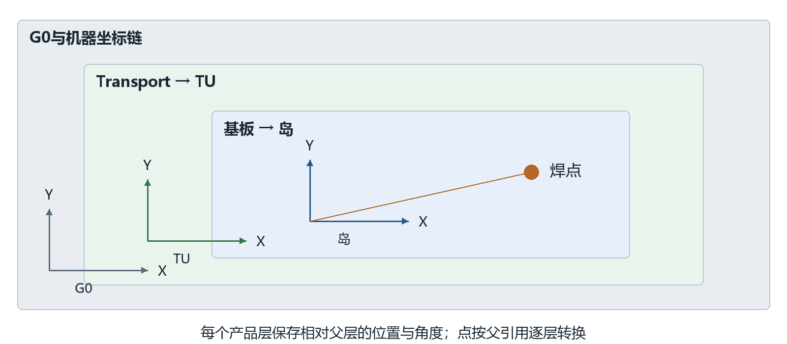
图7 局部坐标逐层连接到全局参考的空间示意

产品坐标没有在每个节点重复保存一套独立的全局位置。SelfPosToG0沿父引用逐层转换；父层位姿更新后，后代再次转换就会得到新的全局位置。设计上，这使载具整体平移、基板局部偏移与焊点局部位置能够在不同层表达。

### 坐标和对象是两种引用

TuService.CreateMatterCoordinate会新建坐标对象并绑定父引用，再复制配置中的点和角度。Refresh沿树替换这些坐标对象。外部若长期缓存旧CoordinateSystem，即使仍持有同一个焊点对象，也可能使用过期坐标；需要从当前对象重新取得坐标。

G0是公共转换链的全局参考。产品点转到G0之后，具体加工控制器仍可能叠加工艺补偿并转换到机器轴，不能把G0点直接等同于最终运动命令。

源码依据 S01 S10 S19 S20 S28

## 4.2 坐标转换与可复算示例

普通General坐标的一次正向转换，先把局部点在XY平面旋转，再叠加本层平移；Z只叠加平移。下面的x、y、z是局部输入，dx、dy、dz是该层Distance，θ是该层Degree。

父层X = dx + x × cosθ − y × sinθ
父层Y = dy + x × sinθ + y × cosθ
父层Z = dz + z

SelfPosToG0把同一转换按坐标链依次执行；G0PosToSelf按相反方向执行逆变换。DegreeInG0累加链上的角度。若机器坐标链出现Vm类型，转换使用标定工具，下面的纯平移旋转算例不覆盖该分支。

| 层级 | 相对父层的平移与角度 | 算例说明 |
| --- | --- | --- |
| 全局与Transport | 都设为零平移、零角度 | 为便于复算而指定的条件 |
| TU | (100, 200, 0)，π/2 rad | TU局部X转到全局正Y |
| 基板1 | (20, 0, 0)，0 rad | 相对TU |
| 岛2 | (10, 5, 0)，0 rad | 相对基板 |
| 焊点A | (10, 5, 0)，0 rad | 取焊点局部原点作为目标 |

### 先合成局部位置 再应用TU位姿

基板、岛与焊点的局部平移合计为(40, 10, 0)。TU旋转90°后得到(−10, 40, 0)，叠加TU平移后，焊点全局位置为(90, 240, 0)。逆算时先减去(100, 200, 0)，再逆转90°，得到(40, 10, 0)，随后逐层减去局部平移即可回到焊点原点。

算例所有长度统一按mm表达，数值为说明性设定，不是设备配方。若示例S1偏移为(2, −1, 0)，且尚未应用，则TU平移变为(102, 199, 0)，焊点全局位置变为(92, 239, 0)。

源码依据 S19 S20 S24 S01

## 4.3 工位偏移与分段平移

S1与S2偏移直接加在TU的Distance上，影响整棵后代坐标的转换结果。每套偏移有自己的布尔标记：标记为false时累加并置true，为true时同一方法返回。两个标记彼此独立，因此这种保护只避免同一套偏移重复累加，并不阻止两套偏移连续相加。

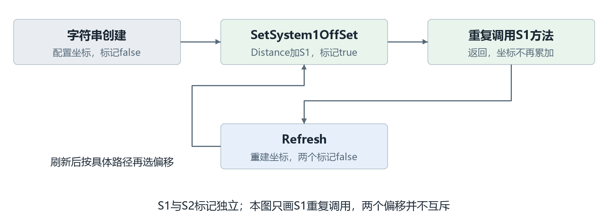
图8 创建 刷新与偏移标记之间的关系

### 不同入口产生不同几何状态

字符串构造只初始化产品坐标，不自动加工位偏移；带系统参数的构造在Init之后选择S1或S2偏移。Refresh从配置重建坐标，并把两套标记都清为false，本方法不重新应用偏移。定位扫描和点胶应用示教存在显式SetSystem偏移调用；不能仅凭“已经进入某工位”就认定该路径自动加过偏移。

### 分段处理是另一项平移

System1MoveDistance仅在SubstrateProcessing为Divide时给TU的Distance.X加DistanceToRight，BackMove方法做减法，没有重复调用保护。定位扫描可根据载具处于点胶前后段选择平移，点胶轨道搜索的特定人工确认分支也可能回移。DivideWithInverted虽然在枚举中存在，这两个方法的条件仅匹配Divide，不能把两者合并描述。

源码依据 S01 S26 S27 S31 S11

## 5 对象构建与初始化设计

### 5.1 构建顺序与输出

有参构造先创建TransportUnitInfo，再执行Init，完成后生成到毫秒的时间名称。Init依次建立TU坐标、创建下层对象、应用工艺参与状态，再注入S2和S1工序。带工位参数的构造最后应用对应偏移；注入的先后顺序不代表设备先做S2再做S1。

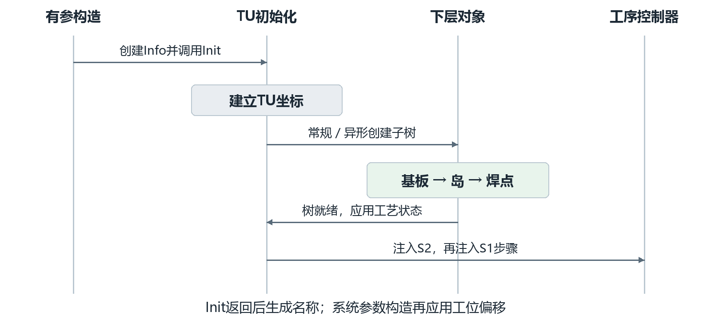
图9 有参构造从配置建立运行对象的调用顺序

正常完成后，调用方得到一棵有层级集合、运行信息与父子坐标引用的树；匹配工序的焊点具有初始为false的步骤键。无参构造供反序列化使用，不执行这一初始化链，不能把它当作普通生产创建入口。

### 构建前提

配方类型、数量、坐标表、焊点名称及工序定义需要相互一致，TransportCoordinateSystem应能取得。IsTransportUnitReady只检查TU示教结果标记，不能代替完整配置检查。名称在Init之后生成，属于运行标识；当前构造没有数据库式唯一性校验，也没有在构造结束前重新同步所有从属名称字段。

源码依据 S01 S03 S04 S05 S09 S10 S13 S14

## 5.2 常规与异形的展开规则

### 常规产品

常规创建按当前数量循环生成基板和岛，再按焊点配置列表创建每个岛的焊点。每个基板／岛从配置坐标表的index−1位置取得初始坐标；焊点按名称取得单点配置。矩阵模式还建立行列索引，工作序号由GetIndex计算。

创建过程带有配置整理行为：非多件模式会把数量和行列改为1并重建默认坐标；空坐标表会补默认点；启用输入间距时，按首点、行列和间距生成坐标表，保留首点Z，新建点的角度为0。因此它既建立运行对象，也可能改变内存中的配置集合，不能当作无副作用的查询。

### 异形产品

异形分支沿DownConfigs实际存在的节点递归创建：根的下层是基板，基板的下层是岛，岛的下层是焊点。每层绑定自己的节点、名称与坐标，不要求与全局常规Count一致。节点缺失或层级不正确会影响后续访问，运行树本身不会补全为规则矩阵。

| 检查项 | 常规模式 | 异形模式 |
| --- | --- | --- |
| 结构来源 | 全局基板／岛数量与焊点列表 | 各节点的DownConfigs |
| 几何来源 | 公共坐标表或单点配置 | 节点的ElementCoordinate |
| 运行信息 | 每个实例新建自己的Info | 每个实例新建自己的Info |
| 结构改变后 | 重新构建整棵运行树 | 重新构建并重新绑定节点 |

对贯穿示例，常规配置给出2块基板、每块3个岛和A／B两个焊点，最终展开12个焊点。即使A在6个岛中重复出现，它们的定位结果和步骤字典仍是6份独立数据。

源码依据 S01 S03 S04 S05 S10

## 5.3 工艺状态与步骤的装配

对象树完成后，TuService.ModifyMatter把工艺参与配置应用到焊点。异形模式取各焊点节点的状态；常规大数量模式按基板、岛索引访问二维结构并按焊点名匹配；普通模式查找“基板序号＋岛序号＋焊点名”的单独记录。基板与岛的汇总状态由下层决定。

### 把工序名装配到每一个匹配焊点

S1与S2的InjectSteps分别遍历树和本侧工序表，以BondPositionName匹配焊点Name，再用ProcessStepName作为字典键。若键不存在就添加false，存在则保留原值。由此，同名A焊点在不同岛上得到相同的工序键，但它们是否完成彼此独立。

| 操作 | A焊点原有字典 | 执行后的字典 |
| --- | --- | --- |
| 首次注入点胶工序D | 空 | D=false |
| 点胶动作完成写回 | D=false | D=true |
| 再次注入同一工序D | D=true | D=true |
| 配方新增工序E后再注入 | D=true | D=true，E=false |
| 配方删除D后再注入 | D=true，E=false | 旧D仍保留，不自动删除 |

### 初始化失败并非全部原子回退

ModifyMatter内部异常会清理工艺状态配置并调用产品配置保存，但不会重新把整棵运行树映射一遍，也不保证撤销已经写入的部分状态。其他构建环节如坐标表索引或节点访问失败，异常可直接中断创建。调用方不能把“没有收到工艺映射异常”理解为全部映射已经正确完成。

需要重新装配全新结构和初始步骤时，应使用有参重新构建入口；Refresh不会注入步骤，也不会移除旧工序键。

源码依据 S01 S10 S21 S13 S14

## 6 生命周期与状态设计

### 6.1 产品在软件中怎样流转

正常流转由区段持有TU开始，经过本侧加工，再在传料路径中转交引用。软件上的交接与机械传输相关联，但不是TU类内部的一次“移动”。图10展示被核对路径的主要变化，其中固晶开始前还存在条件性重新创建分支。

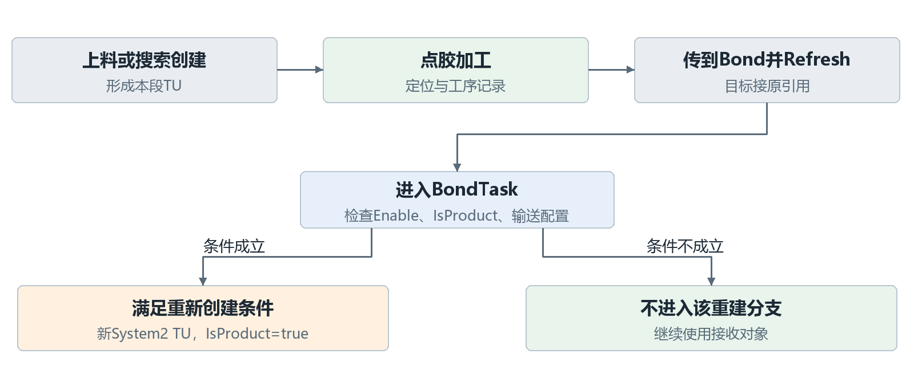
图10 产品流转中的保留路径与重新创建路径

上料来源不同，TU创建入口也不同。例如自动上料路径创建带System2参数的TU，部分上料皮带路径使用字符串构造。上料到点胶、点胶到固晶等正常交接会在目标持有引用后调用Refresh。因此初始构造加过偏移，并不意味着经过交接后仍保留该偏移。

### 谁持有当前产品

Loading、Dispense、Bond、WaitingUnload和Unloading五个区段各有TU引用。一次成功交接通常把源引用赋给目标，再清源引用并更新有料状态。TU实例身份与区段身份分别存在；源清为null后，对象并不会因这一赋值立即丢失，只要目标仍引用它就继续存在。

源码依据 S15 S16 S17 S22

## 6.2 点胶到固晶的交接时序

以TransportController中点胶传入Bond载台的实现为例：传料、夹紧等任务完成等待后，目标接收点胶段的TU引用，再执行Refresh，然后清除点胶段引用，修改两段状态并保存程式。下图只展开TU相关部分，机械动作的全部报警与重试不在本节展开。

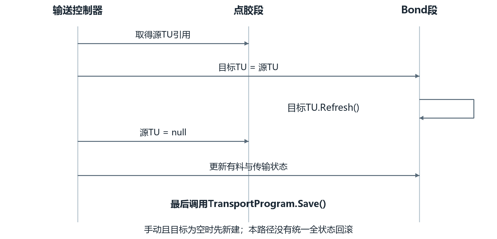
图11 点胶段向固晶段传递TU的实际调用顺序

### 手动与异常分支

目标接到的引用为空且isManual为true时，代码会先创建System2 TU，再调用Refresh；自动分支没有这个空值补建条件。Refresh之前两段可短暂持有同一个对象。若此时抛异常，当前路径没有一个统一事务把引用、坐标和区段状态全部恢复，所以交接不能视为不可分割操作。

### 后续区段的差异

Bond到等待下料段也接过引用，但使用空条件调用Refresh；等待段到下料段则直接调用Refresh，并在异常分支恢复部分源区段状态。实现存在路径差异，设计和排查时应按具体传料方法判断，不能用一个抽象流程替代全部分支。

源码依据 S17 S01 S16

## 6.3 刷新与重新创建的数据差异

Refresh的作用是让现有对象重新采用当前配置中的几何关系，并清除定位、测高及工位偏移的完成标记。它不是重新生产一份产品，也不是把所有运行信息清零。下表区分两种入口，便于判断哪些历史记录仍然存在。

| 数据或引用 | Refresh现有TU | 有参构造新TU |
| --- | --- | --- |
| TU与下层实例 | 保留，沿现有集合递归 | 创建新的对象树 |
| 集合数量与焊点名称 | 不按新配置增删或改名 | 按当前配置重新展开 |
| CoordinateSystem | 各层新建并重连父引用 | 各层新建 |
| 定位与测高完成标记 | 全部置false | 按Info初始值创建 |
| 已有定位／测高数值 | BaseInfo中旧数值保留 | 使用新Info的初始值 |
| S1与S2工序字典 | 保留原键和值 | 重新注入，匹配键初值false |
| 工艺参与状态／EntityState | Refresh不重新映射或重置 | 按初值和配置映射建立 |
| TU名称／IsProduct | 保持现值 | 新时间名称；IsProduct初值false |
| 工位偏移 | 重建坐标，两个标记置false | 仅系统参数构造自动加所选偏移 |

### 使用场景

位置示教改变、保持相同产品结构或同一对象进入另一段时，可看到Refresh路径。基板数、岛数、焊点名或异形结构变化，需要重新构建；BaseSubSectionProgram.UpdateTransportUnit直接创建字符串TU，正是这样的入口。已有步骤是否保留，应先确认最终走的是哪一种操作。

Refresh没有按历史加工记录重放坐标修正。刷新后的新坐标来自配置，之前定位和测高对旧坐标做过的更新不会自动迁移过去；保留的结果数值不能替代新的坐标状态。

源码依据 S01 S03 S04 S05 S06 S07 S08 S16

## 6.4 工艺参与 状态与完成判断

状态包含多个维度：区段有料表示设备记忆中是否有产品；EntityState表示对象处理状态；MatterProductState表示是否参加S1／S2工艺；定位／测高标记表示相应流程是否已处理；工序字典记录具体工序完成情况。它们没有被一个总状态字段替代。

| 焊点工艺状态 | S1是否参与 | S2是否参与 |
| --- | --- | --- |
| Enable | 是 | 是 |
| EnableInSystem1 | 是 | 否 |
| EnableInSystem2 | 否 | 是 |
| Disable | 否 | 否 |

### 完成状态自下而上汇总

对本侧不参与或被停用的焊点，本侧完成属性可直接为true；参与时再检查步骤字典。岛要求所有焊点完成，基板要求所有岛完成，TU要求所有基板完成。空集合循环也会返回true，因此“TU完成”并不单独证明产品结构完整。

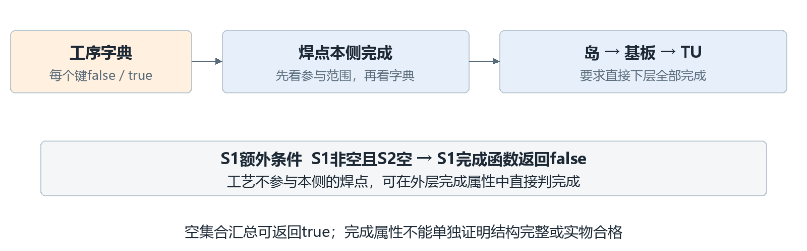
图12 工序完成标记与各层完成属性的汇总关系

当前实现中，S2空字典判完成；S1空字典也判完成，但S1非空、S2空时，S1完成函数直接返回false，即使S1所有值为true。这个额外条件必须保留在设计说明中，不能改写为“两侧都是全部true即完成”。

EntityState与工序完成也需分别看待。例如BondActionNode只对EntityState为Process且工艺参与、工序未完成的焊点执行；TU完成汇总本身主要沿焊点完成属性计算，不能替代动作是否允许执行的判断。

源码依据 S01 S03 S04 S05 S08 S28

## 6.5 加工进度与动作消息的两层记录

焊点步骤字典记录“这个焊点的这个工序是否完成”，动作控制器的WorkMessages记录“本次编排中的这个动作消息是否结束”。一次工序可能涉及定位、取片、纠偏、贴片等多个动作；单个消息Finished=true不等于所有工序完成。

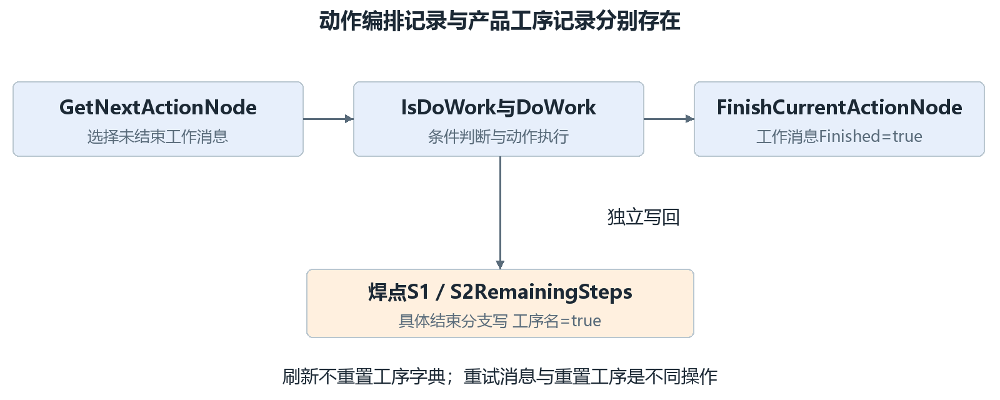
图13 工序字典与动作消息分别更新的路径

### 动作怎样写回工序

S1DispenseActionNode先检查焊点参与范围和工序是否尚需执行；普通执行路径在插补点胶成功后调用S1FinishedStep。BondActionNode先检查EntityState、参与范围和S2步骤；正常固晶流程在相应结束路径调用S2FinishedStep。离线及跳过分支也存在写完成标记的路径，因此字典为true表示软件工序结束状态，不单独证明实物质量合格。

### 停止 重试与重新开始

BondTask循环获取尚未完成的动作，执行DoWork并根据返回值处理。Retry路径不结束当前节点；显式返工入口可以重置部分动作消息。工序字典另有整侧设置完成／未完成的方法。Refresh不会重置这两类记录中的全部状态，重新构建则给焊点建立新的工序字典。排查重复加工或跳过时，应同时查两层记录。

源码依据 S05 S08 S13 S14 S22 S28 S34

## 7 主要接口与调用约定

### 7.1 创建 刷新与几何接口

接口约定按“调用前准备什么、调用后得到什么、产生什么副作用”解释。下面这些入口不是可以任意互换的工具函数，尤其要区分原对象刷新和新对象构造。

| 入口 | 调用前条件 | 结果与副作用 |
| --- | --- | --- |
| 有参TransportUnit构造 | 当前产品配置与坐标、两侧工序定义可用 | 建立全树、Info与步骤；系统参数构造另加工位偏移 |
| UpdateTransportUnit | 调用方接受替换本段旧运行对象 | 以字符串构造创建新TU并替换引用；旧记录不迁移 |
| TU.Refresh | 树与当前配方结构匹配；Info与各层可访问 | 替换坐标、清定位测高和偏移标记；保留步骤 |
| RefreshTransportUnit | 本区段TU非空 | 直接委托TU.Refresh；该包装不检查null |
| SetSystem1／2OffSet | TU坐标与Info已建立；明确需要哪侧偏移 | 按本侧标记累加一次；两侧不互斥 |
| SelfPosToG0／G0PosToSelf | 坐标链父引用和类型有效 | 返回转换点；不执行设备运动 |

### 统一使用原则

调用方应先明确本次要保留原产品记录，还是接受建立一份新运行产品，再选择入口。结构已经变化时不应依赖Refresh补树；仅重建坐标时也不应误用UpdateTransportUnit，否则会得到新的名称、Info和步骤状态。

带CurrentMachineSystemEnum参数的构造只对System1走S1偏移，其他值进入S2分支。使用时应传入明确的工位枚举，不能以未约定的值表示“无偏移”；需要无偏移时现有字符串构造体现该语义。

源码依据 S01 S16 S19 S20

## 7.2 查询 遍历与步骤接口

常用查询按基板Index、岛Index和焊点Name逐层查找。缺失对象、非法参数和空集合的行为并不完全相同，调用方应对结果作有语义的处理。下表说明当前实现，不把方法名直接当成完整契约。

| 接口 | 输入或返回 | 边界与使用约束 |
| --- | --- | --- |
| GetSubstrate | 基板Index → 对象或null | 负数抛异常；0未被显式拒绝，通常查不到 |
| GetModule／GetBondPosition | 基板与岛Index，另加焊点名 | 祖先缺失可返回null；焊点名为null在相关分支抛异常 |
| GetAllBaseMatter | 所有基板、岛与焊点 | 不包含TU根；按当前对象树遍历 |
| GetSubstrate／ModuleCount | 当前常规配置中的Count | 不等于异形各分支的实际集合长度 |
| InjectSteps | 给匹配焊点补工序键 | 已有键值保留；旧键不删除；无动作执行 |
| IsS1／S2NeedStep | 工序名 → 是否需要执行 | 直接索引字典；缺失键会抛异常 |
| S1／S2FinishedStep | 工序名 → 写入true | 不存在键时也能创建，不能据此证明预先注入正确 |

### 全量查询的特定边界

GetAllBondPositions按名称收集时，当前循环从1到“小于Count”，末尾基板和岛会被遗漏；它还依赖常规配置数量。对贯穿示例直接调用该方法不能据此证明已经遍历12个焊点。说明实际产品结构时应以对象集合展开为准；这一限制列入附录C的实现边界。

GetBaseMatterByOppositeSex按所关联节点对象查找，不是仅凭相同名称匹配。跨序列化或重新加载配置后，节点引用关系与名称一致是两回事，需要按实际恢复路径判断。

源码依据 S01 S05 S13 S14

## 8 设计约束与异常处理

### 8.1 配置一致性与数据有效性

TU依赖当前配方，而不是自带一份冻结配方。常规构建要求Count与可索引的坐标表匹配，焊点名称能找到单点配置和工序定义；异形构建要求各层节点及配置存在。构建后的对象数量、节点绑定、名称与当前配方应保持一致。

| 约束 | 不满足时的影响 | 当前实现的处理范围 |
| --- | --- | --- |
| 数量与坐标表匹配 | 创建或刷新时索引越界 | 部分空表可补点；不提供统一完整校验 |
| 焊点名与工序名匹配 | 对象查找空值或工序缺键 | 查询与动作按各自入口返回或抛异常 |
| 工艺状态映射完整 | 可能留下部分已映射状态 | ModifyMatter异常清配置并保存，未回滚整树 |
| 坐标父链与当前对象匹配 | 全局转换不再对应当前位姿 | Refresh重连新链；外部旧引用需重新取得 |
| 结果属于当前几何阶段 | 旧数值可能误作当前有效结果 | Refresh清标记，未清全部结果数值 |

### 刷新失败的影响

Refresh先重建TU坐标，再逐层刷新，最后清标记。方法内没有统一回滚。若中间节点读取失败，树可能处于部分坐标已更新、部分仍旧的状态，且末尾清标记步骤未执行。使用方应把异常后的TU当作需要核对的数据对象，不能仅重试后续运动就认定几何已经一致。

### 工艺与质量状态的边界

工序完成字典、EntityState、区段有料与实物状态分别由不同逻辑维护。软件步骤结束不构成实物合格证明；反过来，停用对象本侧判完成也不意味着它被实际加工。设计评审应检验各字段在当前业务路径中的含义。

源码依据 S01 S02 S03 S04 S05 S10 S16 S28 S34

## 8.2 交接异常与存储恢复边界

### 交接与重新搜索

输送路径可能在机械移动、引用赋值、Refresh、清源或修改状态之间发生异常。不同路径的补偿操作不一致，点胶到Bond没有统一事务恢复，等待到下料路径会恢复部分源区段状态。应按具体方法确认异常发生位置、两段引用与有料状态，不能假定catch之后所有数据都回到传输前。

启动流程在相应条件下刷新已有TU，再调用MapMaterial检查轨道物料。点胶搜索发现实物但没有TU时，可在人工确认后新建TU；已有TU则有刷新路径。由此建立的是当前实物与软件记忆的匹配，不等同于从历史文件恢复原工序记录。

### 程式保存不包含整棵TU

BaseSubSectionProgram的TU引用、区段有料与传输状态都标记JsonIgnore；BaseMatter.Config和CoordinateSystem也不参与常规JSON保存。因此传输结束调用TransportProgram.Save，不能推导为“本份TU及全部坐标和进度已经持久化”。

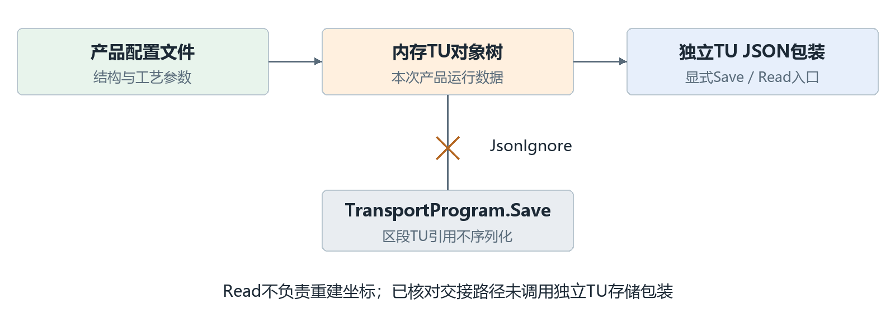
图14 配方保存 运行对象与独立TU文件的边界

TransportUnitStorage另提供TU的JSON保存／读取包装，目录在类型初始化时由配方路径构成，读取方法直接返回反序列化结果，不在其中重建坐标。已核对的生产交接路径不调用这个包装；不能把它作为默认断电续作机制。是否允许恢复原产品，还应另有实物、配置与坐标重建约定。

源码依据 S02 S15 S16 S17 S18 S27 S32

## 9 典型过程与设计核查

### 9.1 从创建到点胶完成的完整例子

以常规说明性产品为例：TU含2块基板，每块3个岛，每岛有A、B两个焊点；A和B都配置S1工序D、S2工序T，状态为Enable。选择无自动工位偏移的字符串构造，后续偏移由该业务路径明确处理。

| 时点 | 对象或数据变化 | 应能核查的结果 |
| --- | --- | --- |
| 创建完成 | 建立21个对象与每点独立Info；注入D与T | 12个焊点各有D=false、T=false |
| S1定位与测高 | 对应层结果写入并更新坐标／标记 | 当前坐标反映已执行的位姿更新 |
| A点执行D | S1动作通过条件检查，完成后写D=true | 只修改当前基板、岛、A的D键 |
| 该岛B点完成D | 另一焊点自己的D=true | 该岛S1完成取决于所有焊点与字典条件 |
| 全产品D结束 | 12份D均为true，S2字典均非空 | S1自下而上可判完成；S2仍有未完成项 |
| 交接到Bond | 目标接原引用并Refresh，源清空 | D键保留；坐标重建；定位测高标记false |

### 9.2 固晶开始前必须继续跟踪的分支

上面的“交接后D保留”只描述交接本身。在BondTask中，若任务Enable，当前TU的IsProduct=false且配置了输送，则重新创建System2 TU并设置IsProduct=true。新对象使用新Info和重新注入的步骤，交接前的D值不会迁移。

若不进入这条重新创建分支，才继续使用接收的对象。补偿工作分支还会先创建字符串TU。因而完整设计必须把“交接保留引用”和“任务开始时条件性换对象”连起来看，不能把前一阶段的结论直接延长到整个固晶周期。

源码依据 S01 S08 S13 S14 S17 S22 S34

## 9.3 设计核查用例与预期

下面的核查项将设计结论转成可复核的条件和结果。对象与调用规则通过源码阅读核对，数值算例单独复算。这些核查不需要启动设备；设备实物传输、定位精度和加工质量需要在相应环境另行验收。

| 编号与条件 | 预期结果 | 依据 |
| --- | --- | --- |
| V01 常规2×3×2结构 | 共21对象；后代遍历20；焊点12 | 3.1与5.2 |
| V02 蛇形2行3列且左下向右 | Index1…6的WorkIndex为1,2,3,6,5,4 | 3.4 |
| V03 数值坐标链按4.2设置 | 焊点G0为(90,240,0)；逆算回原点 | 4.2 |
| V04 示例S1偏移(2,−1,0)调用两次 | 第一次为(92,239,0)；第二次不再变 | 4.3 |
| V05 设D=true后Refresh | 原焊点和Info保留；D仍true；坐标引用更换 | 6.3 |
| V06 重复注入已有D并新增E | D保持原值；E=false；旧键不自动删除 | 5.3 |
| V07 S1全true但S2空 | S1完成函数返回false，不能按对称规则推断 | 6.4 |
| V08 源TU非空进行点胶到Bond交接 | 目标先接同一引用再刷新，源最终清空 | 6.2 |
| V09 满足BondTask重新创建条件 | 旧树被替换；新TU的IsProduct被置true | 9.2 |
| V10 改结构数量后仅Refresh | 不按新Count增删节点；不能当成结构重建 | 6.3 |

### 正文的交付核查

结构、坐标、构建、生命周期、接口、异常和实例均需能指向对应源码；概念图不能替代程序精确时序。读者应能用表中用例回答“为何出现该结果”，而不是只找到字段名。正式实机结果与这些静态核查应分别记录。

源码依据 S01 S03 S04 S05 S08 S10 S13 S14 S17 S19 S20 S22

## 附录A 源码索引 对象与配置

索引按2026年10月20日本地源码核对。ZX表示trunk/AKRS.ZX2200/；CS表示trunk/AKRS.Galaxy2.CoordinateSystems/CoordinateSystems/。完整路径、SHA256与更多锚点保存在同目录source-baseline.json，行号以本次文件基线为准。

**S01 构造、Init、Refresh、查询、偏移与遍历**
ZX/TransportUnitSystem/Module/Matter/TransportUnit.cs
TransportUnit(...)  L73；Init(...)  L107

**S02 公共对象与动态Config**
ZX/TransportUnitSystem/Module/Matter/BaseMatter.cs
abstract BaseMatter  L22；BaseConfig GetConfigByType  L111

**S03 常规/异形基板、下层构建和刷新**
ZX/TransportUnitSystem/Module/Matter/Substrate.cs
Substrate(...)  L51；Refresh(...)  L182

**S04 基岛、焊点构建与状态汇总**
ZX/TransportUnitSystem/Module/Matter/Module.cs
Module(...)  L54；CreateBondPosition(...)  L107

**S05 焊点、完成标记和工序接口**
ZX/TransportUnitSystem/Module/Matter/BondPosition.cs
BondPosition(...)  L40；bool IsFinishedInSystem1  L129

**S06 公共定位与测高信息**
ZX/TransportUnitSystem/Module/Information/BaseInformation.cs
abstract BaseInformation  L12

**S07 TU运行信息与偏移标记**
ZX/TransportUnitSystem/Module/Information/TransportUnitInfo.cs
TransportUnitInfo  L12

**S08 焊点结果与S1/S2字典**
ZX/TransportUnitSystem/Module/Information/BondPositionInfo.cs
BondPositionInfo  L18；IsFinishedInSystem1(...)  L118

**S09 配方组织、实例刷新与就绪包装**
ZX/TransportUnitSystem/ProductConfiguration.cs
ProductConfiguration  L22；InitProductConfiguration(...)  L71

**S11 工艺参与、实体状态与类型**
ZX/TransportUnitSystem/Model/TuEnum.cs
enum MatterProductState  L278；enum EntityState  L256

**S12 TU配置、工位偏移和分段距离**
ZX/TransportUnitSystem/Module/Config/TransportUnitConfig.cs
TransportUnitConfig  L24

**S21 工艺信息清理**
ZX/TransportUnitSystem/Module/Config/OtherConfig.cs
ClearInformation(...)  L38

## 附录A 源码索引 坐标与加工

**S10 索引、坐标建立、状态映射**
ZX/TransportUnitSystem/Service/TuService.cs
static void CreateMatterCoordinate  L872；static void ModifyMatter  L887

**S13 S1工序注入**
ZX/Main/Machine/Process/S1ActionNodeController.cs
InjectSteps(...)  L859；GetNextActionNode(...)  L776

**S14 S2工序注入**
ZX/Main/Machine/Process/S2ActionNodeController.cs
InjectSteps(...)  L1410；GetNextActionNode(...)  L1042

**S19 普通正逆转换和坐标初始化**
CS/BaseCoordinateSystem.cs
AKRSPoint3D ForwardConvertCoordinate  L84；Init(...)  L281

**S20 多层G0转换与累积角度**
CS/GeneralCoordinateSystem.cs
AKRSPoint3D SelfPosToG0  L44；DegreeInG0(...)  L107

**S24 配置坐标元素**
CS/ElementCoordinate.cs
ElementCoordinate  L11

**S28 固晶执行条件与步骤写回**
ZX/BondSystem/Models/ActionNodes/BPActionNode/BondActionNode.cs
DoWork(...)  L118；IsDoWork(...)  L383

**S29 点胶定位数据与测高更新**
ZX/DispenseSystem/Models/System1Domain.cs
bool System1MatterVision  L96；baseEntity.BaseInfo.MeasureHeightResult = addHieght;  L460

**S30 固晶定位开关与测高更新**
ZX/BondSystem/Models/System2Domain.cs
bool System2MatterVision  L279；baseEntity.BaseInfo.MeasureHeightResult = addHeight;  L995

**S34 点胶执行条件与步骤写回**
ZX/DispenseSystem/Models/DispenseAction/DispenseBPAction/S1DispenseActionNode.cs
DoWork(...)  L46；IsDoWork(...)  L177

## 附录A 源码索引 交接与入口

**S15 区段集合与选择性刷新**
ZX/TransportSystem/Models/TransportProgram.cs
TransportProgram  L20；RefreshTransportUnit(...)  L90

**S16 载台持有、JsonIgnore和重建**
ZX/TransportSystem/Models/Programs/BaseSubSectionProgram.cs
abstract BaseSubSectionProgram  L36；UpdateTransportUnit(...)  L62

**S17 上料创建与点胶到固晶引用交接**
ZX/TransportSystem/Controllers/TransportController.cs
ExcuteResult TransferAutoLoaderToLoading  L439；ExcuteResult TransferDispenseToBond  L1266

**S18 独立JSON存储包装**
ZX/TransportUnitSystem/Model/TransportUnitStorage.cs
Save(...)  L35；static TransportUnit Read  L62

**S22 生产重建条件和动作调用**
ZX/BondSystem/Tasks/BondTask.cs
TransportUnit(...)  L204；DoWork(...)  L232

**S23 示教入口的对象取得与替换**
ZX/TransportUnitSystem/Controls/Assistant/TUAssistantHelper.cs
JudgeTuExist(...)  L392

**S26 定位扫描的偏移与分段调用**
ZX/Main/Controls/Ucmain/MainControls/UcMainSystem.ShortcutKeys.cs
VisionScan(...)  L126

**S27 点胶轨道搜索、补建与刷新**
ZX/TransportSystem/Controllers/DispenseSubSectionController.cs
Refresh(...)  L482；System1BackMoveDistance(...)  L504

**S31 点胶应用示教中的偏移调用**
ZX/DispenseSystem/Controls/Setting/EpoxyApplication/UcEpoxyApplication.cs
SetSystem1OffSet(...)  L813；System1MoveDistance(...)  L843

**S32 输送启动刷新与物料匹配**
ZX/TransportSystem/Models/TransportDomain.cs
StartTask(...)  L84；RefreshTransportUnit(...)  L117

## 附录B 术语与图示阅读

### 术语对照

| 术语 | 本文含义 |
| --- | --- |
| Transport Unit／TU | 本次产品的运行对象根；不是输送电机或皮带模块 |
| Substrate／基板 | TU直接包含的产品层级 |
| Module／基岛／岛 | 基板下组织焊点的产品对象；与程序模块概念区分 |
| BondPosition／焊点 | 具体加工地址，也是工序完成字典的记录单位 |
| S1／S2 | 当前项目中的点胶侧与固晶侧 |
| Config／BaseInfo | 配置来源／本次运行记录 |
| Index／WorkIndex | 对象序号／按阵列与方向计算的工作序号 |
| G0／General坐标 | 全局参考／普通平移旋转坐标类型 |
| Refresh／重新创建 | 保留对象重建坐标／建立一份新的运行对象树 |

### 图示约定

图1、图2是辅助理解的生成式概念插图，灰色表示TU载体，绿色表示基板，蓝色表示岛，橙色表示焊点。形状和尺寸不用于推断设备实物结构。其余图按已核对的代码关系绘制：连线表示包含、调用、引用转交或数据变化，具体含义在图内与图注中标明。

图7为空间关系说明，图8为偏移状态变化，图9和图11为调用顺序，图12和图13说明完成判断的不同层次。坐标计算应使用第4.2节给出的条件和数值，不能从示意图比例读取尺寸。

## 附录C 实现边界与评审关注点

本设计解释当前实现。以下条目影响对接口或数据延续性的理解，评审时需要保留这些限定；它们不属于本次文档编制对业务源码的修改。

### C.1 与常见直觉不同的实现

全量焊点按名称查询存在末端遍历遗漏，并依赖常规Count；S1完成判断包含“S2空字典时返回false”的附加条件；两套工位偏移标记相互独立。相关正文已按实际行为描述，未用理想模型覆盖这些细节。

### C.2 需要按完整调用链判断的记录保留

交接本身保留原实例并刷新，但BondTask满足条件时会换成新TU。示教辅助JudgeTuExist在已有产品被允许继续示教时也会重新创建。评审加工记录延续时，需确认具体入口、IsProduct、输送配置与任务Enable，不能仅查看交接赋值。

### C.3 恢复与异常一致性

程式保存不包含区段TU引用；独立TU读取方法不重建坐标；刷新和引用交接没有统一全状态回滚。断电续作、并发访问和异常后继续运动的完整保证，不能由这些方法单独得出。本文核查的是相关源代码路径，不包含整机运行结果。

### C.4 文档评审的判断标准

内容应让读者解释清楚产品层级、配置来源、位置计算、状态更新和路径差异；每个关键结论能追到附录A的文件与锚点。图应有明确目的、图注和正文解释；PDF应保持图文就近、表格完整、字号舒适与连续页码。读者仍有疑问的业务分支，应回到具体入口补证据，再更新设计。

源码依据 S01 S08 S16 S17 S18 S22 S23
