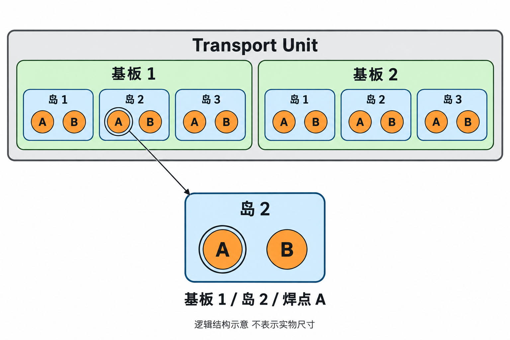
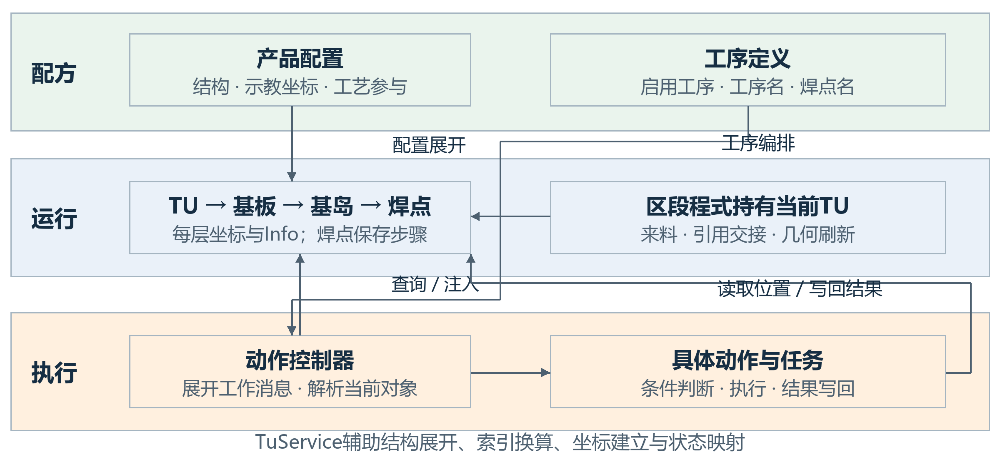
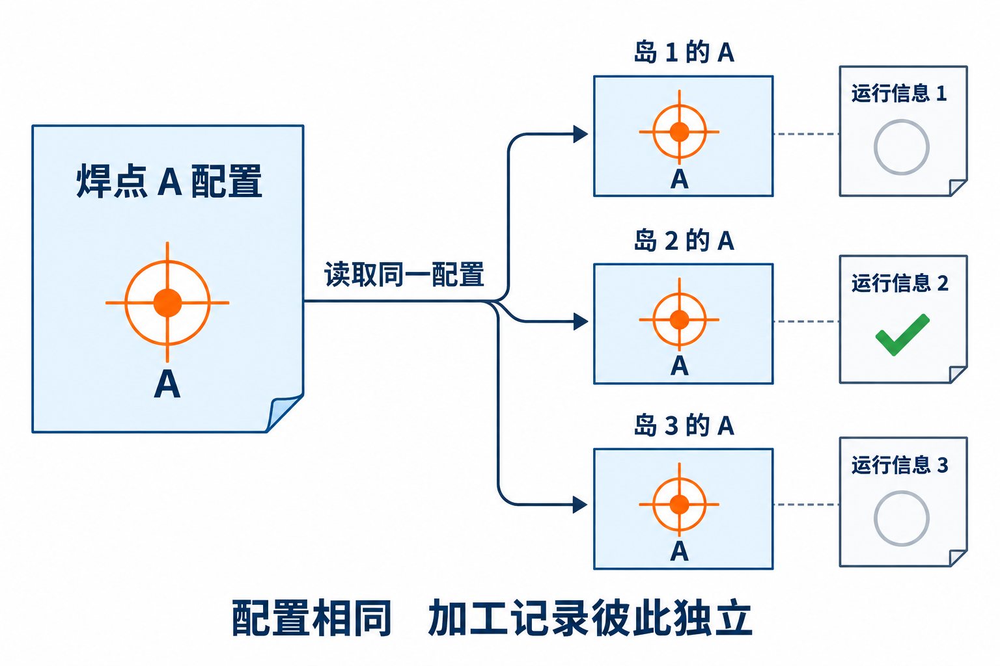
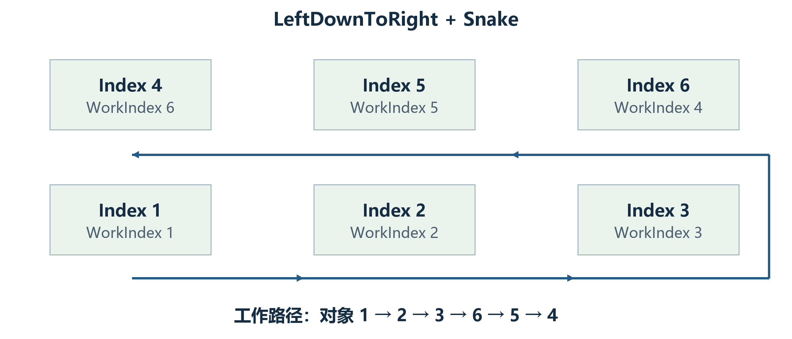
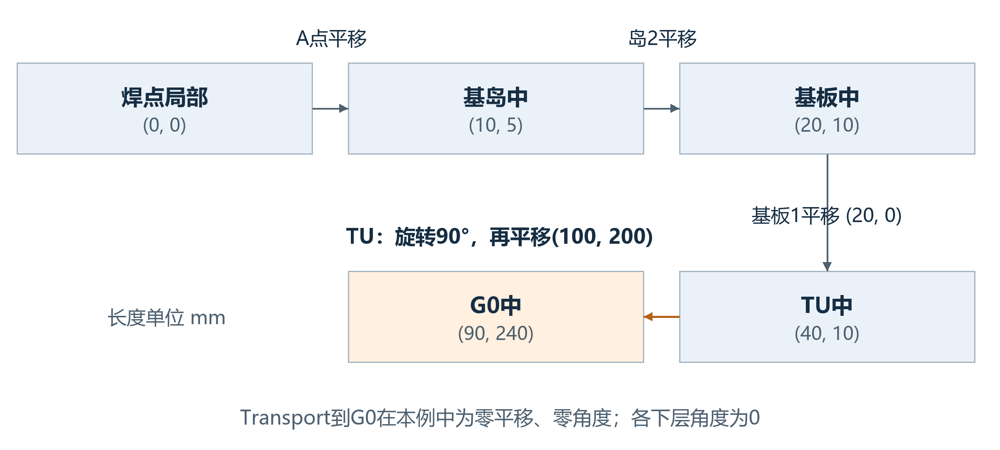
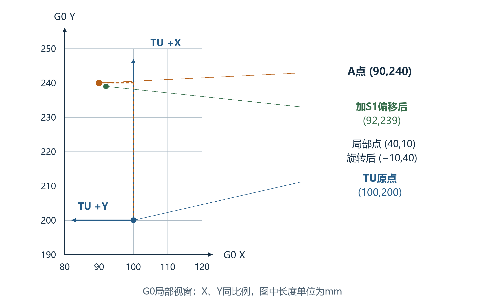
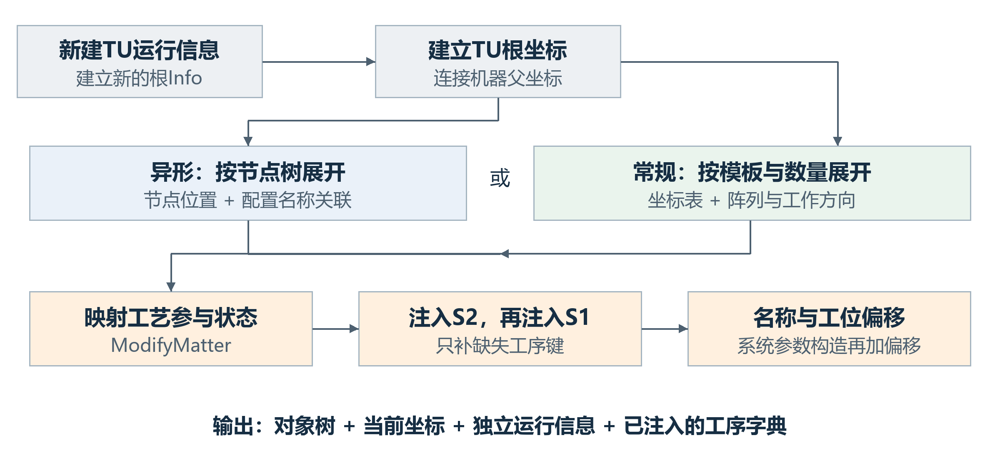
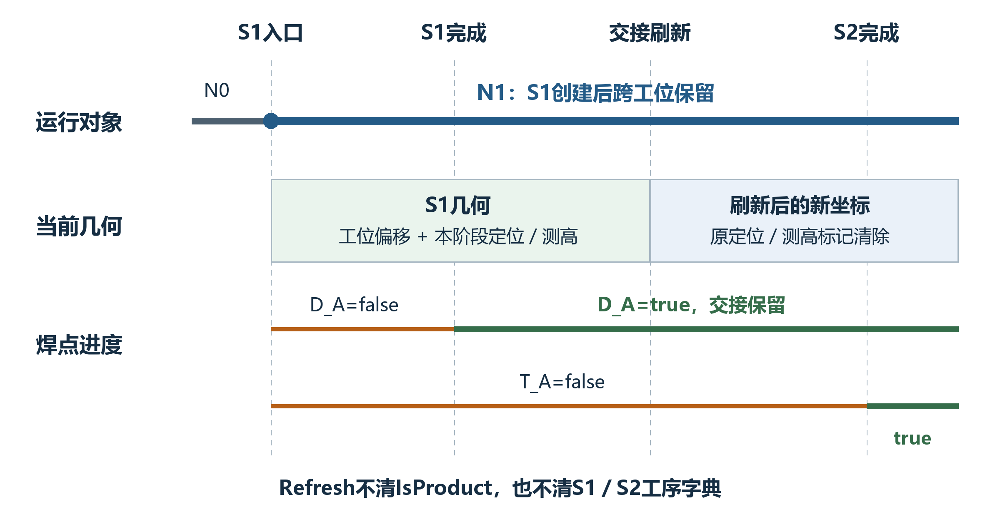
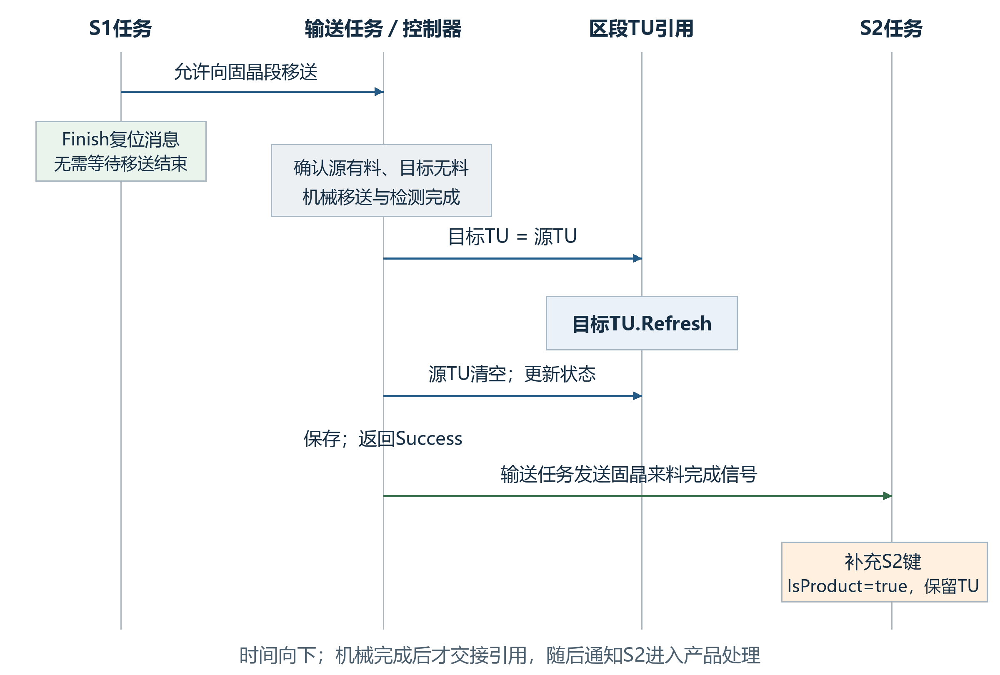
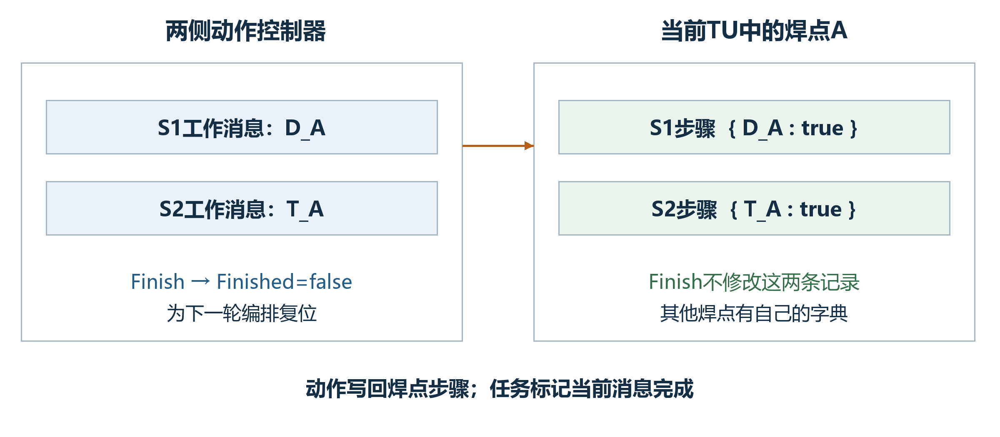

# Transport Unit设计文档

ZX2200产品运行模型 · 第3版 · 2026年10月20日

# 1 设计概述

## 1.1 一份产品怎样被软件识别

设备上的产品具有层级。一份载具产品中可以有多块基板，每块基板中有若干基岛，每个基岛上又有多个加工位置。点胶时说“加工A点”并不足以确定对象，因为不同基岛上都可能存在名为A的焊点。软件需要同时知道它属于哪份产品、哪块基板和哪个基岛，才能读取正确的位置与加工记录。

Transport Unit，简称TU，承担这项组织工作。它在软件中表示一份正在流转的产品，以自身为根，把基板、基岛和焊点组成一棵运行对象树。树中的每个节点有自己的位置与运行信息；具体工序的完成记录保存在焊点上。输送、定位、测高、点胶和固晶从这棵树取得各自所需的数据。这里的TU是产品模型；物理载具如何被皮带传送、气缸如何动作，由输送控制模块完成。[1][8]

图1-1 产品层级与一个具体焊点的地址

图中有2块基板，每块含3个基岛，每个基岛有A、B两个焊点。圈出的对象为“基板1／基岛2／焊点A”。下文用这一说明性产品贯穿对象、坐标和状态的解释，图形不表示设备实物尺寸。

产品层级同时给出了两种关系：集合回答“这个对象属于谁”，父坐标回答“这个位置相对于谁”。两者在创建时一起建立，运行时却可以有不同的变化。比如，跨工位交接后仍使用原来的焊点对象，但它的坐标对象已经被重新建立。理解这两种关系，是读懂TU设计的起点。

## 1.2 设计目标与职责边界

TU首先要让各业务模块使用同一套产品地址。基板和基岛的序号、焊点名称与工序配置共同决定当前加工对象，业务不必分别再组织一套产品层级。其次，位置按父子关系表达，整体位姿和局部位姿可以在不同层更新。最后，加工记录附着在运行对象上，使同一份产品的工序进度可以在满足条件的交接路径中延续。

这三项目标各有对应的边界。TU读取当前配方，并没有把创建时的全部配置冻结为私有副本；它保存数据，也没有自行编排或驱动全部动作；它提供完成属性，也不能用一个“完成”字段代替区段有料、工艺参与、处理结果和工序进度。设计评审需要分别检查这些含义。

本文面向软件研发、技术评审以及设备调试人员。前文先建立产品与数据概念，随后解释坐标和构建过程，再沿正常生产链说明对象如何被使用。接口和异常章节用于查阅，最后的贯穿实例可用于核对理解。定位结果怎样影响产品坐标属于本篇范围；图像识别、芯片纠偏和最终贴装补偿算法的完整设计另册说明。

# 2 模块组成与职责划分

## 2.1 配方、运行对象与执行过程

同一份产品涉及三类不同的信息。配方描述产品应当怎样组织和加工，例如基板数量、示教位置、焊点名称与工序选择。运行对象记录这一份产品目前的情况，例如当前坐标、定位结果和已完成的工序。执行过程则描述任务接下来选择什么动作，以及动作何时允许执行。三类信息相互协作，但没有被合并成一个对象。

图2-1 产品配置 运行模型与动作执行的分工

实线箭头标出配置展开、对象查找与结果写回。区段程式持有当前TU；动作控制器持有工作消息；具体动作读写当前产品。图中的协作关系不代表机械动作必须按图上的空间方向执行。

ProductConfiguration是配置入口。TransportUnit、Substrate、Module和BondPosition组成运行树。TuService提供坐标创建、索引换算和工艺状态映射等辅助操作。S1、S2动作控制器把工序定义展开为工作消息；点胶任务与固晶任务循环取出消息对应的动作，完成条件判断并执行。输送模块负责来料、交接与放行信号，以及区段中的TU引用。[1][2][3][6][7][8]

## 2.2 产品模型怎样参与一次加工

一次焊点动作需要把工作消息解析回产品对象。以点胶侧为例，动作控制器先从点胶段取得当前TU，再按工作序号找到基板和基岛，最后通过当前工序中的焊点名称取得BondPosition。点胶动作由这个对象得到位置、参与范围和步骤记录，而不是仅凭动作名称决定坐标。固晶侧在初始化当前消息时也沿相同层级解析对象，再供后续动作使用。[3]

这种分工使动作编排和产品记录可以分别维护。任务为下一份产品复位工作消息时，不必清除上一份TU上的工序字典；输送交接替换区段引用时，后续动作又可以从新的当前TU解析对象。代价是调用方必须使用一致的配方、工序与产品地址，并区分当前对象和先前缓存的引用。

## 2.3 配置上下文是一项共同前提

常规模式下，BaseMatter.Config通过当前ProductConfiguration动态取得配置：TU、基板和基岛按类型读取，焊点再按名称查找单点配置。异形模式下，运行对象通过关联节点取得配置。因而TU对象的存在，并不能证明它仍对应当前生效的产品定义。[1][2]

例如，两个工位中同时存在不同运行TU时，它们的常规Config读取仍指向当前配方。改变基板数量或焊点名称后，旧树不会在下一次读取Config时自动变成新结构。TU类也没有通过RecipeName字段完成配置版本隔离。设计使用的前提应明确为“当前对象树、配置及工序定义相互匹配”；不能把一个名称字段当成已经生效的版本约束。

纯几何修改与结构修改需要采用不同操作。前者可以在结构仍一致时刷新坐标，后者需要重新构建产品树。这个区别贯穿后面的初始化、生命周期和接口约定。

# 3 对象模型与数据设计

## 3.1 对象层级与数据归属

TU保存基板集合，基板保存基岛集合，基岛保存焊点集合。每个对象只直接管理自己的下层，整份产品的遍历和汇总通过逐层展开完成。图1-1的例子包含1个TU、2块基板、6个基岛和12个焊点，共21个运行对象。GetAllBaseMatter只返回根的后代，因此在这个例子中得到20个对象。清定位、清测高等整树操作先处理根，再处理这些后代。[1]

四类对象继承BaseMatter，共用名称、对象类型、序号、配置访问、运行信息、坐标和状态等能力。各层的运行信息具有不同的具体类型：TU使用TransportUnitInfo，焊点使用BondPositionInfo。基板与基岛负责组织下层；焊点则保存S1、S2工序字典，是具体工序完成情况的记录单位。

表3-1 主要对象的职责与直接数据

| 对象 | 直接包含 | 本层主要作用 |
|---|---|---|
| TU | 基板集合 | 一份产品的入口；承载根坐标及产品级信息 |
| 基板 | 基岛集合 | 表示基板局部位置；汇总下层工艺和完成情况 |
| 基岛 | 焊点集合 | 表示岛局部位置；组织具体加工位置 |
| 焊点 | 本身不再展开产品子层 | 记录单点位置、工序进度及加工过程信息 |

同名焊点的运行数据彼此独立。6个岛中都可以有A点，它们读取相同的常规A点配置，但分别拥有自己的Info与工序字典。一个A点加工完成，不会把其他岛中A点的工序同时置为完成。配置复用与记录独立是本模型的一项基本关系。

图3-1 重复焊点共享配置定义而分别保存运行记录

三个A点来自不同岛。它们的配置定义相同，运行信息与完成记录分别归属各自对象。图中空心圆与勾仅用于区分未完成和已完成记录，不表示加工比例。

## 3.2 常规模板与异形节点

常规产品采用模板重复展开：使用一套基板配置创建多块基板，再使用一套基岛配置为每块基板创建基岛，最后根据焊点配置列表为每个基岛建立焊点。数量、阵列坐标和工作方向集中配置，适合用较少参数表达规则布局。运行树中的实例仍各自独立。

异形产品使用OppositeSex节点树。TU根节点的DownConfigs对应基板，基板的下层对应基岛，基岛的下层对应焊点。每个运行对象保留所关联的节点，节点分别提供名称、位置和配置名称。分支的实际数量取决于节点树，不能由常规基板或基岛的全局Count推断。[1][2]

异形节点的配置也有共享关系。节点Config按ConfigName从公共配置列表查找；未找到时，当前实现会创建默认配置、加入列表并保存产品配置。因此“每个节点关联配置”并不意味着每个节点总有一份不可共享的配置，更不意味着读取Config一定没有副作用。几何节点与工艺配置名称应在设计中分别理解。

## 3.3 序号、地址与加工顺序

Index表示当前树中的对象序号。常规创建从1开始，并以Index减1读取坐标表。WorkIndex表示加工编排使用的工作序号，由行列、排列方式与加工方向计算。普通顺序下两者可以相同，蛇形或其他方向下就可能不同。当前动作的基板与基岛查询使用WorkIndex，因此它不是一个只影响界面显示的附加字段。[3][5]

图3-2 一组两行三列阵列中的对象序号和工作序号

本图另取两行三列阵列说明LeftDownToRight与Snake组合，不改变贯穿实例的产品数量。各对象Index为1至6，WorkIndex为1、2、3、6、5、4，所以工作路径按对象序号读为1→2→3→6→5→4。

列表下标也需要与这两个序号区分。S2的大数量路径会按WorkIndex原地排序集合；Refresh又会沿现有集合重新赋Index并计算常规WorkIndex。行列索引没有在所有刷新路径中完整重建。对运行过程的持续追踪，应同时明确TU实例、当前阶段和层级地址，不能把“列表第几个元素”当作永久不变的产品身份。

## 3.4 位置结果与过程记录

BaseInfo保存定位结果和测高结果等公共数据。LocateResultInfo包含P1至P4的定位信息；VisionResult分别保存识别结果、对象局部坐标中的结果点、G0结果点和拍照位置。保存定位信息后，定位流程继续调用坐标更新逻辑，将测得信息转化为当前对象的位姿。结果记录和坐标变化是两个相关步骤，不能只检查其中一个就认为位置更新已经完整完成。[4][5][11]

测高信息的主要数值是实测平均高度与示教平均高度之差。两侧测高流程均把差值写入MeasureHeightResult，再加到本层坐标的Z平移，并设置IsMeasureHeight。位置转换时，后代通过父链受到这项Z变化影响。数值属于哪一层、是否已经作用于坐标，是理解测高记录的关键。

IsVisioned与IsMeasureHeight表示相应流程的处理标记，不能独立解释为真实拍照或测量成功的全部证据。例如定位关闭时，领域方法可以直接把IsVisioned置为true；动作层又可能因配置或完成状态而跳过。Refresh清除这些标记，但保留旧Info数值。标记、结果数值和当前坐标的有效阶段需要一起看。

TU专属信息中的IsProduct用于判断生产入口是否需要重新创建对象。它不是本工位完成标记，也不是质量结果。配方名称、批次、产品号和面别等字段可由信息编辑界面写入，两个有参构造并不自动填满这些内容。焊点专属信息另外保存芯片偏移、实际位置、取片位置和力值等过程量，其使用取决于具体动作。[4][9]

## 3.5 工艺参与与完成判断

MatterProductState表示对象参与哪些工艺：Enable参与S1和S2，EnableInSystem1只参与点胶侧，EnableInSystem2只参与固晶侧，Disable两侧均不参与。基板与基岛的参与范围由下层汇总：只要存在两侧参与对象，或同时存在仅S1和仅S2参与对象，上层就覆盖两侧；全部停用或集合为空则汇总为Disable。TU没有采用同样的参与范围汇总属性，不能把四层全部画成完全对称的状态模型。[1]

工序完成情况以焊点字典为依据。字典键是工序名称，false表示未完成，true表示已完成。对本侧不参与的焊点，外层完成属性可直接满足；参与时再进入字典检查。基岛要求所有焊点完成，基板要求所有基岛完成，TU要求所有基板完成。空集合的汇总循环也可返回true，所以完成属性不能替代产品结构完整性检查。

表3-2 参与本侧工艺时的完成函数规则

| 条件 | S1完成函数 | S2完成函数 |
|---|---|---|
| 本侧字典为空 | true | true |
| S1非空但S2为空 | false，即使S1各项已完成 | S2自身为空，返回true |
| 两侧字典非空 | 所有S1值为true时返回true | 所有S2值为true时返回true |

表3-2保留了当前实现中两侧不对称的检查条件。EntityState又是另一维度，取Process、Success或Fail。固晶动作要求当前焊点处于Process，并同时满足参与范围和工序未完成条件。完成字典不会在这里被自动等同于EntityState，更不能直接代替实物质量结论。[1][4][7]

# 4 坐标体系设计

## 4.1 位置按相对关系保存

每层产品对象持有一个GeneralCoordinateSystem。Distance给出相对直接父坐标的三维平移，Degree给出绕Z的平面角度，角度计算使用弧度。焊点相对基岛，基岛相对基板，基板相对TU；TU的父坐标从机器配置中按名称TransportCoordinateSystem取得。再沿机器父链，产品点可以转换到G0全局参考。[1][5]

采用相对位置后，整体变化可以留在上层表达。TU整体平移时，不必逐个改写所有焊点的局部坐标；一个基板的位姿更新，也只影响该基板及其后代的全局位置。反过来，焊点局部补偿和产品整体位姿不能不加区分地叠加，必须知道每个量所在的坐标层。

## 4.2 单层变换与逐层合成

设输入点在本层坐标中的位置为x、y、z，本层平移的三个分量为dx、dy、dz，角度为θ。普通General坐标先旋转XY，再叠加平移；Z只作平移。父层坐标按下列等式得到。

$$X_p = d_x + x cos θ − y sin θ	ag{4-1}$$

$$Y_p = d_y + x sin θ + y cos θ	ag{4-2}$$

$$Z_p = d_z + z	ag{4-3}$$

SelfPosToG0从当前坐标开始，收集有父引用的层级，再依次执行正变换。G0PosToSelf沿相反顺序执行逆变换；逆变换先去掉平移，再反向旋转。DegreeInG0累加这条链上的角度。产品的General变换适用上述计算；机器父链若包含Vm坐标，相关转换改用标定工具，不能用普通旋转平移替换标定关系。[5]

## 4.3 一个焊点位置的完整计算

仍取基板1、基岛2、焊点A。为使每一步可复算，规定Transport到G0为零平移、零角度；TU平移为(100,200,0)，角度为π/2。基板1相对TU为(20,0,0)，基岛2相对基板为(10,5,0)，焊点A相对基岛为(10,5,0)，下层角度均为零。所有长度统一按mm表达。

图4-1 焊点局部原点逐层转换的中间结果

从焊点自己的原点出发，先到基岛得到(10,5)，再到基板得到(20,10)，到TU得到(40,10)。TU旋转90°并叠加(100,200)后，G0结果为(90,240)。图中省略恒为零的Z值。

图4-2 TU旋转后的局部轴与焊点全局位置

图示为G0的局部视窗，刻度直接使用G0坐标。TU局部正X指向全局正Y，局部正Y指向全局负X；所以局部(40,10)在旋转后变成(−10,40)。橙点为叠加TU平移后的结果。

算例也说明“相对谁”为什么不可省略。局部X增加40并不意味着全局X增加40，因为TU旋转了90°。逆算时，(90,240)先减去TU平移得到(−10,40)，逆转90°得到(40,10)，再去掉基板、基岛与焊点平移，回到焊点原点。

## 4.4 工位偏移与分段位置

S1和S2工位偏移直接加到TU的Distance上，因而影响整棵后代的转换。两套偏移各有一个独立布尔标记：相应标记为false时累加并置true，已经为true则返回。该保护只避免同一套偏移被重复累加，并不阻止S1和S2偏移连续相加。字符串构造不自动选工位偏移；系统参数构造在Init后选择对应偏移。[1]

把算例中的S1偏移设为(2,−1,0)，在尚未应用时调用一次后，TU平移变为(102,199,0)，焊点G0位置变为(92,239,0)。再次调用S1偏移方法，结果保持不变。Refresh会重新按配置建立坐标，并把两套标记清为false，它自身不重新应用任何工位偏移。定位扫描、示教及生产创建应分别按其实际入口判断。

分段点胶的平移与工位偏移使用不同机制。System1MoveDistance仅在SubstrateProcessing为Divide时给TU的Distance.X加DistanceToRight，回移方法做减法，没有同一套布尔标记保护。具体前后段由配置与区段位置共同决定，不能从“分段”一词推断固定一半数量，也不能把枚举中的DivideWithInverted自动视为同一分支。[1][2][9]

## 4.5 定位、测高与刷新怎样改变坐标

定位先保存测得的结果点，再由TuService.UpdateEntity计算用于更新的点和角度，并调用当前坐标的UpdateCoordinateSystem。被更新层的后代不需要逐点重写；它们下一次向G0转换时就会受到父层位姿变化影响。本篇说明数据和几何的归属，定位点选择与角度计算的完整算法另册展开。[5][11]

测高则对本层Z平移作增量修正。若基板1的测高差为+0.12mm，该值写入基板Info并加到基板坐标Z，其下所有焊点转换时都会带上这项高度。Refresh以后，基板坐标重新来自示教配置，旧差值仍可能留在Info中，完成标记已被清除；旧数值存在不代表新坐标已经包含它。

坐标本身是一组可替换的对象。CreateMatterCoordinate每次新建GeneralCoordinateSystem、连接父引用，再复制配置点与角度。Refresh递归执行这一过程，因此保留焊点对象不等于保留它的CoordinateSystem实例。需要当前几何时，应从当前产品对象重新取得坐标，而不是继续使用刷新前缓存的句柄。

# 5 对象构建与初始化设计

## 5.1 创建一棵可使用的运行树

有参构造从新的TransportUnitInfo开始。Init先关联异形根配置并建立TU坐标，再按常规或异形模式展开下层，随后应用工艺参与配置，最后依次注入S2和S1工序。Init返回后生成TU时间名称；系统参数构造再加工位偏移。工序注入顺序表示初始化调用先后，不表示设备先执行S2再执行S1。[1][2][3]

图5-1 从产品配置到运行对象树的建立顺序

两个结构分支汇合后，才应用工艺参与状态并注入步骤。输出中的坐标、运行Info与工序字典分别承担几何、结果和进度职责。示意省略了业务设备动作，因为构建过程本身不执行点胶或固晶。

无参构造用于反序列化，不走这条完整链。普通创建需要当前配方、机器父坐标和两侧工序定义已经可用。IsTransportUnitReady仅检查TU示教结果标记，不能代替数量、坐标表、名称或节点关联的完整一致性检查。

## 5.2 常规布局的展开与配置整理

基板与基岛的常规创建按Count循环，每个对象从坐标表的index−1位置取几何参数。基岛再按单焊点配置列表创建焊点。矩阵模式建立行列索引，WorkIndex由排列和工作方向计算。图1-1中的2×3×2产品由两块基板、每块三个基岛和每岛A、B两个焊点展开。

创建还包含配置整理。非多件模式会把数量与行列改为1，并重建默认坐标；空坐标表会补一个默认点；启用输入间距时，按首点、行列与间距生成阵列坐标，保留首点Z，新点角度为零。这些操作会改变内存中的配置集合，所以“创建TU”不是纯只读地复制配方。调用者应把整理后的配置与实际输出一起理解。[1][2]

对贯穿实例，基板和基岛都显式设为多件，数量分别为2和3，坐标表长度与数量一致。实例直接给出各层坐标，不依赖未声明的间距自动生成条件。这样后面的对象数量和坐标计算由同一组条件得到。

## 5.3 异形节点的展开

异形创建以DownConfigs的实际节点数为准。每层构造把节点关联到运行对象，再建立坐标和自己的Info；基板、基岛的初始WorkIndex等于节点序号。配置名决定读取哪份工艺配置，节点位置决定在父层中的布局，两者不必一一对应。

这条路径使不同基板可以具有不同的下层结构，但也要求节点层级和类型含义正确。常规全局Count仍存在于其他便捷接口中，不应据此替代实际异形集合。需要获取真实产品规模时，应沿运行树或相应节点树统计。

## 5.4 工艺状态与工序键的装配

TuService.ModifyMatter把工艺参与配置写到焊点。异形模式取焊点节点状态；常规大数量模式按基板与基岛索引进入状态结构，再按焊点名匹配；普通模式查找“基板序号＋基岛序号＋焊点名”的个别记录。基板、基岛随后由下层状态计算参与范围。[2]

工序注入采用另一种匹配。动作控制器遍历已启用工序定义，以BondPositionName匹配焊点Name，再把ProcessStepName作为该焊点字典的键。不存在的键添加false，已经存在的键保留原值，旧键不会自动删除。重复注入可以补充新增工序，而不会把已经完成的工序重新改成未完成。[3][4]

工序名称还用于从当前工作消息找回工序定义。贯穿实例分别使用D_A、D_B表示A、B点的S1工序，T_A、T_B表示对应S2工序，避免把同一个工序键同时用于两条不同的焊点定义。A点和B点的地址由工序定义中的焊点名解析，工序名与焊点名承担不同职责。

初始化没有覆盖所有失败的统一回滚。特别是ModifyMatter内部异常会清理工艺状态配置并调用保存，已写入的部分运行状态不会因此全部重新映射。构建结果是否完整需要按实际调用检查，不能仅凭“没有收到该方法抛出的异常”推断状态装配已经正确。[2][10]

# 6 生命周期与生产协作

## 6.1 正常生产链中的三个有效期

一份产品从点胶进入固晶，读者最需要知道的是：还是不是同一棵树，位置是否重新计算，已经完成的点胶记录是否还在。正常输送链的答案并不相同。对象树可以跨工位保留，几何在交接时重新建立，焊点工序记录则继续留在原对象上。图6-1把这三个有效期放在同一时间轴上，后文再逐段解释触发条件。[6][7][8]

图6-1 正常S1到S2路径中对象、几何与进度的有效期

条件为：输送和S1、S2均启用；S1入口发现IsProduct为false；随后自动交接成功。N0、N1仅是本图给运行实例起的标识。正常S1入口创建N1并设置IsProduct；S2保留这一实例。交接中的Refresh建立新坐标，却保留焊点步骤记录。

这一过程需要区分产品模型和动作控制器。TU中的焊点字典记录产品的工序完成情况；控制器中的工作消息记录本次动作编排走到了哪里。任务结束时重置工作消息，不意味着清空TU的加工记录。反过来，新建TU会得到新的运行信息，即使控制器仍使用同一套动作定义。

## 6.2 启动与S1生产入口

机器启动先准备相关系统，再启动输送任务。满足配置条件时启动点胶任务；固晶侧初始化动作控制器，然后启动固晶任务。各任务随后通过来料与放行信号协作，不能把启动函数中的语句顺序直接解释为完整的实物加工顺序。[12]

自动点胶任务先建立本轮工作消息，再等待来料。在启用点胶的分支中，如果点胶段当前TU的IsProduct为false，任务使用S1系统参数重新创建TU，并把新对象的IsProduct设为true；随后再注入当前S1工序。原先由上料或物料搜索形成的N0在这里被N1替换。N1的几何从配方建立，并应用S1工位偏移。[6]

点胶循环逐个取动作，检查是否需要执行，再执行并标记当前工作消息。重试返回可以继续本动作；其他非成功结果进入相应停止处理。焊点点胶动作成功后，才把当前工序名对应的S1字典值置为true。控制器标记“消息已完成”与焊点写入“工序已完成”由不同调用承担，不应合并成一个隐含操作。[3][6][11]

## 6.3 从点胶段交给固晶段

S1在未停止时发出允许向固晶段移送的信号，然后调用自身控制器的Finish复位工作消息。输送控制器要求固晶段无料、点胶段有料；自动路径还需等待该放行信号。机械移送和检测完成后，控制器才把点胶段的TU引用赋给固晶段，对该对象执行Refresh，再清空点胶段引用，并更新区段状态与保存配置。[6][8]

图6-2 自动点胶到固晶交接的主要调用与信号

实线竖线分别表示S1任务、输送任务与控制器、区段产品引用、S2任务。图中把机械移送和检测合并为一个有明确完成条件的步骤。S1的Finish发生在放行之后，与输送动作没有额外的串行等待关系；交接完成信号由输送任务在控制器返回Success后发出。

赋值传递的是同一个对象引用，不是把S1字典复制到另一份新TU。在上述正常路径中，N1、基板、基岛和焊点仍是原来的实例；Refresh替换各层坐标，清定位与测高标记，清工位偏移标记。IsProduct和两个工序字典都未在Refresh中清除。因此已经完成的D_A仍为true，但刚才用于点胶的定位修正不能被当作固晶侧当前几何继续使用。

输送任务收到控制器成功返回后，发出固晶来料完成信号。固晶任务等待该信号后进入产品处理。放行、实物交接、引用交接和目标来料通知分别位于不同位置，调试时应按这些节点判断停在哪一段，不能只看一个区段中的TU是否非空。

## 6.4 S2为什么通常保留S1传来的对象

固晶任务取得来料后补充S2步骤键。启用固晶且输送已配置时，只有当前TU的IsProduct为false才会按S2参数重新创建对象并置为true。正常S1已经把N1的标记设为true，交接刷新又保留了该标记，所以这条正常路径不会在S2入口无条件新建TU。S1的加工记录正是沿这一条件得以延续。[7]

固晶控制器按当前工作消息解析基板、基岛和焊点，动作再读取它们的当前状态和坐标。以固晶动作而言，是否执行同时涉及工艺参与、EntityState及本工序是否未完成；成功路径写入当前焊点的S2步骤记录。动作全部处理后，控制器Finish复位工作消息，再由发送流程决定下一步放行。

图6-3 工作消息与产品步骤是两套记录

左侧属于动作控制器，右侧属于当前TU的焊点。Finish复位左侧消息；右侧D_A、T_A的值由具体工序写回与明确的人工操作改变。本图只展示A点对应的两个工序，其他焊点拥有各自的记录。

启用输送的正常发送路径在未停止时发出允许向待下料段移送的信号。后续成功移送继续采用目标引用接收、刷新坐标与清空源引用的模式，直至产品离开区段。在未配置输送的路径中，发送流程可按配置导出Mapping，清空固晶段TU并置无料，再提示人工取走产品并停止。因此最终对象退出方式也取决于实际生产配置。[7][8]

## 6.5 替代路径会在哪里改变连续性

点胶任务已经启动但Enable为false时，会跳过设置IsProduct的生产分支，仍可在未停止时放行。S2取得的对象若仍为false，就会在满足输送与固晶启用条件时按S2重建。此时S2中的实例不再是先前树，运行信息由新构造产生。这个分支与前面的正常双工位路径需要分别描述；它也不等同于机器硬件配置中没有点胶系统。

手动移送还存在目标TU为空时补建再刷新的分支；示教中的JudgeTuExist会按用户在设备界面中的选择重新建立对象；轨道物料搜索也可能补建或刷新。它们都说明“区段已经有一份TU”不等于“后续入口一定保留这一份TU”。需要追踪实例连续性时，应检查实际进入的条件分支。

IsProduct也不是不可伪造的生产事实标记。Mapping显示界面在载入已有TU时会把它设为true，即使此前没有经过S1生产入口。分析该标记时必须包含界面入口。其设计上的实际意义是影响后续创建判断，不能单独用来证明某个机械加工过程已经发生。[9]

# 7 主要接口与使用约定

## 7.1 按意图选择创建、刷新或重新取值

调用TU接口前，先明确本次操作要改变的是什么。新建用于建立新的运行身份和记录；Refresh用于结构仍相符时重建几何；从当前工位重新取TU用于跟随区段引用变化。这三种操作互不等价。表7-1按意图给出它们的前提与效果，便于开发和调试采用相同判断。[1][8]

表7-1 创建和刷新接口的语义

| 操作 | 前提 | 主要效果 |
|---|---|---|
| 有参构造 | 配方、父坐标与工序配置可用 | 新建树、Info与坐标；系统参数构造另外加工位偏移 |
| Refresh | 既有树与当前配置仍匹配 | 保留对象及步骤；重建坐标；清定位、测高和偏移标记 |
| 重新读取当前工位TU | 当前区段引用已正确更新 | 取得此刻有效的对象入口；不创建、不刷新 |

调用者如果长期缓存TU或坐标，应分别处理两个失效点。生产入口重建或区段引用改变以后，旧TU可能已不是当前产品；同一TU执行Refresh以后，旧CoordinateSystem也可能已经脱离产品树。保存长寿命引用的代码，需要明确它服务于历史记录还是当前控制，不能仅凭引用非空判定可用。

## 7.2 产品地址查询

GetSubstrate和GetModule可按Index或工作序号查询，调用时必须明确所需序号含义。GetBondPosition继续以焊点名称查找。动作消息使用的是工作序号，示教坐标表创建使用的是对象序号；把一个数直接从两类接口之间传递，可能恰好在普通顺序下正确，却在蛇形排列时指向另一个对象。

查询的失败行为并不统一。基板查询在集合为空引用时返回null，负序号检查随后才执行；基岛查询找不到父基板时先返回null，因而不会继续检查下层序号。焊点查询找不到祖先时返回null，祖先存在后才检查焊点名是否为null；空字符串可以进入查找并以未找到结束。对外层调用而言，既要处理未找到，也不能把所有错误都假定为同一种异常。[1]

GetAllBaseMatter取得根以下的实际对象，包含基板、基岛和焊点而排除TU根。GetAllBondPositions则按名称收集焊点，但两层循环只到常规Count减1：本例查找A点应有6个，该方法却只遍历基板1的前两个岛，得到2个。其数量接口读取常规全局Count，也不能替代异形树实际计数。附录C集中记录这些现状。

## 7.3 步骤记录与动作记录

InjectSteps按当前已启用工序补入缺失键，已有键和值都保留。步骤完成写入方法也能在键不存在时创建该键；相反，是否需要执行的单步查询直接读取字典，缺键会抛出异常。因此先注入再查询是当前生产链的重要前提，不能因为写入能够补键，就推断所有读取都能容忍缺键。[3][4]

FinishCurrentActionNode只改变当前工作消息的Finished状态。焊点的S1或S2完成写入由相应动作在成功路径调用。控制器Finish用于恢复消息编排供后续产品使用，也不会自动恢复焊点未完成状态。要实现重做、跳过或人工确认，应明确修改哪份记录以及该对象是否仍是当前产品，不能借调用Finish含混处理。

## 7.4 坐标与状态接口

SelfPosToG0接受本层坐标中的点，G0PosToSelf接受G0中的点。两者应成对采用同一条当前父链。对焊点自己的原点求全局位置时输入(0,0,0)，不是把已经含有局部平移的配置点再输入一次；后者会重复叠加本层位置。更新上层坐标后，下层转换自然使用新位姿，无需逐个重写后代局部坐标。[5]

工位偏移方法以各自标记防止本侧重复叠加；清标记不等于已经恢复几何，恢复几何由Refresh等操作完成。分段前移和回移是增量加减，需要成对理解其调用条件。定位与测高标记的清除同样只表示下一阶段需要重新处理，不会删除Info中的历史结果数值。

SetMatterDisable、SetMatterOnlyDispense、SetMatterOnlyBond与SetMatterEnable向下层传播工艺参与范围。基板与基岛的聚合属性随后反映下层状态；TU本身没有同样的聚合覆盖。修改工艺参与范围不会自动等同于清除工序结果，界面是否同时清步骤还取决于选择的是焊点还是上层对象。[1][9]

# 8 一致性、失败与恢复边界

## 8.1 配方、树与步骤需要同时一致

TU运行依赖当前对象树、配置与工序定义共同成立。只改坐标而保持结构时，可以通过刷新重新建立几何；改变层级数量、焊点名称或异形关联以后，旧树可能不再满足配置索引条件。Refresh沿既有集合执行，不按新数量重建整棵树，也不重新应用工艺状态或重新注入步骤。因此它不能承担任意配方迁移。[1][2]

工序注入也没有完整的配置迁移语义。重命名工序后，新的键可以被补入，旧键仍留在字典；完成属性仍遍历字典已有项。改变焊点名又会影响匹配与当前对象解析。研发评审应同时检查定义、消息和运行字典；调试时看到旧工序键，应先判断是否来自旧对象及旧配置阶段。

## 8.2 交接成功与交接中断

成功交接在机械完成后更新产品引用和区段状态；失败路径并没有对所有数据提供统一事务回滚。以S1到S2交接为例，目标引用先接收源对象，再执行Refresh，之后才清源引用。如果Refresh抛出异常，两个区段可能暂时引用同一对象，而几何又可能已经部分更新。不能把目标非空当作成功提交的证明。[8]

重新启机时，输送启动根据配置刷新已有产品并搜索物料，界面也允许在物料不一致时按条件补建或清除TU。软件引用、区段有料状态、传感器检测与实体位置是几个需要重新对应的事实。本文据现有代码说明这些入口；未把源码路径分析写成经过设备试验的自动恢复保证。

## 8.3 人工操作改变哪些记录

Mapping界面的停用、正常和成功按钮会检查机器是否处于工作状态。在允许修改时，对焊点选择和上层选择的处理不同：选择焊点后设为正常，会同时把两侧步骤恢复为未完成；设为成功，会把两侧步骤设为已完成；停用该焊点也会重置两侧步骤。选择基板或基岛主要向下传播参与状态，该按钮分支并不同时按焊点分支重置所有后代字典。[9]

因此，对一个基板设为正常，不能直接推断其中每个焊点已进入可重做状态；对一个点人工置成功，也不能据此认定机器实际执行了点胶与固晶。设计中的人工状态调整与实物加工证据分开保存和解释，才能避免界面显示与调试判断相互混淆。

## 8.4 保存的范围决定可恢复的范围

区段中的当前TU与坐标使用了JsonIgnore等排除机制。交接调用配置保存，不等于把完整运行对象、父坐标链接、工序字典和控制器消息共同保存为可恢复检查点。独立TU存储接口也没有在本文追踪的正常生产主链中形成完整的保存、加载和重新绑定闭环。[8][10]

Mapping导出用于产品结果表达：可写入配方、批次、产品号和面别等信息，并按基岛的失败与S2完成情况输出相应标记。它不序列化全部TU运行信息，也不恢复机器父坐标关系。要据文件恢复生产，必须另外定义重绑定与进度恢复协议；不能从“已有导出文件”推断当前实现已经具有断电续作能力。[2][7]

这些边界属于现有设计可承担的范围。它们不否定正常成功路径的对象连续性，但要求调用者在重建、失败与恢复场景重新核对前提。本文不修改业务实现，附录C集中记录接口行为与设计直觉不一致的地方，供后续维护时定位。

# 9 贯穿实例与设计核对

## 9.1 固定一组完整输入

本章把前文的结构、坐标和生产链合为一个实例。它是一组可以按公式复算、按代码跟踪的说明数据，不是现场测得的设备参数。采用常规模式，基板和基岛均显式启用多件；工艺参与范围全部Enable，全部EntityState初始为Process。图1-1展示的12个焊点与下表输入对应。

表9-1 贯穿实例的结构与坐标输入

| 层级 | 数量或名称 | 父层中的位置与角度 |
|---|---|---|
| Transport | 机器中一个命名父坐标 | 本例到G0为零平移、零角度 |
| TU | 1 | (100,200,0)；角度π/2 |
| 基板 | 2；一行两列 | 1：(20,0,0)；2：(80,0,0)；角度0 |
| 每板基岛 | 3；一行三列 | 1：(0,5,0)；2：(10,5,0)；3：(20,5,0)；角度0 |
| 每岛焊点 | A、B | A：(10,5,0)；B：(14,5,0)；角度0 |

两层工作方向选择普通从左到右顺序，Index与WorkIndex一致；本例不启用分段移动。S1工位偏移取(2,−1,0)，S2偏移取零。启用D_A、D_B、T_A、T_B四个工序，分别匹配A、B两点及S1、S2系统。每个A点的两侧字典初始为D_A=false、T_A=false，B点相应使用D_B与T_B。图3-2的两行三列蛇形阵列仅用于解释序号，不参与本例计算。

## 9.2 从S1创建到S2处理的连续快照

自动来料后，S1入口发现旧对象IsProduct为false，于是创建N1并设为true。选取基板1／基岛2／A点。应用S1偏移后，其局部原点在G0中为(92,239,0)。再假设基板1测高差为+0.12mm，且除此之外没有定位修正，该点变为(92,239,0.12)。完成D_A后，A点的S1记录为true。

表9-2 同一A点在几个阶段的状态快照

| 阶段 | 运行实例与标记 | 位置／记录 |
|---|---|---|
| S1入口后 | N1；IsProduct=true | G0=(92,239,0)；D_A=false；T_A=false |
| S1测高与点胶后 | 仍为N1 | G0=(92,239,0.12)；D_A=true；T_A=false |
| 交接Refresh后 | 仍为N1；IsProduct仍为true | G0=(90,240,0)；D_A=true；T_A=false |
| S2成功处理A点后 | 仍为N1 | 本例无额外几何修正；D_A=true；T_A=true |

第三行是本例最容易误读的一步。工位偏移标记被清除，几何恢复为配置链，所以G0回到(90,240,0)；基板Info仍可读到旧的0.12测高差，但IsMeasureHeight为false，当前坐标不再包含那次增量。S2入口看到IsProduct已经为true，保留N1。不能在这里再自动加一次S2构造偏移，因为这个正常分支没有执行S2新建。

本例把S2偏移设为零，并假定S2后续没有额外定位、测高或局部补偿，目的是单独观察TU交接机制。实际设备若启用这些流程，必须在其发生层和发生时刻继续记录坐标变化。最终贴装位置还涉及动作层的工具、芯片等补偿，不能把本例焊点原点直接当成所有生产条件下的最终贴装命令。

当T_A完成时，只能说明这一A点的这一项S2工序已经完成；其他11个焊点仍按各自字典判断。全部动作结束后，S2控制器复位工作消息，当前TU的D_A、T_A记录仍在。产品成功移向后续区段时保持引用交接，离开最终区段后源引用被清空。

## 9.3 用条件变化检查设计理解

如果去掉S1启用条件，应重新判断IsProduct是否曾置为true，再判断S2是否重建；如果改成异形产品，应从节点树重新统计对象，并检查配置名称关联；如果刷新前后保存了坐标引用，应比较引用是否仍属于当前对象。每个变化都对应前文一个明确的设计边界，而不是只看一次总完成属性。

表9-3 可用于评审和调试的核对问题

| 问题 | 本设计给出的判断依据 |
|---|---|
| 同名A点会共用完成记录吗 | 不会；Info与字典归各运行对象，见3.1节 |
| 当前焊点全局坐标从何而来 | 本层到机器父链逐级转换，见第4章 |
| 跨S1和S2是否一定新建TU | 取决于IsProduct及生产入口条件，见6.4、6.5节 |
| 刷新是否等于重做产品 | 不等于；几何重建与进度保留分别发生，见7.1节 |
| Finish是否把已加工焊点清零 | 不会；控制器消息与焊点步骤分开，见7.3节 |
| 保存或Mapping是否足以续作 | 不足以据此作保证；保存范围见8.4节 |

这些问题的价值在于让研发人员与调试人员指向同一对象、同一时刻和同一数据归属。前者据此检查调用前提和返回行为，后者据此解释界面状态及工位变化。源码依据列在附录A，文件哈希与结论定位另附数字索引，便于版本变化后重新核对。

# 附录A 源码依据与阅读定位

本文以2026年10月20日本地ZX2200源码为实现依据。引用采用分组编号；下列文件和方法可独立定位主要结论。ZX表示trunk/AKRS.ZX2200/，CS表示trunk/AKRS.Galaxy2.CoordinateSystems/CoordinateSystems/。完整文件路径、SHA-256与行号锚点见随文source-baseline.json；结论与依据的对应关系见claim-map.json。正文的推导实例与解释性示意不作为设备实测结果。

## [1] 产品运行对象与状态

对象层级、查询、刷新、偏移与参与范围

- ZX/TransportUnitSystem/Module/Matter/TransportUnit.cs：TransportUnit(string reason)，L73；void Init()，L107
- ZX/TransportUnitSystem/Module/Matter/BaseMatter.cs：abstract class BaseMatter，L22；BaseConfig GetConfigByType，L111
- ZX/TransportUnitSystem/Module/Matter/Substrate.cs：Substrate(int index，L51；void Refresh(int index，L182
- ZX/TransportUnitSystem/Module/Matter/Module.cs：Module(int index，L54；void CreateBondPosition()，L107
- ZX/TransportUnitSystem/Module/Matter/BondPosition.cs：BondPosition(string name，L40；bool IsFinishedInSystem1，L129
- ZX/TransportUnitSystem/Model/TuEnum.cs：enum MatterProductState，L278；enum EntityState，L256

## [2] 产品配置与展开服务

常规／异形结构、阵列、状态映射及Mapping输出

- ZX/TransportUnitSystem/ProductConfiguration.cs：class ProductConfiguration，L22；void InitProductConfiguration()，L71
- ZX/TransportUnitSystem/Service/TuService.cs：static void CreateMatterCoordinate，L872；static void ModifyMatter，L887
- ZX/TransportUnitSystem/Module/Config/TransportUnitConfig.cs：class TransportUnitConfig，L24
- ZX/TransportUnitSystem/Module/Config/OtherConfig.cs：void ClearInformation()，L38
- ZX/TransportUnitSystem/Module/Config/OppositeSex.cs：OppositeSexConfig Config，L121
- ZX/TransportUnitSystem/Module/Config/ArrayConfig.cs：class ArrayConfig，L18
- ZX/TransportUnitSystem/Module/Config/BaseConfig.cs：class BaseConfig，L22
- ZX/TransportUnitSystem/Module/Config/SubstrateConfig.cs：GetFrontSubstrateIndex，L71
- ZX/TransportUnitSystem/Module/Config/ModuleConfig.cs：class ModuleConfig，L13
- ZX/TransportUnitSystem/Module/Config/SingleBondPositionConfig.cs：class SingleBondPositionConfig，L24

## [3] 动作控制与步骤定义

当前对象解析、消息复位与缺失步骤键注入

- ZX/Main/Machine/Process/S1ActionNodeController.cs：void InjectSteps(TransportUnit transportUnit)，L859；ActionNode GetNextActionNode()，L776
- ZX/Main/Machine/Process/S2ActionNodeController.cs：void InjectSteps(TransportUnit transportUnit)，L1410；ActionNode GetNextActionNode()，L1042
- ZX/Main/Machine/Process/SingleProcessStep.cs：class SingleProcessStep，L15
- ZX/Infrastructure/Models/CommonModels/ActionNodeMessage.cs：class ActionNodeMessage，L12

## [4] 运行信息与定位结果

独立Info、IsProduct、步骤完成条件及定位数据

- ZX/TransportUnitSystem/Module/Information/BaseInformation.cs：abstract class BaseInformation，L12
- ZX/TransportUnitSystem/Module/Information/TransportUnitInfo.cs：class TransportUnitInfo，L12
- ZX/TransportUnitSystem/Module/Information/BondPositionInfo.cs：class BondPositionInfo，L18；bool IsFinishedInSystem1()，L118
- ZX/TransportUnitSystem/Model/VisionResult.cs：SaveInfo，L60
- ZX/TransportUnitSystem/Module/Information/LocateResultInfo.cs：class LocateResultInfo，L13

## [5] 父坐标与几何转换

普通正逆变换、父链合成与坐标更新

- CS/BaseCoordinateSystem.cs：AKRSPoint3D ForwardConvertCoordinate，L84；void Init(ElementCoordinate，L281
- CS/GeneralCoordinateSystem.cs：AKRSPoint3D SelfPosToG0，L44；double DegreeInG0()，L107
- CS/ElementCoordinate.cs：class ElementCoordinate，L11
- ZX/TransportUnitSystem/Service/TuService.cs：static void CreateMatterCoordinate，L872；static void ModifyMatter，L887

## [6] 点胶生产入口

IsProduct重建、放行顺序和点胶工序写回

- ZX/DispenseSystem/Tasks/DispenseWorkTask.cs：if (this.Enable)，L93；TransportUnitInfo.IsProduct =，L99
- ZX/DispenseSystem/Models/DispenseAction/DispenseBPAction/S1DispenseActionNode.cs：override ExcuteResult DoWork()，L46；override bool IsDoWork()，L177

## [7] 固晶生产入口

有条件重建、步骤执行、结束与产品发送

- ZX/BondSystem/Tasks/BondTask.cs：new TransportUnit(CurrentMachineSystemEnum.System2)，L204；ExcuteResult ret = actionNode.DoWork()，L232
- ZX/BondSystem/Models/ActionNodes/BPActionNode/BondActionNode.cs：override ExcuteResult DoWork()，L118；override bool IsDoWork()，L383

## [8] 输送与区段产品引用

自动交接、Refresh、源清空、完成信号与物料搜索

- ZX/TransportSystem/Models/TransportProgram.cs：class TransportProgram，L20；void RefreshTransportUnit()，L90
- ZX/TransportSystem/Models/Programs/BaseSubSectionProgram.cs：abstract class BaseSubSectionProgram，L36；void UpdateTransportUnit()，L62
- ZX/TransportSystem/Controllers/TransportController.cs：ExcuteResult TransferAutoLoaderToLoading，L439；ExcuteResult TransferDispenseToBond，L1266
- ZX/TransportSystem/Models/TransportDomain.cs：void StartTask()，L84；TransportProgram.RefreshTransportUnit();，L117
- ZX/TransportSystem/Tasks/TransportTask.cs：class TransportTask，L45；TransferToBondFinishedSignal.Set();，L489
- ZX/TransportSystem/Controllers/DispenseSubSectionController.cs：this.dispenseSubSectionProgram.TransportUnit.Refresh();，L482；this.dispenseSubSectionProgram.TransportUnit.System1BackMoveDistance();，L504

## [9] 示教与人工状态修改

示教重建、工位偏移、Mapping与信息编辑

- ZX/TransportUnitSystem/Controls/Assistant/TUAssistantHelper.cs：static TransportUnit JudgeTuExist()，L392
- ZX/Main/Controls/Ucmain/MainControls/UcMainSystem.ShortcutKeys.cs：void VisionScan()，L126
- ZX/DispenseSystem/Controls/Setting/EpoxyApplication/UcEpoxyApplication.cs：transportUnit.SetSystem1OffSet();，L813；transportUnit.System1MoveDistance();，L843
- ZX/TransportUnitSystem/Controls/Mapping/UcTransportShow.cs：TransportUnitInfo.IsProduct = true;，L56；void BtNormal_ItemClick，L938
- ZX/TransportUnitSystem/Controls/Mapping/FrmTransportUnitMapping.cs：TransportUnitInfo.IsProduct = true;，L62
- ZX/TransportUnitSystem/Controls/Mapping/FrmAddTuInfo.cs：void BtSure_Click，L42

## [10] 存储与配置关联

独立TU存储及当前配方关联的边界

- ZX/TransportUnitSystem/Model/TransportUnitStorage.cs：static void Save(TransportUnit transportUnit，L35；static TransportUnit Read，L62
- ZX/TransportUnitSystem/ProductConfiguration.cs：class ProductConfiguration，L22；void InitProductConfiguration()，L71
- ZX/TransportSystem/Models/Programs/BaseSubSectionProgram.cs：abstract class BaseSubSectionProgram，L36；void UpdateTransportUnit()，L62

## [11] 具体动作中的位置与记录

定位和测高写回、点胶与固晶执行条件

- ZX/DispenseSystem/Models/System1Domain.cs：bool System1MatterVision，L96；baseEntity.BaseInfo.MeasureHeightResult = addHieght;，L460
- ZX/BondSystem/Models/System2Domain.cs：bool System2MatterVision，L279；baseEntity.BaseInfo.MeasureHeightResult = addHeight;，L995
- ZX/TransportUnitSystem/Service/TuService.cs：static void CreateMatterCoordinate，L872；static void ModifyMatter，L887
- ZX/DispenseSystem/Models/DispenseAction/DispenseBPAction/S1DispenseActionNode.cs：override ExcuteResult DoWork()，L46；override bool IsDoWork()，L177
- ZX/BondSystem/Models/ActionNodes/BPActionNode/BondActionNode.cs：override ExcuteResult DoWork()，L118；override bool IsDoWork()，L383

## [12] 机器启动调度

准备、任务启动与S2动作控制器初始化

- ZX/Main/Machine/MachineSupport/Machine.Operate.cs：void Start(，L261

# 附录B 术语与读法

表B-1 本文常用术语

| 术语 | 本文中的含义 |
|---|---|
| TU／Transport Unit | 一份流转产品的运行对象树根节点 |
| 基板／Substrate | TU的直接下层；包含基岛 |
| 基岛／Module | 基板下的产品子区域；包含焊点 |
| 焊点／BondPosition | 具体加工位置的运行对象；不表示它必然经过焊接 |
| S1／S2 | 本工程中分别对应点胶系统与固晶系统 |
| G0 | 坐标转换使用的全局参考；不表示任何数值均为零 |
| Index／WorkIndex | 对象序号／加工编排所用的工作序号 |
| Info | 某个运行对象自己的过程信息与结果记录 |
| IsProduct | 参与生产入口重建判断的标记，不能证明已加工 |
| 工作消息／WorkMessages | 控制器保存的动作编排及其完成标记 |
| 工序步骤字典 | 焊点保存的“工序名→是否完成”记录 |
| Refresh | 沿既有树重建坐标并清除相应流程标记 |

# 附录C 当前实现的特定边界

本附录集中列出容易与接口名称或对称设计直觉混淆的行为。它们是本次源码版本的实际条件，不应在插图中改画成理想实现；本文也没有修改这些业务代码。

表C-1 需要保留的实现边界

| 位置 | 当前行为 | 阅读影响 |
|---|---|---|
| 按名称遍历焊点 | 两层循环只到常规Count减1 | 末块基板及每板末个基岛漏查；见7.2节 |
| 焊点的S1完成函数 | S1非空时还检查S2是否为空 | 两侧完成规则不完全对称；见表3-2 |
| Refresh及S2大数量排序 | 刷新沿已有列表赋序号；S2可原地排序 | 列表位置不能视为永久地址；见3.3节 |
| TU工艺参与属性 | 根未覆盖基板／基岛的聚合属性 | 不要把根的参与状态作全树聚合；见3.5节 |
| 异形节点Config读取 | 缺失配置时可创建并保存默认配置 | 配置访问并非始终只读；见3.2节 |
| ModifyMatter异常处理 | 清理工艺信息并保存，不统一回滚已写节点 | 无向上传播异常不代表映射完整；见5.4节 |
| Mapping载入 | 已有TU的IsProduct可被界面设为true | 标记必须结合入口解释；见6.5节 |
