# Transport Unit 设计文档

ZX2200 产品运行模型 · 版本1.0 · 2026年10月20日

## 1 设计概述

### 1.1 业务背景与设计目标

设备加工的对象具有多层结构：一个载具单元可以包含多块基板，每块基板含有基岛，每个基岛上定义若干焊点。点胶、固晶、定位和测高都需要识别当前加工的是哪一个对象，并读取它的位置、工艺选择和本次加工记录。Transport Unit把这些信息组织成一棵运行对象树，作为各业务模块共同使用的产品数据模型。

本设计说明面向需要理解或维护ZX2200产品模型的开发、调试及技术评审人员。阅读后应能说明对象怎样建立、坐标怎样组织、加工进度怎样记录，以及产品跨工位时数据怎样变化。正文描述当前源码体现的设计；接口与异常均按现有实现解释。[S01–S05]

### 1.2 Transport Unit的定义与职责

Transport Unit简称TU，表示一份运行中的载具产品单元。其直接成员是基板集合，下层再组织基岛和焊点。它提供产品结构、几何位置、运行信息和工序状态的统一访问入口。载台程式持有当前TU；输送控制器执行物料交接；点胶与固晶任务负责选择和执行动作。TU中的步骤状态由这些动作和服务更新。[S01、S13–S17]

### 1.3 设计范围与相关术语

本篇覆盖对象结构、配置映射、数据、坐标、创建、刷新、交接、步骤状态和主要接口。纠偏算法只作为运行数据的使用方列出职责边界，其完整设计另篇编制。输送驱动和传感器内部实现也不在本篇展开。

| 术语 | 本文含义 |
| --- | --- |
| 载具单元 TU | 运行对象树的根，承载本份产品的结构与数据 |
| 基板 Substrate | TU直接包含的加工层级 |
| 基岛 Module | 基板下组织焊点的层级；此处Module是产品对象名 |
| 焊点 BondPosition | 具体加工位置，记录S1/S2工序完成标记 |
| S1 / S2 | 当前项目中分别对应点胶侧与固晶侧 |
| 配方 / 运行信息 | 配方定义产品；运行信息记录本次定位、测高和加工过程 |
| G0 | 坐标转换链中的全局参考；与具体轴坐标仍有业务转换关系 |

## 2 模块组成与职责划分

### 2.1 模块整体结构

TransportUnitSystem集中定义产品模型、配置和相关辅助服务。它通过当前配方获得产品结构，借助公共坐标系工程建立各层几何关系，并将运行对象交给工位和加工任务使用。图1中的箭头表示数据使用和协作关系，不表示固定的机械动作顺序。

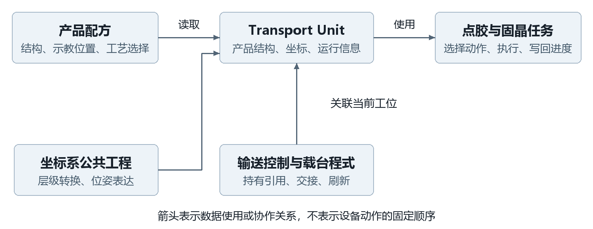

图1 产品模型与周边模块的职责关系

### 2.2 产品配置 运行对象与动作执行的职责

ProductConfiguration提供当前TU、基板、基岛、焊点和异形配置。BaseMatter.Config是动态计算的属性：常规模式按对象类型读取当前配方；焊点再按名称查找配置；异形模式直接取对象绑定的OppositeSex.Config。因此，TU不是配方的独立冻结副本，切换配方或改变结构时必须考虑现有对象与新配置的一致性。[S02、S09]

TuService负责坐标建立、索引/排列换算和工艺状态映射。S1/S2动作控制器的InjectSteps把工序名加入焊点字典；它们不在注入时执行设备动作。BondTask等工作任务读取下一个动作节点，再调用DoWork执行。[S10、S13、S14、S22]

### 2.3 与输送 点胶 固晶模块的协作关系

TransportProgram下有上料、点胶、固晶、等待下料和下料区段，每段通过BaseSubSectionProgram.TransportUnit持有对象引用。引用赋值负责软件产品交接；实际皮带、夹紧、到位和放行由输送控制链负责。示教辅助在部分路径中也会重新构造TU，不能假定所有调用均保留原对象。[S15–S17、S23]

## 3 对象模型与数据设计

### 3.1 载具 基板 基岛 焊点的层级结构

常规模式使用同一套基板配置重复创建基板，再用同一套基岛配置重复创建基岛，每个基岛根据焊点配置列表创建焊点。异形模式沿DownConfigs树逐层创建，各层可有各自的名称、坐标和配置。一个对象只把直接下层保存在自己的集合中；对整份产品的操作通过遍历逐层向下展开。[S01、S03–S05]

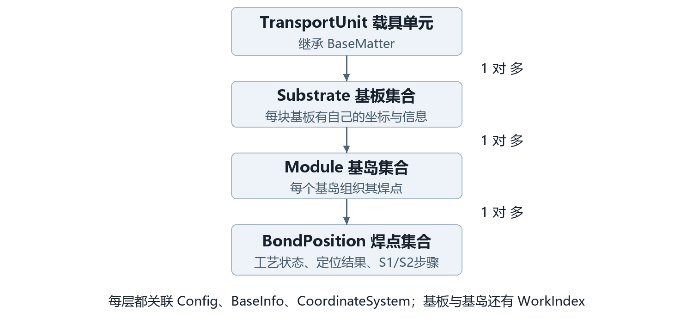

图2 产品对象树及各层职责

### 3.2 公共基类与各层对象的职责

四类对象都继承BaseMatter，统一提供Name、Index、MatterTypeEnum、Config、BaseInfo、CoordinateSystem、EntityState和MatterProductState。基板和基岛还保存WorkIndex、RowIndex和ColumnIndex；Index用于集合中的对象身份，WorkIndex通过排列与工作顺序计算，不能与列表下标混用。常规构造的Index从1开始，访问坐标列表时使用index−1。[S02–S05]

### 3.3 配置数据与运行信息

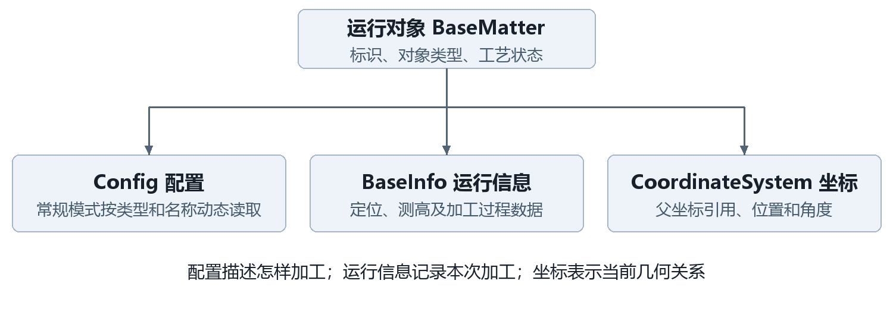

图3 配置 运行信息与坐标的分工

| 数据组 | 主要内容 | 读写规则 |
| --- | --- | --- |
| 配置 Config | 对象结构、示教坐标、定位/测高配置、工艺偏移 | 从当前ProductConfiguration或异形节点取用；不是对象私有快照 |
| 运行信息 BaseInfo | LocateResultInfo、MeasureHeightResult、识别码及完成标记 | 初始化时创建；后续由对应业务更新 |
| TU专属信息 | IsProduct、IsNeedPreDispense、两个工位偏移标记、批次和配方名称字段 | 字段声明不等于每次构造均已赋业务值；按具体调用写入 |
| 焊点专属信息 | 芯片偏差、拍照/取片位置、实际位置、S1/S2步骤字典 | 定位/加工相关流程写回；本篇不展开纠偏算法 |
| 坐标 | Distance、Degree、UpperCoordinateSystem | 构造及Refresh创建；业务可更新位置或角度 |

### 3.4 定位 测高与工序状态

状态分为不同维度。MatterProductState表示工艺参与范围；EntityState表示处理状态或失败；IsVisioned和IsMeasureHeight表示相应数据的完成标记；步骤字典表示具体工序的执行进度。软件HasMaterial属于区段程式，和TU内部工艺状态各自维护。[S06–S08、S11、S16]

| 工艺状态 | S1点胶侧 | S2固晶侧 |
| --- | --- | --- |
| Enable | 参与 | 参与 |
| EnableInSystem1 | 参与 | 不参与，本侧完成判断可直接满足 |
| EnableInSystem2 | 不参与，本侧完成判断可直接满足 | 参与 |
| Disable | 不参与 | 不参与 |

步骤字典的键是工序名，false表示未完成，true表示已完成。重复InjectSteps只补充缺失键，保留已有值，也不会移除已经不在配方中的旧键。焊点完成状态结合工艺参与范围和字典判断，再由基岛、基板、TU逐层汇总。[S01、S03–S05、S08、S13、S14]

### 3.5 关键数据的来源 保存与更新规则

Name在有参TU构造中使用本地时间生成到毫秒的字符串；它未提供数据库唯一约束。BaseInfo的定位/测高标记初值为false；步骤由注入建立。TU的RecipeName和批次等字段仅声明在信息对象中，两个有参构造本身没有逐项填充这些业务字段。[S01、S06–S08]

Config和CoordinateSystem标记JsonIgnore，载台程式的TransportUnit、区段有料状态和传输状态也标记JsonIgnore。因此调用TransportProgram.Save不能据此认为整棵TU及其坐标已持久化。独立TransportUnitStorage提供JSON保存/读取包装，坐标关联需由恢复路径重建；该包装的存在不证明生产每次交接都会调用它。[S02、S16、S18]

## 4 坐标体系设计

### 4.1 各层对象的坐标定义

每个产品对象拥有GeneralCoordinateSystem，Distance表示相对于直接上层的三维平移，Degree参与三角函数计算，采用弧度。TuService.CreateMatterCoordinate创建新坐标对象，设置父坐标引用，再用ElementCoordinate初始化位置和角度。TU的直接上层通过名称TransportCoordinateSystem从机器坐标配置中取得。[S01、S10、S19、S24]

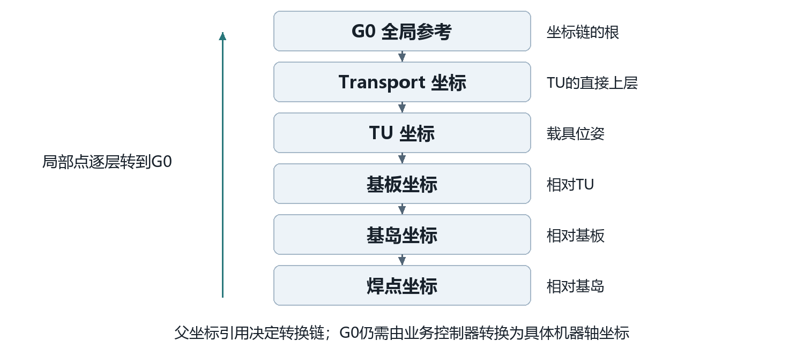

图4 产品坐标层级和局部点转换方向

### 4.2 父子坐标关系与转换

普通坐标的一次正向转换先在XY平面旋转，再叠加父层平移；Z只叠加平移。公式中的θ为当前层弧度角，d为当前层Distance，x、y、z为当前层输入点：[S19]

父层X = dx + x·cosθ − y·sinθ；父层Y = dy + x·sinθ + y·cosθ；父层Z = dz + z。

SelfPosToG0收集从当前层到根的坐标链，依次执行正向转换；G0PosToSelf沿反方向逐层做逆转换。DegreeInG0累加层级角度。产品对象采用普通General坐标；机器坐标链若包含Vm类型，则使用标定转换工具，不能套用简单平移旋转替代该标定分支。[S19、S20]

### 4.3 工位偏移的应用规则

SetSystem1OffSet和SetSystem2OffSet分别检查各自布尔标记。未应用时，把当前配置中的System1Offset或System2Offset直接加到TU的Distance，再将对应标记置true。两个标记独立，方法未声明互斥；同一标记为true时重复调用不再累加。[S01]

偏移相加发生在TU直接父坐标所使用的数值体系中。字符串构造不自动加工位偏移；带系统参数的构造在Init后应用所选偏移。Refresh复位标记但不会自动再次调用偏移方法，后续调用方要按业务路径决定。

分段点胶另有System1MoveDistance与System1BackMoveDistance：只有SubstrateProcessing为Divide时才分别增减TU的Distance.X，距离来自DistanceToRight。这是分段传料对应的坐标平移，没有工位偏移方法的重复调用保护。[S01]

### 4.4 坐标刷新与重建机制

Refresh从当前配方或对象绑定的异形配置建立TU坐标，再沿现有基板、基岛、焊点逐层替换坐标对象并重新绑定父引用。各层实例及其集合被保留；持有旧CoordinateSystem引用的外部代码应重新取得当前坐标。Refresh不按新数量增删对象，结构变更应使用重新构造路径。[S01、S03–S05、S16]

## 5 对象构建与初始化设计

### 5.1 构建入口与前置条件

| 入口 | 行为 | 调用约束 |
| --- | --- | --- |
| TransportUnit() | 空构造，供反序列化使用 | 不完成BaseInfo、下层结构及父坐标的完整建立 |
| TransportUnit(string reason) | 创建信息对象、执行Init、生成名称 | 不自动选择S1/S2偏移 |
| TransportUnit(系统参数) | 系统参数类型为CurrentMachineSystemEnum；执行初始化并选择偏移 | System1走S1；其余值走S2分支 |

构造依赖当前产品配置、机器坐标、S1/S2工序配置可取得。常规配置数量必须与可索引坐标列表匹配，焊点名称必须能解析到配置，异形对象必须能取得对应节点。IsTransportUnitReady在该包装层只检查TU示教结果标记，不能代替上述数据和设备的全部校验。[S01、S02、S09]

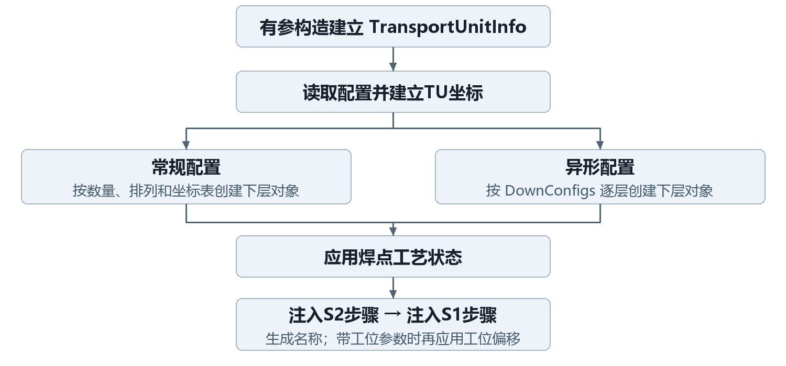

图5 有参构造和Init的主要执行顺序

### 5.2 常规产品对象树的建立

常规构建先清TU基板集合。若基板不是多件，代码把数量与行列改为1并重建坐标表；坐标表为空时补一个默认坐标。启用输入间距时，以首坐标和行列间距生成阵列坐标，保留首点Z，新建坐标角度为0。随后按Count创建基板，矩阵模式计算行列索引。每个基板内部按类似规则建立基岛，每个基岛按焊点配置列表建立焊点。[S01、S03、S04]

这一过程会修改当前配方中的数量和坐标列表，具有配置副作用。设计上应把它看作带初始化整理行为的构建过程，不能当成纯只读查询。

### 5.3 异形产品对象树的建立

异形模式从根OppositeSex读取DownConfigs。TU逐个创建基板，基板逐个创建基岛，基岛逐个创建焊点；每个对象保存自己的OppositeSex引用，从节点取得名称、配置和坐标。集合可以按节点树组织，常规行列计数接口不能替代对该树的实际遍历。[S01–S05]

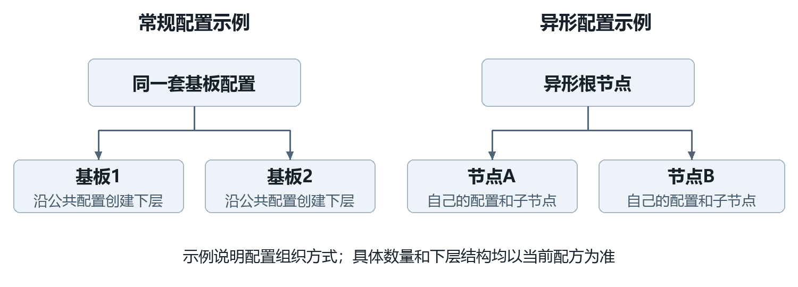

图6 常规配置复用与异形节点配置的对照

### 5.4 工艺状态设置与工序注入

TuService.ModifyMatter在异形模式读取节点工艺状态；常规模式按普通屏蔽列表或大量焊点数组匹配并写入焊点状态。常规匹配还填充所在基板与基岛编号。随后Init先调用S2 InjectSteps，再调用S1 InjectSteps；这仅是状态注入顺序，不规定实际点胶和固晶动作先后。[S01、S10、S13、S14]

### 5.5 初始化顺序与输出结果

正常返回的有参构造生成一棵产品对象树、各层坐标和运行信息，完成工艺状态映射及步骤注入，再生成TU名称；带工位参数时最后叠加该工位偏移。构造没有整体事务或统一回滚机制，任何阶段的异常及其已产生副作用，需要结合调用方处理。[S01]

## 6 生命周期与状态设计

### 6.1 创建与进入加工

TU可以由上料控制、示教辅助、手动补料或生产任务的特定分支创建。例：送板机到上料段的控制器先把上料段设为HasMaterial，再构造System2类型TU并Save；该处参数按源码记录，不能由“上料”名称推断为System1。BondTask在配置输送、TU尚未标记IsProduct等条件下，会用新的System2 TU替换旧引用并将IsProduct置true。产品身份是否保留需看具体入口。[S15、S22、S23]

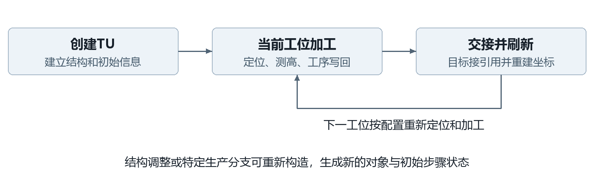

图7 产品对象的代表生命周期与重新构造边界

### 6.2 加工过程中的数据变化

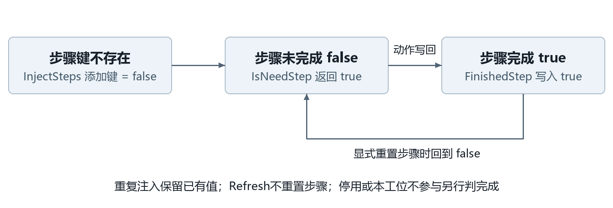

图8 工序标记的建立 完成与显式重置

S1FinishedStep/S2FinishedStep把对应工序键写为true；IsS1NeedStep/IsS2NeedStep直接取键并取反。若键不存在，查询会抛键异常；写入索引器则可以新增键。SetProcessUnable仅重置S1步骤，不能按名字推断同时清空两侧。定位和测高完成标记由各业务独立维护。[S05、S08]

### 6.3 工位交接与对象引用迁移

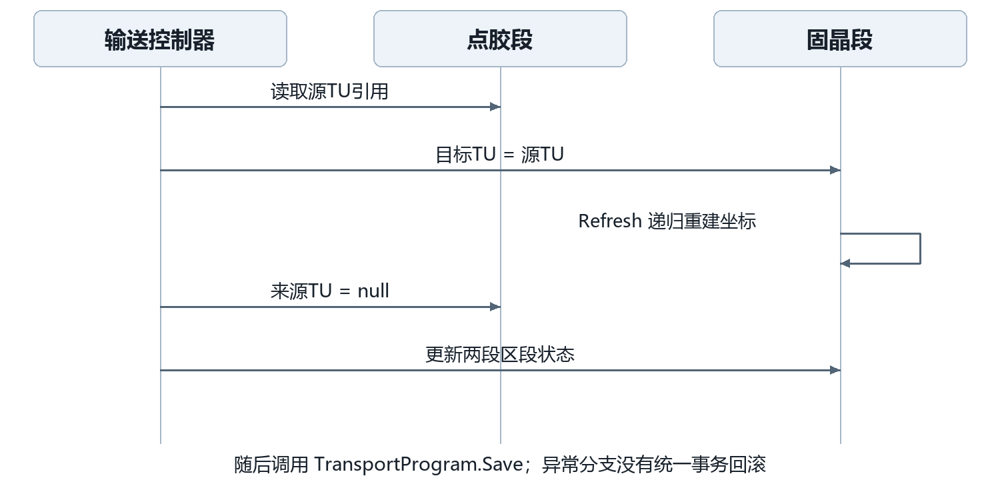

图9 点胶段向固晶段交接的代表时序

图9截取TransferDispenseToBond中传送任务等待结束后的软件交接段：目标先引用来源TU；仅在目标为空且isManual时新建System2 TU；随后Refresh、清来源、设置两段有料/无料及Ready状态，最后Save并返回Success。它传递的是同一个对象引用，未创建深拷贝。[S15]

赋值后到清源前，两段会短暂共享一个引用。Refresh若抛异常，catch记录并返回Exception，没有统一撤销目标赋值。状态、对象引用和保存可能处于不同进度，因此失败后不能直接假定退回交接前状态。图9只描述此代表路径，各上下料路径的条件仍由对应控制器确定。

### 6.4 Refresh处理过程

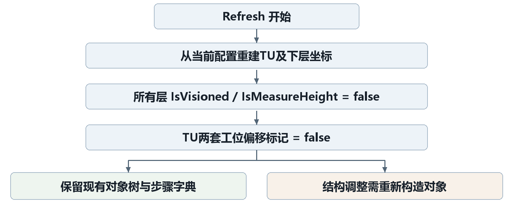

图10 Refresh的处理顺序与保留边界

先重建TU及全部下层坐标，再将TU与下层的IsVisioned、IsMeasureHeight置false，最后将TU的两个工位偏移标记置false。若递归坐标刷新在中途抛异常，后面的标记清理可能尚未执行，不能把整个Refresh视为原子操作。[S01、S03–S05]

### 6.5 数据保留 重建与状态复位规则

| 数据 | 成功Refresh后 | 结构重建后 |
| --- | --- | --- |
| 基板/基岛/焊点实例及集合 | 保留，按现有集合递归 | 按当前配置重新创建 |
| CoordinateSystem与父引用 | 替换并重新绑定 | 创建 |
| IsVisioned / IsMeasureHeight | 置false | 新信息对象初始false |
| 定位结果对象 / 测高数值 | 未在该链显式清零；完成标记已失效 | 新信息对象重新初始化 |
| S1/S2工序字典 | 保留原键和值 | 按工序配置重新注入 |
| 工艺参与状态 | 该Refresh链未重新执行ModifyMatter | 按当前映射初始化 |
| 工位偏移标记 | 均置false，不自动加偏移 | 系统参数构造最后应用所选偏移 |

旧定位数值仍在内存中不代表可继续使用，应结合完成标记判断。结构数量、名称或配置类型改变时，BaseSubSectionProgram.UpdateTransportUnit使用new TransportUnit("示教")重新构造；这个接口会替换原引用，不承诺保留加工进度。[S01、S16]

## 7 主要接口设计

### 7.1 创建与初始化接口

调用方首先选择完整创建还是对现有对象刷新。创建接口和前置条件见5.1。载台UpdateTransportUnit用字符串构造替换对象；载台RefreshTransportUnit直接调用现有TU.Refresh，没有本地空值判断。TransportProgram.RefreshTransportUnit则只对点胶、固晶、等待下料三个非空TU调用Refresh，不覆盖所有五个区段。[S16、S17]

### 7.2 对象查询与遍历接口

| 接口 | 输入与输出 | 边界 |
| --- | --- | --- |
| GetSubstrate(index) | 按Index查找基板；找不到返回null | index<0抛异常；0允许进入查找 |
| GetModule(s,m) | 先查基板再查基岛；上层缺失返回null | 基岛负索引抛异常 |
| GetBondPosition(s,m,name) | 返回名称匹配焊点；上层缺失返回null | name为null抛异常；同名取首个 |
| GetAllBaseMatter() | 返回所有基板、基岛、焊点 | 不含TU自身；Clear方法另处理TU |
| GetBaseMatterByOppositeSex | 按同一节点引用查找对象 | 未匹配抛异常，不按名称等价匹配 |
| GetSubstrateCount / GetModuleCount | 返回当前常规配方Count | 不是对运行集合计数，异形时不能代用 |

GetAllBondPositions(bpName)当前使用i<GetSubstrateCount、j<GetModuleCount且从1开始的循环；它不等价于遍历全部运行集合，末项可能未被访问。需要完整读取时，应理解这个实现边界。GetDivideSubstrate按列数相关位置取得分界X，再按X分类，并不保证在所有配置下恰好等量。[S01]

### 7.3 坐标 偏移及刷新接口

SetSystem1OffSet/SetSystem2OffSet只处理TU平移和各自标记；System1MoveDistance/Back只在Divide模式增减X；Refresh递归替换坐标，详见第4及第6章。调用方不得把持有旧坐标引用、重复分段平移和工位偏移保护混为同一机制。[S01]

### 7.4 工序状态查询与更新接口

FinishedStep和IsNeedStep以工序名为键。TU级IsTuProcessFinishedInSystem1/2逐层聚合所有下层的完成判断；停用或不参与本系统的焊点可直接判该侧完成。字典自身完成判断存在不对称：S1字典为空直接true；S1非空而S2为空返回false；S2字典为空直接true。该规则来自当前实现，不能统一简化成“两边所有值都为true”。[S01、S03–S05、S08]

### 7.5 接口前置条件 输入输出与调用约束

实例方法通常直接使用配置、坐标和下层集合，调用方需保证完整初始化。Config按当前配方动态解析，Refresh保留现有结构，二者共同要求配方结构与对象树一致。独立存储Save(TU,path)按当前类型初始化时确定的配方目录拼接文件名；Read返回JSON辅助类读取的对象，恢复后的坐标重建和工序一致性由调用路径保障。[S02、S18]

## 8 约束与异常处理设计

### 8.1 配置与对象完整性约束

常规构造直接按index−1读取ElementCoordinates，Count与列表长度不一致可能抛越界；焊点配置按名称匹配，名称缺失可能使后续属性访问失败。字符串构造不提供配方快照隔离，异形构造依赖有效DownConfigs及对应配置。坐标根通过固定名称查找，缺失坐标配置不应当作可用加工坐标。[S01–S05]

### 8.2 重复调用与偏移应用约束

两套工位偏移只有各自标记保护，并无相互排斥条件；Refresh后可再次应用。分段平移每调用一次都会增减，需由上层保障次数和时机。重复注入保留已有步骤状态，也保留旧工序键；修改工序配置后需核对当前对象的状态含义。[S01、S13、S14]

### 8.3 初始化 交接及刷新异常

| 位置 | 现有处理 | 对调用方的影响 |
| --- | --- | --- |
| TU构造 / 递归Refresh | 无统一本地catch或回滚 | 前面已执行的配置/坐标修改可能保留 |
| ModifyMatter | 捕获异常，ClearInformation并保存配方；原异常未重抛 | 部分焊点状态可能已改，构造可能继续注入；清理或保存再失败会向外抛 |
| 点胶→固晶交接 | catch日志、弹窗并返回Exception | 没有撤销已完成的目标赋值、来源清理或内存状态更新 |
| IsNeedStep缺失工序键 | 直接字典读取，无本地兜底 | 抛出键异常；需先保持工序注入和配置一致 |
| 独立存储包装 | 无本地重试或事务保护 | 底层读写失败向外传播，不能由包装保证写入原子性 |

### 8.4 异常后的状态与数据影响

异常可能发生在配置整理、对象局部创建、坐标递归替换、状态迁移或保存的中间。由于当前模型没有统一事务边界，恢复判断必须同时核对载台引用、区段状态、完成标记和当前配置，不应只依据一个Success/Exception或HasMaterial标记推断整个产品状态。[S01、S10、S15、S16、S21]

本章描述现有设计约束及可见副作用，不把静态可疑代码直接认定为已发生的设备故障。需要运行确认的具体问题列于附录C。

## 9 典型案例与设计核对

### 9.1 一个产品单元的结构示例

示例配方设2块基板，每块3个基岛，每个基岛2个焊点。按常规构建，得到1个TU、2个Substrate、6个Module和12个BondPosition，共20个BaseMatter后代，TU另计。每层Index按所在父集合编号；焊点名称来自同一焊点配置列表，可以在多个基岛重复出现。定位某个实际焊点时应结合基板号、基岛号和焊点名。[S01、S03–S05]

### 9.2 一次初始化与工位交接案例

假设焊点BP-A含S1工序Dispense和S2工序Bond。新建后两字典值均false；点胶动作完成后S1值true。点胶段向固晶段交接时目标取得同一个TU，Refresh重建坐标并复位定位/测高及偏移标记，S1=true、S2=false仍保留。固晶侧随后何时定位及执行，由对应任务和条件决定。若进入BondTask的重建分支，则会替换为新TU，不能把这条保留案例泛化为所有生产入口。[S01、S05、S13–S15、S22]

### 9.3 坐标转换示例

以下均为说明性假设，长度统一按mm，角度以rad进入公式。设Transport到G0为单位变换；TU原点相对Transport为(100,200,0)，角度π/2；基板、基岛、焊点相对上层分别为(20,0,0)、(10,5,0)、(10,5,0)，下三层角度均为0。先合成TU局部点(40,10,0)，再转换得G0点(90,240,0)。此例只验证普通坐标链的几何关系，不代替实际标定和轴坐标转换。[S19、S20]

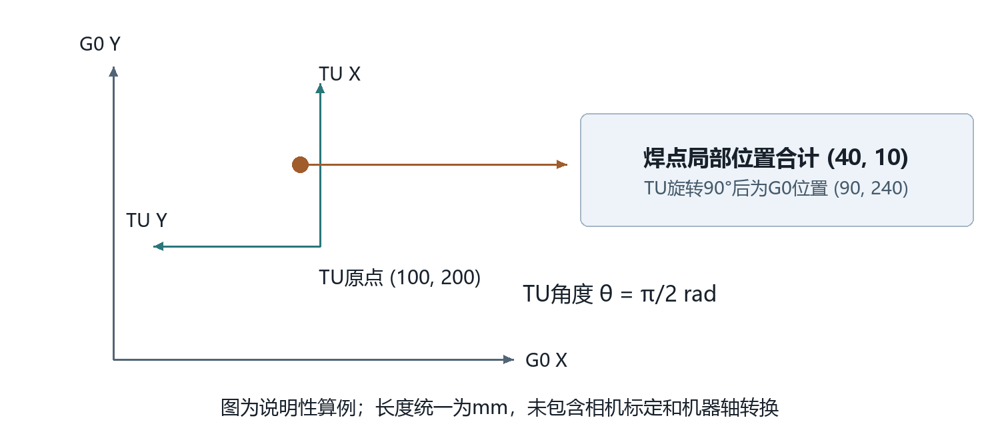

图11 产品局部点逐层转换的说明性算例

核算过程：X=100+40×0−10×1=90；Y=200+40×1+10×0=240；Z=0。若仅给TU加S1偏移(2,−1,0)，且Transport仍为单位变换，则G0点变为(92,239,0)；同一S1偏移再次调用不变化。Refresh后TU回到配置坐标、标记false，重新显式应用S1偏移才再次得到该位置。

### 9.4 设计核对项目

| 核对项 | 本篇依据与结果 |
| --- | --- |
| 章节完整性 | 按确认目录覆盖9章及A/B/C附录 |
| 结构与初始化 | 对照常规/异形构造、配置映射和注入实现说明 |
| 刷新与交接 | 区分保留、重建、复位；按实际引用赋值顺序核对 |
| 步骤状态 | 区分工艺参与、完成标记、S1/S2字典及不对称边界 |
| 坐标示例 | 依据普通正向转换公式逐层独立复算，结果(90,240,0) |
| 持久化边界 | 对照JsonIgnore与独立存储包装；未声称自动恢复生产状态 |
| 证据与版本 | 附录A提供文件、方法、行号；完整哈希见source-baseline.json |
| 评审边界 | 本版提供源码静态设计说明；业务语义和实机效果仍由相应评审确认 |

## 附录 A 关键源码与分析版本

分析日期为2026年10月20日。业务源码位于本机trunk，未随本仓库Git提交管理，因此使用文件SHA256固定本版依据；完整清单保存在同目录source-baseline.json。下列路径均相对于项目根目录。引用编号用于核查设计依据，不要求阅读正文时逐个打开源码。

### S01 构造 Init Refresh 查询 偏移与遍历

trunk/AKRS.ZX2200/TransportUnitSystem/Module/Matter/TransportUnit.cs

public TransportUnit(string reason)：73行；private void Init()：107行；public void Refresh()：135行；public void SetSystem1OffSet()：526行。SHA256前12位：fdd0da8b5bae。

### S02 公共对象与动态Config

trunk/AKRS.ZX2200/TransportUnitSystem/Module/Matter/BaseMatter.cs

public abstract class BaseMatter：22行；public BaseConfig GetConfigByType：111行。SHA256前12位：0bdd3a663fe3。

### S03 常规/异形基板 下层构建和刷新

trunk/AKRS.ZX2200/TransportUnitSystem/Module/Matter/Substrate.cs

public Substrate(int index：51行；public void Refresh(int index：182行。SHA256前12位：f71ed3154cd9。

### S04 基岛 焊点构建与状态汇总

trunk/AKRS.ZX2200/TransportUnitSystem/Module/Matter/Module.cs

public Module(int index：54行；public void CreateBondPosition()：107行；public void Refresh(int index：148行。SHA256前12位：c59412d851ce。

### S05 焊点 完成标记和工序接口

trunk/AKRS.ZX2200/TransportUnitSystem/Module/Matter/BondPosition.cs

public BondPosition(string name：40行；public bool IsFinishedInSystem1：129行；public void S1FinishedStep：168行。SHA256前12位：bfb7654a6f43。

### S06 公共定位与测高信息

trunk/AKRS.ZX2200/TransportUnitSystem/Module/Information/BaseInformation.cs

public abstract class BaseInformation：12行。SHA256前12位：df47137b5f48。

### S07 TU运行信息与偏移标记

trunk/AKRS.ZX2200/TransportUnitSystem/Module/Information/TransportUnitInfo.cs

public class TransportUnitInfo：12行。SHA256前12位：3cf46167dc86。

### S08 焊点结果与S1/S2字典

trunk/AKRS.ZX2200/TransportUnitSystem/Module/Information/BondPositionInfo.cs

public class BondPositionInfo：18行；public bool IsFinishedInSystem1()：118行；public bool IsFinishedInSystem2()：145行。SHA256前12位：6bd63b789cff。

### S09 配方组织 实例刷新与就绪包装

trunk/AKRS.ZX2200/TransportUnitSystem/ProductConfiguration.cs

public class ProductConfiguration：22行；public void InitProductConfiguration()：71行；public bool IsTransportUnitReady()：89行。SHA256前12位：b51086bf360c。

### S10 索引 坐标建立 状态映射

trunk/AKRS.ZX2200/TransportUnitSystem/Service/TuService.cs

public static void CreateMatterCoordinate：872行；public static void ModifyMatter：887行。SHA256前12位：ff32f1cd9cc0。

### S11 工艺参与 实体状态与类型

trunk/AKRS.ZX2200/TransportUnitSystem/Model/TuEnum.cs

public enum MatterProductState：278行；public enum EntityState：256行；public enum EntityTypeEnum：307行。SHA256前12位：c43ddaf54945。

### S12 TU配置 工位偏移和分段距离

trunk/AKRS.ZX2200/TransportUnitSystem/Module/Config/TransportUnitConfig.cs

public class TransportUnitConfig：24行。SHA256前12位：50c0b4a3260f。

### S13 S1工序注入

trunk/AKRS.ZX2200/Main/Machine/Process/S1ActionNodeController.cs

public void InjectSteps(TransportUnit transportUnit)：859行。SHA256前12位：b2c9271bd56d。

### S14 S2工序注入

trunk/AKRS.ZX2200/Main/Machine/Process/S2ActionNodeController.cs

public void InjectSteps(TransportUnit transportUnit)：1410行。SHA256前12位：0ce8f7f63e36。

### S15 上料创建与点胶到固晶引用交接

trunk/AKRS.ZX2200/TransportSystem/Controllers/TransportController.cs

public ExcuteResult TransferAutoLoaderToLoading：439行；public ExcuteResult TransferDispenseToBond：1266行；this.TransportProgram.BondSubSectionProgram.TransportUnit =：1478行。SHA256前12位：d180b07735e4。

### S16 载台持有 JsonIgnore和重建

trunk/AKRS.ZX2200/TransportSystem/Models/Programs/BaseSubSectionProgram.cs

public abstract class BaseSubSectionProgram：36行；public void UpdateTransportUnit()：62行。SHA256前12位：668212421562。

### S17 区段集合与选择性刷新

trunk/AKRS.ZX2200/TransportSystem/Models/TransportProgram.cs

public class TransportProgram：20行；public void RefreshTransportUnit()：90行。SHA256前12位：2570d6064379。

### S18 独立JSON存储包装

trunk/AKRS.ZX2200/TransportUnitSystem/Model/TransportUnitStorage.cs

public static void Save(TransportUnit transportUnit：35行；public static TransportUnit Read：62行。SHA256前12位：a104500abc2c。

### S19 普通正逆转换和坐标初始化

trunk/AKRS.Galaxy2.CoordinateSystems/CoordinateSystems/BaseCoordinateSystem.cs

public AKRSPoint3D ForwardConvertCoordinate：84行；public void Init(ElementCoordinate：281行。SHA256前12位：c6e5ae892f86。

### S20 多层G0转换与累积角度

trunk/AKRS.Galaxy2.CoordinateSystems/CoordinateSystems/GeneralCoordinateSystem.cs

public AKRSPoint3D SelfPosToG0：44行；public double DegreeInG0()：107行。SHA256前12位：248d9171f2f2。

### S21 工艺信息清理

trunk/AKRS.ZX2200/TransportUnitSystem/Module/Config/OtherConfig.cs

public void ClearInformation()：38行。SHA256前12位：ffea1f4913fb。

### S22 生产重建条件和动作调用

trunk/AKRS.ZX2200/BondSystem/Tasks/BondTask.cs

new TransportUnit(CurrentMachineSystemEnum.System2)：204行；ExcuteResult ret = actionNode.DoWork()：232行。SHA256前12位：a1d55a0adf9c。

### S23 示教入口的对象取得与替换

trunk/AKRS.ZX2200/TransportUnitSystem/Controls/Assistant/TUAssistantHelper.cs

public static TransportUnit JudgeTuExist()：392行。SHA256前12位：893f55643943。

### S24 配置坐标元素

trunk/AKRS.Galaxy2.CoordinateSystems/CoordinateSystems/ElementCoordinate.cs

public class ElementCoordinate：11行。SHA256前12位：404300c6f6bb。

## 附录 B 术语及图表索引

| 图号 | 图名 | 所在章节 |
| --- | --- | --- |
| 图1 | 产品模型与周边模块的职责关系 | 2 |
| 图2 | 产品对象树及各层职责 | 3 |
| 图3 | 配置 运行信息与坐标的分工 | 3 |
| 图4 | 产品坐标层级和局部点转换方向 | 4 |
| 图5 | 有参构造和Init的主要执行顺序 | 5 |
| 图6 | 常规配置复用与异形节点配置的对照 | 5 |
| 图7 | 产品对象的代表生命周期与重新构造边界 | 6 |
| 图8 | 工序标记的建立 完成与显式重置 | 6 |
| 图9 | 点胶段向固晶段交接的代表时序 | 6 |
| 图10 | Refresh的处理顺序与保留边界 | 6 |
| 图11 | 产品局部点逐层转换的说明性算例 | 9 |

Config是当前配方配置入口；BaseInfo是运行信息基类；Distance是相对父层平移；Degree为参与三角函数计算的弧度角；Index是父集合内编号；WorkIndex是工作顺序换算结果；InjectSteps是工序标记注入；Refresh是现有对象树上的坐标重建与部分标记复位；JsonIgnore表示对应成员不参与标准JSON序列化。其他业务术语见1.3。

## 附录 C 待核实事项

以下事项不改变本篇已描述的源码行为，涉及业务预期、运行环境或外部调用范围，需在业务评审或相应运行验证中确认。

| 事项 | 已确认的实现边界 | 需要确认的内容 |
| --- | --- | --- |
| 配方切换与旧TU | Config动态取当前配方，Refresh保留现有树 | 所有入口是否保证切配方前处理旧对象 |
| 全量同名焊点查询 | GetAllBondPositions循环存在末项访问边界 | 实际调用范围与遗漏是否影响业务 |
| S1完成判定 | S1非空且S2为空时，S1信息对象返回false | 该条件对应的业务预期与配置支持范围 |
| 状态映射异常 | 清理并保存配置；可能继续构造 | 受影响配方的恢复要求与现场反馈 |
| 持久化与恢复 | 载台TU标记JsonIgnore；另有独立JSON包装 | 具体部署的导入、恢复及加工续作流程 |
| 工位偏移时机 | 构造、显式调用及Refresh行为已分别描述 | 全部生产/示教入口的偏移应用一致性 |
| 数据一致性与异常恢复 | 所读交接链无统一回滚；共享引用有中间状态 | 现场恢复策略及跨线程访问约束 |
| 设备效果 | 本篇为源码设计说明 | 实际配方、坐标标定、硬件运行及工艺效果验收 |
