# Transport Unit 设计文档

跟着产品P1完成点胶 固晶和下料 看懂同一个A点的位置与加工记录

先顺着第一部分走完一轮。第二、三部分用来回答换配方、人工操作和异常时的问题。

两册使用同一份说明产品P1、基板1／基岛2／A点。图中布局为示意，数值用于讲清流程，不是本机参数。

# 01 从上料开始跟住产品P1

第一部分 跟着产品完成一轮

● 来料 → 建立记录 → 找位置 → 点胶 → 交接 → 固晶 → 下料

这次只跟一份产品P1。它进点胶工位，在指定位置点胶；随后进入固晶工位，把芯片贴上去；最后送往下料。设备中可能同时有其他产品，本文先把P1这一条线看完整。

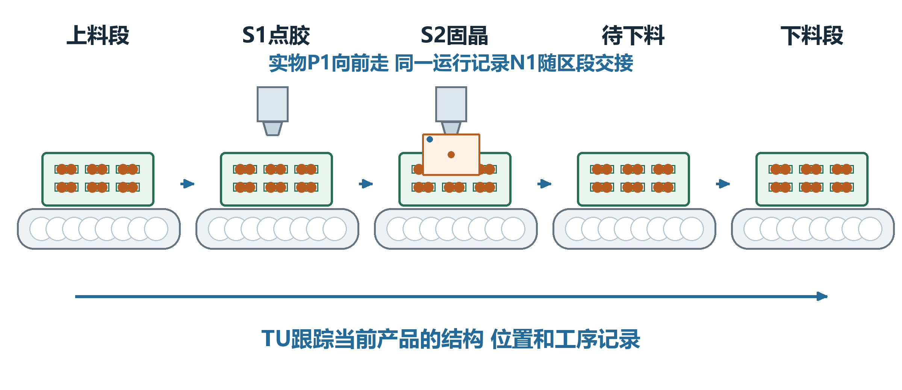

图1 蓝色路线一直跟踪P1 其他产品不在本例展开

软件需要在每个工位回答同一件事：眼前还是P1吗，它有哪些加工位置，哪些点已经做完？保存这些信息的数据叫TU，可以理解成P1的电子加工记录。

点胶工位简称S1，固晶工位简称S2。TU把位置和记录交给动作使用，皮带、气缸和焊头再由各自控制模块执行。第一部分按正常启用两侧工艺、配置输送的成功路径讲。

**先记住产品P1，后面位置变了、工位换了，都继续查它。**

产品已经进线，下一页先认准这次要跟踪的A点。

# 02 在P1上认准这一个A点

第一部分 跟着产品完成一轮

来料 → ● 建立记录 → 找位置 → 点胶 → 交接 → 固晶 → 下料

P1里有2块基板，每块基板有3个基岛，每个岛都有A、B两个加工位置。这次只跟踪基板1、基岛2的A点，后面图里一直用蓝圈标出它。

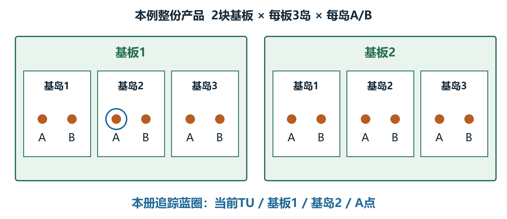

图2 同名A点有6个 蓝圈只选中其中一个

总共有12个焊点。“焊点”在这里是加工位置的名字，不表示这个位置一定要做焊接。给动作完整地址，才能保证找到本次这个A点，而不是旁边岛上的同名点。

各点有自己的位置和进度。即便几个A点读取同一套工艺配置，蓝圈A点点完胶，也不会把其他A点一起记成完成。后文“当前A点”都指蓝圈这一点。

**本例的完整地址始终是P1／基板1／基岛2／A。**

认准A点以后，软件要先为P1准备一份能记录进度的数据。

# 03 给P1建立这一轮的加工记录

第一部分 跟着产品完成一轮

来料 → ● 建立记录 → 找位置 → 点胶 → 交接 → 固晶 → 下料

来料或搜索阶段可能已有一份临时记录。正常启用点胶的生产入口，在需要建立正式产品时，会按点胶侧参数新建TU。把本次正式对象记为N1，它在物理上对应产品P1。

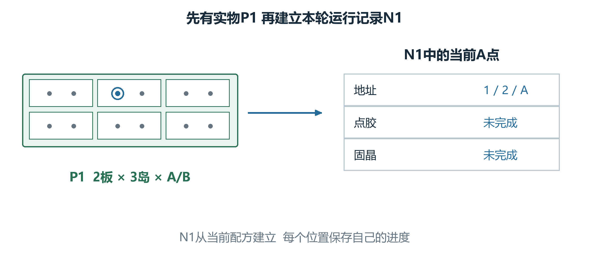

图3 P1是实物名称 N1是本次软件对象的代号

软件按配方建立2块基板、6个岛和12个焊点，再给每个点准备位置和工序。当前A点先记“点胶未完成、固晶未完成”。本册图上直接写中文状态。

配方描述同款产品应该怎样加工；N1记录P1这一份现在的情况。控制器另外保存本轮动作的先后。代码字段与接口放在后面的阅读索引里，先继续跟P1走。

**有了电子记录，软件才能把后面的结果写回同一个A点。**

记录建好以后，还要把“岛里的A点”换成机器能够使用的位置。

# 04 先把A点的初始位置算出来

第一部分 跟着产品完成一轮

来料 → 建立记录 → ● 找位置 → 点胶 → 交接 → 固晶 → 下料

本例先不旋转产品。TU原点在机器全局参考G0的(100,200)毫米；基板1相对TU在(20,0)，基岛2相对基板在(10,5)，A相对岛在(10,5)。

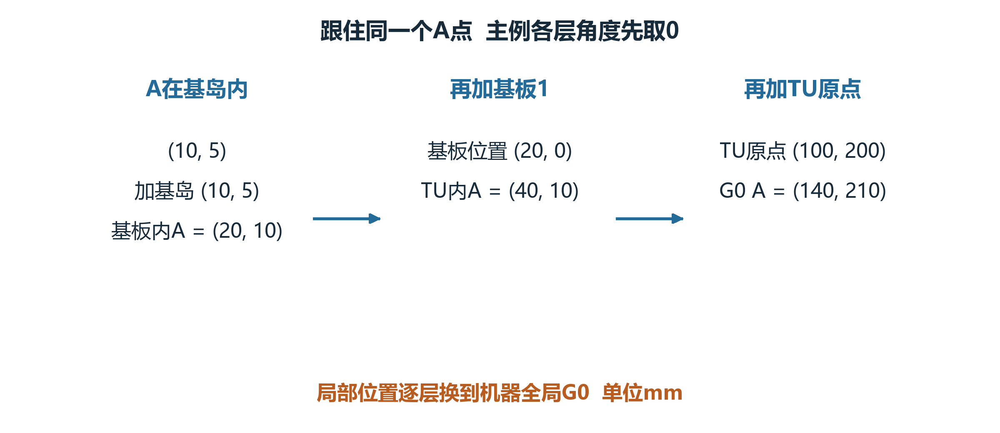

图4 每次都先说相对谁 再把位置接到上一层

从A往外算：在基板里是(20,10)，在TU里是(40,10)，加TU原点后，A的初始G0位置就是(140,210)毫米。后面两册都从这个A点起步。

G0是机器的一套全局参考名字。真正发给运动轴之前仍要经过设备转换。当前这一页只把产品层级接起来，长度统一用毫米，所有层的角度在主例中先取0。

**P1上的A点初始G0位置为(140,210)毫米。**

到了点胶工位，还要考虑整份产品在这个工位的偏移。

# 05 到了点胶工位位置怎样变化

第一部分 跟着产品完成一轮

来料 → 建立记录 → ● 找位置 → 点胶 → 交接 → 固晶 → 下料

现在P1已经在S1。本例给S1整体偏移(2,−1)毫米，它加在TU平移上，所以当前A点也从(140,210)变成(142,209)。产品和A点仍是原来的那一份。

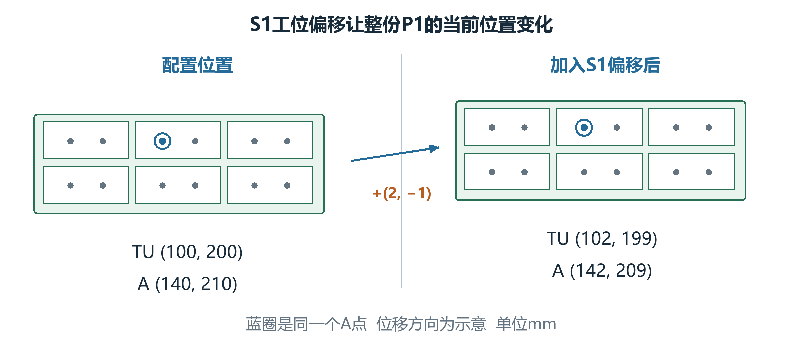

图5 左图是配方位置 右图是加S1偏移后的当前位置

这次偏移的意思是整份产品的参考位置改变，不是12个焊点分别换了配置。相应标记会避免同一套S1偏移重复累加。

为把主例连贯地看完，假定S1后续XY定位没有增加修正。S2偏移取0。这里给定的是说明条件，实际设备的位置仍取决于本轮定位、当前父坐标和工位设置。

**此刻当前A点的G0为(142,209)，点胶和固晶都还未完成。**

XY位置有了，下一步再看基板高度怎样影响这个A点。

# 06 测到基板高了一点以后

第一部分 跟着产品完成一轮

来料 → 建立记录 → ● 找位置 → 点胶 → 交接 → 固晶 → 下料

相机定位用来确认平面位置与方向，测高用来取得高度差。本例基板1的实测平均高度，比示教平均高度高0.12毫米。

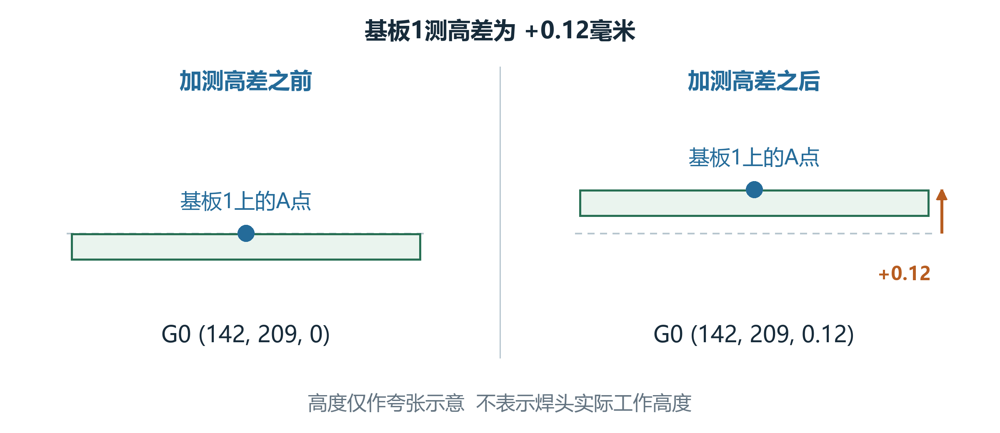

图6 同一个A点只增加了基板1带来的高度差

软件把0.12记在基板1的过程信息里，也加到该基板的Z平移。于是A的G0从(142,209,0)变为(142,209,0.12)。这块基板下面其他点也会随父层带上这个增量。

本例Z=0只是产品坐标的说明基准，不是焊头的实际工作高度。实际点胶或贴装高度还要由各自动作和设备参数计算。

**测高记录和当前位置一起更新，工序进度此时还没改变。**

位置已经准备好，接下来才轮到当前A点真正点胶。

# 07 A点点完胶以后记下什么

第一部分 跟着产品完成一轮

来料 → 建立记录 → 找位置 → ● 点胶 → 交接 → 固晶 → 下料

点胶动作按当前工作地址找到P1的A点，判断本侧需要执行，再取当前位置完成点胶。本页只看这个动作正常成功的出口。

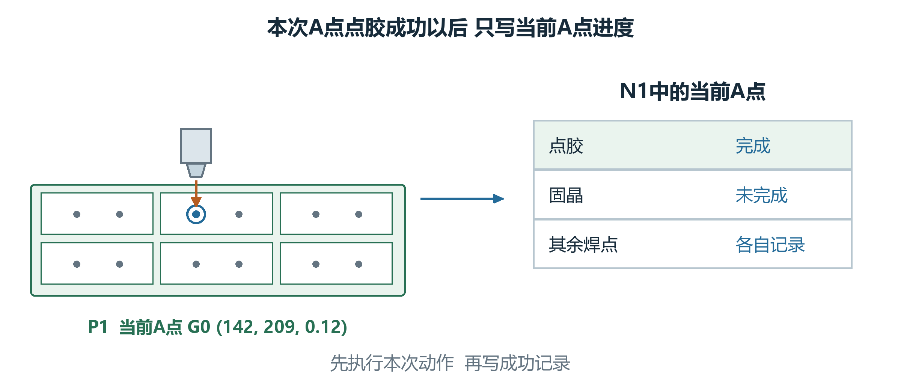

图7 点胶动作成功后 当前A点的点胶状态才改成完成

成功之后，A点的记录变为“点胶完成、固晶未完成”。其他11个焊点各自看自己的记录；本例不会因为一个A点完成而把整份产品都记为已做完。

控制器也会标记本条动作消息。产品工序和动作消息是分别保存的，所以任务准备下一轮消息时，仍可以留下P1已经点过胶的进度。

**A点现在的位置是(142,209,0.12)，点胶已完成。**

等S1满足本轮放行条件，输送任务才把P1交给固晶工位。

# 08 产品交给固晶时记录怎样接过去

第一部分 跟着产品完成一轮

来料 → 建立记录 → 找位置 → 点胶 → ● 交接 → 固晶 → 下料

S1发出放行信号，输送侧还要确认源段有料、目标段无料，并完成对应机械移送和检测。软件交接从接收原N1对象开始。

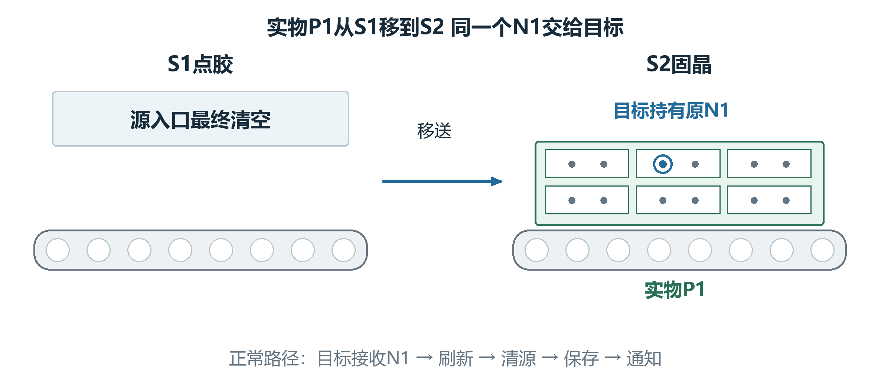

图8 实物向S2移动 软件把同一N1交给目标区段

正常路径先让固晶段持有N1，再刷新N1的坐标；刷新成功后，清掉点胶段入口，更新区段状态并保存。输送任务成功返回以后，再通知S2来料完成。

这次没有把点胶进度复制进另一棵树，A点和它的记录仍在原N1中。机械移动、引用交接和来料通知是前后不同节点。

**跨工位沿用同一份N1，P1的点胶进度才能继续被S2看到。**

不过“沿用同一份记录”并不意味着沿用点胶工位的旧坐标，下一页看刷新。

# 09 交接刷新后位置重算进度保留

第一部分 跟着产品完成一轮

来料 → 建立记录 → 找位置 → 点胶 → ● 交接 → 固晶 → 下料

P1已经交给S2。刷新会按配置重新建立各层坐标，清掉定位、测高和工位偏移的处理标记；同一个A点和已经完成的点胶记录仍保留。

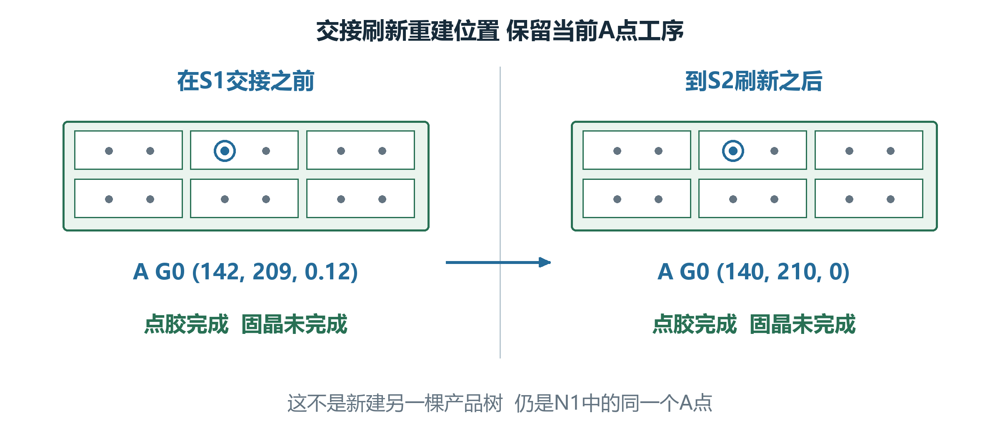

图9 上半看位置变化 下半看同一个A点的加工进度

本例刷新前A在(142,209,0.12)，刷新后回到配置链的(140,210,0)。旧测高差0.12可能还读得到，但它已经不包含在新坐标里。

当前记录仍是“点胶完成、固晶未完成”。正常S1已设置生产入口标记，S2通常继续保留N1；需要重建的例外在后面单独讲。

**同一产品可以既保留加工进度，又需要重新定位。**

S2现在知道P1的A点还没贴芯片，下一步要把芯片C1准确送到这里。

# 10 固晶工位开始为A点准备贴装

第一部分 跟着产品完成一轮

来料 → 建立记录 → 找位置 → 点胶 → 交接 → ● 固晶 → 下料

S2接到P1后，从同一个N1中找到A点。本例此时的基础位置为(140,210)，还要根据产品拍照和芯片拍照，形成真正贴装目标。

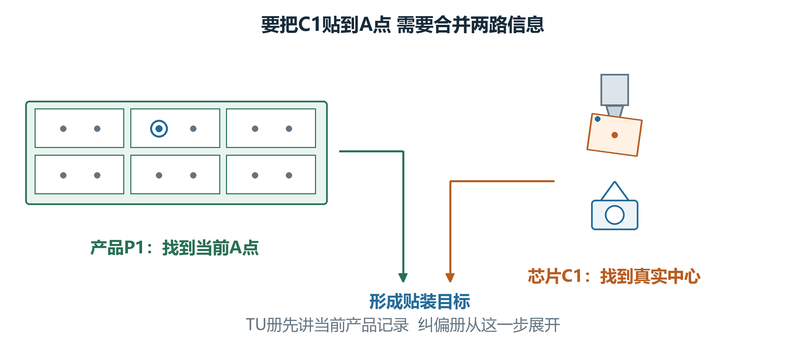

图10 绿色找产品A点 橙色找芯片C1 两路在贴装处汇合

纠偏册从这里接着讲：产品定位把A点更新到(140.2,209.9)；供料端找到芯片C1并取起；本例选择快速单点上视，测出芯片偏移，再计算怎样对准A点。

A点原点和最终焊头目标承担不同用途。芯片没有正好吸在理想中心、还需要旋转或启用了补偿时，最终目标会继续改变。

**本册跟住产品记录；纠偏册展开同一颗C1怎样贴准当前A点。**

相应贴装动作真正成功以后，才能把A点的固晶工序写成完成。

# 11 C1贴完以后A点才算完成这一道工序

第一部分 跟着产品完成一轮

来料 → 建立记录 → 找位置 → 点胶 → 交接 → ● 固晶 → 下料

继续取正常成功路径：本次芯片C1已完成对应固晶动作。软件把当前A点的固晶工序记成完成，点胶完成记录也继续保留。

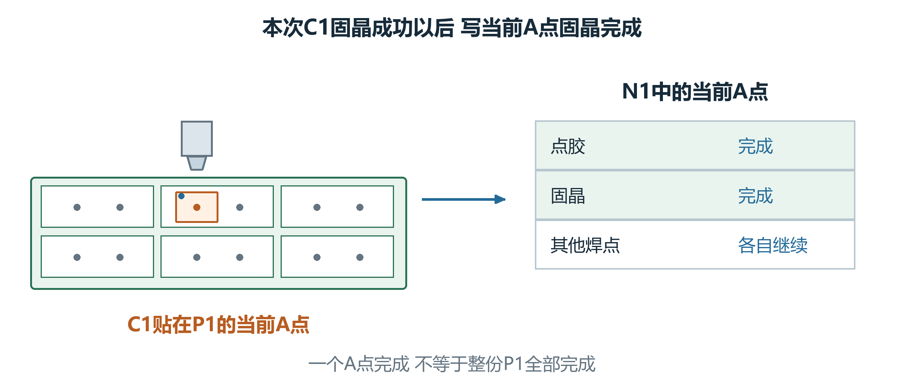

图11 成功写回的是当前A点的工序 其他点仍分别判断

于是这个A点是“点胶完成、固晶完成”。任务再根据其他焊点和工序安排继续。单点完成并不说明整份P1已经全部做完，也不直接等同于检测质量合格。

控制器复位本轮动作消息，不会自动清掉A点这两项产品记录。等产品全部满足发送条件后，才进入下一段的移送。

**本例始终是P1的同一个A点，芯片C1贴在这一点上。**

最后看P1怎样离开当前工位，以及这一轮记录在哪些地方不再被持有。

# 12 P1下料后再回看完整一轮

第一部分 跟着产品完成一轮

来料 → 建立记录 → 找位置 → 点胶 → 交接 → 固晶 → ● 下料

满足发送条件后，P1从固晶进入待下料和后续下料路径。各输送入口按自己的机械条件和数据次序执行，当前区段最终交出或清除TU入口。

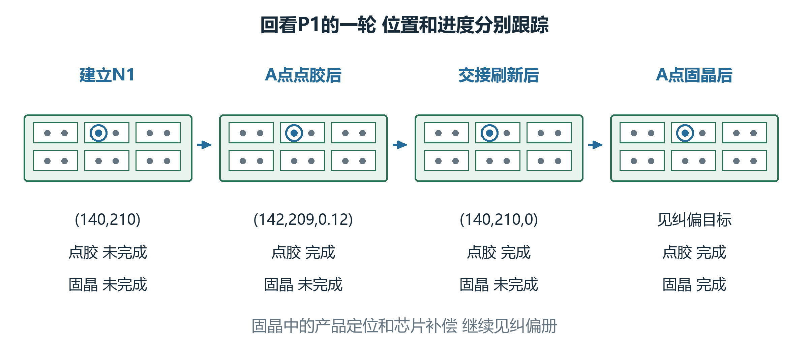

图12 一行跟P1的位置 一行跟当前A点的点胶和固晶记录

整轮只抓住四个快照：建立N1时未做；A点点胶后只完成点胶；交接后同一N1保留进度但坐标重建；当前固晶成功后再完成这一项固晶。

本例交接后A的基础G0为(140,210)，后续产品定位和芯片补偿由纠偏册继续。未配置输送时，固晶发送分支可能导出Mapping、清当前TU，再提示人工取走，不能套用同一条下料路线。

**到这里正常的一轮已经走完，后面的章节按遇到的问题查阅。**

如果产品转了方向、换了加工顺序或需要人工操作，再进入第二部分。

# 13 产品转了方向时位置跟着转

第二部分 换一种产品或操作方式

来料 → 建立记录 → ● 找位置 → 点胶 → 交接 → 固晶 → 下料

下面开始看可选情况。只把P1的TU方向改为90°，其余局部长度不变。A在TU内仍是(40,10)，但TU的X方向已经朝机器Y方向。

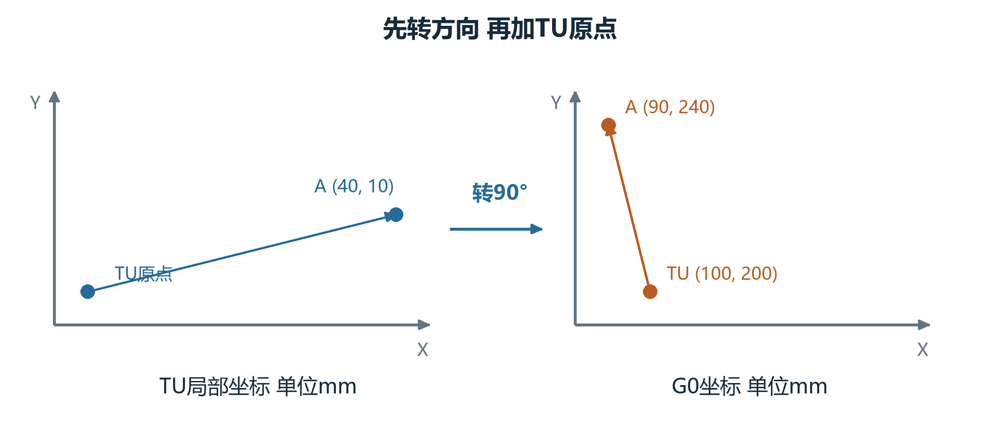

图13 本页是改变方向后的对照例 不接着主例继续累加

局部(40,10)旋转后成为(−10,40)，再加TU原点(100,200)，得到G0的(90,240)。这个值属于本页改方向的情况，主例初始A仍是(140,210)。

产品整体移动或某一层定位后，其下焊点换算时会使用新的父层位置和方向。一般无需逐点改写全部局部坐标。

**图中蓝色是本层位置，橙色是换算后的机器全局位置。**

位置解决了“在哪里”，蛇形顺序还要另外解决“先加工哪个”。

# 14 加工顺序可以和结构编号不同

第二部分 换一种产品或操作方式

来料 → 建立记录 → 找位置 → ● 点胶 → 交接 → 固晶 → 下料

另看一个2行3列的岛阵列。上排结构号1、2、3，下排4、5、6；若采用蛇形加工，路径会走1、2、3、6、5、4。

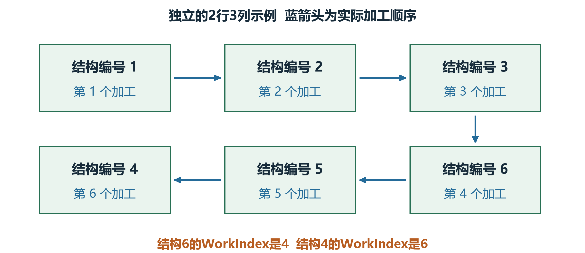

图14 结构6是第4个加工的对象 结构4是第6个

所以界面说的“第4个”和产品结构中的“编号4”，可能是不同对象。前者是工作顺序，后者是结构地址。主例只有一行时它们可能相同，不能据此混用。

代码中分别叫WorkIndex和Index。需要查当前A点时，从本轮消息和所调用接口确定数字的含义，别把列表第几项长期当成固定身份。

**先说清数字表示地址还是加工次序。**

如果产品太长，除了改变顺序，还可能要分两段点胶。

# 15 分两段点胶时仍跟着同一份记录

第二部分 换一种产品或操作方式

来料 → 建立记录 → 找位置 → ● 点胶 → 交接 → 固晶 → 下料

长产品需要移段时，点胶消息分成两组，中间等待机械移送完成。两组按配置索引划分，数量不一定各一半；本文把这种配置叫分段点胶。

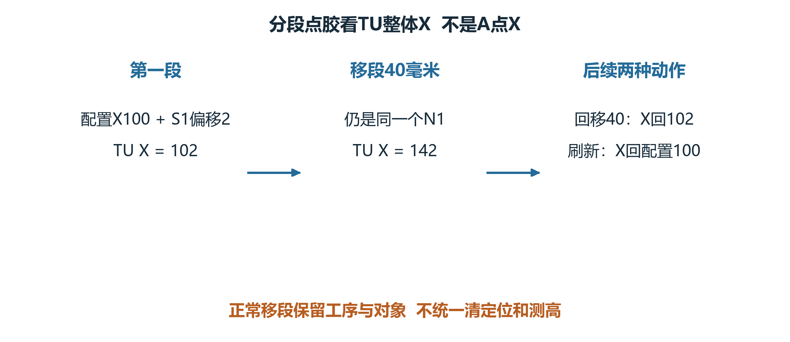

图15 只改变P1的当前位置 不是新建另一份产品记录

沿主例TU的X配置100、S1偏移2，第一段TU的X为102。再给移段距离40毫米，移到第二段后X为142；相应回移分支减40可回102。

正常移段保留对象和工序，不统一清定位、测高标记。若改走刷新，会回到配置X=100，和减40回移不同。第二组是否定位仍看各层自己的条件。

**移段、回移和刷新是三个不同动作。**

有的产品连各块基板里的岛数量也不同，这时要看异形结构。

# 16 异形产品按实际节点建立位置

第二部分 换一种产品或操作方式

来料 → ● 建立记录 → 找位置 → 点胶 → 交接 → 固晶 → 下料

主例每块板都是3个岛，适合重复模板。异形产品可以第一块板2个岛、第二块板3个岛，软件按配置节点的实际下层建立运行对象。

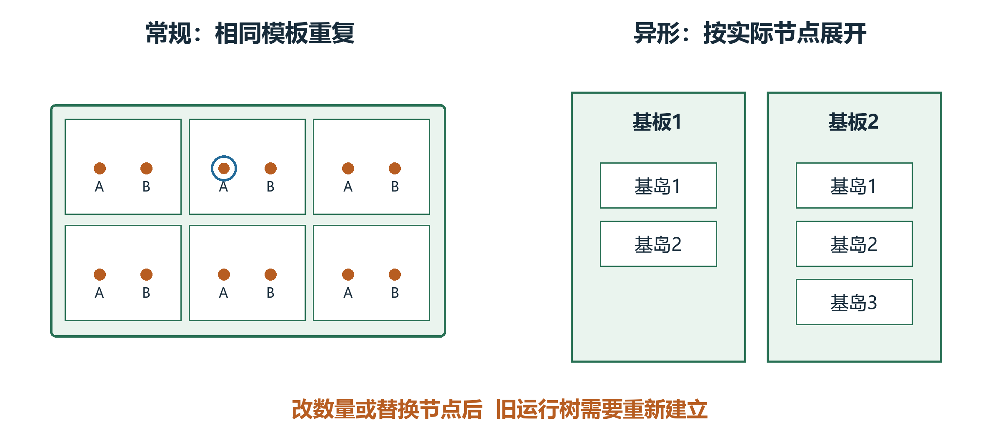

图16 规则布局重复模板 异形布局沿实际节点展开

节点的位置决定摆放，关联的配置名决定读取哪份工艺。同一套A点工艺仍可以被多个位置共用，但各位置的进度分别保存。

编辑器增删、复制或替换配置节点，重画页面不会自动替换旧运行树。名字或ID相同的新节点，也不保证能反查到旧对象；需要让实际节点关联和当前树匹配。

**数量和层级改了以后，需要重新建立对应运行树。**

下一页把“只调位置”和“换了产品规则”放在一起比较。

# 17 改配方以后选刷新还是重新建立

第二部分 换一种产品或操作方式

来料 → ● 建立记录 → 找位置 → 点胶 → 交接 → 固晶 → 下料

只调整位置而结构仍匹配时，可以刷新坐标。把每板3个岛改成4个，或换焊点名、替换异形节点时，旧TU不会靠刷新自动长出正确的新结构。

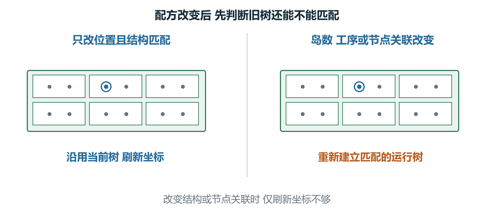

图17 先看改变了什么 再决定沿用还是重建

常规对象会读取当前配方，但已有的数量、部分创建时复制的标记和工序键仍可能来自旧阶段。旧对象存在，不证明它已经适配新配方。

例如镜像标记在焊点创建时复制，刷新不会重新赋值。工序改名后补入新键，旧键也不会自动删除。完整字段和调用约束放在代码索引里。

**把树、配方和工序一起对上，再解释当前记录。**

只想让某些位置参加或跳过工艺时，还要分清配方Mapping和生产Mapping。

# 18 两种Mapping画面改的对象不同

第二部分 换一种产品或操作方式

来料 → ● 建立记录 → 找位置 → 点胶 → 交接 → 固晶 → 下料

配方Mapping用窗口样本编辑后续产品的参与规则；生产Mapping直接操作区段当前的产品。画面相似，改变的数据拥有者不同。

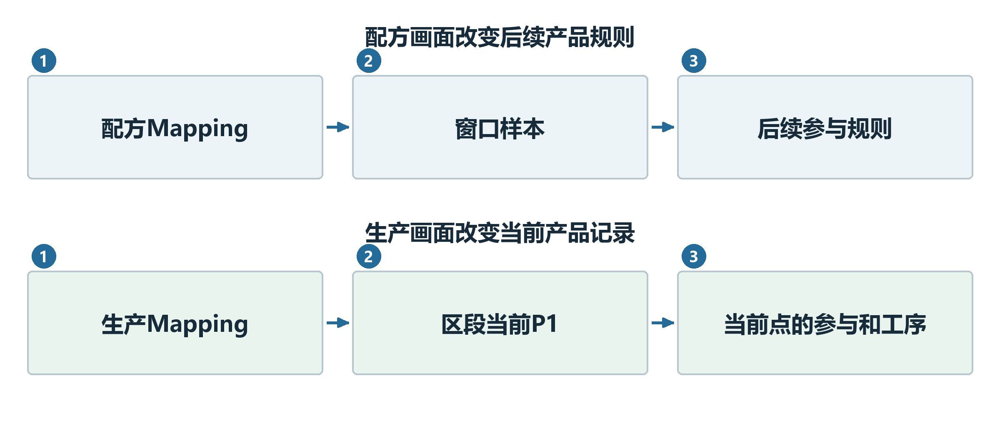

图18 上面改变后续规则 下面改变当前P1的记录

在生产画面选一个焊点，点正常会把该点两侧步骤变为未完成；点成功会把两侧置完成。选基板或基岛时主要传播参与范围，没有同样重置全部后代步骤。

新配方画面关闭有变化时可只写回内存，并不等于保存到文件。关窗口后有TU，也要通过状态检查和人工确认才会清空。代码差异留在阅读索引。

**人工改成成功是在改记录，不能当作实际加工证据。**

如果拿到的是一份导出的Mapping文件，还要看它到底保存了哪些内容。

# 19 导入Mapping只恢复规定的内容

第二部分 换一种产品或操作方式

● 来料 → 建立记录 → 找位置 → 点胶 → 交接 → 固晶 → 下料

Mapping导入先用当前配方建新TU，再把文件里的身份和结果标记填进去。它没有把过去整套运行对象、实时坐标和动作现场原样装回来。

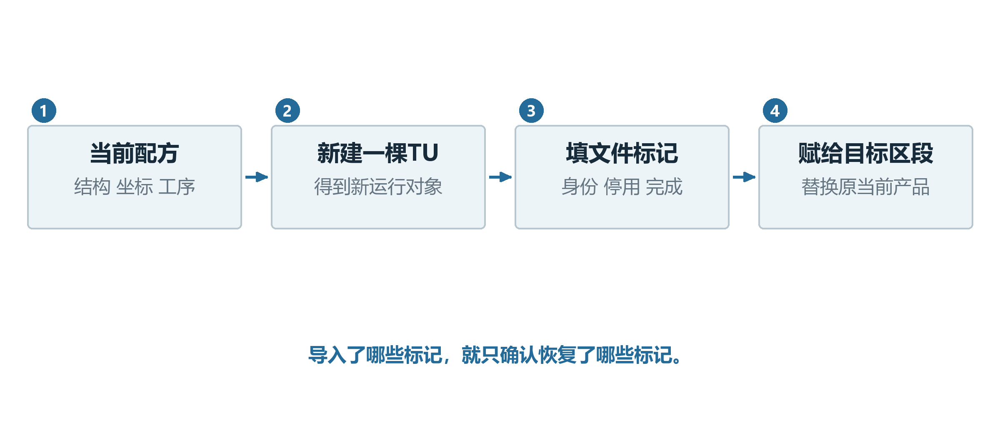

图19 当前配方提供新树 文件补充身份和结果标记

标准路径中X可表示停用，2使相应焊点两侧工序完成，1保留新建初始状态。芯片代码路径还有自己的写回规则；数量、布局和当前配方要相容。

导出也只表达规定的产品结果与身份，不包含全部坐标父链和控制消息。显示画面可能改变后续是否重建的标记，所以不能单凭载入成功保证完整续作。

**导入了哪些标记，就只确认恢复了哪些标记。**

如果现场实物和画面记录对不上，接下来要看物料搜索。

# 20 搜索物料怎样对应实物和记录

第二部分 换一种产品或操作方式

● 来料 → 建立记录 → 找位置 → 点胶 → 交接 → 固晶 → 下料

搜索把传感器结果、人工确认和区段当前TU放在一起判断。原记录还在时，部分分支能够保留；原记录已经空了，确认有料后新建的是一份新记录。

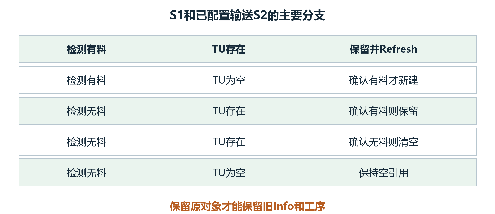

图20 本图适用于S1和已配置输送的S2主要分支

检测有料且TU存在，保留并刷新；有料但TU空，确认有料才新建。检测无料却有TU，确认有料则保留且该分支不刷新，确认无料则清空。

自动不反搜可能提前返回。未配置输送的S2另走真空检测；待下料、下料有些有料而TU空的分支不补树。新建记录不会自动找回旧进度。

**同时看实物、检测和当前TU，不能只看“有料”两个字。**

若要主动撤掉区段当前记录，则进入清空操作。

# 21 清空和刷新对当前产品的影响不同

第二部分 换一种产品或操作方式

来料 → 建立记录 → 找位置 → 点胶 → 交接 → 固晶 → ● 下料

刷新保留当前TU并重建坐标；清空让区段不再持有这份TU。整线清空处理五个区段，局部清空只处理点胶段或固晶段。

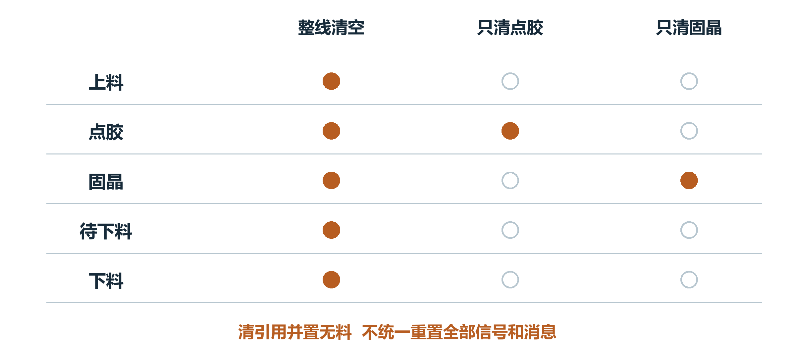

图21 橙色表示本次入口解除该区段当前TU引用

这些入口先检查机器状态并要求确认，正常路径还会执行对应安全移动、松夹和保存。按过按钮不等于清空已经完成，清引用也不能单独证明实物已拿走。

清空没有统一复位全部移送状态、信号和动作消息，也不销毁窗口先前拿到的旧引用。判断当前产品时，要重新从区段取得入口。

**当前入口为空和旧对象还能被某窗口读到，可以同时发生。**

示教和测试也能创建对象，下一页区分它们是不是当前生产产品。

# 22 示教窗口里的产品不一定是生产中的P1

第二部分 换一种产品或操作方式

来料 → ● 建立记录 → 找位置 → 点胶 → 交接 → 固晶 → 下料

示教、辅助测试和移动到焊点的窗口，都可能创建TU。有的会替换区段当前对象，有的只由窗口自己持有，所以看到新产品图先看它来自哪个入口。

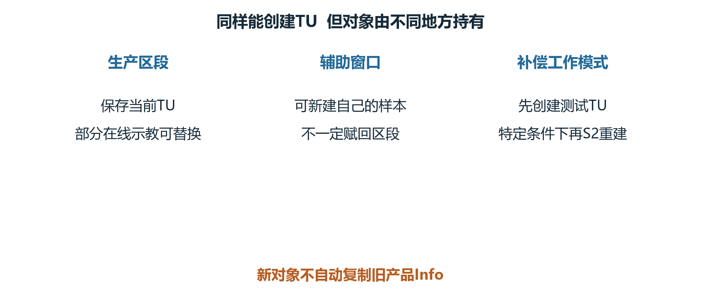

图22 三种拥有者并排比较 不表示依次执行

在线示教可经确认重建区段TU；离线返回窗口新对象，不赋回区段。补偿工作模式可先建测试TU，特定条件下再按S2参数重建，旧测试记录不自动复制。

两点角度示教还会分阶段修改传入对象和后续配置。后面的窗口取消，也没有统一撤销先前写入；纠偏册专门画出这个过程。

**先确认对象归哪个入口，再解释它的位置和进度。**

第二部分讲完了可选操作。接下来集中看记录和实物不一致时的几个常见问题。

# 23 点过胶却又要定位时先看刷新

第三部分 出问题时再回来查

来料 → 建立记录 → 找位置 → 点胶 → ● 交接 → 固晶 → 下料

回想主例：P1交给S2以后，A点点胶完成记录仍在，但定位和测高处理标记已清除。它需要重新取得当前位置，这和重做点胶并不矛盾。

图23 回看主例的交接前后 不新增一次加工

旧测高差保留在过程记录中，也不意味着它已经加进新坐标。定位关闭时处理标记又可能直接置好，所以“有旧数值”和“标记为真”都不能独立说明本轮实际采集。

排查时把当前产品、当前坐标、本轮采集结果和处理标记对应起来。提前缓存的旧坐标或旧A点，可能已经不属于当前控制入口。

**用当前这一轮的位置解释当前动作。**

位置和进度区分开以后，再看为什么有的点显示完成却并未加工。

# 24 完成和跳过为什么看起来相似

第三部分 出问题时再回来查

来料 → 建立记录 → 找位置 → 点胶 → 交接 → ● 固晶 → 下料

某个点无需再做，可能是工序已经完成，也可能是不参加这一侧。只点胶、只固晶、两侧参加和两侧停用，分别描述参与范围。

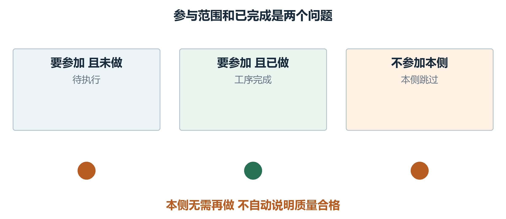

图24 已完成和不参与都可能让本侧无需再执行

产品工序、动作消息、处理状态和检测质量各有含义。人工置成功只改记录；控制器准备下一轮消息也不清产品工序。

当前实现还有两侧完成判断不对称、空集合也可能返回完成等细节。若本侧进度不符合预期，需要再看工序配置与实际结构；具体条件在配套代码说明。

**查“为什么不做”时先确定跳过依据。**

下一页把异常发生前已经改过的数据展开，避免把失败理解成全部未发生。

# 25 交接报错时先看已经走到哪一步

第三部分 出问题时再回来查

来料 → 建立记录 → 找位置 → 点胶 → ● 交接 → 固晶 → 下料

正常交接先给目标N1，再刷新，之后清源、更新状态、保存。若刷新抛异常，两个区段可能暂时同指N1，坐标也可能只重建了一部分。

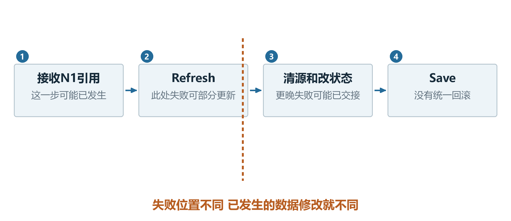

图25 虚线表示其中一个失败位置 左侧修改可能已发生

若错误更晚发生在Save，内存交接可能已经完成，源入口也已为空。卡料Retry回机械重试段，不回滚物理运动；Ignore也可能继续到成功出口。

不同输送入口的恢复次序并不一致。因此要看实物在哪、当前两侧引用、区段状态和失败位置，不能只按返回失败就重放全部数据操作。

**失败出口和已经发生的数据变化，需要一起解释。**

这种分散记录也说明了为什么保存配置不等于完整断电续作。

# 26 保存配置不等于保存整轮加工现场

第三部分 出问题时再回来查

来料 → ● 建立记录 → 找位置 → 点胶 → 交接 → 固晶 → 下料

交接正常路径会保存配置，但区段当前TU和坐标等内容被排除在该配置序列化之外。保存没有同时打包完整产品树、父坐标、工序和控制消息。

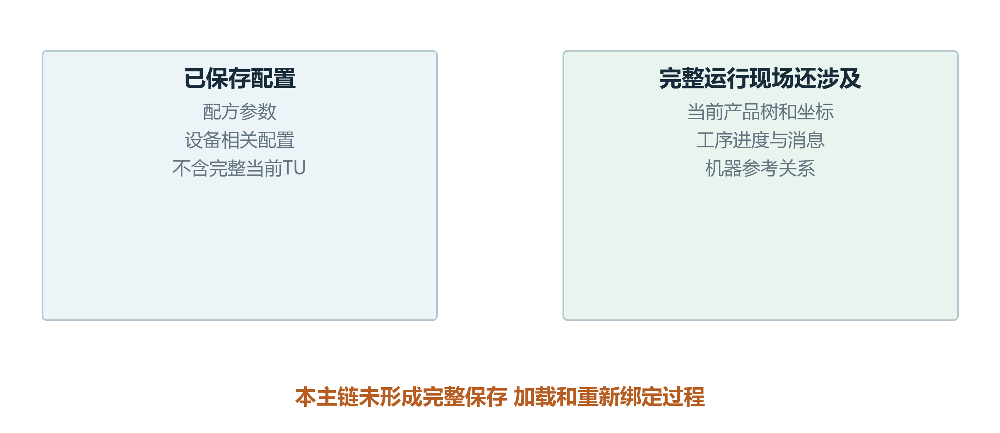

图26 文件内容决定能恢复多少运行信息

独立TU存储接口也没有在本册追踪的正常主链里形成完整保存、加载和重新绑定过程。Mapping文件同样只表达规定的结果。

重新启动时，搜索和刷新分别处理现场对应关系；补建新记录不能说成找回全部历史。具体恢复能力仍要按实际保存和加载入口判断。

**确认文件保存了什么，再讨论恢复了什么。**

最后一页把中文概念和少量代码名字对上，供需要查源码时使用。

# 27 需要查源码时再看这些名字

第三部分 出问题时再回来查

来料 → 建立记录 → 找位置 → 点胶 → 交接 → ● 固晶 → 下料

先从当前区段取得TU，再用本轮地址找基板、基岛、焊点，最后重新取当前坐标。这条顺序对应前面整轮故事，不必先背所有类名。

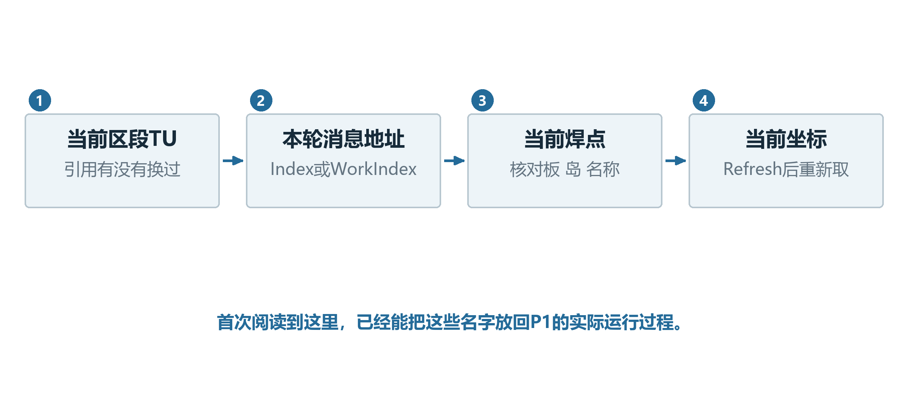

图27 当前区段 当前地址 当前A点 当前坐标依次对应

TU就是TransportUnit；当前对象的过程信息叫Info；结构号是Index，加工次序是WorkIndex。主例的点胶和固晶记录，在代码里对应A点的D_A与T_A工序键。

完整接口、位置服务返回的参考系、异形引用匹配、名称遍历漏项和其他实现差异，统一放在本版阅读索引与保留的技术说明中。

**首次阅读到这里，已经能把这些名字放回P1的实际运行过程。**

需要继续看C1怎样贴准A点，接着阅读纠偏过程册的第一部分。
