# Transport Unit 设计文档

板子走到哪里 哪个点已经做过 软件怎样记住

以同时点胶和固晶、配置正常输送的板子为例。图片中的设备和位置是示意。

# 一块板子怎样加工完

板子进入设备，先点胶，再贴芯片，最后送出去。点胶和贴芯片分别在两个工位完成。

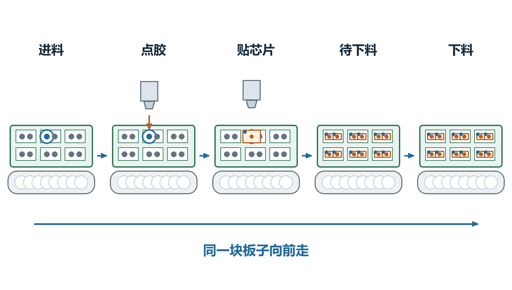

点胶做好以后，板子才继续交给贴芯片的工位。

设备里可能同时有几块板。软件要分清每一块在哪里，哪些位置做过，哪些还没做。

# 给板子建一张加工记录

可以把TU理解成这块板子的电子加工记录。软件用它保存板子的位置、板上要做的点和每个点的进度。

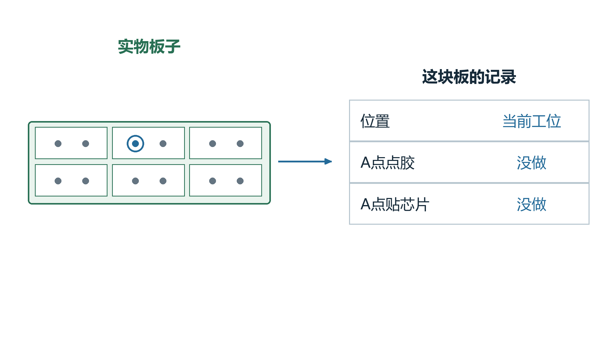

刚开始时，A点的点胶和贴芯片都没有完成。

配方规定这种板子应该怎样做；加工记录记住眼前这一块做到哪里。换一块新板子，要按生产流程建立新记录。

# 找到这次要加工的A点

一块板子里有很多加工位置。这里把其中一个叫A点，后面的图一直用蓝圈表示它。

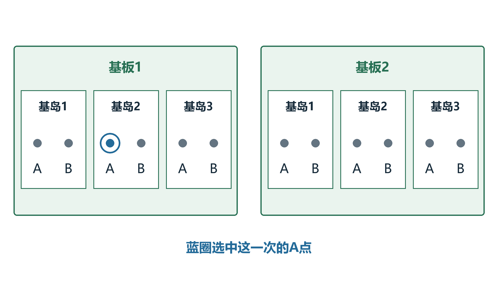

这次选中的是基板1、基岛2上的A点。

其他地方也可能有同名A点。软件要同时看它属于哪块基板、哪个小区域，才能找到这一次的目标。图中的小区域就是基岛。

# 板子送到点胶工位

输送机构把板子送到点胶位置。满足到位和相关机械条件后，设备才继续后面的动作。

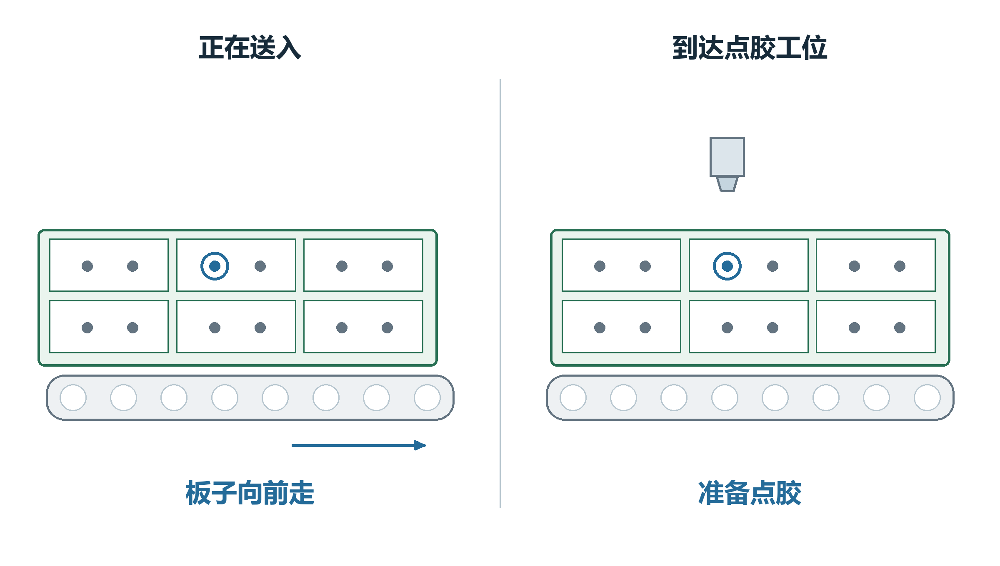

移动的是板子，软件里的这份加工记录继续对应它。

进入这个工位后，软件按当前工位设置处理位置。加工记录里的“点胶没做、芯片没贴”此时还没有改变。

# 相机找准要点胶的位置

板子实际放的位置可能有一点偏。需要定位时，相机找板子上的特征，软件再按拍到的位置更新加工点。

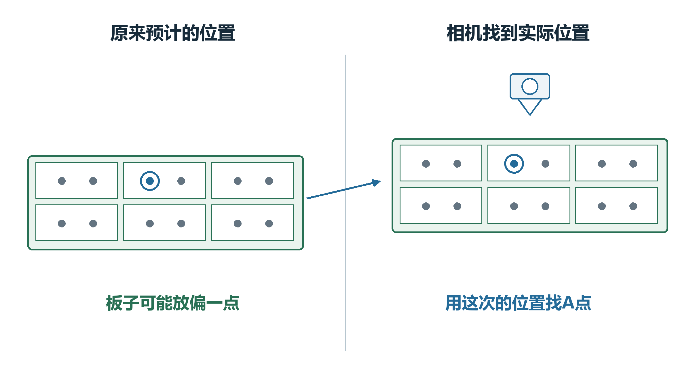

先看板子实际在哪里，再确定A点现在在哪里。

板子整体偏了一点，它上面的点也会跟着变。找到新位置以后，后面的点胶动作使用这一次的位置。

哪些位置要拍照，由当前配方和状态决定。

# 测一下板面有多高

需要测高时，设备测出板面的高度。如果这块基板比示教时高，下面的加工位置也要带上相应高度差。

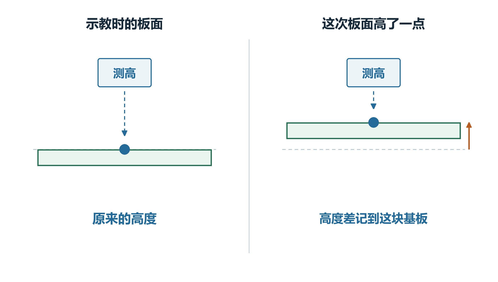

板面高了，A点的高度也跟着更新。

相机定位主要回答“平面位置在哪里”，测高回答“表面有多高”。焊头最后落到什么高度，还要按点胶或贴装动作的参数计算。

# 胶头对准A点点胶

设备找到当前A点，确认它需要点胶，再执行点胶动作。这个动作正常成功后，软件把A点记成“胶已点”。

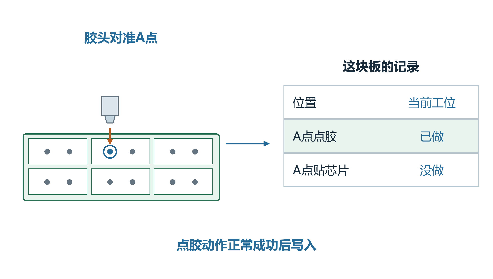

只把刚做好的A点记成完成，旁边的点各记各的。

例如A点做好了、B点还没做，记录就分别保留这两种状态。一个点完成，不表示整块板已经做完。

# 板子送到贴芯片的工位

点胶工位满足放行条件后，输送机构把板子送到固晶工位。固晶就是把芯片贴到指定位置。

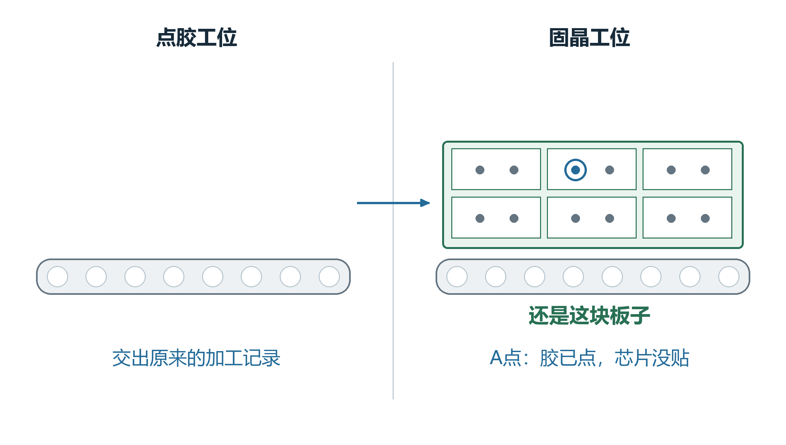

板子往前走，原来的加工记录也交给下一个工位。

下一个工位继续看到同一个A点，也能知道它已经点过胶，不需要把它当成一块全新的板子。

# 换了工位还要重新找位置

板子移到新工位后，点胶时用的位置不能直接当作新的实际位置。正常交接会先刷新位置，再按需要重新定位。

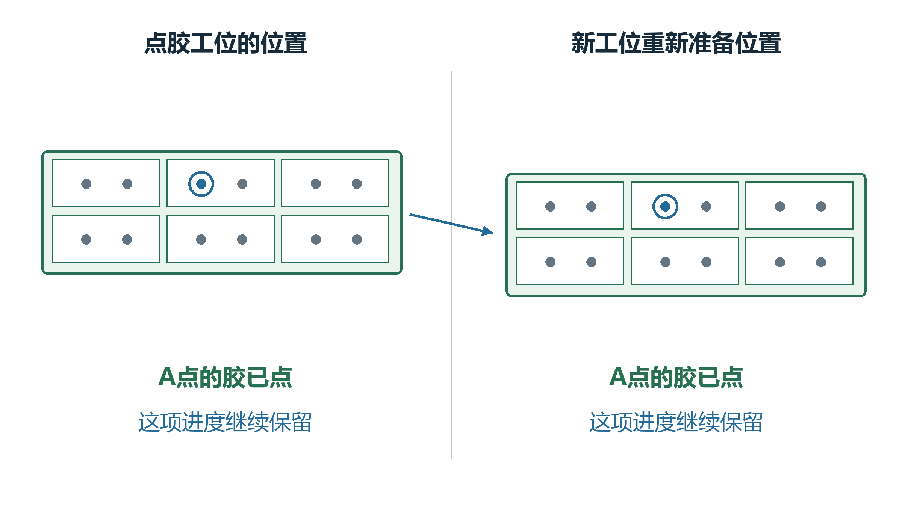

位置重新准备，A点“胶已点”的进度继续保留。

所以“还要拍照”和“已经点过胶”可以同时成立。一个是在确认当前位置，一个是在记录做过哪道工序。

# 芯片贴到A点上

设备找到A点，再把取起来的芯片对准它。芯片怎样取、相机怎样看、吸嘴怎样修正，见另一份纠偏文档。

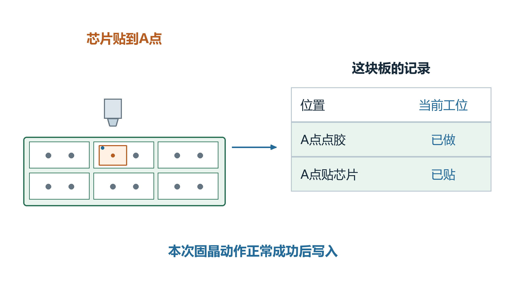

本次贴装正常成功后，A点变成“胶已点、芯片已贴”。

其他点继续按自己的任务加工。完成的是这个点的这道工序；贴得准不准，还要看对应检测结果。

# 整块板做完以后再下料

其余加工点满足本轮发送条件后，板子继续进入待下料、下料等后续路径。每一段按自己的检测和机械条件移送。

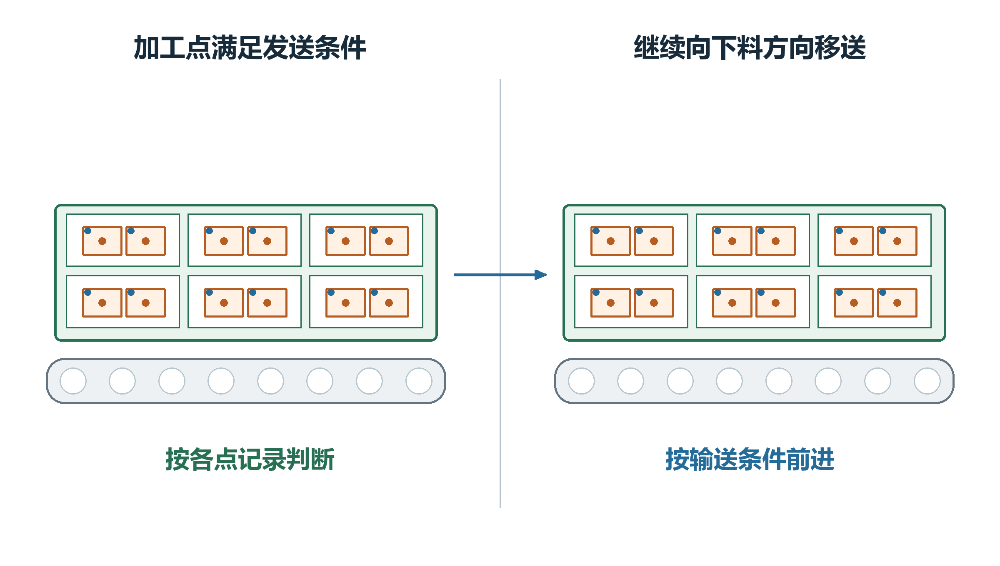

这一块送出去以后，下一块按自己的记录继续加工。

板子离开后，各工位会按自己的流程交出或清掉当前记录。记录不在这个工位里，不代表实物已经被人拿走。

未配置输送的设备会走对应的人工取料分支。

# 刷新位置和清掉记录有什么区别

刷新位置时，还是这块板、这份记录，只是重新准备位置。清记录时，当前工位不再使用这份记录。

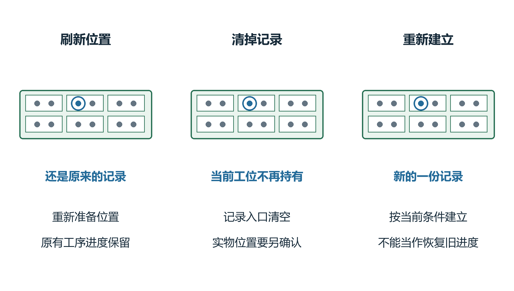

刷新后继续看同一块板；重新建记录时，进度要按新记录判断。

如果原记录已经没有了，再确认有料并新建，不能当作找回了原来的全部进度。现场排查要把实物和屏幕记录一起核对。

# 显示完成以后还要分清两件事

看到“已完成”，还要另外看检测是否合格。点胶做完、芯片贴完，分别记录各自的工序。

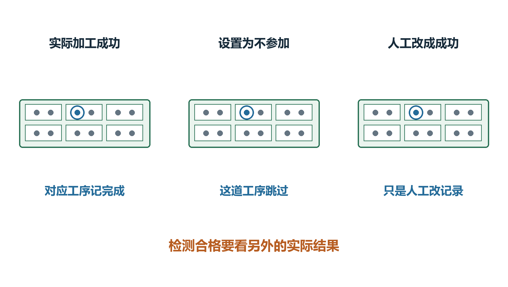

跳过、人工改成功和真正加工，要分别确认。

某个点不再加工，也可能是它被设成不参加。人工把画面改为成功，只是在改记录，不能证明实物已经加工或质量合格。
