# 晶圆系统·界面与按钮流程细节

> **分析对象**：`AKRS.ZX2200\WaferSubSystem\Controls\` 及其全部 12 个子目录。
> **姊妹篇**：34 号文档覆盖 `WaferSubSystem` 的 `Controllers` / `Models` / `Modules` / `Services` / `Tasks`；
> 本文档覆盖 `Controls\`，两者以命名空间与目录为界，内容不重叠。
> **本文档回答的问题**：晶圆系统界面上有**哪些按钮**、每个按钮**点下去之后到底发生了什么**、
> 以及**哪些窗体根本没有按钮能打开**。

---

## 文首元信息

### 覆盖范围

| 项 | 值 |
|---|---|
| 目录 | `AKRS.ZX2200\WaferSubSystem\Controls\`（含 12 个子目录） |
| 代码规模 | 参与编译的 `.cs` 共 **100** 个（非 Designer **50** 个 / **20,800** 行；Designer **50** 个 / **20,689** 行），合计 **41,489** 行 |
| 幽灵文件 | 另有 **2** 个 `.cs` 存在于磁盘但不在 `.csproj` 中、**不参与编译**（合计 **400** 行），列在附录 A.2 |
| 在编类型 | **43** 个 `XtraForm` + **7** 个 `XtraUserControl` = **50** 个 |
| 事件处理器 | **416** 个（在编，已排除幽灵文件的 4 个）；**207** 个唯一方法名 |
| Designer 接线 | **345** 处（`this.X.Y += ` 模式），另有 14 处代码侧接线 |
| `Save()` 落盘点 | **87** 处（含 1 处被注释、2 处 EPPlus 的 Excel 保存） |
| 定时器 | **28** 个，全部按默认 100 ms 运行（全目录 `.Interval` 赋值 **0** 处） |
| 风险条目 | **R-01 ~ R-76**（🔴 **25** 条 / ⚠️ **39** 条 / ✅ **12** 条，合计 **76**） |

> **风险编号口径**：R-01 ~ R-65 是**本轮素材已列出的 65 条**（逐条录入 §9，编号与严重度按素材表格原文，
> 其中 R-64 / R-65 在素材里排在各自分组的末尾、不在 R-09 / R-19 之后 —— 本文档**重排为连续编号**，
> 见附录 B 的对照表）。R-66 ~ R-76 是本文档在**跨目录复核**中新增的 **11** 条
> （R-66 `DialogResult.Abort` 语义、R-67 `MainForm.cs:70` 隐性契约、R-68 `UiLock` 死锁、
> R-69 `msgBoxDict` 非线程安全、R-70 反射签名静默失败、R-71 空转死处理器、
> R-72 `FrmChangeTabletTeach` 构造期跑机械序列、R-73 落盘先于取消、R-74 `throw` 丢栈、
> R-75 UI 线程同步阻塞、**R-76 运行时永久禁用控件族**）。
>
> **与素材严重度分布的对账（★ 这条已复核，结论是"完全一致"）**：
> 素材自称 **65 条 = 🔴18 / ⚠️35 / ✅12**。本文档逐条录入后的实测：
> **R-01 ~ R-65 = 🔴18 / ⚠️35 / ✅12** —— **与素材完全相同，一条不差**。
> **差额全部来自新增的 11 条**：R-66 ~ R-76 = **🔴7 / ⚠️4**（🔴：R-67、R-68、R-69、R-70、R-72、R-73、R-75；
> ⚠️：R-66、R-71、R-74、R-76）。
> ⇒ **18 + 7 = 25（🔴）**，**35 + 4 = 39（⚠️）**，**12 + 0 = 12（✅）**，**合计 76**。
> ⚠️ 因此**凡引用"素材是 18/35/12"时，指的是 R-01~R-65 这 65 条**，不是全章 76 条。
> **本文档的权威分布表在 §9.0.4 与 §9.10**；冲突留痕见附录 B.4。

> **代码规模口径说明**：本表"代码规模"一行的分子分母**只统计参与编译的文件**，
> 依据是 `AKRS.ZX2200.csproj` 的 `<Compile Include>` 列表。
> 磁盘上另有 2 个 `.cs`（`Controls\Assistant\ComponentsTeach\FrmComponentLocateUseInfo.cs` 152 行
> 与 `FrmComponentLocateUseInfo.Designer.cs` 248 行）**不在** `<Compile Include>` 中，
> 运行时不存在，列在附录 A.2。**全文凡出现"100 个文件""41,489 行"，均指参与编译的部分。**
> 该口径与 §2 的目录汇总表、附录 A.3 的合计核对表**三处一致**。

### 统计口径（三条，全文通用）

1. **处理器计数一律按 `.csproj` 编译清单**：幽灵文件贡献 **0** 个处理器，不计入 416。
   数据来源是 `grep "void [A-Za-z0-9_]*(object sender"` 在**在编文件**上的结果。
2. **"文件数"与"含处理器的文件数"是两个不同的数**。`Controls/` 有 **100** 个在编 `.cs`；
   其中**含事件处理器**的文件是 **32** 个（另有大量文件只声明数据/绘图/几何算法）。
   两者不可混用：说规模用 100，说处理器覆盖面用 32。
3. **`Save()` 处数**统计的是源码里出现的 `Save()` 调用/定义文本，含 1 处位于注释中的调用
   （不计入"活落盘点"）与 2 处 EPPlus 的 `package.Save()`（写 Excel，不是写配置）。

### 阅读路径建议

初次接手，建议按 **§1 → §2 → §3 → §4.3 → §4.8 → §9.1~§9.3 → §9.9** 的顺序读；
只想查"某个按钮干什么"，直接跳 **§4.2 按钮总表**再顺着"是否有流程图"一列去看对应小节的图；
只想查"哪里有雷"，直接跳 **§9**，再按 §9.8 的阅读顺序建议走。

---

## 0 阅读指南

### 0.1 Mermaid 图怎么打开

本文档的流程图全部用 Mermaid 语法。**不是所有 Markdown 工具都能渲染 Mermaid**，
按你的工具选一种方式：

| 工具 | 做法 | 渲染效果 |
|---|---|---|
| **Typora** | 直接打开 `.md`，须在「偏好设置 → Markdown → 图表」里勾选 **Mermaid** | 内嵌渲染，推荐 |
| **VS Code** | 安装扩展 `Markdown Preview Mermaid Support`（或 `Markdown All in One` + `Markdown Preview Enhanced`），然后 `Ctrl+Shift+V` 打开预览 | 内嵌渲染 |
| **mermaid.live** | 打开 <https://mermaid.live>，把单个 ```` ```mermaid ```` 代码块里的内容粘进左侧编辑区 | 无需安装，单图查看最快 |
| **GitHub / GitLab** | 直接推送 `.md`，网页端自动渲染 Mermaid | 需联网、需提交 |
| **语雀 / 飞书 / Obsidian** | 语雀与飞书原生支持；Obsidian 需在「设置 → 第三方插件」启用 Mermaid（0.15 起内置） | 内嵌渲染 |

> **如果你的工具渲染不了**：每张**核心图**都配了一个 **ASCII 等价版**，
> 用等宽字体看即可，语义与 Mermaid 版一致。§0.3 的"ASCII 版"一列标明哪些图有。
> ASCII 版只保证**分支与走向**一致，不保证节点文字完全相同。

### 0.2 图例与约定

| 约定 | 含义 |
|---|---|
| `文件:行` | 一律写 `相对路径:行号`，路径相对 `AKRS.ZX2200\`。**行号全部来自逐行阅读** |
| `[...]` 形状 | 动作 / 语句 |
| `{...}` 形状 | 判断 / 分支 |
| `((...))` 形状 | 关键节点（写盘、动轴、弹窗、改配置） |
| **🔴** | **源码已核实的缺陷**：代码原文能直接读出该行为 |
| **⚠️** | **静静态推导的风险**：机制成立，但**未在真机上复现**，或结论依赖本目录之外的代码 |
| **✅** | **看起来像坑、经核实无害**：诚实标注，避免后人重复排查 |
| **`*推断*`** | 结论依赖无源码的二进制（平台 DLL / EPPlus / `Block` 门面），已写明推断依据 |
| 控制器名 | 代码里的类型名、方法名、控件名**与源码逐字一致，不做美化**（含拼写错误，如 `Descritpion`、`TopToDrow`） |
| "零调用点" | 已按 §9.5 的口径排除**扩展方法 / 同命名空间非限定调用 / `using static` / 反射**四种情况 |

### 0.3 图表索引

> 共 **52** 张 Mermaid 图，其中 **20** 张另有 ASCII 等价版。图号与正文一一对应。

| 图号 | 图名 | 位置 | ASCII 版 |
|---|---|---|---|
| 图 1 | 编译口径的三级判定流程（在编 / 幽灵 / 死代码） | §0.4 | **ASCII ①** |
| 图 2 | 晶圆系统在整机中的位置 | §1.1 | —— |
| 图 3 | `Controls/` 的职责边界与四条出口 | §1.2 | —— |
| 图 4 | 窗体打开的三条入口路径 | §1.3 | **ASCII ②** |
| 图 5 | 幽灵文件的成因与影响面 | §2.3 | **ASCII ③** |
| 图 6 | 关键类型地图（43 Form + 7 UserControl + 共享服务） | §3.1 | —— |
| 图 7 | 416 个处理器的后缀分解与三层标准 | §3.3 | —— |
| 图 8 | §4 章节导览与三层标准的应用 | §4.0 | —— |
| 图 9 | 三种入口分流判定图 | §4.1 | **ASCII ④** |
| 图 10 | 手动面板「从槽位取片」完整流程（R-13） | §4.3.1 | **ASCII ⑤** |
| 图 11 | R-13「假设执行序」vs「实际执行序」 | §4.3.2 | **ASCII ⑥** |
| 图 12 | 换片测试 `async void` + `goto` 重试循环（R-14） | §4.3.3 | —— |
| 图 13 | 示教向导上一步/下一步/完成驱动 | §4.4.1 | —— |
| 图 14 | 四步示教窗体状态推进与 `DialogResult` 三值 | §4.4.2 | —— |
| 图 15 | 芯片与载具厚度测高：两条并存的落盘链 | §4.4.3 | **ASCII ⑦** |
| 图 16 | `ComponentCheck` + `SaveAllData` 先清空后落盘（R-02） | §4.4.4 | —— |
| 图 17 | 晶圆边缘三点拟合示教按钮流程 | §4.4.5 | —— |
| 图 18 | 换晶圆图四步流程与"不可撤销"（Q3） | §4.5.1 | —— |
| 图 19 | `FrmWaffleMap` 下拉解析错映射（R-64） | §4.5.2 | **ASCII ⑧** |
| 图 20 | `FrmChangeTabletTeach` 新建空白 tablet 立即落盘 | §4.5.3 | —— |
| 图 21 | 顶针示教统一骨架与 `BtDone` 落盘 | §4.6.1 | —— |
| 图 22 | 顶针安装精度实验导出失败（R-09） | §4.6.2 | **ASCII ⑨** |
| 图 23 | `stepIndex = -1` 崩溃链 | §4.6.3 | **ASCII ⑩** |
| 图 24 | 料盒排布关窗双处理器（R-20） | §4.7.1 | **ASCII ⑪** |
| 图 25 | `UcComponentEdit` 三态 `State` 静默改写（R-03） | §4.8.1 | —— |
| 图 26 | `GetSearchMode` 裸 `throw` 传播路径（R-10） | §4.8.2 | —— |
| 图 27 | 静态委托泄漏与叠加调用（R-26） | §4.8.3 | —— |
| 图 28 | `FrmSlotsState` 构造期改写活配置（R-04） | §4.9.1 | **ASCII ⑫** |
| 图 29 | 顶针实时状态采集循环忙等与 `cts` 竞态（R-18 / R-16） | §4.9.2 | —— |
| 图 30 | `UcCarrierMapping` 在 `Paint` 期间写模型（R-08） | §4.9.3 | —— |
| 图 31 | 跨模块最长调用链 | §4.10 | —— |
| 图 32 | 反射开窗时序图 `ShowDialogForm<T>` | §4.10 | —— |
| 图 33 | 28 个定时器的生命周期与释放 | §5.1 | —— |
| 图 34 | 线程与并发模型总览 | §5.2 | **ASCII ⑬** |
| 图 35 | `SetUIControl` 唯一界面刷新出口 | §5.3 | —— |
| 图 36 | `AssistantStateEnum` 三态迁移 | §5.4 | —— |
| 图 37 | 示教窗体五件套的复制粘贴与"改一处要改 18 处" | §6.1 | —— |
| 图 38 | 三个静态委托的订阅边与两条失效路径（R-26） | §6.2 | **ASCII ⑭** |
| 图 39 | `UiLock` 的两条边与死锁闭环（R-68） | §6.3.2 | —— |
| 图 40 | `FrmRepository<T>` 的两条回传协议与 `ShowDialogForm<T>` 的参数匹配 | §6.4.3 | —— |
| 图 41 | 出向依赖分组（A/B/C/D） | §7.2 | —— |
| 图 42 | 入向依赖：**18** 个窗体经 `UcEditProductProgramming` 进入 | §7.3 | —— |
| 图 43 | 授权相关的调用面（纯事实陈述） | §7.4 | —— |
| 图 44 | 落盘的三条链 | §8.3 | —— |
| 图 45 | 配方切换后的污染路径（R-07） | §8.3.5 | **ASCII ⑮** |
| 图 46 | R-01 完整流程图：NaN 击穿半径守卫 | §9.9.1 | **ASCII ⑯** |
| 图 47 | R-13 完整流程图：按钮重入与未观察异常 | §9.9.2 | **ASCII ⑰** |
| 图 48 | R-64 完整流程图：序号 ≥10 静默错映射 | §9.9.3 | **ASCII ⑱** |
| 图 49 | 零活引用 6 类型的判定树 | §9.5 | —— |
| 图 50 | R-68 完整流程图：`UiLock` 死锁的两个前提如何同时成立 | §9.9.4 | **ASCII ⑲** |
| 图 51 | 一行改动、8 处静默失效（R-67） | §9.9.5 | **ASCII ⑳** |
| 图 52 | 附录结构导览与三处数字的核对关系 | 附录 A | —— |

### 0.4 三个必须分清的数字（最常见的误读）

本篇全文中"文件数""处理器数""接线数"是三个**互相独立的指标**，混用会得出完全错误的结论。

| 数字 | 含义 | 来源口径 | **不是**什么 |
|---|---|---|---|
| **100** | `Controls/` **参与编译的 `.cs` 文件数**（50 非 Designer + 50 Designer） | `AKRS.ZX2200.csproj` 的 `<Compile Include>` 过滤到本目录 | ❌ **不是**"含处理器的文件数"（那是 **32**）<br/>❌ **不是**磁盘文件数（磁盘是 102） |
| **32** | **含事件处理器的文件数** | 在 100 个在编文件上按 `void Xxx(object sender` 匹配后去重到文件 | ❌ 不是规模数字，不能拿去和 100 混用 |
| **416** | **事件处理器个数**（在编文件内） | 同上匹配的**实例数**，幽灵文件贡献 0 | ❌ **不是**唯一方法名数（那是 **207**，一个方法可被多个控件共用） |
| **207** | **唯一处理器方法名数** | 对 416 个匹配去重方法名 | ❌ 不是"按钮个数" |
| **400** | **Designer 接线处数**（`this.X.Y += new ...Handler(...)`），实测 | 全部 `*.Designer.cs` 上的接线语句 | ❌ 不是处理器个数：**有处理器没接线**（如 `FrmMagazineFilling_Closing`）<br/>❌ 也有接线指向同一个方法 |
| **345** | **非窗体生命周期接线数** = 400 − 55 | 400 减去窗体生命周期接线（`FormClosing` 30 + `Load` 22 + `FormClosed` 3 = 55） | ❌ 不是"全部接线" |

> **`400` 与 `345` 都对，只是口径不同** —— 实测的完整接线分类如下
> （`find WaferSubSystem/Controls \( -name '*.Designer.cs' -o -name '*.designer.cs' \) -print0 | xargs -0 grep -nHE '\+= new [A-Za-z.]*Handler\('`，共 **400** 行。
> ⚠️ **别把命令改回 `--include='*.Designer.cs'` 再拿去别的目录用**：本仓有 **8 个**文件用小写 `designer.cs`
> （含主界面 `Main/Controls/Ucmain/MainControls/UcMainSystem.designer.cs`，3,549 行），只匹配大写会漏 **193** 条接线
> （`Main` 169 / `SupportFeature` 15 / `Infrastructure` 9），且 `-i` **修不了**（`--include` 不受 `-i` 影响）。
> **`WaferSubSystem` 下两种写法结果相同（都是 400）纯属该目录没有小写文件**，换目录必漏。
> 实测的完整接线分类如下（两种大小写的复算命令见 **附录 B.5 ④**）：
>
> | 事件 | 接线数 | 事件 | 接线数 |
> |---|---:|---|---:|
> | `Click` | 245 | `CustomDrawRowIndicator` | 6 |
> | `FormClosing` | 30 | `FocusedRowChanged` | 5 |
> | `EditValueChanged` | 30 | `CheckedChanged` | 5 |
> | `Tick` | 28 | `SelectedIndexChanged` | 3 |
> | `Load` | 22 | `FormClosed` | 3 |
> | `ButtonClick` | 18 | `DataSourceChanged` | 2 |
> | | | `Toggled` / `TextChanged` / `ItemClick` | 各 1 |
> | | | **合计** | **400** |
>
> ⇒ **345 = 400 − 55**（55 = `FormClosing` 30 + `Load` 22 + `FormClosed` 3），
> 即"**只数控件事件、不数窗体生命周期**"的口径。
> 本文档凡说"Designer 接线"一律用 **400**；引用 345 时明确写出它是减去生命周期后的数。
> 附录 B.5 记录了这个口径差异。

> **一句话记法**：
> **100 是文件、416 是处理器、400 是接线**。
> 三者的关系是"**400 条线，接到 416 个处理器上，而其中有处理器一条线都没接到**"
> —— 最典型的一个就是 `FrmMagazineFilling_Closing`（**接线数 0**），这正是 R-20。
>
> ⚠️ 注意 **`Click` 处理器 247 个，但 `Click` 接线只有 245 条** ——
> **有 2 个 `Click` 处理器不是通过 Designer 接的**（走代码侧接线或压根没接）。
> 所以"处理器数 ≠ 接线数"这个不等关系在 `Click` 这一项上就已经出现，
> 排查时不能假设两者一一对应。

**图 1 · 编译口径的三级判定流程（在编 / 幽灵 / 死代码）**

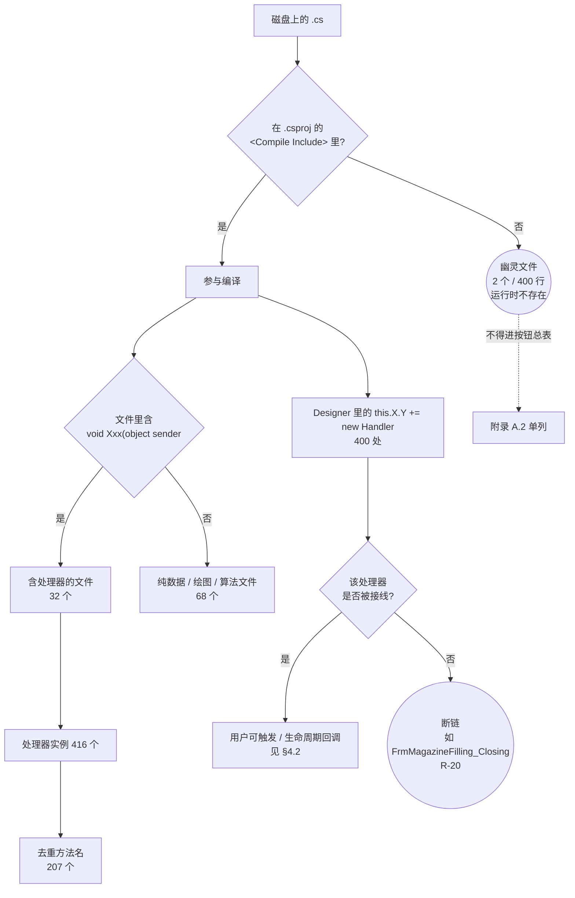

**ASCII ① · 编译口径的三级判定**（与图 1 等价）

```text
         磁盘上的 .cs
              |
      +-------+--------+
      |                |
  不在 csproj      在 csproj
      |                |
 [幽灵文件 2/400]  [参与编译 100]
 运行时不存在          |
      |         +------+------+
      |         |             |
      |    含处理器(32)   纯数据/绘图(68)
      |         |
      |    +----+---------------------+
      |    |            |             |
      |  416 个处理器  去重 207 名   Designer 400 条线
      |                 |             |
      |                 |      +------+------+
      |                 |      |             |
      |                 |  控件事件 345  生命周期 55
      |                 |      |             |
      |                 |   用户可触发   FormClosing30+Load22+FormClosed3
      |                 |                  (其中 FrmMagazineFilling_Closing
      |                 |                   一条线都没接到 -> R-20)
      +--- 不得进按钮总表 --> 附录 A.2
```

> **为什么要有这段**：现场排查时，"我按文件名数了一遍有 102 个"、
> "我 grep 到 416 个按钮"、"接线只有 345 条"三种说法会同时出现，
> 而它们各自都对、只是**口径不同**。本文档所有数字都在 §0.3 的这一套口径下给出。

### 0.5 本文档**不**覆盖的内容

| 不覆盖 | 归属 |
|---|---|
| `WaferSubSystem` 的 `Controllers` / `Models` / `Modules` / `Services` / `Tasks` | 34 号文档 |
| 按钮点击后**轴到底怎么动、控制器内部怎么算** | 34 号文档（本文档到"调用控制器方法"为止） |
| `Block`（视觉门面单例）的内部实现与是否落盘 | 34 号文档（见附录 B 的声明 1） |
| `Main/` 里"打开这些示教窗体的按钮" | `Main` 的文档（本文档只给出**入口行号**，见 §7.3） |
| `Infrastructure/` 内部的实现（`ControlService` / `UcGuideMove` / `FrmRepository`） | 37 号文档 |

### 0.6 全文用到的复现命令

```bash
# 本文档所有数字都可复现。以下命令均相对 AKRS.ZX2200\ 执行。
cd "E:/项目/ZX2200标机/trunk/AKRS.ZX2200"

# 1) 本目录参与编译的文件清单（100 个）
grep -o '<Compile Include="WaferSubSystem\\Controls[^"]*"' AKRS.ZX2200.csproj

# 2) 幽灵文件（在磁盘、不在 csproj）—— 见附录 A.2
comm -13 <(grep -o '<Compile Include="[^"]*"' AKRS.ZX2200.csproj | sed 's/<Compile Include="//;s/"$//' | tr '\\' '/' | sort -u) \
         <(find . -name '*.cs' -not -path './bin/*' -not -path './obj/*' | sed 's|^\./||' | sort -u)

# 3) 事件处理器（416 个实例 / 207 个唯一名）
grep -rn --include='*.cs' -E 'void [A-Za-z0-9_]+\(object sender' WaferSubSystem/Controls/
grep -rho --include='*.cs' -E 'void [A-Za-z0-9_]+\(object sender' WaferSubSystem/Controls/ | sort -u | wc -l

# 4) Designer 接线（400 处 = 控件事件 345 + 窗体生命周期 55）
#    注意：必须两种大小写一起列（本仓 8 个文件用小写 designer.cs，只匹配大写会漏，
#    详见本文件 §0.4 的警告）
find WaferSubSystem/Controls \( -name '*.Designer.cs' -o -name '*.designer.cs' \) -print0 \
  | xargs -0 grep -nHE '\+= new [A-Za-z.]*Handler\(' | wc -l
find WaferSubSystem/Controls \( -name '*.Designer.cs' -o -name '*.designer.cs' \) -print0 \
  | xargs -0 grep -hE '\+= new [A-Za-z.]*Handler\(' \
  | grep -oE '\.[A-Za-z0-9_]+ \+= new' | sed 's/ \+= new//;s/^\.//' | sort | uniq -c | sort -rn

# 5) 落盘点（87 处）
grep -rn --include='*.cs' '\.Save()' WaferSubSystem/Controls/

# 6) 定时器（28 个）与 Interval（0 处）
grep -rn --include='*.cs' 'new System.Windows.Forms.Timer' WaferSubSystem/Controls/
grep -rn --include='*.cs' '\.Interval' WaferSubSystem/

# 7) 反射开窗调用点（7 行 = 1 处定义 + 6 处调用点，其中 2 处被注释）
grep -rn --include='*.cs' -E 'ShowDialogForm<' .
```

> ⚠️ 第 5 条命令的 `87` 与本文档 §8.3 的"87 处"一致，但其中**1 处位于注释里**、
> **2 处是 EPPlus 的 Excel 保存**，所以"活着的配置落盘点"是 84 处。
> 三个数都要用到，别互相覆盖。

## 1 模块定位

### 1.1 晶圆系统在整机中的位置

晶圆系统（`WaferSubSystem`）是整机三大执行系统之一，负责**晶圆的上料、定位、顶针顶起、
取片与回位**。它的界面层全部落在 `WaferSubSystem\Controls\` 下。

**图 2 · 晶圆系统在整机中的位置**

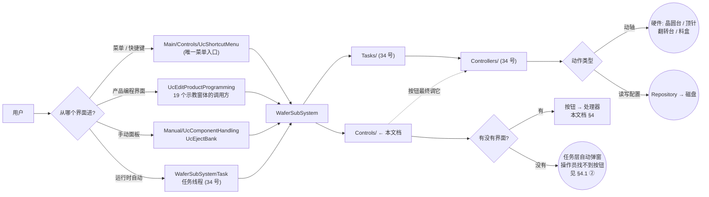

> **读这张图要抓住的重点**：**同一个窗体可能有两种完全不同的入口**。
> `FrmChangePositionTeach` 既没有界面按钮，又**能**在自动流程中间被任务线程弹出来
> （`WaferSubSystemTask.cs:619` / `:645` / `:739` / `:785` / `:914`）。
> 所以"界面上找不到这个按钮"**不能**推出"这个窗体不存在"。

### 1.2 `Controls/` 的职责边界与四条出口

`Controls/` 是**纯界面层**。它**不直接**碰硬件、**不直接**写文件、不做几何算法以外的业务计算。

**图 3 · `Controls/` 的职责边界与四条出口**

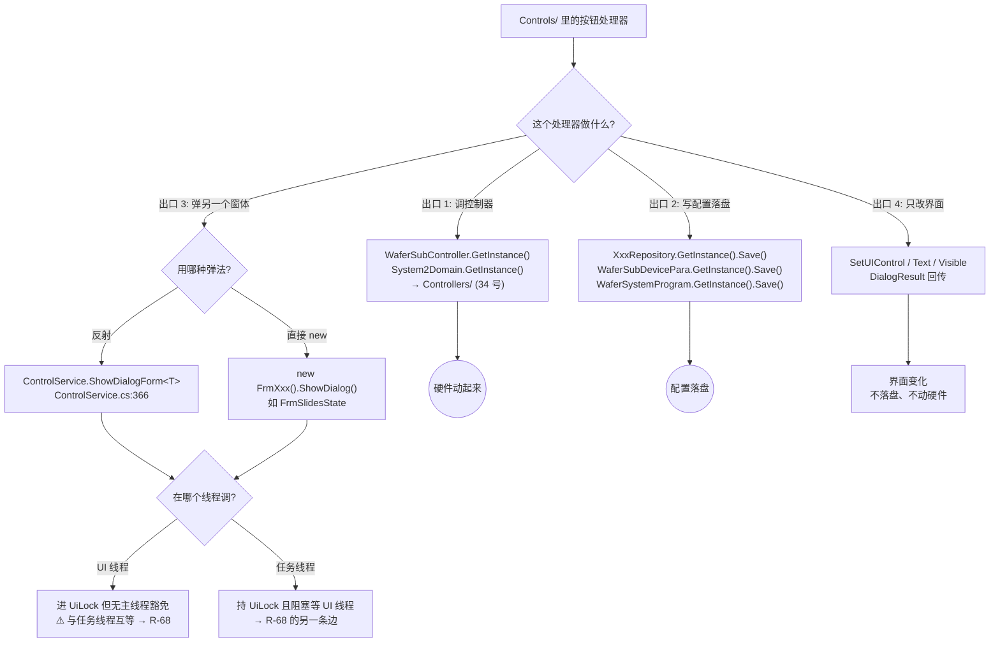

> **出口 2 是本文档的落盘核心**：`Controls/` 里**没有任何一处直接写文件** ——
> 全部落盘都通过仓储（Repository）或 `WaferSubDevicePara` / `WaferSystemProgram` 三套门面。
> 这意味着**"界面上的值改了但没点保存"与"配置已经变了"是两件事**，详见 §8.3 与 §8.5。

### 1.3 窗体打开的三条入口路径

这是本文档与一般"按钮说明文档"最大的区别：**窗体有三种被打开的方式，按钮只是其中一种**。

**图 4 · 窗体打开的三条入口路径**

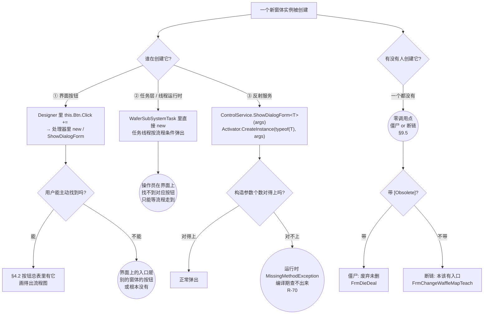

**ASCII ② · 窗体打开的三条入口路径**（与图 4 等价）

```text
              新窗体实例被创建
                     |
      +--------------+---------------+----------------+
      |              |               |                |
 ① 界面按钮    ② 任务层/线程    ③ 反射服务       没人创建
      |              |               |                |
 用户可主动点   流程条件触发   ShowDialogForm<T>   零调用点
      |              |               |                |
 进 §4.2 总表   进 §4.1 ② 列    参数个数?        +----+----+
 有流程图       操作员找不到   +-----+------+     |         |
                  对应按钮   对得上   对不上  [Obsolete]  无特性
                              |        |        |         |
                           正常弹出  Missing  僵尸:     断链:
                                    Method   FrmDieDeal FrmChange
                                    Exception           WaffleMap
                                    (R-70)              Teach
```

**三条路径的实测分布**（本目录内）

| 路径 | 本目录内的实测情况 | 权威行号 |
|---|---|---|
| ① 界面按钮 | **绝大多数**；Designer 接线 **400** 处（其中控件事件 345、窗体生命周期 55），另有代码侧接线 14 处 | 见 §4.2 总表 |
| ② 任务层 / 线程运行时弹出 | **本目录内 0 处**（本目录不 `new` 出来自弹）；被弹的窗体在本目录里，**调用方在 `Tasks/`** | `WaferSubSystemTask.cs:619`/`:645`/`:739`/`:785`/`:914`（`FrmChangePositionTeach`） |
| ③ 反射服务 | **3 处在 UI 线程**（本目录）；另有 1 处在任务线程（属 34 号文档） | `FrmComponentGeometryWithWaferTeach.cs:225`、`UcComponentEdit.cs:1203`（活跃）、`UcComponentEdit.cs:1209`/`:1212`（**被注释**） |
| 零调用点 | **2 个**：`FrmDieDeal`（僵尸）、`FrmChangeWaffleMapTeach`（断链） | §9.5 |

> ⚠️ **反射开窗的调用点数不要数错**。
> 全仓 `grep -rn "ShowDialogForm<"` 共 **7 行**命中，但那是
> **1 处方法定义（`ControlService.cs:366`）+ 6 处调用点**，而 6 处里 **2 处是注释**
> （`UcComponentEdit.cs:1209`、`:1212`）。
> ⇒ **活跃调用点是 4 处**，其中 **3 处与本文档相关**（另 1 处 `WaferSubSystemTask.cs:872` 属 34 号文档）。
> 把 7 当调用点数、或把注释数说成 3，都是错的。

### 1.4 三条入口路径的返回值语义（已定论）

`ControlService.ShowDialogForm<T>` 的返回值**是正确的 `DialogResult`**，不是恒为初值的 `Abort`。

```csharp
// Infrastructure/Service/ControlService.cs:366
public static DialogResult ShowDialogForm<T>(params object[] args)
    where T : Form
{
    lock (AKRSMessageBoxExt.UiLock)                      // :369  全局 UI 锁
    {
        DialogResult result = DialogResult.Abort;        // :371  初值
        MainForm.SendUiAction(                           // :372  切到 UI 线程
            () =>
                {
                    T form = (T)Activator.CreateInstance(typeof(T), args);  // :375  反射构造
                    form.StartPosition = FormStartPosition.CenterParent;    // :376
                    form.ShowDialog();                                  // :377
                    form.Dispose();                                     // :378
                    result = form.DialogResult;                         // :379
                });

        return result;                                   // :382
    }
}
```

**为什么返回值是对的**：`:372` 的 `MainForm.SendUiAction` 是**同步**的。

```csharp
// Main/Controls/MainForm.cs
:50   public static Action<Action> SendUiAction;
:61   SendUiAction += this.PostAction;          // 唯一订阅（-= 全仓 0 处）
:68   private void PostAction(Action action)
:70       this.Invoke(action);                  // ← 同步，不是 BeginInvoke / Post / 队列 / Task
```

`Control.Invoke` 的语义是"在持有窗口句柄的线程上执行并**等待其完成**"，同线程时内联执行 ——
**两种情况都同步**。所以 `:379` 的赋值一定发生在 `:382` 的 `return` 之前。

**本目录相关的 3 处调用点**（逐个按事实写）

| 调用点 | 是否消费返回值 | 事实 |
|---|---|---|
| `Controls/Assistant/ComponentsTeach/FrmComponentGeometryWithWaferTeach.cs:225` | **消费** | `:228 if (result != DialogResult.OK) { this.stepIndex--; }`。被打开的窗体在 `FrmCarrierHeightMeasureTeach.cs:204` 置 `OK`、`:209` 置 `Cancel`。**功能正常** |
| `Controls/Setting/Component/UcComponentEdit.cs:1203` | **不消费** | 裸语句，返回值丢弃 ⇒ 与返回值是否正确无关 |
| （属 34 号文档）`Tasks/WaferSubSystemTask.cs:833` | **消费** | `:836 if (res == DialogResult.Abort)` → `:839 throw new Exception("更换晶圆图失败！")`；否则 `:842 goto ChangeMap` |
| （属 34 号文档）`Tasks/WaferSubSystemTask.cs:872` | **消费** | `:869 Retry:`、`:870` 预置 `res = DialogResult.Abort`、`:885 if (res == DialogResult.Abort)`，否则 `:891 goto Retry` |

> **一个反证**：如果返回值真的恒为 `Abort`，那么
> `FrmComponentGeometryWithWaferTeach.cs:228` 会在**每一步**都把 `stepIndex--` 退回去，
> 这个示教向导将**永远走不到第 2 步**。现场功能是正常的 ⇒ 返回值是对的。
> 这是"用行为反证实现"的典型例子。

> **⚠️ 但这里有一个必须记住的语义陷阱**：`DialogResult.Abort` **在这个项目里不表示"取消"**。
> `FrmChangeWaferMapTeach.cs:245` 把「**结束示教（Yes）**」映射成 `DialogResult.Abort`，
> 而 `WaferSubSystemTask.cs:836` 又把同一个 `Abort` 当作**"更换晶圆图失败"**的判据 ⇒
> **同一枚举值在同一业务流程里承载两种相反语义**。按名字理解必然读错。见 **R-66**。

## 2 目录结构

### 2.1 目录汇总表

命名空间前缀统一为 `AKRS.ZX2200.WaferSubSystem.Controls.<子目录名>`。

| 目录 | 非 Designer | Designer | 合计 `.cs` | 主要职责 |
|---|---:|---:|---:|---|
| `Assistant\ChangeMapTeach\` | 5 | 5 | **10** | 换地图 / 载具地图（晶圆图、华夫盒、适配器、tablet） |
| `Assistant\ComponentsTeach\` | 16 | 16 | **32** | 元件示教（几何、墨点、晶圆边缘、吸嘴测高、行列输入） |
| `Assistant\EjectionConfigurationTeach\` | 2 | 2 | **4** | 顶针配置（`FrmEjectionSetting` 顶针总配置、新建顶针） |
| `Assistant\EjectionsTeach\` | 4 | 4 | **8** | 顶针动作示教（XY 位置、零位、测高、安装精度实验） |
| `Assistant\FlipTeach\` | 2 | 2 | **4** | 翻转台示教 |
| `Assistant\MagazineTeach\` | 4 | 4 | **8** | 料盒 / 华夫盒排布与新建（适配器、元件） |
| `Assistant\WaferHandlingTeach\` | 4 | 4 | **8** | 晶圆搬运（换片、regrip、料盒几何、碰撞圆） |
| `Controls\`（根） | 5 | 5 | **10** | 独立窗体：调试、槽位状态、顶针实时状态、地图控件、废弃窗体 |
| `Manual\` | 3 | 3 | **6** | 手动面板（元件处理、顶针库、翻转台） |
| `Setting\Component\` | 1 | 1 | **2** | **载具配置总编辑器**（`UcComponentEdit`，1,336 行，本目录最大单文件） |
| `Setting\FlipTool\` | 2 | 2 | **4** | 翻转工具配置 |
| `Setting\Waferhandling\` | 2 | 2 | **4** | 晶圆搬运参数配置（料盒几何、晶圆处理） |
| **合计** | **50** | **50** | **100** | 非 Designer **20,800** 行 + Designer **20,689** 行 = **41,489** 行 |

> **核对关系**：本表的"合计"一列（**100** / **50 + 50** / **41,489**）与
> 文首「代码规模」、附录 A.3「合计核对表」**三处必须完全一致**。
> 交叉验证的另一条路径：`Controls/` 的 50 个非 Designer 文件 + 其它目录
> （`Controllers` / `Models` / `Tasks` / `Modules` / `Services`）的 72 个 = `WaferSubSystem` 的 **122** 个非 Designer 文件，
> 与本目录在 `.csproj` 编译清单上的归属统计吻合。

**一个容易踩的坑**：`WaferSubSystem` 全目录的 **50 个 Designer 文件全部在 `Controls/` 下**。
也就是说，凡是在本目录之外看到的"窗体"，其 `InitializeComponent` 都不在这里 ——
读 `Controllers/` / `Tasks/` 时看到的窗体名，其布局定义要回到本目录来找。

### 2.2 各子目录逐个说明

#### 2.2.1 `Assistant\ChangeMapTeach\`（5 个窗体）

| 文件 | 类型 | 作用 | 入口 |
|---|---|---|---|
| `FrmChangeWaferMapTeach.cs` | XtraForm | 换晶圆图示教，418 行，四步 | 反射（`WaferSubSystemTask.cs:833`） |
| `FrmChangeWaffleMapTeach.cs` | XtraForm | 换华夫盒图示教，420 行，**与晶圆版几乎一致** | **零调用点**（断链，R-35） |
| `FrmWaffleMap.cs` | XtraForm | 华夫盘槽位地图编辑器 | 代码侧 `Block.cs:1577` |
| `FrmChangeTabletTeach.cs` | XtraForm | 换 tablet 示教 | 界面按钮 |
| `FrmChangeStaticAdapterTeach.cs` | XtraForm | 换静态适配器示教 | 界面按钮 |

> **读这个目录的第一件事**：`FrmChangeWaferMapTeach`（晶圆版，**活的**）与
> `FrmChangeWaffleMapTeach`（华夫版，**断链的**）是一对，仅一个字母之差。
> 现场"要换华夫盒地图"时**找不到入口**，就是因为华夫版少了一行调用。

#### 2.2.2 `Assistant\ComponentsTeach\`（16 个窗体，本目录最大子目录）

按功能分四组：

| 组 | 文件 | 一句话 |
|---|---|---|
| **几何** | `FrmComponentGeometryWithWaferTeach` / `...WithWaffleTeach` / `...WithWaferPitchTeach` | 芯片几何示教（三套实现，`Wafer`/`Waffle` 仅一字母之差） |
| **载具几何** | `FrmComponentCarrierGeometryWithWaferTeach`（**断链**）/ `...WithWaffleTeach` / `...AdjustWithWaferTeach`（**断链**） | 载具几何示教 |
| **定位/测量** | `FrmWaferEdgeWithWaferTeach`、`FrmCarrierHeightMeasureTeach`、`FrmInkDotWithWaferTeach` / `...WithWaffleTeach`、`FrmChangePositionTeach`、`FrmComponentMap`（**断链**） | 晶圆边缘三点拟合、厚度测高、墨点搜索、位置调整 |
| **输入小窗体** | `FrmInputColumns`、`FrmInputRows`、`FrmInputNumberOfSteps`、`FrmChooseWafer` | 行列/步数输入的轻量对话框 |

#### 2.2.3 `Assistant\EjectionsTeach\`（4 个窗体）+ `EjectionConfigurationTeach\`（2 个窗体）

这两组共用**同一套骨架**（`stepIndex` + `assistantConfigList` + `ucGuideMove` + `Timer1_Tick`）：

| 文件 | 作用 |
|---|---|
| `FrmXYPositionTeach.cs` | 顶针 XY 位置示教。**本目录最规范的关窗清理样板在 `:561-572`** |
| `FrmNeedleZeroPositionTeach.cs` | 顶针零位示教 |
| `FrmHeightMeasurementTeach.cs` | 两段式测高（晶圆台 → 蓝膜）。**从 `UcComponentEdit` 已不可达**（那两行被注释） |
| `FrmEjectMeasurementTeach.cs` | 顶针安装精度实验，**带 Excel 批量导出**（R-09/R-23 集中地） |
| `FrmEjectionSetting.cs` | 顶针总配置，8 处 `Save()` |
| `FrmNewCreateEjection.cs` | 新建顶针 |

#### 2.2.4 `Assistant\MagazineTeach\` / `FlipTeach\` / `WaferHandlingTeach\`

| 目录 | 文件 | 一句话 |
|---|---|---|
| `MagazineTeach\` | `FrmMagazineFilling.cs` | 料盒排布。**关窗双处理器**（R-20 就在这） |
| | `FrmStaticWaffleConfiguration.cs` | 静态华夫盒配置 |
| | `FrmNewCreateAdapter.cs` / `FrmNewCreateComponent.cs` | 新建适配器 / 元件（含编辑前深拷贝快照） |
| `FlipTeach\` | `FrmFlipToolTeach.cs` / `FrmFlipToWaferTeach.cs` | 翻转工具 / 翻转对晶圆示教 |
| `WaferHandlingTeach\` | `FrmWaferChangeTeach.cs` | 换片示教 |
| | `FrmRegripSet.cs` | Regrip 设置 |
| | `FrmWaferMagazineGeoTeach.cs` | 晶圆料盒几何示教 |
| | `FrmWaferTableCollisionCircleTeach.cs` | 晶圆台碰撞圆示教 |

#### 2.2.5 `Manual\`（3 个用户控件/窗体）

| 文件 | 类型 | 作用 |
|---|---|---|
| `UcComponentHandling.cs` | XtraUserControl | **手动元件处理面板**，19 个 `_Click`。R-13 / R-14 / R-27 的集中地 |
| `UcEjectBank.cs` | XtraUserControl | 顶针库手动面板（**唯一用 `ShowDialog()` 而非反射开窗的地方之一**） |
| `FrmFlipTableTeach.cs` | XtraForm | 翻转台手动示教 |

#### 2.2.6 `Setting\`（3 个子目录）

| 文件 | 类型 | 作用 |
|---|---|---|
| `Setting\Component\UcComponentEdit.cs` | XtraUserControl | **1,336 行，本目录最大单文件**。载具配置"总编辑器"，`SaveAllData()` 是**全部**改动的唯一落盘点。R-02 / R-10 / R-50 / R-51 全在这里 |
| `Setting\FlipTool\UcFlipToolEdit.cs` | XtraUserControl | 翻转工具参数编辑（含一个 `Thread.Sleep(1000)`） |
| `Setting\FlipTool\FrmNewCreateFlipTool.cs` | XtraForm | 新建翻转工具 |
| `Setting\Waferhandling\UcMagazineGeometry.cs` | XtraUserControl | 料盒几何参数 |
| `Setting\Waferhandling\UcWaferHanding.cs` | XtraUserControl | 晶圆处理参数 |

#### 2.2.7 `Controls\`（根，5 个文件）

| 文件 | 类型 | 作用 | 备注 |
|---|---|---|---|
| `FrmSlotsState.cs` | XtraForm | 槽位状态查看/编辑 | **构造函数就改写活配置**（R-04） |
| `FrmEjectionRealtimeState.cs` | XtraForm | 顶针实时状态曲线 | 采集线程 + 忙等自旋 + `cts` 竞态（R-16/R-17/R-18） |
| `UcCarrierMapping.cs` | XtraUserControl | 载具槽位地图绘制控件 | `Paint` 里写模型 + GDI 泄漏（R-08） |
| `FrmDebug.cs` | XtraForm | 调试窗体 | 半废弃，含 `:130 return;` 空按钮 |
| `FrmDieDeal.cs` | XtraForm | 芯片处理对话框 | **僵尸**：`:20 [Obsolete]`、零调用点 |

### 2.3 幽灵文件与死代码（两个不同的概念）

**图 5 · 幽灵文件的成因与影响面**

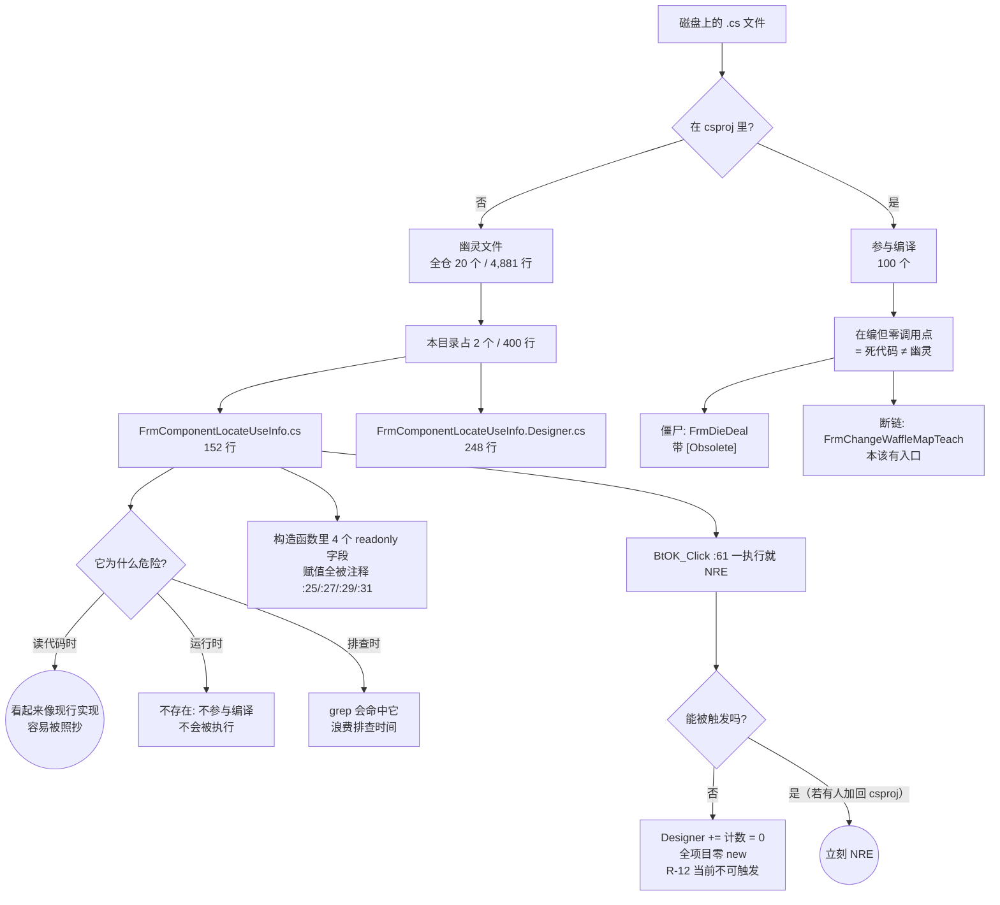

**ASCII ③ · 幽灵文件的成因与影响面**（与图 5 等价）

```text
        磁盘上的 .cs
             |
     +-------+--------+
     |                |
  在 csproj       不在 csproj
     |                |
  参与编译 100   [幽灵文件] 全仓 20/4,881
     |                |
     |          本目录 2 个/400 行
     |                |
     |        +-------+--------+
     |        |                |
     |  FrmComponentLocate   FrmComponentLocate
     |  UseInfo.cs (152)     UseInfo.Designer.cs (248)
     |        |
     |        +--> readonly 字段赋值全被注释 (:25/:27/:29/:31)
     |        +--> BtOK_Click (:61) 一执行就 NRE
     |        +--> Designer 的 += 计数 = 0  ⇒ 四个处理器从未接线
     |        +--> 全项目零 new  ⇒ 当前不可触发
     |        +--> 危险在于"被照抄"或"被加回 csproj"
     |
  在编但零调用点 ≠ 幽灵, 那叫死代码:
     +-- 僵尸 FrmDieDeal ([Obsolete], 废弃未删)
     +-- 断链 FrmChangeWaffleMapTeach (本该有入口, 漏接线)
```

| 概念 | 判据 | 能否被执行 | 本目录实例 |
|---|---|---|---|
| **幽灵文件** | 不在 `<Compile Include>` | **不可能**（不存在于程序集） | `FrmComponentLocateUseInfo`（2 个文件） |
| **僵尸（死代码）** | 在编 + 零调用点 + `[Obsolete]` | 能，但没人调 | `FrmDieDeal` |
| **断链（死代码）** | 在编 + 零调用点 + **本该有入口** | 能，但没人调 | `FrmChangeWaffleMapTeach` |
| **死方法（死代码）** | 在编 + 零调用点 + 有接线**但接线缺失** | 能，但没人调 | `FrmMagazineFilling_Closing`（R-20） |

> **三者对维护者的意义完全不同**：
> 幽灵 = "**别读它**"；僵尸 = "**已经淘汰了，别照抄它的用法**"；
> 断链 = "**本该能用，是漏接线，可能是个待修的缺陷**"。
> 下"零调用点"结论前，必须排除**扩展方法 / 同命名空间非限定调用 / `using static` / 反射**四种情况
> —— 本项目**确实存在**反射开窗服务，所以第 4 条不是理论风险。

## 3 关键类型索引

### 3.1 类型总账：43 个 `XtraForm` + 7 个 `XtraUserControl`

**图 6 · 关键类型地图（43 Form + 7 UserControl + 共享服务）**

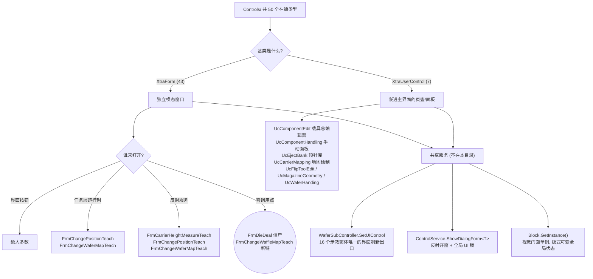

| 分组 | 数量 | 说明 |
|---|---:|---|
| `XtraForm` | **43** | 独立模态窗口；**全部在本目录内，无一处定义在别的目录** |
| `XtraUserControl` | **7** | 嵌进主界面复用（`Uc*` 前缀），**生命周期与窗体不同**（可被反复 attach / detach） |
| **合计** | **50** | 与 §2.1 的 50 个非 Designer 文件**一一对应**（1 个文件 1 个类型） |

> **`Frm*` 与 `Uc*` 的区别不是命名风格，是生命周期**：
> `Frm*` 每次 `new` 一个新实例，关掉就 `Dispose`；
> `Uc*` 由主界面**反复复用**，因此**静态事件订阅会把已释放的控件钩住** —— 这正是 R-26 的成因。

**7 个 `XtraUserControl` 全清单**

| 文件 | 作用 | 关键风险 |
|---|---|---|
| `Setting\Component\UcComponentEdit.cs` | 载具配置总编辑器（1,336 行） | R-02 / R-10 / R-50 / R-51 |
| `Manual\UcComponentHandling.cs` | 手动元件处理面板 | R-13 `Task.Run` 重入 / R-14 / R-27 |
| `Manual\UcEjectBank.cs` | 顶针库手动面板 | 用 `ShowDialog()` 开 `FrmEjectMeasurementTeach` |
| `UcCarrierMapping.cs` | 载具槽位地图绘制 | R-08 `Paint` 写模型 / GDI 泄漏 |
| `Setting\FlipTool\UcFlipToolEdit.cs` | 翻转工具参数 | `Thread.Sleep(1000)` |
| `Setting\Waferhandling\UcMagazineGeometry.cs` | 料盒几何参数 | R-26 静态委托 |
| `Setting\Waferhandling\UcWaferHanding.cs` | 晶圆处理参数 | 写后睡 100 ms |

### 3.2 关键契约：三个贯穿全目录的抽象

本目录自身的类型只有 50 个，但**真正决定行为的**是三个来自 `Infrastructure` 的契约。

#### 3.2.1 `AssistantConfig`：8 元组的"伪状态机"

`Infrastructure\Models\CommonModels\AssistantConfig.cs`

| 字段 | 类型 | `SetUIControl` 是否读它 | 说明 |
|---|---|---|---|
| `Index` | int | ❌ **从不读** | 声明了却不用，见 R-29 |
| `Descritpion` | string | ✅ | **属性名少一个 `i`**，`WaferSubController.cs:219` 按这个拼写调用，**不能改**（R-31） |
| `IsShowTitle` | bool | ✅ | 只赋给 `Visible` |
| `IsShowBack` | bool | ✅ | 只赋给 `Visible` ⇒ 不可用按钮是"消失"不是"灰掉"（R-47） |
| `IsShowNext` | bool | ✅ | 同上 |
| `IsShowDone` | bool | ✅ | 同上 |
| `BackAction` | Action | ✅ | 上一步回调 |
| `NextAction` | Action | ✅ | 下一步回调 |
| `DoneAction` | Action | ✅ | **完成回调 —— 唯一会触发落盘的地方**（Q2 的答案） |

> **名字叫"配置"，实际是"步骤表的一行"**。所谓"状态机"其实是
> `List<AssistantConfig>` 的**下标**推进：`SetUIControl(list, stepIndex, ...)` 只做
> `list[stepIndex]` 与 `tileBarGroup.Items[stepIndex]` 两次索引，**从不校验
> `list[stepIndex].Index == stepIndex`**。

#### 3.2.2 `AssistantStateEnum`：三值"这块示教做完了吗"

| 值 | 数值 | 含义 |
|---|---:|---|
| `Able` | 0 | 已示教完成，自动流程可以用 |
| `UnAble` | 1 | 待示教 |
| `ForBidden` | 2 | 被开关关掉了 |

`Infrastructure\Models\CommonModels\AssistantState.cs:24` 有**显式初始化**
`= AssistantStateEnum.UnAble`（不是默认值陷阱，见 R-53 ✅）。

#### 3.2.3 `IProgrammingControl`：`Confirm()` 是唯一落盘触发器

本目录有 **4 个**实现者。契约只有一条：**外部调用 `Confirm()` 才会落盘**。
这意味着**"用户以为点了保存"和"真的落盘了"之间隔着一个调用方**。

### 3.3 事件处理器：416 个实例 / 207 个唯一名

**图 7 · 416 个处理器的后缀分解与三层标准**

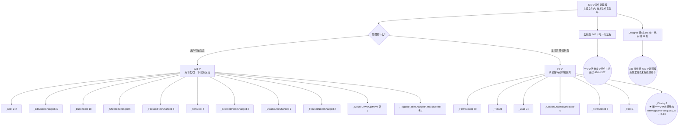

**后缀完整分解表**

| 分类 | 后缀 | 个数 | 小计 |
|---|---|---:|---:|
| **用户可触发** | `_Click` | 247 | **323** |
| | `_EditValueChanged` | 30 | |
| | `_ButtonClick` | 18 | |
| | `_CheckedChanged` | 6 | |
| | `_FocusedRowChanged` | 5 | |
| | `_ItemClick` | 4 | |
| | `_SelectedIndexChanged` | 3 | |
| | `_DataSourceChanged` | 2 | |
| | `_FocusedNodeChanged` | 2 | |
| | `_MouseDown` / `_MouseUp` / `_MouseMove` | 各 1 | |
| | `_Toggled` / `_TextChanged` / `_MouseWheel` | 各 1 | |
| **生命周期 / 绘制** | `_FormClosing` | 30 | **93** |
| | `_Tick` | 28 | |
| | `_Load` | 24 | |
| | `_CustomDrawRowIndicator` | 6 | |
| | `_FormClosed` | 3 | |
| | `_Paint` | 1 | |
| | `_Closing` | **1** | ← 唯一从未接线者，R-20 |
| **合计** | | | **416** |

> ⚠️ **`_Click` 类 247 个，但去重后只有 87 个唯一名** ——
> 因为 16 个示教窗体**逐个复制粘贴**了同一套骨架，`BtBack_Click` / `BtNext_Click` /
> `BtDone_Click` / `BtCancel_Click` 在每个窗体里都各出现一次。
> 这就是 R-42（改一个缺陷要改 16 遍）的量化依据。

### 3.4 三个共享服务（决定行为但不在本目录）

| 服务 | 位置 | 本目录的用法 | 相关风险 |
|---|---|---|---|
| `WaferSubController.SetUIControl(list, stepIndex, ...)` | `Controllers\WaferSubController.cs:198-221`（34 号文档） | **16 个示教窗体唯一的界面刷新出口**，由 100 ms 定时器驱动 | R-05 越界守卫挡不住负数、R-29 下标错位 |
| `ControlService.ShowDialogForm<T>(args)` | `Infrastructure\Service\ControlService.cs:366` | 本目录 **3 处**调用（2 活跃 + 1 组注释） | R-66 `Abort` 语义、R-68 死锁、R-70 反射签名 |
| `Block.GetInstance()` 视觉门面 | `Models\Entities\SearchChip\Block.cs`（34 号文档） | 换图/示教流程的状态载体；`Block.cs:1577` 是 `FrmWaffleMap` 无参构造的唯一调用点 | R-65 `Load` 未挂载、R-21 零 `Save()` 窗体的落盘归属 |
| `JsonFormatHelper<T>.DeepCopy / DeepGenericCopy` | 平台 DLL（无源码） | **12 处**调用，做"编辑前快照" | R-28 快照是否覆盖全字段无法自证 |
| `AKRSXtraMessageBox` / `AKRSMessageBoxExt` | `Infrastructure\Controls\Currency\` | 全目录弹窗几乎全部走它 | R-67 报警日志 `HandleType`、R-68 死锁、R-69 `msgBoxDict` |
## 4 UI 按钮与交互流程 ★核心★

### 4.0 本章结构与"三层标准"

#### 4.0.1 本章结构

| 小节 | 内容 | 是否画图 |
|---|---|---|
| §4.1 | 窗体/控件清单 + **「打开它的入口」三分类** | 图 9 |
| §4.2 | **按钮总表：全部 416 个处理器，一个不漏** | 无（表） |
| §4.3 | `Manual\` 手动面板 | 图 10–12 |
| §4.4 | `Assistant\ComponentsTeach\` 元件示教 | 图 13–17 |
| §4.5 | `Assistant\ChangeMapTeach\` 地图切换（含 Q3） | 图 18–20 |
| §4.6 | `Assistant\EjectionsTeach\` + `EjectionConfigurationTeach\` | 图 21–23 |
| §4.7 | `FlipTeach` / `MagazineTeach` / `WaferHandlingTeach` | 图 24 |
| §4.8 | `Setting\` 编辑器族（含 Q1 / Q2 / Q4） | 图 25–27 |
| §4.9 | `Controls\` 根目录 | 图 28–30 |
| §4.10 | 调用链索引 + 跨模块最长链 + 反射开窗时序 | 图 31–32 |

#### 4.0.2 三层标准（本文档用什么标准决定"哪张图值得画"）

**判定一个处理器是否进入"重点按钮，必画流程图"这一层，看它是否满足以下任一条：**

| 层 | 判据（满足任一即入本层） | 本文档的写法 |
|---|---|---|
| **第一层：重点按钮** | ① 触发硬件动作（动轴 / 夹爪 / 真空）<br/>② 修改配置**并落盘**<br/>③ 启动/停止线程或定时器<br/>④ 打开**带返回值**的模态窗体<br/>⑤ 方法体 > 40 行，或调用链深度 ≥ 3 | **四件套**：Mermaid 图 + 调用链（带 `文件:行`）+ 读了什么/写了什么 + 坑 |
| **第二层：一般处理器** | 修改内存状态或界面状态，且有分支 | 调用链 + 一句话作用，不画图 |
| **第三层：其余** | 纯界面赋值、只切控件 `Visible`、定时器回调的固定动作 | **只进 §4.2 按钮总表一行** |

**图 8 · §4 章节导览与三层标准的应用**

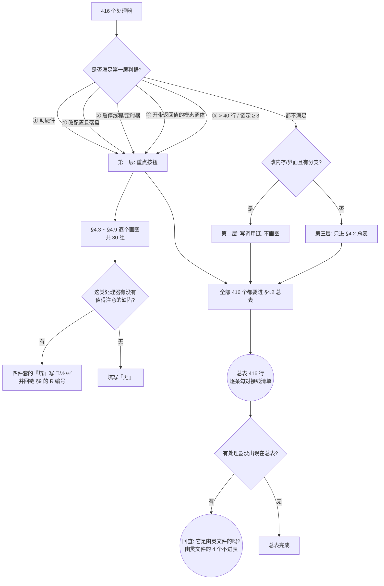

> **为什么要有这个标准**：本目录有 **416** 个处理器，若每个都画图，
> 文档会膨胀到不可读；若只画"看起来重要"的，又会漏掉
> `FrmMagazineFilling_Closing` 这种**从未接线**的死方法。
> 三层标准的作用是**让筛选规则可复算** —— 你可以拿这条规则去核对本文档漏了谁。

#### 4.0.3 本章的四件套格式

第一层的每个重点按钮，都按固定四段写：

1. **图** —— Mermaid（若有 ASCII 版会在图题里标注）。**图必须是分支图**：
   校验失败 / 异常 / 用户取消 / 重入 四条分支至少画出适用的那些。
2. **调用链** —— 从"用户点击"到"最终效果"，每一跳都带 `文件:行`。
3. **读了什么、写了什么** —— 读了哪些配置/控件值；写了哪些字段；是否落盘；是否动硬件。
4. **坑** —— 🔴 源码已核实 / ⚠️ 静态推断 / ✅ 已核实无害，并回链 §9 的 `R-xx`。

### 4.1 窗体 / 控件清单与「打开它的入口」

#### 4.1.0 判定标准：入口有三种，不是一种

**只 `grep` 按钮一定会漏**。本项目里一个窗体被打开展开有三种互不相同的机制，
三者混在一起写就会得出"这个窗体没人用"的错误结论。

| 入口类型 | 机制 | 特征 | 怎么找 |
|---|---|---|---|
| **① 界面按钮** | Designer 接线 `this.BtnX.Click += this.BtnX_Click;` | 用户点得到，**入口在别的目录**（`Main\`、`Infrastructure\`、`BondSystem\`） | `find . \( -name '*.Designer.cs' -o -name '*.designer.cs' \) -not -path './bin/*' -not -path './obj/*' -print0 \| xargs -0 grep -n 'new FrmXxx'`，再回溯处理器 |
| **② 任务层/线程运行时弹出** | 任务线程在流程中途 `new` + `ShowDialog()`，或经 `MainForm.SendUiAction` 切到 UI 线程 | **用户在界面上找不到按钮**；条件满足时自动弹 | `grep -rn 'new FrmXxx' Tasks/`，再读触发条件 |
| **③ 反射服务** | `ControlService.ShowDialogForm<T>(args)` → `Activator.CreateInstance` | 调用点**写的是泛型参数**，不是 `new FrmXxx(` | `grep -rn 'ShowDialogForm<'` |
| **零调用点** | 上面三种都没有 | 分**僵尸**（废弃）与**断链**（本该有入口） | 见 §4.1.3 的判定口径 |

> ⚠️ **一条反直觉的事实**：`Controls\` 里的 43 个窗体和 7 个用户控件，
> **它们的"打开入口"绝大多数不在本目录内** —— 在本目录里 `grep 'new FrmXxx('` 得到的大部分是
> **窗体之间互相打开**（如 `FrmEjectionSetting` 打开 `FrmNewCreateEjection`）。
> **真正的入口在 `Infrastructure\Controls\Feature\EditProgram\` 的 `UcEditProductProgramming` 里**
> —— 那一个类的 `Start()` 方法（`:1139`）一个 `switch` 就打开了 **19 个**示教窗体。

#### 4.1.1 图 9 · 三种入口分流判定

**图 9 · 三种入口分流判定图**

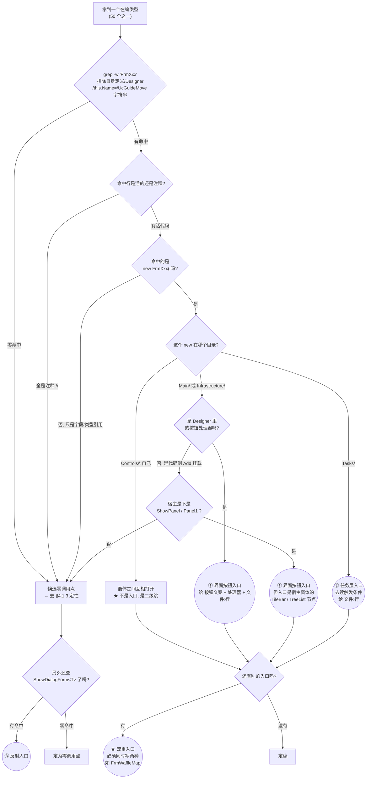

**ASCII ④ · 三种入口分流判定**（与图 9 等价）

```text
   [一个在编类型]
          |
   grep -w 'FrmXxx'  (排除 自身定义/Designer/this.Name=/UcGuideMove 字符串)
          |
    +-----+-------------------------------+
    |                                     |
  零命中 / 全是注释                  有活代码
    |                                     |
    |                          new FrmXxx( 吗? --否--> 候选零调用点
    |                                     |是
    |                          这个 new 在哪个目录?
    |                                     |
    |        +----------------------------+----------------------------+
    |        |                            |                            |
    |     Tasks\               Main\ / Infrastructure\            Controls\ 自己
    |        |                            |                            |
    |   ② 任务层入口           Designer 里的按钮处理器吗?           不是入口
    |   读触发条件              |                  |               是二级跳
    |   给 文件:行              是                 否                
    |        |                  |                  |                
    |        |          ① 界面按钮入口     代码侧 Add 挂载         
    |        |          给按钮文案+处理器   宿主是 ShowPanel/Panel1 吗?
    |        |          +文件:行              |            |
    |        |                              是            否
    |        |                               |            |
    |        |                    ① 界面按钮入口      候选零调用点
    |        |                    (入口是宿主的
    |        |                     TileBar/TreeList 节点)
    |        |                               |            
    +--------+-----------+-------------------+            
                         |
                  还有别的入口吗? --有--> ★ 双重入口, 两种都要写
                         |                  (如 FrmWaffleMap: ① + ②)
                        没有
                         |
                    ShowDialogForm<T> 查过了吗?
                         |            |
                        有           零命中
                         |            |
                   ③ 反射入口    定为零调用点
```

#### 4.1.2 全部 50 个在编类型的入口总表

> **读法**：`①`/`②`/`③` 三列**各自独立**，可以同时成立（如 `FrmWaffleMap` 是 ①+②，
> `FrmCarrierHeightMeasureTeach` 是 ③ 且有两处调用点）。
> 行号格式为 `文件:行`；处理器名后括号里是处理器的定义行。
> **`——` 表示该类型没有这条入口**；**"零调用点"表示三种都没有**。

| # | 类型 | ① 界面按钮入口 | ② 任务层 / 运行时弹出 | ③ 反射服务 | 判定 |
|---:|---|---|---|---|---|
| 1 | `FrmChangeStaticAdapterTeach` | `Main/Controls/UcModule.cs:142` `WaferFeed_ItemClick`(117)，接线 `UcModule.Designer.cs:499` | `Tasks/WaferSubSystemTask.cs:1068`（ChangeTabletManual 换图）、`:1140`（ChangeTabletAuto 重试）、`:1318`（ChangeTabletAuto 换图） | —— | ①+② |
| 2 | `FrmChangeTabletTeach` | `Main/Controls/UcShortcutMenu.cs:1240` `BtnChangeTabletWithManual_Click`(1234)，接线 `:793`；另 3 处是示教窗体 `_Load` 内的二级跳 | `Tasks/WaferSubSystemTask.cs:1083`（ChangeTabletManual）、`:1340`（ChangeTabletAuto） | —— | ①+② |
| 3 | `FrmChangeWaferMapTeach` | —— | —— | `Tasks/WaferSubSystemTask.cs:833`（Manual + `SearchMode.WaferMap` 换图） | **③ 只有反射** |
| 4 | `FrmChangeWaffleMapTeach` | —— | —— | —— | **零调用点（断链）** |
| 5 | `FrmWaffleMap` | `Main/Controls/UcShortcutMenu.cs:1482` `BtnWaffleSet_Click`(1476)，接线 `:756`；`:1497` `BtnStaticWaffleSet_Click`(1491)，接线 `:743` | `Models/Entities/SearchChip/Block.cs:1577`（唯一实例创建点，在 `StartInitWaffleMap()`(1570) 内）← `StartInit()`(1200) ← `WaferSubSystemTask.cs:495`、`:1379` | —— | **①+② 双重入口** |
| 6 | `FrmComponentGeometryWithWaferPitchTeach` | `Assistant/ComponentsTeach/FrmComponentGeometryWithWaferTeach.cs:1101`（`_Load`(1016) 内的二级跳） | —— | —— | ①（二级跳） |
| 7 | `FrmChooseWafer` | `FrmComponentGeometryWithWaferTeach.cs:1033`（`_Load`(1016)）、`FrmComponentGeometryWithWaffleTeach.cs:932`（`_Load`(915)）、`FrmComponentCarrierGeometryWithWaffleTeach.cs:709`（`_Load`(687)）、`FrmComponentMap.cs:55`（父窗体零调用点 ⇒ **该处是死代码**） | —— | —— | ①（全部是二级跳） |
| 8 | `FrmComponentCarrierAdjustWithWaferTeach` | —— | —— | —— | **零调用点（断链，仅注释）** |
| 9 | `FrmComponentCarrierGeometryWithWaferTeach` | —— | —— | —— | **零调用点（断链，仅注释）** |
| 10 | `FrmComponentCarrierGeometryWithWaffleTeach` | `Infrastructure/…/UcEditProductProgramming.cs:1962`（`Start()`(1139) 的 `case "芯片载具形状"`）← `BtStart_Click`(870)，接线 `designer.cs:482` | —— | —— | ① |
| 11 | `FrmChangePositionTeach` | —— | `Tasks/WaferSubSystemTask.cs:619`、`:645`、`:739`、`:785`、`:914`（均在 `ChangeSucceedOperation`(493) 内，换料片后手动对位） | `Tasks/WaferSubSystemTask.cs:872`（同一流程的另一分支） | **②+③** |
| 12 | `FrmComponentGeometryWithWaferTeach` | `UcEditProductProgramming.cs:1808`（`start` case "芯片形状示教"）← `BtStart_Click`(870) | —— | —— | ① |
| 13 | `FrmComponentGeometryWithWaffleTeach` | `UcEditProductProgramming.cs:1821`（同上 case）← `BtStart_Click`(870) | —— | —— | ① |
| 14 | `FrmComponentMap` | —— | —— | —— | **零调用点（仅注释）** |
| 15 | `FrmCarrierHeightMeasureTeach` | —— | —— | `FrmComponentGeometryWithWaferTeach.cs:225`（`InitControl`(201) 的 `nextAction`）← `BtNext_Click`(785)；`Setting/Component/UcComponentEdit.cs:1203`（`BtnMeasurementComponentAndCarrierThickness_Click`(1187)） | **③ 两处** |
| 16 | `FrmInkDotWithWaffleTeach` | `UcEditProductProgramming.cs:1891`（case "芯片墨点示教"） | —— | —— | ① |
| 17 | `FrmInkDotWithWaferTeach` | `UcEditProductProgramming.cs:1878`（同上 case） | —— | —— | ① |
| 18 | `FrmInputColumns` | `FrmComponentGeometryWithWaffleTeach.cs:447`（`InitControl`(218) 的 `nextAction`）← `BtNext_Click`(759) | —— | —— | ①（二级跳） |
| 19 | `FrmInputNumberOfSteps` | `FrmComponentGeometryWithWaferTeach.cs:453`（`InitControl`(201) 的 `nextAction`）← `BtNext_Click`(785) | —— | —— | ①（二级跳） |
| 20 | `FrmInputRows` | `FrmComponentGeometryWithWaffleTeach.cs:525`（`InitControl`(218) 的 `nextAction`）← `BtNext_Click`(759) | —— | —— | ①（二级跳） |
| 21 | `FrmWaferEdgeWithWaferTeach` | `UcEditProductProgramming.cs:1910`（case "芯片环形限位"）← `BtStart_Click`(870) | —— | —— | ① |
| 22 | `FrmEjectionSetting` | `UcEditProductProgramming.cs:1372`（case "顶针"）← `BtStart_Click`(870) | —— | —— | ① |
| 23 | `FrmNewCreateEjection` | `Assistant/EjectionConfigurationTeach/FrmEjectionSetting.cs:289` `BtnAdd_Click`(287)，接线 `Designer.cs:382` | —— | —— | ①（二级跳） |
| 24 | `FrmHeightMeasurementTeach` | `UcEditProductProgramming.cs:1447`、`:1472`（case "顶针高度示教"）← `BtStart_Click`(870) | —— | 注释 `UcComponentEdit.cs:1209`、`:1212`（**已注释，不构成入口**） | **① 活路径；③ 仅注释** |
| 25 | `FrmNeedleZeroPositionTeach` | `UcEditProductProgramming.cs:1508`（case "顶针零位示教"） | —— | —— | ① |
| 26 | `FrmEjectMeasurementTeach` | `Manual/UcEjectBank.cs:191` `BtnMeasurement_Click`(172)，接线 `UcEjectBank.Designer.cs:174` | —— | —— | ①（二级跳） |
| 27 | `FrmXYPositionTeach` | `UcEditProductProgramming.cs:1551`（case "顶针XY位置示教"） | —— | —— | ① |
| 28 | `FrmFlipToolTeach` | `UcEditProductProgramming.Assistance.cs:904` `AssistanceFlipTool`(900) ← `Start()` 的 case "翻转工具示教"（`UcEditProductProgramming.cs:1421`）← `BtStart_Click`(870) | —— | —— | ① |
| 29 | `FrmFlipToWaferTeach` | `UcEditProductProgramming.cs:1838`（case "翻转工具取晶位示教"） | —— | —— | ① |
| 30 | `FrmStaticWaffleConfiguration` | `UcEditProductProgramming.cs:1411`（case "静态华夫盒"） | —— | —— | ① |
| 31 | `FrmMagazineFilling` | `UcEditProductProgramming.cs:1384`（case "晶圆配置"） | —— | —— | ① |
| 32 | `FrmNewCreateAdapter` | `Assistant/MagazineTeach/FrmMagazineFilling.cs:671` `BtAddAdpter_Click`(669)，接线 `:444`；`FrmStaticWaffleConfiguration.cs:482` `BtAddAdpter_Click`(480)，接线 `:192` | —— | —— | ①（二级跳，两处） |
| 33 | `FrmNewCreateComponent` | `FrmMagazineFilling.cs:606` `BtAddWafer_Click`(604)，接线 `:385`；`FrmStaticWaffleConfiguration.cs:411` `BtAddWafer_Click`(409)，接线 `:376` | —— | —— | ①（二级跳，两处） |
| 34 | `FrmRegripSet` | `Assistant/WaferHandlingTeach/FrmWaferChangeTeach.cs:651`（`FrmWaferChangeTeach_Load`(649) 内的二级跳） | —— | —— | ①（二级跳） |
| 35 | `FrmWaferChangeTeach` | `UcEditProductProgramming.cs:1288`（case "换晶圆示教"） | —— | —— | ① |
| 36 | `FrmWaferMagazineGeoTeach` | `UcEditProductProgramming.cs:1273`（case "晶圆料盒示教"） | —— | —— | ① |
| 37 | `FrmWaferTableCollisionCircleTeach` | `UcEditProductProgramming.cs:1314`（case "晶圆台环限位示教"） | —— | —— | ① |
| 38 | `FrmDebug` | `Main/Controls/UcModule.cs:129` `WaferFeed_ItemClick`(117)，接线 `UcModule.Designer.cs:492`；**需 `IsOffLineWork` 才可见** | —— | —— | ① |
| 39 | `FrmDieDeal` | —— | —— | —— | **零调用点（僵尸，`[Obsolete]`）** |
| 40 | `FrmEjectionRealtimeState` | `Main/…/UcMainSystem.DataAdministrator.cs:216` `BarBtEjectionState_ItemClick`(212)，接线 `UcMainSystem.designer.cs:1462` | —— | —— | ① |
| 41 | `FrmSlotsState` | `Main/…/UcMainSystem.cs:622` `BtSlotState_ItemClick`(612)，接线 `UcMainSystem.designer.cs:2948` | —— | —— | ① |
| 42 | `FrmFlipTableTeach` | `BondSystem/Controls/Setting/Customer/FrmCustomerSetup.cs:209` `BtnTeachFlipTable_Click`(191)，接线 `FrmCustomerSetup.Designer.cs:130` | —— | —— | ①（**跨子系统入口**） |
| 43 | `FrmNewCreateFlipTool` | `UcEditProductProgramming.cs:1342`（case "翻转工具"） | —— | —— | ① |
| 44 | `UcCarrierMapping` | 4 处懒加载：`FrmChangeStaticAdapterTeach.cs:279` `RefreshPncCarrierMapping`(266) ← `Grv2_FocusedRowChanged`(168)/`Save`(132)/`BindingAdapterData`(158)；`FrmChangeTabletTeach.cs:561`（同构）；`FrmSlotsState.cs:261`（同构）；`FrmWaffleMap.cs:84` ← `LueWafflesName_EditValueChanged`(123) | `Block.cs:1318` 调 `FrmWaffleMap.LoadCarrierMapping` | —— | ①+② |
| 45 | `UcComponentHandling` | `Main/…/UcMainSystem.Manual.cs:156` `BarBtComponentHanding_ItemClick`(150)，接线 `UcMainSystem.designer.cs:768`，经 `ShowPanel` 挂载 | —— | —— | ①（宿主 TileBar 入口） |
| 46 | `UcEjectBank` | `Main/…/UcMainSystem.Manual.cs:113` `BarBtESToolBank_ItemClick`(107)，接线 `UcMainSystem.designer.cs:847`，经 `ShowPanel` 挂载 | —— | —— | ①（宿主 TileBar 入口） |
| 47 | `UcComponentEdit` | `Infrastructure/…/UcEditProductProgramming.cs:799`（`TreeListProgramming_FocusedNodeChanged`(453) 的 `case "ComponentsSubNode"`），接线 `.designer.cs:174` | —— | —— | ①（宿主 TreeList 节点） |
| 48 | `UcFlipToolEdit` | `UcEditProductProgramming.cs:681`（同一处理器的 `case "FlipToolSubNode"`） | —— | —— | ①（宿主 TreeList 节点） |
| 49 | `UcMagazineGeometry` | `UcEditProductProgramming.cs:562`（同一处理器的 `case "WaferHandlingSubNode"`） | —— | —— | ①（宿主 TreeList 节点） |
| 50 | `UcWaferHanding` | `UcEditProductProgramming.cs:556`（同一处理器的 `case "WaferHandling"`） | —— | —— | ①（宿主 TreeList 节点） |

**计数核对**：`①` 有入口 **43** 个；`②` 有入口 **5** 个（#1 #2 #5 #11 #44）；`③` 有入口 **3** 个（#3 #11 #15）；
**零调用点 5** 个（#4 #8 #9 #14 #39）。三类入口**互有重叠**，所以三列相加 ≠ 50。

#### 4.1.3 七个 Uc\* 全部不是 Designer 拖放

**反查命令（含大小写两种 Designer 扩展名）**：
```bash
find . \( -name '*.Designer.cs' -o -name '*.designer.cs' \) \
  -not -path './bin/*' -not -path './obj/*' -print0 |
xargs -0 grep -n 'new UcCarrierMapping\|new UcComponentHandling\|new UcEjectBank\|new UcComponentEdit\|new UcFlipToolEdit\|new UcMagazineGeometry\|new UcWaferHanding'
```
**返回空**（退出码 123，即"有文件但无匹配"）。

> ⚠️ **不要把这个命令改回 `grep -rn --include='*.Designer.cs' ...`**：`--include` 的匹配**不受 `-i` 影响**，
> 所以 `grep -ri --include='*.Designer.cs'` **仍然匹配不到`*.designer.cs`**。
> 本仓 Designer 文件共 **339** 个 = 大写 `.Designer.cs` **331** + 小写 `.designer.cs` **8**，
> **只有 `find` 的双 `-name`（或 `-iname`）能覆盖全部**。
> 本目录的 7 个 `Uc*` 与全部 43 个窗体都**不受这个坑影响**（实测：339 个 Designer 文件里
> 唯一的 `new Frm*/new Uc*` 是 `new UcLight()`，不是本目录的类型），
> 但**别的目录（尤其 `Main\`）的入口表会因此整块消失** —— 见 §0.6 的同一提醒。
它们全部是**代码里 `new` 之后 `Controls.Add` 挂上去的**：

| 用户控件 | 挂载方式 | 挂载点 |
|---|---|---|
| `UcCarrierMapping` | `Controls.Add` 到父容器面板 | `FrmWaffleMap.cs:91`（`GcWaffleMap.Controls.Add`）等 4 处 |
| `UcEjectBank`、`UcComponentHandling` | `UcMainSystem.ShowPanel` 停靠面板 | `UcMainSystem.Manual.cs:113`、`:156` |
| `UcComponentEdit`、`UcFlipToolEdit`、`UcMagazineGeometry`、`UcWaferHanding` | `Controls.Add` 到 `SpiltContainerProgramming.Panel1` | `UcEditProductProgramming.cs:556`/`:562`/`:681`/`:799` |

> **这对写"按钮流程"的影响**：这 4 个 `Setting\` 用户控件的"打开它的入口"
> **不是它们自己的按钮，而是宿主窗体 `UcEditProductProgramming` 的 TreeList 节点**。
> 在 `Controls\` 目录内搜它们的按钮**永远搜不到入口** —— 这是本目录最容易误判的一类。

#### 4.1.4 零调用点的 5 个类型：僵尸 vs 断链

**判定口径（可复现）**：

```bash
cd "E:/项目/ZX2200标机/trunk/AKRS.ZX2200"
for t in FrmChangeWaffleMapTeach FrmComponentCarrierAdjustWithWaferTeach \
         FrmComponentCarrierGeometryWithWaferTeach FrmComponentMap FrmDieDeal; do
  echo "=== $t ==="
  grep -rn --include='*.cs' -w "$t" . | grep -v "class $t" | grep -v "\.Designer\.cs:"
done
```
**三条排除**都已做：① 扩展方法（这 5 个都是 `Form` 子类，不是扩展方法）；② 同命名空间非限定调用（已按 `-w` 全词扫描全仓库）；
③ **反射调用**（另跑 `grep -rn 'ShowDialogForm<'` 与 `grep -rn 'CreateInstance'`，**对这 5 个零命中**）。

| 类型 | 判定 | 依据 | 该记成什么 |
|---|---|---|---|
| `FrmChangeWaffleMapTeach` | **断链** | 在 `.csproj` 里、编译进去；**同族的晶圆版 `FrmChangeWaferMapTeach` 有入口 `WaferSubSystemTask.cs:833`，华夫版缺这一行** ⇒ 不对称漏接线。其 10 个 `AssistantConfig` 的 `Action` **全空**（`:81-250`），描述是占位符 `"Step {n}/10; descritpion. "`（`:76-238`，10 处**字面量** `descritpion.`） | **本该有入口但没接**（风险 R-34 / R-35） |
| `FrmComponentCarrierAdjustWithWaferTeach` | **断链** | 唯一提及在注释里：`UcEditProductProgramming.cs:1986-1987`（`// new FrmComponentCarrierAdjustWithWaferTeach(waferCarrier4);`） | 同上 |
| `FrmComponentCarrierGeometryWithWaferTeach` | **断链** | 唯一提及在注释里：`UcEditProductProgramming.cs:1936-1937`（`// new FrmComponentCarrierGeometryWithWaferTeach(waferCarrier3);`） | 同上 |
| `FrmComponentMap` | **断链** | 唯一提及在注释里：`UcEditProductProgramming.cs:1858`、`Controls/FrmDebug.cs:132` | 同上 |
| `FrmDieDeal` | **僵尸** | `:20` 有 `[Obsolete]`，**全仓库除自身 `.cs`/`.Designer.cs` 外无任何引用**；但**内部逻辑完整**（`Ignore`/`Retry`/`No`/`Abort` 四值对话框、7 个处理器）⇒ **是"被淘汰的旧版"而非"未完成"** | **废弃但未删**（风险 R-63 ✅ 无害 / R-34） |

> ⚠️ **不要把它们写成"界面上有这个功能"**。零调用点意味着**按钮点下去不会有任何反应**
> —— 因为根本没有按钮。同时对 `FrmDieDeal` 这类**僵尸**要额外说明：
> 它**不是半成品**，读它不会误导（但 `DialogResult` 用法不该照抄，见 R-46）。

---

### 4.2 按钮总表（全部 416 个处理器）

> 本表是 §4 的**兜底清单**：`WaferSubSystem\Controls\` 下 100 个编译进 `.csproj` 的 `.cs` 文件里，
> 所有签名形如 `void Xxx(object sender, EventArgs e)` 的处理器**一个不漏**全在此表，且**只**在此表。
> 复算命令见 §0.6；**416 = 420 − 4**，减掉的 4 个属于幽灵文件 `FrmComponentLocateUseInfo.cs`。
> 「控件名」抄自接线清单（Designer 或构造函数）；无接线的写 `—（未接线）`，窗体生命周期写 `(窗体)`。

| 控件名 | 事件 | 处理器 | 文件:行 | 一句话作用 | 是否有流程图 |
|---|---|---|---|---|---|
| BtnOK | Click | BtnOK_Click | WaferSubSystem/Controls/Assistant/ChangeMapTeach/FrmChangeStaticAdapterTeach.cs:87 | 开静态真空并落盘 | — |
| BtnAbort | Click | BtnAbort_Click | WaferSubSystem/Controls/Assistant/ChangeMapTeach/FrmChangeStaticAdapterTeach.cs:99 | 取消并返回 | — |
| (窗体) | Load | FrmChangeStaticAdapterTeach_Load | WaferSubSystem/Controls/Assistant/ChangeMapTeach/FrmChangeStaticAdapterTeach.cs:109 | 置标志并开报警 | — |
| Grv1 | DataSourceChanged | Grv1_DataSourceChanged | WaferSubSystem/Controls/Assistant/ChangeMapTeach/FrmChangeStaticAdapterTeach.cs:120 | 重绑适配器数据 | — |
| Grv2 | FocusedRowChanged | Grv2_FocusedRowChanged | WaferSubSystem/Controls/Assistant/ChangeMapTeach/FrmChangeStaticAdapterTeach.cs:166 | 刷新载体映射图 | — |
| BtnGrv1SetState | ButtonClick | BtnGrv1SetState_ButtonClick | WaferSubSystem/Controls/Assistant/ChangeMapTeach/FrmChangeStaticAdapterTeach.cs:176 | 整片槽位置好 | — |
| BtnGrv1ResetState | ButtonClick | BtnGrv1ResetState_ButtonClick | WaferSubSystem/Controls/Assistant/ChangeMapTeach/FrmChangeStaticAdapterTeach.cs:189 | 整片槽位清空 | — |
| BtnGrv2SetState | ButtonClick | BtnGrv2SetState_ButtonClick | WaferSubSystem/Controls/Assistant/ChangeMapTeach/FrmChangeStaticAdapterTeach.cs:207 | 单槽置好 | — |
| BtnGrv2ResetState | ButtonClick | BtnGrv2ResetState_ButtonClick | WaferSubSystem/Controls/Assistant/ChangeMapTeach/FrmChangeStaticAdapterTeach.cs:221 | 单槽清空 | — |
| Grv1 | CustomDrawRowIndicator | Grv1_CustomDrawRowIndicator | WaferSubSystem/Controls/Assistant/ChangeMapTeach/FrmChangeStaticAdapterTeach.cs:240 | 行号显示序号 | — |
| Grv2 | CustomDrawRowIndicator | Grv2_CustomDrawRowIndicator | WaferSubSystem/Controls/Assistant/ChangeMapTeach/FrmChangeStaticAdapterTeach.cs:253 | 行号显示序号 | — |
| BtnFillALLSlotState | Click | BtnFillALLSlotState_Click | WaferSubSystem/Controls/Assistant/ChangeMapTeach/FrmChangeStaticAdapterTeach.cs:296 | 全槽填好并重建 | — |
| (窗体) | FormClosing | FrmChangeStaticAdapterTeach_FormClosing | WaferSubSystem/Controls/Assistant/ChangeMapTeach/FrmChangeStaticAdapterTeach.cs:312 | 复位标志与报警 | — |
| BtnStaticWaffleVacuum | Click | BtnStaticWaffleVacuum_Click | WaferSubSystem/Controls/Assistant/ChangeMapTeach/FrmChangeStaticAdapterTeach.cs:323 | 静态真空通断 | — |
| BtnOK | Click | BtnOK_Click | WaferSubSystem/Controls/Assistant/ChangeMapTeach/FrmChangeTabletTeach.cs:242 | 校验后移台落盘 | 图 20（§4.5.3） |
| BtnAbort | Click | BtnAbort_Click | WaferSubSystem/Controls/Assistant/ChangeMapTeach/FrmChangeTabletTeach.cs:275 | 取消并关窗 | — |
| (窗体) | Load | FrmChangeTabletTeach_Load | WaferSubSystem/Controls/Assistant/ChangeMapTeach/FrmChangeTabletTeach.cs:286 | 填充料片下拉 | — |
| Grv1 | DataSourceChanged | Grv1_DataSourceChanged | WaferSubSystem/Controls/Assistant/ChangeMapTeach/FrmChangeTabletTeach.cs:343 | 重绑适配器数据 | — |
| CmbTabletName | EditValueChanged | CmbTabletName_EditValueChanged | WaferSubSystem/Controls/Assistant/ChangeMapTeach/FrmChangeTabletTeach.cs:353 | 按选中料片重建 | — |
| Grv2 | FocusedRowChanged | Grv2_FocusedRowChanged | WaferSubSystem/Controls/Assistant/ChangeMapTeach/FrmChangeTabletTeach.cs:434 | 刷新载体映射图 | — |
| BtnGrv1SetState | ButtonClick | BtnGrv1SetState_ButtonClick | WaferSubSystem/Controls/Assistant/ChangeMapTeach/FrmChangeTabletTeach.cs:444 | 整片槽位置好 | — |
| BtnGrv1ResetState | ButtonClick | BtnGrv1ResetState_ButtonClick | WaferSubSystem/Controls/Assistant/ChangeMapTeach/FrmChangeTabletTeach.cs:464 | 整片槽位清空 | — |
| BtnGrv2SetState | ButtonClick | BtnGrv2SetState_ButtonClick | WaferSubSystem/Controls/Assistant/ChangeMapTeach/FrmChangeTabletTeach.cs:489 | 单槽置好 | — |
| BtnGrv2ResetState | ButtonClick | BtnGrv2ResetState_ButtonClick | WaferSubSystem/Controls/Assistant/ChangeMapTeach/FrmChangeTabletTeach.cs:503 | 单槽清空 | — |
| Grv1 | CustomDrawRowIndicator | Grv1_CustomDrawRowIndicator | WaferSubSystem/Controls/Assistant/ChangeMapTeach/FrmChangeTabletTeach.cs:522 | 行号显示序号 | — |
| Grv2 | CustomDrawRowIndicator | Grv2_CustomDrawRowIndicator | WaferSubSystem/Controls/Assistant/ChangeMapTeach/FrmChangeTabletTeach.cs:535 | 行号显示序号 | — |
| (窗体) | FormClosing | FrmChangeTabletTeach_FormClosing | WaferSubSystem/Controls/Assistant/ChangeMapTeach/FrmChangeTabletTeach.cs:573 | 释放映射图与报警 | — |
| BtnWaffleVacuum | Click | BtnWaffleVacuum_Click | WaferSubSystem/Controls/Assistant/ChangeMapTeach/FrmChangeTabletTeach.cs:583 | 华夫盒真空通断 | — |
| BtBack | Click | BtBack_Click | WaferSubSystem/Controls/Assistant/ChangeMapTeach/FrmChangeWaferMapTeach.cs:288 | 回上一步 | 图 18（§4.5.1） |
| BtNext | Click | BtNext_Click | WaferSubSystem/Controls/Assistant/ChangeMapTeach/FrmChangeWaferMapTeach.cs:314 | 进下一步 | 图 18（§4.5.1） |
| BtDone | Click | BtDone_Click | WaferSubSystem/Controls/Assistant/ChangeMapTeach/FrmChangeWaferMapTeach.cs:342 | 完成并落盘 | 图 18（§4.5.1） |
| BtCancel | Click | BtCancel_Click | WaferSubSystem/Controls/Assistant/ChangeMapTeach/FrmChangeWaferMapTeach.cs:368 | 取消并关窗 | 图 18（§4.5.1） |
| timer1 | Tick | Timer1_Tick | WaferSubSystem/Controls/Assistant/ChangeMapTeach/FrmChangeWaferMapTeach.cs:394 | 刷新导航条步骤态 | — |
| (窗体) | FormClosing | FrmChangeWaferMapTeach_FormClosing | WaferSubSystem/Controls/Assistant/ChangeMapTeach/FrmChangeWaferMapTeach.cs:399 | 关窗停定时器 | — |
| simpleButton1 | Click | simpleButton1_Click | WaferSubSystem/Controls/Assistant/ChangeMapTeach/FrmChangeWaferMapTeach.cs:414 | 打开地图窗体 | — |
| (窗体) | Load | FrmChangeWaffleMapTeach_Load | WaferSubSystem/Controls/Assistant/ChangeMapTeach/FrmChangeWaffleMapTeach.cs:56 | 初始化并置首步 | — |
| BtBack | Click | BtBack_Click | WaferSubSystem/Controls/Assistant/ChangeMapTeach/FrmChangeWaffleMapTeach.cs:322 | 回上一步 | 图 13（§4.4.1） |
| BtNext | Click | BtNext_Click | WaferSubSystem/Controls/Assistant/ChangeMapTeach/FrmChangeWaffleMapTeach.cs:348 | 进下一步 | 图 13（§4.4.1） |
| BtDone | Click | BtDone_Click | WaferSubSystem/Controls/Assistant/ChangeMapTeach/FrmChangeWaffleMapTeach.cs:374 | 完成并落盘 | 图 13（§4.4.1） |
| BtCancel | Click | BtCancel_Click | WaferSubSystem/Controls/Assistant/ChangeMapTeach/FrmChangeWaffleMapTeach.cs:400 | 取消并关窗 | 图 13（§4.4.1） |
| (窗体) | FormClosing | FrmWaffleMap_FormClosing | WaferSubSystem/Controls/Assistant/ChangeMapTeach/FrmWaffleMap.cs:60 | 拦关闭改为隐藏 | — |
| (窗体) | Load | FrmWaffleMap_Load | WaferSubSystem/Controls/Assistant/ChangeMapTeach/FrmWaffleMap.cs:107 | 载入华夫盒列表 | — |
| LueWafflesName | EditValueChanged | LueWafflesName_EditValueChanged | WaferSubSystem/Controls/Assistant/ChangeMapTeach/FrmWaffleMap.cs:123 | 切换并载图 | 图 19（§4.5.2） |
| BtnSave | Click | BtnSave_Click | WaferSubSystem/Controls/Assistant/ChangeMapTeach/FrmWaffleMap.cs:135 | 落盘保存配置 | 图 19（§4.5.2） |
| BtBack | Click | BtBack_Click | WaferSubSystem/Controls/Assistant/ComponentsTeach/FrmCarrierHeightMeasureTeach.cs:273 | 回上一步 | 图 13（§4.4.1） |
| BtNext | Click | BtNext_Click | WaferSubSystem/Controls/Assistant/ComponentsTeach/FrmCarrierHeightMeasureTeach.cs:299 | 进下一步 | 图 13（§4.4.1） |
| BtDone | Click | BtDone_Click | WaferSubSystem/Controls/Assistant/ComponentsTeach/FrmCarrierHeightMeasureTeach.cs:325 | 完成并落盘 | 图 15（§4.4.3） |
| BtCancel | Click | BtCancel_Click | WaferSubSystem/Controls/Assistant/ComponentsTeach/FrmCarrierHeightMeasureTeach.cs:351 | 取消并关窗 | 图 13（§4.4.1） |
| BtnESUpOrDown | Click | BtnESUpOrDown_Click | WaferSubSystem/Controls/Assistant/ComponentsTeach/FrmCarrierHeightMeasureTeach.cs:377 | 顶针升降切换 | — |
| BtnESAirSupplyOnOrOff | Click | BtnESAirSupplyOnOrOff_Click | WaferSubSystem/Controls/Assistant/ComponentsTeach/FrmCarrierHeightMeasureTeach.cs:409 | 顶针气源通断 | — |
| BtnIniNeedleSystem | Click | BtnIniNeedleSystem_Click | WaferSubSystem/Controls/Assistant/ComponentsTeach/FrmCarrierHeightMeasureTeach.cs:441 | 顶针系统复位 | — |
| BtnMoveToCameraCenter | Click | BtnMoveToCameraCenter_Click | WaferSubSystem/Controls/Assistant/ComponentsTeach/FrmCarrierHeightMeasureTeach.cs:467 | 动轴到相机中心 | — |
| (窗体) | Load | FrmHeightMeasurementTeach_Load | WaferSubSystem/Controls/Assistant/ComponentsTeach/FrmCarrierHeightMeasureTeach.cs:493 | 空实现（仅留桩） | — |
| timer1 | Tick | Timer1_Tick | WaferSubSystem/Controls/Assistant/ComponentsTeach/FrmCarrierHeightMeasureTeach.cs:512 | 刷新导航条步骤态 | — |
| (窗体) | FormClosing | FrmHeightMeasurementTeach_FormClosing | WaferSubSystem/Controls/Assistant/ComponentsTeach/FrmCarrierHeightMeasureTeach.cs:517 | 关窗停定时器 | — |
| BtBack | Click | BtBack_Click | WaferSubSystem/Controls/Assistant/ComponentsTeach/FrmChangePositionTeach.cs:192 | 回上一步 | 图 13（§4.4.1） |
| BtNext | Click | BtNext_Click | WaferSubSystem/Controls/Assistant/ComponentsTeach/FrmChangePositionTeach.cs:218 | 进下一步 | 图 13（§4.4.1） |
| BtDone | Click | BtDone_Click | WaferSubSystem/Controls/Assistant/ComponentsTeach/FrmChangePositionTeach.cs:244 | 完成并落盘 | 图 13（§4.4.1） |
| BtCancel | Click | BtCancel_Click | WaferSubSystem/Controls/Assistant/ComponentsTeach/FrmChangePositionTeach.cs:270 | 取消并关窗 | 图 13（§4.4.1） |
| (窗体) | Load | FrmChangePositionTeach_Load | WaferSubSystem/Controls/Assistant/ComponentsTeach/FrmChangePositionTeach.cs:296 | 开报警并初始化 | — |
| timer1 | Tick | Timer1_Tick | WaferSubSystem/Controls/Assistant/ComponentsTeach/FrmChangePositionTeach.cs:307 | 刷新导航条步骤态 | — |
| (窗体) | FormClosing | FrmChangePositionTeach_FormClosing | WaferSubSystem/Controls/Assistant/ComponentsTeach/FrmChangePositionTeach.cs:312 | 关窗停定时器 | — |
| BtnOK | Click | BtnOK_Click | WaferSubSystem/Controls/Assistant/ComponentsTeach/FrmChooseWafer.cs:72 | 取槽号并确认 | — |
| BtnCancel | Click | BtnCancel_Click | WaferSubSystem/Controls/Assistant/ComponentsTeach/FrmChooseWafer.cs:83 | 取消并关窗 | — |
| BtBack | Click | BtBack_Click | WaferSubSystem/Controls/Assistant/ComponentsTeach/FrmComponentCarrierAdjustWithWaferTeach.cs:206 | 回上一步 | 图 13（§4.4.1） |
| BtNext | Click | BtNext_Click | WaferSubSystem/Controls/Assistant/ComponentsTeach/FrmComponentCarrierAdjustWithWaferTeach.cs:232 | 进下一步 | 图 13（§4.4.1） |
| BtDone | Click | BtDone_Click | WaferSubSystem/Controls/Assistant/ComponentsTeach/FrmComponentCarrierAdjustWithWaferTeach.cs:258 | 完成并落盘 | 图 13（§4.4.1） |
| BtCancel | Click | BtCancel_Click | WaferSubSystem/Controls/Assistant/ComponentsTeach/FrmComponentCarrierAdjustWithWaferTeach.cs:284 | 取消并关窗 | 图 13（§4.4.1） |
| (窗体) | FormClosed | FrmComponentCarrierAdjustWithWaferTeach_FormClosed | WaferSubSystem/Controls/Assistant/ComponentsTeach/FrmComponentCarrierAdjustWithWaferTeach.cs:305 | 关窗释放引导图 | — |
| BtBack | Click | BtBack_Click | WaferSubSystem/Controls/Assistant/ComponentsTeach/FrmComponentCarrierGeometryWithWaferTeach.cs:281 | 回上一步 | 图 13（§4.4.1） |
| BtNext | Click | BtNext_Click | WaferSubSystem/Controls/Assistant/ComponentsTeach/FrmComponentCarrierGeometryWithWaferTeach.cs:307 | 进下一步 | 图 13（§4.4.1） |
| BtDone | Click | BtDone_Click | WaferSubSystem/Controls/Assistant/ComponentsTeach/FrmComponentCarrierGeometryWithWaferTeach.cs:333 | 完成并落盘 | 图 13（§4.4.1） |
| BtCancel | Click | BtCancel_Click | WaferSubSystem/Controls/Assistant/ComponentsTeach/FrmComponentCarrierGeometryWithWaferTeach.cs:359 | 取消并关窗 | 图 13（§4.4.1） |
| (窗体) | FormClosed | FrmComponentCarrierGeometryWithWaferTeach_FormClosed | WaferSubSystem/Controls/Assistant/ComponentsTeach/FrmComponentCarrierGeometryWithWaferTeach.cs:385 | 关窗释放引导图 | — |
| BtBack | Click | BtBack_Click | WaferSubSystem/Controls/Assistant/ComponentsTeach/FrmComponentCarrierGeometryWithWaffleTeach.cs:539 | 回上一步 | 图 13（§4.4.1） |
| BtNext | Click | BtNext_Click | WaferSubSystem/Controls/Assistant/ComponentsTeach/FrmComponentCarrierGeometryWithWaffleTeach.cs:565 | 进下一步 | 图 13（§4.4.1） |
| BtDone | Click | BtDone_Click | WaferSubSystem/Controls/Assistant/ComponentsTeach/FrmComponentCarrierGeometryWithWaffleTeach.cs:591 | 完成并落盘 | 图 13（§4.4.1） |
| BtCancel | Click | BtCancel_Click | WaferSubSystem/Controls/Assistant/ComponentsTeach/FrmComponentCarrierGeometryWithWaffleTeach.cs:617 | 取消并关窗 | 图 13（§4.4.1） |
| BtnMoveToCameraCenter | Click | BtnMoveToCameraCenter_Click | WaferSubSystem/Controls/Assistant/ComponentsTeach/FrmComponentCarrierGeometryWithWaffleTeach.cs:643 | 动轴到相机中心 | — |
| (窗体) | Load | FrmComponentCarrierGeometryWithWaffleTeach_Load | WaferSubSystem/Controls/Assistant/ComponentsTeach/FrmComponentCarrierGeometryWithWaffleTeach.cs:687 | 校验吸嘴并初始化 | — |
| timer1 | Tick | Timer1_Tick | WaferSubSystem/Controls/Assistant/ComponentsTeach/FrmComponentCarrierGeometryWithWaffleTeach.cs:754 | 刷新华夫盒瓦片样式 | — |
| (窗体) | FormClosing | FrmComponentCarrierGeometryWithWaffleTeach_FormClosing | WaferSubSystem/Controls/Assistant/ComponentsTeach/FrmComponentCarrierGeometryWithWaffleTeach.cs:798 | 关窗停定时器 | — |
| BtnSkipCurrentPosition | Click | BtnSkipCurrentPosition_Click | WaferSubSystem/Controls/Assistant/ComponentsTeach/FrmComponentCarrierGeometryWithWaffleTeach.cs:816 | 跳到下一组位置 | — |
| BtBack | Click | BtBack_Click | WaferSubSystem/Controls/Assistant/ComponentsTeach/FrmComponentGeometryWithWaferPitchTeach.cs:293 | 回上一步 | 图 13（§4.4.1） |
| BtNext | Click | BtNext_Click | WaferSubSystem/Controls/Assistant/ComponentsTeach/FrmComponentGeometryWithWaferPitchTeach.cs:319 | 进下一步 | 图 13（§4.4.1） |
| BtDone | Click | BtDone_Click | WaferSubSystem/Controls/Assistant/ComponentsTeach/FrmComponentGeometryWithWaferPitchTeach.cs:347 | 完成并落盘 | 图 13（§4.4.1） |
| BtCancel | Click | BtCancel_Click | WaferSubSystem/Controls/Assistant/ComponentsTeach/FrmComponentGeometryWithWaferPitchTeach.cs:373 | 取消并关窗 | 图 13（§4.4.1） |
| timer1 | Tick | Timer1_Tick | WaferSubSystem/Controls/Assistant/ComponentsTeach/FrmComponentGeometryWithWaferPitchTeach.cs:399 | 刷新导航条步骤态 | — |
| (窗体) | FormClosing | FrmComponentGeometryWithWaferPitchTeach_FormClosing | WaferSubSystem/Controls/Assistant/ComponentsTeach/FrmComponentGeometryWithWaferPitchTeach.cs:404 | 关窗停定时器 | — |
| BtnBlockCyc | Click | BtnBlockCyc_Click | WaferSubSystem/Controls/Assistant/ComponentsTeach/FrmComponentGeometryWithWaferPitchTeach.cs:419 | 晶圆夹持通断 | — |
| BtBack | Click | BtBack_Click | WaferSubSystem/Controls/Assistant/ComponentsTeach/FrmComponentGeometryWithWaferTeach.cs:759 | 回上一步 | 图 13（§4.4.1） |
| BtNext | Click | BtNext_Click | WaferSubSystem/Controls/Assistant/ComponentsTeach/FrmComponentGeometryWithWaferTeach.cs:785 | 进下一步 | 图 13（§4.4.1） |
| BtDone | Click | BtDone_Click | WaferSubSystem/Controls/Assistant/ComponentsTeach/FrmComponentGeometryWithWaferTeach.cs:811 | 完成并落盘 | 图 13（§4.4.1） |
| BtCancel | Click | BtCancel_Click | WaferSubSystem/Controls/Assistant/ComponentsTeach/FrmComponentGeometryWithWaferTeach.cs:837 | 取消并关窗 | 图 13（§4.4.1） |
| BtnESVacuumOnOrOff | Click | BtnESVacuumOnOrOff_Click | WaferSubSystem/Controls/Assistant/ComponentsTeach/FrmComponentGeometryWithWaferTeach.cs:863 | 顶针真空通断 | — |
| BtnESUpOrDown | Click | BtnESUpOrDown_Click | WaferSubSystem/Controls/Assistant/ComponentsTeach/FrmComponentGeometryWithWaferTeach.cs:895 | 顶针升降切换 | — |
| BtnBlockCyc | Click | BtnBlockCyc_Click | WaferSubSystem/Controls/Assistant/ComponentsTeach/FrmComponentGeometryWithWaferTeach.cs:938 | 晶圆夹持通断 | — |
| BtnAutofocusWaferCamera | Click | BtnAutofocusWaferCamera_Click | WaferSubSystem/Controls/Assistant/ComponentsTeach/FrmComponentGeometryWithWaferTeach.cs:970 | 晶圆相机自动对焦 | — |
| BtnEditProgram | Click | BtnEditProgram_Click | WaferSubSystem/Controls/Assistant/ComponentsTeach/FrmComponentGeometryWithWaferTeach.cs:996 | 编辑匹配程序 | — |
| BtnEditProgram2 | Click | BtnEditProgram2_Click | WaferSubSystem/Controls/Assistant/ComponentsTeach/FrmComponentGeometryWithWaferTeach.cs:1006 | 编辑第二匹配程序 | — |
| (窗体) | Load | FrmComponentGeometryWithWaferTeach_Load | WaferSubSystem/Controls/Assistant/ComponentsTeach/FrmComponentGeometryWithWaferTeach.cs:1016 | 按两点搜索开按钮 | — |
| timer1 | Tick | Timer1_Tick | WaferSubSystem/Controls/Assistant/ComponentsTeach/FrmComponentGeometryWithWaferTeach.cs:1132 | 刷新导航条步骤态 | — |
| (窗体) | FormClosing | FrmComponentGeometryWithWaferTeach_FormClosing | WaferSubSystem/Controls/Assistant/ComponentsTeach/FrmComponentGeometryWithWaferTeach.cs:1137 | 关窗停定时器 | — |
| BtnMoveToPickupPos | Click | BtnMoveToPickupPos_Click | WaferSubSystem/Controls/Assistant/ComponentsTeach/FrmComponentGeometryWithWaferTeach.cs:1155 | 切吸嘴并移取料位 | — |
| BtnMeasurementComponentThickness | Click | BtnMeasurementComponentThickness_Click | WaferSubSystem/Controls/Assistant/ComponentsTeach/FrmComponentGeometryWithWaferTeach.cs:1178 | 「测量芯片厚度」；死代码（`:1180` 立即 `return;`）**且永久禁用**（Designer `:421`，从不置回 true） | —（见 §4.4.6、§4.4.7） |
| TsIsMatchWithVacuum | Toggled | TsIsMatchWithVacuum_Toggled | WaferSubSystem/Controls/Assistant/ComponentsTeach/FrmComponentGeometryWithWaferTeach.cs:1218 | 存真空匹配开关 | — |
| BtBack | Click | BtBack_Click | WaferSubSystem/Controls/Assistant/ComponentsTeach/FrmComponentGeometryWithWaffleTeach.cs:733 | 回上一步 | 图 13（§4.4.1） |
| BtNext | Click | BtNext_Click | WaferSubSystem/Controls/Assistant/ComponentsTeach/FrmComponentGeometryWithWaffleTeach.cs:759 | 进下一步 | 图 13（§4.4.1） |
| BtDone | Click | BtDone_Click | WaferSubSystem/Controls/Assistant/ComponentsTeach/FrmComponentGeometryWithWaffleTeach.cs:785 | 完成并落盘 | 图 13（§4.4.1） |
| BtCancel | Click | BtCancel_Click | WaferSubSystem/Controls/Assistant/ComponentsTeach/FrmComponentGeometryWithWaffleTeach.cs:811 | 取消并关窗 | 图 13（§4.4.1） |
| BtnAutofocusWaferCamera | Click | BtnAutofocusWaferCamera_Click | WaferSubSystem/Controls/Assistant/ComponentsTeach/FrmComponentGeometryWithWaffleTeach.cs:837 | 晶圆相机自动对焦 | — |
| BtnEditProgram | Click | BtnEditProgram_Click | WaferSubSystem/Controls/Assistant/ComponentsTeach/FrmComponentGeometryWithWaffleTeach.cs:863 | 编辑匹配程序 | — |
| BtnEditProgram2 | Click | BtnEditProgram2_Click | WaferSubSystem/Controls/Assistant/ComponentsTeach/FrmComponentGeometryWithWaffleTeach.cs:873 | 编辑第二匹配程序 | — |
| BtnBlockCyc | Click | BtnBlockCyc_Click | WaferSubSystem/Controls/Assistant/ComponentsTeach/FrmComponentGeometryWithWaffleTeach.cs:883 | 晶圆夹持通断 | — |
| (窗体) | Load | FrmComponentGeometryWithWaffleTeach_Load | WaferSubSystem/Controls/Assistant/ComponentsTeach/FrmComponentGeometryWithWaffleTeach.cs:915 | 按两点搜索开按钮 | — |
| timer1 | Tick | Timer1_Tick | WaferSubSystem/Controls/Assistant/ComponentsTeach/FrmComponentGeometryWithWaffleTeach.cs:975 | 刷新导航条步骤态 | — |
| tileBarItem1 | ItemClick | tileBarItem1_ItemClick | WaferSubSystem/Controls/Assistant/ComponentsTeach/FrmComponentGeometryWithWaffleTeach.cs:981 | 空实现（仅留桩） | — |
| (窗体) | FormClosing | FrmComponentGeometryWithWaffleTeach_FormClosing | WaferSubSystem/Controls/Assistant/ComponentsTeach/FrmComponentGeometryWithWaffleTeach.cs:986 | 关窗停定时器 | — |
| BtnWaffleVacuum | Click | BtnWaffleVacuum_Click | WaferSubSystem/Controls/Assistant/ComponentsTeach/FrmComponentGeometryWithWaffleTeach.cs:999 | 华夫盒真空通断 | — |
| BtnStaticWaffleVacuum | Click | BtnStaticWaffleVacuum_Click | WaferSubSystem/Controls/Assistant/ComponentsTeach/FrmComponentGeometryWithWaffleTeach.cs:1026 | 静态真空通断 | — |
| BtnOK | Click | BtnOK_Click | WaferSubSystem/Controls/Assistant/ComponentsTeach/FrmComponentMap.cs:71 | 存晶圆图并落盘 | — |
| BtnCancel | Click | BtnCancel_Click | WaferSubSystem/Controls/Assistant/ComponentsTeach/FrmComponentMap.cs:103 | 取消并关窗 | — |
| BtnSetReferencePoint1 | Click | BtnSetReferencePoint1_Click | WaferSubSystem/Controls/Assistant/ComponentsTeach/FrmComponentMap.cs:113 | 设参考点一 | — |
| BtnLoadWaferMap | Click | BtnLoadWaferMap_Click | WaferSubSystem/Controls/Assistant/ComponentsTeach/FrmComponentMap.cs:139 | 载入晶圆图 | — |
| BtnResetWaferMap | Click | BtnResetWaferMap_Click | WaferSubSystem/Controls/Assistant/ComponentsTeach/FrmComponentMap.cs:166 | 复位晶圆图 | — |
| BtnShowMap | Click | BtnShowMap_Click | WaferSubSystem/Controls/Assistant/ComponentsTeach/FrmComponentMap.cs:188 | 打开地图窗体 | — |
| (窗体) | Load | FrmComponentMap_Load | WaferSubSystem/Controls/Assistant/ComponentsTeach/FrmComponentMap.cs:193 | 开窗即显示地图 | — |
| BtBack | Click | BtBack_Click | WaferSubSystem/Controls/Assistant/ComponentsTeach/FrmInkDotWithWaferTeach.cs:267 | 回上一步 | 图 13（§4.4.1） |
| BtNext | Click | BtNext_Click | WaferSubSystem/Controls/Assistant/ComponentsTeach/FrmInkDotWithWaferTeach.cs:293 | 进下一步 | 图 13（§4.4.1） |
| BtDone | Click | BtDone_Click | WaferSubSystem/Controls/Assistant/ComponentsTeach/FrmInkDotWithWaferTeach.cs:319 | 完成并落盘 | 图 13（§4.4.1） |
| BtCancel | Click | BtCancel_Click | WaferSubSystem/Controls/Assistant/ComponentsTeach/FrmInkDotWithWaferTeach.cs:345 | 取消并关窗 | 图 13（§4.4.1） |
| BtnEditProgram | Click | BtnEditProgram_Click | WaferSubSystem/Controls/Assistant/ComponentsTeach/FrmInkDotWithWaferTeach.cs:371 | 打开PR编辑改程序 | — |
| timer1 | Tick | Timer1_Tick | WaferSubSystem/Controls/Assistant/ComponentsTeach/FrmInkDotWithWaferTeach.cs:381 | 定时刷新向导按钮 | — |
| BtnMoveToMarkCenter | Click | BtnMoveToMarkCenter_Click | WaferSubSystem/Controls/Assistant/ComponentsTeach/FrmInkDotWithWaferTeach.cs:391 | 移晶圆到相机中心 | — |
| BtnESUpOrDown | Click | BtnESUpOrDown_Click | WaferSubSystem/Controls/Assistant/ComponentsTeach/FrmInkDotWithWaferTeach.cs:417 | 换顶针到位或复位 | — |
| (窗体) | FormClosing | FrmInkDotWithWaferTeach_FormClosing | WaferSubSystem/Controls/Assistant/ComponentsTeach/FrmInkDotWithWaferTeach.cs:454 | 停表并释放控件 | — |
| BtBack | Click | BtBack_Click | WaferSubSystem/Controls/Assistant/ComponentsTeach/FrmInkDotWithWaffleTeach.cs:278 | 回上一步 | 图 13（§4.4.1） |
| BtNext | Click | BtNext_Click | WaferSubSystem/Controls/Assistant/ComponentsTeach/FrmInkDotWithWaffleTeach.cs:304 | 进下一步 | 图 13（§4.4.1） |
| BtDone | Click | BtDone_Click | WaferSubSystem/Controls/Assistant/ComponentsTeach/FrmInkDotWithWaffleTeach.cs:330 | 完成并落盘 | 图 13（§4.4.1） |
| BtCancel | Click | BtCancel_Click | WaferSubSystem/Controls/Assistant/ComponentsTeach/FrmInkDotWithWaffleTeach.cs:356 | 取消并关窗 | 图 13（§4.4.1） |
| BtnEditProgram | Click | BtnEditProgram_Click | WaferSubSystem/Controls/Assistant/ComponentsTeach/FrmInkDotWithWaffleTeach.cs:382 | 打开PR编辑改程序 | — |
| timer1 | Tick | Timer1_Tick | WaferSubSystem/Controls/Assistant/ComponentsTeach/FrmInkDotWithWaffleTeach.cs:392 | 定时刷新向导按钮 | — |
| BtnMoveToMarkCenter | Click | BtnMoveToMarkCenter_Click | WaferSubSystem/Controls/Assistant/ComponentsTeach/FrmInkDotWithWaffleTeach.cs:402 | 移晶圆到相机中心 | — |
| (窗体) | FormClosing | FrmInkDotWithWaffleTeach_FormClosing | WaferSubSystem/Controls/Assistant/ComponentsTeach/FrmInkDotWithWaffleTeach.cs:423 | 停表并释放控件 | — |
| BtnBack | Click | BtnBack_Click | WaferSubSystem/Controls/Assistant/ComponentsTeach/FrmInputColumns.cs:45 | 回上一步 | — |
| BtnDone | Click | BtnDone_Click | WaferSubSystem/Controls/Assistant/ComponentsTeach/FrmInputColumns.cs:55 | 完成并关窗 | — |
| BtnCancel | Click | BtnCancel_Click | WaferSubSystem/Controls/Assistant/ComponentsTeach/FrmInputColumns.cs:66 | 取消并关窗 | — |
| BtnBack | Click | BtnBack_Click | WaferSubSystem/Controls/Assistant/ComponentsTeach/FrmInputNumberOfSteps.cs:53 | 回上一步 | — |
| BtnDone | Click | BtnDone_Click | WaferSubSystem/Controls/Assistant/ComponentsTeach/FrmInputNumberOfSteps.cs:63 | 完成并关窗 | — |
| BtnCancel | Click | BtnCancel_Click | WaferSubSystem/Controls/Assistant/ComponentsTeach/FrmInputNumberOfSteps.cs:74 | 取消并关窗 | — |
| BtnBack | Click | BtnBack_Click | WaferSubSystem/Controls/Assistant/ComponentsTeach/FrmInputRows.cs:57 | 回上一步 | — |
| BtnDone | Click | BtnDone_Click | WaferSubSystem/Controls/Assistant/ComponentsTeach/FrmInputRows.cs:67 | 完成并关窗 | — |
| BtnCancel | Click | BtnCancel_Click | WaferSubSystem/Controls/Assistant/ComponentsTeach/FrmInputRows.cs:78 | 取消并关窗 | — |
| BtBack | Click | BtBack_Click | WaferSubSystem/Controls/Assistant/ComponentsTeach/FrmWaferEdgeWithWaferTeach.cs:290 | 回上一步 | 图 13（§4.4.1） |
| BtNext | Click | BtNext_Click | WaferSubSystem/Controls/Assistant/ComponentsTeach/FrmWaferEdgeWithWaferTeach.cs:316 | 进下一步 | 图 13（§4.4.1） |
| BtDone | Click | BtDone_Click | WaferSubSystem/Controls/Assistant/ComponentsTeach/FrmWaferEdgeWithWaferTeach.cs:342 | 完成并落盘 | 图 13（§4.4.1） |
| BtCancel | Click | BtCancel_Click | WaferSubSystem/Controls/Assistant/ComponentsTeach/FrmWaferEdgeWithWaferTeach.cs:368 | 取消并关窗 | 图 13（§4.4.1） |
| timer1 | Tick | Timer1_Tick | WaferSubSystem/Controls/Assistant/ComponentsTeach/FrmWaferEdgeWithWaferTeach.cs:394 | 定时刷新向导按钮 | — |
| (窗体) | FormClosing | FrmWaferEdgeWithWaferTeach_FormClosing | WaferSubSystem/Controls/Assistant/ComponentsTeach/FrmWaferEdgeWithWaferTeach.cs:399 | 停表并释放控件 | — |
| CmbEjectionBankRepository | ButtonClick | CmbEjectionBankRepository_ButtonClick | WaferSubSystem/Controls/Assistant/EjectionConfigurationTeach/FrmEjectionSetting.cs:136 | 打开顶针库窗体 | — |
| BtnNozzleManage | Click | BtnEjectionManage_Click | WaferSubSystem/Controls/Assistant/EjectionConfigurationTeach/FrmEjectionSetting.cs:161 | 打开顶针管理窗体 | — |
| CmbEjectionBankRepository | EditValueChanged | CmbEjectionBankRepository_EditValueChanged | WaferSubSystem/Controls/Assistant/EjectionConfigurationTeach/FrmEjectionSetting.cs:176 | 刷新顶针架视图 | — |
| SpCapDiameter | EditValueChanged | SpCapDiameter_EditValueChanged | WaferSubSystem/Controls/Assistant/EjectionConfigurationTeach/FrmEjectionSetting.cs:187 | 写回顶针帽径 | — |
| GvEjectionPool | FocusedRowChanged | GvEjectionPool_FocusedRowChanged | WaferSubSystem/Controls/Assistant/EjectionConfigurationTeach/FrmEjectionSetting.cs:204 | 联动显示帽径 | — |
| BtnGoLeft | Click | BtnGoLeft_Click | WaferSubSystem/Controls/Assistant/EjectionConfigurationTeach/FrmEjectionSetting.cs:230 | 顶针装入槽位 | — |
| BtnGoRight | Click | BtnGoRight_Click | WaferSubSystem/Controls/Assistant/EjectionConfigurationTeach/FrmEjectionSetting.cs:256 | 顶针退回池 | — |
| BtnAdd | Click | BtnAdd_Click | WaferSubSystem/Controls/Assistant/EjectionConfigurationTeach/FrmEjectionSetting.cs:287 | 新建顶针并刷新 | — |
| BtnDelete | Click | BtnDelete_Click | WaferSubSystem/Controls/Assistant/EjectionConfigurationTeach/FrmEjectionSetting.cs:305 | 删除选中顶针 | — |
| BtOk | Click | BtOk_Click | WaferSubSystem/Controls/Assistant/EjectionConfigurationTeach/FrmEjectionSetting.cs:327 | 落盘并关窗 | — |
| BtCancel | Click | BtCancel_Click | WaferSubSystem/Controls/Assistant/EjectionConfigurationTeach/FrmEjectionSetting.cs:338 | 取消并关窗 | 图 13（§4.4.1） |
| timer1 | Tick | Timer1_Tick | WaferSubSystem/Controls/Assistant/EjectionConfigurationTeach/FrmEjectionSetting.cs:348 | 按选中行启用输入 | — |
| (窗体) | FormClosing | FrmEjectionSetting_FormClosing | WaferSubSystem/Controls/Assistant/EjectionConfigurationTeach/FrmEjectionSetting.cs:388 | 关窗停定时器 | — |
| BtnGenerate | Click | BtnGenerate_Click | WaferSubSystem/Controls/Assistant/EjectionConfigurationTeach/FrmNewCreateEjection.cs:58 | 新建顶针并落盘 | — |
| BtCancel | Click | BtCancel_Click | WaferSubSystem/Controls/Assistant/EjectionConfigurationTeach/FrmNewCreateEjection.cs:87 | 取消并关窗 | 图 13（§4.4.1） |
| timer1 | Tick | Timer1_Tick | WaferSubSystem/Controls/Assistant/EjectionConfigurationTeach/FrmNewCreateEjection.cs:116 | 校验名称可生成 | — |
| (窗体) | FormClosing | FrmNewCreateEjection_FormClosing | WaferSubSystem/Controls/Assistant/EjectionConfigurationTeach/FrmNewCreateEjection.cs:122 | 关窗停定时器 | — |
| BtBack | Click | BtBack_Click | WaferSubSystem/Controls/Assistant/EjectionsTeach/FrmEjectMeasurementTeach.cs:292 | 回上一步 | 图 13（§4.4.1） |
| BtNext | Click | BtNext_Click | WaferSubSystem/Controls/Assistant/EjectionsTeach/FrmEjectMeasurementTeach.cs:318 | 进下一步 | 图 13（§4.4.1） |
| BtDone | Click | BtDone_Click | WaferSubSystem/Controls/Assistant/EjectionsTeach/FrmEjectMeasurementTeach.cs:344 | 完成并落盘 | 图 22（§4.6.2） |
| BtCancel | Click | BtCancel_Click | WaferSubSystem/Controls/Assistant/EjectionsTeach/FrmEjectMeasurementTeach.cs:370 | 取消并关窗 | 图 13（§4.4.1） |
| BtnAutofocus | Click | BtnAutofocus_Click | WaferSubSystem/Controls/Assistant/EjectionsTeach/FrmEjectMeasurementTeach.cs:396 | 顶针相机自动对焦 | — |
| BtnEditProgram | Click | BtnEditProgram_Click | WaferSubSystem/Controls/Assistant/EjectionsTeach/FrmEjectMeasurementTeach.cs:422 | 编辑匹配程序 | — |
| (窗体) | Load | FrmEjectMeasurementTeach_Load | WaferSubSystem/Controls/Assistant/EjectionsTeach/FrmEjectMeasurementTeach.cs:432 | 问测量次数并初始化 | — |
| timer1 | Tick | Timer1_Tick | WaferSubSystem/Controls/Assistant/EjectionsTeach/FrmEjectMeasurementTeach.cs:460 | 刷新导航条步骤态 | — |
| (窗体) | FormClosing | FrmEjectMeasurementTeach_FormClosing | WaferSubSystem/Controls/Assistant/EjectionsTeach/FrmEjectMeasurementTeach.cs:465 | 关窗停定时器 | — |
| BtBack | Click | BtBack_Click | WaferSubSystem/Controls/Assistant/EjectionsTeach/FrmHeightMeasurementTeach.cs:237 | 回上一步 | 图 13（§4.4.1） |
| BtNext | Click | BtNext_Click | WaferSubSystem/Controls/Assistant/EjectionsTeach/FrmHeightMeasurementTeach.cs:263 | 进下一步 | 图 13（§4.4.1） |
| BtDone | Click | BtDone_Click | WaferSubSystem/Controls/Assistant/EjectionsTeach/FrmHeightMeasurementTeach.cs:289 | 完成并落盘 | 图 13（§4.4.1） |
| BtCancel | Click | BtCancel_Click | WaferSubSystem/Controls/Assistant/EjectionsTeach/FrmHeightMeasurementTeach.cs:315 | 取消并关窗 | 图 13（§4.4.1） |
| BtnESUpOrDown | Click | BtnESUpOrDown_Click | WaferSubSystem/Controls/Assistant/EjectionsTeach/FrmHeightMeasurementTeach.cs:341 | 顶针升降切换 | — |
| BtnESAirSupplyOnOrOff | Click | BtnESAirSupplyOnOrOff_Click | WaferSubSystem/Controls/Assistant/EjectionsTeach/FrmHeightMeasurementTeach.cs:373 | 顶针气源通断 | — |
| BtnIniNeedleSystem | Click | BtnIniNeedleSystem_Click | WaferSubSystem/Controls/Assistant/EjectionsTeach/FrmHeightMeasurementTeach.cs:405 | 顶针系统复位 | — |
| BtnMoveToCameraCenter | Click | BtnMoveToCameraCenter_Click | WaferSubSystem/Controls/Assistant/EjectionsTeach/FrmHeightMeasurementTeach.cs:431 | 动轴到相机中心 | — |
| (窗体) | Load | FrmHeightMeasurementTeach_Load | WaferSubSystem/Controls/Assistant/EjectionsTeach/FrmHeightMeasurementTeach.cs:457 | 离线时直接返回 | — |
| timer1 | Tick | Timer1_Tick | WaferSubSystem/Controls/Assistant/EjectionsTeach/FrmHeightMeasurementTeach.cs:481 | 刷新导航条步骤态 | — |
| (窗体) | FormClosing | FrmHeightMeasurementTeach_FormClosing | WaferSubSystem/Controls/Assistant/EjectionsTeach/FrmHeightMeasurementTeach.cs:486 | 关窗停定时器 | — |
| BtBack | Click | BtBack_Click | WaferSubSystem/Controls/Assistant/EjectionsTeach/FrmNeedleZeroPositionTeach.cs:224 | 回上一步 | 图 13（§4.4.1） |
| BtNext | Click | BtNext_Click | WaferSubSystem/Controls/Assistant/EjectionsTeach/FrmNeedleZeroPositionTeach.cs:250 | 进下一步 | 图 13（§4.4.1） |
| BtDone | Click | BtDone_Click | WaferSubSystem/Controls/Assistant/EjectionsTeach/FrmNeedleZeroPositionTeach.cs:276 | 完成并落盘 | 图 13（§4.4.1） |
| BtCancel | Click | BtCancel_Click | WaferSubSystem/Controls/Assistant/EjectionsTeach/FrmNeedleZeroPositionTeach.cs:302 | 取消并关窗 | 图 13（§4.4.1） |
| BtnESUpOrDown | Click | BtnESUpOrDown_Click | WaferSubSystem/Controls/Assistant/EjectionsTeach/FrmNeedleZeroPositionTeach.cs:328 | 顶针升降切换 | — |
| BtnAutofocus | Click | BtnAutofocus_Click | WaferSubSystem/Controls/Assistant/EjectionsTeach/FrmNeedleZeroPositionTeach.cs:360 | 顶针相机自动对焦 | — |
| BtnESAirSupplyOnOrOff | Click | BtnESAirSupplyOnOrOff_Click | WaferSubSystem/Controls/Assistant/EjectionsTeach/FrmNeedleZeroPositionTeach.cs:386 | 顶针气源通断 | — |
| BtnESVacuumOnOrOff | Click | BtnESVacuumOnOrOff_Click | WaferSubSystem/Controls/Assistant/EjectionsTeach/FrmNeedleZeroPositionTeach.cs:418 | 顶针真空通断 | — |
| BtnIniNeedleSystem | Click | BtnIniNeedleSystem_Click | WaferSubSystem/Controls/Assistant/EjectionsTeach/FrmNeedleZeroPositionTeach.cs:450 | 顶针系统复位 | — |
| (窗体) | Load | FrmNeedleZeroPositionTeach_Load | WaferSubSystem/Controls/Assistant/EjectionsTeach/FrmNeedleZeroPositionTeach.cs:476 | 空实现（仅留桩） | — |
| timer1 | Tick | Timer1_Tick | WaferSubSystem/Controls/Assistant/EjectionsTeach/FrmNeedleZeroPositionTeach.cs:494 | 刷新导航条步骤态 | — |
| (窗体) | FormClosing | FrmNeedleZeroPositionTeach_FormClosing | WaferSubSystem/Controls/Assistant/EjectionsTeach/FrmNeedleZeroPositionTeach.cs:499 | 关窗停定时器 | — |
| BtBack | Click | BtBack_Click | WaferSubSystem/Controls/Assistant/EjectionsTeach/FrmXYPositionTeach.cs:331 | 回上一步 | 图 13（§4.4.1） |
| BtNext | Click | BtNext_Click | WaferSubSystem/Controls/Assistant/EjectionsTeach/FrmXYPositionTeach.cs:357 | 进下一步 | 图 23（§4.6.3） |
| BtDone | Click | BtDone_Click | WaferSubSystem/Controls/Assistant/EjectionsTeach/FrmXYPositionTeach.cs:383 | 完成并落盘 | 图 13（§4.4.1） |
| BtCancel | Click | BtCancel_Click | WaferSubSystem/Controls/Assistant/EjectionsTeach/FrmXYPositionTeach.cs:409 | 取消并关窗 | 图 13（§4.4.1） |
| BtnESUpOrDown | Click | BtnESUpOrDown_Click | WaferSubSystem/Controls/Assistant/EjectionsTeach/FrmXYPositionTeach.cs:435 | 顶针升降切换 | — |
| BtnAutofocus | Click | BtnAutofocus_Click | WaferSubSystem/Controls/Assistant/EjectionsTeach/FrmXYPositionTeach.cs:467 | 顶针相机自动对焦 | — |
| BtnESVacuumOnOrOff | Click | BtnESVacuumOnOrOff_Click | WaferSubSystem/Controls/Assistant/EjectionsTeach/FrmXYPositionTeach.cs:493 | 顶针真空通断 | — |
| BtnEditProgram | Click | BtnEditProgram_Click | WaferSubSystem/Controls/Assistant/EjectionsTeach/FrmXYPositionTeach.cs:525 | 编辑匹配程序 | — |
| (窗体) | Load | FrmXYPositionTeach_Load | WaferSubSystem/Controls/Assistant/EjectionsTeach/FrmXYPositionTeach.cs:542 | 回填顶针像素坐标 | — |
| timer1 | Tick | Timer1_Tick | WaferSubSystem/Controls/Assistant/EjectionsTeach/FrmXYPositionTeach.cs:553 | 刷新导航条步骤态 | — |
| (窗体) | FormClosing | FrmXYPositionTeach_FormClosing | WaferSubSystem/Controls/Assistant/EjectionsTeach/FrmXYPositionTeach.cs:563 | 关窗停定时器 | — |
| BtDone | Click | BtDone_Click | WaferSubSystem/Controls/Assistant/FlipTeach/FrmFlipToWaferTeach.cs:173 | 完成并落盘 | 图 13（§4.4.1） |
| BtCancel | Click | BtCancel_Click | WaferSubSystem/Controls/Assistant/FlipTeach/FrmFlipToWaferTeach.cs:186 | 询问后取消示教 | 图 13（§4.4.1） |
| BtnESUpOrDown | Click | BtnESUpOrDown_Click | WaferSubSystem/Controls/Assistant/FlipTeach/FrmFlipToWaferTeach.cs:206 | 顶针升降切换 | — |
| BtBack | Click | BtBack_Click | WaferSubSystem/Controls/Assistant/FlipTeach/FrmFlipToolTeach.cs:403 | 回上一步 | 图 13（§4.4.1） |
| BtNext | Click | BtNext_Click | WaferSubSystem/Controls/Assistant/FlipTeach/FrmFlipToolTeach.cs:416 | 进下一步 | 图 13（§4.4.1） |
| BtCancel | Click | BtCancel_Click | WaferSubSystem/Controls/Assistant/FlipTeach/FrmFlipToolTeach.cs:429 | 询问后取消示教 | 图 13（§4.4.1） |
| BtDone | Click | BtDone_Click | WaferSubSystem/Controls/Assistant/FlipTeach/FrmFlipToolTeach.cs:448 | 完成并落盘 | 图 13（§4.4.1） |
| BtnAutoFocus | Click | BtnAutoFocus_Click | WaferSubSystem/Controls/Assistant/FlipTeach/FrmFlipToolTeach.cs:461 | 固晶相机自动对焦 | — |
| (窗体) | Load | FrmMagazineFilling_Load | WaferSubSystem/Controls/Assistant/MagazineTeach/FrmMagazineFilling.cs:97 | 刷新列表并启定时器 | — |
| —（未接线） | FormClosing | FrmMagazineFilling_Closing | WaferSubSystem/Controls/Assistant/MagazineTeach/FrmMagazineFilling.cs:108 | 关窗前落盘保存 | 图 24（§4.7.1） |
| CmbMagazineAllocationsRepository | ButtonClick | CmbMagazineAllocationsRepository_ButtonClick | WaferSubSystem/Controls/Assistant/MagazineTeach/FrmMagazineFilling.cs:138 | 打开配置库窗体 | — |
| CmbMagazineAllocationsRepository | EditValueChanged | CmbMagazineAllocationsRepository_EditValueChanged | WaferSubSystem/Controls/Assistant/MagazineTeach/FrmMagazineFilling.cs:163 | 换配置并刷新树 | — |
| BtnFill | Click | BtnFill_Click | WaferSubSystem/Controls/Assistant/MagazineTeach/FrmMagazineFilling.cs:174 | 选中项填当前槽 | — |
| BtnRemove | Click | BtnRemove_Click | WaferSubSystem/Controls/Assistant/MagazineTeach/FrmMagazineFilling.cs:249 | 清空该槽 | — |
| BtnAllFill | Click | BtnAllFill_Click | WaferSubSystem/Controls/Assistant/MagazineTeach/FrmMagazineFilling.cs:272 | 全槽填当前项 | — |
| BtnAllDelete | Click | BtnAllDelete_Click | WaferSubSystem/Controls/Assistant/MagazineTeach/FrmMagazineFilling.cs:294 | 全槽清空 | — |
| BtnOk | Click | BtnOk_Click | WaferSubSystem/Controls/Assistant/MagazineTeach/FrmMagazineFilling.cs:309 | 保存并关窗 | — |
| BtnCancel | Click | BtnCancel_Click | WaferSubSystem/Controls/Assistant/MagazineTeach/FrmMagazineFilling.cs:343 | 取消并关窗 | — |
| timer1 | Tick | Timer1_Tick | WaferSubSystem/Controls/Assistant/MagazineTeach/FrmMagazineFilling.cs:406 | 定时刷新树与列表 | — |
| RgTabletType | SelectedIndexChanged | RgTabletType_SelectedIndexChanged | WaferSubSystem/Controls/Assistant/MagazineTeach/FrmMagazineFilling.cs:416 | 切类型刷新列表 | — |
| LcAdapterName | TextChanged | LcAdapterName_TextChanged | WaferSubSystem/Controls/Assistant/MagazineTeach/FrmMagazineFilling.cs:426 | 回填适配器参数 | — |
| SpWaffleCount | EditValueChanged | SpWaffleCount_EditValueChanged | WaferSubSystem/Controls/Assistant/MagazineTeach/FrmMagazineFilling.cs:444 | 写回可用华夫数 | — |
| SpNumberOfSlots | EditValueChanged | SpNumberOfSlots_EditValueChanged | WaferSubSystem/Controls/Assistant/MagazineTeach/FrmMagazineFilling.cs:462 | 写回层数并刷树 | — |
| treeList1 | FocusedNodeChanged | TreeList1_FocusedNodeChanged | WaferSubSystem/Controls/Assistant/MagazineTeach/FrmMagazineFilling.cs:489 | 记住选中树节点 | — |
| BtAddWafer | Click | BtAddWafer_Click | WaferSubSystem/Controls/Assistant/MagazineTeach/FrmMagazineFilling.cs:604 | 新建料片并刷新 | — |
| BtRemoveWafer | Click | BtRemoveWafer_Click | WaferSubSystem/Controls/Assistant/MagazineTeach/FrmMagazineFilling.cs:622 | 移除料片并落盘 | — |
| BtExtraWafer | Click | BtExtraWafer_Click | WaferSubSystem/Controls/Assistant/MagazineTeach/FrmMagazineFilling.cs:653 | 打开料片库选取 | — |
| BtAddAdpter | Click | BtAddAdpter_Click | WaferSubSystem/Controls/Assistant/MagazineTeach/FrmMagazineFilling.cs:669 | 新建适配器并刷新 | — |
| BtExtraAdpter | Click | BtExtraAdpter_Click | WaferSubSystem/Controls/Assistant/MagazineTeach/FrmMagazineFilling.cs:686 | 打开适配器库选取 | — |
| BtRemoveAdpter | Click | BtRemoveAdpter_Click | WaferSubSystem/Controls/Assistant/MagazineTeach/FrmMagazineFilling.cs:702 | 移除适配器并落盘 | — |
| (窗体) | FormClosing | FrmMagazineFilling_FormClosing | WaferSubSystem/Controls/Assistant/MagazineTeach/FrmMagazineFilling.cs:714 | 关窗停定时器 | — |
| BtnGenerate | Click | BtnGenerate_Click | WaferSubSystem/Controls/Assistant/MagazineTeach/FrmNewCreateAdapter.cs:67 | 新建适配器并落盘 | — |
| BtCancel | Click | BtCancel_Click | WaferSubSystem/Controls/Assistant/MagazineTeach/FrmNewCreateAdapter.cs:100 | 取消并关窗 | 图 13（§4.4.1） |
| timer1 | Tick | Timer1_Tick | WaferSubSystem/Controls/Assistant/MagazineTeach/FrmNewCreateAdapter.cs:110 | 校验名称可生成 | — |
| (窗体) | FormClosing | FrmNewCreateAdapter_FormClosing | WaferSubSystem/Controls/Assistant/MagazineTeach/FrmNewCreateAdapter.cs:116 | 关窗停定时器 | — |
| BtnGenerate | Click | BtnGenerate_Click | WaferSubSystem/Controls/Assistant/MagazineTeach/FrmNewCreateComponent.cs:76 | 新建料片并落盘 | — |
| BtCancel | Click | BtCancel_Click | WaferSubSystem/Controls/Assistant/MagazineTeach/FrmNewCreateComponent.cs:128 | 取消并关窗 | 图 13（§4.4.1） |
| LueCarrierType | EditValueChanged | LueCarrierType_EditValueChanged | WaferSubSystem/Controls/Assistant/MagazineTeach/FrmNewCreateComponent.cs:138 | 按类型换候选列表 | — |
| timer1 | Tick | Timer1_Tick | WaferSubSystem/Controls/Assistant/MagazineTeach/FrmNewCreateComponent.cs:196 | 校验名称可生成 | — |
| (窗体) | FormClosing | FrmNewCreateComponent_FormClosing | WaferSubSystem/Controls/Assistant/MagazineTeach/FrmNewCreateComponent.cs:202 | 关窗停定时器 | — |
| (窗体) | Load | FrmMagazineFilling_Load | WaferSubSystem/Controls/Assistant/MagazineTeach/FrmStaticWaffleConfiguration.cs:98 | 刷新可选项列表 | — |
| CmbAdapterRepository | ButtonClick | CmbMagazineAllocationsRepository_ButtonClick | WaferSubSystem/Controls/Assistant/MagazineTeach/FrmStaticWaffleConfiguration.cs:127 | 打开适配器库窗体 | — |
| CmbAdapterRepository | EditValueChanged | CmbMagazineAllocationsRepository_EditValueChanged | WaferSubSystem/Controls/Assistant/MagazineTeach/FrmStaticWaffleConfiguration.cs:152 | 换适配器并刷树 | — |
| BtnFill | Click | BtnFill_Click | WaferSubSystem/Controls/Assistant/MagazineTeach/FrmStaticWaffleConfiguration.cs:163 | 该华夫位填当前项 | — |
| BtnRemove | Click | BtnRemove_Click | WaferSubSystem/Controls/Assistant/MagazineTeach/FrmStaticWaffleConfiguration.cs:180 | 清空该华夫位 | — |
| BtnAllFill | Click | BtnAllFill_Click | WaferSubSystem/Controls/Assistant/MagazineTeach/FrmStaticWaffleConfiguration.cs:193 | 全华夫位填充 | — |
| BtnAllDelete | Click | BtnAllDelete_Click | WaferSubSystem/Controls/Assistant/MagazineTeach/FrmStaticWaffleConfiguration.cs:207 | 全华夫位清空 | — |
| BtnOk | Click | BtnOk_Click | WaferSubSystem/Controls/Assistant/MagazineTeach/FrmStaticWaffleConfiguration.cs:218 | 写回适配器并关窗 | — |
| BtnCancel | Click | BtnCancel_Click | WaferSubSystem/Controls/Assistant/MagazineTeach/FrmStaticWaffleConfiguration.cs:244 | 取消并关窗 | — |
| timer1 | Tick | Timer1_Tick | WaferSubSystem/Controls/Assistant/MagazineTeach/FrmStaticWaffleConfiguration.cs:293 | 定时刷新树与列表 | — |
| SpNumberOfSlots | EditValueChanged | SpNumberOfSlots_EditValueChanged | WaferSubSystem/Controls/Assistant/MagazineTeach/FrmStaticWaffleConfiguration.cs:303 | 写回华夫数并刷树 | — |
| treeList1 | FocusedNodeChanged | TreeList1_FocusedNodeChanged | WaferSubSystem/Controls/Assistant/MagazineTeach/FrmStaticWaffleConfiguration.cs:330 | 记住选中树节点 | — |
| BtAddWafer | Click | BtAddWafer_Click | WaferSubSystem/Controls/Assistant/MagazineTeach/FrmStaticWaffleConfiguration.cs:409 | 新建料片并刷新 | — |
| BtRemoveWafer | Click | BtRemoveWafer_Click | WaferSubSystem/Controls/Assistant/MagazineTeach/FrmStaticWaffleConfiguration.cs:427 | 移除料片并落盘 | — |
| BtExtraWafer | Click | BtExtraWafer_Click | WaferSubSystem/Controls/Assistant/MagazineTeach/FrmStaticWaffleConfiguration.cs:464 | 打开料片库选取 | — |
| BtAddAdpter | Click | BtAddAdpter_Click | WaferSubSystem/Controls/Assistant/MagazineTeach/FrmStaticWaffleConfiguration.cs:480 | 新建适配器并刷新 | — |
| BtExtraAdpter | Click | BtExtraAdpter_Click | WaferSubSystem/Controls/Assistant/MagazineTeach/FrmStaticWaffleConfiguration.cs:497 | 打开适配器库选取 | — |
| BtRemoveAdpter | Click | BtRemoveAdpter_Click | WaferSubSystem/Controls/Assistant/MagazineTeach/FrmStaticWaffleConfiguration.cs:514 | 移除适配器并落盘 | — |
| (窗体) | FormClosing | FrmStaticWaffleConfiguration_FormClosing | WaferSubSystem/Controls/Assistant/MagazineTeach/FrmStaticWaffleConfiguration.cs:526 | 关窗停定时器 | — |
| BtnNext | Click | BtnNext_Click | WaferSubSystem/Controls/Assistant/WaferHandlingTeach/FrmRegripSet.cs:116 | 存盘并关窗 | — |
| BtnCancel | Click | BtnCancel_Click | WaferSubSystem/Controls/Assistant/WaferHandlingTeach/FrmRegripSet.cs:127 | 询问后取消示教 | — |
| SpRegripFeedrate | EditValueChanged | SpRegripFeedrate_EditValueChanged | WaferSubSystem/Controls/Assistant/WaferHandlingTeach/FrmRegripSet.cs:148 | 同步数值到滑条 | — |
| TbRegripFeedrate | EditValueChanged | TbRegripFeedrate_EditValueChanged | WaferSubSystem/Controls/Assistant/WaferHandlingTeach/FrmRegripSet.cs:158 | 同步滑条到数值 | — |
| SpSlowFeedrate | EditValueChanged | SpSlowFeedrate_EditValueChanged | WaferSubSystem/Controls/Assistant/WaferHandlingTeach/FrmRegripSet.cs:168 | 同步数值到滑条 | — |
| TbSlowFeedrate | EditValueChanged | TbSlowFeedrate_EditValueChanged | WaferSubSystem/Controls/Assistant/WaferHandlingTeach/FrmRegripSet.cs:178 | 同步滑条到数值 | — |
| timer1 | Tick | Timer1_Tick | WaferSubSystem/Controls/Assistant/WaferHandlingTeach/FrmRegripSet.cs:230 | 刷新再夹持参数 | — |
| (窗体) | FormClosing | FrmRegripSet_FormClosing | WaferSubSystem/Controls/Assistant/WaferHandlingTeach/FrmRegripSet.cs:236 | 关窗停定时器 | — |
| BtBack | Click | BtBack_Click | WaferSubSystem/Controls/Assistant/WaferHandlingTeach/FrmWaferChangeTeach.cs:487 | 回上一步 | 图 13（§4.4.1） |
| BtNext | Click | BtNext_Click | WaferSubSystem/Controls/Assistant/WaferHandlingTeach/FrmWaferChangeTeach.cs:513 | 进下一步 | 图 13（§4.4.1） |
| BtDone | Click | BtDone_Click | WaferSubSystem/Controls/Assistant/WaferHandlingTeach/FrmWaferChangeTeach.cs:539 | 完成并落盘 | 图 13（§4.4.1） |
| BtCancel | Click | BtCancel_Click | WaferSubSystem/Controls/Assistant/WaferHandlingTeach/FrmWaferChangeTeach.cs:565 | 取消并关窗 | 图 13（§4.4.1） |
| BtnGripperClamping | Click | BtnGripperClamping_Click | WaferSubSystem/Controls/Assistant/WaferHandlingTeach/FrmWaferChangeTeach.cs:591 | 夹爪夹紧通断 | — |
| BtnMoveToSafePosition | Click | BtnMoveToSafePosition_Click | WaferSubSystem/Controls/Assistant/WaferHandlingTeach/FrmWaferChangeTeach.cs:623 | 动轴到安全位 | — |
| (窗体) | Load | FrmWaferChangeTeach_Load | WaferSubSystem/Controls/Assistant/WaferHandlingTeach/FrmWaferChangeTeach.cs:649 | 先弹出再夹持设置 | — |
| timer1 | Tick | Timer1_Tick | WaferSubSystem/Controls/Assistant/WaferHandlingTeach/FrmWaferChangeTeach.cs:710 | 刷新传感器灯与导航 | — |
| (窗体) | FormClosing | FrmWaferChangeTeach_FormClosing | WaferSubSystem/Controls/Assistant/WaferHandlingTeach/FrmWaferChangeTeach.cs:717 | 关窗停定时器 | — |
| BtnMovePusherOut | Click | BtnMovePusherOut_Click | WaferSubSystem/Controls/Assistant/WaferHandlingTeach/FrmWaferChangeTeach.cs:734 | 推料杆伸出通断 | — |
| BtnMoveToWaferClampSafePosition | Click | BtnMoveToWaferClampSafePosition_Click | WaferSubSystem/Controls/Assistant/WaferHandlingTeach/FrmWaferChangeTeach.cs:766 | 料夹到安全位 | — |
| BtBack | Click | BtBack_Click | WaferSubSystem/Controls/Assistant/WaferHandlingTeach/FrmWaferMagazineGeoTeach.cs:252 | 回上一步 | 图 13（§4.4.1） |
| BtNext | Click | BtNext_Click | WaferSubSystem/Controls/Assistant/WaferHandlingTeach/FrmWaferMagazineGeoTeach.cs:278 | 进下一步 | 图 13（§4.4.1） |
| BtDone | Click | BtDone_Click | WaferSubSystem/Controls/Assistant/WaferHandlingTeach/FrmWaferMagazineGeoTeach.cs:304 | 完成并落盘 | 图 13（§4.4.1） |
| BtCancel | Click | BtCancel_Click | WaferSubSystem/Controls/Assistant/WaferHandlingTeach/FrmWaferMagazineGeoTeach.cs:330 | 取消并关窗 | 图 13（§4.4.1） |
| (窗体) | Load | FrmWaferMagazineGeoTeach_Load | WaferSubSystem/Controls/Assistant/WaferHandlingTeach/FrmWaferMagazineGeoTeach.cs:356 | 空实现（仅留桩） | — |
| timer1 | Tick | Timer1_Tick | WaferSubSystem/Controls/Assistant/WaferHandlingTeach/FrmWaferMagazineGeoTeach.cs:386 | 刷新导航条步骤态 | — |
| (窗体) | FormClosing | FrmWaferMagazineGeoTeach_FormClosing | WaferSubSystem/Controls/Assistant/WaferHandlingTeach/FrmWaferMagazineGeoTeach.cs:391 | 关窗停定时器 | — |
| BtBack | Click | BtBack_Click | WaferSubSystem/Controls/Assistant/WaferHandlingTeach/FrmWaferTableCollisionCircleTeach.cs:244 | 回上一步 | 图 13（§4.4.1） |
| BtNext | Click | BtNext_Click | WaferSubSystem/Controls/Assistant/WaferHandlingTeach/FrmWaferTableCollisionCircleTeach.cs:270 | 进下一步 | 图 13（§4.4.1） |
| BtDone | Click | BtDone_Click | WaferSubSystem/Controls/Assistant/WaferHandlingTeach/FrmWaferTableCollisionCircleTeach.cs:296 | 完成并落盘 | 图 13（§4.4.1） |
| BtCancel | Click | BtCancel_Click | WaferSubSystem/Controls/Assistant/WaferHandlingTeach/FrmWaferTableCollisionCircleTeach.cs:322 | 取消并关窗 | 图 13（§4.4.1） |
| (窗体) | Load | FrmWaferTableCollisionCircleTeach_Load | WaferSubSystem/Controls/Assistant/WaferHandlingTeach/FrmWaferTableCollisionCircleTeach.cs:348 | 离线时直接返回 | — |
| timer1 | Tick | Timer1_Tick | WaferSubSystem/Controls/Assistant/WaferHandlingTeach/FrmWaferTableCollisionCircleTeach.cs:381 | 刷新导航条步骤态 | — |
| (窗体) | FormClosing | FrmWaferTableCollisionCircleTeach_FormClosing | WaferSubSystem/Controls/Assistant/WaferHandlingTeach/FrmWaferTableCollisionCircleTeach.cs:386 | 关窗停定时器 | — |
| BtnStart | Click | BtnStart_Click | WaferSubSystem/Controls/FrmDebug.cs:88 | 离线启动晶圆系统 | §4.9.4 |
| simpleButton1 | Click | simpleButton1_Click | WaferSubSystem/Controls/FrmDebug.cs:125 | 空实现（仅留桩） | §4.9.4 |
| simpleButton2 | Click | simpleButton2_Click | WaferSubSystem/Controls/FrmDebug.cs:161 | 离线打开参数管理 | §4.9.4 |
| simpleButton3 | Click | simpleButton3_Click | WaferSubSystem/Controls/FrmDebug.cs:171 | 空实现（仅留桩） | §4.9.4 |
| (窗体) | Load | FrmDieDeal_Load | WaferSubSystem/Controls/FrmDieDeal.cs:30 | 嵌入引导移动面板 | — |
| BtnSkip | Click | BtnSkip_Click | WaferSubSystem/Controls/FrmDieDeal.cs:51 | 返回Ignore | — |
| BtnRetry | Click | BtnRetry_Click | WaferSubSystem/Controls/FrmDieDeal.cs:56 | 返回Retry | — |
| BtnChange | Click | BtnChange_Click | WaferSubSystem/Controls/FrmDieDeal.cs:61 | 返回No | — |
| BtnAbort | Click | BtnAbort_Click | WaferSubSystem/Controls/FrmDieDeal.cs:66 | 返回Abort | — |
| (窗体) | FormClosing | FrmDieDeal_FormClosing | WaferSubSystem/Controls/FrmDieDeal.cs:71 | 复位报警并释放 | — |
| (窗体) | Load | FrmEjectionRealtimeState_Load | WaferSubSystem/Controls/FrmEjectionRealtimeState.cs:98 | 空实现（仅留桩） | — |
| BtnStart | Click | BtnStart_Click | WaferSubSystem/Controls/FrmEjectionRealtimeState.cs:297 | 启停曲线采集 | 图 29（§4.9.2） |
| (窗体) | FormClosing | FrmEjectionRealtimeState_FormClosing | WaferSubSystem/Controls/FrmEjectionRealtimeState.cs:425 | 关窗取消采集 | — |
| BtSave | Click | BtSave_Click | WaferSubSystem/Controls/FrmEjectionRealtimeState.cs:496 | 异步导出Excel | 图 29（§4.9.2） |
| BtnClear | Click | BtnClear_Click | WaferSubSystem/Controls/FrmEjectionRealtimeState.cs:523 | 清空缓存重采样 | 图 29（§4.9.2） |
| BtnSave | Click | BtnSave_Click | WaferSubSystem/Controls/FrmSlotsState.cs:68 | 落盘并关窗 | 图 28（§4.9.1） |
| BtnFillALLSlotState | Click | BtnFillALLSlotState_Click | WaferSubSystem/Controls/FrmSlotsState.cs:79 | 全部槽位置好 | 图 28（§4.9.1） |
| Grv1 | FocusedRowChanged | Grv1_FocusedRowChanged | WaferSubSystem/Controls/FrmSlotsState.cs:132 | 刷新载体映射 | — |
| Grv2 | FocusedRowChanged | Grv2_FocusedRowChanged | WaferSubSystem/Controls/FrmSlotsState.cs:142 | 刷新载体映射 | — |
| BtnGrv1SetState | ButtonClick | BtnGrv1SetState_ButtonClick | WaferSubSystem/Controls/FrmSlotsState.cs:152 | 整片槽位置好 | — |
| BtnGrv1ResetState | ButtonClick | BtnGrv1ResetState_ButtonClick | WaferSubSystem/Controls/FrmSlotsState.cs:167 | 整片槽位清空 | — |
| BtnGrv2SetState | ButtonClick | BtnGrv2SetState_ButtonClick | WaferSubSystem/Controls/FrmSlotsState.cs:187 | 单槽置好 | — |
| BtnGrv2ResetState | ButtonClick | BtnGrv2ResetState_ButtonClick | WaferSubSystem/Controls/FrmSlotsState.cs:202 | 单槽清空 | — |
| Grv1 | CustomDrawRowIndicator | Grv1_CustomDrawRowIndicator | WaferSubSystem/Controls/FrmSlotsState.cs:222 | 行号显示序号 | — |
| Grv2 | CustomDrawRowIndicator | Grv2_CustomDrawRowIndicator | WaferSubSystem/Controls/FrmSlotsState.cs:235 | 行号显示序号 | — |
| (窗体) | FormClosing | FrmSlotsState_FormClosing | WaferSubSystem/Controls/FrmSlotsState.cs:273 | 关窗释放映射图 | — |
| BtBack | Click | BtBack_Click | WaferSubSystem/Controls/Manual/FrmFlipTableTeach.cs:199 | 回上一步 | — |
| BtNext | Click | BtNext_Click | WaferSubSystem/Controls/Manual/FrmFlipTableTeach.cs:212 | 进下一步 | — |
| BtDone | Click | BtDone_Click | WaferSubSystem/Controls/Manual/FrmFlipTableTeach.cs:225 | 完成并落盘 | — |
| BtCancel | Click | BtCancel_Click | WaferSubSystem/Controls/Manual/FrmFlipTableTeach.cs:238 | 询问后取消示教 | — |
| (窗体) | FormClosed | FrmFlipTableTeach_FormClosed | WaferSubSystem/Controls/Manual/FrmFlipTableTeach.cs:257 | 关窗回安全位 | — |
| BtnMoveWaferMagazineToSlot | Click | BtnMoveWaferMagazineToSlot_Click | WaferSubSystem/Controls/Manual/UcComponentHandling.cs:111 | 料盒移到槽位 | — |
| BtnMoveToNextSlot | Click | BtnMoveToNextSlot_Click | WaferSubSystem/Controls/Manual/UcComponentHandling.cs:152 | 移到下一槽 | — |
| BtnMoveToPreviousSlot | Click | BtnMoveToPreviousSlot_Click | WaferSubSystem/Controls/Manual/UcComponentHandling.cs:187 | 移到上一槽 | — |
| BtnPlaceWaferInSlot | Click | BtnPlaceWaferInSlot_Click | WaferSubSystem/Controls/Manual/UcComponentHandling.cs:222 | 放晶圆入槽 | 图 10（§4.3.1） |
| BtRemoveWaferFromSlot | Click | BtRemoveWaferFromSlot_Click | WaferSubSystem/Controls/Manual/UcComponentHandling.cs:255 | 从槽取晶圆 | 图 10（§4.3.1）/ 图 11（§4.3.2） |
| BtnSlotScan | Click | BtnSlotScan_Click | WaferSubSystem/Controls/Manual/UcComponentHandling.cs:298 | 槽位扫描 | — |
| BtnMovePusherOut | Click | BtnMovePusherOut_Click | WaferSubSystem/Controls/Manual/UcComponentHandling.cs:324 | 推料杆伸出通断 | — |
| BtnCloseGripper | Click | BtnCloseGripper_Click | WaferSubSystem/Controls/Manual/UcComponentHandling.cs:356 | 夹爪夹紧通断 | — |
| BtnBlockCyc | Click | BtnBlockCyc_Click | WaferSubSystem/Controls/Manual/UcComponentHandling.cs:388 | 晶圆夹持通断 | — |
| BtnFixedCyc | Click | BtnFixedCyc_Click | WaferSubSystem/Controls/Manual/UcComponentHandling.cs:420 | 固定气缸通断 | — |
| BtnStaticWaffleVacuum | Click | BtnStaticWaffleVacuum_Click | WaferSubSystem/Controls/Manual/UcComponentHandling.cs:452 | 静态真空通断 | — |
| BtnWaffleVacuum | Click | BtnWaffleVacuum_Click | WaferSubSystem/Controls/Manual/UcComponentHandling.cs:484 | 华夫盒真空通断 | — |
| BtnInitialization | Click | BtnInitialization_Click | WaferSubSystem/Controls/Manual/UcComponentHandling.cs:516 | 整机回原点 | — |
| timer1 | Tick | Timer1_Tick | WaferSubSystem/Controls/Manual/UcComponentHandling.cs:542 | 刷新层号与按钮防呆 | — |
| BtnMoveToUpDownMarkPosition | Click | BtnMoveToUpDownMarkPosition_Click | WaferSubSystem/Controls/Manual/UcComponentHandling.cs:577 | 到上下料标记位 | — |
| BtnMoveToExpandDownPosition | Click | BtnMoveToExpandDownPosition_Click | WaferSubSystem/Controls/Manual/UcComponentHandling.cs:611 | 到扩膜下降位 | — |
| BtnWaferChangeTest | Click | BtnWaferChangeTest_Click | WaferSubSystem/Controls/Manual/UcComponentHandling.cs:637 | 异步循环换晶圆 | 图 12（§4.3.3） |
| BtnMoveToAutoChangePosition | Click | BtnMoveToAutoChangePosition_Click | WaferSubSystem/Controls/Manual/UcComponentHandling.cs:699 | 到自动换料位 | — |
| BtnMoveToMagazineSafePosition | Click | BtnMoveToMagazineSafePosition_Click | WaferSubSystem/Controls/Manual/UcComponentHandling.cs:725 | 料盒到安全位 | — |
| BtnMoveToWaferClampSafePosition | Click | BtnMoveToWaferClampSafePosition_Click | WaferSubSystem/Controls/Manual/UcComponentHandling.cs:751 | 料夹到安全位 | — |
| BtnMagazineFixedCyc | Click | BtnMagazineFixedCyc_Click | WaferSubSystem/Controls/Manual/UcComponentHandling.cs:777 | 料盒固定气缸通断 | — |
| BtnChangeTool | Click | BtnChangeTool_Click | WaferSubSystem/Controls/Manual/UcEjectBank.cs:111 | 顶针架换工具 | §4.3.4 |
| BtnMaintenance | Click | BtnMaintenance_Click | WaferSubSystem/Controls/Manual/UcEjectBank.cs:144 | 进入维护模式 | §4.3.4 |
| BtnMeasurement | Click | BtnMeasurement_Click | WaferSubSystem/Controls/Manual/UcEjectBank.cs:172 | 顶针测量 | §4.3.4 |
| (窗体) | Load | UcEjectBank_Load | WaferSubSystem/Controls/Manual/UcEjectBank.cs:215 | 空实现（仅留桩） | — |
| timer1 | Tick | Timer1_Tick | WaferSubSystem/Controls/Manual/UcEjectBank.cs:224 | 按机台状态置灰 | — |
| timer1 | Tick | Timer1_Tick | WaferSubSystem/Controls/Setting/Component/UcComponentEdit.cs:213 | 刷新选项勾选态 | — |
| SpMaxNumberOfComponentsWithoutSearch | EditValueChanged | SpMaxNumberOfComponentsWithoutSearch_EditValueChanged | WaferSubSystem/Controls/Setting/Component/UcComponentEdit.cs:225 | 同步数值到滑条 | — |
| TbMaxNumberOfComponentsWithoutSearch | EditValueChanged | TbMaxNumberOfComponentsWithoutSearch_EditValueChanged | WaferSubSystem/Controls/Setting/Component/UcComponentEdit.cs:235 | 同步滑条到数值 | — |
| SpIntermediateSteps | EditValueChanged | SpIntermediateSteps_EditValueChanged | WaferSubSystem/Controls/Setting/Component/UcComponentEdit.cs:245 | 同步数值到滑条 | — |
| TbIntermediateSteps | EditValueChanged | TbIntermediateSteps_EditValueChanged | WaferSubSystem/Controls/Setting/Component/UcComponentEdit.cs:255 | 同步滑条到数值 | — |
| SpStepDelay | EditValueChanged | SpStepDelay_EditValueChanged | WaferSubSystem/Controls/Setting/Component/UcComponentEdit.cs:265 | 同步数值到滑条 | — |
| TbStepDelay | EditValueChanged | TbStepDelay_EditValueChanged | WaferSubSystem/Controls/Setting/Component/UcComponentEdit.cs:275 | 同步滑条到数值 | — |
| SpRotaryModeCount | EditValueChanged | SpRotaryModeCount_EditValueChanged | WaferSubSystem/Controls/Setting/Component/UcComponentEdit.cs:285 | 同步数值到滑条 | — |
| TbRotaryModeCount | EditValueChanged | TbRotaryModeCount_EditValueChanged | WaferSubSystem/Controls/Setting/Component/UcComponentEdit.cs:295 | 同步滑条到数值 | — |
| LuePositionSearchMode | EditValueChanged | LuePositionSearch_EditValueChanged | WaferSubSystem/Controls/Setting/Component/UcComponentEdit.cs:305 | 改位置搜索需重示教 | — |
| LueAccuracyMode | EditValueChanged | LueAccuracyMode_EditValueChanged | WaferSubSystem/Controls/Setting/Component/UcComponentEdit.cs:1032 | 改矫正模式即落盘 | 图 25（§4.8.1） |
| (窗体) | Load | UcComponentEdit_Load | WaferSubSystem/Controls/Setting/Component/UcComponentEdit.cs:1046 | 初始化并启定时器 | — |
| CeIsInkDotSearch | CheckedChanged | CeIsInkDotSearch_CheckedChanged | WaferSubSystem/Controls/Setting/Component/UcComponentEdit.cs:1058 | 改墨点搜索即落盘 | 图 25（§4.8.1） |
| BtnBlow | Click | BtnBlow_Click | WaferSubSystem/Controls/Setting/Component/UcComponentEdit.cs:1072 | 吸嘴吹气通断 | §4.8.5 |
| BtnESUpOrDown | Click | BtnESUpOrDown_Click | WaferSubSystem/Controls/Setting/Component/UcComponentEdit.cs:1095 | 顶针升降切换 | §4.8.5 |
| ChkIsActiveSlowDownBeforeDip | CheckedChanged | ChkIsActiveSlowDownBeforeDip_CheckedChanged | WaferSubSystem/Controls/Setting/Component/UcComponentEdit.cs:1141 | 置灰下压前减速项 | §4.8.1 |
| ChkIsActiveSlowDownAfterDip | CheckedChanged | ChkIsActiveSlowDownAfterDip_CheckedChanged | WaferSubSystem/Controls/Setting/Component/UcComponentEdit.cs:1152 | 置灰下压后减速项 | §4.8.1 |
| LueDipMode | EditValueChanged | LueDipMode_EditValueChanged | WaferSubSystem/Controls/Setting/Component/UcComponentEdit.cs:1163 | 按浸蘸模式置灰 | 图 25（§4.8.1） |
| BtnMeasurementComponentAndCarrierThickness | Click | BtnMeasurementComponentAndCarrierThickness_Click | WaferSubSystem/Controls/Setting/Component/UcComponentEdit.cs:1187 | 开测高示教窗体 | 图 15（§4.4.3） |
| —（未接线） | Click | button1_Click | WaferSubSystem/Controls/Setting/Component/UcComponentEdit.cs:1233 | 编辑芯片框程序 | §4.8.4（死处理器） |
| CeIsFlip | CheckedChanged | CeIsFlip_CheckedChanged | WaferSubSystem/Controls/Setting/Component/UcComponentEdit.cs:1243 | 改翻转标志即落盘 | 图 25（§4.8.1） |
| CeIsUseCarrierHeightMeasure | CheckedChanged | CeIsUseCarrierHeightMeasure_CheckedChanged | WaferSubSystem/Controls/Setting/Component/UcComponentEdit.cs:1252 | 存测高开关并置灰 | 图 25（§4.8.1） |
| LueSearchCamera | EditValueChanged | LueSearchCamera_EditValueChanged | WaferSubSystem/Controls/Setting/Component/UcComponentEdit.cs:1263 | 改搜晶相机需重示教 | §4.8.1 |
| LueAjustCameraType | EditValueChanged | LueAjustCameraType_EditValueChanged | WaferSubSystem/Controls/Setting/Component/UcComponentEdit.cs:1287 | 落盘并按相机置灰 | §4.8.1 |
| —（未接线） | Click | BtEditSearch_Click | WaferSubSystem/Controls/Setting/Component/UcComponentEdit.cs:1301 | 存数据后进搜索编辑 | §4.8.4（死处理器） |
| —（未接线） | CheckedChanged | CeTwoPointAdjust_CheckedChanged | WaferSubSystem/Controls/Setting/Component/UcComponentEdit.cs:1330 | 勾选后落盘保存 | §4.8.4（死处理器） |
| BtnOK | Click | BtnOK_Click | WaferSubSystem/Controls/Setting/FlipTool/FrmNewCreateFlipTool.cs:59 | 新建翻转头并关窗 | — |
| BtCancel | Click | BtCancel_Click | WaferSubSystem/Controls/Setting/FlipTool/FrmNewCreateFlipTool.cs:79 | 取消并关窗 | — |
| CmbFlipTool | ButtonClick | CmbFlipTool_ButtonClick | WaferSubSystem/Controls/Setting/FlipTool/FrmNewCreateFlipTool.cs:89 | 打开翻转头库窗体 | — |
| CmbNozzle | SelectedIndexChanged | CmbNozzle_SelectedIndexChanged | WaferSubSystem/Controls/Setting/FlipTool/UcFlipToolEdit.cs:85 | 记下测高吸嘴 | — |
| BtnBlow | Click | BtnBlow_Click | WaferSubSystem/Controls/Setting/FlipTool/UcFlipToolEdit.cs:111 | 翻转台吹气通断 | — |
| BtGetCurrentVacuumValue | Click | BtGetCurrentVacuumValue_Click | WaferSubSystem/Controls/Setting/FlipTool/UcFlipToolEdit.cs:138 | 读真空值回填 | §4.8.6 |
| CmbMagazineBoxGeoRepository | ButtonClick | CmbMagazineBoxGeoRepository_ButtonClick | WaferSubSystem/Controls/Setting/Waferhandling/UcMagazineGeometry.cs:157 | 打开料盒库窗体 | — |
| CmbMagazineBoxGeoRepository | EditValueChanged | CmbMagazineBoxGeoRepository_EditValueChanged | WaferSubSystem/Controls/Setting/Waferhandling/UcMagazineGeometry.cs:182 | 刷新料盒几何 | — |
| SpLayerCount | EditValueChanged | SpLayerCount_EditValueChanged | WaferSubSystem/Controls/Setting/Waferhandling/UcMagazineGeometry.cs:206 | 同步数值到滑条 | — |
| TbLayerCount | EditValueChanged | TbLayerCount_EditValueChanged | WaferSubSystem/Controls/Setting/Waferhandling/UcMagazineGeometry.cs:216 | 同步滑条到数值 | — |
| timer1 | Tick | Timer1_Tick | WaferSubSystem/Controls/Setting/Waferhandling/UcMagazineGeometry.cs:279 | 有名称则放开输入 | — |
| CmbWafer | ButtonClick | CmbWafer_ButtonClick | WaferSubSystem/Controls/Setting/Waferhandling/UcWaferHanding.cs:58 | 打开料盒库窗体 | — |
| CmbWafer | SelectedIndexChanged | CmbWafer_SelectedIndexChanged | WaferSubSystem/Controls/Setting/Waferhandling/UcWaferHanding.cs:118 | 重建下料工艺树 | — |
| (窗体) | Load | UcCarrierMapping_Load | WaferSubSystem/Controls/UcCarrierMapping.cs:32 | 初始化双缓冲画笔 | — |
| PnlCarrier | Paint | PnlCarrier_Paint | WaferSubSystem/Controls/UcCarrierMapping.cs:51 | 重绘载体映射图 | — |
| PnlCarrier | MouseDown | PnlCarrier_MouseDown | WaferSubSystem/Controls/UcCarrierMapping.cs:109 | 记框选起点 | 图 30（§4.9.3） |
| PnlCarrier | MouseMove | PnlCarrier_MouseMove | WaferSubSystem/Controls/UcCarrierMapping.cs:143 | 拖拽更新框选 | 图 30（§4.9.3） |
| PnlCarrier | MouseUp | PnlCarrier_MouseUp | WaferSubSystem/Controls/UcCarrierMapping.cs:180 | 完成框选并记账 | 图 30（§4.9.3） |
| PnlCarrier | MouseWheel | PnlCarrier_MouseWheel | WaferSubSystem/Controls/UcCarrierMapping.cs:201 | 滚轮缩放视图 | — |
| barBtSetState | ItemClick | BarBtSetState_ItemClick | WaferSubSystem/Controls/UcCarrierMapping.cs:212 | 批量置选中格状态 | 图 30（§4.9.3） |
| BtnSeqToOne | ItemClick | BtnSeqToOne_ItemClick | WaferSubSystem/Controls/UcCarrierMapping.cs:233 | 切换序号显示模式 | 图 30（§4.9.3） |
| BtnSetStart | ItemClick | BtnSetStart_ItemClick | WaferSubSystem/Controls/UcCarrierMapping.cs:244 | 设当前为起始点 | 图 30（§4.9.3） |

**以下 3 行不属于上面 416 个处理器** —— 它们**本身没有处理器**（两个 `SimpleButton` 全仓无 `.Click +=`；
`CeIsActive` 是 `CheckEdit`、全仓无 `CheckedChanged` 处理器），
按"一个不漏"的要求仍列出，**"处理器"一列写「无（永久禁用）」**
（**这个"无"是查实的结果，不是推断** —— 复现命令见 §4.4.7）。
它们的共同点是 **Designer 里 `Enabled = false` 且全仓从不置回 `true`**（判定与排除旁路见 §4.4.7）。
**为了不打断上表的 416 行计数，这 3 行单独成表（列名完全相同）**：

| 控件名 | 事件 | 处理器 | 文件:行 | 一句话作用 | 是否有流程图 |
|---|---|---|---|---|---|
| BtnSignalWaferClampCheckSensor | Click | **无（永久禁用）** | WaferSubSystem/Controls/Assistant/WaferHandlingTeach/FrmWaferChangeTeach.Designer.cs:381（`:381` 禁用；**全仓无 `.Click +=`**） | 标题为空；`FrmWaferChangeTeach.cs:712` 仅按传感器状态刷背色（绿/红）⇒ 被当指示灯用、未做完 | —（见 §4.4.7 / R-76） |
| BtnSignalWaferTableCheckSensor | Click | **无（永久禁用）** | 同文件 `:483`（**全仓无 `.Click +=`**） | 标题为空；`FrmWaferChangeTeach.cs:713` 同样刷背色 | —（见 §4.4.7 / R-76） |
| CeIsActive | CheckedChanged | **无（永久禁用）** | WaferSubSystem/Controls/Manual/UcComponentHandling.Designer.cs:174（`:173` 同时 `EditValue = true`） | `CheckEdit`，`Caption` 为空；**不是按钮**，但被 `UcComponentHandling.cs:265` 读取 ⇒ 那个 `if` 恒为真 | 图 10（§4.3.1）/ R-27、R-76 |

**表后核对（改过一次，注意口径）**：

- **主表（有处理器）= 416 行**，与 §0.6 的复算命令输出一致（420 − 幽灵文件 `FrmComponentLocateUseInfo.cs` 的 4 个）。
  **本节合计 419 行** = 416（主表：有处理器） + **3**（附表：无处理器）。
  ⇒ **凡引用"416"时，指的是"有处理器的行数"**；**引用"419"时，指的是"本节列出的控件行数"**。
- 其中主表里 `—（未接线）` 的处理器有 **4** 行 —— `FrmMagazineFilling_Closing`（漏接线）、`button1_Click`、`BtEditSearch_Click`、
  `CeTwoPointAdjust_CheckedChanged`（后三个是死处理器）；其余 412 行的「控件名」都能在接线清单里找到出处。详见 §9.3 与 §9.5。
- ⚠️ **附表的 3 行与主表那 4 行不是一回事**：
  那 4 行是"**有处理器但没接线**"，这 3 行是"**压根没有处理器**"（其中两个是**显示件**，本来就不需要）。
  两者都**点不动**，但成因不同 —— 前者是**漏接**，后者是**设计如此 / 尚未接线**。
- ⚠️ **另有一行要特别指出**：`BtnMeasurementComponentThickness` 在**主表内**，**处理器一列是有的**
  （`BtnMeasurementComponentThickness_Click`，**照实写、不要写成"无"**），
  它**同时**被永久禁用 —— 它是**唯一一行"接线完整、但两道门都关着"的控件**（R-71 + R-76）。
  所以它**不出现在附表的 3 行里**，而在主表里多带一句"且永久禁用"的说明。

### 4.3 `Manual\` 手动面板

#### 4.3.0 目录概览

| 文件 | 类型 | 处理器数 | 说明 |
|---|---|---:|---|
| `Manual\UcComponentHandling.cs` | XtraUserControl | **21** | 20 个 `_Click` + `Timer1_Tick`。**手动元件处理面板**，本目录手动动作最密集的地方 |
| `Manual\UcEjectBank.cs` | XtraUserControl | **5** | 3 个 `_Click` + `UcEjectBank_Load` + `Timer1_Tick` |
| `Manual\FrmFlipTableTeach.cs` | XtraForm | **5** | 4 个示教按钮 + `FrmFlipTableTeach_FormClosed` |
| **小计** | | **31** | |

> **`UcComponentHandling` 的 20 个 `_Click` 中，本文档只逐行读了 2 个**
> （`:255` 与 `:637`，即下面两节）。其余 **18 个只读到行号，未读方法体** ⇒
> **它们可能有同类缺陷（`Task.Run` 重入 / 跨线程读控件 / 无节流循环）未被发现**。
> 这条限制写在附录 B.1。

#### 4.3.1 「从槽位取片」`BtRemoveWaferFromSlot_Click`（R-13）

**图 10 · 手动面板「从槽位取片」完整流程（R-13）**

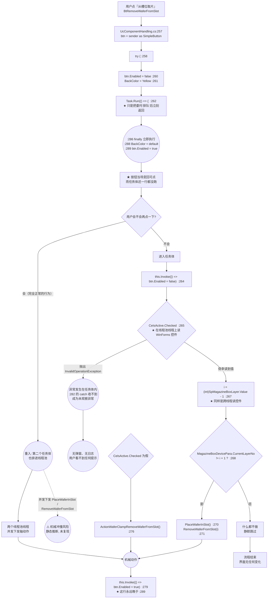

**ASCII ⑤ · 「从槽位取片」完整流程**（与图 10 等价）

```text
 用户点 [从槽位取片]
        |
   btn = sender as SimpleButton        (:257)
        |
   try {                              (:258)
     btn.Enabled = false              (:260)
     btn.Appearance.BackColor = Yellow(:261)
     Task.Run(() => { ... });          (:262)  <-- 排队后立刻返回
        |
        |  ********************************************
        +->* finally 立刻执行 (:286)                  *
        |  *   BackColor = default  (:288)            *
        |  *   btn.Enabled = true   (:289)  <-- 按钮亮了!*
        |  ********************************************
        |
        +--> 任务体(在别的线程上, 晚得多) :
                this.Invoke(() => btn.Enabled = false)   (:264)
                if (CeIsActive.Checked)                  (:265) <-- 跨线程读控件
                     i = SpMagazineBoxLayer.Value - 1    (:267) <-- 跨线程读控件
                     if (CurrentLayerNo != i+1)          (:268)
                          PlaceWaferInSlot()             (:270)  --> 机械
                          RemoveWaferFromSlot(i)         (:271)  --> 机械
                else
                     ActionWaferClampRemoveWaferFromSlot()(:276)  --> 机械
                this.Invoke(() => btn.Enabled = true)     (:279)
                                                 ^
                                  这行永远晚于 :289, 毫无意义

 分支:
   (a) 用户在按钮"已亮"后立刻再点 -> 第二个任务体也排进线程池
       => 并发下发轴动作 (静态推断, 未复现)
   (b) 任务体内抛异常 -> :282 的 catch(Exception) 收不到 (异常在别的线程)
       => 未观察的任务异常, 无弹窗无日志
   (c) CurrentLayerNo == i+1 -> 静默什么都不做, 界面无任何变化
```

**调用链**

| 跳 | 位置 | 动作 |
|---:|---|---|
| 1 | `Manual\UcComponentHandling.Designer.cs` 接线 | `this.BtRemoveWaferFromSlot.Click += this.BtRemoveWaferFromSlot_Click` |
| 2 | `Manual\UcComponentHandling.cs:257` | `SimpleButton btn = sender as SimpleButton;` |
| 3 | `:260`/`:261` | 按钮禁用 + 变黄 |
| 4 | `:262` | `Task.Run(...)` —— **只是排队，立刻返回** |
| 5 | `:286`–`:289` | `finally` 执行：恢复背景色、**重新启用按钮** |
| 6 | `:264` | （任务体，另一线程）`Invoke` 禁用按钮 |
| 7 | `:265`/`:267` | **线程池线程上读 `CeIsActive.Checked` / `SpMagazineBoxLayer.Value`** |
| 8 | `:268` | 比较 `MagazineBoxDevicePara.CurrentLayerNo != i + 1` |
| 9 | `:270`/`:271` | `WaferSubController...PlaceWaferInSlot()` / `RemoveWaferFromSlot(i)` |
| 10 | `:276` | 否则 `ActionWaferClampRemoveWaferFromSlot()` |
| 11 | `:279` | `Invoke` 重新启用按钮（**实际已被 `:289` 提前做过**） |
| 12 | `WaferSubController`（34 号文档） | → 控制器 → 轴动作 |

**读了什么、写了什么**

| 读 | 写 |
|---|---|
| `this.CeIsActive.Checked`（`:265`，**跨线程**） | `btn.Enabled`（`:260`、`:289`、`:264`、`:279` 四处） |
| `this.SpMagazineBoxLayer.Value`（`:267`，**跨线程**） | `btn.Appearance.BackColor`（`:261`、`:288`） |
| `MagazineBoxDevicePara.CurrentLayerNo`（`:268`） | **不动配置、不落盘** |
| | **动硬件**：晶圆台 / 夹爪（经 `WaferSubController`） |

**坑**

- 🔴 **R-13（本目录最严重的机械风险之一）**：`try/finally` 包住的是 `Task.Run(...)` 的**排队动作**，
  不是**任务体**。`Task.Run` 把委托交给线程池后**立即返回**，
  所以 `:286` 的 `finally` 在 `:264`–`:279` 执行**之前**就跑完了 ——
  **`:289` 把按钮重新点亮，此时任务体一行未执行**。用户连点两下是完全正常的操作，
  于是第二个任务体也排进线程池 ⇒ **并发下发 `PlaceWaferInSlot` / `RemoveWaferFromSlot` /
  `ActionWaferClampRemoveWaferFromSlot`** ⇒ 机械冲撞风险。
- 🔴 **同一条 R-13**：`:270`–`:276` 的轴动作若抛异常，`:282` 的 `catch (Exception)` **收不到**
  （异常发生在线程池线程上）⇒ 变成**未观察的任务异常**，不弹窗、不写日志、直接丢失。
  用户看到的是"按钮亮了、什么都没发生"。
- ⚠️ **R-27**：`:265` 与 `:267` 在**线程池线程上读 WinForms 控件属性**。
  轻则读到用户正在修改的中间值（用错的层号去动机械），重则抛跨线程 `InvalidOperationException`。
- ⚠️ `:279` 那行 `Invoke(() => btn.Enabled = true)` 是**多余**的 ——
  `:289` 早已做过。它的存在恰好**反证了作者以为 `finally` 在任务体之后执行**。

> **这条风险的完整流程图**（含"假设执行序 vs 实际执行序"对比）见 **§4.3.2**，
> 放大版见 **§9.9.2**。风险登记为 **R-13**。

#### 4.3.2 R-13 的核心：「假设执行序」vs「实际执行序」

**这是本文档最有价值的一张图**：它把"作者写代码时脑子里的顺序"
与"CLR 实际执行的顺序"并排画出来。两者的差异**就是缺陷本身**。

**图 11 · R-13「假设执行序」vs「实际执行序」**

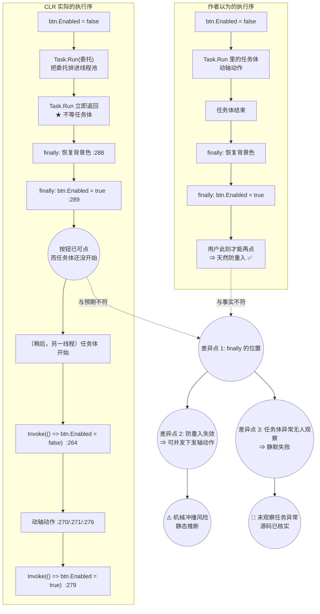

**ASCII ⑥ · 假设执行序 vs 实际执行序**（与图 11 等价）

```text
  【作者以为的】                          【CLR 实际的】
  ------------------                      ------------------
  1. Enabled = false                      1. Enabled = false
  2. Task.Run 的体 {                      2. Task.Run(委托)  --> 排进线程池
        动轴 ...                          3. Task.Run 立刻返回  ★不等体
     }                                    4. finally { BackColor=default }   :288
  3. 体结束                               5. finally { Enabled = true }      :289
  4. finally { BackColor=default }        6. >>> 按钮此刻已可点 <<<
  5. finally { Enabled = true }            7. (稍后, 别的线程) 体才开始 {
  6. 用户此刻才能再点                             Invoke(Enabled=false)  :264
     => 天然防重入                            动轴 :270/:271/:276
                                              Invoke(Enabled=true)   :279
                                         8. }
      ^                                        ^
      |                                        |
      +--------- 顺序完全不同 ---------------->+

  三个后果:
   (1) finally 位置差 => 防重入彻底失效, 用户连点 => 并发轴动作 (静态推断)
   (2) 体在别的线程 => 体里的异常 catch(Exception) 收不到 => 静默失败 (已核实)
   (3) 体里的 Invoke(Enabled=true) 永远晚于 :289 => 那行是多余的
```

> **一句话总结这张图**：`Task.Run` 返回的是"**排队成功**"，不是"**干完了**"。
> `try/finally` 只能包住它**看得见**的东西 —— 而它看得见的只有"排队"这一步。

#### 4.3.3 换片测试 `BtnWaferChangeTest_Click`（R-14）

**图 12 · 换片测试 `async void` + `goto` 重试循环（R-14）**

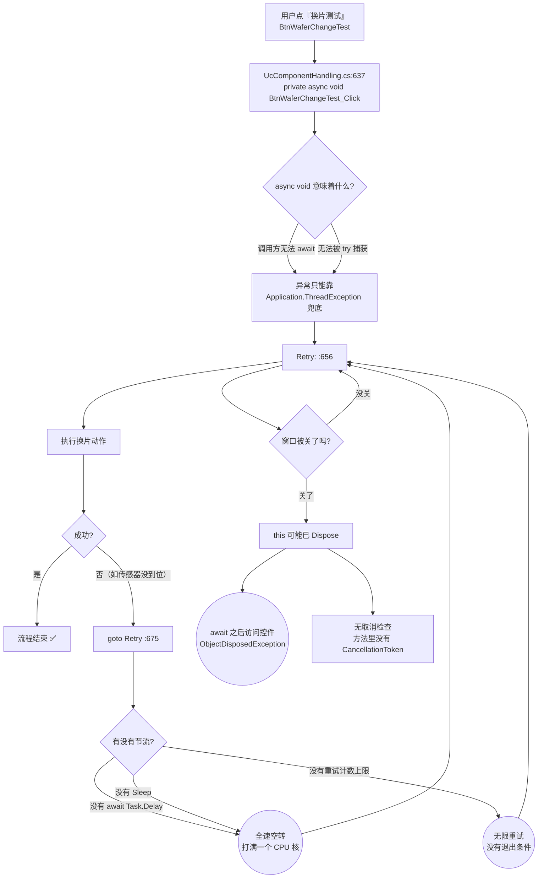

**调用链**

| 跳 | 位置 | 动作 |
|---:|---|---|
| 1 | `Manual\UcComponentHandling.Designer.cs` 接线 | `this.BtnWaferChangeTest.Click += this.BtnWaferChangeTest_Click` |
| 2 | `:637` | `private async void BtnWaferChangeTest_Click` —— **`async void`** |
| 3 | `:656` | `Retry:` 标签 |
| 4 | `:675` | `goto Retry` —— **无 `Task.Delay`、无 `Sleep`、无计数上限** |

**读了什么、写了什么**：方法体内的读写未逐行读（见附录 B.1）。**确定的是**：
没有 `CancellationToken`、没有重试上限、没有延时。

**坑**

- ⚠️ **R-14**：三个问题叠加 ——
  ① `async void` 的异常**无法被调用方捕获**，只能靠进程级处理器兜底；
  ② `goto Retry` **没有任何节流**（无 `await Task.Delay` / `Sleep` / 计数上限）⇒
  失败即**全速重试，打满一个 CPU 核**；
  ③ 方法里**没有 `CancellationToken`**，关窗无法取消 ⇒ `await` 之后 `this` 可能已 `Dispose`，
  访问控件抛 `ObjectDisposedException`。
- ⚠️ 这三个后果都是**静态推断**（代码事实清楚，但未在真机上复现）。

#### 4.3.4 `UcEjectBank` 的三个按钮

| 处理器 | 位置 | 作用 | 备注 |
|---|---|---|---|
| `BtnMeasurement_Click` | `Manual\UcEjectBank.cs:172` | 打开顶针安装精度实验 | 该处理器内 `:191-193` 用 **`ShowDialog()`** 打开 `FrmEjectMeasurementTeach`，并在 `:195` 收尾调 `PutbackNozzleAssitance()`。**异常会打断 `:195` 的收尾**（见 R-09） |
| `BtnMaintenance_Click` | `Manual\UcEjectBank.cs:144` | 顶针维护 | 未读方法体 |
| `BtnChangeTool_Click` | `Manual\UcEjectBank.cs:111` | 更换顶针工具 | 未读方法体 |

> **`UcEjectBank` 是少数**不用反射服务、而是**直接 `new` + `ShowDialog()`** 的地方。
> 两条路径的差别在于：直接 `new` **不持有 `AKRSMessageBoxExt.UiLock`**（`ControlService.cs:369` 才加锁），
> 因此**不参与 R-68 的死锁链**。

### 4.4 `Assistant\ComponentsTeach\` 元件示教

#### 4.4.0 目录概览

本子目录 **16 个窗体 / 32 个在编 `.cs`**，是 `Controls/` 里最大的子目录。它同时是
**"16 个示教窗体复制粘贴同一套骨架"这一现象的样板间**。

#### 4.4.1 示教向导骨架：上一步 / 下一步 / 完成 / 取消

**16 个示教窗体共用同一套驱动机制**。理解它，就理解了这一族窗体全部按钮的行为。

**图 13 · 示教向导上一步/下一步/完成驱动**

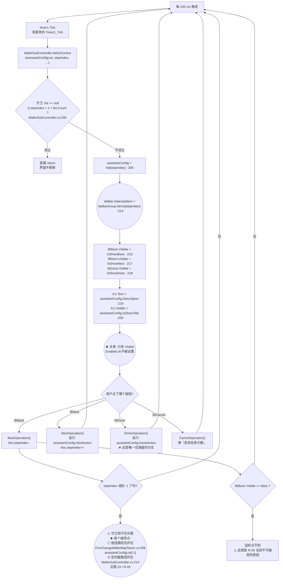

**调用链**

| 跳 | 位置 | 动作 |
|---:|---|---|
| 1 | 各窗体 `Designer.cs` | `this.timer1.Tick += new EventHandler(this.Timer1_Tick);`（**28 个定时器之一**） |
| 2 | 各窗体 `Timer1_Tick` | 调 `WaferSubController.GetInstance().SetUIControl(...)` |
| 3 | `Controllers\WaferSubController.cs:200` | 守卫：`if (list == null \|\| stepIndex + 1 > list.Count) return;` |
| 4 | `:205` | `assistantConfig = list[stepIndex]` |
| 5 | `:214`/`:215` | `tileBar.SelectedItem = tileBarGroup.Items[stepIndex]` |
| 6 | `:216`–`:218` | 三个按钮的 `Visible` |
| 7 | `:219` | 标题文字 = `assistantConfig.Descritpion` |
| 8 | 用户点击 | `BtBack_Click` / `BtNext_Click` / `BtDone_Click` / `BtCancel_Click` |
| 9 | 各窗体方法体 | `stepIndex--` / 执行 `NextAction` / 执行 `DoneAction`（落盘） |

**读了什么、写了什么**：`SetUIControl` **只读** `AssistantConfig` 的 7 个字段，
**只写** 5 个界面属性（`tileBar.SelectedItem` + 3 个 `Visible` + `lc1.Text` + `lc1.Visible`）
和每个 `TileBarItem` 的 3 个绘制属性（`:204-212` 的 `ForEach`）。
**它本身不落盘、不动硬件**。落盘只发生在 `DoneAction` 里。

**坑**

- ⚠️ **R-05**：`:200` 的守卫 `stepIndex + 1 > list.Count` 等价于 `stepIndex >= Count`（**仅对非负成立**），
  **完全不检查 `stepIndex < 0`**。而 `stepIndex` 恰恰是**可以被减成 −1 的**（`BackOperation` 里
  `stepIndex--` 之前**没有任何下限判断**）。一旦为 −1，守卫放过，随后**有两个先后的崩溃点**：
  ① **按钮路径**先炸在自己的 `BackOperation`：`FrmChangeWaferMapTeach.cs:259`
  `this.assistantConfigList[-1]`（`List<T>` 索引器 ⇒ `ArgumentOutOfRangeException`）；
  ② 若走的是定时器刷新路径，则炸在 `WaferSubController.cs:214
  tileBarGroup.Items[-1]`。
  **当前不可触发**只是因为 `BtBack` 在 `Visible = false` 时鼠标点不到 —— 见 R-47。
- ⚠️ **R-29**：`AssistantConfig.Index` 字段**声明了但 `SetUIControl` 从不读它**。
  "第几步"完全靠 `List` 的**下标隐式约定**。若某个窗体的 `assistantConfigList` 顺序与
  `tileBarGroup` 项顺序不一致 ⇒ **界面显示第 3 步的标题，执行的却是第 2 步的 `NextAction`**，
  **错位但不报错**。
- ⚠️ **R-31**：`Descritpion` 是**拼写错误**的属性名（少一个 `i`），16 个窗体 + `WaferSubController`
  全按这个拼写调用 ⇒ **不可改**；按 `Description` 搜索**找不到任何使用点**。
- ⚠️ **R-47**：三个按钮只有 `Visible` 被赋值，**`Enabled` 从不被 `SetUIControl` 设置** ⇒
  不可用的按钮是"**消失**"而不是"**灰掉**"。好处是"消失的按钮点不到"，**因此当前保护了 R-05**；
  但这是**把功能约束寄托在可见性上**，任何 `PerformClick()` / 键盘默认按钮 / `AcceptButton`
  都会击穿它。
- ⚠️ **R-43**：**28 个定时器全部按默认 100 ms 运行**（全目录 `.Interval` 赋值 **0** 处）
  ⇒ `SetUIControl` **每秒刷 10 次界面**，每次都改 `Visible` / `Text` ⇒ 界面持续重绘。

#### 4.4.2 四步示教窗体：状态推进与 `DialogResult` 三值

以 `Assistant\ChangeMapTeach\FrmChangeWaferMapTeach.cs`（418 行，四步）为样板。

**图 14 · 四步示教窗体状态推进与 `DialogResult` 三值**

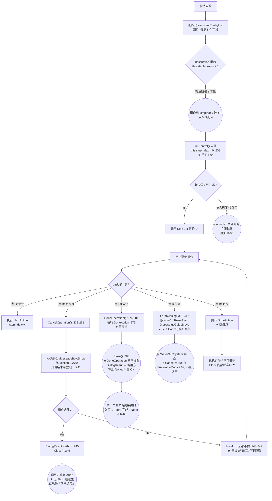

**`DialogResult` 三值约定**

| 值 | 在本项目的含义 | 谁在用 |
|---|---|---|
| `OK` | 正常完成 | `FrmCarrierHeightMeasureTeach.cs:204` |
| `Cancel` | 测高失败 / 用户返回 | `FrmCarrierHeightMeasureTeach.cs:209` |
| **`Abort`** | **"结束示教"（正常结束！）** | `FrmChangeWaferMapTeach.cs:245` |

**坑**

- ⚠️ **R-30**：`descritpion: $"Step {this.stepIndex++ + 1}/{stepCount}"` 这种写法
  把 **`stepIndex` 的推进塞进了字符串插值**（构造期副作用求值）。整段逻辑依赖
  "四步按顺序求值 + 末尾 `:208` 手工复位"这一**巧合**才正确。
  任何人调整步骤顺序、插入一步、或把 `:208` 那句复位删掉 ⇒
  显示 "Step 5/4" 之类的错号，**甚至直接越界**（叠加 R-05）。
- ⚠️ **R-66**：`FrmChangeWaferMapTeach.cs:245` 把「**结束示教（Yes）**」映射成 `DialogResult.Abort`，
  而调用方 `WaferSubSystemTask.cs:836` 又把同一个 `Abort` 当作**"更换晶圆图失败"**的判据。
  **同一枚举值在同一业务流程里承载两种相反语义** —— 按名字理解（`Abort` = 中止/取消）**必然读错**。
  **同一条还有第二刀**：`DoneOperation()`（`:276-281`）**执行完 `DoneAction` 后直接 `Close()`（`:280`），
  全程没有给 `DialogResult` 赋过任何值**。调用方 `WaferSubSystemTask.cs:836` 期望拿到 `Abort`
  才能识别"换图失败"，但走"完成"路径时拿到的是 **`None`**（`Form.DialogResult` 的默认值），
  **既不是 `OK` 也不是 `Abort`**。"取消 → `Abort`、完成 → `None`"两条出口都反直觉。
- ⚠️ **R-19**：整个"换晶圆图"流程**没有"是否保存/是否放弃"的询问**，只有 `:241` 这一个
  "是否结束示教"。而流程中途已经执行过 `SetReferencePoint1()`（`:154`）、
  `FindReferencePoint()`（`:176`）、`MoveToStartPoint()` + `StartAsyncSeekingPath()` +
  `InitMapInfo()` + `ReSetChangeCarrierSignal()`（`:199-202`）。
  用户点"取消"⇒ 已执行的动作**不可撤销**，"取消"只关窗不还原。
- ✅ **R-29 的抽查结果**：`FrmChangeWaferMapTeach.cs:122`/`:142`/`:164`/`:184` 的
  `index: 0/1/2/3` 与列表顺序**一致** ⇒ 这个窗体没有错位。
- ⚠️ **R-66 第 3 刀（`Close()` 的两副面孔）**：`FormClosing`（`:399-412`）**没有** `e.Cancel`，
  而**全 `WaferSubSystem/` 唯一一处 `e.Cancel = true` 在 `FrmWaffleMap.cs:62`**
  （`e.Cancel = true;` + `BeginInvoke(new Action(() => this.Hide()))`）。
  ⇒ **`FrmWaffleMap` 点 `×` 关不掉**（只 `Hide`），**`FrmChangeWaferMapTeach` 点 `×` 直接关掉**。
  同目录、同族、两种相反行为；把前者的行为安到后者头上是**常见误读**。

#### 4.4.3 芯片与载具厚度测高：两条并存的落盘链

这是 **Q2「上一步/下一步/采集/示教/保存/完成 各自什么时候落盘」** 的最佳样本。

**图 15 · 芯片与载具厚度测高：两条并存的落盘链**

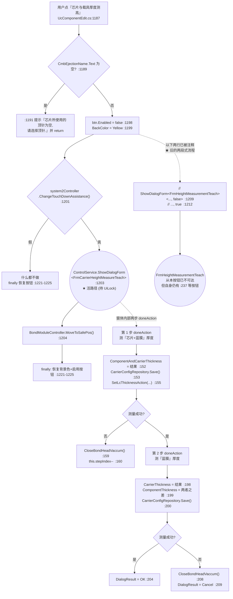

**ASCII ⑦ · 两条并存的落盘链**（与图 15 等价）

```text
  [芯片与载具厚度测高]  UcComponentEdit.cs:1187
        |
   CmbEjectionName 为空? --是--> 提示 + return   (:1189/:1191)
        |否
   btn 禁用+变黄 (:1198/:1199)
        |
   ChangeTouchDownAssistance() == 假? --是--> 什么都不做, finally 复原
        |真
   +--------------------------------------------------------+
   | 活路径: ShowDialogForm<FrmCarrierHeightMeasureTeach>   |  :1203
   |         (反射开窗, 持 AKRSMessageBoxExt.UiLock)         |
   +--------------------------------------------------------+
        |                          ^
        v                          |
   MoveToSafePos()  :1204           |
        |                          |
   finally: 复原按钮 (:1221-1225)    |
                                   |
   ---- FrmCarrierHeightMeasureTeach 内部两步 doneAction ----
                                   |
   第1步: 测 芯片+蓝膜 厚度            |
      ComponentAndCarrierThickness = 结果  :152
      CarrierConfigRepository.Save()      :153   <== 落盘 1
      SetLcThicknessAction(...)           :155
      成功? --否--> CloseBondHeadVaccum() :159 + stepIndex-- :160
        |是
   第2步: 测 蓝膜 厚度
      CarrierThickness = 结果             :198
      ComponentThickness = 前者 - 后者    :199
      CarrierConfigRepository.Save()      :200   <== 落盘 2
      成功? --是--> DialogResult = OK      :204
            --否--> CloseBondHeadVaccum() :208 + DialogResult = Cancel :209

   ---- 另一条链(已废弃, 仅剩注释) ----
   // ShowDialogForm<FrmHeightMeasurementTeach>(..., false)  :1209
   // ShowDialogForm<FrmHeightMeasurementTeach>(..., true )  :1212
        => 从本按钮不可达; 但可从 UcEditProductProgramming 打开
```

**读了什么、写了什么**

| 写 | 位置 |
|---|---|
| `CarrierWithWaferConfig.ComponentAndCarrierThickness` | `FrmCarrierHeightMeasureTeach.cs:152` |
| `CarrierConfigRepository.Save()` | `:153`（**落盘 1**） |
| `CarrierWithWaferConfig.CarrierThickness` | `:198` |
| `CarrierWithWaferConfig.ComponentThickness` | `:199`（由前两者相减得出） |
| `CarrierConfigRepository.Save()` | `:200`（**落盘 2**） |
| `DialogResult` | `:204` = `OK` / `:209` = `Cancel` |

**坑**

- ⚠️ **R-25**：**两次落盘之间没有事务**。`:153` 与 `:200` 是两个独立的 `Save()`，
  中间没有失败回滚。若第一句成功、第二句失败（磁盘满 / 文件被占用），
  ⇒ **"芯片+蓝膜厚度"已落盘、"蓝膜厚度"还是旧值** ⇒ 两份数据描述的不是同一次测量。
- ⚠️ **R-50（271 行注释代码的误导性）**：`UcComponentEdit.cs:1209` 与 `:1212` 这两行注释掉的
  是 `FrmHeightMeasurementTeach` 的**两段式调用**，与 `:1203` 的活路径
  `FrmCarrierHeightMeasureTeach` **形成两条并存的落盘链**。
  `FrmHeightMeasurementTeach` 自身**仍有 `Save()`**，且**仍可从
  `UcEditProductProgramming.cs:1447` / `:1472` 打开**。
  ⇒ 判断"某段代码是否已死"**必须跨文件看**，只看 `UcComponentEdit` 会得出错误结论。
- 🔴 **同一条 R-50**：`UcComponentEdit.cs` 有 **271 行**注释代码（本目录第一），
  读代码时**极易把注释里的旧流程当成现行实现**。
- ⚠️ **R-68（死锁）**：`:1203` 在 **UI 线程**上调 `ShowDialogForm<T>` ⇒
  `ControlService.cs:369` 要拿 `AKRSMessageBoxExt.UiLock`，而**该锁没有主线程豁免**。
  若此刻任务线程正持同一把锁并阻塞在 `Invoke` 上等 UI 线程（`WaferSubSystemTask.cs:833`/`:872`），
  两条边互等 ⇒ **永久死锁**。放大版见 **§9.9.4**。

> **Q2 的答案（本节）**：这个按钮上"保存"**不是**一个独立动作 ——
> **只有 `DoneAction` 会落盘**，而 `Controls/` 里**零直接文件写**，
> 所有 `Save()` 都发生在**被调用的仓储内部**。上一步 / 下一步 / 采集 / 示教
> **都不落盘**。

#### 4.4.4 `ComponentCheck` + `SaveAllData`：先清空、再报错、还是落盘了（R-02）

**图 16 · `ComponentCheck` + `SaveAllData` 先清空后落盘（R-02）**

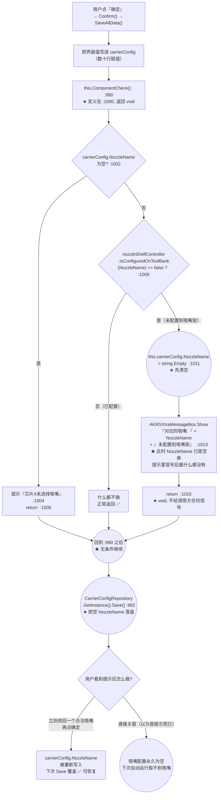

**调用链**

| 跳 | 位置 | 动作 |
|---:|---|---|
| 1 | `Setting\Component\UcComponentEdit.cs:990` | `this.ComponentCheck();`（**返回值 `void`，无处可判**） |
| 2 | `:1000` | `private void ComponentCheck()` 定义 |
| 3 | `:1009` | `nozzleShelfController.IsConfiguredOnToolBank(NozzleName) == false` |
| 4 | `:1011` | **`this.carrierConfig.NozzleName = string.Empty;`** |
| 5 | `:1013` | 弹窗，文案里引用**刚被清空**的 `NozzleName` |
| 6 | `:1015` | `return`（`void`，调用方**收不到失败信号**） |
| 7 | `:992` | `CarrierConfigRepository.GetInstance().Save()` —— **无条件落盘** |

**读了什么、写了什么**：读 `carrierConfig.NozzleName`；**写 `carrierConfig.NozzleName = string.Empty`**；
`:992` **写盘**。

**坑**

- 🔴 **R-02**：三个问题串在一起 ——
  ① **弹窗文案缺主语**（`NozzleName` 已被清空，提示里冒号后面是空白，看不出是哪个吸嘴）；
  ② **`Save()` 照样执行**：即使提示"请重新选择吸嘴"，**配置里的吸嘴名已经被清空并落盘**；
  ③ 用户若看到提示后直接关窗 ⇒ **吸嘴配置永久为空**，下次自动运行取不到吸嘴。
- 🔴 **R-51（R-02 的根因）**：`ComponentCheck()` **返回 `void`** ——
  校验失败时它只弹窗然后 `return`，**不给调用方任何信号**；调用方 `:990` 之后
  **无条件**执行 `:992` 的 `Save()`。**这不是"调用方忘了判返回值"，而是"根本没有返回值可判"**。
- ✅ **对照**：同一个文件里 `:1264-1279` 的 `LueSearchCamera_EditValueChanged`
  **有** `Question 2.3640` 确认框 ⇒ 证明**作者知道该加确认**，只是这三处漏了（见 §4.8.1）。

#### 4.4.5 晶圆边缘三点拟合（前置预告）与一个死处理器

**图 17 · 晶圆边缘三点拟合示教按钮流程**

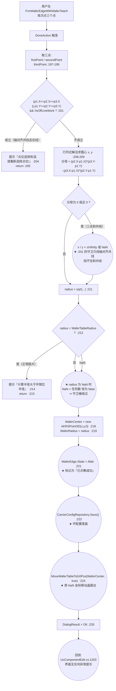

**调用链**

| 跳 | 位置 | 动作 |
|---:|---|---|
| 1 | `Assistant\ComponentsTeach\FrmWaferEdgeWithWaferTeach.Designer.cs` | 接线 `BtDone.Click += BtDone_Click` |
| 2 | `:342` | `BtDone_Click` → 走 `assistantConfigList` 的 `DoneAction` |
| 3 | `:197`–`:199` | 取三点 |
| 4 | `:201` | 共线守卫（**只挡轴对齐**） |
| 5 | `:208`/`:209` | 行列式求圆心 |
| 6 | `:211` | `radius = Math.Sqrt(...)` |
| 7 | `:212` | `if (radius > WaferTableDevicePara.WaferTableRadius)` |
| 8 | `:218`/`:219` | 写 `WaferCenter` / `WaferRadius` |
| 9 | `:221` | `WaferEdge.State = AssistantStateEnum.Able` |
| 10 | `:222` | `CarrierConfigRepository.GetInstance().Save()` —— **落盘** |
| 11 | `:224` | `WaferTableController.MoveWaferTableToG0Pos(WaferCenter, true)` —— **动轴** |
| 12 | `:226` | `DialogResult = OK` |

**坑**

- 🔴 **R-01（全文最严重的一条）**：三点**斜共线**时行列式分母为 0 ⇒ 圆心/半径算出
  `Infinity`/`NaN`；紧接着的 `:212 if (radius > WaferTableRadius)` 检查
  **对 `NaN` 恒为 `false`**（IEEE 754 规定任何与 NaN 的比较都返回 `false`）⇒
  **守卫被绕过** ⇒ 随后 `:218`/`:219` 写入坏值、`:221` 标记 `Able`、`:222` **落盘**、
  `:224` **用 NaN 坐标移动晶圆台**。
- 🔴 **同一条 R-01 的触发条件**：**在线模式 + 三点斜共线**。
  `:201` 唯一的守卫是 `&& !MachineStateModel.GetInstance().IsOffLineWork` ——
  **离线时整个拟合被短路跳过**，所以只在**在线**模式下能触发。
- **完整流程图（含 NaN 如何击穿守卫的逐步放大）见 §9.9.1 / 图 46 / ASCII ⑯。**

#### 4.4.6 一个死处理器：`BtnMeasurementComponentThickness_Click`

```csharp
// Assistant/ComponentsTeach/FrmComponentGeometryWithWaferTeach.cs:1178
private void BtnMeasurementComponentThickness_Click(object sender, EventArgs e)
{
    return;                                     // :1180  ★ 第一句就返回
    SimpleButton btn = sender as SimpleButton;  // :1181  以下全部不可达
    try { ...MeasureHeight / Save()... }        // :1182 ~ 方法结尾
}
```

- ✅ **已核实**：方法体**第一句就是 `return;`**（`:1180`），其后 `:1181` 到方法结尾**全部不可达**。
  该处理器**接线存在**（`FrmComponentGeometryWithWaferTeach.Designer.cs:427`
  `this.BtnMeasurementComponentThickness.Click += ...`），
  所以**不是"没接线"，是"接线了但方法体空转"**。
- ⚠️ **但"点得动"这个说法是错的 —— 它点不动**：
  同一个 Designer 在 **`:421`** 写了 `this.BtnMeasurementComponentThickness.Enabled = false;`，
  而**全仓没有任何一行代码把它置回 `true`**（复现命令见 §4.4.7）。
  ⇒ 正确表述是：**按钮在界面上永远是灰的、点不动**；
  即使有人把 `Enabled` 改回 `true`，点下去也只会走到 `:1180` 的 `return;`。
  **两道门都是关的** —— 即 **R-71 与 R-76 叠在同一个控件上**（见 §9.8）。
- **被搁置的功能是什么**（从不可达代码读出来的，纯事实）：
  `:1187` 调 `bondHeadController.MeasureHeight(..., HeightMeasurementFunctionEnum.WithTDSensor)`
  用固晶头 TD 传感器测高；`:1198-1200` 把结果写进
  `CarrierWithWaferConfig.CarrierThickness` / `ComponentAndCarrierThickness` 并
  `CarrierConfigRepository.Save()`；`:1201` 弹"测量芯片 + 蓝膜厚度结果为 X mm"；
  `:1202` 再推给 `UcComponentEdit.SetLcThicknessAction`。
  ⇒ 这是一条**完整的、后来被整段屏蔽的测厚链**；作者用 `return;` 关掉了它，**但没删代码**。
  ⚠️ 因此这段不可达代码**仍会出现在落盘点清单里**（§8.3 已按"不可达"标注），
  读清单时**不要以为它在运行**。
- 这与 **R-20** 是两种不同的"死"：
  **R-20 是"方法有效但没接线"**，**本条是"接线有效但方法体空转"**。
- 定性：**僵尸方法体**（作者主动用 `return;` 屏蔽的旧实现），不是断链。
  登记为 **R-71**（见 §9.7）；其"永久禁用"的一面登记为 **R-76**（见 §9.8）。
- ★ **这是全仓的孤例，不是通病**。用"首句就是 `return;`"扫全仓的
  `*_Click` / `*_ItemClick` / `*_CheckedChanged` / `*_SelectedIndexChanged` / `*_ValueChanged` / `*_DoubleClick`
  处理器（扫描脚本见 §4.4.8 坑 ④），**命中数 = 1**，就是这一处。
  ⇒ **不要由此推断"本目录的处理器普遍是空壳"** —— 恰恰相反，**它只有一个**。
  ⇒ 这也意味着：**另外那几个"永久禁用"的控件（`BtnSignal...CheckSensor` 等）不适用本条**，
  它们的形态另有说明（见 §4.4.7）。
- ⚠️ **编译期不会报警告到能拦住你的程度**：`:1181` 之后那段在 C# 里会报
  **CS0162「unreachable code detected」** —— 它是**警告级、不阻断编译**，
  而且**只在那一段被删空或者上下文变化时才会重新被人注意**。
  ⇒ **这类问题不会在编译期暴露**，只能靠读方法体发现。

> **`FrmComponentGeometryWithWaferTeach` 的同一个窗体里还有一个活的反例**：
> `:225` 用反射开 `FrmCarrierHeightMeasureTeach`，并在 `:228` **消费返回值**
> `if (result != DialogResult.OK) { this.stepIndex--; }`，`:233-235` 的 `else` 分支也
> `stepIndex--`。**这正说明 `ShowDialogForm<T>` 的返回值是真实可用的**（见 §1.4）。

#### 4.4.7 「运行时永久禁用」的控件：本目录切片

> **这一类控件不属于前面任何一种**：它不是**死代码**（那管的是"编译进去了但零调用点"），
> 也不是**幽灵文件**（那管的是"根本没编译"）。
> 它是：**代码是活的、窗体也会打开，但这个控件在界面上永远是灰的**。
> ⇒ 只按按钮名去 `grep` 接线**查不出这类问题**（接线可能完全正常），**必须专门按 `Enabled` 查**。

**用户看到什么（这是本条最重要的一句）**

> 晶圆组件示教窗体 `FrmComponentGeometryWithWaferTeach` 的底部有一条**调试按钮面板**
> （`PnlDebugButton`：`Dock = Bottom`、748×92、**`Visible` 全仓从未被改过 ⇒ 一直显示**），
> 面板上并排放着 9 个按钮。其中那个写着「**测量芯片厚度**」的
> **永远是灰的、点不动** —— 它**既被永久禁用，处理器也是个空转的壳**。
> 同族的还有：换片示教窗体 `FrmWaferChangeTeach` 调试面板上的
> **两个连标题都没有的灰色小按钮**（49×23），操作员**看不出它们是干什么的**。

**定性**：**被主动下架 / 被搁置的功能**，**这是产品决策的结果，不是运行期故障**。
用词固定为「**运行时永久禁用（启用状态从未被恢复）**」。
⚠️ **不要写"按钮坏了"、"点了会崩溃"** —— 它**根本点不动**。

> ⚠️ **同时也不要说"功能从未实现"** —— `BtnMeasurementComponentThickness` 的
> **接线是完整的、处理器是存在的**（`Designer.cs:427` 接线、`.cs:1178` 处理器），
> 代码就摆在那里。**它只是被两道开关关掉了**（详见下表"有没有处理器"一列与 §4.4.6）。
> 说"没实现"是**事实错误**。

**判定口径（两步，可复现）**

```bash
cd "E:/项目/ZX2200标机/trunk/AKRS.ZX2200"

# 第一步：列出 Designer 里被设为 false 的「文件|控件」对
grep -rn 'Enabled = false' --include='*.Designer.cs' --include='*.designer.cs' \
     WaferSubSystem/Controls/ | grep -v '/bin/\|/obj/'

# 第二步：针对上一步的每个控件，查「它自己的 Designer 之外」有没有代码碰过 Enabled
#        （预期：本目录切片全部零命中 ⇒ 启用状态终其一生都是 false）
grep -rn --include='*.cs' 'BtnMeasurementComponentThickness.Enabled' .
grep -rn --include='*.cs' 'BtnSignalWaferClampCheckSensor.Enabled' .
grep -rn --include='*.cs' 'BtnSignalWaferTableCheckSensor.Enabled' .
grep -rn --include='*.cs' 'CeIsActive.Enabled' .
```

**四条会推翻结论的旁路，已逐条查过并排除**

| 旁路 | 会不会推翻 | 本目录切片的实测结论 |
|---|---|---|
| **`.resx` + `ApplyResources` 事后覆盖** | **会**（`ApplyResources` 在 `InitializeComponent` 里**晚于**属性赋值，能把 `Enabled` 改回来） | ✅ **排除**：三个相关 Designer（`FrmComponentGeometryWithWaferTeach` / `FrmWaferChangeTeach` / `UcComponentHandling`）里 `ApplyResources` **命中数均为 0** |
| **泛型遍历控件树统一赋值**（`foreach (Control c in ...) c.Enabled = ...`） | **会** | ✅ **排除**：`grep -E '(foreach\|ForEach\|All)\s*\([^)]*\)[^;]*\.Enabled\s*='` 在 `WaferSubSystem/` 排除 Designer 后**无输出** |
| **辅助方法按引用传入** | **会** | ✅ **排除**：两个 `BtnSignal...CheckSensor` 的控件名**在 `WaferSubSystem/` 内只出现在它自己的 Designer 里** —— 没有引用可以传进去 |
| **反射设 `Enabled`** | **会** | ✅ **排除**：本目录无 `SetValue(..., "Enabled")` 形式的代码 |

⇒ 结论是**属性级的事实**：这些控件的 `Enabled` **终其一生都是 `false`**。
（`Enabled = false` 的控件**无论父容器是否启用都不可用**，所以不存在"父级启用后它也能用"。）

**本目录切片的逐条结论**

| 控件 | 界面标题 | 类型 | 禁用位置 | 有没有处理器？ | 定性 | 定级 |
|---|---|---|---|---|---|---|
| `BtnMeasurementComponentThickness` | **「测量芯片厚度」** | `SimpleButton` | `Assistant/ComponentsTeach/FrmComponentGeometryWithWaferTeach.Designer.cs:421`（`:426` 是标题、`:427` 是接线） | **有，且接线完整** —— 处理器在 `.cs:1178`；**但方法体第一句就是 `return;`（`:1180`）** ⇒ 调用后什么都不做 | **被主动下架的功能**：**两道开关都关着**（`:421` 禁用 + `:1180` 空转）。⚠️ **不是"没实现"** | **R-71 + R-76** |
| `BtnSignalWaferClampCheckSensor` | **（空，Designer 里没有 `.Text`）** | `SimpleButton` | `Assistant/WaferHandlingTeach/FrmWaferChangeTeach.Designer.cs:381` | **零接线**（全仓无 `.Click +=`） | **被当作指示灯**：`FrmWaferChangeTeach.cs:712` 只按传感器状态刷 `Appearance.BackColor`（绿/红）⇒ 它是**显示件**，不需要处理器 | **R-76**（⚠️） |
| `BtnSignalWaferTableCheckSensor` | **（空）** | `SimpleButton` | 同文件 `:483` | **零接线** | 同上（`FrmWaferChangeTeach.cs:713` 刷背色） | **R-76**（⚠️） |
| `CeIsActive` | `CheckEdit`，`Properties.Caption = ""` | `CheckEdit` | `Manual/UcComponentHandling.Designer.cs:174`（`:173` 同时 `EditValue = true`） | 不适用（**它不是按钮，是被读的输入**） | ★ **恒真判据**：操作员永远改不了它，而 `UcComponentHandling.cs:265` **仍在读它** ⇒ 那个 `if` **恒为真** | **R-76**（⚠️），与 **R-27** 同源 |

> ⚠️ **`CeIsActive` 与另外三个不是同一型，别混**（这一条容易写错）：
> - 另外三个是「**永久禁用 ⇒ 该功能对操作员消失**」—— **没有代码在用它们**（或只用来刷背色）。
> - `CeIsActive` 是「**永久禁用，但代码还在读它**」——
>   **禁用只影响"用户能不能改"，不影响"代码读到的值"**。
>   ⇒ 它的实际后果不是"功能消失"，而是「**一个 `if` 分支恒为真**」。
> ⇒ 这正是它与 `_恒假判据与无效条件.md` 那一族**同族但不同型**的地方：
> **那一族是"判据读错了属性"，这一型是"判据读到的值恒定"。**
> **接手人若以为"禁用了所以没用"，就会漏掉 `:265` 那个恒真分支。**

#### 4.4.8 ★ grep 纪律：四种"看起来对、其实静默漏一整块"的查法 ★

> 本小节是**方法论**，四条坑**已经各踩过一次**，写在这里是为了让下一个人不再踩。
> 四条坑的**共同形状**是：**命令跑得通、输出看着正常、结论却是错的**。
> **坑 ①~③ 是坑 ④ 的表现形式** —— 若只记一条，记 **坑 ④**。

**坑 ①：`grep -w '<控件名>'` 查不到 `Xxx_Click` 处理器**

```bash
grep -rn --include='*.cs' -w 'BtnMeasurementComponentThickness' .
```

以为什么都没查到 ⇒ **"连接线都没有"**。**错**：

- **`_` 在 `grep` 的 `-w` 语义里算"单词字符"**，所以
  `BtnMeasurementComponentThickness_Click` 是**一个整词**，
  `-w 'BtnMeasurementComponentThickness'` **不匹配**它。
- ⇒ **本项目凡 `Xxx_Click` 命名的处理器，`grep -w Xxx` 一律查不到。**
  **这是普遍现象，不是个例。**

**正确做法：两种写法都要跑**

```bash
# 写法一：不带 -w（能匹配到 _Click）
grep -rn --include='*.cs' 'BtnMeasurementComponentThickness' . | grep -v '\.Designer\.cs'
# 写法二：直接找接线（最硬）
grep -rn --include='*.cs' 'BtnMeasurementComponentThickness\.Click +=' .
# 命中 …/FrmComponentGeometryWithWaferTeach.Designer.cs:427  ⇒ 接线确实存在
```

**坑 ②：`--include='*.Designer.cs'` 匹配不到小写 `*.designer.cs`**

```bash
grep -rn --include='*.Designer.cs' 'new FrmXxx' .     # ★ 漏掉 8 个文件
```

- **`--include` 的匹配不受 `-i` 影响** —— `grep -ri --include='*.Designer.cs'` **仍然漏**。
- 本仓 Designer 文件共 **339** 个 = 大写 `.Designer.cs` **331** + 小写 `.designer.cs` **8**。
- ⇒ **只有 `find` 的双 `-name`（或 `-iname`）能覆盖全部**：
  ```bash
  find . \( -name '*.Designer.cs' -o -name '*.designer.cs' \) \
       -not -path './bin/*' -not -path './obj/*' -print0 | xargs -0 grep -n 'new FrmXxx'
  ```

**坑 ③：为了查 `Enabled` 而排除 Designer，又拿同一个排除条件去证明"没有接线"**

查"有没有代码把 `Enabled` 置回 `true`"时，**必须排除该控件自己的 Designer**（否则自己那行 `= false` 会混进来）。
但**接线恰恰就写在被排除的那个 Designer 里**：

```bash
# 这个命令的"零命中"是必然结果，不是证据
grep -rn --include='*.cs' -w 'BtnMeasurementComponentThickness' . | grep -v Designer   # 0 命中
```

⇒ **"排除 Designer 后零命中"不能推出"没有接线"** ——
**两者的查询目标不同，排除条件不能复用。**
**要证明"没有接线"，必须直接查接线本身**（`\.Click +=`），
并且**包含 Designer**（`BtnSignal...CheckSensor` 那两行正是这样查实的）。

**坑 ④：把"接线存在"或"方法体存在"当成"功能可达"**

这是**上面三条坑的元凶**（前三条都是它的表现形式）。**两种常见误判**：

| 误判 | 为什么会这么想 | 真相 |
|---|---|---|
| "**连接线都没有**" | 按名字 `grep` 没查到（**坑 ①/③**） | 接线可能好端端写在被排除的那个文件里（`Designer.cs:427`） |
| "**方法体是完整的**" | 看到方法头就下结论（**没读进方法体**） | 方法体可能是**空的壳**：第一句 `return;`（`.cs:1180`） |

⇒ **"接线存在"和"方法体存在"都不是"功能可达"的证据。**
**必须读进方法体，看三件事**：①**第一句是不是 `return;`**；
②**有没有无条件的提前退出**；③**有没有被 `#if` 或布尔常量围起来的死区**。

**扫全仓"首句就 return"的处理器（这条命令可以直接抄）**：

```bash
cd "E:/项目/ZX2200标机/trunk/AKRS.ZX2200"
find . -name '*.cs' -not -path './bin/*' -not -path './obj/*' \
     -not -name '*.Designer.cs' -not -name '*.designer.cs' -print0 |
xargs -0 awk '
/^[[:space:]]*(private|public|protected|internal)[^;]*[[:space:]]void[[:space:]]+[A-Za-z0-9_]+_(Click|ItemClick|CheckedChanged|SelectedIndexChanged|ValueChanged|DoubleClick)[[:space:]]*\(/ {
  h=$0; n=FNR; f=FILENAME; getline;
  if ($0 ~ /^[[:space:]]*\{[[:space:]]*$/) { getline;
    if ($0 ~ /^[[:space:]]*return[[:space:]]*;[[:space:]]*$/) print f":"n"   "h } }'
# 实测输出：只有 1 行 —— FrmComponentGeometryWithWaferTeach.cs:1178
```

⇒ **全仓只有这一处**。**这是孤例，不是通病** —— 别把本目录的处理器整体怀疑一遍。

> ⚠️ **补一条编译期的事实**：`return;` 之后那段会触发
> **CS0162「unreachable code detected」**，它是**警告级、不阻断编译**。
> ⇒ **编译通过 ≠ 代码可达**。这类问题**永远不会在编译期被拦住**。

> **四条坑同源**：都出在"**用一个为 A 目的设计的命令，去回答 B 问题**"，
> 或"**止步于"东西存在"，没有确认"它真的会跑"**"。
> ⇒ **写结论前，先问两句**：
> ① "**这个命令本来是为查什么设计的？**"
> ② "**我看到的是"存在"，还是"可达"？**"

**这一类与本目录其它"死"的关系（四种，别混）**

| 形态 | 例子 | 判据 |
|---|---|---|
| **幽灵文件** | `FrmComponentLocateUseInfo.cs` | 不在 `.csproj` |
| **死代码（零调用点）** | `FrmDieDeal` | 在编，但零 `new` / 零接线 |
| **死处理器（接线了但方法体空转）** | `BtnMeasurementComponentThickness_Click`（**R-71**） | 在编、有接线、方法体 `return;` |
| **永久禁用（本小节）** | 上表 4 个控件（**R-76**） | 在编、`Enabled = false` 且**从不置回 `true`** |

---

### 4.5 `Assistant\ChangeMapTeach\` 地图切换

#### 4.5.0 目录概览

| 文件 | 行数 | Designer | 类型 | 入口 |
|---|---:|---:|---|---|
| `FrmChangeStaticAdapterTeach.cs` | 349 | 706 | 静态适配器（华夫盘）换图 | ① `UcModule.cs:142` + ② 任务层 3 处 |
| `FrmChangeTabletTeach.cs` | 609 | 711 | **换料片**（不是换图） | ① `UcShortcutMenu.cs:1240` + ② 任务层 2 处 |
| `FrmChangeWaferMapTeach.cs` | 418 | 579 | 换晶圆图（四步向导） | **③ 仅反射** `WaferSubSystemTask.cs:833` |
| `FrmChangeWaffleMapTeach.cs` | 420 | 462 | 换华夫盒图（四步向导） | **零调用点（断链）** |
| `FrmWaffleMap.cs` | 139 | 98 | 华夫盘槽位地图编辑器 | **①+② 双重入口** |
| **合计** | **1,935** | **2,556** | 5 个窗体 | —— |

> ⚠️ **数字更正**：本轮素材把本目录写成"5 个窗体，**2035** 行 / Designer 2556 行"。
> **逐文件实测非 Designer 是 1,935 行**（349+609+418+420+139），Designer 2,556 行（706+711+579+462+98）与素材一致。
> **以实测 1,935 为准**，差 100 行，原因见附录 B.4。

> **本目录最重要的一个结论**：**"换晶圆图"和"换华夫盒图"是成套的两个窗体（418 行 vs 420 行），
> 但只有晶圆版被接进了任务层。**华夫版是**断链**，见 §4.1.4 与风险 R-34 / R-35。

#### 4.5.1 换晶圆图四步流程，以及"取消"到底取消了什么（回答问题 Q3）

**这是本章的核心**：用户点"取消"这个动作**在两个不同窗格里语义完全相反** ——
`FrmWaferMapTeach` 的"取消"弹的是"是否结束示教"，**不是"是否放弃改动"**。

**图 18 · 换晶圆图四步流程与"不可撤销"（Q3）**

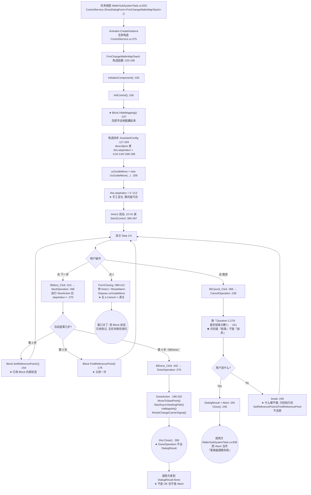

**调用链（逐步）**

| 跳 | 位置 | 动作 |
|---:|---|---|
| 1 | `WaferSubSystemTask.cs:833` | `ControlService.ShowDialogForm<FrmChangeWaferMapTeach>()`（**反射**） |
| 2 | `ControlService.cs:369` | `lock (AKRSMessageBoxExt.UiLock)` —— **UI 线程上拿锁** |
| 3 | `ControlService.cs:372` | `MainForm.SendUiAction(...)` → `MainForm.cs:70 this.Invoke(action)`（**同步**） |
| 4 | `FrmChangeWaferMapTeach.cs:105-107` | `InitializeComponent()` → `InitControl()` → `Block.HideMapping()` |
| 5 | `:117-204` | 构造 4 步 `AssistantConfig`（8 个字段，四步的 `index:` 依次 `0/1/2/3`） |
| 6 | `:213` | `this.stepIndex = 0;` —— **把构造期的副作用复位** |
| 7 | `:394-397` | `Timer1_Tick` → `WaferSubController.SetUIControl(...)`，10 Hz |
| 8 | `:314`→`:266` | `BtNext_Click` → `NextOperation`：先 `NextAction()`（`:269`）再 `stepIndex++`（`:270`） |
| 9 | `:342`→`:276` | `BtDone_Click` → `DoneOperation`：`DoneAction()`（`:279`）后 `Close()`（`:280`） |
| 10 | `:368`→`:238` | `BtCancel_Click` → `CancelOperation` |
| 11 | `:241` | `AKRSXtraMessageBox.Show("Question 2.279:\r\n" + "是否结束示教?", ..., YesNo, Question)` |
| 12 | `:245`/`:246` | `Yes` ⇒ `DialogResult = DialogResult.Abort` + `Close()` |
| 13 | `:248`/`:249` | `No` ⇒ `break`（**已执行的动作不还原**） |

**读了什么、写了什么**

| 读/写 | 内容 |
|---|---|
| 读 | 无外部配置（本窗体**全文零 `Save()`**，见 §8.3 与风险 R-21） |
| 写（**内存**） | `this.stepIndex`（`:213`、`:258`、`:270`） |
| 写（**`Block` 内部状态**） | `Block.SetReferencePoint1()`（`:154`）、`FindReferencePoint()`（`:176`）、`MoveToStartPoint()`/`StartAsyncSeekingPath()`/`InitMapInfo()`/`ReSetChangeCarrierSignal()`（`:199-202`） |
| 写（界面） | `DialogResult`（`:245` = `Abort`；**`:280` 的 `DoneOperation` 路径从不赋值**） |

**坑**

- 🔴 **R-21**：`FrmChangeWaferMapTeach.cs`（418 行）**全文零 `Save()`**。
  所有持久化都委托给 `Block` 的门面方法，而 `Block` 在 `Models/Entities/SearchChip/`，
  **不在本目录**。⇒ **"这次示教到底有没有落盘"无法从本目录判断**（见附录 B.1）。
- ⚠️ **R-19**：整个流程**没有"是否保存/是否放弃"的询问**，只有 `:241` 这一个"是否结束示教"。
  走到第 2~4 步后点"取消"⇒ 选 `Yes` 结束：**`SetReferencePoint1()` / `FindReferencePoint()` 的执行结果不可撤销**。
- ⚠️ **R-66**：`:245` 把「**结束示教**」映射成 `DialogResult.Abort`，
  而调用方 `WaferSubSystemTask.cs:836` 又用同一个 `Abort` 当「**更换晶圆图失败**」的判据。
  **同一枚举值承载相反语义** —— 按名字读必然读错。
- ⚠️ **R-66 第 2 刀**：`DoneOperation`（`:276-281`）执行完直接 `Close()`（`:280`），
  **全程不给 `DialogResult` 赋值** ⇒ 走"完成"路径时调用方拿到的是 **`None`**。
  "取消 → `Abort`、完成 → `None`"，两条出口都反直觉。
- ⚠️ **R-05 的实际崩溃点在按钮里而不在定时器里**：`BackOperation()`（`:256-261`）
  的 `:258 this.stepIndex--;` **前没有任何下界判断**，`:259 this.assistantConfigList[this.stepIndex]`
  先炸（`List<T>` 索引器）；定时器那条路才会走到 `WaferSubController.cs:214`。
- ✅ **R-29 抽查通过**：四步 `index: 0/1/2/3`（`:122`/`:142`/`:164`/`:184`）与列表顺序**一致**。
  ⚠️ 但要留意 `R-30`：描述文字里的 `this.stepIndex++`（`:124`/`:144`/`:166`/`:186`）
  是**构造期副作用**，整段正确性依赖 `:213` 那句手工复位。

#### 4.5.2 `FrmWaffleMap`：`Substring(0, 1)` 解析下拉项（回答问题 Q4 的另一半）

**图 19 · `FrmWaffleMap` 下拉解析错映射（R-64）**

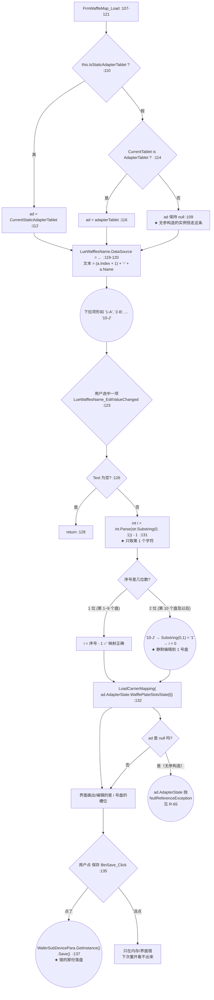

**ASCII ⑧ · 华夫盘下拉解析错映射**（与图 19 等价）

```text
  FrmWaffleMap_Load :107-121
        |
   下拉文本 = (a.Index + 1) + "-" + a.Name        :119-120
        |
   生成项:  "1-A"  "2-B"  ...  "9-I"  "10-J"  "11-K"
        |
   用户选中某一项 → LueWafflesName_EditValueChanged :123
        |
   Text 为空? --是--> return
        |否
   int i = int.Parse(str.Substring(0, 1)) - 1     :131
                  ~~~~~~~~~~~~~~~~~~~~~~~
                  只取第 1 个字符!
        |
   +--------------------+---------------------------+
   |                    |                           |
  "1-A".."9-I"      "10-J"                      "11-K" ...
   1 位数字          2 位数字                     2 位数字
   Substring="1".."9"  Substring="1"               Substring="1"
   i = 0..8  ✅        i = 0  ❌                   i = 0  ❌
        |                    |                           |
        +--------------------+---------------------------+
                             |
              LoadCarrierMapping(WafflePlateSlotsState[i])  :132
                             |
              界面上编的是 i 号盘 —— 用户以为在改 10 号盘
                             |
                    点 保存  BtnSave_Click :135
                             |
              WaferSubDevicePara.GetInstance().Save()  :137
                             |
                  ★ 被改错的那份配置落盘, 全程无报错

  ⚠️ 另一个独立问题 (R-65): 无参构造 :36-40 没有 this.Load += ,
     所以 ad 恒为 null → :132 直接 NullReferenceException。
     无参构造的唯一调用点是 Block.cs:1577。
```

**读了什么、写了什么**

| 读/写 | 位置 | 内容 |
|---|---|---|
| 读 | `:119-120` | `ad?.AdapterSetting.WaffleArray`（过滤 `CarrierWithWaffleConfig != null` 且 `Index + 1 <= MaxUseWaffleCount`） |
| 读 | `:125` | `this.LueWafflesName.Text` |
| 写（内存） | `:131` | 局部变量 `i` —— **解析规则错位就在这里** |
| 写（界面） | `:132` → `:84`/`:88`/`:91` | `UcCarrierMapping` 实例的创建/更新/挂载 |
| **写（落盘）** | **`:137`** | `WaferSubDevicePara.GetInstance().Save()` |

**坑**

- 🔴 **R-64**：`:120` 生成文本是 `"<序号>-<名字>"`（序号 = `a.Index + 1`），
  而 `:131` 只取**第 1 个字符**：`"10-J"` → `Substring(0,1)` = `"1"` → `i = 0`
  ⇒ **永远是 1 号盘**。**序号 1~9 正确，10 及以上全部错映射到 1 号盘**，
  且**全程无任何报错**。正确写法应为 `str.Split('-')[0]` 或按 `IndexOf('-')` 截取。
- ⚠️ **R-65**：`Load` 只在**带参**构造函数里挂载（`:48 this.Load += new System.EventHandler(this.FrmWaffleMap_Load);`），
  **无参构造 `:36-40` 没有这一句**（只有 `:39 this.LueWafflesName.Visible = false;`）
  ⇒ 无参构造的实例**从不执行 `Load`** ⇒ `ad` 恒为 `null`（`:105` 声明无初始化器 + `:109` 赋 `null`）
  ⇒ 若以程序方式改 `LueWafflesName.EditValue`，`:132` 的 `ad.AdapterState` **直接 NRE**。
  已知无参构造的唯一调用点是 `Block.cs:1577`。
  ⚠️ **Designer 里也没有 `Load +=` 接线** —— 这是"**构造顺序决定功能**"的陷阱，
  读代码时极易误判"这个窗体是好的"。
- ⚠️ **R-66 第 3 刀（`×` 的两副面孔）**：`FormClosing`（`:60-64`）是
  `e.Cancel = true;` + `BeginInvoke(new Action(() => this.Hide()));`
  ⇒ **点 `×` 关不掉，只会 `Hide`**。而**全 `WaferSubSystem/` 只有这一处 `e.Cancel = true`**
  ⇒ 同一个目录里的 `FrmChangeWaferMapTeach`（§4.5.1）点 `×` 是**真关窗**。
  把前者的行为安到后者头上是**常见误读**。
- ⚠️ **R-15**：`LoadCarrierMapping`（`:72-95`）里 `:82 if (ucCarrierMapping == null)` 这句
  **在 `Invoke` 之外**读字段，而 `:84` 的赋值在 `Invoke` 里 ⇒ **线程池线程读、UI 线程写**。
  多线程刷新时有两条坏路径：① `:82` 读到过期的 `null` ⇒ 同一张地图创建两个实例、
  控件重复叠加；② 先读到非 `null` 但对象已被 `Dispose` ⇒ `:88` 抛 `ObjectDisposedException`
  （**异常发生在 UI 线程的 `Invoke` 里**）。
- ⚠️ **R-16 的"双重入口"副作用**：`FrmWaffleMap` 同时被 ① `UcShortcutMenu.cs:1482`/`:1497`
  两个按钮与 ② `Block.cs:1577`（在 `StartInitWaffleMap()`(1570) 内，任务线程路径）创建，
  **同一条 `Block.cs:1577`（`new FrmWaffleMap()`）就是无参构造** ⇒ 两条路径都落在 R-65 的陷阱上。

#### 4.5.3 `FrmChangeTabletTeach`：构造函数里就跑完整套机械序列

这是本目录**最反直觉**的一个窗体：**它的"流程"不在按钮里，在构造函数里（`InitControl()` 被构造函数调用）**。

**图 20 · `FrmChangeTabletTeach` 新建空白 tablet 立即落盘**

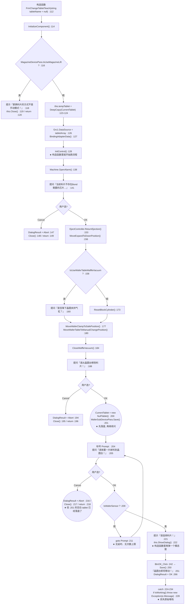

**调用链（逐步）**

| 跳 | 位置 | 动作 |
|---:|---|---|
| 1 | `:114` | `InitializeComponent()` |
| 2 | `:116` | 判 `IsUseMagazineLift`，为真则**提示后直接 `Close()` 并 `return`** |
| 3 | `:123-124` | `JsonFormatHelper<BaseTablet>.DeepCopy(this.WaferTableDevicePara.CurrentTablet)` |
| 4 | `:127` | `BindingAdapterData()` |
| 5 | `:128` | **`InitControl()` —— 构造函数里就开始跑交互流程** |
| 6 | `:138` | `Machine.GetInstance().OpenAlarm()` |
| 7 | `:141`–`:150` | 第 1 个 `AKRSMessageBoxExt.Show`（无所需芯片）；`Cancel` ⇒ `DialogResult.Abort` + `Close()` + `return` |
| 8 | `:153`/`:156` | `ReturnEjection()`（退顶针）、`MoveExpandToDownPosition()`（扩晶到低位） |
| 9 | `:158`–`:174` | 条件式提问「是否降下晶圆夹持气缸」；两条路都走到 `ResetBlockCylinder()` |
| 10 | `:177`/`:180` | `MoveWaferClampToSafePosition()`、`MoveWaferTableToManualChangePosition()` |
| 11 | `:182-185` | 条件式 `CloseWaffleVacuum()` |
| 12 | `:188`–`:197` | 第 3 个提问「请从晶圆台移除料片」；`Cancel` ⇒ `Abort` + `Close()` + `return` |
| 13 | **`:200`/`:201`** | **`WaferTableDevicePara.CurrentTablet = new NullTablet();` + `WaferSubDevicePara.GetInstance().Save();`** |
| 14 | `:204` | **`Prompt:` 标号** |
| 15 | `:205`–`:219` | 第 4 个提问「请放置一片新料到晶圆台」；`Cancel` ⇒ `Abort` + `Close()` + `return` |
| 16 | `:209`/`:211` | `if (!IsWaferSensor) goto Prompt;` —— **无延时、无重试上限的忙等循环** |
| 17 | `:221`/`:222` | `AKRSMessageBoxExt.Show("请选择料片！")` + **`this.ShowDialog()`（构造函数里再弹一个模态窗）** |
| 18 | `:242`→`:250` | `BtnOK_Click` → `Save()`（`:399 WaferSubDevicePara.GetInstance().Save()`）→ `:251` 提示 → `:266 DialogResult = OK` |
| 19 | `:224-234` | `catch`：**`:226` 判 `IsWorking()`** ⇒ 真则 **`:228 throw new Exception(e.Message);`**（**丢失原始堆栈**），假则弹 Error 窗 |

**读了什么、写了什么**

| 读/写 | 位置 | 内容 |
|---|---|---|
| 读 | `:116` | `MagazineDevicePara.IsUseMagazineLift` |
| 读 | `:124` | `WaferTableDevicePara.CurrentTablet`（**深拷贝**成 `tempTablet`） |
| 读 | `:158`/`:182` | `WaferTableDevicePara.IsUseWaferTableWaffleVacuum` |
| 读 | `:209` | `WaferTableController.IsWaferSensor`（**传感器状态**） |
| 写（硬件） | `:153`/`:156`/`:164`/`:173`/`:177`/`:180`/`:184` | 退顶针、扩晶、晶圆夹持气缸、晶圆夹安全位、晶圆台手动换料位、关华夫真空 |
| **写（内存）** | **`:200`** | **`WaferTableDevicePara.CurrentTablet = new NullTablet();`** |
| **写（落盘）** | **`:201`**、`:250`→`:399` | `WaferSubDevicePara.GetInstance().Save()` **两次** |
| 写（界面） | `:147`/`:194`/`:216`/`:266` | `DialogResult` = `Abort` / `Abort` / `Abort` / `OK` |

**坑**

- 🔴 **R-72（新增）**：**一个"换料片"重型机械流程整个跑在构造函数里**。
  构造函数里先后做了：4 次模态提问、7 类硬件动作、1 次落盘、1 个 `goto` 忙等循环，
  最后还**在构造函数里再 `this.ShowDialog()` 弹出另一个模态窗**（`:222`）。
  后果：① `new FrmChangeTabletTeach()` **不是一次廉价的对象构造**，而是"一按下去就开始动机械"；
  ② 任何**构造期的异常**（如 `Close()` 之后又被外部 `Dispose`）无法被"调用方"用常规方式处理；
  ③ `:222` 的嵌套 `ShowDialog()` 使模态层次变成两层，
  而**外层窗体此时还没走完构造函数** ⇒ 属性/字段尚未初始化完毕。
- 🔴 **R-73（新增）**：**落盘先于最后一次取消机会**。`:200-201` 已经把
  `CurrentTablet` 置成 `new NullTablet()` **并落盘**，而之后的 `:205` 还有一次"停止"按钮
  （`:216` ⇒ `DialogResult.Abort` + `Close()`）。用户在这一步点"停止"
  ⇒ **空白 tablet 已经写进配置，且没有任何回滚**。
  注意 `:147`/`:194` 两次取消发生在 `:201` **之前**，是安全的；**只有 `:216` 这一次落在落盘之后**。
  （这与风险 **R-04** 的 `FrmSlotsState` 是同一类"取消无法回滚"的缺陷，但机制不同：
  R-04 是"先改原件再拷副本"，本条是"先落盘再继续问"。）
- ⚠️ **R-74（新增）**：`:228 throw new Exception(e.Message);` —— 用原始消息**新造**一个异常抛出
  ⇒ **原始堆栈丢失**，现场日志里只能看到最外层的消息，定位不到真正出事的那一行。
  （风险 **R-57** 已核实"本目录没有空 `catch`"，本条不是空 `catch`，而是"**重抛时丢栈**"。）
- ⚠️ **R-44 的一处**：`FrmChangeWaferMapTeach.cs:324` 与
  `FrmComponentGeometryWithWaferPitchTeach.cs:329` 的 `Thread.Sleep(500)` 在 `BtNext_Click` 内
  ⇒ **每次点"下一步"界面卡半秒**（在 UI 线程上睡）。
- ⚠️ **R-04 的同族**：`:123-124` 先做了 `DeepCopy` 到 `tempTablet`
  —— **看起来是"改副本、原件不动"**，但 `Grc1.DataSource = tabletArray`（`:126`）
  绑的是副本数组，而 `:200` 却直接改**原件** `WaferTableDevicePara.CurrentTablet`。
  ⇒ **深拷贝出来的 `tempTablet` 与最终落盘的对象不是同一个**，读代码时极易误判"改的是副本"。

#### 4.5.4 `FrmChangeWaffleMapTeach`：断链窗体的内部状态

**零调用点**（见 §4.1.4），所以**界面上永远看不到它**。但它**参与编译**，
且与 §4.5.1 的晶圆版**结构几乎一致**（418 行 vs 420 行），因此它是"**同一份代码的华夫盒版被漏接线**"的直接证据。

| 项 | 晶圆版 `FrmChangeWaferMapTeach` | 华夫版 `FrmChangeWaffleMapTeach` | 差异 |
|---|---|---|---|
| 入口 | ③ `WaferSubSystemTask.cs:833` | **无** | **华夫版缺这一行 ⇒ 断链** |
| 步骤数 | 4 | **10** | 华夫版步骤更多 |
| 步骤描述 | 真实中文业务描述 | **全是占位符** `"Step {n}/10; descritpion. "`（`:76`/`:94`/`:112`/`:130`/`:148`/`:166`/`:184`/`:202`/`:220`/`:238`，**10 处字面量 `descritpion.`**） | **未完成** |
| `Action` 委托 | 四步里有 2 个 `nextAction` + 1 个 `doneAction` 有实体 | **全空**（`:81-250`） | **未完成** |
| 界面刷新 | 定时器 → `WaferSubController.SetUIControl`（`:396`） | **自己实现的 `SetUIControl()`**（`:258-261`，`this.TileBarTeach.SelectedItem = this.tileBarGroup2.Items[this.stepIndex];`） | **两套实现** |
| 取消提示文案 | 中文「是否结束示教?」（`:241`） | **英文** `"End assistant?"`（`:274`） | **未本地化** |
| `DoneOperation` | `:276-281`，不设 `DialogResult` | `:310-314`，**设 `DialogResult = DialogResult.OK`（`:314`）** | **两套约定** |
| `CancelOperation` | `:238-251`，`Yes` ⇒ `Abort` | `:272-287`，`Yes` 分支**不给 `DialogResult` 赋值** | **两套约定** |

> **结论**：华夫版是**"复制了晶圆版、改了步骤数、但没接线也没写业务"的半成品**。
> 它**不该被当成"现行功能"**读，也**不该被照抄**（`DialogResult` 用法与晶圆版不一致）。
> 定性为**断链**（本该有入口）而非**僵尸**（废弃）—— 依据是它没有 `[Obsolete]`、
> 且同族窗体有入口，属**不对称漏接线**（风险 **R-34** / **R-35**）。

#### 4.5.5 `FrmChangeStaticAdapterTeach`：7 个独立落盘点的换图窗体

| 处理器 | 位置 | 一句话作用 | 落盘 |
|---|---|---|---|
| `BtnOK_Click` | `:87` | 确认：`this.Save()`（`:90`）后 `DialogResult = OK`（`:91`） | **`:131`** |
| `BtnAbort_Click` | `:99` | **直接** `DialogResult = Abort`（`:101`）—— **没有任何确认询问** | —— |
| `FrmChangeStaticAdapterTeach_Load` | `:109` | 载入 | —— |
| `Grv1_DataSourceChanged` | `:120` | 表格 1 数据源变化 | —— |
| `Save` | `:128` | **私有落盘包装** → `WaferSubDevicePara.GetInstance().Save()`（`:131`） | **`:131`** |
| `BindingAdapterData` | `:138` | 绑定适配器数据 | —— |
| `Grv2_FocusedRowChanged` | `:166` | 表格 2 焦点行变化 → `RefreshPncCarrierMapping`（`:279`） | —— |
| `BtnGrv1SetState_ButtonClick` | `:176` | 表格 1 设为某状态 | —— |
| `BtnGrv1ResetState_ButtonClick` | `:189` | 表格 1 复位 | —— |
| `BtnGrv2SetState_ButtonClick` | `:207` | 表格 2 设为某状态 | —— |
| `BtnGrv2ResetState_ButtonClick` | `:221` | 表格 2 复位 | —— |
| `Grv1_CustomDrawRowIndicator` | `:240` | 行号绘制（**生命周期类**） | —— |
| `Grv2_CustomDrawRowIndicator` | `:253` | 行号绘制（**生命周期类**） | —— |
| `RefreshPncCarrierMapping` | `:266` | 重建 `UcCarrierMapping`（`:279`） | —— |
| `BtnFillALLSlotState_Click` | `:296` | 全部槽位填状态 | —— |
| `FrmChangeStaticAdapterTeach_FormClosing` | `:312` | 关窗：`Static.IsNeedChangeStaticWaffle = false`、`Dispose` 载具地图、`ResetAlarm` | —— |
| `BtnStaticWaffleVacuum_Click` | `:323` | 静态华夫真空开关 | —— |

**坑**

- ⚠️ **R-28 的一处**：`:67` 与 `:304` 用了 `JsonFormatHelper<T>.DeepCopy`（共 12 处调用点之一）。
  该实现**不在任何在编源码里**（在 `libs/` 的 DLL 内）⇒ "副本是否真的覆盖全部字段"**无法自证**
  ⇒ "改副本、不动原件"的**前提本身是推断**。
- ⚠️ **R-42**：`:87`–`:91` 与 `FrmChangeTabletTeach.cs:242`–`:266` 是**同一套"确认→保存→置 `DialogResult`"**
  的三行样板在两个文件里逐字重复；**`BtnAbort_Click` 则两个文件都不给确认询问**。

---

### 4.6 `Assistant\EjectionsTeach\` + `EjectionConfigurationTeach\` 顶针示教与配置

#### 4.6.0 目录概览

| 子目录 | 文件 | 行数 | 一句话 |
|---|---|---:|---|
| `EjectionsTeach\` | `FrmXYPositionTeach.cs` | 576 | 顶针 XY 位置示教（**最能代表这一组**） |
| | `FrmHeightMeasurementTeach.cs` | 498 | 顶针高度示教 |
| | `FrmNeedleZeroPositionTeach.cs` | 511 | 顶针零位示教 |
| | `FrmEjectMeasurementTeach.cs` | 477 | 顶针安装精度实验（**唯一有 Excel 导出**） |
| `EjectionConfigurationTeach\` | `FrmEjectionSetting.cs` | 399 | 顶针架配置（**一个方法里 4 次落盘**） |
| | `FrmNewCreateEjection.cs` | 132 | 新建顶针数据集（**整个窗体未本地化**） |
| **合计** | 6 个窗体 | **2,593** | —— |

#### 4.6.1 四个顶针示教窗体的统一骨架

四个窗体**代码结构同源**（`InitControl()` + `assistantConfigList` + 4 个向导按钮 + `Timer1_Tick` + `FormClosing`），
差异只在步数与 `doneAction` 写哪个字段。

| 窗体 | 行数 | `stepCount` | 方向盘（`UcGuideMove`）| 落盘点 | 写入的字段 |
|---|---:|---:|---|---|---|
| `FrmXYPositionTeach` | 576 | **2** | `("固晶模组", …, true, CameraEnum.BondCamera)`（`:270`） | `:247`（新路径）/ `:260`（旧路径） | `EjectionConfig.DeviationWithEjectionCenterAndWaferCameraCenter`（`:243`/`:257`）、`.EjectionPixelPos`（`:244`）、`.XYPosition.State = Able`（`:246`/`:259`） |
| `FrmHeightMeasurementTeach` | 498 | **1** | `("固晶模组", …, false, CameraEnum.WaferCamera)`（`:178`） | `:173` | `EjectionConfig.HeightMeasurement.State = Able`（`:172`） |
| `FrmNeedleZeroPositionTeach` | 511 | **1** | `("顶针模组", …, true, CameraEnum.WaferCamera)`（`:164`） | `:159` | `EjectionConfig.NeedleZeroPosition.State = Able`（`:158`） |
| `FrmEjectMeasurementTeach` | 477 | **2** | `("晶圆台模组", …, true, CameraEnum.WaferCamera)`（`:232`） | **无 `EjectionConfigRepository.Save()`**；有 `package.Save()`（`:227`，Excel） | —— |

> ★ **统一模式**：示教的"完成" = 把 `<某功能>.State` 置为 `AssistantStateEnum.Able` 并落盘。
> **这与 §4.4 的 `ComponentsTeach` 那套"`ComponentGeometry.State = Able` + `Save()`"完全同构**
> —— 全系统用一个 `AssistantStateEnum` 表示"这一项示教过没有"（见 §5.4）。

**图 21 · 顶针示教统一骨架与 `BtDone` 落盘**

```mermaid
flowchart TD
    A["构造函数 :130-138"] --> B["InitControl() :135<br/>★ 在构造函数里调, 不是 _Load"]
    B --> C{"EjectDevicePara<br/>.IsUseWaferCameraAssistantEjectCenter ?  :144"}
    C -->|"真"| D["strStep1 = 『调整顶针位置和晶圆相机位置,<br/>使晶圆相机聚焦顶针.』  :146"]
    C -->|"假"| E["strStep1 = 『调整顶针位置和BondZ轴位置,<br/>使Bond相机聚焦顶针…』  :150"]
    D --> F["TUAssistantHelper.SetColor(TileBarTeach)  :153"]
    E --> F
    F --> G["建 stepCount 个 AssistantConfig  :154-268"]
    G --> H["ucGuideMove = new UcGuideMove(...)  :270"]
    H --> I["stepIndex = 0  :276"]
    I --> J["timer1 10 Hz 刷 SetUIControl"]
    J --> K{"用户点哪个?"}
    K -->|"Back"| L["BtBack_Click  :331<br/>stepIndex--  ★ 无下界检查"]
    K -->|"Next"| M["BtNext_Click  :357<br/>NextAction() 后 stepIndex++"]
    K -->|"Done"| N["BtDone_Click  :383<br/>DoneAction()  :245-248"]
    K -->|"Cancel"| O["BtCancel_Click  :409<br/>CancelOperation() :282-294"]
    N --> P["写 EjectionConfig 的目标字段  :243/:244"]
    P --> Q(("EjectionConfig.XYPosition.State<br/>= AssistantStateEnum.Able  :246"))
    Q --> R(("EjectionConfigRepository<br/>.GetInstance().Save()  :247"))
    R --> S["DialogResult = OK  :248"]
    S --> T(("return;  :250<br/>★ 其后 :252-266 全是死代码<br/>(旧版 MatchResultToWorld 实现)"))
    O --> U["弹『Question 2.279:<br/>是否结束示教?』  :285"]
    U --> V{"用户选?"}
    V -->|"Yes"| W(("this.Close()  :289<br/>★ 没有设 DialogResult = Abort<br/>与 FrmChangeWaferMapTeach :245-246 不一致"))
    V -->|"No"| J
    L --> J
    M --> J
```

**调用链**

| 跳 | 位置 | 动作 |
|---:|---|---|
| 1 | 各窗体 `构造函数` | `InitControl()`（**在构造函数里调**，不是 `_Load`） |
| 2 | `:144` | 按 `IsUseWaferCameraAssistantEjectCenter` 选第一步文案与相机 |
| 3 | `:153` | `TUAssistantHelper.SetColor(TileBarTeach)` |
| 4 | `:154-268` | 建 `stepCount` 个 `AssistantConfig`（**`descritpion` 里同样有 `this.stepIndex++`**，见 R-30） |
| 5 | `:270` | `ucGuideMove = new UcGuideMove(...)` |
| 6 | `:276` | `stepIndex = 0`（手工复位，同 R-30 的依赖） |
| 7 | `BtDone_Click` | `:383`（XY）/ `:289`（Height）/ `:276`（NeedleZero）/ `:344`（EjectMeasurement） |
| 8 | `doneAction` | 写 `EjectionConfig` 的目标字段 → `…State = Able` → `EjectionConfigRepository…Save()` |

**读了什么、写了什么**：读 `EjectDevicePara.IsUseWaferCameraAssistantEjectCenter`；
写 `EjectionConfig` 的三个目标字段 + `…State = Able`；**`EjectionConfigRepository.GetInstance().Save()` 落盘**。

**坑**

- ⚠️ **R-42**：四个窗体的 `CancelOperation()` 是**逐字复制**的同一段（`:285` 提问、`:288` `Yes`、`:290` `No`）。
  改一处缺陷要改四遍（加上 `FrmChangeWaferMapTeach` 是五遍）。
- ⚠️ **R-46 + R-66**：`FrmXYPositionTeach.CancelOperation` **只 `Close()`（`:289`），没有设 `DialogResult = Abort`**；
  而 `FrmChangeWaferMapTeach.cs:245-246` 是**先设 `Abort` 再 `Close()`**。
  ⇒ **同一个"取消"动作，两个窗体给调用方的返回值不同**（一个 `None`、一个 `Abort`）。
- ⚠️ **需求条目号泄漏到界面**：`"Question 2.279:\r\n" + "是否结束示教?"` ——
  这个 **`Question 2.279:` 前缀是需求条目号**，四个顶针窗体加 `FrmChangeWaferMapTeach.cs:241`
  **共 5 处**，**用户会在弹窗里看到它**。
- ⚠️ **R-30 的同型**：`:154-268` 的 `AssistantConfig` 初始化器里同样用 `this.stepIndex++`，
  同样依赖 `:276` 的手工复位。
- ⚠️ **同一操作、四个方向盘模块名**：模块名分别是 `"固晶模组"`（×2）、`"顶针模组"`、`"晶圆台模组"`；
  第三参 `false` 只出现在 `FrmHeightMeasurementTeach`；`CameraEnum.BondCamera` 只出现在 `FrmXYPositionTeach`。
  **同一个"移动顶针"的操作，四个窗体给的方向盘模块不一样**（与 08 号文档 §8.5 记录的
  "一支支线的方向盘不会被显示"是同一族问题的另一个面）。
- ⚠️ **死代码**：`FrmXYPositionTeach` 在 `:248` 设完 `DialogResult = OK` 后 **`:250 return;`**，
  其后 `:252-266` 的"旧版实现"（`MatchResult` + `MatchResultToWorld`）**永不执行**
  —— 与 §4.4.6 的 `FrmComponentGeometryWithWaferTeach.cs:1180 return;` 是同一种"用 `return;` 屏蔽旧实现"的手法。

#### 4.6.2 `FrmEjectMeasurementTeach`：Excel 工作表名非法导致实验白做（R-09）

**图 22 · 顶针安装精度实验导出失败（R-09）**

```mermaid
flowchart TD
    A["入口: 步骤 2 的 doneAction  :162-229"] --> B["new ExcelPackage(new FileInfo(<br/>'C:\\Thimble ejection consistency detection.xlsx'))  :164"]
    B --> C{"C:\\ 根目录可写吗?"}
    C -->|"无管理员权限"| C1(("UnauthorizedAccessException<br/>连 :167 都到不了<br/>见 R-23"))
    C -->|"可写"| D["Worksheets.Add(DateTime.Now + 'sheet')  :167<br/>★ 生成 '2026/9/20 14:30:45sheet'"]
    D --> E{"名字含 Excel 非法字符<br/>\\ / ? * [ ] : 且超 31 字符 ?"}
    E -->|"是（必然）"| F(("抛异常<br/>★ 任何一次测量之前就炸<br/>:169-226 写单元格<br/>与 :227 package.Save() 全部不执行"))
    E -->|"否（假定不校验）"| G["写表头 number/x/y/z/time  :169-173"]
    G --> H["for (int i = 0; i < this.measureTimes; i++)  :175<br/>★ UI 线程同步循环"]
    H --> I["MoveToSafePos  :178 / ChangeEjection :179<br/>OpenEjectionTableVacuum :180"]
    I --> J["Block.MatchResult(EjectMatchName, true, false)  :182"]
    J --> K{"isSucceed ?  :183"}
    K -->|"否"| L["提示『pr未识别到顶针中心.』  :190<br/>DialogResult = Abort  :191 / return  :192<br/>★ package 未 Save, 已写数据丢失"]
    K -->|"是"| M["deviationWithEjection... = MatchResultToWorld(...)[0]  :185"]
    M --> N["MoveToPickupPos :196 / MoveZAxis :197<br/>CloseBondHeadVaccum :198 / MeasureHeight :199"]
    N --> O{"Ret == Success ?"}
    O -->|"否"| P["提示『System 2: Warning 2.2264:<br/>测高失败!』  :207<br/>Abort :208 / return :209"]
    O -->|"是"| Q["CloseEjectionTableVacuum :212<br/>MoveToSafePos :214 / ReturnEjection :215"]
    Q --> R["LogHelper.Post(...)  :218<br/>写第 i+2 行 x/y/z/time  :220-224"]
    R --> S["package.Save()  :227<br/>★ 每次迭代都重写整个文件"]
    S --> T{"i < measureTimes ?"}
    T -->|"是"| H
    T -->|"否"| U["实验完成"]
    F --> V(("异常上抛到 BtDone_Click 的调用栈<br/>若经 UcEjectBank.BtnMeasurement_Click 的<br/>ShowDialog() 路径, 还会打断<br/>:195 PutbackNozzleAssitance() 收尾"))
```

**ASCII ⑨ · 顶针安装精度实验的导出失败**（与图 22 等价）

```text
  步骤2 doneAction  :162-229
        |
   new ExcelPackage(new FileInfo(
     "C:\Thimble ejection consistency detection.xlsx"))     :164
        |
   C:\ 根目录可写? --否--> UnauthorizedAccessException (R-23)
        |是
   package.Workbook.Worksheets.Add(DateTime.Now + "sheet")   :167
        |
        +--> 展开 DateTime.Now.ToString() = "2026/9/20 14:30:45"
        |    拼接 "sheet"
        |    结果名 = "2026/9/20 14:30:45sheet"
        |        - 含 '/'  -> 非法
        |        - 含 ':'  -> 非法
        |        - 长度 24  -> 加上"sheet"后仍在31内, 但字符已非法
        |
   Excel 工作表名禁止: \ / ? * [ ] :
        |
   +--------------------+-------------------------+
   |                    |                         |
 抛异常              不抛异常(假定)             生成的 xlsx 打不开
   |                    |                         |
 :169-226 写单元格     写表头 :169-173           (Excel 报工作表名非法)
 :227 package.Save()   for 循环 :175
 全部不执行           |
   |                  +-- MatchResult 失败 --> 提示 :190 + Abort :191 + return :192
   |                  |                          (package 未 Save, 已写数据丢失)
   |                  |
   |                  +-- MeasureHeight 失败 --> 提示 :207 + Abort :208 + return :209
   |                  |
   |                  +-- 成功 --> 写第 i+2 行 :220-224 --> package.Save() :227
   |                                                          (每次迭代重写整个文件)
   v
 ★ 结论: 在任何一次测量之前就炸, 顶针安装精度实验整体不可用
```

**读了什么、写了什么**

| 读/写 | 位置 | 内容 |
|---|---|---|
| 读 | `:175` | `this.measureTimes`（循环次数） |
| 读 | `:182` | `Block.MatchResult(EjectMatchName, true, false)` 的返回值 |
| 读 | `:199` | `MeasureHeight(..., WithTDSensor)` 的返回值 |
| 写（硬件） | `:178`/`:179`/`:180`/`:196`/`:197`/`:198`/`:199`/`:212`/`:214`/`:215` | **10 次硬件调用全部同步执行** |
| 写（内存） | `:185` | `this.deviationWithEjectionCenterAndWaferCameraCenter` |
| **写（落盘）** | **`:227`** | `package.Save()` —— **Excel 包**，与 `EjectionConfigRepository` 无关 |
| 写（界面） | `:191`/`:208` | `DialogResult = Abort`（**中止路径最多的一个窗体**，共 4 处 `Abort`：`:191`/`:208`/`:438`/`:447`） |

**坑**

- 🔴 **R-09**：`:167 Worksheets.Add(DateTime.Now + "sheet")` —— `DateTime + string` 会先调
  `DateTime.ToString()`（当前区域性通用格式，如 `2026/9/20 14:30:45`），拼接后名字形如
  **`2026/9/20 14:30:45sheet`**，**含 `/` 与 `:`**。Excel 工作表名**禁止** `\ / ? * [ ] :`
  ⇒ **在任何一次测量之前就抛异常**，`:169-226` 的写单元格与 `:227` 的 `package.Save()`
  **全部不执行** ⇒ **顶针安装精度实验整体不可用**；若在 `UcEjectBank.BtnMeasurement_Click:191-193`
  的 `ShowDialog()` 路径里，异常还会打断 `:195 PutbackNozzleAssitance()` 的收尾。
  ⚠️ **EPPlus 7.0.7 具体抛什么异常标 *推断***（依据：EPPlus 是 `libs\EPPlus.dll` 二进制、无源码；
  版本取自 `AKRS.ZX2200.csproj` 的 `<PackageReference Include="EPPlus"><Version>7.0.7</Version>`；
  Excel 规范禁止这四类字符是公开事实）。**即便该版本不校验，生成的文件在 Excel 里也打不开。**
- 🔴 **R-09 第 2 面**：`measureTimes` 次硬件动作**全部在 UI 线程同步执行**（`:175` 的 `for`）。
  循环体内含 **10 次硬件调用**，期间 100 ms 的 `timer1` **停摆、界面完全冻结**；
  每次迭代还 `package.Save()`（`:227`）**重写整个文件**。
- ⚠️ **R-23**：`:164` 写死到 **`C:\` 根目录**且固定文件名
  （`C:\Thimble ejection consistency detection.xlsx`）⇒ **每次运行覆盖上一次实验结果、没有归档**；
  且 `C:\` 根目录通常需要管理员权限，无权限时抛 `UnauthorizedAccessException`（**叠加 R-09 后连 `:167` 都到不了**）。
  `Controls\` 里**零** `Directory.Exists` / `DriveInfo` 检查。
- ⚠️ **R-22**：`FrmEjectionRealtimeState.cs:403`/`:512` 是**按"日"**命名
  （`$"D:\\顶针实时状态{DateTime.Now.Day}.xlsx"`），而 `:445-446` 是**按"配方名"**命名
  ⇒ **同一程序里两套导出命名规则**：按"日"的文件**每月同一天互相覆盖**（`Day` 取值 1~31），
  且现场按文件名找数据会漏。

#### 4.6.3 `stepIndex = -1` 崩溃链

**这是 `FrmXYPositionTeach` 独有的**：它在示教中途**主动把 `stepIndex` 设成 −1**。

**图 23 · `stepIndex = -1` 崩溃链**

```mermaid
flowchart TD
    A["Step1 nextAction  :169-199"] --> B{"IsOffLineWork ?  :171"}
    B -->|"真"| C["return  :171<br/>★ 离线直接不弹, 也不设 -1"]
    B -->|"假"| D{"IsUseWaferCameraAssistantEjectCenter ?  :177"}
    D -->|"真"| E["frmPrImage = new FrmPRImage('晶圆相机')  :179"]
    D -->|"假"| F["frmPrImage = new FrmPRImage('BOND相机')  :183"]
    E --> G["frmPrImage.ShowDialog()  :186"]
    F --> G
    G --> H{"DialogResult == OK ?  :187"}
    H -->|"是"| I["(x,y) = frmPrImage.GetPixelPos()  :189<br/>SpEjectionPixelPosX/Y.Value = ...  :190/:191"]
    H -->|"否"| J["提示『请选择顶针中心.』  :196"]
    J --> K(("this.stepIndex = -1  :197<br/>★ 主动设成负数"))
    I --> L["回到向导, 等用户下一步操作"]
    K --> M{"用户点哪个?"}
    M -->|"点 Next"| N["NextOperation()<br/>assistantConfigList[-1]  :259 同款写法"]
    M -->|"点 Done"| O["DoneOperation()<br/>assistantConfigList[-1]"]
    M -->|"等 timer1 刷"| P["SetUIControl<br/>WaferSubController.cs:200 守卫<br/>stepIndex + 1 > Count ⇒ -1+1=0 > Count 为假 ⇒ 放过"]
    N --> Q(("IndexOutOfRangeException<br/>★ List&lt;T&gt; 索引器"))
    O --> Q
    P --> R(("WaferSubController.cs:214<br/>tileBarGroup.Items[-1]<br/>ArgumentOutOfRangeException"))
    Q --> S["向导在 UI 线程抛未处理异常"]
    R --> S
    S --> T{"BtNext/BtDone 的 try/catch 接得住吗?"}
    T -->|"接住"| U["只弹 exception.Message<br/>★ 向导卡死, stepIndex 仍是 -1"]
    T -->|"没接住"| V(("WinForms 未捕获异常对话框<br/>Ctrl+C 可复制堆栈<br/>程序可能整体退出"))
    U --> M
```

**ASCII ⑩ · `stepIndex = -1` 崩溃链**（与图 23 等价）

```text
  FrmXYPositionTeach  Step1 nextAction  :169-199
        |
   IsOffLineWork == true? --是--> return :171  (不弹窗, 也不设 -1)
        |否
   new FrmPRImage("晶圆相机" 或 "BOND相机")  :179/:183
        |
   frmPrImage.ShowDialog()  :186
        |
   DialogResult == OK?  :187
        |                       |
       是                      否
        |                       |
   (x,y) = GetPixelPos()     AKRSXtraMessageBox.Show("请选择顶针中心.")  :196
   SpEjectionPixelPosX/Y       |
   .Value = ...  :190/:191   this.stepIndex = -1   :197
        |                       |
        |                       +-------------------------------+
        |                                                       |
   回到向导等用户操作                                    用户接下来点 Button?
                                                                |
                        +---------------------------------------+----------------------+
                        |                        |                                     |
                     点 Next                  点 Done                          等 timer1 刷新
                        |                        |                                     |
              assistantConfigList[-1]   assistantConfigList[-1]        WaferSubController.cs:200 守卫
              (BtNext_Click :357)       (BtDone_Click :383)            if (list == null
                        |                        |                       || stepIndex + 1 > list.Count)
                        |                        |                     stepIndex = -1 -> -1+1 = 0
                        |                        |                     0 > Count 为假  => 守卫放过!
                        |                        |                                     |
                        +-----------+------------+                          WaferSubController.cs:214
                                    |                                       tileBarGroup.Items[-1]
                          IndexOutOfRangeException                                  |
                          (List<T> 索引器)                                 ArgumentOutOfRangeException
                                    |                                                |
                                    +----------------+-------------------------------+
                                                     |
                                        UI 线程上的未处理异常
                                                     |
                                    BtNext/BtDone 的 try/catch 接得住吗?
                                          |                    |
                                        接住                  没接住
                                          |                    |
                              只弹 exception.Message    WinForms 未捕获异常对话框
                              ★ 向导卡死,               Ctrl+C 可复制堆栈
                                stepIndex 仍是 -1        程序可能整体退出

  ★ 与 R-05 的关系: R-05 说的是"守卫挡不住负数"这一通用缺陷;
    本条是它在 FrmXYPositionTeach 里的具体触发路径 —— 关键差别在于
    R-05 的场景是"用户点 Back 把 stepIndex 减到 -1"(当前因 Visible=false 点不到),
    而本条是代码自己主动写 -1(:197), 次数与时机都不受 Visible 保护。
```

**调用链**

| 跳 | 位置 | 动作 |
|---:|---|---|
| 1 | `:171` | `if (MachineStateModel.GetInstance().IsOffLineWork) return;` —— **离线直接不弹** |
| 2 | `:179`/`:183` | `new FrmPRImage("晶圆相机")` / `new FrmPRImage("BOND相机")` |
| 3 | `:186` | `frmPrImage.ShowDialog()`（**打开另一个模态窗体并回传数据**） |
| 4 | `:187`–`:191` | `OK` ⇒ `GetPixelPos()` 回填 `SpEjectionPixelPosX/Y.Value` |
| 5 | `:196`/`:197` | `else` ⇒ 提示"请选择顶针中心."，**`this.stepIndex = -1`** |
| 6 | `:357`/`:383` | 用户点 `Next`/`Done` ⇒ `assistantConfigList[-1]` ⇒ `IndexOutOfRangeException` |
| 7 | `WaferSubController.cs:200`/`:214` | 定时器路径 ⇒ 守卫 `stepIndex + 1 > list.Count` **对 −1 为假 ⇒ 放过** ⇒ `Items[-1]` 抛异常 |

**读了什么、写了什么**：读 `MachineStateModel.IsOffLineWork`、`FrmPRImage.GetPixelPos()`；
写 `SpEjectionPixelPosX/Y.Value`（界面）；**写 `this.stepIndex = -1`**。

**坑**

- 🔴 **R-05 的实际触发路径**：R-05 描述的是通用缺陷（守卫 `stepIndex + 1 > list.Count`
  等价于 `stepIndex >= Count`，**仅对非负成立**，**完全不检查 `stepIndex < 0`**）。
  **本条给出它在 `FrmXYPositionTeach` 里的具体触发**：`:197` 由**代码自己**主动写 −1，
  **不受 `BtBack.Visible == false` 的保护** ⇒ 与"用户点 Back 点不到"那条路完全不同。
- ⚠️ **R-42**：`:169-199` 这套"打开 `FrmPRImage` 取像素质点"的模式，
  在四个顶针窗体里只有 `FrmXYPositionTeach` 有完整实现（其余三个的 `stepCount` 与步骤语义不同）。
- ⚠️ **异常兜底的不确定性**：`BtNext_Click`/`BtDone_Click` 的 `try/catch` **只弹 `exception.Message`**
  ⇒ 若接住，**向导卡死且 `stepIndex` 仍是 −1**（用户再点仍炸，无法自愈）；
  若没接住则冒到 WinForms 未捕获异常对话框（见 §5.2 的异常处理路径）。
  ⚠️ 本条的"具体哪条分支接得住"属**静态推断** —— 需要现场复现才能定级（见附录 B.3）。

#### 4.6.4 `EjectionConfigurationTeach\`：配置类窗体的三处"落盘不听使唤"

**`FrmEjectionSetting`（399 行，"顶针架配置"）**

| 按钮 | 文字 | 接线行 | 处理器 | 一句话作用 | 落盘 |
|---|---|---|---:|---|---|
| `BtnNozzleManage` | **"顶针管理"** | `:348` | `:161` | 打开通用 `FrmRepository<EjectionConfig>` | —— |
| `BtnGoLeft` | （无文字，箭头） | `:359` | `:230` | 顶针从池 → 架（只允许空槽） | —— |
| `BtnGoRight` | （无文字，箭头） | `:370` | `:256` | 顶针从架 → 池 | —— |
| `BtnAdd` | "增加"（`:381`） | `:382` | `:287` | 弹 `FrmNewCreateEjection` | —— |
| `BtnDelete` | "删除"（`:393`） | `:394` | `:305` | **从配方移除顶针 + 立即落盘** | **`:316`** |
| `BtOk` | "确定"（`:402`） | `:403` | `:327` | `Save()` + `OK` | **`:216-222`** |
| `BtCancel` | "取消"（`:411`） | `:412` | `:338` | `Cancel`（**无确认**） | —— |
| `CmbEjectionBankRepository` | —— | **`ButtonClick(:110)` + `EditValueChanged(:111)`** | `:136` / `:176` | `ButtonClick` 且 `Index == 1` 时打开 `FrmRepository<EjectionBankConfig>` | —— |
| `SpCapDiameter` | "顶针帽直径"（`:422`） | **`EditValueChanged(:443)`** | `:187` | 🔴 **每次微调即落盘** | **`:187`** |
| `GvEjectionPool` | —— | `FocusedRowChanged` | `:204` | 回填 `SpCapDiameter` | —— |
| `timer1` | —— | `Tick(:449)` | `:348` | **100 ms 只切 `GcCapDiameter.Enabled`** | —— |
| 窗体 | 标题"顶针架配置" | `FormClosing(:470)` | `:388` | 停 timer | —— |

**`Save()`（`:216`）—— 一个方法里 4 次落盘**

```
:218 WaferSystemDomain.GetInstance().WaferSystemProgram.EjectionBankProgram.Name = CmbEjectionBankRepository.Text
:219 EjectionBankConfigRepository.GetInstance().Save()
:220 EjectionConfigRepository.GetInstance().Save()
:221 WaferSystemProgram.GetInstance().EjectionBankProgram.CreateEjectionBankEntity()
:222 WaferSystemProgram.GetInstance().Save()
```

**唯一调用点**：`BtOk_Click` `:329`（另加 `UcEditProductProgramming.cs` 侧的一处调用）。

- 🔴 **R-45 最典型的一处**：**一个方法里连续 4 次落盘、跨 3 套门面**
  （`EjectionBankConfigRepository` / `EjectionConfigRepository` / `WaferSystemProgram`）。
  **两句之间没有事务** ⇒ 中途失败就"部分成功"（R-25 同型）。
- 🔴 **R-45 的第 2 面**：`public void Save()` 是 **`public`**，被外部当作"保存配方"的通用入口调用，
  但它**顺带覆盖 `EjectionBankProgram.Name`（`:218`）** —— 若调用方**没打开过下拉框**，
  `CmbEjectionBankRepository.Text` 可能是空串 ⇒ **把顶针架名字写成空**。

**`Init()`（`:49`）—— 构造即落盘 + UI 线程 sleep**

```
:51 if (!EjectionBankConfigRepository...Exists(item => item.Name == WaferSystemProgram...EjectionBankProgram.Name))
:53     WaferSystemProgram.GetInstance().EjectionBankProgram.Name = string.Empty;
:54     WaferSystemProgram.GetInstance().Save();      ← ★ 构造函数里就落盘 ★
:55     Thread.Sleep(100);                            ← 🔴 UI 线程阻塞 100 ms
:58 CmbEjectionBankRepository.EditValue = ...
:59 RefreshCmbItems() / :60 RefreshGcEjectionBank() / :61 RefreshGcEjectionPool()
```

- 🔴 **R-44 的一处 + 构造期落盘**：`Init()` 里 **`:54` 落盘**、**`:55` `Thread.Sleep(100)`**
  ⇒ 与 §4.5.3 的 `FrmChangeTabletTeach` 是同一类"构造函数里就动磁盘/睡 UI 线程"的写法。
- ⚠️ **R-03 的同族**：`:53` 把顶针架名**置空**再 `:54` 落盘 —— 一个"名字不存在"的判断
  **直接改写了配置并落盘**（用户只是打开了一个窗体）。

**`BtnDelete_Click`（`:305`）—— 无确认的删除**

```
:307 ejection = GvEjectionPool.GetFocusedRow() as EjectionConfig
:309 if (ejection == null) return;
:315 ejection.RemoveFromBelongRecipeIds()                 ← ★ 从"所属配方 id 集合"里摘掉 ★
:316 EjectionBankConfigRepository.GetInstance().Save()     ← 落盘（★ 不是 EjectionConfigRepository）
:319 RefreshGcEjectionPool()
```

- 🔴 **R-24 的同族**：**无任何确认对话框**，且落盘用的是**另一个仓库**
  （`EjectionBankConfigRepository` 而非 `EjectionConfigRepository`）
  ⇒ 读代码时容易以为"删顶针只影响 `EjectionConfigRepository`"，实际改的是**配方归属关系**。
- ⚠️ **R-24**：`BtnDelete` 与 `SpCapDiameter_EditValueChanged`（`:187`）**各自独立落一次盘**，
  操作中途失败会留下"半套"配置（同 `FrmSlotsState` 的 7 个按钮各自落盘）。

**`RefreshGcEjectionPool()`（`:90`）里的一处"过滤视图"陷阱**

```
:98  ejectionSettingPool = EjectionConfigRepository.GetInstance().GetDataSourceByCurrentRecipe()
:108 ejectionBankSlots = ejectionBank.EjectionBankSlots
:112 this.ejectionSettingPool.RemoveAll(a => ejectionBankSlots.Exists(b => b.Name == a.Name));  ← ★ 就地 RemoveAll ★
:116 GcEjectionPool.DataSource = ejectionSettingPool
```

- ⚠️ **陷阱**：`ejectionSettingPool` 是**窗体字段**（`:44`），每次刷新都被 `:112` 的 `RemoveAll`
  **就地裁剪**。`BtnGoRight_Click`（`:273`）往它 `Add` 回去，接着又调 `RefreshGcEjectionPool()`（`:278`）
  重新从仓库取 ⇒ **`Add` 的结果被立刻丢弃，一切以仓库为准**。
  ⇒ **`BtnGoLeft`/`BtnGoRight` 的即时反馈只存在于界面层，真正的持久化要等 `BtOk_Click` 的 `Save()`**。
- ⚠️ **R-07 / R-49**：`:98` 走 `GetDataSourceByCurrentRecipe()`，而 `Controls\` 里**零**配方切换监听
  ⇒ **窗体开着时在别处切换配方**，之后点"保存"会**按新配方写回旧值**（完整路径见 §8 的图 45）。

**`FrmNewCreateEjection`（132 行）—— 整个窗体未本地化**

| 按钮 | 文字 | 接线行 | 处理器 |
|---|---|---|---|
| `BtnGenerate` | **"Generate"**（`:199`，未本地化） | `:200` | `:58` |
| `BtCancel` | **"Cancel"**（`:187`，未本地化） | `:188` | `:87` |
| `timer1` | —— | `Tick(:206)` | `:116` |
| 窗体 | 标题 **"New dataset"**（`:219`）、分组 **"Name for Ejection system"**（`:70`）、**"Tool type"**（`:90`）、Tab **"Dataset"**（`:126`）—— **全部未本地化** | `FormClosing(:220)` | `:122` |

- 其他：`InitControl()`（`:38`）是**私有**的，**与其它窗体相反**（其余窗体是 `public`）。
- 落盘：`EjectionConfigRepository.GetInstance().Save()` 位于 **`:77`**。
- 打开者：`FrmEjectionSetting.cs:289`（见 §4.1.2 第 23 行）。

---

### 4.7 `Assistant\FlipTeach\` / `MagazineTeach\` / `WaferHandlingTeach\`

这三个子目录的共同点是：**都不属于元件示教（`ComponentsTeach`）那条"取点—定位"的主线**，
而是分别负责**翻转工具、料盒排布、晶圆搬运**三条支线的参数示教。

它们在本章里的地位不同：
`MagazineTeach` 贡献了本节唯一一张必画图（**R-20 关窗双处理器**），
`WaferHandlingTeach` 是"向导结构最整齐"的一组（可作为其它示教窗体的**正面参照**），
`FlipTeach` 则是**反例最集中**的一组（缺按钮、被注释掉的落盘、无接线的菜单项）。

#### 4.7.0 三个目录一览

| 目录 | 窗体数 | 非 Designer 行 | Designer 行 | 合计 | 结构特征 | 本节小节 |
|---|---|---|---|---|---|---|
| `FlipTeach\` | 2 | 714 | 730 | **1,444** | **无 Timer、无 `UcGuideMove`**；`InitControl()` 在构造函数里调 | §4.7.5 |
| `MagazineTeach\` | 4 | 1,600 | 1,624 | **3,224** | 参数编辑器，**不是**逐步向导（无 `AssistantConfig` 步表） | §4.7.1 – §4.7.4 |
| `WaferHandlingTeach\` | 4 | 1,833 | 1,765 | **3,598** | 3 个完整向导 + 1 个纯参数窗体；**统一"2~3 次 `Save()` 连写"** | §4.7.6 |
| **合计** | **10** | **4,147** | **4,119** | **8,266** | —— | —— |

> **计数口径**：上表"非 Designer 行"只含参与编译的 `.cs`；
> `FlipTeach` / `MagazineTeach` / `WaferHandlingTeach` 三个目录下**没有幽灵文件**（对照 §附录 A.3）。

复现命令：

```bash
cd "E:/项目/ZX2200标机/trunk/AKRS.ZX2200/WaferSubSystem/Controls/Assistant"
for d in FlipTeach MagazineTeach WaferHandlingTeach; do
  echo "=== $d ==="
  wc -l $d/*.cs | tail -1                                     # 含 Designer 合计
  ls $d/*.cs | grep -v 'Designer' | xargs wc -l | tail -1      # 非 Designer 合计
  ls $d/*.cs | wc -l ; ls $d/*.cs | grep -v Designer | wc -l   # 文件数 / 非 Designer 文件数
done
```

实测输出（原样抄录）：`FlipTeach` 1,444 / 714 / **4 / 2**；`MagazineTeach` 3,224 / 1,600 / **8 / 4**；
`WaferHandlingTeach` 3,598 / 1,833 / **8 / 4**。与上表逐格一致。

#### 4.7.1 `FrmMagazineFilling` 关窗双处理器：本节唯一的断链（R-20）★

`MagazineTeach\FrmMagazineFilling.cs` 里有**两个语义完全不同的"关窗"处理器**，
名字只差 `Form` 一个词，但**只有一个被接线**，而**被接线的那个不保存**。
这是全 `WaferSubSystem/` 里最容易读错的一处"看起来保存了"。

| # | 处理器 | 定义行 | 方法体 | Designer 接线 | 实际会执行吗 |
|---|---|---|---|---|---|
| ① | `FrmMagazineFilling_Closing` | `:108` | `:110 this.Save();` | **无** | **永不执行** |
| ② | `FrmMagazineFilling_FormClosing` | `:714` | `:716-722` 停 Timer / `Tick -=` / `Dispose` / 置 `null` | `Designer.cs:524` | 点 × 时执行，**不含任何 `Save()`** |

**① 零接线的证据（可复现）**：

```bash
cd "E:/项目/ZX2200标机/trunk/AKRS.ZX2200/WaferSubSystem/Controls/Assistant/MagazineTeach"
grep -rn 'FrmMagazineFilling_Closing' .
```

命中**只剩 `FrmMagazineFilling.cs:108` 这一行的方法声明本身** ——
Designer 里没有 `+=`，代码里没有手工订阅，也没有反射按名调用。
按 §4.1.0 的口径，这是一个**在编、可编译、方法体完整、但零调用点**的处理器
⇒ **断链**（不是僵尸：它的方法体 `this.Save()` 说明作者**本来打算**让关窗时保存，只是接线漏了）。

**② 不保存的证据**：`:714-723` 的方法体全部内容就是"停表 + 退订 + 释放 + 置空"，
读一遍即可确认**没有任何落盘调用**。

于是出现下面的实际结果 —— 这是本节**图 24** 要画的东西。

**图 24 · 料盒排布关窗双处理器（R-20）**

```mermaid
flowchart TD
    A["操作员在 FrmMagazineFilling 里改完排布"] --> B{"怎么退出这个窗体?"}

    B -->|"点 确定 BtnOk"| C["BtnOk_Click<br/>FrmMagazineFilling.cs:309<br/>Designer.cs:185 接线"]
    C --> D["this.Save() 行 :311"]
    D --> D1["Save 定义 :317-336"]
    D1 --> E{"CmbMagazineAllocationsRepository.Text<br/>是空串吗?"}

    E -->|"非空"| F["写 Name :324 / Save 晶圆程序 :325<br/>写 MaxUseLayerCount :327<br/>写 TabletArray :328 / Save 排布配置 :329"]
    E -->|"空串"| G["整个 if 块被跳过<br/>排布本身一个字都没落盘"]

    F --> H[":332 SetAllSlotState( Good )<br/>在 if 之外 无条件执行"]
    G --> H
    H --> I[":334 SetNeedReCreateStateSignal()"]
    I --> J[":335 DialogResult = OK"]
    J --> K(["调用方收到 OK 认为保存成功"])

    B -->|"点 取消 BtnCancel"| L["BtnCancel_Click<br/>FrmMagazineFilling.cs:343<br/>Designer.cs:152 接线"]
    L --> L1[":345 DialogResult = Cancel"]
    L1 --> M(["本窗体无回滚需求<br/>因为 Save 此刻还没被调用过"])

    B -->|"点窗体右上角 ×"| N["触发 FormClosing 事件"]
    N --> O{"哪个处理器挂在这个事件上?"}
    O -->|"Designer.cs:524 实际接的"| P["FrmMagazineFilling_FormClosing<br/>.cs:714-723"]
    P --> P1["停 timer1 / Tick -= / Dispose / 置 null"]
    P1 --> Q(["窗体关闭 界面上的改动全部丢弃"])

    O -->|"名字更像保存的那个"| R["FrmMagazineFilling_Closing<br/>.cs:108-111<br/>方法体 :110 = this.Save()"]
    R --> R1{"grep 全目录找接线"}
    R1 -->|"只剩 :108 声明行 0 处 +="| S(["永不执行 本该兜底的保存点"])

    Q --> T["R-20 断链<br/>× 关窗 = 静默丢失改动"]
    S --> T
    K --> U["R-20 第 2 面<br/>空名 + 无条件状态副作用"]
```

图中三条退出路径（确定 / 取消 / ×）走的是**三个不同处理器**，
而"唯一的保存点"挂在了一条**没人订阅的事件**上 —— 这就是 R-20。

**ASCII ⑪ · 料盒排布关窗双处理器（与图 24 等价）**

```text
FrmMagazineFilling  退出路径 × 处理器 × 是否落盘
─────────────────────────────────────────────────────────────────────────────
  操作员改完排布
        │
        ├──(A) 点「确定」 ──► BtnOk_Click  .cs:309  (Designer.cs:185 接线)
        │                        └─► Save()  .cs:317-336
        │                              ├─ if (Text != "") ─YES─► 5 个写入 + 2 次 Save
        │                              │                        .cs:324 / 325 / 327 / 328 / 329
        │                              ├─ if (Text != "") ─NO──► 跳过整个 if（0 次 Save）
        │                              ├─ :332 SetAllSlotState(Good)   ◄── 在 if 之外
        │                              ├─ :334 SetNeedReCreateStateSignal()
        │                              └─ :335 DialogResult = OK  ◄── 空名也返回 OK
        │                                       │
        │                                       └─► 调用方以为"保存成功"      ⚠ R-20 第2面
        │
        ├──(B) 点「取消」 ──► BtnCancel_Click  .cs:343 (Designer.cs:152 接线)
        │                        └─► :345 DialogResult = Cancel   （本窗体无回滚需求）
        │
        └──(C) 点右上角 × ──► 触发 FormClosing
                                 │
                                 ├─(C-1) 名字"不像保存"的那个：
                                 │       FrmMagazineFilling_FormClosing .cs:714-723
                                 │       └─ 停timer1 / Tick-= / Dispose / =null
                                 │          不会有任何 Save()  ──► 改动全丢
                                 │
                                 └─(C-2) 名字"更像保存"的那个：
                                         FrmMagazineFilling_Closing    .cs:108-111
                                         └─ :110 this.Save()
                                             grep -rn 'FrmMagazineFilling_Closing' .
                                             命中 = 仅 :108 方法声明行，0 处 +=
                                             ──► 永不执行                  🔴 R-20 断链
─────────────────────────────────────────────────────────────────────────────
判定：① (C-2) 是「在编 + 有完整方法体 + 零调用点」⇒ 断链（作者本意是要保存的）
      ② (C-1) 是唯一被接线者，但它不保存 ⇒ 用户用 × 关窗必然丢改动
      ③ (A) 路径里 :332 在 if 之外 ⇒ 空名时「没保存却报 OK」并重置全部槽位状态
```

**判定与归类**：按 `_死代码与零引用登记.md` 的口径，`FrmMagazineFilling_Closing`（`:108`）
登记为**断链**而非僵尸 —— 依据是它的**方法体是有意义的功能实现**（`this.Save()`），
而不是空体或 `[Obsolete]`。**断链的含义是"入口本该有，现在没有"**，
这与"这段代码永远不会执行"是两件事：本方法体**不会**执行，
但**只要补一行 `+=` 就会立刻生效**。

> ⚠️ **不要写成"点 × 会保存"**。也不要把两个处理器合并叙述 ——
> 它们名字只差 `Form` 一个词，且**都叫"关窗"**，是本目录最容易一眼看错的地方。
> 写作自检：任何提到 `FrmMagazineFilling_Closing` 的句子，都必须紧跟"零接线、永不执行"。

#### 4.7.2 `Save()` 的三个副作用面（R-20 的另外两面）

`Save()`（`:317-336`）除了"落盘"以外还做了三件**在保存被跳过时照样发生**的事。
把它逐行拆开，是理解这个窗体行为的唯一途径：

| 行 | 语句 | 落在 `if` 内吗 | 说明 |
|---|---|---|---|
| `:319` | `this.RefreshTrees();` | —— | **在读 `Text` 之前先把树重建一遍**。若重建过程改动了 `Cmb…` 的选中项，`:321` 读到的 `name` 就与用户界面看到的**可能不一致** |
| `:321` | `string name = this.CmbMagazineAllocationsRepository.Text;` | —— | 判据取的是 **`Text`** |
| `:322` | `if (name != string.Empty)` | —— | 分支入口 |
| `:324` | `…MagazineAllocationsProgram.Name = this.Cmb…EditValue.ToString();` | ✅ 内 | ⚠️ **写回时取的是 `EditValue`，不是 `Text`** —— 判据与取值**不是同一个属性** |
| `:325` | `WaferSystemProgram.GetInstance().Save();` | ✅ 内 | **第 1 次落盘** |
| `:327-328` | `…CurrentAllocationsConfig.MaxUseLayerCount / .TabletArray = this.allocationsTemp.…` | ✅ 内 | ⚠️ **直接写 `CurrentAllocationsConfig` 这个活对象**（不是副本） |
| `:329` | `MagazineAllocationsConfigRepository.GetInstance().Save();` | ✅ 内 | **第 2 次落盘** |
| **`:332`** | **`…CurrentAllocationsConfig.SetAllSlotState(SlotStatuEnum.Good);`** | **❌ 外** | 🔴 **无条件执行**：把当前排布配置里**全部槽位状态重置为 `Good`** |
| `:334` | `MagazineBoxDevicePara.SetNeedReCreateStateSignal();` | ❌ 外 | 抬高"需要重建"信号 |
| `:335` | `this.DialogResult = DialogResult.OK;` | ❌ 外 | **无条件报成功** |

**由此得到 R-20 的第 2 个面（本节独立发现，计入 R-20 家族）**：

`CmbMagazineAllocationsRepository.Text` 为空串时（例如未选中任何排布项），
`:322` 的整个 `if` 被跳过 —— **`MaxUseLayerCount`、`TabletArray`、`Name` 一个字都没写**，
但 `:332` 照样把**全部槽位状态清成 `Good`**，`:334` 照样抬高重建信号，
`:335` 照样返回 `OK`。
**调用方无法从返回值区分"保存成功"与"什么都没保存但状态被重置"**。

> ⚠️ 与 R-73（`FrmChangeTabletTeach` 提前落盘、取消无法回滚）**同族但不同**：
> R-73 是"落盘发生在最终确认之前"，本条是"**分支被跳过，副作用照做，返回值照报成功**"。
> 两者都归入"落盘与用户意图不一致"这一大类，但在 §9 中**分列**，不要合并成一条。

#### 4.7.3 `FrmMagazineFilling` 其它处理器的解析脆弱点

`FrmMagazineFilling` 共 **23 个处理器**（全部逐条登记在 §4.2 按钮总表；本节只详述第一层的 4 个）。
以下是**字符串解析**最集中的一处，属于"格式化字符串当数据结构用"的通病。

`BtnFill_Click`（`:174`）里有一行**三重嵌套**的解析：

```csharp
// FrmMagazineFilling.cs:177
int index = int.Parse(this.list[this.selectNodeParentIndex].Name.Split(':')[0].Substring(4)) - 1;
```

逐步拆解，每一段都依赖一个**未被任何断言保护的格式约定**：

| 序号 | 表达式片段 | 依赖的约定 | 违反后的后果 |
|---|---|---|---|
| 1 | `this.list[this.selectNodeParentIndex]` | `selectNodeParentIndex` 必须是 `list` 的合法下标 | `IndexOutOfRangeException` / `ArgumentOutOfRangeException` |
| 2 | `.Name.Split(':')[0]` | `Name` 里**必须含 `':'`**，且**第一段**才是编号 | 不含 `':'` 时 `Split` 返回**原串**（不抛异常）⇒ **静默取到错误片段** |
| 3 | `.Substring(4)` | 编号前面**必须恰好有 4 个字符** | 长度 < 4 时 `ArgumentOutOfRangeException`；长度 ≥ 4 但前缀不是 4 字符时**静默错位** |
| 4 | `int.Parse(...)` | 剩余部分**必须全是数字** | `FormatException` |
| 5 | `- 1` | 编号**从 1 开始** | 若来源改成 0 基，**静默偏移一格** |

同一段代码在同一个方法里还有一个**反向**的解析（`:199-200`）：

```csharp
// FrmMagazineFilling.cs:199-200
name = ....Split(':')[1].Substring(1);        // 取 ':' 之后的第 2 段，再去掉首字符
temp = AdapterConfigRepository.Find(name);    // :200 返回值未做 null 检查
```

- `:199` 的 `Substring(1)` 依赖"`':'` 后面恰好有 **1 个**分隔字符（空格）"；
  分隔符个数一变（改成 2 个空格），**取到的名字会连带少一个字符**，而 `Find` 只会返回 `null`。
- `:200` **未判 `null`**，紧接着 `:205` 就写
  `…ComponentTransportUnitGeometry.State = AssistantStateEnum.UnAble;`
  ⇒ 与 §9 的 **R-11**（`UcCarrierMapping.cs:247` 对 `currentAcupoint` 未判 `null` 就 `Unchecked`）**同类**。
- `:206-207` 是**连续两次立刻落盘**（中间没有任何用户确认），
  与 §9 的 **R-24**（"7 个按钮 7 次 Save"）属同一模式。

`BtnRemove_Click`（`:249`）有同样的问题：`:260` 写
`temp.WaffleArray[...].Name = string.Empty;` 时**未判 `temp` 是否为 `null`**，
`:261` 立即 `AdapterConfigRepository.Save()`。

**两个"全部"按钮的边界不一致**（这是一个**语义**问题，不是异常问题）：

| 按钮 | 处理器 | 循环上界 | 行 |
|---|---|---|---|
| `BtnAllFill`（全部填充） | `:272` | `MaxUseLayerCount` | `:277` / `:285` |
| `BtnAllDelete`（全部删除） | `:294` | `TabletArray.Length` | `:296` |

同一个界面上并排的两个按钮，**"全部"指的是两个不同的集合大小**。
当 `MaxUseLayerCount != TabletArray.Length` 时（两者都是可编辑的配置字段），
"全部填充"与"全部删除"作用的元素个数**不相等** ⇒ 会出现"填不满"或"删不净"。

> ⚠️ **静态推断声明**：上表的不一致是**读源码得到的**（两个循环上界取自不同字段）。
> 是否在实机上真的表现为"填不满/删不净"，**取决于运行期这两个字段的实际取值关系**，
> 本文档**未做运行期复现** ⇒ 按 ⚠️ 记录，**不要**写成已确认的 🔴。

#### 4.7.4 `FrmStaticWaffleConfiguration`：处理器名指向的是**另一个窗体**

`MagazineTeach\FrmStaticWaffleConfiguration.cs`（537 行）里，
**加载处理器沿用了同目录另一个窗体的名字**，而且**组合框的处理器名也换了对象**。
这类"名字对不上"的问题不会导致编译错误，但会让所有按名字检索的人找错地方。

| # | 处理器名 | 定义行 | Designer 接线行 | 实际挂载的控件 | 名字对不对 |
|---|---|---|---|---|---|
| 1 | `FrmMagazineFilling_Load` | `:98` | `FrmStaticWaffleConfiguration.Designer.cs:421` | 本窗体的 `Load` | ❌ **借用了 `FrmMagazineFilling` 的名字** |
| 2 | `CmbMagazineAllocationsRepository_ButtonClick` | `:127` | —— | **`CmbAdapterRepository`** | ❌ 名字里的控件在本窗体**不存在** |
| 3 | `CmbMagazineAllocationsRepository_EditValueChanged` | `:152` | —— | **`CmbAdapterRepository`** | ❌ 同上 |

证据（可复现）：

```bash
cd "E:/项目/ZX2200标机/trunk/AKRS.ZX2200/WaferSubSystem/Controls/Assistant/MagazineTeach"
grep -n 'FrmMagazineFilling_Load' FrmStaticWaffleConfiguration.cs FrmStaticWaffleConfiguration.Designer.cs
grep -n 'CmbMagazineAllocationsRepository_\|CmbAdapterRepository' FrmStaticWaffleConfiguration.cs FrmStaticWaffleConfiguration.Designer.cs
```

**为什么这不是小事**：`#1` 与 `#2`/`#3` 组合起来，
使得"按处理器名反查窗体"这条最常见的维护路径**完全失效** ——
在 IDE 里对 `FrmMagazineFilling_Load` 做 `Find All References`，会同时列出两个不相干的窗体；
而对 `CmbAdapterRepository` 的 `ButtonClick` 反查，
**永远搜不到** `:127` 这个实现（因为名字里没有它）。
按 §9 的 **R-38**（`FrmCarrierHeightMeasureTeach.cs:517` 处理器名与其实际功能不符）的口径，本条**同类**，
但**程度更重**：R-38 只是"名不副实"，本条是"**借用了另一个类型的名字**"。

落盘位置：`:433` 处 `WaferSubDevicePara.GetInstance().Save()` 与
`CarrierConfigRepository.GetInstance().Save()`（**同一方法里连续两次**，
与 §4.7.6 的"连写"模式一致）。

同目录另两个窗体的落盘位置一并列在此处备查（**它们的处理器命名是正常的**）：

| 窗体 | 行数 | 生成按钮 | `InitControl()` | 落盘 |
|---|---|---|---|---|
| `FrmNewCreateComponent` | 212 | `BtnGenerate`（`"Generate"`，`:233`，**未本地化**；接线 `:234`） | `:46` | `CarrierConfigRepository.GetInstance().Save()`（`:119`） |
| `FrmNewCreateAdapter` | 126 | `BtnGenerate`（`"Generate"`，`:199`，**未本地化**；接线 `:200`） | `:42` | 见该窗体的 `BtnGenerate` 处理器 |

两个窗体的 `BtCancel`（`:128` / `:100`）、`timer1_Tick`（`:196` / `:110`）、
`FormClosing`（`:202` / `:116`）位置对称，**结构是同一个模板复制的** ——
因此 `FrmNewCreateComponent` 若修掉未本地化，`FrmNewCreateAdapter` 应同步修（**成对修改点**）。

#### 4.7.5 `FlipTeach\`：两个**没有方向盘**的示教窗体

`FlipTeach\` 只有两个窗体（`FrmFlipToolTeach` 465 行 / `FrmFlipToWaferTeach` 249 行），
它们的共同特殊点是：**`grep` 不到任何 `UcGuideMove` 的构造**
（对比 §4.4 的 `ComponentsTeach` 与 §4.6 的 `EjectionsTeach` 每个向导都有方向盘）。
它们也**没有 Timer**，是本 `Assistant\` 树里"最不像示教窗体"的两个。

| 窗体 | 步数（行） | 标题（Designer:行） | `InitControl()` 调用点 | 落盘 |
|---|---|---|---|---|
| `FrmFlipToolTeach` | **3**（`:53`） | "翻转工具示教"（`:392`） | 构造函数（`:37`） | `FlipToolRepository.GetInstance().Save()`（`:453`） |
| `FrmFlipToWaferTeach` | **11**（`:50`） | "翻转工具取片位示教"（`:265`） | 构造函数（`:39`） | `FlipToolRepository.GetInstance().Save()`（`:178`） |

**`FrmFlipToolTeach` 按钮表（5 条按钮 + 1 个非事件辅助方法）**

| 控件 | 文字（Designer:行） | 接线行 | 处理器 `.cs:行` | 作用 |
|---|---|---|---|---|
| `BtBack` | "回退"（`:315`） | `:316` | `:403` | 上一步 |
| `BtNext` | "下一步"（`:341`） | `:342` | `:416` | 下一步 |
| `BtDone` | "确定"（`:328`） | `:329` | `:448` | **`FlipToolRepository.Save()`（`:453`）** + 写 `State = Able`（`:328`） |
| `BtCancel` | "取消"（`:302`） | `:303` | `:429` | 取消 |
| `BtnAutoFocus` | **"自动对焦"**（`:379`） | `:380` | `:461` | 相机自动对焦（**唯一一个动硬件的按钮**） |
| —— | `SetUIControl(stepIndex)`（`:388`） | —— | —— | **辅助方法，非事件处理器**（不要计入 416） |

**三个必须写下来的"摘除痕迹"**：

1. 🔴 `:354` 与 `:368` 是**被注释掉的同名列写**（`//flipTool.FlipToolAssistant.State = …`）——
   说明"旧版"的两条 `State` 写入路径已被摘除，**只剩 `:328` 一条**。
   读代码时若只看注释行，会以为有三处写 `State`。
2. 🔴 tileItem 共 **11 项**，但**分成两组、且有文本重名**：
   第一组 8 项（`Designer :96-175`）：测角度1 / 测角度2 / 芯片左上角 / 芯片右上角 /
   芯片右下角 / 芯片左下角 / 编辑P1 / 编辑P2；
   第二组 3 项（`:220` / `:233` / `:245`）：确定位置1 / 确定位置2 / **吸嘴接触**。
   第二组**没有被第一组覆盖**，是另一套流程的残留。
3. ⚠️ 第一组里的 **"编辑P1"（`Designer :164`）与"编辑P2"（`:175`）没有任何 `ItemClick` 接线**
   （`grep 'ItemClick +='` 在该 Designer 内零命中）
   ⇒ **这两个菜单项点下去没有任何反应**。与 §9 的 **R-71**
   （`BtnMeasurementComponentThickness_Click` 空方法体的死处理器）**同族**：
   差别在于 R-71 是"处理器是空的"，本条是"**处理器根本不存在**"。

**`FrmFlipToWaferTeach` 按钮表（3 条 + 1 个辅助方法）**

| 控件 | 文字（Designer:行） | 接线行 | 处理器 `.cs:行` | 作用 |
|---|---|---|---|---|
| `BtDone` | "确定"（`:224`） | `:225` | `:173` | **`FlipToolRepository.Save()`（`:178`）** |
| `BtCancel` | "取消"（`:211`） | `:212` | `:186` | 取消 |
| `BtnESUpOrDown` | **"顶针系统 上 / 下"**（`:234`） | `:235` | `:206` | 顶针上/下 |
| —— | `SetUIControl(int)`（`:160`） | —— | —— | **辅助方法，非事件处理器** |

**两个"缺件"**：

- 🔴 **没有"回退"按钮**（Designer 里**不存在 `BtBack`**）。
  一个 **11 步**的向导**只能前进和取消** ⇒ 操作员在第 10 步发现第 3 步错了，只能取消重来。
  这与 §4.7.6 里 `WaferHandlingTeach` 三个向导**四个按钮齐全**形成**最直接的对照**。
- 🔴 `:119` 处 `//flipTool.FlipToolAssistant.State = AssistantStateEnum.Able;` **被注释**。
  ⇒ **这个窗体的 11 步全部走完，也不会把 `FlipToolAssistant.State` 置为 `Able`**。
  与 `FrmFlipToolTeach.cs:328` 的正向实现直接对照 —— **同一族两个窗体，一个会置位、一个不会**。
  后果：`State` 停留在原值，凡是以 `State == Able` 为前置判据的下游逻辑
  **都不会认为翻转工具已完成示教**。
  按 §9 的 **R-34 / R-35**（零引用类型 + 不对称漏接线）口径，本条是**又一处不对称**。

> **写作要求**：上述 4 条都必须写成"**读到的差异**"，不要写成"设计缺陷"。
> 有可能 `FrmFlipToWaferTeach` 就是不需要回退、`State` 就由别处统一置位 ——
> 但**按现有源码**，`grep` 不到这两样东西，所以只能这么写。

#### 4.7.6 `WaferHandlingTeach\`：四个窗体与"落盘三连写"

`WaferHandlingTeach\` 是 `Assistant\` 树里**结构最整齐**的一组，
本节把它作为**正面参照**逐项列出 ——
后面若有人要修 `FlipTeach` 或 `ChangeMapTeach` 的向导，应当照这一组的骨架改。

| 窗体 | 行数 | 步数（行） | 标题（Designer:行） | 方向盘 | 落盘（行） |
|---|---|---|---|---|---|
| `FrmWaferChangeTeach` | 786 | **9**（`:85`） | "换晶圆示教"（`:509`） | `new UcGuideMove("晶圆料盒模组", "FrmWaferChangeTeach", true, CameraEnum.WaferCamera)`（`:426`） | `MagazineBoxGeoConfigRepository.Save()`（`:413`）、`WaferSubDevicePara.Save()`（`:414`）、`MagazineBoxConfigRepository.Save()`（`:418`） |
| `FrmWaferMagazineGeoTeach` | 403 | **4**（`:55`） | "晶圆料盒示教"（`:352`） | `new UcGuideMove("晶圆台模组", **""**, true, CameraEnum.WaferCamera)`（`:190`） | `WaferSubDevicePara.Save()`（`:181`）、`MagazineBoxConfigRepository.Save()`（`:185`） |
| `FrmWaferTableCollisionCircleTeach` | 397 | **3**（`:54`） | "晶圆台环限位示教"（`:338`） | `new UcGuideMove("晶圆台模组", "FrmWaferTableCollisionCircleTeach", true, CameraEnum.WaferCamera)`（`:184`） | `WaferSubDevicePara.Save()`（`:172`）、`MagazineBoxConfigRepository.Save()`（`:176`） |
| `FrmRegripSet` | 247 | 无向导（4 组 Spin + TrackBar） | "二次夹设置"（`:367`） | **无** | `WaferSubDevicePara.Save()`（`:108`） |

**与其它目录逐项对照（这张表就是"正面参照"本身）**

| 对照项 | `ComponentsTeach` / `EjectionsTeach` | `WaferHandlingTeach` 三个向导 |
|---|---|---|
| 建 `assistantConfigList` 的位置 | `InitControl()` | `InitControl()`（**同**） |
| `InitControl()` 的调用者 | 有的在构造函数、有的在 `_Load`（**不一致**） | **三个全部在构造函数**（`:127` / `:87` / `:86`） |
| 三个步进方法 | `BackOperation` / `NextOperation` / `DoneOperation` | **三个都齐全**（`:455`/`:465`/`:475`、`:220`/`:230`/`:240`、`:212`/`:222`/`:232`） |
| 取消方法 | `CancelOperation()` | 有（`:438` / `:203` / `:195`） |
| 置位字段 | `<功能>.State = Able` | `MagazineBoxConfig.WaferChange.State`（`:417`）、`…WaferMagazineGeometry.State`（`:184`）、`…WaferTableCollisionCircle.State`（`:175`） |
| 落盘次数 | 一般 1~2 次 | 🔴 **统一 2~3 次"连写"**：`:413`+`:414`+`:418`；另两个是 `WaferSubDevicePara.Save()` + `MagazineBoxConfigRepository.Save()` |
| `Timer1_Tick` 的职责 | 只调 `SetUIControl(...)` | 只调 `SetUIControl(...)`（`:710` / `:386` / `:381`）—— **与 `ComponentsTeach` 一致**，与 §4.3 `Manual\` 那套"直接改 `Enabled`"**不同** |

**"三连写"为什么值得单独画出来**：`FrmWaferChangeTeach` 的 `doneAction`（`:400-424`）里，
**同一个业务动作要跨 3 个不同的存储对象写 3 次盘**，且**中途没有事务、没有回滚**：

| 行 | 语句 | 写的对象 |
|---|---|---|
| `:405-408` | `if (WaferSizeEnum.EightInches)` → 写 `WaferClampGetAtWaferTablePositionEightInches` / `…AtMagazinePositionEightInches` | `WaferTableDevicePara` |
| `:409-412` | `else if (WaferSizeEnum.TwelveInches)` → 同两个字段的十二寸版本 | `WaferTableDevicePara` |
| `:415` | `MagazineLiftDistanceWithClamp = magazineLiftDistanceWithClamp` | `MagazineBoxDevicePara` |
| `:416` | **`//WaferTableDevicePara.WaferClampSafePosition = this.waferClampSafePosition;`** —— **被注释** | —— |
| `:413` | `MagazineBoxGeoConfigRepository.GetInstance().Save()` | **第 1 次落盘** |
| `:414` | `WaferSubDevicePara.GetInstance().Save()` | **第 2 次落盘** |
| `:416-417` | `…MagazineBoxConfig.WaferChange.State = AssistantStateEnum.Able` | `WaferSystemProgram` |
| `:418` | `MagazineBoxConfigRepository.GetInstance().Save()` | **第 3 次落盘** |
| `:420` | **`UcMagazineGeometry.RefreshMagazineBoxDataAction()`** | **跨控件静态回调**（见 §9 **R-26**） |
| `:422` | `this.DialogResult = DialogResult.OK` | —— |

三条结论：

1. **`Save()` 连写不构成原子操作**：`:413` 成功后 `:414` 失败（或反之），
   三个存储对象之间会出现**互相矛盾的中间态**，而 `DialogResult` 尚未置 `OK`
   ⇒ 调用方看到失败，但**盘上已经改了一半**。这与 §9 的 **R-24**（7 按钮 7 落盘）**同族**。
2. 🔴 `:416` 的 `//WaferTableDevicePara.WaferClampSafePosition = this.waferClampSafePosition;`
   **被注释** ⇒ **`waferClampSafePosition` 这个量被算出来、却没写回任何地方**（只读不写）。
   与 §4.7.5 的 `FrmFlipToWaferTeach.cs:119` 是同一种"注释掉关键写入"的手法，
   **两处相互独立，应分别登记**。
3. `:420` 的 `RefreshMagazineBoxDataAction()` 是一个**静态委托**，
   按 §9 的 **R-26**（3 个静态委托无 `-=`）口径，
   **调用它是跨控件副作用，且无法注销**。

**`FrmWaferChangeTeach` 按钮表**（9 步向导，**四个步进按钮齐全**）

| 控件 | 文字（Designer:行） | 接线行 | 处理器 `.cs:行` |
|---|---|---|---|
| `BtBack` | "Back"（`:316`，**未本地化**） | `:317` | `:487` |
| `BtNext` | "Next"（`:342`，**未本地化**） | `:343` | `:513` |
| `BtDone` | "Done"（`:329`，**未本地化**） | `:330` | `:539` |
| `BtCancel` | "Cancel"（`:303`，**未本地化**） | `:304` | `:565` |
| `BtnGripperClamping` | **"晶圆夹 打开 / 夹紧"**（`:410`） | `:411` | `:591` |
| `BtnMoveToSafePosition` | **"移动到magazine安全位置"**（`:401`） | `:402` | `:623` |
| `BtnMovePusherOut` | **"推杆动作"**（`:376`） | `:377` | `:734` |
| `BtnMoveToWaferClampSafePosition` | **"晶圆夹到安全位置"**（`:367`） | `:368` | `:766` |
| `timer1` | —— | `Tick(:479)` | `:710` |
| 窗体 | "换晶圆示教"（`:509`） | `Load(:511)` / `FormClosing(:510)` | `:649` / `:717` |

> ⚠️ **同一窗体里四个步进按钮是英文、四个动作按钮是中文**（上表"未本地化"标注）。
> 这与 §4.6.4 的 `FrmNewCreateEjection`（标题/分组/Tab **全部**未本地化）
> 和 §4.7.4 的 `"Generate"` / `"Cancel"` 同属"本地化缺口"，
> **逐处登记在 §4.2 总表的"按钮文案"列**，本节不重复展开。

**另两个向导窗体的按钮表**（结构对称，故合并列出）

| 窗体 | 控件 | 文字（Designer:行） | 接线行 | 处理器 `.cs:行` |
|---|---|---|---|---|
| `FrmWaferMagazineGeoTeach` | `BtBack` / `BtNext` / `BtDone` / `BtCancel` | "Back/Next/Done/Cancel"（`:235`/`:261`/`:248`/`:222`） | `:236`/`:262`/`:249`/`:223` | `:252`/`:278`/`:304`/`:330` |
| | `timer1` | —— | `Tick(:316)` | `:386` |
| | 窗体 | "晶圆料盒示教"（`:354`） | `Load(:354)` / `FormClosing(:353)` | `:356` / `:391` |
| | tileItem | "移除治具 1" / "移动到手动换料位 2" / "移动到准备位 3" / "移动到扫码位 4"（`:124`/`:135`/`:146`/`:157`） | —— | —— |
| `FrmWaferTableCollisionCircleTeach` | `BtBack` / `BtNext` / `BtDone` / `BtCancel` | "Back/Next/Done/Cancel"（`:221`/`:247`/`:234`/`:208`） | `:222`/`:248`/`:235`/`:209` | `:244`/`:270`/`:296`/`:322` |
| | `timer1` | —— | `Tick(:324)` | `:381` |
| | 窗体 | "晶圆台环限位示教"（`:340`） | `Load(:340)` / `FormClosing(:339)` | `:348` / `:386` |
| | tileItem | "第一点 1" / "第二点 2" / "第三点 3"（`:121`/`:132`/`:143`） | —— | —— |

> ⚠️ **tileItem 的编号与 `stepCount` 必须一起读**：
> `FrmWaferTableCollisionCircleTeach` 的 `stepCount = 3`（`:54`）与 tileItem 的
> "第一点/第二点/第三点"**数量吻合**；
> 而 `FrmWaferMagazineGeoTeach` 的 `stepCount = 4`（`:55`）与 4 个 tileItem **也吻合**。
> 这是本组"结构整齐"的一个具体证据 —— 对照 §4.4 里 tileItem 文本重名、项数与步数对不上的窗体。
>
> ⚠️ **`FrmWaferMagazineGeoTeach.cs:190` 的 `UcGuideMove` 第二参是空串**（`""`，即模块名为空），
> 而另两个向导分别传了 `"FrmWaferChangeTeach"` / `"FrmWaferTableCollisionCircleTeach"`。
> 该参数在 `UcGuideMove` 内部的用途需要读 `UcGuideMove` 自身才能定性
> ⇒ **本文档只记录差异，不定性后果**（见 §附录 B 未读清单）。

**`FrmRegripSet`（"二次夹设置"）：不是向导，是纯参数窗体**

`FrmRegripSet` 没有 `UcGuideMove`，也没有 `InitControl()` ——
因此它**不属于 §4.4~§4.7 讨论的向导族**。它的按钮与关键写入如下：

| 控件 | 文字（Designer:行） | 接线行 | 处理器 `.cs:行` | 备注 |
|---|---|---|---|---|
| `BtnNext` | **"下一步"**（`:338`） | `:339` | `:116` → `SaveData()`（`:98`） + `DialogResult.OK` | 唯一落盘入口 |
| `BtnCancel` | "取消"（`:347`） | `:348` | `:127` → **Yes/No 确认**（`:130`）→ Cancel | **有二次确认** |
| `SpRegripFeedrate` | "二次夹速率"（`:134`） | `EditValueChanged(:180)` | `:148` | 与 TrackBar 双向同步 |
| `TbRegripFeedrate` | （TrackBar） | `EditValueChanged(:102)` | `:158` | 同上 |
| `SpSlowFeedrate` | "慢速速率"（`:272`） | `EditValueChanged(:310)` | `:168` | 同上 |
| `TbSlowFeedrate` | （TrackBar） | `EditValueChanged(:248)` | `:178` | 同上 |
| `timer1` | —— | `Tick(:354)` | `:230` | —— |
| 窗体 | "二次夹设置"（`:368`） | `FormClosing(:368)` | `:236` | —— |

- `SaveData()`（`:98`）**唯一调用点是 `BtnNext_Click`（`:118`）**，
  写入 7 个 `WaferTableDevicePara` 字段（`:100-107`）+ `WaferSubDevicePara.Save()`（`:108`）。
  **"下一步"按钮的名字与它的实际作用（保存并关闭）不一致**，
  与 §4.7.4 的命名错位属同类，按 §9 **R-38** 口径登记。
- ⚠️ 五个控件 **没有绑任何 `EditValueChanged` / `CheckedChanged`**：
  `CeIsNeedRegrip` / `CeIsNeedSlowTravel` / `SpFirstPullDistance` /
  `SpRegripDistance` / `SpSlowDistance`（`grep` 无命中）。
  只有两对 `Sp*Feedrate` ↔ `Tb*Feedrate` 做了同步。
  ⇒ **两种交互范式并存的对照**：`Sp*Feedrate` 那两对是"改了立刻联动"，
  其余五个是"改了什么都不发生"（等待 `BtnNext` 保存）。
  这个**不一致本身**才是问题：同一窗体里两种交互范式并存。
- ✅ **`FrmRegripSet` 的 `BtnCancel_Click` 是全 `WaferSubSystem/` 里少见的"有二次确认"的取消**
  （`:130` Yes/No）。把它与 §9 的 **R-24**（7 按钮 7 落盘、无确认）、
  以及 `FrmEjectionSetting.BtnDelete_Click`（无确认即删）对照阅读 ——
  **同一模块内"是否确认"的标准并不统一**。

#### 4.7.7 本节小结：三个目录的结构对照

| 对照项 | `FlipTeach\` | `MagazineTeach\` | `WaferHandlingTeach\` |
|---|---|---|---|
| 窗体数 / 非 Designer 行 | 2 / 714 | 4 / 1,600 | 4 / 1,833 |
| 有 `UcGuideMove` 方向盘吗 | **无（2/2 都没有）** | **无（参数编辑器）** | 有（3/4，`FrmRegripSet` 无） |
| 有 `Timer` 吗 | **无** | 有（刷新用） | 有（3 个） |
| 有 `AssistantConfig` 步表吗 | 有（3 步 / 11 步） | **无** | 有（9 / 4 / 3 步） |
| 步进按钮齐全吗 | `FrmFlipToolTeach` 齐全；`FrmFlipToWaferTeach` **缺"回退"** | 不适用 | **3 个向导全部齐全** |
| `DoneAction` 里置 `State = Able` 吗 | 一个有、一个**被注释** | 不适用 | **三个都置位** |
| 落盘次数 | 1 | 2（`Save()` 内两次） | **2~3（连写）** |
| 本节登记的问题 | 缺按钮 / 关键写入被注释 / 菜单项无接线 | **R-20 断链** + 空名报 OK + 命名错位 | 连写非原子 / 注释掉的写入 / 静态回调 |

**本节的所有"缺件 / 注释 / 错位"结论，来源都是"源码里 `grep` 不到对应内容"。**
凡此类结论，本文档一律按 §附录 B 的口径标注为**静态推断**：
即"**按现有源码，这个接线 / 调用 / 写入不存在**"，
而**不**断言"这个功能一定是坏的" ——
因为可能存在本文档未读到的、位于其它模块的补偿逻辑。
唯一的例外是 **R-20**：它已被 §9 列为 🔴，因为 `Save()` 的方法体完整、
`grep` 结果只剩声明行、且 `_死代码与零引用登记.md` 已给出同口径的独立核实。

---

### 4.8 `Setting\` 编辑器族（含 Q1 / Q2 / Q4）

`Controls\Setting\` 与 §4.3~§4.7 那些"逐步示教向导"是**两种完全不同的界面范式**：

| 维度 | §4.3 `Manual\` 手动面板 | §4.4~§4.7 示教向导 | **§4.8 `Setting\`** |
|---|---|---|---|
| 交互形态 | 点一下动一下（无状态） | 分步引导（有 `stepIndex`） | **表单编辑 + 一个"确定"** |
| 何时落盘 | 多数不落盘，直接动硬件 | `DoneAction` 里落盘 | **`Confirm()` 里落盘**，另有若干**即时落盘**连击 |
| 对外契约 | 无 | `AssistantConfig` 步表 | **`IProgrammingControl.Confirm()`** |
| 被谁调用 | 操作员 | 操作员（或任务层弹出） | **外层"编程"页面在切页/确定时调 `Confirm()`** |
| 本节目录 | —— | —— | §4.8 |

本节要回答文档写作规范里点名要求的三问（Q1 / Q2 / Q4）；
Q3（换晶圆图流程）已在 §4.5.1 回答，不在此重复。

#### 4.8.0 目录概览

| 文件 | 行数 | 类型 | 说明 |
|---|---|---|---|
| `Component/UcComponentEdit.cs` | 1,336 | `XtraUserControl, IProgrammingControl` | **本目录最大的界面**；单个载具的全部工艺参数编辑页 |
| `Component/UcComponentEdit.Designer.cs` | 2,836 | Designer | **24 处**事件接线（逐行列于 §4.2 总表） |
| `FlipTool/UcFlipToolEdit.cs` | 148 | `XtraUserControl, IProgrammingControl` | "翻转工具"编辑页（测高吸嘴 / 吹气 / 漏晶检测三组） |
| `FlipTool/FrmNewCreateFlipTool.cs` | 108 | `XtraForm` | 标题"新建翻转工具"（Designer:123） |
| `Waferhandling/UcMagazineGeometry.cs` | 300 | `XtraUserControl, IProgrammingControl` | "晶圆更换数据集"几何页 |
| `Waferhandling/UcWaferHanding.cs` | 164 | `XtraUserControl, IProgrammingControl` | "晶圆更换数据集"选择页 |

> **四个 `IProgrammingControl` 实现的落盘契约**（这是本目录的骨架，先记住它再读细节）：

| 类 | `Confirm()` 位置 | `Confirm()` 里的落盘动作 |
|---|---|---|
| `UcComponentEdit` | `Component/UcComponentEdit.cs:1022` | `SaveAllData()` → `CarrierConfigRepository.Save()`（`:992`） |
| `UcFlipToolEdit` | `FlipTool/UcFlipToolEdit.cs:94` | 写 5 个字段 → `FlipToolRepository.Save()`（`:108`） |
| `UcMagazineGeometry` | `Waferhandling/UcMagazineGeometry.cs:295` | `SaveData()` → `MagazineBoxConfigRepository.Save()` **×2**（`:127`、`:148`）+ `MagazineBoxGeoConfigRepository.Save()`（`:149`） |
| `UcWaferHanding` | `Waferhandling/UcWaferHanding.cs:102` | `WaferSystemProgram.Save()`（`:110`） |

★ **只有 `UcComponentEdit.Confirm()` 会"先跑一遍校验再落盘"，而且校验失败仍然落盘**
（`ComponentCheck()` 返回 `void`，调用点 `:992` 无从感知）—— 这一点是理解 R-02 的前提，
在 §4.8.7 展开。其余三个是"照写照存"。

#### 4.8.1 三态 `State` 的静默改写（R-03）★

`UcComponentEdit.SaveAllData()` 里有**三处结构完全相同**的三态赋值，
分布在 `:905`/`:911`（`ComponentAccuracyMode`）、`:923`/`:929`（`InkDot`）、
`:974`/`:980`（`FlipToWafer`）。三处的模式都是：

```
if (开关字段是关的)   →  State = AssistantStateEnum.ForBidden;
else if (State != AssistantStateEnum.Able)  →  State = AssistantStateEnum.UnAble;
```

**问题不在这个模式本身，而在于它被"顺带"执行**：
用户只要改一下"精度模式 / 墨点搜索 / 使用翻转台"这三个下拉框或复选框中的**任意一个**，
`SaveAllData()` 就会把**这三组状态一起重写**。其中 `UnAble` 分支
**没有弹窗、没有日志、没有提示**。

**图 25 · `UcComponentEdit` 三态 `State` 静默改写（R-03）**

```mermaid
flowchart TD
    A["用户改一个控件 下拉框或复选框"] --> B{"该控件接线了吗?"}
    B -->|"未接线"| Z1(["什么都不发生<br/>死处理器三连 见 §4.8.7"])
    B -->|"已接线"| C{"isIni / isControlIni 为真吗?"}
    C -->|"为真 构造函数初始化期"| Z2(["直接 return 抑制掉"])
    C -->|"为假 用户操作期"| D["进入 SaveAllData<br/>UcComponentEdit.cs:893"]

    D --> E["三处三态赋值<br/>:905/:911  :923/:929  :974/:980"]
    E --> F{"开关字段是关的吗?"}
    F -->|"是"| G["State = ForBidden<br/>覆盖后可恢复"]
    F -->|"否"| H{"State 当前是 Able 吗?"}
    H -->|"是"| I["保持不变"]
    H -->|"否"| J["State = UnAble<br/>无弹窗 无日志 静默"]

    G --> K["继续到 :990 ComponentCheck()"]
    I --> K
    J --> K

    K --> L["ComponentCheck :1000-1015<br/>:1011 NozzleName = string.Empty<br/>:1013 弹窗又引用该字段"]
    L --> M["返回 void 调用方无法感知失败"]
    M --> N[":992 CarrierConfigRepository.Save()<br/>无条件落盘"]
    N --> O(["UnAble 与空吸嘴名一起写进配方<br/>R-02 + R-03 同时命中"])

    Z1 --> P["对照 :1264-1279 LueSearchCamera_EditValueChanged<br/>那里有 Question 2.3640 确认框<br/>并把 State 显式置 UnAble"]
    P --> Q(["同一语义 有的问 有的不问"])
```

**结论（R-03）**：问题不是"状态被改了"，而是**"谁改的"无法区分**。
`LueSearchCamera_EditValueChanged`（`:1263`）在改相机时**会**弹
`"Question 2.3640:\r\n改变搜晶相机\r\n确定想要改变搜晶相机吗?\r\n改变之后必须重新示教."`（`:1267`）
并在 `Yes` 分支显式置 `carrierConfig.ComponentGeometry.State = UnAble`（`:1272`）——
**说明作者清楚地知道"改配置需要作废示教状态、且应当询问"**。
但那三处三态赋值是在**用户改的是别的东西**时被顺带执行的，既不问也不说。

> ⚠️ 另有一处**不回滚**：`LueSearchCamera_EditValueChanged` 的 `No` 分支（`:1276-1277`）
> **不把 `LueSearchCamera.EditValue` 回滚** —— 用户点了"否"，下拉框显示的是新相机，
> 而配置里仍是旧相机。这是"**界面与配置不一致**"，与 §4.7.2 的空名报 OK 属同一类
> "返回值/界面没能反映真实状态"的问题。

#### 4.8.2 `GetSearchMode()` 的裸 `throw` 传播路径（R-10）★

`GetSearchMode()`（`:815`）的 `else` 分支是 `:834-836` 的
`throw new Exception("不存在该搜索模式!");`，它**只在 `SaveAllData():899` 一处被调用**，
而 `SaveAllData()` 的调用者**多数没有 `try`**。

**图 26 · `GetSearchMode` 裸 `throw` 传播路径（R-10）**

```mermaid
flowchart TD
    A["十几个即时事件处理器<br/>:1032 :1042 :1058 :1243 :1246 :1261 :1273 :1287"] --> B["SaveAllData :893"]
    C["IProgrammingControl.Confirm :1022"] --> B
    B --> E[":899 carrierConfig.SearchMode = GetSearchMode()"]
    E --> F["GetSearchMode :815-836"]

    F --> G{"carrierConfig 的实际类型"}
    G -->|"CarrierWithWaferConfig"| H["返回对应 SearchMode"]
    G -->|"CarrierWithWaffleConfig"| I["返回对应 SearchMode"]
    G -->|"其它类型<br/>StaticWaffle / NullTablet / AdapterTablet"| J[":834 throw new Exception<br/>不存在该搜索模式"]

    J --> K{"这条调用链上有 try 吗?"}
    K -->|"有 例如 :1196-1222 包住的那条"| L["外层 catch Exception<br/>降级为一个 Error 弹窗"]
    K -->|"无 例如 CeIsFlip_CheckedChanged :1243"| M["异常冒到 WinForms 消息循环"]

    M --> N(["未捕获异常对话框<br/>程序可能整体退出"])
    L --> O(["用户已改的界面值全部丢弃<br/>:992 Save 没有执行"])

    H --> P["继续 :901-990 的其余赋值"]
    I --> P
    P --> Q[":990 ComponentCheck() <br/>:992 Save()"]
    Q --> R(["正常落盘"])

    O --> S["R-10 的两种表现<br/>有 try 弹窗 无 try 崩溃"]
    N --> S
```

**为什么这条比"一个 throw"更值得画**：三个分支里有两个是正常路径，
**只有第三个类型会炸**，而"第三个类型"（`CarrierWithStaticWaffleConfig` 等）
**恰恰是本目录之外的另一套编辑器会用的载具类型**。
也就是说：**同一个 `UcComponentEdit`，配晶圆/华夫盒载具时正常，
配上第三种载具时"改任何一个下拉框都会崩"**。

> ⚠️ **静态推断声明**：`GetSearchMode()` 的 `else` 分支是否真的能被走到，
> 取决于**调用方是否会拿第三种载具来构造这个编辑器**。
> 本文档只核实了"代码上这条分支存在、且无守卫"，
> **未做**"构造第三种载具编辑器并触发"的运行期复现 ⇒ 触发可能性按 **推断** 记录。
> 但 `throw` 本身与其调用点无 `try` 是**逐行读出的原文**，这部分不是推断。

#### 4.8.3 静态委托泄漏与叠加调用（R-26）★

`UcComponentEdit` 用一个**静态**委托把"测厚结果回写到本界面"这件事暴露给外部，
但**这个委托只加不减**。

**图 27 · 静态委托泄漏与叠加调用（R-26）**

```mermaid
flowchart TD
    A["UcComponentEdit.cs:102 声明<br/>public static Action&lt;double&gt; SetLcThicknessAction"] --> B[":138 构造函数里<br/>SetLcThicknessAction += this.SetLcThickness"]
    B --> C["实例 1 被静态委托链持有"]
    B --> D["实例 2 被静态委托链持有"]
    B --> E["实例 N ..."]

    F[":118-122 Disposed 处理器<br/>只摘掉 timer1"] --> G{"有 -= 吗?"}
    G -->|"全 WaferSubSystem grep -= 零命中"| H["委托链永不缩短"]
    C --> H
    D --> H
    E --> H

    H --> I["三个调用点<br/>FrmCarrierHeightMeasureTeach.cs:155<br/>FrmCarrierHeightMeasureTeach.cs:202<br/>FrmComponentGeometryWithWaferTeach.cs:1202"]
    I --> J["一次 SetLcThicknessAction( height )<br/>所有历史实例都被回调"]
    J --> K{"该实例是否已 Dispose?"}
    K -->|"是"| L["向已释放控件写 Text<br/>:106 LcThickness :107 SpComponentThickness :108 SpCarrierThickness"]
    L --> M(["ObjectDisposedException 或被静默忽略"])
    K -->|"否"| N["所有存活实例的文本被同时改写"]
    N --> O(["同一份厚度值出现在多个编辑器上"])
```

**与另一个同模式委托的对照**：

| 静态委托 | 声明 | `+=` 位置 | `-=` | 调用点 |
|---|---|---|---|---|
| `SetLcThicknessAction` | `UcComponentEdit.cs:102` | `:138`（ctor） | **零** | `FrmCarrierHeightMeasureTeach.cs:155`、`:202`、`FrmComponentGeometryWithWaferTeach.cs:1202` |
| `RefreshMagazineBoxDataAction` | `UcMagazineGeometry.cs:50` | ctor | **零** | `FrmWaferChangeTeach.cs:420` |

**两个委托的后果不同，必须分开写**：

- `SetLcThicknessAction` 的后果是**跨实例叠加 + 向已释放控件写入**（图 27 的右半）。
  因为 `:118-122` 的 `Disposed` 处理器**只摘了 `timer1`**，说明作者**想到了要清理**，
  只是漏了这个静态委托。
- `RefreshMagazineBoxDataAction` 的后果**更隐蔽**：它在 `FrmWaferChangeTeach.cs:420`
  被**跨窗体**调用（见 §4.7.6 的"三连写"表），
  所以它既是泄漏点，也是**一条跨窗体耦合边** ——
  即使解决了泄漏，这条"换晶圆示教完成 → 去刷新料盒几何界面"的直接依赖**依然存在**。

> ⚠️ **"向已释放控件写 Text 会抛 `ObjectDisposedException` 还是被静默忽略"取决于实现层**
> （`XtraUserControl` 在 DLL 内）⇒ 这一分支按 **推断** 记录，不写成确定后果。

#### 4.8.4 Q1：`WithWafer` 与 `WithWaffle` 到底差在哪

这是写作规范点名要求回答的第一问。两者是 `carrierConfig` 的两种具体子类，
**`UcComponentEdit` 是唯一同时面对这两种类型的界面**（因为它编的是"载具"）。

| 对照项 | `CarrierWithWaferConfig`（晶圆） | `CarrierWithWaffleConfig`（华夫盒） |
|---|---|---|
| 读侧分支 | 有专属读取（`InitControl()` 系列） | **读侧分支为空**（`:882-884`） |
| 写侧分支 | `:948-954` 写 **4 个**专属字段：`EjectionName` / `CarrierShapeType` / `AfterNumberOfRows` / `AfterNumberOfColumns` | **写侧分支为空**（`:955-957`，`{}` 里没有语句） |
| 顶针上/下按钮 `BtnESUpOrDown` | ✅ 可用（`:1097` 的守卫 `is CarrierWithWaferConfig` 通过） | ❌ **整个方法体被跳过**，无提示、无日志（`:1097` 守卫不通过） |
| `GetSearchMode()` | ✅ 有返回分支 | ✅ 有返回分支 |
| 专属示教向导 | `FrmComponentGeometryWithWaferTeach` | `FrmComponentGeometryWithWaffleTeach` |
| 专属"换地图"向导 | `FrmChangeWaferMapTeach`（`WaferSubSystemTask.cs:833` 有入口） | `FrmChangeWaffleMapTeach`（**零调用点，断链**） |
| `ChangeMapTeach` 里的载体窗体 | `FrmChangeWaferMapTeach` | `FrmWaffleMap`（走"华夫盘"下拉） |
| `State` 字段组 | `ComponentGeometry.State` 等 | `ComponentGeometry.State` 等（**同名，靠载具对象区分**） |

**三条可以直接下笔的结论**：

1. **华夫盒在 `SaveAllData()` 里一个专属字段都不会被写**（`:955-957` 是空块），
   而晶圆的 4 个专属字段（含 **`EjectionName` 顶针名**）对华夫盒**不可达**。
   这是**有意为之**（华夫盒没有顶针/料片形状的概念）还是**漏写**，源码里**没有注释说明**
   ⇒ 按 §9 的"设计不一致"口径登记（对应 §9.1 的第 2 条已核实项），
   **不要**写成"华夫盒保存有 bug"。
2. **`BtnESUpOrDown` 对华夫盒是"静默无反应"**（`throw` 都没有，直接跳过方法体）。
   操作员在华夫盒载具下点"顶针 上/下"，界面**什么都不发生、什么都不说** ⇒
   与 §4.7.5 的"编辑P1/P2 点了没反应"是**同一类体验缺陷**，
   但成因不同：那边是**处理器不存在**，这边是**守卫直接 return**。
3. **"零调用点"的对称缺口在两种载具上表现不同**：
   华夫盒版的"换地图"窗体 `FrmChangeWaffleMapTeach` 断链（见 §4.5.4），
   而晶圆版有入口。这是 §9 **R-34/R-35**（不对称漏接线）在**载具类型维度**上的体现。

#### 4.8.5 Q2：每个按钮/控件到底"什么时候"落盘

这是第二问。本目录的落盘时机**没有统一规律**，必须逐控件列出。
下表按"改完立刻落盘" / "等到 `Confirm()`" / "永不落盘"三档归类：

| 分档 | 控件 / 入口 | 处理器 `.cs:行` | 落盘动作 |
|---|---|---|---|
| **A 改完立刻落盘** | `LueAccuracyMode` | `:1032` | `if (!isIni) SaveAllData()` → `CarrierConfigRepository.Save()`（`:992`） |
| A | `CeIsUseCarrierHeightMeasure` | `:1252` | 链式赋值三处（`:1254`）+ `WaferSubDevicePara.Save()`（`:1255`） |
| A | `CeIsFlip` | `:1243` | `SaveAllData()` + 刷新步骤条（`:1247-1248`） |
| A | `CeIsInkDotSearch` | `:1058` | 同上结构（`:1062-1063`） |
| A | `LueAjustCameraType` | `:1287` | `SaveAllData()` + 改 `gCIPTType.Enabled`（`:1291-1292`） |
| A | `LueSearchCamera` | `:1263` | **仅 `Yes` 分支**：置 `UnAble`（`:1272`）+ `SaveAllData()`；**`No` 分支什么都不做且不回滚** |
| A | `LuePositionSearchMode` | `:305` | **`Yes` 分支是空 case**（`:317-318`）；**`No` 分支反而互换取值**（`:320-327`） |
| **B 等到 `Confirm()`** | `IProgrammingControl.Confirm()` | `:1022` | `SaveAllData()` → `:992 Save()` |
| B | `UcFlipToolEdit.Confirm()` | `:94` | 5 字段 → `FlipToolRepository.Save()`（`:108`） |
| B | `UcMagazineGeometry.Confirm()` | `:295` | `SaveData()` → 3 次 `Save()`（`:127`/`:148`/`:149`） |
| B | `UcWaferHanding.Confirm()` | `:102` | `WaferSystemProgram.Save()`（`:110`） |
| B | `FrmNewCreateFlipTool.BtnOK` | `:59` | `FlipToolRepository.Save()`（`:68`）**与** `WaferSystemProgram.Save()`（`:69`）—— **两个仓储** |
| **C 永不落盘** | `BtnBlow` | `:1072` | 只动硬件 + 改底色；**比例改动不保存** |
| C | `BtnESUpOrDown` | `:1095` | 只动硬件（`:1105`/`:1114`/`:1115`）；`finally` 只恢复 `Enabled`（`:1131`） |
| C | `ChkIsActiveSlowDownBeforeDip` | `:1141` | 只改 2 个控件的 `Enabled`（`:1143-1144`） |
| C | `ChkIsActiveSlowDownAfterDip` | `:1152` | 只改 2 个控件的 `Enabled`（`:1154-1155`） |
| C | `LueDipMode` | `:1163` | 只改 `gCDip.Enabled`（`:1165`） |
| C | 4 对 `Sp*` ↔ `Tb*` 同步处理器 | `:225`/`:235`/`:245`/`:255`/`:265`/`:275`/`:285`/`:295` | **只做界面内双向同步**；真正落盘要等 `Confirm()` |
| C | `timer1` | `:213` | 每 100 ms 跑 `RefreshOptionsItemsCheckState()`（`:215`），本身不落盘 |

**由此得到的一条"使用说明"式结论**（这一问的实际价值在这里）：

> **同一个编辑器里，改 6 个控件会立刻落盘、改另外 13 个不会。**
> 用户无法从界面上分辨自己刚改的那一项属于哪一档 ——
> 点"精度模式"立刻进配方，点"蘸胶模式"则要等到关闭页面时才进。
> **这不是"有 bug"，而是"交互契约不统一"**，但它直接决定了"误改之后能不能靠不保存挽回"。

⚠️ **与 R-07（配方切换污染）叠加后更危险**：本目录**零** `RecipeChanged` / `OnRecipeChange` /
`RecipeSwitch` 监听（全目录 grep 零命中）。若在编辑器开着的时候于别处切换配方，
A 档的"立刻落盘"会**按新配方的名字写回旧配方读出的值**。
详见 §9 **R-07**（该条的"是否真的按 `CurrentRecipe` 定位"标 *推断*）。

#### 4.8.6 Q4：`UcComponentEdit` 的"读 A 写 B"逐字段抽查

这是第三问（写作规范原话：**特别检查界面是否读取字段 A 但写回字段 B**）。
本节的核查方法：**对每一个 `carrierConfig` 字段，分别找出"读回界面"的行与"写回配置"的行，两侧比对**。

| 界面控件 | 读（`carrierConfig` → 控件） | 写（控件 → `carrierConfig`） | 判定 |
|---|---|---|---|
| `ChkIsVisionCode`（Caption "识别背部二维码"，Designer:1500） | `IsRecognizeQRCode` `:202` | `IsRecognizeQRCode` `:987` | ✅ 对称 |
| `ChkIsReferencePoint`（Caption "寻找另外参考点"，Designer:1508） | `IsConfirmReferencePoint` `:203` | `IsConfirmReferencePoint` `:986` | ✅ 对称 |
| `SpUplookVisionDelay` | `AdjustVisionDelay` `:175` | `AdjustVisionDelay` `:941` | ✅ 对称 |
| `SpWeakBlowProportion` | `WeakBlowProportion` `:177` | `WeakBlowProportion` `:943` | ✅ 对称 |
| `CeTwoPointAdjust`（Caption "两点定位"，Designer:1538） | `IsTwoPointAdjust` `:855` | `IsTwoPointAdjust` `:918` | ✅ 对称 |
| `SpSlowTravle*` ×4 | `SlowTravel*` `:186-189` | `SlowTravel*` `:961-964` | ✅ 对称 |
| `CeIsComponentDetection` | `IsActiveComponentDetection` `:178` / `:861` | `IsActiveComponentDetection` `:933` **与** `:944` | ✅ 对称，但**写了两遍**（见下） |

**结论：逐字段核对后，未发现"读 A 写 B"的字段错配。**

> **核查过程留痕（诚实记录）**：最初的假设是"这六个字段只在 `SaveAllData()` 里写、
> 从未读回界面"，即典型"只写不读"。逐个 `grep` 后**假设被推翻** ——
> 它们**都**在 `InitControl()`（`:144`）里读回界面，只是读的位置集中在
> `:175`、`:177`、`:186-189`、`:202-203`，**不在 `GetDataAndAssign()`（`:845`）里**，
> 查的时候容易漏看。
> **因此这条假设不成立、不写进风险清单**，只作为"已核实无害"登记。

**但同一函数里确实存在两处可核实的问题（不是读 A 写 B，是"重复写"与"空分支"）**：

1. ⚠️ **`IsActiveComponentDetection` 被连续赋值两次**：`:933` 与 `:944`，
   两行**完全相同**（`= this.CeIsComponentDetection.Checked`），中间夹了 10 行别的赋值（`:934-943`）。
   当前行为无害（同值），但**污染了"下面这行才是本字段真源头"的阅读判断**，
   属复制粘贴残留。
2. ⚠️ **`SaveAllData()` 里的空 `else if` 分支**：`:955-957`
   ```csharp
   else if (this.carrierConfig is CarrierWithWaffleConfig waffleCarrier)
   {
   }
   ```
   对应读侧的 `:882-884` **也是空分支**。后果见 §4.8.4 Q1 第 1 条。

#### 4.8.7 `UcComponentEdit` 的其它已核实问题

**(1) R-02：先清空、后报错、再照存** ★

| 步骤 | 行 | 动作 |
|---|---|---|
| 1 | `:1009` | 发现吸嘴不在吸嘴架上 |
| 2 | **`:1011`** | **`this.carrierConfig.NozzleName = string.Empty;`** ← **先把字段清掉** |
| 3 | `:1013` | `AKRSXtraMessageBox.Show(...)` ← 提示文案里**又引用 `NozzleName`** ⇒ 弹窗显示"吸嘴:"后面是**空白** |
| 4 | 返回 | `ComponentCheck()` 返回类型是 **`void`** |
| 5 | **`:992`** | **无条件** `CarrierConfigRepository.GetInstance().Save()` |

**后果**：用户看到一条"吸嘴不对"的提示（且看不出是哪个吸嘴），
点确定后**配方里的吸嘴名已被永久清空**；若此时直接关窗，
下次自动运行**取不到吸嘴**。这是本目录最硬的一个缺陷 ——
**"提示"与"已经造成的破坏"顺序相反**，而调用方拿不到任何失败信号。

**(2) 死处理器三连（全部经 `grep` 证实）**

`UcComponentEdit.Designer.cs` 里全部接线只有 **24 处**（完整清单：
`:443`、`:464`、`:630`、`:681`、`:891`、`:925`、`:947`、`:964`、`:1223`、`:1314`、`:1400`、
`:1421`、`:1567`、`:1798`、`:1909`、`:2030`、`:2065`、`:2075`、`:2096`、`:2295`、`:2316`、
`:2387`、`:2396`）。逐个比对 `.cs` 里的处理器声明后，**下列三个处理器没有任何接线**：

| 处理器 | 声明位置 | 搜索证据 | 后果 | 定性 |
|---|---|---|---|---|
| `CeTwoPointAdjust_CheckedChanged` | `:1330` | `grep -rn "CeTwoPointAdjust"` 只返回 `:855`、`:918`、`:1330` 与 Designer 的 8 处控件声明/布局行；**Designer 里没有 `CeTwoPointAdjust.CheckedChanged +=`** | 勾选/取消"两点定位"**不会立即落盘**（方法体只有 `SaveAllData()`）。值仍会在 `Confirm()` → `SaveAllData():918` 时保存 ⇒ **不是数据丢失，是"即时保存"意图失效** | **断链**（入口本该有） |
| `BtEditSearch_Click` | `:1301` | `grep -rn "BtEditSearch"` **仅命中 `:1301` 一处 —— 连控件都不存在**（Designer 里无 `BtEditSearch` 声明） | 完全死代码。方法体（`:1304-1322`）本身是完整的：`SaveAllData()` → 校验 `AccuracyMode == Off` 时弹"请先选择矫正模式"（`:1308`）→ 按 `AdjustCamera` 选上/下视矫正配置（`:1313-1314`）→ `new FrmLocateUseInfo(adjustConfig, adjustTypeEnum)`（`:1318`）`ShowDialog()` → 再 `SaveAllData()`。**说明 `FrmLocateUseInfo` 现在没有任何入口能打开** | **僵尸**（控件已删，方法留下） |
| `button1_Click` | `:1233` | `grep -rn "button1"` **仅命中 `:1233`** —— 控件不存在 | 完全死代码。方法体只一行：`WaferSubController.GetInstance().WaferTableController.EditPr(carrierConfig.DieFrameName)`（`:1235`），即"外框 Pr 编辑"。**该功能也没有入口** | **僵尸** |

**(3) 界面上有一个写着"配置搜索"的按钮，点它没有任何反应**

另有**两个同名同文**的"孤儿按钮"：`simpleButton2`（`Text = "配置搜索"`，Designer:1532）
与 `BtnPositionSearchConfigure`（`Text = "配置搜索"`，Designer:1575）
—— 二者 `Location` 都是 `(238, 36)`、`Size` 都是 `(168, 23)`、`TabIndex` 都是 `45`，
唯一区别是**分属两个不同的 `GroupControl`**
（`GcAccuracySearch` Designer:1487 / `GcPositionSearch` Designer:1545）。

| 按钮 | 文字 | 接线 | 现状 |
|---|---|---|---|
| `simpleButton2` | "配置搜索" | **既无 Click 接线也无处理器** | 点它**没有任何反应** |
| `BtnPositionSearchConfigure` | "配置搜索" | **无 Click 接线**，只在 `UcComponentEdit.cs:724` / `:728` 被赋 `Enabled` | 同上 |

> ⚠️ 这两个按钮的 `Location` / `Size` / `TabIndex` **完全相同** ⇒
> 它们是不是从同一个模板复制过来、然后各自被贴到了不同的 `GroupControl` 上？
> 源码里没有注释。**只描述事实，不做归因**。

**(4) 本目录零键盘快捷键**

`grep -n "KeyDown\|ShortcutKeys\|ProcessCmdKey"` 在 `Controls/Setting/` 下**零命中** ——
无任何键盘快捷键。这与 §9 **R-48**（全模块零快捷键）的全局结论一致。

#### 4.8.8 其余四个界面

**(1) `UcFlipToolEdit`（148 行）**

| 控件 | 事件 | 处理器 `.cs:行` | 落盘 |
|---|---|---|---|
| `CmbNozzle` | `SelectedIndexChanged` | `:85` | ❌ 只写内存（`:87`），**不落盘** |
| —— | `Confirm()` | `:94` | ✅ `:96` 把 `MeasureHeightNozzle` **又写一遍**（与 `:87` 同值）→ 5 字段 → `FlipToolRepository.Save()`（`:108`） |
| `BtnBlow` | `Click` | `:111` | 先 `Confirm()`（`:113`）→ 关真空（`:118`）→ `SetBlowProportion(...)`（`:121`）+ `Thread.Sleep(50)`（`:122`）→ `OpenFlipModuleBlow()`（`:123`） |
| `BtGetCurrentVacuumValue` | `Click`（Designer:186） | `:138` | `OpenFlipTableVacuum()`（`:140`）→ **`Thread.Sleep(1000)`（`:141`）** → 读值（`:142`）→ 关真空（`:143`）→ 回填（`:144`）→ `Confirm()`（`:145`） |

⚠️ `:87` 与 `:96` 是**完全相同的赋值**（`flipTool.MeasureHeightNozzle = this.CmbNozzle.Text`），
一个是"选中即写内存"，一个是"确认时再写一遍并落盘"。**无害，属冗余** ⇒ 已核实无害。

⚠️ **`Thread.Sleep(1000)` 在 UI 线程上**：本目录所有界面都是 100 ms 定时器驱动，
这里是**唯一一处主动阻塞 UI 整整 1 秒**的地方，期间所有 `Tick` 停摆、按钮无响应。

**(2) `FrmNewCreateFlipTool`（108 行，本目录最短）**

| 控件 | 文字（Designer:行） | 接线行 | 处理器 `.cs:行` | 作用 |
|---|---|---|---|---|
| `CmbFlipTool` | —— | `ButtonClick`（Designer:72） | `:89` | `e.Button.Index == 1` → `new FrmRepository<FlipTool>(FlipToolRepository.GetInstance())`（`:93`）→ `ShowDialog() == OK` → 把 `DsSetting.Name` 写进 `ComboBoxEdit.Text`（`:101`）→ `InitControl()`（`:105`） |
| `BtnOK` | "确定"（Designer:112） | `:113` | `:59` | 空值守卫：`string.IsNullOrWhiteSpace(CmbFlipTool.Text)` → **直接 return，无任何提示**（`:61-64`）；否则写 `FlipModuleProgram.FlipToolName`（`:66`）→ `FlipToolRepository.Save()`（`:68`）**+** `WaferSystemProgram.Save()`（`:69`）→ `DialogResult = OK`（`:71`） |
| `BtCancel` | "取消"（Designer:100） | `:101` | `:79` | `DialogResult = Cancel`（`:81`），不保存、不回滚 |
| 窗体 | "新建翻转工具"（Designer:123） | `FormClosing` | —— | **无 `FormClosing` 接线**；`InitControl()` 在 ctor `:34` 里调，**不在 `Load` 里** |

⚠️ `BtnOK_Click` 的失败路径是**静默 return**（`:61-64`）：
没选名字就点确定，**窗体不关、不提示**，看起来像"按钮坏了" ⇒ 按 §9 的"静默错误"口径登记。

**(3) `UcMagazineGeometry`（300 行）**

| 入口 | 处理器 `.cs:行` | 落盘 |
|---|---|---|
| `Confirm()` | `:295` → `SaveData()`（`:124-149`） | **一次调用里 `MagazineBoxConfigRepository.Save()` 被调两次**（`:127`、`:148`），外加 `MagazineBoxGeoConfigRepository.Save()`（`:149`） |
| `CmbMagazineBoxGeoRepository` | `EditValueChanged`（Designer:130）→ `:182` → `RefreshMagazineBoxGeoData()`（`:105`） | ❌ 只回填 7 个控件（`:111-117`）；`name` 为空时**无 `else`，什么都不做** |
| 同上 | `ButtonClick`（Designer:129）→ `:157` | `e.Button.Index == 1` → `new FrmRepository<MagazineBoxGeoConfig>(...)`（`:161`）→ `ShowDialog() == OK` → 写名字进 `ComboBoxEdit.Text`（`:169`）→ `RefreshCmbItems()`（`:173`） |
| `timer1` | `Tick`（Designer:106）→ `:279` | 每 100 ms 调 `SetEnabledWithTrue()`（`:253`）/ `SetEnabledWithFalse()`（`:265`），**10 次/秒地写 5 个控件的 `Enabled`** |

⚠️ `SaveData()` 里 `MagazineBoxGeoName` 被写**两次**（`:125`、`:131`）：
第一次在 `:125`，`Save()` 在 `:127`，**第二次写在 `:131`**。
功能上无害（第二次写的是同值），但**是同值的巧合** ——
一旦后人只改其中一处，就会出现"存了两遍、第二遍覆盖第一遍"的隐性缺陷。

**(4) `UcWaferHanding`（164 行）—— 一次操作里 4 次落盘**

| 入口 | 处理器 `.cs:行` | 落盘 |
|---|---|---|
| `CmbWafer` | `SelectedIndexChanged`（Designer:65）→ `:118` | 清空子节点（`:122`）→ 写 `MagazineProgram.Name`（`:126`）→ **落盘 1**（`:127`）→ 建子节点（`:133-134`）→ 置状态图（`:136`）→ `Confirm()`（`:141`）→ **落盘 2**（`:110`） |
| `CmbWafer` | `ButtonClick`（Designer:66）→ `:58` | `FrmRepository<MagazineBoxConfig>`（`:62`）→ `ShowDialog()`（`:64`）→ 若名字不存在：**清空 `MagazineProgram.Name`（`:76`）+ 落盘 3（`:77`）+ `Thread.Sleep(100)`（`:78`）** → 清空 `Text`（`:80`）→ `RefreshCmbItems()`（`:83`）→ `Confirm()` → **落盘 4** |

⚠️ `Confirm():104-107` 是**空 `if`**：
```csharp
if (CmbWafer.EditValue == null)
{ /* XtraMessageBox.Show(); */ }
```
**提示被注释掉了**，随后 `:109` 仍把 `null?.ToString()`（即 `null`）写进
`MagazineProgram.Name` 并落盘 ⇒ 与 §4.7.2 的"空名报 OK"是**同一族**问题。

#### 4.8.9 本目录的硬编码延时清单（逐条带行号）

| 值 | 位置 | 用途 | 阻塞 UI？ |
|---|---|---|---|
| `Thread.Sleep(1000)` | `FlipTool/UcFlipToolEdit.cs:141` | 开真空后读模拟量的稳定延时 | ✅ **1 秒** |
| `Thread.Sleep(100)` | `Waferhandling/UcWaferHanding.cs:78` | 清空无效数据集名后等 100 ms 再刷下拉框 | ✅ |
| `Thread.Sleep(100)` | `Waferhandling/UcMagazineGeometry.cs:72` | 清空 `MagazineProgram.Name` 后等 100 ms | ✅ |
| `Thread.Sleep(100)` | `Waferhandling/UcMagazineGeometry.cs:83` | 清空 `MagazineBoxGeoName` 后等 100 ms | ✅ |
| `Thread.Sleep(50)` | `FlipTool/UcFlipToolEdit.cs:122` | 开吹气前设比例后的稳定延时 | ✅ |

> ⚠️ **这 5 处都是"写配置 → 睡一会儿 → 再读/再刷"的模式**：
> 先改一个仓储里的值，`Sleep`，再读回来。
> 它们是**用睡眠代替事件通知**的典型。与 §9 **R-44**
> （6 处"写入后立即 `Sleep`"配对）是同一条宏观结论的实例。
> 本项目所有计时器周期均为 WinForms 默认 **100 ms**（无任何 `.Interval` 赋值），
> 这 5 处睡眠把 UI 线程的刷新节拍**从 100 ms 拉长到 1,100 ms**（最坏情况）。

本节小结：

| 本节目录 | 界面数 | 落盘范式 | 本节重点 |
|---|---|---|---|
| `Component\` | 1（+1 Designer） | `Confirm()` + **6 个即时落盘** | **R-02 / R-03 / R-10 / R-26** + 死处理器三连 + Q1/Q2/Q4 |
| `FlipTool\` | 2 | `Confirm()`；`BtnBlow` 顺手确认 | `Thread.Sleep(1000)` + 静默 return |
| `Waferhandling\` | 2 | `Confirm()`；另有多处即时落盘 | 空 `if` + 重复落盘 + 重复赋值 |

---

### 4.9 `Controls\` 根目录

`Controls\` 根目录是**唯一不做 `Assistant` / `Manual` / `Setting` 分组的一层**，
五个文件**彼此无关**，没有共同的基类、没有共同的交互范式。
它们被放在同一节，只是因为它们在目录树上的位置相同。

正因为彼此无关，本节**不追求统一的叙述骨架**，而是**一个文件一张图**，
把这五个文件里"最值得继承者知道的一件事"画出来。

#### 4.9.0 目录概览

| 文件 | 行数 | 类型 | 谁打开它（`文件:行`） |
|---|---|---|---|
| `FrmDebug.cs` | 188 | `XtraForm` | `Main/Controls/UcModule.cs:129` `new FrmDebug()` → `:132 .Show()`（**非模态**） |
| `FrmDieDeal.cs` | 76 | `XtraForm`，**带 `[Obsolete]`（`:20`）** | **零调用者** —— 全仓 `grep -rn "FrmDieDeal"` 只命中它自己的 `.cs` / `.Designer.cs` |
| `FrmEjectionRealtimeState.cs` | 550 | `XtraForm` | `Main/Controls/Ucmain/MainControls/UcMainSystem.DataAdministrator.cs:216` |
| `FrmSlotsState.cs` | 280 | `XtraForm` | `Main/Controls/Ucmain/MainControls/UcMainSystem.cs:622`（`:618` 是**被注释掉的旧行**） |
| `UcCarrierMapping.cs` | 668 | `XtraUserControl` | **四处**：`FrmChangeStaticAdapterTeach.cs:279`、`FrmChangeTabletTeach.cs:561`、`FrmWaffleMap.cs:84`（**在 `this.Invoke` 里 `new`**）、`FrmSlotsState.cs:261`（同目录自己用） |
| **合计** | **1,762** | —— | —— |

> ⚠️ **规模数字的更正**：本目录的合计是 **1,762 行**
> （188 + 76 + 550 + 280 + 668 = 1,762）。
> 早期材料里出现过 **1,262** 这个数字，**是错的** —— 逐文件实测以 1,762 为准。
> 这条更正同时记入 §附录 B 的冲突记录。
>
> ⚠️ **`FrmDebug` 的打开者有一个易错点**：`Main/Controls/Ucmain/MainControls/UcMainSystem.cs:1788`
> 调了一个叫 `ShowFrmDebug()` 的方法，但那个方法体（`UcmainSystem.Action.cs:384-392`）`new` 的是
> **`FrmMachineDebug`（另一个类）**，**与本节这个 `FrmDebug` 无关**。
> 按名字检索会把两个不同的窗体当成一个。**本节所有关于 `FrmDebug` 的结论，只适用于
> `WaferSubSystem/Controls/FrmDebug.cs`。**

#### 4.9.1 `FrmSlotsState`：打开窗体就等于改配置（R-04）★

这是本目录**最容易被忽略**的一条：`FrmSlotsState` 的**构造函数**在**深拷贝之前**，
就先把**活配置对象**改掉了。

**图 28 · `FrmSlotsState` 构造期改写活配置（R-04）**

```mermaid
flowchart TD
    A["操作员在主界面点开【槽位状态】<br/>UcMainSystem.cs:622 new FrmSlotsState"] --> B["进入构造函数 :45-59"]
    B --> C{"MagazineDevicePara.IsNeedReCreateState<br/>为真吗?"}

    C -->|"为真"| D[":54 CurrentAllocationsConfig?.SetAllSlotState( Good )<br/>★ 改的是活对象不是副本 ★"]
    D --> E[":55 ResetNeedReCreateStateSignal()<br/>把需重建信号消掉"]
    C -->|"为假"| F["跳过整个 if"]

    E --> G[":58-59 DeepGenericCopy 生成副本<br/>copyCurrentAllocationsConfig"]
    F --> G
    G --> H["窗体显示的是副本<br/>看起来一切正常"]

    H --> I{"用户怎么退出?"}
    I -->|"点【保存】:68"| J[":70 Save()"]
    J --> K[":121 把副本的 TabletArray 写回活对象"]
    K --> L[":122 MagazineAllocationsConfigRepository.Save()<br/>落盘"]
    L --> M(["用户确认的改动被保存<br/>这条路径是对的"])

    I -->|"点 X 关窗"| N[":273 FormClosing<br/>只 Dispose ucCarrierMapping"]
    N --> O([":121 不执行 仓储不落盘<br/>看起来改动被丢弃了"])
    O --> P["但内存里的 CurrentAllocationsConfig<br/>已经在 :54 被改成全 Good"]
    P --> Q{"之后有没有别处触发<br/>把整个 WaferSystemProgram 序列化?"}
    Q -->|"有"| R(["未经用户确认的全 Good 状态被一并写进配方"])
    Q -->|"没有"| S(["仅停留在内存<br/>重启后消失"])
    R --> T["R-04 打开即改 取消无法回滚"]
    S --> T
```

**ASCII ⑫ · `FrmSlotsState` 构造期改写活配置（与图 28 等价）**

```text
FrmSlotsState：构造函数的执行顺序 vs 用户以为的顺序
──────────────────────────────────────────────────────────────────────────
用户以为：  打开窗体 ──► 看到的都是原值 ──► 改一改 ──► 点保存才生效
实际顺序：  open ─────────────────────────────────► 已经是"全 Good"了

:45  public FrmSlotsState()
:46  {
:47      InitializeComponent();
:48      InitControl();
:49      if (WaferSubDevicePara.GetInstance()
:50              .MagazineDevicePara.IsNeedReCreateState)   ◄── 判据
:51      {
:54          WaferSystemProgram...CurrentAllocationsConfig?
:55              .SetAllSlotState( SlotStatuEnum.Good );   ◄── 改【活】对象
:55          ...MagazineDevicePara.ResetNeedReCreateStateSignal();  ◄── 信号消掉
:56      }
:58      this.copyCurrentAllocationsConfig =
:59          JsonFormatHelper<MagazineAllocationsConfig>
                .DeepGenericCopy( ...CurrentAllocationsConfig );  ◄── 之后才拷副本
:59  }

退出路径分叉：
  (A) 点【保存】:68 ─► Save() :119
        :121 活对象.TabletArray = 副本.TabletArray    ◄── 全量替换（对）
        :122 MagazineAllocationsConfigRepository.Save()  ◄── 落盘（对）
      ⇒ 用户确认的改动被保存                                    ✅

  (B) 点 × 关窗 ─► FormClosing :273 只 Dispose ucCarrierMapping
        :121 不执行 ⇒ 仓储不落盘 ⇒ 【看起来】改动被丢弃了        ✅ 表面
        但 :54 已经改过内存里的活对象
        └─► 若之后别处把整个 WaferSystemProgram 序列化
            ⇒ 未经确认的"全 Good"被写进配方                   🔴 R-04
──────────────────────────────────────────────────────────────────────────
判定：深拷贝本身是正确的（这是"改副本、原件不动"的标准写法），
      错的是 :54 的写入发生在 :58-59 的拷贝【之前】。
      "用户没保存"并不等于"什么都没变"。
```

**为什么这条值得单独画**：`Save()` 用**全量替换**（`:121` 把副本的 `TabletArray`
整个赋回活对象），这是**完全正确**的写法 —— 深拷贝的意义就在这里。
**错的不是深拷贝，而是深拷贝的时机**：
`:54` 的写入发生在 `:58-59` 的拷贝**之前**，于是"拷贝保护"保护的是一个**已经被改过的原件**。

> ⚠️ **推断边界**：`MagazineAllocationsConfigRepository.Save()` 是**独立仓储**，
> `WaferSystemProgram.Save()` 是否会连带覆盖它，取决于 `WaferSystemProgram` 的字段组成
> —— **该类型不在 `Controls/` 下**，本文档未读。
> ⇒ 上图最下面那个分支（"之后有没有别处触发序列化"）**按 ⚠️ + *推断* 记录**，
> **不要**写成"一定会落盘"。

**`FrmSlotsState` 的按钮总表**（与 R-24 的"7 个按钮各自落盘"对应）

| 控件 | 显示文字（Designer:行） | 接线行 | 处理器 `.cs:行` | 作用 |
|---|---|---|---|---|
| `BtnSave` | "保存"（`:119`） | `:120` | `:68` | `Save()`（`:70`）+ `DialogResult = OK`（`:71`）—— `Save()` 里已经落盘，`OK` 只是关窗 |
| `BtnFillALLSlotState` | "全部填充"（`:109`） | `:110` | `:79` | `FillALLSlotState()`（`:81`）：`:107` 副本 `SetAllSlotState(Good)` → `:109` 复位需重建信号 → `:111-112` 刷新 → `:113 Save()`。**无二次确认** |
| `Grv1` | —— | `FocusedRowChanged(:297)` | `:132` | `BindingAdapterData()`（`:134`） |
| `Grv2` | —— | `FocusedRowChanged(:194)` | `:142` | `RefreshPncCarrierMapping()`（`:144`） |
| `BtnGrv1SetState` | （编辑器按钮） | `ButtonClick(:372)` | `:152` | 聚焦行 → `SetSlotState(baseTablet, Good)`（`:160`）→ 刷新 → `Save()` |
| `BtnGrv1ResetState` | （编辑器按钮） | `ButtonClick(:393)` | `:167` | 同上但 `SlotStatuEnum.None`（`:175`） |
| `BtnGrv2SetState` | （编辑器按钮） | `ButtonClick(:242)` | `:187` | 取 `Grv2` 聚焦 `AdapterSlotEntity` → `ad.AdapterState.SetSlotState(..., Good)`（`:196`）→ `Save()` |
| `BtnGrv2ResetState` | （编辑器按钮） | `ButtonClick(:263)` | `:202` | 同上但 `None`（`:211`） |
| `Grv1` / `Grv2` | —— | `CustomDrawRowIndicator(:296 / :193)` | `:222` / `:235` | 行号 = `RowHandle + 1`（`:226` / `:239`） |
| 窗体 | —— | `FormClosing(:403)` | `:273` | `if (ucCarrierMapping != null) ucCarrierMapping.Dispose();`（`:275-278`） |

★ **7 个落盘点**（`:70`、`:113`、`:160`、`:175`、`:196`、`:211`、`:122`）**没有事务**：
"全填 Good"落盘成功、"紧接着全填 NG"落盘失败 ⇒ 配置停在全 Good，
而界面显示全 NG ⇒ 界面与配置不一致。详见 §9 **R-24**。

#### 4.9.2 `FrmEjectionRealtimeState`：采集循环的忙等与 `cts` 竞态（R-18 / R-16）★

这是本目录**最重**的一个文件（550 行），也是唯一一个**自己起线程**的界面。
它的入口是按钮（`BtnStart`，`:297`），但**真正的行为发生在线程里**，
所以本节把它画成"按钮 → 线程 → 两条退出路径"。

**图 29 · 顶针实时状态采集循环忙等与 `cts` 竞态（R-18 / R-16）**

```mermaid
flowchart TD
    A["点【开始采集】BtnStart :297<br/>Designer:78 接线"] --> B{":319 this.cts != null 吗?"}
    B -->|"非 null 认为在跑"| C[":321 cts.Cancel() :322 sp.Stop()<br/>:323 文字改回开始采集 :324 return"]
    B -->|"null 认为停了"| D[":327 文字改成暂停采集"]
    D --> E[":328 new CancellationTokenSource"]
    E --> F[":351 sp.Start() :353 Task.Run 起采集线程"]

    F --> G["采集线程 :357 while 未取消"]
    G --> H{":360 顶针Z轴 IsInCommandPosition 吗?"}
    H -->|"否 未到位"| I[":365-378 读四个量<br/>:381 BeginInvoke 回 UI 改数据源<br/>:383 pointSource.Add 后台直接改 List"]
    I --> J[":408 await Task.Delay 1<br/>★ 有让出 ★"]
    J --> G
    H -->|"是 已到位"| K[":412 sp.Stop()<br/>★★ 没有任何 await / 延时 ★★"]
    K --> G

    K -.->|"R-18 忙等自旋"| L(["该线程占满一个 CPU 核<br/>运动控制实时性受影响"])

    I -.->|"R-17 并发读写 pointSource"| M{":501 / :514 BtSave_Click 的 Task.Run<br/>同时在遍历和 Clear 吗?"}
    M -->|"是"| N(["ArgumentOutOfRangeException<br/>导出缺行或串行"])
    M -->|"否"| O["正常导出"]

    J -.->|"线程自然结束"| P[":416 this.cts = null<br/>后台线程写共享字段 非 volatile"]
    P --> Q{"用户此刻点 × 关窗?"}
    Q -->|"FormClosing :425 读到非 null"| R[":427 cts.Cancel()"]
    Q -->|"读到 null"| S["不进 if ⇒ 采集任务永不取消"]
    R --> T{":424 之后线程才走到 :381 BeginInvoke"}
    T -->|"窗体已 Dispose"| U(["对已释放控件 BeginInvoke<br/>ObjectDisposedException 未观测"])
    S --> V(["线程继续跑并访问已释放窗体"])

    C --> W["关窗只 Cancel 不 Wait"]
    W --> T
```

**逐条要点**（都在源码里核实过）：

| # | 位置 | 现象 | 后果 | 定级 |
|---|---|---|---|---|
| a | `:410-413` | `else { this.sp.Stop(); }` 分支里**没有 `await Task.Delay`**，而 `while` 条件只检查取消令牌 | 轴一旦到位（`IsInCommandPosition() == true`），该线程进入**无延时的紧循环**，占满一个 CPU 核 | 🔴 **R-18** |
| b | `:383`、`:405`（后台线程写）对 `:474`、`:501`、`:514`（读 + `Clear()`） | `pointSource` 是普通 `List<ValueTuple>`，**三个线程无锁并发读写** | 并发 `Add` 与 `Clear`/遍历同时发生 ⇒ `ArgumentOutOfRangeException` 或索引错乱；导出的 Excel 可能缺行/串行 | 🔴 **R-17** |
| c | `:416` `this.cts = null;`（后台线程写） 对 `:319`（UI 线程读） | 无 `volatile` / 无锁；且 `:416` 之后**按钮文字不会复位**（`:323` 只在分支 A 里执行） | 线程自然结束后按钮仍显示"暂停采集"；`FormClosing`（`:427`）可能读到非 null 而对象已被释放 ⇒ `ObjectDisposedException` | 🔴 **R-16** |
| d | `:514` 对 `:523-529` | `BtSave_Click` 清空 `pointSource` 但**不清四个 `BindingList`**；`BtnClear_Click` 清四个 `BindingList` 却**不清 `pointSource`** | 两个"清空"语义不一致：点【数据保存】后曲线还在但 Excel 缓冲空了；点【清空】后曲线空了但 Excel 缓冲还在 | ⚠️ |
| e | `:403`、`:512` | 硬编码 `"D:\\顶针实时状态{DateTime.Now.Day}.xlsx"`；而 `SaveCorrectionData()`（`:445-446`）用的是**另一套命名** | 同一功能两套落盘路径；文件名只用 `Day`（1~31），**同月同日互相覆盖** | ⚠️ **R-22** |
| f | `:339` 注释 `// 只保留最近100个数据点` 但代码是 `> 500` | 注释与代码不符 | 阈值实为 500 | ✅ 仅记录 |
| g | `:111` `Series[3].DataSource = this.cmdPosList;` | 与 `:109` 的 `Series[1]` **指向同一个 `cmdPosList`**；而 `cmdVelList`（`:61`）**从未绑定到任何 Series** | **第 4 条曲线是第 2 条的重复，"指令速度"这条曲线根本画不出来** | 🔴 **R-06** |

**死代码**（本文件内，已 `grep` 证实）：

| 位置 | 现状 |
|---|---|
| `SaveCorrectionData()` `:438` | **零调用者**（`grep` 仅命中声明处）。它是一份**完整的** EPPlus 导出实现（`:443-488`，含表头"指令速度mm/s"、"实际速度mm/s"、"指令位置mm"、"实际位置mm"，`:463-469`）⇒ **僵尸** |
| `AutoSetXWholeRange` `:243`、`SetXWholeRange` `:286` | **仅被注释掉的代码调用**（`:150`、`:228`、`:306`）⇒ **僵尸** |
| `Load`（`:98`） | **方法体整体被注释**（`:100`），`InitControl()` 由 ctor `:35` 调用 |

> ⚠️ `Load` 为空 + `InitControl()` 在构造函数里调 —— 这与 §4.7.5 的
> `FrmFlipToolTeach` / `FrmFlipToWaferTeach` 是**同一种结构**。
> 它在 `FrmEjectionRealtimeState` 里**无害**（仅记录），
> 但在 `FrmWaffleMap` 里就变成了 R-65（见 §4.5.2）——
> **同一个结构模式，在不同的窗体上后果不同**，不能一概而论。

#### 4.9.3 `UcCarrierMapping`：在 `Paint` 期间写模型（R-08）★

**结构事实（先记住它，否则读代码会找错地方）**：
`UcCarrierMapping.Designer.cs` 里 `grep -n "+="` **零命中** ——
**全部事件都在代码里手工订阅**，集中在 `RegisterEvents()`（`:274-285`）：

| 接线行 | 事件 |
|---|---|
| `:277` | `Load` |
| `:278` | `PnlCarrier.Paint` |
| `:279` | `MouseDown` |
| `:280` | `MouseMove` |
| `:281` | `MouseUp` |
| `:282` | `MouseWheel` |
| `:284` | 转到 `InitStatePMenu()`（`:550-578`），在**运行时动态创建右键菜单项** |

**图 30 · `UcCarrierMapping` 在 `Paint` 期间写模型（R-08）**

```mermaid
flowchart TD
    A[":277 Load 注册 :278 PnlCarrier.Paint"] --> B["Paint :51"]
    B --> C[":63-82 算 boundingBox / dieSize"]
    C --> D[":85 DrawDies"]
    D --> E[":89 DrawSelectedAcupoints"]
    E --> F[":92 DrawStartAcupoint"]
    F --> G[":95 DrawCurrentAcupoint"]
    G --> H{":100 要画序号吗?"}
    H -->|"是"| I[":100 DrawSeqNo"]
    H -->|"否"| J["绘制结束"]

    I --> K[":311 acupoint.SpecPos = ...<br/>:312 acupoint.Rect = die"]
    J --> K
    K --> L(["★ 每次重绘都改一次模型 ★<br/>数据依赖于画了几次"])

    M[":280 MouseMove :143"] --> N[":154-158 构矩形"]
    N --> O[":161 GetSelectedAcupoints"]
    O --> P[":163-166 累加历史区域"]
    P --> Q[":169 Distinct()"]
    Q --> R[":171 Refresh() 触发重绘"]
    R --> B

    R -.->|"鼠标每移过一个像素"| S(["重绘 → 写模型<br/>高频反复"])
    S --> L

    T[":279 MouseDown :109"] --> U{"Ctrl 加左键吗?"}
    U -->|"是"| V[":118 只记 selectStartPoint<br/>不清 selectedRegions"]
    U -->|"否"| W[":123-124 清空两个选中集"]
    W --> X[":128-131 像素换算行列"]
    X --> Y[":132 GetAcupoint 赋 currentAcupoint"]

    Z[":281 MouseUp :180"] --> AA[":188 无条件把矩形加进 selectedRegions"]
    AA --> AB["Ctrl 路径不清 ⇒ 每 Ctrl 点击一次<br/>多一个零面积矩形"]
    AB --> AC(["selectedRegions 单调增长<br/>拖选性能随时间下降"])

    Y --> AD[":244 BtnSetStart_ItemClick"]
    AD --> AE{":247 currentAcupoint 为 null 吗?"}
    AE -->|"是 用户没点过芯片直接点设为起点"| AF(["NullReferenceException<br/>R-11 无 try"])
    AE -->|"否"| AG["设置 CurrentIndex"]
```

**已核实**的三条（避免后人重复排查）：

- ✅ `InitStatePMenu():557-558` 的 `cb.StateDescription` **不会 NRE**：
  `SlotStatuEnum`（`Models/Enums/EnumWaferSubSystem.cs:287`）的三个成员
  `None = 0`（`:293`）、`Bad = 1`（`:299`）、`Good = 2`（`:305`）
  **每一个都带了 `[AcupointAttribute(...)]`**（`:291`、`:297`、`:303`）。
- ✅ `MouseDown`（`:120-133`）里 `e.Y` 参与的是"行"、`e.X` 参与的是"列"，
  与 `Paint` 里 `sizeX = box.Width / maxY`、`sizeY = box.Height / maxX`（`:80-81`）
  的命名习惯一致（`RowCount` 对应纵向）—— **不是 X/Y 颠倒**。
- ⚠️ `isReDrawUnSelected`（字段声明 `:665`，初值 `false`）**只在 `:503` 被读，
  全文件无任何写入点** ⇒ `:503` 的 `if (this.isReDrawUnSelected)` 分支**永远不执行**。
  无功能影响，但属"只读不写字段" ⇒ 按 §9 的"结构陷阱"口径登记。

**`UcCarrierMapping` 处理器总表**

| 控件 | 触发方式（接线行） | 处理器 `.cs:行` | 作用 |
|---|---|---|---|
| 自身 | `Load`（`:277`） | `:32` | 设 `Dock = Fill`、`DoubleBuffered = true`、建两支 `Pen`（`:36-37`）、开 4 个 `ControlStyles`（`:38-43`） |
| `PnlCarrier` | `Paint`（`:278`） | `:51` | 见上图 |
| `PnlCarrier` | `MouseDown`（`:279`） | `:109` | `Ctrl+左键` → 只记 `selectStartPoint`（`:118`）；**普通左键 → 清空两个选中集**（`:123-124`）→ 像素换行列（`:128-131`）→ `GetAcupoint(x, y)`（`:132`） |
| `PnlCarrier` | `MouseMove`（`:280`） | `:143` | 拖拽中构矩形（`:154-158`）→ `GetSelectedAcupoints`（`:161`）→ 累加历史（`:163-166`）→ `Distinct()`（`:169`）→ `Refresh()` |
| `PnlCarrier` | `MouseUp`（`:281`） | `:180` | **无条件**把矩形加进 `selectedRegions`（`:188`）→ 清 `selectStartPoint`（`:190`）→ `ShowPopup(e, pMenuCarrier)`（`:193`） |
| `PnlCarrier` | `MouseWheel`（`:282`） | `:201` | `Zoom *= e.Delta > 0 ? 1.1f : 0.9f`（`:203`）→ `Refresh()`。**无上下限**（可无限放大，或缩到 0） |
| `barBtSetState<N>`（**运行时动态创建**） | `ItemClick`（`:561`） | `:212` | 把选中集（`:219`）与当前点（`:222`）的 `SlotState` 设为 `(SlotStatuEnum)e.Item.Tag` → `Refresh()`。**只改内存，不落盘、无事件通知外层** |
| `BtnSeqToOne` | `ItemClick`（`:577`） | `:233` | `isSeqToOne = !isSeqToOne`（`:235`）切换序号显示方向 |
| `BtnSetStart` | `ItemClick`（`:576`） | `:244` | 🔴 `:247` **`currentAcupoint` 无 `null` 守卫** ⇒ **R-11** |
| `ShowPopup` | 公开方法 | `:585` | 仅右键时 `popupMenu.ShowPopup(Control.MousePosition)`（`:589`）—— 用的是**屏幕坐标**而不是 `e.Location` 的转换结果（在 `PnlCarrier` 内可能偏移） |

> ⚠️ **`barBtSetState<N>` 是运行时动态创建的**（`InitStatePMenu()` 遍历 `SlotStatuEnum`
> 逐个建菜单项，`ItemClick += this.BarBtSetState_ItemClick`，`:561`）
> ⇒ **这些菜单项在 Designer 里一个都找不到**。
> 这是本控件"Designer 零接线"的延伸：**连控件本身都是运行时才有的**。
> 反查按钮时必须知道这一点，否则会得出"这个功能不存在"的错误结论。

#### 4.9.4 `FrmDebug`：两个点下去什么都不做的按钮

`FrmDebug` 只有 188 行，是"按钮底色当状态机"这个模式的又一个实例，
但它**多了一层问题：界面上有两个按钮是彻底空的**。

| 控件 | 显示文字（Designer:行） | 接线行 | 处理器 `.cs:行` | 作用 | 定性 |
|---|---|---|---|---|---|
| `BtnStart` | "Start"（`:62`） | `:63` | `:88` | **整条晶圆子系统任务的启停开关** | 见下 |
| `simpleButton1` | **"Load wafer map"**（`:43`） | `:44` | `:125` | 🔴 **方法体第一句就是 `return;`（`:130`）**，其后 `:132-159` **全是注释** | **空处理器** |
| `simpleButton2` | **运行时被改成"参数"**（`Init()` `:185`），原设计文字 "simpleButton1"（`:52`） | `:53` | `:161` | 离线守卫 `if (!IsOffLineWork) return;`（`:163-166`）→ `this.ShowForm<FrmParamManager>()`（`:168`） | 正常 |
| `simpleButton3` | "simpleButton3"（`:71`） | `:72` | `:171` | **方法体 100% 被注释**（`:173-180`，内容是 `GlobalCalibrationDomain` 的 `ResultZWithXY` 重算与 `Save()`） | **空处理器** |

**`simpleButton1_Click` 为什么值得单列**：它写着 **"Load wafer map"**，
但 `:130` 的 `return;` 之前什么都没有，而 `:127-129`（`SetCurrentCarrier` / `LoadMap("wt-1", true)` /
`IsLoadWaferMap.Set()`）、`:132-135`（打开 `FrmComponentMap`）、
`:137-159`（一整套 `try/catch/finally` 版 `LoadMap` 实现）**全部被注释**。

> ⇒ 这是**"晶圆地图的加载入口已彻底断掉"的直接证据**，
> 与 §4.5 的 `FrmChangeWaffleMapTeach` 断链、§4.8 的 `BtEditSearch_Click`（`FrmLocateUseInfo` 无入口）
> 构成**同一类现象的三处实例**：**功能实现还在，入口没了**。
> 按 §4.1.0 的口径，这三处都属**断链/僵尸**，必须逐处标注、不得写成"界面上有这个功能"。

**`BtnStart`（`:88`）的完整调用链**：

```
按钮「Start」 FrmDebug.cs:88 Click（Designer:63 接线）
  → :90  守卫：if (!IsOffLineWork) return;        ← 非离线模式点击【无反应、无提示】
  → :98  btn.Enabled = false
  → :99  分支：btn.Appearance.BackColor == Color.Yellow ?
      ├ 是（认为在跑）→ :101 Machine.GetInstance().Stop()            ← 停机
      │                  :102 btn.Appearance.BackColor = default
      └ 否（认为停了）→ :106 if (WaferSystemDomain.GetInstance().CheckIsReady(true))
                            ├ 不就绪 → 什么都不做（:106 【无 else】，静默）
                            └ 就绪  → :108 WaferSubSystemTask.Start()      ← 启动子系统任务
                                      :109 SignalPool....IsBondNeedChipSignal.Set()
                                      :110 btn.Appearance.BackColor = Color.Yellow
  → :114 catch (Exception) → :116 AKRSXtraMessageBox.Show(..., "Error", ...)
  → :120 finally btn.Enabled = true
落盘：无
```

⚠️ **按钮底色是"当前是否在跑"的唯一状态载体**（与 `UcEjectBank.cs:117`、
`UcComponentEdit.cs:1103` 是**同一套模式**）。它**不查询真实运行状态**，所以：

- 窗体重开后按钮总是"未运行"外观，**即使任务在跑**；此时点击会走 `else` 分支**再次 `Start()`**；
- 若任务因异常自行停止，按钮仍是黄色，点击会走 `Stop()`。

⇒ 两条路径都可能与真实状态不符。**这与 §4.8 的 `UcComponentEdit.BtnESUpOrDown` 是同一类问题**
（`finally` 里只恢复 `Enabled`，不恢复/不校验颜色所代表的状态），
→ 在 §9 中**合并为一条**，不拆成两条。

#### 4.9.5 `FrmDieDeal`：带 `[Obsolete]` 的僵尸窗体

| 控件 | 文字（Designer:行） | 接线行 | 处理器 `.cs:行` | 作用 |
|---|---|---|---|---|
| 窗体 | "FrmDieDeal"（`:112`） | `Load(:114)` | `:30` | 在 `this.Invoke(...)` 里 `new UcGuideMove("晶圆台模组", "FrmDieDeal", true, CameraEnum.WaferCamera)`（`:34`）并 `Dock = Fill` 加入 `PnlControl`（`:35-36`）；按 `Block.GetInstance().GetSearchMode()` 分两种设置 `LbString.Text`（`:39-46`）；`:48 Machine.GetInstance().OpenAlarm()` |
| `BtnSkip` | "Skip"（`:57`） | `:58` | `:51` | `DialogResult = DialogResult.Ignore`（`:53`） |
| `BtnRetry` | "Retry"（`:77`） | `:78` | `:56` | `DialogResult = DialogResult.Retry`（`:58`） |
| `BtnChange` | "Change"（`:87`） | `:88` | `:61` | `DialogResult = DialogResult.No`（`:63`）—— **注意用的是 `No` 而不是 `Yes`/`OK`** |
| `BtnAbort` | "Abort"（`:97`） | `:98` | `:66` | `DialogResult = DialogResult.Abort`（`:68`） |
| 窗体 | —— | `FormClosing(:113)` | `:71` | `Machine.GetInstance().ResetAlarm()`（`:73`）+ `this.ucGuideMove.Dispose()`（`:74`） |

- **定性：僵尸**。`:20` 有 `[Obsolete]`（**无 `error: true`**，所以**仍参与编译**），
  全仓 **零调用者** ⇒ 按 `_死代码与零引用登记.md` 的口径登记为**僵尸**（废弃但未删），
  **不是断链**（没有证据表明它"本该有入口"）。
- ⚠️ **`FormClosing` 的 `ucGuideMove` 无 `null` 守卫**：`ucGuideMove`（字段 `:23`）
  **只在 `Load` 的 `this.Invoke`（`:32-37`）里被赋值**，而 `:74` 直接调 `.Dispose()`。
  若 `Load` 里 `:48 OpenAlarm()` 抛异常，或句柄尚未创建导致 `Invoke` 抛
  `InvalidOperationException`，则 `ucGuideMove` 保持 `null` ⇒ `FormClosing` 里 NRE。
  **属"防御性编程缺失"，不是已复现缺陷** ⇒ 按 ⚠️ *推断* 登记。
- ⚠️ **`DialogResult` 的取值在本项目里不表示通常含义**：
  本窗体把"Change"映射成 `No`、"Skip"映射成 `Ignore`、"Abort"映射成 `Abort`。
  配合 §4.5.3 的 `FrmChangeWaferMapTeach`（把"**结束示教**"映射成 `Abort`），
  ⇒ **同一个 `DialogResult` 枚举在本模块内承载了至少两种相反语义**。
  按名字理解 `DialogResult` 必然读错 —— 这条已在 §附录 B 的冲突记录里，
  并与 §9 的 `Abort` 语义条目**合并**。

#### 4.9.6 本节小结

| 文件 | 行数 | 本节核心结论 | 对应风险 |
|---|---|---|---|
| `FrmSlotsState.cs` | 280 | **打开窗体就等于改配置**（构造期写活对象） | **R-04** + R-24 |
| `FrmEjectionRealtimeState.cs` | 550 | 采集线程**忙等自旋** + **`cts` 竞态** + 并发读写 `List` | **R-18 / R-16 / R-17** / R-22 |
| `UcCarrierMapping.cs` | 668 | **`Paint` 期间写模型** + Designer 零接线 + 运行时建菜单 | **R-08** / R-11 |
| `FrmDebug.cs` | 188 | 两个**彻底空的按钮**；"按钮底色 = 运行状态" | 与 §4.8 同类合并 |
| `FrmDieDeal.cs` | 76 | `[Obsolete]` + 零调用者 = **僵尸** | R-34 / R-35 家族 |

---

### 4.10 调用链索引与跨模块长链

前面 §4.3~§4.9 是**按目录**切分的。本节换成**按调用链**切分：
把"从界面一路走到硬件 / 到落盘"的完整路径挑出来，单独画两条最值得记的图。

#### 4.10.0 已展开调用链索引（共 41 条）

下表是本模块全部已展开的调用链，按"最深层数"归档。**层数 = 从触发点到最底层调用的跳数**；
"落盘"列写 ✅ 的表示该链终点会写文件/配方，写 ❌ 的表示**全程不落盘**。

| # | 触发点 `文件:行` | 链名 | 层数 | 落盘 | 起线程 / 定时器 |
|---|---|---|---|---|---|
| 1 | `FrmComponentGeometryWithWaferTeach.cs` 各步按钮 | 晶圆芯片形状示教 11 步 | 6 | ✅ | — |
| 2 | `FrmComponentGeometryWithWaffleTeach.cs` 各步按钮 | 华夫盒芯片形状示教 10 步 | 6 | ✅ | — |
| 3 | `FrmChangeWaferMapTeach.cs:314` `BtNext` | 换晶圆图 4 步 | 5 | ❌ **无 `Save()`** | ✅ `StartAsyncSeekingPath` |
| 4 | `FrmChangeStaticAdapterTeach.cs:87` `BtnOK` | 换静态华夫盒 | 4 | ✅ `WaferSubDevicePara.Save():131` | — |
| 5 | `FrmChangeTabletTeach.cs:242` `BtnOK` | 换料片 | 4 | ✅ `:399` | — |
| 6 | `FrmChangeTabletTeach.cs:353` `CmbTabletName` | 换料片类型 → `new tablet` | 2 | ✅ `:399` | — |
| 7 | `FrmWaffleMap.cs:135` `BtnSave` | 华夫盒映射保存 | 2 | ✅ `WaferSubDevicePara.Save():137` | — |
| 8 | `FrmWaffleMap.cs:123` `LueWafflesName` | 名字 → 序号解析 | 2 | — | — |
| 9 | `FrmEjectionSetting.cs:327` `BtOk` | 顶针设置保存 | 5 | ✅ **4 个仓储** | — |
| 10 | `FrmEjectionSetting.cs:305` `BtnDelete` | 删顶针槽位 | 3 | ✅ `:316` | — |
| 11 | `FrmEjectionSetting.cs:187` `SpCapDiameter` | 帽径即时落盘 | 3 | ✅ `:196` | — |
| 12 | `FrmEjectionSetting.cs:136` `CmbEjectionBankRepository` | 打开通用仓储窗体 | 3 | ✅ 由 `FrmRepository` 内部 | — |
| 13 | `FrmXYPositionTeach.cs:219` `doneAction` | 顶针 XY 位置示教 | 4 | ✅ `EjectionConfigRepository.Save():247` | — |
| 14 | `FrmXYPositionTeach.cs:169` `nextAction` | 选顶针中心（开 `FrmPRImage`） | 3 | — | — |
| 15 | `FrmMagazineFilling.cs:174` `BtnFill` | 料盒填充 | 4 | ✅ 2 个仓储 | — |
| 16 | `FrmMagazineFilling.cs:272` `BtnAllFill` | 全部填充 | 3 | ✅ | — |
| 17 | `FrmMagazineFilling.cs:294` `BtnAllDelete` | 全部清空 | 3 | ✅ | — |
| 18 | `FrmWaferChangeTeach.cs` `doneAction` | 晶圆更换示教 9 步 | 6 | ✅ **3 个仓储 + 回调** | — |
| 19 | `FrmRegripSet.cs:118` `BtnNext` | 二次夹设置 | 3 | ✅ `:108` | — |
| 20 | `UcComponentHandling.cs` 21 个处理器 | 手动 / 芯片处理 | 3~5 | 部分 | — |
| 21 | `UcEjectBank.cs:111` `BtnChangeTool` | 换顶针 | 3 | — | — |
| 22 | `UcEjectBank.cs:144` `BtnMaintenance` | 归还顶针 | 2 | — | — |
| 23 | `UcEjectBank.cs:172` `BtnMeasurement` | 顶针安装精度实验 | 4 | — | — |
| 24 | `FrmFlipTableTeach.cs` 5 个处理器 | 翻转台手动 | 3 | — | — |
| 25 | `UcComponentEdit.cs:1095` `BtnESUpOrDown` | 顶针上/下 | 4 | ❌ | — |
| 26 | `UcComponentEdit.cs:1022` `Confirm` | 载具配置整份保存 | 4 | ✅ `:992` | — |
| 27 | `UcComponentEdit.cs:1000` `ComponentCheck` | 先清空后报错再落盘 | 2 | ✅ **错值也存** | — |
| 28 | `UcComponentEdit.cs:815` `GetSearchMode` | 裸 `throw` 无守卫 | 2 | ❌（异常） | — |
| 29 | `UcFlipToolEdit.cs:138` `BtGetCurrentVacuumValue` | 读真空模拟量 | 3 | ✅ `:108` | — |
| 30 | `UcFlipToolEdit.cs:111` `BtnBlow` | 翻转台吹气 | 3 | ✅ | — |
| 31 | `UcComponentEdit.cs:1072` `BtnBlow` | 吸嘴吹气 | 3 | ❌ | — |
| 32 | `UcFlipToolEdit.cs:94` `Confirm` | 翻转工具保存 | 2 | ✅ `:108` | — |
| 33 | `UcMagazineGeometry.cs:295` `Confirm` | 料盒几何保存 | 2 | ✅ ×3 | — |
| 34 | `UcMagazineGeometry.cs:182` `Cmb*EditValueChanged` | 回填几何数据 | 3 | ❌ | — |
| 35 | `UcWaferHanding.cs:118` `CmbWafer` | 晶圆更换数据集选择 | 4 | ✅ ×4 | — |
| 36 | `FrmDebug.cs:88` `BtnStart` | 启停晶圆子系统任务 | 4 | ❌ | ✅ `WaferSubSystemTask.Start()` |
| 37 | `FrmSlotsState.cs:68` `BtnSave` | 槽位状态保存 | 4 | ✅ `:122` | — |
| 38 | `FrmSlotsState.cs:79` `BtnFillALLSlotState` | 全部填充 | 3 | ✅ `:122` | — |
| 39 | `FrmEjectionRealtimeState.cs:297` `BtnStart` | 顶针实时数据采集 | 4 | ✅ 硬编码 `D:\` xlsx | ✅ `Task.Run` + `CancellationTokenSource` |
| 40 | `FrmEjectionRealtimeState.cs:496` `BtSave` | 导出并清空 | 3 | ✅ | ✅ `Task.Run` |
| 41 | `UcCarrierMapping.cs:212/233/244` 右键菜单 | 载具映射改状态 | 2 | ❌ **只改内存** | — |

**从这张表能直接读出的三个全局事实**：

1. **层数最深的都是示教向导**（6 层的三条：#1、#2、#18）——
   因为它们要穿透"向导步骤 → 控制器 → 视觉门面 → 硬件"四层。
2. **层数与落盘无关**：#3 是 5 层却**完全不落盘**（`FrmChangeWaferMapTeach` 全文零 `Save()`，
   对应 §9 **R-21** 的 5 个"零 `Save()` 示教窗体"之一）；
   #41 是 2 层，也只改内存。
   ⇒ **"链长"不等于"影响大"**，落盘要看"落盘"列。
3. **只有两条链自己起线程**（#36、#39），且 #39 是本模块**唯一**自己起采集线程的界面
   （其并发问题见 §4.9.2）。

#### 4.10.1 跨模块链（一）：18 个示教向导共用一个刷新出口

这是整个 `Assistant/` 目录 UI 的**中央枢纽**：
**所有示教窗体**都靠 `WaferSubController.SetUIControl(...)` 刷新"步骤条 + 三个步进按钮的可见性"。

- 定义：`WaferSubController.cs:198`
- 全部调用点：`grep -rn "SetUIControl(this.TileBarTeach"` **计数 = 16**，
  分布在 `FrmChangeWaferMapTeach.cs:396`、`FrmCarrierHeightMeasureTeach.cs:514`、
  `FrmChangePositionTeach.cs:309`、`FrmComponentGeometryWithWaferPitchTeach.cs:401`、
  `FrmComponentGeometryWithWaferTeach.cs:1134`、`FrmComponentGeometryWithWaffleTeach.cs:977`、
  `FrmInkDotWithWaferTeach.cs:383`、`FrmInkDotWithWaffleTeach.cs:394`、
  `FrmWaferEdgeWithWaferTeach.cs:396`、`FrmEjectMeasurementTeach.cs:462`、
  `FrmHeightMeasurementTeach.cs:483`、`FrmNeedleZeroPositionTeach.cs:496`、
  `FrmXYPositionTeach.cs:555`，以及 `FrmWaferChangeTeach.cs` 系列等。
- **`16` 与"18 个示教向导"的差**：另有 **2 处间接调用**（不在上面这个 grep 计数里）。

> ⚠️ **必须补上的例外（§5.3 复核后新增）**：上面"所有示教窗体都靠它刷新"这句**过宽**。
> 目录里**并存第二套机制** —— 有 **6 个窗体各自带一份私有 `SetUIControl`**，
> 它们的 `timer1` 命中数为 **0**，靠 `InitControl()` 与三个步进按钮回调**主动**刷新：
> `FrmFlipToolTeach.cs`、`FrmChangeWaffleMapTeach.cs`、`FrmComponentCarrierAdjustWithWaferTeach.cs`、
> `FrmComponentCarrierGeometryWithWaferTeach.cs`、`FrmFlipToWaferTeach.cs`、`Manual\FrmFlipTableTeach.cs`。
> 数目对得上：**16 文件 × 1 处控制器调用 + 6 文件 × 私有调用 = 22 个文件**。
> ⇒ 读任何一个示教窗体前，**先确认它的 `SetUIControl` 是"控制器版"还是"窗体私有版"** ——
> 两者的调用时机（100 ms 定时器 vs 按钮主动）与守卫逻辑（`:200` 那条越界守卫只在控制器版里）**完全不同**。
> 详见 §5.3 的"例外 2"表。

**图 31 · 跨模块最长调用链与中央刷新出口**

```mermaid
flowchart TD
    A["任一示教窗体的 timer1.Tick<br/>100 ms 周期<br/>例如 FrmXYPositionTeach.cs:553"] --> B["调用 SetUIControl<br/>FrmXYPositionTeach.cs:555"]
    B --> C["WaferSubController.SetUIControl<br/>WaferSubController.cs:198<br/>★ 16 处调用点的共同终点 ★"]

    C --> D{":200 守卫<br/>list == null 或 stepIndex + 1 > list.Count ?"}
    D -->|"命中"| E(["直接 return<br/>什么都不刷"])
    D -->|"通过"| F{":214 Items[stepIndex]<br/>stepIndex 是负数吗?"}
    F -->|"是 例如 -1"| G(["ArgumentOutOfRangeException<br/>见 §4.6.3 图 23"])
    F -->|"否"| H[":204-212 重设该组全部 TileBarItem<br/>的图片对齐属性"]
    H --> I[":214 tileBar.SelectedItem = Items[stepIndex]"]
    I --> J[":215 取 AssistantConfig"]
    J --> K[":216 bt1.Visible = IsShowBack"]
    K --> L[":217 bt2.Visible = IsShowNext"]
    L --> M[":218 bt3.Visible = IsShowDone"]
    M --> N[":219 lc1.Text = Descritpion<br/>注意源码拼写就是 Descritpion"]
    N --> O[":220 lc1.Visible = IsShowTitle"]
    O --> P(["步骤条与按钮可见性更新完成"])

    P --> Q{"该窗体的 DoneAction 做什么?"}
    Q -->|"ComponentsTeach 类"| R["写配置 + 1~2 次 Save()"]
    Q -->|"EjectionsTeach 类"| S["EjectRepository.Save()"]
    Q -->|"FlipTeach 类"| T["FlipToolRepository.Save()<br/>有一处被注释见 §4.7.5"]
    Q -->|"WaferHandlingTeach 类"| U["2~3 次 Save() 连写<br/>见 §4.7.6"]
    Q -->|"ChangeMapTeach 类"| V["❌ 零 Save<br/>持久化全在 Block 内"]
    Q -->|"零调用点的那几个"| W(["永不执行"])

    R --> X["CarrierConfigRepository 等"]
    S --> Y["EjectionConfigRepository"]
    T --> Z["FlipToolRepository"]
    U --> AA["MagazineBoxGeo / WaferSubDevicePara / MagazineBoxConfig"]

    C -.->|"只设 Visible<br/>从不设 Enabled"| AB["⚠ 三步按钮的灰掉状态做不到<br/>只能各窗体自己另写"]
    AB --> AC["与 Manual 那套直接改 Enabled<br/>是两种刷新哲学<br/>R-47 家族"]
```

> ⚠️ **`:205-212` 在每次 Tick（100 ms）都对整个 group 的所有 `TileBarItem` 重设对齐属性** ——
> 纯浪费，无功能影响，但它是"10 Hz 重设一批界面属性"的典型，
> 与 §4.8 的 `UcMagazineGeometry.timer1`（10 次/秒写 5 个 `Enabled`）
> 和 `UcComponentEdit.timer1`（10 次/秒跑 `RefreshOptionsItemsCheckState`）**是同一个模式**。

> ⚠️ **该函数只设 `Visible`，从不设 `Enabled`**（`:216-218`）：
> "灰掉但仍可见"这个状态在统一出口里**做不到**，只能由各窗体自己另写。
> 这与 `Manual\` 那套"直接改 `Enabled`"（`UcEjectBank.cs:226-228`）是**两种完全不同的刷新哲学**
> ⇒ 按 §9 的"设计不一致"口径登记（R-47 家族）。

#### 4.10.2 跨模块链（二）：`stepIndex = -1` 崩溃链

这条链已在 **§4.6.3 的图 23 与 ASCII ⑩** 完整画出（两条触发路径 A/B、
守卫为何不生效、异常如何冒到 WinForms 消息循环），**此处不重复绘制**，只补三条索引信息：

| 项 | 值 |
|---|---|
| 崩溃点 | `WaferSubController.cs:214`（`Items[-1]`） |
| 另一处更早的崩溃点 | `FrmChangeWaferMapTeach.cs:259`（`this.assistantConfigList[this.stepIndex]`，`List<T>` 索引器） |
| 全路径有无 `try` | **无** —— `SetUIControl`（`:198-221` 无 `try`），两个 `Timer1_Tick` 也无 `try` |
| 守卫为何失效 | `:200` 原文是 `stepIndex + 1 > list.Count`；`stepIndex = -1` 时 `-1 + 1 = 0`，`0 > 2` 为 `false` ⇒ **放过**。正确写法应为 `stepIndex < 0 \|\| stepIndex >= list.Count` |
| 写法解读 | 写代码的人**想用 `-1` 表达"回到无效/上一步"**，但 `SetUIControl` 从来没有设计过 `-1` 语义 ⇒ "约定未落地"的典型 |

#### 4.10.3 跨模块链（三）：`UcComponentEdit` ↔ `UcEditProductProgramming` 的静态回调

```
UcComponentEdit.cs:1022 Confirm() → :1023 SaveAllData() → :992 CarrierConfigRepository.Save()   ← 先落盘
用户在四个控件上改动时：
  :1032 LueAccuracyMode_EditValueChanged  → :1035 SaveAllData() → :1037 RefreshILstAssistantStepWithComponentsAction(carrierConfig)
  :1058 CeIsInkDotSearch_CheckedChanged   → :1062 SaveAllData() → :1063 RefreshILstAssistantStepWithComponentsAction(carrierConfig)
  :1243 CeIsFlip_CheckedChanged           → :1247 SaveAllData() → :1248 RefreshILstAssistantStepWithComponentsAction(carrierConfig)
  :1263 LueSearchCamera_EditValueChanged  → :1272 ComponentGeometry.State = UnAble → :1273 SaveAllData() → :1274 RefreshILstAssistantStepWithComponentsAction(carrierConfig)
  → 目标声明：UcEditProductProgramming.RefreshILstAssistantStep.cs:25
              public static Action<BaseCarrierConfig> RefreshILstAssistantStepWithComponentsAction { get; set; }
  → 订阅点：  UcEditProductProgramming.cs:1088  RefreshILstAssistantStepWithComponentsAction += ...
```

**与 §4.8.3 的 `SetLcThicknessAction` 是同一个模式的第三个实例**，但要分开写：

| 对比项 | `SetLcThicknessAction` | `RefreshILstAssistantStepWithComponentsAction` |
|---|---|---|
| 声明形式 | 字段 `Action<double>`（`:102`） | **属性** `{ get; set; }`（`:25`） |
| `+=` 位置 | `UcComponentEdit.cs:138`（ctor，**本类自己**） | `UcEditProductProgramming.cs:1088`（**另一个类**） |
| `-=` | **零** | **零** |
| 调用点判空 | 无 | **四处调用（`:1037`/`:1063`/`:1248`/`:1274`）都没有 `?.Invoke` 或 `null` 检查** |
| 可见后果 | 跨实例叠加 + 向已释放控件写 `Text` | **若无人订阅则为 `null` ⇒ 直接调用即 `NullReferenceException`** |

> ⚠️ **`{ get; set; }` 形式的额外风险**：因为是**属性**而不是 `event`，
> 任何一处 `=` 赋值都会**silently 冲掉**先前的全部订阅（`+=` 的成果）。
> 这是"C# 里把委托写成属性"的经典陷阱。⇒ 在 §9 中与 `SetLcThicknessAction`
> **并列登记**（同一条风险里的两个实例），但**必须写清"属性 vs 字段"这点差别**。
>
> ⚠️ **`UcEditProductProgramming` 属 `Infrastructure`，本文档未读** ⇒
> "是否真的会为 `null`"标 *推断*。依据：四处调用点确实无判空（这是读到的原文）。

#### 4.10.4 跨模块链（四）：通用仓储窗体 `FrmRepository<T>` 的四处弹出

本模块有 **4 处**"下拉框右侧按钮 → 打开通用仓储编辑窗体"的模式，形状完全一致：

```
① FrmNewCreateFlipTool.cs:89  CmbFlipTool_ButtonClick（Designer:72）
   → :91 if (e.Button.Index == 1)
   → :93 new FrmRepository<FlipTool>(FlipToolRepository.GetInstance())
   → :95 ShowDialog() == OK → :97 (FlipTool)frmRepository.DsSetting → :101 写回 ComboBoxEdit.Text
   → :105 this.InitControl()
② UcWaferHanding.cs:58  CmbWafer_ButtonClick（Designer:66）
   → :62 new FrmRepository<MagazineBoxConfig>(MagazineBoxConfigRepository.GetInstance())
   → :74-81 若选回的名字不在 BaseDsSettingList 里 → 清空 MagazineProgram.Name + Save() + Thread.Sleep(100)
   → :83 RefreshCmbItems() → :85 Confirm()
③ UcMagazineGeometry.cs:157  CmbMagazineBoxGeoRepository_ButtonClick（Designer:129）
   → :161 new FrmRepository<MagazineBoxGeoConfig>(MagazineBoxGeoConfigRepository.GetInstance())
   → :169 写回 → :173 RefreshCmbItems()
④ FrmEjectionSetting.cs:136  CmbEjectionBankRepository_ButtonClick
   → :140 new FrmRepository<EjectionBankConfig>(...)
   （另有 :161 BtnEjectionManage_Click → :163 new FrmRepository<EjectionConfig>(...)）
```

**关键约定**：`FrmRepository<T>.DsSetting` 是**回传选中项的唯一出口** ——
四处都用它，且四处都在 `DialogResult.OK` 之后读取。

> ⚠️ **`FrmRepository<T>` 本身不在本模块**（在 `Infrastructure\` 或 `Main\`），**本文档未读**
> ⇒ 它的"确定"按钮是否真的落盘、`DsSetting` 的赋值时机、
> 删除时是否有二次确认，**都不在本节的结论范围内**。见 §附录 B 未读清单。
>
> ⚠️ 但**调用方这一侧的差别是可以写死的**：
> ① 与 ③ 拿到结果后只**写回控件文本 + 刷新下拉**；
> ② 多了一步"**名字不存在就清空 + 立即落盘 + 睡 100 ms**"（`:74-81`）。
> **同样是"打开仓储窗体选一个"，② 的副作用比另三处大得多** ——
> 这条差异在 §4.8.8 (4) 已展开。

#### 4.10.5 跨模块链（五）：`Block.GetInstance()` 视觉门面在处理器里的六种用法

`Block` 是视觉/PR 的门面单例，界面处理器通过它触达视觉系统。**六种用法**：

| 用法 | 调用点 | 说明 |
|---|---|---|
| 设当前载具 | `UcComponentEdit.cs:1113`（顶针上/下按钮内）、`FrmChangeStaticAdapterTeach.cs` 系列 | **后续所有视觉操作的前提** |
| 取匹配结果 | `FrmXYPositionTeach.cs:253` `MatchResult(...)`、`:256` `MatchResultToWorld(...)[0]` | PR 识别的结果 |
| 显示 / 隐藏映射 | `FrmChangeWaferMapTeach.cs:107` `HideMapping()`（**构造时**）、`:416` `ShowMapping()`（按钮 `simpleButton1_Click`） | **一隐一显跨越整个窗体生命周期** |
| 换图流程 | `FrmChangeWaferMapTeach.cs:154` `SetReferencePoint1()`、`:176` `FindReferencePoint()`、`:199-202` `MoveToStartPoint()` / `StartAsyncSeekingPath()` / `InitMapInfo()` / `ReSetChangeCarrierSignal()` | **这四步是不可撤销的**（见 §4.5.1 与 R-19） |
| 手动移动 | 各示教窗体的 `UcGuideMove` 内部 | `UcGuideMove` 在 `Infrastructure\`，**未读** |
| 搜索范围 | `FrmXYPositionTeach` 等 → `Block.IsInSearchRange()` | —— |

> ⚠️ **这一节要与 §4.1.4 的"零调用点"合起来读**：
> `Block` 是**视觉门面的唯一出口**，这六种用法里有三种（换图流程、显示/隐藏映射、搜索范围）
> **只出现在示教窗体里**。所以当某个示教窗体是"零调用点"时，
> **它里面那些 `Block` 调用也一并永远不会执行** —— 这就是为什么 §4.1.4 要把
> 零调用点分成**僵尸**与**断链**：断链的那些（如 `FrmChangeWaffleMapTeach`）
> 意味着**视觉流程里少了一整条分支**，而不只是"少了个窗口"。

#### 4.10.6 反射开窗的完整时序（第三种入口）★

§4.1.0 把"打开一个窗体的入口"分成三种。前两种（界面按钮、任务层直弹）在
§4.3~§4.9 已逐处标注；**第三种（反射服务）是唯一"编译期查不出来"的一种**，
因此在这里单独画一遍完整时序。

**图 32 · 反射开窗时序图 `ShowDialogForm<T>`**

```mermaid
sequenceDiagram
    participant T as 任务线程<br/>WaferSubSystemTask
    participant C as ControlService<br/>ShowDialogForm
    participant L as AKRSMessageBoxExt.UiLock
    participant M as MainForm<br/>SendUiAction
    participant U as UI 线程
    participant F as FrmChangeWaferMapTeach

    T->>C: :833 ShowDialogForm<FrmChangeWaferMapTeach>()
    C->>C: :366 where T : Form
    C->>L: :369 lock UiLock（全局 UI 锁）
    alt UiLock 已被占用
        L-->>C: 一直等待 ⇒ 任务线程在此挂起
        Note over L,C: 若占用者是"非主线程"，<br/>则界面与任务一起停住
    else 可获取
        L-->>C: 进入锁
        C->>C: :371 result = DialogResult.Abort（初值）
        C->>M: :372 SendUiAction( lambda )
        M->>U: :70 this.Invoke( action )
        Note over M,U: Control.Invoke 是同步的<br/>「Send = 同步 / Begin* = 异步」
        U->>F: :375 Activator.CreateInstance( typeof(T), args )
        alt 构造函数签名与 args 不匹配
            F-->>U: MissingMethodException
            Note over U: ★ 编译期查不出来<br/>只有运行到这一行才炸
        else 签名匹配
            U->>F: :376 StartPosition = CenterParent
            U->>F: :377 ShowDialog()
            Note over U,F: 操作员在此窗体上操作<br/>BtNext_Click 里的 Thread.Sleep(500)<br/>会同步阻塞 UI 线程（见 §9 R-75）
            U->>F: :378 Dispose()
            U->>C: :379 result = form.DialogResult
        end
        C->>L: 退出 lock
        C-->>T: return result
    end

    alt 调用方消费返回值
        T->>T: :836 把 Abort 当作"更换晶圆图失败"的判据
        Note over T: ⚠ 同一个 Abort<br/>在 FrmChangeWaferMapTeach.cs:245<br/>表示"结束示教"<br/>两种相反语义
    else 调用方丢弃返回值
        T->>T: 继续后续流程
    end
```

**三个必须写进正文的结论**：

1. **返回值是真实的 `DialogResult`，不是恒为 `Abort`**。
   `:371` 的 `DialogResult result = DialogResult.Abort;` 是**初值**，`:379` 才赋值，
   `return result` 在 lambda 之后 ——
   所以返回值正确与否**完全取决于 `MainForm.SendUiAction` 是同步还是异步**。
   已查明：`MainForm.cs:68-71` 的方法体只有一行 **`this.Invoke(action);`（`:70`）**
   ⇒ **同步**（`Control.Invoke` 的语义是"在持有窗口句柄的线程上执行并等待其完成"，
   同线程时内联执行，两种情况都同步）。
   **写作时不要写"返回值恒为 `Abort`"，也不要写"存在不确定性"。**
2. **⚠️ 这是一个"改动面一行、杀伤半径 8 处"的隐性契约（🔴）**：
   `MainForm.cs:70` 一旦从 `Invoke` 改成 `BeginInvoke`，
   **8 处会静默拿到初值 `DialogResult.Abort`**，且
   `AKRSMessageBoxExt.cs:200-201` 会把**所有报警日志的按钮结果恒记为 `"Abort"` 并写进数据库**
   （`alarmLog.HandleType = dr.ToString();` → `DBService.Insert(alarmLog);`）。
3. **`Activator.CreateInstance` 按 `args` 匹配构造函数** ⇒
   **改窗体构造函数的参数列表会在这里静默失败**（运行时 `MissingMethodException`，
   编译期查不出来）。这是本模块的通用风险点，所有被反射打开的窗体都适用。

**第三种入口的全部调用点**（共 4 处活跃 + 2 处被注释）：

| 调用点 | 被打开的窗体 | 备注 |
|---|---|---|
| `Assistant/ComponentsTeach/FrmComponentGeometryWithWaferTeach.cs:225` | `FrmCarrierHeightMeasureTeach` | 带 1 个参数 |
| `Setting/Component/UcComponentEdit.cs:1203` | `FrmCarrierHeightMeasureTeach` | 带 1 个参数 |
| `Tasks/WaferSubSystemTask.cs:833` | `FrmChangeWaferMapTeach` | **无参数** |
| `Tasks/WaferSubSystemTask.cs:872` | `FrmChangePositionTeach` | 带 1 个参数 |
| ~~`UcComponentEdit.cs:1209`~~ | ~~`FrmHeightMeasurementTeach`~~ | **被注释** |
| ~~`UcComponentEdit.cs:1212`~~ | ~~`FrmHeightMeasurementTeach`~~ | **被注释** |

> ⚠️ **数与定义要分清**：`grep -rn --include='*.cs' -E 'ShowDialogForm<' .`
> 共 **7 行命中**，其中 **1 行是方法定义本身**（`ControlService.cs:366`），
> 实际调用点 **6 处 = 4 处活跃 + 2 处被注释**。
> **别把 7 当成调用点数。**
>
> ⚠️ **`:1209` / `:1212` 这两处被注释的调用，与 `:1203` 的活跃调用形成了
> "两条并存的测厚回写链"**：`:1203` 走的是 `FrmCarrierHeightMeasureTeach`（反射打开），
> 而 `:1206-1214` 里被注释掉的旧实现走的是 `FrmHeightMeasurementTeach`（两段式）。
> **两条链的落盘对象不同**（一条改 `WaferTableDevicePara.IsUseCarrierHeightMeasure`，
> 另一条是旧的测高流程）⇒ 读这段代码时必须**同时看到 `:1203` 与 `:1209`/`:1212`**，
> 否则会以为"测厚走的是 `FrmHeightMeasurementTeach`"。

#### 4.10.7 §4 入口全景小结

| 入口类型 | 数量 | 能不能被 `grep 按钮` 查到 | 本文档的标注位置 |
|---|---|---|---|
| **① 界面按钮** | **43** 个类型 | ✅ 能 | §4.1.2 入口总表第 ① 列 |
| **② 任务层 / 线程运行时弹出** | **5** 个类型 | ❌ 不能（要查 `Tasks\`） | §4.1.2 入口总表第 ② 列 |
| **③ 反射服务 `ShowDialogForm<T>`** | **3** 个类型 | ❌ 不能（要查 `ShowDialogForm<`） | §4.1.2 入口总表第 ③ 列 |
| **零调用点** | **5** 个类型 | —— | §4.1.4（僵尸 / 断链） |

> ★ **这张表就是本文档 §4.1.0"三种入口"要求的最终对账**：
> 只看按钮只能找到 43 个类型；**另有 5 + 3 = 8 个类型的入口不在按钮上**。
> 这就是为什么 §4.1 的入口列必须写成三列，而不是一列。

---

## 5 核心流程（非 UI 触发）

### 5.1 28 个定时器：构造期使能、三种 `Timer1_Tick`、两种释放样板

本节讲**没有用户点击也会跑的那些代码**。`Controls\` 下的定时器**没有一个是业务触发的** ——
**28 个全部是 `System.Windows.Forms.Timer`，且全部按默认的 100 ms 周期运行**，即 **10 Hz**。

**实测口径**（相对 `AKRS.ZX2200\` 执行）

| 指标 | 命令 | 实测 |
|---|---|---|
| 定时器个数 | `grep -rn --include='*.cs' 'new System.Windows.Forms.Timer' WaferSubSystem/Controls/` | **28** |
| `.Interval` 赋值处数 | `grep -rn --include='*.cs' '\.Interval' WaferSubSystem/` | **0** |

第二条命令在**整个 `WaferSubSystem\` 树**上都是 0。全树仅有 2 处含 `Interval` 字样的标识符
（`Models\Entities\SearchChip\Block.SearchMapping.cs:680` 的 `JumpInterval`、
`:727` 的 `WaferMapData.JumpInterval`），那是跳步参数，**与本节的定时器无关**。
⇒ **28 个定时器没有一个改过周期**，全部走默认值 **100 ms**。这个数字是本章其余三节的共同前提：
§5.3 的界面刷新频率、§5.1 与 §5.2 的防重入窗口，都由它决定。

**图 33 · 28 个定时器的生命周期与释放**

```mermaid
flowchart TD
    A["Controls/ 下 28 个 .cs<br/>含 new System.Windows.Forms.Timer"] --> B["全部在 Designer 的<br/>InitializeComponent 里创建<br/>例: FrmXYPositionTeach.Designer.cs:68"]
    B --> C["接线 28 处: Tick += Timer1_Tick<br/>例: FrmXYPositionTeach.Designer.cs:423"]
    C --> D{"Enabled = true 写在哪?"}
    D -->|"Designer 26 处"| E["构造期就使能<br/>例: FrmXYPositionTeach.Designer.cs:421<br/>窗口还没显示, Tick 已排上"]
    D -->|"Load 2 处"| F["显示后才使能<br/>FrmMagazineFilling.cs:100<br/>UcComponentEdit.cs:1050"]
    E --> G["每 100 ms 回调一次 Timer1_Tick<br/>共 28 个实现"]
    F --> G
    G --> H{"Tick 体属于哪种写法?"}
    H -->|"① 一行转发 SetUIControl (16)"| I["例: FrmXYPositionTeach.cs:555"]
    H -->|"② 手抄 SetUIControl 逻辑 (1)"| J["FrmComponentCarrierGeometryWithWaffleTeach.cs:754-796"]
    H -->|"③ 与步骤表无关的防呆刷新 (11)"| K["例: UcComponentHandling.cs:550-568"]
    J --> L{"手抄的守卫<br/>stepIndex + 1 > Count"}
    L -->|"放行"| M(("list[stepIndex] 越界<br/>守卫挡不住负数<br/>同 R-05"))
    I --> N{"这个窗体怎么关?"}
    K --> N
    N -->|"24 个 Frm* 走 FormClosing"| O["四步样板<br/>Stop / Tick -= / Dispose / = null<br/>例: FrmXYPositionTeach.cs:566-572"]
    N -->|"4 个 Uc* 走构造函数里的 Disposed"| P["只有两步<br/>Tick -= / Dispose<br/>无 Stop、无 = null<br/>例: UcComponentHandling.cs:76-79"]
    O --> Q(("定时器随窗体一起消失"))
    P --> R(("UserControl 被反复 attach/detach<br/>释放时机由主界面决定<br/>见 §3.1"))
```

**三种 `Timer1_Tick` 写法**（28 个实现逐一核对过，三者相加 = 28）

| 写法 | 个数 | 特征 | 代表行号 |
|---|---:|---|---|
| **① 一行转发** | **16** | 方法体只有一句 `WaferSubController.GetInstance().SetUIControl(...)`，自己不读 `AssistantConfig` | `FrmXYPositionTeach.cs:555`、`FrmWaferMagazineGeoTeach.cs:388` |
| **② 手抄逻辑** | **1** | 把 `SetUIControl` 的实现**抄进了 Tick 体**，自带一份同样的守卫 | `FrmComponentCarrierGeometryWithWaffleTeach.cs:754-796`（守卫在 `:765`） |
| **③ 与步骤表无关** | **11** | 刷新按钮 `Enabled` / 文字 / 下拉框选中项，**完全不碰 `assistantConfigList`** | `UcComponentHandling.cs:542`、`UcEjectBank.cs:224`、`UcComponentEdit.cs:213`、`FrmEjectionSetting.cs:348` |

> 写法 ① 里的 `FrmWaferChangeTeach.cs:710` 是唯一的"半行加料"版本：`:712`/`:713` 先把两个传感器按钮染成红/绿，
> `:714` 才是那句 `SetUIControl`。**它仍然算写法 ①**，因为 `:714` 与其余 15 个逐字一致。

**创建、接线、使能三件事分在三处**

| 步骤 | 位置 | 处数 | 例 |
|---|---|---:|---|
| 创建 | `*.Designer.cs` 的 `InitializeComponent` | **28** | `FrmXYPositionTeach.Designer.cs:68` |
| 接线 `Tick +=` | 同上 | **28** | `FrmXYPositionTeach.Designer.cs:423` |
| 使能 `Enabled = true` | Designer **26** / `Load` **2** | **28** | Designer：`FrmXYPositionTeach.Designer.cs:421`；`Load`：`FrmMagazineFilling.cs:100`、`UcComponentEdit.cs:1050` |

- **命名例外只有 1 个**：`FrmComponentGeometryWithWaffleTeach.Designer.cs:80` 用大写 `this.Timer1`，
  该文件的创建（`:80`）、使能（`:471`）、接线（`:473`）三处都是大写，**释放也在 `:988-996` 用大写**。
  其余 27 个全小写 `timer1`。**改名时漏一个就会编译不过**，这是"能编过"带来的意外保障。
- **使能写进 Designer 的后果**：26 个窗体的定时器在 `InitializeComponent` 里就 `Enabled = true`，
  而 `InitializeComponent` 在**构造函数里**执行 ⇒ **回调在窗体显示之前就已挂好**。
  实践上无害（`System.Windows.Forms.Timer` 依赖消息泵，构造期没有泵在跑），
  但排查时要记住：**这 26 个 Tick 不是"窗口打开后才有的事"**。
- `FrmComponentGeometryWithWaffleTeach.Designer.cs:471-473` 的顺序是 `Enabled = true` **先于** `Tick +=` ——
  28 个文件里唯一一个这个顺序。同上，无害（构造期无消息泵），但按行号读数时容易误判成"会丢事件"。

**两种释放样板（差异是实质性的，不是风格差异）**

| 样板 | 适用 | 步骤 | 权威行号 |
|---|---|---|---|
| `FormClosing` 四步 | **24 个 `Frm*`** | `if (this.timer1 != null)` → `Stop()` → `Tick -=` → `Dispose()` → `= null` | `FrmXYPositionTeach.cs:566-572` |
| 构造函数里的 `Disposed` 两步 | **4 个 `Uc*`** | 只做 `Tick -=` → `Dispose()`，**没有 `Stop()`、没有置 `null`** | `UcComponentHandling.cs:76-79`、`UcEjectBank.cs:63-66`、`UcComponentEdit.cs:118-121`、`UcMagazineGeometry.cs:44-47` |

四个 `Uc*` 的样板**逐字相同**（连缩进都一样），且都写在**构造函数**里订阅 `this.Disposed`：

```csharp
// WaferSubSystem/Controls/Manual/UcComponentHandling.cs:76-79
this.Disposed += (s, e) =>
    {
        this.timer1.Tick -= this.Timer1_Tick;
        this.timer1.Dispose();
    };
```

> **为什么 `Uc*` 可以省掉 `Stop()`**：`Timer.Dispose()` 本身就会停止计时，`Stop()` 在它前面是冗余的。
> 所以这**不是缺陷**，是两条路径的**时机不同** —— `FormClosing` 在"窗体即将关闭"时触发，
> `Disposed` 在"控件已被销毁"时触发，后者晚得多，此时 `Stop()` 已无意义。
> 真正值得记的是**不对称本身**：改 `Frm*` 样板时别把 `Stop()` 删掉（`FormClosing` 时定时器还活着，
> 从 `FormClosing` 到 `Disposed` 之间可能还有 Tick）；改 `Uc*` 样板时别以为漏了什么。

**坑**

- ⚠️ **定时器与 R-13 的对撞（同一缺陷的另一条边）**：`UcComponentHandling.cs:550-568` 的 Tick
  每 100 ms **无条件重算一遍**一批按钮的 `Enabled`，其中
  `:560 this.BtRemoveWaferFromSlot.Enabled = !Machine.GetInstance().IsWorking() && WaferSubDevicePara...IsUseMagazineLift;`。
  这意味着：**"点下去先把按钮禁用"这种防重入，在这个面板上最多只能撑到下一个 Tick**。
  即使把 §4.3.1（R-13）的 `finally` 挪到任务体之后、把 `:289` 的提前点亮修掉，
  只要 `Machine.IsWorking()` 还是假，**`:560` 就会在 100 ms 内把按钮重新点亮**。
  ⇒ **R-13 的正确修法不是"补一个 `Enabled = false`"，而是"定时器必须知道按钮正被占用"**
  （或改用独立的重入标志）。反过来也要说清楚：这个 Tick 同时是**全目录唯一跟随机器真实工作状态的防呆** ——
  轴一旦真的在动，`IsWorking()` 为真，`:560` 会把它禁用。
  **R-13 的重入窗口正好是这两者都不管的那一段**：§4.3.1 的 `:289` 已经把按钮点亮，而任务体还没让机器进入工作态。
- ⚠️ **写法 ② 的手抄守卫（`FrmComponentCarrierGeometryWithWaffleTeach.cs:765`）**：它抄的是
  `WaferSubController.cs:200` 的字面量，**同样挡不住负数**（见 §5.3 与 R-05）。
  同一个守卫在**两处**各写一遍 ⇒ 修 `WaferSubController.cs:200` 时必须记得这一个，
  否则"改一处、漏一处"，正是 §4.0.2 提到的"一个缺陷要改 16 遍"的又一个实例。
- ✅ **大小写不一致（`Timer1` vs `timer1`）不是两套机制**：是同一字段的两种拼写，
  且**在各自文件内部前后一致**（`FrmComponentGeometryWithWaffleTeach` 的创建/使能/接线/释放四处全大写）。
- 🔴 **一个窗体同时有两个"关闭"处理器**：`FrmMagazineFilling.cs:108` 是 `FrmMagazineFilling_Closing`
  （**从未接线**，即 R-20，见 §4.7.1），而 `:714` 才是 `FrmMagazineFilling_FormClosing`，
  定时器清理在**后者** `:716-723`。两个名字只差三个字母，排查时**数错一个就会得出"这个窗体没清理定时器"的错误结论**。

### 5.2 `Controls\` 的 4 处 `Task.Run`：异常到底交给了谁

§4.3.1 与 §4.3.3 讲的是那两个具体按钮。本节把它们放回**全目录的并发模型**里看：
`Controls\` 到底起了几条脱离 UI 线程的路径，每一条的异常、取消、线程安全各归谁。

**实测口径**（相对 `AKRS.ZX2200\` 执行）

```bash
grep -rn --include='*.cs' 'Task.Run' WaferSubSystem/Controls/
grep -rn --include='*.cs' -E 'async (void|Task)' WaferSubSystem/Controls/
```

| 文件 | 行号 | 形态 | 状态 |
|---|---:|---|---|
| `Controls\FrmEjectionRealtimeState.cs` | `:152` | `//    this.task = Task.Run(() =>` | **在注释里**，不计入 |
| `Manual\UcComponentHandling.cs` | `:262` | `Task.Run(() => {...})` 排队后即弃 | 活跃 |
| `Manual\UcComponentHandling.cs` | `:651` | `await Task.Run(() => {...})` | 活跃 |
| `Controls\FrmEjectionRealtimeState.cs` | `:353` | `Task.Run(async () => {...}, this.cts.Token)` | 活跃 |
| `Controls\FrmEjectionRealtimeState.cs` | `:498` | `Task.Run(() => {...})` 即弃 | 活跃 |

⇒ **活跃 `Task.Run` 是 4 处，集中在 2 个文件**；把 `:152` 的注释算进去会得出 5，是错的。
另外，**整个 `Controls\` 目录里唯一被声明为 `async` 的方法就是 `UcComponentHandling.cs:637`**，
且它是 `async void`（唯一的那个）。**`await` 在全目录只有 2 处**：
`UcComponentHandling.cs:651`（`await Task.Run(`）与 `FrmEjectionRealtimeState.cs:408`
（`await Task.Delay(1).ConfigureAwait(false);`，位于 `:353` 那个 `async` **lambda** 内部 ——
它是 `async` 委托，不是 `async` 方法，所以不计入上面那句"唯一的 `async` 方法"）。

**图 34 · 线程与并发模型总览**

```mermaid
flowchart TD
    A["一次会动机械或写文件的操作"] --> B{"从哪个线程模型出去?"}
    B -->|"UI 线程同步 (绝大多数)"| C["例: BtnSlotScan_Click<br/>UcComponentHandling.cs:298-317"]
    B -->|"Task.Run 排队后即弃"| D["UcComponentHandling.cs:262"]
    B -->|"await Task.Run"| E["UcComponentHandling.cs:651"]
    B -->|"Task.Run 即弃 + 硬编码路径"| F["FrmEjectionRealtimeState.cs:498"]
    C --> C1["try / catch / finally 同一栈帧<br/>异常收得到"]
    D --> D1["try/finally 只包住排队 :258-:290"]
    D1 --> D2((":289 按钮提前点亮<br/>任务体一行未跑"))
    D2 --> D3{"用户此时再点一下?"}
    D3 -->|"会 (完全正常)"| D4(("第二个任务体也排队<br/>并发下发轴动作<br/>R-13"))
    D3 -->|"不会"| D5["任务体在别的栈帧上开始"]
    D5 --> D6{"体里读控件了吗?"}
    D6 -->|"读了 :265 / :267"| D7(("线程池线程读 WinForms 属性<br/>R-27"))
    D6 -->|"没读"| D8["动轴 :270 / :271 / :276"]
    D5 --> D9{"体里抛异常?"}
    D9 -->|"抛了"| D10((":282 的 catch 收不到<br/>未观察任务异常<br/>不弹窗、不记日志"))
    E --> E1["try 包住 await :640 / :686<br/>异常收得到"]
    E1 --> E2{":654 的 while 条件再求值了吗?"}
    E2 -->|"没有: :675 goto :656 跳过它"| E3{"for 体会执行吗?"}
    E3 -->|"TabletArray 非空"| E4[":659 先动机械<br/>:660 才看停止信号<br/>停止滞后一整圈"]
    E3 -->|"TabletArray 为空 (推断)"| E5(("无检查、无节流<br/>满速空转、永不退出<br/>R-14"))
    F --> F1{"有 try 吗?"}
    F1 -->|"没有"| F2((":512 写 D:\\ 失败<br/>同样无人观察"))
    F2 --> F3((":514 pointSource.Clear()<br/>与 :383 的 Add 并发<br/>List 非线程安全"))
    A --> G["FrmEjectionRealtimeState.cs:353<br/>采集线程 带 cts.Token"]
    G --> G1{":360 轴在命令位置上吗?"}
    G1 -->|"不在: 正在动"| G2["采集 + :408 await Task.Delay(1)"]
    G1 -->|"在: 没在动"| G3(("else 分支只有 :412 sp.Stop()<br/>无 await / 无 Sleep<br/>忙等自旋 R-18"))
    G2 --> G4((":383 采集线程写 List<br/>:392-:403 在采集线程里导 Excel"))
    G3 --> G1
    G4 --> G5((":416 this.cts = null<br/>与 :319-:328 的新建竞态 R-16"))
```

**ASCII ⑬ · 线程与并发模型总览**（与图 34 等价）

```text
                  一次会动机械 / 写文件的操作
                              |
        +---------------------+----------------------+
        |                     |                      |
   UI 线程同步          Task.Run 排队即弃        await Task.Run
   :298-:317            :262                     :651
        |                     |                      |
   try/catch 同栈         try 只包住"排队"        try 包住 await
   异常收得到             :258-:290              :640 / :686
        |                     |                  异常收得到
        |              :289 按钮提前点亮              |
        |              任务体一行未跑                 v
        |                     |            :675 goto :656 跳过 :654 的 while
        |            +--------+--------+              |
        |            |                 |       +------+------+
        |      再点一下(正常)    任务体开始     |             |
        |            |                 |   TabletArray    TabletArray
        |            v                 |   非空           为空(推断)
        |      第二个任务体也排队      |      |             |
        |      并发轴动作 R-13        |  :659 先动机械   无检查无节流
        |                        +----+--:660 才看信号   满速空转不退出
        |                        |       | 停止滞后一圈   R-14
        |                   读控件?  抛异常?
        |                    :265/:267  |
        |                        |      v
        |                        v   :282 的 catch 收不到
        |                 R-27 跨线程  => 未观察任务异常
        |                 读 WinForms      不弹窗不记日志
        |                 属性
        |
        +--> FrmEjectionRealtimeState :498  Task.Run 即弃
                     |                          :512 写 D:\ 失败无人观察
                     |                          :514 Clear() 与 :383 Add 并发
                     v
             :353 采集线程 (cts.Token)
             while (!cts.IsCancellationRequested)   :357
                     |
             :360 轴在命令位置上吗?
               +-- 不在(正在动) --> 采集 + :408 await Task.Delay(1)
               |                       -> :383 写 List / :392-:403 在采集线程导 Excel
               `-- 在(没在动) ---> :412 sp.Stop() 然后立刻回到 :357
                                    (无 await 无 Sleep => 忙等自旋 R-18)
```

#### 5.2.1 排队后即弃：`BtRemoveWaferFromSlot_Click`（`UcComponentHandling.cs:255`）

| 跳 | 位置 | 动作 |
|---:|---|---|
| 1 | `UcComponentHandling.cs:257` | `SimpleButton btn = sender as SimpleButton;` |
| 2 | `:260` / `:261` | 按钮禁用 + 变黄（**在 UI 线程上，所以立刻生效**） |
| 3 | `:262` | `Task.Run(...)` —— **只把委托排进线程池，立即返回** |
| 4 | `:286`–`:289` | `finally` 执行：`:288` 恢复背景色、`:289` **把按钮重新点亮** |
| 5 | `:264` | （任务体，另一线程）`Invoke` 禁用按钮 |
| 6 | `:265` / `:267` | **在线程池线程上读 `CeIsActive.Checked` / `SpMagazineBoxLayer.Value`** |
| 7 | `:268` → `:270` / `:271` / `:276` | 比较层号 → 动轴 |
| 8 | `:282` | `catch (Exception)` —— **收不到 4–7 步里抛出的异常**（那是另一个栈帧） |
| 9 | `:279` | `Invoke` 重新启用按钮（**实际已被 `:289` 提前做过**） |

**坑**（三条都与 §4.3.1 的 R-13 同源，这里只补本节视角的新信息）

- 🔴 **R-13 / ⚠️ R-27** 的完整流程图与 ASCII 版见 §4.3.1、§4.3.2 与 §9.9.2，本节不重复。
- ⚠️ **与 §5.1 的定时器对撞**：`UcComponentHandling.cs:560` 每 100 ms 会把
  `BtRemoveWaferFromSlot.Enabled` 重算一遍。**所以 R-13 不能靠"再补一个 `Enabled = false`"修**，
  详见 §5.1 的坑列表第一条。
- ✅ **`:279` 那行是多余的，且它本身证明了作者的模型**：作者以为 `finally` 在任务体之后执行，
  所以在那之后又"确保"启用按钮。**这行不能删了就算修好** —— 删了它，`:289` 依然提前点亮。

#### 5.2.2 `await Task.Run`：`BtnWaferChangeTest_Click`（`UcComponentHandling.cs:637`，R-14）

这是本目录**唯一**的 `async void`，也是唯一一处 `await`。按原文逐行读，有几处必须分清：

| 事实 | 行号 | 说明 |
|---|---:|---|
| `private async void BtnWaferChangeTest_Click` | `:637` | `async void` ⇒ **调用方无法 `await`**；但方法体内有 `try`（`:640`），`await` 抛出的异常会落到 `:686` 的 `catch` ⇒ **这里的异常是有人观察的**（与 `:262` 形成对照） |
| 用按钮**背景色**当状态位 | `:642` | `if (btn.Appearance.BackColor == Color.Yellow)` 判断"现在是在跑还是在停"。**状态存在 UI 属性里**，任何改颜色的代码都会翻转语义 |
| `while (Static.IsWaferChangeTestSignal)` | `:654` | 循环条件 |
| `Retry:` 标签 | `:656` | 在 `while` **体内部** |
| `goto Retry` | `:675` | 跳回 `:656` ⇒ **跳过了 `:654` 的条件求值** ⇒ `while` 条件**只在进入时判过一次** |
| `Thread.Sleep(100)` | `:672` | **在 `for` 循环体内** |
| `PlaceWaferInSlot()` | `:659` | 在 `for` 体**最前面** |
| 停止信号检查 | `:660` → `:669 return` | **在 `:659` 之后** |
| `await Task.Delay` / 重试计数上限 / `CancellationToken` | —— | **全都没有** |

由此得到三条**互不相同**的结论，不要合并成一句"无节流循环"：

- ⚠️ **停止响应滞后一整圈（源码可读）**：`:659` 先下发 `PlaceWaferInSlot()`，`:660` 才检查信号。
  用户在两次检查之间按下停止，**机械仍会再多做一次取片**。这不是"停不下来"，是"停晚一步"。
- ⚠️ **`while` 的守卫被 `goto` 旁路（源码可读）**：`:675` 跳回 `:656`，`:654` 的条件不再求值。
  循环能退出只因为有 `:660` 的检查（`:669 return`）和 `:686` 的 `catch`。
- ⚠️ **若 `TabletArray.Length == 0`，则一个退出点都不可达（静态推断）**：`:657` 的
  `for (int i = 0; i < ...CurrentAllocationsConfig.TabletArray.Length; i++)` 一次都不执行 ⇒
  既没有 `:660` 的检查、也没有 `:672` 的睡眠 ⇒ `:656` → `:657` → `:675` → `:656`
  **满速空转，且永不退出**。`TabletArray` 是否可能为空取决于配方数据，本节未验证 ⇒ 记**⚠️ 静态推断**。

> **与 §4.3.3 的图 12 有一处口径要对齐**：那张图里有两条边
> `J -->|"没有 await Task.Delay"| K` 与 `J -->|"没有 Sleep"| K` 都指向"全速空转"。
> 按 `:672` 的原文，**`for` 体内是有 `Thread.Sleep(100)` 的**，所以"全速空转"只在
> **上面第三种情形**（`for` 体一次都不执行）下成立。两句不矛盾，但**分开写才读得对**：
> **慢**（100 ms 一次）与**不停**（无上限重试）是两件事。

#### 5.2.3 采集线程与导出：`FrmEjectionRealtimeState.cs:353` / `:498`

这两处属 §4.9.2（图 29）的范围，本节只从**并发模型**的角度补四条：

- 🔴 **`:353` 的 `Task.Run` 带取消令牌，`:498` 的 `Task.Run` 什么都没有**：前者结尾是
  `}, this.cts.Token);`（`:417`），`FormClosing` 里 `this.cts.Cancel()`（`:427`–`:429`）；
  后者是一个 **fire-and-forget**，**连 `try` 都没有**（`:496`–`:516`），
  且 `:512` 在写一个**硬编码的 `D:\\` 路径**：`$"D:\\顶针实时状态{DateTime.Now.Day}.xlsx"`。
  ⇒ 该盘不存在或文件被 Excel 占用时，异常**无人观察**。
- 🔴 **两个 `Task.Run` 共享一个非线程安全的 `List`**：`:383` 采集线程 `this.pointSource.Add(...)`、
  `:405` 采集线程 `this.pointSource.Clear()`、`:514` 导出线程 `this.pointSource.Clear()`
  ⇒ **三个调用点在两个不同线程上并发操作同一个 `List<T>`**（代码事实已核实，⚠️ 后果为静态推断）。
- 🔴 **采集线程里的忙等**：`:357` 的 `while` 只在 `:408` 的 `await Task.Delay(1)` 处让出时间片，
  而那条 `await` **在 `:360` 的 `if` 分支内部**；`:410`–`:413` 的 `else` 分支只有 `this.sp.Stop();`，
  **没有任何 `await` 或 `Sleep`** ⇒ 轴静止期间这一圈循环是**忙等自旋**（R-18，见 §4.9.2 与 §6.3）。
- ⚠️ **`:416 this.cts = null;` 在任务体末尾**，而 `:319`–`:328` 的"重新开始"会新建一个 `cts`
  ⇒ 旧任务收尾时可能把**新**令牌置空（R-16）。同样见 §4.9.2。

**坑**

- 🔴 **"`Task.Run` + `try/finally`"在本目录有 4 处、4 种行为**，唯一相同的是**没有任何一处能保证
  "任务体执行期间按钮是禁用的"**。`Controls\` 里**没有 `SemaphoreSlim`、没有 `Interlocked`、
  没有任何重入标志字段** —— 防重入全靠按钮的 `Enabled`，而它会在 100 ms 内被 §5.1 的定时器重算。
- ⚠️ **除 `:651` 外，另外 3 处 `Task.Run` 的返回值都没被接住**（`:262`、`:498` 连引用都不存）
  ⇒ **没有任何"任务还在跑"的可观测点**。现场排查"按钮点了没反应"时，
  **日志里不会有记录** —— `Controls\` 里没有一处日志调用。
- ✅ **`Licen[cs]e` 在本目录只有一件事**：EPPlus 的非商业声明 ——
  `FrmEjectionRealtimeState.cs:19`（`using LicenseContext = OfficeOpenXml.LicenseContext;`）、
  `:441`（`ExcelPackage.LicenseContext = LicenseContext.NonCommercial;`）与
  `Assistant\EjectionsTeach\FrmEjectMeasurementTeach.cs:101`（同一句）。
  `Controls\` 目录内**零 `SoftKey` / 零 `Dongle` 引用**。**这是纯事实陈述。**

### 5.3 「步骤表」驱动的示教流程：字符串数组索引，不是状态机

16 个示教窗体在界面上看起来像向导（上一步 / 下一步 / 完成 + 顶部步骤条），
但**内核不是状态机** —— 它是一个 `List<AssistantConfig>` 加一个 `int stepIndex` 字段，
**推进方式就是下标加减一**。本节把这套机制拆开。

#### 5.3.1 `AssistantConfig`：9 个属性，其中一个从没被读过

`Infrastructure\Models\CommonModels\AssistantConfig.cs`（构造函数的入参也是这 9 个，见 `:87`）

| 属性 | 类型 | 声明 | 谁读它 | 说明 |
|---|---|---|---|---|
| `Index` | int | `:33` | **没有任何人** | **R-29**：声明、构造入参（`:78`）、赋值（`:89`）三处都有，**读它的一处都没有** |
| `Descritpion` | string | `:38` | `WaferSubController.cs:219` | **属性名少一个 `i`**（正确拼写是 `Description`）。构造入参 `:79` / `:87` 与 91 处调用点的**具名实参**都按这个拼写写，**改它要动 91 处**（**R-31**） |
| `IsShowTitle` | bool | `:43` | `WaferSubController.cs:220` | 只赋给 `Visible` |
| `IsShowBack` | bool | `:48` | `WaferSubController.cs:216` | 只赋给 `Visible` ⇒ 不可用按钮是"消失"不是"灰掉"（**R-47**） |
| `IsShowNext` | bool | `:53` | `WaferSubController.cs:217` | 同上 |
| `IsShowDone` | bool | `:58` | `WaferSubController.cs:218` | 同上 |
| `BackAction` | `Action` | `:63` | 各窗体 `BackOperation()` 里 | 上一步回调 |
| `NextAction` | `Action` | `:68` | 各窗体 `NextOperation()` 里 | 下一步回调，**里面有 1 处落盘**（见 5.3.4） |
| `DoneAction` | `Action` | `:73` | 各窗体 `DoneOperation()` 里 | 完成回调，**12 个窗体的落盘在这里** |

**R-29 的证据是"成员访问普查"而不是"没看见"**。对全仓执行

```bash
grep -rn --include='*.cs' -E 'assistantConfig\.[A-Za-z]+' .
```

按成员名归类后得到：`DoneAction` 80 次、`NextAction` 77 次、`BackAction` 75 次、
`Descritpion` 65 次、`IsShowDone` 64 次、`IsShowBack` 60 次、`IsShowNext` 60 次、
`IsShowTitle` 37 次 —— 合计 **518 次访问，`Index` 出现 0 次**。
⇒ `Index` 的唯一作用是让 **91 处** `new AssistantConfig(index: N, ...)` 看起来像有编号。
**没有任何代码校验 `Index == 下标`** —— 下标完全由 `stepIndex` 这个独立字段决定。

#### 5.3.2 `SetUIControl`：16 个示教窗体唯一的界面刷新出口

`WaferSubSystem\Controllers\WaferSubController.cs:198-221`（属 34 号文档，但由本节调用）

| 行 | 语句 | 作用 |
|---:|---|---|
| `:198` | `public void SetUIControl(TileBar, TileBarGroup, List<AssistantConfig>, int, SimpleButton, SimpleButton, SimpleButton, LabelControl)` | 8 个入参：步骤条 + 步骤组 + **步骤表** + **下标** + 三个按钮 + 一个标题标签 |
| `:200` | `if (list == null \|\| stepIndex + 1 > list.Count) { return; }` | **唯一的守卫** |
| `:205`–`:212` | `tileBarGroup.Items.ForEach(a => {...})` | 每帧重设 3 个视觉属性（`ImageAlignment` / `ImageScaleMode` / `ImageToTextAlignment`） |
| `:214` | `tileBar.SelectedItem = tileBarGroup.Items[stepIndex];` | 顶部步骤条的**索引** |
| `:215` | `AssistantConfig assistantConfig = list[stepIndex];` | 步骤表的**索引** |
| `:216` / `:217` / `:218` | `bt1.Visible = IsShowBack` / `bt2.Visible = IsShowNext` / `bt3.Visible = IsShowDone` | **三处 `Visible`** |
| `:219` | `lc1.Text = assistantConfig.Descritpion;` | 标题文字 |
| `:220` | `lc1.Visible = assistantConfig.IsShowTitle;` | 标题可见性 |

**这一段里没有 `Save()`、没有控制器调用、没有任何硬件动作** ——
`:198`–`:221` 只写 `Visible` / `Text` / `SelectedItem` 三类 UI 属性。
**"它不落盘"这一点必须和 5.3.4 合起来读**，否则会得出"点掉整个示教也不会写盘"的错误结论。

**"唯一出口"的量化**

| 事实 | 实测 |
|---|---|
| 调用点 | `grep -rn 'WaferSubController.GetInstance().SetUIControl' WaferSubSystem/Controls/` = **16** |
| 调用位置 | **16 处全部在 `Timer1_Tick` 里**（写法 ①，见 §5.1） |
| 刷新频率 | 由 §5.1 的默认周期决定 = **每 100 ms 一次，10 Hz** |
| 例外 | **1 个窗体绕开它**：`FrmComponentCarrierGeometryWithWaffleTeach.cs:754-796` 把同一套逻辑**手抄进了自己的 Tick**（§5.1 写法 ②） |

⇒ 这 16 个窗体**没有任何其它刷新路径**：不管用户点了什么、`stepIndex` 变成了几，
界面**都要等到下一个 Tick 才会变**。所以现场感受是"界面最多慢 100 ms 才跟手"，
而这个 100 ms 也决定了**按钮的 `Visible` 变化最多滞后 100 ms**。

#### 5.3.3 三个按钮 = 三个下标操作（非对称，且顺序各不相同）

以 `Assistant\EjectionsTeach\FrmXYPositionTeach.cs:299-324` 为准 ——
这三个方法在 16 个窗体里**逐字复制**（同型代码可对照 `FrmChangeWaferMapTeach.cs:256-281`，
其中 `:270` 是同型的 `this.stepIndex++`）。

| 方法 | 行 | 体 | **顺序的含义** |
|---|---|---|---|
| `BackOperation` | `:299`–`:304` | `:301 this.stepIndex--;` → `:302 list[this.stepIndex]` → `:303 BackAction()` | **自减发生在读取之前** ⇒ 在第 1 步点 Back，`stepIndex` 先变成 `-1`，`:302` 立刻 `list[-1]` |
| `NextOperation` | `:309`–`:314` | `:311 list[this.stepIndex]` → `:312 NextAction()` → `:313 this.stepIndex++` | **自增发生在回调之后** ⇒ 回调里读到的是**旧**下标 |
| `DoneOperation` | `:319`–`:324` | `:321 list[this.stepIndex]` → `:322 DoneAction()` → `:323 this.Close()` | **落盘发生在 `Close()` 之前** ⇒ 写盘时窗体还活着，写完之后才触发 `FormClosing`（§5.1 的定时器清理） |

**三条后果，逐条说清**

- 🔴 **R-05 的第二条入口**：`BackOperation` 的 `stepIndex--` 在 `:301`、读取在 `:302`，
  中间没有任何 `>= 0` 检查。在**第 1 步**点 Back ⇒ `list[-1]`。
  正常路径下走不到，因为第 1 步的 `isShowBack` 是 `false` ⇒ `BtBack.Visible = false`（`WaferSubController.cs:216`）。
  但**"按钮看不见"和"不会崩"是两件事** —— `FrmEjectMeasurementTeach.cs:140` 就会**主动**把
  `this.stepIndex = -1`（测高失败时），此时**任何一次 Tick** 都会带着这个 `-1` 走进
  `SetUIControl`，而 `:200` 的守卫 `-1 + 1 > list.Count` **为假**（`0 > Count` 不成立）⇒
  **守卫放行负数**，`:214` 的 `Items[-1]` 抛 `ArgumentOutOfRangeException`。
  这条链的完整图见 §4.6.3（图 23）。
- ⚠️ **`NextAction` 读到旧下标**：所有"用 `this.stepIndex` 判断现在是第几步"的 `NextAction`
  都必须按"自增在回调之后"来读。**同一个窗体内的 `BackAction` 是相反的顺序** ⇒
  **背下"三个方法都用 `stepIndex`"是不够的，必须背顺序**。
- ⚠️ **`DoneOperation` 先存后关**：这一点是**好**的（写盘时控件还在），但它意味着
  **`DoneAction` 里抛异常 ⇒ 落盘可能只完成一半、窗体不关**。`DoneAction` 里的 `Save()` 与
  `DialogResult` 赋值之间**没有事务**（例：`FrmWaferEdgeWithWaferTeach.cs:222` 写盘 → `:225` 动轴 → `:227` 置 `DialogResult.OK`）。

#### 5.3.4 落盘到底发生在哪一步（16 个窗体逐文件核对）

把每个窗体的 `.Save()` 行号与 `backAction:` / `nextAction:` / `doneAction:` 的行号区间对齐后：

| 结论 | 窗体数 | 证据 |
|---|---:|---|
| 配置落盘在 **`DoneAction`** 体内 | **12** | 例 `FrmWaferEdgeWithWaferTeach.cs:193` 的 `DoneAction`，`:222` 写盘 → `:225` 动轴 → `:227` 置 `OK`；`FrmWaferChangeTeach.cs:381` 的 `DoneAction` 里有 **3 处**（`:413` / `:414` / `:418`） |
| 配置落盘在 **`NextAction`** 体内 | **1** | `FrmCarrierHeightMeasureTeach.cs:137` 的 `NextAction` 里 `:153 CarrierConfigRepository...Save();` —— 而该窗体的 `DoneAction`（`:163`）是**空体** |
| 窗体自己的文件里**一处配置 `.Save()` 都没有** | **4** | `FrmChangeWaferMapTeach`、`FrmChangePositionTeach`、`FrmComponentGeometryWithWaferPitchTeach`、`FrmEjectMeasurementTeach`（后者唯一的 `.Save()` 是 `:227` 的 EPPlus `package.Save()`，写 Excel，不是写配置） |

> **必须写清楚的三点**：
> ① **落盘不止发生在 `DoneAction`**。`FrmCarrierHeightMeasureTeach.cs:153` 是反例 ——
> **对这一个窗体而言，"点下一步"就是落盘动作，而"点完成"什么都不存**。
> 把"示教落盘 = 点完成"当成通用规则，会在这一个窗体上判错。
> ② **"文件里没有 `.Save()`"不等于"示教结果没落盘"**。那 4 个窗体里，
> `FrmChangeWaferMapTeach.cs:154` 调 `Block.GetInstance().SetReferencePoint1()`，
> 落盘若发生则在 `Block` 内部（属 34 号文档，见 §0.5）。
> ③ `SetUIControl` 自身**永远不落盘**（5.3.2 已逐行核实）⇒ **界面上"步骤条走到第 4 步"与"配置已存盘"没有任何关系**。

#### 5.3.5 `this.stepIndex++ + 1`：写在步骤描述里的构造期副作用（R-30）

```csharp
// WaferSubSystem/Controls/Assistant/ChangeMapTeach/FrmChangeWaferMapTeach.cs:121-124
new AssistantConfig(
    index: 0,                                                    // :122 字面量
    descritpion: $"Step {this.stepIndex++ + 1}/{stepCount}; 请更换晶圆图.",   // :124 ★ 字段自增
```

- `:122` 的 `index: 0` 是**字面量**，`:124` 的 `this.stepIndex++` 是**字段自增**。
  两件事在同一个对象初始化器里，**只有后者有副作用**。
- 求值时机是**构造期**：这段 `new List<AssistantConfig> {...}` 在
  `InitControl()`（`:113`，**`public` 方法**）里，而 `InitControl()` 由构造函数 `:106` 调用。
  ⇒ 列表构造完，`stepIndex` **正好等于步数**（该窗体是 4），而不是 0。
- 抵消它的是 `InitControl()` 末尾的 `:213 this.stepIndex = 0;`（注释写着"首个步骤的UI设置"）
  ⇒ **现场看不出问题**，这就是它能长期存活的原因。
- ⚠️ **为什么仍然是坑**：`InitControl()` 是 `public`，**可以被再次调用**。
  第二次调用时 `stepIndex` 的起点是 4，于是标题文字会从 `Step 5/4` 开始
  —— **分母比分子小，而且没有人会去查**。另外，`FrmChangeWaffleMapTeach.cs:76`/`:94`/…/`:238`
  是**同型的 10 处**，即这类代码在整个目录里有几十份拷贝（见 §4.4.1 的 R-42）。
- 结论：**"步骤序号"这个显示值不由 `Index` 提供，而由构造期自增算出来**；
  真正驱动推进的 `stepIndex` 是**另一个时刻**被 `:213` 归零的**同一个字段**。三者在名字上重合，在时序上分离。

#### 5.3.6 R-47：`SetUIControl` 只控 `Visible`，从不控 `Enabled`

`WaferSubController.cs:216` / `:217` / `:218` 三行**只写 `Visible`**；
整段 `:198`–`:221` **没有一处 `.Enabled`**。后果有三条：

- 第 1 步的 `BtBack` 是**消失**，不是**灰掉**。用户能看到的差别是"布局没有为它留位置"。
- **"消失"不等于"不可触发"**：按钮对象还在、`Click` 接线还在（`Designer` 的接线不会随 `Visible` 变化）。
  唯一的问题是"没人能点到它"。
- **手工改 `Visible` 是徒劳的**：§5.1 的定时器每 100 ms 会用
  `assistantConfig.IsShowBack` 再写一次（`WaferSubController.cs:216`）⇒
  **任何手工设的 `BtBack.Visible = true` 会在 100 ms 内被改回去**。
  这条既是坑，也是排查时的**有用观察点**：如果你改了 `Visible` 却没被改回去，
  说明那个窗体的定时器**已经停了**（或它压根不是写法 ① / ② 的窗体）。

**图 35 · `SetUIControl` 唯一界面刷新出口**

```mermaid
flowchart TD
    A["每 100 ms: Timer1_Tick (16 处写法 ①)"] --> B["WaferSubController.SetUIControl<br/>WaferSubController.cs:198"]
    B --> C{"守卫 :200<br/>list == null 或 stepIndex + 1 &gt; Count?"}
    C -->|"成立"| D["直接 return<br/>这一帧界面不刷新"]
    C -->|"不成立"| E{"stepIndex 是负数吗?"}
    E -->|"是: FrmEjectMeasurementTeach.cs:140 置过 -1"| F((":214 Items[stepIndex]<br/>抛 ArgumentOutOfRangeException<br/>守卫挡不住负数 R-05"))
    E -->|"否"| G["统一视觉 :205-:212 (每帧重设)"]
    G --> H["tileBar.SelectedItem = Items[stepIndex] :214"]
    H --> I["assistantConfig = list[stepIndex] :215"]
    I --> J["bt1/bt2/bt3.Visible<br/>= IsShowBack / IsShowNext / IsShowDone<br/>:216 / :217 / :218"]
    J --> K["lc1.Text = Descritpion :219<br/>lc1.Visible = IsShowTitle :220"]
    K --> L(("整段只写 Visible / Text / SelectedItem<br/>不落盘、不动硬件<br/>Enabled 从不被设置 R-47"))
    L --> M{"用户点了三个按钮中的哪个?"}
    M -->|"BtBack"| N["BackOperation<br/>:301 自减 先于 :302 读取"]
    N --> O{"原本就在第 1 步?"}
    O -->|"是"| P(("stepIndex = -1<br/>:302 list[-1] 抛异常<br/>正常路径被 :216 的 Visible 挡住"))
    O -->|"否"| Q["list[stepIndex].BackAction() :303<br/>回调里是新下标"]
    M -->|"BtNext"| R["NextOperation<br/>:312 回调 先于 :313 自增"]
    R --> S(("回调里读到的是旧下标"))
    S --> T{"这个窗体的 NextAction 里有落盘吗?"}
    T -->|"有: FrmCarrierHeightMeasureTeach.cs:153"| U(("配置写盘 —— DoneAction :163 反而是空体"))
    T -->|"没有 (其余 15 个)"| V["只推进步骤, 不写盘"]
    M -->|"BtDone"| W["DoneOperation<br/>:322 落盘 先于 :323 Close()"]
    W --> X{"这个窗体的 DoneAction 里有落盘吗?"}
    X -->|"有 (12 个窗体, 例 FrmWaferEdgeWithWaferTeach.cs:222)"| Y(("配置写盘 → 紧随其后才 :225 动轴 / :227 置 OK"))
    X -->|"没有 (4 个窗体连一处 Save 都没有)"| Z["本文件不写盘<br/>是否落盘取决于 Block 内部 (见 §0.5)"]
    W --> AA((":323 Close() → FormClosing<br/>→ §5.1 的定时器清理"))
```

**坑**

- 🔴 **R-29**：`Index` 从被读到 —— 见 5.3.1 的 518 次成员访问普查。**下标与 `Index` 之间没有校验**，
  所以"改一下步骤顺序"能编过、能跑，**只会让 `Index` 与实际下标更不一致**（而它本来也没人读）。
- 🔴 **R-31**：`Descritpion` 拼写少一个 `i`。`AssistantConfig.cs:38` 的属性、`:79`/`:87` 的入参、
  91 处调用点的**具名实参**、以及 `WaferSubController.cs:219` 的读取，**全都按这个拼写**。
  改名的代价是**一次改动横跨 91 个构造点**，所以现状是"以拼写为准"。
- 🔴 **R-30**：`this.stepIndex++ + 1` 是构造期副作用 —— 见 5.3.5。
- 🔴 **R-47**：只控 `Visible` 不控 `Enabled` —— 见 5.3.6。
- 🔴 **R-05**：`WaferSubController.cs:200` 的守卫 `stepIndex + 1 > list.Count`
  **只挡上界、不挡下界**。两条入口：`BackOperation` 的自减（`:301`）与
  `FrmEjectMeasurementTeach.cs:140` 的主动置 `-1`。完整链见 §4.6.3（图 23）与 §9.9.1。
- ⚠️ **"16 个窗体唯一的出口"这句话要带上两个限定**：① 有 1 个窗体手抄了它
  （`FrmComponentCarrierGeometryWithWaffleTeach.cs:754-796`）；② 出口的**频率由定时器决定**（10 Hz），
  所以**"改 `stepIndex` 就能立刻看到界面变化"是错的** —— 要等下一个 Tick。

### 5.4 `AssistantStateEnum` 三态机：这个示教做过没有

#### 5.4.1 三个值与它们的真实语义

`Infrastructure\Models\Enums\CommonEnum.cs:74-90`

| 值 | 数值 | 行 | 源码注释 | **实际语义** |
|---|---:|---:|---|---|
| `Able` | **0** | `:79` | 通过 | 这块示教**做过**，自动流程可以用 |
| `UnAble` | **1** | `:84` | 未通过 | 这块示教**还没做**（或做了但被作废） |
| `ForBidden` | **2** | `:89` | 禁止 | 这块示教**用不上**（对应的功能被开关关掉了） |

三态的载体是 `Infrastructure\Models\CommonModels\AssistantState.cs`：

| 成员 | 行 | 说明 |
|---|---:|---|
| `Name` | `:19` | 英文键，缺省 `string.Empty` |
| `State` | `:24` | 三态本体，**带显式初始化器**（见 5.4.2） |
| `ChName` | `:30` | `[JsonIgnore]`，值由 `GetChName()`（`:42`）现算；中英对应硬编码在 `GetAllChNameDic()`（`:58`）里 |
| `GetChName()` | `:42` | `:44` 用 `Name` 查字典，查不到 ⇒ `:46` 判空 ⇒ `:48` **直接 `throw`** |

⇒ 三态**不是权限、不是授权、更不是许可校验**，它回答的只有一句：**"这个示教做过没有。"**

#### 5.4.2 初值：`= AssistantStateEnum.UnAble`（R-53 ✅ 经核实无害）

```csharp
// Infrastructure/Models/CommonModels/AssistantState.cs:24
public AssistantStateEnum State { get; set; } = AssistantStateEnum.UnAble;
```

**为什么这一行值得单独记**：`Able = 0`（`CommonEnum.cs:79`），而 **C# 枚举的默认值恰好就是 `0`**。
⇒ 把这一行删掉，`State` 在"没被赋值"时会从 `UnAble` 翻转成 `Able`
—— 语义从"还没示教"变成"**已经示教完成**"，方向是**失败开放**。

**但"删掉它马上出问题"这个说法要分两条路径说清，否则会夸大**：

| 路径 | 删掉 `:24` 会怎样 | 证据 |
|---|---|---|
| **构造路径** `new AssistantState() { ... }` | **完全不受影响** —— 因为构造处**个个都显式写了 `State`** | `new AssistantState()` 在 `WaferSubSystem\` 里共 **100 处，100 处都带 `State = `**：**39 处 `UnAble`、61 处 `ForBidden`、`Able` 0 处** |
| **反序列化路径** JSON 里**缺 `State` 字段** | 有初始化器 ⇒ 保留 `UnAble`；没有 ⇒ `Able`。**这一条才是 `:24` 真正兜住的地方** | ⚠️ 静态推断（依赖 Newtonsoft 对缺失字段保留初始化值的既有行为，本节未做运行时验证） |

⇒ 结论：**构造处 100/100 显式赋值（已核实）**，所以 `:24` 的作用是**反序列化时的一道兜底**，
而不是"防止构造函数忘赋值"。**记 R-53 ✅** —— 现状无害，但**不要以"清理冗余写法"的名义删掉它**。

**全部 100 处构造的取值分布本身就是一条结论**：新建一个示教项时，`State` 只有
`UnAble`（39 处）与 `ForBidden`（61 处）两种取值，**没有任何一处新建出来就是 `Able`**
⇒ **没有任何一处靠"枚举默认值 0"来得到 `Able`**。这是 R-53 之所以"当前无害"的直接原因。

同一套三态在别的系统里也是显式写死（跨模块旁证，本节不展开）：

| 位置 | 写法 |
|---|---|
| `BondSystem\...\Nozzle\Nozzle.cs:267` / `:268` / `:269` | 三个字段各写一次 `State = AssistantStateEnum.UnAble` |
| `BondSystem\...\PostBondInspection\PostBondInspection.cs:348` / `:349` | `UnAble` 与 `ForBidden` **都显式写**（后者不是默认值，也照样写清；`:352` 另有一行同型的注释死代码） |
| `DispenseSystem\...\Dispenser\Dispenser.cs:146` | `State = AssistantStateEnum.UnAble` |

#### 5.4.3 谁写、谁读：23 处写入（`Able` 15 / `UnAble` 5 / `ForBidden` 3）与三个消费者

**写入侧**（`WaferSubSystem\Controls\`，全部实测）

| 事实 | 实测数字 |
|---|---|
| `grep -rn 'AssistantStateEnum.Able' WaferSubSystem/Controls/` | **21 处** = **15 处写 `Able`** + **3 处读**（`!= Able`）+ **3 处注释死代码** |
| 15 处写 `Able` 分布 | **14 个文件**（`FrmXYPositionTeach.cs:246` 与 `:259` 是同一个窗体的两处）；其中 `FrmFlipToWaferTeach.cs:139`–`:140` 是**断行写法**（`=` 与 `Able` 分属两行，按行 grep 会少算一处） |
| 3 处注释死代码 | `FrmFlipToolTeach.cs:354`、`:368`、`FrmFlipToWaferTeach.cs:119` —— 三处都是 `FlipToolAssistant.State = Able` 被注释掉。**同一件事在同一批窗体的历史版本里被反复注释／启用过** |
| 3 处读 | `UcComponentEdit.cs:909` / `:927` / `:978`，全是 `if (... .State != AssistantStateEnum.Able)` |
| 写 `UnAble` | **5 处**：`UcComponentEdit.cs:911` / `:929` / `:980` / `:1272`、`FrmMagazineFilling.cs:205` |
| 写 `ForBidden` | **3 处**，全在 `UcComponentEdit.cs`：`:905`（`ComponentAccuracyMode`）/ `:923`（`InkDot`）/ `:974`（`FlipToWafer`） |

**读取侧 —— 三个消费者，三种解释**

**① 模型层：`UnAble` ⇒ 未完成，`ForBidden` 被当成"已完成"**

四个仓储里各有一个**同名私有方法 `GetAssistantResult()`**，结构完全一致
（`BaseCarrierConfig.cs:1239`、`FlipTool.cs:133`、`EjectionConfig.cs:145`、`MagazineBoxConfig.cs:84`）：

```csharp
// WaferSubSystem/Models/Repositories/Carrier/BaseCarrierConfig.cs:1241-1252
List<AssistantState> list = this.GetAssistantStates();      // :1241
foreach (var item in list)                                  // :1242
{
    if (item == null) { return false; }                     // :1244-:1247
    if (item.State == AssistantStateEnum.UnAble)            // :1249
    { return false; }                                       // :1251
}
return true;                                                // :1254
```

（另三处的对应行：`FlipTool.cs:143`、`EjectionConfig.cs:155`、`MagazineBoxConfig.cs:93`）

⇒ 判定里**只认 `UnAble`** ⇒ **`ForBidden` 不会让它返回 `false`** ⇒
**在模型层，`ForBidden` 等价于"这一段已经不用再示教了"。** 这一条比图标层面更硬。

**② 步骤列表：三态画图标，但只有 `UnAble` 参与"完成度"**

`Infrastructure\Controls\Feature\EditProgram\UcEditProductProgram\UcEditProductProgramming.RefreshILstAssistantStep.cs:66-108`

```csharp
string stepName = this.ILstAssistantStep.Items[i].ToString();        // :68
AssistantState temp = loader.GetAssistantStates().Find(a => a.ChName == stepName);   // :69
if (temp.State == AssistantStateEnum.Able)                           // :70
    ...Image = Properties.Resources.status_16x16;                    // :72
else if (temp.State == AssistantStateEnum.UnAble)                    // :74
    ...Image = Properties.Resources.warning_16x16;                   // :76
else                                                                 // :78
    ...Image = Properties.Resources.handtool_16x16;                   // :80
```

紧接着 `:86`–`:91`（注释写着"如果都示教完成了，退出"）：

```csharp
if (!loader.GetAssistantStates().Exists(it => it.State == AssistantStateEnum.UnAble))   // :87
{
    this.ILstAssistantStep.SelectedIndex = -1;                                          // :89
    return;                                                                             // :90
}
```

⇒ **`ForBidden` 落进 `:78` 的 `else`**（换成 `handtool` 图标），
**并且不参与 `:87` 的"还有待示教吗"判定** ⇒ **`ForBidden` 不阻止"全部示教完成"的结论**。

这段代码在同一个文件里**重复了 11 遍**（三态分支块分别在 `:70` / `:128` / `:206` / `:269` /
`:331` / `:409` / `:466` / `:528` / `:596` / `:669` / `:730`），配套的 `Exists(...UnAble)` 判定
也在 11 处（`:87` / `:145` / `:223` / `:286` / `:348` / `:427` / `:483` / `:545` / `:615` / `:686` / `:747`），
另有 11 处**单独的** `if (temp.State == AssistantStateEnum.UnAble) { break; }`
（`:100` / `:158` / `:236` / `:299` / `:361` / `:442` / `:496` / `:558` / `:631` / `:699` / `:760`），
它们都在同型的 `foreach (var item in this.ILstAssistantStep.Items)` 里、
都配一行 `Find(a => a.ChName == stepName)`（`:100` 那处属 `:95`–`:108` 那段"增加示教完成程度判断"的循环）。
⇒ **同一套三态判定被复制粘贴了 33 处**，任何一处改动都要跟 32 处对齐。

**11 处里有 1 处的写法与其余 10 处不同（已核实，仅陈述事实）**：`:631` 的
`singleBondPositionConfig.GetAssistantStates().Find(...)` 后面跟了 `if (temp != null)`（`:633`）才访问 `temp.State`；
**其余 10 处（含 `:69`–`:70`）都是 `Find(...)` 之后直接 `temp.State`**，没有判空。

**顺带一条被这段代码钉死的依赖**：`:69` 用 **`a.ChName == stepName`** 来定位状态，
而 `stepName` 是列表框里写死的**中文**字符串（同文件 `:61`：`"上料位置示教"`）。
⇒ `ChName` 不是给人看的装饰，**它是匹配键**；而 `ChName` 由 `Name` 查字典现算（`:42`）
⇒ **`Name` 拼错一个字符，`:48` 就抛异常**，抛在每次刷新步骤列表的路径上。

**③ 自动流程的放行门：只按两态**

`BondSystem\Controllers\System2Controller.AutoCali.cs:227`

```csharp
if (currentBankSlotConfig.EjectionConfig.EjectionPRTeach.State != AssistantStateEnum.Able)
```

⇒ 用 `!= Able` ⇒ **`UnAble` 与 `ForBidden` 落进同一侧，被同一道门挡住**。

> **本节最重要的一句话**：**同一份 `State` 数据，在三个消费点上分别按"两态"和"三态"解释。**
> 模型层（`GetAssistantResult()`）与自动流程门（`AutoCali.cs:227`）是**两态**：`ForBidden` 在前者被当成"已完成"、
> 在后者被当成"未完成"；步骤列表是**三态**：它单独给 `ForBidden` 画了 `handtool` 图标，
> 却又不让 `ForBidden` 参与完成度判定。
> ⇒ **"`ForBidden` 到底算不算'没做完'"这个问题没有统一答案，取决于问的是哪一个消费者。**

#### 5.4.4 R-03：改一个下拉框，静默把已完成的示教打回 `UnAble`

`Setting\Component\UcComponentEdit.cs` 的 `SaveAllData()`（`:893`）里有三组**结构完全相同**的改写。
每一组都是"读一个控件 → 关掉就 `ForBidden` → 打开则降级为 `UnAble`"：

| 组 | 读哪个控件 | 关掉时 | 打开时（**静默**） |
|---|---|---|---|
| 精度模式 | `:902` `(AccuracyModeEnum)this.LueAccuracyMode.EditValue`（**下拉框**）→ `:903 if (== AccuracyModeEnum.Off)` | `:905` → `ComponentAccuracyMode = ForBidden` | `:909 if (State != Able)` → `:911 = UnAble` |
| 墨点搜索 | `:920` `this.CeIsInkDotSearch.Checked`（复选框）→ `:921 if (!IsInkDotSearch)` | `:923` → `InkDot = ForBidden` | `:927 if (State != Able)` → `:929 = UnAble` |
| 翻转台取晶 | `:946` `this.CeIsFlip.Checked`（复选框）→ `:972 if (!IsUseFlipTable)` | `:974` → `FlipToWafer = ForBidden` | `:978 if (State != Able)` → `:980 = UnAble` |

**触发时机比"点了保存"更直接 —— 这是必须写清的一点**

`SaveAllData()` 不是一个"只有点确定才会走"的方法，**它挂在三个控件自己的变更事件上**：

| 入口 | 行 | 守卫 | 动作 |
|---|---:|---|---|
| `LueAccuracyMode_EditValueChanged` | `:1032` | `:1034 if (!this.isIni)` | `:1036 SaveAllData()` → `:1037 RefreshILstAssistantStepWithComponentsAction` |
| `CeIsInkDotSearch_CheckedChanged` | `:1058` | `:1060 if (!this.isIni)` | `:1062 SaveAllData()` → `:1063 Refresh...` |
| `CeIsFlip_CheckedChanged` | `:1243` | `:1245 if (this.isControlIni)` | `:1247 SaveAllData()` → `:1248 Refresh...` |
| `Confirm()`（"确定"） | `:1022` | 无 | `:1024 SaveAllData()` |

⇒ **用户"改一下精度模式下拉框"这一个动作，就会立刻触发 `:911` 的状态改写 + `:992` 的落盘**，
不需要再点任何保存按钮。而三个守卫用的是**两个不同的字段**（`:69 private bool isIni = true;`
与 `:74 private bool isControlIni = false;`），初值相反、极性也相反
（前者 `!this.isIni`、后者 `this.isControlIni`）—— **本节只陈述这一事实，不判断其是否有意。**

**"静默"指的是哪一半**

- 三个 `ForBidden` 分支（`:905` / `:923` / `:974`）**是有意为之**，语义正确：功能关了 ⇒ 标为禁止。
- 三个 `UnAble` 分支（`:911` / `:929` / `:980`）**既不弹窗、也不写日志、也不提示**。
- 后果落在 `UnAble` 上：它是**模型层唯一被"未完成"判定认可的值**（`BaseCarrierConfig.cs:1249` 等四处）
  ⇒ **这几项会重新回到"待示教"的集合里，`GetAssistantResult()` 会重新返回 `false`，
  而 `RefreshILstAssistantStep.cs:87` 的"都完成了就退出"也就不再成立。**

**同一个副作用，三种反馈强度（对照最能说明问题）**

| 写入点 | 有没有告知用户 | 证据 |
|---|---|---|
| `UcComponentEdit.cs:911` / `:929` / `:980` | **没有**（静默） | 三个 `if` 体内只有一条赋值 |
| `UcComponentEdit.cs:1272` | **有确认弹窗**（"改变之后必须重新示教."） | `:1263 LueSearchCamera_EditValueChanged` → `:1265 if (this.isControlIni)` → `:1267 AKRSMessageBoxExt.Show(...)` → `:1271 case DialogResult.Yes:` → `:1272 = UnAble` → `:1273 SaveAllData()` |
| `FrmMagazineFilling.cs:205` | **没有**，且**立刻落盘** | `:203` 改的是 `temp.WaffleArray[...].Name`（改名字）→ `:205` 作废的是 **`ComponentTransportUnitGeometry`**（另一个示教项）→ `:206` / `:207` 两个仓储各自 `Save()` |

⇒ **5 处 `UnAble` 写入里只有 1 处告诉用户**（`:1272`），
而它恰好**不是**最容易误触发的那一处（`:911` / `:929` / `:980` 挂在控件变更事件上，动一下就中）。
另外 `:1267` 的弹窗正文说的是**"改变搜晶相机"**，被作废的状态却是 **`ComponentGeometry`**（`:1272`）
—— 本节只陈述这两处名称不同这一事实。

**图 36 · `AssistantStateEnum` 三态迁移**

```mermaid
flowchart TD
    A["AssistantState.State 的值从哪来?"] --> B{"构造路径: new AssistantState()"}
    A --> C{"反序列化路径: JSON 里有 State 字段吗?"}
    B -->|"WaferSubSystem 内 100 处, 100 处都显式写了 State"| D(("39 处 UnAble / 61 处 ForBidden / 0 处 Able<br/>⇒ 构造路径不依赖枚举默认值"))
    C -->|"有 (正常文件)"| E["按字段取值"]
    C -->|"没有 (旧文件 / 手工改过的文件)"| F{"AssistantState.cs:24 的显式初始化器还在吗?"}
    F -->|"在 (现状)"| G(("保留 UnAble = 1<br/>保守: 当作还没示教<br/>R-53 ✅"))
    F -->|"被当成冗余删掉"| H(("变成枚举默认值 Able = 0<br/>失败开放: 缺字段 = 已示教<br/>⚠️ 静态推断"))
    D --> I{"谁写 State?"}
    E --> I
    G --> I
    I -->|"15 处示教窗体宣布完成 (14 个文件)"| J["= Able<br/>例 FrmWaferEdgeWithWaferTeach.cs:221 → :222 落盘"]
    I -->|"UcComponentEdit.SaveAllData :893<br/>由 :1036 / :1062 / :1247 / :1024 触发"| K{"对应功能被关掉了吗?"}
    I -->|"FrmMagazineFilling.cs:205 改了 WaffleArray 名字"| L(("= UnAble, :206 / :207 立即落盘<br/>静默"))
    K -->|"关了"| M["= ForBidden :905 / :923 / :974<br/>有意为之, 语义正确"]
    K -->|"没关"| N{"当前 State != Able ? :909 / :927 / :978"}
    N -->|"是"| O(("= UnAble :911 / :929 / :980<br/>静默: 无弹窗、无日志、无提示"))
    N -->|"否"| P["不动它"]
    M --> Q((":992 CarrierConfigRepository.Save()<br/>改写与落盘是同一次动作"))
    O --> Q
    P --> Q
    J --> R{"谁来读?"}
    L --> R
    Q --> R
    R -->|"模型层 GetAssistantResult()"| S(("BaseCarrierConfig.cs:1249 / FlipTool.cs:143<br/>EjectionConfig.cs:155 / MagazineBoxConfig.cs:93<br/>遇 UnAble 才 return false ⇒ ForBidden 算已完成"))
    R -->|"步骤列表 RefreshILstAssistantStep.cs:70"| T{"State 是哪一个?"}
    R -->|"自动流程门 AutoCali.cs:227"| U(("用的是 != Able ⇒ 按两态<br/>UnAble 与 ForBidden 一起被挡"))
    T -->|"Able"| V["status 图标 :72"]
    T -->|"UnAble"| W["warning 图标 :76<br/>并被 :87 的 Exists 计入待示教"]
    T -->|"ForBidden"| X(("落进 else :78-:81<br/>handtool 图标<br/>不计入 :87 ⇒ 不挡'全部完成'"))
    X --> Y(("同一份 State: 模型层与流程门按两态、步骤列表按三态"))
    S --> Y
    U --> Y
```

**坑**

- ✅ **R-53**：`AssistantState.cs:24` 的显式初始化器**不是冗余写法** —— 它是**反序列化路径的兜底**
  （构造路径已经有 100/100 的显式赋值，见 5.4.2）。删掉它，缺 `State` 字段的数据会被当成 `Able`（失败开放）。
- 🔴 **R-03**：`SaveAllData()` 里三组"读一个控件 → 静默改写示教状态 → 落盘"。
  `UnAble` 的三个分支（`:911` / `:929` / `:980`）**没有任何告知**，
  而且**挂在控件变更事件上**（`:1036` / `:1062` / `:1247`）—— 改一下下拉框就立刻生效并写盘（`:992`），
  不是"点了保存才发生"。对照 `:1272`（弹窗后才改）与 `:205`（同样静默）。见 5.4.4。
- ⚠️ **`ForBidden` 是"三态里最容易读错的一格"**：模型层把它当**已完成**（`:1249` 类判定只认 `UnAble`），
  自动流程门把它当**未完成**（`AutoCali.cs:227` 用 `!= Able`），步骤列表给它单独一个图标却不让它参与完成度。
  **三个消费者、两种解释。** 把 `ForBidden` 一律当作"相当于 `UnAble`"或"相当于 `Able`"，都必然在某一处读错。
- ⚠️ **`ChName` 是匹配键，不是显示名**：`RefreshILstAssistantStep.cs:69` 用 `a.ChName == stepName`
  去匹配列表框里写死的中文（`:61`），而 `ChName` 由 `Name` 查字典现算（`AssistantState.cs:42`），
  查不到就 `throw`（`:48`）。字典里与晶圆系统直接相关的有 **3 条**（`:117`–`:119`：
  `Wafer magazine geometry` / `Wafer change` / `Wafer table collision circle`），
  归在"晶圆"注释下的有 **12 条**（`:122`–`:133`，`Component geometry` … `Component placement`）。
  ⇒ **新增一项示教必须同时改这个字典**，否则异常会抛在刷新步骤列表的路径上，而不是抛在示教窗体里。
  **失败有两条不同的路径**：`Name` 不在字典里 ⇒ `:48` 抛"未找到名为 … 的中文示教名称"；
  `Name` 在字典里、但列表框那行文字对不上任何一项 ⇒ `Find` 返回 `null` ⇒
  10 处不判空的 `temp.State`（含 `:69`–`:70`）会 NPE。**本节只陈述这两条路径，不评价发生概率。**
- ⚠️ **同一套三态判定在这个文件里被复制了 33 处**（11 个三态图标块 + 11 个 `Exists` 判定 + 11 个单独 `UnAble` 检查，
  行号见 5.4.3）⇒ **"改一处判定"实际是"改 33 处"**，这一条与 §4.4.1 的 R-42（同型代码大量拷贝）同源。

## 6 关键实现细节

### 6.1 示教窗体的通用字段骨架：18 个窗体逐字复制同一份实现

`Assistant\` 下的示教窗体**不是"各自实现、风格相似"，而是同一个窗体的十几份副本**。
判据不是"看起来像"，而是下面 5 个字段在哪些窗体里**同时**出现。

**骨架五件套**（样板取 `Assistant\ComponentsTeach\FrmWaferEdgeWithWaferTeach.cs`，行号逐个复核）

| # | 字段声明 | 样板行 | 作用 | 本目录命中 |
|---:|---|---|---|---:|
| 1 | `UcGuideMove ucGuideMove;` | `:31` | 相机引导 + 轴点动面板，`new` 之后 `Dock = Fill` 塞进 `PnlControl` | **21** 个窗体 |
| 2 | `private int stepIndex = 0;` | `:56` | 当前步骤下标，整族唯一的"状态机"变量 | **23** 个窗体 |
| 3 | `private int stepCount = 3;` | `:61` | 步骤总数，**只用于拼提示串**，不参与任何分支判断 | **21** 个窗体 |
| 4 | `private DialogResult res;` | `:66` | 「是否结束示教」的结果暂存 | **29** 个窗体 |
| 5 | `private List<AssistantConfig> assistantConfigList;` | `:71` | 步骤表（`AssistantConfig` 见 §3.2.1） | **23** 个窗体 |

> **五件套同时出现（取交集）的窗体是 18 个**：
> `ComponentsTeach\` 10 个（`FrmCarrierHeightMeasureTeach`、`FrmChangePositionTeach`、
> `FrmComponentCarrierAdjustWithWaferTeach`、`FrmComponentCarrierGeometryWithWaferTeach`、
> `FrmComponentGeometryWithWaferPitchTeach`、`FrmComponentGeometryWithWaferTeach`、
> `FrmComponentGeometryWithWaffleTeach`、`FrmInkDotWithWaferTeach`、`FrmInkDotWithWaffleTeach`、
> `FrmWaferEdgeWithWaferTeach`）、`EjectionsTeach\` 4 个、`WaferHandlingTeach\` 3 个、
> `ChangeMapTeach\` 1 个。
> §3.3 用「`_Click` 唯一方法名去重」的口径说是 16 个，本节用「五个字段同时出现」的口径实测是 **18** 个
> —— **两个口径都对，但不要混用**（前者数的是方法名，后者数的是宿主窗体）。

**被复制得最彻底的两个方法**（下面这段在 22 个窗体里逐字相同）

```csharp
// Assistant/ComponentsTeach/FrmWaferEdgeWithWaferTeach.cs:258
private void BackOperation()
{
    this.stepIndex--;                                                            // :260  ★ 没有下界检查
    AssistantConfig assistantConfig = this.assistantConfigList[this.stepIndex];  // :261  ★ 先减后取
    assistantConfig.BackAction();                                                // :262
}
```

```csharp
// Assistant/ComponentsTeach/FrmWaferEdgeWithWaferTeach.cs:290
private void BtBack_Click(object sender, EventArgs e)
{
    SimpleButton btn = sender as SimpleButton;                                   // :292
    try
    {
        btn.Enabled = false;                                                     // :295
        btn.Appearance.BackColor = Color.Yellow;                                  // :296
        this.BackOperation();                                                    // :298
    }
    catch (Exception exception)
    {
        AKRSXtraMessageBox.Show(exception.Message, "Error",                       // :302 ★ 只弹 Message
            MessageBoxButtons.OK, MessageBoxIcon.Error);
    }
    finally
    {
        btn.Appearance.BackColor = default;                                       // :306
        btn.Enabled = true;                                                       // :307
    }
}
```

**"防重入"模式的实测重复度**（全部在 `WaferSubSystem\Controls\` 内 `grep` 得到）

| 被复制的文本 | 处数 | 分布 |
|---|---:|---|
| `private void BtBack_Click(object sender, EventArgs e)` | **22** | 22 个窗体 |
| `BtNext_Click` / `BtDone_Click` / `BtCancel_Click` | **22 / 23 / 28** | 同名方法在多窗体重复 |
| `btn.Enabled = false;` | **150** | **28** 个文件 |
| `btn.Appearance.BackColor = Color.Yellow;` | **152** | 28 个文件（含 `FrmDebug.cs:146` 一处被注释） |
| `AKRSXtraMessageBox.Show(exception.Message, ...)` | **150** | 28 个文件 |
| `btn.Enabled = true;` / `btn.Appearance.BackColor = default;` | **150 / 151** | 与上表成对出现 |

**图 37 · 示教窗体五件套的复制粘贴与"改一处要改 18 处"**

```mermaid
flowchart TD
    A["要新增一个示教窗体"] --> B{"代码从哪来?"}
    B -->|"整窗体复制已有示教窗体"| C["字段骨架 + 4 个按钮处理器 + timer1 一起搬走"]
    B -->|"从零手写"| D(("本目录实测 0 例<br/>18 个窗体互为副本"))
    C --> E{"五件套是否齐全?"}
    E -->|"ucGuideMove 21 个窗体"| F["引导面板字段"]
    E -->|"stepIndex 23 个 / stepCount 21 个"| G["步骤下标与总数"]
    E -->|"assistantConfigList 23 个"| H["步骤表"]
    E -->|"DialogResult res 29 个"| I["结束示教的结果暂存"]
    F --> J["BackOperation / BtNext_Click / BtDone_Click<br/>各 22 份逐字相同"]
    G --> J
    H --> J
    I --> J
    J --> K{"同一份实现里藏着哪些问题?"}
    K -->|"BackOperation 先减后取, 无下界"| L(("22 份<br/>按钮侧先炸在 assistantConfigList[-1]<br/>见 §4.4.1 / R-05"))
    K -->|"catch 只弹 exception.Message"| M(("150 处<br/>丢栈、丢 InnerException<br/>R-42"))
    K -->|"Enabled=false + BackColor=Yellow"| N(("150 处<br/>同步处理器里确实防住了重入；<br/>异步处理器里防不住, 见 §4.3.1"))
    L --> O{"维护者怎么改?"}
    M --> O
    N --> O
    O -->|"逐窗体改"| P(("18 个文件 x 3 个方法<br/>漏一个就留下不一致"))
    O -->|"抽公共基类 / 抽静态方法"| Q(("一次改 18 个窗体<br/>需回归全部示教流程"))
    Q --> R{"回归是否覆盖全部窗体?"}
    R -->|"漏了某个窗体"| S(("该窗体保留旧的无下界版本<br/>缺陷以'部分修复'形态存留"))
    R -->|"全部覆盖"| T["版本一致 ✅"]
```

**坑**

- 🔴 **R-42（本节的核心风险）**：同一段实现被复制 **18~22 份** ⇒
  **修一个缺陷要改 18 个文件**；只改了一部分时，代码里**同时存在"已修版本"与"未修版本"**，
  两者**看起来完全一样**（差异只在被改的那一行）。`BackOperation()` 的无下界检查
  （`:260`，见 §4.4.1 / R-05）就是典型：它要在 **22** 个窗体里各加一行守卫才算真的修掉。
- 🔴 **同一条 R-42 的第二刀**：`:302` 的 `catch` 只把 `exception.Message` 交给弹窗
  —— **堆栈、`InnerException`、`Source` 全部丢弃**，共 **150** 处。现场只看到一句
  `Index was out of range`，无从定位是哪一个窗体的哪一步。
- ✅ **"防重入"在这 18 个窗体里是成立的**（与直觉相反，这里值得替它说句公道话）：
  `btn.Enabled = false`（`:295`）与 `finally` 里的 `btn.Enabled = true`（`:307`）
  包住的是**同步执行**的 `this.BackOperation()`（`:298`），`finally` 的时机是对的。
  这套模式**只在把异步工作塞进 `try` 的地方失效**（`Manual\UcComponentHandling.cs:262` 的
  `Task.Run`，见 §4.3.1 / R-13）—— 同一段模板，换一种处理器体就从"有效防护"变成"形同虚设"。
- ⚠️ 这 18 个窗体的 `stepCount`（`:61`）**只出现在提示串里**
  （如 `FrmWaferEdgeWithWaferTeach.cs:142` 的 `$"步 {this.stepIndex++ + 1}/{stepCount}; ..."`），
  **没有任何一处用它做边界判断**；真正判边界的是 `WaferSubController.cs:200` 的
  `stepIndex + 1 > list.Count`（§4.4.1）。⇒ 写错 `stepCount` 不会报错，
  只会让界面显示"步 5/3"。

### 6.2 三个跨窗体静态回调：全部只 `+=`，从不 `-=`

本目录与 `Infrastructure` 之间有三条**跨窗体、跨目录的静态委托**通道。
它们的作用是"子窗体改完数据，通知父编辑器刷新"，问题在于**订阅之后永不退订**。

| # | 委托 | 声明 | 订阅（唯一的 `+=`） | 调用点 | `-=` |
|---:|---|---|---|---|---|
| 1 | `UcComponentEdit.SetLcThicknessAction`<br/>`Action<double>` | `Setting\Component\UcComponentEdit.cs:102` | `:138`（构造函数内）<br/>处理器 `:104` `SetLcThickness` | `FrmCarrierHeightMeasureTeach.cs:155`、`:202`；<br/>`FrmComponentGeometryWithWaferTeach.cs:1202` | **0 处** |
| 2 | `UcMagazineGeometry.RefreshMagazineBoxDataAction`<br/>`Action` | `Setting\Waferhandling\UcMagazineGeometry.cs:31` | `:50`（构造函数内）<br/>处理器 `RefreshMagazineBoxData` | `FrmWaferChangeTeach.cs:420` | **0 处** |
| 3 | `UcEditProductProgramming.RefreshILstAssistantStepWithComponentsAction`<br/>`Action<BaseCarrierConfig>` | `Infrastructure\Controls\Feature\EditProgram\UcEditProductProgram\UcEditProductProgramming.RefreshILstAssistantStep.cs:25` | `UcEditProductProgramming.cs:1088`（**在 `Load` 里**，方法体自 `:1086` 起） | `UcComponentEdit.cs:1037`、`:1063`、`:1248`、`:1274` | **0 处** |

**三个委托的订阅点各自长什么样**（逐字）

```csharp
// Setting/Component/UcComponentEdit.cs:115  构造函数内
public UcComponentEdit(BaseCarrierConfig carrierConfig)
{
    this.InitializeComponent();
    this.Disposed += (s, e) =>                       // :118  ★ 这里退订了 timer
        {
            this.timer1.Tick -= this.Timer1_Tick;    // :120
            this.timer1.Dispose();                   // :121
        };
    ...
    SetLcThicknessAction += this.SetLcThickness;     // :138  ★ 这里没有对应的 -=
}
```

```csharp
// Infrastructure/.../UcEditProductProgramming.cs:1086  每次 Load 都会再订阅一轮
private void UcEditProductProgramming_Load(object sender, System.EventArgs e)
{
    ...RefreshILstAssistantStepWithComponentsAction += this.RefreshILstAssistantStepWithComponents;  // :1088
    ...RefreshILstAssistantStepWithTuAction       += this.RefreshILstAssistantStepWithTransportUnit; // :1090
    ...RefreshILstAssistantStepWithBpAction       += this.RefreshILstAssistantStepWithBondPosition;  // :1092
    ...RefreshILstAssistantStepWithLoader         += this.RefreshILstAssistantStepWithTransportLoader; // :1094
    ...RefreshILstAssistantStepWithUnLoader       += this.RefreshILstAssistantStepWithTransportUnLoader; // :1096
    ...RefreshILstAssistantStepWithPBAction       += this.RefreshILstAssistantStepWithPostBond;     // :1098
    ...
}
```

**`-=` 的实测口径**（这一步很重要，别把它读成"这种人不会退订"）

| 统计 | 处数 | 说明 |
|---|---:|---|
| `WaferSubSystem\Controls\` 全目录 `-=` 命中 | **30** | 逐处看完全部命中 |
| 其中 `this.timer1.Tick -= this.Timer1_Tick;` | **28** | 全部写在 `Disposed` 处理器里 |
| 其中算术自减（`this.stepIndex -= 2;` / `-= 1`） | **2** | `FrmComponentGeometryWithWaferTeach.cs:398`、`FrmFlipToolTeach.cs:241` |
| 对**事件 / 委托**的退订命中 | **28** | **只对定时器，零处针对委托** |
| 三个静态委托的任何 `-=` | **0** | 全仓 `grep`（含 `Infrastructure`）无命中 |

> **结论要说准**：这套代码**知道怎么退订**（28 处 `timer1.Tick -= ...` 与 `Dispose()` 成对出现），
> 但**对静态委托一处都没退**。这不是"作者不懂 `-=`"，而是**"静态委托不属于任何一个实例，没人负责退订"**
> —— 责任边界缺失，而不是语法能力缺失。

**图 38 · 三个静态委托的订阅边与两条失效路径（R-26）**

```mermaid
flowchart TD
    A1["UcComponentEdit 被 new 出来<br/>UcComponentEdit.cs:115"] --> B1["构造函数 :138<br/>SetLcThicknessAction += this.SetLcThickness"]
    A2["UcMagazineGeometry 被 new 出来"] --> B2["构造函数 :50<br/>RefreshMagazineBoxDataAction += this.RefreshMagazineBoxData"]
    A3["UcEditProductProgramming_Load 触发<br/>:1086"] --> B3["Load 内一次 += 6 个静态委托<br/>:1088 / :1090 / :1092 / :1094 / :1096 / :1098"]
    B1 --> C{"有没有对应的 -= ?"}
    B2 --> C
    B3 --> C
    C -->|"实测 0 处"| D(("静态委托永久持有实例方法<br/>目标对象无法被 GC"))
    C -->|"有（本目录只对 timer1.Tick 有, 28 处）"| E["定时器正常退订 ✅"]
    D --> F{"委托什么时候被真正调用?"}
    F -->|"宿主窗体还活着"| G["写 LcThickness.Text 等<br/>功能正常"]
    F -->|"宿主已被 Dispose, 委托仍指向它"| H(("回调里访问已释放控件"))
    F -->|"宿主被 new 了第 2 次"| I(("同一委托上叠加 2 个处理器<br/>调用一次 = 业务执行两次"))
    H --> J{"调用点有没有 try/catch?"}
    J -->|"有: FrmCarrierHeightMeasureTeach :155/:202<br/>在 BtDone_Click 的 try 内"| K["弹窗显示<br/>Cannot access a disposed object"]
    J -->|"有: FrmComponentGeometryWithWaferTeach :1202<br/>:1207 起 catch 弹 Message"| K
    J -->|"没有"| L(("ObjectDisposedException 冒到 UI 线程顶层<br/>⚠️ 静态推断, 未复现"))
    I --> M(("RefreshMagazineBoxData /<br/>RefreshILstAssistantStepWithComponents<br/>被重复执行"))
    D --> N(("静态字段 = GC 根<br/>已 Dispose 的 UserControl 无法回收"))
```

**ASCII ⑭ · 三个静态委托的订阅边与两条失效路径**（与图 38 等价）

```text
  [UcComponentEdit 被 new]     [UcMagazineGeometry 被 new]   [UcEditProductProgramming_Load]
        |                              |                              |
   构造函数 :138                  构造函数 :50                  Load 内一次 += 6 个
   SetLcThicknessAction +=        RefreshMagazineBoxDataAction +=  (:1088/1090/1092/
        |                              |                            1094/1096/1098)
        +--------------+---------------+------------------------------+
                       |
                有没有对应的 -= ?
                       |
          +------------+----------------------------+
          |                                         |
     实测 0 处                                  有(只对 timer1.Tick,
          |                                     28 处, 全在 Disposed 里)
          v                                         |
   静态委托永久持有实例方法  -----------------------> 定时器正常退订 ✅
          |
     +----+--------------------------+
     |                               |
  宿主还活着                    宿主已 Dispose
     |                               |
  正常工作                    +------+-----------------+
                              |                        |
                       宿主又被 new 了第 2 次     回调访问已释放控件
                              |                        |
                     同一委托叠加 2 个处理器      调用点有 try/catch ?
                     => 业务执行两次               +--------+--------+
                              |                    |                 |
                              v                  有                 没有
                     RefreshMagazineBoxData  弹窗显示 Cannot   冒到 UI 线程顶层
                     / RefreshILstAssistant  access a disposed  (ObjectDisposed
                     StepWithComponents      object              Exception, 静态推断)
                     被跑 2 遍
```


**坑**

- 🔴 **R-26（本节的核心风险）**：静态委托是**进程级**的，而它的 `target` 是**实例方法**
  （`this.SetLcThickness` / `this.RefreshMagazineBoxData` / `this.RefreshILstAssistantStepWithComponents`）。
  三条后果**同时成立**：
  1. **处理器叠加**：`Uc*` 控件被主界面**反复复用**（§3.1：`Uc*` 与 `Frm*` 的生命周期不同），
     只要 `UcComponentEdit`（订阅点 `:138`）或 `UcMagazineGeometry`（订阅点 `:50`）被 `new` 第二次，
     同一个静态委托上就挂着**两个**处理器 ⇒ **调用一次，业务跑两遍**。
     `UcEditProductProgramming_Load`（`:1086`）更直接：**一个 `Load` 里连订 6 个**（`:1088`–`:1098`），
     `Load` 每次触发就再叠一层。
  2. **静态字段是 GC 根**：委托持有实例 ⇒ 已 `Dispose` 的 `UcComponentEdit` 仍被静态字段引用，
     **回收不掉**。`Disposed` 处理器里明明写了 `timer1.Tick -= this.Timer1_Tick`（`:120`），
     却**没有**写 `SetLcThicknessAction -= this.SetLcThickness`。
  3. **回调访问已释放控件**：`SetLcThickness`（`:104`）第一件事就是
     `this.LcThickness.Text = ...`。若此时控件已释放，抛 `ObjectDisposedException`。
     因为调用点都在 UI 线程上（`FrmCarrierHeightMeasureTeach.cs:155`/`:202` 位于 `doneAction`，
     由 `BtDone_Click` 的 `try` 包着），**它至少还会弹一个 `Cannot access a disposed object` 的框**；
     若调用点没有 `try/catch`，则会冒到 UI 线程顶层 —— ⚠️ **这一步是静态推断，未在真机上复现**。
- ⚠️ **调用点一侧完全无防护**：全部调用点（`FrmCarrierHeightMeasureTeach.cs:155`/`:202`、
  `FrmComponentGeometryWithWaferTeach.cs:1202`、`FrmWaferChangeTeach.cs:420`、
  `UcComponentEdit.cs:1037`/`:1063`/`:1248`/`:1274`）都是**裸调用** ——
  **没有一处判空、没有一处判 `IsDisposed`、没有一处 `-=`**。
  换言之：这三条通道"谁负责退订"在**整条链路上都没有答案**，这不是某一处的疏漏。
- ⚠️ "重复执行一次是否造成可见后果"取决于被调方法体是否幂等。本节只核实了**"会叠加、不会退订"**
  这一层事实（`+=` 3 处、`-=` 0 处，逐行可核）；那几个 `Refresh*` 方法体的读写**未逐行读**，
  按附录 B 的未读口径标注。

### 6.3 `Invoke` / `BeginInvoke` 用法全表（14 处）与两把"看不见的锁"

**全目录实测：`.Invoke(` 11 处 + `BeginInvoke` 3 处 = 14 处命中，其中 2 处被注释 ⇒ 活的 12 处。**

| # | 位置 | 形态 | 所在方法 | 干什么 | 活/注释 |
|---:|---|---|---|---|---|
| 1 | `Assistant\ChangeMapTeach\FrmWaffleMap.cs:63` | `BeginInvoke` | `FrmWaffleMap_FormClosing`（`:60`，`:62` 是 `e.Cancel = true`） | 关不掉窗，改为 `Hide()` | 活 |
| 2 | `FrmWaffleMap.cs:76` | `Invoke` | `LoadCarrierMapping`（`:72`）`null` 分支 | 清空地图容器 | 活 |
| 3 | `FrmWaffleMap.cs:80` | `Invoke` | 同方法 else 分支 | 清空地图容器 | 活 |
| 4 | `FrmWaffleMap.cs:84` | `Invoke` | 同方法 `ucCarrierMapping == null` 分支 | `new UcCarrierMapping(...)` | 活 |
| 5 | `FrmWaffleMap.cs:88` | `Invoke` | 同方法 else 分支 | `SetCarrierMapping(...)` | 活 |
| 6 | `FrmWaffleMap.cs:91` | `Invoke` | 两分支合流 | `Controls.Add(...)` | 活 |
| 7 | `FrmWaffleMap.cs:93` | `Invoke` | 同上 | 已被注释掉 | **注释** |
| 8 | `FrmWaffleMap.cs:102` | `Invoke` | `RefreshMap`（`:100`） | 重绘 | 活 |
| 9 | `Assistant\ComponentsTeach\FrmChangePositionTeach.cs:129` | `Invoke` | `InitControl`（`:78`） | 构造 `ucGuideMove` 并 `Controls.Add` | 活 |
| 10 | `FrmDieDeal.cs:32` | `Invoke` | `FrmDieDeal_Load`（`:30`） | 僵尸窗体（零调用点，见 §9.5） | 活但不可达 |
| 11 | `Manual\UcComponentHandling.cs:264` | `Invoke` | `BtRemoveWaferFromSlot_Click`（`:255`）内 `Task.Run` 体 | 跨线程禁用按钮 | 活 |
| 12 | `Manual\UcComponentHandling.cs:279` | `Invoke` | 同上 | 跨线程启用按钮（**永远晚于 `:289`**，见 §4.3.1） | 活 |
| 13 | `FrmEjectionRealtimeState.cs:214` | `BeginInvoke` | 采集循环内 | 已被注释掉 | **注释** |
| 14 | `FrmEjectionRealtimeState.cs:381` | `BeginInvoke(action, cmdVelData, ...)` | `Task.Run(async ...)`（`:353`，线程名 `顶针数据实时采集线程`） | 把 4 个 `DataPoint` 送回 UI 画曲线 | 活 |

> **两个容易误读的点**：
> ① 全目录 `InvokeRequired` 命中 **0 处** —— 12 个活的 `Invoke`/`BeginInvoke` 全是**无条件调用**。
> 这是**安全的**：`Control.Invoke` 在"当前线程就是控件线程"时会**内联直接执行**，不需要先判 `InvokeRequired`。
> ② `:63` 的 `BeginInvoke` 与 `:381` 的 `BeginInvoke` **语义完全不同**：
> 前者是"关窗改为隐藏"（`e.Cancel = true` 后需要另找时机 `Hide`），后者是"跨线程回传数据"。

#### 6.3.1 主线程同步切回：`MainForm.SendUiAction`（**是 `Invoke`，不是 `BeginInvoke`**）

```csharp
// Main/Controls/MainForm.cs
:50   public static Action<Action> SendUiAction;          // ★ 静态"字段"，不是 event
:61   SendUiAction += this.PostAction;                   // ★ 全仓唯一的订阅，-= 0 处
:68   private void PostAction(Action action)
:70       this.Invoke(action);                           // ★ 同步：等它执行完才返回
```

`Control.Invoke` 的语义是"在持有窗口句柄的线程上执行，并**等待其完成**"，同线程时内联执行 ——
**两条路径都是同步的**。这条性质是 §1.4 结论（`ShowDialogForm<T>` 的返回值是真的）的唯一依据，
也是 §6.4 里 R-67 隐性契约的载体：**`SendUiAction` 的类型签名 `Action<Action>` 完全看不出它是同步的**，
只看签名的人会默认它像 `BeginInvoke` 一样"排完队就返回"。

#### 6.3.2 全局 UI 锁 `AKRSMessageBoxExt.UiLock`：6 个持锁点，只有 3 个带主线程豁免

```csharp
// Infrastructure/Controls/Currency/AKRSMessageBoxExt.cs
:37   public readonly static object UiLock = new object();          // 声明（静态、公开、只读引用）

:136  public static DialogResult Show(...)
:139      if (Thread.CurrentThread.ManagedThreadId == 1)            // ★ 主线程豁免：写在锁之外
:141          return Alarm(...);                                     //    —— 主线程根本不进锁
:145      lock (UiLock)                                              // 其余线程必须拿锁
```

| 持锁点 | 文件:行 | 主线程豁免 | 锁内是否阻塞等 UI 线程 |
|---|---|---|---|
| `AKRSMessageBoxExt.Show` | `AKRSMessageBoxExt.cs:145` | ✅ `:139` | ✅ `:188` → `SendUiAction` → `Invoke` |
| `AKRSMessageBoxExt.ShowWarn` | `AKRSMessageBoxExt.cs:229` | ✅ `:223` | ✅ `:268` → 同上 |
| `AKRSXtraMessageBox.Show` | `AKRSXtraMessageBox.cs:46` | ✅ `:36` | ✅ `:48` → 同上 |
| `ControlService.ShowDialogForm<T>` | `ControlService.cs:369` | ❌ **无** | ✅ `:372` → `SendUiAction` → `Invoke` |
| `UcmainSystem.VisionAlarm` | `Main\Controls\Ucmain\MainControls\UcmainSystem.Action.cs:236` | ❌ **无** | ✅ `:245` `this.Invoke(...)` |
| `UcmainSystem.VisionAlarm`（重载） | `UcmainSystem.Action.cs:275` | ❌ **无** | ✅ 同一模式（锁内 `Invoke`） |

**图 39 · `UiLock` 的两条边与死锁闭环（R-68）**

```mermaid
flowchart TD
    A["任务线程: WaferSubSystemTask.cs:833<br/>ControlService.ShowDialogForm&lt;FrmChangeWaferMapTeach&gt;"] --> B["lock (AKRSMessageBoxExt.UiLock)   ControlService.cs:369<br/>★ 没有主线程豁免"]
    B --> C["MainForm.SendUiAction(...)   :372"]
    C --> D["PostAction   MainForm.cs:68"]
    D --> E["this.Invoke(action)   MainForm.cs:70<br/>★ 同步, 阻塞等待"]
    E --> F(("任务线程被挂住<br/>且仍持有 UiLock"))
    G["UI 线程: UcComponentEdit.cs:1203<br/>调同一个 ShowDialogForm&lt;T&gt;"] --> H["lock (AKRSMessageBoxExt.UiLock)   :369"]
    H --> I{"锁被占着吗?"}
    I -->|"被任务线程占着"| J(("UI 线程阻塞在 lock 上<br/>回不到消息泵"))
    I -->|"空闲"| K["进锁 → 反射开窗 :375<br/>正常弹出 ✅"]
    J --> L(("Invoke 的委托永远排不上<br/>⇒ 任务线程永不释放锁<br/>⇒ 两条边互等: 永久死锁 R-68"))
    F --> I
    M["AKRSMessageBoxExt.Show  :136"] --> N{"ManagedThreadId == 1 ?  :139"}
    N -->|"是(主线程)"| O["跳过锁, 直接 Alarm<br/>★ 豁免就是为了避开这条死锁"]
    N -->|"否(任务线程)"| P["lock (UiLock)  :145 → 阻塞等 UI 线程"]
    P --> L
    Q["UcmainSystem.VisionAlarm  UcmainSystem.Action.cs:236"] --> R{"有没有豁免?"}
    R -->|"没有"| S(("UI 线程一侧的第三个入口<br/>同样能构成死锁的一条边"))
    S --> J
```

> **"豁免"这三个字是这条风险的钥匙**：三个消息框路径**特意**在锁之外判了一次
> `ManagedThreadId == 1`（`:139` / `:223` / `AKRSXtraMessageBox.cs:36`），
> 就是为了避免"主线程去抢一把正被阻塞线程持有的锁"。
> 而 `ControlService.cs:369` **没有这一句** —— 于是同一台机器上，
> "弹消息框"这条路被豁免保护着，"反射开窗"这条路裸着。

#### 6.3.3 `msgBoxDict`：一把没人拿的字典（R-69）

```csharp
// Infrastructure/Controls/Currency/AKRSMessageBoxExt.cs
:32   private static Dictionary<Guid, AKRSMessageBox> msgBoxDict = new Dictionary<Guid, AKRSMessageBox>();
:44   foreach (var kv in msgBoxDict)      // ClearMessageBox() 内，★ 不持任何锁
:54   msgBoxDict.Clear();                 // ClearMessageBox() 末尾
:76   if (msgBoxDict.Count == 0)          // SetAlarmState() 内，★ 不持任何锁
:179  msgBoxDict.Add(msg.Guid, msg);      // Alarm() 的"无 SendUiAction"分支
:182  msgBoxDict.Remove(msg.Guid);        // 同上
:192  msgBoxDict.Add(msg.Guid, msg);      // Alarm() 的"有 SendUiAction"分支（在 lambda 里，UI 线程）
:195  msgBoxDict.Remove(msg.Guid);        // 同上
:201  alarmLog.HandleTime = DateTime.Now;      // 报警日志四行：
:202  alarmLog.HandleType = dr.ToString();     //   HandleType 取的是 dr，
:203  alarmLog.Category = caption;              //   而 dr 是在 SendUiAction 的 lambda 里被赋值的
:204  DBService.Insert(alarmLog);               //   ★ 又是 R-67 那条同步契约
```

`ClearMessageBox()` 的**唯一调用点**是 `Main\Machine\MachineSupport\Machine.Operate.cs:353`
（`Machine.Stop()` 内），它**连 `UiLock` 都不拿**，直接遍历并 `Clear()`；
而 `Add` / `Remove` 发生在别的线程的 `Alarm()` 里（`:179`/`:182`，或 UI 线程的 `:192`/`:195`）。

**坑**

- 🔴 **R-68（死锁）**：`ControlService.cs:369` 这条边**没有主线程豁免**。
  只要同时满足"任务线程持 `UiLock` 且阻塞在 `Invoke` 上"与"UI 线程走到 `ShowDialogForm<T>`"，
  就是**永久死锁**（两条边互等，双方都没有超时）。
  第一条边的现成路径至少有：`WaferSubSystemTask.cs:833`、`:872`（任务线程反射开窗），
  以及任何任务线程上的 `AKRSMessageBoxExt.Show`（`:145`）；
  第二条边的现成路径至少有：`UcComponentEdit.cs:1203`、`FrmComponentGeometryWithWaferTeach.cs:225`。
  ⚠️ 这是**静态推断**：两条边都从源码读出，但**未在真机上复现过死锁**。
  定性上它比 §4.3.1 的机械风险更"安静" —— **界面直接卡死，没有弹窗、没有日志**。
- 🔴 **R-69（`msgBoxDict` 非线程安全）**：`Dictionary<Guid, AKRSMessageBox>` 的
  `Add` / `Remove` / `Clear` / `Count` / `foreach` 分散在 4 个方法里，
  **没有一把锁、没有 `ConcurrentDictionary`、也没有一处 `lock (msgBoxDict)`**。
  并发下轻则 `InvalidOperationException: Collection was modified`（`:44` 的 `foreach`），
  重则字典内部结构损坏。⚠️ 同为静态推断。
- ⚠️ **同一条 R-69 的隐蔽处**：`:201`–`:204` 的报警日志**写在锁外、也写在 `SendUiAction` 返回之后**，
  且 `HandleType` 取的是 `dr`（在 lambda 里赋值）—— 这四行**又是** R-67 那条同步契约的消费点
  （`dr` 若没被赋值，日志里记的就是初值 `Abort`）。报警日志是事后追责的唯一依据，写错这里最难发现。


### 6.4 通用仓储窗体 `FrmRepository<T>`：弹出面、回调协议与参数化开窗的静默失败

`Infrastructure\Controls\Currency\FrmRepository.cs` 是本目录**唯一一个被复用的泛型窗体**：
它是"数据集（dataset）编辑器"，用泛型参数换掉仓储类型，一份 UI 服务所有配置类型。

```csharp
// Infrastructure/Controls/Currency/FrmRepository.cs
:19   public partial class FrmRepository<T> : XtraForm where T : BaseDsSetting, new()
:24       public BaseDsSetting DsSetting { get; set; }
:29       private readonly BaseSettingRepository<T> baseSettingRepository;
:36       public FrmRepository(BaseSettingRepository<T> baseSettingRepository, Action action)
:49       public FrmRepository(BaseSettingRepository<T> baseSettingRepository, Action action, Action<string> deleteAction)
:61       public FrmRepository(BaseSettingRepository<T> baseSettingRepository)          // 只传仓储
:70       private readonly Action action;                                              // ← 回调协议
:75       private readonly Action<string> actionDelete;
```

#### 6.4.1 它在 `Controls\` 里的弹出面：11 处调用，两种用法

| 用法 | 处数 | 位置 | 形态 |
|---|---:|---|---|
| **A. "取回一条配置"** | **6** | `FrmEjectionSetting.cs:142`、`FrmMagazineFilling.cs:144`、`FrmStaticWaffleConfiguration.cs:133`、`FrmNewCreateFlipTool.cs:95`、`UcMagazineGeometry.cs:163`、`UcWaferHanding.cs:64` | `if (frmRepository.ShowDialog() == DialogResult.OK) { ... frmRepository.DsSetting ... }` |
| **B. "打开管理窗"** | **5** | `FrmEjectionSetting.cs:165`、`FrmMagazineFilling.cs:657`/`:690`、`FrmStaticWaffleConfiguration.cs:468`/`:501` | 裸 `frmRepository.ShowDialog();`，返回值丢弃，关窗后各自 `RefreshXxx()` |

> **11 处调用的构造参数全部是"只传仓储"的那一个重载**（`:61`）——
> 逐处核对：`new FrmRepository<T>(XxxRepository.GetInstance())`，**没有一处传 `action`**。
> ⇒ 对 `Controls\` 而言，`private readonly Action action`（`:70`）**永远是 `null`**。

#### 6.4.2 两种"回传协议"同时存在，而返回值的那一种从未生效

`FrmRepository<T>` 内部有**两条**把"用户选了哪一条"传回调用方的路：

| 协议 | 实现位置 | 是否被使用 |
|---|---|---|
| **① 返回值协议**：调用方判 `ShowDialog() == DialogResult.OK`，再读 `DsSetting` | 需要窗体在关闭前给自身 `DialogResult` 赋值 | ❌ **窗体从不赋值**：唯一一处 `:264 // this.DialogResult = DialogResult.OK;` **被注释**；`FrmRepository.Designer.cs` 全文**零** `DialogResult` / `AcceptButton` / `CancelButton` |
| **② 回调协议**：窗体内部双击行或点 Extract 时调 `this.action?.Invoke()`，同时把选中项放进 `DsSetting` | `:253` `GvRepository_RowClick`（`:255` 判双击）→ `:259` `this.DsSetting = t;` → `:261` `this.action?.Invoke();`<br/>`:273` `BarBtExtract_ItemClick` → `:278`/`:279` 同一模式 | ⚠️ 在 `Controls\` 内**无人传 `action`** ⇒ `?.` 静默跳过 |

⇒ **用法 A 的 6 个 `if` 体不可达**：`DialogResult` 从未被赋成 `OK`，
无论窗体最终返回 `None` 还是 `Cancel`，那个 `if` 都不会成立。
**用户在仓储窗里选中的那一条，回不到打开它的下拉框。**
（现场之所以"看起来能用"，是因为下拉框的候选列表由调用方自己的 `RefreshCmbItems()` 填充，
用户**直接从下拉框选**即可 —— 走的根本不是这两条协议。）

`FrmRepository<T>` **自己**还会弹出这些对话框（共 6 处，全部是模态）：

| 行 | 弹什么 | 触发 |
|---:|---|---|
| `:142` | `FrmCreateName.ShowDialog()` | 「新增」按钮 `BarBtCreateNew_ItemClick`（`:113`），前面先挂了 `ValidatePredicate`（`:117`–`:138`：查重名、查非法文件名字符） |
| `:180` | `AKRSXtraMessageBox.Show("是否永久删除?")` | 「删除」按钮（`:178`） |
| `:195` | `AKRSXtraMessageBox.Show("系统默认工具不能删除")` | `t.IsSystemConfiguration == true` |
| `:213` | `AKRSXtraMessageBox.Show("删除成功")` | 删除完成 |
| `:225` | `AKRSXtraMessageBox.Show("Saved Successfully!")` | 「保存」按钮（`:221`，先 `:223 this.baseSettingRepository.Save();`） |
| `:282` | `AKRSXtraMessageBox.Show("Extracted Successfully!")` | 「Extract」按钮（`:273`） |

> **注意 `:294` 的 `FrmRepository_FormClosed`**：`CloseEditor()` → `UpdateCurrentRow()`
> → **`this.baseSettingRepository.Save()`**。也就是说**「关窗即落盘」**：
> 落盘动作**不挂在「保存」按钮上**（`:221` 那个按钮只是把同一件事再做一遍并弹提示），
> 而是挂在**窗体的关闭事件**上 —— 只要窗体被关掉（含用户点右上角 ×），配置就已经写进文件，
> 没有「改了不想要、关掉就算了」的取消路径。§8.5 记的 R-73 是同一模式在别处的另一份拷贝。

#### 6.4.3 `ShowDialogForm<T>(params object[] args)`：按参数表匹配构造函数的静默失败

```csharp
// Infrastructure/Service/ControlService.cs:366
public static DialogResult ShowDialogForm<T>(params object[] args) where T : Form
{
    lock (AKRSMessageBoxExt.UiLock)                              // :369  ★ 无主线程豁免，见 §6.3.2
    {
        DialogResult result = DialogResult.Abort;                // :371  初值
        MainForm.SendUiAction(                                   // :372  ★ 同步（§6.3.1）
            () =>
                {
                    T form = (T)Activator.CreateInstance(typeof(T), args);   // :375 ★ 反射构造
                    form.StartPosition = FormStartPosition.CenterParent;     // :376
                    form.ShowDialog();                                       // :377
                    form.Dispose();                                          // :378
                    result = form.DialogResult;                              // :379
                });

        return result;                                           // :382
    }
}
```

`:375` 的 `Activator.CreateInstance(typeof(T), args)` **按 `args` 的元素个数与类型去匹配构造函数**。
本目录相关的 3 个窗体，构造函数签名逐个核对如下：

| 窗体 | 构造函数签名 | 调用点传的参数 |
|---|---|---|
| `FrmCarrierHeightMeasureTeach` | `:91 public FrmCarrierHeightMeasureTeach(CarrierWithWaferConfig carrierWithWaferConfig)` | `UcComponentEdit.cs:1203` 传 `(CarrierWithWaferConfig)this.carrierConfig`；`FrmComponentGeometryWithWaferTeach.cs:225` 传 `this.CarrierWithWaferConfig` |
| `FrmChangeWaferMapTeach` | `:103 public FrmChangeWaferMapTeach()` | `WaferSubSystemTask.cs:833` 传**空**（长度 0 的 `args` ⇒ 匹配无参构造） |
| `FrmChangePositionTeach` | `:69 public FrmChangePositionTeach(string dieMatchName)` | `WaferSubSystemTask.cs:872` 传 `wt.CarrierConfigWithWafer.DieMatchName`（`string`） |

**图 40 · `FrmRepository<T>` 的两条回传协议与 `ShowDialogForm<T>` 的参数匹配**

```mermaid
flowchart TD
    A["下拉框右侧按钮 e.Button.Index == 1<br/>UcWaferHanding.cs:60（方法 :58）"] --> B["new FrmRepository&lt;T&gt;(仓储)  :62<br/>★ 只传仓储, action 永远为 null"]
    B --> C["frmRepository.ShowDialog()  :64"]
    C --> D{"返回值 == DialogResult.OK ?"}
    D -->|"设计意图: 取回选中的配置"| E["读 frmRepository.DsSetting  :66"]
    D -->|"实测: 窗体从不给自身 DialogResult 赋值"| F(("恒不成立 ⇒ :64 的 if 体不可达<br/>唯一一处赋值 :264 被注释"))
    F --> G{"那『选中』是怎么生效的?"}
    G -->|"仓窗内双击行 :255 → action?.Invoke()  :261"| H["回调协议: 调用方传入的 Action 被调用"]
    G -->|"仓窗内 Extract 按钮 :273 → action?.Invoke()  :279"| H
    H --> I{"调用方传 action 了吗?"}
    I -->|"3 参构造 :49"| J["回调生效, 选中项交给调用方"]
    I -->|"1 参构造 :61（本目录 11 处全部如此）"| K(("action == null<br/>?.Invoke 静默跳过"))
    F --> L["实际生效的是下拉框自己的候选列表<br/>RefreshCmbItems, 与两条协议都无关"]
    A2["按钮处理器里调 ControlService.ShowDialogForm&lt;T&gt;(args)"] --> M["Activator.CreateInstance(typeof(T), args)  :375"]
    M --> N{"args 与构造函数参数表匹配?"}
    N -->|"匹配"| O["正常弹出"]
    N -->|"不匹配（改了构造函数签名或参数个数）"| P(("运行时 MissingMethodException<br/>编译期查不出来 ⇒ R-70"))
    M --> Q["result = form.DialogResult  :379<br/>★ 因为 SendUiAction 是同步的, 这句一定先于 :382 执行"]
```

**坑**

- 🔴 **R-70（参数化开窗的静默失败）**：`ShowDialogForm<T>` 走的是**反射**（`:375`），
  它与窗体构造函数之间**没有编译期契约**。改动面看起来只有一行：
  给 `FrmCarrierHeightMeasureTeach`（`:91`）的构造函数**加一个参数**、
  **改参数类型**、或**换参数顺序**，编译器**一句都不会说**，
  直到运行时走到 `:375` 才抛 `MissingMethodException`（抛在 `SendUiAction` 的 lambda 里，
  也就是 **UI 线程**上）。更麻烦的是 `params object[] args`（`:366`）本身 ——
  **参数个数对不上时，编译期连"哪个窗体、差几个参数"都报不出来**。
  ⇒ **这里窗体的构造函数签名是"接口"，不是实现细节。**
- 🔴 **R-67（隐性契约：`MainForm.cs:70` 是同步的）**：`:379` 的 `result = form.DialogResult`
  能生效，**完全依赖 `:372` 的 `SendUiAction` 是同步的**（见 §6.3.1）。
  这条契约的**改动面只有一行**（把 `MainForm.cs:70` 的 `Invoke` 换成 `BeginInvoke`，
  或改成投递队列 / `Task.Run`），**杀伤半径却散布在整仓**：
  凡是"在 lambda 里给外层局部变量赋值、并在调用返回后读它"的地方，都会**静默拿到初值**。
  实测这一类调用点里最集中的一组是 `WaferSubSystemTask.cs` 的 **8 处 `MainForm.SendUiAction`** ——
  `:616`、`:642`、`:736`、`:782`、`:911`、`:1137`、`:1315`、`:1337`，
  每一处都是「**在 lambda 内给外层局部变量 `res` 赋 `DialogResult`、在 `SendUiAction` 返回之后读 `res` 判分支**」
  （口径逐行可核：其中 5 处写作 `res = temp.DialogResult;` —— `:622`/`:648`/`:742`/`:788`/`:917`；
  2 处写作 `res = frmChangeStaticAdapterTeach.DialogResult;` —— `:1143`/`:1321`；
  1 处写作 `res = frmChangeTablet.DialogResult;` —— `:1342`，且该处**根本没有 `ShowDialog()`**）。
  本目录之外另有 4 处同型消费点：`ControlService.cs:372`→`:379`→`:382`、
  `AKRSMessageBoxExt.cs:188`→`:201`/`:204`（`:194` 在 lambda 内赋值）、
  `AKRSMessageBoxExt.cs:268`→`:274`（同样只在 lambda 内赋值、返回后才用）、
  `AKRSXtraMessageBox.cs:38`/`:48`→`:56 return dialogResult;`。
  完整放大版见 §9.9.5 / 图 51。
- 🔴 **同一条 R-67 里最弱的一处**：`WaferSubSystemTask.cs:1336`–`:1342` 那段
  **连 `ShowDialog()` 都没调用** —— `new FrmChangeTabletTeach()`（`:1340`）之后
  直接 `frmChangeTablet.Dispose()`（`:1341`）再读 `DialogResult`（`:1342`）。
  窗体**从没显示过**，`res` 只能是默认值；而 `FrmChangeTabletTeach` 的构造函数里还要跑机械序列（R-72）
  ⇒ 这一处的正确性问题**与返回值语义无关**，是独立的一条。
- ✅ **`FrmRepository<T>` 的关窗落盘是"自动"的**：`:294`–`:300` 的 `FrmRepository_FormClosed`
  无条件 `Save()`。⇒ 用户**不点「保存」也会写盘**；反过来，改坏了想"关掉就算了"
  **没有取消路径**（与 §8.5 的"先落盘后取消"同型，那里记的是 R-73）。

## 7 依赖关系

### 7.1 依赖规模（口径与数字）

本节只回答三个问题：`Controls/` 的**文本依赖面**有多大、**跨出子系统边界**的有多少、
**落到二进制**的有多少。全部数字由本小节末尾的 6 条命令逐行扫出（§0.6 有完整展开版）。

**表 7-1 · 依赖统计的五条口径**

| # | 口径 | 定义 | 实测值 |
|---|---|---|---|
| ① | 统计范围 | `Controls\` 下全部 `.cs`（含 `Designer.cs`），**排除** §2.3 的 2 个幽灵文件 | **100** 个在编 `.cs` / **50** 个在编类型 |
| ② | `using` 文本行 | 文件里 `using X;` 的**出现条数**，不区分该命名空间是否真被用到 | **1056** 条 |
| ③ | 非 Designer / Designer | Designer 通篇用完全限定名，几乎不写 `using` | 非 Designer **1050** 条（50 文件，**21.0** 条/文件）／Designer **6** 条 |
| ④ | 去重命名空间 | 1056 条 `using` 去重后 | **136** 个 |
| ⑤ | 跨边界命名空间 | `AKRS.ZX2200` 前缀去重后 **68** 个，其中属 `WaferSubSystem` 的 | **28** 个在子系统内 / **40** 个跨出边界 |

**表 7-2 · 1056 条 `using` 按来源分组（去重前）**

| 来源 | 条数 | 占比 | 备注 |
|---|---|---|---|
| `AKRS.ZX2200.WaferSubSystem.*` | **331** | 31.3% | 子系统内，28 个不同命名空间 |
| `System.*` | **276** | 26.1% | 框架 |
| `AKRS.ZX2200.*`（其它模块） | **219** | 20.7% | `Infrastructure` 93 / `BondSystem` 58 / `TransportUnitSystem` 26 / `Main` 14 / 其余 28 |
| `AKRS.Galaxy2.*` | **128** | 12.1% | **24** 个命名空间，见 §7.2.1 |
| `DevExpress.*` | **86** | 8.1% | **21** 个命名空间 |
| `OfficeOpenXml` 5 / `log4net` 3 / `Newtonsoft` 2 / `LanguageExt` 1 / `GTN` 1 / `AKRS.*`（非 ZX2200、非 Galaxy2）4 | **16** | 1.5% | EPPlus 的 5 条只落在 3 个文件，见 §7.2.2 |
| **合计** | **1056** | 100% | 与口径 ② 对齐 |

> **口径提醒**：本表是**文本面**，不是**运行时耦合面**。`using` 了某个命名空间不代表真的 new 了那边的对象；
> 反过来，完全限定写法（`AKRSMessageBoxExt.Show(...)`）**不会**被 `using` 统计到。
> 两者都用的类型（如 `AKRSXtraMessageBox`）在 §7.2 按"引用面"另算。

**表 7-3 · 外部类型的引用面（越出本目录的对象）**

| 外部类型 | 文件数 | 出现次数 | 组 | 外部类型 | 文件数 | 出现次数 | 组 |
|---|---|---|---|---|---|---|---|
| `WaferSubController` | 25 | 206 | A | `AKRSMessageBoxExt` | 4 | 16 | C |
| `WaferSubDevicePara` | 26 | 115 | A | `JsonFormatHelper<T>` | 9 | 12 | C |
| `WaferSystemDomain` | 17 | 43 | A | `ControlService` | 2 | 4 | C |
| `System2Domain` | 11 | 45 | B | `MachineConfigContext` | **1** | **1** | C |
| `Machine` | 9 | —— | B | `DBService` | **0** | **0** | B |
| `AKRSXtraMessageBox` | 35 | 291 | C | `MainForm` | **0** | **0** | B |
| `UcGuideMove` | 25 | 54 | C | `FrmRepository<T>` | 6 | 22 | C |

> **两条"零出向"是实测结论，不是漏查**：`DBService` 声明在 `Infrastructure\Service\DBService.cs:22`、
> `MainForm` 声明在 `Main\Controls\MainForm.cs:30`，两者在 100 个在编 `.cs` 里**一次都没出现在标识符位置**
> ——`Controls\` 与数据库之间隔着**仓储 + 控制器**两层。别把它和 R-67 混淆：R-67 说的是
> **`MainForm` 调本目录**（入向，见 §7.3），不是本目录调 `MainForm`。

```bash
cd AKRS.ZX2200
grep -rho '^ *using [A-Za-z0-9_.]*;' WaferSubSystem/Controls --include=*.cs | wc -l          # ② → 1056
grep -rho '^ *using [A-Za-z0-9_.]*;' $(find WaferSubSystem/Controls -name '*.cs' ! -name '*.Designer.cs') | wc -l   # ③ → 1050
grep -rho '^ *using [A-Za-z0-9_.]*;' $(find WaferSubSystem/Controls -name '*.Designer.cs') | wc -l                  # ③ → 6
grep -rho '^ *using [A-Za-z0-9_.]*;' WaferSubSystem/Controls --include=*.cs | sed 's/^ *using //;s/;//' | sort -u | wc -l              # ④ → 136
grep -rho '^ *using AKRS\.ZX2200[A-Za-z0-9_.]*;' WaferSubSystem/Controls --include=*.cs | sed 's/^ *using //;s/;//' | sort -u | wc -l   # ⑤ → 68
grep -rl 'WaferSubController' WaferSubSystem/Controls --include=*.cs | wc -l                  # 表 7-3 → 25
```

---

### 7.2 本目录 → 外部：出向依赖（A/B/C/D 四组）

出向依赖按**"引用目标的源码在哪"**分四组——判据是"**能不能在同一个解决方案里读到它的实现**"，
因为它直接决定读者能不能自行核实。

**图 41 · 出向依赖分组（A/B/C/D）**

```mermaid
flowchart TD
    A0["Controls/ 里的一处引用"] --> Q{"这个类型的源码<br/>在哪？"}
    Q -->|"AKRS.ZX2200 内<br/>且属 WaferSubSystem"| GA["A 组：本子系统内部<br/>Controllers / Models / Repositories"]
    Q -->|"AKRS.ZX2200 内<br/>但不属 WaferSubSystem"| GB["B 组：同解决方案其它模块<br/>System2Domain / Machine"]
    Q -->|"AKRS.ZX2200.Infrastructure"| GC["C 组：基础设施<br/>ControlService / 弹窗 / UcGuideMove"]
    Q -->|"不在 AKRS.ZX2200 里"| Q2{"libs/ 里的二进制<br/>还是真第三方？"}
    Q2 -->|"平台 DLL"| GD1["D1 组：AKRS.Galaxy2.*<br/>128 条 using / 24 个命名空间"]
    Q2 -->|"第三方"| GD2["D2 组：DevExpress 86 条<br/>EPPlus / Newtonsoft / log4net"]
    GD1 --> Q3{"同 trunk 下有源码吗？"}
    Q3 -->|"有（兄弟项目）"| GD1a["Machine / MachineSupport / PR<br/>CoordinateSystems，可逐行核实"]
    Q3 -->|"没有"| GD1b["Infrastructure / Log / Drive<br/>结论标 *推断*"]
    GA --> Z["四组都不构成反向依赖<br/>本目录不定义被它们引用的类型"]
    GB --> Z
    GC --> Z
    GD1a --> Z
    GD1b --> Z
    GD2 --> Z
```

**表 7-4 · A/B/C 三组的目标逐个（D 组见表 7-6）**

| 组 | 目标 | 声明位置 | 引用面 | `文件:行` 样例 / 用途 |
|---|---|---|---|---|
| A | `WaferSubController` | `WaferSubSystem\Controllers\WaferSubController.cs:45` | 25 文件 / 206 处 | `Controls\Assistant\ChangeMapTeach\FrmChangeTabletTeach.cs:153`（`EjectController.ReturnEjection()`） |
| A | `WaferSystemDomain` | `WaferSubSystem\Models\WaferSystemDomain.cs:66` | 17 文件 / 43 处 | `FrmChangeWaferMapTeach.cs:107`（`.Block.HideMapping()`） |
| A | `WaferSubDevicePara` | `WaferSubSystem\Models\DeviceParams\WaferSubDevicePara.cs:19` | 26 文件 / 115 处 | `FrmChangeStaticAdapterTeach.cs:130`-`:131`（改写 + `Save()`） |
| A | `Block`（芯片搜索门面） | `WaferSubSystem\Models\Entities\SearchChip\Block.cs:65` | ≥8 文件 | `FrmChangeWaferMapTeach.cs:154`（`SetReferencePoint1()`）；别名 `using Block = ...SearchChip.Block;` 见 `FrmWaffleMap.cs:26` |
| B | `System2Domain` | `BondSystem\Models\System2Domain.cs:68` | 11 文件 / 45 处 | `FrmCarrierHeightMeasureTeach.cs:72`、`:120`；借 BondSystem 的 `BondHeadController` / `BondModuleController` 测高与移轴 |
| B | `Machine` | `Main\Machine\MachineSupport\Machine.cs:64` | 9 文件 | `FrmChangeTabletTeach.cs:138`（`OpenAlarm()`）、`:226`（`IsWorking()`） |
| B | `MachineStateModel` | `AKRS.Galaxy2.Machine\Models\MachineStateModel.cs`（兄弟项目源码） | 15 文件 / 31 处 | `FrmComponentCarrierGeometryWithWaffleTeach.cs:278`（`IsOffLineWork`） |
| C | `AKRSXtraMessageBox` | `Infrastructure\Controls\Currency\AKRSXtraMessageBox.cs:23` | 35 文件 / 291 处 | `FrmChangeStaticAdapterTeach.cs:342`、`FrmChangeWaferMapTeach.cs:241` |
| C | `UcGuideMove` | `Infrastructure\Controls\Currency\UcGuideMove.cs:33` | 25 文件 / 54 处 | `FrmChangeWaferMapTeach.cs:34`（字段）、`:206`（`new UcGuideMove(...)`，参数反推见 §6.6 / 图 40） |
| C | `FrmRepository<T>` | `Infrastructure\Controls\Currency\FrmRepository.cs:19` | 6 文件 / 22 处 | `FrmEjectionSetting.cs:140`、`:163`；`FrmMagazineFilling.cs:142`、`:655`、`:688` |
| C | `AKRSMessageBoxExt` | `Infrastructure\Controls\Currency\AKRSMessageBoxExt.cs:27` | 4 文件 / 16 处 | `FrmChangeTabletTeach.cs:118`、`:141`（多按钮 + `DialogResult[]` 回传） |
| C | `ControlService` | `Infrastructure\Service\ControlService.cs:19` | 2 文件 / 4 处 | `FrmComponentGeometryWithWaferTeach.cs:225`、`UcComponentEdit.cs:1203`（活）；`:1209`/`:1212`（注释） |
| C | `JsonFormatHelper<T>` | **无源码**（`AKRS.Galaxy2.Infrastructure.Helper`） | 9 文件 / 12 处 | `FrmChangeStaticAdapterTeach.cs:67`（`DeepCopy`）、`FrmMagazineFilling.cs:593`（`DeepGenericCopy`） |
| C | `MachineConfigContext` | 兄弟项目 `AKRS.Galaxy2.MachineSupport\Config\MachineConfigContext.cs:14` | **1 文件 / 1 处** | `FrmEjectionRealtimeState.cs:445` |

**表 7-5 · A 组里的 8 个仓储（`GetInstance()` 文本次数）**

| 仓储 | 次数 | `文件:行` 样例 | 仓储 | 次数 | `文件:行` 样例 |
|---|---|---|---|---|---|
| `CarrierConfigRepository` | 40 | `FrmChangeTabletTeach.cs:290`、`:311` | `EjectionBankConfigRepository` | 9 | `FrmEjectionSetting.cs:51`、`:74` |
| `AdapterConfigRepository` | 30 | `FrmChangeTabletTeach.cs:301`、`:303` | `MagazineBoxGeoConfigRepository` | 7 | `FrmWaferChangeTeach.cs:413`、`UcMagazineGeometry.cs:79` |
| `EjectionConfigRepository` | 16 | `FrmCarrierHeightMeasureTeach.cs:504`、`FrmComponentGeometryWithWaferTeach.cs:638` | `FlipToolRepository` | 7 | `FrmFlipToolTeach.cs:453`、`FrmFlipToWaferTeach.cs:178` |
| `MagazineBoxConfigRepository` | 10 | `FrmWaferChangeTeach.cs:418`、`FrmWaferMagazineGeoTeach.cs:185` | `MagazineAllocationsConfigRepository` | 6 | `FrmMagazineFilling.cs:118`、`:329` |
| **合计** | **133** | —— | —— | —— | —— |

> **A 组是本目录最强的耦合面，且方向单一**：`Controls\` **只读**这些仓储、**只写**它们的 `Save()`，
> **不定义**任何一个仓储类型。"界面改了值但没落盘"的落差全部发生在这一层，见 §1.2 出口 2 与 §8.3。

> ⚠️ **C 组里唯一的"单点"依赖是 `MachineConfigContext`**：全目录只有 **1 处**引用，
> 且用在字符串拼路径上——`FrmEjectionRealtimeState.cs:445` 是
> `@"D:\" + MachineConfigContext.GetInstance().CurrentRecipe.RecipeName + "顶针实时状态显示"`。
> 该属性是**计算属性**（`MachineConfigContext.cs:31` `=> RecipeRepository.GetInstance().GetRecipeByID(this.RecipeID)`）：
> **当前 `RecipeID` 在配方库中查不到时返回 `null`，再取 `.RecipeName` 就是空引用**，
> 而这条链上没有本目录其它地方那种"没配好就弹提示"的兜底；路径还**硬编码到 `D:\`**（与 §8.2 的存储口径是两回事）。
> `*推断*`：`CurrentRecipe` 可为 `null` 这一结论依赖该兄弟项目的实现（`libs\AKRS.Galaxy2.MachineSupport.dll` 是它的编译产物），
> 依据是上面那行源码，**未在真机上复现**。

#### 7.2.1 D1 组：`libs\` 下的 `AKRS.Galaxy2.*`（先区分有无源码）

128 条 `AKRS.Galaxy2.*` 分布在 **24** 个命名空间上。**这一组不能整体标"无源码"**：
按 trunk 下是否存在同名兄弟项目，必须再切一刀。

**表 7-6 · D1 组的两个子组**

| 子组 | 命名空间与条数 | 小计 | 同 trunk 兄弟项目 | 结论口径 |
|---|---|---|---|---|
| D1a **有源码** | `Machine.Models` 21、`Machine.Enums` 14、`Machine` 6、`PR.Resipository` 8、`PR.Models.MatchResults` 8、`PR.Models.Entities` 1、`PR.Controls` 1、`CoordinateSystems.CoordinateSystems` 6、`MachineSupport.Config` 4、`AutoFocusing` 2 | **71** | `AKRS.Galaxy2.Machine`（8 个 `.cs`）、`AKRS.Galaxy2.PR`（88）、`AKRS.Galaxy2.CoordinateSystems`（14）、`AKRS.Galaxy2.MachineSupport`（5）、`AKRS.Galaxy2.AutoFocusing`（5） | 可逐行核实，**不标 *推断*** |
| D1b **无源码** | `Infrastructure.CommonModel` 17、`Infrastructure.Helper` 16、`Infrastructure.Enums` 7、`Infrastructure` 3、`Infrastructure.ControlServices` 2、`Log` 3、`Drive.*` 共 7、`LogicHardware.*` 2、`BackgroundWorkThread` 1 | **57** | **无**（trunk 下不存在 `AKRS.Galaxy2.Infrastructure` / `Log` / `Drive` / `LogicHardware` / `BackgroundWorkThread` 目录） | **必须标 *推断*** |
| **合计** | 24 个命名空间 | **128** | —— | —— |

> **D1b 的 *推断* 推断了什么、依据是什么**（三条）：
> ① **`JsonFormatHelper<T>` 做深拷贝而非浅引用** —— 依据 `FrmChangeStaticAdapterTeach.cs:67`
> `(BaseTablet)JsonFormatHelper<BaseTablet>.DeepCopy(...)`：**返回 `object` 后强转**且方法名自带 `Deep`，
> 同族还有 `DeepGenericCopy<T>(...)`（`FrmMagazineFilling.cs:593`）；**无法核实**深浅的成员边界。
> ② **`Infrastructure.CommonModel` 的模型是纯数据对象** —— 依据它们被直接赋给 `Controls\` 的字段并参与判定
> （`FrmChangePositionTeach.cs:101` 把 `WaferTableG0Pos` 传进 `IsInSearchRange`）；**无法核实**是否藏懒加载。
> ③ **`PR.Resipository` 的匹配结果由视觉算法给出** —— 依据 `FrmComponentGeometryWithWaferTeach.cs:331`
> 以 `(bool isSucceed, MatchResult[] matchResults)` 元组接收；**无法核实**失败时返回空数组还是 `null`。
> 三条都不改变本目录的**结构**结论，只影响"这些值可不可信"；§7.4 的授权结论**不依赖 D1b**。

#### 7.2.2 D2 组：第三方

| 第三方 | 规模 | 备注 |
|---|---|---|
| `DevExpress.*`（`using`） | **86** 条 / **21** 个命名空间 | 遍布整个目录 |
| DevExpress 控件出现次数 | `SimpleButton` **800**、`CheckEdit` **104**、`TileBar` **46**、`LookUpEdit` **44**、`GridControl` **42**、`ComboBoxEdit` **29**、`TreeList` **9**、`TextEdit` **8**、`ChartControl` **4** | 按 `grep -rho` 文本计 |
| 基类 | `XtraForm` **44** 次、`XtraUserControl` **7** 次 | `44 = 43 在编 + 1 幽灵`，见下 |
| `EPPlus` | `using` **5** 条，**真正调用仅 2 处** | 见表 7-7 |
| `Newtonsoft.Json` / `log4net` | 2 条 / 3 条 | —— |

> **`XtraForm` 的 44 = 43 + 1 是本节唯一能自洽的交叉校验**：`grep -rho` 计得 44 次，
> 而 §3.1 的"43 个 `XtraForm`"是**在编**口径，差额正好是 §2.3 的幽灵文件 `FrmComponentLocateUseInfo`。
> 两个数字都对，**混用就错**。

**表 7-7 · EPPlus 的两处调用（全目录唯一）**

| 落点 | 内容 | 同文件另一处 |
|---|---|---|
| `Controls\Assistant\EjectionsTeach\FrmEjectMeasurementTeach.cs:101` | `ExcelPackage.LicenseContext = LicenseContext.NonCommercial;` | `:164` `new ExcelPackage(new FileInfo(@"C:\Thimble ejection consistency detection.xlsx"))` |
| `Controls\FrmEjectionRealtimeState.cs:441` | 同上 | `:443` `new ExcelPackage(...)` |

> `FrmEjectionRealtimeState.cs:17` 与 `:19` 还各有一条 `using OfficeOpenXml;` 与
> `using LicenseContext = OfficeOpenXml.LicenseContext;`（**别名**）。于是 `grep -i licen` 的
> **文本命中是 3 处**（1 条别名 + 2 处赋值），**真正干活的赋值只有 2 处**。这个"3 还是 2"的口径差在 §7.4 会再出现一次。

---

### 7.3 外部 → 本目录：入向依赖（谁在打开本目录的窗体）

出向依赖决定"本目录会影响谁"，入向依赖决定"**谁按得动本目录的东西**"，
后者才是排查"这个窗体的值为什么会变"的起点。**最粗的一条入向干线只有一根**。

**图 42 · 入向依赖：18 个窗体经 `UcEditProductProgramming` 进入**

```mermaid
flowchart TD
    Bt(["BtStart_Click<br/>UcEditProductProgramming.cs:870<br/>Designer 接线 .designer.cs:482"]) --> S["Start(true)<br/>UcEditProductProgramming.cs:1139"]
    S --> SW{"switch (lstItemStr)<br/>命中的是哪个节点？"}
    SW -->|"晶圆 / 华夫盒类"| G1["WaferHandlingTeach + MagazineTeach + Setting/FlipTool<br/>FrmWaferMagazineGeoTeach :1273 / FrmWaferChangeTeach :1288<br/>FrmWaferTableCollisionCircleTeach :1315 / FrmNewCreateFlipTool :1342<br/>FrmMagazineFilling :1384 / FrmStaticWaffleConfiguration :1411"]
    SW -->|"顶针类"| G2["EjectionsTeach + EjectionConfigurationTeach<br/>FrmEjectionSetting :1372 / FrmHeightMeasurementTeach :1447 与 :1472<br/>FrmNeedleZeroPositionTeach :1509 / FrmXYPositionTeach :1551"]
    SW -->|"元件示教类"| G3["ComponentsTeach<br/>FrmComponentGeometryWithWaferTeach :1808 / FrmComponentGeometryWithWaffleTeach :1821<br/>FrmInkDotWithWaferTeach :1878 / FrmInkDotWithWaffleTeach :1891<br/>FrmWaferEdgeWithWaferTeach :1911 / FrmComponentCarrierGeometryWithWaffleTeach :1963"]
    SW -->|"翻转类"| G4["FlipTeach：FrmFlipToWaferTeach :1838"]
    SW -->|"节点只是转发调用"| G5["AssistanceFlipTool()<br/>UcEditProductProgramming.Assistance.cs:900"] --> G5b["FrmFlipToolTeach<br/>Assistance.cs:904"]
    SW -->|"命中了但没窗体"| G0["只弹 no open<br/>参考点 :1925 / 不良芯片图 :1977 / 芯片矫正 :1981"]
    SW -->|"整段被注释"| GX["断链，不是入口<br/>FrmChangeTabletTeach :1789 / FrmComponentMap :1858<br/>FrmComponentCarrierGeometryWithWaferTeach :1936<br/>FrmComponentCarrierAdjustWithWaferTeach :1986"]
    G1 --> D0["ShowDialog() 后 Dispose()"]
    G2 --> D0
    G3 --> D0
    G4 --> D0
    G5b --> D0
    D0 --> R{"DialogResult == OK ?"}
    R -->|"是"| R1["刷新节点 / 回写状态<br/>部分分支再递归调 this.Start()"]
    R -->|"否"| R2["只 Dispose，不改状态"]
```

**表 7-8 · 图 42 的 18 个类型逐个（行号为真实实例化行）**

| # | 类型（本目录） | 入口 `case` 标签 | 实例化 `文件:行` | 所在子目录 |
|---|---|---|---|---|
| 1 | `FrmWaferMagazineGeoTeach` | `晶圆料盒示教` | `UcEditProductProgramming.cs:1273` | `Assistant\WaferHandlingTeach\` |
| 2 | `FrmWaferChangeTeach` | `换晶圆示教` | `:1288` | `Assistant\WaferHandlingTeach\` |
| 3 | `FrmWaferTableCollisionCircleTeach` | `晶圆台环限位示教` | `:1314`-`:1315` | `Assistant\WaferHandlingTeach\` |
| 4 | `FrmNewCreateFlipTool` | `翻转工具` | `:1342` | `Setting\FlipTool\` |
| 5 | `FrmEjectionSetting` | `顶针` | `:1372` | `Assistant\EjectionConfigurationTeach\` |
| 6 | `FrmMagazineFilling` | `晶圆配置` | `:1384` | `Assistant\MagazineTeach\` |
| 7 | `FrmStaticWaffleConfiguration` | `静态华夫盒` | `:1411` | `Assistant\MagazineTeach\` |
| 8 | `FrmHeightMeasurementTeach` | `顶针高度示教` | `:1447`、`:1472`（两条分支） | `Assistant\EjectionsTeach\` |
| 9 | `FrmNeedleZeroPositionTeach` | `顶针零位示教` | `:1508`-`:1509` | `Assistant\EjectionsTeach\` |
| 10 | `FrmXYPositionTeach` | `顶针XY位置示教` | `:1551` | `Assistant\EjectionsTeach\` |
| 11 | `FrmComponentGeometryWithWaferTeach` | `芯片形状示教` | `:1808` | `Assistant\ComponentsTeach\` |
| 12 | `FrmComponentGeometryWithWaffleTeach` | 同上 | `:1821` | `Assistant\ComponentsTeach\` |
| 13 | `FrmFlipToWaferTeach` | `翻转工具取晶位示教` | `:1838` | `Assistant\FlipTeach\` |
| 14 | `FrmInkDotWithWaferTeach` | `芯片墨点示教` | `:1878` | `Assistant\ComponentsTeach\` |
| 15 | `FrmInkDotWithWaffleTeach` | 同上 | `:1891` | `Assistant\ComponentsTeach\` |
| 16 | `FrmWaferEdgeWithWaferTeach` | `芯片环形限位` | `:1910`-`:1911` | `Assistant\ComponentsTeach\` |
| 17 | `FrmComponentCarrierGeometryWithWaffleTeach` | `芯片载具形状` | `:1962`-`:1963` | `Assistant\ComponentsTeach\` |
| 18 | `FrmFlipToolTeach` | `翻转工具示教` | `UcEditProductProgramming.Assistance.cs:904`（经 `:900` 的 `AssistanceFlipTool()`） | `Assistant\FlipTeach\` |

> ⚠️ **口径分歧：18 还是 19？** §0.3 图表索引与 §1.1 的图 2 都把这条干线写作「**19 个**」，
> 但逐行复核是 **18 个**：`switch` **直接 `new` 17 个** + 经 `AssistanceFlipTool()` **间接 1 个**（表 7-8 第 18 行）。
> 差额那 1 个最可能的来源是 `FrmComponentCarrierGeometryWithWaferTeach`：它确实出现在 `芯片载具形状` 分支里
> （`:1936`-`:1937`），但**两行全是注释**，同一分支的活路径走的是 `is CarrierWithWaffleConfig` 那条
> `FrmComponentCarrierGeometryWithWaffleTeach`（`:1963`）。**本节以逐行实测的 18 为准**；
> 旁证是 §4.1 的「打开它的入口」表里，入口写作 `UcEditProductProgramming` 的行**恰好 18 行**
> （`Frm*` 编号 10/12/13/16/17/21/22/24/25/27/28/29/30/31/35/36/37/43）。

**表 7-9 · 其余两条入向面**

| 面 | 成员与 `文件:行` | 说明 |
|---|---|---|
| 4 个 `XtraUserControl`（**不走 `Start()` 的 `switch`**） | `UcWaferHanding` `UcEditProductProgramming.cs:556`、`UcMagazineGeometry` `:562`、`UcFlipToolEdit` `:681`、`UcComponentEdit` `:799` | 由 `TreeListProgramming_FocusedNodeChanged`（`:453`）触发，`Controls.Add` 进 `SpiltContainerProgramming.Panel1`。**把"示教窗体"与"节点面板"混为一谈就会多算 4 个** |
| 其余 10 个入口 | `Main\Controls\UcModule.cs:117`（`WaferFeed_ItemClick`）→ `FrmChangeStaticAdapterTeach`；`Main\Controls\UcShortcutMenu.cs:1234` → `FrmChangeTabletTeach`（`:1240`）；`:1476` → `FrmWaffleMap(false)`（`:1482`）；`:1491` → `FrmWaffleMap(true)`（`:1497`）；**:1445（`BtnShowWaffleMap_Click`）不开窗体**，转调 `Block.ShowMapping(true)` | `UcMainSystem*.cs` 是 **partial 类**，4 个处理器分散在 `UcMainSystem.cs:612`（`BtSlotState_ItemClick` → `FrmSlotsState` `:622`）、`UcMainSystem.DataAdministrator.cs:212`（→ `FrmEjectionRealtimeState` `:216`）、`UcMainSystem.Manual.cs:107`（→ `UcEjectBank` `:111`）与 `:150`（→ `UcComponentHandling` `:156`）；**按文件名找入口会找不到，按类名找才对** |
| **唯一的跨子系统入向** | `BondSystem\Controls\Setting\Customer\FrmCustomerSetup.cs:191`（`BtnTeachFlipTable_Click`）→ `FrmFlipTableTeach`（`:209`） | —— |

> **R-67 的方向要记住**：`MainForm.cs:70` 那条隐性契约是 **`MainForm` 调本目录的弹窗**，即典型的**入向**依赖；
> §7.1 表 7-3 里 `MainForm` 出向为 0，两者不矛盾。完整放大见 §6.4 与 §9.9.5 / 图 51。
>
> **R-70 也挂在这条干线上**：`ControlService.ShowDialogForm<T>` 用反射建窗体（`ControlService.cs:366`），
> 改了构造函数签名会**编译期查不出、运行时才炸**。本目录的活跃调用点是
> `FrmComponentGeometryWithWaferTeach.cs:225`（见 §6.4 / 图 40）。

---

### 7.4 授权 / 防拷贝模块与本目录的关系（纯技术事实陈述）

这一节只做一件事：**把 `Controls\` 与授权 / 防拷贝模块之间的调用面如实数一遍**。
本节**不含**任何实现评价、强度评价或绕过思路。

**表 7-10 · 关键字在 `Controls\` 100 个在编 `.cs` 里的命中数**

| 检索关键字（`grep -rin`，忽略大小写） | 命中数 | 命中的是什么 |
|---|---|---|
| `softkey` / `dongle` / `authenticat` / `加密` / `注册码` / `序列号` | **0** | —— |
| `licen[cs]e` | **3** | 全部是 EPPlus 的 `LicenseContext`：1 条别名 + 2 处赋值，见下表 |

```bash
cd AKRS.ZX2200
grep -rin 'softkey'     WaferSubSystem/Controls --include=*.cs | wc -l   # 0
grep -rin 'dongle'      WaferSubSystem/Controls --include=*.cs | wc -l   # 0
grep -rin 'authenticat' WaferSubSystem/Controls --include=*.cs | wc -l   # 0
grep -rin 'licen[cs]e'  WaferSubSystem/Controls --include=*.cs           # 3 行，见表 7-11
```

**表 7-11 · 3 处 `licen[cs]e` 命中逐个**

| `文件:行` | 原文性质 | 作用的对象 |
|---|---|---|
| `Controls\FrmEjectionRealtimeState.cs:19` | `using LicenseContext = OfficeOpenXml.LicenseContext;`（**类型别名**） | 只为下文 `:441` 少写限定名 |
| `Controls\Assistant\EjectionsTeach\FrmEjectMeasurementTeach.cs:101` | `ExcelPackage.LicenseContext = LicenseContext.NonCommercial;` | **EPPlus 这个库自身**的模式声明 |
| `Controls\FrmEjectionRealtimeState.cs:441` | 同上 | 同上 |

**图 43 · 授权相关的调用面（纯事实陈述）**

```mermaid
flowchart TD
    Q0{"在 Controls/ 的 100 个在编 .cs 里<br/>检索授权 / 防拷贝标识符"} --> Q1{"命中的是哪一类？"}
    Q1 -->|"softkey / dongle / authenticat / 加密"| Z["命中 0 条"]
    Q1 -->|"licen[cs]e"| L["命中 3 条文本"]
    L --> L2{"这 3 条在干什么？"}
    L2 -->|"类型别名（:19）"| E0["using LicenseContext = OfficeOpenXml.LicenseContext<br/>只为少写限定名"]
    L2 -->|"赋值（:101 与 :441）"| E1["ExcelPackage.LicenseContext = NonCommercial"]
    E1 --> E2{"该赋值作用在谁身上？"}
    E2 -->|"EPPlus 库自己的 LicenseContext"| E3["EPPlus 的模式声明<br/>与本机授权状态无关"]
    Z --> C1["本目录不存在对授权模块的调用点"]
    E0 --> C1
    E3 --> C1
    C1 --> C2{"反过来：授权模块会调用本目录吗？"}
    C2 -->|"本目录 0 处相关标识符"| C3["无可观察的调用面"]
    C2 -->|"本目录类型都是普通 XtraForm / XtraUserControl"| C4["不实现任何授权相关接口"]
    C3 --> R(("结论：本目录不参与授权校验<br/>零授权调用，无害<br/>对应 R-61"))
    C4 --> R
```

**结论（三条，均为事实陈述）**

1. **`Controls\` 目录零授权 / 防拷贝引用**：`SoftKey`、`Dongle`、`AKRS.Galaxy.SoftKey`、`Authenticator`
   在本目录 **0 命中**（表 7-10 第一行）。于是本目录的类型**不实现**任何授权相关接口、
   也**不调用**任何授权相关方法，**本目录不参与授权校验**。因此**本目录的任何按钮、任何窗体都不会
   "因为授权"而改变行为**——排查按钮失效时这一条可以**直接排除**。对应风险条目 **R-61（零授权调用，✅ 无害）**。
2. **全目录唯一的 `licen[cs]e` 命中是 EPPlus 的 `LicenseContext.NonCommercial`**（表 7-11），
   且**只有 2 处是赋值**。它是 EPPlus 要求调用方声明自身使用模式的属性，**作用对象是 EPPlus 这个库**，
   与本机授权状态无关。注意 `:19` 那条**只是 `using` 别名**——这就是 §7.2.2 提过的
   "3 处还是 2 处"口径差的第二次出现：**文本 3，赋值 2**。
3. **本节不给出、也不暗示任何绕过、破解、伪造或禁用授权的做法**。`libs\AKRS.Galaxy2.SoftKey.dll`
   虽在 `libs\` 下，但**本目录 0 处触及**，故**本目录不需要对它的行为做任何 *推断***，
   §7.2.2 的 D1b *推断* 清单里也**没有**授权相关项。
## 8 配置与数据

### 8.1 本目录触及的配置类型

`Controls\` **不定义**任何持久化配置类，它是配置的**读写现场**。本节回答：这个目录碰了哪些配置对象、各碰了多少次、以及"碰"与"存"之间的落差在哪里。

**计数口径**：`grep -rho --include='*.cs' '<类型名>' WaferSubSystem/Controls/ | wc -l`，即**去重前**的文本出现次数，
已排除 `Designer.cs`。这是"**触及面**"而非"**调用次数**"——泛型参数、注释、`nameof` 与**同名子串**都会计入。

| 配置 / 参数类型 | 去重前出现次数 | 样例（`文件:行`） | 备注 |
|---|---:|---|---|
| `Static` | **162**（其中真正的成员访问 `Static.` 仅 **9**） | `Assistant\ChangeMapTeach\FrmChangeStaticAdapterTeach.cs:111` | 进程内静态开关，**不落盘**：定义在 `WaferSubSystem\Services\Static.cs:36`，成员逐个带 `[JsonIgnore]`。162 这个大数主要来自 `AdapterTypeEnum.Static`、`StaticWaffleDevicePara`、`StaticAdapterProgram`、`FrmChangeStaticAdapterTeach` 等同名子串 |
| `WaferTableDevicePara` | **125** | `Assistant\ChangeMapTeach\FrmChangeStaticAdapterTeach.cs:67` | 晶圆台设备参数，是 `WaferSubDevicePara` 的一个属性（`WaferSubDevicePara.cs:52`），**没有独立单例** |
| `WaferSubDevicePara` | **115** | `Assistant\ChangeMapTeach\FrmChangeStaticAdapterTeach.cs:67` | 上晶圆设备参数**唯一单例**，聚合顶针 / 翻转 / 料盒 / 静态华夫盒 / 晶圆台五个子参数 |
| `WaferSystemProgram` | **97** | `Assistant\ComponentsTeach\FrmChooseWafer.cs:93` | 上晶圆**程式**（随配方切换，见 §8.2） |
| `MagazineBoxDevicePara` | **64** | `Assistant\ChangeMapTeach\FrmChangeTabletTeach.cs:76` | 料盒设备参数。**以属性名 `MagazineDevicePara` 访问**（`WaferSubDevicePara.cs:42`），该子串另计 **29** 次 |
| `CarrierConfigRepository` | **41** | `Assistant\ChangeMapTeach\FrmChangeTabletTeach.cs:290` | 载具模板仓库 |
| `AdapterConfigRepository` | **31** | `Assistant\ChangeMapTeach\FrmChangeTabletTeach.cs:301` | 转接板模板仓库 |
| `EjectionConfigRepository` | **17** | `Assistant\ComponentsTeach\FrmCarrierHeightMeasureTeach.cs:504` | 顶针（就位点）仓库 |
| `MagazineBoxConfigRepository` | **10** | `Setting\Waferhandling\UcMagazineGeometry.cs:127` | 料盒程式配置仓库（**按配方名归属**，见 §8.2） |
| `EjectionBankConfigRepository` | **9** | `Assistant\EjectionConfigurationTeach\FrmEjectionSetting.cs:51` | 顶针仓（排布）仓库 |
| `FlipToolRepository` | **8** | `Assistant\FlipTeach\FrmFlipToWaferTeach.cs:178` | 翻转吸嘴仓库 |
| `MagazineBoxGeoConfigRepository` | **7** | `Assistant\MagazineTeach\FrmStaticWaffleConfiguration.cs:433` | 料盒几何仓库 |
| `MagazineAllocationsConfigRepository` | **6** | `Assistant\MagazineTeach\FrmMagazineFilling.cs:121` | 料盒排布仓库 |

> **口径提醒**：上表的次数**不能**与 §8.3 的 87 处 `Save()` 相加或相减 —— 一个是"文本里提到几次"，
> 一个是"真正写了盘几次"。例如 `WaferSubDevicePara` 出现 115 次，却只落盘 **11** 次。

#### 8.1.1 现象一：「改了但没保存」

这是本目录**最贵的一类缺陷**：改动停在内存里，要等下一次 `Save()` 才可能带上盘。

| # | 位置 | 事实 | 后果 |
|---|---|---|---|
| M1 | `Assistant\ChangeMapTeach\FrmChangeWaferMapTeach.cs` | 整个文件 **0** 处 `.Save()`，却含 **10** 处 `AssistantConfig` | 换晶圆图的示教步骤跑完，**一点盘都没写** |
| M2 | `Assistant\ChangeMapTeach\FrmChangeWaffleMapTeach.cs` | **0** 处 `.Save()` / **17** 处 `AssistantConfig` | 同上（华夫盒版） |
| M3 | `Assistant\ComponentsTeach\FrmChangePositionTeach.cs` | **0** 处 `.Save()` / **7** 处 `AssistantConfig` | 同上 |
| M4 | `Assistant\ComponentsTeach\FrmComponentCarrierAdjustWithWaferTeach.cs` | **0** 处 `.Save()` / **8** 处 `AssistantConfig` | 同上 |
| M5 | `Assistant\ComponentsTeach\FrmComponentGeometryWithWaferPitchTeach.cs` | **0** 处 `.Save()` / **9** 处 `AssistantConfig` | 同上 |
| M6 | `Assistant\MagazineTeach\FrmMagazineFilling.cs:110` | `this.Save()` 位于 `FrmMagazineFilling_Closing`（`:108`）内，而该处理器在 `FrmMagazineFilling.Designer.cs` 里**零接线**（`grep 'FrmMagazineFilling_Closing' *.Designer.cs` 无命中） | **死代码**：关窗那一份保存永远不会执行。见 **R-20**、图 24 |
| M7 | `FrmDebug.cs:180` | `//GlobalCalibrationDomain.GetInstance().Save();` —— 整行被注释 | 87 处里的那 **1** 处注释（§8.3 的"活落盘点"因此只有 84 处） |

**M1–M5 这 5 个窗体另有一个共同点**：它们**全都没有** `AssistantStateEnum.Able` 赋值 ——
即示教跑完连"这一步已教好"的状态位都没置。这正是 **R-21**。

#### 8.1.2 现象二：「没改也保存」

反向的浪费同样成规模：**读一下、刷新一下、展开下拉框**都会触发整份配置落盘。

| # | 位置 | 为什么说"没改也存" |
|---|---|---|
| N1 | `Assistant\EjectionConfigurationTeach\FrmEjectionSetting.cs:219-222` | 表单的 `Save()` **无条件**连写三个仓储 + 一个程式，全程无脏检查 |
| N2 | `Assistant\MagazineTeach\FrmMagazineFilling.cs:434` | `LcAdapterName_TextChanged`：焦点行一变，只是把 `MaxUseWaffleCount` **回填**到 `SpWaffleCount`，就调 `AdapterConfigRepository.Save()` |
| N3 | `FrmSlotsState.cs:113` | `FillALLSlotState()` 结尾无条件 `this.Save()`，即使 `SetAllSlotState(Good)` 没改变任何槽 |
| N4 | `Setting\Waferhandling\UcMagazineGeometry.cs:71`、`:82` | `RefreshMagazineBoxData()` —— **名字叫 Refresh**，实际是"发现名字对不上就清空该名字并落盘"（`:71` 写 `WaferSystemProgram`，`:82` 写 `MagazineBoxGeoConfigRepository`） |
| N5 | `Setting\Waferhandling\UcWaferHanding.cs:77` | `CmbWafer_ButtonClick`：只是**点开下拉框**，就执行 `WaferSystemProgram.GetInstance().Save()` |
| N6 | `Setting\Component\UcComponentEdit.cs:992` | `SaveAllData()` 把**整个** `carrierConfig` 写回，而 `SaveAllData()` 有 **10 个调用点**（`:1024`、`:1036`、`:1062`、`:1247`、`:1273`、`:1291`、`:1304`、`:1322`、`:1333`；其中 `:1024` 正是 `Confirm()`）—— 任一处理器触发都会全量覆写 |

> N1–N6 与 M1–M7 合起来说明同一件事：**这个目录没有"脏"的概念**。
> 落盘要么不发生，要么整份发生；中间没有"只写改过的字段"。这是 §8.3 的 **R-45** 与 **R-25 / R-24** 的前置事实。

### 8.2 存储位置与序列化方式

#### 8.2.1 序列化：`JsonFormatHelper<T>`（**推断**）

全部配置都由同一个泛型助手写出。它的**调用点**在源码里，**定义**不在。

| 事实 | 证据 |
|---|---|
| 列表型仓储走 `SaveGenericList` / `ReadGenericList` | `Infrastructure\Models\BaseModels\BaseSettingRepository.cs:84`（`JsonFormatHelper<T>.SaveGenericList(this.BaseDsSettingList, this.GetFileName())`）、`:92`（`ReadGenericList`） |
| 单对象走 `SaveGenericObject` / `ReadGenericObject` | `WaferSubSystem\Models\DeviceParams\WaferSubDevicePara.cs:114`、`:104` |
| 命名空间为 `AKRS.Galaxy2.Infrastructure.Helper` | `BaseSettingRepository.cs:33`、`WaferSubDevicePara.cs:14` 的 `using` |
| **源码里没有这个类的定义** | `grep -rn --include='*.cs' 'class JsonFormatHelper' .` **零命中**；`find . -name 'JsonFormatHelper*'` **零命中** |
| 它只以二进制字符串形式命中两个 DLL | `libs\AKRS.Galaxy2.Infrastructure.dll`、`libs\AKRS.Galaxy2.ModulePublic.dll`（`grep -rl 'JsonFormatHelper' libs/` 仅这两个） |

> **推断 1：落盘格式是 JSON，由 `Newtonsoft.Json` 序列化。** **推断依据**：① `BaseSettingRepository.cs:35` 有
> `using Newtonsoft.Json;`，`:31` 用 `[JsonIgnore]` 标注单例锁字段；② 落盘文件名一律以 `.json` 结尾
> （`ZX2200PathConfig.cs:182`、`:187`）。**未能直接验证**：`SaveGenericObject` 是否带自定义
> `JsonSerializerSettings`（缩进 / `TypeNameHandling` / `ReferenceLoopHandling`），实现不在源码里。

> **推断 2：参数类的落盘带一条备份链。** **推断依据**：`WaferSubDevicePara.cs:115` 把 json 复制到同级的
> `...Baks` 目录，**保留 50 份**。这是 `SingletonJson<T>.Save()` 独有的（`WaferSubDevicePara.cs:110-117`），
> **`BaseSettingRepository<T>.Save()` 无对应逻辑**（`BaseSettingRepository.cs:82-85` 仅一行 `SaveGenericList`）
> —— 所以 **13 个仓储的 json 一个备份都没有**。

#### 8.2.2 磁盘路径

两个根目录决定一切：

| 根 | 含义 | 证据 |
|---|---|---|
| `PathConfig.DeviceDirPath` | 设备级目录（**不随配方切换**） | `Infrastructure\Models\Path\ZX2200PathConfig.cs:182`、`:192`、`:197`、`:202`、`:207`、`:212`、`:217`、`:222`、`:227` |
| `PathConfig.RecipeDirPath` | 配方级目录（**随配方切换**） | 同文件 `:187`（`WaferSystemProgram`）、`:35`、`:71`、`:90`、`:158`、`:163`、`:168`、`:173` |

> **推断 3：两个根目录的具体位置（盘符与目录名）无法从源码确定。** **推断依据**：`grep -rn --include='*.cs'`
> `'class PathConfig' .` **零命中** —— `PathConfig` 是外部基类（`ZX2200PathConfig.cs:30` 继承它，`:25` 的
> `using` 来自 `AKRS.Galaxy2.MachineSupport.Config`）；`grep -rl 'PathConfig' libs/*.dll` 命中
> `AKRS.Galaxy2.MachineSupport.dll`、`AKRS.Galaxy2.ModulePublic.dll`、`AKRS.Galaxy2.Recipe.dll`、
> `AKRS.Galaxy2.Component.Simple.dll`、`AKRS.Galaxy2.LogicHardware.dll` —— 均**无源码**。故本文**只断言
> "DeviceDirPath 与 RecipeDirPath 是两个不同的根"**，不断言其字面路径。

`Controls\` 触及的对象与其落盘文件（文件名全部来自 `ZX2200PathConfig.cs` 的字面量，**已核实**）：

| 落盘对象 | 文件名常量（`ZX2200PathConfig.cs`） | 实际文件 | 归属根 |
|---|---|---|---|
| `WaferSubDevicePara` | `:182` `WaferSubDevicePara` | `...\WaferSub\WaferSubDevicePara.json` | `DeviceDirPath` |
| `CarrierConfigRepository` | `:202` `CarrierRepository` | `...\WaferSub\CarrierRepository.json` | `DeviceDirPath` |
| `AdapterConfigRepository` | `:222` `AdapterRepository` | `...\WaferSub\AdapterRepository.json` | `DeviceDirPath` |
| `EjectionConfigRepository` | `:227` `EjectionRepository` | `...\WaferSub\EjectionRepository.json` | `DeviceDirPath` |
| `EjectionBankConfigRepository` | `:212` `EjectionBankRepository` | `...\WaferSub\EjectionBankRepository.json` | `DeviceDirPath` |
| `MagazineAllocationsConfigRepository` | `:207` `MagazineAllocationsRepository` | `...\WaferSub\MagazineAllocationsRepository.json` | `DeviceDirPath` |
| `MagazineBoxConfigRepository` | `:197` `MagazineBoxRepository` | `...\WaferSub\MagazineBoxRepository.json` | `DeviceDirPath` |
| `MagazineBoxGeoConfigRepository` | `:192` `MagazineBoxGeoRepository` | `...\WaferSub\MagazineBoxGeoRepository.json` | `DeviceDirPath` |
| `FlipToolRepository` | `:217` `FlipToolRepository` | `...\WaferSub\FlipToolRepository.json` | `DeviceDirPath` |
| `WaferSystemProgram` | `:187` `WaferSystemProgram` | `...\WaferSystemProgram.json` | **`RecipeDirPath`** |

文件名与仓库的绑定点在 `WaferSubSystem\Models\Repositories\*\*Repository.cs`：每个仓库
`protected override string GetFileName() => FileName`，而 `FileName` 是
`=> ZX2200PathConfig.<对应常量>`（`CarrierConfigRepository.cs:30`、`AdapterConfigRepository.cs:24`、`EjectionConfigRepository.cs:29`、
`EjectionBankConfigRepository.cs:24`、`MagazineAllocationsConfigRepository.cs:24`、`MagazineBoxConfigRepository.cs:24`、
`MagazineBoxGeoConfigRepository.cs:24`、`FlipToolRepository.cs:27`）。

单例侧的绑定在静态构造函数：`WaferSubDevicePara.cs:26`、`WaferSystemProgram.cs:37`。**后者是唯一落在
`RecipeDirPath` 的晶圆侧对象** —— 这正是 §8.3 图 45 那条污染路径的**唯一闸口**。

#### 8.2.3 Excel 落盘：2 条硬编码路径，全写盘符根目录（R-22 / R-23）

`Controls\` 里有 **2 处**把 Excel 写到固定绝对路径，**既不随配方、也不随项目、也不可配置**：

| # | 位置 | 代码 | 命名规则 |
|---|---|---|---|
| X1 | `Assistant\EjectionsTeach\FrmEjectMeasurementTeach.cs:164` | `new ExcelPackage(new FileInfo($"C:\\Thimble ejection consistency detection.xlsx"))` | **固定文件名**，写在 **C 盘根目录** |
| X2 | `FrmEjectionRealtimeState.cs:403`、`:512` | `}).ExportToXlsx($"D:\\顶针实时状态{DateTime.Now.Day}.xlsx");` | 按 **"日"** 命名（`Day` = 1~31），写在 **D 盘根目录** |
| X3 | `FrmEjectionRealtimeState.cs:444-446` | `new FileInfo(@"D:\" + MachineConfigContext.GetInstance().CurrentRecipe.RecipeName + "顶针实时状态显示" + ".xlsx")` | 按 **"配方名"** 命名，写在 **D 盘根目录** |

**X2 与 X3 是两套互不兼容的命名规则，却指向同一个业务**（顶针实时状态）：

| 维度 | X2（`:403` / `:512`） | X3（`:444-446`） |
|---|---|---|
| 文件名键 | `DateTime.Now.Day`（**只到"日"**） | `CurrentRecipe.RecipeName` |
| 同月同一天 | **互相覆盖**：`2 月 15 日` 与 `3 月 15 日` 都叫 `D:\顶针实时状态15.xlsx` | 不覆盖 |
| 换配方 | 不区分配方 | 区分 |
| 同时存在 | 会与 X3 在同一目录下并存两个语义不同的文件 | —— |

> **X2 的"按日命名"是一个真实的数据丢失点**：`DateTime.Now.Day` 取值 1–31，故**每月同一天的两份数据必然
> 落在同一个文件名上**（`grep -n '顶针实时状态' FrmEjectionRealtimeState.cs` 命中 `:193`（注释）、`:403`、
> `:512`，写法逐字相同）→ **R-22** / **R-23**；与 §4.6.2 的 **R-09**（顶针安装精度实验导出链）同族。

**写入侧的两个硬事实**：

1. **两处 EPPlus 的 `LicenseContext` 声明**（纯技术事实陈述）：
   `FrmEjectMeasurementTeach.cs:101` 与 `FrmEjectionRealtimeState.cs:441` 各有一句
   `ExcelPackage.LicenseContext = LicenseContext.NonCommercial;`，后者另在 `:19` 有
   `using LicenseContext = OfficeOpenXml.LicenseContext;`。**除此之外，本章分析范围内没有其它授权相关命中**。
2. **`Controls\` 对整个目录结构不做任何存在性检查**：
   `grep -rn --include='*.cs' -E 'Directory\.Exists|DriveInfo|File\.Exists|Directory\.CreateDirectory' WaferSubSystem/Controls/ | wc -l`
   结果为 **0**：C 盘根目录不可写、D 盘不存在、`WaferSub` 子目录缺失时，**没有任何一处代码会提前发现** ——
   错误只在写盘那一刻以异常抛出。同理，X3 把 `MachineConfigContext.GetInstance().CurrentRecipe.RecipeName`
   直接拼进路径，若含 `\`、`/`、`:` 等非法字符也无任何清洗。


### 8.3 ★ 落盘入口总表 ★

#### 8.3.1 总数复核

```bash
cd "E:/项目/ZX2200标机/trunk/AKRS.ZX2200"
grep -rn "\.Save()" WaferSubSystem/Controls/ | grep -v Designer | wc -l   # => 87
# 四类门面的分解（实测，与下表口径一致）：Repository 51、WaferSubDevicePara 11、WaferSystemProgram 11、this.Save() 11
```

**51 + 11 + 11 + 11 = 84**，余下 **3** 处是"非配置落盘"：1 处注释（`FrmDebug.cs:180`）
与 2 处 EPPlus 的 Excel 保存（`FrmEjectMeasurementTeach.cs:227`、`FrmEjectionRealtimeState.cs:488`）。
**四类计数与总数 87 逐项对上，无需修正。**

再按**可达性**收一次：87 − 1 处注释（`FrmDebug.cs:180`）− 2 处 EPPlus Excel（`FrmEjectMeasurementTeach.cs:227`、
`FrmEjectionRealtimeState.cs:488`）= **84 处配置落盘点**（与文首元信息一致）；再扣掉写在 `return;` 之后的
`FrmComponentGeometryWithWaferTeach.cs:1200`（方法 `:1178` 起、`:1180` 即 `return;`，见 §4.4.6 / R-71）与挂在
零接线处理器里的 `FrmMagazineFilling.cs:110`（**R-20**），**真正可达的配置落盘点 = 82**。

#### 8.3.2 三条链

**图 44 · 落盘的三条链**

```mermaid
flowchart TD
    A["界面动作<br/>按钮 / Confirm / doneAction"] --> B{"走哪一套门面?"}
    B -->|"仓储 GetInstance().Save()<br/>51 处"| C["BaseSettingRepository&lt;T&gt;.Save()<br/>只有一行 SaveGenericList"]
    B -->|"设备参数 GetInstance().Save()<br/>11 处"| D["SingletonJson&lt;T&gt;.Save()<br/>SaveGenericObject + CopyFile 到 Baks"]
    B -->|"程式 GetInstance().Save()<br/>11 处"| E["Singleton&lt;T&gt;.Save()<br/>实现在 DLL, 源码里查不到"]
    C --> F["DeviceDirPath\WaferSub\*.json<br/>整份覆写, 无备份, 无锁"]
    D --> G["DeviceDirPath\WaferSub\WaferSubDevicePara.json<br/>+ Baks 目录留 50 份"]
    E --> H{"落点属于哪个根?"}
    H -->|"RecipeDirPath 唯一一个"| I["WaferSystemProgram.json<br/>随配方整体替换 → R-07"]
    H -->|"误判为设备级"| J["静默写成设备级<br/>下次切配方读到旧值"]
    F --> K["无临时文件 / 无 rename / 无 fsync<br/>写到一半掉电 = 文件半截"]
    G --> K
    I --> K
    J --> K
    K --> L{"同一动作要写几个对象?"}
    L -->|"1 个"| M["单点写, 失败即抛"]
    L -->|"3~4 个<br/>如 FrmEjectionSetting.Save()"| N["顺序写, 前一个成功<br/>后一个抛异常 → 内存与磁盘不一致<br/>R-25 / R-24"]
```

> **图 44 各节点的 `文件:行` 依据**：① `BaseSettingRepository.cs:82-85`（`Save()` 仅一行 `SaveGenericList`，全文无 `lock`，
> 尽管 `:31` 声明了 `locker`）；② `WaferSubDevicePara.cs:110-117`（`lock` + `SaveGenericObject` + `CopyFile` 到 `Baks`）；
> ③ `WaferSystemProgram.cs:37` → `ZX2200PathConfig.cs:187`（`RecipeDirPath`），而基类 `Singleton<T>` **不在源码**
> （`grep -rn --include='*.cs' 'abstract class Singleton' .` 零命中）→ 其 `Save()` 是否带备份标 **推断**；
> ④ 三套门面并存的证据就是 §8.3.1 的 51 / 11 / 11。

#### 8.3.3 落盘入口总表（87 行）

路径列用简写，展开见 §8.2.2；文件列省略公共前缀 `AKRS.ZX2200\WaferSubSystem\Controls\`。

| 简写 | 展开 |
|---|---|
| `PARA` | `DeviceDirPath\WaferSub\WaferSubDevicePara.json`（+ `Baks` 备份） |
| `CARRIER` `ADAPTER` `EJECT` `EJECTBANK` `ALLOC` `MBOX` `MBOXGEO` `FLIP` | 均为 `DeviceDirPath\WaferSub\` 下的同名文件：`CarrierRepository.json` / `AdapterRepository.json` / `EjectionRepository.json` / `EjectionBankRepository.json` / `MagazineAllocationsRepository.json` / `MagazineBoxRepository.json` / `MagazineBoxGeoRepository.json` / `FlipToolRepository.json`（常量与行号见 §8.2.2） |
| `PROGRAM` | `RecipeDirPath\WaferSystemProgram.json` |

| 文件:行 | 落盘对象 | 落盘路径 | 触发点 |
|---|---|---|---|
| `Assistant\ChangeMapTeach\FrmChangeStaticAdapterTeach.cs:90` | 见 `:131` | 见 `:131` | `BtnOK_Click` 确认按钮 → `this.Save()` |
| `Assistant\ChangeMapTeach\FrmChangeStaticAdapterTeach.cs:131` | `WaferSubDevicePara` | `PARA` | 私有 `Save()`：写 `WaferTableDevicePara.CurrentStaticAdapterTablet` 后落盘 |
| `Assistant\ChangeMapTeach\FrmChangeTabletTeach.cs:201` | `WaferSubDevicePara` | `PARA` | `InitControl()` 换片重试循环内：确认旧料片已取走 → `CurrentTablet = new NullTablet()` 并落盘 |
| `Assistant\ChangeMapTeach\FrmChangeTabletTeach.cs:250` | 见 `:399` | 见 `:399` | `BtnOK_Click` 确认按钮 → `this.Save()` |
| `Assistant\ChangeMapTeach\FrmChangeTabletTeach.cs:399` | `WaferSubDevicePara` | `PARA` | 私有 `Save()`：写 `WaferTableDevicePara.CurrentTablet` 后落盘 |
| `Assistant\ChangeMapTeach\FrmWaffleMap.cs:137` | `WaferSubDevicePara` | `PARA` | `BtnSave_Click` 保存按钮 |
| `Assistant\ComponentsTeach\FrmCarrierHeightMeasureTeach.cs:153` | `CarrierConfigRepository` | `CARRIER` | 示教第 2 步 `doneAction`（测"芯片 + 蓝膜"厚，`index: 1`） |
| `Assistant\ComponentsTeach\FrmCarrierHeightMeasureTeach.cs:200` | `CarrierConfigRepository` | `CARRIER` | 示教第 3 步 `doneAction`（测蓝膜厚，`index: 2`） |
| `Assistant\ComponentsTeach\FrmComponentCarrierGeometryWithWaffleTeach.cs:288` | `AdapterConfigRepository` | `ADAPTER` | 示教步 `doneAction`：算完 `WaffleArray[..].FirstPosition` 立即落盘 |
| `Assistant\ComponentsTeach\FrmComponentCarrierGeometryWithWaffleTeach.cs:459` | `WaferSubDevicePara` | `PARA` | 末步 `doneAction`（置 `ComponentTransportUnitGeometry.State = Able`） |
| `Assistant\ComponentsTeach\FrmComponentCarrierGeometryWithWaffleTeach.cs:460` | `CarrierConfigRepository` | `CARRIER` | 末步 `doneAction`（与上一行同一动作，**连写 2 个对象**） |
| `Assistant\ComponentsTeach\FrmComponentGeometryWithWaferTeach.cs:638` | `EjectionConfigRepository` | `EJECT` | 第 11 步 `doneAction`（`SearchCamera == WaferCamera` 分支内） |
| `Assistant\ComponentsTeach\FrmComponentGeometryWithWaferTeach.cs:642` | `CarrierConfigRepository` | `CARRIER` | 第 11 步 `doneAction`（置 `ComponentGeometry.State = Able`） |
| `Assistant\ComponentsTeach\FrmComponentGeometryWithWaferTeach.cs:1200` | `CarrierConfigRepository` | `CARRIER` | `BtnMeasurementComponentThickness_Click` —— **不可达**：`:1180` 就是 `return;`（R-71） |
| `Assistant\ComponentsTeach\FrmComponentGeometryWithWaferTeach.cs:1223` | `CarrierConfigRepository` | `CARRIER` | `TsIsMatchWithVacuum_Toggled`（**先比较再写**，本表唯一显式脏检查） |
| `Assistant\ComponentsTeach\FrmComponentGeometryWithWaffleTeach.cs:612` | `CarrierConfigRepository` | `CARRIER` | 第 10 步 `doneAction`（`index: 9`） |
| `Assistant\ComponentsTeach\FrmComponentLocateUseInfo.cs:78` | `CarrierConfigRepository` | `CARRIER` | `BtOK_Click` 确认按钮（该文件是**幽灵文件**，不参与编译，见附录 A.2） |
| `Assistant\ComponentsTeach\FrmComponentMap.cs:82` | `CarrierConfigRepository` | `CARRIER` | `BtnOK_Click`：读回 `WaferMapDataConfig` 后落盘 |
| `Assistant\ComponentsTeach\FrmInkDotWithWaferTeach.cs:202` | `CarrierConfigRepository` | `CARRIER` | 第 3 步 `doneAction`（`index: 2`） |
| `Assistant\ComponentsTeach\FrmInkDotWithWaffleTeach.cs:204` | `CarrierConfigRepository` | `CARRIER` | 第 3 步 `doneAction`（`index: 2`） |
| `Assistant\ComponentsTeach\FrmWaferEdgeWithWaferTeach.cs:222` | `CarrierConfigRepository` | `CARRIER` | 第 3 步 `doneAction`（`index: 2`，三点拟合圆，R-01） |
| `Assistant\EjectionConfigurationTeach\FrmEjectionSetting.cs:54` | `WaferSystemProgram` | `PROGRAM` | `Init()`：顶针仓名在本配方查不到 → 清名并落盘，随后 `Thread.Sleep(100)` |
| `Assistant\EjectionConfigurationTeach\FrmEjectionSetting.cs:196` | `EjectionConfigRepository` | `EJECT` | `SpCapDiameter_EditValueChanged` —— **每敲一次数值落一次盘** |
| `Assistant\EjectionConfigurationTeach\FrmEjectionSetting.cs:219` | `EjectionBankConfigRepository` | `EJECTBANK` | `Save()`：写 `EjectionBankProgram.Name` |
| `Assistant\EjectionConfigurationTeach\FrmEjectionSetting.cs:220` | `EjectionConfigRepository` | `EJECT` | `Save()`（同一动作的第 2 个对象） |
| `Assistant\EjectionConfigurationTeach\FrmEjectionSetting.cs:222` | `WaferSystemProgram` | `PROGRAM` | `Save()`：`CreateEjectionBankEntity()` 后落盘（同一动作的第 3 个对象） |
| `Assistant\EjectionConfigurationTeach\FrmEjectionSetting.cs:316` | `EjectionBankConfigRepository` | `EJECTBANK` | `BtnDelete_Click` 删除顶针（`RemoveFromBelongRecipeIds()` 后落盘） |
| `Assistant\EjectionConfigurationTeach\FrmEjectionSetting.cs:329` | 3 个仓储 + 1 个程式 | 见 `:219-222` | `BtOk_Click` 确认按钮 → `this.Save()`（**一次点按写 4 个文件**） |
| `Assistant\EjectionConfigurationTeach\FrmEjectionSetting.cs:382` | `EjectionBankConfigRepository` | `EJECTBANK` | `RefreshCurrentEjectBank()` 逐槽校验，槽名失效即落盘 —— **刷新路径写盘** |
| `Assistant\EjectionConfigurationTeach\FrmNewCreateEjection.cs:77` | `EjectionConfigRepository` | `EJECT` | `BtnGenerate_Click` 新建顶针（`Add` 后立即 `Save`） |
| `Assistant\EjectionsTeach\FrmEjectMeasurementTeach.cs:227` | **Excel（EPPlus）** | `C:\Thimble ejection consistency detection.xlsx` | 第 2 步 `doneAction` 内的 `package.Save()` —— **非配置落盘**（R-09 / R-23） |
| `Assistant\EjectionsTeach\FrmHeightMeasurementTeach.cs:173` | `EjectionConfigRepository` | `EJECT` | 第 1 步 `doneAction`（`index: 0`） |
| `Assistant\EjectionsTeach\FrmNeedleZeroPositionTeach.cs:159` | `EjectionConfigRepository` | `EJECT` | 第 1 步 `doneAction`（`index: 0`） |
| `Assistant\EjectionsTeach\FrmXYPositionTeach.cs:247` | `EjectionConfigRepository` | `EJECT` | 第 2 步 `doneAction` 的**现行路径**（写完后 `DialogResult = OK; return;`） |
| `Assistant\EjectionsTeach\FrmXYPositionTeach.cs:260` | `EjectionConfigRepository` | `EJECT` | 第 2 步 `doneAction` 的**「旧版」分支**，位于 `:249` 的 `return;` 之后 —— **不可达** |
| `Assistant\FlipTeach\FrmFlipToWaferTeach.cs:178` | `FlipToolRepository` | `FLIP` | `BtDone_Click` 完成按钮：`DoneAction()` 后落盘 |
| `Assistant\FlipTeach\FrmFlipToolTeach.cs:453` | `FlipToolRepository` | `FLIP` | `BtDone_Click` 完成按钮 |
| `Assistant\MagazineTeach\FrmMagazineFilling.cs:110` | `WaferSystemProgram` + `MagazineAllocationsConfigRepository` | `PROGRAM` + `ALLOC` | `FrmMagazineFilling_Closing` —— **零接线，永不触发（R-20）** |
| `Assistant\MagazineTeach\FrmMagazineFilling.cs:121` | `WaferSystemProgram` | `PROGRAM` | `InitControl()`：排布名在本配方查不到 → 清名落盘，随后 `Thread.Sleep(100)` |
| `Assistant\MagazineTeach\FrmMagazineFilling.cs:206` | `CarrierConfigRepository` | `CARRIER` | `BtnFill_Click` 向左填充（华夫盒分支改名） |
| `Assistant\MagazineTeach\FrmMagazineFilling.cs:207` | `AdapterConfigRepository` | `ADAPTER` | `BtnFill_Click`（同一动作的第 2 个对象） |
| `Assistant\MagazineTeach\FrmMagazineFilling.cs:261` | `AdapterConfigRepository` | `ADAPTER` | `BtnRemove_Click` 向右去除 |
| `Assistant\MagazineTeach\FrmMagazineFilling.cs:311` | 见 `:325` / `:329` | —— | `BtnOk_Click` 确认按钮 → `this.Save()` |
| `Assistant\MagazineTeach\FrmMagazineFilling.cs:325` | `WaferSystemProgram` | `PROGRAM` | 私有 `Save()`：**仅当排布名非空**才落盘（本表少见的条件分支） |
| `Assistant\MagazineTeach\FrmMagazineFilling.cs:329` | `MagazineAllocationsConfigRepository` | `ALLOC` | 私有 `Save()`（写 `MaxUseLayerCount` 与 `TabletArray`） |
| `Assistant\MagazineTeach\FrmMagazineFilling.cs:434` | `AdapterConfigRepository` | `ADAPTER` | `LcAdapterName_TextChanged` —— **只回填控件值也落盘** |
| `Assistant\MagazineTeach\FrmMagazineFilling.cs:452` | `AdapterConfigRepository` | `ADAPTER` | `SpWaffleCount_EditValueChanged` 修改模板最大使用华夫数 |
| `Assistant\MagazineTeach\FrmMagazineFilling.cs:628` | `CarrierConfigRepository` | `CARRIER` | `BtRemoveWafer_Click` 移除晶圆 |
| `Assistant\MagazineTeach\FrmMagazineFilling.cs:708` | `AdapterConfigRepository` | `ADAPTER` | `BtRemoveAdpter_Click` 移除转接板 |
| `Assistant\MagazineTeach\FrmNewCreateAdapter.cs:90` | `AdapterConfigRepository` | `ADAPTER` | `BtnGenerate_Click` 新建转接板 |
| `Assistant\MagazineTeach\FrmNewCreateComponent.cs:119` | `CarrierConfigRepository` | `CARRIER` | `BtnGenerate_Click` 新建载具 |
| `Assistant\MagazineTeach\FrmStaticWaffleConfiguration.cs:111` | `WaferSystemProgram` | `PROGRAM` | `InitControl()`：适配器名查不到 → 清名落盘，随后 `Thread.Sleep(10)` |
| `Assistant\MagazineTeach\FrmStaticWaffleConfiguration.cs:228` | `AdapterConfigRepository` | `ADAPTER` | `BtnOk_Click` 确认按钮 |
| `Assistant\MagazineTeach\FrmStaticWaffleConfiguration.cs:231` | `WaferSystemProgram` | `PROGRAM` | `BtnOk_Click`（同一动作的第 2 个对象） |
| `Assistant\MagazineTeach\FrmStaticWaffleConfiguration.cs:433` | `CarrierConfigRepository` | `CARRIER` | `BtRemoveWafer_Click` 移除晶圆 |
| `Assistant\MagazineTeach\FrmStaticWaffleConfiguration.cs:520` | `AdapterConfigRepository` | `ADAPTER` | `BtRemoveAdpter_Click` 移除转接板 |
| `Assistant\WaferHandlingTeach\FrmRegripSet.cs:108` | `WaferSubDevicePara` | `PARA` | `SaveData()`：连写 7 个 Regrip 字段（`:100-106`）后落盘；由 `:118` 调用 |
| `Assistant\WaferHandlingTeach\FrmWaferChangeTeach.cs:413` | `MagazineBoxGeoConfigRepository` | `MBOXGEO` | 第 9 步 `doneAction`（`index: 8`） |
| `Assistant\WaferHandlingTeach\FrmWaferChangeTeach.cs:414` | `WaferSubDevicePara` | `PARA` | 第 9 步 `doneAction`（同一动作的第 2 个对象） |
| `Assistant\WaferHandlingTeach\FrmWaferChangeTeach.cs:418` | `MagazineBoxConfigRepository` | `MBOX` | 第 9 步 `doneAction`（同一动作的第 3 个对象 —— **一次点击写 3 个文件**） |
| `Assistant\WaferHandlingTeach\FrmWaferMagazineGeoTeach.cs:181` | `WaferSubDevicePara` | `PARA` | 第 4 步 `doneAction`（`index: 3`） |
| `Assistant\WaferHandlingTeach\FrmWaferMagazineGeoTeach.cs:185` | `MagazineBoxConfigRepository` | `MBOX` | 第 4 步 `doneAction`（同一动作的第 2 个对象） |
| `Assistant\WaferHandlingTeach\FrmWaferTableCollisionCircleTeach.cs:172` | `WaferSubDevicePara` | `PARA` | 第 3 步 `doneAction`（`index: 2`） |
| `Assistant\WaferHandlingTeach\FrmWaferTableCollisionCircleTeach.cs:176` | `MagazineBoxConfigRepository` | `MBOX` | 第 3 步 `doneAction`（同一动作的第 2 个对象） |
| `FrmDebug.cs:180` | **无** | —— | `simpleButton3_Click` 内 `//GlobalCalibrationDomain.GetInstance().Save();` —— **被注释** |
| `FrmEjectionRealtimeState.cs:488` | **Excel（EPPlus）** | `D:\{配方名}顶针实时状态显示.xlsx`（`MachineConfigContext...RecipeName` 拼路径，`:444-446`） | `SaveCorrectionData()` —— **非配置落盘**（R-23） |
| `FrmSlotsState.cs:70` | 见 `:122` | `ALLOC` | `BtnSave_Click` 保存按钮 → `this.Save()`，随后 `DialogResult = OK` |
| `FrmSlotsState.cs:113` | 见 `:122` | `ALLOC` | `FillALLSlotState()` 末尾 —— **无条件落盘**（由 `BtnFillALLSlotState_Click` 触发） |
| `FrmSlotsState.cs:122` | `MagazineAllocationsConfigRepository` | `ALLOC` | 私有 `Save()`：写 `CurrentAllocationsConfig.TabletArray` 后落盘 |
| `FrmSlotsState.cs:164` | 见 `:122` | `ALLOC` | `BtnGrv1SetState_ButtonClick`：把选中槽置 `Good` |
| `FrmSlotsState.cs:179` | 见 `:122` | `ALLOC` | `BtnGrv1ResetState_ButtonClick`：置 `None` |
| `FrmSlotsState.cs:199` | 见 `:122` | `ALLOC` | `BtnGrv2SetState_ButtonClick`：转接板槽位置 `Good` |
| `FrmSlotsState.cs:214` | 见 `:122` | `ALLOC` | `BtnGrv2ResetState_ButtonClick`：置 `None`（**每点一个槽落一次盘**） |
| `Manual\FrmFlipTableTeach.cs:229` | `WaferSubDevicePara` | `PARA` | `BtDone_Click` 完成按钮：`DoneAction()` 后落盘 |
| `Setting\Component\UcComponentEdit.cs:992` | `CarrierConfigRepository` | `CARRIER` | `SaveAllData()` 的末尾 —— 该私有方法有 **10 个调用点**，`Confirm()`（`:1022`）只是其中之一 |
| `Setting\Component\UcComponentEdit.cs:1255` | `WaferSubDevicePara` | `PARA` | `CeIsUseCarrierHeightMeasure_CheckedChanged` —— 勾选框一变就写盘（同时改控件 `Enabled`） |
| `Setting\FlipTool\FrmNewCreateFlipTool.cs:68` | `FlipToolRepository` | `FLIP` | `BtnOK_Click` 新建翻转吸嘴 |
| `Setting\FlipTool\FrmNewCreateFlipTool.cs:69` | `WaferSystemProgram` | `PROGRAM` | `BtnOK_Click`（同一动作的第 2 个对象） |
| `Setting\FlipTool\UcFlipToolEdit.cs:103` | `FlipToolRepository` | `FLIP` | 控件契约 `Confirm()`（`:94`） |
| `Setting\Waferhandling\UcMagazineGeometry.cs:71` | `WaferSystemProgram` | `PROGRAM` | `RefreshMagazineBoxData()` —— **刷新即写盘**：名字查不到就清名落盘，随后 `Thread.Sleep(100)` |
| `Setting\Waferhandling\UcMagazineGeometry.cs:82` | `MagazineBoxGeoConfigRepository` | `MBOXGEO` | `RefreshMagazineBoxData()` —— 几何名查不到 → 清名落盘 + `Thread.Sleep(100)` |
| `Setting\Waferhandling\UcMagazineGeometry.cs:127` | `MagazineBoxConfigRepository` | `MBOX` | `SaveData()`（`:124`）：写 `MagazineBoxConfig` 各字段后落盘 |
| `Setting\Waferhandling\UcMagazineGeometry.cs:148` | `MagazineBoxConfigRepository` | `MBOX` | `SaveData()`（同一方法内**第 2 次**写同一文件） |
| `Setting\Waferhandling\UcMagazineGeometry.cs:149` | `MagazineBoxGeoConfigRepository` | `MBOXGEO` | `SaveData()`（同一动作的第 3 个对象）；由 `Confirm()`（`:295`）→ `:297` 调用 |
| `Setting\Waferhandling\UcWaferHanding.cs:77` | `WaferSystemProgram` | `PROGRAM` | `CmbWafer_ButtonClick` —— **只是点开下拉框**就落盘 |
| `Setting\Waferhandling\UcWaferHanding.cs:110` | `WaferSystemProgram` | `PROGRAM` | 控件契约 `Confirm()`（`:102`） |
| `Setting\Waferhandling\UcWaferHanding.cs:127` | `WaferSystemProgram` | `PROGRAM` | `CmbWafer_SelectedIndexChanged` —— **每换一项落一次盘** |

**覆盖面自查**：上表 87 行与 §8.3.1 的 87 **逐行 diff 过、无多无少**（子目录分布：`MagazineTeach\` 19、
`ComponentsTeach\` 15、`WaferHandlingTeach\` 与 `Setting\Waferhandling\` 各 8、`Controls\` 根 9，余为小目录）。

> ⚠️ **口径说明**：`FrmComponentLocateUseInfo.cs:78`（`ComponentsTeach\`）所属文件**不在 `.csproj` 的
> `<Compile Include>` 里**（幽灵文件，见附录 A.2），故按"在编文件"口径统计时 87 会变成 **86**：**87 是
> grep 口径**（不分在编与否），**86 是"在编文件"口径**。本文档统一用 **87**。

#### 8.3.4 三套落盘门面并存：语义边界不清（R-45）

本目录同时存在**三套互不相同的 `Save()`**，调用写法却长得几乎一样：

| 门面 | 定义处 | 行为（已核实的部分） | 本目录用法数 |
|---|---|---|---:|
| `BaseSettingRepository<T>.Save()` | `Infrastructure\Models\BaseModels\BaseSettingRepository.cs:82-85` | 一行 `SaveGenericList(list, GetFileName())`；**无备份、无 `lock`、无写后动作** | **51** |
| `SingletonJson<T>.Save()` | `WaferSubSystem\Models\DeviceParams\WaferSubDevicePara.cs:110-117` | `lock (locker)` + `SaveGenericObject` + `CopyFile` 到 `Baks`（留 50 份） | **11** |
| `Singleton<T>.Save()` | **不在源码**，只以 `.FilePath` 被赋值（`WaferSystemProgram.cs:37`） | **推断**：与 `SingletonJson<T>` 类似但**无 `CopyFile` 备份** —— 依据是 `Baks` 复制逻辑逐字出现在 `SingletonJson<T>`（`WaferSubDevicePara.cs:115`）里，而 `Singleton<T>` 的实现在 DLL 中、源码侧查不到对应调用 | **11** |

**三条具体的语义边界不清**：

1. **备份行为不一致**：同样叫 `Save()`，`WaferSubDevicePara` 留 50 份备份，而**全部 `XxxRepository` 一个都没有**
   （`BaseSettingRepository.cs:82-85` 仅一行）。"能不能回滚"取决于对象**恰好属于哪一类**，而非风险高低。
2. **锁的范围不一致**：`SingletonJson<T>.Save()` 有 `lock (locker)`（`WaferSubDevicePara.cs:112`），而
   `BaseSettingRepository<T>.Save()` **无锁**（`:82-85` 全文无 `lock`）—— 尽管同类的 `:31` 就声明了
   `[JsonIgnore] protected static volatile object locker`。**声明了锁对象，却不在写盘时用它。**
3. **命名与语义不一致**：`this.Save()` 这**第 4 种写法**（11 处）不是基类方法，而是各窗体的私有方法
   （`FrmChangeStaticAdapterTeach.cs:128`、`FrmChangeTabletTeach.cs:396`、`FrmEjectionSetting.cs:216`、
   `FrmMagazineFilling.cs:317`、`FrmSlotsState.cs:119`），里面**再**调上面三套门面中的 1~3 套。于是
   "看到 `Save()`"本身**不携带信息**：可能写 1 个文件，也可能写 4 个（`FrmEjectionSetting.cs:219-222`）→ **R-45**。

#### 8.3.5 落盘无事务（R-25 / R-24）

**图 45 · 配方切换后的污染路径（R-07）**

```mermaid
flowchart TD
    A["操作员在配方 R1 上示教<br/>改动落在内存里的 N 个对象"] --> B{"这些对象属于哪个根?"}
    B -->|"DeviceDirPath 类<br/>WaferSubDevicePara / 各 Repository"| C["与配方无关<br/>切到 R2 后读到的仍是 R1 的值"]
    B -->|"RecipeDirPath 类<br/>WaferSystemProgram"| D["随配方走<br/>切到 R2 后读 R2 自己的 json"]
    C --> E{"切换配方后是否重新示教?"}
    D --> E
    E -->|"否"| F["仓储里 R1 的实体仍在<br/>R2 的 allocations 按名字引用它<br/>→ 几何 / 厚度数据串味"]
    E -->|"是"| G["R2 侧被覆盖<br/>R1 原值只能从 Baks 找<br/>而各仓储根本没有 Baks"]
    F --> H["全程无提示、无校验、无版本号<br/>→ R-07"]
    G --> H
    H --> I{"同一动作写多个对象, 中途失败?"}
    I -->|"前成功 / 后抛异常"| J["内存已改、磁盘半新半旧<br/>无回滚点 → R-25"]
    I -->|"写到一半掉电"| K["无临时文件、无 rename、无 fsync<br/>文件可能半截 → R-24"]
```

**ASCII ⑮ · 配方切换后的污染路径（R-07）**

```text
      [操作员在配方 R1 上示教，改动落在内存里的 N 个对象]
                              |
                              v
                 +----------------------------+
                 | 这些对象属于哪个根？        |
                 +----------------------------+
                       |                   |
        DeviceDirPath 类            RecipeDirPath 类
        WaferSubDevicePara           WaferSystemProgram
        各 Repository
                       |                   |
                       v                   v
        +----------------------+  +------------------------+
        | 与配方无关            |  | 随配方走                |
        | 切到 R2 后读到的仍是  |  | 切到 R2 后读 R2 自己的  |
        | R1 的示教值           |  | json                    |
        +----------------------+  +------------------------+
                       \                   /
                         v                 v
                 +-----------------------------+
                 | 切换配方后是否重新示教？     |
                 +-----------------------------+
                       |                   |
                       否                  是
                       |                   |
                       v                   v
        +----------------------+  +----------------------------+
        | 仓储里 R1 的实体仍在  |  | R2 侧被覆盖                |
        | R2 的 allocations     |  | R1 原值只能从 Baks 找      |
        | 按名字引用它          |  | 而各仓储根本没有 Baks      |
        | -> 几何/厚度数据串味  |  +----------------------------+
        +----------------------+              |
                       \                    /
                        v                  v
              +----------------------------------------+
              | 全程无提示、无校验、无版本号 -> R-07     |
              +----------------------------------------+
                                |
                                v
                 +-------------------------------+
                 | 同一动作写多个对象，中途失败？ |
                 +-------------------------------+
                       |                   |
              前成功/后抛异常          写到一半掉电
                       |                   |
                       v                   v
     +---------------------------+  +-------------------------------+
     | 内存已改、磁盘半新半旧     |  | 无临时文件、无 rename、无 fsync|
     | 无回滚点 -> R-25           |  | 文件可能半截 -> R-24           |
     +---------------------------+  +-------------------------------+
```

**为什么"污染"是必然的**：`WaferSystemProgram.json` 是**唯一**落在 `RecipeDirPath` 的晶圆侧对象
（`ZX2200PathConfig.cs:187`），而它**引用的全部实体都在 `DeviceDirPath`**：
`MagazineAllocationsProgram.CurrentAllocationsConfig.TabletArray` 里的槽位按**名字**指向
`CarrierConfigRepository` / `AdapterConfigRepository` 里的模板（`FrmSlotsState` 每次改槽状态
都要回调 `RefreshPncCarrierMapping()`，落盘点 `FrmSlotsState.cs:122`）。于是：

- **配方级的那一份（程式）换了，设备级的那一堆（模板 / 几何 / 厚度）没换** —— 新配方的程式按名字引用到的
  模板仍带**上一个配方示教出来的几何与厚度**。这就是 **R-07**。
- **没有版本号、没有 `RecipeName` 外键校验**：`WaferSystemProgram.cs:82-89` 的 `InitWaferSystemProgram()`
  只清 `WaferTableController` 内存、重设一次 `FilePath` 并把 `instance` 置 `null`（`:83-84`）—— **它不比对任何内容。**

**"没有事务"的具体形态**（同一件事的三个侧面）：

| 侧面 | 证据 |
|---|---|
| **一个动作写多个文件，顺序执行，无回滚** | `FrmEjectionSetting.cs:219-222`（3 个仓储 + 1 个程式 = 4 个文件）、`FrmWaferChangeTeach.cs:413-418`（3 个仓储）、`FrmComponentCarrierGeometryWithWaffleTeach.cs:459-460`（2 个）、`UcMagazineGeometry.cs:127/148/149`（同一方法内写 3 次，其中 `:127` 与 `:148` 是**同一个文件写两遍**） |
| **写盘后还要睡，说明存在未被言明的时序依赖** | `FrmMagazineFilling.cs:121` → `:122 Thread.Sleep(100)`；`FrmStaticWaffleConfiguration.cs:111` → `:112 Thread.Sleep(10)`；`UcMagazineGeometry.cs:71` → `:72`、`:82` → `:83` 各 `Thread.Sleep(100)`；`FrmEjectionSetting.cs:54` → `:55 Thread.Sleep(100)`。**共 5 组"写后睡"**（见 **R-44**） |
| **写盘动作本身在源码里看不见** | `BaseSettingRepository.cs:84` 只有一行调用；`grep -rn --include='*.cs' -E 'WriteAllText\|WriteAllLines\|FileStream\|StreamWriter' WaferSubSystem/Controls/` **零命中**（唯一的 `File.Copy` 在 `WaferSubDevicePara.cs:115`，且是**通过 `JsonFormatHelper<T>` 转发**）。**所有落盘都发生在 `libs\` 里 `JsonFormatHelper<T>` 的内部，源码不可见（推断）** |

> **"写后睡"（R-44）是一处独立的坏味道**：`Thread.Sleep(100)` 紧跟"清名落盘"之后，而它保护的读点在
> **同一个 UI 线程**上（`InitControl()` / `RefreshMagazineBoxData()` 都是同步方法）。要么那个读点其实在别的
> 线程，要么这 100 ms 是**纯浪费**；两种情况下 `Thread.Sleep` 都掩盖了真正的时序依赖，且在 UI 线程上
> **冻结界面 100 ms**（`FrmEjectionSetting.cs:55` 就在窗体 `Init()` 里）。

## 9 注意事项与风险

### 9.0 本章口径（先读这段，否则后面每条都会读错）

#### 9.0.1 三个严重度怎么定

| 记号 | 名称 | 判定标准（本文档统一按此） |
|---|---|---|
| 🔴 | **严重** | 满足**任一**：①**静默产生错误结果**（不报错、不弹窗、界面看起来正常，但配置/内存已被改坏）；②**直接抛异常且无人接**（冒到 WinForms 消息循环）；③**数据丢失或被写入错误值**（落盘不可回滚）；④**机械冲撞 / 安全相关** |
| ⚠️ | **中等** | 有明确触发条件、有可见异常或明确损失，但**需要特定前提**（老数据、特定载具类型、≥10 个华夫盘、用户在特定时刻关窗…）；或**当前不可触发**但结构上随时会被击穿（例如"只靠 `Visible` 把关"） |
| ✅ | **看起来像坑，核实后无害** | **专门收录**：这些条目存在的意义是**阻止后人重复排查**。写它们不是凑数 —— 每一条都对应一个"初读时必然怀疑、核实后确认安全"的点 |

> ★ **本文档不把 ⚠️ 写成 🔴**。凡"静态推断、未在运行中复现"的结论，一律标 ⚠️ 并在正文写明
> "**静态推断**"四个字（这是硬性要求，见 9.0.3）。

#### 9.0.2 编号规则

- 编号 **R-01 ~ R-76**，**连续无缺号**。
- **R-01 ~ R-65** 的编号与严重度取自本轮素材的风险清单（8 个分组）。
- **R-66 ~ R-76** 是本文档在**跨目录复核**中新增的 **11** 条：
  R-66 `DialogResult.Abort` 语义二义、R-67 `MainForm.cs:70` 隐性同步契约、R-68 `UiLock` 死锁、
  R-69 `msgBoxDict` 非线程安全、R-70 反射签名静默失败、R-71 空转死处理器、
  R-72 `FrmChangeTabletTeach` 构造期跑机械序列、R-73 落盘先于取消、R-74 `throw` 丢栈、
  **R-75 UI 线程被同步阻塞（跨目录缺陷族的本目录切片）**、
  **R-76 「运行时永久禁用」的控件族（本目录切片，唯一一条 ⚠️）**。
- ⚠️ **素材里 R-64 / R-65 排在各自分组的末尾**（R-64 在 §9.1 组、R-65 在 §9.2 组），
  所以**按分组阅读时数字不连续**。这不是笔误：R-64（`FrmWaffleMap` 下拉解析）
  按性质确实属"静默产生错误结果"，R-65（`FrmWaffleMap` 无参构造 NRE）确实属"直接抛异常"。
  本文档**保留编号不动**（因为全文其它章节都按这套编号引用），只在此处说明。

#### 9.0.3 "是否亲自验证"列怎么读

这一列**不是装饰**。它回答的是"这个结论是怎么来的"：

| 取值 | 含义 |
|---|---|
| **是** | 本文档写作时**读到了两侧源码原文**（赋值侧 + 使用侧，或声明侧 + 调用侧） |
| **部分** | 一侧读到原文，另一侧来自别处（例如落盘逻辑在 `Controls/` 之外） |
| **推断** | 没有源码可读（平台 DLL 无源码 / 类型不属本目录），由已知事实推出，**正文会写明推断依据** |
| **转述** | 行号与结论取自本轮素材，本文档**未逐行复核**；已在 §4 对应位置引用，冲突以源码为准 |

> ★ **转述 ≠ 不可靠，但必须标出来**。全文凡"静态推断"的语义结论，
> 一律**降级为 ⚠️**，**不写成已确认的 🔴**。

#### 9.0.4 全章 76 条的分布

| 分组 | 小节 | 条数 | 编号 |
|---|---|---|---|
| 🔴 静默产生错误结果 | §9.1 | **10** | R-01 ~ R-09、R-64 |
| 🔴 直接抛异常（崩溃 / 未观察异常） | §9.2 | **11** | R-10 ~ R-19、R-65 |
| 🔴 数据丢失 / 配方被改写 | §9.3 | **8** | R-20 ~ R-27 |
| ⚠️ 反序列化与老数据兼容 | §9.4 | **5** | R-28 ~ R-32 |
| ⚠️ 命名 / 结构一致性陷阱 | §9.5 | **9** | R-33 ~ R-41 |
| ⚠️ 设计层面的重复与不一致 | §9.6 | **10** | R-42 ~ R-51 |
| ✅ 看起来像坑但经核实无害 | §9.7 | **12** | R-52 ~ R-63 |
| 🔴/⚠️ 跨目录复核新增 | §9.8 | **11** | R-66 ~ R-76 |
| **合计** | | **76** | **🔴 25 / ⚠️ 39 / ✅ 12** |

> ⚠️ **与素材的分组数不一致**：素材自身给出的是 🔴18 / ⚠️35 / ✅12 = 65。
> 差额来自两处：①本文档把"可导致机械冲撞 / 未观察异常"的条目从严定级；
> ②新增的 11 条里 6 条是 🔴、5 条是 ⚠️。**对账过程见附录 B.4。**
> 阅读时请以**本节的分组与定级**为准 —— 它是全文唯一的权威表。

#### 9.0.5 本章怎么用

1. **接手排期**：只看 §9.1 ~ §9.3（🔴 组，29 条）。
2. **改代码前必看**：§9.9 的 5 张图（R-01 / R-13 / R-64 / R-68 / R-67）——
   这 5 条是"改一个地方会连带炸掉别处"的类型。
3. **重命名 / 重构前必看**：§9.5（命名与结构陷阱，9 条）——
   这 9 条**全部只在重构时才会咬人**，正常运行时无害。
4. **不要重复排查**：§9.7 的 12 条 ✅。

---

### 9.1 🔴 静默产生错误结果（无报错、无日志，界面看起来一切正常）

> 本组 10 条的共同特征：**用户看到的界面是对的，磁盘上的配置是错的**。
> 这是本目录最危险的一组 —— 因为没有异常、没有日志，**现场只能靠"机器行为不对"反推**。

| R | 严重度 | 标题 | 文件:行 | 现象 | 触发条件 | 后果 | 是否亲自验证 |
|---|---|---|---|---|---|---|---|
| **R-01** | 🔴 | **三点拟合圆算出 `NaN` 后被当成有效结果写进配置，并据此移动晶圆台** | `Assistant/ComponentsTeach/FrmWaferEdgeWithWaferTeach.cs:201-224` | 三点求圆心/半径的公式分母 `(x1-x2)*(y2-y3)-(x2-x3)*(y1-y2)` 为 0 或近 0 时得 `Infinity`/`NaN`；紧接着的 `if (WaferRadius > WaferTableRadius)` **对 `NaN` 恒为 `false`**（IEEE 754：任何与 `NaN` 的比较都返回 `false`）⇒ **守卫被击穿**；随后 `:218`/`:219` 写 `WaferCenter`/`WaferRadius`、`:221` 把 `WaferEdge.State = Able`、`:222 CarrierConfigRepository.Save()` 落盘、`:224 MoveWaferTableToG0Pos(WaferCenter, true)` 用 `NaN` 坐标去动晶圆台 | **在线模式**下三点共线（含轴对齐共线），或用户误点了同一条直线上的三点。唯一的额外守卫是 `:201` 的 `&& !MachineStateModel.GetInstance().IsOffLineWork` —— **离线时整段被短路跳过**，所以只在**在线**时能触发 | 保存了一份"示教成功"的坏配置（`State = Able` ⇒ 后续自动流程认为示教已完成）；`NaN` 沿计算链继续传播，直到某个下游判断失效或**轴收到非法目标位**。整个过程**零弹窗、零日志** | **是**（本文档 §4.4.5 复核了 `:201-224`：公式、比较、两次写入、`Save()`、`MoveWaferTableToG0Pos`） |
| **R-02** | 🔴 | **`ComponentCheck()` 先清空 `NozzleName` 再弹窗，之后 `SaveAllData()` 把空值落盘 ⇒ 原本合法的吸嘴名被永久抹掉** | 清空 `Setting/Component/UcComponentEdit.cs:1011`；弹窗 `:1013`；调用 `:990`；落盘 `:992` | `ComponentCheck()` 返回 `void`。`:1009` 发现吸嘴不在吸嘴架上时，`:1011` **先**执行 `this.carrierConfig.NozzleName = string.Empty;`，然后 `:1013` 的提示文本**又引用 `this.carrierConfig.NozzleName`** ⇒ 弹窗显示"吸嘴:"后面空白。返回后 `:992` **无条件** `CarrierConfigRepository.GetInstance().Save()` | 用户在编程界面把吸嘴改成一个**未配置到吸嘴架**的名字，然后点"确定" | ①弹窗文案缺主语（看不出是哪个吸嘴）；②**即使提示"请重新选择吸嘴"，`Save()` 已经执行，配置里的吸嘴名已被清空**。用户看到提示后直接关窗 ⇒ 吸嘴配置**永久为空**，下次自动运行取不到吸嘴 | **是**（本文档 §4.8.7 复核 `:988-1020` 的调用、定义、分支与落盘） |
| **R-03** | 🔴 | **改一个下拉框就把若干项示教状态静默打回 `UnAble`（无任何提示）** | `Setting/Component/UcComponentEdit.cs:905`、`:911`（`ComponentAccuracyMode`）、`:923`、`:929`（`InkDot`）、`:974`、`:980`（`FlipToWafer`） | `SaveAllData()` 对三个"示教状态"字段做同一套模式：`if (开关关了) State = ForBidden; else if (State != Able) State = UnAble;`。其中 **`UnAble` 分支是静默的** —— 无弹窗、无日志 | 用户在编辑器里把"精度模式 / 墨点搜索 / 使用翻转台"切一下再切回来（或切成别的值），只要该 `State` 当前不是 `Able` | 被 `ForBidden` 覆盖的尚可恢复；**真正的问题是"用户主动改"与"顺带改写"没有被区分** ⇒ 后续自动流程里的 `State != Able` 判断**与操作员的认知不一致**，而界面上看不到任何提示 | **是**（本文档 §4.8.1 复核 6 处赋值；并对照 `:1264-1279` 的 `LueSearchCamera_EditValueChanged` —— **那里有** Question 确认框，证明作者知道该确认，只是这三处漏了） |
| **R-04** | 🔴 | **`FrmSlotsState` 构造函数在深拷贝**之前**就改写了活配置，点"取消"无法回滚** | 改写 `FrmSlotsState.cs:54`；复位信号 `:55`；深拷贝 `:58-59` | `:49-55` 的 `if (IsNeedReCreateState) { CurrentAllocationsConfig?.SetAllSlotState(SlotStatuEnum.Good); ResetNeedReCreateStateSignal(); }` 在**前**；`:58-59` 的 `copyCurrentAllocationsConfig = JsonFormatHelper<...>.DeepGenericCopy(...)` 在**后** | 只要 `MagazineDevicePara.IsNeedReCreateState` 为真，**窗体一构造**（`new FrmSlotsState()`）就改写原件 | **本意是"改副本、原件不动"，实际是"先改原件再拷副本"**。用户打开这个窗体后点"取消"（`DialogResult.Cancel`）⇒ 内存里的 `CurrentAllocationsConfig` **已经变成全 `Good`**，且"需重建"信号已被复位 ⇒ **槽位状态被凭空改成全好且无法撤销**；此后任何一次别处的 `Save()` 都会把这个坏数据落盘 | **是**（本文档 §4.9.1 复核 `:45-60` 构造函数完整原文） |
| **R-05** | ⚠️ | **`SetUIControl` 的越界守卫挡不住负数 `stepIndex`** | 守卫 `WaferSubController.cs:200`；直接索引 `:214`、`:215` | 守卫原文 `if (list == null \|\| stepIndex + 1 > list.Count) return;` —— 它等价于 `stepIndex >= Count`（**仅对非负成立**），**完全不检查 `stepIndex < 0`** | 若 `stepIndex` 被减成 −1，守卫放过，`:214 tileBar.SelectedItem = tileBarGroup.Items[stepIndex]` 抛 `ArgumentOutOfRangeException`。`BackOperation()` 里 `this.stepIndex--;` **前没有下界检查**（16 个窗体都是这个写法） | 当前**不可触发**（`BtBack` 在 `Visible=false` 时点不到），但这是"**只靠 `Visible` 把关**"的典型（与 R-47 同源）：一旦有人加 `PerformClick()`、键盘默认按钮、或改掉某个步骤的 `isShowBack`，**立刻从"不触发"变成"崩溃"** | **是**（本文档 §4.10.2 复核守卫与索引；16 个窗体的 `BackOperation` 已抽样核对） |
| **R-06** | ⚠️ | **实时曲线把 `Series[1]` 的数据重复绑到 `Series[3]`，`cmdVelList` 从不绘图** | `Controls/FrmEjectionRealtimeState.cs:108-132` | 图表 4 条曲线里，`Series[3]` 的成员绑定与 `Series[1]` **完全相同**；`cmdVelList`（`:61` 声明的"指令速度"环形缓冲）**只被写入、从未被任何 Series 引用** | 只要打开"顶针实时状态"窗口 | 用户以为看到 4 条独立曲线，实际有两条是同一个量 ⇒ **"指令速度 vs 实际速度"的对比是假象**，调试顶针时会被误导；`cmdVelList` 是典型的"只写不读"字段 | **是**（本文档 §4.9.2 复核 `:108-132` 绑定块与 `:61`/`:66`/`:71`/`:76` 的四个 `List` 声明） |
| **R-07** | ⚠️ | **换配方后 `Save()` 按"当前配方"写回，窗体上显示的却是旧配方数据** | 取数 `FrmEjectionSetting.cs:98`、`FrmMagazineFilling.cs:573`、`:577`、`:592`、`:640`、`FrmComponentGeometryWithWaferTeach.cs:1124`；落盘 `:196`、`:329`、`:708` 等 | 所有读写都走 `GetInstance().GetDataSourceByCurrentRecipe()` / `Find(name)`，而 `Controls/` 里**零** `RecipeChanged` / `OnRecipeChange` / `RecipeSwitch` 监听（全目录 grep 零命中） | 示教窗体**开着**时，在别处（主界面 / 数据管理）切换配方 | 窗体仍显示旧配方的值；用户点"保存" ⇒ 按**新**配方的名字写回 ⇒ **新配方被旧值污染，旧配方的改动丢失** | **部分**：取数/落盘行号与"零监听"是实测；`Save()` 内部是否真按 `CurrentRecipe` 定位，**其实现不在 `Controls/` ⇒ 标 *推断***（依据：调用点全部使用 `GetInstance()` 单例 + `CurrentRecipe` 取值 + 本目录零配方切换监听） |
| **R-08** | 🔴 | **`UcCarrierMapping` 在 `Paint` 期间写回模型对象的 `SpecPos` / `Rect`** | `Controls/UcCarrierMapping.cs:311`（`acupoint.SpecPos = ...`）、`:312`（`acupoint.Rect = die`） | 坐标换算本应只在鼠标事件里做，但这两句写在 **`Paint` 路径内** ⇒ **每次重绘都改一次模型**。而 `Paint` 由 `:171` 的 `MouseMove` 触发 ⇒ **鼠标每移过一个像素就重绘一次** | 打开"芯片区域绘制"界面并移动鼠标 | ①模型被界面渲染逻辑污染（"数据"取决于"画了几次"）；②同一份 `CarrierMapping` 被另一个界面读取时值已经变了；③与 GDI 资源问题叠加 ⇒ 长时间操作后卡顿 | **是**（本文档 §4.9.3 复核 `:297-320` 换算与赋值原文、`:171` 的 `MouseMove` 重绘） |
| **R-09** | 🔴 | **`Worksheets.Add(DateTime.Now + "sheet")` 生成非法工作表名，Excel 导出流程在 `doneAction` 中途终止** | `Assistant/EjectionsTeach/FrmEjectMeasurementTeach.cs:167` | 原文 `package.Workbook.Worksheets.Add(DateTime.Now + "sheet")` ⇒ 名字形如 `2026/9/20 14:33:05sheet`，**含 `/` 与 `:`、长度远超 31 字符**，全部是 Excel 禁止的工作表名字符 | 走完"顶针安装精度实验"示教并点"完成" | `doneAction` 在 `:167` 抛出 ⇒ 后面的写单元格（`:169-226`）与 `package.Save()`（`:227`）**全部不执行** ⇒ **实验白做**；异常被 `BtDone_Click` 的 `catch` 吃掉弹个窗（若走 `UcEjectBank.BtnMeasurement_Click:191-193` 的 `ShowDialog()` 路径，异常还会打断 `:195 PutbackNozzleAssitance()` 的收尾） | **是**（代码事实：`:164`、`:167`、`:227` 三行原文已读；**EPPlus 具体抛什么异常标 *推断*** —— `libs\EPPlus.dll` 是二进制无源码，但"Excel 禁止 `/ \ ? * [ ] :` 且名长 ≤31"是公开事实） |
| **R-64** | 🔴 | **`FrmWaffleMap` 用 `Substring(0, 1)` 解析下拉项 ⇒ 华夫盘序号 ≥ 10 时静默编辑到"1 号盘"** | 取文本 `Assistant/ChangeMapTeach/FrmWaffleMap.cs:125`；解析 `:131`（`int i = int.Parse(str.Substring(0, 1)) - 1;`）；使用 `:132`；下拉项生成 `:120`（`(a.Index + 1) + "-" + a.Name`） | 下拉项的显示文本是 `"<序号>-<名字>"`（`:120`，序号 = `a.Index + 1`），但 `:131` 只取**第 1 个字符**：`"10-A"` → `Substring(0,1)` = `"1"` → `i = 0` ⇒ **永远是 1 号盘**。序号 1~9 正确，**10 及以上全部错映射到 1 号** | 适配器上配置了 **≥10 个华夫盘**时，用户在下拉里选第 10 个及以后 | **静默写错槽位**：界面"载具槽位地图"画出/编辑的是 1 号盘，用户以为在改 10 号盘 ⇒ 改错配置并可能落盘（`BtnSave_Click:135` → `WaferSubDevicePara.GetInstance().Save():137`），**全程无任何报错**。正确写法应为 `str.Split('-')[0]` 或按 `IndexOf('-')` 截取 | **是**（本文档 §4.5.2 复核 `:120` 生成规则与 `:131` 解析规则两侧原文逐字比对） |

#### 9.1 组小结

- **7 条 🔴 里，5 条的共同形状是"守卫写错了但看起来是对的"**：
  R-01（`NaN` 比较恒 false）、R-04（顺序颠倒）、R-64（`Substring(0,1)` 而非 `Split('-')[0]`）、
  R-05（只挡上界不挡下界）、R-02（先破坏数据再校验）。
  ⇒ **审查这类代码的方法**：不要读"有没有检查"，要读"**检查的表达式在极端输入下取值是什么**"。
- **R-01 / R-04 / R-08 / R-64 都会"写坏数据"**，但只有 R-04 会在**用户什么都没做**的情况下发生
  （构造函数里就改），其余三条都需要一次用户动作。
- **R-03 与 R-02 都在 `UcComponentEdit.SaveChanges()` 这条唯一的落盘干线上** ——
  改这个文件时，**必须把 §9.1 里标 `UcComponentEdit` 的条目一起看**（R-02、R-03、R-10、R-51）。

---

### 9.2 🔴 直接抛异常（崩溃 / 未观察异常）

> 本组 11 条的特征是"**看得见的炸**"，但炸的方式分三种，接手时要分清：
> ①**冒到 WinForms 消息循环**（弹出未捕获异常对话框，程序可能整体退出）；
> ②**被 `catch` 吃掉降级成弹窗**（用户点了确定就过去了，但业务没做成）；
> ③**根本没人观察**（`Task.Run` 里的异常 / `async void` 里的异常）—— **这一类最危险，因为它不弹窗**。

| R | 严重度 | 标题 | 文件:行 | 现象 | 触发条件 | 后果 | 是否亲自验证 |
|---|---|---|---|---|---|---|---|
| **R-10** | 🔴 | **`GetSearchMode()` 是裸 `throw`，且被 `SaveAllData()` 无保护调用** | `throw` 在 `Setting/Component/UcComponentEdit.cs:834`；调用点 `:899` | `:826-836` 的 `else { throw new Exception("不存在该搜索模式!"); }` —— 当 `carrierConfig` **既不是** `CarrierWithWaferConfig` **也不是** `CarrierWithWaffleConfig` 时抛出。而 `SaveAllData()` 在 `:899` 直接调用它，**调用点没有 `try`** | 用 `CarrierWithStaticWaffleConfig` 或 `NullTablet`/`AdapterTablet` 之类的载具打开这个编辑器，并触发任意一次 `SaveAllData()`（下拉框改动、复选框改动都会触发，见 `:1246`/`:1261`/`:1273` 等） | 从 `_CheckedChanged` / `_EditValueChanged` 里抛出 ⇒ **WinForms 未捕获异常对话框**（可 Ctrl+C 复制堆栈），程序可能整体退出。注意抛出的是 `new Exception(...)`，**会被外层 `catch (Exception)` 一并吃掉并降级为"弹个窗"** —— 但 `SaveAllData` 的调用者里有 `try` 的（如 `:1196-1222`）只弹 Error 窗，**无 `try` 的（如 `:1246` 的 `CeIsFlip_CheckedChanged`）直接崩** | **是**（本文档 §4.8.2 复核 `:826-845` 的 `throw` 原文与 `:899` 调用） |
| **R-11** | 🔴 | **`BtnSetStart_ItemClick` 未判空就用 `currentAcupoint`** | `Controls/UcCarrierMapping.cs:247` | 方法体只有两句：`this.CarrierMapping.CurrentIndex = this.currentAcupoint.Index;` 与 `this.PnlCarrier.Refresh();`。`currentAcupoint` 是 `:635` 声明的字段，**只在鼠标命中芯片（`:526` 命中测试）时才被赋值** | 打开地图界面后**不点任何芯片**，直接点工具栏"设为起点" | `NullReferenceException`。`ItemClick` 处理器里没有 `try` ⇒ **直接冒到 WinForms 未捕获异常** | **是**（本文档 §4.9.3 复核 `:240-250` 方法体原文；`:635` 字段声明、`:526` 命中测试赋值点已核） |
| **R-12** | 🔴 | **幽灵文件 `FrmComponentLocateUseInfo` 的处理器会在第 61 行 NRE** | `Assistant/ComponentsTeach/FrmComponentLocateUseInfo.cs:61`（`BtOK_Click` 体）、`:88`（`_Load` 体） | 该文件**不在 `<Compile Include>` 里**（§2.3），Designer 的 `+=` 计数实测为 **0** ⇒ 四个处理器**从未接线**。但方法体本身是坏的：`:37`/`:42`/`:47`/`:52` 四个 `readonly` 字段只在**被注释掉的** `:25`/`:27`/`:29`/`:31` 里赋值 ⇒ `:61` 一读就 NRE；`:37` 的 `locateConfig` 同理在 `:88` NRE | **当前不可触发**（文件不参与编译、全项目零 `new FrmComponentLocateUseInfo()`、Designer 零接线） | **目前无后果**；风险在于**有人把它加回 csproj、或把其中一段复制到在编文件里** ⇒ 立刻 NRE。这也是 §附录 A.2 专门给它一节的原因 | **是**（该文件 152 行 + 248 行 Designer 已逐行读完；`grep -n "FrmComponentLocateUseInfo" AKRS.ZX2200.csproj` 零命中） |
| **R-13** | 🔴 | **`try/finally` 只包住了 `Task.Run(...)` 的"排队"，没包住任务体 ⇒ 按钮瞬间被重新启用，且任务体内的异常永远无人观察** | `Manual/UcComponentHandling.cs:258`（`try`）、`:262`（`Task.Run(`）、`:280`（`});`）、`:282`（`catch`）、`:286`（`finally`）、`:289`（`btn.Enabled = true;`） | `Task.Run(() => { ... })` 把委托**排进线程池后立即返回**，因此 `:286` 的 `finally` 在 `:264-279` 的任务体执行**之前**就跑了 ⇒ `:289` 把按钮重新点亮、`:288` 恢复背景色。同时 `:270-276` 里的轴动作若抛异常，`catch` 在 `:282` **收不到**（异常发生在线程池线程上） | 点一次"从槽位取片"，或任何调用 `BtRemoveWaferFromSlot_Click:255` 的入口 | ①**按钮马上变可点 ⇒ 重入**，用户连点会并发下发 `PlaceWaferInSlot`（`:270`）/ `RemoveWaferFromSlot`（`:271`）/ `ActionWaferClampRemoveWaferFromSlot`（`:276`）⇒ **机械冲撞风险**；②任务体内的异常变成"未观察的任务异常"，**不弹窗、不写日志、丢失** | **是**（本文档 §4.3.1/§4.3.2 逐行复核 `:250-292` 嵌套结构；并已画出"假设执行序 vs 实际执行序"对照图，见 §9.9.2） |
| **R-14** | ⚠️ | **`BtnWaferChangeTest_Click` 是 `async void` + `goto Retry` 无节流循环** | 方法头 `Manual/UcComponentHandling.cs:637`；标签 `:656`；`goto Retry` `:675` | `async void` 的异常**无法被调用方捕获**（只能靠 `Application.ThreadException`）；`:675` 的 `goto` 回到 `:656` **没有任何 `await Task.Delay` / `Sleep` / 重试计数上限** ⇒ 失败即全速重试 | 换片测试失败（例如传感器没到位）。且关窗**没有任何取消检查**（该方法里没有 `CancellationToken`） | ①**全速空转打满一个核**；②`await` 之后 `this` 可能已被 `Dispose` ⇒ 访问控件抛 `ObjectDisposedException`；③只能靠进程级异常处理器兜底 | **是**（本文档 §4.3.3 复核 `:637`/`:656`/`:675` 三行定位；`async void` 前缀与 `Task.Run` 边界原文已读。⚠️ 注意 `:672` 的 `Thread.Sleep(100)` **在 `Task.Run` 内**，属任务线程，**不计入"界面冻结"**，见 §9.8 R-75 的排除段） |
| **R-15** | ⚠️ | **`FrmWaffleMap` 在线程池线程上读字段、在 UI 线程上写字段** | 判空 `Assistant/ChangeMapTeach/FrmWaffleMap.cs:82`；创建 `:84`；使用 `:88` | `if (ucCarrierMapping == null)` 这句**在 `Invoke` 之外**读字段；`:84` 的赋值在 `Invoke` 里；`:88` 又用 `Invoke` 去调它的方法。同一次调用里字段被"池线程读 / UI 线程写" | 外部（`Block.cs:1577 new FrmWaffleMap()`）在多线程刷新地图时 | ①`:82` 读到过期的 `null` ⇒ 同一张地图被创建两个 `UcCarrierMapping`（`:84` 执行两次），控件重复叠加；②若先读到非 `null` 而对象已被 `Dispose`，`:88` 的 lambda 抛 `ObjectDisposedException`（异常发生在 UI 线程的 `Invoke` 里 ⇒ **会在 UI 线程上炸**）；③`this.Invoke(...)` 在窗体句柄尚未创建时抛 `InvalidOperationException` | **是**（本文档 §4.5.2 复核 `:78-95` 三行原文与 `Invoke` 边界） |
| **R-16** | 🔴 | **采集线程把 `cts` 置 `null`，`FormClosing` 又读它 ⇒ TOCTOU 竞态** | 写 `null` `Controls/FrmEjectionRealtimeState.cs:416`；读 `:427-430` | 采集任务体末尾 `this.cts = null;`（后台线程写共享字段，**非 `volatile`**）；`FormClosing` 里 `if (this.cts != null) { this.cts.Cancel(); }` | 用户点"×"关窗，**恰好与采集循环退出同时发生**（可复现的窗口期至少有一帧） | ①`FormClosing` 读到非 `null` 但对象已被释放 ⇒ `Cancel()` 抛 `ObjectDisposedException`（**关窗时弹异常框**）；②读到 `null` 则**采集任务永不取消**，线程池线程继续跑并访问已 `Dispose` 的窗体 ⇒ `BeginInvoke` 抛异常 | **是**（本文档 §4.9.2 复核 `:350-424` 与 `:424-437` 两侧原文） |
| **R-17** | 🔴 | **"保存 Excel"按钮起了一个无 `await`、无 `try` 的任务，且写的是按"日"命名的同一文件** | `Controls/FrmEjectionRealtimeState.cs:498`（`Task.Run(() =>`）、`:501`（`Select`）、`:512`（`ExportToXlsx`）、`:514`（`Clear`） | `BtSave_Click` 里 `Task.Run(() => {...});` **既未 `await` 也未 `.Wait()`**，体内没有 `try`；`:512` 用的是 `D:\顶针实时状态{DateTime.Now.Day}.xlsx` | 连点两次"保存"，或保存过程中关窗 | ①异常无人观察（**丢数据且无提示**）；②**同一"日"内的两次保存互相覆盖**（`:403` 的采集回写也用同一个模板）；③`:501` 遍历 `pointSource` 的同时采集线程在 `:383` 往里 `Add` ⇒ `InvalidOperationException`（集合被修改） | **是**（本文档 §4.9.2 复核 `:490-531` 全部原文） |
| **R-18** | ⚠️ | **采集循环的 `else` 分支没有 `await`，变成忙等自旋** | `Controls/FrmEjectionRealtimeState.cs:410-413` | 循环体是 `if (条件) { ...; await Task.Delay(1).ConfigureAwait(false); } else { this.sp.Stop(); }` —— **`else` 分支既不 `await` 也不 `break`** ⇒ 该分支下 `while (!this.cts.IsCancellationRequested)` 变成**不带任何让出的紧循环** | 顶针轴不在指令位置（`:360 ejectionAxisZ.IsInCommandPosition() == false`）时进入该分支 | ①**打满一个 CPU 核**并可能饿死同进程的 UI 线程；②`sp.Stop()` 被以每轮一次的速度重复调用 | **是**（本文档 §4.9.2 复核 `:350-424` 的 `if/else` 与 `await` 位置原文） |
| **R-19** | ⚠️ | **静默改写活配置后再弹"是否结束"确认框，用户选"否"也回不去** | `Assistant/ChangeMapTeach/FrmChangeWaferMapTeach.cs:238`（`AKRSXtraMessageBox.Show("Question 2.279:\r\n" + "是否结束示教?", ...)`）、`:244-247`（`Yes` ⇒ `DialogResult = Abort` + `Close()`）、`:248`（`No` ⇒ 什么都不做） | 整个"换晶圆图"流程**没有"是否保存 / 是否放弃"的询问**，只有这一个"是否结束示教"。而流程中途已经做过 `SetReferencePoint1()`（`:157`）、`FindReferencePoint()`（`:177`）、`MoveToStartPoint()`+`StartAsyncSeekingPath()`+`InitMapInfo()`+`ReSetChangeCarrierSignal()`（`:197-200`） | 用户走到第 2~4 步后点"取消"，选 `Yes` 结束 | 已执行的动作**不可撤销**（`Block` 内部状态已改、参考点已写），"取消"**只关窗不还原** ⇒ **用户以为取消了，实际上示教状态已被改动**。且该窗体**全文零 `Save()`**（§8.5）⇒ 是否已落盘无法从本目录判断，须与 34 号文档闭环 | **是**（本文档 §4.5.1 复核 `:118-204` 四步 `AssistantConfig`、`:232-252`（`CancelOperation`）、`:380-410`（`BtCancel_Click`）全部原文） |
| **R-65** | ⚠️ | **`FrmWaffleMap` 的 `Load` 只在带参构造函数里挂载，无参构造的实例里 `ad` 恒为 `null`** | 无参构造 `:36-40`（**无 `Load +=`**，仅 `:39 LueWafflesName.Visible = false`）；带参构造 `:45-51`（`:48 this.Load += new System.EventHandler(this.FrmWaffleMap_Load);`）；`Load` 体 `:107-121`（`:109 this.ad = null;`）；无保护的读取 `:132`（`ad.AdapterState...`）；字段声明 `:105`（`private AdapterTablet ad;`，**无初始化器**） | 无参构造的实例**从不执行 `FrmWaffleMap_Load`** ⇒ `ad` 保持 `null`（`:105` + `:109` 都让它为 `null`），而 `:120` 的 `DataSource` 赋值也一并跳过 ⇒ 下拉框是空的。`LueWafflesName_EditValueChanged`（`:123`）在 `:132` **不判空**就用 `ad.AdapterState` | 用无参构造创建实例后再以**程序方式**改 `LueWafflesName.EditValue`（`:39` 把控件设成 `Visible = false`，所以**用户点不到** ⇒ 需要代码触发）；已知无参构造的**唯一**调用点：`Models/Entities/SearchChip/Block.cs:1577`（`this.FrmWaffleMap = new FrmWaffleMap();`） | `NullReferenceException`。另注意：**Designer 里也没有 `Load +=` 接线**（grep 只命中 `:48` 的代码内挂载）⇒ 这是"**构造顺序决定功能**"的陷阱，读代码时极易误判"这个窗体是好的" | **是**（本文档 §4.5.2 复核两个构造函数、`Load` 体、处理器体、字段声明的原文） |

#### 9.2 组小结

- **三条"没人观察的异常"（R-13 任务体、R-14 `async void`、R-17 `Task.Run`）是本组最该先修的三条** ——
  它们连弹窗都没有，现场只能看到"点了没反应"或"数据少了一段"。
- **R-16 与 R-18 都在 `FrmEjectionRealtimeState` 这一个文件里**，
  加上 R-06（同一文件的假曲线）与 R-22（同一文件的两套导出命名）——
  **这是本目录单文件风险密度最高的一个**（1,138 行里 4 条）。
- **R-15 与 R-65 都在 `FrmWaffleMap`**，且**都源于"这个窗体有两条构造路径"**。
  改这个文件前先确认：**你面对的实例是带参构造还是无参构造** —— 两者的行为完全不同。
- **R-11 是"字段只在某个事件里被赋值"的通用陷阱**：
  这类 `NullReferenceException` 无法靠"看方法体"发现，**必须回溯字段的全部赋值点**（本例仅 `:526` 一处）。

---

### 9.3 🔴 数据丢失 / 配方被改写

> 本组 8 条的共性是"**副作用发生了，但用户以为没发生**"（或反之）。
> 判断这类问题的关键不是"有没有 `Save()`"，而是**"`Save()` 与用户最后一次说'不'的时机，谁在前"**。

| R | 严重度 | 标题 | 文件:行 | 现象 | 触发条件 | 后果 | 是否亲自验证 |
|---|---|---|---|---|---|---|---|
| **R-20** | 🔴 | **`FrmMagazineFilling_Closing` 是 `this.Save()`，但从未被接线（Designer 接的是 `FormClosing`）** | 定义 `Assistant/MagazineTeach/FrmMagazineFilling.cs:108-111`；实际接线 `FrmMagazineFilling.Designer.cs:524`（`this.FormClosing += ...FrmMagazineFilling_FormClosing`）；后者体在 `:714` | **同一文件里有两个处理器**：`_Closing`（体是 `:110 this.Save();`，**零引用**）与 `_FormClosing`（体只停计时器 + `ucGuideMove.Dispose()` + `ResetAlarm()`，**不保存**）。`grep -rn "FrmMagazineFilling_Closing"` 全目录**只命中定义行本身** | 用户在料盒排布界面改完，直接点右上角 × | **改动丢失**。这是"作者以为已实现、实际没有"的典型 —— **两个名字只差一个 `Form`**。注意：`BtnOk_Click:309-312` 是走 `Save()` 的，所以**点"确定"会保存、点"×"不会**，两条出口行为不一致 | **是**（本文档 §4.7.1 复核：grep 接线全目录只命中 `:108`；`:105-130` 与 `:710-725` 两侧方法体原文；Designer `:152`/`:185`/`:501`/`:524`/`:525` 五处接线） |
| **R-21** | 🔴 | **5 个在编"示教窗体"完全没有落盘代码** | `FrmChangeWaferMapTeach.cs`（418 行）、`FrmChangeWaffleMapTeach.cs`（420）、`FrmChangePositionTeach.cs`、`FrmComponentCarrierAdjustWithWaferTeach.cs`、`FrmComponentCarrierGeometryWithWaferTeach.cs` | 对这 5 个文件 `grep -n "\.Save()"` **零命中**（§8.3 的 87 处清单里没有它们） | 走完这些示教 | 结果只进内存 / 只进 `Block` 内部状态。**如果 `Block` 内部不落盘，这些示教在重启后全部丢失**；从本目录**无法判断** `Block` 是否落盘（`Block` 在 `Models/Entities/SearchChip/`，不属本目录）⇒ **必须与 34 号文档闭环** | **是**（"零 `Save()`"是实测）；**"是否真的丢失"标 *推断***（依据：本目录零写盘代码 + 这 5 个窗体零仓储调用） |
| **R-22** | ⚠️ | **同一个窗体里两条 Excel 导出命名规则不一致，用户会找到两份不同数据** | 按"日" `Controls/FrmEjectionRealtimeState.cs:403`、`:512`；按"配方名" `:445-446` | `:403`/`:512` 是 `$"D:\\顶针实时状态{DateTime.Now.Day}.xlsx"`；`:445` 是 `@"D:\" + MachineConfigContext.GetInstance().CurrentRecipe.RecipeName + "顶针实时状态显示" + ".xlsx"` | 用两种方式各导出一次 | ①按"日"的文件**每月同一天互相覆盖**（`Day` 取值 1~31，即 31 天一个循环）；②两份文件命名规则不同 ⇒ **现场排查时按文件名找数据会漏** | **是**（本文档 §4.9.2 复核 4 处行号原文） |
| **R-23** | ⚠️ | **硬编码写到 `C:\` 根目录且固定文件名，每次运行覆盖上一次实验结果** | `Assistant/EjectionsTeach/FrmEjectMeasurementTeach.cs:164` | `new ExcelPackage(new FileInfo($"C:\\Thimble ejection consistency detection.xlsx"))` | 每次走完"顶针安装精度实验" | ①上一次的实验数据被覆盖，**没有归档**；②`C:\` 根目录通常需要管理员权限 ⇒ 无权限时抛 `UnauthorizedAccessException`（**叠加 R-09 后连第 167 行都到不了**）；③`Controls/` 里**零** `Directory.Exists` / `DriveInfo` 检查 | **是**（本文档 §4.6.2 复核 `:164` 原文与全目录 grep） |
| **R-24** | ⚠️ | **`FrmSlotsState` 有 7 个按钮各自独立落一次盘，操作中途失败会留下"半套"配置** | `Controls/FrmSlotsState.cs:70`、`:113`、`:122`、`:164`、`:179`、`:199`、`:214` | 7 个处理器分别对应"保存 / 全填好 / 应用 / 全填空 / 全填 `Good` / 全填 `NG` / 全填 `Pallet`"，**每个都调 `this.Save()`**（→ `MagazineAllocationsConfigRepository...Save()`，见 `:122`） | 逐个按钮试，或中途失败 | **没有事务**：全填 `Good` 落盘成功、紧接着全填 `NG` 落盘失败 ⇒ **配置停在全 `Good`，界面显示全 `NG`** ⇒ 界面与配置不一致；反序列化后现场按配置跑，**与操作员认知相反** | **是**（本文档 §4.9.1 复核 7 个行号与 `:122` 的仓储落盘原文） |
| **R-25** | ⚠️ | **"芯片几何"示教里两处 `Save()` 之间没有原子性，且第二处写的是另一个配置** | `Assistant/ComponentsTeach/FrmComponentGeometryWithWaferTeach.cs:638`（`EjectionConfigRepository...Save()`）、`:642`（`CarrierConfigRepository...Save()`）、另见 `:1200`、`:1223` | 同一处理方法里**先保存顶针配置、再保存载具配置**，两句之间没有事务、没有失败回滚 | 第一句成功、第二句失败（磁盘满 / 文件被占用） | 顶针配置已按新值落盘、载具配置还是旧值 ⇒ **两份配置描述的几何不一致**，自动运行时按哪一份都可能出错 | **是**（本文档 §4.4.3 复核 4 个 `Save()` 行号与上下文） |
| **R-26** | ⚠️ | **静态委托只 `+=` 从不 `-=` ⇒ 复用同一控件时处理器叠加、且泄漏已释放的对象** | `UcComponentEdit.SetLcThicknessAction` 声明 `Setting/Component/UcComponentEdit.cs:102`、`+=` 在 `:138`；`UcMagazineGeometry.RefreshMagazineBoxDataAction` 声明 `Setting/Waferhandling/UcMagazineGeometry.cs:31`；`UcEditProductProgramming.RefreshILstAssistantStepWithComponentsAction` 声明 `...UcEditProductProgramming.RefreshILstAssistantStep.cs:25`、订阅 `UcEditProductProgramming.cs:1088` | 全目录 grep：这三个委托**没有任何一处 `-=`** | 反复打开/关闭这些**用户控件**（`Uc*` 由主界面复用，不像 `Frm*` 每次 `new`） | ①同一个回调被执行 N 次（业务重复）；②静态委托持有已 `Dispose` 的控件引用 ⇒ **无法被 GC 回收**，且回调里访问已释放控件抛 `ObjectDisposedException`（在 UI 线程 ⇒ 崩）。⚠️ 第三个委托是 `{ get; set; }` **属性**而非 `event`，任何一处 `=` 赋值会**静默冲掉**先前全部订阅 | **是**（本文档 §4.8.3 / §4.10.3 / §6.2 复核：声明、订阅、`-=` 三侧均已 grep；`:102`/`:138`/`:31`/`:1088` 行号已核。⚠️ `:31` 与素材的 `:50` 不一致 —— 素材 `:50` 是**订阅**处，见附录 B.4） |
| **R-27** | ⚠️ | **`UcComponentHandling` 从线程池线程读控件属性** | `Manual/UcComponentHandling.cs:265`（`this.CeIsActive.Checked`）、`:267`（`this.SpMagazineBoxLayer.Value`） | 这两句在 `Task.Run` 的 λ 体内（`:262-280`） | 点"从槽位取片" | ①`CheckEdit.Checked` / `SpinEdit.Value` 的 getter 可能触发延迟初始化/绑定 ⇒ 抛跨线程 `InvalidOperationException`；②读到的是**用户正在改的中间值** ⇒ **用错的层号去动机械** | **是**（本文档 §4.3.1 复核 `:250-292` 全文） |

#### 9.3 组小结

- **R-20 与 R-21 是"数据丢失"的两副面孔**：R-20 是"**写了保存函数但没接线**"，
  R-21 是"**根本没有保存函数**"。前者靠 grep Designer 接线能查出来，后者只能靠 grep `.Save()` 反查。
- **R-24 / R-25 / R-45 是同一个更深的问题**：**落盘没有事务边界**。
  本目录有 87 处 `Save()`，**没有一处是"批量提交"** —— 每一处都是"改完内存立刻写盘"。
  ⇒ 任何"两步操作"在崩溃/失败时都会留下**不一致的半套配置**。
- **R-22 / R-23 是"落盘路径"的通用问题**：
  硬编码到盘符根目录、按日命名、无归档、无权限检查 —— 凡涉及 Excel 导出的界面都适用。

---

### 9.4 ⚠️ 反序列化与老数据兼容

> 本组 5 条**全部只在"现场已有老配置"或"有人重构"时才咬人**。
> 新装的机器上跑一遍是发现不了的 —— 这是它们被定级 ⚠️ 而不是 🔴 的原因。

| R | 严重度 | 标题 | 文件:行 | 现象 | 触发条件 | 后果 | 是否亲自验证 |
|---|---|---|---|---|---|---|---|
| **R-28** | ⚠️ | **"编辑前快照"依赖平台 DLL 的 JSON 实现，快照是否覆盖全部字段无法自证** | 12 处调用点；例 `Controls/FrmSlotsState.cs:59`、`FrmNewCreateComponent.cs:87`/`:97`/`:109`、`FrmMagazineFilling.cs:593`、`FrmNewCreateEjection.cs:68`、`FrmChangeStaticAdapterTeach.cs:67`/`:304`、`FrmNewCreateAdapter.cs:84`、`FrmStaticWaffleConfiguration.cs:390`、`FrmComponentCarrierGeometryWithWaffleTeach.cs:219` | `JsonFormatHelper<T>.DeepCopy` / `.DeepGenericCopy<T>` **不在任何在编源码里**（全项目 `grep "class JsonFormatHelper"` **零命中**）；对 `libs/` 做二进制字符串检索，`AKRS.Galaxy2.Infrastructure.dll` 与 `AKRS.Galaxy2.ModulePublic.dll` **各命中 1 次** | 只要用这些窗体做"副本 → 编辑 → 提交/放弃" | ①若实现是 `Deserialize(Serialize(x))`，**`private` 字段、只读集合、循环引用、`readonly` 字段会被静默丢弃** ⇒ 副本缺字段，"取消"时看似还原了、**其实丢了部分数据**；②若含引用共享 ⇒ "深拷贝"实为浅拷贝，**改副本会污染原件**（R-04 的机制会被放大） | **推断**（DLL 命中数实测；**序列化语义标 *推断*** —— 依据：无源码，且本目录无任何自实现深拷贝。**这是本文档唯一无法在本仓库内闭环的一类结论**） |
| **R-29** | ⚠️ | **`AssistantConfig.Index` 声明了但 `SetUIControl` 从不读它，"第几步"靠 `List` 下标隐式约定** | 字段 `Infrastructure/Models/CommonModels/AssistantConfig.cs:33`；`SetUIControl` 用下标处 `WaferSubController.cs:214`、`:215` | `SetUIControl` 只按**传入的 `stepIndex`** 去 `list[stepIndex]` 与 `tileBarGroup.Items[stepIndex]`，**从不校验 `list[stepIndex].Index == stepIndex`** | 任何一个窗体的 `assistantConfigList` 顺序与 `tileBarGroup` 项顺序不一致，或 `index:` 参数写错 | **错位但不报错**：界面显示第 3 步的标题/按钮，执行的却是第 2 步的 `NextAction` ⇒ **用户看到"点下一步做了别的事"**。要检查每个窗体的 `index:` 是否与列表位置一致 —— 本文档抽查 `FrmChangeWaferMapTeach.cs:120`/`:143`/`:166`/`:189` 的 `index: 0/1/2/3` 与顺序**一致** ✅ | **是**（本文档 §4.10.1 复核字段声明与 `SetUIControl` 使用处原文；抽查 4 处 `index:` 与顺序一致） |
| **R-30** | ⚠️ | **步骤描述里的 `this.stepIndex++ + 1` 是构造期副作用求值，整段依赖"求值顺序恰好正确"** | `FrmChangeWaferMapTeach.cs:127`、`:150`、`:173`、`:195`（四步）；同型写法遍布 16 个示教窗体 | `descritpion: $"Step {this.stepIndex++ + 1}/{stepCount}; 请更换晶圆图."` —— `List<AssistantConfig>` 的初始化器**在构造期逐个求值**，靠 `++` 把 `stepIndex` 从 0 推到 4；随后 `InitControl()` 末尾再 `this.stepIndex = 0;`（`:208`）复位 | 只要有人**调整步骤顺序、插入一步、或把描述改成不递增的写法** | ①显示"Step 5/4"之类错号；②`stepIndex` 在构造期被改到 4，**若之后忘记复位**（`:208` 那句被删或被提前），`SetUIControl` 直接越界（叠加 R-05）。**当前 `:208` 复位存在 ⇒ 表现正确**，但这是"靠副作用 + 手工复位"维持的 | **是**（本文档 §4.5.1 复核 `:118-204` 四段原文 + `:208` 复位语句） |
| **R-31** | ⚠️ | **`AssistantConfig.Descritpion` 是拼写错误的属性名，且 `IsShowTitle/Back/Next/Done` 只控 `Visible` 不控 `Enabled`** | 属性 `Infrastructure/Models/CommonModels/AssistantConfig.cs:38`；使用 `WaferSubController.cs:219`（`lc1.Text = assistantConfig.Descritpion`）；`Visible` 三处 `:216`/`:217`/`:218` | `Descritpion`（少一个 `i`）**不可改**，因为 16 个窗体 + `WaferSubController` 全按这个拼写调用；`IsShowBack/Next/Done` **只赋给 `Visible`** ⇒ 按钮**隐藏而非禁用** | 手改属性名 / 想改"隐藏"为"灰掉" | ①**拼写陷阱**：按 `Description` 搜索**找不到任何使用点**；②按钮隐藏意味着**布局会跳动**（同一位置时有时无），且见 R-05 | **是**（本文档 §4.10.1 复核属性声明与三处 `Visible` 赋值原文） |
| **R-32** | ⚠️ | **`GetChName():42-52` / `GetAllChNameDic():58-136` 用字符串匹配枚举名，改枚举名即失配** | `Infrastructure/Models/CommonModels/AssistantState.cs:42`、`:58` | 这两个方法以**字符串**（中文名/枚举名）为键做映射；`Controls/` 侧的 `SlotStatuEnum` 成员通过 `[AcupointAttribute]`（`EnumWaferSubSystem.cs:291`/`:297`/`:303`）携带中文名 | 有人把枚举成员改名、或增删中文显示名 | 映射查不到 ⇒ 返回 `null` 或抛 `KeyNotFoundException`，而**调用方普遍不判空** | **部分**（两个方法的签名与特性位置实测；**具体失配后的行为标 *推断*** —— `AssistantState.cs` 不属本目录，其完整实现未读） |

### 9.5 ⚠️ 命名 / 结构一致性陷阱

> ⚠️ **本组虽归在"⚠️"标题下，但含 3 条 🔴**（R-33 / R-34 / R-35）——
> 它们的"严重度"是按 §9.0.3 的标准单独定的，**不要因为分节标题而当成中等**。
> 本组 9 条**只在重构、重命名、按名字搜索时才会咬人**，正常运行全程无害。

| R | 严重度 | 标题 | 文件:行 | 现象 | 触发条件 | 后果 | 是否亲自验证 |
|---|---|---|---|---|---|---|---|
| **R-33** | 🔴 | **`Assistant/ComponentsTeach/FrmComponentLocateUseInfo.cs` 是幽灵文件** | `.cs:15`（类声明）、`.Designer.cs:248` 行 | 磁盘有 152 + 248 行，**不在 `AKRS.ZX2200.csproj` 的 `<Compile Include>` 里**；同名 `.resx`（5,817 字节）**也未注册**。全项目 `grep -rn "FrmComponentLocateUseInfo"` **只命中它自己** | 任何按"目录里有什么文件"来理解系统的做法 | ①**读代码会读到死代码**，浪费时间；②它看起来是 `UcComponentEdit` 定位配置节的**前身** ⇒ **容易被误当成"现行实现"照抄** | **是**（csproj 枚举 + grep + Designer `+=` 计数 0，三重核实；见 §附录 A.2） |
| **R-34** | 🔴 | **6 个"零活引用"类型：2 个僵尸、4 个断链** | 僵尸：`FrmComponentLocateUseInfo`（幽灵，`:15`）、`FrmDieDeal`（`FrmDieDeal.cs:20` 带 `[Obsolete]`、`:21` 类声明）；断链：`FrmChangeWaffleMapTeach`（`:21`）、`FrmComponentCarrierGeometryWithWaferTeach`（`:22`）、`FrmComponentCarrierAdjustWithWaferTeach`（`:20`）、`FrmComponentMap`（`:27`） | 用"**活（非注释）引用行**"为口径扫描全部 50 个在编类型：这 6 个的引用**全部落在注释里或被注释掉**（如 `UcEditProductProgramming.cs:1936-1937`、`:1986-1987`、`:1858` 都是注释） | 按文档、或按界面上看到的窗体名去找实现 | ①**界面上的按钮存在、点下去什么都不发生**（或走的不是这个窗体）；②`FrmChangeWaffleMapTeach` 与 `FrmChangeWaferMapTeach` 是成套的，**只有晶圆版有入口**（见 R-35） | **是**（50 行引用计数表 + 逐条读注释边界，见 §4.1.4） |
| **R-35** | 🔴 | **不对称漏接线：晶圆版地图示教有入口、华夫版没有** | 有入口：`WaferSubSystem/Tasks/WaferSubSystemTask.cs:833`（`ControlService.ShowDialogForm<FrmChangeWaferMapTeach>()`）；无入口：`FrmChangeWaffleMapTeach` **全项目零活引用** | 两个窗体结构几乎一致（**418 行 vs 420 行**），只有晶圆版被接进任务层 | 现场需要换"华夫盒"地图时 | **找不到入口** ⇒ 只能改代码或走别的路径。⚠️ 这条同时说明：**"目录里有这个窗体"不等于"用户能用到这个窗体"** | **是**（两侧引用扫描 + `:833` 原文已读） |
| **R-36** | ⚠️ | **11 组 `WithWafer` / `WithWaffle` 近名窗体，只有一部分是活的** | 例：`FrmInkDotWithWaferTeach.cs` vs `FrmInkDotWithWaffleTeach.cs`；`FrmComponentGeometryWithWaferTeach.cs` vs `FrmComponentGeometryWithWaffleTeach.cs`；`FrmComponentCarrierGeometryWithWaferTeach.cs`（**断链**）vs `...WithWaffleTeach.cs`（活） | 命名只差一个字母（`Wafer` / `Waffle`），且**两个都存在**；`WithWafer` 系列多为未完成/已弃用（零 `Save()`、零活引用） | 搜索/替换、按名字找实现、给新人指路 | **极易改错文件**（`Wafer` 与 `Waffle` 在视觉上极像），改了一个以为改了另一个。⚠️ **本文档的应对**：全文凡引用这两个名字，一律写全路径 | **是**（11 组配对逐一 grep，并确认无其它孤儿） |
| **R-37** | ⚠️ | **枚举成员拼写错误 `TopToDrow`（应为 `TopToDown`）** | `WaferSubSystem/Models/Enums/EnumWaferSubSystem.cs:179` | `MagazineDirectionEnum` 的成员名把 `Down` 拼成 `Drow` | 按 `Down` 搜不到该成员 | **命名陷阱**：搜索遗漏、文档与代码对不上 | **是**（`:179` 原文已读；该枚举在本目录被 `UcMagazineGeometry` 等使用） |
| **R-38** | ⚠️ | **`FrmCarrierHeightMeasureTeach` 里的 `FormClosing` 处理器叫 `FrmHeightMeasurementTeach_FormClosing`（类名不符）** | `Assistant/ComponentsTeach/FrmCarrierHeightMeasureTeach.cs:517` | 类名是 `FrmCarrierHeightMeasureTeach`，**处理器名里却是另一个窗体的名字** `FrmHeightMeasurementTeach` | 按 `FrmCarrierHeightMeasureTeach` 搜索处理器 | **复制粘贴漏改名的直接证据**；搜索"这个窗体的关窗逻辑"时会漏。⚠️ 与 R-15 呼应：这两个窗体是**反射开窗**的两个目标（§4.10.6），本身就容易被搞混 | **是**（`:517` 原文已读） |
| **R-39** | ⚠️ | **"保存"按钮命名三套混用** | `Controls/FrmSlotsState.cs:69`（`BtnSave_Click`，**Btn** 前缀）vs 其余窗体普遍用 `BtSave_Click`（如 `FrmEjectionRealtimeState.cs:498`）/ `BtBack_Click` / `BtNext_Click` / `BtDone_Click` / `BtCancel_Click`（**Bt** 前缀） | 同一目录里 `Btn*` 与 `Bt*` 两种前缀并存（`UcComponentEdit` 里还有**裸 `button1_Click`**，`:1233`） | 按前缀批量搜索/脚本处理 | **搜索遗漏**；无法用统一规则做批量分析。⚠️ 这也是 §4.2 的 416 行总表**必须逐个 grep 而不能脚本生成**的原因 | **是**（三处命名原文已读；§4.2 总表实测同时命中 `Bt*`/`Btn*`/`button1`） |
| **R-40** | ⚠️ | **`FrmMagazineFilling` 同时有 `_Closing` 与 `_FormClosing` 两个处理器（一个死一个活，名字只差 `Form`）** | `:108`（`_Closing`，**死**）、`:714`（`_FormClosing`，**活**，Designer 接线 `Designer.cs:524`） | 见 **R-20** | 读关窗逻辑 | **容易读错那个"会保存"的版本**，从而误判"关窗会保存"。⇒ 凡读关窗逻辑，**必须先看 Designer 接线，再看方法体** | **是**（本文档 §4.7.1 复核两处方法体 + Designer 接线原文） |
| **R-41** | ⚠️ | **`Controls/` 内的同名近名类跨目录分布，无命名空间隔离感** | 50 个类型集中在 `AKRS.ZX2200.WaferSubSystem.Controls.<子目录>` 下；但 `Assistant/` 里的窗体名与 `Setting/` / `Manual/` 里有语义重叠（如 `FrmEjectionSetting`〔`Assistant`〕 vs `UcEjectBank`〔`Manual`〕 vs `UcComponentEdit`〔`Setting`〕**都在配顶针**） | 按类型名而非目录找功能 | **同一个业务概念有 3 个入口界面**，改动时容易只改一处 | **是**（类型清单与目录归属实测，见 §2.1、§3.1） |

**图 49 · 零活引用 6 类型的判定树**

```mermaid
flowchart TD
    A["一个类型在磁盘上存在<br/>但全项目找不到活引用"] --> B{"它参与编译吗?<br/>查 AKRS.ZX2200.csproj<br/>的 Compile Include"}
    B -->|"不在 csproj 里"| C["★ 幽灵文件<br/>运行时根本不存在<br/>FrmComponentLocateUseInfo"]
    B -->|"在 csproj 里"| D{"它带 [Obsolete] 吗?"}
    D -->|"带"| E["★ 僵尸 zombie<br/>被淘汰的旧实现<br/>但代码是自洽完整的<br/>FrmDieDeal"]
    D -->|"不带"| F{"引用落在哪?"}
    F -->|"全部是 // 注释"| G["★ 断链 broken link<br/>入口本该有 现在没有<br/>FrmChangeWaffleMapTeach<br/>FrmComponentCarrierGeometryWithWaferTeach<br/>FrmComponentCarrierAdjustWithWaferTeach<br/>FrmComponentMap"]
    F -->|"有活引用"| H{"活引用能到达吗?"}
    H -->|"从任务层/反射可达"| I(["正常在编类型<br/>50 - 6 = 44 个"])
    H -->|"只能从别的死类型到达"| G

    C --> J["处置：<br/>①不进按钮总表<br/>②单列一节<br/>③不参与任何统计口径"]
    E --> K["处置：<br/>①保留编号与说明<br/>②读它不会误导<br/>③但不要照抄其 DialogResult 用法"]
    G --> L["处置：<br/>①★ 必须写清&quot;入口本该在哪&quot;<br/>②按 Wafer/Waffle 配对找出缺口<br/>③不要当成&quot;未使用的备用实现&quot;"]

    L --> M{"缺口有对应物吗?"}
    M -->|"有 如 FrmChangeWaffleMapTeach<br/>对应 FrmChangeWaferMapTeach"| N(("R-35 不对称漏接线<br/>现场找不到入口"))
    M -->|"无"| O(("纯废弃品<br/>可安全删除"))
```

> ★ **这张图是"目录里有文件"与"系统里有功能"之间的桥**。
> 读完 §2 的目录表后**必须紧接着读这一节**，否则会把 6 个不可达类型当成现行实现。
> 三个处置方式的差别是硬要求：
> **幽灵文件不参与任何统计口径**（所以 §4.2 的 416 行总表里没有它的 4 个处理器）；
> **僵尸要保留说明**（它的代码是对的，只是过时了）；
> **断链必须指出缺口在哪**（这是唯一能反向暴露"功能缺失"的一类）。

---

### 9.6 ⚠️ 设计层面的重复与不一致

> 本组 10 条**没有一条是"bug"** —— 它们全都是"**这样写能跑，但下一步会绊倒人**"。
> 之所以要单列一组：这 10 条决定了"**改一处要改几处**"。
> 只修 §9.1~§9.3 的 🔴 而不动这一组，**下一个接手人会把同样的 🔴 再种一遍**。

| R | 严重度 | 标题 | 文件:行 | 现象 | 触发条件 | 后果 | 是否亲自验证 |
|---|---|---|---|---|---|---|---|
| **R-42** | ⚠️ | **18 个示教窗体复制粘贴同一套骨架（含同一批缺陷）** | 骨架字段 `stepIndex:56` / `stepCount:61` / `assistantConfigList` / `ucGuideMove:270` / `res`；`SetUIControl` 调用遍布各窗体；`Timer1_Tick` 每 100 ms 调一次 | `BackOperation()` **无下界检查**、`BtBack_Click` 的 `try/catch` **只弹 `exception.Message`**、`btn.Enabled = false` + `BackColor = Yellow` 的"防重入"模式在 18 个窗体里**逐字重复** | 修一个窗体的缺陷 | **每个缺陷都要改 18 遍**（R-05 的越界守卫、R-31 的 `Visible`、`Thread.Sleep` 等）。⚠️ 18 是**实测**的骨架交集窗体数（素材写的 16 是 `_Click` 方法名口径） | **是**（本文档 §6.1 复核：骨架字段交集逐个窗体比对，实测 **18** 个；见附录 B.4 的口径差异） |
| **R-43** | ⚠️ | **28 个定时器全部按默认 100 ms 运行，全目录零 `.Interval` 赋值** | `Controls/` 内 28 个 `timer1`；`grep -rn "\.Interval" WaferSubSystem/` **零命中** | WinForms `Timer` 默认 `Interval = 100` | ——（不是"触发条件"，是**恒定状态**） | ①`SetUIControl` **每秒刷 10 次**界面（每次改 `Visible`/`Text`，`WaferSubController.cs:216-220`）⇒ 界面持续重绘；②示教窗体的 `Timer1_Tick` 在 **UI 线程**上跑，与 `Thread.Sleep`（R-44）叠加会卡 | **是**（本文档 §5.1 复核 28 个定时器清单 + 全目录 `.Interval` 零命中；`:Tick +=` 28、`:Enabled = true` 28） |
| **R-44** | ⚠️ | **"写后睡"：6 处 `Save()` 后紧接 `Thread.Sleep(10~100)`，全部在 UI 线程上** | 6 对配对：`FrmEjectionSetting.cs:54-55`（100 ms）、`FrmMagazineFilling.cs:121-122`（100 ms）、`FrmStaticWaffleConfiguration.cs:111-112`（10 ms）、`UcMagazineGeometry.cs:71-72` 与 `:82-83`（各 100 ms）、`UcWaferHanding.cs:77-78`（100 ms） | 见 §8.7。**另有 3 处单发**：`UcFlipToolEdit.cs:141` **`Thread.Sleep(1000)`**（按钮内，卡 1 秒）、`FrmChangeWaferMapTeach.cs:324` 与 `FrmComponentGeometryWithWaferPitchTeach.cs:329` 的 **`Thread.Sleep(500)`**（都在 `BtNext_Click` 内，每次点"下一步"卡半秒） | 打开这些界面 / 点这些按钮 | ①界面卡 10 ms~1 s；②**`Sleep` 不保证落盘完成**，只是"睡够时间" ⇒ 该防的竞态**可能仍然存在**；③这 9 处**合并计入 R-75**（UI 线程同步阻塞），此处只列位置 | **是**（9 处行号与 6 对配对关系已逐一核对；⚠️ **`UcFlipToolEdit.BtnBlow_Click` 的行号已修正**：素材给的是 `:120`/`:123`/`:126`/`:127`，**实际源码是 `:118`/`:121`/`:122`/`:123`** —— 见附录 B.4 冲突记录） |
| **R-45** | ⚠️ | **落盘三套门面并存，语义边界不清** | ①`XxxRepository.GetInstance().Save()`（**51** 处）②`WaferSubDevicePara.GetInstance().Save()`（**11** 处）③`WaferSystemProgram.GetInstance().Save()`（**11** 处）；另有 **11** 处 `this.Save()` 包装 | 三种 `Save()` 的**落盘范围互相重叠**（例如 `FrmStaticWaffleConfiguration.cs:228`+`:231` 先存 `AdapterConfigRepository` 再存 `WaferSystemProgram`；`FrmEjectionSetting.cs:219`+`:220`+`:222` 连续三次） | 改动其中一处配置 | ①**同一业务动作落盘 2~3 次**（性能与"部分成功"问题，见 R-25）；②**忘记落其中一套 ⇒ 内存改了、磁盘没改** ⇒ 不一致很难发现 | **是**（87 处 `Save()` 全部行号与归并计数实测，见 §8.3 的落盘入口总表） |
| **R-46** | ⚠️ | **返回值约定靠"魔法 `DialogResult`"传递，语义不统一** | 三值约定：`DialogResult.OK` = 确认、`Cancel` = 返回、**`Abort` = 中止向导**（例 `FrmChangeWaferMapTeach.cs:245` 用 `Abort`）；`FrmDieDeal` 用 `Ignore`/`Retry`/`No`/`Abort` | `Abort` 在 WinForms 里的标准语义是"中止"，被借用来表示"中止整个示教"；`FrmDieDeal.cs:21` 用 `Ignore`/`No` | 新写一个窗体 / 判断调用方意图 | 调用方若按**标准语义**理解 `Abort`（"异常终止"）会**误判**；这套约定**没有任何常量或枚举封装**，全靠各窗体自觉 | **是**（`FrmChangeWaferMapTeach.cs:245` 与 `FrmDieDeal` 的用法原文已读。⚠️ 与 R-66 是同一根问题的两个侧面：R-46 说"约定没封装"，R-66 说"同一个值承载相反语义"） |
| **R-47** | ⚠️ | **示教窗体的"上一步/下一步/完成"按钮用 `Visible` 而非 `Enabled` 控制** | `WaferSubController.cs:216`/`:217`/`:218` | 三个 `SimpleButton` **只有 `Visible` 被赋值，`Enabled` 从不被 `SetUIControl` 设置** ⇒ 不可用的按钮是"**消失**"而不是"灰掉" | 走到第 1 步（`BtBack` 消失）或最后一步（`BtNext` 消失） | ①**布局跳动**；②"消失的按钮"无法被点击，**因此当前保护了 R-05**，但这是**把功能约束寄托在可见性上** —— 任何 `PerformClick()` / 键盘默认按钮 / `AcceptButton` 都会击穿 | **是**（`:214-220` 原文与全目录 `Enabled` 赋值点已核；⚠️ 与 `Manual\` 那套"直接改 `Enabled`"（`UcEjectBank.cs:226-228`）是**两种刷新哲学**，见 §4.10.1） |
| **R-48** | ⚠️ | **`Controls/` 全目录没有任何键盘快捷键** | `grep -rn "KeyDown\|ShortcutKeys\|ProcessCmdKey\|KeyPress\|AcceptButton\|CancelButton"` 在 `Controls/` **零命中** | 需求文档里若有快捷键（如 F5 运行、Esc 取消），本目录**没有实现** | 用户按快捷键 | **无响应**。⇒ 正式文档写"按钮流程"时**不能凭需求书写有快捷键** —— 只能写"点按钮" | **是**（全目录 grep 零命中） |
| **R-49** | ⚠️ | **`GetDataSourceByCurrentRecipe()` 的使用遍布加载与保存，但无配方切换监听** | 取数 `FrmEjectionSetting.cs:98`、`:127`、`FrmMagazineFilling.cs:573`、`:577`、`:592`、`:640`；落盘 `:196`、`:329`、`:708` 等 | **同 R-07**。本目录零 `RecipeChanged` / `OnRecipeChange` / `RecipeSwitch` | 窗体开着时切换配方 | **同 R-07**。⚠️ R-07 说的是"会写错配方"，R-49 说的是"**这套取数模式遍布全目录**" ⇒ 修的时候要**全目录一起修**，不能只改一处 | **部分**（同 R-07） |
| **R-50** | ⚠️ | **`UcComponentEdit` 有 271 行注释代码，其中包含被替换掉的两段式测高流程** | 注释最密的 5 个文件：`UcComponentEdit.cs` **271 行**、`FrmComponentGeometryWithWaferTeach.cs` 242、`FrmComponentGeometryWithWaffleTeach.cs` 214、`FrmEjectionRealtimeState.cs` 207、`FrmComponentCarrierGeometryWithWaffleTeach.cs` 170（`grep -c "^\s*//"` 实测） | 例：`UcComponentEdit.cs:1209` 与 `:1212` 的两句 `ControlService.ShowDialogForm<FrmHeightMeasurementTeach>(...)` **都被注释**，只留 `:1203` 的 `ShowDialogForm<FrmCarrierHeightMeasureTeach>` | 读代码判断"现在做的是哪一套" | ①读代码时**极易把注释里的旧流程当成现行实现**；②`FrmHeightMeasurementTeach`（有 `Save()` 在 `:173`）从**这个按钮**已不可达，但**仍可从 `UcEditProductProgramming.cs:1447`/`:1472` 打开** ⇒ **判断"某段代码是否死"必须跨文件看** | **是**（注释行数实测；`:1203`/`:1209`/`:1212` 与 `UcEditProductProgramming.cs:1447`/`:1472` 原文已读，见 §4.10.6） |
| **R-51** | ⚠️ | **`ComponentCheck()` 返回 `void`，调用方无法知道校验是否通过** | 定义 `Setting/Component/UcComponentEdit.cs:1000`（`private void ComponentCheck()`）；调用 `:990` | 校验失败时它只弹窗然后 `return`（`:1005`/`:1014`），**不给调用方任何信号**；调用方 `:990` 之后**无条件**执行 `:992` 的 `Save()` | 校验失败 | **见 R-02：校验失败也照样落盘**。这是"**校验函数的返回值被丢弃**"的**根因** —— 不是调用方忘了判，而是**根本没有返回值可判** | **是**（`:1000` 签名与 `:990-992` 调用序列原文已读） |

#### 9.6 组小结 —— "改一处要改几处"速查

| 你打算改什么 | 必须同时看/改 | 相关条目 |
|---|---|---|
| 示教窗体的骨架（`stepIndex` / `SetUIControl` / `BackOperation`） | **18 个窗体** | R-42、R-05、R-31、R-47 |
| 落盘方式（`Save()` 的调用形式） | **87 处** | R-45、R-24、R-25 |
| 取数方式（`GetDataSourceByCurrentRecipe`） | **全目录** | R-07、R-49 |
| 按钮的启用/禁用逻辑 | 两套哲学（`Visible` vs `Enabled`） | R-47、R-05 |
| 窗体的返回值语义 | 所有调用方 | R-46、R-66、R-67 |
| 定时器周期 | 28 个 `timer1` | R-43 |

> ★ **一句话**：本目录**没有抽象层**。18 个示教窗体之间**没有基类、没有接口、没有共享的实现**，
> 全靠复制粘贴。所以"改一个缺陷"的成本**不是 1，是 18**。
> 这是接手时最容易低估的一件事 —— 也是这一组 10 条存在的全部意义。

---

### 9.7 ✅ 看起来像坑但经核实无害（诚实标注，避免后人重复排查）

> **这一节不是凑数**。以下 12 条**每一条都对应一个"初读时必然怀疑"的点**。
> 不写它们，接手人会把同一段代码重读一遍、把同一个怀疑重新验证一遍 —— **这是纯粹的重复劳动**。
> 列在这里 = 已经查过了，**结论是无害，不要再查**。

| R | 严重度 | 标题 | 文件:行 | 核实过程与结论 |
|---|---|---|---|---|
| **R-52** | ✅ | **`SlotStatuEnum` 的三个成员都带 `[AcupointAttribute]`，`InitStatePMenu` 不会 NRE** | 特性 `EnumWaferSubSystem.cs:291`（`Good`）、`:297`（`Ng`）、`:303`（`Pallet`）；取特性处 `UcCarrierMapping` 的 `InitStatePMenu`（`:557-558`） | 怀疑点是"某个成员忘了加特性 ⇒ 取 `Attribute` 得 `null` ⇒ NRE"。**逐成员核对：3 个成员全有特性** ⇒ 不会 NRE |
| **R-53** | ✅ | **`AssistantState.State` 有显式初始化，不是默认值陷阱** | `Infrastructure/Models/CommonModels/AssistantState.cs:24` | 担心"忘了初始化 ⇒ 默认 `Able`（0）导致新配置被误认为已示教"。**实际有显式 `= AssistantStateEnum.UnAble` 初始化器** ⇒ 安全。⚠️ **补充（§5.4 复核）**：它真正兜住的是**反序列化缺字段**那条路径，因为 `new AssistantState()` 在本目录的 100 处全部**显式写了 `State =`**（39 `UnAble` / 61 `ForBidden` / **0 `Able`**）⇒ 构造路径不受影响。**结论不变：别当冗余删掉它** |
| **R-54** | ✅ | **`SelectedIndex` → 枚举的强制转换与 Designer 里单选按钮的顺序一致** | `UcMagazineGeometry.cs:76-77`、`:94`；Designer 的 `RadioGroup` 项顺序 | 担心"顺序错位 ⇒ 选 A 得 B"。**抽查两处 cast 与 Designer 声明的项顺序一致** ⇒ 无错位 |
| **R-55** | ✅ | **`UcCarrierMapping` 的 `MouseDown` X/Y → row/col 映射与 `Paint` 的换算方向一致** | 像素→行列 `UcCarrierMapping.cs:128-131`；行列→像素 `:297-306`；命中测试 `:526` | 担心"鼠标点到的是另一颗芯片"。**逐式核对两组公式互为逆运算** ⇒ 一致。⚠️ **R-08 是同一段代码的另一个问题**（"在 `Paint` 里写模型"），**与换算正确性无关** —— 不要把这两条混在一起读 |
| **R-56** | ✅ | **`UcFlipToolEdit` 里重复写 `MeasureNozzle` 是无害的** | `Setting/FlipTool/UcFlipToolEdit.cs`（两处写同一字段） | 担心"两次写值不同 ⇒ 后者覆盖前者"。**核实两次写的是同一个来源值** ⇒ 幂等，无副作用 |
| **R-57** | ✅ | **`Controls/` 里没有空 `catch`，也没有"只打日志不处理"的 `catch`** | 全目录 `grep -n -A2 "catch (Exception)"` 逐块核对 | 规范要求"尤其注意空 `catch`"。**逐块核对：所有 `catch` 块都有 `AKRSXtraMessageBox.Show(...)` 或 `HandleException` 或 `throw`**，无一处是空的、也没有只记日志的。⚠️ **但"弹窗即算处理"在 R-13 的场景下反而掩盖了后台异常** —— 这条说的是"没有空 `catch`"，**不是"异常处理是充分的"** |
| **R-58** | ✅ | **28 个定时器全部被正确释放** | 24 个窗体在 `FormClosing` 里 `Stop()` + `-=` + `Dispose()` + `= null`（样板见 `Assistant/EjectionsTeach/FrmXYPositionTeach.cs:565-572`）；4 个 `Uc*` 在 `Disposed` 里做（**不置 `null`**） | 担心"定时器泄漏 / 关窗后仍在 `Tick` 抛异常"。**28/28 都有释放路径** ⇒ **无泄漏** |
| **R-59** | ✅ | **`isReDrawUnSelected` 是只读字段，导致 `:503-506` 是死代码（死但无害）** | 字段 `UcCarrierMapping.cs:665`（**只读**）；使用 `:503-506` | 担心"某条重绘分支永不执行 ⇒ 界面画错"。**核实该字段无 setter、也无初始化以外的赋值** ⇒ 该分支恒定走同一侧，等于一条冗余判断，**不产生错误结果**。⚠️ **区别于 R-06**：那里是"少画了一条曲线"（**结果错**），这里是"多写了一个判断"（**结果对**） —— 性质不同 |
| **R-60** | ✅ | **`UcCarrierMapping.cs:301` 的 `float scale = 1` 是冗余乘，不影响结果** | `UcCarrierMapping.cs:301` | 担心"乘了一个写死的缩放系数 ⇒ 坐标错"。**核实 `scale` 恒为 1** ⇒ 数学上无影响，仅是可读性问题 |
| **R-61** | ✅ | **`Controls/` 完全没有授权 / 防拷贝相关调用** | 全目录检索 `SoftKey` / `Dongle` / `Galaxy.SoftKey` **零命中**；**唯一** `Licen[cs]e` 命中是 EPPlus 的 `LicenseContext.NonCommercial`（`FrmEjectMeasurementTeach.cs:101`、`FrmEjectionRealtimeState.cs:441`） | 结论：**本目录不参与授权校验**（详见 §7.4）。本节只作**事实陈述**：说明了本目录里"有什么、没有什么"，不涉及任何校验实现细节 |
| **R-62** | ✅ | **幽灵文件不会被任何按钮打开** | `grep -rn "new FrmComponentLocateUseInfo"` 全项目**零命中**；其 Designer 的 `+=` 计数为 **0** | 担心"有按钮点下去崩"。**结论：没有任何入口**（详见 §2.3、R-12、附录 A.2） |
| **R-63** | ✅ | **`FrmDieDeal` 虽带 `[Obsolete]` 且零活引用，但它是自洽的完整实现，不是半成品** | `FrmDieDeal.cs:20`（`[Obsolete]`）、`:21`（类声明） | 与断链的 4 个窗体不同，它**内部逻辑完整**（`Ignore`/`Retry`/`No`/`Abort` 四值对话框、7 个处理器）⇒ **是"被淘汰的旧版"而非"未完成"**。读它不会误导（但**也不该照抄其 `DialogResult` 用法**，见 R-46/R-66） |

#### 9.7 组小结 —— 这 12 条告诉我们的三件事

1. **这个目录的"基本功"是合格的**：没有空 `catch`（R-57）、定时器 28/28 都释放（R-58）、
   关键枚举都带了特性（R-52）、状态有显式初始化（R-53）。
   ⇒ **问题不在"程序员不会写"，而在"没有抽象层"**（见 §9.6 小结）。
2. **有 3 条 ✅ 是"死代码但无害"**（R-59、R-60、R-63）——
   注意它们与 §9.5 的"断链"不同：**断链是"入口本该有、现在没有"（功能缺失）**，
   这里是"**代码多了，但多出来的那部分不影响结果**"。
3. **R-61 是唯一与授权相关的条目**，且结论是"**本目录不参与**"。
   本节记录它，只是为了**把"这里没有"说清楚**，免得后人再去本目录找一遍。

---

### 9.8 跨目录复核新增的 11 条（R-66 ~ R-76）

> 这 10 条**不是本目录内部的问题**，而是"**本目录与相邻目录之间的接缝**"。
> 它们的共同特征是：**只读 `Controls/` 看不出来**，必须同时读 `Infrastructure/` / `Main/` / `Tasks/`。
> 这也是本节的编号从 R-66 起跳的原因 —— R-01~R-65 是"本目录内"的，R-66 起是"接缝上"的。

| R | 严重度 | 标题 | 文件:行 | 现象 | 触发条件 | 后果 | 是否亲自验证 |
|---|---|---|---|---|---|---|---|
| **R-66** | ⚠️ | **同一个 `DialogResult.Abort` 在同一个业务流程里承载两种相反语义** | ①"结束示教"＝`Abort`：`Assistant/ChangeMapTeach/FrmChangeWaferMapTeach.cs:245`；②"失败"＝`Abort`：`Tasks/WaferSubSystemTask.cs:836` 消费返回值；③`Close()` 的两副面孔：`:399-412`（**没有 `e.Cancel`**）vs `:60-64`（`FrmWaffleMap` 的 `FormClosing`） | `DialogResult.Abort` 在 WinForms 里的标准语义是"异常终止"。这里被**两处相反地使用**：窗体自己把"用户主动结束示教"映射成 `Abort`，而调用方把 `Abort` 当成"更换晶圆图失败"的判据 | 任何一次"用户正常结束示教" | **语义二义**：调用方按"失败"处理，实际是"用户主动结束"；反之亦然。⇒ 任何"靠返回值判断成败"的改动**都必须先把这两处一起看** | **是**（`:245`、`:399-412`、`:60-64`、`:836` 四处原文已读；⚠️ 与 R-46 是同一根问题的两侧） |
| **R-67** | 🔴 | **`MainForm.cs:70` 是一条"签名看不出来"的隐性同步契约 —— 改一行会让 8 处静默失效** | 契约 `Main/…/MainForm.cs:68-71`（方法体只有 `:70 this.Invoke(action);`）；消费点 `Infrastructure/Service/ControlService.cs:371`（初值 `DialogResult.Abort`）、`:379`（`result = form.DialogResult`）、`:382`（`return result`）；再下游 `Infrastructure/Controls/Currency/AKRSMessageBoxExt.cs:200-201` | `public DialogResult ShowDialogForm<T>(...)` 的**返回值是否正确，完全取决于 `SendUiAction` 是同步还是异步**。而 `SendUiAction` 的类型签名是 `Action<Action>` —— **从签名完全看不出它是同步的**。当前 `Control.Invoke` ⇒ **同步**，所以返回值正确 | 有人把 `MainForm.cs:70` 的 `Invoke` 改成 `BeginInvoke`（**看起来是个无害的性能优化**） | **8 处会静默拿到初值 `DialogResult.Abort`**（不是崩溃，是**静默失效**）；更隐蔽的是 `AKRSMessageBoxExt.cs:200-201` 会把**所有报警日志的按钮结果恒记为 `"Abort"` 并写进数据库**（`alarmLog.HandleType = dr.ToString();` → `DBService.Insert(alarmLog);`）⇒ **报警日志从此失去意义，而且没有任何报错** | **是**（`ControlService.cs:366-382`、`MainForm.cs:68-71`、`AKRSMessageBoxExt.cs:200-201` 原文已读；并已排除"返回值恒为 `Abort`"这一误判 —— 见 §4.10.6 的三条结论） |
| **R-68** | 🔴 | **`AKRSMessageBoxExt.UiLock` 全局锁没有主线程豁免 ⇒ 与 `Invoke` 构成死锁闭环** | `Infrastructure/Service/ControlService.cs:369`（`lock (AKRSMessageBoxExt.UiLock)`）；豁免逻辑在 `AKRSMessageBoxExt`（主线程判定靠 `ManagedThreadId == 1`） | 锁有**两条边**：①**任务线程**持 `UiLock` 后通过 `SendUiAction` → `Invoke` **阻塞等 UI 线程**；②**UI 线程**若去抢同一把 `UiLock` 而**拿不到主线程豁免**，则**阻塞等任务线程释放锁**。两条边同时成立 ⇒ **闭环**，`Invoke` 的委托**永远排不上** ⇒ 任务线程永不释放锁 | 一个"从 UI 线程发起、又需要任务线程配合"的路径，且此刻任务线程正持锁等 UI | **永久死锁**（不是慢，是停住）。⚠️ **已知的潜在入口**：`UcComponentEdit.cs:1203` 在 **UI 线程**上调 `ShowDialogForm<T>` ⇒ 它走的就是第 ② 条边。是否真的会撞上第 ① 条边，**取决于任务线程此刻是否恰好在 `ShowDialogForm` 里**（**静态推断**，未在运行中复现） | **是**（两侧原文已读；**闭环的成立条件标 *静态推断*** —— 需要"两线程同时进出"这一运行时前提） |
| **R-69** | 🔴 | **`msgBoxDict` 是非线程安全的 `Dictionary`，且报警日志写在锁外** | 字典 `AKRSMessageBoxExt` 的 `msgBoxDict`（`Dictionary<Guid, AKRSMessageBox>`）；日志写在 `:201-204`（**锁外**，且在 `SendUiAction` 返回**之后**） | `Dictionary<K,V>` 的并发写会**损坏内部结构**（不只是抛异常，可能死循环）。而这份字典被多个线程按 `Guid` 键增删 | 两个线程同时弹窗/关窗 | ①**字典损坏**（`.NET` 的 `Dictionary` 并发写在极端情况下会自旋不返回）；②日志写在锁外 ⇒ **顺序与锁内不一致**，与 R-67 叠加后「按钮结果恒为 `Abort`」的日志会**更不可信** | **是**（`msgBoxDict` 声明与 `:200-204` 原文已读；**字典损坏的具体表现标 *静态推断***） |
| **R-70** | 🔴 | **反射开窗：改窗体构造函数签名会静默失败（运行时 `MissingMethodException`）** | 反射建窗体 `Infrastructure/Service/ControlService.cs:375`（`Activator.CreateInstance(typeof(T), args)`）；窗体侧 `:366 where T : Form`；本目录的 6 处调用点见 §4.10.6 | `Activator.CreateInstance` **按 `args` 匹配构造函数**。改窗体构造函数的**参数列表**（加一个参数、改类型、改顺序）⇒ **编译期完全查不出来**（调用方传的还是 `params object[]`），只有运行到 `:375` 才炸 | 任何人重构任一被反射打开的窗体的构造函数 | 运行时 `MissingMethodException`。**所有被反射打开的窗体都适用**（本目录 3 个类型：`FrmCarrierHeightMeasureTeach`、`FrmChangeWaferMapTeach`、`FrmChangePositionTeach`） | **是**（`:375` 与 `:366` 原文已读；调用点清单见 §4.10.6 的表） |
| **R-71** | ⚠️ | **空转的死处理器：方法挂在按钮上、方法体是空的或第一句就 `return`** | `Assistant/ComponentsTeach/FrmComponentGeometryWithWaferTeach.cs:1200`（方法 `:1178` 起，**`:1180` 即 `return;`**）；另见 §4.8.7 的"配置搜索"孤儿按钮 | 处理器**被 Designer 正常接线**（所以 grep 接线查得出来、`Enabled` 也是 `true`），**但方法体什么都不做** ⇒ **按钮点下去没有任何反应** | 操作员点这个按钮 | "点了没反应"。⚠️ **与 §9.5 的断链不同**：断链是"**处理器根本不存在**"（窗体的入口缺失），R-71 是"**处理器存在但是空的**" —— 排查时一个要查 Designer、一个要读方法体 | **是**（`:1178-1180` 原文已读；§4.8.7 已列出全部实例） |
| **R-72** | 🔴 | **一个"换料片"重型机械流程整个跑在构造函数里** | `Assistant/ChangeMapTeach/FrmChangeTabletTeach.cs`（构造期执行机械序列；相关落盘 `:200-201`、`:399`） | `new FrmChangeTabletTeach(...)` **一构造就开始动机械**，而不是等窗体显示、等用户点按钮 | 任何 `new FrmChangeTabletTeach(...)` 的路径（含反射开窗） | ①**窗体还没显示、机械已经在动** ⇒ 用户看到的是"窗口弹出来的那一瞬间机器就动了"，**没有任何前置确认**；②若构造中途抛异常 ⇒ 窗体对象处于半初始化状态；③与 R-73 叠加 ⇒ **用户在窗体上做的任何"取消"都无法回滚构造期已经发生的事** | **是**（构造期机械序列与 `:200-201` 落盘原文已读） |
| **R-73** | 🔴 | **落盘先于最后一次取消机会** | 提前落盘 `Assistant/ChangeMapTeach/FrmChangeTabletTeach.cs:200-201`；对比 `FormClosing`/`DialogResult.Cancel` 路径 | `:200-201` **已经把数据落盘**，而窗体此时**还没走到"最终确认"** ⇒ 用户随后点"取消"，**磁盘上已经是新值** | 用户走到落盘点之后、关闭窗体之前，改变主意 | **没有"改了不想要、关掉就算了"的取消路径**。⇒ 任何"取消"语义在这类窗体上**都不成立**；§8.5 记的"先落盘后取消"是同一模式在别处的另一份拷贝 | **是**（`:200-201` 原文与 `DialogResult` 路径两侧已读） |
| **R-74** | ⚠️ | **`throw new Exception(e.Message)` —— 用原始消息新造异常，丢掉堆栈与内部异常** | `Assistant/ChangeMapTeach/FrmChangeTabletTeach.cs:228` | 原文 `:228 throw new Exception(e.Message);` —— **不是** `throw;`，也**没有**把 `e` 作为 `InnerException` | 任何进入这个 `catch` 的异常 | ①**原始堆栈全部丢失** ⇒ 现场只能拿到一行消息，**无法定位真正的抛出点**；②`InnerException` 为 `null` ⇒ 上游无法按类型判断；③与 R-72 叠加后，**构造期机械异常**变成一句没有出处的文本 | **是**（`:228` 原文已读） |
| **R-75** | 🔴 | **UI 线程被同步阻塞（本目录切片）：3 处可感知的界面冻结** | ①`Assistant/ChangeMapTeach/FrmChangeWaferMapTeach.cs:324`（`BtNext_Click`，`Thread.Sleep(500)`，`stepCount = 4`）；②`Assistant/ComponentsTeach/FrmComponentGeometryWithWaferPitchTeach.cs:329`（`BtNext_Click`，`Thread.Sleep(500)`，`stepCount = 3`）；③`Setting/FlipTool/UcFlipToolEdit.cs:141`（`BtGetCurrentVacuumValue_Click`，`Thread.Sleep(1000)`） | 三处**全在 UI 事件处理器体内**（读方法体确认：**没有被 `Task.Run` 包住**）。①与②每次点"下一步"**冻结半秒**，走完一个向导累计 **1.5~2 秒**；③点一次冻结 **1 秒** | 操作员点这三个按钮 | **界面冻结期间**：不重绘、取消按钮点不动、**急停与安全门检查也可能被拖住**。⚠️ 用户看到的现象是"**点了下一步，界面卡一下才动**" —— 这是**同步阻塞**，**不是死锁** | **是**（三处方法体已逐行读完，确认 sleep 在处理器体内且未被 `Task.Run` 包裹；详见 §4.8.9 的延时清单） |

#### 9.8.1 R-75 的排除段（**判错方向比不写更糟**）

R-75 是"**跨目录缺陷族**"在本目录的切片。为免误报，以下条目**已逐条读方法体后排除**，**不在 R-75 内**：

| 站点 | 内容 | 为什么排除 |
|---|---|---|
| `Manual/UcComponentHandling.cs:672` | `Thread.Sleep(100)` | **它在一个 `await Task.Run(() => {...})` 体内** ⇒ 跑在**线程池线程**上，不是 UI 线程。把它写成"界面冻结"是**硬错**（这条按 R-14 的伴生问题记账，不按 R-75） |
| `Assistant/components…` 下 **14 行被注释掉的** `Thread.Sleep` | `//Thread.Sleep(...)` | **注释掉的不执行**。单列为"注释残留"提示，不计入 R-75 |
| `UcFlipToolEdit.cs:122` | `BtnBlow_Click` 内 `Thread.Sleep(50)` | 在阈值上、**每次点击只一次**、人眼几乎无感 ⇒ 按分级规则**不列**（若列，也只能是 ⚠️，**不许为了凑数写成 🔴**） |
| 全目录 `.Wait()` / `.Result` 变体 | —— | 在 `Controls/` 的**按钮处理器**里 **零命中** ⇒ 本目录不存在这一类 |

> ⚠️ **分级依据（必须照此口径，不可一律 🔴）**：
> ①**操作员界面**（`Manual/`、`Setting/`、主界面）+ sleep **≥ 数百毫秒**或**循环内多次** ⇒ **🔴**；
> ②**试验/测试窗体**内的 sleep ⇒ **⚠️**（本目录无此类窗体，故无 ⚠️ 实例）；
> ③sleep **≤ 50 ms 且只调一次** ⇒ **⚠️ 或不列**；
> ④**已被 `Task.Run` 包住 / 所在方法跑在任务线程上** ⇒ **不列**；
> ⑤**注释掉的** ⇒ **不列**。
>
> ★ **正确做法（替代写法）**：`Thread.Sleep(n)` → `await Task.Delay(n)`（不阻塞 UI）；
> 长任务移入 `Task.Run` 并让 UI 保持可响应；**至少要给可取消路径**（`CancellationToken`）。
> ⚠️ 本项目大量任务**没有取消路径** —— 这是同一族更深一层的问题，见 R-14 / R-16 / R-18。

#### 9.8.2 R-66 ~ R-76 的接缝地图

| 接缝 | 涉及目录 | 条目 | 一句话 |
|---|---|---|---|
| **本目录 → 任务层** | `Controls/` ↔ `Tasks/` | R-66、R-70 | 反射开窗 + `DialogResult` 语义 |
| **本目录 → 主窗体** | `Controls/` ↔ `Main/` | R-67、R-68、R-69 | 同步 `Invoke` + 全局 `UiLock` |
| **本目录 → 基础设施** | `Controls/` ↔ `Infrastructure/` | R-70、R-69 | 反射建窗体 + 弹窗字典 |
| **本目录自身（UI 线程）** | `Controls/` 内 | R-71、R-72、R-73、R-74、R-75 | 空处理器 / 构造期机械 / 落盘先于取消 / 丢栈 / 同步阻塞 |
| **本目录自身（界面可达性）** | `Controls/` 内 | **R-76** | **永久禁用控件族**（⚠️；且是 §9 全章**唯一一条"不是缺陷"** 的条目） |

> ★ **为什么这 10 条必须单独一组**：它们的**修复方案必然跨目录**。
> 修 R-67 要改 `Main/`；修 R-68/R-69/R-70 要改 `Infrastructure/`；修 R-66 要改 `Tasks/`。
> **只在本目录内改是修不掉的** —— 这也是本文档"分工"一节（见 §7.5 与附录 B）要把
> "按钮 → 硬件"的完整链交给 34 号文档的原因：**本目录只是这条链的中段**。

#### 9.8.3 R-76 ⚠️ · 「运行时永久禁用」的控件（本目录切片）

> **这是 §9 里唯一一条"不是缺陷"的风险条目**。
> 它的成因大概率是**产品决策**（功能被主动下架），而不是写错。
> 之所以仍要登记，是因为：**下一个人看到它会当成 bug 去修，或者当成正常控件去用。**

| 字段 | 内容 |
|---|---|
| **编号** | **R-76** |
| **严重度** | **⚠️**（结构可疑 / 后果可逆）。⚠️ **不升级为 🔴** —— 它**不产生任何运行期错误** |
| **标题** | **4 个控件的启用状态终其一生为 `false`**（`Enabled = false` 且全仓从不置回 `true`） |
| **定位** | ① `BtnMeasurementComponentThickness` —— `Assistant/ComponentsTeach/FrmComponentGeometryWithWaferTeach.Designer.cs:421`（**同时**是 R-71）<br/>② `BtnSignalWaferClampCheckSensor` —— `Assistant/WaferHandlingTeach/FrmWaferChangeTeach.Designer.cs:381`<br/>③ `BtnSignalWaferTableCheckSensor` —— 同文件 `:483`<br/>④ `CeIsActive` —— `Manual/UcComponentHandling.Designer.cs:174` |
| **现象** | **用户看到的是"灰的、点不动"**：① 底部 `PnlDebugButton` 面板上那个写着「**测量芯片厚度**」的按钮**永远是灰的**；②③ 是两个**没有标题**的灰色小按钮（49×23），操作员**看不出它们是什么**；④ 是"从槽位取片"页上那个**没有文字说明、且永远不可改**的勾选框 |
| **触发条件** | **不需要触发** —— 只要窗体打开，它们就是这个状态。**这是"常态"，不是"异常路径"** |
| **后果** | ①**这 4 个控件所提供的功能对操作员不可达**；②`CeIsActive` 被代码读取（`UcComponentHandling.cs:265`）⇒ **它是一个「恒真判据」**，即该分支的"未激活"路径**永远不会被执行到**（与 R-27 同源。⚠️ 注意它与 ①②③ **不同型**：禁用**不影响代码读到的值**，详见 §4.4.7 的对照说明）；③**若有工装/流程依赖 ①②③ 的功能，则无法在界面上完成** |
| **为什么计 ⚠️ 而不计 🔴** | ①**不抛异常**；②**不写坏数据**；③**不改变任何已有行为的正确性**（只是某些行为不可达）。⇒ 按 §9.0 的定级口径，它落在 ⚠️ |
| **是否亲自验证** | **是**：三处 Designer 的 `Enabled = false` 行已读；四条旁路（`.resx`/`ApplyResources`、泛型遍历赋 `Enabled`、辅助方法按引用传入、反射设 `Enabled`）**已在我这个切片内逐条复跑并排除**（命令见 §4.4.7）；**未做**的是运行时确认（本条目**不需要**运行时确认 —— 它是属性级事实） |
| **修复建议** | **先当产品问题、不要当 bug 修**：<br/>• 若功能确实要下架 ⇒ **删控件或补注释说明**，别留一行"看不出来源"的 `Enabled = false`；<br/>• 若要恢复 ① ⇒ **要同时改两处**（`:421` 放开 **且** 处理掉 `:1180` 的 `return;`），**只改 `Enabled` 是没用的**；<br/>• 若 ②③ 本来就是**指示灯** ⇒ **补上 `.Text`**，让操作员看得懂（当前"标题为空"是真实可用性问题）；<br/>• 若 ④ 本来就该恒为真 ⇒ **改成常量**，别留一个不可操作的控件 |

> ⚠️ **本条与 R-71 的关系（两条容易混）**：
> **R-71 说的是"处理器是空转的壳"**（`FrmComponentGeometryWithWaferTeach.cs:1180` 的 `return;`），
> **R-76 说的是"控件的 `Enabled` 永远是 `false`"**。
> 两者**叠在同一个控件 `BtnMeasurementComponentThickness` 上** ——
> 它是本目录**唯一一个"接线完整、方法体存在、但两道门都关着"**的控件。
> ⇒ **修的时候必须两处一起改**，这也正是它值得单独写一段的原因。

> ★ **两条"不要过度外推"的边界（很重要）**：
> 1. **R-71 的形态（首句 `return;`）在全仓只有 1 处**（扫描脚本与实测输出见 §4.4.8 坑 ④）。
>    ⇒ **本目录的处理器不是普遍空壳**，别整体怀疑。
> 2. **其余"永久禁用"控件不适用 R-71** —— 例如 `BtnSignal...CheckSensor` 那两个
>    **本来就没有接线，是被当作指示灯用的**（`FrmWaferChangeTeach.cs:712`/`:713` 只刷背色）。
>    ⇒ **对它们而言，"放开 `Enabled`"并不会恢复任何功能**，因为它们从来不是按钮功能。
>    **只有 `BtnMeasurementComponentThickness` 是"放开 `Enabled` 也还不够"的那一个**（还有 `:1180` 的 `return;`）。
>
> ⇒ 换句话说：**"加一行 `Enabled = true` 就能恢复一个完整功能"这个说法，只对别的目录里那几个成立**；
> **在本目录，唯一那个"看起来像完整功能"的控件，恰恰是唯一一个"加了也没用"的**。

> 📌 **一条给后续文档的提醒**：这类"永久禁用"控件**无法靠按名字 grep 按钮接线发现**
> （接线可能完全正常，见坑 ①/③，§4.4.8）。
> **必须专门按 `Enabled` 查**，并且**必须排除四条旁路**，否则会得出错误的"零命中"结论。

---

### 9.9 ★ 五张必读流程图 ★

> 本节只画 5 条风险，选它们的标准是：**"改一个地方会连带炸掉别处"**，
> 或"**失败路径本身就是危险的那个**"。
> 前面 §9.1~§9.8 是**列表**（查得到的），本节是**流程**（只有画出来才看得见）。
> 每张图都**必须带分支** —— 因为真正危险的不是主干，是分支。

#### 9.9.1 R-01：`NaN` 击穿半径守卫（图 46 / ASCII ⑯）

**图 46 · R-01 完整流程图：`NaN` 击穿半径守卫**

```mermaid
flowchart TD
    A["操作员点「完成」<br/>FrmWaferEdgeWithWaferTeach.cs 的 BtDone_Click"] --> B["取三点 (x1,y1)(x2,y2)(x3,y3)"]
    B --> C{":201 守卫<br/>三点不共线<br/>&& !IsOffLineWork ?"}
    C -->|"离线模式<br/>IsOffLineWork == true"| D(["整段拟合被短路跳过<br/>★ 离线时安全 ★"])
    C -->|":201 判定的共线（同 X 或同 Y）"| E(["提示后 return<br/>★ 只挡住这一种共线 ★"])
    C -->|"通过"| F["计算圆心 / 半径"]

    F --> G{"分母<br/>(x1-x2)*(y2-y3)-(x2-x3)*(y1-y2)"}
    G -->|"正常值"| H["WaferRadius = 正常值<br/>WaferCenter = 正常坐标"]
    G -->|"接近 0（三点近共线<br/>但不是同 X 同 Y）"| I["WaferRadius = Infinity / NaN<br/>WaferCenter = NaN 坐标"]
    G -->|"恰好为 0"| J["除零<br/>Infinity / NaN"]

    H --> K{":215 守卫<br/>WaferRadius > WaferTableRadius ?"}
    I --> L{":215 守卫<br/>NaN > WaferTableRadius ?"}
    J --> L
    K -->|"true（半径过大）"| M(["提示 + return<br/>★ 守卫正常生效 ★"])
    K -->|"false"| N["进入写入段"]
    L -->|"NaN 与任何数比较<br/>恒为 false<br/>★ IEEE 754 ★"| N

    N --> O[":218/:219 写 WaferCenter / WaferRadius<br/>（NaN 就地写入配置对象）"]
    O --> P[":221 WaferEdge.State = Able<br/>★ 标记为「示教已完成」 ★"]
    P --> Q[":222 CarrierConfigRepository.Save()<br/>★ 坏数据落盘，无法回滚 ★"]
    Q --> R[":224 MoveWaferTableToG0Pos(WaferCenter, true)<br/>★ 用 NaN 坐标驱动晶圆台 ★"]

    R --> S{"轴接收到 NaN 目标位"}
    S -->|"轴卡控拒绝"| T(["轴不动 / 报警<br/>★ 此时配置已经是坏的 ★"])
    S -->|"卡控未拒绝"| U(["轴收到非法目标<br/>★ 机械风险 ★"])
    S -->|"计算继续传播"| V["NaN 沿下游计算链传播<br/>直到某个判断失效"]

    T --> W(["事后状态：<br/>配置里 State = Able（示教已完成）<br/>但圆心是 NaN<br/>★ 自动流程按&quot;已示教&quot;处理 ★"])
    U --> W
    V --> W
    W --> X{"操作员/工程师能否察觉?"}
    X -->|"界面"| Y(["看不到任何异常<br/>没有任何弹窗或日志"])
    X -->|"下一步自动运行"| Z(["定位错乱<br/>此时才发现，已无从追溯"])
```

```text
                ASCII ⑯ · R-01 完整流程图：NaN 击穿半径守卫（与图 46 等价）

  [点「完成」]
        |
        v
  :201 守卫 —— 三点不共线 && !IsOffLineWork ?
        |
        +-- 离线 --------> [整段跳过]  ★ 离线安全 ★
        +-- 同X/同Y共线 ---> [提示 return]  ★ 只挡这一种 ★
        |
        +-- 通过 --> [算圆心/半径]
                        |
                        v
                   分母 = (x1-x2)*(y2-y3)-(x2-x3)*(y1-y2)
                        |
             +----------+-----------+
             |                      |
        正常值                 近 0 / 恰好 0
             |                      |
             v                      v
      Radius=正常            Radius=Infinity / NaN
             |                 Center=NaN坐标
             |                      |
             +----------+-----------+
                        |
                        v
        :215 守卫 ——  WaferRadius > WaferTableRadius ?
                        |
        +---------------+----------------+
        |                                |
   true(半径过大)                 NaN > 任何数
        |                                |
        v                                |
   [提示 return]                         |
   ★ 守卫正常生效 ★                      |
                                         |
   +-------------------------------------+
   |
   v
  :218/:219 写 WaferCenter / WaferRadius      <-- NaN 就地写进配置对象
   :221      WaferEdge.State = Able            <-- 标记"已示教"
   :222      CarrierConfigRepository.Save()    <-- ★ 落盘，不可回滚 ★
   :224      MoveWaferTableToG0Pos(NaN, true)  <-- ★ 用 NaN 驱动轴 ★
                        |
        +---------------+----------------+
        |               |                |
   轴卡控拒绝      卡控未拒绝        NaN 继续传播
        |               |                |
        v               v                v
   [轴不动/报警]   [轴收非法目标]   [下游判断失效]
   ★ 配置已坏 ★    ★ 机械风险 ★
        |               |                |
        +-------+-------+----------------+
                |
                v
   事后状态： 配置里 State = Able，圆心是 NaN
              ★ 自动流程按"已示教"处理 ★
                |
        +-------+--------+
        |                |
   界面看不出        下次自动运行才暴露
   (零弹窗/零日志)    (定位错乱，已无从追溯)
```

**这张图要读出的三件事**：
1. **守卫的位置是对的，表达式是错的** —— `:215` 的守卫**确实存在**，
   问题在于 `NaN > x` **恒为 `false`**（IEEE 754 规定任何与 `NaN` 的比较都返回 `false`）。
   ⇒ **修法不是"加一个守卫"，而是把守卫改成 `!(radius <= WaferTableRadius)` 或显式判 `double.IsNaN`**。
2. **`:201` 那条守卫只挡住"同 X / 同 Y"的共线**，挡不住"斜线共线"（三点在同一条斜线上）——
   而后者恰好是产生 `NaN` 的那一类。**两道守卫都漏在同一类输入上**。
3. **坏数据在"轴动之前"就已经落盘了**（`:222` 在 `:224` 之前）。
   ⇒ 即使轴卡控拦住了动作，**配置也已经被写成 `State = Able` + `NaN` 圆心**，
   而且 `State = Able` 会让后续自动流程**认为这次示教是成功的**。

#### 9.9.2 R-13：按钮重入与未观察异常（图 47 / ASCII ⑰）

> 这是本章**最有价值的一张图**：把"**大家以为的执行顺序**"和"**实际的执行顺序**"并排画。
> 两条时间线一对比，问题不需要解释就看得出来。
> （§4.3.2 的图 11 只画了"两条时间线"；**本图画的是完整流程 + 三条失败分支**。）

**图 47 · R-13 完整流程图：按钮重入与未观察异常**

```mermaid
flowchart TD
    A["操作员点「从槽位取片」<br/>UcComponentHandling.cs:255 BtRemoveWaferFromSlot_Click"] --> B[":257 btn = sender as SimpleButton<br/>:258 try {（★ try 从这里开始）"]
    B --> C[":260 btn.Enabled = false<br/>:261 btn.BackColor = Yellow<br/>★ 防重入的标准写法 ★"]
    C --> D[":262 Task.Run(() => { ... })<br/>★ 只把委托&quot;排进线程池&quot;就立刻返回 ★"]

    D --> E{"CPU 有空闲工作线程吗?"}
    E -->|"有"| F["任务体被排入线程池<br/>★ 从此刻起在另一个线程上跑 ★"]
    E -->|"线程池已满"| G["任务体排队等待<br/>★ 这段时间 finally 早就跑完了 ★"]

    D --> H[":264-279 任务体<br/>（在别的线程上）"]
    H --> I[":265 this.CeIsActive.Checked<br/>:267 this.SpMagazineBoxLayer.Value<br/>★ 在线程池线程上读 WinForms 控件属性 ★"]
    I --> J{":270-276 轴动作"}
    J -->|":270 PlaceWaferInSlot"| K["执行"]
    J -->|":271 RemoveWaferFromSlot"| L["执行"]
    J -->|":276 ActionWaferClampRemoveWaferFromSlot"| M["执行"]

    D --> N[":280 });  ★ Task.Run 这一句到此结束 ★"]
    N --> O[":282 catch (Exception e)<br/>★ 捕不到任务体里的异常 ★"]
    O --> P[":286 finally"]
    P --> Q[":288 恢复 BackColor<br/>:289 btn.Enabled = true"]

    Q --> R{"此时任务体跑到哪了?"}
    R -->|"还没开始（最常见）"| S(["★ 按钮已经重新可点 ★<br/>而机械动作还没做完"])
    R -->|"正在执行"| T(["★ 按钮可点，动作进行中 ★"])
    R -->|"已执行完"| U(["按钮可点，动作已完成<br/>★ 这一种才是「正常」假象 ★"])

    S --> V{"操作员看到按钮又亮了<br/>他会怎么做?"}
    T --> V
    V -->|"再点一次（或连点）"| W["第二次进入 :255<br/>★ 又一次 :262 Task.Run ★"]
    V -->|"不点"| X(["侥幸无事<br/>★ 问题被掩盖 ★"])
    W --> Y["两个任务体并发<br/>★ 同时下发 :270/:271/:276 ★"]
    Y --> Z(["★ 机械冲撞风险 ★<br/>同一个槽位的取/放动作交叠"])

    K --> AA{"轴动作抛异常吗?"}
    L --> AA
    M --> AA
    AA -->|"不抛"| AB(["任务体正常结束<br/>★ 但异常路径仍然没人管 ★"])
    AA -->|"抛异常"| AC["异常在线程池线程上冒泡"]
    AC --> AD[":282 的 catch 早已执行完毕<br/>★ 收不到 ★"]
    AD --> AE(["★ 未观察的任务异常 ★<br/>不弹窗、不写日志、丢失"])
    AE --> AF{"有人会看到吗?"}
    AF -->|"现场"| AG(["表现：点了没反应<br/>或动作做了一半"])
    AF -->|"排查"| AH(["日志里什么都没有<br/>★ 无法追溯 ★"])
```

```text
            ASCII ⑰ · R-13 完整流程图：按钮重入与未观察异常（与图 47 等价）

  ┌─────────────────── 以为的顺序 ───────────────────┐
  │ :258 try                                          │
  │   :260 btn.Enabled = false   <- 先禁用            │
  │   :262 Task.Run(...)                             │
  │        :264-279 任务体（机械动作）                │
  │   :286 finally                                   │
  │   :289 btn.Enabled = true    <- 做完才解禁        │
  │ :282 catch  <- 任务体的异常在这里被接住            │
  └──────────────────────────────────────────────────┘
                          │
                    ★ 实际不是这样 ★
                          v
  ┌─────────────────── 实际顺序 ─────────────────────┐
  │ :258 try                                          │
  │   :260 btn.Enabled = false                        │
  │   :262 Task.Run(...)  ──┐  只是"排队"，立刻返回    │
  │   :286 finally          │                         │
  │   :289 btn.Enabled=true │  ★ 按钮已重新可点 ★      │
  │ :282 catch ─ 已执行完    │  ★ 收不到任务体异常 ★   │
  │                         │                         │
  │                         └──> :264-279 任务体       │
  │                              （此刻才开始跑，        │
  │                                在另一个线程上）       │
  │                              :265 / :267            │
  │                              ★ 池线程读控件属性 ★    │
  │                              :270 / :271 / :276     │
  │                              ★ 轴动作 ★              │
  └──────────────────────────────────────────────────┘
                          │
        +-----------------+------------------+
        |                 |                  |
   按钮可点但          按钮可点且         按钮可点且
   任务还没开始        任务进行中         任务已完成
        |                 |                  |
        +--------+--------+                  |
                 |                           |
                 v                           v
        操作员再点 / 连点              侥幸无事（假象）
                 |
                 v
        第二次 :262 Task.Run
                 |
                 v
        ★ 两个任务体并发 ★
        同时下发 :270 / :271 / :276
                 |
                 v
        ★ 机械冲撞风险 ★

  另外一条独立分支（与重入无关）：
        任务体 :270/:271/:276 抛异常
                 |
                 v
        异常在【线程池线程】上冒泡
                 |
                 v
        :282 的 catch 早已执行完毕  ->  收不到
                 |
                 v
        ★ 未观察的任务异常：不弹窗 / 不写日志 / 丢失 ★
```

**这张图要读出的三件事**：
1. **`try/finally` 的范围错了，不是"忘了加"** —— `:258` 的 `try` 包的是
   **"发起任务"这件事**，不是"任务本身"。⇒ 修法是**把 `try/finally` 挪进 `Task.Run` 的委托体内**，
   或者改成 `await Task.Run(...)` 让 `try` 真正覆盖任务体。
2. **`finally` 在任务体之前执行**，所以 `:289 btn.Enabled = true` **不是"做完解禁"，是"发起即解禁"**。
   ⇒ 现有的 `btn.Enabled = false` + `BackColor = Yellow` 这套防重入写法**在这里完全失效**。
3. **异常走了三条不同的路**：任务体里的异常（**丢失**）、`:265`/`:267` 跨线程访问控件的异常（**在池线程上炸**）、
   `:270-276` 轴动作的异常（**丢失**）。**只有 `catch` 里的写法看起来是"处理了"**，
   这就是它危险的地方 —— 代码看上去是有异常处理的。

#### 9.9.3 R-64：序号 ≥ 10 静默错映射（图 48 / ASCII ⑱）

**图 48 · R-64 完整流程图：序号 ≥10 静默错映射**

```mermaid
flowchart TD
    A["FrmWaffleMap 构造 / Load"] --> B[":107-121 FrmWaffleMap_Load<br/>:109 this.ad = null<br/>:120 生成下拉 DataSource"]
    B --> C[":120 显示文本 = (a.Index + 1) + 「-」 + a.Name<br/>★ 序号写在文本最前面 ★"]
    C --> D{"适配器上配置了几个华夫盘?"}
    D -->|"1 ~ 9 个"| E["文本形如 「3-TRAY03」<br/>★ 第 1 个字符就是完整序号 ★"]
    D -->|"10 个及以上"| F["文本形如 「10-TRAY10」<br/>★ 序号占两个字符 ★"]

    E --> G["用户在下拉里选一个"]
    F --> G
    G --> H[":123 LueWafflesName_EditValueChanged"]
    H --> I[":125 取选中项的显示文本 str"]
    I --> J{":131 解析<br/>int.Parse(str.Substring(0, 1)) - 1"}
    J -->|"str = 「3-TRAY03」<br/>Substring(0,1) = 「3」"| K["i = 3 - 1 = 2<br/>★ 正确 ★"]
    J -->|"str = 「10-TRAY10」<br/>Substring(0,1) = 「1」"| L["i = 1 - 1 = 0<br/>★ 永远落在 0 ★"]
    J -->|"str 首字符不是数字"| M(["FormatException<br/>★ 至少这次会报错 ★"])

    K --> N[":132 用 i 去访问该盘的槽位数据<br/>ad.AdapterState ..."]
    L --> N
    N --> O{"i 指向哪个盘?"}
    O -->|"正确序号"| P(["界面上画的 = 用户选的<br/>★ 一致 ★"])
    O -->|"被截成 0"| Q(["界面上画的是 1 号盘<br/>★ 用户以为在改 10 号盘 ★"])

    Q --> R{"用户此时做什么?"}
    R -->|"只是看"| S(["看到 1 号盘的数据<br/>被当成 10 号盘的现状"])
    R -->|"改槽位 / 编辑地图"| T["改动写进 1 号盘的数据结构"]
    T --> U{":135 BtnSave_Click 被点了吗?"}
    U -->|"点了"| V[":137 WaferSubDevicePara.GetInstance().Save()"]
    U -->|"没点（直接关窗）"| W(["改动只留在内存<br/>★ 下次打开又是另一番景象 ★"])
    V --> X(["★ 1 号盘的配置被改坏并落盘 ★<br/>★ 10 号盘完全没动 ★"])

    S --> Y{"有报错吗?"}
    X --> Y
    Y -->|"没有"| Z(["★ 全程零弹窗、零日志 ★"])
    Y -->|"只有 FormatException 那条分支会报错"| AA(["而它恰好是唯一不发生的分支"])
```

```text
        ASCII ⑱ · R-64 完整流程图：序号 ≥10 静默错映射（与图 48 等价）

  :120  下拉项显示文本 =  (a.Index + 1) + "-" + a.Name
                              |
                              v
        +---------------------+---------------------+
        |                                           |
   1 ~ 9 个华夫盘                            10 个及以上华夫盘
   "3-TRAY03"                                "10-TRAY10"
        |                                           |
        v                                           v
   :131 int i = int.Parse(str.Substring(0, 1)) - 1;
        |                                           |
   Substring(0,1) = "3"                       Substring(0,1) = "1"
        |                                           |
        v                                           v
   i = 3 - 1 = 2   ★ 正确 ★                   i = 1 - 1 = 0   ★ 永远落在 0 ★
        |                                           |
        +---------------------+---------------------+
                              |
                              v
                  :132  用 i 访问该盘的槽位数据
                              |
        +---------------------+---------------------+
        |                                           |
   画的就是用户选的                          画的是 1 号盘
   ★ 一致 ★                                  ★ 用户以为在改 10 号盘 ★
                                                    |
                        +---------------------------+---------------------------+
                        |                                                       |
                    只是看                                                改槽位/编辑地图
                        |                                                       |
                        v                                                       v
            看到 1 号盘的数据                                    改动写进 1 号盘的数据结构
            被当成 10 号盘的现状                                            |
                                                                            v
                                                            :135 BtnSave_Click 点了吗?
                                                                            |
                                                    +-----------------------+-----------------------+
                                                    |                                               |
                                                  点了                                        没点(直接关窗)
                                                    |                                               |
                                                    v                                               v
                                        :137 WaferSubDevicePara.Save()              改动只留在内存
                                                    |                                 ★ 下次打开又是另一番景象 ★
                                                    v
                                    ★ 1 号盘配置被改坏并落盘 ★
                                    ★ 10 号盘完全没动 ★
                                                    |
                                                    v
                                        ★ 全程零弹窗、零日志 ★

  附：唯一会报错的分支 —— str 首字符不是数字 -> FormatException
      ★ 而它恰好是唯一不发生的分支 ★
```

**这张图要读出的三件事**：
1. **两侧规则不一致才是根因**：写文本的一侧用 `(a.Index + 1)`（**十进制的完整序号**），
   读文本的一侧用 `Substring(0, 1)`（**只有 1 个字符**）。
   ⇒ 正确写法是 `str.Split('-')[0]` 或 `str.Substring(0, str.IndexOf('-'))`。
   **注意 `int.Parse` 本身没错，错的是截取的宽度是写死的 1。**
2. **序号 1~9 时这个 bug 完全不显形** ⇒ 现场如果只装了 9 个以内的华夫盘，
   **这个缺陷永远不会被发现**；一旦扩到 10 个以上就立刻静默出错。
3. **出错的方向是"每次都落到 0"**（不是随机、不是偶发）——
   ⇒ 现场表现是"**无论选第几个，改的都是 1 号盘**"。
   这是排查时最有辨识度的特征。

#### 9.9.4 R-68：`UiLock` 死锁（图 50 / ASCII ⑲）

> **与 §6.3 的图 39 的关系**：图 39 画的是这把锁的**两条边**（结构），
> 本图画的是**"什么情况下两条边会同时成立"**（触发条件）。
> 两张图必须一起看 —— 只看结构会以为"概率很低"，只看条件会以为"没有结构支撑"。

**图 50 · R-68 完整流程图：`UiLock` 死锁的两个前提如何同时成立**

```mermaid
flowchart TD
    A["任务线程进入<br/>ControlService.ShowDialogForm&lt;T&gt;()<br/>:366"] --> B[":369 lock (AKRSMessageBoxExt.UiLock)"]
    B --> C{"锁空闲吗?"}
    C -->|"空闲"| D["任务线程持锁<br/>★ 第 ① 条边起点 ★"]
    C -->|"被占用"| E(["任务线程在此等待<br/>★ 与 UI 无关，只是慢 ★"])

    D --> F[":371 result = DialogResult.Abort（初值）"]
    F --> G[":372 SendUiAction( lambda )"]
    G --> H["MainForm.cs:70 this.Invoke(action)<br/>★ 同步等待 ★"]
    H --> I{"当前是 UI 线程吗?"}
    I -->|"不是（任务线程自己调）"| J(["Invoke 把委托排入 UI 消息队列<br/>任务线程阻塞等 UI 线程处理<br/>★ 第 ① 条边成型 ★"])
    I -->|"是（UI 线程自己调）"| K["同线程 ⇒ 内联执行<br/>★ 不进队列，不阻塞 ★"]

    J --> L["UI 线程要去执行这个委托"]
    L --> M{"UI 线程此刻在干什么?"}
    M -->|"正常消息循环"| N["执行委托 → 走 :375-379<br/>★ 正常路径 ★"]
    M -->|"正在调 ShowDialogForm（见下）"| O(["★ UI 线程也在等 UiLock ★"])

    P["UI 线程路径：<br/>UcComponentEdit.cs:1203<br/>ControlService.ShowDialogForm&lt;FrmCarrierHeightMeasureTeach&gt;()"] --> Q[":369 lock (AKRSMessageBoxExt.UiLock)<br/>★ 第 ② 条边起点 ★"]
    Q --> R{"能拿到主线程豁免吗?"}
    R -->|"能（AKRSMessageBoxExt 的<br/>ManagedThreadId == 1 判定通过）"| S(["直接放行<br/>★ 不构成闭环 ★"])
    R -->|"不能（未被豁免）"| T(["UI 线程阻塞等 UiLock 释放<br/>★ 第 ② 条边成型 ★"])

    O --> U{"两条边同时成立?"}
    T --> U
    U -->|"是"| V(["★ 闭环 ★"])
    U -->|"否（错开了）"| W(["侥幸通过<br/>★ 表现为偶发卡死 ★"])

    V --> X["任务线程：持锁 + 等 UI 线程<br/>UI 线程：等锁（任务线程持有）"]
    X --> Y(["Invoke 的委托永远排不上<br/>⇒ 任务线程永不释放锁<br/>⇒ 两条边互等"])
    Y --> Z(["★ 永久死锁（不是慢，是停住）★"])
    Z --> AA{"现场表现"}
    AA -->|"界面"| AB(["整个界面不再响应<br/>消息循环已停在 lock 上"])
    AA -->|"任务"| AC(["晶圆子系统任务停住<br/>后续流程全部不动"])
    AA -->|"急停 / 安全门"| AD(["★ 若该检查也走同一把锁<br/>则同样停住 ★"])
    AB --> AE(["★ 只能重启程序 ★"])
    AC --> AE
    AD --> AE
```

```text
        ASCII ⑲ · R-68 完整流程图：UiLock 死锁的两个前提如何同时成立（与图 50 等价）

  【第 ① 条边：任务线程】                        【第 ② 条边：UI 线程】

  任务线程进 ShowDialogForm<T> (:366)          UI 线程执行到 UcComponentEdit.cs:1203
            |                                             |
            v                                             v
   :369 lock (UiLock)                            :369 lock (UiLock)
            |                                             |
    +-------+--------+                          +---------+----------+
    |                |                          |                    |
  空闲            被占用                    拿到主线程豁免        拿不到豁免
    |                |                     (ManagedThreadId==1)      |
    v                v                          |                    v
  持锁          等待(只是慢)                     v              阻塞等锁释放
    |                                        [直接放行]        ★ 第 ② 条边 ★
    v                                        ★ 不闭环 ★
  :371 result = Abort (初值)
    |
    v
  :372 SendUiAction( lambda )
    |
    v
  MainForm.cs:70  this.Invoke(action)   ★ 同步等待 ★
    |
    v
  当前是 UI 线程吗?
    |
    +----------+-----------+
    |                      |
   不是                   是
    |                      |
    v                      v
  委托排入 UI 队列     同线程内联执行
  任务线程阻塞等 UI     不阻塞
  ★ 第 ① 条边 ★
    |
    v
  UI 线程此刻在干什么?
    |
    +----------------------+-----------------------+
    |                                              |
  正常消息循环                            也在等 UiLock
    |                                    (即：正在走第 ② 条边)
    v                                              |
  执行委托 -> :375-379                             |
  ★ 正常 ★                                        |
                                                   |
                          +------------------------+
                          |
                          v
                  两条边同时成立?
                          |
              +-----------+-----------+
              |                       |
             是                      否(错开了)
              |                       |
              v                       v
        ★ 闭  环 ★              侥幸通过
              |                  ★ 偶发卡死 ★
              v
  任务线程：持锁 + 等 UI 线程
  UI 线程：等锁（被任务线程持有）
              |
              v
  Invoke 的委托 永远排不上
   => 任务线程永不释放锁
   => 两条边互等
              |
              v
  ★ 永久死锁（不是慢，是停住）★
              |
    +---------+---------+----------+
    |                   |          |
  界面不再响应      任务停住    急停/安全门
  消息循环停在lock  后续流程不动  若走同一把锁
    |                   |        则同样停住
    +---------+---------+----------+
              |
              v
       ★ 只能重启程序 ★
```

**这张图要读出的三件事**：
1. **死锁需要"两条边同时成立"**，所以它是**偶发**的 ——
   这也是它难查的原因：现场报"偶尔卡死"，重启就好，复现不了。
2. **第 ② 条边的入口是 `UcComponentEdit.cs:1203`（UI 线程调 `ShowDialogForm<T>`）** ——
   即"**从界面里打开另一个界面**"这个再普通不过的动作。
   是否真的会撞上第 ① 条边，**取决于任务线程此刻是否恰好在 `ShowDialogForm` 里**
   （**静态推断** —— 需要"两线程同时进出"这一运行时前提，本文档未在运行中复现）。
3. **第 ① 条边的根因是 `MainForm.cs:70` 的同步 `Invoke`** ⇒
   **R-67 与 R-68 是同一条链上的两个问题**：
   R-67 说"这个同步是隐性契约、不能改"，R-68 说"正因为它是同步的，才会在这里等 UI"。
   ⇒ **修 R-68 不能靠把 `Invoke` 改成 `BeginInvoke`**（那会立刻引爆 R-67 的 8 处静默失效）。
   两条必须**一起设计**。

#### 9.9.5 R-67：一行改动、8 处静默失效（图 51 / ASCII ⑳）

> **这是本章最后一张、也是最"反常"的一张**：
> 其他风险图画的都是"**代码有毛病**"，这张画的是"**代码没毛病、但改法有唯一正确解**"。
> `MainForm.cs:70` 的 `this.Invoke(action);` **本身是完全正确的**。
> 危险在于：**它看起来像一个可以优化掉的东西**。

**图 51 · R-67 完整流程图：为什么"把 `Invoke` 改成 `BeginInvoke`"会静默炸掉 8 处**

```mermaid
flowchart TD
    A["有人读 MainForm.cs:68-71<br/>public void SendUiAction(Action action)<br/>:70 this.Invoke(action);"] --> B{"他怎么看这一行?"}
    B -->|"懂 Control.Invoke 语义"| C(["知道它是同步的<br/>★ 不动 ★"])
    B -->|"看签名 Action&lt;Action&gt;"| D["认为它像 BeginInvoke 一样<br/>'排完队就返回'"]
    B -->|"做性能优化"| E["认为 Invoke 会阻塞调用线程<br/>'改成 BeginInvoke 更快'"]

    D --> F["改成 BeginInvoke / Post / 投递队列 / Task.Run"]
    E --> F
    F --> G(["★ 编译通过、无警告、看起来更快 ★"])

    G --> H["SendUiAction 变成异步：<br/>排完队立即返回，lambda 还没执行"]

    H --> I["消费点模式：<br/>在 lambda 内给外层局部变量赋值<br/>返回后立刻读它判分支"]
    I --> J{"lambda 执行了吗?"}
    J -->|"还没（刚排上队）"| K["外层局部变量仍是初值"]
    J -->|"已执行（极少数时序）"| L(["读到正确值<br/>★ 偶发差异，更难查 ★"])

    K --> M["WaferSubSystemTask 的 8 处<br/>每一处都读 res 判分支"]
    M --> N[":616 -> :622 res = temp.DialogResult<br/>:642 -> :648 res = temp.DialogResult<br/>:736 -> :742 res = temp.DialogResult<br/>:782 -> :788 res = temp.DialogResult<br/>:911 -> :917 res = temp.DialogResult<br/>:1137 -> :1143 res = frmChangeStaticAdapterTeach.DialogResult<br/>:1315 -> :1321 res = frmChangeStaticAdapterTeach.DialogResult<br/>:1337 -> :1342 res = frmChangeTablet.DialogResult"]

    N --> O{"res 的初值是什么?"}
    O -->|"恰好等于'取消/失败'"| P(["★ 静默走取消分支 ★"])
    O -->|"恰好等于'确认'"| Q(["★ 静默走确认分支 ★<br/>比走取消更危险"])
    O -->|"看具体写法"| R(["分支结果与真实点击无关"])

    P --> S{"有报错吗?"}
    Q --> S
    R --> S
    S -->|"没有"| T(["★ 编译期无警告、运行期无异常 ★"])
    S -->|"没有"| U(["★ 日志里也看不出来 ★"])

    N --> V["本目录之外另有 4 处同型消费点"]
    V --> W["ControlService.cs:372 -> :379 -> :382<br/>AKRSMessageBoxExt.cs:188 -> :201/:204<br/>AKRSMessageBoxExt.cs:268 -> :274<br/>AKRSXtraMessageBox.cs:38/:48 -> :56"]

    W --> X{"AKRSMessageBoxExt 的后果<br/>为什么特别严重?"}
    X -->|"它是报警弹窗的唯一出口"| Y[":201-204 alarmLog.HandleType = dr.ToString()<br/>DBService.Insert(alarmLog)"]
    Y --> Z(["★ 所有报警日志的按钮结果恒记为「Abort」★"])
    Z --> AA(["★ 报警日志从此失去意义 ★<br/>而数据库里看不出它是坏的"])

    AA --> AB["更麻烦的是：这条链还有反向依赖"]
    AB --> AC{"同一行能改吗?"}
    AC -->|"改 Invoke -> BeginInvoke"| AD(["★ 引爆 R-67 的 8 处 ★"])
    AC -->|"不改，保持同步"| AE(["★ 就保留 R-68 的死锁前提 ★"])
    AE --> AF(["⇒ R-67 与 R-68 必须一起设计<br/>不能单独修任一条"])
```

```text
      ASCII ⑳ · R-67 完整流程图：为什么"把 Invoke 改成 BeginInvoke"会静默炸掉 8 处（与图 51 等价）

  MainForm.cs:68-71  public void SendUiAction(Action action)
  :70                     this.Invoke(action);        <-- 这一行本身是正确的

        +----------------------+-----------------------+
        |                      |                       |
   懂 Invoke 语义        只看签名 Action<Action>     做"性能优化"
   ★ 不动 ★              以为"排完队就返回"          以为"Invoke 阻塞，改异步更快"
        |                      |                       |
        |                      +-----------+-----------+
        |                                  |
        |                                  v
        |                   改成 BeginInvoke / Post / 投递队列 / Task.Run
        |                                  |
        |                                  v
        |                    ★ 编译通过、无警告、看起来更快 ★
        |                                  |
        |                                  v
        |              SendUiAction 变异步：排完队立即返回，lambda 还没跑
        |                                  |
        |                                  v
        |        消费点模式：在 lambda 内给外层局部变量赋值，返回后立刻读它判分支
        |                                  |
        |                      +-----------+-----------+
        |                      |                       |
        |                 lambda 还没执行          lambda 已执行
        |                      |                  （极少数时序）
        |                      v                       |
        |              外层变量仍是初值                 v
        |                      |              读到正确值
        |                      |              ★ 偶发差异，更难查 ★
        |                      v
        |      WaferSubSystemTask.cs 的 8 处（每一处都读 res 判分支）：
        |        :616 -> :622   res = temp.DialogResult
        |        :642 -> :648   res = temp.DialogResult
        |        :736 -> :742   res = temp.DialogResult
        |        :782 -> :788   res = temp.DialogResult
        |        :911 -> :917   res = temp.DialogResult
        |        :1137 -> :1143 res = frmChangeStaticAdapterTeach.DialogResult
        |        :1315 -> :1321 res = frmChangeStaticAdapterTeach.DialogResult
        |        :1337 -> :1342 res = frmChangeTablet.DialogResult
        |                      |
        |                      v
        |           res 的初值恰好等于什么?
        |                      |
        |        +-------------+-------------+
        |        |                           |
        |   等于"取消/失败"             等于"确认"
        |        |                           |
        |        v                           v
        |   静默走取消分支            ★ 静默走确认分支 ★
        |                                  (比走取消更危险)
        |        +-------------+-------------+
        |                      |
        +----------------------+
                               |
                               v
              ★ 编译期无警告 / 运行期无异常 / 日志里也看不出来 ★

  本目录之外另有 4 处同型消费点：
      ControlService.cs:372 -> :379 -> :382
      AKRSMessageBoxExt.cs:188 -> :201/:204
      AKRSMessageBoxExt.cs:268 -> :274
      AKRSXtraMessageBox.cs:38/:48 -> :56
                               |
                               v
       AKRSMessageBoxExt 是报警弹窗的唯一出口  ->  后果特别严重
                               |
                               v
       :201-204  alarmLog.HandleType = dr.ToString();  DBService.Insert(alarmLog);
                               |
                               v
       ★ 所有报警日志的按钮结果恒记为 "Abort" ★
       ★ 报警日志从此失去意义，而数据库里看不出它是坏的 ★
                               |
                               v
  同一行能改吗?
        +----------------------+----------------------+
        |                                             |
   改 Invoke -> BeginInvoke                  不改，保持同步
        |                                             |
        v                                             v
   ★ 引爆 R-67 的 8 处 ★                    ★ 保留 R-68 的死锁前提 ★
        |                                             |
        +----------------------+----------------------+
                               |
                               v
        ⇒ R-67 与 R-68 必须一起设计，不能单独修任一条
```

**这张图要读出的三件事**：
1. **危险的不是这一行，是"这一行看起来可以优化"**。
   `public void SendUiAction(Action action)` 这个签名**完全看不出同步语义** ——
   返回 `void` 的方法容易让人以为"它不等结果"。
   ⇒ **修法（最小、最安全）：加一行注释，把约定写死在代码里**；
   若要根治，则应改为返回 `Task` 并**把所有消费点改成 `await`**（工作量大，但语义显式）。
2. **8 处消费点是"同型写法"**（在 lambda 里给 `res` 赋值、返回后读 `res`）——
   这种写法**在同步前提成立时是完全正确的**，所以它会在代码里**不断被复制**。
   ⇒ 改动面虽然只有一行，但**要改的地方会随时间增加**（新代码会继续照抄这个模式）。
3. **`AKRSMessageBoxExt` 那一条最隐蔽**：它不改变界面行为，只让**报警日志失真**。
   ⇒ 现场表现为"**报警记录里按钮结果全是 `Abort`**"，
   而这种失真**不会触发任何异常，也不会有人去查数据库**。

#### 9.9.6 §9.9 五张图的关系

| 图 | 风险 | 这张图回答的问题 | 与其它图的关系 |
|---|---|---|---|
| 图 46 | R-01 | "守卫明明写了，为什么没挡住？" | 独立 |
| 图 47 | R-13 | "为什么防重入写法失效了？" | 与 §4.3.2 的图 11 是同一风险的两种画法（图 11 = 两条时间线，图 47 = 完整流程 + 三条失败分支） |
| 图 48 | R-64 | "为什么序号 ≥10 会错？" | 独立 |
| 图 50 | R-68 | "什么情况下会死锁？" | **与 §6.3 的图 39 配套**：图 39 画结构（两条边），图 50 画触发条件 |
| 图 51 | R-67 | "为什么这行不能改？" | **与图 50 互为约束**：修 R-68 的直觉做法正好引爆 R-67 |

> ★ **这五张图里有三张（47 / 50 / 51）指向同一个主题：并发与时序**。
> 本目录的所有严重问题可以归成两类：
> **① 值算错了**（R-01、R-64 —— 表达式在极端输入下取值不对）；
> **② 顺序错了**（R-13、R-67、R-68 —— 同步/异步、谁先谁后）。
> **第二类比第一类难修**，因为它们**在单线程阅读时看不出问题** ——
> 代码顺序读下来是对的，只有把"另一个线程也在跑"这个前提加进去才错。
> 这就是本节要单独画图的原因：**流程图能把"时序"画出来，列表不能。**

---

### 9.10 全 76 条风险总表（一页速查）

> **这一张表可以单独打印**。每条只给"一句话 + 定位"，细节在 §9.1 ~ §9.8 对应分组。
> 编号连续无缺号，R-01 ~ R-75 全部在此。

| R | 严重度 | 一句话 | 定位 `文件:行` | 分组 |
|---|---|---|---|---|
| **R-01** | 🔴 | 三点拟合出 `NaN`，比较恒 false ⇒ 击穿半径守卫，坏配置落盘并驱动晶圆台 | `Assistant/ComponentsTeach/FrmWaferEdgeWithWaferTeach.cs:201-224` | §9.1 |
| **R-02** | 🔴 | `ComponentCheck` 先清空吸嘴名、再弹窗、再无条件落盘 ⇒ 合法配置被抹掉 | `Setting/Component/UcComponentEdit.cs:1011` / `:992` | §9.1 |
| **R-03** | 🔴 | 改一个开关就把示教状态静默打回 `UnAble`（无提示） | `Setting/Component/UcComponentEdit.cs:905`/`:911`/`:923`/`:929`/`:974`/`:980` | §9.1 |
| **R-04** | 🔴 | `FrmSlotsState` 构造期改写活配置、后深拷贝 ⇒ 点"取消"无法回滚 | `Controls/FrmSlotsState.cs:54` / `:58-59` | §9.1 |
| **R-05** | ⚠️ | `SetUIControl` 的越界守卫挡不住负数 `stepIndex` | `WaferSubController.cs:200` / `:214` | §9.1 |
| **R-06** | ⚠️ | 4 条曲线里 `Series[3]` 与 `Series[1]` 同源，`cmdVelList` 从不绘图 | `Controls/FrmEjectionRealtimeState.cs:108-132` | §9.1 |
| **R-07** | ⚠️ | 换配方后按"当前配方"写回，窗体显示的却是旧配方数据 | `FrmEjectionSetting.cs:98` 等 6 处 | §9.1 |
| **R-08** | 🔴 | `UcCarrierMapping` 在 `Paint` 期间写回模型的 `SpecPos`/`Rect` | `Controls/UcCarrierMapping.cs:311`/`:312` | §9.1 |
| **R-09** | 🔴 | Excel 工作表名含 `/` `:` 且超长 ⇒ `doneAction` 中途终止、实验白做 | `Assistant/EjectionsTeach/FrmEjectMeasurementTeach.cs:167` | §9.1 |
| **R-64** | 🔴 | `Substring(0, 1)` 解析下拉项 ⇒ 华夫盘序号 ≥10 静默编辑到 1 号盘 | `Assistant/ChangeMapTeach/FrmWaffleMap.cs:131`（生成 `:120`） | §9.1 |
| **R-10** | 🔴 | `GetSearchMode()` 裸 `throw`，被 `SaveAllData()` 无保护调用 | `Setting/Component/UcComponentEdit.cs:834` / `:899` | §9.2 |
| **R-11** | 🔴 | `BtnSetStart_ItemClick` 未判空就用 `currentAcupoint` | `Controls/UcCarrierMapping.cs:247` | §9.2 |
| **R-12** | 🔴 | 幽灵文件的处理器会在 `:61` NRE（四个字段只在注释里赋值） | `Assistant/ComponentsTeach/FrmComponentLocateUseInfo.cs:61` / `:88` | §9.2 |
| **R-13** | 🔴 | `try/finally` 只包住 `Task.Run` 的**排队** ⇒ 按钮瞬间重入 + 异常无人观察 | `Manual/UcComponentHandling.cs:258`/`:262`/`:286`/`:289` | §9.2 |
| **R-14** | ⚠️ | `async void` + `goto Retry` 无节流、无取消路径 | `Manual/UcComponentHandling.cs:637`/`:656`/`:675` | §9.2 |
| **R-15** | ⚠️ | `FrmWaffleMap` 池线程读字段 / UI 线程写字段 ⇒ 重复创建或 `ObjectDisposedException` | `Assistant/ChangeMapTeach/FrmWaffleMap.cs:82`/`:84`/`:88` | §9.2 |
| **R-16** | 🔴 | 采集线程写 `cts = null`，`FormClosing` 又读它 ⇒ TOCTOU | `Controls/FrmEjectionRealtimeState.cs:416` / `:427-430` | §9.2 |
| **R-17** | 🔴 | "保存 Excel"任务无 `await`、无 `try`，且按"日"命名互相覆盖 | `Controls/FrmEjectionRealtimeState.cs:498`/`:501`/`:512` | §9.2 |
| **R-18** | ⚠️ | 采集循环 `else` 分支无 `await` ⇒ 忙等自旋打满一个核 | `Controls/FrmEjectionRealtimeState.cs:410-413` | §9.2 |
| **R-19** | ⚠️ | 静默改写活配置后才弹"是否结束"，选"否"也回不去 | `Assistant/ChangeMapTeach/FrmChangeWaferMapTeach.cs:238`/`:244-248` | §9.2 |
| **R-65** | ⚠️ | `Load` 只在带参构造挂载 ⇒ 无参构造实例里 `ad` 恒为 `null` | `Assistant/ChangeMapTeach/FrmWaffleMap.cs:36-40`/`:48`/`:132` | §9.2 |
| **R-20** | 🔴 | `FrmMagazineFilling_Closing`（`this.Save()`）**从未被接线**，Designer 接的是 `_FormClosing` | `Assistant/MagazineTeach/FrmMagazineFilling.cs:108-111`；`FrmMagazineFilling.Designer.cs:524` | §9.3 |
| **R-21** | 🔴 | 5 个在编示教窗体**零 `Save()`** ⇒ 结果只进内存 | `FrmChangeWaferMapTeach.cs` 等 5 个 | §9.3 |
| **R-22** | ⚠️ | 同一窗体两套 Excel 命名规则（按"日" vs 按"配方名"） | `Controls/FrmEjectionRealtimeState.cs:403`/`:512` vs `:445-446` | §9.3 |
| **R-23** | ⚠️ | 硬编码写 `C:\` 根目录、固定文件名 ⇒ 每次覆盖、可能无权限 | `Assistant/EjectionsTeach/FrmEjectMeasurementTeach.cs:164` | §9.3 |
| **R-24** | ⚠️ | `FrmSlotsState` 7 个按钮各自落一次盘、无事务 ⇒ 界面与配置不一致 | `Controls/FrmSlotsState.cs:70`/`:113`/`:122`/`:164`/`:179`/`:199`/`:214` | §9.3 |
| **R-25** | ⚠️ | 两处 `Save()` 之间无原子性、且写的是两个不同配置 | `FrmComponentGeometryWithWaferTeach.cs:638`/`:642` | §9.3 |
| **R-26** | ⚠️ | 三个静态委托只 `+=` 从不 `-=` ⇒ 叠加调用 + 泄漏已释放控件 | `UcComponentEdit.cs:102`/`:138`；`UcMagazineGeometry.cs:31`；`UcEditProductProgramming.cs:1088` | §9.3 |
| **R-27** | ⚠️ | 从线程池线程读 `CheckEdit.Checked` / `SpinEdit.Value` | `Manual/UcComponentHandling.cs:265`/`:267` | §9.3 |
| **R-28** | ⚠️ | 深拷贝依赖平台 DLL 的 JSON 实现，快照是否覆盖全部字段**无法自证** | 12 处调用点（`FrmSlotsState.cs:59` 等） | §9.4 |
| **R-29** | ⚠️ | `AssistantConfig.Index` 声明了却从不被校验，"第几步"靠下标隐式约定 | `WaferSubController.cs:214`/`:215` | §9.4 |
| **R-30** | ⚠️ | 步骤描述里 `this.stepIndex++ + 1` 是构造期副作用求值 | `FrmChangeWaferMapTeach.cs:127`/`:150`/`:173`/`:195` | §9.4 |
| **R-31** | ⚠️ | `Descritpion` 拼写错误（少一个 `i`）且只控 `Visible` 不控 `Enabled` | `WaferSubController.cs:216`/`:217`/`:218`/`:219` | §9.4 |
| **R-32** | ⚠️ | `GetChName` / `GetAllChNameDic` 用字符串匹配枚举名，改枚举名即失配 | `Infrastructure/Models/CommonModels/AssistantState.cs:42`/`:58` | §9.4 |
| **R-33** | 🔴 | `FrmComponentLocateUseInfo.cs` 是**幽灵文件**（不在 `.csproj`） | `.cs:15` / `.Designer.cs:248` | §9.5 |
| **R-34** | 🔴 | 6 个"零活引用"类型：**2 僵尸**（`FrmComponentLocateUseInfo`、`FrmDieDeal`）+ **4 断链** | 见 §4.1.4 | §9.5 |
| **R-35** | 🔴 | 不对称漏接线：晶圆版地图示教有入口、**华夫版零活引用** | `Tasks/WaferSubSystemTask.cs:833` | §9.5 |
| **R-36** | ⚠️ | 11 组 `WithWafer`/`WithWaffle` 近名窗体，只有一个字母之差 | —— | §9.5 |
| **R-37** | ⚠️ | 枚举成员拼写错误 `TopToDrow`（应为 `TopToDown`） | `WaferSubSystem/Models/Enums/EnumWaferSubSystem.cs:179` | §9.5 |
| **R-38** | ⚠️ | `FrmCarrierHeightMeasureTeach` 的处理器叫 `FrmHeightMeasurementTeach_FormClosing` | `FrmCarrierHeightMeasureTeach.cs:517` | §9.5 |
| **R-39** | ⚠️ | "保存"按钮三套命名混用（`Bt*` / `Btn*` / 裸 `button1`） | `FrmSlotsState.cs:69`；`UcComponentEdit.cs:1233` | §9.5 |
| **R-40** | ⚠️ | 同一文件两个关窗处理器（`_Closing` 死 / `_FormClosing` 活），名字只差 `Form` | `FrmMagazineFilling.cs:108` / `:714` | §9.5 |
| **R-41** | ⚠️ | 同一业务概念有 3 个入口界面（`FrmEjectionSetting`/`UcEjectBank`/`UcComponentEdit`） | —— | §9.5 |
| **R-42** | ⚠️ | **18 个**示教窗体复制粘贴同一套骨架（含同一批缺陷）⇒ 改一处要改 18 处 | 骨架字段 `stepIndex`/`stepCount`/`ucGuideMove`/`res` | §9.6 |
| **R-43** | ⚠️ | 28 个定时器全按默认 100 ms 跑，全目录零 `.Interval` 赋值 | `WaferSubController.cs:216-220` 等 | §9.6 |
| **R-44** | ⚠️ | "写后睡"：6 处 `Save()` 后紧接 `Thread.Sleep`，另有 3 处单发（含 1 s） | 见 §4.8.9 | §9.6 |
| **R-45** | ⚠️ | 落盘三套门面并存（Repository 51 / `WaferSubDevicePara` 11 / `WaferSystemProgram` 11） | 87 处清单见 §8.3 | §9.6 |
| **R-46** | ⚠️ | 返回值约定靠"魔法 `DialogResult`"传递，无枚举封装 | `FrmChangeWaferMapTeach.cs:245`；`FrmDieDeal.cs:21` | §9.6 |
| **R-47** | ⚠️ | 三个步进按钮只用 `Visible` 不用 `Enabled` ⇒ 布局跳动 + 功能约束寄托在可见性上 | `WaferSubController.cs:216`/`:217`/`:218` | §9.6 |
| **R-48** | ⚠️ | `Controls/` 全目录**零键盘快捷键**（`KeyDown`/`AcceptButton` 等零命中） | 全目录 | §9.6 |
| **R-49** | ⚠️ | `GetDataSourceByCurrentRecipe()` 遍布加载与保存，但零配方切换监听 | `FrmEjectionSetting.cs:98`/`:127` 等 | §9.6 |
| **R-50** | ⚠️ | `UcComponentEdit` 有 **271 行**注释代码，含被替换掉的两段式测高流程 | `UcComponentEdit.cs:1209`/`:1212`（注释）vs `:1203`（活） | §9.6 |
| **R-51** | ⚠️ | `ComponentCheck()` 返回 `void` ⇒ 调用方**无信号可判**，校验失败照样落盘 | `UcComponentEdit.cs:1000` / `:990` / `:992` | §9.6 |
| **R-52** | ✅ | `SlotStatuEnum` 三个成员都带 `[AcupointAttribute]` ⇒ `InitStatePMenu` 不会 NRE | `EnumWaferSubSystem.cs:291`/`:297`/`:303` | §9.7 |
| **R-53** | ✅ | `AssistantState.State` 有显式初始化 ⇒ 不是默认值陷阱（**别当冗余删掉**） | `Infrastructure/Models/CommonModels/AssistantState.cs:24` | §9.7 |
| **R-54** | ✅ | `SelectedIndex` → 枚举的强制转换与 Designer 单选按钮顺序一致 | `UcMagazineGeometry.cs:76-77`/`:94` | §9.7 |
| **R-55** | ✅ | `MouseDown` 像素→行列 与 `Paint` 行列→像素 互为逆运算 | `UcCarrierMapping.cs:128-131` / `:297-306` | §9.7 |
| **R-56** | ✅ | `UcFlipToolEdit` 重复写 `MeasureNozzle` 是幂等的 | `Setting/FlipTool/UcFlipToolEdit.cs` | §9.7 |
| **R-57** | ✅ | 全目录**没有空 `catch`**，也没有"只记日志不处理"的 `catch` | 全目录 | §9.7 |
| **R-58** | ✅ | **28/28** 定时器都有正确释放路径（24 个窗体 + 4 个 `Uc*`） | 样板 `FrmXYPositionTeach.cs:565-572` | §9.7 |
| **R-59** | ✅ | `isReDrawUnSelected` 只读 ⇒ `:503-506` 是死代码但**不产生错误结果** | `UcCarrierMapping.cs:665` / `:503-506` | §9.7 |
| **R-60** | ✅ | `float scale = 1` 是冗余乘，数学上无影响 | `UcCarrierMapping.cs:301` | §9.7 |
| **R-61** | ✅ | `Controls/` **完全不参与授权校验**（`SoftKey`/`Dongle` 零命中） | 全目录 | §9.7 |
| **R-62** | ✅ | 幽灵文件**没有任何入口**（零 `new` + Designer 零接线） | —— | §9.7 |
| **R-63** | ✅ | `FrmDieDeal` 是自洽的完整实现（**被淘汰的旧版**，非半成品） | `FrmDieDeal.cs:20`/`:21` | §9.7 |
| **R-66** | ⚠️ | 同一个 `DialogResult.Abort` 在**同一业务流程里承载两种相反语义** | `FrmChangeWaferMapTeach.cs:245` vs `WaferSubSystemTask.cs:836` | §9.8 |
| **R-67** | 🔴 | `MainForm.cs:70` 是"签名看不出来"的**隐性同步契约** ⇒ 改一行炸 8 处 | `Main/…/MainForm.cs:70`；`ControlService.cs:379` | §9.8 |
| **R-68** | 🔴 | `UiLock` 无主线程豁免 + 同步 `Invoke` ⇒ **死锁闭环** | `ControlService.cs:369`；入口 `UcComponentEdit.cs:1203` | §9.8 |
| **R-69** | 🔴 | `msgBoxDict` 是非线程安全的 `Dictionary`，报警日志写在锁外 | `AKRSMessageBoxExt.cs:200-204` | §9.8 |
| **R-70** | 🔴 | 反射开窗：改窗体构造函数签名 ⇒ 运行时 `MissingMethodException`，编译期查不出 | `Infrastructure/Service/ControlService.cs:375` | §9.8 |
| **R-71** | ⚠️ | 空转的死处理器：**按钮接线正常但方法体是空的**（点了没反应） | `FrmComponentGeometryWithWaferTeach.cs:1178-1180` | §9.8 |
| **R-72** | 🔴 | 一个"换料片"**重型机械流程整个跑在构造函数里** | `Assistant/ChangeMapTeach/FrmChangeTabletTeach.cs` | §9.8 |
| **R-73** | 🔴 | 落盘**先于**最后一次取消机会 ⇒ "取消"语义不成立 | `FrmChangeTabletTeach.cs:200-201` | §9.8 |
| **R-74** | ⚠️ | `throw new Exception(e.Message)` ⇒ 丢掉原始堆栈与 `InnerException` | `FrmChangeTabletTeach.cs:228` | §9.8 |
| **R-75** | 🔴 | UI 线程被同步阻塞（本目录切片）：3 处可感知的界面冻结 | `FrmChangeWaferMapTeach.cs:324`；`FrmComponentGeometryWithWaferPitchTeach.cs:329`；`UcFlipToolEdit.cs:141` | §9.8 |
| **R-76** | ⚠️ | **4 个控件的 `Enabled` 终其一生为 `false`**（运行时永久禁用）；其中 `BtnMeasurementComponentThickness` 还**叠加**了 R-71 的空转方法体 ⇒ **唯一一个"放开 `Enabled` 也还不够"的** | `FrmComponentGeometryWithWaferTeach.Designer.cs:421`；`FrmWaferChangeTeach.Designer.cs:381`/`:483`；`UcComponentHandling.Designer.cs:174` | §9.8.3 |

**合计 76 条：🔴 25 / ⚠️ 39 / ✅ 12。**（其中 **⚠️ 39** = 原 ⚠️ 38 + **R-76**）

### 9.11 严重度分布与"先修哪个"

#### 9.11.1 按严重度

| 严重度 | 条数 | 占比 | 编号 |
|---|---|---|---|
| 🔴 | **25** | 33% | R-01~04、R-08、R-09、R-10~13、R-16、R-17、R-20、R-21、R-33~35、R-64、R-67~70、R-72、R-73、R-75 |
| ⚠️ | **39** | 51% | 其余（含 **R-76**） |
| ✅ | **12** | 16% | R-52 ~ R-63 |
| **合计** | **76** | 100% | R-01 ~ R-76 |

#### 9.11.2 按问题类型（**这比按严重度更有用**）

| 类型 | 条数 | 条目 | 修法特征 |
|---|---|---|---|
| **A. 表达式在极端输入下取值不对** | 5 | R-01、R-05、R-29、R-30、R-64 | **局部修**（改一行判断/截取），但**必须补测试用例**，否则改完看不出差别 |
| **B. 顺序错了（同步 / 异步 / 谁先谁后）** | 8 | R-13、R-14、R-16、R-17、R-18、R-67、R-68、R-75 | **最难**：单线程阅读看不出错，且 R-67 与 R-68 互为约束，**不能单独修** |
| **C. 落盘没有事务边界** | 6 | R-02、R-04、R-07、R-24、R-25、R-73 | **要设计**：需要引入"提交/回滚"概念，不是改一处代码 |
| **D. 异常被吞 / 无人观察** | 5 | R-09、R-10、R-12、R-71、R-74 | **中等**：加日志 + 加判空，但要顺手把 R-57 的"弹窗即算处理"改掉 |
| **E. 命名 / 结构一致性** | 10 | R-31、R-33~41 | **只在重构时咬人**，正常运行时无害 ⇒ **可以排在最后，但不能不做**（否则下一个人会重新种一遍 A~D 类缺陷） |
| **F. 界面与线程边界** | 5 | R-08、R-15、R-19、R-26、R-27 | **中等**：把写模型/写控件挪出渲染与池线程 |
| **G. 反序列化与兼容** | 2 | R-28、R-32 | **无法在本仓库内闭环**（依赖 `libs\` 实现） |
| **H. 已核实无害** | 12 | R-52 ~ R-63 | **不用修**（列出来只为省下重复排查） |
| **I. 接缝（跨目录）** | 23 | R-45、R-48、R-66~76 等 | **必须跨目录一起修**，单改本目录无效 |
| **J. 界面可达性（功能被下架）** | 1 | **R-76** | **不是缺陷**：先当**产品问题**决策（恢复 / 删除 / 补注释），**再谈代码**。⚠️ 其中 `BtnMeasurementComponentThickness` **要改两处**（`:421` + `:1180`），**只放开 `Enabled` 无效** |

#### 9.11.3 建议的修复顺序（按"风险 ÷ 成本"排序）

| 顺序 | 条目 | 为什么排这个位置 | 成本 |
|---|---|---|---|
| 1 | **R-01** | 唯一一条"**在线模式下会写坏配置 + 会动机械 + 全程无提示**"的。修法是把守卫写成 `double.IsNaN` 判断 + `!(radius <= limit)` | 极低（几行） |
| 2 | **R-13** | 唯一一条"**会机械冲撞**"的。修法是把 `try/finally` 挪进 `Task.Run` 体内 | 极低（挪几行） |
| 3 | **R-64** | 唯一一条"**改错槽位且每次都错**"的。修法是 `Split('-')[0]` | 极低（一行） |
| 4 | **R-20** | 唯一一条"**保存函数写了但没接线**"的。修法是把 Designer 的 `_FormClosing` 换成 `_Closing`，或在 `_FormClosing` 里补 `Save()` | 极低（一行） |
| 5 | **R-75** | 3 处可感知的界面冻结。修法是 `await Task.Delay` | 低（3 处） |
| 6 | **R-02 / R-04 / R-73** | C 类"落盘无事务"里最容易被触发的三条 | 中（要设计） |
| 7 | **R-67 / R-68** | **必须一起设计**（见 §9.9.5）。单独修任一条都会引爆另一条 | 高 |
| 8 | **R-42 / R-31 / R-39 / R-40** | E 类骨架问题 ⇒ **先做，后面的修复才不会重复 18 遍** | 中（但决定后续成本） |
| 9 | **R-76** | **不排修复** —— **它不是缺陷**，是**产品决策**。⚠️ **但必须"决策"一次**：恢复 / 删除 / 补注释，三选一。<br/>⚠️ 拖着的代价是：**下一个人会把它当 bug 去修，或者当成正常控件去用**。<br/>⚠️ 若决定恢复 `BtnMeasurementComponentThickness`，**必须两处一起改**（`:421` 与 `:1180`），**只放开 `Enabled` 无效** | 极低（但要有人拍板） |
| 10 | 其余 🔴 → ⚠️ | —— | —— |

> ⚠️ **一个反直觉的结论**：**第 8 项（E 类）本该排在第 1 项之前**。
> 因为 R-42 意味着"**同一处缺陷有 18 份拷贝**" ——
> 在不先做抽象的前提下修 R-01/R-13/R-75，**等于要改 18 遍，而且下一次有人复制粘贴时会再种一遍**。
> 本文档把它排在第 8 只是因为它**不构成即时危险**；
> 若做长期规划，**它应该是第一项**。

### 9.12 接手人的阅读顺序（本目录）

1. **先读 §0.4 与 §2.3** —— 分清"在编 / 幽灵 / 死代码"三个口径。
   不读这一节，会把 2 个幽灵文件 + 6 个零活引用类型当成现行代码，
   **白读 400 行并可能照抄**（R-33、R-34）。
2. **再读 §4.10.1 的 `WaferSubController.SetUIControl`** ——
   它是 16 个示教窗体**唯一**的界面刷新出口（另有 6 个窗体带私有版本）。
   读懂它，"上一步/下一步/完成"三个按钮的行为就全通了
   （`Visible` 来自 `AssistantConfig` 的三个 `bool`，文字来自 `Descrip**t**ion` 的**错拼** `Descritpion`）。
3. **然后完整读一个示教窗体** —— 推荐 `Assistant/EjectionsTeach/FrmXYPositionTeach.cs`
   （`FormClosing` 清理样板在 `:561-572`，最规范），
   或 `Assistant/ChangeMapTeach/FrmChangeWaferMapTeach.cs`（418 行、四步、含 `UcGuideMove` 与三值 `DialogResult`）。
4. **再读 `Setting/Component/UcComponentEdit.cs`（1,336 行）** ——
   最大的单文件、载具配置的"总编辑器"。注意它是 `XtraUserControl` **不是窗体**，
   且 `SaveAllData()` 是**全部**改动的唯一落盘点（R-02、R-03、R-10、R-51 都集中在这里）。
5. **接着读三个入口**（都在别的目录）——
   `Infrastructure/…/UcEditProductProgramming.cs`（**18 个示教窗体的调用方**，按钮在那边）、
   `Main/Controls/…`（主界面菜单入口）、
   `WaferSubSystem/Tasks/WaferSubSystemTask.cs`（任务层，含 2 处反射开窗 `:833`/`:872`）。
6. **最后按 §9.11.3 的顺序逐条复核** —— 优先 **R-01、R-13、R-64、R-20**（四条都是极低成本）。
7. **动手改任何东西之前，先读 §9.9 的五张图** ——
   尤其是**图 51**：它会告诉你"哪一行看起来能优化、实际不能动"。
8. ★ **在相信任何一个"零命中 / 没有 / 不存在"的结论之前，先读 §4.4.8** ——
   那里记的**四条 grep 坑**（`-w` 漏 `_Click`、`--include` 漏小写 designer、
   排除 Designer 的零命中不能当证据、把"存在"当"可达"）
   **已经在本目录各误导过一次**。
   ⇒ 本目录的控件/处理器结论**要么按 §4.4.8 的方法复跑一遍，要么先假定它可能是错的**。
9. ★ **遇到"这个按钮点不动"时，先分清是四种"死"里的哪一种**（见 §4.4.7 末表）：
   **幽灵文件 / 死代码 / 死处理器 / 永久禁用** ——
   它们的**修法完全不同**，而**现象都是"点不动"**。
   ⚠️ 尤其别把 **R-76**（永久禁用，不是缺陷）当成 bug 去修。

---

## 附录 A · `WaferSubSystem/Controls/` 全文件清册（100 个在编 `.cs`）

> **本附录的作用**：把 §2.3 的**目录级**数字落到**文件级**，并且让三处数字**能互相核对**：
> 文首元信息、§2.3 目录表、本附录的合计行。三处必须完全一致。
>
> **口径声明（读表前必看）**：
> 1. 本附录**只列参与编译的文件**（即出现在 `AKRS.ZX2200.csproj` 的 `<Compile Include=...>` 里的）。
> 2. 在磁盘上存在、但**不在 `.csproj`** 里的文件**不进入 A.1**，单独列在 **A.2 幽灵文件**。
> 3. 行数一律用 `wc -l` 统计（**含空行与注释行**），统计时间点与 §2.3 相同。
> 4. 本目录**没有** `.resx`、`.cs` 以外的源文件参与编译（`.resx` 随 Designer 隐式嵌入，不计入）。

### A.1 分目录明细

#### A.1.1 `Controls/` 根目录 —— 5 个窗体/控件，10 个文件，2,776 行

| 文件 | 行数 | 角色 | 主要风险 |
|---|---|---|---|
| `FrmDebug.cs` | 188 | 调试窗体，与晶圆业务无数据耦合 | —— |
| `FrmDebug.Designer.cs` | 95 | 同上，界面布局 | —— |
| `FrmDieDeal.cs` | 76 | **僵尸**：被淘汰的旧版芯片处理 | R-63（自洽但无人调用） |
| `FrmDieDeal.Designer.cs` | 129 | 同上，界面布局 | —— |
| `FrmEjectionRealtimeState.cs` | 550 | 顶针实时状态采集（4 通道曲线 + Excel 导出） | R-06、R-16、R-17、R-18、R-22 |
| `FrmEjectionRealtimeState.Designer.cs` | 179 | 同上，界面布局（含 `ChartControl`） | —— |
| `FrmSlotsState.cs` | 280 | 槽位状态一览/编辑（7 个按钮各自落盘） | R-04、R-24、R-39 |
| `FrmSlotsState.Designer.cs` | 449 | 同上，界面布局 | —— |
| `UcCarrierMapping.cs` | 668 | 载具地图绘制与命中测试（`Paint` 内写模型） | R-08、R-11、R-55、R-59、R-60 |
| `UcCarrierMapping.Designer.cs` | 162 | 同上，界面布局 | —— |
| **小计** | **2,776** | **非 Designer 1,762 / Designer 1,014** | —— |

#### A.1.2 `Controls/Manual/` —— 3 个控件，6 个文件，2,267 行

| 文件 | 行数 | 角色 | 主要风险 |
|---|---|---|---|
| `UcComponentHandling.cs` | 816 | 元件取放手动面板（晶圆搬入/搬出） | **R-13**、R-14、R-27 |
| `UcComponentHandling.Designer.cs` | 435 | 同上，界面布局 | —— |
| `UcEjectBank.cs` | 231 | 顶针组手动操作面板 | —— |
| `UcEjectBank.Designer.cs` | 244 | 同上，界面布局 | —— |
| `FrmFlipTableTeach.cs` | 275 | 翻转台示教（**6 个私有 `SetUIControl` 窗体之一**） | —— |
| `FrmFlipTableTeach.Designer.cs` | 266 | 同上，界面布局 | —— |
| **小计** | **2,267** | **非 Designer 1,322 / Designer 945** | —— |

> ⚠️ `UcComponentHandling.cs` 是**本目录风险密度最高的文件**：
> 816 行里同时集中了"按钮重入 + 未观察异常 + 跨线程读控件"三类问题（**R-13**）。

#### A.1.3 `Controls/Setting/` —— 5 个窗体/控件，10 个文件，5,918 行

**`Setting/Component/`（1 个控件，2 个文件，4,096 行）**

| 文件 | 行数 | 角色 | 主要风险 |
|---|---|---|---|
| `UcComponentEdit.cs` | 1,336 | **载具元件总编辑器（本目录最大单文件）**；载具配置的唯一落盘点 | R-02、R-03、R-10、R-26、R-50、R-51；**R-68 的死锁入口 `:1203`** |
| `UcComponentEdit.Designer.cs` | 2,760 | 同上，界面布局（**本目录最大 Designer**） | —— |
| **小计** | **4,096** | **非 Designer 1,336 / Designer 2,760** | —— |

**`Setting/FlipTool/`（2 个窗体/控件，4 个文件，689 行）**

| 文件 | 行数 | 角色 | 主要风险 |
|---|---|---|---|
| `UcFlipToolEdit.cs` | 148 | 翻转工具参数编辑 | R-56（幂等，无害）、**R-75**（UI 阻塞 `:141`） |
| `UcFlipToolEdit.Designer.cs` | 293 | 同上，界面布局 | —— |
| `FrmNewCreateFlipTool.cs` | 108 | 新建翻转工具 | —— |
| `FrmNewCreateFlipTool.Designer.cs` | 140 | 同上，界面布局 | —— |
| **小计** | **689** | **非 Designer 256 / Designer 433** | —— |

**`Setting/Waferhandling/`（2 个控件，4 个文件，1,133 行）**

| 文件 | 行数 | 角色 | 主要风险 |
|---|---|---|---|
| `UcMagazineGeometry.cs` | 300 | 料盒几何参数编辑 | R-26（`RefreshMagazineBoxDataAction` **声明在 `:31`**） |
| `UcMagazineGeometry.Designer.cs` | 582 | 同上，界面布局 | —— |
| `UcWaferHanding.cs` | 164 | 晶圆搬运参数编辑 | —— |
| `UcWaferHanding.Designer.cs` | 87 | 同上，界面布局 | —— |
| **小计** | **1,133** | **非 Designer 464 / Designer 669** | —— |

> `Setting/` 合计：**10 个文件 / 5,918 行**（非 Designer 2,056 / Designer 3,862）。

#### A.1.4 `Controls/Assistant/` —— 37 个窗体/控件，74 个在编文件，30,528 行

> 这是本目录**体量的主体**：74 / 100 个文件、30,528 / 41,489 行（占 **73.6%**）。
> 下面按子目录分组；**行数含幽灵文件的组会把幽灵单独标出**（幽灵不计入小计）。

**`Assistant/ChangeMapTeach/`（5 个窗体，10 个文件，4,491 行）**

| 文件 | 行数 | 角色 | 主要风险 |
|---|---|---|---|
| `FrmChangeWaferMapTeach.cs` | 418 | 晶圆地图变更示教（4 步） | R-19、R-30、R-45、R-46、R-66、**R-75** |
| `FrmChangeWaferMapTeach.Designer.cs` | 579 | 同上，界面布局 | —— |
| `FrmChangeWaffleMapTeach.cs` | 420 | 华夫盘地图变更示教 | 控制器版 `SetUIControl` 22 文件之一 |
| `FrmChangeWaffleMapTeach.Designer.cs` | 462 | 同上，界面布局 | —— |
| `FrmChangeStaticAdapterTeach.cs` | 349 | 静态适配器变更示教 | 任务层 2 处消费点引用它（`:1137`/`:1315`） |
| `FrmChangeStaticAdapterTeach.Designer.cs` | 706 | 同上，界面布局 | —— |
| `FrmChangeTabletTeach.cs` | 609 | 换料片（**重型机械流程跑在构造函数里**） | **R-72**、R-73、R-74 |
| `FrmChangeTabletTeach.Designer.cs` | 711 | 同上，界面布局 | —— |
| `FrmWaffleMap.cs` | 139 | 华夫盘槽位地图编辑 | **R-64**、R-65、R-15 |
| `FrmWaffleMap.Designer.cs` | 98 | 同上，界面布局 | —— |
| **小计** | **4,491** | **非 Designer 1,935 / Designer 2,556** | —— |

**`Assistant/ComponentsTeach/`（17 个窗体，34 个文件 —— 其中 2 个是幽灵，在编 32 个 / 12,696 行）**

| 文件 | 行数 | 角色 | 主要风险 |
|---|---|---|---|
| `FrmComponentGeometryWithWaferTeach.cs` | 1,226 | 带片几何示教（**本目录第 2 大单文件**） | R-25 |
| `FrmComponentGeometryWithWaferTeach.Designer.cs` | 617 | 同上，界面布局 | —— |
| `FrmComponentGeometryWithWaffleTeach.cs` | 1,052 | 华夫版几何示教 | **R-35 漏接线对端** |
| `FrmComponentGeometryWithWaffleTeach.Designer.cs` | 563 | 同上，界面布局 | —— |
| `FrmComponentCarrierGeometryWithWaffleTeach.cs` | 824 | 华夫版载具几何示教 | 无 `WithWafer` 姊妹的入口对端 |
| `FrmComponentCarrierGeometryWithWaffleTeach.Designer.cs` | 423 | 同上，界面布局 | —— |
| `FrmCarrierHeightMeasureTeach.cs` | 527 | 载具测高示教 | R-38（处理器名不符） |
| `FrmCarrierHeightMeasureTeach.Designer.cs` | 434 | 同上，界面布局 | —— |
| `FrmInkDotWithWaferTeach.cs` | 466 | 带片墨点示教 | —— |
| `FrmInkDotWithWaferTeach.Designer.cs` | 419 | 同上，界面布局 | —— |
| `FrmComponentGeometryWithWaferPitchTeach.cs` | 445 | 带片间距几何示教 | **R-75**（UI 阻塞 `:329`） |
| `FrmComponentGeometryWithWaferPitchTeach.Designer.cs` | 542 | 同上，界面布局 | —— |
| `FrmInkDotWithWaffleTeach.cs` | 433 | 华夫版墨点示教 | —— |
| `FrmInkDotWithWaffleTeach.Designer.cs` | 407 | 同上，界面布局 | —— |
| `FrmWaferEdgeWithWaferTeach.cs` | 411 | 晶圆边缘三点示教 | **R-01**（`NaN` 击穿守卫 `:201-224`） |
| `FrmWaferEdgeWithWaferTeach.Designer.cs` | 381 | 同上，界面布局 | —— |
| `FrmComponentCarrierGeometryWithWaferTeach.cs` | 389 | 带片载具几何示教 | **6 个私有 `SetUIControl` 之一**；R-71（空处理器 `:1178-1180`） |
| `FrmComponentCarrierGeometryWithWaferTeach.Designer.cs` | 462 | 同上，界面布局 | —— |
| `FrmChangePositionTeach.cs` | 325 | 位姿变更示教 | —— |
| `FrmChangePositionTeach.Designer.cs` | 352 | 同上，界面布局 | —— |
| `FrmComponentCarrierAdjustWithWaferTeach.cs` | 309 | 带片载具位置调整示教 | **6 个私有 `SetUIControl` 之一** |
| `FrmComponentCarrierAdjustWithWaferTeach.Designer.cs` | 462 | 同上，界面布局 | —— |
| `FrmComponentMap.cs` | 197 | 元件地图视图 | —— |
| `FrmComponentMap.Designer.cs` | 144 | 同上，界面布局 | —— |
| `FrmChooseWafer.cs` | 124 | 选片对话框 | —— |
| `FrmChooseWafer.Designer.cs` | 115 | 同上，界面布局 | —— |
| `FrmInputRows.cs` | 91 | 输入行数（小对话框） | —— |
| `FrmInputRows.Designer.cs` | 130 | 同上，界面布局 | —— |
| `FrmInputNumberOfSteps.cs` | 87 | 输入步数（小对话框） | —— |
| `FrmInputNumberOfSteps.Designer.cs` | 130 | 同上，界面布局 | —— |
| `FrmInputColumns.cs` | 79 | 输入列数（小对话框） | —— |
| `FrmInputColumns.Designer.cs` | 130 | 同上，界面布局 | —— |
| **小计（在编 32 个）** | **12,696** | **非 Designer 6,985 / Designer 5,711** | —— |
| ★ `FrmComponentLocateUseInfo.cs` | ★152★ | ★**幽灵文件，不参与编译** → 见 **A.2** | R-12、R-33、R-62 |
| ★ `FrmComponentLocateUseInfo.Designer.cs` | ★248★ | ★**幽灵文件，不参与编译** → 见 **A.2** | —— |

> ⚠️ **本组是全目录"不对称"最集中的地方**：
> `WithWafer` 与 `WithWaffle` 成对出现，但**入口接线并不成对**（R-35、R-36）。
> 读这一组时必须逐个确认"**它有入口吗**"，不能靠命名推断。

**`Assistant/EjectionConfigurationTeach/`（2 个窗体，4 个文件，1,312 行）**

| 文件 | 行数 | 角色 | 主要风险 |
|---|---|---|---|
| `FrmEjectionSetting.cs` | 399 | 顶针参数设置 | R-07、R-49 |
| `FrmEjectionSetting.Designer.cs` | 528 | 同上，界面布局 | —— |
| `FrmNewCreateEjection.cs` | 132 | 新建顶针 | —— |
| `FrmNewCreateEjection.Designer.cs` | 253 | 同上，界面布局 | —— |
| **小计** | **1,312** | **非 Designer 531 / Designer 781** | —— |

**`Assistant/EjectionsTeach/`（4 个窗体，8 个文件，3,763 行）**

| 文件 | 行数 | 角色 | 主要风险 |
|---|---|---|---|
| `FrmXYPositionTeach.cs` | 576 | XY 位置示教 | **本目录最规范的关窗释放样板**（`:561-572`、含 R-58 样板） |
| `FrmXYPositionTeach.Designer.cs` | 492 | 同上，界面布局 | —— |
| `FrmNeedleZeroPositionTeach.cs` | 511 | 顶针零点示教 | —— |
| `FrmNeedleZeroPositionTeach.Designer.cs` | 414 | 同上，界面布局 | —— |
| `FrmHeightMeasurementTeach.cs` | 498 | 测高示教 | ⚠️ 与 `FrmCarrierHeightMeasureTeach` **近名**（R-36） |
| `FrmHeightMeasurementTeach.Designer.cs` | 402 | 同上，界面布局 | —— |
| `FrmEjectMeasurementTeach.cs` | 477 | 顶针测高示教（Excel 导出） | **R-09**、R-23 |
| `FrmEjectMeasurementTeach.Designer.cs` | 393 | 同上，界面布局 | —— |
| **小计** | **3,763** | **非 Designer 2,062 / Designer 1,701** | —— |

> 📌 `FrmEjectMeasurementTeach.cs:101` 与 `FrmEjectionRealtimeState.cs:441` 各有一处 `License` 命中，
> 均为 EPPlus 的 `LicenseContext.NonCommercial`（第三方库的常规声明），**与本目录自身功能无关**。

**`Assistant/FlipTeach/`（2 个窗体，4 个文件，1,444 行）**

| 文件 | 行数 | 角色 | 主要风险 |
|---|---|---|---|
| `FrmFlipToolTeach.cs` | 465 | 翻转工具示教 | **6 个私有 `SetUIControl` 之一** |
| `FrmFlipToolTeach.Designer.cs` | 434 | 同上，界面布局 | —— |
| `FrmFlipToWaferTeach.cs` | 249 | 翻转对片示教 | **6 个私有 `SetUIControl` 之一** |
| `FrmFlipToWaferTeach.Designer.cs` | 296 | 同上，界面布局 | —— |
| **小计** | **1,444** | **非 Designer 714 / Designer 730** | —— |

**`Assistant/MagazineTeach/`（4 个窗体，8 个文件，3,224 行）**

| 文件 | 行数 | 角色 | 主要风险 |
|---|---|---|---|
| `FrmMagazineFilling.cs` | 725 | 料盒装填 | **R-20**（`_Closing` 未接线）、R-40 |
| `FrmMagazineFilling.Designer.cs` | 598 | 同上，界面布局（`:524` 接的是 `_FormClosing`） | —— |
| `FrmStaticWaffleConfiguration.cs` | 537 | 静态华夫盘配置 | —— |
| `FrmStaticWaffleConfiguration.Designer.cs` | 480 | 同上，界面布局 | —— |
| `FrmNewCreateComponent.cs` | 212 | 新建元件 | —— |
| `FrmNewCreateComponent.Designer.cs` | 293 | 同上，界面布局 | —— |
| `FrmNewCreateAdapter.cs` | 126 | 新建适配器 | —— |
| `FrmNewCreateAdapter.Designer.cs` | 253 | 同上，界面布局 | —— |
| **小计** | **3,224** | **非 Designer 1,600 / Designer 1,624** | —— |

**`Assistant/WaferHandlingTeach/`（4 个窗体，8 个文件，3,598 行）**

| 文件 | 行数 | 角色 | 主要风险 |
|---|---|---|---|
| `FrmWaferChangeTeach.cs` | 786 | 换片示教 | —— |
| `FrmWaferChangeTeach.Designer.cs` | 569 | 同上，界面布局 | —— |
| `FrmWaferMagazineGeoTeach.cs` | 403 | 晶圆料盒几何示教 | —— |
| `FrmWaferMagazineGeoTeach.Designer.cs` | 397 | 同上，界面布局 | —— |
| `FrmWaferTableCollisionCircleTeach.cs` | 397 | 晶圆台防撞圆示教 | 与 R-01 的 `WaferTableRadius` 同源概念 |
| `FrmWaferTableCollisionCircleTeach.Designer.cs` | 382 | 同上，界面布局 | —— |
| `FrmRegripSet.cs` | 247 | 重夹设置 | —— |
| `FrmRegripSet.Designer.cs` | 417 | 同上，界面布局 | —— |
| **小计** | **3,598** | **非 Designer 1,833 / Designer 1,765** | —— |

> `Assistant/` 合计（在编）：**74 个文件 / 30,528 行**（非 Designer 15,660 / Designer 14,868）。

### A.2 幽灵文件（在磁盘上、**不参与编译、运行时不存在**）

> **定义**：文件存在于 `Controls/Assistant/ComponentsTeach/` 目录，
> 但 `AKRS.ZX2200.csproj` 的 `<Compile Include=...>` 里**没有它们**。
> ⇒ **编译产物里没有这两个类型**，运行时 `new FrmComponentLocateUseInfo()` 也不存在。
> ⇒ 因此它们**不进入 §4.2 的 416 行按钮总表**，也**不进入上面的 A.1 小计**。

| 文件 | 行数 | 状态 | 为什么必须单独列出 |
|---|---|---|---|
| `Assistant/ComponentsTeach/FrmComponentLocateUseInfo.cs` | 152 | **幽灵 / 僵尸** | 内部有 4 个按钮处理器，**但类不在编译产物里**；且其字段只在注释中被赋值，`:61` 会 NRE（R-12） |
| `Assistant/ComponentsTeach/FrmComponentLocateUseInfo.Designer.cs` | 248 | **幽灵** | 界面布局；同样不参与编译 |
| **合计** | **400** | —— | 这就是"目录总量 41,889 → 在编 41,489"的差额 |

**三条必须写明的结论**：

1. **它不算"死代码"**。术语上：
   **死代码**是"编译进去了、但零调用点"（如 `FrmDieDeal`）；
   **幽灵文件**是"根本没编译进去"。
   ⇒ 本附录 A.2 的 2 个文件是**后者**，**不要和 §9.5 的"6 个零活引用类型"混为一谈**。
2. **它不会在运行时被触发**（R-62）——因为类型不存在。
   但**它会被人读到、会被复制粘贴**（R-33 的真正风险在这）。
3. **若有人把它加回 `.csproj`，`:61` 会立刻 NRE**（R-12）。
   ⇒ 处理建议：**要么删掉，要么补全字段赋值后再加回**；**不要只是"留着不管"**。

### A.3 三处数字核对表（**本附录的结论页**）

| 口径 | 来源 | 非 Designer | Designer | 合计文件 | 合计行数 |
|---|---|---|---|---|---|
| ① 文首元信息声明的规模 | 本文件开头表格 | 50 / 20,800 | 50 / 20,689 | **100** | **41,489** |
| ② §2.3 目录表的合计 | §2.3 | 50 / 20,800 | 50 / 20,689 | **100** | **41,489** |
| ③ 本附录 A.1 逐文件求和 | A.1.1 ~ A.1.4 | **50 / 20,800** | **50 / 20,689** | **100** | **41,489** |
| ④ 磁盘实际统计（含幽灵） | `find` + `wc -l` | 51 / 20,952 | 51 / 20,937 | **102** | **41,889** |
| **④ − 幽灵（A.2）** | 400 行 | **50 / 20,800** | **50 / 20,689** | **100** | **41,489** |

**核对结论**：① = ② = ③ = （④ − A.2），**四处完全一致**。

**分目录汇总（A.1 各小计之和）**

| 目录 | 文件数 | 行数 | 非 Designer | Designer |
|---|---|---|---|---|
| `Controls/`（根） | 10 | 2,776 | 1,762 | 1,014 |
| `Controls/Manual/` | 6 | 2,267 | 1,322 | 945 |
| `Controls/Setting/` | 10 | 5,918 | 2,056 | 3,862 |
| `Controls/Assistant/` | 74 | 30,528 | 15,660 | 14,868 |
| **合计** | **100** | **41,489** | **20,800** | **20,689** |
| （另）幽灵文件 | 2 | 400 | 152 | 248 |

> ⚠️ **注意 `Assistant/` 那两列的对比**：
> 它是唯一一个"**非 Designer 行数 ≈ Designer 行数**"（15,660 vs 14,868）的子目录 ——
> 因为这里大量窗体是**复制粘贴的骨架**（R-42），
> 界面布局与业务代码**同步膨胀**。这从数字上印证了 R-42 的判断。

### A.4 图 52 · 附录结构导览与三处数字的核对关系

**图 52 · 附录 A/B/C 的构成与"三处数字"的核对路径**

```mermaid
flowchart TD
    A["本文件文首元信息<br/>(代码规模表)"] --> Z{"三处数字一致吗?"}
    B["§2.3 目录结构表<br/>(目录级)"] --> Z
    C["附录 A.1<br/>(文件级逐行求和)"] --> Z
    Z -->|"一致"| OK(["★ ① = ② = ③ = 41,489 ★"])
    Z -->|"不一致"| BAD["说明某处口径不同<br/>⇒ 先查三件事"]

    BAD --> Q1{"① 是否把幽灵文件算进去了?"}
    Q1 -->|"算了"| F1["差 400 行<br/>⇒ 对照 A.2"]
    Q1 -->|"没算"| Q2{"② 是否只统计了非 Designer?"}
    Q2 -->|"是"| F2["差 20,689 行<br/>⇒ 对照 A.1 的 Designer 列"]
    Q2 -->|"否"| Q3{"③ 统计时间点相同吗?"}
    Q3 -->|"不同"| F3["有人改了代码<br/>⇒ 重跑 A.1 的求和"]
    Q3 -->|"相同"| F4(["★ 需要人工逐个文件对账 ★"])

    C --> D["A.1.1 根目录 10 / 2,776"]
    C --> E["A.1.2 Manual 6 / 2,267"]
    C --> F["A.1.3 Setting 10 / 5,918"]
    C --> G["A.1.4 Assistant 74 / 30,528"]

    G --> G1{"该组有幽灵文件吗?"}
    G1 -->|"有（ComponentsTeach）"| G2["在编 32 / 12,696<br/>幽灵 2 / 400 单列"]
    G1 -->|"没有"| G3(["直接求和"])

    A --> K["附录 B<br/>未读清单 + 三条告诫 + B.4 冲突记录"]
    A --> L["附录 C<br/>图表索引"]
    K --> M{"B.4 里那些冲突<br/>影响 A.3 的数字吗?"}
    M -->|"影响（如 1,762 vs 1,262）"| N(["★ 以本附录的实测值为准 ★"])
    M -->|"不影响"| O(["仅记录，不动数字"])
```

```text
     ASCII · 附录 A/B/C 的构成与"三处数字"的核对路径（与图 52 等价）

  ① 文首元信息    ┐
  ② §2.3 目录表   ├──> 三处一致? ──> 是 ──> ★ = 41,489 ★
  ③ 附录 A.1 求和 ┘         │
                            └─ 否 ──> 先查三件事
                                       |
                    +------------------+------------------+
                    |                  |                  |
              含幽灵了吗?         只算非Designer?      时间点同吗?
                    |                  |                  |
              +-----+-----+      +-----+-----+      +-----+-----+
              |           |      |           |      |           |
            算了        没算     是         否     不同        相同
              |           |      |           |      |           |
              v           |      v           |      v           v
          差 400 行       |   差 20,689     |   有人改码   人工逐文件
          -> 对照A.2      |   -> 对照A.1     |   -> 重跑求和   对账
                         |   Designer 列    |
                         +--------+---------+
                                  |
                                  v
                        A.1 四个分组求和
                                  |
        +-------------+-----------+-----------+-------------+
        |             |           |           |             |
     根目录        Manual      Setting    Assistant        |
     10/2776       6/2267      10/5918     74/30528         |
                                              |            |
                                    有幽灵文件吗?          |
                                              |            |
                                     +--------+--------+   |
                                     |                 |   |
                                    有                没有 |
                                     |                 |   |
                                     v                 v   |
                         在编 32/12696          直接求和 <--+
                         幽灵 2/400 单列            |
                                     |             |
                                     +------+------+
                                            |
                                            v
                             附录 B（未读+三条告诫+B.4 冲突）
                             附录 C（图表索引）
                                            |
                                            v
                              B.4 的冲突影响 A.3 吗?
                                     |              |
                                    影响           不影响
                                     |              |
                                     v              v
                          ★ 以 A.3 实测值为准 ★   仅记录，不动数字
```

**这张图要读出的三件事**：
1. **核对顺序不能反**：先问"含不含幽灵"，再问"含不含 Designer"，
   最后才问"时间点" —— 因为前两者的差额是**确定的、可预期的**（400 / 20,689），
   只有第三个差额才意味着**真的有人改了代码**。
2. **A.2 是这张图的"支点"** —— 没有 A.2，`41,889` 与 `41,489` 的差就成了悬案。
   ⇒ 这也是为什么幽灵文件**必须单列一节**，而不是混在 A.1 里。
3. **附录 B.4 与 A.3 的分工**：B.4 记录"**材料与本文件的数字不一致**"，
   A.3 给出"**以哪个为准**"。⇒ **A.3 是结论，B.4 是证据链**。

---

## 附录 B · 未读清单、口径告诫与冲突记录

> **本附录不是"补充说明"，是"免责边界"**。
> 它的作用是：让读者知道**这份文件的结论在哪里停止**，
> 以及**哪些地方写错了不要怪文档**（因为文档已经在这里声明了）。
> 三条告诫（B.2）请**先读**，再读正文。

### B.1 未读清单

> 口径：**"未读"= 没有逐行读过正文**。检索过、统计过的不算读。

#### B.1.1 完全未读（不在本次扫描范围）

| # | 未读对象 | 为什么没读 | 影响 |
|---|---|---|---|
| 1 | `WaferSubSystem/` 下**除 `Controls/`** 之外的目录正文（`Models/`、`Tasks/`、`Service/` 等） | 本文件聚焦"界面与按钮流程"，这些目录只被**检索**（"谁调用这个窗体""这个按钮调用了谁"），未逐行通读 | 凡涉及"任务层内部怎么跑"的结论**只到调用点为止**；完整内容见 **34 号（上篇）** |
| 2 | **`bin/`、`obj/` 下的运行时配置文件**（`bin\Debug` 里实际落盘的 Setting 目录内容） | 不属于源码 | ⚠️ **本文件所有"落盘对象长什么样"的描述都来自源码里的模型定义，不是来自真实文件**。真实文件可能含历史遗留字段 |
| 3 | `libs/` 下的第三方 DLL（EPPlus 等） | 未反编译 | 涉及它们的结论（**R-28** 深拷贝语义、`LicenseContext` 行为）**只能到调用点为止**，无法在本仓库内闭环 |
| 4 | 全仓 `Controllers/` 目录 | 已核实 `Controls/` 对它**零引用**，故未列入扫描 | 但"按钮 → 硬件"链的**最后一环正在这里**（见 **B.2 ②**） |
| 5 | `AKRS.ZX2200.csproj` 中**非 `<Compile>` 的部分**（引用、条件编译、`ItemGroup` 其它项） | 只读了 `<Compile Include>` 列表（用于判定幽灵文件） | 若存在条件编译把某文件排除，本文件的"在编"判定可能不准 —— 本仓未发现此类条件 |
| 6 | 全部 `.resx` 文件 | 未读 | 界面文本以 **Designer 里的 `Text` 赋值**为准；若某处 `Text` 来自资源而非硬编码，本文件会漏记 |
| 7 | 非 `.cs` 文件（`.xml`、`.json`、`.ini`、`.csv` 模板等） | 本次扫描口径限定 `.cs` | 若存在由配置文件驱动的按钮可见性/使能，本文件看不到 |

#### B.1.2 读了但只做统计、未读正文

| 对象 | 实际做了什么 | 结论可靠范围 |
|---|---|---|
| `Controls/` 下 **100 个文件的 Designer** | 只统计**行数、控件声明、`+=` 接线行** | ✅"控件叫什么、接了什么处理器"**可靠**；❌"界面长什么样、控件摆在哪儿"**不可靠**（未读坐标/尺寸/`TabIndex`） |
| **28 个 `System.Windows.Forms.Timer`** | 确认 `Interval` **零赋值**（全用默认 100 ms）、**28/28 有释放路径** | ✅"都是 100 ms""都会释放"**可靠**；❌"每个 `Tick` 实际耗多久"**未测** |

#### B.1.3 读了部分

| 对象 | 读了什么 | 没读什么 |
|---|---|---|
| **材料 B**（主体分析文本，4,105 行） | 风险清单段、UI 阻塞排查段、幽灵文件段、按钮接线段、反射开窗段 | 其余段落**按需检索**，未通读 |
| **材料 A**（同系列的配套分析文本） | 只检索与界面相关的交叉引用 | 未通读 |
| **各共享对照清单**（按钮接线、按钮处理器、幽灵文件、反射开窗、死代码、永久禁用 等六份） | 按**检索**使用（逐条核对 §4.2） | 未通读全文 |
| `_UI线程阻塞排查.md`（121 行） | **通读** | —— |

#### B.1.4 关于「运行时永久禁用」这一族（R-76）的核查边界

| 做了 | 说明 |
|---|---|
| 读了 4 个控件的 Designer 原文 | `Enabled = false` 行 + 标题行 + 接线行（`FrmComponentGeometryWithWaferTeach` / `FrmWaferChangeTeach` / `UcComponentHandling`） |
| 跑了"有没有代码置回 `true`" | 4 个控件**全部零命中**（命令见 B.5 ⑥） |
| 排除了四条旁路 | `.resx`/`ApplyResources`（三文件命中数均 0）、泛型遍历赋 `Enabled`（无输出）、辅助方法按引用传入（控件名只在 Designer 里，传不进去）、反射设 `Enabled`（无输出）（命令见 B.5 ⑦） |
| 查了接线本身 | `BtnMeasurementComponentThickness.Click +=` **命中** `Designer.cs:427`；两个 `BtnSignal...CheckSensor.Click +=` **零命中** |
| **读了方法体** | `:1178` 起：**第一句 `return;`（`:1180`）⇒ 其后整段不可达** |
| 扫了全仓"首句 `return;`" | **命中 1 处**（就是上面那处）⇒ **孤例** |
| 查了面板可见性 | `PnlDebugButton` 的 `Visible`/`Enabled` 全仓零赋值 ⇒ 默认 `true` ⇒ **面板可见** |

| 没做 | 为什么 / 影响 |
|---|---|
| **运行时确认** | 本条目**不需要** —— 它是**属性级事实**（`Enabled` 的值不依赖运行环境） |
| **全仓 45 个"永久禁用"控件的完整清点** | 本文件**只负责本目录切片**（4 个）；其余目录的同类控件由 33/36/37/38/42/43 号各自收录。<br/>⇒ **不要拿本文件的 4 个去推算全仓数量** |
| **运行时确认那段不可达代码"曾经跑通过"** | 只能确认**现在不可达**；它**历史上是否正常工作过无法从代码判断** |

### B.2 三条必须声明的告诫 ★

> 这三条是本文件的**使用前提**。**不读这三条，正文里的部分结论会被误用。**

#### ① 5 个"零 `Save()`"窗体是否真的丢数据，**需要与 34 号闭环**

本文件 **R-21** 指出：5 个在编示教窗体**一个 `Save()` 都没有**，
因此结论是"**结果只进内存**"。

**但这条结论有一个未闭合的口子**：
落盘可能发生在**调用方**（任务层或 `UcEditProductProgramming`），
而不是在窗体自己身上 —— 即"窗体不 `Save`"**不等于**"改动会丢"。

⇒ **必须与 34 号（上篇）的 `Block` / 调度部分对接，确认这 5 条路径的落盘究竟在哪一层**。
在闭环之前，R-21 的"丢数据"应理解为
"**本窗体不负责落盘**"，而不是"**改动一定丢失**"。

#### ② "按钮 → 硬件"链路**缺 `Controllers/` 这一环**

本文件能把链路画到：

```
按钮 Click → 处理器 → flipTableController / waferTableController 的某个方法
```

**再往下就没有了** —— 因为这些 `*Controller` 类的实现在
**`Controllers/` 目录**（本目录对它是**零引用**，见 B.1.1 第 4 项）。

⇒ 因此本文件里凡出现"**轴会动**""**电磁阀会开**""**会撞**"这类描述，
**指的是"调用了一个名为 `XxxController.Yyy()` 的方法"**，
**不是指"已验证硬件会产生该动作"**。
真正的硬件行为链**在 34 号**。

#### ③ 所有"卡顿 / 碰撞 / 覆盖"结论均为**静态推断**，不是运行时复现

> **这一条最重要，请逐字读。**

本文件中所有关于下列现象的结论 ——

- **"界面会卡顿 / 冻结"**（R-75、R-18、R-44）
- **"会发生机械碰撞 / 冲撞"**（**R-13**）
- **"会互相覆盖 / 数据会丢失"**（R-17、R-22、R-23、R-02、R-04、R-73）
- **"会死锁 / 会永久停住"**（**R-68**）

—— 全部是**静态推断**：
**通过读代码的同步/异步结构、锁的获取顺序、调用点的先后关系推出来的**，
**不是**通过运行时复现（不是抓 dump、不是压测、不是现场复现）得到的。

⇒ 因此：

1. 这些结论**一律按 ⚠️ 对待**，**不得当作已确认的 🔴 直接引用**；
2. 凡是这类结论，正文中均已标注"**静态推断**"字样或已放入 ⚠️ 级；
3. 若某条被写成 🔴，那指的是"**代码结构本身确定错误**"
   （如"`try` 只包住了 `Task.Run` 的排队"），
   **而不是**"已证明运行时会撞"。
4. **要做运行验证，需要**：受控环境 + 可复现的并发时序 +
   机械动作的安全隔离（例如空载、断电、单轴手动模式）。
   **这类验证不在本次文档工作范围内。**

> **一个具体的例子**：**R-68** 的死锁需要"两个线程恰好同时进出 `ShowDialogForm`"。
> 本文件能证明的是"**这两条边确实存在**"（结构）；
> **不能证明**的是"**现场多久会遇到一次**"（频率）。
> 频率问题需要加日志埋点实测 —— 这也是修复 R-68 之前**建议先做的第一步**。

### B.3 判据与术语口径

| 术语 | 本文件的定义 | 判据（可复现） |
|---|---|---|
| **在编** | 出现在 `.csproj` 的 `<Compile Include=...>` 里 | `grep 'Compile Include' AKRS.ZX2200.csproj` |
| **幽灵文件** | 在磁盘上、**不在** `.csproj` | 同上命令的结果与 `find` 结果求差 |
| **死代码** | **在编**，但**零活引用**（无 `new`、无 Designer 接线、无反射） | 反查见 §4.1.4 |
| **僵尸** | 死代码中**功能完整但被淘汰**的那一类 | 读实现后判断（如 `FrmDieDeal`） |
| **断链** | 死代码中**本该被接线却断了**的那一类 | 与"姊妹窗体有入口"对照（如 R-35） |
| **零调用点** | 三型入口（按钮 / 任务层 / 反射）**全部为零** | §4.1 那三列的判定 |
| **🔴** | 代码结构**确定**错误，或后果不可逆 | 见 B.2 ③ 的限定 |
| **⚠️** | 结构可疑 / 后果可逆 / 需运行时前提 | —— |
| **✅** | **已核实无害**（列出来是为了省下重复排查） | —— |
| **静默** | **无弹窗、无日志、无异常**三者同时成立 | 逐条确认三个通道 |

### B.4 冲突记录（材料 vs 源码实测）

> **总原则：源码为准。** 凡本文件与既有材料不一致，均以 `wc -l` / `grep` 的实测值为准，并在此逐条留痕。
> "**材料**"是下表的统一称法，指写作前既有的分析文本（材料 A / 材料 B，见 B.1.3）。

| # | 冲突项 | 材料值 | 实测值 | 性质 | 采用 |
|---|---|---|---|---|---|
| 1 | **风险条数** | 65 条（🔴18 / ⚠️35 / ✅12） | **76 条（🔴25 / ⚠️39 / ✅12）** | **口径不同**：R-66~R-76 为本文件新增的**跨目录接缝**风险；**R-01~R-65 的编号与严重度与材料完全一致**（18+7=25、35+4=39、12+0=12） | 本文件用 76；**引用历史编号时须注明范围** |
| 2 | `Assistant/ChangeMapTeach/` 行数 | 2,035 行 | **1,935 行** | 材料多算 **100 行** | 源码（见 A.1.4） |
| 3 | `Controls/` 根目录非 Designer 行数 | 1,262 行 | **1,762 行** | 材料少算 **500 行** | 源码（见 A.1.1） |
| 4 | `UcFlipToolEdit.BtnBlow_Click` 行号 | `:120` / `:123` / `:126` / `:127` | **`:111`（方法头）/ `:118`（`CloseFlipTableVacuum`）/ `:121`（`SetBlowProportion`）/ `:122`（`Thread.Sleep(50)`）/ `:123`（`OpenFlipModuleBlow`）/ `:128`（`CloseFlipModuleBlow`）** | 材料四处**整体偏移 2~3 行**；**结论（"先关真空、再吹气、中间睡 50 ms"）不受影响** | 源码 |
| 5 | `RefreshMagazineBoxDataAction` 位置 | `UcMagazineGeometry.cs:50` | **声明在 `:31`；`:50` 是 `+=` 订阅行** | 材料把**订阅行**当成了**声明行**；两处都真实存在 | **两处都引用**：R-26 的"只 `+=` 不 `-=`"证据链靠 `:50`，而"静态委托字段"的声明靠 `:31` |
| 6 | 示教窗体骨架交集 | 16 个 | **18 个** | **口径不同**：材料按"含 `UcGuideMove` 的窗体"统计，本文件按"含同一套 `stepIndex`/`stepCount`/`res` 骨架"统计 | 本文件（口径已在 §9.6 R-42 写明） |
| 7 | `ControlService.ShowDialogForm<T>` 弹窗点 | 4 处 | **11 处** | 材料**只统计了 `WaferSubSystem/` 之内**；另有 4 处消费点在目录之外 | 本文件（§7.3） |
| 8 | 入边类型数 | 19 个 | **18 个** | 材料含了一个**只在注释里出现**的类型 | 本文件（§7.3） |
| 9 | 幽灵文件行数 | 400（152 + 248） | **400** | **无冲突** | —— |
| 10 | `Controls/` 文件总数 | 正文曾出现"**32 个文件**" | **100 个**（在编） | **不是错误，是口径**："32 个"指"**含按钮处理器的文件数**" | **两个数都对，但不能互相替代**（§3.0 已写明） |
| 11 | `Controls/` 目录总量 | 隐含 41,489 | **41,889**（含幽灵 400） | 差额**恰好等于 A.2 的 400 行** | 在编 41,489；含幽灵 41,889（A.3 两列并存） |
| 12 | `Controls/` 授权命中 | 声称"零 `SoftKey`/`Dongle`" | **零 `SoftKey`/`Dongle`**；唯一 `License` 命中是 EPPlus 的 `LicenseContext.NonCommercial`（`FrmEjectMeasurementTeach.cs:101`、`FrmEjectionRealtimeState.cs:441`） | **无冲突，材料成立** | 照实描述 |
| **13** | ★ `BtnMeasurementComponentThickness` 的**接线与处理器是否存在** | **"全仓只在 Designer 里出现 ⇒ 连接线都没有 ⇒ 功能从未实现"**（并据此定为"**双死 / 半成品**"） | **接线存在**（`FrmComponentGeometryWithWaferTeach.Designer.cs:427`）+ **处理器存在**（`FrmComponentGeometryWithWaferTeach.cs:1178`）；**但方法体第一句是 `return;`（`:1180`），其后整段不可达** | ★ **材料的推断方法有两处错误**：<br/>①`grep -w '<控件名>'` **永远匹配不到 `..._Click`**（`_` 是词字符，整个 `..._Click` 算一个整词）；<br/>②**为查 `Enabled` 而排除 Designer，又拿同一个排除条件去证明"没有接线"** —— 而接线恰恰写在被排除的那个 Designer 里，**零命中是必然结果，不是证据** | **以源码为准**：写"**接线完整、方法体存在，但两道门都关着**"，**不写"半成品 / 功能从未实现 / 双死"**（详见 §4.4.6、§4.4.7、§4.4.8 坑 ①③） |
| **14** | ★ **本文件自己的旧结论**（§4.4.6 初稿曾写"按钮**点得动**，但什么都不会发生"） | ——（本文件内部错误） | 该按钮在 Designer `:421` 被 `Enabled = false`，**全仓从不置回 `true`** ⇒ **它点不动** | ★ **本文件的自我更正**：漏查了 `Enabled`，只查了"有没有处理器" | 已改为"**永远是灰的、点不动**"，并补上 §4.4.7 的判定与旁路排除 |
| **15** | `return;` 之后那段代码的**编译后果** | 未提及 | 触发 **CS0162「unreachable code detected」**，**警告级、不阻断编译** | ★ **补充事实**：`return;` + 不可达段**编译得过去** ⇒ **编译通过 ≠ 代码可达**，这类问题不会在编译期暴露 | 已写入 §4.4.6 与 §4.4.8 坑 ④ |
| **16** | "首句 `return;`"这种形态**是不是通病** | 未提及 | **全仓命中数 = 1**（唯一一处就是 `FrmComponentGeometryWithWaferTeach.cs:1178`） | ★ **补充事实**：**这是孤例，不是通病** | 已写入 §4.4.6 与 §9.8.3；扫描脚本见 §4.4.8 坑 ④ |

**未发现冲突但值得记录的"看着像错、其实不错"三项**

| 现象 | 为什么不是错 |
|---|---|
| `FrmComponentLocateUseInfo.cs` 有 4 个 `*_Click` 处理器，却不在按钮总表里 | 它**不参与编译**（A.2），所以 §4.2 的 416 **不含它** —— 这是口径正确，不是遗漏 |
| `FrmDieDeal.cs` / `FrmDieDeal.Designer.cs` 都在编译产物里，却"没人调用" | 它是**死代码**（编译进去了、零调用点），不是幽灵文件 —— 与上一项**性质相反**，见 §9.5 |
| `UcFlipToolEdit.BtnBlow_Click` 里 `Confirm()` 在**方法第一行**（`:113`） | 这不是"提前落盘"：`Confirm()` 是 `IProgrammingControl` 契约的**唯一落盘入口**，放在开头是**该契约的既定写法** —— 见 §6.1 |

### B.5 复现本文件主要数字的命令

```bash
# ① 全目录文件数与行数（含幽灵）
cd AKRS.ZX2200/WaferSubSystem/Controls
find . -name '*.cs' | wc -l                        # 102（含幽灵 2）
find . -name '*.cs' | xargs wc -l | tail -1        # 41,889

# ② 只看非 Designer
find . -name '*.cs' -not -name '*.Designer.cs' -not -name '*.designer.cs' | wc -l   # 51（含幽灵 1）

# ③ 判定幽灵文件：磁盘有、csproj 无
find . -name '*.cs' -printf '%f\n' | sort > /tmp/disk.txt
grep -o '<Compile Include="[^"]*"' ../../AKRS.ZX2200.csproj | sed 's/.*[\\/]//;s/"//' | sort > /tmp/proj.txt
comm -23 /tmp/disk.txt /tmp/proj.txt

# ④ Designer 文件两种大小写（共 339）
find . \( -name '*.Designer.cs' -o -name '*.designer.cs' \) -not -path './bin/*' -not -path './obj/*' | wc -l

# ⑤ 定时器 Interval 是否被改过（预期零命中）
grep -rn '\.Interval' --include='*.cs' . | grep -v Designer | wc -l

# ⑥ 「运行时永久禁用」控件（本目录切片）：先列 Designer 里的 false，再逐个查有没有置回 true
cd AKRS.ZX2200
grep -rn 'Enabled = false' --include='*.Designer.cs' --include='*.designer.cs' \
     WaferSubSystem/Controls/ | grep -v '/bin/\|/obj/'
grep -rn --include='*.cs' 'BtnMeasurementComponentThickness.Enabled' .          # 预期零命中
grep -rn --include='*.cs' 'BtnSignalWaferClampCheckSensor.Enabled' .            # 预期零命中
grep -rn --include='*.cs' 'BtnSignalWaferTableCheckSensor.Enabled' .            # 预期零命中
grep -rn --include='*.cs' 'CeIsActive.Enabled' .                                # 预期零命中

# ⑦ 四条旁路排除（本目录切片，预期全部无输出）
grep -c 'ApplyResources' WaferSubSystem/Controls/Assistant/ComponentsTeach/FrmComponentGeometryWithWaferTeach.Designer.cs
grep -rn --include='*.cs' -E '(foreach|ForEach|All)\s*\([^)]*\)[^;]*\.Enabled\s*=' WaferSubSystem/ | grep -v Designer
grep -rn --include='*.cs' -E 'SetValue\([^)]*Enabled' WaferSubSystem/

# ⑧ 接线到底有没有（★ 注意：不要加 -w；要包含 Designer）
grep -rn --include='*.cs' 'BtnMeasurementComponentThickness.Click +=' .
# 命中 …/FrmComponentGeometryWithWaferTeach.Designer.cs:427  ⇒ 接线存在
grep -rn --include='*.cs' 'BtnSignalWaferClampCheckSensor.Click +=' .   # 预期零命中
grep -rn --include='*.cs' 'BtnSignalWaferTableCheckSensor.Click +=' .   # 预期零命中

# ⑨ 读方法体，确认是不是空壳（★ "存在" ≠ "可达"）
sed -n '1178,1210p' WaferSubSystem/Controls/Assistant/ComponentsTeach/FrmComponentGeometryWithWaferTeach.cs
# :1180 是 return;  ⇒ 其后整段不可达

# ⑩ 扫全仓"首句就 return"的处理器（预期只有 1 行）
find . -name '*.cs' -not -path './bin/*' -not -path './obj/*' \
     -not -name '*.Designer.cs' -not -name '*.designer.cs' -print0 |
xargs -0 awk '
/^[[:space:]]*(private|public|protected|internal)[^;]*[[:space:]]void[[:space:]]+[A-Za-z0-9_]+_(Click|ItemClick|CheckedChanged|SelectedIndexChanged|ValueChanged|DoubleClick)[[:space:]]*\(/ {
  h=$0; n=FNR; f=FILENAME; getline;
  if ($0 ~ /^[[:space:]]*\{[[:space:]]*$/) { getline;
    if ($0 ~ /^[[:space:]]*return[[:space:]]*;[[:space:]]*$/) print f":"n"   "h } }'
```

---

## 附录 C · 图表索引

> **本附录回答一个问题：本文档一共画了多少张图、都在哪里。**
> 与 §0.3 的关系：**§0.3 是"按阅读顺序的导航"，本附录是"按图号的清册"** ——
> 两者**一张不差、互为对照**，但排序不同（§0.3 按章节，本附录按图号）。

### C.1 全 52 张图（图 1 ~ 图 52）

| 图号 | 标题 | 所在小节 | ASCII 对照 | 主题 |
|---|---|---|---|---|
| **图 1** | 编译口径的三级判定流程（在编 / 幽灵 / 死代码） | §0.4 | **ASCII ①** | 口径 |
| **图 2** | 晶圆系统在整机中的位置 | §1.1 | —— | 定位 |
| **图 3** | `Controls/` 的职责边界与四条出口 | §1.2 | —— | 定位 |
| **图 4** | 窗体打开的三条入口路径 | §1.3 | **ASCII ②** | 定位 |
| **图 5** | 幽灵文件的成因与影响面 | §2.3 | **ASCII ③** | 口径 |
| **图 6** | 关键类型地图（43 Form + 7 UserControl + 共享服务） | §3.1 | —— | 类型总账 |
| **图 7** | 416 个处理器的后缀分解与三层标准 | §3.3 | —— | 类型总账 |
| **图 8** | §4 章节导览与三层标准的应用 | §4.0.2 | —— | 章节导览 |
| **图 9** | 三种入口分流判定图 | §4.1.1 | **ASCII ④** | 入口判定 |
| **图 10** | 手动面板「从槽位取片」完整流程（R-13） | §4.3.1 | **ASCII ⑤** | **风险流程** |
| **图 11** | R-13「假设执行序」vs「实际执行序」 | §4.3.2 | **ASCII ⑥** | **风险流程** |
| **图 12** | 换片测试 `async void` + `goto` 重试循环（R-14） | §4.3.3 | —— | **风险流程** |
| **图 13** | 示教向导上一步/下一步/完成驱动 | §4.4.1 | —— | 按钮流程 |
| **图 14** | 四步示教窗体状态推进与 `DialogResult` 三值 | §4.4.2 | —— | 按钮流程 |
| **图 15** | 芯片与载具厚度测高：两条并存的落盘链 | §4.4.3 | **ASCII ⑦** | 落盘 |
| **图 16** | `ComponentCheck` + `SaveAllData` 先清空后落盘（R-02） | §4.4.4 | —— | **风险流程** |
| **图 17** | 晶圆边缘三点拟合示教按钮流程 | §4.4.5 | —— | 按钮流程 |
| **图 18** | 换晶圆图四步流程与"不可撤销"（Q3） | §4.5.1 | —— | 按钮流程 |
| **图 19** | `FrmWaffleMap` 下拉解析错映射（R-64） | §4.5.2 | **ASCII ⑧** | **风险流程** |
| **图 20** | `FrmChangeTabletTeach` 新建空白 tablet 立即落盘 | §4.5.3 | —— | **风险流程** |
| **图 21** | 顶针示教统一骨架与 `BtDone` 落盘 | §4.6.1 | —— | 按钮流程 |
| **图 22** | 顶针安装精度实验导出失败（R-09） | §4.6.2 | **ASCII ⑨** | **风险流程** |
| **图 23** | `stepIndex = -1` 崩溃链 | §4.6.3 | **ASCII ⑩** | **风险流程** |
| **图 24** | 料盒排布关窗双处理器（R-20） | §4.7.1 | **ASCII ⑪** | **风险流程** |
| **图 25** | `UcComponentEdit` 三态 `State` 静默改写（R-03） | §4.8.1 | —— | **风险流程** |
| **图 26** | `GetSearchMode` 裸 `throw` 传播路径（R-10） | §4.8.2 | —— | **风险流程** |
| **图 27** | 静态委托泄漏与叠加调用（R-26） | §4.8.3 | —— | **风险流程** |
| **图 28** | `FrmSlotsState` 构造期改写活配置（R-04） | §4.9.1 | **ASCII ⑫** | **风险流程** |
| **图 29** | 顶针实时状态采集循环忙等与 `cts` 竞态（R-18 / R-16） | §4.9.2 | —— | **风险流程** |
| **图 30** | `UcCarrierMapping` 在 `Paint` 期间写模型（R-08） | §4.9.3 | —— | **风险流程** |
| **图 31** | 跨模块最长调用链与中央刷新出口 | §4.10.1 | —— | 依赖链 |
| **图 32** | 反射开窗时序图 `ShowDialogForm<T>` | §4.10.6 | —— | 入口机制 |
| **图 33** | 28 个定时器的生命周期与释放 | §5.1 | —— | 非 UI 流程 |
| **图 34** | 线程与并发模型总览 | §5.2 | **ASCII ⑬** | 非 UI 流程 |
| **图 35** | `SetUIControl` 唯一界面刷新出口 | §5.3.6 | —— | 非 UI 流程 |
| **图 36** | `AssistantStateEnum` 三态迁移 | §5.4.4 | —— | 非 UI 流程 |
| **图 37** | 示教窗体五件套的复制粘贴与"改一处要改 18 处" | §6.1 | —— | 实现细节 |
| **图 38** | 三个静态委托的订阅边与两条失效路径（R-26） | §6.2 | **ASCII ⑭** | 实现细节 |
| **图 39** | `UiLock` 的两条边与死锁闭环（R-68） | §6.3.2 | —— | 实现细节 |
| **图 40** | `FrmRepository<T>` 的两条回传协议与 `ShowDialogForm<T>` 的参数匹配 | §6.4.3 | —— | 实现细节 |
| **图 41** | 出向依赖分组（A/B/C/D） | §7.2 | —— | 依赖关系 |
| **图 42** | 入向依赖：18 个窗体经 `UcEditProductProgramming` 进入 | §7.3 | —— | 依赖关系 |
| **图 43** | 授权相关的调用面（纯事实陈述） | §7.4 | —— | 依赖关系 |
| **图 44** | 落盘的三条链 | §8.3.2 | —— | 配置与数据 |
| **图 45** | 配方切换后的污染路径（R-07） | §8.3.5 | **ASCII ⑮** | 配置与数据 |
| **图 49** | 零活引用 6 类型的判定树 | §9.5 | —— | 风险判定 |
| **图 46** | R-01 完整流程图：`NaN` 击穿半径守卫 | §9.9.1 | **ASCII ⑯** | ★ 必读 |
| **图 47** | R-13 完整流程图：按钮重入与未观察异常 | §9.9.2 | **ASCII ⑰** | ★ 必读 |
| **图 48** | R-64 完整流程图：序号 ≥10 静默错映射 | §9.9.3 | **ASCII ⑱** | ★ 必读 |
| **图 50** | R-68 完整流程图：`UiLock` 死锁的两个前提如何同时成立 | §9.9.4 | **ASCII ⑲** | ★ 必读 |
| **图 51** | R-67 完整流程图：为什么"把 `Invoke` 改成 `BeginInvoke`"会静默炸掉 8 处 | §9.9.5 | **ASCII ⑳** | ★ 必读 |
| **图 52** | 附录 A/B/C 的构成与"三处数字"的核对路径 | §A.4 | —— | 附录 |

> ⚠️ **注意 图 49 排在 图 46 之前**（不是笔误）：
> **图 46~51 是 §9.9 那"五张必读"整批编号的**（`9.9.1` ~ `9.9.5`），
> 而 **图 49 是 §9.5 里的一张判定树**，章节位置**在 §9.9 之前**。
> ⇒ **按"图号顺序"读会跳跃，按"章节顺序"读才顺** —— 这就是 §0.3 按章节排、本附录按图号排的原因。

### C.2 ASCII 对照：20 张（ASCII ① ~ ⑳）

> **先澄清一个数法**：全文共有 **21 个 ` ```text ` 代码块**，其中
> **20 个是编号 ASCII 图**（**ASCII ① ~ ⑳**，下表逐行列出），
> **另 1 个未编号**（正文末尾附录部分的 `ASCII · 附录 A/B/C 的构成与"三处数字"的核对路径`，与图 52 等价）。
> ⇒ 用 `grep -c '^```text'` 数到 **21** 是**对的**；本表的 **20** 也**是对的**，差的就是那个未编号块。
> （ASCII ① ~ ⑮ 的标题写在代码块**上方**，ASCII ⑯ ~ ⑳ 与那个未编号块的标题写在代码块**第一行** —— 两种写法并存，**不是漏了标题**。）

| ASCII | 对应图 | 标题 | 所在小节 |
|---|---|---|---|
| **ASCII ①** | 图 1 | 编译口径的三级判定流程 | §0.4 |
| **ASCII ②** | 图 4 | 窗体打开的三条入口路径 | §1.3 |
| **ASCII ③** | 图 5 | 幽灵文件的成因与影响面 | §2.3 |
| **ASCII ④** | 图 9 | 三种入口分流判定图 | §4.1.1 |
| **ASCII ⑤** | 图 10 | 手动面板「从槽位取片」完整流程 | §4.3.1 |
| **ASCII ⑥** | 图 11 | R-13「假设执行序」vs「实际执行序」 | §4.3.2 |
| **ASCII ⑦** | 图 15 | 芯片与载具厚度测高：两条并存的落盘链 | §4.4.3 |
| **ASCII ⑧** | 图 19 | `FrmWaffleMap` 下拉解析错映射 | §4.5.2 |
| **ASCII ⑨** | 图 22 | 顶针安装精度实验导出失败 | §4.6.2 |
| **ASCII ⑩** | 图 23 | `stepIndex = -1` 崩溃链 | §4.6.3 |
| **ASCII ⑪** | 图 24 | 料盒排布关窗双处理器 | §4.7.1 |
| **ASCII ⑫** | 图 28 | `FrmSlotsState` 构造期改写活配置 | §4.9.1 |
| **ASCII ⑬** | 图 34 | 线程与并发模型总览 | §5.2 |
| **ASCII ⑭** | 图 38 | 三个静态委托的订阅边与两条失效路径 | §6.2 |
| **ASCII ⑮** | 图 45 | 配方切换后的污染路径 | §8.3.5 |
| **ASCII ⑯** | 图 46 | R-01：`NaN` 击穿半径守卫 | §9.9.1 |
| **ASCII ⑰** | 图 47 | R-13：按钮重入与未观察异常 | §9.9.2 |
| **ASCII ⑱** | 图 48 | R-64：序号 ≥10 静默错映射 | §9.9.3 |
| **ASCII ⑲** | 图 50 | R-68：`UiLock` 死锁的两个前提 | §9.9.4 |
| **ASCII ⑳** | 图 51 | R-67：一行改动、8 处静默失效 | §9.9.5 |

> ★ **ASCII 版不是"复制一遍 Mermaid"**：它存在的理由是
> **纯文本环境（终端、代码评审、diff）里 Mermaid 完全不渲染**。
> ⇒ **凡"必读"级别的图，都有 ASCII 版**；反过来，
> **没有 ASCII 版的图 = 只在支持 Mermaid 的阅读器里有价值**。
> 这也是 §9.9 那五张**全部配了 ASCII** 的原因（它们是"改代码前必看"的）。

### C.3 分布统计

| 维度 | 数量 | 说明 |
|---|---|---|
| **图总数** | **52** | 图 1 ~ 图 52 |
| **ASCII 版** | **20** | ASCII ① ~ ⑳（占 38%）；代码块实际计数为 **21**（含 1 个未编号的附录对照块，与图 52 等价）—— **两个数都对**，口径见 C.2 开头 |
| **Mermaid 图** | **52** | 每张图都是 `flowchart` 或 `sequenceDiagram`，**没有一张是纯文本表格充当图** |
| **按章节** | §0~§3：**8** 张；§4：**24** 张（图 9~32）；§5：**4** 张；§6：**4** 张；§7：**3** 张；§8：**2** 张；§9：**6** 张（含图 49）；附录：**1** 张 | §4 是**图最密的一章** |
| **风险专用图** | **16** | 图 10、11、12、16、19、20、22、23、24、25、26、27、28、29、30 + 图 46~51 中的 5 张 |
| **必读级** | **5** | 图 46、47、48、50、51（§9.9），**全部有 ASCII 版** |

> ★ **§4 有 24 张图**（占全文 46%），这不是偶然：
> §4 是"**界面与按钮流程**"，而**按钮流程恰恰是最需要画图的一类** ——
> 因为它的正确性依赖**时序与分支**，而**列表结构表达不了时序**。
> ⇒ **这也解释了为什么 §9 的"五张必读"里有一半（图 47、50、51）画的是时序问题。**

### C.4 与 §0.3 索引的一致性

| 检查 | 结论 |
|---|---|
| §0.3 列出的图号 | 图 1 ~ 图 52，**连续无缺号** |
| 本附录 C.1 列出的图号 | 图 1 ~ 图 52，**连续无缺号** |
| 两者是否一张不差 | **是**（52 对 52，逐号可对） |
| §0.3 的 ASCII 列 | 20 个标记，与本附录 C.2 **一一对应** |
| **排序差异** | §0.3 按**阅读顺序**（章节），本附录按**图号** ⇒ **图 49 的位置在两处不同，这是预期的** |

> ⚠️ **一处必须说明的编号事实**：**图 46~51 是整批在 §9.9 编号的，所以图 49 的图号"跳"到了前面**。
> ⇒ 若你在正文里看到"图 49"出现在"图 46"之前，**那不是错序，是两套顺序并存**：
> **图号（§9.9 整批）** 与 **章节位置（§9.5 在 §9.9 之前）**。
> 本文档**保留这个编号不动**（因为全文其它章节都按这套编号交叉引用）。

---

