# 基础设施全景与流程图（`AKRS.ZX2200/Infrastructure/`）

> 一句话定位：这是整机的**地基**——全项目共用的弹窗、手动运动控件、路径表、数据库、AOP 切面、
> 数学/文件工具都住在这里；1,430 个 `.cs` 里有 **511 个**直接提到本目录的命名空间（含全限定名与注释提及，
> 上界口径），其中 **136 个**写了 `using AKRS.ZX2200.Infrastructure*`（下界口径，另有 6 个引用点因命名空间不含
> `Infrastructure` 而被两个口径同时漏掉，见 §7.2.5）。
> 本目录的实际角色是「**UI 工具箱 + 路径表 + 数据访问层**」，而不是业务逻辑层。

> 代码规模：本目录参与编译的 `.cs` 共 **123 个**（非 Designer **93** 个 / **23,630** 行；Designer **30** 个 / **7,149** 行，
> 合计 **30,779 行**）。另有 **3** 个 `.cs` 存在于磁盘但不在 `.csproj` 中、不参与编译（合计 **203** 行），
> 列在附录 A 末尾。
>
> 口径声明（三处必须一致，见 §2 与附录 A 的合计核对表）：
> ① 只统计 `.csproj` 里 `<Compile Include>` 的条目（`grep -o '<Compile Include="Infrastructure[^"]*"' AKRS.ZX2200.csproj` → **123** 条）；
> ② 「Designer」按**大小写不敏感**的 `find . -iname '*.designer.cs'` 判定——`UcEditProductProgramming.designer.cs`（小写 `d`，553 行）
> 计入 **Designer**（这是本目录唯一一处大小写陷阱，见 §2 脚注）；
> ③ 幽灵文件单列，不进入任何合计。

> 配套：本文档是「全景与流程图」系列的**地基篇**。与已有文档的分工写在 §7.4：
> `03-基础设施核心层.md`（本目录除 `Controls/` 外的 59 个文件）与 `04-基础设施界面层.md`（`Infrastructure/Controls/` 的 37 个文件）
> 已经做过**文字性**说明，本文档**不重复它们的叙述**，只补：**逐按钮的流程图、23 条调用链、风险编号、以及"谁在引用本目录"的依赖全景**。
> 写法标杆：`31-料单元系统全景与流程图.md`（§0.1/§0.2/§0.3 的写法与本文档一致；其 §4 的流程图密度是本文档的下限）。
> 同系列兄弟卷：`32-固晶系统全景与流程图（上）`、`34-晶圆系统全景与流程图（上）`、`39-物流搬运系统全景与流程图`、
> `40-点胶系统全景与流程图`、`41-标定系统全景与流程图`、`44-本地化与工程杂项全景`。
> 上游总览：`00-项目总览.md`。

---

## 0. 阅读指南

### 0.1 怎么打开本文档（Mermaid 渲染）

本文档含大量 Mermaid 图。不同工具的渲染能力差别很大，按下表挑选：

| 工具 | 是否开箱渲染 | 需要做什么 |
|---|---|---|
| **Typora** | ✅ | 默认开启；若关过，在「偏好设置 → Markdown → 图表」里打开 Mermaid |
| **VS Code** | ⚠️ 需插件 | 安装 `Markdown Preview Mermaid Support`，用 `Ctrl+Shift+V` 预览 |
| **mermaid.live** | ✅ | 把 ` ```mermaid ` 与 ` ``` ` 之间的内容整段粘进去，可放大、可导出 PNG |
| **GitHub / GitLab** | ✅ | 提交后在网页上直接渲染 |
| **语雀 / 飞书 / Obsidian** | ✅ | 直接渲染；Obsidian 需在「设置 → 第三方插件」里打开 Mermaid |

**渲染不出来也不影响阅读**：本文档的**核心图**都另给了一份 **ASCII 等价版**（用 `text` 代码块围起来），
ASCII 版与 Mermaid 版**节点、分支、结论一一对应**，只是没有颜色和曲线。
在 §0.3 的图索引里，凡有 ASCII 版的图都在最后一列标了 ✅。

ASCII 版的符号约定与 Mermaid 版一致：`[...]` 是**动作**，`{...}` 是**判断**，`((...))` 是**关键节点**，
`-->` 是正向流，`-.->` 是异常/失败流，`==>` 是"落盘"这类需要特别关注的边。

### 0.2 图例约定

| 标记 | 含义 |
|---|---|
| 🔴 | **严重**：会产生错误结果 / 崩溃 / 丢数据。看到就要停下来读 |
| ⚠️ | **注意**：有隐患，但当前不一定触发（很多是"没人调用所以暂时无害"） |
| ✅ | **已核实无害**：看起来像坑，实测没问题。写出来是为了**阻止后来人重复排查** |
| 🟡 | **僵尸 / 断链**：代码在（或不在）编译里，但当前没有任何活的调用路径。描述的是"如果被接回去会发生什么"，**不是**"现在正在发生" |
| 📌 | **潜伏**：缺陷已确认存在，但所在代码当前 0 调用点。与 🟡 的区别：🟡 是"入口没了"，📌 是"入口还没接上" |
| `文件:行` | 该论断的源码依据。全部来自实际 `Read` / `grep -n`，没有估算值 |
| *（推断：…）* | 依据只能推到这一步。常见于**无源码的平台 DLL**（`AKRS.Galaxy2.*`、`GTN`）之后的结论 |
| **（死代码路径）** | 该分支的调用方在本仓库中**一个都没有**。描述的后果是"如果被调用会发生什么"，不是"现在正在发生什么" |
| `L-01`…`L-23` | §4.3 里的 23 条**重点调用链**编号，每条对应至少一张图 |
| `T1`…`T15` | §5 里的 15 个**非 UI 触发**执行体（定时器 / 线程 / Task）编号 |
| `R-01`…`R-159` | §9 里的风险编号，连续无缺口（`R-01`–`R-159` 共 **159** 个，**无跳号**） |

读图时请注意：**本文档的图一律画到"最终效果"**（界面变化 / 内存变更 / 落盘 / 下发硬件），
并且**必须画出失败、取消、重入的分支**。看不到分支的图，说明那一层还没查到。

### 0.3 图索引

| 图号 | 图名 | 位置 | ASCII 版 |
|---|---|---|---|
| 图 1 | Infrastructure 在整机软件中的位置（上下文图） | §1.2 | ✅ |
| 图 2 | Infrastructure 内部分层与依赖方向 | §1.2 | — |
| 图 3 | 目录结构导航图 | §2 | — |
| 图 4 | 控件继承层次（窗体 / 用户控件 / 基类） | §3.2 | — |
| 图 5 | 模型基类继承层次（`PropertyChangeAop` 一族） | §3.2 | — |
| 图 6 | AOP 切面家族：织入方式与存活状态 | §3.2 | — |
| 图 7 | §4.1「打开它的入口」的三种判定 | §4.1 | — |
| 图 8 | L-01 摇杆开关全流程 | §4.3 | ✅ |
| 图 9 | L-01 摇杆「按住即动」与「什么会让它停」判定图 | §4.3 | ✅ |
| 图 10 | L-01 `StopCurAxis` 的 `case` 永不命中 + 双轴共用 `Electric` | §4.3 | ✅ |
| 图 11 | L-02 摇杆模式下的模组下拉 | §4.4 | ✅ |
| 图 12 | L-03 100 ms 坐标刷新 | §4.5 | ✅ |
| 图 13 | L-04 编程助手「Start」主流程 | §4.6 | ✅ |
| 图 14 | L-05「重置」的 10 个 `Save()` 调用点与 3 处未判空的 `ParentNode` | §4.7 | ✅ |
| 图 15 | L-06「Start」测焊头水平 | §4.8 | ✅ |
| 图 16 | L-07「Done」两点距离测量 | §4.9 | ✅ |
| 图 17 | L-08「Continuous measurement」多点测高 | §4.10 | ✅ |
| 图 18 | L-09「导出」报警历史 | §4.11 | ✅ |
| 图 19 | L-10「保存」偏移（µm ↔ mm 的唯一集中点） | §4.12 | ✅ |
| 图 20 | L-11「删除」数据集 | §4.13 | ✅ |
| 图 21 | L-12「导入」数据集 + L-22 哨兵行联动 | §4.14 | ✅ |
| 图 22 | L-13 关窗时的隐式落盘 | §4.15 | ✅ |
| 图 23 | L-14 树节点切换 → 右侧子控件工厂 | §4.16 | ✅ |
| 图 24 | L-15 视觉报警「OK」与 L-21 后台线程的交互 | §4.17 | — |
| 图 25 | L-16「编辑模板」与整机暂停 | §4.18 | — |
| 图 26 | L-17「多功能测高」的跨窗体数据传递 | §4.19 | — |
| 图 27 | L-18「系统2水平测试」与 L-20「关闭所有灯光」 | §4.20 | — |
| 图 28 | L-19 光源强度下发回路 | §4.21 | — |
| 图 29 | L-23 `UcConfiguration2` 晶圆分配树的重复订阅 | §4.22 | — |
| 图 30 | 为什么自研 `AKRSXtraMessageBox`：与 DevExpress 原版的差异 | §4.23 | — |
| 图 31 | `AKRSXtraMessageBox` 的线程分支与 45 个 `Show` 重载 | §4.23 | ✅ |
| 图 32 | `AKRSXtraMessageBox` 与 `AKRSMessageBoxExt` 的分工 | §4.24 | — |
| 图 33 | `AKRSMessageBoxExt.SetAlarmState` 的判空反转 | §4.24 | — |
| 图 34 | `UcEditProductProgramming` 四个 partial 的职责与数据流 | §4.25 | ✅ |
| 图 35 | `UcEditProductProgramming`「编辑 → 提交 / 回滚」时序图 | §4.25 | — |
| 图 36 | `ControlService` 的 14 个公有成员分类 | §4.26 | — |
| 图 37 | `ShowDialogForm<T>` 反射开窗全流程 | §4.26 | ✅ |
| 图 38 | 动作互斥闸门与三个提示的判据 | §4.26 | ✅ |
| 图 39 | `ControlHelper`：同一个反射开窗模式的第二份拷贝（**4 个扩展方法里 1 活 3 死，不是"整类死"**） | §4.26 | — |
| 图 40 | `ObjectHelper` 18 个公有方法的存活状态 | §4.27 | — |
| 图 41 | `ObjectHelper.Cancel` 的语义反转 | §4.27 | — |
| 图 42 | `ObjectHelper` 的「控件名 ↔ 字段名」绑定约定 | §4.27 | — |
| 图 43 | `MethodAopAttribute` 的四条分支与权限门覆盖面 | §4.28 | — |
| 图 44 | 摇杆三轴状态机（每 5 ms 走一轮） | §5 | — |
| 图 45 | `BilinearCompensator` 的查格与插值 | §5 | — |
| 图 46 | `MathService` 异常值剔除的维度覆盖 | §5 | — |
| 图 47 | `ActionNodesSortService` 的动作排序 | §5 | — |
| 图 48 | 六个 100 ms 定时器的生命周期 | §6 | — |
| 图 49 | UI 派发的四条并列路径 | §6 | ✅ |
| 图 50 | `VisionService` 存图的生产者 / 消费者 | §6 | — |
| 图 51 | `DBService` 的「开库即建表 + 即清理」 | §6 | — |
| 图 52 | 出依赖全景（本目录 → 外部） | §7.1 | — |
| 图 53 | 入依赖与五个最关键的对外契约 | §7.3 | — |
| 图 54 | 与 03 / 04 / 31 号文档的分工 | §7.4 | — |
| 图 55 | `ZX2200PathConfig` 的路径组成 | §8 | — |
| 图 56 | 39 处落盘点的分布 | §8 | — |
| 图 57 | 保存时机与数据丢失窗口 | §8 | — |
| 图 58 | `GuGaoDrive` 的对外接口与调用方 | §6 | — |
| 图 59 | 接手阅读顺序建议 | §9.8 | — |
| 图 60 | `MainForm.SendUiAction` 的「同步」是 8 处返回值正确性的隐性前提 | §4.26 | ✅ |
| 图 61 | `UiLock` 的 6 个加锁点与跨线程互等死锁链（*推断*） | §4.26 | ✅ |
| 图 62 | `AKRSMessageBoxExt.msgBoxDict` 的并发读写点 | §4.24 | — |
| 图 63 | `Utils/` 10 个文件的外部引用面（22 到 0） | §4.27 | — |

> 本文档共 **63 张 Mermaid 图**（围栏数 = 63），其中 **24 张**给出 ASCII 等价版。
> **判定口径**（附录 C.4 把它拆成 ①27 / ②23 / ③24 三个数，**本节采用 ③**）：
> 该 Mermaid 围栏之后紧跟一个 ` ```text ` 或裸 ` ``` ` 的纯文本块，且该块是这张图的等价版 ——
> 其中 23 张块内/块前有 `ASCII 等价` 字样，第 24 张是**图 1**（`:253`，块内无字样，首行就是框线）。
> **复核命令**：附录 C.5 的 `awk` 配对命令（**不要**用 `grep -n '^ASCII 等价'` 数：
> 它漏图 1，还漏图 37 / 38 / 49 / 60 / 61 这 5 张"标注写成加粗 `**ASCII 等价版**`、且在围栏之外"的）。
>
> ⚠️ **本节索引与正文的一致性已逐张核对过**，纠正过三类错标（附录 B 有记录）：
> ① **12 张**图**有** ASCII 等价版却被标成 `—`（图 8 / 11 / 12 / 14 / 15 / 16 / 17 / 18 / 19 / 20 / 21 / 22）；
> ② 图 40 / 图 41（`ObjectHelper` 的两张）**没有** ASCII 等价版却被标成 `✅`；
> ③ **图号与 Mermaid 围栏不是 1:1**：**图 27 占两个围栏**（§4.20.1 `:3503` / §4.20.2 `:3564`），
> **图 62 没有围栏**（本体是 §4.24.5 `:4363-4369` 的三行表）⇒ 两个 63 恰好相等但**不能互相反推**。
> **逐图对应的行号表在附录 C.2**（64 行 = 63 个图号）。
>
> **前两类错标的共同成因**：索引是按"这批图看起来是不是重点图"标的，**没有逐张去数正文里有没有那个 `text` 块**。
> ⇒ 凡在本系列里维护图索引，都必须用附录 C.5 的命令**数一遍**，不能靠印象。

---

## 1. 模块定位

`Infrastructure/` 是全项目唯一一个**被所有模块引用、且自己又反过来引用 `Main`** 的目录。
这两个特征合在一起决定了它的读法：**不能把它当成"业务模块"，也不能把它当成"可以单独发布的基础库"。**

它实际提供的四样东西，按引用面从大到小：

| 提供物 | 代表类型 | 外部引用文件数 | 谁在用 |
|---|---|---|---|
| **弹窗** | `AKRSXtraMessageBox` | **259** | 全项目每一个模块 |
| **报警弹窗（带声光联动）** | `AKRSMessageBoxExt` | **122** | 报警/确认/权限提示路径 |
| **手动运动与示教控件** | `UcGuideMove` | **112** | 所有需要"手轮 / 摇杆 / 看坐标"的界面 |
| **落盘路径表** | `ZX2200PathConfig` | **54** | 所有读写配方 / 设备参数的地方 |
| **编程子控件契约** | `IProgrammingControl` | **20** | 产品编程界面的每个右侧子控件 |

本章回答三个问题：**它是谁**（1.1）、**它由哪几层组成、跟谁有依赖**（1.2）、
**接手时最该先记住哪三件事**（1.3）。
它的「谁引用我 / 我引用谁」的完整数字在 §7；逐按钮流程在 §4；风险编号在 §9。

> 读本章前请先接受一个反直觉的事实：**本目录里"写在源码里的功能"和"实际会执行的功能"差距很大。**
> 963 行的 `ObjectHelper` 里，**18 个公有成员有 16 个全项目零调用点**（按方法体行数约 93%，§4.27、`R-67`），
> 199 行的 `ControlHelper` **4 个公开扩展方法里 1 活 3 死**（⚠️ **不是"整类零引用"** ——
> 活的是 `ShowForm<T>` `:78`，**13 个活调用点**；详见 §4.26、`R-57`），
> 127 行的 `Action/UiAction.cs` 整个文件体被注释掉，
> 3 个 AOP 特性 + 3 个幽灵文件 + 4 个窗体/控件同样是死的。
> 而真正天天在跑的那几条路径（摇杆、弹窗、路径表）恰恰承载了本目录最严重的风险
> （`R-06` 摇杆无软限位、`R-44` 停车 `case` 永不命中）。**"死"与"危"在本目录是错位的。**


### 1.1 一句话定位

> **本目录是「UI 工具箱 + 路径表 + 数据访问层」，不是业务逻辑层。**

判据有两条，都可以复现：

1. **它对外的引用面集中在"工具"上，而不是"业务规则"上。**
   引用最多的 20 个外部文件合计命中本目录类型 400 余次，其中绝大多数只用到
   **`AKRSXtraMessageBox` + `ZX2200PathConfig` + `UcGuideMove`** 这三件东西
   （`BondSystem/Controls/Assistant/FrmPostBondTeach.cs` 48 命中、`Experiment/Test/FrmMachineFunctionTest.cs` 45 命中、
   `TransportSystem/Controllers/TransportController.cs` 39 命中、`Main/Controls/Ucmain/MainControls/UcMainSystem.cs` 39 命中）；
   只有 `CalibSystem/GlobalCalibration/FrmGlobalCalibrationEx.cs`（32 命中）多用了 `CompensationPredictor`（ONNX 推理）。
2. **它不碰硬件通信。**
   `grep "SerialPort\|TcpClient\|Socket(\|NamedPipe\|MemoryMappedFile\|Process.Start"` 全目录 **0 命中**，
   `DllImport` 全目录只有 **2** 处（`Utils/GuGaoDrive.cs:1088` 的 `gxn.dll`、`Controls/Currency/RealTimeImageForm.cs:62` 的 `User32.dll`）。
   与硬件的一切交互都经平台程序集（`GTN`、视觉库、`AKRS.Galaxy2.*`）或文件。这条**已核实无害**，登记为 `R-66`。

它提供的四样东西，按外部引用文件数排序：

| 提供物 | 代表类型（`文件:行`） | 外部引用文件数 | 谁在用 |
|---|---|---|---|
| **弹窗** | `AKRSXtraMessageBox`（`Controls/Currency/AKRSXtraMessageBox.cs:23`） | **259** | 全项目每一个模块 |
| **报警弹窗（带声光联动）** | `AKRSMessageBoxExt`（`Controls/Currency/AKRSMessageBoxExt.cs:27`） | **122** | 报警 / 确认 / 权限不足提示 |
| **手动运动与示教控件** | `UcGuideMove`（`Controls/Currency/UcGuideMove.cs:33`） | **112** | 所有需要看坐标 / 摇杆 / 方向盘的界面 |
| **落盘路径表** | `ZX2200PathConfig`（`Models/Path/ZX2200PathConfig.cs:30`） | **54** | 所有读写配方与设备参数的地方 |
| **编程子控件契约** | `IProgrammingControl`（`Interface/IProgrammingControl.cs:26`） | **20** | 产品编程界面每个右侧子控件 |

> 引用面统计的口径与"真实值区间"（511 / 136 / 517）见 §7.3，本节只是先把结论摆出来：
> **改动上表 5 个类型中的任何一个 `public` 签名，都会牵连全项目三分之一以上的代码。**

### 1.2 上下文与内部分层

#### 图 1 Infrastructure 在整机软件中的位置（上下文图）

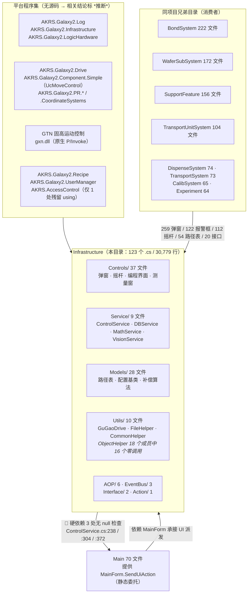

```text
                    ┌──────────────────────────────────────────────┐
                    │  平台程序集（无源码）                          │
                    │  AKRS.Galaxy2.Log / Infrastructure /          │
                    │  LogicHardware / Drive / Component.Simple /   │
                    │  PR.* / CoordinateSystems / Recipe /          │
                    │  UserManager / AccessControl                  │
                    │  GTN 固高运动控制 + gxn.dll（原生 P/Invoke）    │
                    └───────────────────┬──────────────────────────┘
                                        │ using / DllImport
                                        ▼
   ┌────────────────────────────────────────────────────────────────────┐
   │  Infrastructure（本目录）123 个 .cs / 30,779 行                       │
   │  Controls/ 37 · Models/ 28 · Utils/ 10 · Service/ 9 · AOP/ 6        │
   │  EventBus/ 3 · Interface/ 2 · Action/ 1                             │
   └───────┬────────────────────────────────────────┬───────────────────┘
           │ 硬依赖：MainForm.SendUiAction            │ 对外契约
           │ 🔴 3 处无 null 检查 → NRE                 │
           ▼                                        ▼
   ┌──────────────────────┐        ┌────────────────────────────────────┐
   │ Main（70 文件）        │        │ 兄弟目录（消费者）                    │
   │ 提供 SendUiAction      │        │ BondSystem 222 · WaferSubSystem 172  │
   │ 静态委托（同步 Invoke） │───────►│ SupportFeature 156 · TransportUnit   │
   └──────────────────────┘        │ System 104 · Dispense 74 · Transport │
        ↑ 反向依赖 = 依赖环         │ 73 · Calib 65 · Experiment 64        │
        └──────────────────────────┴────────────────────────────────────┘
                        「259 / 122 / 112 / 54 / 20」五条最粗的引用链
```

**图 1 的三个要点**

1. **存在依赖环：`Infrastructure` ↔ `Main`。** 本目录把 `MainForm.SendUiAction` 当作跨线程回 UI 层的
   唯一可靠入口（`Service/ControlService.cs:238` `:304` `:372`、`Controls/Currency/AKRSMessageBoxExt.cs:176` `:256`、
   `Controls/Currency/AKRSXtraMessageBox.cs:29` `:38` `:48`）；
   而 `MainForm` 自己又是本目录的消费者（它继承 `BaseControl`，`Main/Controls/UcModule.cs:31` 等 4 处）。
   → *（推断：任何"把 `Infrastructure` 抽成独立公共库"的尝试，都必须先切断这条反向依赖；
   依据是本目录 3 个 `SendUiAction` 调用点全部写死了 `MainForm` 这个类型名，没有任何接口抽象。）*
2. **依赖环上最危险的是那 3 处没有 `null` 检查的调用点**（`R-19`）。
   对照：`AKRSXtraMessageBox.cs:29`、`AKRSMessageBoxExt.cs:176` `:256` 是**先判 `== null` 再调用**的（降级为直接 `ShowDialog`），
   而 `ControlService` 的 3 处**不判** → `MainForm` 尚未构造时（`Program.cs:258` 之前）走到这些路径会抛 `NullReferenceException`；
   更糟的是 `ControlService.cs:304` 在**异常处理路径上** —— 异常处理本身抛异常。
3. **`AKRS.AccessControl` 只出现 1 次，而且是残留**：`Service/DBService.cs:1` 有一句 `using AKRS.AccessControl;`，
   **该文件内 0 使用点**（`R-58` 之外的又一处"死 using"）。
   本目录内**没有任何授权 / 防拷贝代码**（`SoftKey` / `Dongle` / `AKRS.Galaxy.SoftKey` 全目录 **0 命中**），
   §9.0 会就把这条口径写清。

#### 图 2 Infrastructure 内部分层与依赖方向

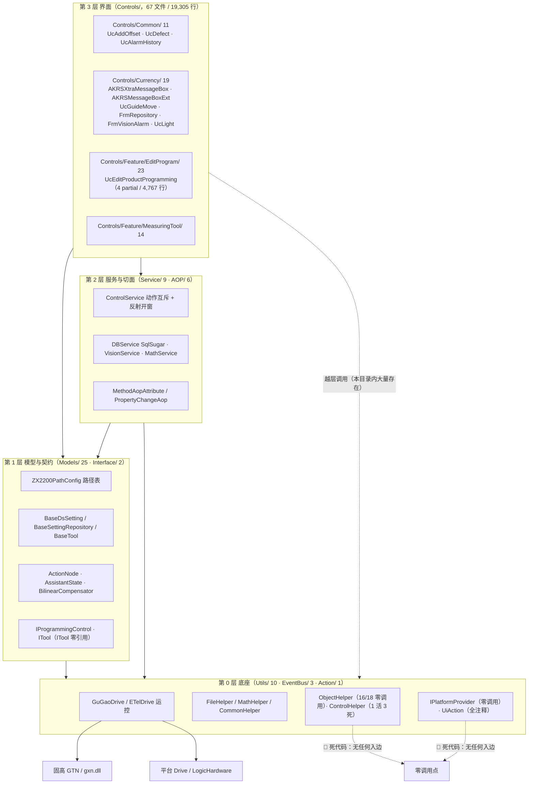

> **分层的诚实说明**：上图的箭头是"设计意图"，**不是实际依赖的有向无环图**。
> 实测的越层调用很多，最典型的是 `Controls/` 直接调 `Utils/`（`UcGuideMove.Joystick.cs:156` 直接落盘设备参数、
> `Controls/Feature/MeasuringTool/FrmMeasureHeightPoints.cs:130` 直接调 `FileHelper.SaveDoubleExcel`），
> 以及第 0 层的 `ControlHelper.cs:49` 反向引用第 3 层的 `TextOverlayPainter`
> （严格说：`:49` 在 `ShowOverlayAsync` `:41`–`:77` 里，**那是个 0 调用点的死方法**；
> `ControlHelper` 这个类本身是活的，它的 `ShowForm<T>` `:78` 有 13 个活调用点 —— 见 §4.26）。
> 换言之：**本目录有分层的形式，没有分层的约束**（见 §3.2 的继承层次与 §7.1 的出依赖清单）。

各层的规模与内容：

| 层 | 目录 | 参与编译文件数 / 行数（Designer 部分） | 一句话职责 |
|---|---|---|---|
| 第 3 层 | `Controls/` | **67 / 19,305**（Designer 30 / 7,149） | 弹窗、摇杆、编程界面、测量窗体——本目录"能被用户看见"的全部 |
| 第 2 层 | `Service/` + `AOP/` | **15 / 2,778**（0 / 0） | 动作串行化与反射开窗（`ControlService`）、数据库（`DBService`）、视觉与数学、两个切面 |
| 第 1 层 | `Models/` + `Interface/` | **27 / 3,129**（0 / 0） | 路径表、配置基类与仓库模板、动作节点模型、补偿算法、两个接口 |
| 第 0 层 | `Utils/` + `EventBus/` + `Action/` | **14 / 5,567**（0 / 0） | 运控驱动（`GuGaoDrive` 2,035 行）、文件 / 数学工具、UI 派发抽象（**零调用**） |

> 口径与两处易混点：
> ① 上表按**参与编译**的文件统计，因此第 1 层的 `Models/` 是 **25** 个（28 减去 3 个幽灵文件、203 行，见附录 A.2）；
> ② `Controls/` 的 Designer 是 **30** 个，其中 `UcEditProductProgramming.designer.cs`（小写 `d`，553 行）
> 必须按**大小写不敏感**口径算进 **Designer**（文首"口径声明"②，§2 脚注）——若误用大小写敏感的 `*.Designer.cs` 匹配，
> 这 553 行会被错算到**非 Designer** 侧（`Controls/` 会显示成 38 + 29，本目录会显示成 94 + 29）。
> 而文首「配套」里 03 / 04 号文档的分工数字（59 个 / 37 个）用的是**磁盘文件 + 大小写不敏感**口径，
> 两个口径的文件总数（126）与行总数（30,982）完全一致，差额就是那 3 个幽灵文件。
> 上表四行的文件数与行数在附录 A 有逐文件明细，合计 = **123 个 / 30,779 行**，
> 与文首"代码规模"、§2 目录结构表三处一致（附录 A.3 有核对表）。

### 1.3 三条最重要的事实

#### 事实一：它是"公共底座"，但底座上有三处"静默断点"

这是全文最需要先记住的一条。改动面广是表象，**真正的危险是广面之下有三处"出错时不报错"的机制**：

| 断点 | `文件:行` | 出错时会怎样 | 风险号 |
|---|---|---|---|
| **`MainForm.SendUiAction` 为 `null` 时弹窗静默消失** | `AKRSXtraMessageBox.cs:29` `:38` `:48`、`AKRSMessageBoxExt.cs:176` `:256`（**有** null 检查 → 降级为直接 `ShowDialog`，于是在**非 UI 线程**上开模态窗体） | 调用方拿到默认 `DialogResult`；在后台线程上直接构造并显示窗体 → 该窗体的消息泵归属错误线程 | `R-51`、§6.4 |
| **数据库异常只记 `Info` 级日志、查询失败返回空集合** | `Service/DBService.cs:93` `:113` `:134` `:152` `:188` `:209` `:230` `:251` `:272` `:293` `:314` `:337` `:358`（13 处 `catch`） | 报警日志、产能、精度统计**静默丢失**；`Query<T>` 失败与"真的没有数据"**不可区分**（界面显示"0 条"） | `R-01` |
| **两条动作路径的空 `catch`** | `Service/ControlService.cs:203-205`、`:288-290` | `signal.WaitAsync` / `ToggleControlsEnabled` / `HandleException` 抛出的异常**既不弹窗也不写日志** | `R-52` |

> 三处断点的共同点：**失败路径上没有任何"外部可见"的痕迹。**
> 现场表现为"这台机器偶尔弹不出框 / 报警历史少了几条 / 某个按钮点了没反应"，
> 而后台没有任何日志可查。排查这类问题必须从本目录进入，而不是从业务模块。

#### 事实二：它硬依赖 `Main` —— 抽库不可能，且依赖环上有一个"哑语句"在救命

- **依赖环**：`Infrastructure` → `MainForm.SendUiAction`；`Main` → 本目录的 `BaseControl` 等。
  3 处 `SendUiAction` 调用点（`ControlService.cs:238` `:304` `:372`）**没有 `null` 检查**（`R-19`）。
- **`MainForm.cs:59` 那句 `IPlatformProvider platform = PlatformProvider.Current;` 是一个有副作用的哑语句。**
  局部变量 `platform` 赋值后**从未被使用**（`grep -n "platform" MainForm.cs` 只有 `:59` 一行命中）。
  它的真实作用是在**构造 `MainForm`（必然在 UI 线程上）时第一次触碰 `PlatformProvider.Current`**，
  从而让 `WinFormsPlatformProvider` 的构造函数里的
  `this.context = SynchronizationContext.Current;`（`EventBus/WinformPlatformProvider.cs:42`）
  **捕获到正确的 UI 上下文**。
  → ***（推断：这一行是"两个零调用的 UI 派发抽象（`IPlatformProvider`、`ContextService`）看起来还正常"的原因。
  `EventBus/PlatformProvider.cs:11` 是带初始化器的静态属性 `Current { get; set; } = new WinFormsPlatformProvider();`，
  一旦首触发生在 WinForms 上下文安装之前（`Program.cs:127-130` 在 Splash 之前就起了后台线程），
  `context` 会被钉成 `null`，`OnUIThread` 的 `:107 if (this.context == null) return;` 会让它**静默变成空操作**。
  正常路径下首触是 **`MainForm.cs:59`**（唯一活读；构造 `MainForm` 时 WinForms 上下文通常已由 `:57 InitializeComponent()` 装好），
  故**正常**；本结论**未经运行复现**，已列入附录 B 未验证清单。`R-77`。）***
  ⚠️ **残余的不确定只有一条**：`Program.cs:258 new MainForm()` 发生在 `Program.cs:259 Application.Run(...)` **之前**，
  而 `Program.cs:127`–`:130` 更早的地方就已经起了一个后台线程（`FindFormThread`）；
  所以"`:59` 那一刻 `SynchronizationContext.Current` 到底装上没有"是**框架细节**，本篇**未在运行时复现**。
  **无论能否复现，这条都请写进"不要动"清单：不要把它当"无用赋值"清理掉。**

#### 事实三：本目录的"形式"与"实质"严重错位 —— 死代码多，且死法与风险无关

| 类别 | 规模 | 证据 |
|---|---|---|
| ⚠️ **不是"整类零调用"** —— 4 个公开扩展方法里 **1 活 3 死** | `Utils/ControlHelper.cs`（199 行） | **活的**：`ShowForm<T>` `:78`，**13 个活调用点** = `UcMainSystem.cs:587`/`:1761`/`:1897`/`:1927`/`:1937`/`:1957`/`:1967`/`:2125`/`:2135`/`:2180`/`:2200` ＋ `UcMainSystem.ShortcutKeys.cs:99` ＋ `WaferSubSystem/Controls/FrmDebug.cs:168`。**死的**：`ShowWaitFormAsync` `:17`、`ShowOverlayAsync` `:41`（2 处调用被注释：`FrmGlobalCalibrationEx.cs:95`/`:1653`）、`ShowUserControl<T>` `:133`。⇒ 按方法体行数（签名行到闭合花括号，不含 XML 注释）**活 46 行 / 死 110 行 / 合计 156 行 ⇒ 约 70% 是死代码**（110 / 156；若把 XML 注释算进去是 53 / 130 / 183，同约 71%）→ `R-57`、§4.26、图 39 |
| ★ **这一行曾经写错，原因值得记住** | —— | 原判据是 `grep -rl "\bControlHelper\b"` = 0。**但 `ControlHelper` 的 4 个方法全是扩展方法**（`this IWin32Window owner`），调用点写成 `this.ShowForm<FrmXxx>()`，**类名根本不会出现在调用点**。⇒ 用类名 grep 判"整类零引用"对扩展方法类**必然误判为死**。复核命令：`grep -rn --include='*.cs' 'ShowForm' .`（21 行命中，去掉定义 1 行、**同名异类的 5 行**（`RealTimeImageForm.cs:23` 的定义 ＋ `UcmainSystem.Action.cs:182` 对它的调用 ＋ 3 处 `SplashScreenManager.ShowForm(typeof(...))`）、注释掉的 2 行 = **13 个活扩展方法调用点**） |
| **整类零调用** | `Interface/ITool.cs`（15 行）、`Service/MotionService2.cs`（13 行，空类）、`Service/ContextService.cs`（82 行，已 `[Obsolete]`） | `R-56`、§7.3 引用面表 |
| **整文件体被注释** | `Action/UiAction.cs`（127 行，30~125 行全是注释掉的 Harmony `PatchAll` 方案；`:18` 的 `using HarmonyLib;` **是活的**，csproj **也确有**该包引用 —— `AKRS.ZX2200.csproj:4099` 的 `<PackageReference Include="Lib.Harmony">`；缺的**只是用法**，不是引用） | §2.2 |
| **方法级大比例死** | `Utils/ObjectHelper.cs`：**18 个公有成员里只有 2 个有调用点**（`Clone` `:109` 共 2 处、`GetEnumDescription` `:925` 共 1 处），其余 **16 个零调用点** → 按方法体行数约 **93%**（891 / 963）。⚠️ 注意 `:925` 的 **`GetEnumDescription`（带 `Enum`，活的）** 与 `:936` 的 **`GetDescription`（不带 `Enum`，死的）** 是两个不同方法，**别混**；后者名字对应的**扩展方法写法在平台程序集里是活的**，见下方口径框里的指针 | §4.27、`R-67`；已排除扩展方法（`ShallowCopy` `:27` 是扩展方法）、非限定调用与反射调用三种情况 |
| **特性零使用** | `PropertyAopAttribute`、`S1SingleStepAop`、`S2SingleStepAop`、`UIExceptionHandlerAttribute`、PostSharp 的 3 个 `LogRecord*` 特性 | §3.2 图 6、`R-58` |
| **幽灵文件** | 3 个 `.cs`（203 行）在磁盘上但不在 `.csproj` —— 全部集中在 `Models/CommonModels/` | 附录 A.2、`R-30`~`R-32` |
| ★ **幽灵文件的同名陷阱（插补参数）** | 3 个都是**甲类「唯一孤儿」**（磁盘上只有这一份，编译系统里根本不存在该类型），**全仓被编译代码引用数 = 0（逐个类型实测，非抽样）**。`InterpolationParamConfig.cs`（110 行）里**同时声明 `InterpolationParamConfig` 与 `InterpolationGlobalConfig` 两个类型**；`SingleInterpolationParam.cs`（44 行）声明 `SingleInterpolationParam`。三个名字看起来正是**活的插补逻辑该用的配置类，但运行时不存在** ⇒ **正文任何地方都不得把它们当成插补参数的来源**；也别因为"两个类型写在一个文件里"就以为它们分属不同模块 | 附录 A.2、`R-30`~`R-32` |
| **窗体 / 控件零实例化** | `PointShow`（`Controls/Currency/PointShow.cs:11`）、`FrmMultipleHeightMeasurementType`（`Controls/Feature/MeasuringTool/FrmMultipleHeightMeasurementType.cs:11`，只有它的 `enum` 被 8 个文件 `using static` 用） | §4.1 |
| **处理器死 / 定时器永不启** | `UcGuideMove.BtVision_Click`（`UcGuideMove.cs:664`，Designer 接的是 `BtVision_Click_1` `:694`）、`UcLight.TbLight_MouseUp`（`UcLight.cs:402`）、`FrmVisionAlarm.TimerVision_Tick`（`FrmVisionAlarm.cs:104`，**Designer 里根本没有 `TimerVision` 组件**）、`UcMeasuringTool.timer1`（`UcMeasuringTool.Designer.cs:38`，**从未 `Enabled = true`** → 系统1/系统2 按钮的互斥使能从未生效，`R-61`） | §3.2、`R-26` |
| ⚠️ **别把"整段注释"读成"在用"** | `Utils/CommonHelper.cs:85`–`:122` 是**整段被注释掉的旧 `ProcessStep` 代码**。`CommonHelper` 本身是**活文件**（23 个外部文件、26 处活调用点，全是同一个 `ChangeUcMove` `:25`），但被注释的那一段引用的正是**幽灵类型** `ProcessStep`/`ProcessStepProgram`（其定义文件不在 `.csproj` 里）⇒ 不是"这里在用它们" | §2.2、§7.3 |

> **⚠️「零调用点」的传递性口径（本节全部结论均按此口径，读者若质疑请先读这一段）**
>
> 本文档说「零调用点」一律指 **外部调用点 = 0**。但 `ObjectHelper` 里有若干方法
> **只被同文件的其它方法调用**，这时**必须再查那个调用者自己活不活**，否则口径不严密。三处已实测：
>
> | 被怀疑「明明有调用者」的方法 | 同文件内部调用点 | 调用者自身的外部调用点 | 传递结论 |
> |---|---|---|---|
> | `GetDescription` `:936` | **2** 处：`:950`（在 `GetEnumDescriptions<T>` `:943` 里）、`:959`（在 `GetEnumDescriptionList<T>` `:955` 里） | `:943` = **0**、`:955` = **0**（`grep -rn 'GetEnumDescriptions\|GetEnumDescriptionList'` 排除本文件后无输出） | **传递地死 ⇒ 该行代码永不执行** |
> | `Removek_BackingField` `:362` | **10** 处：`:237`/`:257`/`:300`/`:320`/`:429`/`:468`/`:571`/`:645`/`:681`/`:785` | 三个调用者 `SavaParaByName` `:219`、`LoadParaByName` `:286` **与** `:392`（同名两个重载）、`SaveParaByName` `:611` —— 外部调用点**全为 0** | **传递地死** |
>
> ⚠️ **但"传递地死"只是死的这一半。同名的写法在本仓是活的，必须补一句指针，否则读者会以为「`GetDescription` 这套整个是死的」。**
> `ObjectHelper.cs:936` 的 `public static string GetDescription(Enum value)` **没有 `this` 参数 ⇒ 它不是扩展方法**，
> 全仓显式 `ObjectHelper.GetDescription(...)` 命中 **0** ⇒ 上面这一行的传递性结论成立。
> 而调用点写成 `x.GetDescription()` **这个写法本身是活的**：主工程 **34 处**（全仓 **35 处**，多出的第 35 处在
> 另一个项目 `AKRS.Galaxy2.PR/Models/Algs/BaseAlg.cs:304`）解析到的是**平台程序集** `libs\AKRS.Galaxy2.Infrastructure.dll`
> 里的 **`AKRS.Galaxy2.Infrastructure.Helper.EnumHelper.GetDescription`** 扩展方法。
> ⚠️ **命名空间陷阱**：`EnumHelper` 在 **`AKRS.Galaxy2.Infrastructure.Helper`** 这个**子**命名空间下，
> `using AKRS.Galaxy2.Infrastructure;` **不会**把它带进来，两者在本仓常**并列**出现
> （`Main/Controls/Ucmain/MainControls/UcMainSystem.cs:8` 与 `:11`）；
> 旁证：`WaferSubSystem/Controls/Setting/Component/UcComponentEdit.cs:849` 写成 `EnumHelper.GetDescription(...)`，把真身类名直接暴露了。
> ⇒ 结论不变：**改 `ObjectHelper.cs:936` 是白费力气**，要改的是平台 DLL（本仓无源码）或调用方。
> 细节（含 34/35 两个口径、以及那 34 处里**有 3 处是被注释掉的**：`FrmHeightMeasurementTeach.cs:464`、`UcComponentEdit.cs:668`/`:676`）
> 见 `44-本地化与工程杂项全景.md` §9.6 的 `R-35` 与其「证据更正」框。
>
> 反过来，**方法内部对子控件树的递归**（如 `LoadParaByName` 在 `:590`、`SaveParaByName` 在 `:803` 自己调自己）
> 不算外部调用点 —— 递归不改变"外部入口为 0"这个事实。
>
> ⚠️ **同一条纪律的另一个坑：别把"字符串里出现的方法名"当成调用点。**
> `ObjectHelper.cs:847`、`:885`、`:913` 三行的
> `if (control.Name.StartsWith("Uc") && methodInfo.Name == "Save")` 是**字符串比较**，
> 紧接着的 `Invoke` 是**反射调用子控件自己的 `Save`**，**不是**调用 `ObjectHelper.Save`。
> 用 `grep -nw Save ObjectHelper.cs` 排查会命中 **5 行**，极易数错：
> `:835`（`public static void Save(Control parentControl)` 定义本身）、
> `:847`/`:885`/`:913`（上述三处**字符串比较**）、
> 以及 `:855` 的 `Save(control);` —— **只有 `:855` 是真正的内部调用**，且它是
> `Save` 对自己遍历出的子控件**递归**（正是上面说的"内部递归"）。
> 同理 `:893` 的 `//SaveAll(control);` 是**注释**，不算调用点。
> **⚠️ 死代码与风险是错位的**：上表里最"多"的死代码（`ObjectHelper`）不是最危险的；
> 最危险的是**天天在跑的少数几条活路径**——摇杆（`R-06` 无软限位 + `R-44` 停车 `case` 永不命中）、
> 弹窗锁（`R-51` 主线程不取锁）、`ShowDialogForm<T>`（`R-18` 反射构造、编译期零检查）。
> 因此本目录的正确读法是：**先读 §4 的活路径，再读 §9 的风险，最后才碰死代码清单。**

---

## 2. 目录结构

### 2.1 规模口径：三个口径，本文档只用第二个

同一个目录，按三种数法会得到三个不同的数字。**先说清口径，后面所有数字才有意义。**

| 口径 | 数法 | 文件数 | 总行数 | 非 Designer | Designer |
|---|---|---|---|---|---|
| **A 磁盘口径** | `find . -iname "*.cs"`（含不参与编译的幽灵文件） | 126 | 30,982 | 96 / 23,833 | 30 / 7,149 |
| **B 参与编译口径** ★ 本文档采用 ★ | `.csproj` 里的 `<Compile Include="Infrastructure\...">` | **123** | **30,779** | **93 / 23,630** | **30 / 7,149** |
| **C 大小写敏感分类（⚠️ 错误口径，仅作对照）** | 同 A，但用 `-name "*.Designer.cs"` 分类 | 126 | 30,982 | 97 / 24,386 | 29 / 6,596 |

- **A → B 的差**：3 个幽灵文件（203 行，全部在 `Models/CommonModels/`，见 §2.4）。
- **A ↔ C 的差**：只有 1 个文件算哪边 —— `Controls/Feature/EditProgram/UcEditProductProgram/UcEditProductProgramming.designer.cs`
  （扩展名是**小写 `designer.cs`**，553 行，`:3 partial class UcEditProductProgramming`）。
  **本文档按大小写不敏感归类，把它算作 Designer**；口径 C 就是当初误用大小写敏感匹配得到的结果。
- **B 是唯一可以引用的规模数字**：`93 / 23,630` + `30 / 7,149` = `123 / 30,779`，两项相加自洽。

> ⚠️ **本项目的一个静默统计陷阱**：全仓共 **8 个** `.cs` 用小写 `designer.cs`（`Main/` 6 个、本目录 1 个、
> `SupportFeature/` 1 个，合计 5,394 行），**全部在 `.csproj` 里、全部参与编译**。
> 用 `find -name '*.Designer.cs'` 做分类**不会报错**——文件数和行数都"看起来对"，只是分了错类。
> 凡在本目录做**文件数 / 按钮数 / 类数**统计，一律用 `-iname`（大小写不敏感）。

复现命令（在 `AKRS.ZX2200/` 下执行）：

```bash
# 参与编译的文件条数
grep -o '<Compile Include="Infrastructure[^"]*"' AKRS.ZX2200.csproj | wc -l    # → 123
# 磁盘上的 .cs 个数
find ./Infrastructure -name '*.cs' -not -path './bin/*' -not -path './obj/*' | wc -l   # → 126
# 大小写不敏感的 Designer 个数（本目录 → 30；若用 -name 则只有 29，这就是那个陷阱）
find ./Infrastructure -iname '*.designer.cs' -not -path './bin/*' -not -path './obj/*' | wc -l
# 是否有"被显式移出工程"的情况（应为 0，说明幽灵文件是"从未被 Include"）
grep -c 'Compile Remove' AKRS.ZX2200.csproj                                     # → 0
```

> 对照：口径 C 那 29 个 Designer 里有 **29 = 30 − 1**，唯一被漏掉的就是上面那个小写文件；
> 它 553 行从非 Designer 侧移过来，正是 `24,386 − 23,833 = 553` 与 `23,833 − 23,630 = 203`（幽灵文件）这两个差额的来源。

### 2.2 目录结构总表（口径 B）

#### 图 3 目录结构导航图

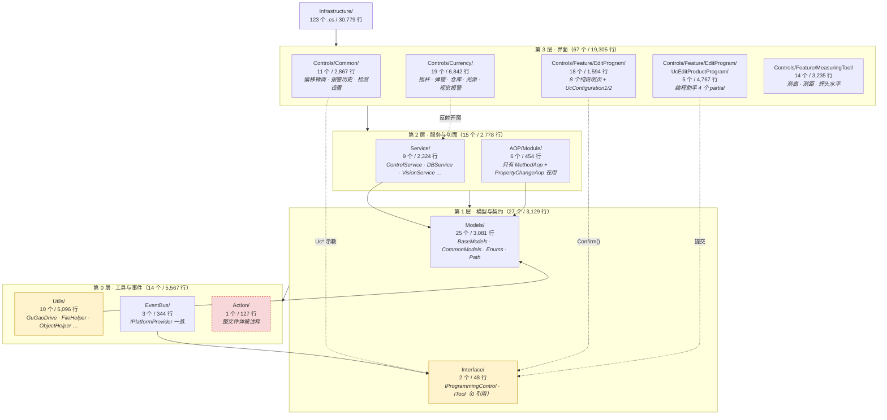

> **看图提示**：第 3 层"控件"往下依赖第 1 层的 `Interface/IProgrammingControl`（只有一个 `void Confirm()`），
> 这是本目录**唯一的"业务接口契约"**；除此之外各层之间的"依赖"实际都是**直接 `new` / 静态单例调用**，
> 没有依赖注入、没有接口隔离。第 0 层的 `Utils/` 里那个黄色的框是**死代码重灾区**（§4.27）。

| 子目录 | 文件数 | 非 Designer 文件 / 行 | Designer 文件 / 行 | 合计行 | 一句话职责 |
|---|---|---|---|---|---|
| `AOP/Module/` | 6 | 6 / 454 | 0 / 0 | 454 | 编译期织入的按钮鉴权 + 参数变更留痕（**4 个特性零使用**） |
| `Action/` | 1 | 1 / 127 | 0 / 0 | 127 | **整文件体被注释**，只剩空 `static class UiAction` |
| `Controls/Common/` | 11 | 6 / 1,006 | 5 / 1,861 | 2,867 | 偏移微调 / 报警历史 / 检测设置（跨模块复用的三件套） |
| `Controls/Currency/` | 19 | 11 / 5,123 | 8 / 1,719 | 6,842 | **通用操作件**：摇杆、弹窗、数据集仓库、光源、视觉报警 |
| `Controls/Feature/EditProgram/` | 18 | 9 / 346 | 9 / 1,248 | 1,594 | 编程界面的"说明页 + 配置页1/2"（8 个 16 行空壳） |
| `Controls/Feature/EditProgram/UcEditProductProgram/` | 5 | 4 / 4,214 | 1 / 553 | 4,767 | **编程助手主体**（4 个 partial + 小写 `designer.cs`） |
| `Controls/Feature/MeasuringTool/` | 14 | 7 / 1,467 | 7 / 1,768 | 3,235 | 测高 / 测距 / 焊头水平（4 个入口窗体） |
| `EventBus/` | 3 | 3 / 344 | 0 / 0 | 344 | `IPlatformProvider` 抽象 + WinForms 实现（**抽象在本目录内零调用**） |
| `Interface/` | 2 | 2 / 48 | 0 / 0 | 48 | 编程子控件的 `Confirm()` 契约；`ITool` 零引用 |
| `Models/` | **25** | 25 / 3,081 | 0 / 0 | 3,081 | 数据模型 / 枚举 / **全项目路径唯一集中定义**（已扣除 3 个幽灵文件） |
| `Service/` | 9 | 9 / 2,324 | 0 / 0 | 2,324 | **动作互斥、数据库、视觉、标定数学**（本目录的"非 UI 大脑"） |
| `Utils/` | 10 | 10 / 5,096 | 0 / 0 | 5,096 | 运控驱动（固高/ETel）+ 文件/数学/反射小工具（**死代码重灾区**） |
| **合计** | **123** | **93 / 23,630** | **30 / 7,149** | **30,779** | — |

> **对账**：`93 + 30 = 123` ✓；`23,630 + 7,149 = 30,779` ✓。本表与文首「代码规模」、附录 A 的合计核对表**三处数字完全一致**。
>
> **与 03 / 04 号文档数字的差异（不是谁写错了，是口径不同）**
>
> | 文档 | 它写的 | 它的口径 |
> |---|---|---|
> | 04 号 | `Controls/` = **37 个 / 12,156 行**（不含 30 个 `*.Designer.cs`） | **磁盘**口径、大小写不敏感 → `37 + 30 = 67` 个 `.cs` |
> | 03 号 | 不含 `Controls/` 的其余 = **59 个 / 11,677 行** | 同上（`126 − 67 = 59`；`30,982 − 19,305 = 11,677`） |
> | 本文档（口径 B） | `Controls/` = **67 个**（37 非 Designer + 30 Designer）；其余 = **56 个 / 11,474 行** | **参与编译** + 大小写不敏感（`123 − 67 = 56`；`30,779 − 19,305 = 11,474`） |
>
> **唯一的差异因素**：3 个幽灵文件（203 行，在 `Models/`，03 / 04 号把磁盘上的它们算进了"其余"，本文档只算参与编译的，
> 故"其余"是 56 个而不是 59 个）。此前曾出现的"小写 `designer.cs` 归属"这个第二因素**已消除** ——
> 本文档现在与 03 / 04 号一样按**大小写不敏感**归类（§2.1），那 553 行两边都算 Designer，对本表任何一列都无影响。
> 另注：03 号正文有一处把 `Controls/` 写成"70 个文件"，与 04 号的 `37 + 30 = 67` 不符，属该文档内部笔误，不影响本目录任何结论。
> 与这两篇的**内容**分工见 §7.4。

### 2.3 目录级的四个注意点

1. **`Models/` 是"目录里有的"与"能编译的"不一致的唯一一处。** 3 个幽灵文件（`InterpolationParamConfig.cs` 110 行、
   `NLogTraceWriter.cs` 49 行、`SingleInterpolationParam.cs` 44 行，合计 203 行）**从未被 Include**，
   运行时不存在。它们定义的 4 个类型**不得计入本目录的对外契约**（§7.3 的计数已排除）。
2. **`Controls/Feature/EditProgram/` 名不副实。** 这个 18 文件的目录里，有 **8 个是 16 行的空壳**
   （`UcComponentsDescription.cs:16`、`UcConfigurationDescription.cs:16`、`UcDispenserDescription.cs:16`、
   `UcESToolsDescription.cs:16`、`UcPPToolsDescription.cs:16`、`UcTransportUnitDescription.cs:16` 等），
   真正有逻辑的只有 `UcConfiguration1.cs`（42 行）与 `UcConfiguration2.cs`（167 行）。
   另有复制粘贴残留：`UcDispenserDescription.Designer.cs` 的类名仍旧写成 `UcESTools`，
   `UcFlipToolsDescreption` 的类名把 `Description` 拼成了 `Descreption`（`R-45` 的同类问题）。
3. **`Controls/Currency/` 不是"货币"，是"常用/通用"。** 本目录风险最集中的三个文件都在这里：
   `UcGuideMove.Joystick.cs`（`R-06`/`R-17`/`R-44`）、`AKRSXtraMessageBox.cs`（`R-51`）、
   `AKRSMessageBoxExt.cs`（`R-03`/`R-04`）。
4. **`Utils/` 目录名具有欺骗性，但"整目录都是死代码"同样是错的。** 实测 10 个文件的外部引用文件数：
   `CommonHelper` **22**、`FileHelper` **12**、`GuGaoDrive` **7**、`MathHelper` **7**、`ETelDrive` **2**、
   `ObjectHelper` **2**（且只用到 2 个成员）、`JOCPK` **1**、`MathAdvanceHelper` **1**、`AsyncHelper` **0**、`ControlHelper` **0**。
   → **只有 `ObjectHelper` 与 `ControlHelper` 两个成立"死代码"**；按"目录"为粒度估影响面，两头都会错（`R-73`、§4.27）。
   ⚠️ **上面这一行的 `ControlHelper 0` 是错的，必须按下面这条口径读**：这个 `0` 是**按类名**
   （`grep -rl "\bControlHelper\b"`）数出来的，而 `ControlHelper` 的 4 个方法**全是扩展方法**，
   调用点写 `this.ShowForm<FrmXxx>()`、**类名不出现** ⇒ 按类名数必然得 0。
   **实测：`ShowForm<T>` 有 13 个活调用点**（清单见 §3.1 的"不是整类零调用"一行）⇒
   **正确的说法是「4 个扩展方法里 1 活 3 死」，不是"整类死"**（图 39、§4.26）。
   ⇒ **本目录里"整类死"的只有 `ObjectHelper`（16/18 零调用）一个**（按公开成员口径）。

---

## 3. 关键类型索引

### 3.1 类型总览

本目录**不参与编译**的文件（3 个幽灵文件）另有 4 个类型，**不计入本节任何计数**。
本目录**非 Designer** 文件里共 **118 处类型声明**（含 3 个嵌套类 / 嵌套枚举）。
（按大小写不敏感口径：`UcEditProductProgramming.designer.cs:3 partial class UcEditProductProgramming` 算 Designer，
因此不计入这 118 —— 若按大小写敏感的老口径，它会被多算 1 处而读成 119。）按角色分：

| 角色 | 数量 | 说明 |
|---|---|---|
| `XtraForm` 窗体 | **12** | 全部继承 `DevExpress.XtraEditors.XtraForm`（`R-04` 之外无自定义基类） |
| `XtraUserControl` 用户控件 | **18** | 另有 2 个不继承 `UserControl`：`TextOverlayPainter`（`OverlayWindowPainterBase`）、`AKRSMessageBoxExt`（平台 `AKRSMessageBox`） |
| 控件基类 | **2** | `BaseControl`（示教控件基类）、`AKRSMessageBoxExt`（弹窗基类） |
| AOP 切面 | **6** | 5 个 `OnMethodBoundaryAspect` + 1 个 `PropertyChangeAop`（**其中 4 个零使用**，图 6） |
| `Service/` 静态/单例服务 | **9** | 动作互斥、数据库、视觉、标定数学、导出、排序（含 1 个空类 `MotionService2`） |
| `Utils/` 工具类 | **10** | 含 4 个运控/文件/数学的"重"工具与 1 个整类死代码 |
| 接口 | **2** | `IProgrammingControl`（在用）、`ITool`（0 引用） |
| 模型 / 基类 / 实体 | **约 35** | `BaseModels/` 6 个、`CommonModels/` 20 个（含 3 个幽灵）、Path 1 个、其余为嵌入式辅助类 |
| 枚举 | **15** | 全部成员与数值见下一小节 |
| 辅助 / 值对象 | **6** | `NodeTag`、`AlarmTypeCount`、`ResultValue`×2、`Coords2D`、`Scaler` |

> **口径提示**：本节只做"有哪些类型"的清点。**每个类型的完整清单、行数、`文件:行` 在附录 A**；
> **有没有人用、被谁用**在 §7.3 的引用面表与 §4.27 的 `Utils/` 横向普查里。

#### 本目录定义的 15 个枚举（全部成员与数值）

> 枚举是"跨模块契约"里最容易出错的一类：数值被持久化到 JSON / 数据库，
> **改数值等于改数据格式**。下表全部逐个核对过声明行。

| 枚举 | 声明位置 | 成员（值） |
|---|---|---|
| `ProcessingStrategyEnum` | `Models/Enums/CommonEnum.cs:8` | `ModulesBeforeSteps = 0`（"基岛优先"）`:14`；`SubstrateBeforeSteps = 1`（"基板优先"）`:20`；`StepsFirst = 2`（"步骤优先"）`:26` |
| `ActionNodesSortModeEnum` | `CommonEnum.cs:32` | `Normal = 0`（"正常模式"）`:38`；`HighUPH = 1`（"高速模式"）`:44` |
| `RoleEnum` | `CommonEnum.cs:50` | `Admin = 1`（"管理员"）`:56`；`Engineer = 2`（"工程师"）`:62`；`Operator = 3`（"操作员"）`:68` —— **数值越小权限越高**，权限门靠 `CompareTo` 判定（§4.28） |
| `AssistantStateEnum` | `CommonEnum.cs:74` | `Able = 0` `:79`；`UnAble = 1` `:84`；`ForBidden = 2` `:89` |
| `LanguageEnum` | `CommonEnum.cs:95` | `Chinese = 0` `:100`；`English = 1` `:105` |
| `DebugModelEnum` | `CommonEnum.cs:111` | `PauseModel`（"暂停模式"）`:117`；`DelayModel`（"延时模式"）`:123` —— **无显式赋值**，即 0 / 1 |
| `EditStateEnum` | `Models/BaseModels/BaseDsSetting.cs:100` | `NewCreate = 0` `:104`；`NotYetFinished = 1` `:109`；`ChangedOutside = 2` `:114`；`Completely = 3` `:119` |
| `ActionLevelEnum` | `Models/CommonModels/ActionNode.cs:124` | `Carrier` `:128`；`Substrate` `:134`；`Module` `:140`；`BondPosition` `:146`；`Other` `:152` —— **无显式赋值**，依次 0~4 |
| `ActionNodeSystemEnum` | `ActionNode.cs:155` | `System1` `:159`；`System2` `:165` —— 0 / 1 |
| `ActionNodeStyle` | `ActionNode.cs:171` | `Vision` `:175`；`MeasureHeight` `:181`；`Other` `:187` —— 0 / 1 / 2 |
| `ActionTypeEnum` | `Models/CommonModels/ActionNodeMessage.cs:66` | `Island` `:70`；`TransportUnit` `:75`；`Substrate` `:80`；`BondPosition` `:85` —— 0~3 |
| `CameraEnum` | `Controls/Currency/UcGuideMove.cs:863` | `None` `:869`；`BondCamera`（"Bond相机"）`:875`；`DispenseCamera`（"点胶相机"）`:881`；`WaferCamera`（"晶圆相机"）`:887`；`UplookCamera`（"上视相机"）`:893` —— 0~4 |
| `JoystickStateEnum` | `Controls/Currency/UcGuideMove.Joystick.cs:950` | `Idle = 0` `:955`；`Rising = 1` `:960`；`Falling = 2` `:965` —— **摇杆三轴状态机的状态**（图 44） |
| `LightColorTypeEnum` | `Controls/Currency/UcLight.cs:159` | `Red` `:164`；`Green` `:169`；`Blue` `:174`；`Yellow` `:179`；`Cyan` `:184`；`Magenta` `:189`；`White` `:194`；`Customize` `:199` —— **共 8 个成员，全部无显式赋值 ⇒ 0~7**。⚠️ 索引 6 = `White`、索引 7 = `Customize`，而 `UcLight.cs:385` 把索引 7 当 `White` 处理（`R-14`，依据行号已按源码更正，附录 B 有记录） |
| `MultipleHeightMeasurementType` | `Controls/Feature/MeasuringTool/FrmMultipleHeightMeasurementType.cs:40` | `TouchDown`（"Touch Down"）`:45`；`SubstrateCamera`（"Substrate Camera"）`:51` —— 0 / 1 |

> ⚠️ **同名枚举陷阱**：`AssistantStateEnum` 在 `Models/Enums/CommonEnum.cs:74` 与 `Models/CommonModels/AssistantState.cs` 内**各有一个同名声明**。
> 两处同名、不同命名空间，`using` 不同就会取到不同的那个 —— 排查"状态值对不上"时先看这里。

### 3.2 继承层次与切面家族

本目录的类型层次很浅：**控件只有一层自定义基类，模型只有一条真正在用的继承链**。
这一点决定了"改基类会牵连多广"的答案。

#### 图 4 控件继承层次（窗体 / 用户控件 / 基类）

```mermaid
flowchart TB
    subgraph DEV["DevExpress 21.2.7（DLL）"]
        XF["XtraForm"]
        XU["XtraUserControl"]
        OWP["OverlayWindowPainterBase"]
        AKM["AKRSMessageBox<br/><i>AKRS.Galaxy2.Component? （平台程序集）</i>"]
    end

    subgraph MW["本目录 12 个窗体"]
        direction LR
        F1["FrmAlarmHistoryQuery<br/>Common:19"]
        F2["FrmEntityOffsetChange<br/>Common:29"]
        F3["FrmRepository&lt;T&gt;<br/>Currency:19<br/><i>where T : BaseDsSetting, new()</i>"]
        F4["FrmVisionAlarm<br/>Currency:35"]
        F5["PointShow<br/>Currency:11<br/><b>零实例化</b>"]
        F6["RealTimeImageForm<br/>Currency:13"]
        F7["FrmBondheadStandardMeasurement<br/>MeasuringTool:22"]
        F8["FrmDistanceMeasureResult<br/>MeasuringTool:8"]
        F9["FrmDistanceMeasurement<br/>MeasuringTool:24"]
        F10["FrmMeasureHeightPoints<br/>MeasuringTool:24"]
        F11["FrmMultipleHeightMeasurement<br/>MeasuringTool:20"]
        F12["FrmMultipleHeightMeasurementType<br/>MeasuringTool:11<br/><i>只剩 enum 被使用</i>"]
    end

    subgraph UC["本目录 20 个用户控件"]
        direction LR
        BC["BaseControl<br/>Currency:12<br/><i>唯一控件基类</i>"]
        U1["UcAddOffset / UcAlarmHistory / UcDefect<br/><i>Common</i>"]
        U2["UcGuideMove（3 partial）<br/>UcLight / UcLampRegulation<br/>FrmRepository 等<i>Currency</i>"]
        U3["UcEditProductProgramming（4 partial）<br/>UcConfiguration1/2 + 8 个说明页"]
        U4["UcMeasuringTool<br/><i>MeasuringTool</i>"]
    end

    XF --> F1 & F2 & F3 & F4 & F5 & F6 & F7 & F8 & F9 & F10 & F11 & F12
    XU --> BC
    BC --> U1 & U2 & U3 & U4
    XU --> U1 & U2 & U3 & U4
    OWP --> TOP["TextOverlayPainter<br/>Common:12"]
    AKM --> EXT["AKRSMessageBoxExt<br/>Currency:27<br/><i>报警弹窗</i>"]

    style F5 fill:#f8d7da,stroke:#c00,stroke-dasharray: 4 3
    style F12 fill:#fff3cd,stroke:#b80
```

| 事实 | 证据 | 影响 |
|---|---|---|
| **`BaseControl` 是唯一的控件基类**，只提供 `ModuleCaption` / `AllowWaitDialog` 两个虚属性与 `InitModule` | `Controls/Currency/BaseControl.cs:12`、`:20`、`:23`、`:26`、`:29` | 改它会影响全部示教控件；但注意 `InitModule` 是 **`internal virtual`**（`:29`），**程序集外无法调用** |
| **12 个窗体全部直接继承 `XtraForm`**，没有本目录自己的窗体基类 | 各窗体声明行见上表 | 弹窗行为统一靠 `AKRSXtraMessageBox` 静态包装，不靠基类 |
| `FrmRepository<T>` 是**唯一的泛型窗体** | `Controls/Currency/FrmRepository.cs:19`（`where T : BaseDsSetting, new()`） | 数据集仓库被复用于多个设定类型（§4.13 / §4.14） |
| `PointShow` 全项目**零实例化**（僵尸） | `Controls/Currency/PointShow.cs:11`；反查 `grep -rn -w 'PointShow'` 只命中自身构造函数与 Designer 的 `ComponentResourceManager` | 不得写进按钮总表 |
| `FrmMultipleHeightMeasurementType` 的**窗体本身零实例化**，只有它里面的 `MultipleHeightMeasurementType` 枚举被 8 个文件 `using static` 引用 | `Controls/Feature/MeasuringTool/FrmMultipleHeightMeasurementType.cs:11`、`:40` | 典型的"把枚举寄生在窗体文件里" |

#### 图 5 模型基类继承层次（`PropertyChangeAop` 一族）

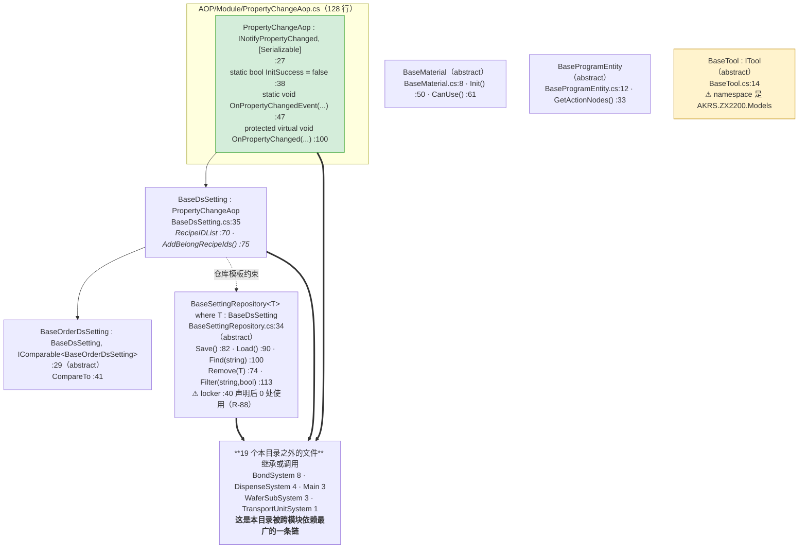

| 事实 | 证据 |
|---|---|
| `BaseDsSetting` 是**唯一**真正接上 `PropertyChangeAop` 的基类；参数变更留痕全靠它 | `Models/BaseModels/BaseDsSetting.cs:35` |
| `PropertyChangeAop` 被 **19 个本目录之外的文件**继承或调用 | `BondSystem/Models/DeviceParams/BondHeadParam.cs`、`BondSystem/BondForce/Models/DevicePara/ForceConfig.cs`、`DispenseSystem/Models/DeviceParams/DispenseDevicePara.cs`、`Main/Machine/MachineSupport/Machine.cs`、`Main/Machine/MachineSupport/MachineSoftwareConfiguration.cs`、`TransportUnitSystem/Module/Config/BaseConfig.cs`、`WaferSubSystem/Models/DeviceParams/WaferTableDevicePara.cs` 等（完整 19 个见 §7.3） |
| **留痕默认是关的**：`InitSuccess` 默认 `false`，只在机器初始化完成后被置真 | `AOP/Module/PropertyChangeAop.cs:38`；置真点 `Main/Machine/MachineSupport/Machine.cs:337`、`:395` |
| `BaseSettingRepository<T>` 是**仓库读写的唯一模板**（`Save`/`Load`/`Find` 都在这一个文件里） | `Models/BaseModels/BaseSettingRepository.cs:34`、`:40`、`:82`、`:90`、`:100` —— 全部落盘点最终都走到它的 `Save()`（§8） |
| `BaseTool : ITool` 但 `ITool` **全项目零引用**，且这个文件的 `namespace` 是 `AKRS.ZX2200.Models`（与外层不一致，`R-47`） | `Models/BaseModels/BaseTool.cs:13`、`:14`；`Interface/ITool.cs:3` |

> **这条链为什么重要**：`PropertyChangeAop` + `BaseSettingRepository<T>` 构成了本项目"参数持久化"的骨架。
> **本目录里 39 处 `Save()` 中绝大多数最终落到 `BaseSettingRepository<T>.Save()`**
> —— 也就是说，"保存"这件事的**实际实现不在本目录**，本目录只提供基类与调用点（§8 有全清单）。

#### 图 6 AOP 切面家族：织入方式与存活状态

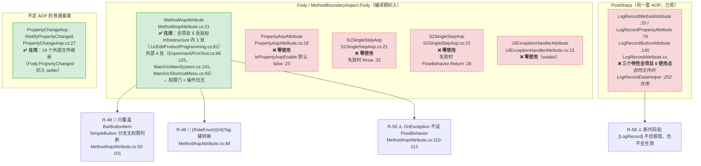

| 事实 | 证据 |
|---|---|
| 6 个 `OnMethodBoundaryAspect` 派生的切面里，**只有 `MethodAopAttribute` 在用** | 全项目 `grep -rn '\[MethodAop'` = 5 处；`PropertyAopAttribute` / `S1SingleStepAop` / `S2SingleStepAop` / `UIExceptionHandlerAttribute` **0 处** |
| `MethodAopAttribute` 在 Infrastructure 内只有 **1 处**贴标：编程助手主类 | `Controls/Feature/EditProgram/UcEditProductProgram/UcEditProductProgramming.cs:81` |
| PostSharp 那套 3 个特性**全项目 0 使用点**，但 `csproj` 仍引用 `libs\PostSharp.dll` | `Models/CommonModels/LogRecordAttribute.cs:20`、`:76`、`:140`；`AKRS.ZX2200.csproj:144-145`（`R-58`） |
| `PropertyChangeAop` **不是** `OnMethodBoundaryAspect`，它是普通抽象基类 | `AOP/Module/PropertyChangeAop.cs:27` |
| Fody 的织入是**编译期**的，所以"贴了特性才有行为、特性无实现则静默无效" | 「贴 `[LogRecord]` 不报错也不生效」正是这种机制的典型后果（`R-58`） |

> **读这一节要记住的一句话**：本目录的 AOP 目录里，**6 个文件只有 1 个在跑**。
> 剩下 4 个 Fody 切面 + 3 个 PostSharp 特性都是"看着像有约束、实际无约束"。
> 权限门（`MethodAopAttribute`）的覆盖面与三条缺陷见 §4.28。

### 3.3 类型速查

速查表只列**接手时最可能被搜到**的类型。完整清单（含行数）在附录 A。
「引用面」= 本目录**之外**引用该类型的文件数（口径见 §7.3）。

#### 3.3.1 五个"对外契约"（改动风险最高的五个）

| 类型 | `文件:行` | 引用面 | 一句话 |
|---|---|---|---|
| `AKRSXtraMessageBox` | `Controls/Currency/AKRSXtraMessageBox.cs:23` | **259** | 全项目唯一弹窗入口；45 个 `Show` 重载（§4.23） |
| `AKRSMessageBoxExt` | `Controls/Currency/AKRSMessageBoxExt.cs:27` | **122** | 带报警等级 → 三色灯 / 蜂鸣器联动；持 `UiLock` 静态锁（§4.24） |
| `UcGuideMove` | `Controls/Currency/UcGuideMove.cs:33` | **112** | 方向盘 + 摇杆 + 光源 + 相机参数（3 个 partial，§4.3~§4.5） |
| `ZX2200PathConfig` | `Models/Path/ZX2200PathConfig.cs:30` | **54** | 全项目 JSON / CSV 落盘路径的唯一集中定义（§8） |
| `IProgrammingControl` | `Interface/IProgrammingControl.cs:26` | **20** | 只有 `void Confirm()` 一个成员；编程右侧子控件的提交契约 |

#### 3.3.2 服务类（`Service/`，9 个）

| 类型 | `文件:行` | 修饰 | 一句话 | 关键成员 |
|---|---|---|---|---|
| `ControlService` | `Service/ControlService.cs:19` | static | **UI 动作串行化**（`SemaphoreSlim`）+ 反射开窗工厂 | `UIActionAsync` 系列 :29 / :53 / :101；`ShowDialogForm<T>` :366（§4.26） |
| `DBService` | `Service/DBService.cs:22` | 单例 `Lazy<DBService>` :27 | SqlSugar + SQL Server 日志 / 统计库；**内部方法全部吞异常** | `Instance` :73；`Insert<T>` :84；`Query<T>` :104 / :124；`UpDataData<T>` :349；`GetScalar` :369（**`R-02` 永远返回 `null`**） |
| `VisionService` | `Service/VisionService.cs:57` | static | PR 视觉调用 + 图像落盘后台线程 | `Vision(...)` :78；`VisionDefect` :158；`SaveVisionImage` :213；`DistanceCheck` :257；`StartSaveThread` :326（§6） |
| `MathService` | `Service/MathService.cs:13` | static | 统计滤波（IQR / 均值标准差）+ 仿射拟合 | `RemoveAbnormalData*` :70 / :80 / :90 / :100 / :133 / :206；`FitTransMatrix` :275；`TransformPoint` :318（`R-08` / `R-23` / `R-27`） |
| `ActionNodesSortService` | `Service/ActionNodesSortService.cs:14` | static | 动作序列插排（按位置排序并插入中间节点） | `SortBondPositionActionNode` :25；`SortOtherActionNode` :129；`SortS2OtherActionNode` :286（图 47） |
| `ExportService` | `Service/ExportService.cs:20` | static | 泛型 Excel 导出（EPPlus）+ 各类对象 `Export()` 投影 | `ExportToXlsx<T>` :29；`EnsureDirectoryExists` :152（`R-10` / `R-12`） |
| `DevControlService` | `Service/DevControlService.cs:6` | static | DevExpress 控件取值扩展（**`this` 扩展方法**） | `GetDouble` :14；`TryGetDouble` :31；`GetInt32` :49；`TryGetInt32` :66 |
| `ContextService` | `Service/ContextService.cs:13` | 单例，`[Obsolete]` :12 | **旧方案的 UI 线程调度，0 引用**（`R-56`） | `Instance` :27；`OnUI` :33；`OnUIAsync` :61 |
| `MotionService2` | `Service/MotionService2.cs:9` | static | **完全空的类**（类体只有 `{ }`） | 无 |

#### 3.3.3 界面控件（挑出接手时最该认识的 12 个）

| 类型 | `文件:行` | 一句话 | 备注 |
|---|---|---|---|
| `UcEditProductProgramming` | `.../UcEditProductProgram/UcEditProductProgramming.cs:82` | **编程助手主界面**（4 个 partial / 4,767 行） | 类上有 `[MethodAopAttribute]`（`:81`）；§4.25 |
| `UcGuideMove`（摇杆部分） | `Controls/Currency/UcGuideMove.Joystick.cs`（partial） | 摇杆模拟量 → 速度、5 ms 运动线程 | **本目录最危险的文件**：`R-06` / `R-17` / `R-44` |
| `AKRSXtraMessageBox` | `Controls/Currency/AKRSXtraMessageBox.cs:23` | 弹窗包装（1,341 行） | §4.23 |
| `AKRSMessageBoxExt` | `Controls/Currency/AKRSMessageBoxExt.cs:27` | 报警弹窗 + 声光联动 | `R-03` 判空反转、`R-04` 等级被硬编码 |
| `FrmRepository<T>` | `Controls/Currency/FrmRepository.cs:19` | 数据集仓库（增删改 / 导入导出） | `R-16` 未选中行 NRE、`R-38` 只在关窗保存 |
| `FrmVisionAlarm` | `Controls/Currency/FrmVisionAlarm.cs:35` | 视觉报警交互（PR 失败时等操作员决策） | `R-05` `CloseAlarm` 空实现、`R-24` UI 线程自旋 |
| `UcLight` | `Controls/Currency/UcLight.cs:14` | 单路光源（三色 + 强度滑块） | `R-11` 下发旧值、`R-13` 节流错误、`R-14` 索引 7 语义冲突 |
| `UcLampRegulation` | `Controls/Currency/UcLampRegulation.cs:11` | 灯光总控（4 模组 + 关闭全部） | §4.20 |
| `UcAddOffset` | `Controls/Common/UcAddOffset.cs:25` | 偏移微调（上下左右 + 角度 + 高度，三档精度） | 5 处 `Save()`，无防抖 |
| `UcAlarmHistory` | `Controls/Common/UcAlarmHistory.cs:22` | 报警历史查询 / 导出 | `R-12` 导出格式与扩展名不符 |
| `UcDefect` | `Controls/Common/UcDefect.cs:13` | 检测设置（标准 / 阈值 / 焊后） | `R-35` 胶量面积被覆盖；`R-64` 保存有 try/catch（✅） |
| `UcMeasuringTool` | `Controls/Feature/MeasuringTool/UcMeasuringTool.cs:22` | 测量工具入口（5 个按钮） | `R-25` 一个按钮根本没接线、`R-61` 定时器永不启 |

#### 3.3.4 两个"住在 `Infrastructure` 目录、却不在 `Infrastructure` 命名空间"的类型

> ⚠️ 这**不是**风格问题。它会让所有"用 `AKRS.ZX2200.Infrastructure` 检索 / 统计本目录对外契约"的操作**漏掉这两个类型**，
> 也会让这两个文件**无法搬迁**（一搬命名空间就变，外部引用点全炸）。登记为 `R-47`。

| 类型 | `文件:行`（声明） | 实际 `namespace` | 该类型的外部引用点 |
|---|---|---|---|
| `BaseTool` | `Models/BaseModels/BaseTool.cs:14` | **`AKRS.ZX2200.Models`**（`:13`） | 2 处 |
| `ActionNodeMessage`（及 `ActionTypeEnum`） | `Models/CommonModels/ActionNodeMessage.cs:12`、枚举 `:66` | **`AKRS.ZX2200.Services`**（`:11`） | 4 处 |

**复现**：
```bash
grep -rn '^namespace' AKRS.ZX2200/Infrastructure/Models/ | grep -v 'AKRS.ZX2200.Infrastructure'
# → Models/BaseModels/BaseTool.cs:13:namespace AKRS.ZX2200.Models
# → Models/CommonModels/ActionNodeMessage.cs:11:namespace AKRS.ZX2200.Services
```
两者都**在 `.csproj` 里**（`AKRS.ZX2200.csproj:1962`、`:2056`），**参与编译、运行时存在**，只是检索不到。

#### 3.3.5 `Utils/` 十个文件一览（引用面从 22 到 0）

> 这一栏是 §4.27 的入口。**"目录叫 Utils"不等于"都在用"**。

| 文件 | 行数 | 类型 | 外部引用文件数 | 主要方法（`文件:行`） |
|---|---|---|---|---|
| `Utils/CommonHelper.cs` | 127 | `CommonHelper`（static） | **23** | **全活**，且活调用点**全部是同一个 `ChangeUcMove`（`:25`）**；同主题的 `UpOrDown`（`:75`/`:96`）在类内**整体被注释**，全项目唯一的 4 处调用（`:321` `:336` 活跃、`:319` `:334` 注释）**都在不参与编译的幽灵文件里** ⇒ 死岛自洽的编译期反证 |
| `Utils/FileHelper.cs` | 574 | `FileHelper`（static） | **12** | 主体在用（11 个方法中 2 个死：`GetObjectAllProperties` `:307`、`Export2` `:560`）。Excel 导出 `:42-62`（`R-10`）；`:37` `bool a = Directory.Exists(path);` 死变量；`:40` `bool b = File.Exists("D:");` 硬编码盘符 + 死变量 |
| `Utils/GuGaoDrive.cs` | 2,035 | `GuGaoDrive`（static） | **7** | 固高 GTN 运控：`Close2DCompensate` `:839`、`Open2DCompensate` `:897`/`:1017`、`GTN_GroupStop` `:1088`、`Interpolation` `:1098`、`PickContinueInterpolationMove` `:1600` 都在用（8 个公有方法 5 个活）；⚠️ **体积最大的 `ContinueInterpolationMove`（`:46`，方法体约占 `:46-838`）自身 0 调用**（§4.27、图 58） |
| `Utils/MathHelper.cs` | 597 | `MathHelper`（static） | **7** | **20 个公有方法中 13 个零调用**。在用：`RotateCenter` `:34`/`:51`/`:69`/`:85`（8 处）、`GetCycleList` `:575`（4 处）、`GetCentre` `:516`/`:556`；**死**：`RotateCenterTest` `:186`、`Test` `:411`（约 100 行，**开发期测试脚手架**）、`UpLookAdjust` `:128`（⚠️ 非限定 `grep "\.UpLookAdjust"` 有 90 处命中，**全部是别的类**，`R-70`） |
| `Utils/ETelDrive.cs` | 332 | `ETelDrive`（static） | **2** | **全活**。ETel 运控驱动封装；`:297` 在下传轴映射路径里顺带保存标定域 |
| `Utils/ObjectHelper.cs` | 963 | `ObjectHelper`（static） | **2** | 只有 `Clone<T>` `:109`（2 处）与 `GetEnumDescription` `:925`（1 处）在用，**18 个公有成员 16 个零调用**（§4.27、`R-67`） |
| `Utils/JOCPK.cs` | 180 | `JOCPK`（class） | **1** | 某峰值搜索算法；**不是死类**（28 处类限定调用点，见附录 B 的更正）。10 个方法中 4 个零调用：`StDev` `:18`、`CpkU` `:101`、`CpkL` `:114`、`Cpk` `:126` |
| `Utils/MathAdvanceHelper.cs` | 50 | `MathAdvanceHelper`（static） | **1** | **全活**。`PlaneInterpolate`（唯一调用点 `CalibSystem/GlobalCalibration/BondCompensateCalibration.cs:80`） |
| `Utils/AsyncHelper.cs` | 39 | `AsyncHelper`（static） | **0** | `ExecuteAsync` 用反射把委托包成 Task；2 处调用**都在本目录内**（`Service/ControlService.cs:192`、`:275`）⇒ 算活，但**依赖面只有 1 个文件** |
| `Utils/ControlHelper.cs` | 199 | `ControlHelper`（static） | ⚠️ **按类名 0，实际 13** | 第二个反射开窗服务。**4 个公开扩展方法里 1 活 3 死**：`ShowForm<T>` `:78` **13 个活调用点**；`ShowWaitFormAsync` `:17`、`ShowOverlayAsync` `:41`、`ShowUserControl<T>` `:133` 各 **0** 个。**"整类零引用"是按类名 grep 得出的假象**（扩展方法的类名不出现在调用点），详见 §4.26、`R-57`、图 39 |

> **这一栏的结论：`Utils/` 不是"死代码目录"。** 对外真正的契约面是
> **`CommonHelper` / `FileHelper` / `GuGaoDrive`**（合计 42 个外部文件），
> 真正"整类死"的只有 `ObjectHelper`（16/18 零调用）一个；
> `ControlHelper` **不是"整类死"**（1 活 3 死，见上表那一行的 ⚠️ 说明与 §4.26）。

### 3.3.6 引用面 Top 5（回答"改什么最危险"）

| 排名 | 类型 | 外部引用文件数 |
|---|---|---|
| 1 | `AKRSXtraMessageBox` | **259** |
| 2 | `AKRSMessageBoxExt` | **122** |
| 3 | `UcGuideMove` | **112** |
| 4 | `ZX2200PathConfig` | **54** |
| 5 | `IProgrammingControl` | **20** |

---

## 4. UI 按钮与交互流程

本章是全篇最长的部分，分四块：

1. **§4.1 清单**：本目录所有窗体 / 控件，以及**每个窗体到底是"谁打开它"**；
2. **§4.2 按钮总表**：全目录 **43 个 `_Click`** 与全部非 `_Click` 处理器，**一个不漏**；
3. **§4.3 ~ §4.22**：**23 条调用链 `L-01`…`L-23`**，每条一张图，画到"最终效果"（界面变化 / 内存变更 / 落盘 / 下发硬件），并画出失败、异常、取消、重入分支；
4. **§4.23 ~ §4.28 六个专题**：`AKRSXtraMessageBox`、`AKRSMessageBoxExt`、`UcEditProductProgramming`、`ControlService`、`ObjectHelper`、AOP 与 `EventBus`。

读这一章请带着一个预期：**「按钮」在本目录不是唯一的入口**（图 7），
而且**有几个按钮是点了没反应的**（没接线 / 空方法体 / 定时器永不启）。

### 4.1 UI 清单（含三种入口的区分）

#### 图 7 §4.1「打开它的入口」的三种判定

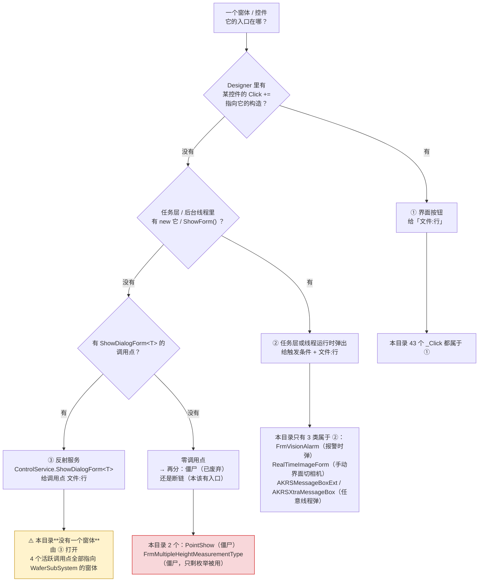

| 类名 | 文件 | `文件:行` | 打开它的入口 | 类别 |
|---|---|---|---|---|
| `FrmAlarmHistoryQuery` | `Controls/Common/FrmAlarmHistoryQuery.cs` | `:19` | `Main/Controls/Ucmain/MainControls/UcMainSystem.cs:1525`；关窗被 `OnFormClosing` 拦成 `Hide()`（`.cs:88-89`） | **①** |
| `FrmEntityOffsetChange` | `Controls/Common/FrmEntityOffsetChange.cs` | `:29` | `UcMainSystem.cs:1506`；`BondSystem/Controls/Assistant/FrmComponentPlacement.cs:780` | **①** |
| `FrmRepository<T>` | `Controls/Currency/FrmRepository.cs` | `:19` | **15 个外部文件**（本目录内无调用） | **①** |
| `FrmVisionAlarm` | `Controls/Currency/FrmVisionAlarm.cs` | `:35` | `Main/Controls/Ucmain/MainControls/UcMainSystem.Action.cs:247`、`:286` —— **定位失败的运行时弹出**，界面上没有对应按钮 | **②** |
| `PointShow` | `Controls/Currency/PointShow.cs` | `:11` | **零调用点** | **僵尸** |
| `RealTimeImageForm` | `Controls/Currency/RealTimeImageForm.cs` | `:13` | 饿汉单例（`.cs:18`）；`UcGuideMove.cs:694` →`ShowVision() :650`→`ShowForm()`；`UcMainSystem.Action.cs:182`、`:326` | **① + ②** |
| `FrmBondheadStandardMeasurement` | `Controls/Feature/MeasuringTool/FrmBondheadStandardMeasurement.cs` | `:22` | `UcMeasuringTool.cs:93` | **①** |
| `FrmDistanceMeasureResult` | `.../FrmDistanceMeasureResult.cs` | `:8` | `FrmDistanceMeasurement.cs:176`（构造里即填值） | **①** |
| `FrmDistanceMeasurement` | `.../FrmDistanceMeasurement.cs` | `:24` | `UcMeasuringTool.cs:75` | **①** |
| `FrmMeasureHeightPoints` | `.../FrmMeasureHeightPoints.cs` | `:24` | `UcMeasuringTool.cs:65`（**`Show()` 非模态**，无人持有引用） | **①** |
| `FrmMultipleHeightMeasurement` | `.../FrmMultipleHeightMeasurement.cs` | `:20` | `UcMeasuringTool.cs:52` | **①** |
| `FrmMultipleHeightMeasurementType` | `.../FrmMultipleHeightMeasurementType.cs` | `:11` | **窗体零调用点**（真正在用的是 `TransportUnitSystem/Controls/Assistant/FrmChooseMeasureHeightType.cs:26`）；只有它内部的 `enum MultipleHeightMeasurementType` 被 8 个文件 `using static` 引用 | **僵尸（半）** |
| `UcAddOffset` | `Controls/Common/UcAddOffset.cs` | `:25` | `FrmEntityOffsetChange.cs:34`、`:39`、`:49` | **①** |
| `UcAlarmHistory` | `Controls/Common/UcAlarmHistory.cs` | `:22` | `FrmAlarmHistoryQuery.cs:62`；`SupportFeature/Statistics/FrmStatistics.cs:55` | **①** |
| `UcDefect` | `Controls/Common/UcDefect.cs` | `:13` | `FrmEntityOffsetChange.cs:44` | **①** |
| `BaseControl` | `Controls/Currency/BaseControl.cs` | `:12` | `Main/Controls/UcModule.cs:31`、`UcHardwareEditor.cs:19`、`UcUserManager.cs:13`、`UcMainSystem.cs:142`（**都是上转型持有**） | **①（框架）** |
| `UcGuideMove` | `Controls/Currency/UcGuideMove.cs` | `:33` | **106 个外部文件**；本目录内 `FrmDistanceMeasurement.cs:180`、`FrmMultipleHeightMeasurement.cs:135` | **①** |
| `UcLampRegulation` | `Controls/Currency/UcLampRegulation.cs` | `:11` | `UcMainSystem.cs:1109`、`:1125` | **①** |
| `UcLight` | `Controls/Currency/UcLight.cs` | `:14` | `UcLampRegulation.Designer.cs` 内嵌 **8 次** | **①（内嵌）** |
| 6 个说明页（`UcComponentsDescription` 等） | `Controls/Feature/EditProgram/*.cs` | 各 `:6` | `UcEditProductProgramming.cs:579`/`:619`/`:646`/`:690`/`:712`/`:792` | **①** |
| `UcConfiguration1` | `.../UcConfiguration1.cs` | `:10` | `UcEditProductProgramming.cs:585` | **①** |
| `UcConfiguration2` | `.../UcConfiguration2.cs` | `:20` | `UcEditProductProgramming.cs:599` | **①** |
| `UcFlipToolsDescreption` | `.../UcFlipToolsDescreption.cs` | `:16` | `UcEditProductProgramming.cs:671`（`RefreshControl()` 全体被注释 → **空白页**） | **①** |
| `UcEditProductProgramming` | `.../UcEditProductProgram/UcEditProductProgramming.cs` | `:82` | `UcMainSystem.cs:398` | **①** |
| `UcMeasuringTool` | `Controls/Feature/MeasuringTool/UcMeasuringTool.cs` | `:22` | `Main/Controls/Ucmain/MainControls/UcMainSystem.Manual.cs:188` | **①** |
| `AKRSMessageBoxExt` | `Controls/Currency/AKRSMessageBoxExt.cs` | `:27` | **127 个外部文件**（`grep -rl -w` 命中 129 个，减去它自己的声明文件、再减去 1 个**幽灵文件** `DispenseSystem/Services/System2ActionNodesService.cs`），全部是**代码调用**（报警 / 确认 / 权限不足），**不经任何按钮** | **②** |
| `AKRSXtraMessageBox` | `Controls/Currency/AKRSXtraMessageBox.cs` | `:23` | **279 个外部文件**（`grep -rl -w` 命中 280 个，减去它自己的声明文件；**零幽灵文件命中**），同上 | **②** |
| `TextOverlayPainter` | `Controls/Common/TextOverlayPainter.cs` | `:12` | 全项目唯一引用是 `Utils/ControlHelper.cs:49` —— 而 `:49` 位于 **`ShowOverlayAsync`（`:41`–`:77`）内部，该方法 0 个活调用点**（2 处被注释）⇒ **有效入口 0** | **僵尸** |

> **三个必须说清的点**：
> 1. **本目录没有一个窗体由 `ShowDialogForm<T>` 打开。** 该反射服务的 4 个活跃调用点全部指向
>    `WaferSubSystem` 的窗体（`FrmComponentGeometryWithWaferTeach.cs:225`、`UcComponentEdit.cs:1203`、
>    `WaferSubSystemTask.cs:833`、`:872`）。本目录是**提供者**，不是**使用者**。
> 2. **`FrmVisionAlarm` 是"界面按钮找不到"的典型**：它由定位失败时的**任务流程**弹出，
>    操作员在界面上找不到打开它的按钮 —— 这不是"零调用点"，是**第 ② 类入口**。
> 3. **有 3 个处理器的接线本身是坏的**（点了没反应），登记在 §4.2 的备注列：
>    `BtnBondheadStandardMeasurement_Click`（`UcMeasuringTool.cs:86`，Designer 无 `Click +=`）、
>    `UcGuideMove.BtVision_Click`（`UcGuideMove.cs:664`，Designer 接的是 `BtVision_Click_1` `:694`）、
>    `UcLight.TbLight_MouseUp`（`UcLight.cs:402`，Designer 只接 `EditValueChanged`）。

### 4.2 按钮总表

**口径**：`_Click` 定义 = `grep -rn "void .*_Click(" --include=*.cs .` 排除 Designer ⇒ **43 条 / 36 个唯一方法名**；
Designer 里的全部事件接线 = **105 条**。两边的差额包含"有定义无接线"（3 处死处理器）与"非 `_Click` 命名"（共 22 个）。

#### 4.2.1 `Controls/Common/UcAddOffset.cs`（9 个 `_Click` + 3 个 `CheckedChanged` + 1 个 `Load`）

| 控件 | 文字 | 处理器 | `文件:行` | 做了什么 | 坑 |
|---|---|---|---|---|---|
| `BtUp` | "上移" | `BtAdd_Click` | `.cs:221`（接线 `Designer.cs:76`） | `SpValueY.Value += GetOffset()` | **叫 Up 却改 Y**（不是 Z） |
| `BtDown` | "下移" | `BtDe_Click` | `.cs:231`（`:86`） | `SpValueY.Value -= GetOffset()` | 方法名少一个 w |
| `BtLeft` | "左移" | `BtLeft_Click` | `.cs:241`（`:96`） | `SpValueX.Value -= GetOffset()` | — |
| `BtRight` | "右移" | `BtRight_Click` | `.cs:251`（`:106`） | `SpValueX.Value += GetOffset()` | — |
| `BtAngleAdd` | "角度" | `BtAngleAdd_Click` | `.cs:261`（`:153`） | `SpValueAngle.Value += GetOffset()/10.0` | 点胶配置下被 `Visible = false`（`.cs:105`） |
| `BtAngleDe` | "角度" | `BtAngleDe_Click` | `.cs:271`（`:163`） | 同上 `-=` | — |
| `BtSure` | "保存" | `BtSure_Click` | `.cs:281`（`:265`） | 三分支写回 + 落盘（见 **L-10**） | `config` 为 null/其它类型时**静默无动作** |
| `BtHeightAdd` | 构造改成 `"高\n度\n增\n加"` | `BtHeightAdd_Click` | `.cs:369`（`:306`） | `SpHeight.Value += GetOffset()` | 按钮文字在构造里被改写（`.cs:33-35`） |
| `BtHeightDe` | `"高\n度\n降\n低"` | `BtHeightDe_Click` | `.cs:379`（`:317`） | `SpHeight.Value -= GetOffset()` | — |
| `Ck1um`/`Ck5um`/`Ck10um` | 精度档 | `Ck1um_CheckedChanged` 等 | `.cs:179`/`:193`/`:207`（接线 `:242`/`:233`/`:224`） | 勾一个清另外两个 | **三档互斥没用 `RadioGroup`**，靠三个 handler 互清 |
| 自身 | — | `FrmAddOffset_Load` | `.cs:147`（`:378`） | 只做 `Ck1um.Checked = true` | **方法名写 `Frm`，类其实是 `Uc`**（复制粘贴） |

#### 4.2.2 `Controls/Common/UcAlarmHistory.cs`（2 个 `_Click` + 1 个 `Load`）

| 控件 | 文字 | 处理器 | `文件:行` | 做了什么 |
|---|---|---|---|---|
| `BtQuery` | "查询" | `BtQuery_Click` | `.cs:84`（`:310`） | `Init()` `:47` → `DBService.Query<AlarmLogEntity>` `:52` → 绑 `gridControl1` + 按 `Category` 归类计数绑 `gridControl2`。⚠️ 数据库故障时 `DBService` 内部 `catch` 后返回空集合 → **界面显示"0 条"，不报错**（`R-01`） |
| `BtExport` | "导出" | `BtExport_Click` | `.cs:94`（`:319`） | 见 **L-09**（`.xls` 内容存成 `.xlsx`）；⚠️ `catch` 里丢掉 `ex.Message` |
| 自身 | — | `UcAlarmHistory_Load` | `.cs:37`（`:368`） | 起止时间默认今天 0 点 ~ 明天 0 点（`:39-42`），再 `Init()` |

#### 4.2.3 `Controls/Common/UcDefect.cs`（1 个 `_Click`）

| 控件 | 文字 | 处理器 | `文件:行` | 做了什么 |
|---|---|---|---|---|
| `BtSure` | "保存" | `BtSure_Click` | `.cs:89`（`:481`） | try 内把 9 个 SpinEdit 值**除 1000 转 mm**写回 `postBondInspection`（`:93-108`）→ `PostBondInspectionRepository...Save()`（`:110`）→ 弹"保存成功"；`catch` 弹 `exception.Message`（`:116`）。**本目录少数几处给保存加了 try/catch 的地方**（`R-64` ✅）。⚠️ `PostBondEpoxyArea[0]` 的读写全被注释并标 `//// 有问题`（`:48-49`、`:97-98`）→ **胶量面积界面不显示也不落盘，保存时被旧值覆盖**（`R-35`） |

#### 4.2.4 `Controls/Common/FrmEntityOffsetChange.cs`（无 `_Click`，4 个 `SelectedIndexChanged` + 1 个 `Load` + 1 个空方法）

| 控件 | 处理器 | `文件:行` | 做了什么 |
|---|---|---|---|
| 自身 Load | `FrmEntityOffsetChange_Load` | `.cs:78`（`Designer:356`） | 按 `TransportUnitConfig.IsOppositeSex` 决定数据源填三个下拉（`:80-98`）→ 无条件填 `CmbDefectName`（`:116-119`）→ **`SelectedIndex = 0` 连锁触发下面的 handler**（`:121-139`） |
| `CmbBpName` | `CmbBpName_SelectedIndexChanged` | `.cs:147`（`Designer:284`） | 按名字 `Find` 出配置 → `frmAddOffsetBp.SetOffset(config)`（`:155`/`:165`） |
| `CmbEpName` | `CmbEpName_SelectedIndexChanged` | `.cs:175`（`Designer:154`） | 按系统取 `BondProgram` 或 `System1Program` → `frmAddOffsetDs.SetOffset(epoxy)` |
| `CmbDefectName` | `CmbDefectName_SelectedIndexChanged` | `.cs:204`（`Designer:337`） | `frmAddOffsetPb.PostBondEdit(postBondInspection)` |
| `CmbDispenseBondName` | `CmbDispenseBondName_SelectedIndexChanged` | `.cs:230`（`Designer:223`） | 与 `CmbBpName` 同源，传 `isBond: false` |
| `xtraTabControl1` | `xtraTabcontrol1_SelectedPageChanged` | `.cs:220`（`Designer:101`） | **空方法体** |

#### 4.2.5 `Controls/Common/FrmAlarmHistoryQuery.cs`（1 个 `Load` + 1 个 `override`）

| 控件 | 处理器 | `文件:行` | 做了什么 |
|---|---|---|---|
| 自身 Load | `FrmAlarmHistoryQuery_Load` | `.cs:60`（`Designer:43`） | `new UcAlarmHistory()` 填满窗体（`:62-65`）。⚠️ `this.queryControl.Dock = DockStyle.Fill;` **连写两遍**（`:63-64`） |
| 自身 | `OnFormClosing` override | `.cs:81` | `CloseReason.FormOwnerClosing` 时放行，否则 `e.Cancel = true; this.Hide()`（`:88-89`）→ **用户点 X 关不掉，只隐藏** |

#### 4.2.6 `Controls/Currency/FrmRepository.cs`（4 个 `ItemClick` + 6 个其它）

| 控件 | 文字 | 事件 | 处理器 | `文件:行` | 做了什么 |
|---|---|---|---|---|---|
| `BarBtCreateNew` | "新建(复制选中的)" | ItemClick | `BarBtCreateNew_ItemClick` | `.cs:113`（`Designer:107`） | 开 `FrmCreateName` 模态（`:115`），挂本地 `ValidatePredicate`（非空 / 不重名 / 不含 `Path.GetInvalidFileNameChars()`，`:117-138`）；OK 后用 **`JsonFormatHelper<T>.DeepGenericCopy<T>(t)` 深拷贝**（`:156-157`）→ `AddBelongRecipeIds()`（`:164`）→ `baseSettingRepository.Add(newT)`（`:166`）→ `RefreshData()`。**只进内存，不落盘** |
| `BarBtDelete` | "删除" | ItemClick | `BarBtDelete_ItemClick` | `.cs:178`（`:115`） | 见 **L-11**。🔴 `t` 可能为 null → `:193` NRE（`R-16`） |
| `BarBtSave` | "保存" | ItemClick | `BarBtSave_ItemClick` | `.cs:221`（`:123`） | `baseSettingRepository.Save()`（`:223`）→ 弹英文 `"Saved  Successfully!"`。**本窗体唯一的显式落盘点** |
| `BarBtExtract` | "导入" | ItemClick | `BarBtExtract_ItemClick` | `.cs:273`（`:132`） | 见 **L-12**。⚠️ **无条件弹"成功"**，`is T t` 失败时也弹 |
| `ChkIncludeAll` | — | CheckedChanged | `ChkIncludeAll_CheckedChanged` | `.cs:233`（`:209`） | `RefreshData()` |
| `TxtName` | — | EditValueChanging | `TxtName_EditValueChanging` | `.cs:243`（`:218`） | **每次按键都全量重查** → 大列表会卡 |
| `GvRepository` | — | RowClick | `GvRepository_RowClick` | `.cs:253`（`Designer:253`） | 仅 `e.Clicks == 2`（双击）时：`DsSetting = t` → `AddBelongRecipeIds()` → `action?.Invoke()`（`:259-261`）。**单击无反应** |
| `Timer1` | — | Tick | `Timer1_Tick` | `.cs:307`（`Designer:294`；`Enabled = true` `:292`，**无 `Interval`** → .NET 默认 100 ms） | 据 `GetFocusedDisplayText()` 是否为 `"No Reference"` 置 `BarBtDelete.Enabled`/`BarBtExtract.Enabled`（`:310-311`）—— **哨兵行不可删、不可导入** |
| 自身 | — | FormClosed | `FrmRepository_FormClosed` | `.cs:294`（`Designer:309`） | `CloseEditor()` + `UpdateCurrentRow()` + **`baseSettingRepository.Save()`（`:299`）** ⇒ **关窗即落盘**（L-13） |
| 自身 | — | FormClosing | `FrmRepository_FormClosing` | `.cs:319`（`Designer:308`） | `Timer1.Tick -= Timer1_Tick; Timer1.Dispose()`。**不 Dispose 窗体、不 Dispose Grid** |
| 自身 | — | Load | `FrmRepository_Load` | `.cs:82`（`Designer:310`） | `RefreshData()` + `ClearSelection()` |

#### 4.2.7 `Controls/Currency/FrmVisionAlarm.cs`（5 个 `_Click` + 4 个其它）

| 控件 | 文字 | 处理器 | `文件:行` | 做了什么 |
|---|---|---|---|---|
| `BtOK` | "确认完成"（运行期可能改成 "OK" `.cs:312`） | `BtOK_Click` | `.cs:339`（`Designer:67`） | 见 **L-15**。🔴 **UI 线程 `while (isWork) Thread.Sleep(100)`**（`:344-347`）；`:398-405` 是**死代码**（`:364` 已提前 `return`） |
| `BtAbort` | "停止" | `BtAbort_Click` | `.cs:415`（`:77`） | `Machine.GetInstance().Stop()` → `DialogResult = Abort` |
| `BtEditProgram` | "编辑模板" | `BtEditProgram_Click` | `.cs:426`（`:105`） | 见 **L-16**。🔴 `Pause()`（`:436`）与 `Continue()`（`:495`）**不在 `try/finally` 里** → 中间任何异常都会让整机停在暂停态（`R-80`） |
| `BtSkip` | "跳过" | `BtSkip_Click` | `.cs:505`（`:115`） | 只 `DialogResult = Ignore` |
| `BtReDispense` | "补胶"（运行期可变 "Retry"/"提前换料"/"下一颗" `.cs:316/321/327`） | `BtReDispense_Click` | `.cs:565`（`:144`） | 只 `DialogResult = Retry` |
| 自身 | — | `FrmVisionAlarm_Load` | `.cs:273`（`:164`） | 设标题（先 `caption` 后被 `entity.GetName()` 覆盖 `:275`/`:285`）、`Alarm()` `:287` 置二级报警灯、按 `AlgFlowType`/`CameraName`/`caption` **动态改按钮可见性与文字**（`:296-329`）、最后 `isAllowWork = true` |
| 自身 | — | `FrmVisionAlarm_FormClosing` | `.cs:555`（`:162`） | `isclose = true`（通知后台线程退出） |
| 自身 | — | `FrmVisionAlarm_FormClosed` | `.cs:515`（`:163`） | `CloseAlarm()` + **UI 线程自旋 `while (task.Status == Running) Thread.Sleep(10)`**（`:518-521`）。⚠️ `CloseAlarm()`（`:541-548`）**除空值检查外方法体是空的** → **报警灯不会被清掉**（`R-05`） |
| `TimerVision`（**Designer 里无此组件**） | — | `TimerVision_Tick` | `.cs:104` | **死代码**（无接线、无组件）。内容与 `BackgroundWorkerDoWork()`（`:135`）重复 |

#### 4.2.8 `Controls/Currency/RealTimeImageForm.cs`（1 个 `Load` + 1 个 `Tick` + 2 个关窗）

| 控件 | 处理器 | `文件:行` | 做了什么 |
|---|---|---|---|
| 自身 Load | `RealTimeImageForm_Load` | `.cs:70`（`Designer:52`） | `TopMost = true`；new 出平台 `UcImageView` 填满（`:73-75`） |
| `timer1` Tick | `Timer1_Tick` | `.cs:96`（`Designer:39`；`Enabled = true` `:37`，无 `Interval` → 100 ms） | 每 100 ms 调 Win32 **`EnableWindow(this.Handle, true)`**（`[DllImport("User32.dll")]` `.cs:62-63`）—— **把窗体输入强行保持使能**，抵消外部对它的 disable |
| 自身 FormClosing | `RealTimeImageForm_FormClosing` | `.cs:106`（`:50`） | `timer1.Stop()` + 退订 + `Dispose()` |
| 自身 FormClosed | `RealTimeImageForm_FormClosed` | `.cs:83`（`:51`） | `ucImageView.Dispose()`。⚠️ **窗体本身没 Dispose**（因为它是静态单例，`.cs:18`） |

#### 4.2.9 `Controls/Currency/UcGuideMove.cs` + `.Joystick.cs`（2 个 `_Click` + 7 个其它）

| 控件 | 文字 | 事件 | 处理器 | `文件:行` | 做了什么 |
|---|---|---|---|---|---|
| `BtnJoystick` | "摇杆" | Click | `BtnJoystick_Click` | `.Joystick.cs:594`（`Designer:232`） | 见 **L-01**（本目录风险最集中） |
| `BtVision` | "相机实时界面" | Click | `BtVision_Click_1` | `.cs:694`（`Designer:245`） | 单句 `this.ShowVision()`（`:696`）→ `RealTimeImageForm.ShowForm()` |
| `BtVision`（同名旧版） | — | Click | `BtVision_Click` | `.cs:664` | **死代码**（Designer 未接）。**两个同名近亲方法，改错一个不报错** |
| `rGSpeedMode` | 三档 | SelectedIndexChanged | `rGSpeedMode_SelectedIndexChanged` | `.Joystick.cs:735`（`Designer:219`） | `this.maxVel = Convert.ToInt32(rGSpeedMode.EditValue)`（`:737`）。三档值在 `InitControl()`（`.cs:702`）写死：**低速 = 1 / 中速 = 50 / 高速 = 80**（`:712-728`），默认 `SelectedIndex = 1`。🔴 **"低速 = 1"与中速差 50 倍** |
| `CbChangeModule` | 模块下拉 | SelectedIndexChanged | `CbChangeModule_SelectedIndexChanged` | `.cs:517`（`Designer:312`） | 见 **L-02** |
| `TbExposure` | 曝光 | EditValueChanged | `TbExposure_EditValueChanged` | `.cs:674`（`Designer:140`） | **能生效**：把滑条值灌进 `SpExposure`（`:678`）后 `camera.SetExposureTime((int)SpExposure.Value)`（`:679`）。⚠️ 但**同名近亲 `SetExposureTime()`（`:686`，无参、私有）方法体被整段注释**（`:690` 一行 `//this.TbExposure.Value = (int)this.camera.GetExposureTime();`）⇒ 这个"初始化滑条"的辅助方法**什么也不做**，所以**切模组时曝光滑条不会回填相机当前值**。两个名字一个能用一个空，**这正是本目录"同名近亲"陷阱的又一个实例** |
| `TbGain` | 增益 | EditValueChanged | `TbGain_EditValueChanged` | `.cs:841`（`Designer:508`） | 把滑条值写回相机增益 |
| `TbGama` | Gamma | EditValueChanged | `TbGama_EditValueChanged` | `.cs:852`（`Designer:437`） | `gamma = TbGama.Value / 10`（`:854`）后写回相机 |
| `Timer` | — | Tick | `Timer_Tick` | `.cs:556`（`Designer:101`；`Enabled = true` `:98`，无 `Interval` → 100 ms） | 见 **L-03**（100 ms 坐标刷新，全项目使用面最广的定时器） |
| 自身 Load | — | Load | `UcGuideMove_Load` | `.cs:158`（`Designer:523`） | 按相机设 TrackBar 上下限 → 回填曝光/增益 → **`this.TbGama.Value = 40` 硬编码**（`:172`） |

> **`UcGuideMove` 里没有任何 `MouseDown`/`MouseUp`/`MouseMove`/`KeyDown` 处理器。**
> 全目录里 `MouseUp` 唯一命中是 `UcLight.cs:402`（死代码）。
> **方向盘的"按住走、松开停"由平台 DLL `Galaxy2.Component.Simple.MoveControl.UcMoveControl` 自己处理（无源码）**，
> 本目录只以 `axis.UpdateVelOnLine` / `axis.StopMove` 与摇杆线程体现它。
> *（推断：该控件在本目录只暴露 `Init(AxisConfig, string)` / `SetMoveSpeed(int)` / `Enabled` / `IsMoving` / `ClickTitleButton(string)`；
> 依据是 `JoystickBindHardware()` 把 `axisConfig` 传给了 `ucMoveControl.Init`（`.Joystick.cs:943`）。）*

#### 4.2.10 `Controls/Currency/UcLampRegulation.cs` + `UcLight.cs`（1 个 `_Click` + 3 个其它 + 2 个死点）

| 控件 | 文字 | 事件 | 处理器 | `文件:行` | 做了什么 |
|---|---|---|---|---|---|
| `BtCloseLight` | "关闭所有灯光" | Click | `BtCloseLight_Click` | `UcLampRegulation.cs:49`（`Designer:182`） | 见 **L-20**（8 路光源依次 `CloseLight()`；⚠️ 先降到 10 再降到 0，多出 6 次硬件写） |
| `TbLight` | — | EditValueChanged | `TbLight_EditValueChanged` | `UcLight.cs:207`（`Designer:74`，`Maximum = 100` `:69`） | 节流判据 `(DateTime.Now - changeLightTime).Milliseconds > 10`（`:209`）🔴 **用的是 `TimeSpan.Milliseconds`（0~999 毫秒分量）而非 `TotalMilliseconds`** → 节流基本失效（`R-13`）；通过后**只把值传给 `SpIntensity`**（`:219`），不直接改硬件 |
| `SpIntensity` | — | EditValueChanged | `SpIntensity_EditValueChanged` | `UcLight.cs:228`（`Designer:96`） | 非负钳位 → `ChangeAllIntensity((int)this.TbLight.Value)`（`:239`，🔴 **取滑条旧值**，`R-11`）→ 反写 `TbLight.Value = (int)SpIntensity.Value`（`:242`）。见 **L-19** |
| `imageComboBoxEdit1` | 颜色下拉 | SelectedIndexChanged | `ImageComboBoxEdit1_SelectedIndexChanged` | `UcLight.cs:329`（`Designer:120`） | 按 `SelectedIndex` 0~7 **把三路光强硬写成 0 或 90**（`:336-391`）⇒ **打开该控件即把光源设为 90**。🔴 索引 7 落进 `else if` 末分支（`:385`）**当 `White` 处理**，而 `CorrectLightColorTypeAndIntensity()` 里索引 7 是 `Customize`（`:148`）→ **同一索引两处语义不一致**（`R-14`；枚举索引 6 = `White`、7 = `Customize`，见 §3.1） |
| `TbLight` | — | MouseUp | `TbLight_MouseUp` | `UcLight.cs:402` | **死代码**（Designer 只接了 `EditValueChanged`） |
| 自身 | — | — | `CorrectLightColorTypeAndIntensity()` | `UcLight.cs:94` | **全项目零调用**（`grep` 仅命中定义行）⇒ "回读光源实际亮度反推颜色"的能力从未被使用，界面打开时颜色下拉永远停在 Designer 默认值 |

#### 4.2.11 `Controls/Feature/EditProgram/UcConfiguration1.cs` / `UcConfiguration2.cs`

| 控件 | 事件 | 处理器 | `文件:行` | 做了什么 |
|---|---|---|---|---|
| `UcConfiguration1` 自身 | Load | `UcConfigration_Load` | `UcConfiguration1.cs:25`（`Designer:291`） | 把两个 Label 置空（`:31-32`）；三个 DataSource 赋值被注释（`:27-29`）。⚠️ **类名 `UcConfiguration1`、handler 名 `UcConfigration_Load`（少一个 u）** |
| `UcConfiguration1` | `IProgrammingControl.Confirm()` | `Confirm` | `UcConfiguration1.cs:38` | **空方法体** ⇒ 在编程界面选到它点 Save，**什么也没提交** |
| `UcConfiguration2.treeList`（代码 `new`，非 Designer） | FocusedNodeChanged | `TreeList1_FocusedNodeChanged` | `UcConfiguration2.cs:111`（接线 `.cs:103`） | 取 `this.list[e.Node.Id]` → 记 `selectNodeParentIndex`/`selectNodeChildrenIndex`（`:113-115`）。⚠️ **这两个字段此后从未被读**（`grep` 仅这 3 行）→ 只写不读的死字段（`R-60` 的更正） |
| `UcConfiguration2` 构造 | — | `RefreshControl()` | `UcConfiguration2.cs:28` → `:72` | 见 **L-23**。🔴 `InitializeTreeComponent()` 每次调用都 `+= TreeList1_FocusedNodeChanged`（`:103`）→ **重复订阅** |

#### 4.2.12 `Controls/Feature/EditProgram/UcEditProductProgram/*`（5 个 `_Click` + 5 个其它）

| 控件 | 文字 | 事件 | 处理器 | `文件:行` | 做了什么 |
|---|---|---|---|---|---|
| `BtStart` | "Start" | Click | `BtStart_Click` | `.cs:870`（`designer.cs:482`） | `(selectedControl as IProgrammingControl)?.Confirm()` → `this.Start(true)`。见 **L-04** |
| `BtSave` | "Save" | Click | `BtSave_Click` | `.cs:1067`（`designer.cs:449`） | 只调子控件 `Confirm()` 再弹"保存成功"；**本类自己不落盘**。⚠️ `catch` 只弹消息不记日志 |
| `BtReset` | **Designer 未设 `Text`** | Click | `BtReset_Click` | `.cs:937`（`designer.cs:460`） | 见 **L-05**（一次点击最多 9 次落盘；`:960`/`:973`/`:986` 三处 NRE 风险） |
| `BtClose` | "Close" | Click | `BtClose_Click` | `.cs:924`（`designer.cs:471`） | `this.ParentForm?.Close();` → **`Machine.GetInstance().SetState(MachineStateEnum.Stop);`**（`:926-927`）⇒ **关窗即让整机进入 Stop** |
| `BtSkip` | **Designer 未设 `Text`；Designer 里根本没有 `BtSkip` 控件** | Click | `BtSkip_Click` | `.cs:2099` | **空方法体**；`grep -n "BtSkip" UcEditProductProgramming.designer.cs` **无命中** ⇒ **断链**（本该有入口） |
| `ILstAssistantStep` | 示教步骤列表 | SelectedIndexChanged | `LstAssisantStep_SelectedIndexChanged` | `.cs:902`（`designer.cs:101`） | **空方法体**。切右侧子控件的实际是 `TreeListProgramming_FocusedNodeChanged` |
| `ILstAssistantStep` | — | DrawItem | `LstAssisantStep_DrawItem` | `.cs:911`（`designer.cs:102`） | 选中项背景涂 `Color.Aquamarine`（`:913-918`） |
| `TreeListProgramming` | 20 个 NavBar 分组节点 | FocusedNodeChanged | `TreeListProgramming_FocusedNodeChanged` | `.cs:453`（`designer.cs:174`） | 见 **L-14**（25 个 case 的子控件工厂；🔴 `Controls.Clear()` 不 `Dispose()` → 泄漏） |
| `CmbSystem` | `EditValue = "System2"` | SelectedIndexChanged | `CmbSystem_SelectedIndexChanged` | `.cs:882`（`designer.cs:226`） | 改 `CurrentMachineSystem` → `SortNodesUI()`（`:425`）重排树节点。⚠️ `_Load` 里在特定机型下会把 `CmbSystem` 隐藏（`.cs:1128-1141`） |
| 自身 | — | Load | `UcEditProductProgramming_Load` | `.cs:1086`（`designer.cs:499`） | ① 给 **6 个静态委托**挂本实例方法（`.cs:1090-1105`）；② 未配置点胶/胶量时摘掉对应节点（`:1106-1117`）；③ 摘掉 `FlipTool` 节点（`:1119-1126`）；④ 隐藏 `CmbSystem`（`:1128-1141`）。🔴 ①是**订阅了但没有退订**的静态委托 ⇒ 窗体销毁后委托仍指向已 `Dispose` 的控件 |

#### 4.2.13 `Controls/Feature/MeasuringTool/UcMeasuringTool.cs`（6 个 `_Click` + 1 个 Tick + 1 个 Load）

| 控件 | 文字 | 处理器 | `文件:行` | 做了什么 | 备注 |
|---|---|---|---|---|---|
| `BtMultipleHeightMeasurement` | "多功能测高" | `BtMultipleHeightMeasurement_Click` | `.cs:48`（`Designer:108`） | 见 **L-17** | — |
| `BtDistanceMeasurement` | "距离测量" | `BtDistanceMeasurement_Click` | `.cs:73`（`Designer:97`） | `new FrmDistanceMeasurement().ShowDialog()` → `Dispose()` | ⚠️ **不检查 `DialogResult` 就 Dispose** |
| `BtnBondheadStandardMeasurement` | **未设** | `BtnBondheadStandardMeasurement_Click` | `.cs:86` | `ChangeTouchDownAssistance()` 校验 → `ShowDialog()` → `Dispose()` | 🔴 **Designer 里没有该控件的 `Click +=`** ⇒ **按钮点了没反应**（`R-25`） |
| `BtnLevelMeasurement` | "焊头水平测试" | `BtnLevelMeasurement_Click` | `.cs:104`（`Designer:86`） | 同上模式 → `new FrmBondLevel().ShowDialog()` | — |
| `BtnSystem2FlatLevelMeasure` | "系统2水平测试" | `BtnSystem2FlatLevelMeasure_Click` | `.cs:122`（`Designer:76`） | 见 **L-18** | — |
| `BtnSystem1FlatLevelMeasure` | "系统1水平测试" | `BtnSystem1FlatLevelMeasure_Click` | `.cs:161`（`Designer:66`） | 直接开窗 | ⚠️ **没有 `ChangeTouchDownAssistance()` 前置校验**，与其它 4 条不对称 |
| `timer1` | — | `timer1_Tick` | `.cs:140`（`Designer:113`） | `switch (CurrentMachineSystem)` 使能系统1/系统2 按钮（`:142-153`） | 🔴 **Designer 里没有 `Enabled = true`**（其它 5 个 100 ms 定时器都有）⇒ **处理器永不执行**，系统1/系统2 按钮的自动互斥使能从来不生效（`R-61` ✅ 已核实接线存在、只是永不启） |
| 自身 Load | — | `UcMeasuringTool_Load` | `.cs:174`（`Designer:123`） | 未配系统1时禁用 `BtnSystem1FlatLevelMeasure`（`:176-179`） | 这是**唯一的**初始状态来源 |

#### 4.2.14 `Controls/Feature/MeasuringTool/FrmBondheadStandardMeasurement.cs`（1 个 `_Click` + 1 个 Tick + 1 个 FormClosing）

| 控件 | 文字 | 处理器 | `文件:行` | 做了什么 |
|---|---|---|---|---|
| `BtnStart` | "Start" | `BtnStart_Click` | `.cs:85`（`Designer:245`） | 见 **L-06**。🔴 `:105` `Task.Run` 里在**后台线程改控件颜色**（`:110`）；🔴 测高位置**硬编码**（`:122`）；🔴 关窗不等 Task（`:259`） |
| `timer1` | — | `timer1_Tick` | `.cs:249`（`Designer:66`；`Enabled = true` `:64`，100 ms） | 每 100 ms `RefreshControl()` 全量重绑 Grid（`:70-78`）。**结果只在内存**，无落盘 |
| 自身 | — | `FrmBondheadStandardMeasurement_FormClosing` | `.cs:259`（`Designer:337`） | 只处理计时器；**不等 `standardMeasurementTask`、也不 `MoveBondZToSafePos()`** |

#### 4.2.15 `Controls/Feature/MeasuringTool/FrmDistanceMeasurement.cs`（5 个 `_Click`）

| 控件 | 文字 | 处理器 | `文件:行` | 做了什么 | 备注 |
|---|---|---|---|---|---|
| `BtNext` | "Next" | `BtNext_Click` | `.cs:245`（`Designer:238`） | `assistantConfigList[stepIndex].NextAction()` → `stepIndex++` → `SetUIControl` | ⚠️ `stepIndex` 无上界检查（但第 2 步 `IsShowNext = false`，正常路径不可达） |
| `BtBack` | "Back" | `BtBack_Click` | `.cs:232`（`Designer:210`） | `BackAction()` → `stepIndex--` → `SetUIControl` | ⚠️ 无下界检查，第 1 步点到会 `ArgumentOutOfRangeException`（第 0 步 `IsShowBack = false`） |
| `BtDone` | "Done" | `BtDone_Click` | `.cs:258`（`Designer:224`） | `assistantConfigList[stepIndex].DoneAction()`；**全部业务逻辑在 lambda `:140-191` 里** | 见 **L-07** |
| `BtCancel` | "Cancel" | `BtCancel_Click` | `.cs:270`（`Designer:196`） | 问 `"End assistant?"` → Yes 才 `Close()` | — |
| `BtnObjectToCenter` | "Object  to  center" | `BtnObjectToCenter_Click` | `.cs:289`（`Designer:162`） | 复用 `FrmPRList` 字段：null/已 Dispose 就 new 再 `Show()`，否则 `Show()` | 🔴 **两个分支都是 `Show()`，`if/else` 完全等价** |
| `InitControl()` | — | — | `.cs:88`（构造里调 `:32`） | 建 2 步 `assistantConfigList` | 🔴 `:180` **`this.ucGuideMove1 = new UcGuideMove("距离测量")`** 把 Designer 字段整个换掉，**新对象既没加进 `Controls` 也没 Dispose 旧的** ⇒ 泄漏 + 界面上看不到 |

#### 4.2.16 `Controls/Feature/MeasuringTool/FrmMeasureHeightPoints.cs`（1 个 `_Click` + 3 个其它）

| 控件 | 文字 | 事件 | 处理器 | `文件:行` | 做了什么 |
|---|---|---|---|---|---|
| `simpleButton1` | "simpleButton1" | Click | `simpleButton1_Click` | `.cs:355`（`Designer:88`） | **两行**：`GetHardware<Sensor>("LVDT")`（`:357`）+ 一句注释掉的 `//int value = sendor.ReadTxPDO();`（`:358`）⇒ **点下去毫无反馈**（唯一读数是"注释"的调试残留，见 §9.5） |
| `BtContinuousMeasurement` | "Continuous measurement" | CheckedChanged | `BtContinuousMeasurement_CheckedChanged` | `.cs:326`（`Designer:121`） | 见 **L-08** |
| `timer1` | — | Tick | `timer1_Tick` | `.cs:230`（`Designer:144`；`Enabled = true` `:142`，100 ms） | `needFresh` 为真则重绑 Grid（`:232-242`）；并在 `thread` 不在时强制取消勾选（`:244-247`） |
| 自身 | — | Load | `FrmMeasureHeightPoints_Load` | `.cs:316`（`Designer:299`） | **空方法体** |
| 自身 | — | FormClosing | `FrmMeasureHeightPoints_FormClosing` | `.cs:366`（`Designer:297`） | 只处理计时器 |
| 自身 | — | FormClosed | `FrmMeasureHeightPoints_FormClosed` | `.cs:347`（`Designer:298`） | **`this.thread.Abort()`（`:351`）** ⇒ 强制终止后台线程（`R-20`） |

#### 4.2.17 `Controls/Feature/MeasuringTool/FrmMultipleHeightMeasurement.cs`（4 个 `_Click` + 2 个其它）

| 控件 | 文字 | 处理器 | `文件:行` | 做了什么 |
|---|---|---|---|---|
| `BtNext` | "Next" | `BtNext_Click` | `.cs:178`（`Designer:283`） | `assistantConfigList[0].NextAction()` → `SetUiControl()`；`NextAction`（`:124-128`）里 `MeasureHeightPoints.Add(TUAssistantHelper.GetPosBySystem(null, Type))` |
| `BtBack` | "Back" | `BtBack_Click` | `.cs:190`（`Designer:257`） | `BackAction()`（`:118-123`）里 **`RemoveAt(Count - 1)` → 空集合时 `ArgumentOutOfRangeException`** |
| `BtDone` | "Done" | `BtDone_Click` | `.cs:202`（`Designer:270`） | 再 Add 一个点 → `this.Close()`（`:205-206`） |
| `BtCancel` | "Cancel" | `BtCancel_Click` | `.cs:214`（`Designer:244`） | **`this.MeasureHeightPoints = null;`**（`:216`）→ `Close()`。调用方 `UcMeasuringTool.cs:60` 靠判 null 决定是否继续 |
| `simpleButton1`/`simpleButton2` | "Auto focus"/"Object to center" | — | — | **Designer 里没有 `Click +=`** ⇒ 两个哑按钮 |
| 自身 | — | `FrmMultipleHeightMeasurement_Load` | `.cs:52`（`Designer:335`） | 先弹 `FrmChooseMeasureHeightType`（`:54-56`）→ `InitControl()`（`:58`）→ `SetUiControl()`（`:59`）→ 🔴 **System1 时 `MoveToSafePos()` + `OpenDispenseHeightMeasurementCylinder()`（`:62-67`）⇒ 窗体一打开就让轴回安全位并开气缸** |
| 自身 | — | `FrmMultipleHeightMeasurement_FormClosed` | `.cs:220`（`Designer:334`） | `ucGuideMove.Dispose()`。⚠️ 若 `FrmChooseMeasureHeightType`（`:54-56`）抛异常则 `ucGuideMove` 仍为 null → **`FormClosed` 里 NRE**（关窗时再崩一次） |

#### 4.2.18 `Controls/Feature/MeasuringTool/FrmMultipleHeightMeasurementType.cs`（1 个 `_Click` + 1 个 EditValueChanged + 1 个 Load）

| 控件 | 文字 | 处理器 | `文件:行` | 做了什么 |
|---|---|---|---|---|
| `LueAdjustType` | 测高方式下拉 | `LueAdjustType_EditValueChanged` | `.cs:60`（`Designer:53`） | 🔴 **`this.Type = MultipleHeightMeasurementType.TouchDown;`（`:62`）—— 无论用户选了什么，都强制回 `TouchDown`** |
| `BtNext` | "Next" | `BtNext_Click` | `.cs:70`（`Designer:74`） | 只有 `this.Close()`（`:72`）。**根本没读 `LueAdjustType.EditValue`** |
| 自身 | — | `FrmMultipleHeightMeasurementType_Load` | `.cs:31`（`Designer:86`） | 用 `EnumHelper.ConvertEnumToNameDisplayDto<>` 填下拉，`EditValue = TouchDown`（`:33-34`） |
| `Type` 属性 | — | — | `.cs:24` | 默认 `TouchDown`，唯一写点就是上面那个 handler ⇒ **该窗体在功能上无法选出 `SubstrateCamera`**。因为窗体本身无人使用，实际影响是"任何人改用它都会踩这个坑" |

#### 4.2.19 三个"无任何处理器"的类型（登记在册，避免被误当成漏登记）

| 类型 | `文件:行` | 说明 |
|---|---|---|
| `FrmDistanceMeasureResult` | `.../FrmDistanceMeasureResult.cs:16` | 构造里直接 `Init()`（`:43`）填三个 Label（`LbDistance` 用 `Math.Sqrt(x²+y²)` `:48`）。**只读不写、无交互** |
| `PointShow` | `Controls/Currency/PointShow.cs:51` | `InitPoint(List<PointF>)` 重建 `ViewType.RadarPoint` 的 `Series`。**全项目零引用**（僵尸） |
| `UcFlipToolsDescreption` + 6 个 Description 页 | `.../UcFlipToolsDescreption.cs:27` | `RefreshControl()` 整体被注释（`:29-38`）⇒ **界面上那个 label 永远是 Designer 里的静态文字**。全部零 handler |
| `TextOverlayPainter` | `Controls/Common/TextOverlayPainter.cs:12` | `OverlayWindowPainterBase` 子类，SplashScreen 叠字。全项目零引用 —— 唯一引用方是 `Utils/ControlHelper.cs:49`，**位于 `ShowOverlayAsync`（`:41`）方法体内，而该方法 0 个活调用点** ⇒ 有效入口 0。（⚠️ 注意：**原因是这个"方法"死，不是"整个 `ControlHelper` 类"死** —— `ControlHelper.ShowForm<T>` 是活的，见 §4.26） |

#### 4.2.20 43 个 `_Click` 对账表

| 文件 | `_Click` 数 | 已登记 |
|---|---|---|
| `Controls/Common/UcAddOffset.cs` | 9 | ✅ |
| `Controls/Common/UcAlarmHistory.cs` | 2 | ✅ |
| `Controls/Common/UcDefect.cs` | 1 | ✅ |
| `Controls/Currency/FrmVisionAlarm.cs` | 5 | ✅ |
| `Controls/Currency/UcGuideMove.Joystick.cs` | 1（`BtnJoystick_Click`） | ✅ |
| `Controls/Currency/UcGuideMove.cs` | 1（`BtVision_Click`，**死**） | ✅ |
| `Controls/Currency/UcLampRegulation.cs` | 1 | ✅ |
| `Controls/Feature/EditProgram/UcEditProductProgram/UcEditProductProgramming.cs` | 5（`BtSave`/`BtSkip`/`BtStart`/`BtClose`/`BtReset`） | ✅ |
| `Controls/Feature/MeasuringTool/FrmBondheadStandardMeasurement.cs` | 1 | ✅ |
| `Controls/Feature/MeasuringTool/FrmDistanceMeasurement.cs` | 5 | ✅ |
| `Controls/Feature/MeasuringTool/FrmMeasureHeightPoints.cs` | 1 | ✅ |
| `Controls/Feature/MeasuringTool/FrmMultipleHeightMeasurement.cs` | 4 | ✅ |
| `Controls/Feature/MeasuringTool/FrmMultipleHeightMeasurementType.cs` | 1 | ✅ |
| `Controls/Feature/MeasuringTool/UcMeasuringTool.cs` | 6 | ✅ |
| **合计** | **43** | ✅ 与口径 A 完全一致 |

**三个"有定义无接线"的死处理器**（不是漏登记，是接线坏了或多余）：

| 处理器 | `文件:行` | 事实 | 定性 |
|---|---|---|---|
| `FrmVisionAlarm.TimerVision_Tick` | `Controls/Currency/FrmVisionAlarm.cs:104` | 全项目搜不到 `TimerVision.Tick +=`，**Designer 里也没有 `TimerVision` 组件** | **僵尸**（与 `BackgroundWorkerDoWork()` `:135` 重复） |
| `UcLight.TbLight_MouseUp` | `Controls/Currency/UcLight.cs:402` | Designer 只接 `TbLight.EditValueChanged`（`UcLight.Designer.cs:74`） | **僵尸**（`ChangeAllIntensity` 由 `SpIntensity_EditValueChanged` `:239` 到达） |
| `UcGuideMove.BtVision_Click` | `Controls/Currency/UcGuideMove.cs:664` | Designer 把 `BtVision` 接到 `BtVision_Click_1`（`UcGuideMove.Designer.cs:245`） | **僵尸**（同名近亲，改错一个不报错） |
| `UcMeasuringTool.BtnBondheadStandardMeasurement_Click` | `Controls/Feature/MeasuringTool/UcMeasuringTool.cs:86` | 处理器存在、方法体完整，但 **Designer 里没有 `Click +=`** | **断链**（本该有入口 —— 按钮文字也没设，见 `R-25`） |
| `UcEditProductProgramming.BtSkip_Click` | `.../UcEditProductProgramming.cs:2099` | 处理器存在但是**空方法体**，且 **Designer 里根本没有 `BtSkip` 这个控件** | **断链 + 空实现**（`R-26`） |
| `UcConfiguration2.TreeList1_FocusedNodeChanged` | `Controls/Feature/EditProgram/UcConfiguration2.cs:111` | **非 Designer 接线**，是代码里 `this.treeList.FocusedNodeChanged += ...`（`:103`） | **活代码**（但只在 `InitializeComponent` 之后接上；且每次刷新重复订阅，见 L-23） |

### 4.3 L-01 摇杆开关（本目录风险最集中的一条）

> **一句话**：`BtnJoystick` 是个**开关**（不是"进入摇杆界面"），点一下开、再点一下关。
> 开启时**每点一次都会把摇杆中点标定值写盘一次**（`.Joystick.cs:156`，值没变也写）；
> 开启后起一个 5 ms 周期的后台线程（`T7`），把摇杆模拟量换算成速度并**在线改速**。
> 这是本目录**唯一一条能让轴动起来、却完全没有软限位检查**的路径。

#### （1）主流程（图 8）

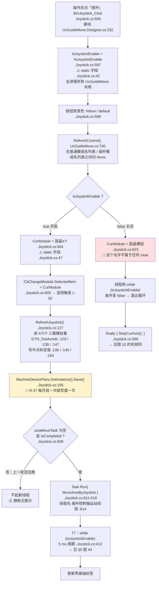

```
ASCII 等价（主干）

                 点「摇杆」
                      │
        IsJoystickEnable = !IsJoystickEnable      ← static，全进程共享
                      │
        ┌─────────────┴──────────────┐
     开启│                            │关闭
        │                            │
 CurModule = "固晶XY"          CurModule = "固晶模组"   ← 无任何 case 认识它
 RefreshJoystick()                    │
   ├ 读 X / Y / T 三路模拟量           │
   └ ★每点一次就 Save() 一次★          │   （关闭时没有任何落盘）
        │                             │
   起 5 ms 线程 ───► while(IsJoystickEnable) 变 false 退出
        │                             │
   轴开始跟手 ◄──── 松手回中 ───┐      └─► finally → StopCurAxis() ──► 图 10 死胡同
                               └──────────┘
```

#### （2）摇杆值 → 速度：唯一的换算点

`GetSpeedFromJoystick(Electric)`，`.Joystick.cs:164-295`。

| 环节 | `文件:行` | 事实 |
|---|---|---|
| 再读一次模拟量 | `.Joystick.cs:166` | `GTN_GetAuAdc(cardNum, io, out double pValue, ...)`（`gxn.dll`，无源码） |
| 缩放 | `.Joystick.cs:173` | `Math.Round(pValue, 6) * 1000.0` |
| 硬编码上下限 | `.Joystick.cs:176`/`:179` | `initialValUpperLimit = 2600`、`initialValLowerLimit = 2450`（行内残留注释 `/*2500*/`） |
| X 路分支 | `.Joystick.cs:191` | 上下限 = `joystickPara.XInitialVal ± BlindRange`；`range` 在 `:196` |
| X 路盲区 | `.Joystick.cs:200-204` | 落在盲区 → `joystickXState = Idle`（`:202`）→ **`return 0`**（`:204`） |
| X 路上升 / 下降 | `.Joystick.cs:206-216` | `offset = value - 上限` → `Rising`（`:208`/`:210`）；否则 `offset = value - 下限` → `Falling`（`:214`/`:216`） |
| Y 路分支 | `.Joystick.cs:223` | 🔴 **符号约定与 X 相反**：`Rising` 时 `offset = 上限 - value`（`:240`）、`Falling` 时 `offset = 下限 - value`（`:246`）—— 像是"Y 方向被整体反转过一次"的痕迹，改这里会同时影响所有用 `JoystickYRead` 的模组 |
| T 路分支 | `.Joystick.cs:254` | 与 X 同号（`:271`/`:272`、`:277`/`:278`） |
| 比例 | `.Joystick.cs:285` | `proPortion = offset / range` |
| **唯一的安全检查** | `.Joystick.cs:287-290` | `if (Math.Abs(proPortion) > 1.2) throw new Exception("...摇杆模拟量读取超过上界...请重新示教摇杆！")` —— ⚠️ 校验的是**模拟量比例**，不是轴位置。这是全链路上唯一的异常出口，异常会打掉整条 T7 线程（`R-17`） |
| 速度 | `.Joystick.cs:292` | `vel = proPortion * this.maxVel` |

**`maxVel` 有三个写点**（同一个字段被三处写）：

| 来源 | `文件:行` | 值 |
|---|---|---|
| 字段初值 | `.Joystick.cs:87` | `private double maxVel = 50` |
| 档位下拉 handler | `.Joystick.cs:735`（取值 `:739`） | `Convert.ToInt32(rGSpeedMode.EditValue)` |
| 三档数值写死处 | `UcGuideMove.cs:702`（`:712-728`） | **低速 = 1 / 中速 = 50 / 高速 = 80**，默认 `SelectedIndex = 1` |

🔴 **低速与高速相差 80 倍，中间没有过渡档**。从"低速"切到"中速"是 1→50 的突变，手感上像"低速坏了"。

#### （3）什么会让轴停？—— 逐帧判定（图 9，本文档最关键的一张图）

`AxisMoveAndUpdateVel(Axis, double vel, Electric)`，`.Joystick.cs:302-402`。每个 5 ms 帧都走一遍：

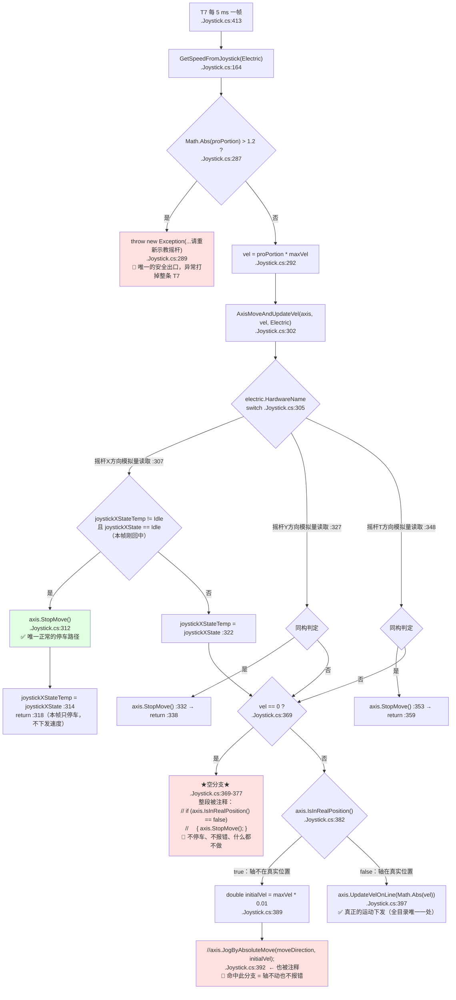

```
ASCII 等价（图 9）——「按住摇杆，什么会让它停？」

  每 5 ms 一帧
      │
  读模拟量 ──► |比例| > 1.2 ? ──是──► throw Exception（唯一安全闸，异常打掉整条线程）
      │                             否
      │◄─────────────────────────────┘
      │
  vel = 比例 × maxVel（低速 1 / 中速 50 / 高速 80）
      │
  按 Electric.HardwareName 分三路（X :307 / Y :327 / T :348）
      │
      ├─ 本帧刚回中？──是──► axis.StopMove()   ★唯一正常的停车路径★
      │        （Rising/Falling → Idle 触发，.Joystick.cs:312 / :332 / :353）
      │   否
      ▼
  vel == 0 ? ──是──► 【死分支 .Joystick.cs:369-377】
      │                 整段被注释 ⇒ 不停车、不报错、什么都不做
      │   否
      ▼
  axis.IsInRealPosition() ?
      ├─ true（轴不在真实位置）──► initialVel = maxVel * 0.01
      │         //JogByAbsoluteMove(...) 也**被注释**（:392）⇒ ★轴不动、无提示★
      └─ false（轴在真实位置）──► axis.UpdateVelOnLine(|vel|)  ← 唯一真正的运动下发
```

> **结论（本节最重要的结论）——`R-06`**：
> **摇杆运动链上没有任何软限位 / 行程 / 安全位置检查。**
> `MoveAxisByJoystick()`（`.Joystick.cs:407-587`）、`GetSpeedFromJoystick()`（`:164-295`）、
> `AxisMoveAndUpdateVel()`（`:302-402`）三个方法里**一处位置上下限判断都没有**；
> 唯一的检查是 `Math.Abs(proPortion) > 1.2`（`:287-290`），校验的是**模拟量比例**。
> **轴会不会撞机完全取决于平台 `Axis` 类自身的软限位**（`AKRS.Galaxy2.*`，本仓库无源码）。
> 交接时**不要**把"肯定有软限位兜底"当成已知事实——本目录无法证实（见附录 B）。

> **是 hold-to-run 还是 click-to-move？——hold-to-run（按住即动、连续调速）**
> 依据：T7 以 5 ms 周期不断读值并 `axis.UpdateVelOnLine`；只有状态由 `Rising`/`Falling` 回到 `Idle` 时才 `StopMove()`。
> **本目录 `UcGuideMove*` 三个文件里 grep 不到 `MouseDown` / `MouseUp` / `MouseMove` / `KeyDown`**，
> Designer 只接了 `Click` / `EditValueChanged` / `Tick` ⇒ **"松手"这个事件根本不在本目录的代码里**，
> 它表现为"模拟量回中"。
> 方向盘（方向键）的按下/松开由平台 DLL 控件处理（`AKRS.Galaxy2.Component.Simple.MoveControl.UcMoveControl`，无源码）。
> *（推断：方向键调的仍是同一个 `Axis` 对象，因此**不受**本目录 `IsJoystickEnable` 开关约束；
> 依据是 `JoystickBindHardware()` 把 `axisConfig` 传给了 `ucMoveControl.Init`（`.Joystick.cs:943`）。）*

#### （4）🔴 `StopCurAxis()` 的 `case` 标签永不命中（`R-44`，图 10）

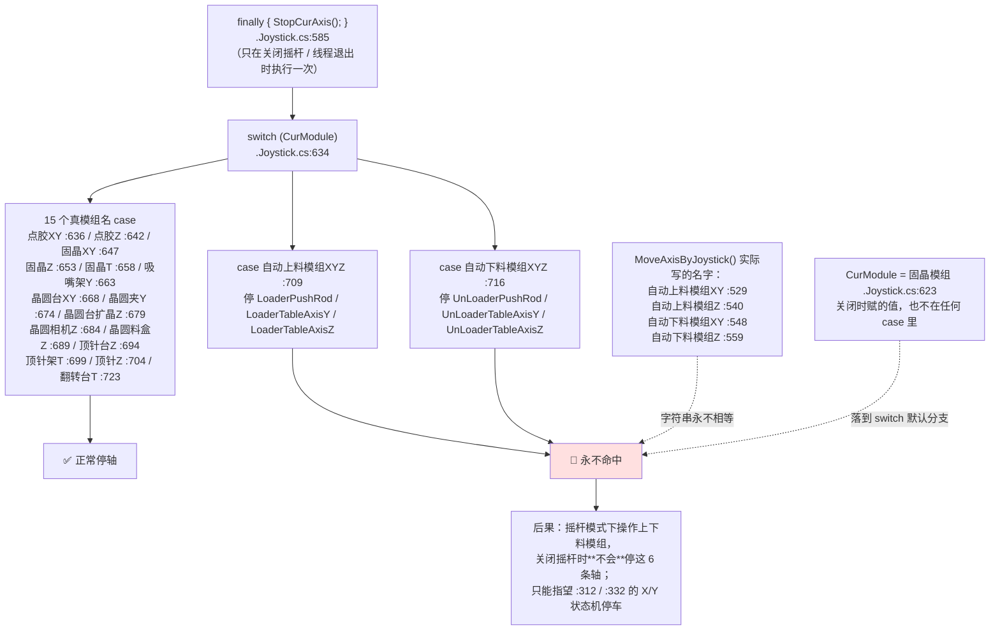

```
ASCII 等价（图 10）

  finally → StopCurAxis()  →  switch (CurModule)
                                  ├ 15 个真模组名 ──────────► 正常停轴
                                  ├ "自动上料模组XYZ" :709 ─┐
                                  ├ "自动下料模组XYZ" :716 ─┤  ★永不命中★
                                  └ default ────────────────┘
                                             ▲         ▲
   MoveAxisByJoystick 写的是 "自动上料模组XY"(:529) / "自动上料模组Z"(:540)
                              "自动下料模组XY"(:548) / "自动下料模组Z"(:559)
   关闭时写的是 "固晶模组"(:623)
   —— 三个名字集合两两不相交，所以这两条 case 是**死标签**
```

#### （5）🔴 同一个 `Electric` 被两条轴共用 → 回中帧第二条轴拿不到 `StopMove`（`R-79`）

`case "自动上料模组XY"`（`.Joystick.cs:529-538`）先用 `GetSpeedFromJoystick(JoystickXRead)` 驱动 `LoaderPushRod`，
再用 `GetSpeedFromJoystick(JoystickYRead)` 驱动 `LoaderTableAxisY` —— **两次传入的 `Electric` 实例是同一个**。

回中那一帧的时序：

| 步 | 发生什么 | `文件:行` |
|---|---|---|
| 1 | 第 1 次调用（X 路）：`joystickXStateTemp` 由 `Rising` 变 `Idle` → `StopMove()` → **`return`** | `.Joystick.cs:312`、`:314`、`:318` |
| 2 | 第 2 次调用（Y 路）：此时 `joystickXStateTemp == joystickXState == Idle` → 走 `else` → `vel == 0` → 落进 **`:369` 那个整段被注释的分支** | `.Joystick.cs:369-377` |
| 3 | ⇒ **第二条轴这一帧没有任何停车调用** | — |

同样结构存在于 **5 个 XY 组合**：`点胶XY`（`.Joystick.cs:417-426`）、`固晶XY`（`:435-444`）、
`晶圆台XY`（`:467-476`）、`自动上料模组XY`（`:529-538`）、`自动下料模组XY`（`:548-558`）。

*（推断：第二条轴是否真会停，取决于平台 `Axis` / `UpdateVelOnLine` 在速度为 0 时是否自行停车；
本仓库无该源码，无法证实。见附录 B。）*

#### （6）落盘与静态状态

| 事实 | `文件:行` |
|---|---|
| 摇杆相关**唯一**的 `Save()` | `.Joystick.cs:156`，发生在**开启摇杆时**（`R-37`） |
| `IsJoystickEnable` | `public static bool`（`.Joystick.cs:42`）—— **不落盘**，进程退出即丢 |
| `CurModule` | `public static string`（`.Joystick.cs:47`）—— **不落盘** |
| 🔴 两个都是 `static`（`R-78`） | 同一进程内所有 `UcGuideMove` 实例共用 ⇒ **多开同控件会互相改状态**；任务层若也 new 一个 `UcGuideMove`（`FrmDistanceMeasurement.cs:180` 就这么干，见 §4.9），会与手动界面的摇杆开关打架 |
| 脱机模式 | `JoystickBindHardware()` 开头 `if (MachineWorkMode == OffLineWork) return;`（`.Joystick.cs:748`）⇒ **脱机下摇杆不绑硬件：点按钮只改状态、轴不动** |

#### （7）19 个摇杆模组的运动映射（`MoveAxisByJoystick()`，`.Joystick.cs:407-587`）

每个 `case` 内部的结构完全一致：`vel = GetSpeedFromJoystick(某路摇杆)` → `AxisMoveAndUpdateVel(某轴, vel, 同一路摇杆)`。
**除了 4 处之外，没有任何系数**——也就是说"摇杆推到同一位置，不同模组的速度并不相同"这件事，只写在下面这 4 行里：

| 模组 | 轴 | 摇杆路 | `case` 行 | 轴对象 | `文件:行` | 速度系数 |
|---|---|---|---|---|---|---|
| 点胶XY | 点胶 X / 点胶 Y | X / Y | `:417` | `dispenseModule.GetDispenseXAxis()` / `GetDispenseYAxis()` | `:418`/`:422` | ×1 |
| 点胶Z | 点胶 Z | **Y** | `:428` | `dispenseModule.GetDispenseZAxis()` | `:429` | ×1 |
| 固晶XY | `BondAxisX` / `BondAxisY` | X / Y | `:435` | `bondModule` | `:436`/`:440` | ×1 |
| 固晶Z | `BondHead.AxisZ` | **Y** | `:446` | `bondModule` | `:447` | ×1 |
| 固晶T | `BondHead.AxisT` | **T** | `:453` | `bondModule` | `:454` | ×1 |
| 吸嘴架Y | `NozzleShelfModule.AxisY` | **Y** | `:460` | `System2Module` | `:461` | ×1 |
| **晶圆台XY** | `WaferTableAxisX` / `WaferTableAxisY` | X / Y | `:467` | `WaferSubModule` | `:468`/`:472` | **× 0.5** |
| 晶圆夹Y | `WaferClampAxisY` | **Y** | `:478` | `WaferSubModule` | `:479` | ×1 |
| **晶圆台扩晶Z** | `ExpandAxisZ` | **Y** | `:485` | `WaferSubModule` | `:487` | **× 0.01** |
| 晶圆相机Z | `WaferCameraAxisZ` | **Y** | `:493` | `WaferSubModule` | `:494` | ×1 |
| 晶圆料盒Z | `MagazineAxisZ` | **Y** | `:500` | `WaferSubModule` | `:501` | ×1 |
| 顶针台Z | `EjectionTableAxisZ` | **Y** | `:507` | `WaferSubModule` | `:508` | ×1 |
| 顶针架T | `EjectionBankAxisT` | **T** | `:515` | `WaferSubModule` | `:516` | ×1 |
| **顶针Z** | `EjectionAxisZ` | **Y** | `:522` | `WaferSubModule` | `:523` | **× 0.1** |
| 自动上料模组XY | `LoaderPushRod` / `LoaderTableAxisY` | X / Y | `:529` | `loaderBinModule` | `:530`/`:534` | ×1 |
| 自动上料模组Z | `LoaderTableAxisZ` | **Y** | `:540` | `loaderBinModule` | `:542` | ×1 |
| 自动下料模组XY | `UnLoaderPushRod` / `UnLoaderTableAxisY` | X / Y | `:548` | `unLoaderBinModule` | `:549`/`:553` | ×1 |
| 自动下料模组Z | `UnLoaderTableAxisZ` | **Y** | `:559` | `unLoaderBinModule` | `:561` | ×1 |
| 翻转台T | `FlipTableAxisT` | **T** | `:567` | `flipModule` | `:568` | ×1 |

**三处速度系数完全不成体系**（`0.5` / `0.01` / `0.1`）：

- `× 0.5`（晶圆台 XY，`:468`/`:472`）—— 像是"晶圆台太重，慢一点"；
- `× 0.01`（晶圆台扩晶Z，`:487`）—— **是 1/100**，与"低速档 = 1"叠加后实际速度是 `80 × 1 × 0.01 = 0.8`（高速档）；看不出量纲依据；
- `× 0.1`（顶针Z，`:523`）—— 同上。

⚠️ **这些系数只在 `MoveAxisByJoystick` 的调用点，不在 `GetSpeedFromJoystick` 或 `AxisMoveAndUpdateVel` 里**
⇒ 新增模组时极易漏掉，且**没有任何注释说明为什么是这些数**（`R-45` 附近的"注释与方法名双重拼写错误"也出在这个文件）。
**没有模组名 → 轴对象 的表格化配置，19 个 `case` 全是硬编码**：这是本文件 2,000 行里最主要的技术债来源。

> **一个能自证的细节**：`MoveAxisByJoystick` 的 19 个 `case` 与 `StopCurAxis` 的 17 个 `case`，
> **前 15 个（点胶XY … 顶针Z 与 翻转台T）名字逐字相同**，差异恰好就是上下料那 4 个：
> 播放侧写 `自动上料模组XY`(:529) + `自动上料模组Z`(:540)（下料同理），
> 停车侧写 `自动上料模组XYZ`(:709) + `自动下料模组XYZ`(:716)。
> ⇒ **`R-44` 不是"名字笔误"，是两侧各自维护、互不校验的两张硬编码清单漂移了。**

### 4.4 L-02 摇杆模式下的模组下拉

> **一句话**：同一个下拉框 `CbChangeModule`，**在摇杆模式与非摇杆模式下走两条完全不同的路**：
> 非摇杆模式 → `ChangeModuleName()` → `BindHardware()`（普通视角的轴映射）；
> 摇杆模式 → 先 `StopCurAxis()`、改 `CurModule`、再 `JoystickBindHardware()`（摇杆视角的轴映射）。
> 两条路的名字**不通用**，这正是 `R-44` 的根源。

**图 11**

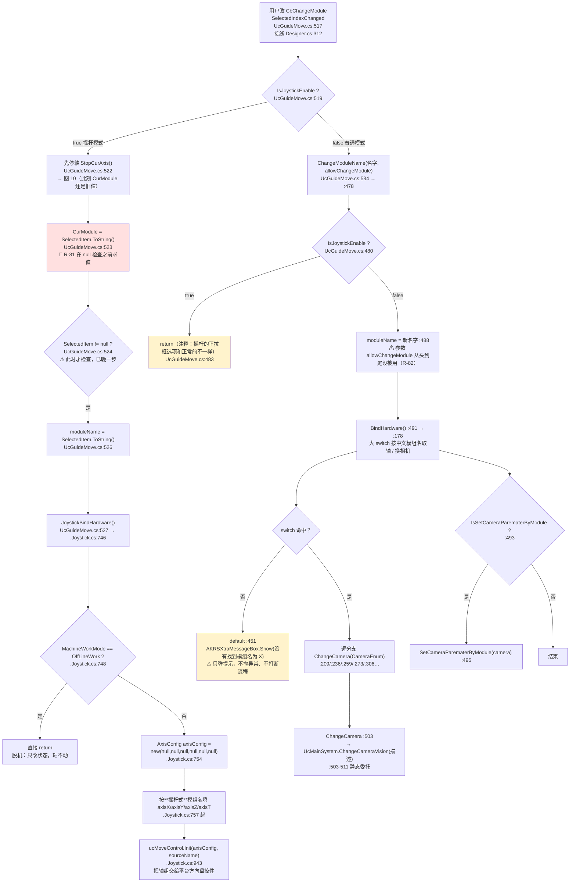

```
ASCII 等价

     改下拉 CbChangeModule (:517)
                │
        IsJoystickEnable ? (:519)
        ┌───────┴────────┐
     true│                │false
        │                │
 StopCurAxis() (:522)   ChangeModuleName(名字, allowChangeModule) (:534 → :478)
 CurModule = 选中项       │
     ▲ (:523)           IsJoystickEnable ? (:480) ──true──► return (:483)  ← 死路
     │ null 检查在 :524，   │false
     │ 已经晚了一步(★R-81)  moduleName = 名字 (:488)   ← allowChangeModule 参数被忽略(R-82)
     │                    │
 moduleName = 选中项      BindHardware() (:491 → :178)  大 switch 按中文名取轴
 (:526)                      │
   │                    ┌────┴────┐
 JoystickBindHardware()  命中      未命中
 (:527)                    │        └─► AKRSXtraMessageBox.Show("没有找到模组名为X") (:451)
   │                     ChangeCamera(...) (:209/:236/:259/:273/:306…)
 脱机? (:748) ─是─► return       │
   │否                      UcMainSystem.ChangeCameraVision(描述) (:503-511)
 填 AxisConfig (:754) → 填轴 → ucMoveControl.Init (:943)
```

**两条路的轴映射来源完全不同**（这是最容易踩的地方）：

| | 非摇杆模式 | 摇杆模式 |
|---|---|---|
| 入口 | `ChangeModuleName()` `UcGuideMove.cs:478` | `JoystickBindHardware()` `.Joystick.cs:746` |
| 名字清单 | `BindHardware()` 的 `switch` `UcGuideMove.cs:178-460`，**按"普通视角"的中文模组名** | `.Joystick.cs:757` 起，**按"摇杆视角"的中文模组名** |
| 未命中时 | 弹 `"没有找到模组名为X"`（`:451`），**继续往下走** | 无（switch 落到默认） |
| 硬件绑定 | 逐分支 `GetHardware<Axis>("焊头放置架Y")` 之类（样例 `:266`） | 填一个 `AxisConfig` 再整体交给平台控件 |
| 相机 | 逐分支 `ChangeCamera(CameraEnum)` | 不换相机（摇杆模式没有 `ChangeCamera` 调用） |

| 备注 | `文件:行` |
|---|---|
| 🔴 `CurModule = SelectedItem.ToString()` **在 `SelectedItem != null` 检查之前**求值 ⇒ 该项为 null 时 NRE，而下面那行检查形同虚设（`R-81`） | `UcGuideMove.cs:523` / `:524` |
| ⚠️ `ChangeModuleName(..., bool allowChangeModule = true)` 的**形参从不被读**；真正生效的是 `:534` 传进去的那个值，而它对方法体没有任何影响（`R-82`） | `UcGuideMove.cs:478` / `:488` |
| 🔴 `ChangeModuleName` 在摇杆模式下**静默 `return`**（`:480-484`）⇒ 摇杆期间任何走"普通模式"入口的调用者都以为切换成功了 | `UcGuideMove.cs:480-484` |
| 摇杆模式下改下拉会**先停轴**（`:522`）——用的是**旧的** `CurModule`，所以停的是上一个模组；如果上一个模组是上下料，`R-44` 会让这次"先停轴"落空 | `UcGuideMove.cs:522` |
| `ChangeCamera` 通过静态委托 `UcMainSystem.ChangeCameraVision` 改主界面相机 —— 本目录**只订阅不实现**（判空 `:506`、调用 `:508`），实现在 `Main/` | `UcGuideMove.cs:503-511` |

### 4.5 L-03 100 ms 坐标刷新

> **一句话**：一个 **100 ms 的 `System.Windows.Forms.Timer`**，每拍读三个轴的当前位置、
> 过一次坐标变换、写进三个 `Label`；**不落盘、不下发硬件**。
> 它是本目录里**跑得最勤、生命周期最长**的定时器（只要有一个 `UcGuideMove` 活着就在跑），
> 也是"UI 线程每 100 ms 被占一次"的主要来源。

**图 12**

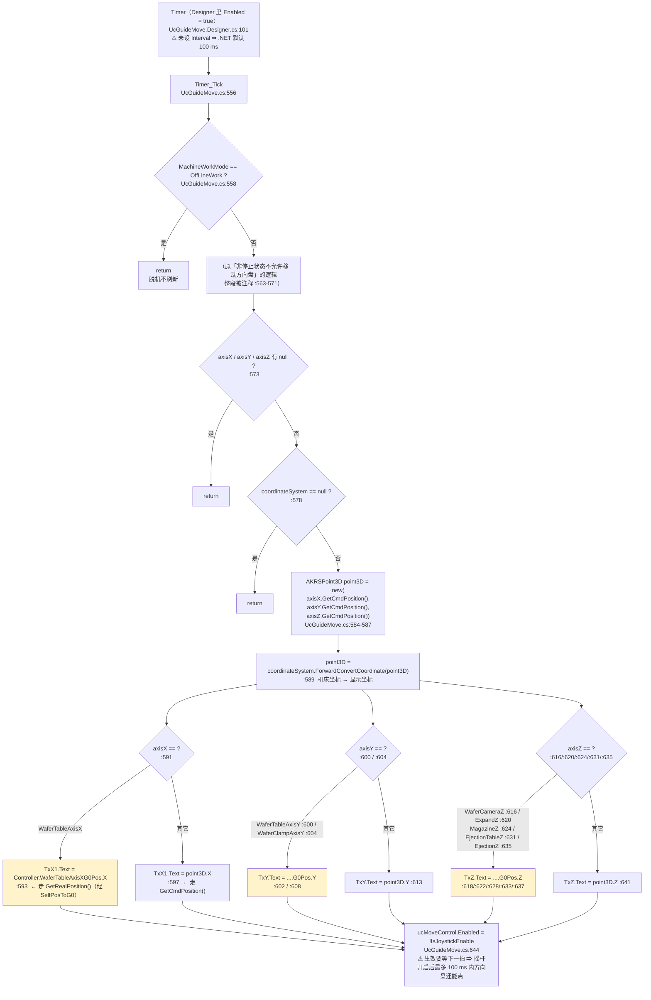

```
ASCII 等价

   每 100 ms 一拍（Designer Enabled=true，未设 Interval）
        │
   脱机？──是──► return
        │否
   axisX/Y/Z 或 coordinateSystem 为 null？──是──► return
        │否
   point3D = (X.GetCmdPosition, Y.GetCmdPosition, Z.GetCmdPosition)   ← 指令位置
        │
   point3D = coordinateSystem.ForwardConvertCoordinate(point3D)        ← 机床坐标→显示坐标
        │
   按 axisX / axisY / axisZ 逐个比对（共 8 条"特判轴"）
        ├─ 命中特判（晶圆台X/Y、晶圆夹Y、晶圆相机Z、扩晶Z、
        │           晶圆料盒Z、顶针台Z、顶针Z）
        │      └► Tx*.Text = <该控制器>.…G0Pos.X/Y/Z   ← ★用 GetRealPosition()★
        └─ 未命中
               └► Tx*.Text = point3D.X/Y/Z            ← ★用 GetCmdPosition()★
        │
   ucMoveControl.Enabled = !IsJoystickEnable
```

**8 条"特判轴"清单**（`UcGuideMove.cs:591-643`）：

| 轴 | 比对的轴对象 | `文件:行` | 显示来源 |
|---|---|---|---|
| X | `WaferSubModule…WaferTable.WaferTableAxisX` | `:591` / `:593` | `WaferTableController.WaferTableAxisXG0Pos.X` |
| Y | `…WaferTable.WaferTableAxisY` | `:600` / `:602` | `…WaferTableAxisYG0Pos.Y` |
| Y | `…WaferTable.WaferClampAxisY` | `:604` / `:608`（前面还有 `IsMagazineConfigured` 判断 `:606`） | `…WaferClampAxisYG0Pos.Y` |
| Z | `…WaferTable.WaferCameraAxisZ` | `:616` / `:618` | `…WaferCameraAxisZG0Pos.Z` |
| Z | `…WaferTable.ExpandAxisZ` | `:620` / `:622` | `…ExpandAxisZG0Pos.Z` |
| Z | `…MagazineBox.MagazineAxisZ` | `:624` / `:628`（`IsMagazineConfigured` 判断 `:626`） | `MagazineController.MagazineAxisZG0Pos.Z` |
| Z | `…Eject.EjectionTableAxisZ` | `:631` / `:633` | `EjectController.EjectionTableAxisZG0Pos.Z` |
| Z | `…Eject.EjectionAxisZ` | `:635` / `:637` | `EjectController.EjectionAxisZG0Pos.Z` |

| 坑 | `文件:行` | 说明 |
|---|---|---|
| 🔴 读数口径不统一（`R-83`） | 通用分支 `:585-587` 用 **`GetCmdPosition()`（指令位置）**；8 条特判轴经 `WaferTableController…G0Pos` 用 **`WaferTableAxisX.GetRealPosition()`（实际位置）**（属性体见 `WaferSubSystem/Controllers/WaferTableController.cs:177`）。⇒ 同一个面板上三个数字**口径不同**：伺服没到位的瞬间，通用轴显示的是"命令要它去的地方"，特判轴显示的是"它现在在哪"。**排查"读数和实际不符"时必须先确认看的是哪一种** |
| ⚠️ 特判轴的显示还多过一层坐标变换 | `WaferTableController.cs:177`/`:194` `MachineCoordinateSystem.GetInstance().WaferCoordinateSystem.SelfPosToG0(...)` | 通用分支过的是 `UcGuideMove` 自己的 `coordinateSystem`（`:589`），特判轴过的是**晶圆坐标系**。两套变换 |
| ⚠️ 脱机时特判轴返回 `(0,0,0)` | `WaferTableController.cs:174`/`:191` | 但因为 `:558` 已经提前 `return`，这条路径在 `UcGuideMove` 里走不到；**其它调用方会拿到 0** |
| ⚠️ 方向盘使能延迟一拍 | `:644` | 摇杆开启后，`ucMoveControl` 要等下一拍才禁用 ⇒**最多 100 ms 内方向盘仍可点**，这一窗口内摇杆线程和方向盘可能同时在动同一条轴 |
| ⚠️ 被注释的"停止状态才允许移动" | `:563-571` | 原本要按 `Machine.IsStop()` 控制 `ucMoveControl.Visible`，现在**可见性不受任何状态约束** |
| ✅ 无落盘、无硬件下发 | 全方法 `:556-645` | 纯读 + 写 3 个 `Label` + 1 个 `Enabled`。**这是本目录里最"干净"的高频定时器** |

### 4.6 L-04 编程助手「Start」主流程

> **一句话**：`Start` 是本目录**最大的一个方法**（`UcEditProductProgramming.cs:1139-2097`，**959 行**），
> 里面挂着**两个巨型 `switch`**（外层 14 个节点标签、内层 **55 个中文示教项**）、
> **34 处 `ShowDialog()`**（打开 **27 个不同窗体**，绝大多数在本目录之外）、
> **7 处 `"no open"`**（功能未接）和 **21 处递归 `this.Start()`**。
> 它是"编程助手"这套向导式界面的**唯一分发中心**。

**图 13**

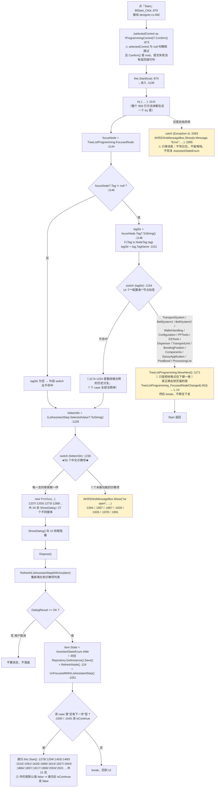

```
ASCII 等价

  点 Start (:870)
      │
  子控件 Confirm() (:873)  ← selectedControl 为 null 时静默跳过
      │
  Start(true) (:874) ──► Start(bool) (:1139) ── 全方法一个 try (:1141)
      │
  focusNode = 树焦点 (:1144)
      │
  外层 switch (tagStr) (:1154) ── 14 个"配置类"节点标签
      ├─ 命中 ──► TreeListProgramming.MoveNext() (:1171)   ★只挪焦点★
      │            └► 真正的换页在 FocusedNodeChanged (:453) → L-14 → 返回
      └─ 不命中
            │
  lstItemStr = ILstAssistantStep.SelectedValue (:1228)
            │
  内层 switch (lstItemStr) (:1230) ── ★55 个中文示教项★
      ├─ 每一个的动作骨架都相同：
      │     new FrmXxx() → ShowDialog()（UI 线程阻塞）→ Dispose()
      │        → RefreshILstAssistantStepWithXxx(item)
      │        → DialogResult == OK ?
      │              否 ──► 不置状态、不落盘
      │              是 ──► State = Able + Repo.Save() + RefreshNode() + UnFocused…()
      │                       └─ "还有下一步"型的再递归 this.Start()（21 处，传 false）
      └─ 7 个"未接功能" ──► AKRSXtraMessageBox.Show("no open")
            │
  任意处抛异常 ──► catch (:2093) 只弹一次消息（不记日志、不恢复状态）
```

**关键数字（逐个可复现）**：

| 事实 | 数字 | `文件:行` | 复现命令 |
|---|---|---|---|
| 方法体行数 | **959 行** | `:1139-2097` | — |
| 外层 `switch (tagStr)` 的 `case` | **14 个**（第 15 行 `// case "ConfigurationFirNode"` 被注释） | `:1156-1170` | `awk 'NR>=1154&&NR<=1172' \| grep -c 'case "'` → 15，其中 1 条注释 ⇒ 14 |
| 内层 `switch (lstItemStr)` 的 `case` | **55 个** | `:1232`…`:2057` | `awk 'NR>=1230&&NR<=2092' \| grep -c '^                        case "'` → 55 |
| `ShowDialog()` | **34 处** | `:1237`/`:1255`/`:1273`/`:1288`/… | `awk 'NR>=1139&&NR<=2097' \| grep -c 'ShowDialog()'` |
| 不同窗体 | **27 个**（`FrmHeightMeasurementTeach` 出现 2 次：`:1447`、`:1472`） | — | — |
| `"no open"` | **7 处** | `:1394`/`:1857`/`:1867`/`:1926`/`:1935`/`:1978`/`:1991` | `grep -c 'no open'` |
| 递归 `this.Start()` | **21 处** | `:1279`/`:1294`/`:1453`/`:1480`/`:1515`/`:1591`/`:1635`/`:1689`/`:1814`/`:1827`/`:1844`/`:1884`/`:1897`/`:1917`/`:1969`/`:2003`/`:2021` … | — |
| `isContinue` 被读 | **仅 2 处** | `:1500`、`:1545` | 21 处递归里 19 处传的是默认 `false` ⇒ **"连续"语义只对那 2 个 case 生效** |
| 本类内部真正落盘 | **4 处** | `LoaderBinRepository…Save()` `:1244`、`UnLoaderBinRepository…Save()` `:1262`（另有一对在 `BtReset_Click` 里，见 §4.7） | — |

| 坑 | `文件:行` | 说明 |
|---|---|---|
| ⚠️ 外层 `switch` 命中时**只挪焦点** | `:1171` | 意味着"点 Start 换页"这件事**依赖 `FocusedNodeChanged` 处理器正常工作**（L-14）。若那个处理器哪天被摘掉，`MoveNext()` 会变成"焦点动了但右侧页面不动"的静默失效 |
| 🔴 `catch` 三不 | `:2093-2096` | **不写日志、不留堆栈、不恢复 `AssistantStateEnum`**。异常后"界面显示的状态"与"数据里的状态"可能不一致，而操作员只看到一个红叉弹窗 |
| 🔴 34 个模态 `ShowDialog()` 全在 UI 线程 | `:1237` 起 | 与 `R-24`（UI 线程自旋）同源：**向导流程期间整机界面不响应**；若某个子窗体内部再等后台任务，就变成"UI 线程阻塞 + 后台等 UI"的组合 |
| ⚠️ `RefreshILstAssistantStepWithXxx(item)` 在 OK 判断**之前**调用 | `:1240`（例） | 用 `?:` 拿到的 `item` 可能是 `null`（节点类型不匹配），`Refresh…` 与随后的 `item.State = ` 都可能 NRE |
| ⚠️ 递归 21 处传 `false` | `:1279` 等 | `isContinue` 只在 `:1500`/`:1545` 被读 ⇒ 写这段代码时"连续示教"的意图**只实现了一半** |
| ⚠️ 7 个"未接功能"用同一句 `"no open"` | `:1394` 等 | **不区分是哪一个功能**，操作员无法从提示里知道"哪个还没做" |

| 补充 | `文件:行` |
|---|---|
| `IProgrammingControl` 只有 `void Confirm()`（`:31`）一个成员 ⇒ **提交失败没有返回值可判** | 声明 `Infrastructure/Interface/IProgrammingControl.cs:26`（本目录，见 §3.3.1） |
| 实现者：`grep -rln ', IProgrammingControl\|IProgrammingControl$'` 命中 **22 个文件** ＝ **1 个是接口声明本身** + **21 个实现者**，其中 `BondSystem/Controls/Setting/ProcessStep/UcProcessStepEdit.cs` 是**幽灵文件（不参与编译）** ⇒ **参与编译的实现者 20 个**，只有 `UcConfiguration1.cs`（本目录）与 `UcProcessStep.cs`（`Main/`）在本目录内，其余 18 个分布在 BondSystem / DispenseSystem / TransportSystem / TransportUnitSystem / WaferSubSystem | 复现：`grep -rln ": IProgrammingControl" --include='*.cs' AKRS.ZX2200/` |
| `RefreshNode()` 是 `public`（`:119`），被本类与其它类调用 | `:119` |
| 每一支的骨架都是"开窗 → 关窗 → 刷新列表 → 判 OK → 置状态 + 落盘" | `:1237-1250`（以"上料位置示教"为例） |

### 4.7 L-05「重置」把当前节点及其子树回滚

> **一句话**：`BtReset_Click`（`UcEditProductProgramming.cs:937-1046`，**110 行**）是**一串平铺的 `if`**：
> 前 6 个按 `TagObject` 的类型分流、后 3 个按 `ParentNode.Tag` 的名字分流，
> 每个分支各自"重置状态 + 落盘一次"。**10 个 `Save()` 调用点**（9 个不同仓库，`ProductConfiguration` 被写两次），
> 但**一次点击最多命中 2 个**（`TagObject` 只可能是一种类型、`ParentNode.Tag` 只可能是一个名字）。
> 3 个 `ParentNode.Tag.ToString()` 没做判空 ⇒ **焦点停在 13 个顶层节点上点「重置」必 NRE**（`R-15`）。

**图 14**

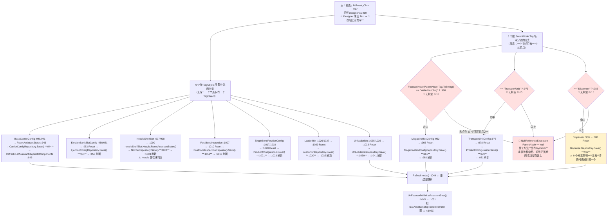

```
ASCII 等价（图 14）

  点「重置」(:937)  ← Designer 没给 Text，按钮上没字
      │
      ├── 6 个「按 TagObject 类型」的分支（互斥，只能命中一个）
      │     BaseCarrierConfig   :940  → Reset → Save :944   → 刷新 :946
      │     EjectionBankSlotCfg :950  → Reset → Save :954   → 刷新 :956
      │     NozzleShelfSlot     :997  → Reset → Save :1001  → 刷新 :1003   (Nozzle 未判空)
      │     PostBondInspection  :1007 → Reset → Save :1011  → 刷新 :1013
      │     SingleBondPosition  :1017 → Reset → Save :1021  → 刷新 :1023
      │     LoaderBin / UnloaderBin :1026 / :1035 → Save :1030 / :1039
      │
      └── 3 个「按 ParentNode.Tag 名字」的分支（互斥，只能命中一个）
            == "WaferHandling" :960 ─┐
            == "TransportUnit" :973 ─┤ ★都没有判空★
            == "Dispenser"     :986 ─┘
                    │
        （每个分支内部还各有一次 Save :966 / :979 / :992）
                    │
   焦点在 13 个 Designer 顶层节点之一？──是──► NullReferenceException
                    │                            （ParentNode == null，无 try/catch）
                   否
                    ▼
      RefreshNode() (:1044) → UnFocusedWithILstAssistantStep() (:1045→:1051)
      （把 ILstAssistantStep.SelectedIndex 置 -1，:1053）
```

**10 个 `Save()` 调用点**（`grep -n '\.Save()' UcEditProductProgramming.cs` 在 `:937-1046` 范围内）：

| # | `文件:行` | 仓库 | 所在守卫 |
|---|---|---|---|
| 1 | `:944` | `CarrierConfigRepository` | `TagObject as BaseCarrierConfig` `:940` |
| 2 | `:954` | `EjectionConfigRepository` | `TagObject as EjectionBankSlotConfig` `:950` |
| 3 | `:966` | `MagazineBoxConfigRepository` | `ParentNode.Tag == "WaferHandling"` `:960` |
| 4 | `:979` | **`ProductConfiguration`** | `ParentNode.Tag == "TransportUnit"` `:973` |
| 5 | `:992` | `DispenserRepository` | `ParentNode.Tag == "Dispenser"` `:986` |
| 6 | `:1001` | `NozzleRepository` | `TagObject as NozzleShelfSlot` `:997` |
| 7 | `:1011` | `PostBondInspectionRepository` | `TagObject as PostBondInspection` `:1007` |
| 8 | `:1021` | **`ProductConfiguration`（第二次）** | `TagObject as SingleBondPositionConfig` `:1017` |
| 9 | `:1030` | `LoaderBinRepository` | `TagObject as LoaderBin` `:1026` |
| 10 | `:1039` | `UnLoaderBinRepository` | `TagObject as UnloaderBin` `:1035` |

⇒ **10 次调用、9 个不同仓库**；**一次点击最多命中 2 个**（6 选 1 + 3 选 1）。
**没有事务、没有回滚**（`R-39`）：第一个 `Save()` 成功、第二个抛异常（磁盘满 / 文件被占用）时，
**配方处于"一半新一半旧"的状态，且没有任何提示**。

| 坑 | `文件:行` | 说明 |
|---|---|---|
| 🔴 `ParentNode.Tag.ToString()` 三处无判空（`R-15`） | `:960`、`:973`、`:986` | Designer 里 `AppendNode(..., -1, 0, 0, N, "标签")` 建的 **13 个顶层节点**（`designer.cs:120`/`:130`/`:132`/`:138`/`:140`/`:142`/`:144`/`:146`/`:150`/`:152`/`:154`/`:156`/`:158`）的 `ParentNode` 是 `null`。**焦点停在"传输系统"这类顶层节点上点重置 → NRE**，而整个方法**没有 `try/catch`** |
| 🔴 `Tag` 在同一棵树上有**三种类型** | Designer `AppendNode` 的第 3/6 个参数 ⇒ `Tag` 是 **`string`**（`designer.cs:120`/`:122`/`:148` 等）；运行时动态加的子节点 `Tag` 是 **`NodeTag` 对象**（`.cs:131`/`:159`/`:181`/`:200`/`:275`/`:293`/`:315`/`:339`/`:358`/`:370`/`:380`）；另有两处直接赋字符串 `nd.Tag = "DispenserSubNode";`（`.cs:222`、`.cs:235`） | `Tag.ToString()` 对前两种都成立 ⇒ **表面能跑**；`Tag as NodeTag` 对容器节点恒为 `null` ⇒ `.cs:1148-1152` 那段"先 `ToString()` 再 `is NodeTag` 覆盖"的双写法就是给这个补丁 |
| ⚠️ `Dispenser` 分支少了步骤列表刷新 | `:986-994` | 其它 8 个分支都有 `RefreshILstAssistantStepWithXxx(...)`，**只有它没有** ⇒ 重置点胶头后左侧示教项列表不刷新，仍显示"已完成" |
| ⚠️ `nozzleShelfSlot.Nozzle` 未判空 | `:1000` | `Nozzle` 为 `null` 时 NRE |
| ⚠️ 按钮没有文字 | `designer.cs:460`（`BtReset.Checked` 等已设，但 `Text` 未设） | 与 `BtSkip`（Designer 里根本没这个控件）合起来看：**这一排按钮的 Designer 是半成品状态** |
| ⚠️ 结束时**无条件**重建整棵树 | `:1044` `RefreshNode()` | 即使一个分支都没命中（焦点在不属于任何类型的节点上），也会重建树 + 取消示教项选中 ⇒ 视觉上"点了有反应"，实际上什么都没重置 |

### 4.8 L-06「Start」测焊头水平

> **一句话**：点「Start」→ 弹一次确认框 → 起一个后台 `Task` → 在**四个方位各测一次高**（T 轴转 0/90/180/270°），
> 算 X/Y 方向的差值，写进内存里的 `MeasureHeightResult`，靠 100 ms 的 `timer1_Tick` 刷到表格上。
> **全程不落盘。** 三个最硬的坑都在这一个方法里：**测高位置硬编码**、
> **`MoveBondZToSafePos()` 在异常路径上不执行**、**后台线程往 UI 线程正在枚举的 `List` 里 `Add`**。

**图 15**

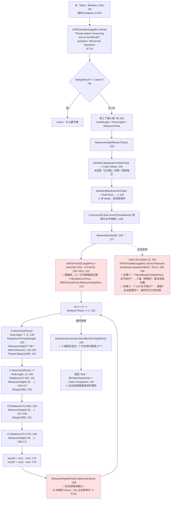

```
ASCII 等价

  点 Start (:85)
      │
  确认框 "Please attach measuring tool on bondhead!" (:87)
      ├─ Cancel ──► return
      └─ OK
           │
   读 InstallAngle / ToolLenghth / MeasureTimes (:98-100)
   MeasureHeightResult.Clear() (:102)
   BtnStart 变黄 (:103)          ← 唯一的"正在跑"指示
   Task.Run(…测焊头水平线程…) (:105)（不 await）
           │
   targetPos = (168.1554, -274.8245, 106.7341)  ★硬编码★ (:122)
      （上一行注释就是被弃用的正解 BondDevicePara…MeasureHeightPos :123）
           │
   for i in 1..MeasureTimes:
        ① X-ToolLength 方位 → T=InstallAngle    → MeasureHeight(-28) → Sleep(1000)
        ② Y-ToolLength 方位 → T=+90             → MeasureHeight(-28) → Sleep(1000)
        ③ X+ToolLength 方位 → T=+180            → MeasureHeight(-28) → Sleep(1000)
        ④ Y+ToolLength 方位 → T=+270            → MeasureHeight(-28)
        resultX = ①-③ ;  resultY = ②-④
        MeasureHeightResult.Add(...)   ← 后台线程改 List（UI 线程同时在枚举）
           │
   MoveBondZToSafePos() (:191)   ← ★只有成功路径会走到★
   BtnStart 变回透明 (:110)
           │
   任何异常 ──► catch (:193) 只弹一次框
                ⇒ Z 轴不回安全位（探针在测高位置）+ 按钮永远黄色
```

| 事实 / 坑 | `文件:行` |
|---|---|
| 测高位置**硬编码**（`168.1554, -274.8245, 106.7341`），正解就在下一行的注释里 | `:122` / `:123` ⇒ **换机器、换机构必须改代码重编译** |
| 测高下限**硬编码 `-28`**（四处：`:134`/`:146`/`:158`/`:170`） | 同上 |
| 🔴 异常路径上 **`MoveBondZToSafePos()` 不执行** | `:191` 在 `try` 内、`catch` 之外 ⇒ `MeasureHeight` 抛异常时 Z 轴（带着测量工具）**留在测高位置** |
| 🔴 异常路径上 **按钮永远保持黄色** | `:110` 在 `Task` 体内、`MeaureStandard()` **之后**；异常被 `:193` 吃掉后 `:110` 不执行 |
| 🔴 后台线程 `Add` / UI 线程枚举同一 `List`（`R-84`） | 写：`:188`（后台）；读：`timer1_Tick :249` → `RefreshControl()`（见 §4.2.14）。`List<T>` **不保证并发安全**，枚举期间被改会抛 `InvalidOperationException`；此处 `RefreshControl()` 里若有 `try/catch` 就表现为"表格突然不刷新了" |
| ⚠️ 后台线程直接改控件属性 | `:110` `this.BtnStart.Appearance.BackColor = Color.Transparent;` —— DevExpress `Appearance` 不触发 `Control` 的句柄/线程检查，**通常"能跑"**，但属于跨线程访问 UI |
| ⚠️ `Task` 只在字段里存着、**从不 `await` / `Wait`** | 字段声明 `:40`；`FrmBondheadStandardMeasurement_FormClosing`（`:259`）只处理计时器 ⇒ **关窗后线程还在跑，会去动已经 `Dispose` 的控件与 `List`** |
| ⚠️ 确认框的文案有多余空格 | `:88` `"Please  attach  measuring  tool  on  bondhead!"` —— 与 `R-45`（拼写/注释类瑕疵）同族 |
| ✅ 结果只在内存 | `MeasureHeightResult` 由 `timer1_Tick`（`:249`）100 ms 刷 Grid，**无落盘**（与 L-08 的"写 `D:\` 文件"形成对比） |

### 4.9 L-07「Done」两点距离测量

> **一句话**：一个 **2 步助手**（第 1 步示教第一点，第 2 步示教第二点），点「Done」时在
> **lambda 里**算出两点差、判一个 `0.01 mm` 的阈值、弹结果窗体、关掉自己。
> 全部业务逻辑写在 `assistantConfigList` 的 `Action` 闭包里（`.cs:140-191`），
> `BtDone_Click` 本身只有 3 行。
> **不落盘**；同时这里还有本目录最典型的一处资源泄漏（`new UcGuideMove` 替换 Designer 字段）。

> ### ⚠️ 可达性更正：**这条链的入口按钮在运行时永远禁用**（`R-109`）
>
> 下面整条链的起点是「Done」按钮，它**只有**一个入口：`BtDistanceMeasurement_Click`（`.cs:73`）。
> 而该按钮在 **Designer 里就被硬编码为禁用**，且**全项目没有任何代码把它置回 `true`**：
>
> | 证据 | `文件:行` | 内容 |
> |---|---|---|
> | ① 设计期禁用 | `UcMeasuringTool.Designer.cs:90` | `this.BtDistanceMeasurement.Enabled = false;` |
> | ② 命名点只有它自己 | `UcMeasuringTool.Designer.cs:93` | `Name = "BtDistanceMeasurement"`（反射改属性的**唯一**字符串点，非调用） |
> | ③ 处理器定义处不启用 | `UcMeasuringTool.cs:73` | 方法体重来不改自己的 `Enabled` |
> | ④ 全仓其余引用 = 0 | — | `grep -rn --include='*.cs' "BtDistanceMeasurement" .` 排除 Designer 后**只剩 `UcMeasuringTool.cs:73` 一处**（处理器定义） |
> | ⑤ 定时器不管它 | `UcMeasuringTool.cs:140-154` | `timer1_Tick` 只切换 `BtnSystem1FlatLevelMeasure` / `BtnSystem2FlatLevelMeasure` 两个水平测试按钮 |
> | ⑥ 窗体 `Load` 不管它 | `UcMeasuringTool.cs:174-180` | `UcMeasuringTool_Load` 只在系统1未配置时**关**`BtnSystem1FlatLevelMeasure`，从不**开**任何按钮 |
> | ⑦ 承载它的面板不管它 | `UcMainSystem.cs:431-457` | `ShowPanel(...)` 全体只有 `GetDockPanel` / `TopMost` / `Show` / `WindowState` / `BringToFront` / `dockManager.AddPanel` —— **从不触碰任何子控件的 `Enabled`** |
> | ⑧ 资源文件不能覆盖 | `UcMeasuringTool.resx` | 该 Designer **不使用** `resources.ApplyResources`（`ComponentResourceManager` 全文件 0 命中），属性全部硬编码 ⇒ `.resx` **不可能**在运行时把它改回 `true`；且 `.resx` 内 `Enabled` 出现次数 = **0** |
>
> **入口本身是可达的**（不是死代码）：`Main/Controls/Ucmain/MainControls/UcMainSystem.Manual.cs:182 BarBtMeasureTool_ItemClick`
> → `:184-190 this.ShowPanel("UcMeasuringTool", () => new UcMeasuringTool { Dock = DockStyle.Fill })`。
> 也就是说：**「测量工具」面板能打开，面板上另外两个「水平测试」按钮能用，
> 但「距离测量」这个按钮永远是灰的 —— 用户在生产界面上点不到它。**
>
> **⇒ 本节的图 16 描述的是"若按钮可用"的逻辑，不是当前运行时可达的路径。**
> 分类上它**不是死代码**（处理器参与编译、逻辑完整、`Enabled` 只是 UI 门），
> 而是**未完成/被搁置的功能**：这条链要么是开发中途停掉，要么是临时屏蔽后忘了恢复。
> 两者的维护后果不同 —— 死代码可以删，这个**不能删**（删了这 100 行的逻辑就真没了），
> 但**看着它去现场排查"距离测量不准"是无意义的**。列 `R-109`。

**图 16**

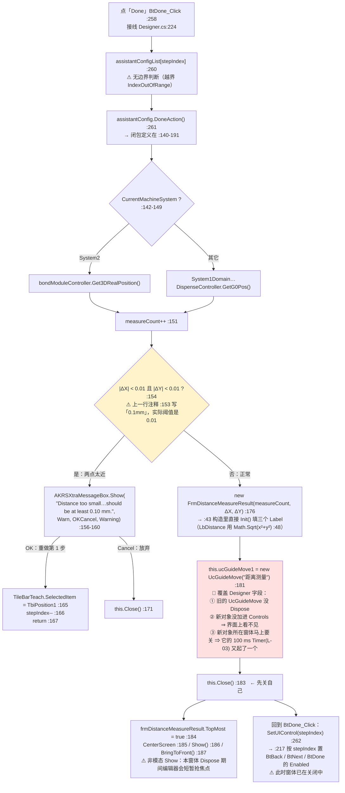

```
ASCII 等价

  点 Done (:258)
      │
  assistantConfigList[stepIndex] (:260)   ← 无边界判断
      │
  DoneAction() (:261) ── 闭包在 :140-191 里
      │
  取第二点位置：System2 → Get3DRealPosition() ; 其它 → GetG0Pos()  (:142-149)
      │
  measureCount++ (:151)
      │
  |ΔX| < 0.01 且 |ΔY| < 0.01 ?  (:154)   ← 注释写 0.1mm，代码是 0.01
      ├─ 是 ──► 弹 "Distance too small… at least 0.10 mm"
      │            ├ OK     ──► 回到第 1 步（TileBarTeach 选中 TbiPosition1，stepIndex--）
      │            └ CANCEL ──► this.Close()
      └─ 否 ──► new FrmDistanceMeasureResult(measureCount, ΔX, ΔY) (:176)
                    │
                 this.ucGuideMove1 = new UcGuideMove("距离测量") (:181)  ★泄漏★
                    │      旧字段未 Dispose；新对象未加进 Controls（不可见）；
                    │      其 100 ms 坐标刷新定时器又多了一个
                    ▼
                 this.Close() (:183) → 结果窗体 TopMost + CenterScreen + Show() (:184-187)
                    │
                 SetUIControl(stepIndex) (:262) —— 窗体已在关闭中
```

| 坑 | `文件:行` | 说明 |
|---|---|---|
| 🔴 **入口按钮运行时永远禁用（`R-109`）** | `UcMeasuringTool.Designer.cs:90` | `this.BtDistanceMeasurement.Enabled = false;`，且全仓**无任何代码**把它置回 `true`（详见本节开头的「可达性更正」）⇒ **本节整条链在生产界面上不可达**。不是死代码，是**被搁置的功能** |
| 🔴 `new UcGuideMove("距离测量")` 覆盖 Designer 字段（`R-87`） | `:181` | 三个后果：① 旧 `UcGuideMove` 未 `Dispose`（它的 `Timer` 仍在跑，见 L-03）；② 新对象**没有** `Controls.Add` ⇒ **界面上看不到**；③ 本窗体紧接着 `Close()`（`:183`）⇒ 这个新对象及其定时器**没人管**。**这是本目录"用 `new` 覆盖 Designer 字段"的唯一实例** |
| 🔴 阈值与提示文案不一致 | `:154` vs `:157` | 判据是 `< 0.01`（=0.01 mm），提示写 `"at least 0.10 mm"` ⇒ **差 10 倍**。操作员按提示把两点挪到 0.1 mm，其实 0.011 mm 就已经通过了；反过来，"提示要求的 0.1 mm" 从来没被检查过 |
| ⚠️ `stepIndex` 无边界判断 | `:260`、`:234`、`:247` | `BtNext_Click`（`:245`）/`BtBack_Click`（`:232`）都直接 `assistantConfigList[stepIndex]`。正常路径被 `IsShowNext`/`IsShowBack`（`:217` 的 `SetUIControl`）挡住，**但没有代码级保护** |
| ⚠️ 先 `Close()` 再 `Show()` 结果窗体 | `:183` / `:186` | 结果窗体是**非模态**的 `Show()` ⇒ 关掉助手窗体后，结果窗仍然留在屏幕上（这正是"测完把结果留在屏幕上"的意图），但**没有任何地方 Dispose 它** |
| ✅ 不落盘、不下发硬件 | 全链 | 距离测量结果只在 `FrmDistanceMeasureResult` 的三个 `Label` 上（`:43` 构造里 `Init()`） |
| ⚠️ 弹窗文案有拼写/排版瑕疵 | `:157` | `"…the teached points is too small.Distance should be…"` —— **`teached` 是错词**，且 `small.Distance` 之间**缺一个空格**。与 `R-45`（拼写/注释类瑕疵）同族 |

### 4.10 L-08「Continuous measurement」多点测高

> **一句话**：勾一个复选框起一条**后台线程**，循环「10 组 × N 个测高点」地测高、刷表格；
> 代码里写着"每 10 组存一次 Excel 到 `D:\点胶测高针测试\`"，
> **但那是死代码：`TestList` 永远只有一个元素，`if (TestList.Count > 100)` 永不成立 ⇒ 一个字节都不会落盘，
> 而且那个唯一的 `List<double>` 会无限增长。**
> 这是本目录里**"看起来很完整、实际上完全没生效"**的典型。

**图 17**

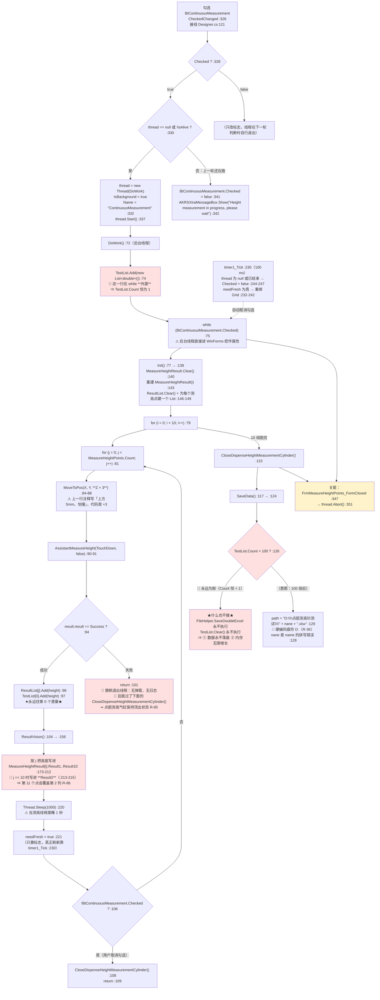

```
ASCII 等价

  勾选 Continuous measurement (:326)
      │
  已有线程在跑？──是──► 取消勾选 + 弹 "Height measurement in progress, please wait" (:341-342)
      │否
  thread = new Thread(DoWork){ IsBackground = true } → Start() (:332/:337)
      │
  ┌─ DoWork() 后台线程 (:72) ────────────────────────────────────────┐
  │  TestList.Add(new List<double>()) (:74)   ★在 while 外面！★       │
  │  while (Checked) (:75)   ← 后台线程直接读控件属性                  │
  │      Init() (:77)  重建 MeasureHeightResult / ResultList          │
  │      for i in 0..9 :                                              │
  │          for j in 0..MeasureHeightPoints.Count-1 :                │
  │              MoveToPos(X, Y, Z+3) (:84)   ← 注释说 5mm，代码 3mm   │
  │              AssistantMeasureHeight(TouchDown, false) (:90)       │
  │                  ├ 成功 → ResultList[j].Add / TestList[0].Add (:96-97)
  │                  └ 失败 → return (:101)  ★静默退出 + 气缸不关★     │
  │              ResultVision() (:104)                                │
  │                  ├ 写 Result1..Result10 (:173-212)                │
  │                  ├ j==10 写进 Result2 (:213-215)  ★覆盖第 2 列★    │
  │                  └ Sleep(1000) (:220) + needFresh = true (:221)   │
  │              取消勾选？→ 关气缸 + return (:106-109)               │
  │      关气缸 (:115) → SaveData() (:117)                            │
  │          if (TestList.Count > 100) (:126)                         │
  │              ★永假：Count 恒为 1★ → 不存盘、不清空、内存一直涨     │
  └───────────────────────────────────────────────────────────────────┘
      │
  关窗 → FormClosed (:347) → thread.Abort() (:351)   ★强制终止★
```

| 坑 | `文件:行` | 说明 |
|---|---|---|
| 🔴 **`SaveData()` 是死代码，且会内存泄漏** | `:74` 与 `:126` | `TestList.Add(...)` 只在 `:74` 出现一次，且**在 `while` 外面** ⇒ `TestList.Count` 恒为 `1` ⇒ `:126` 的 `> 100` **永不成立**。后果：① `FileHelper.SaveDoubleExcel`（`:130`）**永不执行**，"连续测高数据存 Excel"这个功能**完全没有生效**；② `TestList.Clear()`（`:131`）永不执行，而 `:97` 每次测高都往 `TestList[0]` 里 `Add` ⇒ **这个 `List<double>` 无限增长**（连续跑几小时 = 几十万个 double） |
| 🔴 `j == 10` 写进 `Result2`（`R-86`） | `:213-215` | `ResultValue` 只有 `Result1…Result10`（`:173-212`）。当 `MeasureHeightPoints.Count ≥ 11` 时，**第 11 个测高点的值会覆盖第 2 列**，表格上第 2 列显示的是第 11 点的数据 |
| 🔴 测高失败时**气缸不关**（`R-85`） | `:99-102` | 失败分支直接 `return`，**绕过了** `:108` 与 `:115` 两处 `CloseDispenseHeightMeasurementCylinder()` ⇒ **点胶测高气缸保持顶出**、无任何提示 |
| ⚠️ `Thread.Abort()` | `:351` | 可能停在 `MoveToPos` 中途 ⇒ 轴与被测对象状态不可预期。.NET 已不推荐（`R-20`） |
| ⚠️ 后台线程直接读控件属性 | `:75`、`:106` | `this.BtContinuousMeasurement.Checked` —— WinForms 控件的 `Checked` 读操作**通常**不抛跨线程异常（只有句柄相关操作才检查），但这是**未定义行为**，而且它是这个线程**唯一的退出条件** |
| ⚠️ 注释与代码不符 | `:83` vs `:88` | 注释"移动到位置上方5mm，怕撞"，代码是 `Z + 3` |
| ⚠️ 线程里 `Thread.Sleep(1000)` | `:220` | 在 `ResultVision()` 里（一个"刷新界面"语义的方法）睡 1 秒 ⇒ 10 组 × N 点 = **至少 10N 秒**的最小耗时，且 **UI 刷新节奏被线程睡眠决定** |
| ⚠️ 唯一真正落盘的地方是 `D:\` 硬编码 | `:129` | `"D:\\点胶测高针测试\\" + nane + ".xlsx"`，`nane` 是 `name` 的拼写错误（`R-36`）。**但因为 `:126` 永不成立，这行代码从来没被执行过** —— 也就是说 `R-36` 的实际影响面是"0 次"，而真正的问题是**它上面的 `:126`** |
| ✅ 自动取消勾选（联动） | `timer1_Tick :230` → `:244-247` | 线程已结束但复选框还勾着时，100 ms 内自动取消勾选 —— **本目录里少见的"界面跟随线程状态"的正确做法** |

### 4.11 L-09「导出」报警历史

> **一句话**：`SaveFileDialog` → `gridControl1.ExportToXls(文件名)` → 弹"保存成功"。
> **内容是 `.xls`（BIFF）格式，文件名却按 `.xlsx` 存** ⇒ Excel 打开时提示"文件格式与扩展名不符"。
> 数据源是 `DBService.Query<AlarmLogEntity>`，而**数据库故障时它返回空集合** ⇒ 界面显示"0 条"，不报错（`R-01`）。

**图 18**

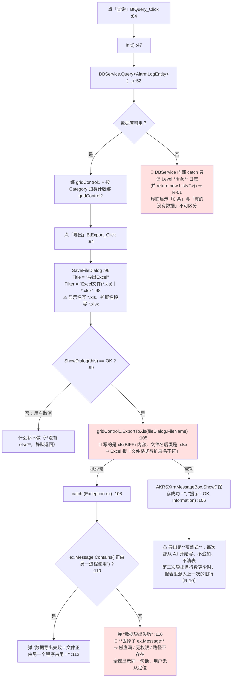

```
ASCII 等价

  「查询」(:84) → Init() (:47) → DBService.Query<AlarmLogEntity> (:52)
                                    │
                          库挂了？ ──是──► 返回空集合（只记 Info 日志）
                                    │            ⇒ 界面「0 条」，不报错
                                   否
                                    ▼
                              绑两个 Grid

  「导出」(:94)
        │
  SaveFileDialog: Filter = "Excel文件(*.xls)|*.xlsx" (:98)   ← 名字与后缀自相矛盾
        │
  用户点 OK？
   ├ 否 ──► 静默返回（无 else）
   └ 是
        │
  gridControl1.ExportToXls(文件名) (:105)   ★内容是 xls，后缀是 .xlsx★
        │
   ├ 成功 ──► 弹「保存成功！」(:106)
   │            └► ⚠ 覆盖式写盘：行数变少时残留上一次的旧行（R-10）
   └ 异常 ──► catch (:108)
                ├ 消息含「正由另一进程使用」──► 弹占用提示 (:112)
                └ 其它 ──► 弹「数据导出失败」(:116)  ← ★丢了 ex.Message★
```

| 坑 | `文件:行` | 说明 |
|---|---|---|
| 🔴 内容格式与扩展名不符 | `:105` | 调的是 `ExportToXls`，但 `Filter`（`:98`）与按钮语义都指向 `.xlsx`。**Excel 打开会报警告**；若某些工具按后缀解析（如 pandas）会直接失败 |
| 🔴 `catch` 丢掉 `ex.Message` | `:116` | 只有"文件被占用"这一种情况有专门提示（`:110`）；**磁盘满、无写权限、路径非法全都显示同一句"数据导出失败"** |
| ⚠️ 取消 `SaveFileDialog` 时没有 `else` | `:99-105` | 只是没反应（可接受），但**与 `UcAddOffset.BtSure_Click` 的"静默无动作"是同一种风格**：本目录大量方法在"没匹配上"时不给任何反馈 |
| ⚠️ 数据源失败 = 空表 | `:52` + `DBService.cs` 的 13 处 `catch` | `R-01`：**报警日志静默丢失**。这条链的起点在本目录（`DBService`），终点在别处的报表 |
| ⚠️ 导出是覆盖式而非追加 | `Utils/FileHelper.cs:42-44`/`:56`/`:60`（另有 `:95`/`:163`/`:200`/`:237`/`:418` 同构） | `R-10`：对同一文件二次导出且本次行数更少 ⇒ **报表混入上一次的数据** |

### 4.12 L-10「保存」偏移（µm ↔ mm 换算的唯一集中点）

> **一句话**：`BtSure_Click`（`UcAddOffset.cs:281-362`）是一个**三层互斥的 `if/else if`**
> （`config is SingleBondPositionConfig` / `EpoxyApplication` / `OppositeSexConfig`，
> 前两者内部再按 `isBond` 分叉）⇒ **5 个叶子分支、5 个 `Save()` 调用点、5 种写回目标**。
> **界面单位是 µm，落盘单位是 mm，换算常数 `1000.0` 在本文件里出现 35 行**（写回时 `/ 1000.0` 共 15 处
> ＝ 5 个叶子分支 × 3 个轴；回填界面时 `* 1000.0` 共 15 处；提示文案里 5 处）；
> **角度不除**（直接是度）。**没有 `try/catch`、没有 else 兜底、没有事务。**

**图 19**

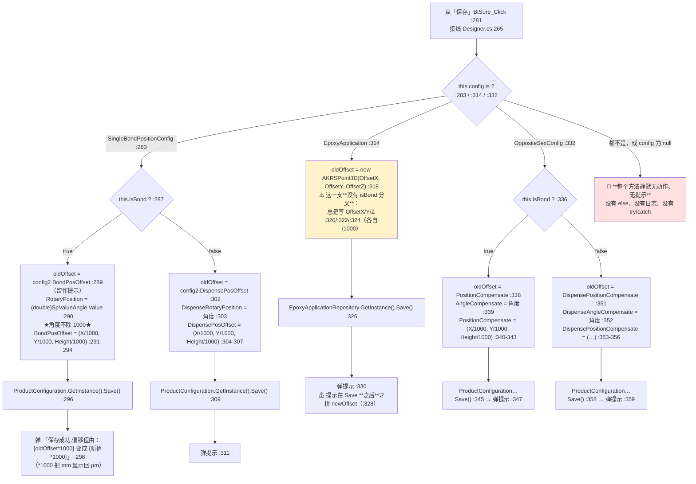

```
ASCII 等价

  点「保存」(:281)  —— 全方法没有 try/catch
      │
  this.config 是哪一种？
      │
      ├─ SingleBondPositionConfig (:283)
      │     ├ isBond=true  (:287)
      │     │    oldOffset = BondPosOffset                 (:289)
      │     │    RotaryPosition     = SpValueAngle.Value   (:290)  ★角度不除 1000★
      │     │    BondPosOffset      = (X/1000, Y/1000, H/1000)  (:291-294)
      │     │    ProductConfiguration.Save()               (:296)   ← 落盘 ①
      │     │    弹「保存成功,偏移值由 {旧×1000} 变成 {新×1000}」(:298)
      │     └ isBond=false (:300)
      │          oldOffset = DispensePosOffset             (:302)
      │          DispenseRotaryPosition = SpValueAngle.Value (:303)
      │          DispensePosOffset = (X/1000, Y/1000, H/1000) (:304-307)
      │          ProductConfiguration.Save()                 (:309)  ← 落盘 ②
      │          弹提示                                      (:311)
      │
      ├─ EpoxyApplication (:314)
      │     oldOffset = new AKRSPoint3D(OffsetX, OffsetY, OffsetZ)  (:318)
      │     OffsetX/Y/Z = SpValue* /1000        (:320/:322/:324)
      │     EpoxyApplicationRepository.Save()    (:326)   ← 落盘 ③
      │     弹提示                               (:330)
      │     ⚠ 这一支**没有 isBond 分叉**（前两支都有）
      │
      ├─ OppositeSexConfig (:332)
      │     ├ isBond=true  (:336)
      │     │    AngleCompensate = 角度 (:339)
      │     │    PositionCompensate = (X/1000, Y/1000, H/1000) (:340-343)
      │     │    ProductConfiguration.Save() (:345)   ← 落盘 ④
      │     └ isBond=false (:349)
      │          DispenseAngleCompensate = 角度 (:352)
      │          DispensePositionCompensate = (…) (:353-356)
      │          ProductConfiguration.Save() (:358)   ← 落盘 ⑤
      │
      └─ 都不是 / config == null
            ★静默无动作、无提示★（既没有 else，也没有日志）
```

**5 个落盘点**：

| # | `文件:行` | 写入对象 | 落盘目标 |
|---|---|---|---|
| ① | `:296` | `config2.RotaryPosition` + `config2.BondPosOffset` | `ProductConfiguration` |
| ② | `:309` | `config2.DispenseRotaryPosition` + `config2.DispensePosOffset` | `ProductConfiguration` |
| ③ | `:326` | `config2.OffsetX/Y/Z` | `EpoxyApplicationRepository` |
| ④ | `:345` | `oppositeSexConfig.AngleCompensate` + `PositionCompensate` | `ProductConfiguration` |
| ⑤ | `:358` | `oppositeSexConfig.DispenseAngleCompensate` + `DispensePositionCompensate` | `ProductConfiguration` |

**单位约定（本目录唯一的 µm↔mm 集中点）**：

| 规则 | 依据 |
|---|---|
| 界面 `SpValueX` / `SpValueY` / `SpHeight` 是 **µm**，写回时 `/ 1000.0` 变 **mm** | `:292-294`、`:305-307`、`:320`/`:322`/`:324`、`:341-343`、`:354-356` —— **写回方向 `/ 1000.0` 在 `UcAddOffset.cs` 里共 15 处**（`grep -c '/ 1000.0'` → 15）；**反向（读进界面）的 `* 1000.0` 另有 15 处**，在 `SetOffset` 一族里（`grep -c '\* 1000.0'` → 20 ＝ 15 处回填 + 5 处提示文案） |
| **角度不换算**（`SpValueAngle` 直接是度） | `:290`、`:303`、`:339`、`:352` |
| 提示里用 `× 1000.0` 换回 µm 显示 | `:298`、`:311`、`:330`、`:347`、`359` —— `AKRSPoint3D * double` 是重载运算符，*（推断：定义在平台 DLL `AKRS.Galaxy2.*` 里，本仓库无源码）* |
| 精度损失 | 只发生在 `/1000.0` 的双精度除法上，**理论上可忽略**；真正的风险在**方向**上（见下） |

| 坑 | `文件:行` | 说明 |
|---|---|---|
| 🔴 `config` 为 `null` 或其它类型 ⇒ **完全静默** | `:283`/`:314`/`:332` 之后没有 `else` | 用户点了「保存」、界面毫无反应、也不报错。而 `config` 的赋值点就在同一个控件里（`SetOffset(...)`），**类型不对时是"点了没反应"而不是"报错"** |
| ⚠️ `EpoxyApplication` 分支少了 `isBond` 分叉 | `:314-331` | 另两支都按 `isBond` 区分"固晶偏移 / 点胶偏移"，**只有它总是写 `OffsetX/Y/Z`** ⇒ 点胶场景下用户以为在改点胶偏移，实际改的是固晶偏移（或反之）。**这是三个分支之间的结构性不对称** |
| ⚠️ 无 `try/catch` | 全方法 `:281-362` | 磁盘满 / 文件被占用时抛异常 ⇒ **弹出的是通用未处理异常框**，且**前一个 `Save()` 已经落盘**（`R-39` 的又一个实例） |
| ⚠️ 提示在 `Save()` **之后**才组装 | `:328`（`newOffset` 在 `:326` 之后） | 只是风格问题，但说明这段代码是"先存后算提示"，没有"存之前先确认"的机会 |

### 4.13 L-11「删除」数据集

> **一句话**：确认框 → 取当前行（`as T`，**可能为 null**）→ 判"系统默认工具"→ `Remove` → 外部级联回调 → `RefreshData()`。
> **不落盘**（真正的落盘在「保存」按钮 `:223` 或关窗 `:299`）。
> 🔴 **`t` 为 null 时 `:193` 直接 NRE** —— 这是本目录"`as T` 之后直接解引用"家族（`R-16`）最干净的一个样本。

**图 20**

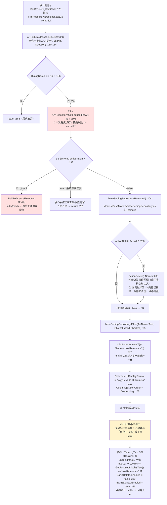

```
ASCII 等价

  「删除」(:178)
      │
  确认框 "是否永久删除?" (:180)
      ├ No ──► return (:188)
      └ Yes
           │
    t = GetFocusedRow() as T  (:191)     ★可能为 null★
           │
    if (t.IsSystemConfiguration)  (:193)  ← ★t 为 null 就 NRE★（无 try/catch）
           ├ true  ──► 弹「系统默认工具不能删除」→ return (:195-201)
           └ false
                │
         baseSettingRepository.Remove(t) (:204)
                │
         actionDelete != null ? actionDelete(t.Name) : 跳过  (:206-209)
                │
         RefreshData() (:211 → :91)
                │   ├ Filter(关键字, 包含所有) (:95)
                │   └ 列表头部插入哨兵行 { Name = "No Reference" } (:97)
                │        └► Timer1_Tick (:307, 100 ms) 见到它就把
                │             BarBtDelete / BarBtExtract 置灰 (:310-311)
                ▼
         弹「删除成功」(:213)
                │
         ⚠ 不落盘 —— 必须另点「保存」(:223) 或关窗(:299)
```

| 坑 | `文件:行` | 说明 |
|---|---|---|
| 🔴 `as T` 之后直接解引用（`R-16`） | `:191` / `:193` | 没有选中行（刚打开窗体、或点了表头）时 `GetFocusedRow()` 返回 `null` ⇒ `t.IsSystemConfiguration` **NRE**。**同一个方法在 `:275` 的「导入」里就写对了**（用 `is T t` 模式匹配）⇒ 这是"同一个类里两种写法并存"的典型 |
| ⚠️ 不落盘，但要弹"删除成功" | `:204` / `:213` | `Remove` 只改内存。用户看到"删除成功"后如果进程被强杀（`R-38`），**改动全丢**；反过来，用户以为已生效而实际只在内存里 |
| ⚠️ `actionDelete` 回调无保护 | `:206-209` | 回调是外部注入的（不同子类注入不同实现）。**回调抛异常时：内存里的条目已 `Remove`、外部引用没解绑、也不落盘** ⇒ 可能出现"配置里没有了但硬件/别处还认着它" |
| ⚠️ 哨兵行是"字符串约定"而不是类型标记 | `:97` 与 `:310`/`:311` | 用 `Name == "No Reference"` 这个**英文魔法字符串**当哨兵。若某个真实数据集恰好叫 `No Reference`，它**永远删不掉、也永远导入不了**（`R-43` 同族：靠字符串约定） |
| ⚠️ `Timer1` 没有 `Interval` | `Designer.cs:292`（`Enabled = true`） | .NET 默认 100 ms ⇒ **每秒 10 次**在 UI 线程上做 `GetFocusedDisplayText()` 字符串比较。开销小但完全没必要（`Columns[1].SortOrder` 那几行也不该每拍做） |

### 4.14 L-12「导入」数据集 + L-22 哨兵行联动

> **一句话**：「导入」和「双击行」是**同一个动作的两个入口**，但**一个有提示、一个没有**；
> 而且「导入」的提示是**无条件弹的** —— 没选中行时也弹 `"Extracted  Successfully!"`。
> 两者都**只改内存**（`AddBelongRecipeIds()` 往 `RecipeIDList` 里加一个 `Guid`），要另点「保存」才落盘。
> 哨兵行（`Name == "No Reference"`）把「删除」「导入」两个按钮在选中它时**一起置灰**。

**图 21**

```mermaid
flowchart TB
    A["入口①：点「导入」<br/>BarBtExtract_ItemClick :273<br/>接线 Designer.cs:132  ItemClick"] --> B{"GvRepository.GetFocusedRow() is T t ?<br/>:275<br/>✅ 用的是 is 模式匹配（与「删除」的 as 写法相反）"}
    B -->|"是"| B1["t.AddBelongRecipeIds() :277<br/>→ Models/BaseModels/BaseDsSetting.cs:75<br/>把当前 Recipe 的 id 加进该数据集的 RecipeIDList(:70)<br/>（已存在则不重复加 :78）"]
    B1 --> B2["this.DsSetting = t :278"]
    B2 --> B3["this.action?.Invoke() :279<br/>外部回调（通常是「把它设成当前使用中的」）"]
    B -->|"否：没选中行"| C
    B3 --> C["AKRSXtraMessageBox.Show(#quot;Extracted  Successfully!#quot;, #quot;Prompt#quot;, OK, Information) :282-286<br/>🔴 **无条件弹**：分支没走也照样弹「成功」"]
    D["入口②：Grid 双击行<br/>GvRepository_RowClick :253<br/>接线 Designer.cs:253  RowClick"] --> D1{"e.Clicks == 2 ? :255<br/>★单击完全无反应★"}
    D1 -->|"否：单击"| D2["什么都不做"]
    D1 -->|"是：双击"| D3{"GetFocusedRow() is T t ? :257"}
    D3 -->|"是"| D4["DsSetting = t :259<br/>t.AddBelongRecipeIds() :260<br/>action?.Invoke() :261"]
    D3 -->|"否"| D5["什么都不做"]
    D4 --> E["⚠ **不弹任何提示**<br/>⇒ 同一个动作，两个入口行为不一致"]
    C --> F["⚠ **两条路都不落盘**<br/>AddBelongRecipeIds 只改内存<br/>要另点「保存」(:223 → BaseSettingRepository.Save() :82)<br/>或关窗(:299)"]
    F --> G["联动（L-22）：Timer1_Tick :307（100 ms）<br/>focusedDisplayText == #quot;No Reference#quot; ?<br/>→ BarBtDelete.Enabled = false :310<br/>→ BarBtExtract.Enabled = false :311<br/>★哨兵行被选中时，删除和导入一起变灰★"]
    G --> H["哨兵行的来源：RefreshData() :97<br/>tList.Insert(0, new T() { Name = #quot;No Reference#quot; })<br/>⚠ 魔法字符串当标记（R-43 同族）"]
    style C fill:#ffe0e0
    style E fill:#fff3cc
    style F fill:#fff3cc
```

```
ASCII 等价

  入口① 「导入」(:273)                     入口② 双击行 (:253)
      │                                        │
  GetFocusedRow() is T t ? (:275)          e.Clicks == 2 ? (:255)
      ├ 是 ──► t.AddBelongRecipeIds() :277      ├ 否（单击）──► 什么都不做
      │        DsSetting = t :278                └ 是
      │        action?.Invoke() :279                 │
      └ 否 ──┐                                   GetFocusedRow() is T t ? (:257)
             │                                        ├ 是 ──► DsSetting = t / AddBelongRecipeIds / action?.Invoke (:259-261)
             ▼                                        └ 否 ──► 什么都不做
   弹 "Extracted Successfully!" (:282)                    │
   ★无条件弹 ★（没走分支也弹「成功」）               ⚠ 不弹任何提示
             │                                            │
             └────────────────┬───────────────────────────┘
                              ▼
                都只改内存：RecipeIDList 里加了一个 Guid (:70)
                要另点「保存」(:223 → Save() :82) 或关窗(:299) 才落盘
                              │
                              ▼
        哨兵行联动 (L-22)：
          RefreshData() 在列表头部插 { Name = "No Reference" } (:97)
          Timer1_Tick 每 100 ms 看选中行的显示文字 (:307)
              == "No Reference" ──► BarBtDelete.Enabled  = false (:310)
                                     BarBtExtract.Enabled = false (:311)
```

| 坑 | `文件:行` | 说明 |
|---|---|---|
| 🔴 「导入」的提示**无条件**弹 | `:275` / `:282` | `if (GetFocusedRow() is T t)` 没命中时（没选中行），代码**照样**弹 `"Extracted  Successfully!"` ⇒ 操作员看到"成功"但**什么都没发生**。这是本目录"提示与实际行为脱节"最直接的一例 |
| ⚠️ 两个入口行为不一致 | `:279` 有提示 / `:261` 无提示 | 双击行是"静默生效"，点按钮是"弹成功"。**同一个动作，两个反馈** |
| ⚠️ 单击行完全无反应 | `:255` | 只有 `e.Clicks == 2` 才处理 ⇒ 用户单击选行时**不会有任何反馈**（选中高亮是 Grid 自己做的） |
| ⚠️ `action?.Invoke()` 的差异 | `:279` 与 `:261` | 两处都是 `this.action?.Invoke()`，**同一个回调、同样的调用时机**，但注释掉的 `// this.DialogResult = DialogResult.OK;`（`:264`）说明这里原本还想设置对话框结果 —— **现在没有**，所以调用方 `ShowDialog()` 拿到的 `DialogResult` 永远是默认值。与 `ShowDialogForm<T>` 那条链（§4.26）呼应 |
| ⚠️ 魔法字符串哨兵 | `:97`、`:310`、`:311` | 见 §4.13 的同一条。**真实数据集若叫 `No Reference`，它永远删不掉也导不进** |
| ⚠️ `Timer1` 无 `Interval` | `Designer.cs:292` | 详见 §4.13 的同一条 |

### 4.15 L-13 关窗时的隐式落盘

> **一句话**：`FrmRepository` 的**落盘点是"关窗"而不是"按钮"** ——
> 新建（L-11 的上游）、删除、导入全都只改内存，只有在 `FormClosed`（`:294`）里才 `Save()` 一次。
> 这是本目录里**唯一一处"关窗即落盘"**的设计，也是**最容易丢数据的一条链**（`R-38`）。

**图 22**

```mermaid
flowchart TB
    A["用户关闭窗口（点 X / Alt+F4 / 调用方 Close()）"] --> B["FormClosing :319<br/>接线 Designer.cs:308"]
    B --> B1["Timer1.Tick -= Timer1_Tick :321<br/>Timer1.Dispose() :322"]
    B1 --> B2["⚠ 只 Dispose 计时器：**不 Dispose 窗体、不 Dispose Grid**<br/>窗体由调用方负责 Dispose"]
    B2 --> C["FormClosed :294<br/>接线 Designer.cs:309"]
    C --> C1["GvRepository.CloseEditor() :296<br/>提交正在编辑的单元格（否则最后输入的值丢掉）"]
    C1 --> C2["GvRepository.UpdateCurrentRow() :297"]
    C2 --> C3["🔵 baseSettingRepository.Save() :299<br/>→ BaseSettingRepository&lt;T&gt;.Save() Models/BaseModels/BaseSettingRepository.cs:82<br/>→ JsonFormatHelper&lt;T&gt;.SaveGenericList(列表, 文件名) 同一文件 :84<br/>⚠ 类里声明的 locker(:40) 从未被使用（R-88）"]
    C3 --> D["关窗完成"]
    E["在此之前的所有内存改动：<br/>① 新建/复制 :166（Add）<br/>② 删除 :204（Remove）<br/>③ 导入/双击 :277 / :260（AddBelongRecipeIds）<br/>④ 编辑单元格（未 CloseEditor 就还没提交）"] -.->|"全部只在这里落盘一次"| C3
    F["🔴 若在这之前进程被强杀 / 断电 / 未处理异常<br/>⇒ 以上四类改动**全部丢失**（R-38）"] -.->|"没有别的落盘点"| E
    style C3 fill:#e0ffe0
    style F fill:#ffe0e0
```

```
ASCII 等价

  用户关窗
      │
  FormClosing (:319)      ← Designer 接线 :308
      ├ Timer1.Tick -= Timer1_Tick (:321)
      └ Timer1.Dispose()          (:322)
         ⚠ 不 Dispose 窗体、不 Dispose Grid（窗体由调用方 Dispose）
      │
  FormClosed (:294)       ← Designer 接线 :309
      ├ GvRepository.CloseEditor()     (:296)  ← 提交正在编辑的单元格
      ├ GvRepository.UpdateCurrentRow()(:297)
      └ baseSettingRepository.Save()   (:299)  ★唯一的隐式落盘点★
             └─► BaseSettingRepository<T>.Save() (BaseModels/BaseSettingRepository.cs:82)
                    ⚠ 类里的 locker(:40) 从未被使用（R-88）

  在这之前只在内存里的四类改动：
     ① 新建/复制 FrmRepository.cs:166 (Add)
     ② 删除     :204 (Remove)
     ③ 导入/双击 :277 / :260 (AddBelongRecipeIds)
     ④ 单元格编辑（未 CloseEditor 就还没提交）
  ⇒ 全部只在关窗那一下落盘一次
  ⇒ ★进程被强杀 / 断电 / 未处理异常 = 全部丢失★（R-38）
```

| 事实 / 坑 | `文件:行` |
|---|---|
| 「保存」按钮也是一条落盘路，但**用户没有义务点它** | `:221-226`（`BarBtSave_ItemClick` → `Save()` `:223`，弹 `"Saved  Successfully!"` `:225`） |
| `FormClosing` 只清计时器 | `:319-323`；**不 Dispose 窗体**（`Designer.cs:308` 接的是 `FormClosing`，另一处 `:309` 接 `FormClosed`） |
| `CloseEditor()` 是必须的 | `:296` —— 没有它，**最后一次单元格编辑会丢**。放在 `FormClosed` 里意味着"用户改完最后一格直接点 X"这条路径是安全的 |
| 🔴 数据丢失窗口 | 见上图 `F`：新建/删除/导入**全都不落盘**（`R-38`）。这是本目录**唯一**"关窗即落盘"的窗体，也是唯一"关窗不掉数据、强杀全掉"的窗体 |
| ⚠️ 与 L-11/L-12 的提示不一致 | `:213` 弹"删除成功"、`:282` 弹"Extracted Successfully!"，但**真正的落盘还没发生** ⇒ 操作员以为已经写盘了 |
| ⚠️ `locker` 是**摆设**（`R-88`） | `BaseSettingRepository.cs:40` 声明了 `protected static volatile object locker = new object();`，但**全文件 0 处使用**（`grep -n locker` 只命中 `:40` 一行）⇒ `Save()`（`:82`）/ `Load()`（`:90`）**没有任何互斥**。**不要看到 `locker` 就以为这里做了线程保护** |
| ⚠️ 真正的序列化在外部 | `:84` `JsonFormatHelper<T>.SaveGenericList(this.BaseDsSettingList, this.GetFileName())` —— `JsonFormatHelper` 类**不在本仓库**（`grep -rn 'class JsonFormatHelper'` 全仓 0 命中）⇒ 它的并发行为无法在本目录内证实（见附录 B） |

#### 4.16.1 这条链是什么

编程助手界面（`UcEditProductProgramming`）左边是一棵 `TreeList`，右边是一个 `SplitContainerPanel`。
**用户点左边任意一个节点，右边就换成一个不同的子控件。** 这个"换控件"的动作只有一处实现 ——
`TreeListProgramming_FocusedNodeChanged`（`:453`，接线在 `designer.cs:174`），
它是一个 **29 分支的巨型工厂方法**，从一个 `switch` 里 `new` 出 20 多种子控件。

它与 §4.4 L-04（`Start(bool)` 的 55 个内层 case）是**两个独立维护的巨型 switch**，靠**中文字符串**对齐：

```
L-14 的 case 标签（英文 tag，29 个）      L-04 内层 switch 的 case（中文，55 个）
  "TransportUnitGeneral"  :718              "框架位置示教"        :1570
  "BondingPositionSubNode":771              "焊点位置示教"        :1752
  "ProcessingList"        :853              "点胶针示教"          :2057
        ↓                                         ↑
  由本方法 :736 的 ILstAssistantStep.Items.AddRange(...) 把名字塞进右侧列表
  ⇒ 列表里的字符串 = L-04 的 case 标签；两者只靠"字符串相等"关联，没有任何编译期检查
```

> 这一对关系是理解本节的钥匙：**本方法（L-14）决定"右边显示哪个控件"，并顺手决定"下一步助手列表里有哪些条目"；
> 用户点那些条目，走的是 §4.6 的 `Start()`。**

#### 4.16.2 主流程（图 23）

```mermaid
flowchart TB
    A["用户在 TreeListProgramming 上点一个节点<br/>designer.cs:174 接 FocusedNodeChanged"] --> B

    B["TreeListProgramming_FocusedNodeChanged :453"] --> C["⚠ :455 Panel1.Controls.Clear()<br/>★ 只 Clear 不 Dispose ⇒ 泄漏（R-89）"]
    C --> D{"e.Node?.Tag == null ?<br/>:457"}
    D -->|"是"| D1["return :459<br/>⚠ 此时面板已被清空<br/>而 selectedControl 仍指向旧控件"]
    D -->|"否"| E["string tagStr = e.Node.Tag?.ToString() :462"]

    E --> F{"e.Node.Tag is NodeTag tag ?<br/>:464"}
    F -->|"是（运行时追加的节点）"| F1["tagStr = tag.TagName :466"]
    F -->|"否（Designer 里写的字符串 Tag）"| F2["tagStr 保持字符串本身"]
    F1 --> G
    F2 --> G

    G["string systemName = this.CmbSystem.Text :469<br/>⚠ 声明后全方法未使用（R-90）"] --> H
    H["ILstAssistantStep.Items.Clear() :471"] --> I{"switch (tagStr) :473<br/>★ 29 个 case · 无 default"}

    I -->|"TransportSystem :476"| J1{"IsTransportConfigured ?<br/>:477"}
    J1 -->|"是"| J1a["new UcTransportSystem :479"] --> Z
    J1 -->|"否"| J1b["new UcBondMaxSubSection :484"] --> Z

    I -->|"Input :490"| J2{"LoadConfiguration ?<br/>:493"}
    J2 -->|"LoaderBin"| J2a["new UcLoderSetting :495"]
    J2 -->|"其它"| J2b["new UcInput :499"]
    J2a --> J2c["⚠ 两分支都不 Add<br/>Add 在 :502 统一做"]
    J2b --> J2c --> Z

    I -->|"TransportUnitGeneral :718"| J3{"IsOppositeSex ?<br/>:720"}
    J3 -->|"是"| J3a["⭐ new FrmTransportUnitEdit :722<br/>（名字像窗体，其实是 XtraUserControl — R-92）"]
    J3 -->|"否"| J3b["new UcTransportUnitFrame :731"]
    J3a --> J3c["ILstAssistantStep.Items.Clear() :725"]
    J3b --> J3d["ILstAssistantStep.Items.Clear() :734<br/>+ AddRange(框架/基板…示教 10 项) :736"]
    J3c --> Z
    J3d --> Z

    I -->|"其余 26 个 case<br/>:517 :522 :527 :555 :560 :578 :583 :597 :618 :624<br/>:645 :651 :670 :677 :689 :694 :712 :764 :771 :792<br/>:797 :824 :829 :836 :842 :853"| J4["直接 new 一个子控件"]
    J4 --> Z

    I -->|"☆ 没有 default ☆"| J5["什么都不做<br/>（当前 29 个 tag 全覆盖，此路径不可达 — 见 4.16.4）"]
    J5 --> Z

    Z["this.SpiltContainerProgramming.Panel1.Controls.Add(this.selectedControl)<br/>（各 case 内，共 31 处 Add / 29 个 case）"] --> Y
    Y["⭐ :862 this.BtReset.Enabled = this.ILstAssistantStep.Items.Count 大于 0;<br/>源码注释（:861）：『貌似只有 ILstAssistantStep 里有条目 才能启用 BtReset 按钮，先这么写。』"] --> X
    X["方法返回 · 无落盘 · 无硬件动作"]

    style C fill:#ffe0e0
    style J5 fill:#fff0c0
    style J3a fill:#e0f0ff
    style Y fill:#e0ffe0
```

ASCII 等价版：

```text
 用户点树节点
   │
   ▼
┌──────────────────────────────────────────────────────────────────────┐
│ :455 Panel1.Controls.Clear()          ★ 只 Clear 不 Dispose ⇒ 泄漏(R-89)
│ :457 if (e.Node?.Tag == null) return; ⚠ 面板已清空，selectedControl 还指着旧控件
│ :462 tagStr = e.Node.Tag?.ToString()
│ :464 if (e.Node.Tag is NodeTag tag) tagStr = tag.TagName      ← 双读
│ :469 systemName = this.CmbSystem.Text                          ⚠ 声明后未使用(R-90)
│ :471 ILstAssistantStep.Items.Clear()
└──────────────────────────────────────────────────────────────────────┘
   │
   ▼
 switch (tagStr) :473 ── 29 个 case，★无 default★
   │
   ├─ "TransportSystem" :476 ─┬ IsTransportConfigured(:477)=真 → new UcTransportSystem      :479
   │                          └ 假                    → new UcBondMaxSubSection   :484
   │
   ├─ "Input"           :490 ─┬ LoadConfiguration(:493)=LoaderBin → new UcLoderSetting :495
   │                          └ 其它                             → new UcInput        :499
   │                          （两分支都不 Add；Add 统一在 :502）
   │
   ├─ "TransportUnitGeneral" :718 ─┬ IsOppositeSex(:720)=真 → new FrmTransportUnitEdit :722 ⭐
   │                               │                         （名字像窗体，实为 XtraUserControl — R-92）
   │                               │                         + ILstAssistantStep.Items.Clear() :725
   │                               └ 假                      → new UcTransportUnitFrame :731
   │                                                         + Clear() :734
   │                                                         + AddRange(10 个示教项) :736
   │
   ├─ 其余 26 个 case：:517 :522 :527 :555 :560 :578 :583 :597 :618 :624
   │                   :645 :651 :670 :677 :689 :694 :712 :764 :771 :792
   │                   :797 :824 :829 :836 :842 :853   → 直接 new 一个子控件
   │
   └─ ☆ 没有 default ⇒ 未识别的 tag 什么都不做（当前 29 个 tag 全覆盖，此路径不可达）
   │
   ▼
 Panel1.Controls.Add(selectedControl)   （各 case 内，共 31 处 Add / 29 个 case）
   │
   ▼
 :862 this.BtReset.Enabled = this.ILstAssistantStep.Items.Count > 0;
     源码注释 :861「貌似只有 ILstAssistantStep 里有条目 才能启用 BtReset 按钮，先这么写。」
   │
   ▼
 返回。★无落盘、无硬件动作★（纯界面构造）
```

#### 4.16.3 29 个 case 与它们造出的控件（完整表）

| # | `tagStr` | case 行 | 造出的控件 | 行 | 备注 |
|---|---|---|---|---|---|
| 1 | `TransportSystem` | `:476` | `UcTransportSystem` | `:479` | 按 `MachineHardwareConfiguration.IsTransportConfigured`(`:477`) 二选一 |
| 2 | — | `:484` | `UcBondMaxSubSection` | `:484` | 未配置传输系统时的兜底 |
| 3 | `Input` | `:490` | `UcLoderSetting` / `UcInput` | `:495` / `:499` | 按 `LoadConfigurationEnum`(`:493`) 二选一；`Add` 在 `:502` |
| 4 | `BeltSystem1` | `:517` | `UcBeltSystem1` | `:518` | ⚠ `:519` 是 `break` 前的最后一行，注意 `Add` 在 `:519` |
| 5 | `BeltSystem2` | `:522` | `UcBeltSystem2` | `:523` | `Add` `:524` |
| 6 | `Output` | `:527` | `UcUnloaderSetting` / `UcOutput` | `:532` / `:536` | 与 #3 对称；`Add` `:539` |
| 7 | `WaferHandling` | `:555` | `UcWaferHanding(TreeListProgramming)` | `:556` | **把树本身当构造参数传进去** |
| 8 | `WaferHandlingSubNode` | `:560` | `UcMagazineGeometry` | `:561` | |
| 9 | `Configuration` | `:578` | `UcConfigurationDescription` | `:579` | 纯说明页 |
| 10 | `ConfigurationFirNode` | `:583` | **`UcConfiguration1`** | `:585` | ★本目录内的类。它的 `Confirm()` 是**空方法体**（`UcConfiguration1.cs:38`，见 §4.2.11）⇒ 选到它点 Save，**什么也没提交**（`R-123` 的第 ② 层） |
| 11 | `ConfigurationSubNode` | `:597` | **`UcConfiguration2`** | `:599` | ★本目录内的类（§4.22 讲它的重复订阅，`R-96`） |
| 12 | `PPTools` | `:618` | `UcPPToolsDescription` | `:619` | |
| 13 | `PPToolsSubNode` | `:624` | `UcNozzleEdit` | `:629` | `TagObject as NozzleShelfSlot`(`:625`) —— ⚠ 该局部变量**声明后未使用**（`R-90`） |
| 14 | `ESTools` | `:645` | `UcESToolsDescription` | `:646` | |
| 15 | `ESToolsSubNode` | `:651` | `UcESToolsDescription` | `:652` | ⚠ **与父节点是同一个说明页**（子节点点了等于没点） |
| 16 | `FlipTool` | `:670` | `UcFlipToolsDescreption` | `:671` | 注意源码拼写 `Descreption` |
| 17 | `FlipToolSubNode` | `:677` | `UcFlipToolEdit` | `:681` | |
| 18 | `Dispenser` | `:689` | `UcDispenserDescription` | `:690` | |
| 19 | `DispenserSubNode` | `:694` | `UcDispenser` | `:697` | ⚠ 它的 `Tag` 是**普通字符串**（`.cs:222`/`:235 nd.Tag = "DispenserSubNode"`），**不是 `NodeTag`** —— 见 4.16.4 |
| 20 | `TransportUnit` | `:712` | `UcTransportUnitDescription` | `:713` | |
| 21 | `TransportUnitGeneral` | `:718` | `FrmTransportUnitEdit` / `UcTransportUnitFrame` | `:722` / `:731` | 见 4.16.2；`Add` 有两处（`:723`/`:732`），故全方法 **31 处 `Add` / 29 个 case** |
| 22 | `BondingPosition` | `:764` | `UcAddBondPosition(this.RefreshNode)` | `:765` | **把 `RefreshNode` 当回调传进去** |
| 23 | `BondingPositionSubNode` | `:771` | `UcBondPositionEdit` | `:772` | |
| 24 | `Components` | `:792` | `UcComponentsDescription` | `:793` | |
| 25 | `ComponentsSubNode` | `:797` | `UcComponentEdit` | `:798` | |
| 26 | `EpoxyApplication` | `:824` | `UcAddEpoxyApplication(this.RefreshNode)` | `:825` | 同 #22 |
| 27 | `EpoxyApplicationSubNode` | `:829` | `UcEpoxyApplication` | `:830` | |
| 28 | `PostBond` | `:836` | `UcAddPostBond(this.RefreshNode)` | `:837` | 同 #22；`:848 RefreshILstAssistantStepWithPostBond(postBondInspection)` |
| 29 | `ProcessingList` | `:853` | **`UcProcessStep`** | `:856` | ⚠ `:854-855` 是**被注释掉的幽灵类型 `UcProcessStepEdit`** — 见 `R-91` |

> **对账**：29 个 `case` × `AppendNode` 的 Tag 一一对应 ——
> 20 个来自 `designer.cs`（`:119` `"TransportSystem"`、`:121` `"Input"`、`:123` `"BeltSystem1"`、`:125` `"BeltSystem2"`、
> `:127` `"Output"`、`:129` `"WaferHandling"`、`:131` `"Configuration"`、`:133` `"ConfigurationSubNode"`、`:135` `"ConfigurationFirNode"`、
> `:137` `"PPTools"`、`:139` `"ESTools"`、`:141` `"Dispenser"`、`:143` `"FlipTool"`、`:145` `"TransportUnit"`、`:147` `"TransportUnitGeneral"`、
> `:149` `"BondingPosition"`、`:151` `"Components"`、`:153` `"EpoxyApplication"`、`:155` `"PostBond"`、`:157` `"ProcessingList"`），
> 8 个来自运行时 `NodeTag`（`:131` `"WaferHandlingSubNode"`、`:159` `"PPToolsSubNode"`、`:181` `"ESToolsSubNode"`、`:200` `"FlipToolSubNode"`、
> `:275`/`:293` `"EpoxyApplicationSubNode"`、`:315` `"BondingPositionSubNode"`、`:339` `"ComponentsSubNode"`、`:358` `"PostBondSubNode"`），
> 1 个是字符串 `"DispenserSubNode"`（`:222`/`:235`）。**20 + 8 + 1 = 29 ✓**。

#### 4.16.4 三个必须讲清楚的点

**① 为什么 `:462` 和 `:464` 要读两遍 `Tag`？——因为树上两种 `Tag` 混用**

```csharp
:462  string tagStr = e.Node.Tag?.ToString();   // 先当字符串用
:464  if (e.Node.Tag is NodeTag tag)            // 再当 NodeTag 用
:466      tagStr = tag.TagName;                 // 是 NodeTag 就覆盖
```

这不是冗余代码，是**必需**的，因为：

- `designer.cs` 里那 20 个节点是用 `AppendNode(new object[]{"上料"}, 0, "Input")` 建的 —— 第 3 个参数就是 `Tag`，
  它是个**裸字符串**（`designer.cs:122`）。
- 运行时追加的 8 个子节点用 `node.Tag = new NodeTag { TagName = "...", TagObject = ... }`（如 `:131`）—— 是**对象**。
- 而 `DispenserSubNode` 又是一个**裸字符串**（`:222`/`:235`）—— 它是子节点里唯一的例外。

⇒ 三种写法并存，所以 `Tag` 必须先 `ToString()` 兜底、再按 `NodeTag` 覆写。
**同一个字段上并存三种约定**是本节最容易被误读的地方（也是 `R-91` 那类"把人引到幽灵类型"的温床）。

**② `:455 Clear()` 在 `:457` 空值保护之前 —— 顺序是刻意的还是笔误？**

```csharp
:455  this.SpiltContainerProgramming.Panel1.Controls.Clear();   // 先清
:457  if (e.Node?.Tag == null) { return; }                      // 再判空
```

如果这是一个"早退保护"，那**顺序反了**：`Tag == null` 时面板已经被清空，
而 `this.selectedControl`（`:87 private XtraUserControl selectedControl;`）**仍然指向那个已被移出可视树的旧控件**。
下一次 `BtStart_Click`（`:870`）会执行 `:873 (this.selectedControl as IProgrammingControl)?.Confirm();` ——
**对一个已经不在界面上的控件调 `Confirm()`**，即"用户看不到的东西被确认了"。

> ⚠️ **但这条当前不可达，不要写成"存在这个 bug"**。我逐个核对了全部 29 个节点的 `Tag` 赋值
> （见 4.16.3 的对账：`designer.cs` 20 处、运行时 `NodeTag` 8 处、字符串 1 处），**没有一个节点 `Tag == null`**。
> 所以 `:457` 这条分支是纯防御性的。**它是一个"顺序写反的潜在缺陷"（`R-89` 同条记录），不是活跃缺陷。**
> （判别依据：`grep -c 'AppendNode'` 在 `UcEditProductProgram/*.cs` 共 **31** 处（`designer.cs` 20 + `.cs` 11），**全部带 Tag**；
> `grep -n '\.Tag = '` 共 **14** 处，其中 **13 处是树节点**、1 处是 `designer.cs:498 this.Tag = "Product assistant"`（本控件自己的 Tag，与树无关），
> **13 处节点 Tag 无一为 null**。）
>
> **顺带一个"顺序依赖"的脆弱点**：`:491` 的 `(this.TreeListProgramming.FocusedNode.Tag as NodeTag)?.TagObject as LoaderBin`
> 只有在 `:370` 执行过之后才有值 —— `designer.cs:122` 给"上料"节点写的是**裸字符串 `"Input"`**，
> 是 `:370 transportLoaderNode.Tag = new NodeTag() { TagName = "Input", TagObject = loader }` 在运行时把它**覆盖**成 `NodeTag` 的。
> 也就是说 **"上料的 Tag 到底是什么类型"取决于 `:370` 有没有跑过**（`:380` 与"出料"同理）。
> **但 `loader`/`unLoader` 这两个局部变量拿到值之后根本没被使用**（见 `R-90`），所以这个顺序依赖当前不产生后果 —— ⚠️ 记在这里备查。

**③ `:862` 的 `BtReset.Enabled` —— 源码作者自己都写着"先这么写"**

```csharp
:861  // 貌似只有 ILstAssistantStep 里有条目 才能启用 BtReset 按钮，先这么写。
:862  this.BtReset.Enabled = this.ILstAssistantStep.Items.Count > 0;
```

这句话把 §4.7 的 L-05（「重置」按钮）和本节连起来了：
**「重置」按钮能不能点，由"当前节点的助手列表是否为空"决定，而不是由"用户是否改过东西"决定。**
后果：用户点了 `TransportUnitGeneral` 但 `IsOppositeSex == false` 时会看到列表有 10 项（`:736` ⇒ 能点重置）；
点 `"Configuration"`（`:578`，说明页，不清也不填列表）时列表可能非空（继承上一个节点残留）⇒ 也能点重置。
⇒ **`BtReset` 的启用状态与"有没有东西可重置"没有可靠对应**（`R-93`）。

#### 4.16.5 坑：`Controls.Clear()` 不 `Dispose()` ⇒ 每切一次节点泄漏一批控件（`R-89`）

`Panel1.Controls.Clear()` 只把子控件从 `Controls` 集合里移除，**不调用 `Dispose()`，也不释放它们持有的资源**。
本方法在**每次节点切换**时都执行它（`:455`），而它清掉的那些子控件里有相当一部分**持有相机 / 轴 / 定时器引用**：

| 会被丢弃但不会释放的东西 | 证据 |
|---|---|
| `UcGuideMove` 系的 100 ms 刷新 `Timer` | `UcGuideMove.cs:556 Timer_Tick`；§4.5 L-03 |
| 相机对象与曝光设置 | `UcGuideMove.cs:679 camera.SetExposureTime(...)`；§4.5 |
| 轴引用（`axisX`/`axisY`/`axisZ`/`axisU`） | `UcGuideMove.Joystick.cs:759-777` |
| `UcConfiguration1/2`、`UcProcessStep` 等自建 `TreeList` | `UcConfiguration2.cs:103 this.treeList.FocusedNodeChanged += ...`（**每次 `RefreshControl()` 都重复订阅一次**，同一实例内最多累积到 7 个；但处理函数幂等 ⇒ **无功能影响、无内存泄漏**，详见 §4.22 L-23 的 `R-96`。**不要写成"内存泄漏"**） |

> **用户看到什么**：长时间使用编程助手（反复在左侧点来点去）后，**内存与 GDI 句柄持续增长**，
> 相机/定时器仍在后台按 100 ms/帧 跑（因为 `Timer` 还活着），直到 GC 真的回收。
> 若某些子控件被**静态委托**持有（例如 `UcEditProductProgramming_Load` 在 `.cs:1090-1105` 给 6 个**静态委托**挂了本实例方法，见 §4.25），
> 则**实例根本不会被回收** ⇒ 泄漏是**累积且不回收**的。
> `R-89` 的后果栏按这个写。

#### 4.16.6 与 L-04 的"Start → 换节点 → 建控件"链

```text
  BtStart_Click :870
       │ :873  (this.selectedControl as IProgrammingControl)?.Confirm()
       │       ★ 先让"当前显示的那个子控件"落盘它自己的数据
       ▼
  Start(true) :874 ──▶ §4.6 L-04：55 个内层 case 的动作序列
       │
       │  命中某个示教 case（如 "框架位置示教" :1570）
       ▼
  this.TreeListProgramming.MoveNext() :1171
       │       （在 Start() 的外层 14 个 tag case 的公共体里；
       │        ★ 把焦点移到树上的下一个节点 ★）
       │
       │  ⇒ 触发 FocusedNodeChanged ★
       ▼
  重新进入 L-14 :453
       │ :455 Panel1.Controls.Clear()   ⇒ 丢掉上一批子控件（R-89）
       │ :862 BtReset.Enabled = ...     ⇒ 重算「重置」能否点（R-93）
       ▼
  右侧显示新控件，助手列表被换成新的一批条目
```

> **这是"两个巨型 switch 互相驱动"的证据**：用户在 §4.6 的流程里走一步，界面会**回过来**重建右侧控件。
> 也就是说 **L-04 与 L-14 不是两条独立的链，而是一个闭环** —— 这也是为什么本节必须单独成篇。
> ⚠️ **闭环的一个直接后果**：`§4.6` 的 `Start()` 每走到下一个示教项，都会带着走一遍
> `:455 Clear()`（`R-89` 的泄漏点），所以**泄漏速度与"用户按了多少次开始"成正比**，而不只是与"点了几次树节点"成正比。
>
> **用户看到什么**：按「开始」之后，**左侧树的光标自己往下跳一格**，右侧面板随之被整个换掉。
> 这个"界面自己动"的行为来自 `:1171` 的那一行 `TreeListProgramming.MoveNext()`，
> 它位于 `Start()` **外层 14 个 tag case 的公共体**里（`:1156`–`:1170`，其中 `"ConfigurationFirNode"` 一行在 `:1161` 被注释掉）——
> 也就是说：**这 14 类节点上按「开始」，界面都会跳到下一个节点。**
> 全仓 `grep -n 'FocusedNode = \|SetFocusedNode'` **0 命中** ⇒ 这是**唯一**一处代码驱动的焦点移动。

#### 4.16.7 本节小结表

| 事实 / 坑 | `文件:行` |
|---|---|
| 唯一的节点切换处理器 | `UcEditProductProgramming.cs:453`（接线 `designer.cs:174`） |
| 先清空、后判空（顺序可疑但不可达） | `:455` / `:457` |
| `Tag` 三种约定混用（字符串 / `NodeTag` / 字符串） | `:462`/`:464`；`designer.cs:122`；`.cs:131`；`.cs:222`/`:235` |
| `:469` `systemName` **声明后全方法未使用** | `:469`（`grep -n systemName *.cs` 仅此 1 行） |
| `:491` `loader`、`:528` `unLoader`、`:625` `nozzleShelfSlot` **声明后未使用** | `:491`/`:528`/`:625` |
| 29 个 case、**无 `default`** | `:473`–`:858`（`awk 'NR>=470 && NR<=860 && /case "/'` → **29**） |
| 31 处 `Controls.Add` / 29 个 case | `:480` `:485` `:502` … `:857`（`grep -n 'Controls.Add'`） |
| ⚠ `ESToolsSubNode` 与父节点**同一个说明页** | `:645`/`:651` → 都是 `UcESToolsDescription` |
| ⭐ `FrmTransportUnitEdit` 名字像窗体、实为 `XtraUserControl` | `:722`；`TransportUnitSystem/Controls/TransportUnitEdit/FrmTransportUnitEdit.cs:27 public partial class FrmTransportUnitEdit : DevExpress.XtraEditors.XtraUserControl` |
| ⚠ `:854-855` 注释里留着**幽灵类型** `UcProcessStepEdit`，活代码用 `UcProcessStep` | `:854`/`:855`（注释）；`:856`（活）；`Main/Machine/Process/UcProcessStep.cs:33`（活的那个） |
| `RefreshNode` 被当**回调**传给 3 个子控件 | `:765`/`:825`/`:837` |
| 无落盘、无硬件动作 | 全方法无 `Save()`、无 `Axis*` 调用 |


### 4.17 L-15 视觉报警「OK」与 L-21 后台实时显示

`FrmVisionAlarm`（`Controls/Currency/FrmVisionAlarm.cs`）是**定位失败时弹出来的那个报警窗**，
它同时跑着**两条链**：

| | 链 | 触发者 | 跑在哪 |
|---|---|---|---|
| L-15 | 用户点「OK」（`BtOK_Click` `:339`）或「编辑模板」（`BtEditProgram_Click` `:426`） | 操作员（或"没人点"） | **UI 线程** |
| L-21 | 后台"定位失败实时显示线程"（`BackgroundWorkerDoWork` `:135`） | 构造函数的 `Task.Run` `:52` | **任务线程**（300 ms 一轮） |

**两条链共享三个字段**（`isAllowWork` / `isWork` / `isclose`），这是本节全部坑的来源。

#### 4.17.1 谁打开这个窗体（**没有按钮**）

| 事实 | `文件:行` |
|---|---|
| 唯一两个构造点 | `Main/Controls/Ucmain/MainControls/UcMainSystem.Action.cs:247`（`pRHardware` 传 `null`）、`:286`（传实参） |
| 两处都在 `this.Invoke(new Action(() => {...}))` 里 | `:245` / `:284` —— **从任务线程切到 UI 线程** |
| 两处都在 `lock (AKRSMessageBoxExt.UiLock)` 内 | `:275`（`VisionAlarm` 方法体整体加锁） |
| **界面上没有任何按钮打开它** | 属 §4.1 的**入口类型 ②**（任务层/线程运行时弹出） |
| 关窗后 `HandleType` 落库 | `:294 alarm.HandleType = dialogResult.ToString();` → `:297 DBService.Insert(alarm);` |

> ⚠️ **`HandleType` 落库的是 `DialogResult.ToString()`** —— 所以这个 `DialogResult` 不是"界面状态"，是**报警处理结论**，
> 会进数据库。若 `DialogResult` 拿不到预期值（见 §4.26 的 `MainForm.cs:70` 隐性契约 `R-74`），
> 报警日志会被**批量记成 `"Abort"`**。

#### 4.17.2 两条链的交互（图 24）

```mermaid
sequenceDiagram
    autonumber
    participant T as 任务线程<br/>（定位失败处）
    participant U as UI 线程<br/>MainForm 消息循环
    participant D as FrmVisionAlarm<br/>（模态对话框）
    participant W as 后台线程<br/>"定位失败实时显示线程"

    T->>T: lock (AKRSMessageBoxExt.UiLock)  UiLock 被任务线程持有
    T->>U: this.Invoke( ... )  并 ★等待★
    U->>D: new FrmVisionAlarm(...)  :247 / :286
    D->>W: :52 Task.Run(BackgroundWorkerDoWork)
    U->>D: ShowDialog()  ← 嵌套消息循环（UI 线程不阻塞）

    loop 每 300 ms
        W->>W: :143 if (isAllowWork)
        W->>W: :145 isWork = true   ★窗口期★
        W->>W: :164 entity.DoWork(...) 或 :150 SnapShot(...)
        W->>W: :175 isWork = false
        W->>W: :178 Thread.Sleep(300)
    end

    Note over U,D: 用户点「OK」BtOK_Click :339
    U->>D: :341 isAllowWork = false
    U->>U: :344 while (isWork) Thread.Sleep(100)  🔴 UI 线程被同步阻塞
    Note over U: ★嵌套消息循环停止泵消息★<br/>重绘停 · 取消点不动 · 急停点不动 · 其它窗体的 UiLock 请求全部排队
    D->>D: :372 entity.DoWork(PRHardware,false,true)  平台 PR 重跑匹配
    alt 匹配失败
        D->>D: :376 弹"没有找到模板，请重试" · :377 isAllowWork = true（可再试）
    else 匹配成功
        D->>D: :383 / :387 归一成 BaseAlgResult
        D->>D: :395 DialogResult = OK
        D->>D: 已死代码 :398-405（EpoxyDetectAlg 在 :364 就 return 了）
    end
    U->>T: Invoke 返回
    T->>T: :294 HandleType = dialogResult.ToString() → :297 写库
    T->>T: 释放 UiLock

    Note over W,U: 关窗：FormClosing :555 isclose = true
    U->>D: FormClosed :515 CloseAlarm()（空体）+ while (task.Status == Running) Thread.Sleep(10)  :518-521
    Note over U: ⚠ 又一处 UI 线程自旋：有界 ≈ 一轮 DoWork + 300 ms<br/>🔴 但若 W 卡在 SnapShot/DoWork 里，则永久卡死
```

#### 4.17.3 ⚠️ 关键区分：**「同步阻塞」不是「死锁」**

本文档里有**两条症状几乎一样、机制完全不同**的缺陷。**它们必须分开写、互相交叉引用** ——
混写会让接手人排查方向错到底。

| | **R-94**（本节） | **R-75**（§4.26） |
|---|---|---|
| 名称 | **UI 线程被同步阻塞** | **跨线程互等死锁** |
| 机制 | UI 线程在 `_Click` 处理器里执行 `while (...) Thread.Sleep(100)`（`:344-347`） | 任务线程持 `AKRSMessageBoxExt.UiLock` 后 `Invoke` 到 UI 线程**并等待**（`UcmainSystem.Action.cs:275` + `:284`）；UI 线程此刻若正需要同一把锁，两边各持一把、各等对方 |
| 谁在等谁 | **UI 线程自己在转圈**，等一个后台线程置位的标志 | UI 线程等任务线程**释放锁**，任务线程等 UI 线程**执行完委托** |
| 参与方 | 1 个线程（UI） | **≥ 2 个线程**，且互相**持锁** |
| 会不会自己好 | `isWork` 被后台置 `false` 后**能自己恢复**（正常情况下 ≤ 300 ms） | **永远不会**自己好，除非其中一个线程被外力终止 |
| 关键代码 | `FrmVisionAlarm.cs:344-347`、`:431-434`、`:438`、`:518-521` | `AKRSMessageBoxExt.cs:40` 的 `UiLock` + `ControlService.cs:369`（**无主线程豁免**） |
| 用户看到什么 | 点「OK」「编辑模板」「X」之后**界面卡死**，`X`、急停都点不动 | **同上，症状一模一样** |
| 排查方向 | 找 `Thread.Sleep` / `.Wait()` / `.Result` 在 `_Click` 体内 | 找 `lock (…UiLock)` 之后又 `Invoke`/`SendUiAction`/`ShowDialogForm<T>` 的调用点 |

> **两句话记住差别**：**同步阻塞 = 一个线程在原地转圈；死锁 = 两个线程互相等对方。**
> 本项目里**两者产生的用户症状（界面不动、急停点不动）无法凭肉眼区分**，
> 只能靠"当前有没有第二个线程持有 `UiLock`"来判定 —— 这就是为什么 `R-94` 与 `R-75` 必须成对阅读。

#### 4.17.4 `BtOK_Click` 的五个出口

`BtOK_Click`（`:339-408`，70 行）有 **5 个 `return`/结束点**，其中 3 个直接给 `OK`：

| # | 条件 | 行 | `DialogResult` | `isAllowWork` 复位？ |
|---|---|---|---|---|
| 0 | （入口）自旋等后台 | `:344-347` | — | — |
| 1 | `entity == null` | `:350-354` | `OK` | **否** ← 保持 `:341` 置的 `false` |
| 2 | `AlgFlowType == SymmetricModeleAlg` **或** `caption == "晶圆线程"` | `:357-361` | `OK` | 否 |
| 3 | `AlgFlowType == EpoxyDetectAlg` | `:364-368` | `OK` | 否 |
| 4 | `DoWork` 返回 `!= Success` | `:374-378` | **不变**（保持初值 `No`） | **是**（`:377 isAllowWork = true` ⇒ 可再试） |
| 5 | 成功 | `:379-406` | `OK`（`:395`） | 否 |

> 出口 4 是唯一"不关窗、允许重试"的出口 —— 对应 `Main` 侧的"重测"分支（`UcmainSystem.Action.cs` 按 `DialogResult` 分流）。
> **注意出口 1/2/3 都不复位 `isAllowWork`**：`isAllowWork` 一关，后台线程就停在 `:143` 不动了
> （**但 `:178 Thread.Sleep(300)` 仍在转**，只是不再采集）—— 语义是"这个窗马上要关了，别采了"。

#### 4.17.5 已确认的死代码：`:398-405`

```csharp
:364  if (this.entity.Alg.AlgFlowType == AlgFlowTypeEnum.EpoxyDetectAlg)
:366  { this.DialogResult = DialogResult.OK; return; }        // ← 无条件 return
...
:398  if (this.entity.Alg.AlgFlowType == AlgFlowTypeEnum.EpoxyDetectAlg)   // ★ 永远为假
:400      AKRSXtraMessageBox.Show("是否暂停设备", "提示", MessageBoxButtons.OKCancel);
:403      Machine.GetInstance().Pause();                        // ★ 永远不执行
```

`:398` 的判定条件与 `:364` **完全相同**，而 `:364` 已经 `return` ——
所以"是否暂停设备"这个弹窗和 `Machine.GetInstance().Pause()`（`:403`）**永远执行不到**。
⇒ **"胶量检测失败后询问是否停机"这个功能实际上不存在**（已并入 `R-05` 的记录：本文件另有一处同类死代码）。

#### 4.17.6 `R-94`：本目录唯一的 🔴「UI 线程被同步阻塞」

**判定方法**（可复现，取自共享参考的启发式）：回溯"最近的按钮类方法签名"，找非注释的 `Thread.Sleep`：

```bash
cd "E:/项目/ZX2200标机/trunk/AKRS.ZX2200"
find ./Infrastructure -name '*.cs' -not -path './bin/*' -not -path './obj/*' \
     -not -name '*.Designer.cs' -not -name '*.designer.cs' -print0 |
xargs -0 awk '
/^[[:space:]]*(private|public|protected|internal).*[[:space:]]+void[[:space:]]+[A-Za-z0-9_]+[[:space:]]*\(/ { sig=$0 }
{ t=$0; sub(/^[[:space:]]+/,"",t) }
t !~ /^\/\// && /Thread\.Sleep[[:space:]]*\(/ {
  if (sig ~ /_Click|_ItemClick|_CheckedChanged|_SelectedIndexChanged|_ValueChanged|_DoubleClick/) print FILENAME":"FNR"   <- "sig }'
# 实测输出 3 行：FrmVisionAlarm.cs:346 / :433（<- BtOK_Click / BtEditProgram_Click）、:438
```

> ⚠️ **这是启发式，只能用来"找候选"，不能用来下结论。** 我**逐条打开方法体**确认过，
> 并**纠正了它的一处漏报与三处误报**：

| 位置 | 启发式是否报 | **我读方法体后的判定** | 依据 |
|---|---|---|---|
| `FrmVisionAlarm.cs:346` | ✅ 报 | **🔴 在 UI 线程** | 在 `BtOK_Click :339-347` 体内，无 `Task.Run` 外包 |
| `FrmVisionAlarm.cs:433` | ✅ 报 | **🔴 在 UI 线程** | 在 `BtEditProgram_Click :426-434` 体内 |
| `FrmVisionAlarm.cs:438` | ✅ 报 | **🔴 在 UI 线程** | 同方法内，`Thread.Sleep(500)`（**不是循环，但一次睡 0.5 s**） |
| `FrmVisionAlarm.cs:520` | ❌ **漏报** | **⚠️ 也在 UI 线程** | 在 `FrmVisionAlarm_FormClosed :515-521` 体内 —— 它是**窗体事件处理器，不是 `_Click`**，所以启发式的正则没匹配到。**这条是我补的** |
| `UcGuideMove.Joystick.cs:575` | ❌ 未报 | **不在 UI 线程 ⇒ 不列** | `Thread.Sleep(5)` 在 `MoveAxisByJoystick :407-587` 的 `while (IsJoystickEnable)`（`:413`）里；该方法由 `:611 this.axiaMoveTask = Task.Run(...)` / `:617` 启动 ⇒ **任务线程** |
| `FrmMeasureHeightPoints.cs:220` | ❌ 未报 | **不在 UI 线程 ⇒ 不列** | `Thread.Sleep(1000)` 在 `ResultVision :156` 里，而 `ResultVision` 由 `DoWork :72` 调用，`DoWork` 跑在 `:332 this.thread = new Thread(this.DoWork)` 上 ⇒ **任务线程** |
| `UcEditProductProgramming.cs:138` | ❌ 未报 | **⚠️（低）在 UI 线程但只调一次** | `Thread.Sleep(100)` 在节点构造代码里（`RefreshNode` 系），只在"晶圆料盒配置不在仓库中"时执行一次 ⇒ 单次 100 ms，人眼几乎无感 |
| `FrmBondheadStandardMeasurement.cs:137`/`:149`/`:161` | ❌ 未报 | **不在 UI 线程 ⇒ 不列** | 三处 `Thread.Sleep(1000)` 在 `MeaureStandard()` 内，由 `:105 Task.Run(...)` / `:109` 调用 ⇒ **任务线程**（§4.8） |

**⇒ 本目录实锤的 UI 线程阻塞只有 `FrmVisionAlarm` 一个文件，共 4 处；其中 3 处是启发式报的，第 4 处（`:520`）是补的。**

**为什么它是 🔴 而不是 ⚠️**

`isWork` 全文件只在**两处**被写：

| 写点 | 值 | 上下文 |
|---|---|---|
| `:145` | `true` | 后台线程，每轮开始时 |
| `:175` | `false` | 后台线程，每轮**正常结束**时 |

后台循环的异常处理是：

```csharp
:181  catch (Exception ex)
:183  { throw new Exception("定位失败实时显示线程异常" + ex.Message); }   // ★ 包装后重新抛出
```

**重新抛出 ⇒ 后台循环终止 ⇒ `:175` 那一行永远不会再执行 ⇒ `isWork` 永久停在 `true`。**
此后：

- `BtOK_Click` 的 `:344 while (isWork) Thread.Sleep(100)` —— **永远出不来**
- `BtEditProgram_Click` 的 `:431-434` —— 同上
- 因为自旋在 **UI 线程**上，**嵌套消息循环不再泵消息** ⇒ 这个对话框的 `X`、`取消`、`重测`、
  **以及主界面上的急停/安全门相关按钮，全部点不动**

**用户看到什么**：点「OK」之后界面卡死，点什么都没反应，**急停也点不动** —— 症状与 `R-75` 的死锁**完全一样**，
但机制是"UI 线程自己在转圈"。

**触发条件（可达路径，逐行追完）**：后台线程任一轮抛异常，可能的来源：
1. `:150 aKRSCamera.SnapShot(false, SnapImageFormat.Format8bppIndexed)` —— **相机掉线/被占用**时平台 DLL 抛错；
   而这条路径的前置是 `:147 this.entity == null`，此时 `:149` 又直接读 `this.PRHardware.CameraName`
   —— **`PRHardware` 为 `null` 时就是 NRE**（`UcmainSystem.Action.cs:247` 传的恰好是 `null`！）。
   ⇒ **`entity == null` 且 `PRHardware == null` 时，第一轮必然抛异常 ⇒ 必然卡死。**
2. `:164 entity.DoWork(PRHardware, false, false)` —— PR 匹配抛错。

> ⭐ **这是本节最硬的一条**：`UcmainSystem.Action.cs:247` 用 `new FrmVisionAlarm(pREntity, message, caption, null)`
> 调用（第 4 个参数显式传 `null`，构造函数签名 `:43` 的默认值也是 `null`）。
> 只要那条路径上 `pREntity` 也是 `null`，`BackgroundWorkerDoWork` 的第一轮就走进 `:147` 分支、
> 在 `:149` 解引用 `this.PRHardware` 抛 NRE ⇒ `:183` 重新抛出 ⇒ `isWork` 停在 `true`
> ⇒ **点「OK」界面永久卡死**。（`:247` 与 `:286` 的区别就是第 4 个参数：`null` vs `pRHardware`。）

**正确的写法**（给接手人）：
把 `while (isWork) Thread.Sleep(100)` 换成 **`await Task.Delay(...)`** 驱动的异步等待，
或用一个 **可取消的 `ManualResetEventSlim` / `TaskCompletionSource`** 让后台线程在结束时**必然唤醒**等待方
（`try/finally` 保证复位 `isWork`），并给等待加**超时**与 `CancellationToken`。
**至少要给 `:183` 的重新抛出加 `finally { this.isWork = false; }`。**

#### 4.17.7 `R-95`：`FormClosed` 里的第二处 UI 线程自旋（有界，但可能变无限）

```csharp
:515  private void FrmVisionAlarm_FormClosed(object sender, FormClosedEventArgs e)
:517      this.CloseAlarm();          // ⚠ 方法体除空值检查外是空的（:541-548）⇒ 二级报警灯不会被清
:518      while (this.task.Status == TaskStatus.Running)
:520          Thread.Sleep(10);
```

- **正常情况下有界**：`FrmVisionAlarm_FormClosing`（`:555-558`）置 `:557 this.isclose = true`，
  WinForms 保证 `FormClosing` 先于 `FormClosed` 触发，所以后台循环最多再走完一轮
  ⇒ `FormClosed` 最多等 **一次 `DoWork` + `:178 Thread.Sleep(300)`**。
- **但它没有上界**：若后台正卡在 `:150 SnapShot(...)` 或 `:164 DoWork(...)` 里
  （相机掉线、平台 DLL 阻塞），`task.Status` 会**长期停在 `Running`** ⇒ **关窗即永久卡死主界面**。
- ⚠️ 另一条已有的记录：`:517 CloseAlarm()` **不清报警灯**（`:541-548` 只做空值检查），
  与 `:287 Alarm()` ⇒ `:535 alarm[0].SetSecondLevelAlarm()` 不对称 —— **灯亮了没人关**（`R-05`）。

> **定级**：⚠️（正常路径有界）／🔴（后台卡住时无限）。**不写"必然卡死"，也不写"无害"。**

#### 4.17.8 L-21 后台线程本身：`Task.Run` 的异常无人观察

```csharp
:52   this.task = Task.Run(() => this.BackgroundWorkerDoWork());
:181  catch (Exception ex) { throw new Exception("定位失败实时显示线程异常" + ex.Message); }
```

`this.task` **全文件只被读过一次**（`:518 task.Status`），
**`await` 0 处、`.Wait()` 0 处、`ContinueWith` 0 处** ⇒ **异常被完全吞掉**
（`TaskScheduler.UnobservedTaskException` 在本项目也没有全局订阅）。
⇒ 后台线程死了，**没有任何日志、没有任何提示**，用户唯一的感知就是"图像不再刷新了"，
然后点「OK」时界面卡死（`R-94`）。

#### 4.17.9 本节小结表

| 事实 / 坑 | `文件:行` |
|---|---|
| 入口不是按钮，是任务层运行时弹出 | `UcmainSystem.Action.cs:245-252` / `:284-291`（**入口类型 ②**） |
| 两处都在 `lock (AKRSMessageBoxExt.UiLock)` 内 + `Invoke` | `:275`；与 `R-75` 的死锁链同源 |
| 后台线程启动 | `FrmVisionAlarm.cs:52` |
| 后台 300 ms 一轮 | `:141` / `:178` |
| `isWork` 只有两个写点 | `:145`（true）/ `:175`（false） |
| 🔴 后台异常重新抛出 ⇒ `isWork` 永不复位 | `:181-184` |
| 🔴 `entity==null` 且 `PRHardware==null` ⇒ 第一轮必抛 NRE | `:147` 判据、`:149` 解引用；调用方 `UcmainSystem.Action.cs:247` 传 `null` |
| 🔴 UI 线程自旋 ① | `:344-347`（`BtOK_Click`） |
| 🔴 UI 线程自旋 ② | `:431-434`（`BtEditProgram_Click`） |
| 🔴 UI 线程单次睡 0.5 s | `:438`（**紧跟 `:436 Machine.GetInstance().Pause()` 之后**） |
| ⚠️ UI 线程自旋 ③（启发式漏报，我补的） | `:518-521`（`FrmVisionAlarm_FormClosed`） |
| ⚠️ `CloseAlarm()` 空体 ⇒ 二级报警灯不清 | `:517` → `:541-548`；对照 `:535` |
| ⚠️ `Task` 异常无人观察 | `:52`；`task` 只被读 `:518` |
| 死代码：`"是否暂停设备"` 弹窗 + `Pause()` | `:398-405`（`:364` 已提前 `return`） |
| 「取消」直接停机 | `:415-419`（`BtAbort_Click` → `Machine.Stop()` + `DialogResult.Abort`） |
| 「补胶」返回 `Retry` | `:565-568`（`BtReDispense_Click` → `DialogResult.Retry`） |
| 4 个出口给 `OK`，1 个给 `Abort`/`Retry`，1 个"不关窗可重试" | 见 4.17.4 表 |
| 不在 UI 线程的 `Thread.Sleep`（**不列**） | `UcGuideMove.Joystick.cs:575`（Task.Run）、`FrmMeasureHeightPoints.cs:220`（Thread）、`FrmBondheadStandardMeasurement.cs:137/:149/:161`（Task.Run） |
| ⚠️ 单次 100 ms（低，仅记录） | `UcEditProductProgramming.cs:138` |


### 4.18 L-16「编辑模板」PR 参数

这是 `FrmVisionAlarm` 上的第二个按钮（`BtEditProgram`），链 L-16。
它是**本目录唯一一处会"整机暂停 → 改配方 → 恢复"的按钮**，也是本目录**唯一一处 `Pause()`/`Continue()` 不成对保护**的地方（`R-80`）。

#### 4.18.1 按钮与入口

| 事实 | `文件:行` |
|---|---|
| 按钮 `BtEditProgram` | `FrmVisionAlarm.Designer.cs:105` 接 `Click` |
| 处理器 | `FrmVisionAlarm.cs:426`（方法体 `:426-498`，73 行） |
| `entity == null` 时按钮被**禁用** | `:277` / `:279 this.BtEditProgram.Enabled = false;`（在 `Load` 里）⇒ **不可能带着 `null` 进 `:442 lock (this.entity)`** |
| 没有二次确认 | 点了就暂停整机，**不弹"确定要暂停吗"** |

#### 4.18.2 主流程（图 25）

```mermaid
flowchart TB
    A["用户点「编辑模板」<br/>Designer.cs:105 → :426"] --> B[":428 isAllowWork = false<br/>（让后台线程下一轮不再采集）"]
    B --> C["🔴 :431 while (isWork) Thread.Sleep(100)<br/>等后台当前这一轮跑完<br/>（同 R-94 的 UI 线程同步阻塞）"]
    C --> D["🔴 :436 Machine.GetInstance().Pause()<br/>★ 整机暂停（无二次确认）"]
    D --> E["⚠ :438 Thread.Sleep(500)<br/>UI 线程再睡 0.5 s"]

    E --> F{"this.PRHardware != null ?<br/>:440"}
    F -->|"是"| G["lock (this.entity) :442"]
    F -->|"否"| N["else 分支 :485-490<br/>直接 new FrmPREditor(entity, false)<br/>:487 ShowDialog() :488 Dispose() :489<br/>★ 不做光源映射"]

    G --> H{"entity.Camera.HardwareName<br/>==『点胶相机』? :444"}
    H -->|"是"| I["⬇ 换口径（正向映射）:446-458<br/>:446 GetLights()（系统1点胶视觉的 8 路光源）<br/>:447 取 entity.PRLightList 里 IsUse 的强度<br/>:448 ApplyLightMapping(lights, intensities)<br/>:455 light.LightIntensity = bondIntensities[index]"]
    H -->|"否"| J["跳过映射"]
    I --> K["⬇ 打开平台 PR 编辑器"]
    J --> K
    K --> L[":461 entity.SetHardware(this.PRHardware)<br/>:462 new FrmPREditor((PREntity)entity, false)<br/>:463 editor.ShowDialog() ← 模态★无源码的平台 DLL★<br/>:464 editor.Dispose()"]
    L --> M{"仍是 \\#quot;点胶相机\\#quot; ? :466"}
    M -->|"是"| O["⬆ 换回来（逆映射）:468-480<br/>:470 ApplyLightMappingReverse(lights, intensities)<br/>:477 light.LightIntensity = bondIntensities[index]"]
    M -->|"否"| P["跳过映射"]

    O --> Q["🔴 :493 VisionEntityRepository.GetInstance().Save()<br/>★ 落盘：PR 模板被改写★"]
    P --> Q
    N --> Q

    Q --> R["🔴 :495 Machine.GetInstance().Continue()<br/>★ 恢复整机★"]
    R --> S[":497 isAllowWork = true（后台恢复采集）"]

    R -.->|"★ 没有任何 try/catch 保护 ★"| T["异常时：:495 不执行<br/>⇒ 整机停在暂停状态（R-80）<br/>且 :493 可能被跳过 ⇒ 编辑结果丢失"]
    O -.->|"异常时：:477 不执行"| U["⇒ 光源停在『点胶相机口径』的错误强度上"]

    style C fill:#ffe0e0
    style D fill:#ffe0e0
    style Q fill:#fff0c0
    style R fill:#fff0c0
    style T fill:#ffe0e0
    style U fill:#ffe0e0
```

#### 4.18.3 为什么要"换口径 — 编辑 — 换回来"

`:444` / `:466` 这两次判断合起来说明一件事：**点胶相机和邦头相机的光路不同，同一个光源在两套光路下的"强度数值"不能通用**。

| 步骤 | 行 | 做了什么 |
|---|---|---|
| ① 换口径（正向） | `:446-458` | 取**系统1点胶视觉控制器**的 8 路光源（`:446`），
把 `PRLightList` 里 `IsUse` 的强度（`:447`）经 `ApplyLightMapping(lights, intensities)`（`:448`）换算成"点胶相机口径"的值，写回 `light.LightIntensity`（`:455`） |
| ② 编辑 | `:461-464` | 用**换算后的值**打开平台 PR 编辑器 —— 编辑器界面上显示的就是点胶相机口径的强度 |
| ③ 换回来（逆向） | `:468-480` | 编辑器关掉后，把值经 `ApplyLightMappingReverse(...)`（`:470`）换回"邦头相机口径"，写回（`:477`） |

| 事实 | `文件:行` |
|---|---|
| 正向映射实现 | `CalibSystem/Models/LightCalibrationPara.cs:364 ApplyLightMapping(List<Light>, List<int>)` |
| 逆向映射实现 | `CalibSystem/Models/LightCalibrationPara.cs:409 ApplyLightMappingReverse(List<Light>, List<int>)` |
| 同样的一对调用在别处也有 | `DispenseSystem/Controllers/DispenseVisionController.cs:141`、`:211`（**只用正向**）⇒ 本处是全仓唯一一处"正向 + 逆向配对使用" |
| ⚠️ 中途异常 ⇒ 逆映射不执行 | 若 `:463 ShowDialog()` 或 `:470` 抛异常，`:477` 不执行 ⇒ **光源停在点胶相机口径的错误强度上**，且这个错误值会由 `:493 Save()` 落盘 |

#### 4.18.4 🔴 `R-80`：`:436 Pause()` 到 `:495 Continue()` 之间**没有 `try/catch`**

```csharp
:436   Machine.GetInstance().Pause();          // ★ 暂停整机
...
:463   editor.ShowDialog();                    // ★ 无源码的平台 DLL
...
:493   VisionEntityRepository.GetInstance().Save();
:495   Machine.GetInstance().Continue();       // ★ 恢复整机
```

`:436` 到 `:495` 之间**共 59 行，`try` 0 处、`catch` 0 处、`finally` 0 处**。

**后果（两条，都会同时发生）**：

1. **整机停在暂停状态** —— `Machine.GetInstance().Continue()` 不执行。
   用户看到的是：点了「编辑模板」、编辑器里改了点东西、**关掉编辑器之后机器不动了**。
   恢复办法只能是**去别的界面手动恢复**（本目录内没有任何补偿代码）。
2. **编辑结果可能丢失** —— `:493 Save()` 不执行 ⇒ 编辑器里改的 PR 模板只活在内存里。

**触发条件**：`FrmPREditor`（平台 DLL，**本仓库无源码**）抛异常，或 `:470 ApplyLightMappingReverse` 抛异常
（例如 `lights` 与 `intensities` 长度不一致导致索引越界 —— `:455`/`:477` 用的 `bondIntensities[index]` 是**按 `IsUse` 计数递增的 `index`**，
**没有做长度校验**）。

> **`index` 越界的推断依据**（标 *推断*）：`:447` 取的是"`IsUse` 的那些"，`:451` 遍历的是"全部 `PRLightList`"，
> `:455 bondIntensities[index]` 用 `IsUse` 计数 ⇒ 只要 `ApplyLightMapping` 返回的列表长度 ≠ `IsUse` 的条数就会越界。
> `ApplyLightMapping` 的实现在 `CalibSystem/Models/LightCalibrationPara.cs:364` —— **它是否保证长度一致，本目录无法证实**
> （该文件属 41 号文档的范围），故记为 *推断*。
> **但无论它是否越界，`Pause()`/`Continue()` 不成对这件事是确定的** ⇒ `R-80` 成立。

**正确的写法**：`Pause()` 之后立刻进 `try`，`Continue()` 放 `finally`：

```csharp
Machine.GetInstance().Pause();
try { /* 编辑器 + 映射 */ VisionEntityRepository.GetInstance().Save(); }
finally { Machine.GetInstance().Continue(); this.isAllowWork = true; }
```

#### 4.18.5 落盘与副作用一览

| 动作 | 行 | 落盘？ |
|---|---|---|
| 光源强度**临时改**（正向映射） | `:455` | 否（内存） |
| 平台 PR 编辑器改模板 | `:463` | 否（`FrmPREditor` 内部行为本仓库无法证实 —— 见附录 B） |
| 光源强度**改回**（逆向映射） | `:477` | 否（内存） |
| **`VisionEntityRepository.GetInstance().Save()`** | `:493` | ✅ **落盘**（PR 模板 + 光源强度一起写） |
| 整机暂停 / 恢复 | `:436` / `:495` | 硬件动作 |
| 改 `isAllowWork` | `:428` / `:497` | 内存（后台线程是否采集） |

#### 4.18.6 本节小结表

| 事实 / 坑 | `文件:行` |
|---|---|
| 按钮接线 | `Designer.cs:105` → `.cs:426` |
| `entity == null` 时按钮被禁用（故 `lock(entity)` 不会拿到 `null`） | `:277` / `:279` |
| 🔴 `Pause()` 与 `Continue()` 之间**无 `try/catch/finally`** | `:436` … `:495`（`R-80`） |
| 🔴 中途异常 ⇒ 整机停在暂停 + 编辑结果丢失 | 同上 |
| ⚠️ 光源"换口径再换回来"，异常则停在错误强度 | `:448` / `:455` / `:470` / `:477` |
| ⚠️ `bondIntensities[index]` 无长度校验（*推断*可能越界） | `:455` / `:477`（长度定义在 `CalibSystem/Models/LightCalibrationPara.cs:364`/`:409`） |
| 🔴 UI 线程自旋（同 `R-94`） | `:431-434` |
| 🔴 UI 线程单次睡 0.5 s（同 `R-94`） | `:438` |
| `PRHardware == null` 时**跳过全部光源映射**（两个分支不对称） | `:440` → `:485-490` |
| 全仓唯一的"正+逆"配对映射 | 对照 `DispenseVisionController.cs:141` / `:211`（只有正向） |
| 编辑器是**平台 DLL、本仓库无源码** | `FrmPREditor`（`grep -rn 'class FrmPREditor'` 0 命中）⇒ 见附录 B |


### 4.19 L-17「多功能测高」（跨窗体传递数据）

> ### ⚠️ 可达性更正：**入口按钮在运行时永远禁用**（`R-109`）
>
> 本节的起点按钮「多功能测高」在 **Designer 里被硬编码为禁用**，且**全项目没有任何代码把它置回 `true`**：
>
> | 证据 | `文件:行` | 内容 |
> |---|---|---|
> | ① 设计期禁用 | `UcMeasuringTool.Designer.cs:101` | `this.BtMultipleHeightMeasurement.Enabled = false;` |
> | ② 命名点只有它自己 | `UcMeasuringTool.Designer.cs:104` | `Name = "BtMultipleHeightMeasurement"`（反射改属性的**唯一**字符串点，非调用） |
> | ③ 处理器定义处不启用 | `UcMeasuringTool.cs:48` | 方法体重来不改自己的 `Enabled` |
> | ④ 全仓其余引用 = 0 | — | `grep -rn --include='*.cs' "BtMultipleHeightMeasurement" .` 排除 Designer 后**只剩 `UcMeasuringTool.cs:48` 一处**（处理器定义） |
> | ⑤ 定时器不管它 | `UcMeasuringTool.cs:140-154` | `timer1_Tick` 只切换 `BtnSystem1FlatLevelMeasure` / `BtnSystem2FlatLevelMeasure` |
> | ⑥ 窗体 `Load` 不管它 | `UcMeasuringTool.cs:174-180` | `UcMeasuringTool_Load` 只在系统1未配置时**关**`BtnSystem1FlatLevelMeasure`，从不**开**任何按钮 |
> | ⑦ 承载面板不管它 | `UcMainSystem.cs:431-457` | `ShowPanel(...)` 从不触碰任何子控件的 `Enabled` |
> | ⑧ `.resx` 不能覆盖 | `UcMeasuringTool.resx` | Designer **不使用** `resources.ApplyResources`（`ComponentResourceManager` 0 命中）⇒ 属性全硬编码，运行时无法被 `.resx` 改回 `true`；`.resx` 内 `Enabled` 计数 = **0** |
>
> 入口本身可达（不是死代码）：`Main/Controls/Ucmain/MainControls/UcMainSystem.Manual.cs:182 BarBtMeasureTool_ItemClick`
> → `:184-190 this.ShowPanel("UcMeasuringTool", () => new UcMeasuringTool { Dock = DockStyle.Fill })`。
> 即：**面板能打开、同面板的「水平测试」按钮能用，但「多功能测高」这个按钮永远是灰的。**
>
> **⇒ 本节图 26 与下面全部小节描述的是"若按钮可用"的逻辑，不是当前运行时可达的路径。**
> 它**不是死代码**（处理器参与编译、逻辑完整，`Enabled` 只是 UI 门），而是**被搁置的功能**：
> 界面布局做了、中文标题「多功能测高」写了、**点击处理器也接了线**（`UcMeasuringTool.Designer.cs:108`
> `this.BtMultipleHeightMeasurement.Click += new System.EventHandler(this.BtMultipleHeightMeasurement_Click);`）、
> 处理器本体也在（`UcMeasuringTool.cs:48`）—— **只差"把 `Enabled` 打开"这一步**。
> 维护后果与死代码不同：**不能删**（删了这套三窗体接力逻辑就真没了），
> 但**拿它去现场排查"测高结果不对"是无意义的** —— 先要确认那两位按钮是不是已被重新启用。
> 与 §4.9 L-07「距离测量」（同样永远禁用）是**同一处的两个按钮**，故共用 `R-109`。

> #### 「启用状态从未被恢复」这件事，四条旁路已逐条排除（`R-109` 的完整论证）
>
> 说"这个按钮永远是灰的"，必须排除"别处有代码把它改回 `true`"。四条可能的旁路全部排除：
>
> | 旁路 | 会不会是它 | 复现 / `文件:行` |
> |---|---|---|
> | ① `.resx` + `resources.ApplyResources` **事后覆盖** | ❌ 排除 | `ApplyResources` 在 `InitializeComponent` 里**晚于**属性赋值，确实**能**把 `Enabled` 改回来；但 `UcMeasuringTool.Designer.cs` **全文件不使用** `resources.ApplyResources` / `ComponentResourceManager`（0 命中），属性全部硬编码；且 `UcMeasuringTool.resx` 内 `Enabled` 出现 **0** 次 |
> | ② 泛型遍历控件树统一赋 `Enabled` | ❌ 排除 | `grep -rn --include='*.cs' -E '(foreach\|ForEach\|All)\s*\([^)]*\)[^;]*\.Enabled\s*='`（排除 Designer）**无输出** |
> | ③ 走辅助方法按**引用**传进来 | ❌ 排除 | `ControlService.cs:215` / `:236` 确有 `ToggleControlsEnabled(Control, List<Control>, bool)` 与 `ToggleControlsEnabled(BarItem, List<Control>, bool)`（体内 `mainControl.Enabled = enabled;` / `additionalControls?.ForEach(it => it.Enabled = enabled);`），但它们是**按显式引用传参**的：而这**两个控件的字段名全仓无法从外部引用到**（`grep -rn 'BtDistanceMeasurement'`、`grep -rn 'BtMultipleHeightMeasurement'` 排除各自 Designer 后只剩处理器定义本身）⇒ **传不进去** |
> | ④ 反射设 `Enabled` | ❌ 排除 | `grep -rn --include='*.cs' '"Enabled"'` **0 命中**（本项目有反射调子控件 `Save`/`Cancel` 的代码 —— 见 §1.3 的传递性口径段 —— 但**没有**反射设 `Enabled` 的） |
>
> **⇒ 结论是属性级事实，不依赖 UI 框架的启用传播规则**：
> `Enabled = false` 的子控件**无论父容器是否被启用都不可用** ⇒
> **这两个控件的 `Enabled` 终其一生都是 `false`**，即使用户把整个面板甚至整个窗体重新启用也一样。
>
> **用户看到什么**（这一条要按现象写，不按机制写）：
> **「距离测量」和「多功能测高」两个按钮在界面上永远是灰的、点不动**，
> 而同面板的「系统1水平测试」「系统2水平测试」「焊头水平测试」是正常的、可以点。
> ⚠️ **不要写成"点了会崩溃"或"按钮坏了"** —— 它**根本点不动**，
> 事件处理器**永远收不到 `Click`**。这是**被搁置的功能 / 半成品**，不是故障。
>
> **⚠️ 一条 `grep` 陷阱（我实测踩过）**：用 `grep -w BtDistanceMeasurement` 会因为 `-w` 是**词边界**匹配、
> 而 `_` 属于**词字符**，**匹配不到** `BtDistanceMeasurement_Click` ⇒ 会得出
> **"排除 Designer 后零命中 ⇒ 连 `Click +=` 都没有"** 这个**错误**结论。
> 事实是 `Designer.cs:97` / `:108` **都接了线**（见上）。
> **排查控件名时必须同时用"不带 `-w`"和"带 `_Click`"两种写法** ——
> 本项目里凡 `Xxx_Click` 命名的处理器，`-w Xxx` 一律查不到。

#### 4.19.1 这条链的形状：**三窗体接力**

`UcMeasuringTool`（测量工具面板）上的「多功能测高」按钮，点一下会**依次拉起三个窗体**，
数据靠三个 `public` 属性在窗体之间**手动搬运**：

```text
 UcMeasuringTool                FrmMultipleHeightMeasurement        FrmMeasureHeightPoints
   │ :50 new / :52 ShowDialog ──▶ │                                    │
   │ :56 MeasureHeightPoints ◀──── │ public List<AKRSPoint3D>           │
   │ :58 Type                ◀──── │ public MultipleHeightMeasurementType│
   │ :65 Show() ──────────────────────────────────────────────────────▶ │
   │                               │ Load :52                           │
   │                               │   :54 再弹第三个窗体 ─┐             │
   │                               │      FrmChooseMeasureHeightType    │
   │                               │      （在 TransportUnitSystem 里） │
```

| 事实 | `文件:行` |
|---|---|
| 按钮 `BtMultipleHeightMeasurement` | `UcMeasuringTool.Designer.cs:108` 接 `Click` |
| 处理器 | `UcMeasuringTool.cs:48`（方法体 `:48-66`） |
| 第 1 个窗体（模态） | `:50 new FrmMultipleHeightMeasurement()` → `:52 ShowDialog()` |
| 取回数据 | `:56 MeasureHeightPoints = ...`、`:58 Type = ...` |
| 拦截点 | `:60 if (MeasureHeightPoints == null \|\| Count <= 0) return;` |
| 第 2 个窗体（**非模态**） | `:54 new FrmMeasureHeightPoints()` → `:65 Show()` |
| 第 3 个窗体（模态，在 `Load` 里弹） | `FrmMultipleHeightMeasurement.cs:54` → `:55 ShowDialog()` |

#### 4.19.2 主流程（图 26）

```mermaid
flowchart TB
    A["点「多功能测高」<br/>UcMeasuringTool.Designer.cs:108 → .cs:48"] --> B[":50 new FrmMultipleHeightMeasurement()"]
    B --> C[":52 fmr.ShowDialog()  ★模态★"]
    C --> D["FrmMultipleHeightMeasurement_Load :52"]
    D --> E[":54 new FrmChooseMeasureHeightType()<br/>:55 ShowDialog()  ★先弹『选测高方式』★"]
    E --> E1["⚠ 该窗体的构造函数（:41-44）就调<br/>SetTouchDownOnBondhead() — 硬件动作<br/>★ 即使用户随即点取消也已经执行（R-97）"]
    E1 --> F[":56 this.Type = frmChooseMeasureHeightType.Type"]
    F --> F1["⚠ 只读 Type、不读 DialogResult<br/>⇒ 点取消 = 静默按默认值 TouchDown 继续（R-98）"]
    F1 --> G[":58 InitControl()"]
    G --> H[":108-134 assistantConfigList（只有 1 步）<br/>nextAction / doneAction 都做<br/>MeasureHeightPoints.Add(GetPosBySystem(null, Type))"]
    H --> I[":135 new UcGuideMove(FrmMultipleHeightMeasurement)<br/>:136 CommonHelper.ChangeUcMove(...)<br/>:137 PnlControl.Controls.Add(...)<br/>:138 SetColor(TileBarTeach)"]
    I --> J[":59 SetUiControl()"]
    J --> K{"CurrentMachineSystem<br/>== System1 ? :62"}
    K -->|"是"| K1["🔴 :65 dispenseController.MoveToSafePos()<br/>🔴 :66 OpenDispenseHeightMeasurementCylinder()<br/>★ 开窗即移轴 + 顶出气缸，无二次确认（R-100）"]
    K -->|"否"| L["跳过"]

    K1 --> M["用户操作：Next / Done / Cancel"]
    L --> M
    M --> N{"点了哪个？"}
    N -->|"Next :178"| N1["MeasureHeightPoints.Add(GetPosBySystem(...))"]
    N -->|"Done :202"| N2[":204 assistantConfigList[0]<br/>:205 DoneAction() ⇒ Add 一次<br/>:206 this.Close()"]
    N -->|"Cancel :214"| N3["🔴 :216 this.MeasureHeightPoints = null<br/>:217 this.Close()"]
    N1 --> O["FormClosed :220 ⇒ :222 ucGuideMove.Dispose()<br/>⚠ 不关测高气缸"]
    N2 --> O
    N3 --> O

    O --> P["回到 :56 / :58 取回属性"]
    P --> Q[":54 new FrmMeasureHeightPoints()<br/>⚠ 在判空之前构造（R-101）"]
    Q --> R{"MeasureHeightPoints == null<br/>或 Count &lt;= 0 ? :60"}
    R -->|"是（用户点了 Cancel）"| R1["return :62<br/>⚠ 刚 new 出来的窗体既不 Show 也不 Dispose"]
    R -->|"否"| S[":65 frmMeasureHeightPoints.Show()  ★非模态★"]

    style E1 fill:#ffe0e0
    style F1 fill:#ffe0e0
    style K1 fill:#ffe0e0
    style N3 fill:#ffe0e0
    style Q fill:#fff0c0
    style R1 fill:#fff0c0
```

#### 4.19.3 `R-99`：`FrmMultipleHeightMeasurementType` —— **一个死窗体 + 一个活枚举**的同名陷阱

这是本文档**最需要提醒后来人的一处同名陷阱**，因为它同时满足"零实例化"和"被 16 个文件引用"两个相反的表象。

| | 事实 | 证据 |
|---|---|---|
| 类定义 | `Infrastructure/Controls/Feature/MeasuringTool/FrmMultipleHeightMeasurementType.cs:11` `public partial class FrmMultipleHeightMeasurementType : DevExpress.XtraEditors.XtraForm` | 一个**窗体** |
| 它内部的嵌套枚举 | 同文件 `:40 public enum MultipleHeightMeasurementType`（成员含 `TouchDown`、`SubstrateCamera`） | 枚举 |
| **窗体类的实例化点** | **0** —— `grep -rn 'new FrmMultipleHeightMeasurementType' --include=*.cs .` → **空** | **死代码（僵尸）** |
| **引用它的文件数** | **16** 个文件，**全部是 `using static`** | 例：`Infrastructure/.../FrmMeasureHeightPoints.cs:19`、`FrmMultipleHeightMeasurement.cs:1`、`BondSystem/Controls/Setting/BondPosition/UcBondPositionEdit.cs:18`、`TransportUnitSystem/Controls/Assistant/TUAssistantHelper.cs:19`、`CalibSystem/Controls/Assistant/FrmTransportTeach.cs:22` 等 |

**⇒ 这 16 处引用的是它的嵌套枚举 `MultipleHeightMeasurementType`，不是窗体。**
`grep -w FrmMultipleHeightMeasurementType` 会命中 16 个文件，**看起来"这个窗体被到处用"**；
但只要看一眼 `using static` 三个字就知道**它们一行都没碰这个窗体**。

> ⚠️ **写作约定（对后续文档）**：凡涉及"测高方式"这个枚举，**一律写
> `Infrastructure/Controls/Feature/MeasuringTool/FrmMultipleHeightMeasurementType.cs:40 MultipleHeightMeasurementType`**；
> 凡讲到 `FrmMultipleHeightMeasurementType` 这个**窗体**，必须紧跟"**零实例化、运行时不存在**"。
> 判定"零调用点"之前，三种情况（扩展方法 / 非限定调用 / 反射）都已排除：**这里是 `using static` 的非限定调用，
> 但被调用的是嵌套枚举名而不是窗体名** —— 也就是说"零实例化"的结论**不因 `using static` 而动摇**。

⚠️ **更绕的一层**：真正被 `:54` 打开的那个"选择测高方式"窗体，**名字是 `FrmChooseMeasureHeightType`，它在 `TransportUnitSystem` 里**
（`TransportUnitSystem/Controls/Assistant/FrmChooseMeasureHeightType.cs:26`）。
也就是说：**"选测高方式"的窗体不在本目录，本目录那个名字相近的窗体反而没人用。**
`grep -rn 'new FrmChooseMeasureHeightType'` → **5 处**：`UcBondPositionEdit.cs:106`、
`FrmMultipleHeightMeasurement.cs:54`、`FrmTUPositionTeach.cs:103`、`FrmAssistanceHeight.cs:172`、`FrmAssistantHeightPoints.cs:290`。

#### 4.19.4 `R-97`：`FrmChooseMeasureHeightType` 的**构造函数**做硬件动作

```csharp
// TransportUnitSystem/Controls/Assistant/FrmChooseMeasureHeightType.cs
:36  public FrmChooseMeasureHeightType()
:38      this.InitializeComponent();
:39      this.LueHeightType.Properties.DataSource = EnumHelper.ConvertEnumToNameDisplayDto<MultipleHeightMeasurementType>();
:40      this.LueHeightType.EditValue = MultipleHeightMeasurementType.TouchDown;
:41      if (MachineStateModel.GetInstance().MachineWorkMode != MachineWorkModeEnum.OffLineWork)
:43          System2Domain.GetInstance().BondHeadController.SetTouchDownOnBondhead();   // ★ 硬件动作
```

**构造函数里直接对邦头下发"切到 TouchDown 状态"**。后果：

- **只要这个窗体被构造，动作就已经发生** —— 与用户在界面上选什么、点 OK 还是点 Cancel **完全无关**
  （`:52-56 BtOK_Click` / `:64-67 BtCancel_Click` 在它之后才可能被点）。
- 本目录有 **1 个入口**（`FrmMultipleHeightMeasurement.cs:54`），全仓共 5 个入口（见 4.19.3）。
- 按钮接线：`FrmChooseMeasureHeightType.Designer.cs:77`（BtCancel）/ `:87`（BtOK）。

> **归属说明**：类本身在 `TransportUnitSystem/`，属 43 号文档的范围；**本文档只记录"经由本目录 `:54` 这个入口可触发它"**，
> 以及"**构造即执行、回调不了**"这个性质对 L-17 链的影响 —— 即**用户在测高助手窗里点 Cancel，邦头已经被切到 TouchDown 了**。
> **这不是授权/防拷贝相关的内容，只是普通的硬件时序问题。**

#### 4.19.5 `R-98`：点「取消」= 静默按 `TouchDown` 继续

```csharp
// FrmMultipleHeightMeasurement.cs
:54  FrmChooseMeasureHeightType frmChooseMeasureHeightType = new FrmChooseMeasureHeightType();
:55  frmChooseMeasureHeightType.ShowDialog();     // ★ 返回值被丢弃
:56  this.Type = frmChooseMeasureHeightType.Type; // ★ 只读 Type
```

`Type` 的赋值**只发生在 `BtOK_Click`（`:54`）里**：

```csharp
// FrmChooseMeasureHeightType.cs
:52  private void BtOK_Click(...)
:54      this.Type = (MultipleHeightMeasurementType)this.LueHeightType.EditValue;
:55      this.DialogResult = DialogResult.OK;
:64  private void BtCancel_Click(...)
:66      this.DialogResult = DialogResult.Cancel;   // ★ 不碰 Type
```

⇒ **用户点「取消」时 `Type` 保持属性默认值**，而 `MultipleHeightMeasurementType` 的第一个成员是 `TouchDown`
（`FrmMultipleHeightMeasurementType.cs:40` 起，`:45 TouchDown`），所以**点取消 = 按 TouchDown 继续**，界面上**没有任何提示**。

**对照**：`FrmMultipleHeightMeasurement.cs:56` 这一行**没有**看 `DialogResult`；
而同一链上的 `UcMeasuringTool.cs:60` **是的**（它靠 `MeasureHeightPoints == null` 这个副作用来识别"用户取消"，见 4.19.6）。
⇒ **同一个链上"取消"被处理了两次，两次的方法还不一样**（一次靠 `null` 哨兵、一次根本没处理）。

#### 4.19.6 `R-101`：`:54` 在判空**之前**构造，`:65` 又是**非模态** `Show()`

```csharp
:54  FrmMeasureHeightPoints frmMeasureHeightPoints = new FrmMeasureHeightPoints();   // ★ 先 new
:56  frmMeasureHeightPoints.MeasureHeightPoints = fmrFrmMultipleHeightMeasurement.MeasureHeightPoints;
:58  frmMeasureHeightPoints.Type = fmrFrmMultipleHeightMeasurement.Type;
:60  if (frmMeasureHeightPoints.MeasureHeightPoints == null || ...Count <= 0) return;  // ★ 后判空
:65  frmMeasureHeightPoints.Show();                                                   // ★ 非模态
```

三条后果：

1. **用户点 Cancel 时**（`FrmMultipleHeightMeasurement.cs:216` 把 `MeasureHeightPoints` 置 `null`）：
   `:54` 构造出来的 `FrmMeasureHeightPoints` **既不 `Show()` 也不 `Dispose()`** —— 直接 `return`
   （它是局部变量，出了方法就没人引用，只能等 GC）。
2. **`:65 Show()` 是非模态的**，且 `frmMeasureHeightPoints` 是**局部变量** ⇒
   `UcMeasuringTool` **无法**在之后关掉它、也无法 `Dispose()` 它。它唯一的关闭途径是用户点它自己的 `X`，
   关闭时由 `FormClosed`（`FrmMeasureHeightPoints.cs:347`）→ `:351 thread.Abort()` 善后。
   **对照**：同文件的 `BtDistanceMeasurement_Click`（`:73-79`）用的是 `ShowDialog()` `:76` + `Dispose()` `:78` —— **两种写法并存**。
3. `:56` / `:58` 是**直接属性赋值**，没有 `Clone()`；`MeasureHeightPoints` 传的是**同一个 `List` 实例的引用**
   （`FrmMultipleHeightMeasurement.cs:88 public List<AKRSPoint3D> MeasureHeightPoints { get; set; } = new List<AKRSPoint3D>();`）
   ⇒ 之后 `FrmMeasureHeightPoints` 若改动这个列表，源窗体也会看到（本链里没人再改，故 **⚠️ 仅记录**）。

#### 4.19.7 `R-100`：开窗即"移轴到安全位 + 顶出测高气缸"，取消还不关气缸

```csharp
// FrmMultipleHeightMeasurement.cs
:62  if (MachineStateModel.GetInstance().CurrentMachineSystem == CurrentMachineSystemEnum.System1)
:65      this.dispenseController.MoveToSafePos();                              // 轴动
:66      this.measureHeightController.OpenDispenseHeightMeasurementCylinder(); // 气缸顶出
```

**写在 `Load` 里**，也就是**窗体一显示就发生**，**没有二次确认、没有"确定要开始吗"**。

- 用户操作路径：点「多功能测高」→ 选测高方式 → **选完的一瞬间，点胶轴回到安全位、测高气缸顶出**。
- 若之后用户立刻点 `Cancel`（`:216`），`FormClosed`（`:220`）只做 `ucGuideMove.Dispose()`（`:222`），
  **不关气缸** ⇒ **气缸保持顶出**。
  （与 §4.10 `R-85` 是同一类"气缸没人关"的问题，但成因不同：这里是**取消路径没写关气缸**，那里是**失败 `return` 跳过关气缸**。）
  **标 *推断* 的依据**：`grep -n CloseDispenseHeightMeasurementCylinder FrmMultipleHeightMeasurement.cs` → **0 命中**（本文件从不关这个气缸）。

#### 4.19.8 本节小结表

| 事实 / 坑 | `文件:行` |
|---|---|
| 🔴 **入口按钮运行时永远禁用（`R-109`）** | `UcMeasuringTool.Designer.cs:101`（`Enabled = false`，全仓无处置回 `true`） |
| 按钮接线 | `UcMeasuringTool.Designer.cs:108` → `.cs:48` |
| 三窗体接力 | `.cs:50`/`:52`（模态）→ `:54`/`:65`（非模态）；`FrmMultipleHeightMeasurement.cs:54`/`:55`（模态） |
| 数据靠 `public` 属性搬运 | `.cs:56` / `.cs:58`；`FrmMultipleHeightMeasurement.cs:88`（`MeasureHeightPoints`）、`:45`（`Type`） |
| "取消"的识别靠 `null` 哨兵 | `FrmMultipleHeightMeasurement.cs:216` → `UcMeasuringTool.cs:60` |
| 🔴 构造函数里做硬件动作（取消也执行） | `FrmChooseMeasureHeightType.cs:41-44`（4.19.4，`R-97`） |
| 🔴 取消「选测高方式」= 静默按 `TouchDown` 继续 | `FrmMultipleHeightMeasurement.cs:54-56` + `FrmChooseMeasureHeightType.cs:52-56`/`:64-67`（`R-98`） |
| 🔴 死窗体 + 活枚举的同名陷阱 | 窗体 `FrmMultipleHeightMeasurementType.cs:11`（**0 实例化**）；枚举同文件 `:40`（**16 个文件 `using static`**）（`R-99`） |
| ⚠️ 真正被打开的"选测高方式"窗在**别的目录** | `TransportUnitSystem/Controls/Assistant/FrmChooseMeasureHeightType.cs:26`；5 个 `new` 点 |
| 🔴 开窗即移轴 + 顶出气缸，无二次确认 | `FrmMultipleHeightMeasurement.cs:62-67`（`R-100`） |
| 🔴 取消后**气缸不关**（本文件 0 处 `CloseDispenseHeightMeasurementCylinder`） | `:214-218` / `:220-223`（`R-100`） |
| ⚠️ `:54` 先 `new` 后判空 ⇒ 取消时构造出的窗体无人 `Dispose` | `UcMeasuringTool.cs:54` / `:60-63`（`R-101`） |
| ⚠️ `:65 Show()` 非模态 + 局部变量 ⇒ 无人能关它 | `UcMeasuringTool.cs:65`；对照同文件 `:76 ShowDialog()` + `:78 Dispose()` |
| ⚠️ `assistantConfigList` 只有 1 步，`[0]` 不会越界 | `FrmMultipleHeightMeasurement.cs:108-134`、`:204` |
| ⚠️ `backAction` 的 `RemoveAt(Count-1)` 无保护，但本步 `isShowBack: false` ⇒ 不可达 | `:118-123`、`:115` |
| `GetPosBySystem` **不落盘**（只取当前位置） | `:127` / `:132`（`TUAssistantHelper`，属 `TransportUnitSystem`） |
| ✅ 同目录**另外 3 个永久禁用的控件不是缺陷**：`UcGuideMove` 的 `SpExposure` / `SpGain` / `SpGamma` 是**相机的只读展示镜像** | Designer `:110` / `:475` / `:404`；用途见下 |

> **⚠️ 与 `R-109` 划清界限：另 3 个"永久禁用"的 `SpinEdit` 是【故意】的，不要一并算成风险**
>
> `Infrastructure/Controls/Currency/UcGuideMove.Designer.cs` 里 `SpExposure`（`:110`）、`SpGain`（`:475`）、
> `SpGamma`（`:404`）三个 `SpinEdit` 同样 `Enabled = false` 且无人恢复。
> 但把它们当风险是**判错方向**，因为读一遍用法就清楚它们**只是滑条的只读数字镜像**：
>
> | 控件 | 全仓唯一用途（排除 Designer 后**仅 4 行**） | 是否被当作"用户输入"读取 |
> |---|---|---|
> | `SpExposure` | `UcGuideMove.cs:678 this.SpExposure.Value = (decimal)this.TbExposure.Value;`（**写入**）<br/>`:679 this.camera.SetExposureTime((int)this.SpExposure.Value);`（**读取**） | ❌ 不是。`:679` 读到的值就是 `:678` 刚从 `TbExposure` 拷过来的 ⇒ **等价于直接用 `TbExposure.Value`**，`SpExposure` 只是个中转显示 |
> | `SpGain` | `:844 this.SpGain.EditValue = TbGain.Value;`（**只写不读**） | ❌ 从不被读 |
> | `SpGamma` | `:856 this.SpGamma.EditValue = TbGama.Value;`（**只写不读**） | ❌ 从不被读 |
>
> ⇒ 这三个是**"数值显示"控件**（用户看，不改），禁用是**正确的设计**；
> 与 `R-109` 那两个"用户本来应该能点的功能按钮"**性质完全不同**。
> **故本节只把 `R-109` 计为风险，这 3 个记 ✅**（避免为凑数把设计意图写成缺陷）。


### 4.20 L-18「系统2水平测试」与 L-20「关闭所有灯光」

两条链都**短**，但各自带着一组"本目录里只有这一处"的性质，所以合在一节里写。

#### 4.20.1 L-18「系统2水平测试」（图 27 上半）

```mermaid
flowchart TB
    A["点「系统2水平测试」<br/>UcMeasuringTool.Designer.cs:76 → .cs:122"] --> B{"⚠ :124 system2Controller.ChangeTouchDownAssistance()<br/>返回 false ?"}
    B -->|"false"| B1["🔴 静默 return :126<br/>★ 无弹窗、无日志、无按钮变化<br/>操作员不知道按钮为什么不响应（R-106）"]
    B -->|"true"| C[":129 new FrmSystem2FlatLevelMeasure()"]
    C --> D[":130 frmSystem2FlatLevelMeasure.ShowDialog()  ★模态★"]
    D --> E["⚠ :132 Dispose() —— 不读 DialogResult<br/>用户取消与正常完成走同一条路（R-108）"]

    F["对照：同文件「系统1水平测试」<br/>BtnSystem1FlatLevelMeasure_Click :161<br/>:163 new / :164 ShowDialog / :166 Dispose<br/>★ 没有 ChangeTouchDownAssistance 校验（R-107）"]

    G["timer1_Tick :140<br/>按 CurrentMachineSystem 互斥启用两个按钮<br/>:145-146 / :150-151"] -.->|"按钮可用性由这个 100 ms 级计时器维护"| A

    style B1 fill:#ffe0e0
    style E fill:#fff0c0
    style F fill:#fff0c0
```

| 事实 | `文件:行` |
|---|---|
| 按钮 `BtnSystem2FlatLevelMeasure` | `UcMeasuringTool.Designer.cs:76` 接 `Click` |
| 处理器 | `UcMeasuringTool.cs:122-133` |
| 校验 | `:124 if (this.system2Controller.ChangeTouchDownAssistance() == false) return;` |
| 被打开的窗体 | `:129 new FrmSystem2FlatLevelMeasure()` → `:130 ShowDialog()` → `:132 Dispose()` |
| 控制器字段 | `:27 private System2Controller system2Controller = new System2Controller();`（**字段初始化，不是注入**） |
| 另一条同族链（**没有校验**） | `:161 BtnSystem1FlatLevelMeasure_Click` → `:163` / `:164` / `:166`（`FrmSystem1FlatLevelMeasure`） |
| 两个按钮的互斥启用 | `:140 timer1_Tick`；`:145-146`（System1 时只允许系统1）、`:150-151`（System2 时只允许系统2） |
| 落盘 | **无**（由被打开的窗体决定 —— 那属于 `SupportFeature/LevelMeasurementSystem/`，非本目录） |

**`R-106`：校验失败静默返回**

```csharp
:124  if (this.system2Controller.ChangeTouchDownAssistance() == false)
:126      return;      // ★ 没有 AKRSXtraMessageBox.Show(...)，没有按钮置灰，没有日志
```

**用户看到什么**：点「系统2水平测试」，**什么也没发生** —— 既没有窗体弹出，也没有任何提示。
按钮仍然是亮的（它的可用性由 `timer1_Tick` 按系统决定，与校验结果无关）。
⇒ 操作员会重复点击，或者以为程序卡了。**"改变 TouchDown 辅助状态"这个前置条件失败的原因无从得知。**

**`R-107`：同族两个按钮行为不对称**

| | 系统1（`:161-167`） | 系统2（`:122-133`） |
|---|---|---|
| 前置校验 | **无** | `:124 ChangeTouchDownAssistance()` |
| `new` | `:163` | `:129` |
| `ShowDialog()` | `:164` | `:130` |
| `Dispose()` | `:166` | `:132` |
| 读 `DialogResult` | 否 | 否 |

⇒ **同一个面板上两个对称的按钮，一个有前置校验、一个没有。** 这本身不算缺陷（两个系统前置条件确实可能不同），
但**必须记下来**：接手人做"对称修改"时，改动只会落在一边。

**`R-108`：`ShowDialog()` 的返回值被丢弃**

`Dispose()` 紧跟在 `ShowDialog()` 后面，**中间不读 `DialogResult`** ⇒ **用户点「取消」与正常走完流程，
`UcMeasuringTool` 侧的行为完全相同**。
（对照：同族的 §4.19 L-17 用 `MeasureHeightPoints == null` 这个"副作用哨兵"来识别取消 —— 两种风格并存，
见 §4.19.6 第 2 条。）

#### 4.20.2 L-20「关闭所有灯光」（图 27 下半）

```mermaid
flowchart TB
    A["点「关闭所有灯光」<br/>UcLampRegulation.Designer.cs:182 → UcLampRegulation.cs:49"] --> B["依次调 8 个 UcLight 的 CloseLight()<br/>:51 UcBondSpotLight<br/>:52 UcBondAmbientLight<br/>:53 UcDispenseSpotLight<br/>:54 UcDispenseAmbientLight<br/>:55 UcUplookSpotLight<br/>:56 UcUplookAmbientLight<br/>:57 UcWaferSpotLight<br/>:58 UcWaferAmbientLight"]
    B --> C["UcLight.CloseLight() :417"]
    C --> D1[":419 ChangeIntensity(lightBlue, 10)<br/>:420 ChangeIntensity(lightGreed, 10)<br/>:421 ChangeIntensity(lightRed, 10)"]
    D1 --> D2[":422 ChangeIntensity(lightBlue, 0)<br/>:423 ChangeIntensity(lightGreed, 0)<br/>:424 ChangeIntensity(lightRed, 0)"]
    D2 --> E["ChangeIntensity(Light, int) :311<br/>:313 if (light != null)<br/>:320 light?.SetIntensity(intensityValue * 255 / 100)"]
    E --> F["⚠ 3 次写就能关掉，实际写 6 次<br/>（先写 10% = 25/255，再写 0）"]

    G["配置来源：UcLampRegulation.Init() :25-42<br/>8 个光源的名字全部硬编码"] --> H["⚠ 上视两路的 R/G/B **同名**（R-104）<br/>:36 Init(&quot;上视点光&quot;,&quot;上视点光&quot;,&quot;上视点光&quot;,&quot;上视点光&quot;)<br/>:37 Init(&quot;上视环光&quot;,&quot;上视环光&quot;,&quot;上视环光&quot;,&quot;上视环光&quot;)"]
    H --> I["Init :67 → :72/:74/:76<br/>HardwareRepositoryService.GetHardware&lt;Light&gt;(名字)<br/>⇒ 三路拿到**同一个硬件对象**"]
    I --> J["⇒ ChangeAllIntensity 按 lightColorType 连写 R→G→B<br/>写的是同一块硬件 ⇒ **只有最后一次生效**"]
    H --> K["⚠ 晶圆环光三路名字不一致（R-105）<br/>:41 Init(&quot;晶圆环光&quot;,&quot;晶圆点光环光&quot;,&quot;晶圆点光环光&quot;,&quot;晶圆环光蓝光&quot;)<br/>红/绿写成『晶圆点光环光』、蓝写成『晶圆环光蓝光』⇒ 疑似写错"]

    style F fill:#fff0c0
    style J fill:#ffe0e0
    style K fill:#ffe0e0
```

**8 个光源的硬编码名字（`UcLampRegulation.Init` `:25-42`，逐行核对）**

| # | 控件 | 行 | `Init(显示名, 红, 绿, 蓝)` |
|---|---|---|---|
| 1 | `UcBondSpotLight` | `:28` | `("系统2点光", "邦头三色点光-红", "邦头三色点光-绿", "邦头三色点光-蓝")` |
| 2 | `UcBondAmbientLight` | `:29` | `("系统2环光", "邦头三色环光-红", "邦头三色环光-绿", "邦头三色环光-蓝")` |
| 3 | `UcDispenseSpotLight` | `:32` | `("系统1点光", "点胶三色点光-红", "点胶三色点光-绿", "点胶三色点光-蓝")` |
| 4 | `UcDispenseAmbientLight` | `:33` | `("系统1环光", "点胶三色环光-红", "点胶三色环光-绿", "点胶三色环光-蓝")` |
| 5 | `UcUplookSpotLight` | `:36` | `("上视点光", "上视点光", "上视点光", "上视点光")` ← ⚠️ **三路同名** |
| 6 | `UcUplookAmbientLight` | `:37` | `("上视环光", "上视环光", "上视环光", "上视环光")` ← ⚠️ **三路同名** |
| 7 | `UcWaferSpotLight` | `:40` | `("晶圆点光", "晶圆三色点光-红", "晶圆三色点光-绿", "晶圆三色点光-蓝")` |
| 8 | `UcWaferAmbientLight` | `:41` | `("晶圆环光", "晶圆点光环光", "晶圆点光环光", "晶圆环光蓝光")` ← ⚠️ **三路名字不一致** |

> **口径修正（对第一阶段的原始分析）**：原始分析把 5/6 的行号写成 `:34`/`:35`、把 8 的行号写成 `:38`。
> 我逐行读了 `:25-42`，**实际是 `:36`/`:37`/`:41`**。已按源码更正（见附录 B）。

**`R-104`：上视两路的 R/G/B 指向同一个硬件光源**

`Init` 的四个参数是 `(lightName, lightRedName, lightGreedName, lightBlueName)`（`:67`），
`:72` / `:74` / `:76` 分别把它们解析成 `Light` 硬件对象：

```csharp
:72  this.lightRed   = HardwareRepositoryService.GetHardware<Light>(lightRedName);
:74  this.lightGreed = HardwareRepositoryService.GetHardware<Light>(lightGreedName);
:76  this.lightBlue  = HardwareRepositoryService.GetHardware<Light>(lightBlueName);
```

上视那两路传的是**三个完全相同的名字** ⇒ `lightRed == lightGreed == lightBlue`（**同一个对象**）。

- **对 `CloseLight()`（`:417-425`）无害**：连写 6 次之后仍然是 0。
- **但对 `ChangeAllIntensity` 有害**：它按 `lightColorType`（`:255-298`）**依次**写 R、G、B 三路
  （`LightColorTypeEnum` 共 **8** 个成员：`Red`/`Green`/`Blue`/`Yellow`/`Cyan`/`Magenta`/`White`/`Customize`，定义在 `:159` 起）
  ⇒ **写的是同一块硬件，只有最后一次生效** ⇒ 上视点光/环光**无法呈现"混合色"**，永远等于最后一次写入的那一路。
- ⚠️ **`Init` 的分支还有一个不对称**：`:78` 只在**三路都为 `null`** 时 `this.Enabled = false`（整控件禁用）；
  `:84` 在**任一路为 `null`** 时把颜色下拉框 `SelectedIndex = 7`（= `Customize`，第 8 个成员）并禁用（`:86`/`:87`）。
  ⇒ 部分配置的灯**控件仍可用**，但颜色下拉框被锁死在 `Customize`。

**`R-105`：晶圆环光的三路名字疑似写错（未在硬件上验证）**

`:41 Init("晶圆环光", "晶圆点光环光", "晶圆点光环光", "晶圆环光蓝光")`

- 红、绿两路用的是同一个名字 `"晶圆点光环光"`，蓝路却是 `"晶圆环光蓝光"`。
- 对照同批次的 7 个光源，命名规律一律是 `<模块><点光|环光>-<颜色>`（如 `"晶圆三色点光-红"`），
  只有这一个 `晶圆环光` 用的是 `"晶圆点光环光"` 这种**不带颜色后缀**的名字。
- **这是字符串到硬件的映射**：若 `HardwareRepositoryService` 里没有叫 `"晶圆点光环光"` 的硬件，
  `GetHardware<Light>` 返回 `null` ⇒ 走 `:84-88` 那条"部分配置"分支 ⇒ 颜色下拉被锁成 `Customize`；
  若恰好有，则红/绿两路又指向同一硬件（同 `R-104`）。
- **定级 ⚠️（不是 🔴）**：**我无法在硬件上验证这 4 个名字到底能不能解析**（`HardwareRepositoryService` 在平台程序集里，
  配置来自运行期），所以**只记为"疑似名字写错"并给出上面的两种后果**，不写成断论。见附录 B 的未验证清单。

**`R-103`：`CloseLight()` 写 6 次硬件，而 3 次就够**

```csharp
:417  public void CloseLight()
:419      this.ChangeIntensity(this.lightBlue, 10);     // 10% ⇒ SetIntensity(10 * 255 / 100) = 25
:420      this.ChangeIntensity(this.lightGreed, 10);
:421      this.ChangeIntensity(this.lightRed, 10);
:422      this.ChangeIntensity(this.lightBlue, 0);
:423      this.ChangeIntensity(this.lightGreed, 0);
:424      this.ChangeIntensity(this.lightRed, 0);
```

`:320 light?.SetIntensity(intensityValue * 255 / 100)` 是**整数除法**：`10 * 255 / 100 = 25`（不是 25.5）。
所以这段的实际动作是"**先把三路写到 25/255，再写到 0**"，共 **6 次硬件写**（`ChangeIntensity` 的 `:313` 有判空，`null` 则静默跳过）。

- **不写成缺陷**：这很可能是"**先抬一点再归零**"的补偿（某些驱动在 0→0 时不下发指令）。
  它是**整机 8 个光源 × 6 次 = 48 次 IO**，而且 `BtCloseLight_Click` 是在 **UI 线程**上同步做的
  （`:49-59` 无 `Task.Run`、无 `async`）⇒ **点一下「关闭所有灯光」，UI 线程要串行等 48 次硬件写**。
- **定级 ⚠️**：`SetIntensity` 是平台 DLL 调用，**单次耗时本仓库无法证实**。
  若单次是微秒级，操作员无感；若是毫秒级，48 次就是几十毫秒。**故只记录"UI 线程同步做 48 次 IO"这个事实**，
  不估耗时、不写成 🔴。

#### 4.20.3 `UcLight` 里还有一个私有死方法

```csharp
:94  private void CorrectLightColorTypeAndIntensity()
:97      int red = this.lightRed.GetIntensity() * 100 / 255;      // ★ 无判空
:98      int greed = this.lightGreed.GetIntensity() * 100 / 255;  // ★ 无判空
:99      int blue = this.lightBlue.GetIntensity() * 100 / 255;    // ★ 无判空
```

- **它是死方法**：`private` + `grep -rn 'CorrectLightColorTypeAndIntensity' --include=*.cs .` **全仓只命中 `:94` 这一行（定义处）**。
- ⇒ **方法体里那三行无判空的解引用当前不会执行**。**不要写成"部分配置的灯会 NRE"** —— 那条路径现在不可达。
- **但要记一条**：若将来有人把它接回 `ImageComboBoxEdit1_SelectedIndexChanged`（`:329`，**这才是活的那条**），
  就会在"部分配置"的灯上 NRE（`R-104` 的 `:84-88` 分支恰好允许"只有一路非 null"）。

#### 4.20.4 本节小结表

| 事实 / 坑 | `文件:行` |
|---|---|
| L-18 按钮接线 | `UcMeasuringTool.Designer.cs:76` → `.cs:122` |
| 🔴 校验失败**静默** `return`（无弹窗、无日志、按钮不变） | `.cs:124` / `:126`（`R-106`） |
| ⚠️ 系统1 同族按钮**没有**这道校验 | `.cs:161-167`（`R-107`） |
| ⚠️ `ShowDialog()` 的返回值被丢弃 ⇒ 取消 == 完成 | `.cs:130` / `:132`（`R-108`） |
| 两按钮互斥启用由计时器维护 | `.cs:140` / `:145-146` / `:150-151` |
| `system2Controller` 是**字段初始化** | `.cs:27` |
| L-20 按钮接线 | `UcLampRegulation.Designer.cs:182` → `UcLampRegulation.cs:49` |
| 关 8 个灯，UI 线程同步 48 次硬件写 | `:51-58`（`R-103`） |
| ⚠️ `CloseLight` 先写 25/255 再写 0（6 次而非 3 次） | `UcLight.cs:419-424`、`:320`（`R-103`） |
| 🔴 上视两路 R/G/B **同名** ⇒ 三路同一硬件 | `:36` / `:37`；`UcLight.cs:67`/`:72`/`:74`/`:76`（`R-104`） |
| ⚠️ 晶圆环光三路名字不一致，**疑似写错**（未在硬件上验证） | `:41`（`R-105`） |
| `LightColorTypeEnum` **8 个成员** | `UcLight.cs:159` 起（`Red`/`Green`/`Blue`/`Yellow`/`Cyan`/`Magenta`/`White`/`Customize`） |
| ⚠️ `Init` 的两条配置不全分支不对称 | `UcLight.cs:78`（三路全缺 → 整控件禁用）/ `:84-88`（缺一路 → 锁成 `Customize`） |
| `CorrectLightColorTypeAndIntensity` 是**私有死方法**（0 调用） | `UcLight.cs:94`（`grep` 全仓仅 1 行） |
| **口径修正**：5/6 号光源在 `:36`/`:37`、8 号在 `:41`（原始分析写 `:34`/`:35`/`:38`） | `UcLampRegulation.cs:25-42`（见附录 B） |


### 4.21 L-19 光源强度下发

> **一句话**：「灯光调节」面板上每个 `UcLight` 是一组三色光（红/绿/蓝）的调节块。
> 一条**环形回写链**：滑条 → 数值框 → 滑条互相传值，**但真正下发的那一次只在 `MouseUp`**；
> 直接键入数值时下发的是**滑条的旧值**（`R-11`）。
> 下发终点是 `Light.SetIntensity(0..255)`（平台 DLL）——**全链不落盘**，
> 重启后强度回到硬件侧的值，界面上的一切都是"当前会话的临时状态"。

**图 28**

```mermaid
flowchart TB
    subgraph UI["&#96;UcLampRegulation&#96;（构造 :16-20 → &#96;Init()&#96; :19/25 建 8 个 &#96;UcLight&#96;，&#96;:28&#96;~&#96;:41&#96;）"]
        A1["拖动滑条 &#96;TbLight&#96;<br/>&#96;TbLight_EditValueChanged&#96; :207"]
        A2["松开鼠标<br/>&#96;TbLight_MouseUp&#96; :402"]
        A3["直接键入数值 &#96;SpIntensity&#96;<br/>&#96;SpIntensity_EditValueChanged&#96; :228"]
        A4["选颜色 &#96;imageComboBoxEdit1&#96;<br/>&#96;ImageComboBoxEdit1_SelectedIndexChanged&#96; :329"]
        A5["点「关闭所有灯光」<br/>&#96;UcLampRegulation.cs:49&#96; → 8 次 &#96;CloseLight()&#96; :51-58"]
    end

    A1 --> A1a{"(Now − changeLightTime).Milliseconds &gt; 10 ? :209<br/>⚠ 用的是【毫秒分量】而非 TotalMilliseconds"}
    A1a -->|"否"| A1b["★丢弃本次事件★<br/>不改任何值"]
    A1a -->|"是"| A1c["changeLightTime = Now :211<br/>SpIntensity.Value = TbLight.Value :219<br/>★只传值，不下发★<br/>（真正的下发被注释掉 :212-216）"]

    A2 --> A2a{"lightRed != null ? :404"}
    A2a -->|"否"| A2b["★跳过下发，只回写数值框★ :411"]
    A2a -->|"是"| A2c["★ChangeAllIntensity((int)SpIntensity.Value) :407★<br/>↑ 拖动后真正下发的是这一次"]
    A2c --> C

    A3 --> B1{"(int)SpIntensity.Value &lt;= 0 ? :231"}
    B1 -->|"是（负数）"| B2["SpIntensity.Value = 0 :233"]
    B1 -->|"否"| B3
    B2 --> B3{"lightRed != null ? :236<br/>⚠ 只判了红光，绿/蓝没判"}
    B3 -->|"否（红光缺失）"| B4["★整个事件被丢弃★<br/>光强与滑条都不动"]
    B3 -->|"是"| B5["ChangeAllIntensity((int)this.TbLight.Value) :239<br/>🔴 取的是【滑条旧值】不是刚键入的 SpIntensity R-11"]
    B5 --> C
    B5 --> B6["TbLight.Value = (int)SpIntensity.Value :242<br/>把滑条拽到新值"]

    A4 --> F{"lightRed / lightBlue / lightGreed 任一为 null ? :331"}
    F -->|"是"| F1["return :333<br/>★连 lightColorType 都不改★"]
    F -->|"否"| F2["按 SelectedIndex 0..7 设三个通道为 0 或 90 :336-391<br/>并给 lightColorType 赋值"]
    F2 --> F3["0→Red :341　1→Blue :348　2→Green :355　3→Cyan :362<br/>4→Yellow :369　5→Magenta :376　6→White :383<br/>⚠ 7→<b>White</b> :390（不是 Customize）"]
    F2 --> F4["★这里不走 ChangeAllIntensity★<br/>亮度写死 90；:393-394 的 SpIntensity/TbLight = 40 被注释<br/>⇒ 滑条与数值框停留在旧值，与硬件不一致"]

    C{"lightColorType ? :255-303"}
    C -->|"White :255"| C1["Blue=lv　Green=lv　Red=lv"]
    C -->|"Yellow :261"| C2["Blue=0　Green=lv　Red=lv"]
    C -->|"Magenta :268"| C3["Blue=lv　Green=0　Red=lv"]
    C -->|"Cyan :274"| C4["Blue=lv　Green=lv　Red=0"]
    C -->|"Red :280"| C5["Blue=0　Green=0　Red=lv<br/>★lightColorType 无初值 ⇒ 默认就是 Red★"]
    C -->|"Green :286"| C6["Blue=0　Green=lv　Red=0"]
    C -->|"Blue :292"| C7["Blue=lv　Green=0　Red=0"]
    C -->|"Yellow :298（<b>重复条件</b>）"| C8["★永不命中的死分支★<br/>Blue=lv　Green=lv　Red=lv"]
    C -->|"Customize（<b>没有分支</b>）"| C9["★一个通道都不设★<br/>但 Customize 运行时永不被赋值 ⇒ 当前不可达"]

    C1 --> D
    C2 --> D
    C3 --> D
    C4 --> D
    C5 --> D
    C6 --> D
    C7 --> D
    C8 --> D
    C9 --> D
    D["ChangeIntensity(light, v) :311<br/>:313 if (light != null)<br/>:320 light?.SetIntensity(v * 255 / 100)"]
    D --> E["Light.SetIntensity(0..255)<br/>★最终效果：硬件光强立即改变★<br/>★不落盘★（UcLight.cs 全文无 Save / Repository 写 / 文件写）"]

    A5 --> G["CloseLight() :417<br/>先各设 10 :419-421，再各设 0 :422-424<br/>（净值 = 0，中间闪一下）"]
    G --> D

    H["CorrectLightColorTypeAndIntensity() :94<br/>★私有、全仓 0 调用点 ⇒ 死方法★<br/>:97-99 三个解引用全无判空"] -.->|"若被调用：读硬件值反推颜色 + 同步滑条 :152-153"| C

    style B5 fill:#ffe0e0
    style C8 fill:#ffe0e0
    style C5 fill:#fff3cc
    style A1a fill:#fff3cc
    style H fill:#f0f0f0
```

#### 4.21.1 四个入口的接线

| 控件 | 语义 | 处理器 | 接线 | 链 |
|---|---|---|---|---|
| `TbLight` | 滑条（拖动） | `TbLight_EditValueChanged` `.cs:207` | `UcLight.Designer.cs` | **只传值**，下发被注释 `:212-216` |
| `TbLight` | 滑条（松手） | `TbLight_MouseUp` `.cs:402` | 同上 | **真正下发** `:407` |
| `SpIntensity` | 数值框（键入） | `SpIntensity_EditValueChanged` `.cs:228` | `UcLight.Designer.cs:96` | 下发**滑条旧值** `:239`（`R-11`） |
| `imageComboBoxEdit1` | 颜色档位 | `ImageComboBoxEdit1_SelectedIndexChanged` `.cs:329` | `UcLight.Designer.cs` | 写死 90，**不走** `ChangeAllIntensity` |
| `BtCloseLight` | 关灯（面板级） | `BtCloseLight_Click` `UcLampRegulation.cs:49` | `UcLampRegulation.Designer.cs:182` | 8 个 `UcLight.CloseLight()`（§4.20 已写，此处只引用） |

> **为什么"拖动"要分两个事件**：`TbLight_EditValueChanged` 在拖动过程中**每动一格就触发一次**，
> 作者用 `:209` 做了 10 ms 节流并**把下发注释掉了**（`:212-216`），只保留传值；
> 真正的下发挪到 `MouseUp`（`:407`）——**拖一次只下发一次**，这是**正确的**设计。
> 但节流判据写成了 `TimeSpan.Milliseconds`（毫秒**分量**，0..999）而不是 `TotalMilliseconds` ⇒
> **两次拖动间隔恰好落在整秒上（如 2.000 s）时，`Milliseconds` 会绕回 0 ⇒ 这一次传值被误丢弃。**
> 后果轻（滑条与数值框暂时不同步，下一次拖动即恢复），列 `R-111`（⚠️）。

#### 4.21.2 本节小结表

| 事实 / 坑 | `文件:行` |
|---|---|
| 🔴 直接键入数值 ⇒ 下发**滑条旧值**（`R-11`，本链核心坑） | `:239` vs `:242` |
| 🔴 **`lightColorType` 无初值 ⇒ 默认 `Red`**（`R-110`） | `:58`（`private LightColorTypeEnum lightColorType;` 无初始化器）+ `:280-285` |
| ⚠️ `:209` 用 `TimeSpan.Milliseconds` 做节流（应为 `TotalMilliseconds`）（`R-111`） | `:209` |
| ⚠️ `Customize` 语义断裂：档位 7 实为 `White`；`ChangeAllIntensity` 无 `Customize` 分支；`:298` 重复 `Yellow` 是死分支（`R-112`） | `:390` / `:255-303` / `:298` |
| ⚠️ `:236` 只判 `lightRed != null`，`ChangeAllIntensity` 自己不判另两通道（`R-113`，**当前不可达**） | `:236` / `:250-304` |
| ⚠️ `:315-318` 被注释的旧换算 `intensityValue / 100 * 255` **恒为 0**（`R-114`） | `:317` |
| ✅ **全链不落盘** | `UcLight.cs` 全文无 `Save`/`Repository` 写/文件写（`grep` 已验证） |
| ✅ 拖动的节流 + 只在 `MouseUp` 下发，是**正确**设计 | `:209-220` / `:402-412` |
| ✅ 下发前双重判空（`:313` + `:320` 的 `?.`） | `:311-321` |
| ⚠️ 构造里做 8 × 3 = 24 次 `GetHardware<Light>` 硬件查找（只读，无动作） | `UcLampRegulation.cs:16-20` / `UcLight.cs:72-76` |
| ⚠️ 颜色档位**不联动**滑条/数值框（`:393-394` 被注释）⇒ 界面显示与硬件不一致 | `:393-394` |
| 死方法：`CorrectLightColorTypeAndIntensity`（私有、0 调用点） | `:94`；`:97-99` 无判空但**不执行** |
| 上视点光/环光的红绿蓝是**同一个硬件名**（§4.20 `R-104`） | `UcLampRegulation.cs:36` / `:37` |
| 下发终点 `Light.SetIntensity` 属平台 DLL，**本仓库无源码** | `HardwareRepositoryService.GetHardware<Light>` `:72`/`:74`/`:76` ⇒ 见附录 B |

#### 4.21.3 `R-110`：**没有选过颜色就直接调光强，只有红光会亮**

`private LightColorTypeEnum lightColorType;`（`:58`）**没有初始化器**，
而 `LightColorTypeEnum` 的**第一个成员是 `Red`（= 0）**（`:159-164`）
⇒ 在用户第一次动「颜色」下拉框之前，`ChangeAllIntensity` 走的是 `:280` 的 `Red` 分支：

- `Red` 分支（`:280-285`）显式把 **Green 与 Blue 各设为 0**，只给 Red 下发 `intensityValue`。

也就是说 **`UcLight` 的"光强"滑条在默认状态下只驱动红光通道，绿光和蓝光被主动关掉**。
只有当用户去动那个颜色下拉框（`:336-391` 的八个分支之一）之后，`lightColorType` 才会变成别的值。

**这一条是本文档从"字段无初值 + 枚举首成员"推出来的，不是从现场行为观察来的**
⇒ 我把它写成**代码事实**而不是"现场故障"：证据是 `:58` 与 `:164` 两行加上 `:280-285` 的分支体，
三步都在源码里可直接读到，**不需要推断**。（现场是否因此表现为"第一次调光只有红光"，
需要在机器上确认 —— 见附录 B 的未验证清单。）

#### 4.21.4 `R-112`：`Customize` 这个枚举值**在运行时不可能是"自定义"**

三处独立的语义断裂，指向同一个后果：

1. **下拉框第 8 档（`SelectedIndex == 7`）被映射成 `White`**（`:385-391`），
   而**死方法** `CorrectLightColorTypeAndIntensity` 里第 8 档对应的语义是 `Customize`（`:147-148`）。
   ⇒ 作者本意是"7 = 自定义"，活代码里写成了"7 = 白光"。
2. `ChangeAllIntensity`（`:250-304`）**没有 `Customize` 分支**。若 `lightColorType` 真等于 `Customize`，
   **三个通道一个都不设** ⇒ 用户拖滑条**毫无反应、也不报错**。
3. 而 `Customize` 唯一被赋值的地方是**死方法** `:147`
   ⇒ `ImageComboBoxEdit1_SelectedIndexChanged` 的 8 个分支里**没有一个是 `Customize`**
   ⇒ **`lightColorType == Customize` 在运行时不可达**。

**⇒ 结论是"两侧都错、但错在同一个方向上"**：`ChangeAllIntensity` 少写一个分支（差点造成"调光无反应"），
但另一个错误（第 8 档写成 `White`）恰好把这个不可达分支**永久地绕开了**。
**这不是"当前有故障"，而是"两处错误互相掩盖"** ——
⚠️ **后来人只要修好其中任意一处（比如把第 8 档改回 `Customize`），另一处立刻变成活的**：
用户选「自定义」后拖滑条将**完全无反应且无任何提示**。这是本目录里最需要"两处一起改"的地方，列 `R-112`。

**顺带一条同源证据**：`:298` 又一次写了 `else if (this.lightColorType == LightColorTypeEnum.Yellow)`，
与 `:261` 的 `Yellow` **条件完全相同** ⇒ 这第 8 个分支在 `else if` 链里**永远不可能命中**（`C#` 顺序求值，
`:261` 先截住）。它体内的 `Blue=lv, Green=lv, Red=lv` 是 `White` 的语义
⇒ **这一处正是"作者原本想写 `Customize` 但笔误写成 `Yellow`"的痕迹**，也解释了为什么第 2 点里"少一个分支"。


### 4.22 L-23 `UcConfiguration2` 晶圆分配树

> **一句话**：这是**大纲里"晶圆分配"那一屏**的数据装配与刷新链 ——
> 每次刷新都重读 `MagazineAllocationsConfig`、重建 `Node` 列表、把自建的 `TreeList`
> **先 `Controls.Clear()` 再 `Controls.Add()`** 重新挂到 `GcWaferMagazine` 上。
> 它同时带着本目录最"名不副实"的一条风险：`R-96` 的**重复事件订阅** ——
> **确实存在、确实会累积，但因为处理函数是幂等的，它当前不造成任何故障。**

**图 29**

```mermaid
flowchart TB
    A["构造 &#96;UcConfiguration2()&#96; :25"] --> A1["&#96;InitializeComponent()&#96; :27<br/>★Designer 里【没有】给 &#96;GcWaferMagazine&#96; 加任何子控件★"]
    A1 --> A2["&#96;RefreshControl()&#96; :28　← 构造里就调一次"]
    A2 --> B["&#96;RefreshControl()&#96; :72（&#96;public&#96;）"]

    B --> B1["&#96;GcPPTool.DataSource = this.nozzleShelf?.NozzleShelfSlots&#96; :75<br/>✅ &#96;nozzleShelf&#96; 是【属性】:34 ⇒ 每次访问都重读 &#96;System2Domain&#96;"]
    B1 --> B2["&#96;GcPPTool.RefreshDataSource()&#96; :76"]
    B2 --> B3["&#96;GcESTool.DataSource = this.ejectionBankConfig?.EjectionBankSlots&#96; :78<br/>⚠️ &#96;ejectionBankConfig&#96; 是【字段初始化器】:39 ⇒ 构造时快照，永不重读"]
    B3 --> B4["&#96;GcESTool.RefreshDataSource()&#96; :79"]
    B4 --> C["&#96;InitializeTreeComponent()&#96; :93"]
    C --> C1["&#96;RefreshTrees()&#96; :95 / :121（&#96;public&#96;，但全仓 0 个外部调用点）"]
    C1 --> D{"&#96;CurrentAllocationsConfig == null&#96; ? :125"}
    D -->|"是"| D1["&#96;allocationsTemp = new MagazineAllocationsConfig()&#96; :127<br/>★空配置 ⇒ 树是空的，但界面不报错★"]
    D -->|"否"| E
    D1 --> E["&#96;this.list.Clear()&#96; :130　&#96;index = 0&#96; :131　&#96;parentIndex = 0&#96; :132"]
    E --> F["&#96;for i in 0 .. MaxUseLayerCount-1&#96; :134"]
    F --> F1["&#96;parentIndex = index&#96; :136<br/>★tablet 的 &#96;ParentId == Id&#96; ⇒ 自己是自己的父 = 根★"]
    F1 --> G{"&#96;TabletArray[i]&#96; 的实际类型"}
    G -->|"&#96;WaferTablet&#96; :137"| G1["&#96;Add(Node{Id=index, ParentId=parentIndex, Name=$&#34;Slot{i+1}: {wt.Name}&#34;})&#96; :140"]
    G -->|"&#96;AdapterTablet&#96; :143"| G2["先加转接片本身 :146<br/>再 &#96;for j in 0..MaxUseWaffleCount-1&#96; :149<br/>&#96;Add(Node{Id=index, ParentId=parentIndex, Name=$&#34;{index} - {name}&#34;})&#96; :151<br/>★子节点名用 &#96;index&#96; 不是 &#96;j&#96;★"]
    G -->|"&#96;NullTablet&#96; :155"| G3["&#96;Add(Node{Id=index, ParentId=parentIndex, Name=$&#34;Slot{i+1}:&#34;})&#96; :157<br/>★冒号后为空★"]
    G -->|"其它/ null"| G4["★什么都不加，但 &#96;index&#96; 也不加★<br/>⇒ 该层被静默跳过"]
    G1 --> H
    G2 --> H
    G3 --> H
    H["&#96;index++&#96;（每个分支各一处 :141 / :147 / :152 / :158）"] --> F
    F -->|"循环结束"| I["&#96;GcWaferMagazine.Controls.Clear()&#96; :162<br/>⚠️ 不 &#96;Dispose&#96;（同 §4.16 &#96;R-89&#96; 的写法）"]
    I --> I1["&#96;GcWaferMagazine.Refresh()&#96; :163"]
    I1 --> J["&#96;GcWaferMagazine.Controls.Add(this.treeList)&#96; :164<br/>★同一个 &#96;treeList&#96; 对象，先摘再挂★"]
    J --> K["🔁 &#96;this.treeList.FocusedNodeChanged += this.TreeList1_FocusedNodeChanged&#96; :103<br/>★每次 &#96;RefreshControl()&#96; 都加一次 ⇒ 重复订阅 R-96★"]

    B --> L["&#96;LbDispenserName.Text&#96; :85　&#96;LbEpoxyMaterialName.Text&#96; :86　&#96;LbFlipToolName.Text&#96; :87"]

    K --> M["用户点树节点 ⇒ 处理函数被调用【1 次或 N 次】<br/>&#96;TreeList1_FocusedNodeChanged&#96; :111"]
    M --> M1["&#96;Node node = this.list[e.Node.Id]&#96; :113<br/>⚠️ 把 TreeList 的节点 &#96;Id&#96; 当 &#96;List&#96; 下标用"]
    M1 --> M2["&#96;selectNodeParentIndex = node.ParentId&#96; :114<br/>&#96;selectNodeChildrenIndex = node.Id - node.ParentId&#96; :115<br/>⚠️ 用【减法】求子序号：根=0，第 k 个子=k"]
    M2 --> M3["★只写两个 int 字段，不碰界面、不落盘、不下发★<br/>⇒ 【幂等】：连调 7 次与调 1 次结果完全相同"]

    N["&#96;UcEditProductProgramming&#96; 的 6 个外部调用点"] --> N1["&#96;:1349&#96;（case#quot;翻转工具#quot;）　&#96;:1362&#96;（case#quot;吸嘴#quot;）<br/>&#96;:1377&#96;（case#quot;顶针#quot;）　&#96;:1388&#96;（case#quot;晶圆配置#quot;）<br/>&#96;:1415&#96;（case#quot;静态华夫盒#quot;）　&#96;Assistance.cs:919&#96;（翻转工具示教）"]
    N1 --> N2["写法统一为 &#96;(this.selectedControl as UcConfiguration2)?.RefreshControl();&#96;<br/>★要求 &#96;selectedControl&#96; 恰好是 &#96;UcConfiguration2&#96; 才生效★"]
    N2 -.->|"同一个实例上反复触发"| B

    style K fill:#ffe0e0
    style B3 fill:#fff3cc
    style M1 fill:#fff3cc
    style I fill:#fff3cc
```

#### 4.22.1 这个控件是谁、什么时候被创建

| 事实 | `文件:行` |
|---|---|
| 唯一的活代码 `new` 点 | `UcEditProductProgramming.cs:599`（`case "ConfigurationSubNode":` 里） |
| 紧跟其后挂进面板 | `:600 this.SpiltContainerProgramming.Panel1.Controls.Add(this.selectedControl);` |
| 被注释掉的另一个 `new` 点 | `:1180`（注释） |
| 面板重入时会**换一个新实例** | `:599` 在 `FocusedNodeChanged` 的 `switch` 体内 ⇒ 用户**每点一次**「Configuration」子节点就 new 一个；旧的由 `:455 Panel1.Controls.Clear()` 摘掉（**不 `Dispose`**，见 §4.16 `R-89`） |
| 挂在界面的位置 | Designer `:333 TpWaferMagazine.Controls.Add(this.GcWaferMagazine)`；`GcWaferMagazine` 是 `DevExpress.XtraEditors.GroupControl`（Designer `:413`） |
| ★ **Designer 里 `GcWaferMagazine` 没有任何子控件** | Designer `:339-347` 只有 `Dock`/`GroupStyle`/`Location`/`Name`/`Size`/`TabIndex` ⇒ `:162` 的 `Controls.Clear()` **不会丢掉任何设计期控件** |

> **⇒ 因此 `:162 Controls.Clear()` 在这里是"安全的"**：`GcWaferMagazine` 里唯一的东西就是 `:164` 自己刚加进去的 `treeList`，
> `Clear()` 摘掉的正是它，`Add()` 立刻挂回去 —— **同一个对象**，不存在"控件被清掉后再也回不来"的问题。
> 这与 §4.16 `R-89`（`Panel1.Controls.Clear()` 会连带丢掉 Designer 建的控件且不 `Dispose`）**写法相同、后果不同**，别混为一谈。

#### 4.22.2 `R-96`：重复订阅**确认存在、确实累积** —— 但**它是幂等的，当前不造成任何故障**

**机制**：`RefreshControl()`（`:72`）→ `InitializeTreeComponent()`（`:93`）→ `:103`
每次执行都给**同一个 `TreeList` 实例**（字段 `:44`，全生命周期只有这一个）的
`FocusedNodeChanged` 追加一个处理函数。`C#` 的 `+=` 是**追加**语义 ⇒ 调用 N 次就有 N 个。

**同一实例上最多能累积到几个？**

| 来源 | `文件:行` | 次数 |
|---|---|---|
| 构造 | `UcConfiguration2.cs:28` | 1（必然） |
| 翻转工具 | `UcEditProductProgramming.cs:1349` | 0 或多次 |
| 吸嘴 | `:1362` | 0 或多次 |
| 顶针 | `:1377` | 0 或多次 |
| 晶圆配置 | `:1388` | 0 或多次 |
| 静态华夫盒 | `:1415` | 0 或多次 |
| 翻转工具示教 | `Assistance.cs:919` | 0 或多次 |
| **合计** | — | **最少 1，路径全走遍 ≥ 7** |

> 各调用点都在 `switch (lstItemStr)` 的 `case` 里（`:1230`）或示教流程之后，**每次操作员进一次那个条目就 +1**
> ⇒ **次数没有上限**（构造那 1 次是必然，其余取决于操作员点了多少次）。

**为什么它当前不造成故障（这一条必须写清楚，否则就是过度指控）**：

`TreeList1_FocusedNodeChanged`（`:111-116`）的**整个方法体只有三行**：
`:113` 读 `this.list[...]`、`:114` 写一个 `int` 字段、`:115` 写另一个 `int` 字段。
**它不碰界面、不落盘、不下发硬件、不改任何模型** ⇒ **是幂等的**：
连续调用 7 次与调用 1 次的结果**完全相同**，只是白做 6 次算术。

**为什么它也不是内存泄漏**：
处理函数的目标对象是 `this`（`UcConfiguration2` 实例），事件源 `treeList` 又是 `this` 的**字段**（`:44`）
⇒ 两者在**同一个对象图**里，会被**一起回收**；
`treeList` 也不被任何长生命周期对象持有（`GcWaferMagazine.Controls` 会随旧实例一起被 `:455` 的 `Clear()` 摘掉）。
**没有"事件源活着、订阅者死不掉"的经典场景** —— 不要写成"内存泄漏"。

**⇒ 所以 `R-96` 的严重度是 ⚠️，它的价值在"范式"而不在"现状"**：

- `FocusedNodeChanged` 的**处理函数一旦被改成非幂等**（比如真的去写配方、下发运动、弹窗），
  这 7 个订阅就会**把同一个动作执行 7 次** —— 而**改动点只有 `:111` 那个方法体，订阅的重复是看不见的**。
- 这一条与 §4.16 的 `R-87`（`new` 覆盖 Designer 字段）是**同一类**：
  **危险不在今天的行为，在于"改动面一行、放大倍数 N"**。
- 修法也很便宜：`:103` 前加 `-=`，或把订阅挪到构造里只做一次。

#### 4.22.3 `R-115`：同一屏上两个表格，**一个每次重读、一个是构造时的快照**

`RefreshControl()` 名字的意思是"刷新"，但它对两个表格的**语义并不一致**：

| 表格 | 数据来源写法 | 语义 |
|---|---|---|
| `GcPPTool`（吸嘴架） | `:75 this.nozzleShelf?.NozzleShelfSlots`，而 `nozzleShelf` 是**属性**（`:34 => System2Domain.GetInstance().BondProgram.NozzleShelfProgram.NozzleShelf`） | **每次访问都重读单例** ⇒ **真的刷新** ✅ |
| `GcESTool`（顶针架） | `:78 this.ejectionBankConfig?.EjectionBankSlots`，而 `ejectionBankConfig` 是**字段 + 初始化器**（`:39 = WaferSystemDomain.GetInstance().WaferSystemProgram.EjectionBankProgram.CurrentBankConfig`） | **构造时快照，之后永不重读** ⚠️ |

**后果**：`RefreshControl()` 被调用 7 次的场景（见 4.22.2 表）里，每次都会给 `GcESTool`
重新绑定**同一个** `EjectionBankConfig` 实例 ⇒ 若那个实例**被整体替换**（`CurrentBankConfig = 新的配置对象`），
这一格会**一直显示旧配置**，而且**没有任何刷新手段能救**（只能关掉整个面板重开，因为重开才会重跑构造函数）。

**判 ⚠️ 而不是 🔴 的依据**：`CurrentBankConfig` 是否会被整体替换，取决于 `WaferSubSystem`（不在本目录），
本文档**未核实**该替换是否发生 ⇒ 写成**条件风险**，不算活跃缺陷。见附录 B 的未验证清单。

#### 4.22.4 其余 ⚠️ 与小结论

| 事实 / 坑 | `文件:行` |
|---|---|
| ⚠️ `Node` 类型**不在本目录**：`WaferSubSystem/Models/Entities/Node.cs:6`（`Id`/`ParentId`/`Name` 三属性） | `UcConfiguration2.cs:10 using` / `:57` |
| ⚠️ **Infrastructure → WaferSubSystem 的反向依赖**（本目录只应有 3 个方向的外部依赖，见 §7） | `:9`~`:13` 共 5 条 `using` 指向 `WaferSubSystem.*`；`:6`/`:8` 指向 `BondSystem.*`/`DispenseSystem.*` |
| ⚠️ `:113 this.list[e.Node.Id]` 把 TreeList 的节点 `Id` 当 `List` 下标用 —— **只在 `Id` 恰好等于列表位置时成立** | `:113` |
| ⚠️ `:115 node.Id - node.ParentId` 用**减法**求"第几个子节点" | `:115` |
| ⚠️ `RefreshTrees()` 是 `public` 但**全仓 0 个外部调用点**（唯一调用是 `:95`） | `:121` / `:95` |
| ⚠️ 同名不同实现的 `RefreshTrees()` 还有**两份**：`WaferSubSystem/Controls/Assistant/MagazineTeach/FrmMagazineFilling.cs:501`、`FrmStaticWaffleConfiguration.cs:340` | 同上（都在别的目录） |
| ⚠️ `AdapterTablet` 子节点名用 `index` 而非 `j`（`:151`），与 `Slot{i+1}` 的命名风格不一致 | `:151` vs `:140` |
| ⚠️ `TabletArray[i]` 若不是三种已知类型，**该层被静默跳过**（无分支、无日志） | `:137`-`:159` 无 `else` |
| ✅ `CurrentAllocationsConfig == null` 时用空配置兜底，不抛异常 | `:125-128` |
| ✅ 本链**不落盘、不下发硬件**（纯界面装配） | 全链 |
| ✅ `GcWaferMagazine` 无设计期子控件 ⇒ `Controls.Clear()` 在此**不会丢控件** | Designer `:339-347` |

#### 4.22.5 本节小结表

| 事实 / 坑 | `文件:行` |
|---|---|
| ⚠️ **重复订阅**（`R-96`）：每次 `RefreshControl()` 都 `+=` 一次，同一实例内最少 1、路径走遍 ≥ 7、且**无上限** | `:103`（订阅）/ `:72`（被重复调用） |
| ✅ 但处理函数**幂等**（只写两个 `int` 字段）⇒ **无功能影响** | `:111-116` |
| ✅ 且**不是内存泄漏**（事件源与订阅者同属一个对象图） | `:44`（`treeList` 是字段）+ `:113-115`（只写自身字段） |
| ⚠️ `R-115`：`GcPPTool` 用属性（真刷新）vs `GcESTool` 用字段（构造快照） | `:75` vs `:78`（`:34` vs `:39`） |
| ⚠️ `Node` 定义在 `WaferSubSystem`（本目录的反向依赖） | `WaferSubSystem/Models/Entities/Node.cs:6` |
| ⚠️ `public` 的 `RefreshTrees()` 外部调用点 = 0 | `:121` |
| ✅ `Controls.Clear()` 在本控件**不丢设计期控件** | Designer `:339-347` + `:162-164` |

### 4.23 专题：`AKRSXtraMessageBox`（1,341 行 / **279** 个引用文件）


> **一句话**：**全项目弹窗的唯一出口**。`1,341` 行的文件里，
> **真正干活的只有 `:25-57` 这 33 行**（切线程 + 决定要不要抢 `UiLock`），
> 其余 `1,308` 行是 **44 个纯转发重载 + 它们的 XML 文档注释**。
> 它存在的唯一理由：**让任何线程都能安全地弹一个 DevExpress 消息框**。
> 但它自己被 `259`（实为 **279**）个文件、**1,348 处**调用 ⇒ 它的线程分支一旦失效，全项目一起失效。

**图 30：为什么要有自研的 `AKRSXtraMessageBox`（与 DevExpress 原版 `XtraMessageBox` 的差异）**

```mermaid
flowchart LR
    subgraph DX["DevExpress &#96;XtraMessageBox&#96;（平台 DLL）"]
        X1["&#96;XtraMessageBox.Show(...)&#96;"]
        X2["★必须在有消息泵的线程上调用★<br/>工作线程直接调 ⇒ 跨线程异常或窗体不响应"]
        X3["无 &#96;&#96; 概念"]
        X4["重载签名由 DevExpress 提供"]
    end
    subgraph AK["&#96;AKRSXtraMessageBox&#96;（本目录）"]
        A1["45 个 &#96;Show&#96; 重载<br/>签名与 DevExpress **一一对应**"]
        A2["★把调用切到 UI 线程★<br/>&#96;MainForm.SendUiAction&#96; :38/:48"]
        A3["★非主线程时抢全局 &#96;UiLock&#96;★ :46<br/>与 &#96;ControlService.ShowDialogForm&lt;T&gt;&#96;、<br/>&#96;AKRSMessageBoxExt&#96; 共用同一把锁"]
        A4["⚠️ &#96;SendUiAction == null&#96; 时**退回原版行为** :31<br/>⇒ 在调用线程直接弹（若为工作线程则失去上面全部保障）"]
        A5["⚠️ 主线程判据 = &#96;ManagedThreadId == 1&#96; :36"]
        A6["⚠️ &#96;messageBeepSound&#96; 参数一路传递到 &#96;:1297&#96; 后被**注释掉**<br/>⇒ 永远不响"]
    end
    X1 -->|"被 &#96;:31&#96; / &#96;:41&#96; / &#96;:51&#96; 三处包裹"| A1
    A1 --> A2 --> A3
    A2 -.->|"绕过"| A4
    A3 -.->|"判据脆弱"| A5
    A1 -.->|"4 个重载带此参数"| A6
    style A4 fill:#ffe0e0
    style A5 fill:#fff3cc
    style A6 fill:#fff3cc
```

**图 31：`AKRSXtraMessageBox` 的线程分支与 45 个 `Show` 重载**

```mermaid
flowchart TB
    CALL["项目里任意一处<br/>&#96;AKRSXtraMessageBox.Show(...)&#96;"] --> PICK{"选了哪个重载？<br/>共 45 个"}
    PICK -->|"&#96;Show(XtraMessageBoxArgs)&#96; :25"| REAL
    PICK -->|"44 个位置参数重载<br/>:69 :87 :105 … :1336"| DELEG["纯转发：把缺的参数补上默认值<br/>（&#96;null&#96; owner / &#96;#quot;#quot;&#96; caption / &#96;OK&#96; / &#96;None&#96; / &#96;Button1&#96;）<br/>⇒ 一路链到 &#96;:1295&#96;"]
    DELEG --> FUNNEL["&#96;:1295 Show(UserLookAndFeel, IWin32Window, string, string,<br/>DialogResult[], Icon, int, MessageBoxIcon, DefaultBoolean)&#96;<br/>★全文件唯一构造 &#96;XtraMessageBoxArgs&#96; 的地方★"]
    FUNNEL --> FUNNEL1["&#96;:1297 // XtraMessageHelper.MessageBeep((uint)messageBeepSound);&#96;<br/>🔴 被注释 ⇒ &#96;messageBeepSound&#96; 到此为止，永不生效 R-116"]
    FUNNEL1 --> FUNNEL2["&#96;:1298 return Show(new XtraMessageBoxArgs(lookAndFeel, owner, text, caption, buttons, icon, defaultButton, allowHtmlText));&#96;<br/>★8 个参数，**不包含** &#96;messageBeepSound&#96; ⇒ 参数被丢弃★"]
    FUNNEL2 --> REAL

    REAL["★唯一有真逻辑的方法 &#96;:25&#96;（33 行）★<br/>&#96;DialogResult dialogResult = DialogResult.None;&#96; :27"] --> D1{"&#96;MainForm.SendUiAction == null&#96; ? :29"}
    D1 -->|"🔴 是（MainForm 还没构造）"| D1a["&#96;:31 dialogResult = XtraMessageBox.Show(args);&#96;<br/>★★★ 在当前【调用线程】上直接弹 ★★★<br/>若调用者是工作线程 ⇒ 窗体没有消息泵 ⇒ 界面画不出来/点了没反应<br/>R-117"]
    D1 -->|"否"| D2{"&#96;Thread.CurrentThread.ManagedThreadId == 1&#96; ? :36<br/>⚠️ 注释写「如果是工作线程不用竞争锁」，<br/>代码写的却是「**主线程**不用加锁」—— 注释与代码相反"}
    D2 -->|"是（判为主线程）"| D2a["&#96;:38 MainForm.SendUiAction(() =&gt; XtraMessageBox.Show(args))&#96;<br/>**不抢锁**"]
    D2 -->|"否（判为非主线程）"| D2b["&#96;:46 lock (AKRSMessageBoxExt.UiLock)&#96;<br/>　　└ &#96;:48 MainForm.SendUiAction(() =&gt; XtraMessageBox.Show(args))&#96;<br/>★与 §4.26 的 R-75 是同一把锁★"]
    D2a --> R["&#96;:56 return dialogResult;&#96;<br/>✅ &#96;SendUiAction&#96; 是**同步**的（&#96;MainForm.cs:70 this.Invoke(action)&#96;）<br/>⇒ lambda 已执行完，返回的是真实结果"]
    D2b --> R
    D1a --> R
    R --> RT["⚠️ 若 &#96;SendUiAction&#96; 被改成 &#96;BeginInvoke&#96; ⇒ 返回 &#96;:27&#96; 的初值 **&#96;DialogResult.None&#96;**<br/>（与 §4.26 的 R-74 是同一个隐性契约）"]

    style D1a fill:#ffe0e0
    style FUNNEL1 fill:#fff3cc
    style D2 fill:#fff3cc
    style RT fill:#fff3cc
```

```text
ASCII 等价（图 31）

  任意调用 AKRSXtraMessageBox.Show(...)
      │
  45 个重载 ── 43 个纯转发（补默认值）──────────┐
      │                                        │
      ├─ Show(XtraMessageBoxArgs) :25 ◄────────┤
      │                                        │
      └─ Show(..., MessageBoxIcon, DefaultBoolean) :1295  ← 唯一的"漏斗"
             │   :1297 // MessageBeep(messageBeepSound);   ← 被注释，参数丢失
             │   :1298 new XtraMessageBoxArgs(8 个参数，不含 messageBeepSound) → 调 :25
             ▼
      ┌─ :25 真正的实现（33 行）──────────────────────────┐
      │  dialogResult = DialogResult.None        :27       │
      │  MainForm.SendUiAction == null ?         :29       │
      │      ├─ 是 ─► XtraMessageBox.Show(args) :31         │
      │      │        ★在【调用线程】上弹★       ← R-117   │
      │      └─ 否 ─► ManagedThreadId == 1 ?    :36        │
      │                ├─ 是（主线程）:38 SendUiAction(...)  │
      │                │    ★不抢锁★                        │
      │                └─ 否 :46 lock(UiLock) :48 SendUiAction│
      │                     ★与 R-75 同一把锁★               │
      │  return dialogResult                       :56      │
      └────────────────────────────────────────────────────┘
```

#### 4.23.1 三个分支的真实差异（这是本专题的核心）

| `文件:行` | 分支 | 发生了什么 | 问题 |
|---|---|---|---|
| `:29` | `MainForm.SendUiAction == null` | **直接 `XtraMessageBox.Show(args)`** | 🔴 `SendUiAction` 由 `MainForm` 构造时订阅（`MainForm.cs:61`）⇒ **在 `MainForm` 构造之前**（启动早期、或 `MainForm` 尚未订阅时的任何线程）走到这里，**弹窗发生在调用线程上**。若调用者是工作线程，窗体没有消息泵 ⇒ **弹出来但画不出、点不动**。列 `R-117` |
| `:36` | `ManagedThreadId == 1` | **不抢锁**，直接 `SendUiAction` | ⚠️ 用**托管线程 ID 是否等于 1**来判"是不是主线程"。这是运行时的实现细节（本项目实测主线程为 1，所以**当前工作正常**），但它**不是语言保证**；一旦判据失效，主线程就会去抢 `UiLock` ⇒ **正好落进 `R-75` 的互等死锁**。另外 `:35` 的注释「如果是工作线程不用竞争锁」与代码**语义相反**（代码是"主线程不加锁"）。列 `R-118` |
| `:46` | 其它线程 | `lock (AKRSMessageBoxExt.UiLock)` + `SendUiAction` | ✅ 这是**正确的**写法：**先抢锁、再切线程**，使"弹窗"与其它 UI 动作串行化。它与 `ControlService.ShowDialogForm<T>`（`:369`）用的是**同一把锁**，但**那一处没有 `:36` 这样的主线程豁免** —— 这正是 `R-75` 的成因（§4.26） |

> **三者共用的下游**：`MainForm.SendUiAction` ⇒ `MainForm.cs:68-71` 的 `this.Invoke(action)`。
> 它是**同步**的（`Invoke` 语义 = 切到宿主线程执行并等它做完），所以
> **`:56 return dialogResult` 拿到的是用户真实点下的结果**，不是初值。
> `:27` 的 `DialogResult dialogResult = DialogResult.None;` 只是初值。
> ⚠️ 但**这个正确性完全依赖 `MainForm.cs:70` 是 `Invoke` 而不是 `BeginInvoke`** ——
> 改动面一行、影响面 8 处，这条隐性契约已经登记为 `R-74`。

#### 4.23.2 「1,341 行」的构成：**1 + 1 + 43**

| 部分 | 数量 | `文件:行` |
|---|---|---|
| **唯一有真逻辑的方法** | 1 个（33 行） | `:25`~`:57` |
| **唯一构造 `XtraMessageBoxArgs` 的地方** | 1 处 | `:1298`（在 `:1295` 内） |
| **纯转发重载** | 43 个 | `:69`/`:87`/`:105`/`:126`/`:147`/`:172`/`:198`/`:227`/`:257`/`:290`/`:310`/`:333`/`:356`/`:382`/`:408`/`:437`/`:467`/`:500`/`:534`/`:571`/`:612`/`:649`/`:669`/`:692`/`:715`/`:741`/`:767`/`:796`/`:826`/`:859`/`:893`/`:930`/`:954`/`:981`/`:1008`/`:1038`/`:1068`/`:1101`/`:1135`/`:1172`/`:1210`/`:1251`/`:1336` |
| **漏斗重载**（构造 args 的那个） | 1 个 | `:1295` |
| 合计 `Show` 定义 | **45** | `grep -c "public static DialogResult Show("` = 45 |
| 文件总行数 | **1,341** | `wc -l` = 1341 |

> **⇒ 这个文件 97.5% 的行数不承载任何逻辑**：`1,341 − 33 = 1,308` 行是
> **43 个转发 + 44 份 XML 文档注释**（每份注释 15~25 行，逐字抄自 DevExpress 官方文档）。
> 这不是缺陷 —— **它的价值在于"签名与 DevExpress 一一对应"**，
> 从而让全项目**改一处类名**就能把 `XtraMessageBox.Show` 整体换成线程安全的版本。
> 写作上的意义是：**读这个文件只需要读 `:25-57`，其余 1,308 行可以整段跳过**。

#### 4.23.3 `R-116`：`messageBeepSound` 参数**从头到尾不生效**

- 有 **4 个**重载带 `MessageBoxIcon messageBeepSound` 参数：`:612`、`:649`、`:1295`、`:1336`（`grep -c "MessageBoxIcon messageBeepSound"` = 4）。
- 该名字在文件中出现 **12 次**，但**唯一"使用"它的一行是 `:1297`，且被 `//` 注释掉了**。
- 紧随其后的 `:1298` 构造 `XtraMessageBoxArgs` 时**只传 8 个参数，不含 `messageBeepSound`**。
- 中间还有 4 处**专门为它做参数搬运**：`:292`、`:573`、`:932`、`:1253`
  （把调用方原本的 `MessageBoxIcon icon` 塞进 `messageBeepSound` 这一格 —— 因为 `:1297` 要的正是它）。

**后果**：调用方按 DevExpress 的语义写 `MessageBoxIcon.Warning` 期望"响一声系统提示音"，
**实际什么都不响，而且没有任何报错**。这是**静默失效**，不是崩溃。
**判 ⚠️**：不影响业务流程（框照弹、按钮照返回），但**排查"为什么没声音"时会白费很久** ——
因为语法上参数传得好好的，谁也不会想到终点那行被注释了。

#### 4.23.4 其余 ⚠️ 与 ✅

| 事实 | `文件:行` |
|---|---|
| ⚠️ `:15 using static System.Windows.Forms.VisualStyles.VisualStyleElement.Window;` 是 IDE 自动补全留下的**无用 `using static`**（本文件未使用其中任何成员）—— 它是本项目"`using static` 同名陷阱"的常见来源 | `:15` |
| ✅ 全类**无状态**（`static class`，除依赖 `MainForm.SendUiAction` 与 `AKRSMessageBoxExt.UiLock` 两个外部静态量） | `:23` |
| ✅ 唯一直接把 `args` 交给 DevExpress 的 3 处都在 `:25` 的伞下 | `:31` / `:41` / `:51` |
| ⚠️ `:31` 的"降级路径"**没有任何日志/断言** ⇒ 走到它时**静默失去线程安全** | `:29-33` |
| ✅ 返回值语义正确（依赖 `MainForm.cs:70` 为 `Invoke`，见 `R-74`） | `:56` / `MainForm.cs:70` |
| ✅ **不落盘、不下发硬件**（纯 UI） | 全文件 |

#### 4.23.5 本节小结表

| 事实 / 坑 | `文件:行` |
|---|---|
| 引用规模：**279 个文件 / 1,348 处调用**（不是骨架里写的 259） | `grep -rln --include='*.cs' 'AKRSXtraMessageBox'` 实测 |
| 1,341 行 = **33 行真逻辑 + 43 个转发 + 1 个漏斗 + 44 份文档注释** | `:25-57` / `:1295` / 其余 |
| 唯一构造 `XtraMessageBoxArgs` 处 | `:1298` |
| 🔴 `SendUiAction == null` 时在**调用线程**弹框（`R-117`） | `:29` → `:31` |
| ⚠️ 主线程判据 `ManagedThreadId == 1`，且注释与代码相反（`R-118`） | `:35-36` |
| ⚠️ `messageBeepSound` 永不生效（`R-116`） | `:1297`（注释）/ `:1298`（不传） |
| ✅ 非主线程路径**先抢锁再切线程**（正确设计） | `:46` → `:48` |
| ★ 与 `ControlService.ShowDialogForm<T>` 共用 `UiLock`，但**对方没有主线程豁免** ⇒ `R-75` 的成因 | `:46` / `ControlService.cs:369` |


### 4.24 专题：`AKRSMessageBoxExt`（**127** 个引用文件 / 283 行）

> **一句话**：**报警弹窗**的专用出口（`AKRSMessageBox` 是平台 DLL 里的报警框控件）。
> `283` 行里只有 4 个方法有实体：入口 `Show`（`:136`）/ `ShowWarn`（`:220`），
> 实现 `Alarm`（`:163`）/ `Warn`（`:247`）—— 后两者**代码几乎逐字相同**，唯一差别是
> **`Alarm` 会写一条 `AlarmLogEntity` 进数据库（`:204`），`Warn` 不写**。
> 本节的三个真问题：**判空反转让"没有报警器"变成 `NullReferenceException`（`:71`）**、
> **`alarmLevel` 参数被硬编码的 `SecondLevel` 覆盖（`:178`/`:191`/`:258`/`:271`）**、
> **`msgBoxDict` 是个没有同步的静态 `Dictionary`（`:32`）**。

**图 32：`AKRSMessageBoxExt` 与 `AKRSXtraMessageBox` 的分工**

```mermaid
flowchart TB
    subgraph Q["全项目的&quot;弹窗&quot;需求分成两类"]
        Q1["**一般提示/询问**<br/>&quot;确认删除吗？&quot;&quot;保存成功&quot;"]
        Q2["**报警**<br/>&quot;定位失败&quot;&quot;吸嘴真空异常&quot;<br/>需要点灯/响蜂鸣器 + 要留档"]
    end
    Q1 --> X["&#96;AKRSXtraMessageBox.Show(...)&#96;<br/>45 个重载（§4.23）"]
    Q2 --> M["&#96;AKRSMessageBoxExt.Show(...)&#96; :136<br/>&#96;AKRSMessageBoxExt.ShowWarn(...)&#96; :220"]

    X --> X1["切到 UI 线程 + 非主线程抢 &#96;UiLock&#96;<br/>★不点灯、不响蜂鸣器、**不写数据库**★"]

    M --> M1{"&#96;Thread.CurrentThread.ManagedThreadId == 1&#96; ?<br/>:139 / :223"}
    M1 -->|"是（主线程）"| M2["**不抢锁**，直接调实现"]
    M1 -->|"否"| M3["&#96;lock (UiLock)&#96; :145 / :229<br/>★与 §4.23、§4.26 **同一把锁**★"]
    M2 --> M4{"走哪条实现？"}
    M3 --> M4
    M4 -->|"&#96;Show&#96; :141 / :147"| A["&#96;Alarm(...)&#96; :163<br/>★会写 &#96;AlarmLogEntity&#96; 入库 :204★"]
    M4 -->|"&#96;ShowWarn&#96; :225 / :231"| W["&#96;Warn(...)&#96; :247<br/>★不写任何日志★"]

    A --> S1{"&#96;MainForm.SendUiAction == null&#96; ? :176"}
    S1 -->|"是"| S2["在**当前线程**：<br/>&#96;new AKRSMessageBox(...)&#96; :178 → &#96;msgBoxDict.Add&#96; :179 → &#96;ShowDialog&#96; :181<br/>→ &#96;msgBoxDict.Remove&#96; :182 → **&#96;SetAlarmState()&#96; :183** → &#96;msg.Dispose()&#96; :184"]
    S1 -->|"否"| S3["&#96;MainForm.SendUiAction(() =&gt; {...同上 5 步...})&#96; :188-198<br/>★整个序列在 UI 线程上跑★"]
    S2 --> T["&#96;alarmLog.HandleTime = Now&#96; :201<br/>&#96;alarmLog.HandleType = dr.ToString()&#96; :202<br/>&#96;alarmLog.Category = caption&#96; :203<br/>**&#96;DBService.Insert(alarmLog)&#96; :204** ← ★在 UI 线程上同步写库★"]
    S3 --> T
    T --> R["&#96;return dr&#96; :206"]

    W --> W1["同一个 5 步序列 :258-264 / :271-277<br/>含 &#96;SetAlarmState()&#96; :263 / :276"]
    W1 --> R2["&#96;return dr&#96; :281<br/>★**没有** &#96;DBService.Insert&#96;★"]

    E["外部触发：&#96;Machine.Operate.cs:353 AKRSMessageBoxExt.ClearMessageBox()&#96;"] --> C["&#96;ClearMessageBox()&#96; :42<br/>&#96;foreach&#96; 里 &#96;BeginInvoke&#96; Hide+Abort+Dispose :46-51<br/>→ &#96;msgBoxDict.Clear()&#96; :54"]
    C -.->|"提前清空字典"| S2

    style S2 fill:#ffe0e0
    style T fill:#fff3cc
    style C fill:#fff3cc
```

**图 33：`SetAlarmState`（`:60`）的判空反转**

```mermaid
flowchart TB
    A["&#96;SetAlarmState()&#96; :60<br/>调用者：&#96;:183&#96; / &#96;:196&#96; / &#96;:263&#96; / &#96;:276&#96;（全在本类内，**0 个外部调用**）"] --> B{"&#96;MachineStateModel.GetInstance().IsOffLineWork&#96; ? :62"}
    B -->|"是（离线）"| B1["&#96;return&#96; :64<br/>★离线时不碰三色灯★"]
    B -->|"否"| C["&#96;Alarmer alarmer = null;&#96; :67<br/>&#96;GetHardwaresByType&lt;Alarmer&gt;()&#96; :70"]
    C --> D{"&#96;alarmerList == null &#124;&#124; alarmerList.Any&lt;Alarmer&gt;()&#96; :71<br/>🔴🔴 **判空条件写反了** 🔴🔴"}
    D -->|"&#96;alarmerList&#96; 为 **null**"| D1["短路进分支 ⇒ &#96;alarmer = alarmerList[0];&#96; :73<br/>🔴 **&#96;NullReferenceException&#96;**<br/>★而且 &#96;GetHardwaresByType&#96; 返回 null 还是空集合，<br/>取决于平台 DLL 实现 —— 见附录 B★"]
    D -->|"列表**非空**"| D2["&#96;alarmer = alarmerList[0];&#96; :73<br/>✅ 取到第一个报警器（正确）"]
    D -->|"列表**为空**（非 null）"| D3["&#96;.Any()&#96; 为 false、&#96;== null&#96; 也为 false<br/>⇒ **整个 if 被跳过** ⇒ &#96;alarmer&#96; **保持 null** :67<br/>🔴 下面 4 个 &#96;alarmer?.SetXxxState()&#96; **全部静默无效**<br/>★三色灯/蜂鸣器**状态不恢复**，且不报错★"]

    D1 --> E1["🔴 异常从 &#96;:183&#96; 冒泡 ⇒ **&#96;:184 msg.Dispose()&#96; 被跳过**<br/>且 &#96;:182&#96; 已把字典项 &#96;Remove&#96; ⇒ &#96;ClearMessageBox&#96; 也抓不到它<br/>⇒ **窗体泄漏**"]
    D1 --> E2["🔴 异常冒泡 ⇒ **&#96;:201-204&#96; 全部跳过** ⇒ **这条报警永远不入库**"]
    D1 --> E3["🔴 异常继续向调用者（报警发起处）冒泡"]

    D2 --> F{"&#96;msgBoxDict.Count == 0&#96; ? :76"}
    D3 --> F
    F -->|"是（无报警框）"| F1{"&#96;Machine.GetInstance()&#96; 状态"}
    F1 -->|"&#96;IsStop()&#96; :78"| F2["&#96;alarmer?.SetStopState()&#96; :80"]
    F1 -->|"&#96;IsWorking()&#96; :82"| F3["&#96;alarmer?.SetRunState()&#96; :84"]
    F -->|"否（有报警框）"| G{"&#96;IsBlockAlarmer&#96; ? :90<br/>（软件配置：屏蔽声光）"}
    G -->|"是"| G1["&#96;return&#96; :92<br/>★软件配置优先★"]
    G -->|"否"| H{"按 &#96;msgBoxDict&#96; 里**最高等级**选灯语 :95-110"}
    H -->|"&#96;ThirdLevel&#96; :95"| H1["&#96;SetThirdLevelAlarm()&#96; :97<br/>🔴 **永远命中不了** —— 见 R-119"]
    H -->|"&#96;SecondLevel&#96; :99"| H2["&#96;SetSecondLevelAlarm()&#96; :101<br/>✅ **这是唯一能命中的分支**"]
    H -->|"&#96;FirstLevel&#96; :103"| H3["&#96;SetFirstLevelAlarm()&#96; :105<br/>🔴 永远命中不了"]
    H -->|"&#96;NoneLevel&#96; :107"| H4["&#96;SetRunState()&#96; :109<br/>🔴 永远命中不了"]

    style D fill:#ffe0e0
    style D1 fill:#ffe0e0
    style D3 fill:#ffe0e0
    style H1 fill:#fff3cc
    style H3 fill:#fff3cc
    style H4 fill:#fff3cc
```

#### 4.24.1 四个方法的**代码级**差异（`Alarm` 与 `Warn` 逐行对比）

| 步骤 | `Alarm`（`:163`） | `Warn`（`:247`） |
|---|---|---|
| 建 `AlarmLogEntity` | ✅ `:170-172`（`StartTime` / `Message`） | ❌ **没有** |
| 构造报警框 | `:178` / `:191` | `:258` / `:271` |
| 登记进 `msgBoxDict` | `:179` / `:192` | `:259` / `:272` |
| `TopMost = false` | `:180` / `:193` | `:260` / `:273` |
| `ShowDialog()` | `:181` / `:194` | `:261` / `:274` |
| 移出字典 | `:182` / `:195` | `:262` / `:275` |
| **`SetAlarmState()`** | ✅ `:183` / `:196` | ✅ `:263` / `:276` |
| `Dispose()` | `:184` / `:197` | `:264` / `:277` |
| 写库 | ✅ **`DBService.Insert(alarmLog)` `:204`** | ❌ **没有** |
| 归位 | `return dr` `:206` | `return dr` `:281` |

> ⇒ **两条链的差别只有两处**：`Alarm` 多一个 `AlarmLogEntity` 与一次 `DBService.Insert`。
> **其余 10 步逐字重复**（`:178-184` 与 `:258-264`、`:191-197` 与 `:271-277` 是同一段代码的两次拷贝）。
> 这是本目录里"**复制粘贴出两条几乎相同的链**"最清楚的一处 ——
> 改动 `Alarm` 而忘了改 `Warn`（或反之）**不会有任何编译或运行期提示**。
>
> 另注：`:205` 有一行被注释掉的 `// StatisticsDomain.GetInstance().CalculateMTBA();`
> —— `Warn` 侧对应的位置连这行注释都没有 ⇒ **MTBA 统计目前根本没在算**（**这一条本文档未去
> `SupportFeature/Statistics` 侧核实是否还有别的入口**，见附录 B）。

#### 4.24.2 `AKRSMessageBoxExt` 的**实例**部分是死代码

| 事实 | `文件:行` | 依据 |
|---|---|---|
| 类声明（`partial`、继承平台类型 `AKRSMessageBox`） | `:27` | `grep -rn ': AKRSMessageBoxExt'` = 只在定义处 |
| 实例构造函数 | `:122` | — |
| **全仓 `new AKRSMessageBoxExt(` 命中数 = 0** | — | `grep -rn --include='*.cs' 'new AKRSMessageBoxExt'` 无输出 |
| **没有任何类型继承它** | — | `grep -rn ': AKRSMessageBoxExt'` 除 `:27` 无命中 |
| ⇒ 故 `InitializeComponent()`（`:124` 调用 / Designer `:29` 定义）与 `Dispose(bool)`（Designer `:14`）**永不执行** | Designer `:14` / `:29` | 45 行的 Designer 整体是死的 |

> **⇒ 这个类"长得像一个窗体"（`partial` + Designer + `.resx` + `Dispose` 重写），
> 但运行时只用它的 4 个 `static` 方法。**
> 它**不是缺陷**（`static` 工具类恰好继承了一个窗体基类而已），
> 但会让第一次读代码的人以为"报警框是这个类的实例"—— 实际实例是 `:178` 的 `new AKRSMessageBox(...)`
> （**平台 DLL 里的类型**，本仓库无源码 ⇒ 见附录 B）。

#### 4.24.3 `R-03`（重申）：`SetAlarmState` 的判空反转有**两个**后果，不是一个

`:71 if (alarmerList == null || alarmerList.Any<Alarmer>())` 的正确写法显然是
`if (alarmerList == null || !alarmerList.Any<Alarmer>()) return;`（或 `.Count == 0`）。
现在的写法造成**两个方向都错**，必须分开说：

| 输入 | 走到哪 | 后果 | 严重度 |
|---|---|---|---|
| `alarmerList == null` | `:73 alarmerList[0]` | 🔴 **`NullReferenceException`**。连锁三个后果：① `:184`/`:197` 的 `msg.Dispose()` 被跳过（且 `:182` 已 `Remove` ⇒ `ClearMessageBox` 也回收不到）⇒ **窗体泄漏**；② `:201-204` 全跳过 ⇒ **这条报警永不入库**；③ 异常继续向报警发起处冒泡 | 🔴 |
| **空集合**（`Count == 0`，非 null） | 整个 `if` 被跳过 | 🔴 **`alarmer` 保持 `null`** ⇒ `:80`/`:84`/`:97`/`:101`/`:105`/`:109` 六个 `alarmer?.` **全部静默无效** ⇒ **三色灯与蜂鸣器的状态不被恢复、也不被设置**。**没有异常、没有日志** | 🔴（**静默**，比上面更难查） |

> **✅ 这不是"风格问题"，是笔误 —— 本目录里有写对的对照**（`FrmVisionAlarm.cs:543-546`）：
>
> ```csharp
> List<Alarmer> alarm = HardwareRepositoryService.GetHardwaresByType<Alarmer>();   // :543
> if (alarm == null || !alarm.Any<Alarmer>())                                      // :544  ★有 `!`★
> {
>     return;                                                                       // :545
> }
> ```
>
> **同一个方法调用、同一个 `List<Alarmer>`、同一段判空 —— 只差一个 `!`。**
> 对比 `AKRSMessageBoxExt.cs:71` 的 `alarmerList.Any<Alarmer>()`（**无 `!`**）。
> ⇒ `:71` 漏掉的 `!` 是**笔误**，而不是"有意让 `Any()` 为真才取 `[0]`"的奇怪设计。

> **标 *推断* 的一处**：`HardwareRepositoryService.GetHardwaresByType<Alarmer>()` 究竟**返回 `null`**
> 还是**返回空集合**，决定了现场看到的是"弹一次报警后报 `NullReferenceException`"
> 还是"三色灯状态不动"。该方法是**平台 DLL** 的（`AKRS.Galaxy2.LogicHardware.Repository`，`:12`）
> ⇒ **本仓库无法判定**。两种后果都已写出，哪一种是现场实际，需要装机观察或查到该 DLL 实现 ——
> 列入附录 B 的未验证清单。**不要只写其中一种。**

#### 4.24.4 `R-119`：`alarmLevel` 参数**被硬编码覆盖** ⇒ 三级/一级报警的灯语**永不触发**

- `Show`（`:136`）与 `ShowWarn`（`:220`）**都收** `AlarmLevel alarmLevel` 参数（默认 `SecondLevel`），
  并且**都把它传了下去**：`:141`/`:147` → `Alarm(...)`；`:225`/`:231` → `Warn(...)`。
- 但 `Alarm`（`:163-168`）与 `Warn`（`:247-252`）的方法体里，**`alarmLevel` 这个形参一次都没被使用**。
  两处构造报警框时写的都是**写死的字面量**：
  - `:178` `new AKRSMessageBox(infoText, caption, buttonTexts, drs, **AlarmLevel.SecondLevel**)`
  - `:191` 同上
  - `:258`、`:271` 同上（`Warn` 侧）
- **⇒ 无论调用方传什么等级，每一个 `AKRSMessageBoxExt` 弹出来的框，它的 `AlarmLevel` 都是 `SecondLevel`。**

**连锁后果**（这才是有价值的部分）：`SetAlarmState` 是按 `msgBoxDict` 里报警框的 `AlarmLevel`
**从高到低**选灯语的（`:95`→`:99`→`:103`→`:107`）：

```
if   (存在 ThirdLevel)  ⇒ SetThirdLevelAlarm()   :95-97    ← 永远为假（没有框是 ThirdLevel）
else if (存在 SecondLevel) ⇒ SetSecondLevelAlarm() :99-101  ← ✅ 唯一能命中的分支
else if (存在 FirstLevel)  ⇒ SetFirstLevelAlarm()  :103-105 ← 永远为假
else if (存在 NoneLevel)   ⇒ SetRunState()         :107-109 ← 永远为假
```

⇒ **三色灯/蜂鸣器永远只按"二级报警"动作**，**三级与一级报警的灯语形同虚设**。
调用方在源码里认认真真写 `AKRSMessageBoxExt.Show(..., AlarmLevel.ThirdLevel)`
（**注意：`ShowWarn` 连注释掉的 `alarmCode`/`alarmCatetory` 都还在签名上**），
**运行时这个信息在 `:178` 就被丢掉了**。

**判 🔴 的依据**：这不是"少一个功能"，而是**"声光报警的等级语义整体失效"** ——
现场操作员无法通过三色灯区分"严重报警"与"一般报警"。**判错方向的风险**：⚠️ 如果
`HardwareRepositoryService.GetHardwaresByType<Alarmer>()` 返回 null/空（即 4.24.3 的情形），
那么 `alarmer` 为 null，**连二级灯语也不会亮** ⇒ 两个缺陷会**叠加掩盖**：
现场看起来"灯根本不响应"，而真正的原因有两层。排查时要**先解决 4.24.3，再看等级是否生效**。

#### 4.24.5 `R-76`（重申）：`msgBoxDict` 是个**没有同步的静态 `Dictionary`**

`private static Dictionary<Guid, AKRSMessageBox> msgBoxDict`（`:32`）的读写点：

| 操作 | `文件:行` | 在哪个线程 |
|---|---|---|
| `Add` | `:179` / `:192`（`Alarm`）、`:259` / `:272`（`Warn`） | `SendUiAction == null` 时 = **调用线程**；否则 = **UI 线程** |
| `Remove` | `:182` / `:195` / `:262` / `:275` | 同上 |
| `Clear` | `:54` | `ClearMessageBox` 的调用者线程（`Machine.Operate.cs:353`） |
| `Count` 读 | `:76` | `SetAlarmState` 的调用线程（**UI 线程**，因为它在 `:183`/`:196` 的 `SendUiAction` lambda 内） |
| `Values.Exists(...)` 枚举 | `:95` / `:99` / `:103` / `:107` | 同上 |

**⇒ `Dictionary<TKey,TValue>` 在并发写时可能进入不一致状态（.NET Framework 的实现会在扩容时损坏内部结构，导致后续查找死循环或抛 `InvalidOperationException`）。**
本项目的实际并发窗口是：**一个工作线程在 `SendUiAction == null` 的早期阶段 `Add`，与 UI 线程的 `Clear`/枚举同时发生**。
**判 🔴 还是 ⚠️？** 我判 **⚠️（条件性）**，理由是：
- 主路径（`SendUiAction != null`）下所有增删都在 UI 线程，**串行**，安全；
- 真正危险的窗口只在"`MainForm` 构造完成之前"（启动早期）出现，**窗口很窄**；
- 但 `ClearMessageBox`（`:42`）**自己不判 `InvokeRequired`、也不抢 `UiLock`** ⇒ 一旦有调用者从非 UI 线程调它，
  它就会与 `SetAlarmState` 的枚举**真正并发**。**它目前只有 1 个调用点**（`Machine.Operate.cs:353`）
  ⇒ **是否在 UI 线程，本文档未核实**（`Machine.Operate.cs` 属 `Main/`），列入附录 B。

另注 `ClearMessageBox` 自身的两个细节：
- `:46` 用 **`BeginInvoke`（异步）** 去 `Hide/Dispose`，但 `:54` 的 `msgBoxDict.Clear()` **立刻同步执行**
  ⇒ `SetAlarmState` 的 `:76 msgBoxDict.Count == 0` 可能在**窗体还没真正关掉**时就已经成立 ⇒
  三色灯会先按"无报警"复位一瞬，然后才真正消失。**无害但值得知道**。
- `BeginInvoke` 要求控件的窗口句柄**已创建**，否则抛 `InvalidOperationException`。
  `msgBoxDict` 里的框都是 `ShowDialog` 过的 ⇒ 句柄已创建，**当前不会触发**。

#### 4.24.6 一条**未在本仓库找到定义**的调用：`Exists`

`:95` / `:99` / `:103` / `:107` 用的是 `msgBoxDict.Values.Exists(a => ...)`。
**`Dictionary<TKey,TValue>.ValueCollection` 在 .NET Framework 里没有 `Exists` 方法**，
而全仓搜索 `Exists` 的**定义**（`grep -rn -E '(static|public|private|internal).*\bExists\b'`）**无输出**
⇒ **它必然来自平台 DLL / 第三方程序集提供的扩展方法**（本文件顶部 `:18 using DevExpress.ExpressApp.Utils;`
是可疑来源之一，但**未证实**）。

**为什么值得单列**：这是本目录里第三处"**源码读起来完整、关键实现却在仓库之外**"的地方
（前两处是 `AKRSMessageBox` 本体与 `HardwareRepositoryService`）。
⇒ 附录 B 要如实声明：**`SetAlarmState` 的"按等级选灯语"这段逻辑的可读性到此为止**，
`Exists` 的真实语义（是否真按 `Predicate` 过滤）**无法在本仓库核实**。

#### 4.24.7 本节小结表

| 事实 / 坑 | `文件:行` |
|---|---|
| 引用规模：**127 个文件 / 441 行**（不是骨架里写的 122）；其中 `Show` **408 处**、`ShowWarn` **28 处**、`UiLock` **4 处**、`ClearMessageBox` **1 处** | 见 §4.24 标题下方统计 |
| 两条入口 + 两个私有实现，`Alarm`/`Warn` **10 步逐字重复**，只差"写不写数据库" | `:136` / `:220` / `:163` / `:247`；`:170-172`+`:204` vs 无 |
| 🔴 **判空反转**：`== null` ⇒ `alarmerList[0]` NRE ⇒ 窗体泄漏 + 报警不入库（`R-03`） | `:71` → `:73`（连锁 `:184`、`:201-204`） |
| 🔴 **判空反转的另一半**：空集合 ⇒ `alarmer` 保持 null ⇒ 六个 `alarmer?.` 全部静默无效（`R-03`） | `:71` → `:67` / `:80`/`:84`/`:97`/`:101`/`:105`/`:109` |
| ✅ **同一模式在本目录内有写对的对照** ⇒ 证明 `:71` 是笔误而非有意设计 | `FrmVisionAlarm.cs:543-546`（`if (alarm == null \|\| !alarm.Any<Alarmer>()) return;`） |
| 🔴 **`alarmLevel` 参数被硬编码 `SecondLevel` 覆盖** ⇒ 三级/一级灯语永不触发（`R-119`） | `:141`/`:147`/`:225`/`:231` 传入 vs `:178`/`:191`/`:258`/`:271` 写死 |
| ⚠️ **`msgBoxDict` 非线程安全**（`R-76`）；`ClearMessageBox` 不判 `InvokeRequired`、不抢 `UiLock` | `:32`；`:42` / `:46` / `:54` |
| ⚠️ `ClearMessageBox` 的 `Clear()` 早于异步 `Hide/Dispose`（无害） | `:46` vs `:54` |
| ⚠️ **数据库写入在 UI 线程上同步执行**（`DBService.Insert` `:204`）—— 不在 `Thread.Sleep` 启发式覆盖范围内 | `:188-198` 的 lambda → `:204` |
| ⚠️ `Exists` 的定义**不在本仓库**（平台扩展） | `:95`/`:99`/`:103`/`:107` |
| ✅ **`AKRSMessageBoxExt` 的实例部分是死代码**（0 处 `new`、0 个子类）⇒ 45 行 Designer 永不执行 | `:122` / Designer `:14` / `:29` |
| ✅ `SetAlarmState` 是 `public` 但**0 个外部调用点**（4 处全在类内） | `:60` / `:183`/`:196`/`:263`/`:276` |
| ✅ `IsBlockAlarmer` 软件配置优先于声光（正确的安全默认值） | `:90-93` |
| ⚠️ `// StatisticsDomain.GetInstance().CalculateMTBA();` 被注释 ⇒ MTBA 在此处不算（**别处是否有入口未核实**） | `:205` |
| ⚠️ `ManagedThreadId == 1` 判据，与 §4.23 `R-118` 同源 | `:139` / `:223` |
| ★ `UiLock` 的 4 个外部加锁点（`R-75` 死锁链的全部节点） | `AKRSXtraMessageBox.cs:46`、`ControlService.cs:369`、`UcmainSystem.Action.cs:236`、`:275` |


### 4.25 专题：`UcEditProductProgramming`（4 个 partial / 4,767 行）

#### 4.25.1 为什么它要在「地基篇」里单列

`UcEditProductProgramming` 放在 `Infrastructure/` 下，但**它的调用者遍布 4 个业务目录**。
它不是"基础设施"（不碰硬件、不注册服务），而是**产品编程主界面 + 跨目录刷新中枢**：
它对外暴露 **6 个 `public static Action<T>` 属性**，让 `BondSystem` / `WaferSubSystem` /
`TransportUnitSystem` 的编辑控件在**改完配置之后回调它**，好让它刷新左侧那个「示教步骤」列表框。
—— 因此它是本目录里**唯一一个"被别的目录反向依赖"的界面类**，也是本目录里**最长的类**。

| 事实 | `文件:行` |
|---|---|
| 类声明（`partial`，基类 `XtraUserControl`），带 `[MethodAopAttribute]` 权限门（见 §4.28） | `UcEditProductProgramming.cs:82`（特性 `:81`） |
| 五个文件合计 **4,767 行** | 见 §4.25.2 表 |
| 对外的 6 个静态委托 | `UcEditProductProgramming.RefreshILstAssistantStep.cs:25` / `:30` / `:35` / `:40` / `:45` / `:50` |
| **全仓唯一的实例化点** | `Main/Controls/Ucmain/MainControls/UcMainSystem.cs:398` |

#### 4.25.2 是五个文件，不是"四个"

标题里的「4 个 partial」指 **4 个非 Designer 的 `partial` 声明**；磁盘上还有第 5 个文件。

| 文件 | 行数 | `partial` 声明 | 承担什么 |
|---|---|---|---|
| `UcEditProductProgramming.cs` | 2,119 | `:82` | 树 + 布局 + 按钮处理器 + `Start(bool)` `:1139` |
| `UcEditProductProgramming.Assistance.cs` | 1,112 | `:32` | 24 个 `Assistance*` 公有方法（`:63`–`:1035`） |
| `UcEditProductProgramming.RefreshILstAssistantStep.cs` | 771 | `:20` | 6 个静态委托 + 11 个私有 `RefreshILstAssistantStepWith*` |
| `UcEditProductProgramming.SetStateImage.cs` | 212 | `:17` | 树节点状态图标 |
| `UcEditProductProgramming.designer.cs` | **553** | — | **Designer，但文件名是小写 `designer.cs`** |
| **合计** | **4,767** | | 非 Designer **4,214** + Designer **553** |

> ⚠️ **小写陷阱**：本仓 `*.Designer.cs`（大写）**331** 个、`*.designer.cs`（小写）**8** 个，
> 本文件正是那 8 个之一。按大小写敏感的大写模式匹配，会把 553 行**静默误算进「非 Designer」**
> —— 本目录的代码规模（`93 / 23,630` ＋ `30 / 7,149`）**已经按 `-iname` 双模式复算过**，
> 属更正后的正确值。复核命令：
> ```bash
> cd "E:/项目/ZX2200标机/trunk/AKRS.ZX2200"
> find . -iname '*.designer.cs' | grep EditProductProgram
> ```
> 这也是本系列里唯一一处"**同一个目录的规模数字曾经错过一次**"的来源，见附录 A。

**图 34：`UcEditProductProgramming` 五个文件的职责与数据流**

```mermaid
flowchart TD
    subgraph HOST["宿主（Main 目录）"]
        BTN["BtEditProduct_ItemClick<br/>UcMainSystem.cs:368<br/>前置校验『请先新建程式!』:385-390"]
        SP["ShowPanel 传一个工厂委托<br/>UcMainSystem.cs:394-400"]
        DP{"GetDockPanel 里已有这个面板吗<br/>UcMainSystem.cs:431-433 / :408-420"}
    end
    BTN --> SP --> DP
    DP -->|"有 ⇒ 工厂根本不执行"| SHOW["只 Show / BringToFront<br/>不会产生第二个实例"]
    DP -->|"无 ⇒ 调工厂"| NEW["new UcEditProductProgramming()<br/>UcMainSystem.cs:398<br/>★全仓唯一实例化点★"]

    subgraph F1["文件 1  UcEditProductProgramming.cs  2,119 行"]
        LOAD["Load 事件 :1086<br/>:1088-1099 订阅 6 个静态委托（无 -=）"]
        TREE["TreeListProgramming_FocusedNodeChanged :453<br/>按节点 Tag 换右侧 selectedControl"]
        BTNS["5 个按钮<br/>Start :870  Close :924  Reset :937  Save :1067<br/>BtSkip_Click :2099（空体且零接线）"]
        STARTP["Start(bool) :1139<br/>根节点 ⇒ MoveNext() :1171 逐个示教"]
    end
    NEW --> LOAD --> TREE
    TREE --> SEL["selectedControl = new ..."]
    SEL --> SEL2["UcTransportUnitFrame :731<br/>UcBondPositionEdit :773<br/>UcComponentEdit :799<br/>UcPostBondEdit :844<br/>UcProcessStep :856"]
    BTNS --> CFM["selectedControl as IProgrammingControl<br/>然后 ?.Confirm()　:873 / :1071"]
    BTNS --> STARTP

    subgraph F2["文件 2  .Assistance.cs  1,112 行"]
        ASSIST["24 个 Assistance* 公有方法 :63-1035"]
    end
    subgraph F3["文件 3  .RefreshILstAssistantStep.cs  771 行"]
        HOOKS["6 个 public static Action 属性 :25/30/35/40/45/50"]
        PRIV["11 个私有 RefreshILstAssistantStepWith* :57-714"]
    end
    subgraph F4["文件 4  .SetStateImage.cs  212 行"]
        IMG["节点状态图标"]
    end
    subgraph F5["文件 5  .designer.cs  553 行（小写 designer）"]
        WIRE["控件声明 + 接线<br/>Load :499　Click :449/460/471/482"]
    end
    WIRE -.->|接线| BTNS
    WIRE -.->|接线| LOAD
    HOOKS --> PRIV --> LIST["左侧『示教步骤』列表框 ILstAssistantStep"]
    ASSIST --> LIST

    subgraph EXT["4 个外部目录——它们反向引用本目录"]
        C1["BondSystem  UcBondPositionEdit.cs  ×8"]
        C2["BondSystem  UcPostBondEdit.cs  ×1"]
        C3["TransportUnitSystem<br/>UcModule.cs ×7  UcSubstrate.cs ×7  UcTransportUnit.cs ×6"]
        C4["WaferSubSystem  UcComponentEdit.cs  ×4"]
    end
    C1 -->|WithBpAction| HOOKS
    C2 -->|WithPBAction| HOOKS
    C4 -->|WithComponentsAction| HOOKS
    C3 ==>|WithTuAction 裸调用 无 ?.| BAD["R-120 见 4.25.6<br/>未订阅过时抛空引用"]
```

ASCII 等价（图 34）

```text
                        宿主 Main 目录
   UcMainSystem.cs:368 「编辑程式」按钮
        │  前置校验：配方名为空 ⇒ 提示「请先新建程式!」并 return (:385-390)
        ▼
   :394-400 ShowPanel("ucEditProductProgramming", 工厂委托)
        │
        ├─ GetDockPanel 已有(:431-433/:408-420) ──► 只 Show/BringToFront（不重复 new）
        │
        └─ 没有 ──► :398 new UcEditProductProgramming()  ★全仓唯一实例化点★
                        │
                        ▼
             ┌──────────────────────────────────────────────┐
             │ 文件1 .cs 2,119    文件2 .Assistance.cs 1,112 │
             │   按钮 + 树 + Start   24 个 Assistance*       │
             │ 文件3 .RefreshILstAssistantStep.cs   771      │
             │   6 个 static Action  :25/30/35/40/45/50      │
             │   + 11 个私有 RefreshILstAssistantStepWith*   │
             │ 文件4 .SetStateImage.cs  212  节点图标        │
             │ 文件5 .designer.cs       553  ← 【小写】      │
             └──────────────────────────────────────────────┘
                        │
        Load(:1086) 在 :1088-1099 把 6 个静态委托 += 到 this 的私有方法上（无 -=）
                        │
                        ▼
   外部 4 个目录改完配置后回调这 6 个委托：
     BondSystem/UcBondPositionEdit.cs   ×8  → WithBpAction
     BondSystem/UcPostBondEdit.cs       ×1  → WithPBAction
     WaferSubSystem/UcComponentEdit.cs  ×4  → WithComponentsAction
     TransportUnitSystem/UcModule.cs    ×7 ┐
     TransportUnitSystem/UcSubstrate.cs ×7 ├→ WithTuAction ← ⚠ R-120：裸调用，可 NRE
     TransportUnitSystem/UcTransportUnit.cs ×6 ┘
```

#### 4.25.3 入口：唯一的 `new` 在「编辑程式」按钮后面，而且被三道门挡着

`UcEditProductProgramming` **全仓只被 `new` 过一次**（`UcMainSystem.cs:398`），
在 `BtEditProduct_ItemClick`（`:368`）里。所以**这个面板不打开，下面 4.25.6 的 `R-120` 就不会触发；
一旦不打开它就一定触发** —— 这正是 `R-120` 的判据。

`BtEditProduct_ItemClick` 的前置校验（`:381`–`:390`）**至少有一道会拦住入口**：

| 校验 | 现象 |
|---|---|
| 配方名为空（`:385` `string.IsNullOrEmpty(MachineConfigContext.GetInstance().RecipeName)`） | 弹 `AKRSXtraMessageBox.Show("请先新建程式!", "错误", ...)`（`:388`）后 `return`（`:389`） |

> 该 `if` 的**完整条件表达式起点在 `:381` 之前**（`||` 的左侧几项），本节只按已复核的
> `:385`/`:388`/`:389` 三行引用；是否还有"必须先建程式 / 先选机型"等并列条件，
> 属 `Main/` 的职责（38 号文档），此处不展开。

`ShowPanel`（`:431`）**不会每次都调工厂**：它先 `GetDockPanel(controlName)`（`:433` → `:408-420`
遍历 `this.dockManager.Panels`，按 `Controls.Find(controlName, true)` 找名字），
**只有返回 `null` 时才执行工厂委托**（`:398`）。
⇒ **同一个进程里 `UcEditProductProgramming` 至多只有一个实例，`Load` 至多跑一次**
（面板被关掉走 `:466 this.dockManager.RemovePanel(e.Panel)`，但字段 `:174` 仍持有引用，
**再次点「编辑程式」时 `Controls.Find` 会重新找到它** ⇒ 也不会二次 `new`）。
这一条是判定 `R-122`（"静态委托累积订阅"）严重度的关键依据。

#### 4.25.4 提交与回滚：`IProgrammingControl.Confirm()` 是这个界面唯一的"落盘契约"

`Infrastructure/Interface/IProgrammingControl.cs:26` 是一个**只有一个成员**的接口：

```csharp
public interface IProgrammingControl      // :26
{
    void Confirm();                       // :31  ← 全接口只有这一个方法
}
```

**全仓 21 个实现者**（`grep -rn --include='*.cs' 'IProgrammingControl' .`，去掉接口自身与 2 处调用点）：

| 目录 | 实现者 |
|---|---|
| `BondSystem` | `UcBondPositionEdit.cs:37`、`UcNozzleEdit.cs:18`、`UcPostBondEdit.cs:30`、**`UcProcessStepEdit.cs:28`（幽灵文件，不参与编译）** |
| `DispenseSystem` | `UcDispenser.cs:28`、`UcEpoxyApplication.cs:51` |
| `Infrastructure` | `UcConfiguration1.cs:10` |
| `Main` | `UcProcessStep.cs:33` |
| `TransportSystem` | `UcBeltSystem1.cs:18`、`UcBeltSystem2.cs:19`、`UcBondMaxSubSection.cs:12`、`UcInput.cs:15`、`UcLoderSetting.cs:19`、`UcOutput.cs:14`、`UcTransportSystem.cs:22`、`UcUnloaderSetting.cs:20` |
| `TransportUnitSystem` | `UcTransportUnitFrame.cs:13` |
| `WaferSubSystem` | `UcComponentEdit.cs:59`、`UcFlipToolEdit.cs:28`、`UcMagazineGeometry.cs:26`、`UcWaferHanding.cs:33` |

⇒ **21 个声明里只有 20 个参与编译**（`UcProcessStepEdit.cs` 是幽灵文件，
见附录 A.2）。⚠️ 这正是"**同名/近名类型把人引到死代码**"的又一例：
`TransportSystem` 的 `UcProcessStep`（`Main` 目录，活的）与 `BondSystem` 的
`UcProcessStepEdit`（幽灵，死的）**都实现同一个接口、名字只差一个后缀**。

**组合实现**：`UcTransportUnitFrame.Confirm()`（`:49`）自身不落盘，它转调三个子控件的
`Save()` —— `:51 this.ucTransportUnit.Save();`、`:52 this.ucSubstrate.Save();`、
`:53 this.ucModule.Save();`，最后 `:55 ProductConfiguration.GetInstance().Save();`。
⇒ **注意调的是子控件的 `Save()` 而不是子控件的 `Confirm()`**：这一层是"复合控件的 Cofirm 语义
= 把三个子的 `Save` 串起来"，与其它 19 个实现者的"`Confirm()` 自己做校验+落盘"**不是同一个约定**。

**图 35：`UcEditProductProgramming`「编辑 → 提交 / 回滚」时序图**

```mermaid
sequenceDiagram
    autonumber
    participant OP as 操作员
    participant P as UcEditProductProgramming
    participant T as TreeListProgramming
    participant C as selectedControl<br/>20 个 IProgrammingControl 实现之一
    participant R as Repository / Domain
    participant M as Machine

    OP->>P: 点「编辑程式」 UcMainSystem.cs:368
    P->>P: :1088-1099 订阅 6 个静态委托
    OP->>T: 在左侧树上选中一个节点
    T->>P: FocusedNodeChanged :453
    P->>C: new UcXxxEdit(...) :773 / :799 / :844 挂到 Panel1
    OP->>C: 改参数
    C->>P: RefreshILstAssistantStepWithXxxAction(...) 跨目录回调
    P->>P: 刷新左侧『示教步骤』列表

    alt 点 Save :1067
        P->>C: (as IProgrammingControl)?.Confirm() :1071
        C->>R: 校验 + 落盘
        P-->>OP: AKRSXtraMessageBox.Show("保存成功") :1073
        Note over P: 停在编辑界面，不转示教
    else 点 Start :870
        P->>C: (as IProgrammingControl)?.Confirm() :873
        C->>R: 校验 + 落盘
        P->>T: Start(true) :874 → :1139 → MoveNext() :1171
        Note over P: 逐个节点走示教流程
    else 点 Reset :937
        P->>R: ResetAssistantStates() :943 后立刻 Save() :944
        Note over P: ⚠ 7 个 if 分支按节点类型判<br/>无二次确认、不经过 Confirm()
    else 点 Close :924
        P->>P: ParentForm?.Close() :926
        P->>M: SetState(MachineStateEnum.Stop) :929
        Note over P: 示教完成转准备状态
    end

    alt Confirm() 抛异常
        C--xP: 异常
        Note over P: 只有 Save 分支有 try/catch :1069-1078<br/>Start 分支没有 ⇒ 异常直接冒泡到树事件
    end
```

> ⚠️ **时序图里必须注意的一处不对称**：`BtSave_Click`（`:1067`）把 `Confirm()` 包在
> `try/catch` 里（`:1069`–`:1078`），异常会转成 `AKRSXtraMessageBox.Show(exception.Message)`（`:1077`）；
> 而 `BtStart_Click`（`:870`）的 `:873` **没有 `try`** ⇒ 同一个 `Confirm()` 抛出的异常
> 在"保存"和"开始"两个按钮下的表现**完全不同**：前者弹消息框、后者**直接冒泡出事件处理器**。
> 这是 `R-123` 的一半（见 4.25.7）。
>
> ⚠️ **另一处不对称（`R-123` 的另一半）**：`Confirm()` 是按接口取的
> —— `(this.selectedControl as IProgrammingControl)?.Confirm()`（`:873` / `:1071`），
> 所以那个 `?.` 决定了：**凡是没实现 `IProgrammingControl` 的控件被赋给 `selectedControl` 时，
> 「保存」会静默地什么都不提交，而界面照样弹「保存成功」**。
>
> 我核对了全部 **32 个非注释赋值点**（`grep -n 'this.selectedControl = new'` 在
> `UcEditProductProgramming.cs` 里共 **34 行**，其中 `:854` 与 `:1197` 两行被注释掉），
> 其中 **22 个**赋给实现者，**10 个**赋给**不实现该接口**的类型 —— 全部是「纯说明页」与「新增入口控件」：
>
> | 未实现 `IProgrammingControl` 的控件 | 类声明 | 赋给 `selectedControl` 的行 | 它是什么 |
> |---|---|---|---|
> | `UcConfigurationDescription` | `.../EditProgram/UcConfigurationDescription.cs:6` | `:579` | 配置页说明 |
> | `UcPPToolsDescription` | `.../EditProgram/UcPPToolsDescription.cs:6` | `:619` | 吸嘴工具说明 |
> | `UcESToolsDescription` | `.../EditProgram/UcESToolsDescription.cs:6` | `:646`、`:653` | 顶针工具说明（**两个节点共用**） |
> | `UcFlipToolsDescreption` | `.../EditProgram/UcFlipToolsDescreption.cs:16` | `:671` | 翻转工具说明（**类名拼写 `Descreption`**） |
> | `UcDispenserDescription` | `.../EditProgram/UcDispenserDescription.cs:6` | `:690` | 点胶器说明 |
> | `UcTransportUnitDescription` | `.../EditProgram/UcTransportUnitDescription.cs:6` | `:713` | 料单元说明 |
> | `UcComponentsDescription` | `.../EditProgram/UcComponentsDescription.cs:6` | `:793` | 组件说明 |
> | `UcAddBondPosition` | `BondSystem/.../BondPosition/UcAddBondPosition.cs:31` | `:766` | 「新增焊点位置」入口 |
> | `UcAddEpoxyApplication` | `DispenseSystem/.../EpoxyApplication/UcAddEpoxyApplication.cs:26` | `:825` | 「新增点胶」入口 |
> | `UcAddPostBond` | `BondSystem/.../PostBond/UcAddPostBond.cs:20` | `:837` | 「新增后检」入口 |
>
> ⇒ 这 10 个节点（7 个说明页 + 3 个新增入口）上点「保存」/「开始」，
> **`Confirm()` 分支被 `?.` 一次性短路** ⇒ **没有校验、没有落盘、没有提示说"这个页面没什么可保存的"**，
> 「保存」还会弹一个 `:1073` 的「保存成功」。**用户看到的是"保存成功"，实际什么都没发生。** ⚠️
>
> **⇒ 两层静默要分开记**（都属于 `R-123`）：
> ① **类型没实现接口** ⇒ `?.` 短路 → 上面这 10 个；
> ② **类型实现了接口但方法体是空的** ⇒ `Confirm()` 进去了、什么都没做 ——
> 典型是 `UcConfiguration1`（本目录，`UcConfiguration1.cs:38` 的 `Confirm()` 是空方法体，
> 详见 §4.2.11）。这一层**连 `?.` 都拦不住**，比第 ① 层更隐蔽。
>
> **准确的计数**：`IProgrammingControl` 全仓 21 个声明（20 个参与编译）——
> 复现命令 `grep -rln ": IProgrammingControl" --include='*.cs' AKRS.ZX2200/`。

#### 4.25.5 六个跨目录静态钩子的台账

这 6 个 `public static Action<T>` 属性是本目录里**唯一一条"反向依赖"通道**：
业务目录改完配置 → 回调 `Infrastructure` 里的这个界面 → 界面刷新左侧「示教步骤」列表框。

| 委托属性 | 定义 | 唯一的订阅点 | **外部调用点数** | 调用点分布 | 它订阅到的私有方法 |
|---|---|---|---|---|---|
| `RefreshILstAssistantStepWithComponentsAction` | `.RefreshILstAssistantStep.cs:25` | `UcEditProductProgramming.cs:1088` | **4** | `WaferSubSystem/Controls/Setting/Component/UcComponentEdit.cs:1037` / `:1063` / `:1248` / `:1274` | `RefreshILstAssistantStepWithComponents` `:173` |
| `RefreshILstAssistantStepWithTuAction` | `:30` | `:1090` | **20** | `TransportUnitSystem/Controls/Setting/UcModule.cs:138` `:197` `:249` `:254` `:276` `:281` `:337`（7）；`UcSubstrate.cs:193` `:237` `:262` `:302` `:307` `:329` `:334`（7）；`UcTransportUnit.cs:190` `:232` `:527` `:534` `:556` `:561`（6） | `RefreshILstAssistantStepWithTransportUnit` `:376` |
| `RefreshILstAssistantStepWithBpAction` | `:35` | `:1092` | **8** | `BondSystem/Controls/Setting/BondPosition/UcBondPositionEdit.cs:257` `:355` `:368` `:373` `:390` `:395` `:412` `:467` | `RefreshILstAssistantStepWithBondPosition` `:573` |
| `RefreshILstAssistantStepWithLoader` | `:40` | `:1094` | **0** | —— | `RefreshILstAssistantStepWithTransportLoader` `:57` |
| `RefreshILstAssistantStepWithUnLoader` | `:45` | `:1096` | **0** | —— | `RefreshILstAssistantStepWithTransportUnLoader` `:115` |
| `RefreshILstAssistantStepWithPBAction` | `:50` | `:1098` | **1** | `BondSystem/Controls/Setting/PostBond/UcPostBondEdit.cs:374` | `RefreshILstAssistantStepWithPostBond` `:511` |
| **合计** | | **6 处 `+=`** | **33 处** | | |

复现命令（三条，互相印证）：

```bash
cd "E:/项目/ZX2200标机/trunk/AKRS.ZX2200"
# 1) 订阅点：全仓只有 6 处 +=，且没有 -= / = null
grep -rn --include='*.cs' -E 'RefreshILstAssistantStepWith[A-Za-z]*\s*(\+=|-=|=)' .
# 2) 定义 + 全部引用：每个名字逐个数（下面这张表的来源）
grep -rn --include='*.cs' -- RefreshILstAssistantStepWithTuAction .
# 3) 私有接收方法：11 个全部有活调用点
grep -n 'private void RefreshILstAssistantStepWith' \
  Infrastructure/Controls/Feature/EditProgram/UcEditProductProgram/UcEditProductProgramming.RefreshILstAssistantStep.cs
```

**三条口径（写这一节时最容易搞错的地方）**：

1. **`+=` 只有 6 处，`-=` 与 `= null` 全仓 0 处。** 唯一的订阅点是
   `UcEditProductProgramming_Load`（`:1086`）里的 `:1088`–`:1099` 六行，
   而且**都写成完全限定名**（`Infrastructure.Controls.Feature.EditProgram.UcEditProductProgram.UcEditProductProgramming.Refresh...Action += ...`）
   —— 这是"同一个类里给自己写完全限定名"，看代码时**极容易被误读成"别的类在订阅"**。
2. **`Loader` / `UnLoader` 两个钩子是"只订阅、从未被调用"的死钩子**（外部调用点 **0**）。
   定义在 `.RefreshILstAssistantStep.cs:40` / `:45`，订阅在 `UcEditProductProgramming.cs:1094` / `:1096`，
   对应的私有方法 `RefreshILstAssistantStepWithTransportLoader`（`:57`）与
   `...UnLoader`（`:115`）**自己也没有其它调用点** ⇒ 这两段共 **116 行**
   （`:57`–`:114` 与 `:115`–`:172`）的刷新逻辑**在运行时不执行**。
   判 **✅（僵尸，不是断链）**：它们没有"本该有的入口被别人删掉了"的痕迹
   —— 是上下料料盒的示教步骤刷新，重构时未接线。见 `R-124`。
3. **另有 5 个私有刷新方法没有对外钩子**，但都有活调用点（全部由本类内部直接调用）：
   `WithEjects` `:251`、`WithMagazineBox` `:314`、`WithNozzle` `:457`、`WithDispenser` `:647`、
   `WithFlipTool` `:714`。⇒ **不要把"没有对外钩子"读成"死代码"。**

#### 4.25.6 `R-120`：6 个钩子里 `WithTuAction` 的调用点**全部是裸调用**（无 `?.`）

`:30` 的属性是 `Action<TransportUnitConfig>`，**默认值是 `null`**（没有初始化为空委托），
而它的 20 个调用点**一律写成直接调用**：

```csharp
UcEditProductProgramming.RefreshILstAssistantStepWithTuAction(TransportUnitConfig);   // UcModule.cs:138
```

**对 `null` 委托做直接调用 ⇒ `NullReferenceException`**（不是"No-op"）。所以关键问题是
「调用发生时，`UcEditProductProgramming_Load` 有没有跑过」。逐条查实：

| 环节 | `文件:行` | 结论 |
|---|---|---|
| 委托的赋值只发生在 `UcEditProductProgramming_Load` | `UcEditProductProgramming.cs:1086`（`Load` 接线在 Designer `:499`） | 只在**面板被加载**时才订阅 |
| `UcEditProductProgramming` 全仓唯一的 `new` | `UcMainSystem.cs:398` | 在 `BtEditProduct_ItemClick`（`:368`）后面 |
| ⇒ **必须先点一次「编辑程式」** | `UcMainSystem.cs:368` / `:394-400` | 否则 6 个委托**全是 `null`** |
| `UcModule` 的**第 1 个宿主**：`Main` 的主界面 | `UcMainSystem.cs:205`（`Init()` `:203`，由构造函数 `:191` 调用）→ `:207 this.NavFrameMain.Controls.Add(this.ucModule);` | **与产品编程面板无关** |
| `UcModule` 的**第 2 个宿主**：`UcTransportUnitFrame` | `UcTransportUnitFrame.cs:39` → `:43 this.TpModule.Controls.Add(this.ucModule);` | 而 `UcTransportUnitFrame` 只在 `UcEditProductProgramming.cs:731` 被 `new` ⇒ **在面板内部** ⇒ 安全 |

⇒ **两个"宿主"里有一个和产品编程面板无关**；**同一个 `UcModule.cs:138` 这一行，
从第 2 个宿主走是安全的，从第 1 个宿主走就是 `null` 委托。**

**⚠️ 但这 6 个处理器有一道**正确的**防线，必须记下来（它挡住了最凶的一种情形）**：
`UcModule` 的构造函数 `:41` → `InitControl()`（`:52` 调用 / `:61` 定义）会**程序化赋值**：

```csharp
this.ChkIsMultipleModules.Checked = this.moduleConfig.IsMultiple;              // :68
this.LueAdjustType.EditValue = this.moduleConfig.LocateConfig.AdjustType;      // :70
this.ChkMeasureHeight1.Checked = this.moduleConfig.MeasureHeightInSystem1;     // :79
this.ChkMeasureHeight2.Checked = this.moduleConfig.MeasureHeightInSystem2;     // :80
this.LueIdentification.EditValue = this.moduleConfig.IdentityConfig.Identification;  // :86
```

这些赋值**会触发 `CheckedChanged` / `EditValueChanged`** —— 如果处理器没有防护，
**每次启动软件都会在 `new UcModule()` 的构造过程中抛 NRE**（因为那时委托必然是 `null`）。
实际没有，靠的是每个处理器开头的那三行：

```csharp
if (this.isFirstLoad)     // :120 / :149 / :207 / :241 / :268 / :323
{
    return;
}
```

`isFirstLoad` 声明为 `true`（`:36`），**直到构造函数末尾的 `:55 this.isFirstLoad = false;` 才翻掉**
—— 也就是说 `InitControl()` 期间的赋值事件**全部被静默吞掉**。
✅ **这是一个正确且必要的防护**（虽然只有一个 `bool` 那么薄）。**别把它删掉。**

**⇒ `R-120` 的最终判级：⚠️（确定的代码缺陷 ＋ 当前不可达）**

- **代码缺陷是确定的**：6 个处理器、20 个调用点**一律裸调用 `null` 委托**，
  没有任何判空、也没有把 6 个属性初始化为空委托（`= delegate { };`）。
- **当前不可达**（理由见 `R-121`，*推断*）：第 1 个宿主那一页**点不到**。
- ⇒ **两个缺陷互为掩护**：只要有人改掉 `UcMainSystem.cs:219` 那个判断、或给 `ucModule`
  换一个宿主、或在别处 `new` 一个 `UcModule`（`UcModule` 是 `public`，本目录外可实例化），
  **NRE 立刻出现，而且只在"今天还没点过『编辑程式』"的机器上出现** —— 这是最难复现的一类现场故障。

#### 4.25.7 `R-121`：`UcModule` 在第 1 个宿主里**根本切换不到**，而「模组」tile 落到了隐藏页

这一条是为 `R-120` 的"当前不可达"提供依据的，**属 `Main/` 的职责，此处只写到够用为止**，
并且**标 *推断*（依据写在下面）**。

可查实的事实链：

| 事实 | `文件:行` |
|---|---|
| `NavFrameMain` 是 `NavigationFrame`；设计期用 `Controls.Add` 依次加入 `LbTip` 与 9 个 `NavigationPage` | `UcMainSystem.designer.cs:2431`（`LbTip`，`LabelControl` 见 `:275`）、`:2432-2440` |
| 随后用 `Pages.AddRange(...)` **重新给出这 9 个页的顺序** | `UcMainSystem.designer.cs:2445-2454`（9 项） |
| `ucModule` 是在**运行期**追加的，所以排在 `Pages` 的最后 | `UcMainSystem.cs:207` |
| 全仓**唯一**一处写 `SelectedPageIndex` 的代码：`TileBarItem_ItemClick` | `UcMainSystem.cs:216` → `:222 this.NavFrameMain.SelectedPageIndex = selectedIndex;` |
| 而它先做判断：`if (selectedIndex != 10)` | `UcMainSystem.cs:219`（`else` 分支的注释是「展示快捷菜单」） |
| tile 的 `Id` 是**显式 1 起**的：`TileBarItemModule.Id = 1`（文字「模组」）… `TileBarItemShortcutMenu.Id = 11`（文字「快捷菜单」） | `UcMainSystem.designer.cs:2267` / `:2419`；文字在 `tileItemElement1.Text = "模组"`、`tileItemElement11.Text = "快捷菜单"` |

于是 `selectedIndex = Id - 1` 的映射是：

| tile | Id | `selectedIndex` | 应当对应的页 | 按 `Pages` 顺序实际对应的页（*推断*） |
|---|---|---|---|---|
| 模组 | 1 | **0** | `UcModule` | **`LbTip`（一个 `Visible = false` 的 `LabelControl`）** |
| 晶圆台 | 2 | 1 | `NavPageDieTable` | `NavPageDieTable` ✅ |
| 焊头 | 3 | 2 | `NaPageBondingTool` | `NaPageBondingTool` ✅ |
| 右焊头 | 4 | 3 | `NaPageRightBondingTool` | `NaPageRightBondingTool` ✅ |
| 校正 | 5 | 4 | `NavPageCorrect` | `NavPageCorrect` ✅ |
| 工作台 | 6 | 5 | `NavPageWorkTable` | `NavPageWorkTable` ✅ |
| 配方 | 7 | 6 | `NavPageRecipe` | `NavPageRecipe` ✅ |
| 报警 | 8 | 7 | `NavPageAlarm` | `NavPageAlarm` ✅ |
| 日志 | 9 | 8 | `NavPageLog` | `NavPageLog` ✅ |
| 统计 | 10 | 9 | `NavPageStatistics` | `NavPageStatistics` ✅ |
| 快捷菜单 | 11 | **10** | 不切页（`if` 排除） | **`UcModule`** ⇒ 同样被排除 |

**⇒ 2 到 10 号 tile 与 9 个页**完全一一对应**（这是"`LbTip` 确实占用了第 0 页"的强证据）；
而 `ucModule` 作为**第 11 个**页落在 `selectedIndex == 10` 上，恰好被 `:219` 那个
"本意是排除快捷菜单"的判断一起排除了。**

⇒ **操作员点不到模组设置页**：
① 点「模组」（tile 1）切到的是**第 0 页 = 一个被 `LbTip.Visible = false` 隐藏的标签页**；
② 点「快捷菜单」（tile 11）走 `else` 分支、**不切页**（注释说"展示快捷菜单"，但那个功能被注释掉了）。

> **为什么标 *推断* 而不是断论**：`NavigationFrame` 对"运行期 `Controls.Add` 进来的普通控件"
> 是否**必然**追加为一个新页、以及它相对于 `Pages.AddRange` 的顺序，属 **DevExpress 框架行为**，
> 本仓库没有 DevExpress 源码 ⇒ **无法从源码证实**。上表 2–10 号 tile 的一一对应是**旁证**，
> 不能替代框架文档。列入附录 B 的未验证清单。
>
> **但无论推断成立与否，`R-120` 都值得写**：若推断成立 ⇒ 这一页是「被搁置的功能」，
> 操作员看不到 `UcModule` 界面的任何控件（⚠️）；若推断不成立（`ucModule` 真在第 10 页被 tile 1 命中）
> ⇒ `R-120` 的 NRE **立刻就是 🔴**。**两种结局都不是 ✅。**
>
> **⚠️ 换宿主的风险**：`UcModule` 是 `public` 类，本目录外的任何地方都可以 `new` 它。
> **新加一个宿主 = 新开一条 `R-120` 的触发路径**，而且新宿主很可能不在产品编程面板里。


#### 4.25.8 其余 ⚠️ 与 ✅

**`R-122`（⚠️，latent）：6 个静态委托只 `+=`、从不解绑，而且 `static` 字段会把面板实例永久 root 住**

- 订阅 6 处、`-=` 0 处、`= null` 0 处（复现命令见 §4.25.5）。
- `:1088`–`:1099` 订阅的 6 个目标**全都是本类的实例方法**
  （`:1089 this.RefreshILstAssistantStepWithComponents`、`:1091 ...WithTransportUnit`、
  `:1093 ...WithBondPosition`、`:1095 ...WithTransportLoader`、`:1097 ...WithTransportUnLoader`、
  `:1099 ...WithPostBond`）。一个 `static` 字段持有"指向 `this` 的实例方法委托"
  ⇒ **CLR 会通过委托的 `Target` 永久引用这个实例**，`Dispose` 也断不掉。
- **当前不产生后果**：`ShowPanel`（`UcMainSystem.cs:431`）先 `GetDockPanel(controlName)`（`:433`），
  而 `GetDockPanel`（`:408-420`）是按名字 `Controls.Find` 遍历 `dockManager.Panels`
  ⇒ **同一个进程里这个面板只会被 `new` 一次、`Load` 只会跑一次** ⇒ `+=` 只发生一次，
  **累积订阅数是 1，不是 7**。
- ⚠️ **所以不要写成"有内存泄漏"**。正确的写法是：
  「**面板被关闭后（`UcMainSystem.cs:466` 会 `RemovePanel`）实例仍被 6 个静态字段 root 住、
  不会被回收；若将来改成"销毁后重建"，每次重建都会再叠一份订阅**」。
  这是一个**"布局一变就会变严重"的隐患**，不是当前故障。
- ⚠️ 与 §4.22 的 `R-96`（`UcConfiguration2` 的 `+=` 写在 `RefreshControl()` 里、会被反复执行）
  **方向相反**：`R-96` 是"同一个实例上叠了很多份"，本条的隐患是"跨实例永远清不掉"。
  两者都**当前无功能影响**，都不要写成故障。

**`R-123`（⚠️）：`Confirm()` 的两层静默 —— 用户看到「保存成功」，实际什么都没提交**

内容已在 §4.25.4 末尾展开（① 10 个控件不实现 `IProgrammingControl` ⇒ `?.` 一次性短路；
② 类型实现了但 `Confirm()` 是空方法体，典型 `UcConfiguration1.cs:38`）。这里只补**为什么判 ⚠️ 而不是 🔴**：

- 它的后果是「**该做的没做**」，**不是「做错了」** —— 不写坏数据、不下发错误动作。
- 静默的 10 个页面里，7 个是**纯说明页**、3 个是**新增入口控件**，本来也没有"可提交的参数"。
- **唯一的实际危害是误导**：操作员以为参数已经存下去了。
⇒ **别写成"数据被写坏"**；写成「**界面上写着『保存成功』，但这一页上的改动不会被提交**」。

**`R-124`（✅，僵尸）：`Loader` / `UnLoader` 两个钩子只订阅、零调用**

台账见 §4.25.5 第 2 条。判 **✅**：无异常、无副作用、无用户可见后果，
只是 `:57`–`:172` 这两段共 116 行永远跑不到。
**不要写成"上下料料盒的示教步骤不刷新"** —— 它**从来没有**这个功能，不是"现在坏了"：
这是**僵尸**（废弃），不是**断链**（入口被删）。

**`R-125`（⚠️）：同一个 `Confirm()`，「Save」有 `try/catch`、「Start」没有**

| 按钮 | 处理器 | 对 `Confirm()` 的调用 | 异常处理 |
|---|---|---|---|
| 「Save」 | `BtSave_Click` `:1067` | `:1071 (this.selectedControl as IProgrammingControl)?.Confirm();` | `try` `:1069` / `catch` `:1075` ⇒ `AKRSXtraMessageBox.Show(exception.Message)` `:1077`，**异常不外泄** |
| 「Start」 | `BtStart_Click` `:870` | `:873` 同上 | **没有 `try`** ⇒ 异常**直接冒泡出事件处理器** |
| 「Close」 | `BtClose_Click` `:924` | 不调 `Confirm()` | `:926 this.ParentForm?.Close();` ＋ `:929 Machine.GetInstance().SetState(MachineStateEnum.Stop);` |

⇒ **同一次校验失败，操作员点「Save」看到的是一个消息框，点「Start」看到的是未处理异常**；
而且 `:874 this.Start(true);` 不会执行 ⇒ **示教不启动、界面停在原处、没有任何解释**。

**`R-126`（✅，半成品）：`BtSkip_Click` 是一个「空方法体 ＋ 零接线」的孤儿处理器**

```csharp
private void BtSkip_Click(object sender, EventArgs e)   // UcEditProductProgramming.cs:2099
{

}                                                       // :2101  ← 方法体是空的
```

- 全仓 `grep -rn --include='*.cs' --include='*.resx' 'BtSkip'` 在本类里**只有 `:2099` 这一行**
  —— `UcEditProductProgramming.designer.cs` 里**既没有 `BtSkip` 字段声明、也没有 `new`、
  也没有 `Click +=`**（该 Designer 声明的按钮字段只有 4 个：
  `:548 BtClose`、`:549 BtStart`、`:550 BtReset`、`:551 BtSave`）。
- ⇒ **它连控件都不存在**。不是"按钮被禁用"，也不是"点了没反应"，
  而是「**界面上根本没有这个按钮**，只是源码里留下了一个空方法」。
- ⚠️ **同名陷阱**：`Infrastructure/Controls/Currency/FrmVisionAlarm.cs` 里有一个**真的、接好线的**
  `BtSkip`（字段 `FrmVisionAlarm.Designer.cs:183`、接线 `:115`、处理器 `:505`、文字「跳过」）。
  用 `grep BtSkip` 排查会同时命中两个类，**别把 `FrmVisionAlarm` 的那个当成这里的**。
- 判 **✅**：它**不是故障**（没有任何用户可见的后果），是**被搁置的功能 / 半成品**。
  **必须这样写，不要写"按钮坏了""点击会崩溃"** —— 它根本点不动，因为它不存在。

#### 4.25.9 本节小结表

| 事实 / 坑 | `文件:行` |
|---|---|
| 五个文件（4 个非 Designer `partial` ＋ 1 个小写 `.designer.cs`），合计 **4,767 行** | `UcEditProductProgramming.cs:82`、`.Assistance.cs:32`、`.RefreshILstAssistantStep.cs:20`、`.SetStateImage.cs:17`、`.designer.cs`（553 行） |
| ⚠️ 小写 `designer.cs` ⇒ 大小写敏感匹配会把 553 行误算进非 Designer | `find . -iname '*.designer.cs'`（本仓小写 8 个） |
| **全仓唯一实例化点**，且在「编辑程式」按钮后面 | `UcMainSystem.cs:398` ← `:394` ← `:368` |
| `ShowPanel` 只在 `GetDockPanel` 返回 null 时调工厂 ⇒ 至多一个实例、`Load` 至多一次 | `UcMainSystem.cs:431-433` / `:408-420` |
| `IProgrammingControl` **只声明了一个成员** | `Interface/IProgrammingControl.cs:26` / `:31 void Confirm();` |
| 实现者 **21 个声明 = 20 个参与编译 ＋ 1 个幽灵** | `UcProcessStepEdit.cs:28`（幽灵）；余见 §4.25.4 表 |
| `UcTransportUnitFrame` 的 `Confirm()` 是**组合**：转调三个子控件的 `Save()` | `UcTransportUnitFrame.cs:49` → `:51`/`:52`/`:53` → `:55` |
| ⚠️ **32 个非注释赋值点里 10 个类型不实现 `IProgrammingControl`** ⇒ `?.` 短路、静默不提交（`R-123` ①） | 见 §4.25.4 表（`:579` `:619` `:646` `:653` `:671` `:690` `:713` `:793` `:766` `:825` `:837`） |
| ⚠️ `UcConfiguration1.Confirm()` 是**空方法体** ⇒ 实现了接口也一样静默（`R-123` ②） | `UcConfiguration1.cs:38`（见 §4.2.11） |
| 6 个 `public static Action<T>` 跨目录钩子：**6 处 `+=`、0 处 `-=`、0 处 `= null`**；外部调用点 **33 处** | `.RefreshILstAssistantStep.cs:25`/`:30`/`:35`/`:40`/`:45`/`:50`；订阅 `UcEditProductProgramming.cs:1088-1099` |
| ⚠️ **`WithTuAction` 的 20 个调用点全部裸调用（无 `?.`）**，而委托在面板 `Load` 之前恒为 `null`（`R-120`） | 调用点 `UcModule.cs:138` 等 7 处；定义 `.RefreshILstAssistantStep.cs:30`；赋值 `UcEditProductProgramming.cs:1090` |
| ✅ **`isFirstLoad` 挡住了构造函数里的 NRE**（`InitControl()` 的程序化赋值会触发事件） | 声明 `UcModule.cs:36`；防护 `:120`/`:149`/`:207`/`:241`/`:268`/`:323`；`InitControl()` `:61`（`:52` 调用）；赋值 `:68`/`:70`/`:79`/`:80`/`:86`；翻标志 `:55` |
| ⚠️ *推断*：`ucModule` 是 `NavFrameMain` 的**最后一个页**，恰好落在 `if (selectedIndex != 10)` 排除的位置 ⇒ **操作员点不到模组设置页**；而 tile 1「模组」落到 `Visible = false` 的 `LbTip` 页（`R-121`） | `UcMainSystem.designer.cs:2431`/`:2445-2454`/`:2267`/`:2419`；`UcMainSystem.cs:207`/`:216`/`:219`/`:222` |
| ⚠️ 静态委托只 `+=` 不解绑 ⇒ 面板实例被永久 root；当前只订阅一次，**不是内存泄漏**（`R-122`） | `:1088-1099`、`:1089`/`:1091`/`:1093`/`:1095`/`:1097`/`:1099`；关面板 `UcMainSystem.cs:466` |
| ⚠️ 同一个 `Confirm()`：`Save` 有 `try/catch`、`Start` **没有**（`R-125`） | `:1069`/`:1075`/`:1077` vs `:873`（无 `try`） |
| ✅ `Loader` / `UnLoader` 两个钩子**只订阅、零调用**（116 行不执行）（`R-124`，僵尸） | `.RefreshILstAssistantStep.cs:40`/`:45`/`:57`/`:115`；订阅 `:1094`/`:1096` |
| ✅ `BtSkip_Click` 空方法体 ＋ Designer 零接线 ⇒ **界面上没有这个按钮**（`R-126`，半成品） | `:2099-2101`；Designer 按钮只有 `:548-551` |
| ⚠️ 同名陷阱：`FrmVisionAlarm` 有一个**接好线的** `BtSkip` | `FrmVisionAlarm.Designer.cs:183`/`:115`、`FrmVisionAlarm.cs:505` |
| 另有 5 个私有刷新方法没有对外钩子但**都有活调用点** ⇒ 不是死代码 | `.RefreshILstAssistantStep.cs:251`/`:314`/`:457`/`:647`/`:714` |
| 类级 `[MethodAopAttribute]` 权限门（`Infrastructure` 自己的 AOP，见 §4.28） | `:81` |

### 4.26 专题：`ControlService`（14 个公有成员 / 反射开窗 / 动作互斥）

`Infrastructure/Service/ControlService.cs`（**384 行**，`:19 public static class ControlService`）是本目录对外**被别的目录引用最多的一个「服务」**，它只干两件事：

1. **把一段动作包成「同一时刻只跑一个」的后台任务** —— 13 个 `UIActionAsync` 重载 ＋ 一个 `SemaphoreSlim` 闸门；
2. **用一个泛型反射方法替全项目「开窗并等结果」** —— `ShowDialogForm<T>` `:366`。

两件事都写成了**静态扩展方法**（第一个参数是 `this object controlObject`），所以调用点的形状是 `sender.UIActionAsync(...)` 与 `ControlService.ShowDialogForm<T>(...)`。

> **⚠️ 先说清「谁在用」——本目录一个调用点都没有**
>
> | 成员 | 本目录内调用点 | 本目录外调用点 |
> |---|---|---|
> | 13 个 `UIActionAsync` 重载 | **0** | **5**（`CalibSystem/GlobalCalibration/FrmGlobalCalibrationEx.cs:378`/`:583`/`:1228`/`:1248`、`Experiment/BondAccuracyExperiment/FrmSimulateBondTest.cs:1493`） |
> | `ShowDialogForm<T>` `:366` | **0** | **4 活跃 ＋ 2 被注释**，全部指向 `WaferSubSystem` 的窗体 |
>
> **本目录是「提供者」，不是「使用者」** —— 这与 §4.1「三个必须说清的点」第 1 条是同一件事，
> 也是本节必须写得比其它专题更细的原因：**这份代码一行都不在本目录自己的用例里**。
> 复现命令：`grep -rn --include='*.cs' 'UIActionAsync' . | grep -v 'Service/ControlService.cs'`（**恰好 5 行**）。

#### 4.26.1 图 36：14 个公有成员分类（13 个 `UIActionAsync` ＋ 1 个 `ShowDialogForm`）

```mermaid
flowchart TB
    CS["ControlService（static）· 384 行<br/>:19 · 命名空间 AKRS.ZX2200.Infrastructure.Service"]
    CS --> P["14 个公有成员"]
    P --> M1["核心分发器 ×1<br/>:29 UIActionAsync(this object, Delegate, List(Control), params object())<br/><i>async Task —— 全类唯一有返回值的</i>"]
    P --> M2["泛型异步重载 ×5<br/>:53 · :60 · :67 · :74 · :82<br/><i>Func(..., Task) · 全部 void · 全部 0 调用点</i>"]
    P --> M3["泛型 void 重载 ×5<br/>:101 · :108 · :115 · :122 · :130<br/><i>Action(...) · 全部 void · 全部 0 调用点</i>"]
    P --> M4["非泛型便捷重载 ×2<br/>:150 Func(Task) · :165 System.Action<br/><i>各 1 / 4 个活调用点</i>"]
    P --> M5["反射开窗 ×1<br/>:366 ShowDialogForm(T)(params object() args)<br/><i>DialogResult · 4 活跃调用点</i>"]

    M1 --> G{"controlObject 的运行时类型"}
    G -->|"is Control → :34"| C1[":36 OnControlRunAsync(control, ...)<br/>:248 · 无 else 之外的兜底"]
    G -->|"is BarItem → :38"| C2[":40 OnBarItemRunAsync(item, ...)<br/>:171 · DevExpress 工具栏按钮走这条"]
    G -->|"其它任何类型"| C3["⚠️ **没有 else 分支**<br/>静默什么都不做（R-130）"]

    M2 -.->|"内部转调"| M1
    M3 -.->|"内部转调"| M1
    M4 -.->|"内部转调"| M1

    classDef dead fill:#f5f5f5,stroke:#999,stroke-dasharray: 4 3;
    classDef live fill:#e8f5e9,stroke:#2e7d32;
    classDef warn fill:#fff3e0,stroke:#e65100;
    class M2,M3 dead;
    class M1,M4,M5 live;
    class C3 warn;
```

**读图要点（每一条都能用 `文件:行` 对上）**

| 读图要点 | 依据 |
|---|---|
| 13 个 `UIActionAsync` 里 **11 个是 `void`**，只有 `:29` 返回 `Task` | `:29`–`:168` 逐个 `Read` 核实 |
| **12 个重载全部把参数转成 `(Delegate)action` 后转调 `:29`**，**没有一个 `await` 它** | `:57`、`:64`、`:71`、`:79`、`:87`、`:105`、`:112`、`:119`、`:127`、`:135`、`:153`、`:168` |
| ⚠️ 其中 `:82` 是 **`async void` 且方法体里没有 `await`** | `:82`–`:88` |
| 分发器**只有两个分支**，`Control` 与 `BarItem`；**没有 `else`** | `:34` / `:38` /（`:42` 直接结束） |
| 两个分支的落地实现各是一个 **`private static async Task`** | `:248 OnControlRunAsync` / `:171 OnBarItemRunAsync` |
| 闸门是一把**全类共用的** `static SemaphoreSlim(1, 1)` | `:213 private static SemaphoreSlim signal = new(1, 1);` |

---

#### 4.26.2 图 37：`ShowDialogForm<T>` 反射开窗全流程

`:366`–`:384` 一共 19 行，但它是**整份文档里「一行代码牵动 8 处返回值」的引子**（§4.26.4 / 图 60 / `R-74`）。

```mermaid
flowchart TD
    START["调用方：ControlService.ShowDialogForm&lt;T&gt;(args...)<br/>:366 · where T : Form"]
    START --> L1[":369 lock (AKRSMessageBoxExt.UiLock)<br/><b>无条件加锁</b>（不判线程号）"]
    L1 --> R1[":371 DialogResult result = DialogResult.Abort<br/><i>初值 —— 万一 lambda 没跑到，返回值就是 Abort</i>"]
    R1 --> S1[":372 MainForm.SendUiAction( () =&gt; ... )"]
    S1 --> T1{"现在在哪个线程？"}
    T1 -->|"UI 线程（持有窗口句柄）"| INL[":70 this.Invoke(action) → <b>同线程内联执行</b>"]
    T1 -->|"任务线程（如 WaferSubSystemTask）"| WAIT[":70 this.Invoke(action) → <b>阻塞等待 UI 线程空闲</b><br/>⚠️ 此时本线程<b>仍持有 UiLock</b>"]
    INL --> C1
    WAIT --> C1[":375 T form = (T)Activator.CreateInstance(typeof(T), args)<br/>⚠️ <b>反射构造 —— 编译期零检查</b>（R-18）"]
    C1 --> F1{"构造函数匹配得上吗？"}
    F1 -->|"args 与某个 ctor 签名一致"| OK1[":376 StartPosition = CenterParent<br/>:377 form.ShowDialog()<br/><i>模态阻塞，UI 线程进入消息泵</i>"]
    F1 -->|"对不上（改了 ctor 签名 / 漏传参）"| EX["运行时 MissingMethodException<br/>⚠️ 抛在 lambda 内 → 异常先打到 Invoke 的调用栈上<br/>result <b>保持 :371 的 Abort</b>"]
    OK1 --> D1[":378 form.Dispose()<br/>:379 result = form.DialogResult ✓"]
    D1 --> RET[":382 return result<br/><i>真实的 DialogResult —— 因为 SendUiAction 是同步的</i>"]
    EX --> RET

    classDef warn fill:#fff3e0,stroke:#e65100;
    classDef ok fill:#e8f5e9,stroke:#2e7d32;
    class WAIT,EX warn;
    class D1,RET ok;
```

**ASCII 等价版**

```text
ControlService.ShowDialogForm<T>(args)                     :366
  |
  +-- lock (AKRSMessageBoxExt.UiLock)                      :369   <== 无条件；见 图 61
  |     |
  |     +-- result = DialogResult.Abort                    :371   <== 初值
  |     |
  |     +-- MainForm.SendUiAction( () => { ... } )         :372
  |     |     |
  |     |     +-- MainForm.PostAction  body:               :68-71
  |     |           this.Invoke(action);                   :70    <== 同步：同线程内联 / 异线程阻塞等待
  |     |           |
  |     |           +-- Activator.CreateInstance(typeof(T), args)  :375
  |     |           |     |
  |     |           |     +-- [匹配]   StartPosition = CenterParent :376
  |     |           |     |           ShowDialog()                 :377  <== 模态，UI 线程进消息泵
  |     |           |     |           Dispose()                    :378
  |     |           |     |           result = form.DialogResult   :379
  |     |           |     |
  |     |           |     +-- [不匹配] MissingMethodException
  |     |           |            结果：异常逃出去，result 停在 :371 的 Abort
  |     |           |
  |     |           +-- return (lambda 结束，回到 :70)
  |     |
  |     +-- return result                                  :382   <== 真实值，前提是 :70 同步
```

**4 个活跃调用点 ＋ 2 个被注释的调用点（实测全清单）**

| 行 | 打开的窗体 | 传给 `args` 的东西 | 消费返回值？ |
|---|---|---|---|
| `WaferSubSystem/Controls/Assistant/ComponentsTeach/FrmComponentGeometryWithWaferTeach.cs:225` | `FrmCarrierHeightMeasureTeach` | `this.CarrierWithWaferConfig` | **是**（`DialogResult result =`） |
| `WaferSubSystem/Controls/Setting/Component/UcComponentEdit.cs:1203` | `FrmCarrierHeightMeasureTeach` | `(CarrierWithWaferConfig)this.carrierConfig` | 否（丢弃） |
| `WaferSubSystem/Tasks/WaferSubSystemTask.cs:833` | `FrmChangeWaferMapTeach` | **无参** | **是**（`:836` 把 `Abort` 当「更换晶圆图失败」） |
| `WaferSubSystem/Tasks/WaferSubSystemTask.cs:872` | `FrmChangePositionTeach` | `wt.CarrierConfigWithWafer.DieMatchName` | **是**（`:885`） |
| ~~`UcComponentEdit.cs:1209`~~ | ~~`FrmHeightMeasurementTeach`~~ | 被注释 | —— |
| ~~`UcComponentEdit.cs:1212`~~ | ~~`FrmHeightMeasurementTeach`~~ | 被注释 | —— |

> 复现命令：`grep -rn --include='*.cs' -E 'ShowDialogForm<' .` —— 共 **7 行**命中，
> 其中 **1 行是方法定义本身**（`ControlService.cs:366`）⇒ **6 处调用点 = 4 活跃 ＋ 2 被注释**。
> ⚠️ **别把 7 当成调用点数，也别把被注释的数说成 3。**
>
> ⚠️ **同名陷阱**：本目录里还有一个**无泛型**的同名方法
> `Controls/Currency/RealTimeImageForm.cs:38 public static DialogResult ShowDialogForm()` ——
> 它是 `RealTimeImageForm` 上的静态方法，全仓**只有它自己的定义这一行，0 个调用点**（`R-135`）。
> 同类的 `ShowForm()`（`:23`）**是活的**（`UcmainSystem.Action.cs:182`）——
> **两个方法名字只差三个字母，一个活一个死，排查时别认错。**

#### 4.26.3 图 38：动作互斥闸门与三个提示的判据

这段代码的**全部复杂度都在「同一时刻只允许一个动作在跑」**上。实现是一把**全类共用的**
`static SemaphoreSlim signal = new(1, 1)`（`:213`），加一个**读 `CurrentCount` 的预检**。

```mermaid
flowchart TD
    E["入口：controlObject.UIActionAsync(action, controls, objects...)"] --> D{":34 / :38 判断运行时类型"}
    D -->|"Control"| A[":248 OnControlRunAsync"]
    D -->|"BarItem"| B[":171 OnBarItemRunAsync"]
    D -->|"其它"| N["⚠️ 静默返回，什么都不做（R-130）"]

    A --> G1{":254 signal.CurrentCount == 0 ?"}
    B --> G2{":174 signal.CurrentCount == 0 ?"}
    G1 -->|"是（已有动作在跑）"| P2[":256 AKRSXtraMessageBox.Show(<br/>「当前正在执行其他动作！」, 「后台任务执行提示」, Warning)"]
    G2 -->|"是"| P1[":176 AKRSXtraMessageBox.Show(<br/>「当前正在执行其他动作！」, 「操作提示」, Warning)"]
    P1 --> RET["return —— <b>本次调用被丢弃</b>，不是排队"]
    P2 --> RET
    G1 -->|"否"| W1[":262 await signal.WaitAsync().ConfigureAwait(false)<br/>⚠️ <b>预检与这里之间是竞态窗口</b>（R-129）"]
    G2 -->|"否"| W2[":182 await signal.WaitAsync().ConfigureAwait(false)"]

    W1 --> L1[":263-265 找最近公共父控件 ＋ parent.SuspendLayout()<br/>⚠️ ConfigureAwait(false) ⇒ 可能已在线程池线程上（R-128）"]
    L1 --> K1[":267 ToggleControlsEnabled(control, controls, false)<br/>:215 内部判 InvokeRequired → BeginInvoke"]
    W2 --> K2[":184 ToggleControlsEnabled(item, controls, false)<br/>:236 走 MainForm.SendUiAction（Invoke，同步）"]

    K1 --> R1[":273-277 await Task.Run(async () =&gt;<br/>await AsyncHelper.ExecuteAsync(action, ex =&gt; HandleException(ex, actionInfo), objects))"]
    K2 --> R2[":190-194 同上（结构一模一样）"]

    R1 --> X1{"动作抛异常？"}
    R2 --> X2{"动作抛异常？"}
    X1 -->|"是"| H1[":281 HandleException(e, actionInfo) → :306<br/>AKRSXtraMessageBox.Show(msg, 「后台任务执行异常提示」, Error)"]
    X1 -->|"否"| OK1[":284 ToggleControlsEnabled(..., true)  ← <b>只在成功路径</b>"]
    OK1 --> RS[":286 parent.ResumeLayout(false)"]
    RS --> FIN1[":291-294 finally { signal.Release(); }<br/>⚠️ <b>finally 里不恢复控件使能</b>（R-127）"]
    H1 --> RS

    X2 -->|"是"| H2[":198 HandleException(e, actionInfo)（同一个方法）"]
    X2 -->|"否"| OK2[":201 ToggleControlsEnabled(..., true)"]
    H2 --> OK2
    OK2 --> FIN2[":208 ToggleControlsEnabled(..., true)  ← <b>finally 里再恢复一次</b><br/>:209 signal.Release()"]

    K1 -.->|"任何一步抛出"| SW1[":288 catch (Exception e) { }<br/>⚠️ 空 catch：吞掉、无日志、无提示（R-131）"]
    K2 -.->|"任何一步抛出"| SW2[":203 catch (Exception e) { }（同上）"]
    L1 -.-> SW1
    OK1 -.-> SW1

    classDef warn fill:#fff3e0,stroke:#e65100;
    classDef dead fill:#f5f5f5,stroke:#999;
    class P1,P2,SW1,SW2,FIN1 warn;
    class N dead;
```

**ASCII 等价版**

```text
                 sender.UIActionAsync(action, controls, objects...)
                                 |
              +------------------+------------------+
              | :34 is Control                      | :38 is BarItem
              v                                     v
   :248 OnControlRunAsync               :171 OnBarItemRunAsync
              |                                     |
   :254 CurrentCount == 0 ?             :174 CurrentCount == 0 ?
     |            |                        |          |
   是|          否|                      是|        否|
     v            v                       v          v
  :256 弹窗    :262 WaitAsync          :176 弹窗   :182 WaitAsync
  「后台任务   .ConfigureAwait(false)  「操作提示」 .ConfigureAwait(false)
    执行提示」      |                       |          |
     |             |  <-- 预检与加锁之间有竞态窗口(R-129) |
     v             v                       |          v
   return     :263-265 找公共父 + SuspendLayout  :184 禁用(BarItem 版,
   (丢弃,          |   ⚠️ 可能在线程池线程(R-128)      走 Invoke 同步)
    不排队)        v                       |          |
              :267 禁用(Control 版,         |          |
                   BeginInvoke)             |          |
                    |                       |          |
                    v                       v          v
              :273-277 Task.Run( AsyncHelper.ExecuteAsync(...) )   :190-194 同
                    |                       |          |
                    v                       v          v
              :281 HandleException      :198 HandleException
                    |  (异常)                 |  (异常)
                    v                       v
              :284 恢复使能(成功路径才走)   :201 恢复使能
                    |                       |
              :286 ResumeLayout            |
                    |                       |
                    v                       v
              :291-294 finally{            :206-210 finally{
                signal.Release();            :208 恢复使能  <== 这一行 Control 版没有
              }  ⚠️ 不恢复使能(R-127)        :209 signal.Release();
                                          }
  任何一步抛出 → :288 catch(Exception e){}   任何一步抛出 → :203 catch(Exception e){}
                  ⚠️ 空 catch(R-131)                        ⚠️ 空 catch
```

**两条路径的逐项对照（这张表的每一格都能用 `文件:行` 对上）**

| 环节 | `OnBarItemRunAsync` `:171`（DevExpress `BarItem`） | `OnControlRunAsync` `:248`（普通 `Control`） |
|---|---|---|
| 预检闸门 | `:174 if (signal.CurrentCount == 0)` | `:254`（**同一把** `signal`） |
| 闸门提示标题 | `:176`「**操作提示**」 | `:256`「**后台任务执行提示**」 |
| 闸门提示正文 | `:176`「当前正在执行其他动作！」 | `:256`**一字不差** |
| 提示图标 | `:176 MessageBoxIcon.Warning` | `:256` 同 |
| 排队 | `:182 await signal.WaitAsync()` | `:262` 同 |
| 布局保护 | **无** | `:263` 取 `control.Parent` → `:264 FindNearestCommonParent` → `:265 parent?.SuspendLayout()` |
| 禁用主控件 | `:184 ToggleControlsEnabled(item, controls, false)` | `:267` 同 |
| 执行 | `:190-194 Task.Run + AsyncHelper.ExecuteAsync` | `:273-277` 结构**完全相同** |
| 动作标识（只用于异常提示） | `:186 $"{action?.Method.Name}--{action?.Method.DeclaringType?.FullName}"` | `:269` 同 |
| 异常提示 | `:198 HandleException` → `:306`「后台任务执行异常提示」/`Error` | `:281` 同一个方法 |
| 成功路径恢复 | `:201` | `:284` |
| 恢复布局 | **无** | `:286 parent?.ResumeLayout(false)` |
| 外层 `catch` | `:203 catch (Exception e) { }` **空** | `:288 catch (Exception e) { }` **空** |
| `finally` | `:206-210`：**恢复使能 ＋ `signal.Release()`** | `:291-294`：**只有 `signal.Release()`** |

> ⚠️ **最后一行是本专题最值得记的一处不对称。**
> `OnBarItemRunAsync` 在 `:201` 与 `:208` **恢复两次**使能（重复但安全），
> 而 `OnControlRunAsync` **只在成功路径 `:284` 恢复**，`finally` 里**不补**。
> 于是 `:265`–`:284` 之间任何一步抛异常（`SuspendLayout`、`ToggleControlsEnabled` 内部的
> `Invoke`、或 `:284` 自己），都会被 `:288` 的空 `catch` 吞掉 ⇒ **控件永久灰掉，界面上再点不动，
> 而且没有任何日志**（`R-127` ＋ `R-131`）。
> **对比着看才有价值**：这不是"两者都有的通病"，而是**一份正确的实现和一份漏了一行的实现并排放在同一个文件里**。

---

#### 4.26.4 图 60：`MainForm.SendUiAction` 的「同步」是 8 处返回值正确性的隐性前提

`ControlService` 与两个消息框类里所有"等一个 UI 动作的结果"的代码，**都建立在同一行之上**：
`MainForm.cs:70` 的 `this.Invoke(action);`。这一行**没有任何注释说明它是一个契约**，
而它一旦被改成 `BeginInvoke`，**7 处会静默拿到初值**（第 8 处是写数据库的那条）。

```mermaid
flowchart TD
    subgraph NOW["现状：MainForm.cs:68-71 PostAction —— 正文只有一行 this.Invoke(action)"]
      direction TB
      A1[":61 SendUiAction += this.PostAction<br/><i>全仓唯一的 += ；&#96;-=&#96; 0 处</i>"]
      A2[":70 this.Invoke(action)<br/><b>同步</b>：持句柄线程上执行并<b>等它完成</b>；同线程则内联"]
      A3["⇒ 委托执行完毕后调用方才继续 ⇒ 写在 lambda 里的赋值<b>已经生效</b>"]
      A1 --> A2 --> A3
    end

    subgraph IF["假设被改成 BeginInvoke（一行改动）"]
      direction TB
      B1[":70 this.BeginInvoke(action)<br/><b>异步</b>：投递到消息队列后立刻返回"]
      B2["调用方继续往下走，<b>lambda 还没执行</b>"]
      B3["⇒ 读到的是初值 —— 而这些初值<b>都是合法值</b>，不报错、不抛异常"]
      B1 --> B2 --> B3
    end

    A3 --> S1["受影响：消费返回值的 7 处"]
    B3 --> S1
    S1 --> L1["ControlService.cs:382 return result<br/><i>初值 Abort（:371）</i>"]
    S1 --> L2["AKRSMessageBoxExt.cs:207 return dr"]
    S1 --> L3["AKRSMessageBoxExt.cs:280 return dr"]
    S1 --> L4["AKRSXtraMessageBox.cs:56 return dialogResult"]
    S1 --> L5["FrmComponentGeometryWithWaferTeach.cs:228"]
    S1 --> L6["WaferSubSystemTask.cs:836"]
    S1 --> L7["WaferSubSystemTask.cs:885"]
    L2 --> DB["★ 第 8 处、也是唯一<b>会留下痕迹</b>的一处：<br/>AKRSMessageBoxExt.cs:200-201<br/>alarmLog.HandleType = dr.ToString(); → DBService.Insert(alarmLog);<br/>⇒ <b>所有报警日志的按钮结果恒记为 Abort 并写进数据库</b>"]
    L3 --> DB

    classDef ok fill:#e8f5e9,stroke:#2e7d32;
    classDef bad fill:#ffebee,stroke:#c62828;
    class A2,A3 ok;
    class B1,B2,B3,DB bad;
```

**ASCII 等价版**

```text
  MainForm.cs:50   public static Action<Action> SendUiAction;
  MainForm.cs:61   SendUiAction += this.PostAction;      <== 全仓唯一订阅；`-=` 0 处
  MainForm.cs:68   private void PostAction(Action action)
  MainForm.cs:70   {   this.Invoke(action);   }          <== 全部契约就在这一行
                         |
        +----------------+-----------------+
        |                                  |
   改成 BeginInvoke(假设)               保持 Invoke(现状)
        |                                  |
   投递后立刻返回                    等 lambda 执行完才返回
   lambda 尚未执行                    lambda 里的赋值已生效
        |                                  |
        +----------------+-----------------+
                         |
            读到初值(但初值也是合法值 ⇒ 不报错)
                         |
     +-------------------+-------------------+-------------------+
     |            |            |             |                  |
  :382 Abort  :207 dr     :280 dr     :56 dialogResult   3 处外部窗体
     |            |            |
     +------------+------------+
                  |
   AKRSMessageBoxExt.cs:201  alarmLog.HandleType = dr.ToString();
   AKRSMessageBoxExt.cs:204  DBService.Insert(alarmLog);
                  |
        → 所有报警日志的按钮结果恒记为 "Abort" 并入库（唯一留痕处）
```

> **为什么叫「隐性」**：`Invoke` 与 `BeginInvoke` 差 8 个字符，**都不报错**，唯一的外部差异是
> 数据库里 `HandleType` 那一列变成常量。**任何一次"顺手改成 `BeginInvoke` 免得卡界面"的重构，都会踩这个坑**（`R-74`）。
>
> **旁证（命名惯例）**：`WinformPlatformProvider.cs:100 OnUIThread` 用 `SynchronizationContext.Send`（同步），
> `:46 BeginOnUIThread` 用 `Post`（异步）—— 本仓的命名惯例本来就是「`Send` = 同步 / `Begin*` = 异步」，
> 两处旧写法（`ControlService.cs:224`、`WaferSubSystemTask.cs:874-881`）被换成 `SendUiAction` / `ShowDialogForm<T>`，
> 属**同步 → 同步**替换。⇒ **现状是对的**，本文档不对它提"风险"以外的建议。

---

#### 4.26.5 图 61：`UiLock` 的 6 个加锁点与跨线程互等链（*推断*）

本目录有**一把全局 UI 锁**：`AKRSMessageBoxExt.cs:37 public readonly static object UiLock = new object();`
它被 **6 处**代码加锁，跨 **4 个文件**。这把锁是"同一时刻**全机只有一个模态窗/一次反射开窗**"的实现手段。

**6 个加锁点（实测全清单）**

| # | 位置 | 加锁条件 | 持锁期间在干什么 |
|---|---|---|---|
| 1 | `AKRSMessageBoxExt.cs:145` | ⚠️ **有例外**：`:139 if (Thread.CurrentThread.ManagedThreadId == 1)` 时**不加锁** | `:147 Alarm(...)` → `:181`/`:194` `msg.ShowDialog()` **模态** |
| 2 | `AKRSMessageBoxExt.cs:229` | ⚠️ 同样有例外：`:223` 线程号 == 1 时**不加锁** | `:231 Warn(...)` → 同为模态 |
| 3 | `AKRSXtraMessageBox.cs:46` | ⚠️ 同样有例外：`:36` 线程号 == 1 时**不加锁** | `:48 SendUiAction` → `:51 XtraMessageBox.Show(args)` **模态** |
| 4 | `ControlService.cs:369` | **无条件**（不判线程号） | `:372 SendUiAction` → `:375` 反射构造 → `:377 ShowDialog()` **模态** |
| 5 | `Main/Controls/Ucmain/MainControls/UcmainSystem.Action.cs:236` | **无条件** | `:245 this.Invoke(...)` → `:248 frmVisionAlarm.ShowDialog()` **模态** |
| 6 | `Main/Controls/Ucmain/MainControls/UcmainSystem.Action.cs:275` | **无条件** | `:284 this.Invoke(...)` → `:287` 同 |

> **两个必须一起读出来的事实**：
> ① **三个"有条件"的加锁点全部长一个样** —— 都是 `ManagedThreadId == 1` 就跳过锁（注释写的是「如果是工作线程不用竞争锁」）。
> ② **三个"无条件"的加锁点里有两个（#5、#6）在 `Main/` 目录**，一个（#4）在本目录。
> **同一把锁在两类调用点上语义不一致**（`R-136`）。

**#5 / #6 是活的 —— 但它们进不去 UI 线程。** `VisionAlarm` 两个重载**没有直接调用者**（`grep -rn 'VisionAlarm('` 只剩它自己和 `FrmVisionAlarm` 的构造函数），
真正的入口是两个**静态委托属性**：`:91 VisionAlarmFunc`、`:96 VisionAlarmLockFunc`，在 `:34`/`:35` 被 `+= this.VisionAlarm`。
调用方（`BondSystem/Models/System2Domain.cs:548`、`DispenseSystem/Models/System1Domain.cs:322`、
`WaferSubSystem/Tasks/WaferSubSystemTask.cs:216`、`BondSystem/Controllers/System2Controller.Assistant.cs:187` 等）
全在**动作节点 / 任务层**上跑；连唯一的演示入口
`Experiment/SpeedImprovementExperiment/FrmSpeedImprovementExperiment.cs:393` 也被 `:389 Task.Run(() => ...)` 包着。
⇒ **能进 #5/#6 的线程都不是 UI 线程**（这一点是本节"未找到闭合路径"的关键证据）。

```mermaid
flowchart TD
    subgraph L["一把锁：AKRSMessageBoxExt.cs:37 public readonly static object UiLock"]
      LK(["UiLock"])
    end

    subgraph COND["有条件加锁 ×3 —— 线程号 == 1 时跳过"]
      C1["AKRSMessageBoxExt.cs:145<br/>:139 判线程号"]
      C2["AKRSMessageBoxExt.cs:229<br/>:223 判线程号"]
      C3["AKRSXtraMessageBox.cs:46<br/>:36 判线程号"]
    end

    subgraph UNCOND["无条件加锁 ×3 —— 谁调用谁持锁"]
      U1["ControlService.cs:369<br/>ShowDialogForm(T)"]
      U2["UcmainSystem.Action.cs:236<br/>VisionAlarm 3 参重载"]
      U3["UcmainSystem.Action.cs:275<br/>VisionAlarm 4 参重载"]
    end

    C1 --> LK
    C2 --> LK
    C3 --> LK
    U1 --> LK
    U2 --> LK
    U3 --> LK

    T1["UI 线程（thread 1）"]
    T2["后台 / 任务线程"]
    T1 -->|"跳过全部 3 个有条件点<br/>⇒ UI 线程从不因弹窗取锁"| COND
    T2 -->|"取锁 1~3"| COND
    T1 -->|"走到 #4 时<b>会</b>取锁"| U1
    T2 -->|"取锁 4~6"| UNCOND

    T2 --> HOLD["持锁后调用 MainForm.SendUiAction<br/>→ MainForm.cs:70 this.Invoke(action)<br/>⇒ <b>阻塞等待 UI 线程</b>，而锁还握在手里"]
    HOLD --> MODAL["UI 线程执行 lambda → ShowDialog()<br/><i>模态阻塞，直到操作员关闭窗口</i>"]
    MODAL --> REL["操作员关闭 → lambda 返回 → Invoke 返回<br/>→ 持锁线程继续 → finally 释放锁"]

    MODAL -.->|"闭合死锁需要的那一步：<br/>消息泵里执行的 UI 线程代码去取 UiLock"| Q["❓ <b>未找到活路径</b><br/>（UI 线程上的弹窗走的是有条件点 ⇒ 跳过锁）<br/>⇒ R-75 标 <i>推断</i>"]
    Q -.->|"若成立"| DEAD["UI 线程阻塞在 Monitor.Enter(UiLock)<br/>↔ 任务线程阻塞在 Invoke<br/>⇒ 真死锁"]

    classDef warn fill:#fff3e0,stroke:#e65100;
    classDef q fill:#f3e5f5,stroke:#6a1b9a;
    classDef bad fill:#ffebee,stroke:#c62828;
    class HOLD warn;
    class Q q;
    class DEAD bad;
```

**ASCII 等价版**

```text
   AKRSMessageBoxExt.cs:37   public readonly static object UiLock = new object();
                                    |
        +---------------------------+---------------------------+
        |                                                       |
   有条件加锁（3 处）                                    无条件加锁（3 处）
   -------------------------------------------------    ------------------------------------
   #1 AKRSMessageBoxExt.cs:145   :139 判线程号==1 跳过    #4 ControlService.cs:369
   #2 AKRSMessageBoxExt.cs:229   :223 判线程号==1 跳过    #5 UcmainSystem.Action.cs:236
   #3 AKRSXtraMessageBox.cs:46   :36  判线程号==1 跳过    #6 UcmainSystem.Action.cs:275
        |                                                       |
   UI 线程(thread 1) → 全部跳过                          谁调用谁持锁
   ⇒ UI 线程从不因弹窗取这把锁                                  |
        |                                                       |
   后台/任务线程 → 取锁，然后调用 MainForm.SendUiAction
                                        |
                          MainForm.cs:70  this.Invoke(action)   <== 同步，阻塞等 UI 线程
                                        |
                          UI 线程执行 lambda → ShowDialog() 模态
                                        |   （锁仍被任务线程握着）
                          操作员关窗 → lambda 返回 → Invoke 返回
                                        |
                          持锁线程继续 → finally 释放锁
                                        |
   +----------------------------------------------------------------------+
   | 闭合死锁还需要最后一步：UI 线程在消息泵里执行到某个 UiLock 加锁点       |
   | 实测：UI 线程上的弹窗路径全部走"有条件"点 ⇒ 跳过锁                    |
   | ⇒ 本仓库内【未找到】这条路径 ⇒ R-75 只能标 *推断*，不能写成"会死锁"    |
   +----------------------------------------------------------------------+
```

> **怎么读这张图（也是 §9 里 `R-75` 的写法依据）**
>
> 1. **可以先确证的一半**：任务线程持 `UiLock` → 调 `MainForm.SendUiAction` → `:70 this.Invoke` → **同步阻塞等 UI 线程**；
>    UI 线程要等**操作员关闭那个模态窗**。⇒ **期间任何想取同一把锁的线程都会一起卡住**（`R-137`，这是**同步阻塞**，不是死锁）。
> 2. **还不能确证的一半**：要变成真死锁，需要 **UI 线程自己去取 `UiLock`**。而 UI 线程上的弹窗全部走
>    `:139`/`:223`/`:36` 的"线程号 == 1 就跳过"分支 ⇒ **本仓库内我没找到能让 UI 线程停在 `Monitor.Enter(UiLock)` 上的活路径**。
> 3. ⇒ 因此 `R-75` 一律写 *推断*，并**必须同时写下"未找到闭合路径"这句**。**不要写成「软件有 bug 导致死锁」。**
> 4. **⚠️ 但"未找到"不是"不可能"**：`ControlService.cs:369` 是**无条件**加锁。任何**新写的、在 UI 线程上调用
>    `ShowDialogForm<T>`** 的代码（例如某个界面的按钮里直接调它开窗），就会立刻补上这缺失的一环。
>    ⇒ 改动建议只有一句：**这条链路动任何一处之前先读本节**。

---

#### 4.26.6 图 39：`ControlHelper` —— 同一个反射开窗模式的第二份拷贝（1 活 3 死，**不是"整类死"**）

`Infrastructure/Utils/ControlHelper.cs`（199 行，`:12 public static class ControlHelper`）里有 **4 个公有成员，全部是扩展方法**（第一个参数是 `this IWin32Window owner`）。

| 方法 | 行范围 | 外部调用点 | 存活 |
|---|---|---|---|
| `ShowWaitFormAsync` | 签名 `:17`，体 `:17`–`:30`（14 行） | **0** | ❌ 死 |
| `ShowOverlayAsync` | 签名 `:41`，体 `:41`–`:69`（29 行） | **0**（2 处被注释：`CalibSystem/GlobalCalibration/FrmGlobalCalibrationEx.cs:95`、`:1653`） | ❌ 死 |
| **`ShowForm<T>`** | 签名 `:78`，体 `:78`–`:123`（46 行） | **13**（清单见 §3.5 与本节末表） | ✅ **活** |
| `ShowUserControl<T>` | 签名 `:133`，体 `:133`–`:199`（67 行） | **0** | ❌ 死 |

⇒ **按方法个数：1 活 / 3 死；按方法体行数：活 46 / 死 110 / 合计 156 ⇒ 约 70% 是死代码。**

```mermaid
flowchart LR
    subgraph PAT["同一个「反射开窗」模式的两份实现"]
      direction TB
      P1["<b>ControlService.ShowDialogForm&lt;T&gt;</b>  :366<br/>Infrastructure/Service/ControlService.cs<br/><i>public static，不是扩展方法</i>"]
      P2["<b>ControlHelper.ShowForm&lt;T&gt;</b>  :78<br/>Infrastructure/Utils/ControlHelper.cs<br/><i>public static <b>扩展方法</b>（this IWin32Window owner）</i>"]
    end

    P1 --> A1["lock (AKRSMessageBoxExt.UiLock)   :369"]
    A1 --> A2["MainForm.SendUiAction → Invoke   :372"]
    A2 --> A3["Activator.CreateInstance(typeof(T), args)   :375"]
    A3 --> A4["form.ShowDialog()  <b>模态</b>  :377<br/>+ form.Dispose()  :378<br/>+ result = form.DialogResult  :379"]

    P2 --> B1["Application.OpenForms.OfType&lt;T&gt;()<br/>.FirstOrDefault(f =&gt; !f.IsDisposed)   :81-84"]
    B1 --> B2{"已有一个未释放的实例？"}
    B2 -->|"有 → <b>复用</b>"| B3["form.Show(owner) / form.Show()   :105 / :109<br/>form.BringToFront() :118 · form.Activate() :119<br/><i>非模态，只把已有窗口提到前面</i>"]
    B2 -->|"没有 → 新建"| B4["Activator.CreateInstance(typeof(T), args)   :88<br/>StartPosition = CenterParent  :89<br/>form.Show(owner) / form.Show()  :92 / :96"]
    B4 --> B5["return form   :122"]

    A4 --> CMP["⚠️ 两份实现<b>行为不同</b>（R-138）：<br/>ShowDialogForm = <b>每次新建 + 模态 + 拿返回值</b><br/>ShowForm = <b>复用单实例 + 非模态 + 返回实例</b>"]
    B5 --> CMP

    classDef live fill:#e8f5e9,stroke:#2e7d32;
    classDef warn fill:#fff3e0,stroke:#e65100;
    class P2,B1,B2,B4,B5 live;
    class CMP warn;
```

> **★ 这一节里有一个必须记下来的教训：用「类名 grep」判这一整类是死代码，必然误判。**
>
> - 全仓库对字符串 `ControlHelper` 的命中，**只有它自己的声明行** `ControlHelper.cs:12` 一处。
> - 但它的 4 个方法**全是扩展方法**，调用点写成 `this.ShowForm<FrmVxx>()`，**类名根本不出现在调用点上**。
> - 实测 `ShowForm<T>` `:78` 有 **13 个活调用点**（`Main/Controls/Ucmain/MainControls/UcMainSystem.cs:587`/`:1761`/`:1897`/`:1927`/`:1937`/`:1957`/`:1967`/`:2125`/`:2135`/`:2180`/`:2200`、`UcMainSystem.ShortcutKeys.cs:99`、`WaferSubSystem/Controls/FrmDebug.cs:168`），
>   三个消费文件**都写了 `using AKRS.ZX2200.Infrastructure.Utils;`**。
> - 复现命令：`grep -rn --include='*.cs' 'ShowForm' .` —— 共 **21 行**命中，
>   减去 **定义 1 行**（`ControlHelper.cs:78`）、**同名异类 5 行**（`RealTimeImageForm.cs:23` 的定义 ＋ `UcmainSystem.Action.cs:182` 对它的调用 ＋ 3 处 `SplashScreenManager.ShowForm(typeof(...))`：`MainForm.cs:240`、`Machine.Operate.cs:710`、`Program.cs:179`）、
>   **被注释的 2 行**（`UcMainSystem.cs:1978`、`UcMainSystem.DataAdministrator.cs:204`）= **13 个活扩展方法调用点**。
> - ⇒ 本文档在 §0.3、§1、§2、§3.5 里**所有**关于 `ControlHelper` 的"整类零引用"表述均已改正。
>   **`TextOverlayPainter` 的结论（有效入口 0）不变** —— 变的是**理由**：它死在
>   `ShowOverlayAsync` `:41` 这个**方法**里（`:49` 是它的唯一引用点），**不是因为整个类死了**。
>
> ⚠️ **同一条教训适用于本目录其它扩展方法类**：`ObjectHelper.ShallowCopy` `:27`（扩展方法，已按此口径排除）、
> `ControlService` 的 13 个 `UIActionAsync`（全部是扩展方法 —— 这就是为什么"本目录 0 个调用点"这句话
> **不能**用类名 grep 来验，必须按 `UIActionAsync` 这个方法名 grep，见 §4.26 开头）。

#### 4.26.7 本节小结表（每条都带 `文件:行`）

| 事实 / 坑 | `文件:行` | 风险号 |
|---|---|---|
| `ControlService`：**14 个公有成员**（13 个 `UIActionAsync` ＋ 1 个 `ShowDialogForm<T>`） | `Service/ControlService.cs:29`…`:168`、`:366` | —— |
| **本目录内 0 个调用点**；外部 5 个（4 个 `Action`/`Func<Task>` 便捷重载 ＋ 1 个显式静态调用） | `FrmGlobalCalibrationEx.cs:378`/`:583`/`:1228`/`:1248`、`FrmSimulateBondTest.cs:1493` | —— |
| 分发器**只有 `Control` / `BarItem` 两个分支，没有 `else`** ⇒ 其它类型**静默什么都不做** | `:34` / `:38` /（`:42` 结束） | `R-130` |
| **12 个重载全部 `void`**，把参数转 `(Delegate)` 后转调 `:29`，**没有一个 `await` 它** | `:57`/`:64`/`:71`/`:79`/`:87`/`:105`/`:112`/`:119`/`:127`/`:135`/`:153`/`:168` | `R-132` |
| **10 个泛型重载 0 调用点**（5 个 `Func<...,Task>` ＋ 5 个 `Action<...>`） | `:53`/`:60`/`:67`/`:74`/`:82`、`:101`/`:108`/`:115`/`:122`/`:130` | `R-133` |
| ⚠️ 唯一写 `async` 的泛型重载是 **`async void` 且方法体内无 `await`** | `:82`–`:88` | `R-132` |
| ⚠️ *推断* 泛型 `Func<...,Task>` 重载一旦启用，`AsyncHelper` 的 `:22`/`:26` **两个类型判断都接不住**它 ⇒ 落到 `:32 Task.Run + DynamicInvoke`，**内层 `Task` 被丢弃** ⇒ 禁用/恢复控件的时序保证失效 | `Utils/AsyncHelper.cs:18`（文件 **39 行**）、`:22`、`:26`、`:32` | `R-134` |
| `ShowDialogForm<T>` 用 `Activator.CreateInstance(typeof(T), args)` ⇒ **改构造函数签名 = 运行时 `MissingMethodException`，编译期零检查** | `:375` | `R-18` |
| 4 个活跃调用点 ＋ 2 个被注释；**本目录 0 个** | 见 §4.26.2 表 | —— |
| ⚠️ **隐性契约**：`ShowDialogForm<T>` 的返回值正确性完全依赖 `MainForm.cs:70 this.Invoke(action)` **是同步的**；改成 `BeginInvoke` ⇒ **7 处读到初值 ＋ 1 处报警日志入库恒记 `Abort`** | `MainForm.cs:50`/`:61`/`:68-71`/`:70`；受影响 `ControlService.cs:382`、`AKRSMessageBoxExt.cs:207`/`:280`/`:200-201`、`AKRSXtraMessageBox.cs:56`、`FrmComponentGeometryWithWaferTeach.cs:228`、`WaferSubSystemTask.cs:836`/`:885` | `R-74` |
| 动作互斥闸门：一把**全类共用**的 `static SemaphoreSlim(1, 1)` | `:213` | —— |
| 闸门预检 `signal.CurrentCount == 0` ⇒ 第二个动作**被丢弃**（不是排队），提示文案就是「当前正在执行其他动作！」 | `:174` → `:176`「操作提示」；`:254` → `:256`「后台任务执行提示」 | `R-129` |
| ⚠️ *推断* 预检与 `WaitAsync()` 之间是 **check-then-act 竞态窗口** | `:174` vs `:182`；`:254` vs `:262` | `R-129` |
| ⚠️ **两条路径不对称**：`finally` 里 `OnBarItemRunAsync` **恢复使能 ＋ Release**，`OnControlRunAsync` **只 Release** | `:206-210` vs `:291-294`（恢复只在 `:284`） | `R-127` |
| ⚠️ 两个**空 `catch (Exception e) { }`** ⇒ 吞异常、无日志、无提示 | `:203`、`:288` | `R-131` |
| ⚠️ *推断* `ConfigureAwait(false)` 之后 `SuspendLayout`/`ResumeLayout` 可能在线程池线程上 | `:262` → `:265`、`:286` | `R-128` |
| `HandleException` 统一弹「后台任务执行异常提示」并把 `InnerException` 逐层拼进来 | `:297`、`:306`、`:316` | —— |
| `UiLock` **6 个加锁点**：3 个"线程号 == 1 就跳过"，3 个**无条件** | `AKRSMessageBoxExt.cs:145`/`:229`/`:139`、`AKRSXtraMessageBox.cs:46`/`:36`、`ControlService.cs:369`、`UcmainSystem.Action.cs:236`/`:275` | `R-136` |
| ⚠️ 任务线程持 `UiLock` 后 `Invoke` 等 UI 线程 ⇒ **同步阻塞**，期间所有想取锁的线程一起卡住（**不是死锁**） | `:369`/`:236`/`:275` → `MainForm.cs:70` | `R-137` |
| ⚠️ *推断* 真死锁还需要「UI 线程自己去取 `UiLock`」这一步，**本仓库内未找到活路径** ⇒ 只能标 *推断* | —— | `R-75` |
| ⚠️ 用 `Thread.CurrentThread.ManagedThreadId == 1` 当"UI 线程判据"⇒ 同一把锁在 UI 线程上**不被强制** | `AKRSMessageBoxExt.cs:139`/`:223`、`AKRSXtraMessageBox.cs:36` | `R-136` |
| ⚠️ 同一模式的两份实现**行为不同**：`ShowDialogForm<T>` = 每次新建 ＋ 模态 ＋ 返回 `DialogResult`；`ShowForm<T>` = 复用单实例 ＋ 非模态 ＋ 返回实例 | `ControlService.cs:375`/`:377`/`:379` vs `ControlHelper.cs:81-84`/`:88`/`:92`/`:96`/`:122` | `R-138` |
| ✅ `ControlHelper` **不是整类死**：4 个扩展方法里 1 活 3 死；活的是 `ShowForm<T>` `:78`（13 个调用点） | `Utils/ControlHelper.cs:12`/`:17`/`:41`/`:78`/`:133` | `R-57`（已更正） |
| ⚠️ 同名陷阱：`RealTimeImageForm.ShowDialogForm()`（**无泛型**）全仓 **0 调用点**，与 `ControlService.ShowDialogForm<T>` 同名 | `Controls/Currency/RealTimeImageForm.cs:38` vs `Service/ControlService.cs:366` | `R-135` |
| ✅ `ShowWaitFormAsync` `:17`、`ShowOverlayAsync` `:41`、`ShowUserControl<T>` `:133` 各 0 个调用点（其中 `ShowOverlayAsync` 是本目录 `TextOverlayPainter` 唯一引用方） | `ControlHelper.cs:17`/`:41`/`:49`/`:133` | `R-57` |

> **一句话记住这一节**：`ControlService` 是本目录**最像"服务"、最不常被本目录自己用**的一个类；
> 它身上最危险的不是那 10 个零调用的泛型重载，而是 **`:70` 那一行 `Invoke` 与 `:369` 那一把锁** ——
> 前者是 8 处返回值正确性的隐性前提，后者是全机模态窗的唯一闸门。

---

### 4.27 专题：`ObjectHelper`（963 行 / 18 个公有成员中 16 个零调用）+ `Utils/` 横向普查

`Infrastructure/Utils/ObjectHelper.cs` 是本目录**最大的一坨死代码**，也是**最容易被误判**的一个文件：它里面有反射、有递归、有 `Expression`、有 `BinaryFormatter`，**看上去是"核心工具类"**，实际上**18 个公有方法名里有 16 个零调用**。

> **⚠️ 口径先说死（避免后来人按自己口径重数后与本节目相矛盾）**
>
> - `ObjectHelper` 的公有成员按**方法名**数是 **18 个**；按**声明**数是 **19 个**
>   —— 因为 **`LoadParaByName` 有两个重载**（`ControlCollection` 版 `:286`、`Control` 版 `:392`）。
>   **本文档一律用"18 个公有方法名"这个口径。**
> - 有调用点的是 **2 个**：`Clone<T>` `:109`（**2 处**）、`GetEnumDescription` `:925`（**1 处**）。
>   ⇒ **零调用的是 16 个**。
> - 按**方法体行数**说，本文件 **963 行**里约 **93%**（**891 / 963**）属于零调用成员。
> - ⚠️ **两种说法都不许写成"94%"，也不是"17 个方法"。**
> - ⚠️ `ShallowCopy<T>` `:27` 是**扩展方法**（`this T original`），所以"类名 grep"这个口径**对它无效** ——
>   但它的**方法名** `ShallowCopy` 全仓**外部命中 0**（这一点已按方法名 grep 核实），故仍计入零调用。
> - ⚠️ **三种误判情形已逐个排除**：① 扩展方法 —— `ShallowCopy` 按方法名查过，0；
>   ② 非限定调用 —— 全仓 **无** `using static ...ObjectHelper;`（`grep -rn 'using static.*ObjectHelper'` **无输出**）；
>   ③ 反射调用 —— 全仓**无**按字符串名调用这些方法的代码
>   （`grep -rn '"Cancel"\|"SaveAll"\|"AxisMoveEnable"\|"CompareType"\|"Swap"\|GetObjectName'` 的命中**全是 Designer 里的按钮文本**
>   或注释，例如 `BondSystem/Controls/Assistant/FrmMoveToBondingPosition.Designer.cs:214 this.BtCancel.Text = "Cancel";`）。

#### 4.27.1 图 40：`ObjectHelper` 18 个公有方法的存活状态

```mermaid
flowchart TB
    OH["ObjectHelper（static）· 963 行 · :19<br/>18 个公有方法名 / 19 个声明"]
    OH --> LIVE["✅ 有调用点：2 个"]
    OH --> DEAD["❌ 零调用：16 个"]

    LIVE --> L1["Clone&lt;T&gt; :109<br/>BinaryFormatter 序列化深拷贝<br/><b>2 处</b>：DispenserMoveHelper.cs:330、FrmObjectCopy.cs:85"]
    LIVE --> L2["GetEnumDescription(Enum) :925<br/><b>1 处</b>：AOP/Module/MethodAopAttribute.cs:47（同一行调 2 次）"]

    DEAD --> D1["ShallowCopy&lt;T&gt; :27 —— <b>扩展方法</b>（this T）"]
    DEAD --> D2["TransReflection&lt;TIn,TOut&gt; :94"]
    DEAD --> D3["Swap&lt;T&gt; :128"]
    DEAD --> D4["CompareType&lt;T&gt; :142"]
    DEAD --> D5["SavaParaByName&lt;T&gt; :219 —— 注意拼写是 Sava"]
    DEAD --> D6["LoadParaByName&lt;T&gt;(ControlCollection) :286"]
    DEAD --> D7["Removek_BackingField :362 —— <b>只被同文件死方法调用 → 传递地死</b>"]
    DEAD --> D8["⚠️ AxisMoveEnable :375 —— <b>体里只有一句 return false;</b>"]
    DEAD --> D9["LoadParaByName&lt;T&gt;(Control) :392"]
    DEAD --> D10["SaveParaByName&lt;T&gt; :611"]
    DEAD --> D11["GetObjectName&lt;T&gt; :821"]
    DEAD --> D12["Save(Control) :835 —— 反射找子控件 Save"]
    DEAD --> D13["SaveAll(Control) :863 —— 体里有调试弹窗"]
    DEAD --> D14["★ Cancel(Control) :901 —— <b>体是 Save 的复制</b>（R-102）"]
    DEAD --> D15["GetDescription(Enum) :936 —— <b>传递地死</b>"]
    DEAD --> D16["GetEnumDescriptions&lt;T&gt; :943 / GetEnumDescriptionList&lt;T&gt; :955"]

    classDef live fill:#e8f5e9,stroke:#2e7d32;
    classDef dead fill:#f5f5f5,stroke:#999;
    classDef warn fill:#fff3e0,stroke:#e65100;
    class L1,L2 live;
    class D1,D2,D3,D4,D5,D6,D7,D9,D10,D11,D12,D13,D15,D16 dead;
    class D8,D14 warn;
```

**16 个零调用方法里，有 3 个特别值得单看**（它们的"死"不是同一种死）：

| 方法 | 特殊之处 | `文件:行` |
|---|---|---|
| `AxisMoveEnable()` | 方法体**只有一句 `return false;`** —— 它是个**永远返回"轴不能动"的半成品桩**。XML 注释里作者自己写了「**轴可以动的条件,不应该放在这里，应该要有一个公共的运动条件判断类**」 | `:371-379`（注释 `:371-374`、体 `:375-379`） |
| `Removek_BackingField(string)` | 作者的 XML 注释是「**不知道为什么会出现这样的后缀**」；实现是**按位置截断**（`:366 Name.Remove(Name.Length - 16).Remove(0, 1)`），依赖 `<` (1) + `k__BackingField` (15) = **16** 这个精确长度 | `:357-369` |
| `SaveAll(Control)` | 方法体 `:871-878` 里有一段**调试残留**：遍历 `parentControl` 的字段，只要有个字段名叫 `UcDispenseDemarcate` 就 `AKRSXtraMessageBox.Show("true")` —— **一个会弹窗的调试语句**。因为该方法 0 调用点，所以不弹；**但如果谁把它接上，界面上就会莫名弹出一个「true」** | `:863`、`:871-878` |

---

#### 4.27.2 图 41：`ObjectHelper.Cancel` 的语义反转（`R-102`）

`:901 Cancel(Control parentControl)` 的**方法体与 `:835 Save(Control parentControl)` 是逐行同构的** ——
它遍历子控件、找 `Name` 以 `Uc` 开头、且有公开方法叫 **`"Save"`** 的那个控件，然后 `Invoke` 它。

```mermaid
flowchart TD
    S["Save(Control) :835<br/>public static void Save"] --> SB[":843 子控件名以 Uc 开头？"]
    SB --> SB2[":845 取全部公有方法（实例＋静态）"]
    SB2 --> SB3[":847 方法名 == ′Save′"]
    SB3 --> SB4[":849 反射 Invoke 该子控件"]
    SB4 --> SB5[":850 return —— <b>只处理第一个匹配到的子控件</b>"]
    SB --> SB6[":855 Save(control); ← <b>递归</b>（活）"]

    C["★ Cancel(Control) :901<br/>public static void Cancel"] --> CB[":909 子控件名以 Uc 开头？"]
    CB --> CB2[":911 取全部公有方法（实例＋静态）"]
    CB2 --> CB3[":913 方法名 == <b>′Save′</b>  ← <b>不是 ′Cancel′</b>"]
    CB3 --> CB4[":915 反射 Invoke 该子控件"]
    CB4 --> CB5[":916 return —— 同上"]
    CB --> CB6[":921 Cancel(control); ← <b>递归</b>（活）"]

    SB3 -.->|"两处的条件、被调用名、<br/>Invoke 参数列表、return 位置<br/><b>逐字相同</b>"| CB3

    C --> Q{"谁调用 Cancel？"}
    Q -->|"全仓搜索"| Z["**0 个调用点**<br/>⇒ <b>这段代码永不执行</b>"]
    Z --> W["⚠️ 因此<b>不能写成</b>「用户点『取消』会把界面值写回配置并落盘」<br/>—— 没有任何代码路径能让用户点到它"]
    Z --> Y["✅ 但要记住：<b>一旦有人给它接线</b>，<br/>字面上的『取消』就会变成『保存』"]

    classDef warn fill:#fff3e0,stroke:#e65100;
    classDef dead fill:#f5f5f5,stroke:#999;
    class Q,Z warn;
    class C,CB,CB2,CB3,CB4,CB5,CB6 dead;
```

**`R-102` 的完整证据链（传递性口径，三种误判情形逐个排除）**

| 环节 | 证据 | `文件:行` |
|---|---|---|
| 被怀疑的代码 | `:913 if (control.Name.StartsWith("Uc") && methodInfo.Name == "Save")` → `:915 methodInfo.Invoke(...)` | `:901`–`:923` |
| ① 它**不是**扩展方法（不会被"类名不出现在调用点"这个陷阱掩盖） | `public static void Cancel(Control parentControl)` —— **没有 `this` 修饰** | `:901` |
| ② **没有**非限定调用的可能 | 全仓 `grep -rn 'using static.*ObjectHelper'` **无输出**；且 `Cancel` 的调用者必须写 `ObjectHelper.Cancel(...)` | —— |
| ③ **没有**反射按名调用 | `grep -rn '"Cancel"'` 的命中**全是按钮文本**（`this.BtCancel.Text = "Cancel";` 一类）与注释，**没有一处 `GetMethod("Cancel")`** | 例：`BondSystem/Controls/Assistant/FrmMoveToBondingPosition.Designer.cs:214` |
| ④ 显式调用点 | `grep -rn 'ObjectHelper\.'` 全仓只有 4 行：`DispenserMoveHelper.cs:46`（**注释**里的 `<param>` 尾巴）、`:330`（`Clone`）、`MethodAopAttribute.cs:47`（`GetEnumDescription` **2 次**）、`FrmObjectCopy.cs:85`（`Clone`） | —— |
| **结论** | ⇒ `Cancel` **0 调用点**。它的**整段方法体永不执行** | —— |
| **性质判定** | **僵尸（从未接线）**，不是"断链"：`Save`/`SaveAll`/`Cancel` 是**同一批写的三件套**，三者**全都 0 调用点**（`:835`/`:863`/`:901`）⇒ 这一族**从加入仓库起就没被接上过**，不存在"以前有入口、后来断了"的迹象 | —— |

> **⚠️ 这一条的写法是硬约束**：`Cancel`（`:901`）确实在 `:911-918` 用反射找子控件上名为 `"Save"` 的公开方法并 `Invoke`，
> **但没有任何代码路径能让用户点到它**。所以风险要写成 **「潜在语义反转 ＋ 一旦接线即等同于 `Save`」**，
> **绝对不许**写成「用户点『取消』实际会把界面值写回配置并落盘」。
>
> **推论（写作与维护建议，不是 bug 报告）**：`Save`/`SaveAll`/`Cancel` 三个方法里，
> **`Cancel` / `SaveAll` 的递归调用一活一死**（`:921 Cancel(control);` **是活的**，`:893 //SaveAll(control);` **被注释**）
> —— 也就是说**这一族里连"深度遍历"还是"只扫一层"都不统一**。
> 谁要是把这三个方法接上，必须先决定要哪一种语义。


#### 4.27.3 图 42：`ObjectHelper` 的「控件名 ↔ 字段名」绑定约定

`ObjectHelper` 里有 **6 个方法**（`SavaParaByName` `:219`、`LoadParaByName` `:286` / `:392`、`SaveParaByName` `:611`、
`Removek_BackingField` `:362`、`GetObjectName` `:821`）是围绕**同一套约定**写的，**这套约定是本文件真正有"设计"的部分** ——
但**它一个调用点都没有**，所以**运行时从未生效过**。

```mermaid
flowchart TB
    subgraph CONV["约定：控件名 = 前缀 + 参数类字段名"]
      direction LR
      C1["ToggleSwitch 控件<br/>Name = <b>Sw</b> + 字段名"]
      C2["SpinEdit 控件<br/>Name = <b>Sp</b> + 字段名"]
      C3["TextEdit 控件（只在 :611 里认）"]
      C1 --> F["参数类 T 的字段<br/>（含属性后备字段）"]
      C2 --> F
      C3 --> F
    end

    F --> R["Removek_BackingField :362<br/>:364 若含 k__BackingField<br/>:366 按位置截断：删末 16 字符 + 删首字符<br/><i>= 把 &lt;Prop&gt;k__BackingField 还原成 Prop</i><br/>⚠️ 作者注释：『不知道为什么会出现这样的后缀』(:358)"]

    R --> DIR{"方向"}
    DIR -->|"界面 → 参数类"| W1["SavaParaByName&lt;T&gt; :219<br/>:241/:262 FieldInfo.SetValue(ParaClass, 控件值)"]
    DIR -->|"界面 → 参数类"| W2["SaveParaByName&lt;T&gt; :611<br/>:648 SetValue · 支持 Ignores 忽略名单(:628-638)"]
    DIR -->|"参数类 → 界面"| R1["LoadParaByName&lt;T&gt; :286（ControlCollection 版）"]
    DIR -->|"参数类 → 界面"| R2["LoadParaByName&lt;T&gt; :392（Control 版，递归）"]

    W1 --> NF["匹配不到字段时弹窗：<br/>:247 / :267 / :654<br/>AKRSXtraMessageBox.Show(控件名 + 「没有找到相应参数」)"]
    W2 --> NF
    NF --> DEAD["⚠️ 但 :219 / :286 / :392 / :611 四个方法<br/><b>外部调用点全为 0</b><br/>⇒ <b>这些弹窗永远不会出现</b>"]

    subgraph OTHER["同文件里另外两个与名字有关的方法"]
      G1["GetObjectName&lt;T&gt; :821<br/>取 Expression 的成员名（:827 expressionBody.Member.Name）<br/>0 调用点"]
      G2["Save / SaveAll / Cancel :835 / :863 / :901<br/>按控件名前缀 Uc + 方法名 Save 反射（见 图 41）<br/>0 调用点"]
    end

    classDef warn fill:#fff3e0,stroke:#e65100;
    classDef dead fill:#f5f5f5,stroke:#999;
    class NF warn;
    class DEAD,G1,G2 dead;
```

**这套约定的三个"坑"（都在源码里能指到行）**

| 坑 | `文件:行` |
|---|---|
| ⚠️ **字段名依赖属性后备字段**：`GetFields(BindingFlags.NonPublic \| BindingFlags.Public \| BindingFlags.Instance)` 取到的是编译器生成的 `<Prop>k__BackingField`，靠 `Removek_BackingField` 还原 —— **一旦某天改用 `GetProperties()` 或字段改名，`Remove(Name.Length - 16)` 这个按位置的删法会静默给出**错误的字段名 | `:233`/`:253`/`:296`/`:642`、`:362`–`:369` |
| ⚠️ **`SetValue` 不做类型检查**：`:241` 写 `bool`（`toggleSwitch.IsOn`）、`:262` 写 `int`（`(int)spinEdit.Value`）—— 若参数类的同名字段不是这两种类型，会抛 `ArgumentException`；而 `:221` 的 `try` 会把它转成一句弹窗 ＋ `return false` | `:241`/`:262`、`:273-278` |
| ⚠️ **`SavaParaByName` 里的 `throw;` 永远不可达**：`:277 throw;` 排在 `:276 return false;` **之后** | `:273-278` |

> **为什么这一节值得写**：这套"按名字绑定"的约定**看起来能省掉手写赋值**，
> 所以后来人**很容易想到去用它**（"`ObjectHelper` 里不是有现成的吗"）。
> 但它**一次都没跑过**（4 个方法全部 0 调用点），且上面三个坑**都只有真正跑起来才会暴露**。
> ⇒ 结论：**要么整体删掉，要么先补测试再接线，不要直接拿来用。**

---

#### 4.27.4 图 63：`Utils/` 10 个文件的外部引用面（22 到 0）

口径（**这一节的数字全部按此口径测**）：**引用该类型的文件数，且文件不在 `Infrastructure/` 目录下**
（即"本目录之外有多少个文件在用这个工具类"）。
复现命令：

```bash
cd "E:/项目/ZX2200标机/trunk/AKRS.ZX2200"
for c in AsyncHelper CommonHelper ControlHelper ETelDrive FileHelper GuGaoDrive JOCPK \
         MathAdvanceHelper MathHelper ObjectHelper; do
  n=$(grep -rl --include='*.cs' -w "$c" . | grep -v '^\./Infrastructure/' | wc -l)
  echo "$c = $n"
done
```

```mermaid
flowchart LR
    subgraph U["Infrastructure/Utils/ —— 10 个文件"]
      direction TB
      A["CommonHelper.cs（127 行）"]
      B["FileHelper.cs"]
      C["GuGaoDrive.cs（2,035 行）"]
      D["MathHelper.cs"]
      E["ETelDrive.cs"]
      F["ObjectHelper.cs（963 行）"]
      G["JOCPK.cs"]
      H["MathAdvanceHelper.cs"]
      I["AsyncHelper.cs（39 行）"]
      J["ControlHelper.cs（199 行）"]
    end

    A -->|"<b>22</b> 个外部文件（最多）"| OUT1["但只有 <b>1 个方法</b>被用：ChangeUcMove :25（26 处调用点）"]
    B -->|"12 个外部文件"| OUT2["导出 / 路径 / 文件操作"]
    C -->|"7 个外部文件"| OUT3["固高 GTN 运控；8 个公有方法 5 个活（§4.6、图 58）"]
    D -->|"7 个外部文件"| OUT4["数学工具"]
    E -->|"2 个外部文件"| OUT5["ETel 驱动器"]
    F -->|"2 个外部文件"| OUT6["⚠️ 18 个公有方法名里只有 2 个被用（图 40）"]
    G -->|"1 个外部文件"| OUT7["28 处调用点（本目录外唯一使用者）"]
    H -->|"1 个外部文件"| OUT8["1 处调用点"]
    I -->|"<b>0</b>（本目录外的文件）"| OUT9["⚠️ 但它在本目录内被 ControlService.cs:192/:275 用着"]
    J -->|"<b>0</b>"| OUT10["★ 0 是<b>假象</b>：4 个方法全是扩展方法，类名不出现在调用点；<br/>真实是 1 活 3 死、<b>13 个活调用点</b>（§4.26.6、图 39、R-57）"]

    classDef warn fill:#fff3e0,stroke:#e65100;
    classDef ok fill:#e8f5e9,stroke:#2e7d32;
    class OUT1,OUT9 ok;
    class OUT6,OUT10 warn;
```

**读这张表要注意三件事**

1. **引用面最宽 ≠ 最有用**：`CommonHelper` 有 **22 个外部文件**，但全仓 **26 处调用点全部是同一个方法 `ChangeUcMove`**（`:25`）；
   它 127 行里的 `UpOrDown` 两个重载**整段被注释**（`:69-89`、`:91` 起），而且**被注释掉的那段自己还在引用幽灵类型**
   `ProcessStep`/`ProcessStepProgram`（`CommonHelper.cs:83`/`:85`/`:87-88`）。
   ⇒ **"22" 这个数字很容易让人以为它是个"厚重的基础设施"，其实是"一个方法撑起来的"。**
2. **两个 `0` 的性质完全不同**：
   - `ControlHelper` 的 **0 是假象**（扩展方法类名不出现在调用点）—— 已在 §4.26.6 用复现命令更正，真实是 **13 个活调用点**；
   - `AsyncHelper` 的 **0 是真的**（按方法名 `ExecuteAsync` 查也只有本目录内的 2 处调用点：`ControlService.cs:192`、`:275`）
     —— 它的调用者**在本目录内**，所以"本目录外的文件数 = 0"。
   ⇒ **同一张表里的两个 0，一个是工具假象、一个是真的事实，必须分开说。**
3. **`ObjectHelper` 的 `2`** 对应的正是 §4.27.1 里那两个活方法（`Clone` 2 处、`GetEnumDescription` 1 处，
   且 `GetEnumDescription` 的调用方 `AOP/Module/MethodAopAttribute.cs` **也在 `Infrastructure/` 里** ⇒
   它的"外部文件数"其实只有 `Clone` 贡献的 2 个）。

> ⚠️ **`AsyncHelper.cs` 的行数是 39，不是 40** —— 文件末行无换行符，`wc -l` 报 39。
> 本文档全部规模数字统一按 `wc -l` 口径（§2、附录 A、文首"代码规模"一致）。

---

#### 4.27.5 本节小结表（每条都带 `文件:行`）

| 事实 / 坑 | `文件:行` | 风险号 |
|---|---|---|
| `ObjectHelper.cs`：**963 行**，**18 个公有方法名**（**19 个声明**，`LoadParaByName` 两个重载） | `:19`、`:286`、`:392` | —— |
| 有调用点的**只有 2 个**：`Clone<T>`（2 处）、`GetEnumDescription`（1 处）⇒ **16 个零调用** | `:109`、`:925` | —— |
| 按方法体行数约 **93%** 零调用（**891 / 963**） | —— | —— |
| ⚠️ 三种误判情形已逐个排除：无 `using static ...ObjectHelper`、无按字符串名的反射调用、`ShallowCopy` 按方法名查过也是 0 | `:27`、`:109`、`:362` | —— |
| ⚠️ `ShallowCopy<T>` **是扩展方法**（`this T original`）⇒ 类名 grep 口径对它无效 | `:27` | —— |
| ⚠️ `AxisMoveEnable()` 方法体**只有 `return false;`** —— 永远"轴不能动"的半成品桩 | `:375-379`（注释 `:371-374`） | `R-139` |
| ⚠️ `Removek_BackingField` 按**位置**截断（删末 16 字符 ＋ 删首字符） | `:362-369`、`:358` | `R-140` |
| ⚠️ `SaveAll` 体里有**调试弹窗**（字段名 `UcDispenseDemarcate` 命中就弹「true」） | `:871-878` | `R-141` |
| ★ `Cancel` 的方法体是 `Save` 的**逐行复制**（`:913` 判的是 `"Save"`），**0 调用点 ⇒ 永不执行** | `:901-923` vs `:835-857` | **`R-102`** |
| ⚠️ `Cancel` 的递归 `:921` **是活的**、`SaveAll` 的递归 `:893` **被注释** ⇒ 同一族语义不统一 | `:921` vs `:893` | `R-142` |
| ⚠️ `SavaParaByName` 的 `:277 throw;` **不可达**（`:276` 已 `return false;`） | `:273-278` | `R-143` |
| ⚠️ 6 个"控件名 ↔ 字段名"绑定方法（含 `Sw`/`Sp` 前缀约定）**全部 0 调用点** ⇒ 约定从未生效 | `:219`/`:286`/`:392`/`:611`/`:362`/`:821` | `R-144` |
| ⚠️ 那 4 个绑定方法里的「没有找到相应参数」弹窗 ⇒ **永远不会出现** | `:247`/`:267`/`:654` | `R-144` |
| `Clone<T>` 用 **`BinaryFormatter`** 序列化深拷贝 ⇒ 要求类型可序列化 | `:109-119`（`:114` `new BinaryFormatter()`） | `R-145` |
| `GetDescription(Enum)` `:936` **传递地死**（唯一调用者 `:943`/`:955` 也 0 调用点）；⚠️ 但**同名的平台扩展方法 `EnumHelper.GetDescription` 是活的**（主工程 34 处 / 全仓 35 处），见 §1.3 口径框与 `44-本地化与工程杂项全景.md` §9.6 `R-35` | `:936`、`:943`、`:955` | —— |
| `Utils/` 10 个文件的外部引用面（本目录外文件数）：`CommonHelper` **22** ＞ `FileHelper` 12 ＞ `GuGaoDrive` 7 ＝ `MathHelper` 7 ＞ `ETelDrive` 2 ＝ `ObjectHelper` 2 ＞ `JOCPK` 1 ＝ `MathAdvanceHelper` 1 ＞ `AsyncHelper` **0** ＝ `ControlHelper` **0** | 复现命令见 §4.27.4 | —— |
| ⚠️ `CommonHelper` 的 **22 个外部文件**全靠**一个方法** `ChangeUcMove` `:25` 撑着（26 处调用点）；`UpOrDown` 两个重载整段被注释，且注释体里引用了**幽灵类型** `ProcessStep` | `CommonHelper.cs:25`、`:69-89`、`:91` 起、`:83`/`:85`/`:87-88` | —— |
| ⚠️ `ControlHelper` 的 0 是**假象**（扩展方法），`AsyncHelper` 的 0 是**事实**（调用者在本目录内） | §4.26.6、`ControlService.cs:192`/`:275` | `R-57` |
| ⚠️ `AsyncHelper.cs` 是 **39 行**（末行无换行符） | `Utils/AsyncHelper.cs:18`–`:39` | —— |

---

### 4.28 专题：`AOP/Module` 的权限门与 `EventBus`

`Infrastructure/AOP/Module/`（6 个文件）与 `Infrastructure/EventBus/`（3 个文件）是**两套互不相干的东西**，放在一起讲只因为它们都很小、且都"看着像框架"。

> **⚠️ 本节关于权限门的写法约束**：本节只做**纯技术描述** —— 接口、调用者、调用时机、覆盖面、失败分支与提示。
> **不讨论绕过方式，也不评价该校验实现的强度。**（本目录内与 `SoftKey`/`Dongle` 相关的符号 **0 命中**。）

#### 4.28.1 图 43：`MethodAopAttribute` 的四条分支与权限门覆盖面

`:21 public class MethodAopAttribute : OnMethodBoundaryAspect`（Fody / `MethodBoundaryAspect.Fody` 编译期织入）。
**全仓只有 1 处使用**：`Infrastructure/Controls/Feature/EditProgram/UcEditProductProgram/UcEditProductProgramming.cs:81 [MethodAopAttribute]`（类级，见 §4.25）。

```mermaid
flowchart TD
    E["OnEntry(MethodExecutionArgs arg)  :28"] --> L0{"&quot;:30 arg.Arguments.Length != 2 ?"}
    L0 -->|"是"| R0["return —— <b>该方法完全不受本切面影响</b><br/>既无权限门、也无点击统计"]
    L0 -->|"否（正好 2 个参数）"| B1{"&quot;:36 Arguments(1) 是 ItemClickEventArgs<br/>且 Item 是 BarButtonItem ?"}

    B1 -->|"是 —— 分支① DevExpress 工具栏按钮"| P1["&quot;:39 role = barButtonItem.Tag == null<br/>? RoleEnum.Engineer<br/>: (RoleEnum)(int)barButtonItem.Tag<br/>⚠️ Tag 非 int 时 InvalidCastException（R-146）"]
    P1 --> P2["&quot;:41 currentRole = (RoleEnum)Machine.GetInstance().CurrentRoleLevel"]
    P2 --> P3{"&quot;:44 role &lt; currentRole<br/>且 IsPermissionOpen ?"}
    P3 -->|"是 —— 权限不足"| P4["&quot;:46 AKRSMessageBoxExt.ShowWarn(<br/>「权限不足，无法执行!当前用户为:…，需要权限为:…」,<br/>「权限不足」, 按钮(确定), DialogResult(Yes), SecondLevel)"]
    P4 --> P5["&quot;:52 arg.FlowBehavior = FlowBehavior.Return<br/>✅ <b>原方法体不执行</b>"]
    P3 -->|"否 —— 放行"| P6["&quot;:56 StatisticsService.SaveEntity(<br/>「点击了主界面按钮：{Caption}」, RuntimeProvider.CurrentLoginUser?.Name)"]
    P6 --> P7["原方法体正常执行"]

    B1 -->|"否"| B2{"&quot;:60 Arguments(1) 是 FocusedNodeChangedEventArgs ?"}
    B2 -->|"是 —— 分支② 树节点切换"| Q1["&quot;:63 tagStr = Node.GetDisplayText(Name)<br/>:65 SaveEntity(「点击了 {tagStr} 选项」)<br/><b>无权限判断</b>"]
    B2 -->|"否"| B3{"&quot;:69 Arguments(1) 是 EventArgs<br/>且 Arguments(0) 是 ImageListBoxControl ?"}
    B3 -->|"是 —— 分支③ 图片列表选择"| Q2["&quot;:73 SelectedItem == null 则 return<br/>:80 SaveEntity(「点击了 {tagStr} 选项」)<br/><b>无权限判断</b>"]
    B3 -->|"否"| B4{"&quot;:84 Arguments(1) 是 EventArgs<br/>且 Arguments(0) 是 SimpleButton ?"}
    B4 -->|"是 —— 分支④ 普通按钮"| Q3["&quot;:88 SaveEntity(「点击了 {simpleButton.Text} 按钮」)<br/><b>🟡 无权限判断 —— 权限门不覆盖普通按钮</b>"]
    B4 -->|"否"| Q4["什么都不做<br/>（第 2 个参数是别的 EventArgs 子类，如 MouseEventArgs）"]

    P5 --> EXIT["OnExit :98 —— <b>空方法体</b>"]
    Q4 --> EXIT
    EXC["OnException :106"] --> EXC2["&quot;:108 SaveEntity(「界面操作异常发生」)<br/>⚠️ <b>不设置 FlowBehavior</b> ⇒ 异常继续向上抛"]

    classDef warn fill:#fff3e0,stroke:#e65100;
    classDef ok fill:#e8f5e9,stroke:#2e7d32;
    classDef bad fill:#ffebee,stroke:#c62828;
    class P4,P5 ok;
    class P1,Q3 bad;
    class R0,EXC2 warn;
```

**这一张图里最重要的三句话**

| 结论 | 依据 |
|---|---|
| **权限门只覆盖「`BarButtonItem` ＋ `ItemClickEventArgs`」这一种入口** —— 也就是 DevExpress 工具栏 / `BarManager` 上的按钮。**普通 `SimpleButton`/`Button` 的点击处理器只被记统计，不做权限判断**；`ImageListBoxControl`、树节点切换同理 | `:36-38`（有权限判断） vs `:60`、`:69`、`:84`（只有 `SaveEntity`） |
| **参数个数不是 2 的方法直接跳过** —— `:30 if (arg.Arguments.Length != 2) return;` 是**该切面对"哪些方法生效"的第一道也是唯一的过滤条件**（方法名、返回类型、是否事件处理器都不看） | `:30` |
| **`InstanceClick` 失败分支只是"不执行原方法体"** —— `:52 arg.FlowBehavior = FlowBehavior.Return;`，**不抛异常、不写日志**（除那句弹窗以外没有别的痕迹） | `:46`、`:52` |

`RoleEnum` 的取值顺序（**决定了 `:44` 的判据方向**，`枚举值越小权限越高`）：
`Admin = 1`、`Engineer = 2`、`Operator = 3`（`Infrastructure/Models/Enums/CommonEnum.cs:50`、`:56`/`:62`/`:68`，各带 `[Description]`）。
⇒ `:44` 的 `role.CompareTo(currentRole) < 0` 读作「**按钮要求的角色比当前用户角色更"高"**」⇒ 弹「权限不足」。
⇒ `:39` 的 `Tag == null` 默认值 `RoleEnum.Engineer` 读作「**没写 Tag 的工具栏按钮，一律要求工程师及以上**」。

#### 4.28.2 `AOP/Module` 与 `EventBus` 的 9 个文件逐个看

| 文件 | 行数 | 类型 | 存活状态 | 关键 `文件:行` |
|---|---|---|---|---|
| `AOP/Module/MethodAopAttribute.cs` | 113 | `MethodAopAttribute : OnMethodBoundaryAspect` | ✅ **活**（**全仓 1 处使用**） | `:21`；唯一使用 `UcEditProductProgramming.cs:81`；`:30`/`:36`/`:60`/`:69`/`:84`；`.OnEntry` `:28`、`OnExit` `:98`（空）、`OnException` `:106` |
| `AOP/Module/PropertyAopAttribute.cs` | 118 | `PropertyAopAttribute : OnMethodBoundaryAspect` | ❌ **0 使用**，且**全局开关默认关** | `:18`；`:23 IsPropertyAopEnable { get; set; } = false;`（**全仓 0 处赋值**）；`:29` 构造函数；`:48 OnEntry`；`:68-70` 用 `new Regex("set")` 把方法名换成 `get_`；`:101 arg.Arguments[0]` |
| `AOP/Module/PropertyChangeAop.cs` | 128 | `abstract class PropertyChangeAop : INotifyPropertyChanged` | ✅ **活**（是模型基类，见 图 5） | `:27`；`:33 event PropertyChanged`；`:38 InitSuccess = false`；`:47 OnPropertyChangedEvent`；`:49`/`:58`/`:63`/`:68` 四个 early-return |
| `AOP/Module/S1SingleStepAop.cs` | 36 | `S1SingleStepAop : OnMethodBoundaryAspect` | ❌ **0 使用** | `:21`；`:30 if (!System1Domain.GetInstance().WaitSingleStep())`；`:32 throw new Exception("...")` ⚠️ **异常消息就是三个点** |
| `AOP/Module/S2SingleStepAop.cs` | 30 | `S2SingleStepAop : OnMethodBoundaryAspect` | ❌ **0 使用** | `:15`；`:24` 同一个 `WaitSingleStep()`；`:26 arg.FlowBehavior = FlowBehavior.Return;` ⚠️ **静默跳过，不抛异常** |
| `AOP/Module/UIExceptionHandlerAttribute.cs` | 29 | `sealed class UIExceptionHandlerAttribute : OnMethodBoundaryAspect` | ❌ **0 使用** | `:15`；`:24 arg.FlowBehavior = FlowBehavior.Continue;`（**吞异常**）；`:27 AKRSXtraMessageBox.Show(...)`；`:2 using DevExpress.Tutorials.Controls;` ⚠️ 生产代码里 `using` 了 DevExpress **教程**命名空间 |
| `EventBus/IPlatformProvider.cs` | 87 | `interface IPlatformProvider` | ⚠️ **接口活、成员大量是给框架预留的** | `:11`；成员 `:16`/`:21`/`:27`/`:33`/`:39`/`:45`/`:51`/`:63`/`:70`/`:77`/`:86`（共 **11 个**） |
| `EventBus/PlatformProvider.cs` | **11** | `static class PlatformProvider` | ✅ **活**（唯一使用点） | `:6`；`:11 Current { get; set; } = new WinFormsPlatformProvider();` ← **默认非 null**；唯一使用 `Main/Controls/MainForm.cs:59` |
| `EventBus/WinformPlatformProvider.cs` | 246 | `class WinFormsPlatformProvider : IPlatformProvider` | ✅ 活（被 `PlatformProvider.cs:11` 构造） | `:19`；`:24 readonly SynchronizationContext context`；`:42 this.context = SynchronizationContext.Current;`（**构造时捕获**）；`:53` `Post`、`:82`/`:112`/`:137` `Send`、`:107 if (this.context == null) return;` ⚠️ **静默变成空操作**；`:161 Task.Run(... context.Post ...)` |

> **⚠️ 文件名与类名大小写不一致**：文件叫 `WinformPlatformProvider.cs`（小写 `f`），类叫
> `WinFormsPlatformProvider`（大写 `F`，`:19`）。这跟本仓"**8 个小写 `designer.cs`**"是同一类坑的两种形态：
> **按文件名找类、或按类名找文件，都会漏**（`R-151`）。复现：`find . -iname 'winform*'`。

> **两套"姊妹 AOP"的失败行为不一致（都在 `AOP/Module/` 下、都 0 使用）**
> —— `S1SingleStepAop` `:32` 在单步等待失败时 **`throw new Exception("...")`**；
> `S2SingleStepAop` `:26` 在同一个判断失败时 **`FlowBehavior.Return`（静默跳过）**。
> **一个会炸、一个会静默**，而且异常消息只有 `"..."`（`R-148`）。
> 这两条都**当前不生效**（0 使用），但**它们是后来人加单步调试时最可能抄的两个模板**。

---

---

## 5. 核心流程（非 UI 触发）

### 5.1 口径：本节收录什么

§4 讲的是「有人点了界面上的东西之后发生什么」。本节反过来，收录**没有任何界面操作也会自己跑起来**的执行体 ——
定时器、后台线程、`Task`。`Infrastructure/` 目录里这样的执行体一共 **15 个**，编号 `T1`…`T15`：
`T1`…`T6` 是**定时器**，`T7`…`T11` 是**线程**，`T12`…`T15` 是 **`Task`**。

`T` 编号在本系列的其它卷里被引用。**本节是 `T` 编号的唯一定义处** —— 别处只引用、不重定义。

收录规则三条，都可复现：

| 规则 | 落地方式 | 实测结果 |
|---|---|---|
| ① 定时器按**组件个数**收，不按处理器个数收 | `grep -rn --include='*.cs' '_Tick(' AKRS.ZX2200/Infrastructure \| grep -v '\.Designer\.cs'` | **7 行**处理器，但组件只有 **6 个** —— 多出来的是**无组件的孤儿处理器**（见 §5.2.1 末） |
| ② 线程 / `Task` 按**启动点**收，同一执行体的多个站点合并 | `grep -rn --include='*.cs' -E 'Task\.Run\|new Thread\|Task\.Factory' AKRS.ZX2200/Infrastructure \| grep -v '\.Designer\.cs'` | **13 个站点**，合并后 **9 个执行体**（`T7`…`T15`）；`T12` / `T13` / `T15` 各有 2 个站点 |
| ③ 停掉 / 不可达的**也收**，但必须标状态 | —— | 「这个定时器从来没跑过」本身就是结论，不能因为"没跑"就省略 |

**明确排除的三类**（写出来是为了让读者知道"不是漏了"）：

- **不可达的 `Task`**：`Service/ContextService.cs:68` 有一个 `Task.Run`。但 `ContextService` 整个类挂着
  `[Obsolete("Use IPlatformProvider instead.")]`（`Service/ContextService.cs:12`），且**全仓库零引用** ——
  `grep -rn --include='*.cs' -w 'ContextService' AKRS.ZX2200` 的命中**全部落在它自己这个文件里**
  （`:13` 类声明、`:17` `Lazy` 字段、`:19` 私有构造、`:27` `Instance`）。
  ⇒ 这是**第 13 个站点**，运行时不可达，**不编号**，只在 §9.7 记一条（属"看起来像坑、实际打不到"）。
- **只有注释的文件**：`Action/UiAction.cs`（**127 行**，在编，`AKRS.ZX2200.csproj:941`）。
  `public static class UiAction`（`:28`）里**全部成员都是注释** —— 连 `using HarmonyLib;`（`:18`）
  和那个打算用 `Harmony.PatchAll` 挂钩 `Control.OnClick` / `BarButtonItem.OnClick` 的 `Install()` 都被整块注释掉了。
  它**不产生任何执行体**。这也是本仓库里有 `HarmonyLib` 引用却查不到一处实际使用的直接原因。
- **注释掉的启动点**：一律不计。例：`CalibSystem/GlobalCalibration/FrmGlobalCalibrationEx.cs:95` 与 `:1653`
  两处 `await this.ShowOverlayAsync(...)` 都是注释行 —— 对应的 `ControlHelper.ShowOverlayAsync` 因此**没有任何活的调用者**。

> **本节与 §6 的分工**：本节只回答「**谁在什么条件下自己跑起来、怎么停**」；
> 执行体**内部**的实现细节（"开库即建表"、UI 派发四条路径、存图队列的容量与背压）放在 §6。

### 5.2 `T1`…`T15` 台账

#### 5.2.1 定时器（`T1`…`T6`）

**先说一条通吃的事实**：`grep -rn --include='*.cs' '\.Interval =' AKRS.ZX2200/Infrastructure` 的结果是 **0 行**
（同一条命令在全仓库范围内是 13 行，全部在本目录之外）。
⇒ 本目录的 6 个定时器**没有一个显式设过 `Interval`**，全部取 `System.Windows.Forms.Timer` 的默认值 **100 ms**。
这就是 图 48（§6）标题里"六个 100 ms 定时器"的由来。

| 编号 | 执行体 | 组件声明 / 处理器 | 触发条件 | 停止条件 | 状态 |
|---|---|---|---|---|---|
| `T1` | `FrmRepository.Timer1` | 组件 `Controls/Currency/FrmRepository.Designer.cs:292`；处理器 `Controls/Currency/FrmRepository.cs:307` | 窗体构造 `InitializeComponent` 时已 `Enabled = true` ⇒ **窗体一建就开跑**，不需要任何按钮 | 只有 `FrmRepository.cs:321-322`（`FormClosing`）会 `Tick -=` + `Dispose` | ✅ 活 |
| `T2` | `RealTimeImageForm.timer1` | 组件 `Controls/Currency/RealTimeImageForm.Designer.cs:38`；处理器 `Controls/Currency/RealTimeImageForm.cs:96` | **`RealTimeImageForm` 类型第一次被碰到时**。该窗体是静态字段初始化器直接 `new` 出来的单例（`RealTimeImageForm.cs:18`）⇒ 定时器随类型初始化就进入常驻状态 | 只有 `RealTimeImageForm.cs:109-111`（`FormClosing`）会 `Stop` + `Dispose`，而这是**饿汉单例、正常流程从不关闭** | ✅ 活，**事实上的进程级常驻定时器** |
| `T3` | `UcGuideMove.Timer` | 组件 `Controls/Currency/UcGuideMove.Designer.cs:99`；处理器 `Controls/Currency/UcGuideMove.cs:556` | **每个 `UcGuideMove` 实例**构造时各起一个（三个构造函数都会走到 `InitializeComponent`） | 三个构造函数各自挂了 `Disposed` 回调：`UcGuideMove.cs:103`、`:122`、`:145` 的 `this.Timer.Stop()` | ✅ 活 |
| `T4` | `FrmBondheadStandardMeasurement.timer1` | 组件 `Controls/Feature/MeasuringTool/FrmBondheadStandardMeasurement.Designer.cs:64`；处理器 `FrmBondheadStandardMeasurement.cs:249` | 窗体构造时 `Enabled = true` | `FrmBondheadStandardMeasurement.cs:261-262`（`FormClosing`）`Tick -=` + `Dispose` | ✅ 活 |
| `T5` | `FrmMeasureHeightPoints.timer1` | 组件 `Controls/Feature/MeasuringTool/FrmMeasureHeightPoints.Designer.cs:142`；处理器 `FrmMeasureHeightPoints.cs:230` | 窗体构造时 `Enabled = true` | 本文件**没有在 `FormClosing` 里退订**（对比 `T4`）⇒ 靠 `Dispose` 随窗体回收 | ✅ 活（退订写法与 `T4` 不一致，见 §9.6） |
| `T6` | `UcMeasuringTool.timer1` | 组件 `Controls/Feature/MeasuringTool/UcMeasuringTool.Designer.cs:38`；处理器 `UcMeasuringTool.cs:140` | **没有触发条件** —— 组件只 `new` 了实例、挂了 `Tick +=`（`UcMeasuringTool.Designer.cs:112-113`），**既没有 `Enabled = true`，全仓库也没有任何一处 `.Start()`** | —— | 🔴 **从未触发**（死定时器，见 §9.1） |

**六个定时器各干什么**（一行一句，够回答"它在刷什么"）：

| 编号 | 每个 tick 干什么 | 证据 |
|---|---|---|
| `T1` | 读表格焦点行的显示文本，据此开关两个按钮 `BarBtDelete` / `BarBtExtract` | `FrmRepository.cs:309-311` |
| `T2` | `EnableWindow(this.Handle, true)` —— 每 100 ms 把自己重新变成"可操作" | `RealTimeImageForm.cs:98` |
| `T3` | 读三轴 `GetCmdPosition()` → 坐标变换 → 写 `TxX1` / `TxY` / `TxZ` 三个文本框 | `UcGuideMove.cs:582-641` |
| `T4` | 调 `this.RefreshControl()` | `FrmBondheadStandardMeasurement.cs:251` |
| `T5` | 刷新测高结果表（`needFresh` 为真时）+ 线程没了就复位「Continuous measurement」勾选 | `FrmMeasureHeightPoints.cs:232-249` |
| `T6` | **本该**按 `CurrentMachineSystem` 切换两个水平测试按钮的可用性 | `UcMeasuringTool.cs:142-155` |

`T3` 是六个里唯一带**前置守卫**的，值得单独记：

```
UcGuideMove.cs:558   if (MachineStateModel.GetInstance().MachineWorkMode == MachineWorkModeEnum.OffLineWork) return;
UcGuideMove.cs:573   if (this.axisX == null || this.axisY == null || this.axisZ == null) return;
UcGuideMove.cs:578   if (this.coordinateSystem == null) return;
UcGuideMove.cs:582   AKRSPoint3D point3D = new(axisX.GetCmdPosition(), axisY.GetCmdPosition(), axisZ.GetCmdPosition());
```

`T3` 还有一个**跨模块的分支网**：写 `TxY` / `TxZ` 时并不是直接写变换后的坐标，而是先拿当前轴对象去和晶圆子系统里的
具体轴实例做**引用相等比较**，命中就改写"G0 位置的缓存值"而不是实时坐标：

| 分支 | 判定 | 写入 | 证据 |
|---|---|---|---|
| `TxX1` | `axisX == WaferSubModule…WaferTableAxisX` | `WaferTableAxisXG0Pos.X`（缓存，不是实时值） | `UcGuideMove.cs:591-594` |
| `TxY` | `axisY == …WaferTableAxisY` | `WaferTableAxisYG0Pos.Y` | `UcGuideMove.cs:600-603` |
| `TxY` | `axisY == …WaferClampAxisY` **且**已配置料匣 | `WaferClampAxisYG0Pos.Y` | `UcGuideMove.cs:604-609` |
| `TxY` | 其余 | `point3D.Y`（实时变换值） | `UcGuideMove.cs:611-614` |
| `TxZ` | 依次比 `WaferCameraAxisZ` / `ExpandAxisZ` / `MagazineAxisZ` / `EjectionTableAxisZ` / `EjectionAxisZ` | 各自的 `*G0Pos.Z` | `UcGuideMove.cs:616-639` |
| `TxZ` | 其余 | `point3D.Z` | `UcGuideMove.cs:641` |

⇒ **同一个"坐标显示"格子里可能显示实时坐标、也可能显示示教缓存坐标**，取决于当前挂的是哪根轴。
这不是 bug，但按字面理解"我看到的 X 就是轴当前在哪"会读错。§9.1 收一条。

**那个无组件的孤儿处理器**：`Controls/Currency/FrmVisionAlarm.cs:104 private void TimerVision_Tick(...)`。
`grep -rn 'TimerVision' AKRS.ZX2200/Infrastructure` 的结果**只有这一行** —— 没有 `TimerVision` 字段、
没有 `new`、没有 `Tick +=`、`FrmVisionAlarm.Designer.cs` 里也没有这个组件。
它的方法体（`:104-130`）与 `T8` 的 300 ms 循环（`:141-178`）**做的是同一件事**（`entity.DoWork(...)` + `BitmapShow()`），
还额外带一个 `isWork` 重入守卫（`:106-113`，`:129` 复位）。
⇒ 判为**定时器→线程改写后遗留的旧处理器**：改成 `T8` 之后没把处理器删掉。
它**永远不会执行**，而 `isWork` 字段（`:82`）只有它读写 ⇒ `isWork` 也是死字段。§9.3 收一条。

#### 5.2.2 线程（`T7`…`T11`）

| 编号 | 执行体 | 线程名 / 启动点 | 触发条件 | 停止条件 | 状态 |
|---|---|---|---|---|---|
| `T7` | **摇杆 5 ms 轮询循环** | 线程名 `摇杆控制轴运动线程`（`Controls/Currency/UcGuideMove.Joystick.cs:614`）；`Task.Run` `:611` | `BtnJoystick_Click`（`.Joystick.cs:594`）把 `IsJoystickEnable` 取反为 `true`（`:597`），且 `axiaMoveTask` 为空或已完成（`:609`） | 循环条件 `while (IsJoystickEnable)`（`:413`）；开关拨回 `false` 后**最长再跑一轮**（一轮含 `Thread.Sleep(5)`，`:575`） | ⚠️ 活，但收尾有缺陷（详下） |
| `T8` | **定位失败实时显示线程** | 线程名 `定位失败实时显示线程`（`Controls/Currency/FrmVisionAlarm.cs:137`）；`Task.Run` `:52` | `FrmVisionAlarm` **构造函数**里无条件启动 —— 只要这个报警窗体被 `new` 出来就开跑（入口是任务层/线程运行时弹出，不是按钮，见 §4.17） | 循环条件 `while (!this.isclose)`（`:141`）；`isclose = true` 全文件只有 `:557` 一处 | ⚠️ 活，但异常后线程静默死亡（详下） |
| `T9` | **测焊头水平线程** | 线程名 `测焊头水平线程`（`Controls/Feature/MeasuringTool/FrmBondheadStandardMeasurement.cs:108`）；`Task.Run` `:105` | 「Start」按钮处理器里：先校验（`:95` 附近的提前 `return`）通过才启动 | 无循环 —— `this.MeaureStandard()`（`:110`）跑完就结束 | ✅ 活 |
| `T10` | **连续测高线程** | 线程名 `ContinuousMeasurement`（`Controls/Feature/MeasuringTool/FrmMeasureHeightPoints.cs:335`）；`new Thread(this.DoWork)` `:332`，`IsBackground = true` `:334` | 「Continuous measurement」勾选由假变真（`BtContinuousMeasurement_CheckedChanged`，`:327`）且旧线程不存活 | 关窗时 `this.thread.Abort()`（`:351`） | 🔴 活，但用 `Thread.Abort` 收尾（见 §9.2） |
| `T11` | **存图线程** | 线程名 `存图线程`（`Service/VisionService.cs:335`）；`thread = new Thread(...)` `:330`，`IsBackground = true` `:335` | 显式调用 `VisionService.StartSaveThread()`（`:326`）；全仓库唯一活调用点是 `Main/Machine/MachineSupport/Machine.Operate.cs:690`（跑在名为"后台监控线程"的常驻线程里） | **没有停止条件** —— `SaveBitmap()` 是 `while (true)`（`:345`）里一个阻塞的 `BitmapBlockingCollection.Take()`（`:347`）。唯一出口是 `Take()` 抛 `InvalidOperationException`，而那需要先 `CompleteAdding()`（全仓库 0 调用） | ✅ 设计如此（背景线程，进程退出即止），但**队列没有容量上限**（见 §9.4） |

三个需要展开的点：

**`T7` 的收尾缺陷（🔴）**。循环外面套的是：

```
UcGuideMove.Joystick.cs:577        try { while (IsJoystickEnable) { …; Thread.Sleep(5); } }
UcGuideMove.Joystick.cs:578-580    catch (Exception e) { AKRSXtraMessageBox.Show($"摇杆控制轴运动异常！\r\n{e.ToString()}");  throw; }
UcGuideMove.Joystick.cs:583-586    finally { this.StopCurAxis(); }
```

异常路径上两件事同时发生：① 弹框是在**工作线程**里调的（`AKRSXtraMessageBox` 内部会自行切 UI 线程，但这条路径本身是跨线程调用，§4.23 已有专章）；
② `throw;`（`:580`）把异常丢回 `Task.Run` 的 lambda —— **`axiaMoveTask` 无人 `await`、无人 `ContinueWith`，异常成为未被观察的任务异常**。
而 `IsJoystickEnable`（`.Joystick.cs:42`）**在这条路径上不会复位** —— 全仓库能把它置 `false` 的地方只有
`.Joystick.cs:597` 的再次点击，以及 `UcGuideMove.cs:107` / `:126` / `:149` 三处 `Disposed` 回调。
⇒ **结果是"按钮还是黄色、看起来摇杆还开着，但线程已经死了"**。§9.1 收一条。

**`T8` 的异常路径（⚠️）**。捕获后重新抛：

```
FrmVisionAlarm.cs:178   Thread.Sleep(300);
FrmVisionAlarm.cs:181   catch (Exception ex)
FrmVisionAlarm.cs:183       throw new Exception("定位失败实时显示线程异常" + ex.Message);
```

这个 `throw` 同样在 `Task.Run` 的 lambda 里、同样无人观察 ⇒ 线程**静默死亡**，窗体上图像不再刷新，界面上没有任何提示。
另外 `T8` 的周期是 **300 ms**，与 `T1`…`T6` 的 100 ms 不是一个档次，别混为一谈。

**`T7` 与 `T1`…`T6` 的线程模型不同**：`T7` 是唯一**不是定时器却按周期跑**的执行体（`Thread.Sleep(5)` 手写周期）。
`System.Windows.Forms.Timer` 的 tick 跑在 **UI 线程**，而 `T7` 的循环跑在**线程池线程**。
这就是 §4.3 说摇杆那条链风险最集中的原因之一 —— 同一个功能里两种线程模型并存。

#### 5.2.3 `Task`（`T12`…`T15`）

| 编号 | 执行体 | 启动点 | 触发条件 | 停止条件 | 状态 |
|---|---|---|---|---|---|
| `T12` | `WinFormsPlatformProvider` 的**异步 UI 派发** | `EventBus/WinformPlatformProvider.cs:80`（`OnUIThreadAsync(Func<Task>)`，`:73`）、`:161`（`OnUIThreadAsync(Delegate, params object[])`，`:154`） | 任何调用这两个重载的地方 | 无循环，`Task` 完成即止 | ✅ 活 |
| `T13` | `ControlService` **动作互斥体内**的后台执行 | `Service/ControlService.cs:190`（`OnBarItemRunAsync`）、`:273`（`OnControlRunAsync`） | 走 `ControlService.UIActionAsync` 并拿到信号量之后（`:182` / `:262` 的 `await signal.WaitAsync()`） | `Task` 完成 → `finally` 释放信号量（`:209` / `:294`） | ✅ 活（§4.26 已专章：`T13` 是"动作互斥"的落点） |
| `T14` | `AsyncHelper.ExecuteAsync` 的**兜底包装** | `Utils/AsyncHelper.cs:32` | 传入的委托**既不是** `Func<Task>`（`:22`）**也不是** `Func<object[], Task>`（`:26`）时落到 else | 无循环 | ✅ 活 —— 唯一调用者是 `T13`（`ControlService.cs:192` / `:275`） |
| `T15` | `ControlHelper` 的**等待框 / 遮罩**包装 | `Utils/ControlHelper.cs:24`（`ShowWaitFormAsync`，定义在 `:17`）、`:63`（`ShowOverlayAsync`，定义在 `:41`） | —— | —— | 🔴 **两个方法合计 0 个活的调用者**：`ShowWaitFormAsync` 全仓库 0 命中；`ShowOverlayAsync` 仅 2 处**注释**调用（`CalibSystem/GlobalCalibration/FrmGlobalCalibrationEx.cs:95`、`:1653`） |

`T14` 是四者里"看起来最无关、实际最要命"的一个：它决定了 `T13` 里那个动作**跑在哪个线程上**。
`AsyncHelper.cs:22` / `:26` / `:32` 三个分支分别是「委托自己返回 `Task` → 就地 `await`，**不换线程**」、
「带参版同上」、「普通同步委托 → **丢进 `Task.Run` 换到线程池线程**」。
所以**同一个 `ControlService.UIActionAsync` 调用，目标方法的签名不同，执行线程就不同**。
分支判别与走法见 §4.26.5（图 60）。

**`T12` 有一个必须点出来的分支差异**：同步版 `OnUIThread`（`WinformPlatformProvider.cs:100`）在 `:107` 有
`if (this.context == null) return;` 守卫，而构造时 `this.context = SynchronizationContext.Current;`（`:42`）。
⇒ 若构造发生在**没有同步上下文的线程**上（例如任务线程），同步版会**静默什么都不做**。
但两个**异步**重载（`:80`、`:161`）**没有这个 `null` 守卫**，`this.context.Send` / `this.context.Post` 会直接
`NullReferenceException`。§9.2 收一条。

### 5.3 图 44：摇杆三轴状态机（`T7`，每 5 ms 走一轮）

这是 `T7` 的内部结构。它同时是**唯一一个"人按住摇杆"才会动的执行体**，也是本卷里状态最复杂的一段 ——
三根轴各自跑一个 `Idle / Rising / Falling` 状态机，靠"上一轮状态"判断**回中沿**。

```mermaid
flowchart TD
    BTN["BtnJoystick_Click .Joystick.cs:594<br/>IsJoystickEnable = !IsJoystickEnable :597<br/>按钮变黄 :598"]
    BTN --> Q{"取反后为 true ？:602"}
    Q -->|"false 关闭"| OFF["CurModule = 固晶模组 :623<br/>CbChangeModule.SelectedItem = CurModule :624<br/>⚠️ 线程不会立刻停，最长再跑一轮"]
    Q -->|"true 开启"| MOD["CurModule = 固晶XY :604<br/>RefreshJoystick :606 → 下拉框换成轴名列表<br/>(UcGuideMove.cs:789-832)"]
    MOD --> G{"axiaMoveTask == null<br/>或 IsCompleted ？:609"}
    G -->|"否"| SKIP["⚠️ 不启动新线程，<br/>但按钮已经变黄了"]
    G -->|"是"| SPAWN["Task.Run :611<br/>线程名「摇杆控制轴运动线程」:614"]
    SPAWN --> LOOP{"while (IsJoystickEnable) :413"}
    LOOP -->|"false"| FIN["finally :583<br/>StopCurAxis() :585"]
    LOOP -->|"true"| SW["switch (CurModule) :415<br/><b>19 个 case</b>（:417 … :573）"]
    SW --> RD["GTN_GetAuAdc 读模拟量 :166<br/>→ Math.Round(value,6) * 1000 :172"]
    RD --> AX{"electric.HardwareName 是哪个方向？:191 / :223 / :254"}
    AX -->|"摇杆X方向模拟量读取"| XST["X 轴状态 :202 / :210 / :216"]
    AX -->|"摇杆Y方向模拟量读取"| YST["Y 轴状态 :234 / :242 / :248"]
    AX -->|"摇杆T方向模拟量读取"| TST["T 轴状态 :265 / :273 / :279"]
    XST --> PP["proPortion = offset / range :285<br/>vel = proPortion * maxVel :292"]
    YST --> PP
    TST --> PP
    PP --> CHK{"Math.Abs(proPortion) &gt; 1.2 ？:287"}
    CHK -->|"是（模拟量超上界）"| THROW["throw new Exception :289"]
    THROW --> CATCH["catch :578<br/>AKRSXtraMessageBox.Show 在工作线程上 :579<br/>→ throw :580 ⇒ 未被观察的任务异常<br/>⚠️ IsJoystickEnable <b>不复位</b>"]
    CATCH --> FIN
    CHK -->|"否"| AMU["AxisMoveAndUpdateVel(axis, vel, electric) :302"]
    AMU --> SM{"StateTemp != Idle<br/>且 State == Idle ？<br/>:309 / :329 / :350"}
    SM -->|"是（摇杆刚回中）"| STOP["axis.StopMove() :312 / :332 / :353<br/>StateTemp = State :314<br/>return ← 本轮不再下发速度"]
    SM -->|"否"| TEMP["StateTemp = State :322 / :342 / :363<br/>break 出 switch"]
    TEMP --> ZERO{"vel == 0 ？:369"}
    ZERO -->|"是"| NOOP["整段被注释（:371-376）<br/>⚠️ 什么也不做"]
    ZERO -->|"否"| REAL{"axis.IsInRealPosition() ？:382"}
    REAL -->|"是（轴刚停下）"| FIRST["算出 moveDirection :384<br/>initialVel = maxVel * 0.01 :389<br/>⚠️ JogByAbsoluteMove 被注释 :392<br/>⇒ 首次运动指令<b>不下发</b>"]
    REAL -->|"否（已在运动）"| UPD["axis.UpdateVelOnLine(Math.Abs(vel)) :397"]
    NOOP --> SLP["Thread.Sleep(5) :575"]
    FIRST --> SLP
    UPD --> SLP
    STOP --> SLP
    SLP --> LOOP

    classDef warn fill:#fff3e0,stroke:#e65100;
    classDef bad fill:#ffebee,stroke:#b71c1c;
    class SKIP,NOOP,FIRST warn;
    class THROW,CATCH bad;
```

**这张图的三条要点**

1. **状态机的"输出"只有三种，其中两种是"什么都不做"**：
   - 回中沿（`StateTemp != Idle` 且 `State == Idle`）→ `StopMove()` 后 `return`（`:312`）；
   - `vel == 0` → `:371-376` 整段被注释 ⇒ **空转**；
   - `IsInRealPosition()` 为真 → 只算 `moveDirection` 和 `initialVel`，真正的下发语句 `:392` 被注释 ⇒ **首次运动指令不下发**。
   ⇒ 实际能改变轴状态的只有两条：`UpdateVelOnLine`（`:397`，轴已在动时改速度）和 `StopMove`（`:312`，回中时停）。
   **"第一次推摇杆不动、要先推一下再推才动"** 这类现场现象，根因就在 `:392` 这一行注释。§9.1 收一条。

2. **`1.2` 那个阈值是唯一的输入合法性检查（`:287`）**，越界不是钳位而是**抛异常**（`:289`）。
   异常从 `T7` 的循环里逃出去 → `catch`（`:578`）弹一个跨线程的框 → `throw`（`:580`）成为**未被观察的任务异常**。
   ⇒ **模拟量示教偏了就"摇杆整个失效且没有任何持久提示"**。§9.2 收一条。

3. **两个 `switch (CurModule)` 的 case 集合不一致（🔴）**。同一份 `CurModule` 被两处 `switch` 消费：

| `switch` | 位置 | case 数 | 自动上下料相关 case |
|---|---|---|---|
| 运动分派 | `UcGuideMove.Joystick.cs:415` | **19** | `自动上料模组XY` `:529`、`自动上料模组Z` `:541`、`自动下料模组XY` `:548`、`自动下料模组Z` `:560` |
| 停轴 | `UcGuideMove.Joystick.cs:634`（`StopCurAxis`，`:633`–`:735`） | **17** | `自动上料模组<b>XYZ</b>` `:709`、`自动下料模组<b>XYZ</b>` `:716` |

而 `CurModule` 能取到的值由下拉框决定 —— `RefreshJoystick` 在摇杆模式下填进去的是
`自动上料模组XY` / `自动上料模组Z` / `自动下料模组XY` / `自动下料模组Z` 四个名字（`UcGuideMove.cs:821-824`），
**没有一个是 `…XYZ`**。
⇒ `StopCurAxis` 的这两个 case **永远匹配不上**，且它没有 `default` 分支 ——
切模组（`:521` 先调 `StopCurAxis`）或摇杆线程以异常结束时（`finally :585`），
**这四个模组下的轴不会被停**，控制器保持上一轮下发的速度继续走。§9.2 收一条（🔴）。

> 补充口径：`:745` 起 `RefreshControl` 走的是 `IsJoystickEnable == false` 的分支（**模组名**如"固晶模组"），
> 摇杆模式下走 `:792` 起的分支（**轴名**如"固晶XY"）。所以"下拉框里是什么"取决于摇杆开关，
> 这也是 §4.4（L-02）那条链的主题；本节只补充"轴名这一侧的 case 集合与停轴那一侧不匹配"。

### 5.4 图 45：`BilinearCompensator` 的查格与插值

这是本目录里**唯一一个"纯计算但带状态"的核心算法类** —— 也是"由 `CalibSystem` 造、由
`BondSystem` 之外没人用"的边界样例（活调用点全在 `CalibSystem/GlobalCalibration/` 里）。
整个类的性质：**一个有序的区域列表 + 每个区域一张"轴坐标 → 扫描偏差"的二维网格**，
查询时按优先级找第一个包含该点的区域，在格子内做双线性插值。

```mermaid
flowchart TD
    subgraph BUILD["① 建区域：BilinearCompensationRegion(标定数据)"]
      D0["List&lt;GlobalCalibrationData&gt;"] --> D1{"数据为 null<br/>或 Count &lt; 4 ？:45"}
      D1 -->|"是"| D2["throw new ArgumentException（标定数据不足）:47<br/>⇒ 由 CalibSystem 的调用方接住"]
      D1 -->|"否"| D3["compensationRows = 按 Math.Round(WorldY,6) 分组 :51<br/>→ 组内按 WorldX 升序 :54<br/>→ 每格存 (AxisX,AxisY) ↦ (ScanAxisX-AxisX, ScanAxisY-AxisY) :56-58"]
    end

    subgraph QUERY["② 查询：BilinearCompensator.Interpolate(x, y) :294"]
      Q0["按优先级<b>从高到低</b>遍历 :297<br/>（顺序由 Sort :264 的 OrderByDescending(Priority) :267 保证）"] --> Q1{"regionCompensator.Contains(x,y) ？:214"}
      Q1 -->|"否"| Q0
      Q1 -->|"是"| Q2["再次调用 Region.TryInterpolate(x,y,out result) :300<br/>⚠️ 同一格算两遍；<br/>⚠️ bool status 赋值后从不读取"]
      Q2 --> Q3{"FindInterpolationCell :62<br/>命中某个四边形？"}
      Q3 -->|"遍历完所有行列仍未命中"| Q4["return false :91 ⇒ result = null :99"]
      Q3 -->|"命中（IsPointInQuad 同一侧判定）"| Q5["cellCorners 取四个角点 p11 / p21 / p12 / p22 :86"]
      Q5 --> Q6["BilinearInterpolation :119<br/>denom = (x2-x1)*(y2-y1) :131"]
      Q6 --> Q7{"Math.Abs(denom) &lt; 1e-10 ？:132"}
      Q7 -->|"是（网格退化）"| Q8["throw new InvalidOperationException（网格顶点异常）:132"]
      Q7 -->|"否"| Q9["先沿 X 插两行、再沿 Y 插一次 :136-145<br/>⇒ 返回补偿量"]
      Q4 --> Q10
      Q9 --> Q10
      Q10{"所有候选区域都没命中？"} -->|"是"| Q11["<b>return new(0, 0) :305</b><br/>⚠️ 静默按零偏差处理"]
      Q10 -->|"否"| Q12["返回第一个命中区域的结果"]
    end

    subgraph WRITE["③ 改区域：三个方法 + 一条侧门"]
      W1["AddRegion(name, region, priority) :249<br/>→ 内部调 Sort() :266"] --> W2["Sort() :264 重建优先级顺序"]
      W3["RemoveRegion(region) :275"] --> W4["⚠️ <b>不</b>重排"]
      W5["ClearRegions() :285"] --> W6["⚠️ <b>不</b>重排（清空后本就无需排）"]
      W7["侧门：<b>Regions 属性 :234 直接暴露内部 List 引用</b>"] --> W8["FrmGlobalCalibrationEx.cs:217<br/><b>Regions[rowHandle] = region;</b> 按下标整元素替换"]
      W8 --> W9["⚠️ 新区域的 Priority 可能不同，<br/>但没人再调 Sort() ⇒ 优先级顺序<b>失效</b><br/>⇒ Interpolate 取到的&quot;第一个命中&quot;不是优先级最高的"]
    end

    D3 --> Q0
    W2 --> QUERY

    classDef warn fill:#fff3e0,stroke:#e65100;
    classDef bad fill:#ffebee,stroke:#b71c1c;
    class Q2,Q4,W4,W8,W9 warn;
    class Q11,Q8,D2 bad;
```

**这张图要传达的四件事**

1. **"没补偿"和"补偿量为零"在返回值上不可区分**。`:305` 的 `return new(0, 0)` 与"格子内插值正好得 0"
   返回的是同一个东西。两个活的调用点 `FrmGlobalCalibrationEx.cs:910`、`:1000` 都只管拿结果用
   （`AKRSPoint2D compensation = compensator.Interpolate(data.AxisX, data.AxisY);`），**没有一处检查"是不是真的命中了区域"**。
   ⇒ 标定数据覆盖不到的点会**静默按零偏差处理**。§9.1 收一条。

2. **`Count < 4` 不是构造的充分条件（🔴）**。`:45` 的前置检查只要求"至少 4 个标定点"，
   但真正决定能不能插值的是 `:66` 的 `compensationRows.Count - 1`（**至少 2 行**）
   和 `:71` 的 `Math.Min(rowA.Count, rowB.Count) - 1`（**至少 2 列**）。
   4 个点如果 `WorldY` 全相同 → 只分成 **1 行** → `:66` 的循环一次都不进 → **`TryInterpolate` 恒返回 `false`**
   → `Interpolate` 恒走 `:305` 返回零补偿。而这条路径**不抛异常、不报错**。
   另一个方向：`Math.Min` 意味着**参差不齐的网格会被静默丢掉多出来的列**。
   §9.1 收一条。

3. **`Regions` 是 `List<T>` 的引用而不是只读视图（⚠️）**。
   `:228` 的 `[JsonProperty] private List<RegionCompensator> regionCompensators` + `:234` 的
   `[JsonIgnore] public List<RegionCompensator> Regions => this.regionCompensators;`
   组合起来的效果是：**序列化走私有字段，外部改走公有属性，两者是同一个对象**。
   `FrmGlobalCalibrationEx.cs:217` 就用了这条侧门（`Regions[rowHandle] = region;`）——
   它替换了元素但没触发 `Sort()`（`:264`），而 `Interpolate`（`:297`）依赖列表顺序表达优先级。
   ⇒ **改完优先级后必须手动点一次"排序"才有正确顺序**（`FrmGlobalCalibrationEx.cs:1166` 那个按钮调的就是 `Sort()`）。
   §9.6 收一条。

4. **查询路径上每个候选区域被完整算两遍**：`Contains`（`:214`）内部就是一次
   `Region.TryInterpolate(x, y, out AKRSPoint2D _)`，`:300` 又算一次并丢掉 `status`。
   区域多、格子多时这是 2 倍开销。这是**冗余不是错误**（同一输入结果确定），
   但 `:300` 丢掉返回值这件事本身值得记一笔 —— 它让"第二次调用失败"这条理论上不可能的分支
   **返回 `null` 补偿量**而不是零补偿。§9.6 收一条（⚠️）。

### 5.5 图 46：`MathService` 异常值剔除的**维度覆盖**

`Service/MathService.cs`（**422 行 / 20 个成员**）是一个纯静态工具类，没有线程、没有状态。
之所以值得单开一张图，是因为它的 `RemoveAbnormalData*` 家族**按"类型 × 算法"展开成 6 个重载**，
而 6 个重载各自"过滤哪几个属性"是靠**硬编码字符串数组**传下去的 —— 这正是最容易出错的地方。

```mermaid
flowchart TD
    subgraph CFG["① 6 个无泛型重载：把&quot;过滤哪几个属性&quot;硬编码进去"]
      A1["RemoveAbnormalDataMeanStd(IEnumerable&lt;AKRSPoint2D&gt;) :70<br/>过滤属性名写死为 X 和 Y :72"]
      A2["RemoveAbnormalDataIQR(IEnumerable&lt;AKRSPoint2D&gt;) :80<br/>过滤属性名写死为 X 和 Y :82"]
      A3["RemoveAbnormalDataMeanStd(IEnumerable&lt;AKRSPoint3D&gt;) :90<br/>过滤属性名写死为 X 和 Y :92"]
      A4["RemoveAbnormalDataIQR(IEnumerable&lt;AKRSPoint3D&gt;) :100<br/>过滤属性名写死为 X 和 Y :102"]
      A5["RemoveAbnormalDataMeanStd(IEnumerable&lt;MatchResult&gt;) :110<br/>过滤属性名写死为 CenterX 和 CenterY :112"]
      A6["RemoveAbnormalDataIQR(IEnumerable&lt;MatchResult&gt;) :120<br/>过滤属性名写死为 CenterX 和 CenterY :122"]
    end

    A1 --> G1["② 泛型实现<br/>RemoveAbnormalDataCustomMeanStd&lt;T&gt; :133"]
    A3 --> G1
    A5 --> G1
    A2 --> G2["② 泛型实现<br/>RemoveAbnormalDataCustomIQR&lt;T&gt; :206"]
    A4 --> G2
    A6 --> G2

    G1 --> R1{"sourceData 为 null 或为空？:135"}
    R1 -->|"是"| R1X["return new List&lt;T&gt;() :137<br/>⚠️ 空进空出，不报错"]
    R1 -->|"否"| R2["按名字反射取属性：<br/>GetProperty(name) :142 → 失败再 GetField(name) :149"]
    R2 --> R3{"属性和字段都找不到？"}
    R3 -->|"是"| R3X["throw（ArgumentException）<br/>⚠️ 属性名写错在运行期才炸"]
    R3 -->|"否"| R4["按均值 ± 阈值剔除 → 逐属性求交集"]

    G2 --> S1{"sourceData 为 null 或为空？:208"}
    S1 -->|"是"| S1X["return new List&lt;T&gt;() :210"]
    S1 -->|"否"| S2["同样反射取属性"]
    S2 --> S3["GetPercentile :59<br/>index = (int)(percentile/100*(Count-1)) :61<br/>⚠️ 取整截断，不做线性插值"]
    S3 --> S4["Q1/Q3 → IQR = Q3-Q1 → 收紧 1.5×IQR<br/>（RemoveOutliersIQR :33 是同一算法的手写版）"]

    R4 --> LIVE{"谁在用？"}
    S4 --> LIVE
    LIVE -->|"活的"| L1["<b>只有 A6</b>：MatchResult + IQR<br/>BondSystem/Controllers/System2Controller.Vision.cs:488<br/>BondSystem/Controllers/System2Controller.Vision.cs:635"]
    LIVE -->|"<b>0 个调用点</b>"| L2["A1 A2 A3 A4 A5<br/>+ 两个泛型实现 G1 G2 的外部调用点也是 0"]
    L2 --> L3["⇒ <b>整个 MeanStd 家族不可达</b>；<br/>⇒ <b>A3/A4 的 Z 漏筛是&quot;潜伏缺陷&quot;而非现行错误</b><br/>（同一份 过滤属性名写死为 X 和 Y 在 :92 / :102 上用在了 AKRSPoint3D 上）"]

    classDef warn fill:#fff3e0,stroke:#e65100;
    classDef bad fill:#ffebee,stroke:#b71c1c;
    classDef ok fill:#e8f5e9,stroke:#2e7d32;
    class L1 ok;
    class L2,L3,R1X,R3X warn;
```

**数字口径与三条结论**（复现命令：对每个方法各跑
`grep -rn --include='*.cs' -w "方法名" AKRS.ZX2200 | grep -v 'Infrastructure/Service/MathService.cs'`）

| 方法 | 行 | 本目录外的调用点 | 备注 |
|---|---|---|---|
| `RemoveAbnormalDataIQR` | `:80` / `:100` / `:120` | **2**（全部落在 `:120` 的 `MatchResult` 重载上：`System2Controller.Vision.cs:488`、`:635`） | 唯一活的剔除路径 |
| `RemoveAbnormalDataMeanStd` | `:70` / `:90` / `:110` | **0** | ⚠️ 三个重载加泛型实现（`:133`）**全部不可达** |
| `RemoveAbnormalDataCustomMeanStd&lt;T&gt;` | `:133` | **0** | 只被上面三个调用 |
| `RemoveAbnormalDataCustomIQR&lt;T&gt;` | `:206` | **0** | 只被三个 IQR 重载调用（其中 2 个重载也是 0） |
| `Std` | `:20` | **0** | 扩展方法，按方法名查过 |
| `RemoveOutliersIQR` | `:33` | **0** | 非扩展方法，`List&lt;double&gt;` 专用 |
| `FitTransMatrix` | `:275` | **2**（`FrmGlobalCalibrationEx.cs:434`、`:1535`） | 少于 3 点或两组点数不等就 `:280` 抛 |
| `TransformPoint` | `:318` | **2 活 + 2 注释**（`FrmGlobalCalibrationEx.cs:493`、`:1593`；注释在 `:464`、`:1564`） | 手写 2×3 仿射乘 |
| `DoubleEqual` | `:331` | **5 行 / 8 次**（`FrmGlobalCalibrationEx.cs:546`、`:1318`、`:1329`；`GlobalCalibrationData.cs:80`、`:86`） | 精度写死 `1e-8` |
| `GetRange` / `GetMean` | `:341`/`:358`/`:376`、`:396`/`:412` | 主要消费者是 `Experiment/Test/FrmMachineFunctionTest.cs:1015`/`:1018`/`:1078`/`:1079`/`:1114`/`:1117`/`:1200` | 注意 `SubstrateConfig.cs:87` 的 `GetRange(0, Count)` 是 `List&lt;T&gt;` 自带的**同名 BCL 方法**，与本类无关 |

三条结论：

1. **`AKRSPoint3D` 的两个重载漏了 `Z`（📌 潜伏）**。`:92` 与 `:102` 传的都是 `new string[] { "X", "Y" }`，
   而 `AKRSPoint3D` 有三个分量。**三维数据只有 X/Y 参与异常剔除，Z 永远不被剔除**。
   但因为这两个重载**外部调用点为 0**（见上表），这是**潜伏缺陷**而不是现行错误 ——
   **一旦有人调用 `point3DList.RemoveAbnormalDataIQR()` 就会生效**。
   写作口径：写「一旦被调用即生效」，不写「现在就在错」。§9.1 收一条。

2. **`GetPercentile` 是"取整最近秩"而不是"线性插值分位数"**（`:61`：`(int)(percentile / 100 * (sortedData.Count - 1))`）。
   数据量小的时候（例如 4 个点）Q1/Q3 的取值与统计学教科书的分位数定义**不一致** ——
   这是**实现选择**，不是 bug，但读代码的人按 `IQR` 三个字母预期"标准四分位距"会读错。§9.6 收一条。

3. **两个 IQR 实现并存**：`RemoveOutliersIQR`（`:33`，`List<double>` 专用，0 调用点）与
   `RemoveAbnormalDataCustomIQR<T>`（`:206`，泛型，实际执行的那条）用的是同一套 Q1/Q3/IQR/1.5 倍阈值逻辑，
   但**只有后者会走 `GetPercentile`**（`:59`）；前者把 `GetPercentile` 也调了（`:40`/`:41`），
   所以两者其实共用同一个分位数函数 —— **不是两份实现，是两份外壳**。
   `Std`（`:20`）算的是**总体标准差**（除以 `Count`，不是 `Count-1`），且 0 调用点。§9.6 收一条。

### 5.6 图 47：`ActionNodesSortService` 的动作排序

> 文件：`Infrastructure/Service/ActionNodesSortService.cs`（426 行，`public static class` 在 `:14`，命名空间 `AKRS.ZX2200.Infrastructure.Service`）。
> 它**在 `.csproj` 里**（`AKRS.ZX2200.csproj:2057`），⇒ **参与编译**。
> 职责：把「动作节点」列表按 **基板号 / 基岛号 / 工序步骤名** 摊平成「动作执行信息」列表 `ActionNodeMessage`，供系统 1（固晶）与系统 2（点胶）的任务层按序执行。

三个入口：

| 入口 | 位置 | 入参 | 调用点 |
|---|---|---|---|
| `SortBondPositionActionNode` | `:25` | `actionNodes`、`start`、`end`、`processStepNames`、`substrate` | **8 处**：`System1ActionNodesService.cs:133`/`:148`/`:160`/`:185`/`:200`/`:212`、`System2ActionNodesService.cs:168`/`:193` |
| `SortOtherActionNode` | `:129` | `actionNodes`、`actionNodeMessages`、`productConfiguration` | **2 处**：`System1ActionNodesService.cs:172`、`:223` |
| `SortS2OtherActionNode` | `:286` | `actionNodes`、`actionNodeMessages`、`transportUnit` | **2 处**：`System2ActionNodesService.cs:179`、`:202` |

```mermaid
flowchart TD
    subgraph GHOST["⚠️ 12 个调用点全部落在两份不参与编译的幽灵文件里（甲类·唯一孤儿）"]
        S1["BondSystem/Services/System1ActionNodesService.cs 527 行<br/>8 处：:133 :148 :160 :172 :185 :200 :212 :223"]
        S2["DispenseSystem/Services/System2ActionNodesService.cs 925 行<br/>4 处：:168 :179 :193 :202"]
    end

    E1["SortBondPositionActionNode :25<br/>焊点级动作插到工序步骤里"]
    E2["SortOtherActionNode :129<br/>模组 / 基板 / 载具 / Other 级插入"]
    E3["SortS2OtherActionNode :286<br/>点胶系统的同职责副本"]

    S1 --> E1
    S2 --> E1
    S1 --> E2
    S2 --> E3

    E1 --> G1{"入参为空 ? :38<br/>Count 或 processStepNames"}
    G1 -->|是| R0["return 空表 :38<br/>⚠️ 静默返回 0 条动作，不抛异常"]
    G1 -->|否| L1["逐条扫 actionNodes :50"]
    L1 --> LEV{"ActionLevel == BondPosition ? :52"}
    LEV -->|否| L1
    LEV -->|是| BR{"ActionSortType 三选一<br/>:57 :67 :97"}
    BR -->|"TransportUnit 或 表为空 :57"| B1["按基岛乘工序名整体 Add :59-65"]
    BR -->|"Island :67 ← 恒真"| B2["取前一个动作名 :71<br/>按工序名个数成组 Insert :82"]
    BR -->|"BondPosition :97 ← 不可达"| B3["与 beforeName 比对后 Insert :105"]
    B2 --> BUG1["🔴 :74 / :87 / :88 用 i 索引 actionNodeMessages<br/>内层循环变量却是 j"]
    B2 --> BUG2["🔴 :85 在 for k 里写 i++<br/>改写外层循环变量"]
    B2 --> BUG3["⚠️ :71 IndexOf 是按值查找不是取下标<br/>i 为 0 时得 -1 即越界"]
    B1 --> R1["return :119"]
    B3 --> R1

    E2 --> G2{"actionNodes 或表为空 ? :134 :139"}
    G2 -->|是| R2["return 原表 :136 :141"]
    G2 -->|否| M1["FindAll Module :145 → Reverse :148"]
    M1 --> SW1{"ActionSortType 是 TransportUnit 或 Substrate ? :152<br/>⚠️ 恒假"}
    SW1 -->|"真（死分支）"| M3["按 SubstrateConfig 乘 ModuleConfig 直接 Insert :155-165"]
    SW1 -->|"假 ← 走这条"| M2["建 moduleActionIndex 二维数组 :168-174<br/>查首现位置插入 :180-191"]
    M2 --> BUG4["🔴 :182 :184 用 Substrate-1 与 Module-1 当下标<br/>而 :253 :268 恰恰会写入 0 号基板与 0 号基岛"]
    M2 --> N1["FindAll Substrate :198 → Reverse :201"]
    N1 --> SW2{"TransportUnit 或 Substrate ? :205 ⚠️ 恒假"}
    SW2 -->|"真（死分支）"| M4["逐个 Insert 后 return :211 :216"]
    SW2 -->|"假 ← 走这条"| M5["建 subActionIndex 一维数组 :220-226<br/>查首现位置插入 :228-238"]
    M5 --> N2["FindAll Carrier :246 → Reverse :249 → Insert 0 :253"]
    N2 --> N3["Find Other :258 → 插到基板 1 之前 :266"]
    N3 --> BUG5["⚠️ :262 divideSub 算出来一次都没用<br/>注释想插到一半，实现是插到基板 1 之前"]
    N3 --> R3["return :276"]

    E3 --> T1["FindAll Module :302 → Reverse :305"]
    T1 --> SW3{"TransportUnit 或 Substrate 或 Island ? :309<br/>⚠️ Island 恒真 ⇒ 必进"}
    SW3 -->|"是 ← 恒真"| P1["i 从 0 到 GetSubstrateCount 减 1 :312<br/>j 从 0 到 GetModuleCount 减 1 :315<br/>Insert 到 j 加 i 乘 GetModuleCount :317"]
    SW3 -->|"否（死分支）"| P4["查 Module 与 Substrate 相等处插入 :335-346"]
    P1 --> BUG6["⚠️ :350 :356 收尾用 GetModuleCount 加 1 / GetSubstrateCount 加 1 判等"]
    P1 --> T2["FindAll Substrate :367 → Reverse :370"]
    T2 --> SW4{"TransportUnit 或 Substrate ? :374 ⚠️ 恒假"}
    SW4 -->|"真（死分支）"| P2["i 从 0 到 GetSubstrateCount 闭区间 :378<br/>⚠️ 写死 0 号基岛，且多插第 0 号基板"]
    SW4 -->|"假 ← 走这条"| P3["按 Substrate 相等插入 :392-402"]
    P2 --> R4["return :385"]
    P3 --> T3["FindAll Carrier :411 → Reverse :414 → Insert 0 :418"]
    T3 --> R5["return :423"]

    classDef warn fill:#fff4e5,stroke:#e08b00
    classDef bad fill:#ffe5e5,stroke:#c00
    class G1,G2,SW1,SW2,SW3,SW4,BUG1,BUG2,BUG3,BUG4,BUG5,BUG6 warn
    class R0,R5 bad
```

**怎么读这张图**：左边灰底的 `GHOST` 框是**整张图的重点** —— 三个入口的所有调用点都在两份不参与编译的文件里。
中间 `BR → B2` 的 `Island` 分支之所以标「恒真」，是因为 `ActionSortType` 全仓无人赋值（见 5.6.3）。

#### 5.6.1 ★ 本服务参与编译，但**全项目零活跃调用点**

| 事实 | 证据 |
|---|---|
| 服务本体在工程里 | `grep -n 'ActionNodesSortService' AKRS.ZX2200/AKRS.ZX2200.csproj` → **`2057` 行命中 1 条** |
| 调用点全在幽灵文件 | `grep -rn --include='*.cs' 'SortS2OtherActionNode\|SortOtherActionNode\|SortBondPositionActionNode' AKRS.ZX2200` → **15 行 = 3 行定义 + 12 行调用**，12 行调用全部落在 `BondSystem/Services/System1ActionNodesService.cs`（8）与 `DispenseSystem/Services/System2ActionNodesService.cs`（4） |
| 这两份文件**不参与编译** | `System1ActionNodesService.cs`（527 行）与 `System2ActionNodesService.cs`（925 行）都在 `AKRS.ZX2200.csproj` 里**查不到**（`grep -in 'actionnodes' AKRS.ZX2200/AKRS.ZX2200.csproj` 只命中 `BondSystem\Models\ActionNodes\…` 那批，两份服务一条都没有），且都是**甲类·唯一孤儿**（磁盘上只有这一份，工程里没有任何同路径替代品）⇒ **编译系统里根本不存在这两个类型** |
| 没有第三个引用者 | `grep -rln --include='*.cs' 'System1ActionNodesService\|System2ActionNodesService' AKRS.ZX2200` → **只有它们自己的文件** |

**⇒ 结论（🟡 僵尸，不是断链）**：`ActionNodesSortService` 的三个公开入口**在运行时永远不会被调用**。
它**不是「入口还没接」**（`ActionNodesSortService.cs:69`… 那样的情况）—— 恰恰相反，**调用方写好了、排序逻辑也写好了，但调用方自己没被编进工程**。
写作口径：**「参与编译、零活跃调用点；调用点在幽灵文件里」**，不要写「死代码所以可以删」——
它对应的业务（系统 1 的 `StepsFirst` / `ModulesBeforeSteps` 两种排产策略）是**已被实现但从未上线**的功能。

> 与 05 号文档的分工：`ActionSortType` 字段本身、`ActionNode` 模型、动作节点框架见 `05-动作节点框架.md`；
> 本节的落点是**排序算法内部的分支与索引缺陷**，不复述模型。

#### 5.6.2 三个入口的入参契约：**「空」有三种含义，代码只认一种**

| 情况 | 代码行为 | 调用方看到什么 |
|---|---|---|
| `actionNodes` 为 `null` | **不判**（`SortOtherActionNode` 的 `:134` 判的是 `actionNodes == null` ✅；`SortBondPositionActionNode` 的 `:38` 只判 `Count`，`null` 会先抛 `NullReferenceException`） | 异常 |
| `processStepNames` 为 `null` 或空 | `:38` 早退 | **空表**（0 条动作，不抛异常） |
| `actionNodes` 为空 | `:38` / `:139` / `:298` 早退 | **空表** |
| 入参本来就有内容但一个都匹配不上 | 走完全部循环 | **空表** |

⇒ 三种「空」在返回值上**不可区分**。调用方只能拿到一个 `Count == 0` 的列表，
而 `System1ActionNodesService.cs:228` 恰恰用 `this.System1ActionNodeMessages != null && Count > 0` 当成「要不要再排一次」的判据 ——
**空表会静默跳过第二次排序**，不报错、不记录。

#### 5.6.3 `ActionSortType` 恒为 `Island`，所以图 47 里有 5 个分支是死的

- `ActionTypeEnum` 定义在 `Infrastructure/Models/CommonModels/ActionNodeMessage.cs:66`，四个成员**没有显式赋值**：
  `Island`（`:71`）、`TransportUnit`（`:76`）、`Substrate`（`:81`）、`BondPosition`。⇒ `Island == 0`。
- `ActionNode.ActionSortType`（`Infrastructure/Models/CommonModels/ActionNode.cs:36`）是 `public` 带 setter 的字段，
  但**全仓唯一的赋值语句被注释掉了**（`DispenseSystem/Services/System2ActionNodesService.cs:123`，且该文件是幽灵文件）。
  复现：`grep -rn --include='*.cs' 'ActionSortType = ' AKRS.ZX2200` → **1 行，且是注释**；
  连 `.json` 等非 `.cs` 文件里也没有（`grep -rn 'ActionSortType' --exclude='*.cs' .` 只命中 `bin/` 下的二进制与 `docs/` 下的文档）。
- ⇒ **运行时每个动作节点的 `ActionSortType` 都是 `Island`（0）**。

由此，图 47 中这些分支的活性可以直接判定（**这是本节最实用的一张表**）：

| 判定点 | 表达式 | 恒为 | 所以真正走的是 |
|---|---|---|---|
| `:57` | `== TransportUnit` | **假** | 只有 `actionNodeMessages.Count == 0`（即第一个焊点级动作）能进，其余全部落到 `:67` |
| `:67` | `== Island` | **真** | **恒走这条** ⇒ `:71` / `:74` / `:82` 那三个缺陷是**活路径上的**（只等调用方被接回工程） |
| `:97` | `== BondPosition` | **不可达** | `:100-114` 整段是**死分支**（前一个 `else if` 已恒真） |
| `:152` | `== TransportUnit \|\| == Substrate` | **假** | `:155-165` 死分支；恒走 `:175-193` 的 `moduleActionIndex` 路径 |
| `:205` | 同上 | **假** | `:209-215` 死分支 ⇒ **`:216` 的「循环内提前 return」永不触发**（这是运气，不是设计） |
| `:309` | `== TransportUnit \|\| == Substrate \|\| == Island` | **真** | 恒走 `:312-346`，`:335-346` 死分支 |
| `:374` | `== TransportUnit \|\| == Substrate` | **假** | 恒走 `:392-402`，`:378-385` 死分支 |

> ⚠️ 判 `:97` 是死分支时要用「前一个 `else if` 恒真」这个理由，
> **不要**写成「`BondPosition` 不是合法值」—— 枚举里有这个成员，只是没人赋值。

#### 5.6.4 逐条缺陷（都已在图 47 上标出）

| # | 位置 | 缺陷 | 性质 |
|---|---|---|---|
| 1 | `:74`、`:87`、`:88` | 循环变量是 `j`，却用 **`i`** 去索引 `actionNodeMessages`。`i` 是 `actionNodes` 的下标，两个列表长度不同 ⇒ **要么取错元素，要么 `ArgumentOutOfRangeException`** | 🔴 恒走分支上的索引错位 |
| 2 | `:85` | `i++` 写在 `for (int k = …)` 的**内层循环体**里，改的是**外层** `for (int i = 0; i < actionNodes.Count; i++)` 的循环变量 ⇒ 一次插入会把 `i` 推 `processStepNames.Count` 步，**静默跳过若干动作节点** | 🔴 与 #1 同源 |
| 3 | `:71`、`:100` | `actionNodes[actionNodes.IndexOf(actionNodes[i]) - 1]` —— `List.IndexOf` 是**按值查找**不是取下标。① `i == 0` 时返回 `0`，`-1` ⇒ **`ArgumentOutOfRangeException`**；② 若同一引用在表里出现两次，第二次会取到**首次出现位置**的前一个；③ 嵌套 O(n²) | ⚠️ 与 #1 同分支 |
| 4 | `:182`、`:184` | 用 `[Substrate - 1, Module - 1]` 当下标。而本服务自己就会往表里写 `Substrate == 0` / `Module == 0` 的元素：`:253` 的载具级 `new ActionNodeMessage(name, 0, 0, null)`、`:268` 的 Other 级同样 `(name, 0, 0, null)`、`:211` 与 `:233` 的模组号写死 `0`。**`0 - 1 = -1` ⇒ `IndexOutOfRangeException`** | 🔴 见下方「触发链」 |
| 5 | `:262` | `int divideSub = SubstrateConfig.Count / 2;` 算出来**一次都没用**，`:266` 用的是 `Substrate == 1`。注释的意图（插到一半）与实现（插到第 1 号基板之前）不一致 | ⚠️ 语义丢失 |
| 6 | `:378` | `for (int i = 0; i <= transportUnit.GetSubstrateCount(); i++)` 是**闭区间**，比同方法 `:312` 的 `i < GetSubstrateCount()` 多一轮；且写入的基板号是 `i` 本身（从 `0` 起）。而系统 1 版 `:211` 是 `i < SubstrateConfig.Count` 且写入 `i + 1`（从 `1` 起）⇒ **两个系统的基板号基址不同**（S1 从 1、S2 从 0），且 S2 版多插一个 | ⚠️ 跨系统数据不一致 |
| 7 | `:350`、`:356` | 收尾判等用 `moduleIndex == GetModuleCount() + 1` / `substrateIndex == GetSubstrateCount() + 1`，与 `:315`/`:312` 的循环上界（都是**不含**上界）不是同一个口径。循环本身不会越界，但**回绕点靠两个独立常量对齐**，改一处忘另一处即错位 | ⚠️ |

**#4 的触发链（可复现，这是本节最硬的一条）**：

1. `SortOtherActionNode` 的返回表里**必然**含 `Substrate == 0` 的元素（出现载具级动作时 `:253` 插到表头）或 `Module == 0` 的元素（出现基板级动作时 `:233`）；
2. `System1ActionNodesService.SortDispenseActionNode`（`:118`）在 `StepsFirst` 分支里调用一次（`:172`）拿到结果存进 `this.System1ActionNodeMessages`；
3. **同一个方法在 `:228` 判 `Count > 0` 之后，又无条件地调了第二次**（`:223`），入参就是第 1 步那个**含 0 号元素**的表；
4. 第二次进 `:182`，第一个元素就是 `Substrate == 0` ⇒ `moduleActionIndex[-1, -1]` ⇒ **`IndexOutOfRangeException`**。

⇒ 只要有人把这两份幽灵文件加回工程、并走 `StepsFirst` + 存在载具/基板/Other 级动作，**第二次排序必抛异常**。
**当前不触发的原因不是代码对，而是调用方不参与编译。**

#### 5.6.5 顺带查到：`ActionNodeMessage` 的文件路径与命名空间不一致

`Infrastructure/Models/CommonModels/ActionNodeMessage.cs` 里声明的命名空间是 **`AKRS.ZX2200.Services`**（`:9`），
不是 `AKRS.ZX2200.Infrastructure.Models.CommonModels`。`ActionNodesSortService.cs:6` 为它写了 `using AKRS.ZX2200.Services;`。
**按目录名猜命名空间会猜错** —— 找这个类型时用 `grep -rn 'class ActionNodeMessage'`，不要按路径找。

### 5.7 本节小结

§5.1–§5.6 把「不由界面按钮触发」的执行流收成了三类：**定时器 / 线程 / 任务（`T1`…`T15`）**，
外加三条**纯算法**的流程（`BilinearCompensator` 查格插值、`MathService` 异常值剔除、`ActionNodesSortService` 动作排序）。

| 小节 | 主体 | 图 | 一句话结论 |
|---|---|---|---|
| 5.2 | `T1`…`T15` 台账 | — | 7 个 `Tick` 处理器只对应 **6 个 Timer 组件**（多出来的是孤儿 `FrmVisionAlarm.TimerVision_Tick`）；13 个 `Task.Run` / `new Thread` / `Task.Factory` 站点合并成 **9 个执行体**；`Infrastructure/` 里 `.Interval =` **0 命中** ⇒ 六个定时器全是 100 ms 默认值 |
| 5.3 | `UcGuideMove.Joystick.cs` | 44 | 摇杆是「`Task.Run` + `while` + `Thread.Sleep(5)`」的轮询，不是定时器；**19 个 `switch` 分支负责动，17 个负责停，两套分支对不上** |
| 5.4 | `BilinearCompensator.cs` | 45 | `Count >= 4` 不是真正的可用前提；查不到区域时 `:305` 返回 `new(0, 0)`，与「真的零偏差」不可区分 |
| 5.5 | `MathService.cs` | 46 | `MeanStd` 全家族 0 调用点；两个 `AKRSPoint3D` 重载漏 `Z`（潜伏） |
| 5.6 | `ActionNodesSortService.cs` | 47 | **参与编译、零活跃调用点**（12 个调用点全在幽灵文件里）；`ActionSortType` 恒为 `Island` ⇒ 7 个判定点里 **5 个是死分支** |

**本节产出的风险**（详细条目见 §9）：`T1`–`T15` 各自的阻塞/异常/生命周期问题收在 §9.2–§9.5，
摇杆分支不匹配收在 §9.3，`BilinearCompensator` 的静默零补偿与 `Regions` 侧门收在 §9.6，
`MathService` 的两条收在 §9.6，本节 5.6.4 的 7 条与 5.6.1 的僵尸结论收在 §9.3。

**本节没有覆盖的**：`T1`–`T15` 以外的定时器（本目录 0 个）、跨目录的线程池使用、
以及 `ActionNodesSortService` 结果被消费之后的任务层调度（那一层在 `BondSystem` / `DispenseSystem`，属 33/40 号文档）。

---

## 6. 关键实现细节

### 6.1 图 48：六个 100 ms 定时器的生命周期

`T1`…`T6` 的编号与触发/停止条件已在 §5.2.1 列表给出，这里只画**生命周期**：
一个 `System.Windows.Forms.Timer` 从「字段声明」到「退订」要经过四个可观测状态，
本目录六个定时器在这四个状态上**各不相同**，差异就是风险。

```mermaid
flowchart LR
    subgraph L1["① 组件创建（Designer 的 InitializeComponent）"]
        A1["new Timer + Tick += <br/>Designer 文件里"]
    end
    subgraph L2["② 启动（Enabled = true 或 Start）"]
        A2["Designer 里 Enabled = true<br/>T1 T2 T3 T4 T5"]
        A3["既不 Enabled 也不 Start<br/>T6 只有 new + Tick += :112-113"]
    end
    subgraph L3["③ Tick 处理器（周期 100 ms）"]
        A4["T1 读焦点行开两个按钮 :309-311"]
        A5["T2 EnableWindow 把自体设回可操作 :98"]
        A6["T3 读三轴 GetCmdPosition 写三个文本框 :582-641"]
        A7["T4 RefreshControl :251"]
        A8["T5 刷表 + 线程没了就复位勾选 :232-249"]
        A9["T6 本该切两个按钮的可用性 :142-155<br/>永不执行"]
    end
    subgraph L4["④ 退订 / 停止"]
        B1["FormClosing 里 Tick -= 加 Dispose<br/>T1 :321-322　T2 :109-111　T4 :261-262"]
        B2["Disposed 回调里 Timer.Stop<br/>T3 :103 :122 :145（每个实例各挂一次）"]
        B3["什么都没做<br/>T5 本文件没有 FormClosing 退订"]
    end

    A1 --> A2
    A1 --> A3
    A2 --> A4
    A2 --> A5
    A2 --> A6
    A2 --> A7
    A2 --> A8
    A3 --> A9
    A4 --> B1
    A5 --> B2
    A6 --> B2
    A7 --> B1
    A8 --> B3
    A9 --> B3

    A3 --> X1["🔴 死定时器：全仓库 0 处 Enabled 或 Start"]
    B2 --> X2["✅ 三处 Disposed 回调是 UcGuideMove 唯一的 Timer 停止点"]
    B3 --> X3["⚠️ T5 与 T4 写法不一致：T5 靠 Dispose 随窗体回收"]
    A5 --> X4["T2 的宿主是静态饿汉单例（RealTimeImageForm.cs:18）<br/>⇒ 事实上的进程级 100 ms 心跳"]

    classDef bad fill:#ffe5e5,stroke:#c00
    classDef warn fill:#fff4e5,stroke:#e08b00
    classDef ok fill:#eef7ee,stroke:#2a7
    class A3,X1 bad
    class B3,X3 warn
    class B2,X2 ok
```

三条必须一起读的事实：

1. **`T2` 是进程级心跳**。`RealTimeImageForm.cs:18 private static RealTimeImageForm realTimeImageForm = new RealTimeImageForm();`
   —— 静态字段初始化器直接 `new`。类型第一次被碰到就构造，构造函数里 `InitializeComponent()` 里 `timer1.Enabled = true`（`RealTimeImageForm.Designer.cs:37`），
   此后每 100 ms 一次 `EnableWindow(this.Handle, true)`（`:98`）。它**不是**「打开实时图像窗才跑」。
2. **`T3` 每个实例一个定时器**。`UcGuideMove` 有三个构造函数（`UcGuideMove.cs:103` / `:122` / `:145` 三处 `Disposed` 回调可证），
   每个实例各起一个 100 ms 定时器；而 `UcGuideMove` 被 106 个文件引用（§7.3），是教导界面的通用控件
   ⇒ **同时开多个教导窗体就有多个 100 ms 定时器在跑**。
3. **`T6` 从头到尾没启动过**。`UcMeasuringTool.Designer.cs:112-113` 只有 `Tag = …` 与 `Tick += …`，
   既没有 `Enabled = true`，全仓库也没有任何 `.Start()`。§9.1 收一条（🟡 僵尸）。

### 6.2 图 49：UI 派发的四条并列路径

后台线程要弹框 / 切界面，在本目录里有**四条并列通道**，它们**不互相调用**，终止在同一个地方 ——
`MainForm.PostAction` → `this.Invoke(action)`（`Main/Controls/MainForm.cs:68-71`）。

```mermaid
flowchart TD
    subgraph SRC["后台线程 / 任务线程"]
        W1["摇杆线程 T7 异常 :579"]
        W2["统计写库 StatisticsService"]
        W3["晶圆任务线程 WaferSubSystemTask"]
        W4["视觉线程 / 定时器"]
    end

    P1["通道一：MainForm.SendUiAction<br/>委托声明 MainForm.cs:50　订阅 :61<br/>方法体 :68-71 只有 this.Invoke :70（同步）"]
    P2["通道二：AKRSXtraMessageBox.Show(XtraMessageBoxArgs)<br/>定义 :25"]
    P3["通道三：AKRSMessageBoxExt.Show / Alarm / Warn<br/>定义 :136 / :163 / :247"]
    P4["通道四：ControlService.ShowDialogForm&lt;T&gt;<br/>定义 :366"]

    P2 --> Q1{"SendUiAction == null ? :29"}
    Q1 -->|是| Q1A["直接 return 初值 :32<br/>⚠️ 弹框静默消失"]
    Q1 -->|否| Q2{"ManagedThreadId == 1 ? :36"}
    Q2 -->|"是（已在 UI 线程）"| Q2A["直接调 SendUiAction :38<br/>不加锁"]
    Q2 -->|否| Q2B["lock (AKRSMessageBoxExt.UiLock) :46<br/>再调 SendUiAction :48"]

    P3 --> R1{"ManagedThreadId == 1 ? :139"}
    R1 -->|"是"| R1A["分支 A：直接 msg.ShowDialog() :181<br/>不切线程"]
    R1 -->|否| R1B["lock (UiLock) :145"]
    R1B --> R2{"SendUiAction == null ? :176"}
    R2 -->|是| R2A["直接 msg.ShowDialog() :181"]
    R2 -->|否| R2B["分支 B：SendUiAction :188"]
    R1A --> R3["写报警日志 :202 → DBService.Insert :204"]
    R2A --> R3
    R2B --> R3

    P4 --> T1{"UiLock 已被占用 ? :369"}
    T1 -->|"占用"| T1A["阻塞等待（同步阻塞 UI 派生方）"]
    T1 -->|"拿到锁"| T2["Activator.CreateInstance 按 args 匹配构造函数 :375"]
    T2 -->|"签名不符"| T2A["🔴 MissingMethodException，编译期查不出"]
    T2 -->|"匹配"| T3["ShowDialog :377 → 取 DialogResult :379"]

    P1 --> END1["MainForm.PostAction :68<br/>this.Invoke :70"]
    Q2A --> END1
    Q2B --> END1
    R2B --> END1
    END1 --> UI["UI 线程执行"]

    DEAD1["旁路（不可达）：WinformPlatformProvider 五个方法<br/>SynchronizationContext.Send / Post :80 :112 :137 :161 :225"]
    DEAD2["旁路（已废弃）：ContextService<br/>:12 标 Obsolete，全仓 0 引用"]
    DEAD1 -.-> UI
    DEAD2 -.-> UI

    classDef bad fill:#ffe5e5,stroke:#c00
    classDef warn fill:#fff4e5,stroke:#e08b00
    class T2A,T1A bad
    class Q1A,R1,R2A warn
```

**ASCII 等价版**

```text
                        [后台线程 / 任务线程]
                                 |
        +----------------+-------+--------+-----------------+
        |                |                |                 |
   通道一            通道二            通道三             通道四
 SendUiAction   AKRSXtraMessageBox  AKRSMessageBoxExt  ShowDialogForm<T>
  (MainForm)         .Show            .Show/.Alarm          (ControlService)
                            |                |                 |
                     +------+        +------+------+    +-----+------+
                     |              |             |    |            |
              SendUiAction==null? 主线程?      主线程?  UiLock 占用?  拿到锁
                  |        |      |     |      |    |     |            |
                 是        否     是     否     是    否   阻塞等待   反射构造
                  |        |      |     |      |    |                |
             直接返回初值  +------+      |   lock(UiLock)  |     签名不符 -> 抛
             弹框消失      |             |      |          |     MissingMethod
                        +-+------+------+      |          |            |
                        |        |             |          |         ShowDialog
                    主线程?  SendUiAction==null? |          |        取结果
                    |    |      |       |       |          |
                    是   否     是      否   分支A          分支B
                    |    |      |       |   ShowDialog    SendUiAction
                不加锁 加锁   ShowDialog SendUiAction        |
                    |    |      |       |                    |
                    +----+------+-------+--------------------+
                                 |
                    MainForm.PostAction (MainForm.cs:68)
                        this.Invoke(action) (:70)  <- 同步
                                 |
                             [UI 线程]

 旁路（不可达）：WinformPlatformProvider 的 5 个方法（SynchronizationContext.Send/Post）
 旁路（已废弃）：ContextService  [Obsolete] :12，全仓 0 引用
```

四条通道的三个关键差异（这是本图的价值所在）：

| 差异 | 通道二 `AKRSXtraMessageBox` | 通道三 `AKRSMessageBoxExt` | 通道四 `ShowDialogForm&lt;T&gt;` |
|---|---|---|---|
| 已在 UI 线程时是否加锁 | **不加锁**（`:36` 判定后 `:38` 直调） | **不加锁**（`:139` 判定后走分支 A `:181`） | **无条件加锁**（`:369`），无论是否 UI 线程 |
| `SendUiAction == null` 时 | 直接 return 初值（`:29`-`:32`） | 降级为**本线程直接 `ShowDialog`**（`:176`-`:181`） | **无该判空** ⇒ `NullReferenceException` |
| 与 `UiLock` 的关系 | 会去 `lock (AKRSMessageBoxExt.UiLock)`（`:46`）—— **跨类借锁** | 锁的**定义方**（`:37 public readonly static object UiLock`） | 会去 `lock (AKRSMessageBoxExt.UiLock)`（`:369`） |

⇒ **`AKRSMessageBoxExt.UiLock` 是三条通道共用的同一把锁**，但持锁者在等 `SendUiAction`（同步 `Invoke`）→
UI 线程若正卡在某条通道里等这把锁，就形成**跨线程互等**。§4.26.5（图 61）已专章推导，§9.2 收一条。

**另有一条通道只存在于「任务层」**：`ControlService.ShowDialogForm&lt;T&gt;` 用 `Activator.CreateInstance(typeof(T), args)`（`:375`）反射构造窗体
⇒ 改窗体构造函数签名会**静默失败**（运行时 `MissingMethodException`）。四个活跃调用点见 §4.26。

### 6.3 图 50：`VisionService` 存图的生产者 / 消费者

`Service/VisionService.cs`（377 行，`public static class` 在 `:57`）是典型的**生产者-消费者**结构，
但**队列无界、消费者无出口、启动点只有一处**。

```mermaid
flowchart TD
    subgraph PROD["生产者（在触发事件的那条线程上同步执行）"]
        A0["Program.cs:251<br/>PREntity.SaveLocateImageAction += VisionService.SaveVisionImage"]
        A1["VisionService.SaveVisionImage(Bitmap, List&lt;string&gt;, string) :213"]
        A2["Directory.CreateDirectory :230"]
        A3["拼路径 allPath + 分隔符 + bitmapName :244"]
    end

    Q["BitmapBlockingCollection :320-321<br/>BlockingCollection&lt;(Bitmap, string)&gt;<br/>⚠️ 无容量上限、无 CompleteAdding"]

    subgraph CONS["消费者 T11 存图线程"]
        B0["VisionService.StartSaveThread() :326<br/>守卫 if thread 为空或者线程已停 :328"]
        B1["thread = new Thread(...) :330<br/>Name = 存图线程，IsBackground = true :335"]
        B2["SaveBitmap() :343"]
        B3["while (true) :345"]
        B4["BitmapBlockingCollection.Take() :347<br/>阻塞"]
        B5["item.Item1.Save(item.Item2, ImageFormat.Bmp) :351"]
        B6["item.Item1.Dispose() :353"]
    end

    START["唯一活启动点：<br/>Main/Machine/MachineSupport/Machine.Operate.cs:690<br/>跑在名为后台监控线程的常驻线程里"]
    ERR["异常路径：catch → 线程结束<br/>⚠️ 队列里的 Bitmap 不再有人 Dispose"]

    A0 --> A1
    A1 --> A2
    A2 --> A3
    A3 --> Q
    Q --> B4
    B4 -->|"取到"| B5
    B5 --> B6
    B6 --> B3
    B3 --> B4
    B4 -->|"Take 抛 InvalidOperationException"| ERR
    START --> B0
    B0 --> B1
    B1 --> B2
    B2 --> B3

    ORPH1["⚠️ BaseMatters :361 / VisionFailBaseMatters :366<br/>在 :374 有生产者（AddMatterVision :372）<br/>但全仓无任何消费者（Take / TryTake 0 处）"]
    ORPH2["⚠️ lockObj :62 声明后全仓再无第二处引用"]
    ORPH3["⚠️ :257 DistanceCheck 用 DialogResult<br/>是同步弹框路径，与存图队列无关"]

    Q -.-> ORPH1
    classDef bad fill:#ffe5e5,stroke:#c00
    classDef warn fill:#fff4e5,stroke:#e08b00
    class Q,ERR bad
    class ORPH1,ORPH2 warn
```

四个必须点出来的事实：

1. **生产是同步的、消费是异步的**。`SaveVisionImage`（`:213`）在**调用者线程**上做 `Directory.CreateDirectory` + `Add`，
   只有落盘才在线程池线程。`PROD` 框里的代码跑在 PR 结果回调那条线程上，
   ⇒ 视觉节拍快的时候，**生产速度可以无限超过落盘速度**，因为队列没有上限（`:320-321`）。
2. **消费者没有出口**。`SaveBitmap` 是 `while (true)`（`:345`），唯一的退出方式是 `Take()` 抛 `InvalidOperationException`，
   而那要求先 `CompleteAdding()` —— 全仓库 0 调用。所以 `T11` 是**进程级常驻**，设计如此。
3. **`BaseMatters` / `VisionFailBaseMatters` 是有产无销的队列**。`:361`、`:366` 两个 `BlockingCollection&lt;BaseMatter&gt;`，
   `:372 AddMatterVision` 往 `BaseMatters` 里 `Add`（`:374`），但**全仓库没有一处 `Take` / `TryTake`**。
   它们会一直涨。§9.4 收一条。
4. **`lockObj`（`:62`）是死字段**。`public static readonly object`，声明后再无第二处引用 —— 典型的"曾经加过锁、后来拆掉"的残留。

> 与 32 / 33 号文档的分工：`SaveLocateImageAction` 这条事件链的**发布侧**（`PREntity`、视觉流程）在 32 号文档；
> 本节只讲本目录这一侧（队列 + 存图线程）的行为与边界。

### 6.4 图 51：`DBService` 的「开库即建表 + 即清理」

`Service/DBService.cs`（375 行，`public class DBService` 在 `:22`）是全目录**唯一**碰数据库的地方（`SqlSugar` → SQL Server）。
它的构造函数（`:49`）**同时做两件重活**：建 8 张表、清 8 张表。而且它是 `Lazy` 单例，
⇒ **触发时机就是「第一次有人读 `Instance`」那一刻的线程**。

```mermaid
flowchart TD
    U1["第一次读 DBService.Instance :73"] --> L["Lazy&lt;DBService&gt; :27-28"]
    L --> C["private DBService() :49"]
    C --> C1["new ConnectionConfig<br/>DbType = SqlServer，IsAutoCloseConnection = true :51-56"]
    C1 --> C2["连接串 :43-44<br/>Server=localhost;Database=ZX2200;Trusted_Connection=True;"]
    C2 --> C3["8 次 CreateTableIfNotExists&lt;T&gt; :59-66"]
    C3 --> C4["AlarmLogEntity / CapacityLogEntity / DefectStatisticsEntity<br/>ProductTimeStatisticsEntity / TemperatureCompensationEntity<br/>OperateLogEntity / ParameterChangeLogEntity / BondPositionLogEntity"]
    C4 --> C5["this.CleanInfo() :67"]
    C5 --> C6["CleanInfo :161 挨个调 8 个 Clear :163-170"]
    C6 --> C7["每个 Clear 里<br/>dateLimit = Now.AddDays(-SqlSaveDue) :180 :201 :222 :243 :264 :285 :306 :327<br/>Then Deleteable...Where(x &lt; dateLimit)"]
    C7 --> C8["SqlSaveDue 取 MachineSoftwareConfiguration.GetInstance().SqlSaveDue :78<br/>默认值 180 天（MachineSoftwareConfiguration.cs:61）"]

    C3 --> E1{"建表抛异常 ?"}
    C7 --> E2{"清理抛异常 ?"}
    E1 -->|是| SW["13 处 catch 全部 LogHelper.Post(Level.Info, ...)<br/>:91 :111 :132 :150 :186 :207 :228 :249 :270 :291 :312 :335 :356<br/>⚠️ 用 Info 不用 Error，且吞掉不重抛"]
    E2 -->|是| SW
    SW --> OK["构造函数继续跑完 ⇒ Instance 正常可用"]
    OK --> R1["Insert&lt;T&gt; :84"]
    OK --> R2["Query&lt;T&gt;(condition) :104 / Query&lt;T&gt;() :124"]
    OK --> R3["UpDataData&lt;T&gt; :349"]
    OK --> R4["GetScalar :369 → :372 return null 恒生效<br/>:374 不可达"]

    R1 --> CALL["外部调用点：<br/>UcmainSystem.Action.cs:258 :297、AKRSMessageBoxExt.cs:204<br/>WaferSubSystemTask.cs:146 :156、StatisticsService.cs:118 :122 :132 :137<br/>UcProductStatistics.cs:150、UcAlarmHistory.cs:52、StatisticsDomain.cs:315 ··· :398"]
    R2 --> CALL
    R4 --> DEAD["⚠️ 三个调用点全部在两个自身 0 调用的方法里<br/>StatisticsService.cs:154 :161 :185 位于 :142 :170 两个方法内"]

    classDef bad fill:#ffe5e5,stroke:#c00
    classDef warn fill:#fff4e5,stroke:#e08b00
    class C2,C8,SW,R4,DEAD warn
    class R1,R2 bad
```

三条结论：

1. **建表与清理是"开库副作用"，不是显式初始化**。没有人调用 `Init()`；
   `Instance` 第一次被读（很可能是在某个统计/报警回调里）就顺带执行 16 次 SQL。
   `IsAutoCloseConnection = true`（`:55`）表示每条命令后即断连，所以这不是长连接。
2. **失败被降级成 `Info` 日志**。13 个 `catch` 全部 `LogHelper.Post(Level.Info, …)` 且不重抛 ——
   建表失败 / 清理失败时，**界面不会报警、日志级别是 Info、程序继续跑**
   ⇒ 「数据库根本没连上」这件事只有翻 Info 日志才能发现。§9.1 收一条。
3. **`GetScalar`（`:369`）恒返回 `null`**。`:372 return null;` 之后才是 `:374 return db.Ado.GetScalar(queryStr);`
   ⇒ 后者**不可达**（这行是"曾经可用、后来被临时写死成 null 忘了删"的形态）。
   它的三个调用点（`SupportFeature/Statistics/StatisticsService.cs:154`、`:161`、`:185`）全部位于
   `GetMaxMTBA()`（`:142`）与 `GetTotalAlarmSeconds()`（`:170`）内，
   而这两个方法**全仓库 0 调用点**（`grep -rn --include='*.cs' 'GetMaxMTBA\|GetTotalAlarmSeconds' AKRS.ZX2200` 只命中两行定义）。
   ⇒ 整条链当前不执行；**一旦被调用**，`GetMaxMTBA` 会恒返回 0（`:156 if (o == null) return 0;` 恒真）、
   `GetTotalAlarmSeconds` 也恒返回 0（`:183` 自己写死 `return 0;`，`:185` 不可达）。
   **写作口径：这是潜伏缺陷（0 调用点），不是"界面上现在显示 0"。** §9.1 收一条。

> 一个阅读陷阱：清理方法族里三处 lambda 形参名与方法名不符 ——
> `:183`（方法名 `ClearSingBondLogEntity`，形参名 `parameterChangeLogEntity`）、
> `:267`、`:288`（方法名分别是 `ClearProductTimeStatisticsEntity` / `ClearDefectStatisticsEntity`，形参名都是 `capacityLogEntity`）。
> **这是复制粘贴残留，语义以泛型实参为准，不影响行为**，但顺读代码时会以为删错了表。§9.5 收一条。

### 6.5 图 58：`GuGaoDrive` 的对外接口与调用方

`Utils/GuGaoDrive.cs`（2,035 行，`public static class` 在 `:39`，命名空间 `AKRS.ZX2200.Infrastructure.Utils` `:15`）
是**固高 GTN 运控卡**的封装层。**8 个公有成员，5 个活、3 个 0 调用**，而且**体积最大的那个恰好是死的**。

```mermaid
flowchart LR
    subgraph M["GuGaoDrive 的 8 个公有成员"]
        F1["ContinueInterpolationMove :46<br/>方法体直到 :837，约 790 行<br/>🔴 0 调用点"]
        F2["Close2DCompensate :839<br/>✅ 活"]
        F3["Open2DCompensate(GTCalib2DParam, int[,], int[,]) :897<br/>🔴 次重载 0 调用点"]
        F4["Open2DCompensate(int pulseRatio = 10000) :1017<br/>✅ 活"]
        F5["SizeAutoExpend :1056<br/>🔴 0 调用点"]
        F6["GTN_GroupStop :1089<br/>P/Invoke gxn.dll，:1088 的 DllImport<br/>✅ 活"]
        F7["Interpolation :1098<br/>✅ 活"]
        F8["PickContinueInterpolationMove :1600<br/>✅ 活，仅 1 处"]
    end

    F2 --> C2["CalibSystem/GlobalCalibration/FrmGlobalCalibration.cs:423 :483<br/>Main/Machine/MachineSupport/Machine.Operate.cs:605"]
    F4 --> C4["FrmGlobalCalibration.cs:501<br/>Machine.Operate.cs:632"]
    F6 --> C6["BondSystem/Controllers/BondHeadController.ForceRelated.cs:235 :236<br/>core 取 1 与 2，连带 TListInfo"]
    F7 --> C7["BondSystem/Controllers/S2DispenseController.cs:525<br/>DispenseSystem/Controllers/DispenseController.cs:611"]
    F8 --> C8["Experiment/SpeedImprovementExperiment/FrmSpeedImprovementExperiment.cs:166"]
    F1 --> C1["⚠️ 17 处 card.MotionController.ContinueInterpolationMove(...)<br/>是平台接口的同名方法，不是本类"]

    SIB["姊妹类 ETelDrive.cs（同目录）<br/>Open2DCompensate :292 / Close2DCompensate :314<br/>⇒ 同一功能两套驱动实现，调用方按机型二选一"]
    C2 -.-> SIB
    C4 -.-> SIB

    classDef bad fill:#ffe5e5,stroke:#c00
    classDef warn fill:#fff4e5,stroke:#e08b00
    class F1,F3,F5,C1 bad
    class F8 warn
```

四条要点：

1. **名字撞车最厉害的地方**。`ContinueInterpolationMove` 在本目录里是 0 调用点，
   但全仓库有 **17 处** `card.MotionController.ContinueInterpolationMove(interpolationParam);`
   （`BondActionNode.MoveHelper.cs:340`、`DipFluxActionNode.cs:532`/`:676`、`PickActionNode.MoveHelper.cs:315`/`:521`/`:636`、
   `SubstrateCameraCorrectionActionNode.MoveHelper.cs:289`/`:395`/`:520`/`:661`、`UpLookCorrectionActionNode.cs:880`/`:1066`/`:1194`/`:1327`、
   `UcBondModuelSetting.cs:553`、`FrmVibrationTest.cs:553`/`:791`，另有 `FrmSpeedImprovementExperiment.cs:164`、`FrmTest.cs:753` 被注释）。
   ⇒ 判"`GuGaoDrive.ContinueInterpolationMove` 活了"是**最常见的误判**，那 17 处调的是 `IMotionController` 上的同名方法。
   照 §4.27 已给的结论：**本目录这个 790 行的实现从未被调用**。
2. **同族重载一对一死**。两个 `Open2DCompensate` 里，`:897` 的三参重载 0 调用点，`:1017` 的默认参重载活了 2 处。
   只按方法名判活会把这 8 个成员数成 6 个活的。
3. **有一个成员不是 C# 方法**。`GTN_GroupStop`（`:1089`）是 `[DllImport("gxn.dll")]`（`:1088`）的 `extern`，
   ⇒ 它**没有方法体**，`GuGaoDrive` 的"行数"里有 0 行属于它，但它承接了唯一的**直接下降**到固高 SDK 的通道。
4. **整类的实际使用者只有 7 个文件**（`grep -rl '\bGuGaoDrive\b'` 排掉自身 = 7，其中 `Experiment/TestFunction/FrmTest.cs:1014` 是注释）
   ⇒ 6 个活文件、16 个活调用点，全部集中在标定与点胶/固晶运动两条线上。

**与 `ETelDrive` 的关系**：同目录的 `Utils/ETelDrive.cs` 提供同名对称接口
（`Open2DCompensate(Axis, Axis, string) :292`、`Close2DCompensate(Axis, Axis) :314`），
`FrmGlobalCalibration.cs:419`/`:454`/`:476` 与 `Machine.Operate.cs:601`/`:625` 是 `ETelDrive` 侧，
`:423`/`:483`/`:501` 与 `:605`/`:632` 是 `GuGaoDrive` 侧 —— **同一个功能按机型走两套驱动**，
所以「二维补偿到底谁在做」必须看机型分支，不能只看方法名。

---

## 7. 依赖关系

### 7.1 规模与口径

本篇是「地基篇」，所以这一节比其它卷写得更细：**先说清楚每个数字是怎么数出来的**，再谈依赖。

#### 7.1.1 三个数字的关系（磁盘 126 → 编译 123）

| 量 | 值 | 复现命令 |
|---|---|---|
| `Infrastructure/` 磁盘上的 `.cs` | **126** | `find AKRS.ZX2200/Infrastructure -name '*.cs' \| wc -l` |
| 其中设计器文件（**大小写不敏感**） | **30** | `find AKRS.ZX2200/Infrastructure -name '*.cs' \| grep -ic 'designer\.cs$'` |
| 其中非设计器 | **96** | 同上 `-ivc` |
| **不参与编译的幽灵文件** | **3** | 见附录 A.2 |
| ⇒ **参与编译** | **123** | 96 − 3 + 30 = 123 |
| ⇒ 参与编译的**非设计器行数** | **23,630** | 逐文件 `wc -l` 求和 |
| ⇒ 参与编译的**设计器行数** | **7,149** | 同上 |
| ⇒ **合计行数** | **30,779** | 23,630 + 7,149 |

⚠️ **`30` 与 `29` 的差别来源**：`find … -name '*.Designer.cs'`（区分大小写）只能得到 **29**，
因为 `Controls/Feature/EditProgram/UcEditProductProgramming.designer.cs` 的 `designer` 是**小写**。
数设计器文件时**必须用 `-iname` 或 `grep -i`**。

⚠️ **路径分隔符陷阱（本次已在本机实测复现）**：把 `find` 的输出归一成 `/` 去和 `.csproj` 的
`Compile Include` 比对时，**不要用 `sed`** —— `sed 's#\\#/#g'`（单双引号都一样）在本机 Git Bash 下
**直接报 `unterminated s command` 并退出、不产出任何一行**；而它在管道里**只往 stderr 报错、管道不会中断**，
下游（`sort` / `comm`）拿到的是**空文件** ⇒ "已编译清单"变空 ⇒ 差集退化成
"**磁盘上每一个 `.cs` 都是幽灵**"（本仓即 **1,151 个**，而真值是 20 个）。正确写法是 `tr '\\' '/'`。
实测命令与输出见附录 A.2.4 的陷阱三。

**附录 A 与 §2、本节三处数字必须完全一致**：`123` = `93 非设计器 + 30 设计器`，行数 `30,779`。

#### 7.1.2 图 52：出依赖全景（本目录 → 外部）

```mermaid
flowchart TD
    ROOT["AKRS.ZX2200.Infrastructure<br/>123 个参与编译的 .cs / 30,779 行"]

    ROOT --> BCL["① BCL（.NET Framework）<br/>System · Collections.Generic · Windows.Forms · Linq<br/>Threading.Tasks · Text · Drawing · ComponentModel<br/>Threading · Data · IO · Reflection · Diagnostics<br/>Data.SqlClient · Numerics · Linq.Expressions"]
    ROOT --> DX["② DevExpress 21.2.7<br/>约 24 个命名空间、约 45 处引用<br/>XtraEditors 命中 24 个文件（最高）<br/>XtraBars / XtraTreeList / Utils.Svg / LookAndFeel<br/>XtraSplashScreen / XtraCharts / ExpressApp / CodeParser"]
    ROOT --> PLAT["③ 平台 DLL（本仓无源码）"]
    ROOT --> SIB["④ 兄弟工程（有源码，走 ProjectReference）"]
    ROOT --> NUG["⑤ 第三方（NuGet 或随仓 DLL）"]
    ROOT --> SELF["⑥ 本仓其它目录（这半边就是循环依赖的来源）"]

    PLAT --> P1["AKRS.Galaxy2.Infrastructure.dll<br/>.CommonModel（20 文件）· .Helper · .Enums<br/>★ AKRSPoint2D / AKRSPoint3D 在这里"]
    PLAT --> P2["AKRS.Galaxy2.Machine.dll<br/>.Models（12）· .Enums（10）"]
    PLAT --> P3["AKRS.Galaxy2.LogicHardware.dll<br/>.HardWares.Alarmers（7）· .Repository（6）<br/>.Hardwares.MotionControllers / Cameras / LightControllers"]
    PLAT --> P4["AKRS.Galaxy2.Log.dll（9 文件）"]
    PLAT --> P5["AKRS.Galaxy2.Drive.dll<br/>.MotionControllerDrive.MotionPara · .Common · .Exceptions<br/>.MotionModule.GT · .MotionModule.ETEL · .MotionControllerInterface"]
    PLAT --> P6["AKRS.Galaxy2.Component.Simple.dll<br/>.MessageBox（★ AKRSMessageBox 基类在这）<br/>.MoveControl · .ImageView"]
    PLAT --> P7["AKRS.Base.dll · AKRS.Galaxy2.UserManager.dll<br/>海康 VMControls.Winform.Release / VM.Core<br/>ETEL dsa40net（ch.etel.edi.dsa.v40）"]
    PLAT --> P8["❓ GTN.mc（固高运动卡）<br/>GuGaoDrive.cs:13 的 using static<br/>libs 与 csproj 全查不到宿主程序集<br/>＊推断：随 AKRS.Galaxy2.Drive.dll 传递"]

    SIB --> S1["AKRS.Galaxy2.MachineSupport<br/>csproj:4074（RuntimeProvider 等）<br/>⚠️ libs 里也有同名 DLL，两条路都能解析"]
    SIB --> S2["AKRS.Galaxy2.PR<br/>csproj:4086（PREntity / PRHardware）<br/>★ libs 里没有含该命名空间的 DLL ⇒ 只能来自源码"]
    SIB --> S3["AKRS.Galaxy2.CoordinateSystems<br/>csproj:4066"]

    NUG --> N1["随仓 DLL：libs\\log4net.dll :328（9 文件）<br/>libs\\Newtonsoft.Json.dll :332（8）<br/>libs\\MathNet.Numerics.dll :130（4）<br/>libs\\SqlSugar.dll :337（1）<br/>libs\\Microsoft.ML.OnnxRuntime.dll :135（2）<br/>libs\\LanguageExt.Core.dll :324（4）<br/>libs\\EPPlus.dll :112（2）<br/>libs\\PostSharp.dll :145（3，历史遗留）"]
    NUG --> N2["NuGet：MethodBoundaryAspect.Fody 2.0.145<br/>（csproj:132 有 Reference、:4102 有 PackageReference，两处并存）<br/>PropertyChanged.Fody 4.1.0 · Lib.Harmony 2.3.6 :4099<br/>Accord.Statistics 3.8.0 :4093 · EPPlus 7.0.7 :4096<br/>System.Threading.Tasks.Dataflow 6.0.0"]

    SELF --> C1["BondSystem ≲50 文件"]
    SELF --> C2["WaferSubSystem ≲35 文件"]
    SELF --> C3["TransportUnitSystem ≲30 文件"]
    SELF --> C4["DispenseSystem ≲28 文件"]
    SELF --> C5["Main 13 文件（MainForm / Machine / MachineSoftwareConfiguration）"]
    SELF --> C6["SupportFeature 9（Statistics）· CalibSystem 7 · TransportSystem 6"]

    SELF -.->|"⚠️ 反向依赖 ⇒ 11 对循环"| LOOP["本目录被 11 个顶层目录反过来引用<br/>见 7.2.5"]
    P8 -.->|"未能定案"| UNK["附录 B 未读清单"]

    classDef bad fill:#ffe5e5,stroke:#c00
    classDef warn fill:#fff4e5,stroke:#e08b00
    classDef ok fill:#eef7ee,stroke:#2a7
    class LOOP,UNK warn
    class P8 bad
    class S2 ok
```

> 这张图里的每一支都能用一句话追问到底。三条最值得记的：
> ① **`AKRSMessageBox` 这个类在本仓没有任何源码** —— 它来自平台 DLL `libs\AKRS.Galaxy2.Component.Simple.dll`，
> 而 `AKRSMessageBoxExt` **继承**它（`Controls/Currency/AKRSMessageBoxExt.cs:27`）⇒ 这是本目录唯一深度继承平台 UI 类的控件，也是它最难搬移的原因。
> ② **`AKRS.Galaxy2.MachineSupport` / `AKRS.Galaxy2.PR` 不是"外部 DLL"** —— 它们在同一个 `trunk\` 下有源码，
> 走的是 `ProjectReference`（`csproj:4074` / `:4086`），改这两个工程会直接影响本目录。
> ③ **`AKRSPoint2D` / `AKRSPoint3D` 是平台类型**（`AKRS.Galaxy2.Infrastructure.CommonModel`，无源码），
> 但 **`Coords2D` 不是** —— 它定义在本目录内（`Models/CommonModels/BilinearCompensator.cs:313`），
> 只是写在**文件级 namespace** 里（`BilinearCompensator.cs:12`）所以容易被误认为外部坐标类型。§9.5 收一条。

**出依赖的命名空间总数**：按「只数行首顶格 `using`」的口径会得出一个偏低的数字，
因为本仓库**大量文件把 `using` 写在 `namespace` 大括号内部（缩进）**。
按缩进感知口径（`grep -rn '^[[:space:]]*using '`）统计，本目录引用的**不同命名空间共 225 个**。
两种口径都可复现，但**引用同一个数字时要说明用的是哪一种**。

### 7.2 出依赖（本目录 → 外部）

#### 7.2.1 按文件数排的 Top 10 出依赖

| # | 命名空间 | 命中文件数 | 分类 |
|---|---|---|---|
| 1 | `System` | 54 | BCL |
| 2 | `System.Collections.Generic` | 49 | BCL |
| 3 | `System.Windows.Forms` | 36 | BCL |
| 4 | `System.Linq` | 33 | BCL |
| 5 | `System.Threading.Tasks` | 29 | BCL |
| 6 | `DevExpress.XtraEditors` | **24** | DevExpress（唯一进前十的非 BCL） |
| 7 | `System.Text` | 22 | BCL |
| 8 | `AKRS.ZX2200.Infrastructure.Controls.Currency` | 20 | **本目录自引** |
| 9 | `AKRS.Galaxy2.Infrastructure.CommonModel` | 20 | 平台 DLL ← `AKRSPoint2D/3D` 在这里 |
| 10 | `System.Drawing` | 16 | BCL |

紧随其后（都 ≥ 9）：`System.Threading` 13、`System.ComponentModel` 13、
`AKRS.ZX2200.Main.Machine.MachineSupport` 13、`AKRS.Galaxy2.Machine.Models` 12、
`AKRS.ZX2200.DispenseSystem.Models` 11、`log4net.Core` 9。

**读法**：前十名里只有 `DevExpress.XtraEditors` 一个是 UI 框架 ⇒
**本目录的"界面层"属性主要由 DevExpress 承担**，而 `Controls/Currency` 被本目录内部 20 个文件互相引用 ⇒
控件之间已经形成网状内部依赖（搬移一个控件往往要带上另一个）。

#### 7.2.2 平台 DLL 映射表（**无源码，改不动**）

| 命名空间 | 文件数 | 宿主 DLL | 关键引用点 |
|---|---|---|---|
| `AKRS.Galaxy2.Infrastructure.CommonModel` | 20 | `libs\AKRS.Galaxy2.Infrastructure.dll` | `BilinearCompensator.cs:5`；`AKRSPoint2D/3D` |
| `AKRS.Galaxy2.Infrastructure.Helper` | 6 | 同上 | — |
| `AKRS.Galaxy2.Infrastructure.Enums` | 8 | 同上 | — |
| `AKRS.Galaxy2.Machine.Models` / `.Enums` | 12 / 10 | `libs\AKRS.Galaxy2.Machine.dll` | `AKRSMessageBoxExt.cs:15` |
| `AKRS.Galaxy2.LogicHardware.HardWares.Alarmers` | 7 | `libs\AKRS.Galaxy2.LogicHardware.dll` | `AKRSMessageBoxExt.cs:11`（`AlarmLevel`） |
| `AKRS.Galaxy2.LogicHardware.Repository` | 6 | 同上 | `AKRSMessageBoxExt.cs:13` |
| `AKRS.Galaxy2.LogicHardware.Hardwares.MotionControllers` | 5 | 同上 | `GuGaoDrive.cs` |
| `AKRS.Galaxy2.LogicHardware.Hardwares.Cameras` / `.LightControllers` / `.DispenseControllers` | 1 / 2 / 1 | 同上 | `FrmVisionAlarm.cs:7-10` |
| `AKRS.Galaxy2.Log` | 9 | `libs\AKRS.Galaxy2.Log.dll` | `MethodElapsedTimeRecorder.cs` |
| `AKRS.Galaxy2.Drive.MotionControllerDrive.MotionPara` | 3 | `libs\AKRS.Galaxy2.Drive.dll` | `GuGaoDrive.cs:1` |
| `AKRS.Galaxy2.Drive.*`（Common / Exceptions / MotionModule.GT / MotionModule.ETEL / MotionControllerInterface） | 各 1 | 同上 | `ETelDrive.cs:10` |
| `AKRS.Galaxy2.Component.Simple.MessageBox` | 3 | `libs\AKRS.Galaxy2.Component.Simple.dll` | **`AKRSMessageBoxExt.cs:9`（using）+ `:27`（继承）** |
| `AKRS.Galaxy2.Component.Simple.MoveControl` / `.ImageView` | 2 / 1 | 同上 | `AKRSXtraMessageBox.cs:2`、`GuGaoDrive.cs:16` |
| `AKRS.Galaxy2.UserManager.Models` | 1 | `libs\AKRS.Galaxy2.UserManager.dll` | — |
| `AKRS.Base` | 1 | `libs\AKRS.Base.dll` | `GuGaoDrive.cs:14` |
| `ch.etel.edi.dsa.v40` | 2 | `libs\dsa40net.dll`（ETEL 伺服） | `ETelDrive.cs` |
| `VMControls.Winform.Release` / `VM.Core` | 各 1 | `libs\HikVision\`（海康 VisionMaster） | `csproj:161`/`:382` |
| `GTN.mc` | 1 | **未定案** | `GuGaoDrive.cs:13 using static GTN.mc;` |

**验证"某个类型是 DLL 里的而不是本仓的"的可复现方法**（本文用它定了 `AKRSMessageBox`）：
`grep -rn -E '(class|struct) AKRSMessageBox\b' .` 全 `trunk\` **零命中** ⇒ 本仓无源码；
再用 `AKRS.Galaxy2.Component.Simple.dll` 内含的资源名 `AKRS.Galaxy2.Component.Simple.MessageBox.AKRSMessageBox.resources` 反证它在该 DLL 里。

> **`GTN.mc` 的未定案要如实写**：`libs\*.dll` 全量二进制 grep `GTN.mc` 零命中；
> `csproj` 的 `<Reference>` 与 `<PackageReference>` 里没有 `GTN` 条目；`packages\` 目录也没有。
> ⇒ 只能判定为「**找不到宿主程序集**」；*推断*（依据：`gxn.dll` 由 `GuGaoDrive.cs:1088` 的 `[DllImport("gxn.dll")]` 在运行期加载）
> 最可能是随 `AKRS.Galaxy2.Drive.dll` 传递引用的固高 GTS 卡 SDK。**不要写成结论。**

#### 7.2.3 兄弟工程（**有源码**，与上一节性质完全不同）

| 工程 | 引用方式 | 本目录用到的类型 | 证据 |
|---|---|---|---|
| `AKRS.Galaxy2.MachineSupport` | `ProjectReference` `csproj:4074`（`libs\` 亦有同名 DLL） | `RuntimeProvider`（`RuntimeProvider.cs:33`） | `MethodAopAttribute.cs:58`、`PropertyChangeAop.cs:87` |
| `AKRS.Galaxy2.PR` | `ProjectReference` `csproj:4086` | `PREntity`（`AKRS.Galaxy2.PR\Models\Entities\PREntity.cs:40`）、`PRHardware`（同目录 `PRHardware.cs:38`） | `FrmVisionAlarm.cs:43`、`:92`、`:462`、`:487` |
| `AKRS.Galaxy2.CoordinateSystems` | `ProjectReference` `csproj:4066` | 坐标系类型 | `AOP/Module/PropertyChangeAop.cs` 系 |

**为什么这条重要**：修 32/33/34/40 号文档描述的固晶/晶圆功能时，
如果动到 `PREntity` 的字段，`FrmVisionAlarm` 是**同一编译单元之外但同一解决方案之内**的消费者；
反过来说，本目录的 `FrmVisionAlarm` 也不是"纯粹的地基"，它**直接依赖业务模型**。

#### 7.2.4 本目录内部的自引（搬移成本的直接度量）

`grep -rl 'AKRS\.ZX2200\.Infrastructure' AKRS.ZX2200/Infrastructure | wc -l` → **125**（126 个文件里只有 1 个不提自己的命名空间）。
其中显式 `using AKRS.ZX2200.Infrastructure.*` 子命名空间的有 **8 个文件**：
`Controls/Common/UcAlarmHistory.cs:13-15`、`Controls/Currency/AKRSMessageBoxExt.cs:2`、
`Controls/Currency/AKRSXtraMessageBox.cs:3`、`Models/CommonModels/BilinearCompensator.cs:7`、
`Service/ControlService.cs:2`、`:16`、`Service/DBService.cs:2`、`Service/ExportService.cs:8`、`Utils/ControlHelper.cs:7`。

⇒ **本目录不是一个"叶子层"**：它内部有网状引用、对外有 11 对循环依赖（见 7.2.5）。
把它当成"可以整体抽出来的基础设施包"是**错的**。

#### 7.2.5 循环依赖：11 对，且是常态

`Infrastructure/` 有出依赖的 12 个顶层目录中，**除 `Properties`（0 个 .cs 引用）外，其余 11 个全部反过来引用本目录**
⇒ 11 对互相依赖。逐对取一条双向证据：

| # | 目录 | 本目录 → 它 | 它 → 本目录 |
|---|---|---|---|
| 1 | `Main/` | `AOP/Module/MethodAopAttribute.cs:12` | `Main/Controls/MainForm.cs:9`、`:10`、`:11` |
| 2 | `SupportFeature/` | `Service/DBService.cs:13` | `SupportFeature/Calibrate/FrmEjectionCaliTeach.cs:8`、`:9` |
| 3 | `CalibSystem/` | `Models/CommonModels/BilinearCompensator.cs:6` | `CalibSystem/GlobalCalibration/GlobalCalibrationData.cs:4` |
| 4 | `DispenseSystem/` | `AOP/Module/S2SingleStepAop.cs:2` | `DispenseSystem/Controllers/DispenseController.cs:36`-`:38` |
| 5 | `BondSystem/` | `AOP/Module/S2SingleStepAop.cs:1` | `BondSystem/BondForce/Forms/Assistant/FrmCalibrateTeach.cs:16`、`:17` |
| 6 | `WaferSubSystem/` | `Controls/Currency/UcGuideMove.Joystick.cs:12`、`:25` | `WaferSubSystem/Controllers/EjectController.cs:34` |
| 7 | `TransportUnitSystem/` | `Controls/Common/FrmEntityOffsetChange.cs:21`-`:23` | `TransportUnitSystem/Controls/Assistant/CarrierTeach/FrmTUPositionTeach.cs:15`-`:17` |
| 8 | `TransportSystem/` | 出依赖存在（6 个文件） | — |
| 9 | `Experiment/` | — | — |
| 10 | `Localization/` | — | `Localization/LocalizationManager.cs` |
| 11 | `Properties/` | — | ❌ **0 个 .cs 引用，是唯一不反向引用本目录的目录** |

**最强的单点证据**：`Controls/Common/FrmEntityOffsetChange.cs` ——
一个文件同时向 **5 个兄弟子系统**反向引用：`:14`、`:15`、`:16`（`BondSystem`）、
`:17`、`:18`（`DispenseSystem`）、`:21`、`:22`、`:23`（`TransportUnitSystem`）。
⇒ 本目录里存在**以实体偏移编辑界面为代表的一类窗体**，它们不是"通用控件"，而是**跨子系统的业务界面被放在了 Infrastructure 目录下**。
读到这类文件时不要按"地基"预期它（附录 B 记一条"目录归属与职责不符"的口径说明）。

### 7.3 入依赖（谁在引用本目录）

#### 7.3.1 三个数都能算出来，但它们是三个不同的口径

同一件事（"本目录被多少人引用"）在本篇里出现过三个数字，**它们不矛盾，但不是同一个东西**。
列表如下，每个都带可复现命令，**引用时必须说清用哪个口径**：

| 口径 | 命令（在 `trunk\` 下执行） | 结果 |
|---|---|---|
| ① 提到 `AKRS.ZX2200.Infrastructure` 字符串的 `.cs`（**全 trunk**） | `grep -rl --include='*.cs' 'AKRS\.ZX2200\.Infrastructure' .` | **636** |
| ①' 同上，**只扫 `AKRS.ZX2200\`** | 把上面的 `.` 换成 `AKRS.ZX2200` | **635** |
| ② 本目录自身命中（①' 减去 ① 与 ①' 之外的差） | `… AKRS.ZX2200/Infrastructure \| wc -l` | **125** |
| ⇒ **超出本目录的文件数** | ① − ② = 636 − 125 | **511** |
| ③ 行首顶格 `using AKRS.ZX2200.Infrastructure…`（全 trunk） | `grep -rl --include='*.cs' '^using AKRS\.ZX2200\.Infrastructure' .` | **144** |
| ③' 同上，本目录自身 | 同上加 `/Infrastructure` | **8** |
| ⇒ **严格 `^using` 口径的外部引用者** | ③ − ③' = 144 − 8 | **136** |
| ④ **缩进感知** `using`（`^[[:space:]]*using`），排除本目录 | `grep -rl --include='*.cs' '^[[:space:]]*using AKRS\.ZX2200\.Infrastructure' .` 再去掉本目录 | **498** |

**结论**：`511`（上界，字符串命中）与 `136`（下界，行首 `using`）都是真的，
但**下界严重偏低** —— ④ − ③' 说明有 **498 − 135 = 363 个文件把 `using` 写在 `namespace` 大括号内部（缩进）**，
`^using` 这个锚点把它们全漏了。例：`Experiment/Test/FrmRotateCenterAccuracy.cs:23` 是
`    using AKRS.ZX2200.Infrastructure.Controls.Currency;`（前导四个空格）。
⇒ **本文档统一采用「④ 缩进感知口径」来谈"谁在引用本目录"，把它当作真实值**；
`511` / `136` 只作为"上界 / 下界"出现，不要单独引用下界。

#### 7.3.2 连字符串 grep 都漏掉的 6 个文件

上表的 ① 是"字符串命中"，理论上不会漏。但全仓有 **6 个文件**同时躲过了 ① 和 ③ 两种 grep。
产生办法（可复现）：取本目录 119 个 `public` 类型名，全仓按**类型名**（而非命名空间）grep 得 502 个文件，
与"含 `AKRS.ZX2200.Infrastructure` 字符串"的 510 个做 `comm -23` ⇒ 11 个候选 ⇒ 手工判型剔除 **5 个同名撞车**后剩 6 个。

**被剔除的 5 个同名撞车**（都是仓内同名类型，与本目录无关）：

| 文件:行 | 命中名 | 判定 |
|---|---|---|
| `CalibSystem/GlobalCalibration/BehaviorNode.cs:118` | `ActionNode` | 该文件自己定义 `public class ActionNode : BehaviorNode` |
| `Localization/LocalizationManager.cs:53` | `LanguageEnum` | 该文件 `:158` 自己定义 `public enum LanguageEnum` |
| `TransportUnitSystem/Model/TuEnum.cs:116` | `EditStateEnum` | `:116` 就是定义行 |
| `TransportUnitSystem/Module/Config/SubstrateConfig.cs:35` | `EditStateEnum` | 用的是上一条那个本仓枚举 |
| `TransportUnitSystem/Controls/Setting/FrmMeasureHeightPoints.Designer.cs:3` | `FrmMeasureHeightPoints` | 是它自己的 `partial class` 声明 |

**真正的 6 个文件**：

| # | `文件:行` | 内容 | 为什么两种 grep 都漏 |
|---|---|---|---|
| 1 | `BondSystem/Controls/Manual/FrmNozzleCleanPosTeach.Designer.cs:269` | `//private Infrastructure.Controls.Currency.UcGuideMove ucGuideMove1;` | **注释**，且写的是 `Infrastructure.Controls.Currency.UcGuideMove`，**少了 `AKRS.ZX2200.` 前缀** ⇒ 字符串 grep 也匹配不到 |
| 2 | `BondSystem/Controls/Manual/FrmSlideFluxerTeach.Designer.cs:298` | 同上注释 | 同上 |
| 3 | `WaferSubSystem/Controls/Assistant/FlipTeach/FrmFlipToWaferTeach.Designer.cs:289` | 同上注释 | 同上 |
| 4 | `WaferSubSystem/Controls/Assistant/FlipTeach/FrmFlipToolTeach.Designer.cs:424` | 同上注释 | 同上 |
| 5 | `Experiment/Test/FrmCalibrationValidate.cs:67`、`:128` | `AKRSXtraMessageBox.Show("Z-XY未识别到mark! …")` | **块注释**（`/*private void ZWithXY()` 开于 `:31`、闭于 `:147`）。该文件**在 `.csproj` 里**（`csproj:917`）⇒ 它是靠注释才不会编译报错 |
| 6 | `Experiment/RepeatPositionAccuracy/FrmRotateCenterAccuracy.cs:185`（另 `:219`、`:269`、`:312`、`:352`） | `dialog = AKRSMessageBoxExt.Show(…, AlarmLevel.SecondLevel);` | **活代码**，但**整个文件不在 `.csproj` 里** —— 它是 `Experiment/Test/FrmRotateCenterAccuracy.cs`（`csproj:1867` 有 `Compile Include`）的**孤儿副本** ⇒ 不参与编译，所以缺 `using` 也不报错 |

**⇒ 判"某类型零引用"时，必须同时排掉这四种情况**：
扩展方法、同命名空间/`using static` 的非限定调用、反射调用、**以及"引用它的那个文件自己不参与编译"**。
第 4 种是本文档新增的口径（前三种是任务书给的）。

#### 7.3.3 图 53：入依赖与五个最关键的对外契约

```mermaid
flowchart TD
    ROOT["本目录：123 个参与编译的 .cs<br/>30,779 行 · 119 个 public 类型"]

    subgraph IN["入依赖：11 个顶层目录（命中文件数 除以 该目录 .cs 总数）"]
        D1["BondSystem 144 / 227 ＝ 63%"]
        D2["WaferSubSystem 82 / 174 ＝ 47%"]
        D3["DispenseSystem 53 / 75 ＝ 71%"]
        D4["SupportFeature 53 / 156 ＝ 34%"]
        D5["CalibSystem 41 / 65 ＝ 63%"]
        D6["TransportSystem 39 / 73 ＝ 53%"]
        D7["TransportUnitSystem 39 / 104 ＝ 38%"]
        D8["Main 32 / 74 ＝ 43%"]
        D9["Experiment 25 / 68 ＝ 37%"]
        D10["Localization 1 / 4"]
        D11["Properties 0 / 3<br/>唯一不反向引用的目录"]
    end

    subgraph C["五个最关键的对外契约（按引用文件数排）"]
        K1["1. AKRSXtraMessageBox<br/>279 个引用文件 · 46 个 public 成员"]
        K2["2. AKRSMessageBoxExt<br/>127 个引用文件 · 继承平台 DLL 的 AKRSMessageBox"]
        K3["3. UcGuideMove<br/>116 个引用文件 · 三 partial 合计 14 个 public 成员"]
        K4["4. AssistantConfig / AssistantState / AssistantStateEnum<br/>87 / 15 / 63 个引用文件"]
        K5["5. ActionNode<br/>48 个引用文件 · 带 Serializable 的抽象继承根"]
    end

    D1 --> ROOT
    D2 --> ROOT
    D3 --> ROOT
    D4 --> ROOT
    D5 --> ROOT
    D6 --> ROOT
    D7 --> ROOT
    D8 --> ROOT
    D9 --> ROOT
    D10 --> ROOT
    D11 -.->|"0 命中"| ROOT
    ROOT --> K1
    ROOT --> K2
    ROOT --> K3
    ROOT --> K4
    ROOT --> K5

    K1 --> W1["⚠️ 全仓唯一的 UI 线程调度闸门<br/>:29 判 SendUiAction 为空 · :36 判主线程<br/>:46 lock UiLock · 259 个文件在 Infra 之外"]
    K3 --> W2["⚠️ 构造入参是窗体名字符串<br/>每个教导窗体各写死一遍<br/>「FrmCalibrateTeach」FrmAssistantBLT …"]
    K4 --> W3["⚠️ 向下渗入数据层<br/>BaseCarrierConfig 一个文件用了 66 次 AssistantState"]
    K5 --> W4["⚠️ 48 个引用几乎全是 : ActionNode 继承<br/>改基类签名会同时影响 48 个文件"]

    classDef warn fill:#fff4e5,stroke:#e08b00
    classDef ok fill:#eef7ee,stroke:#2a7
    class D11,W1,W2,W3,W4 warn
    class K5 ok
```

**口径说明（重要，本图的数字与其它章节的数字不是同一个口径）**：

| 类型 | 含本目录、减定义文件 | 含本目录 | **排除本目录** |
|---|---|---|---|
| `AKRSXtraMessageBox` | **279** | 280 | 259 |
| `AKRSMessageBoxExt` | **127** | 129 | 122 |
| `UcGuideMove` | 116 | 119 | 112 |

- 图 53 与 §4.23 / §4.24 用的是**同一口径**：「全 `trunk\`（排除 `bin`/`obj`）提及该类型名，**减去定义它自己的文件**」。
- §1 的那张全景图用的是**另一个口径**：「再排除整个 `Infrastructure/` 目录」⇒ 259 / 122 / 112。
- 两个数都真实，**差的就是"算不算本目录自己"**。§4.23 的 279 与 §1 的 259 指同一个类型，不要当成矛盾。

复现命令（`AKRSXtraMessageBox` 为例，两行都贴）：
`grep -rl --include='*.cs' '\bAKRSXtraMessageBox\b' . | grep -v '/bin/' | grep -v '/obj/' | wc -l` → 280；
再 `| grep -v 'Currency/AKRSXtraMessageBox.cs'` → **279**；换成 `| grep -v '/Infrastructure/'` → **259**。

#### 7.3.4 五个契约各自"为什么是最关键的"

**契约 1 — `AKRSXtraMessageBox`（279 文件 / 46 个 public 成员 / `Controls/Currency/AKRSXtraMessageBox.cs:23`）**
它是全仓**唯一**的「后台线程也能弹框」通道：`:29` 判 `MainForm.SendUiAction == null`、`:36` 判 `ManagedThreadId == 1`、
`:46` 借 `AKRSMessageBoxExt.UiLock`、`:38`/`:48` 两条分支都落到 `MainForm.SendUiAction`。
40 多个重载全部汇聚到一个 `Show(XtraMessageBoxArgs)`（`:25`）。
**替换成本最高的地方在于：它把"跨线程 UI"这件事封装成了"一个 `Show` 调用"**，
删掉它就要在 279 个调用点上各自处理线程。

**契约 2 — `AKRSMessageBoxExt`（127 文件 / `Controls/Currency/AKRSMessageBoxExt.cs:27`）**
`public partial class AKRSMessageBoxExt : AKRSMessageBox` —— **基类在平台 DLL 里**（`AKRS.Galaxy2.Component.Simple.MessageBox`，`:9` 的 using）。
它带**告警等级**（`AlarmLevel`），`:136` 的 `Show` 是入口，`:163` 的 `Alarm` / `:247` 的 `Warn` 是两条专用路径，
并且**只有它会在弹框后写数据库**（`:202 alarmLog.HandleType = dr.ToString();` → `:204 DBService.Insert(alarmLog);`）。
⇒ 它是"报警记录"这条数据的**唯一源头**。

**契约 3 — `UcGuideMove`（116 文件 / 三个 partial：`UcGuideMove.cs:33`、`.Designer.cs:5`、`.Joystick.cs:32`）**
所有教导界面的通用点动控件。构造入参是**窗体名字符串**（例：`ucGuideMove = new UcGuideMove("FrmCalibrateTeach");`），
用来记住每个窗体自己的点动速度/步距 ⇒ **每个教导窗体都要写死一遍字符串**。
它同时是本目录**外向耦合最杂**的控件：`UcGuideMove.Joystick.cs:12` 引 `WaferSubSystem.Modules`、
`:25` 引 `WaferSubSystem.Controllers`、`:17` 引第三方 `Accord.IO`。

**契约 4 — `AssistantConfig` / `AssistantState` / `AssistantStateEnum`（87 / 15 / 63 文件）**
定义在 `Models/CommonModels/AssistantConfig.cs:28`、`Models/CommonModels/AssistantState.cs:14`、
`Models/Enums/CommonEnum.cs:74`。这是**固晶与晶圆两侧共用的"教导-状态"数据契约**：
`AssistantConfig` 描述一步教导，`AssistantState` + `AssistantStateEnum` 记录每步是否已完成/被禁用。
**它已经渗到数据层**：`WaferSubSystem/Models/Repositories/Carrier/BaseCarrierConfig.cs` 一个文件里
`AssistantState` 出现 66 处、`AssistantStateEnum` 出现 51 处（`:28` 的类继承、`:1131` 的 `new AssistantState()` 构造）。

**契约 5 — `ActionNode`（48 文件 / `Models/CommonModels/ActionNode.cs:14`，`[Serializable]` 抽象类）**
整个"动作节点框架"的**继承根**。48 个引用文件几乎全是 `: ActionNode` 形式的继承声明
（如 `BondSystem/Models/ActionNodes/AdjustActionNode/BondPositionVisionActionNode.cs:32`）。
⇒ **改这个基类的成员签名，48 个文件同时受影响**；而它的 `ActionSortType`（`:36`）还是个全仓无人赋值的字段（§5.6.3）。

**规模对照（用于判断"还有没有别的契约级类型"）**：
`ZX2200PathConfig` 54（§8 专章）、`CommonHelper` 22（4 个 public 成员）、`BaseSettingRepository&lt;T&gt;` 21、
`IProgrammingControl` 20（接口，实现者如 `BondSystem/Controls/Setting/Nozzle/UcNozzleEdit.cs:18`）、
`RoleEnum` 15、`VisionService` 15、`PropertyChangeAop` 19、`BaseDsSetting` 29、
`MathNet` 系/`AssistantState` 15。
**而"零调用点"的类型在这一列里的值是**：`ObjectHelper` **2**、`ControlService` **4**、
`MathService` **6**、`BilinearCompensator` **3**、`ActionNodesSortService` **2**、`WinFormsPlatformProvider` **0**、`MethodAopAttribute` **0**（靠 Fody 织入，源码里不出现调用点）。
⇒ **外引文件数低于 10 的类型，要逐个确认是不是死代码**（§4.27 / §5.5 / §5.6 已各查一批）。

### 7.4 与已有文档的分工

本篇是「地基篇」：**它不重复任何一篇已有文档的类型详解，只补三样东西 —— 规模、图、风险与依赖**。
分工的判据是「**同一件事只在一处展开**」，本节把边界写死，避免读者在两篇文档里看到同一段话。

```mermaid
flowchart TD
    THIS["37-基础设施全景与流程图（本篇）<br/>规模 · 图 · 风险 · 依赖"]

    THIS -->|"类型详解不在此处"| O1["03-基础设施核心层.md<br/>核心层逐类型详解"]
    THIS -->|"控件详解不在此处"| O2["04-基础设施界面层.md<br/>界面层逐控件详解"]
    THIS -->|"格式与图表约定来自这里"| O3["31-料单元系统全景与流程图.md<br/>标杆文档"]

    O1 --> S1["本篇只写：<br/>123 文件的规模与口径（7.1）<br/>T1…T15 台账（5.2）<br/>R-xx 风险条（9）"]
    O2 --> S2["本篇只写：<br/>六个定时器的生命周期（6.1）<br/>UI 派发四条通道（6.2）<br/>ObjectHelper 存活率（4.27）"]

    THIS -->|"模型定义归它"| O4["05-动作节点框架.md<br/>ActionNode / ActionTypeEnum 模型"]
    O4 --> S3["本篇只写排序服务本身：<br/>ActionNodesSortService 的 7 处分支缺陷（5.6）"]

    THIS -->|"文件级索引归它"| O5["30-代码文件索引.md"]
    THIS -->|"二进制资产归它"| O6["29-外部依赖与二进制资产.md"]
    O5 --> S4["本篇附录 A 只做<br/>「参与编译 / 幽灵 / 合计核对」三张表"]
    O6 --> S5["本篇 7.2 只做<br/>「本目录出依赖」的映射，不列全仓资产"]

    THIS -->|"消费方在下篇"| O7["32 / 34（上篇：模型与调度）<br/>33 / 35（下篇：界面与按钮）"]
    THIS -->|"其它消费方"| O8["39 物流 · 40 点胶 · 41 标定<br/>36 支撑特性 · 38 主框架 · 42 实验 · 44 杂项"]
    O7 --> S6["它们引用本篇的 5 个契约（7.3.3）"]
    O8 --> S6
    S6 --> S7["跨文档引用一律写 文件:行<br/>不写「见 xx 号文档 §y.z」"]

    classDef warn fill:#fff4e5,stroke:#e08b00
    classDef ok fill:#eef7ee,stroke:#2a7
    class S1,S2,S3 ok
    class S7 warn
```

#### 7.4.1 逐篇边界表

| 配套文档 | 它写什么 | 本篇写什么（**不重复它**） |
|---|---|---|
| `03-基础设施核心层.md` | `Infrastructure/` 核心层（模型 / 服务 / AOP / 工具）逐类型详解 | 只写**规模口径**（7.1）、**`T1`…`T15` 台账**（5.2）、**风险条**（9）。类型的成员清单归 03 |
| `04-基础设施界面层.md` | `Infrastructure/Controls/` 逐控件详解 | 只写**定时器生命周期**（6.1）、**UI 派发四条通道**（6.2）、`ObjectHelper` 存活率（4.27） |
| `05-动作节点框架.md` | `ActionNode` 模型、`ActionTypeEnum`、动作层级枚举 | 只写**排序服务内部**（`ActionNodesSortService`，5.6）。`ActionSortType` 字段本身的定义归 05 |
| `29-外部依赖与二进制资产.md` | 全仓二进制资产与外部依赖清单 | 只写**本目录的出依赖映射**（7.2），给出的每条都带 `文件:行` 或 `csproj:行` |
| `30-代码文件索引.md` | 全仓文件级索引 | 附录 A 只做**三张表**：参与编译的 123、幽灵 3、合计核对 |
| `31-料单元系统全景与流程图.md` | 料单元系统；同时是本系列的**格式标杆** | §0.1 / §0.2 / §0.3 的写法与图表约定照它 |
| `32-固晶系统全景与流程图（上）` / `34-晶圆…（上）` | 固晶/晶圆的模型、动作节点与调度 | 本篇只提供它们**依赖的下层契约**（7.3.3 的 5 条）与 `T1`…`T15` 台账 |
| `33-固晶系统全景与流程图（下）` / `35-晶圆…（下）` | 界面与按钮流程 | 按钮总表归它们；本篇的 §4 只覆盖**本目录内的按钮** |
| `36-支撑特性全景与流程图.md` | `SupportFeature/` | `StatisticsService` → `DBService` 的**写库路径**本篇讲（6.4），统计口径归 36 |
| `38-主框架全景与流程图.md` | `Main/` | `MainForm.SendUiAction` 的**同步语义与 8 处受影响点**本篇讲（4.26 / 6.2），`MainForm` 自身的窗体结构归 38 |
| `39-物流搬运系统全景与流程图.md` | `TransportUnitSystem/` | 本篇只讲 `TransportUnit`/`SubstrateConfig` 作为**入参**出现在本目录的地方（如 `ActionNodesSortService` 的 `transportUnit`） |
| `40-点胶系统全景与流程图.md` | `DispenseSystem/` | 本篇只讲 `GuGaoDrive.Interpolation` 与 `ETelDrive` 的**驱动二选一**（6.5） |
| `41-标定系统全景与流程图.md` | `CalibSystem/` | 本篇只讲 `BilinearCompensator` 的**查格插值算法**（5.4）与二维补偿的开/关调用点（6.5） |
| `42-实验系统全景与流程图.md` | `Experiment/` | 本篇只讲实验窗体引用的**下层服务**（`MathService` 的 `GetRange`/`GetMean`、`PickContinueInterpolationMove`） |
| `44-本地化与工程杂项全景.md` | 本地化、工程杂项、`getDescription` 的实现来源 | 本篇只在 §9 引用它的一条既有风险编号（见 §9.0 的编号来源说明） |
| `00-项目总览.md` | 全仓顶层视角 | 本篇是它在 `Infrastructure/` 上的**下钻** |

#### 7.4.2 三条写作约定（本篇与其它文档之间）

1. **跨文档引用一律写 `文件:行`，不写"见 xx 号文档 §y.z"**。
   原因：章节号会随其它文档改版漂移，`文件:行` 不会。本文档里出现的编号（如 `R-xx`、`T1`…`T15`、`L-01`…`L-23`）
   都是**本篇自定义的内部编号**，在 §9.0 会给出编号来源与映射规则。
2. **同一件事只在展开得更深的那一篇里写**。本篇凡是引用已有文档的地方，都只写**一句话结论 + `文件:行`**，
   不复述推导过程（例如 §5.6 的 `ActionSortType` 恒为 `Island` 这个结论，05 号文档有完整字段级说明，
   本篇只写"结论 + 它在排序服务里造成的 5 个死分支"）。
3. **本篇新增的口径要在附录 B 里留下记录**。已经产生的口径修正有三处：
   ① "引用文件数"的三个口径（7.3.1、7.3.3 的表）；② 幽灵文件的双 grep 判定法中的第四种漏检（7.3.2）；
   ③ 行号复核结果（附录 B 会逐条列出被推翻的原始说法）。

---

## 8. 配置与数据

本节回答两个问题：**这台机器的数据放在哪**（8.1），**什么时候写进磁盘、崩了会丢什么**（8.2 / 8.3）。

### 8.1 图 55：`ZX2200PathConfig` 的路径组成

`Models/Path/ZX2200PathConfig.cs`（384 行，`public class ZX2200PathConfig : PathConfig` 在 `:30`）
是全仓**文件路径的唯一命名中心** —— 它自己不读写任何文件，只把 62 条路径算出来给别人用。
**64 个 `public static string` 属性（其中 2 个被注释 ⇒ 62 个活），全部是 `Path.Combine` 表达式体**，
没有一个是字段、也没有一个是方法。

```mermaid
flowchart TD
    ROOT["应用目录<br/>PathConfig.cs:40 Root ＝ Application.StartupPath"]
    ROOT --> SET["Settings 目录<br/>PathConfig.cs:46"]
    SET --> DEV["DeviceDirPath<br/>PathConfig.cs:94 ＝ Settings 加 DeviceParams<br/>★ 与配方无关，全局唯一份"]
    SET --> REC["RecipeDirPath<br/>PathConfig.cs:88 ＝ RecipeRootDirPath 加 RecipeID<br/>★ 带当前配方号 ⇒ 换配方＝换一整套文件"]
    SET --> MC["MachineConfig.json<br/>PathConfig.cs:51"]

    DEV -->|"53 个成员"| D1["平铺在 DeviceParams 下<br/>MachineDevicePara.json :40<br/>BondDeviceParaPath.json :138<br/>ForceConfig.json :143<br/>Compensate.json :274<br/>GlobalCalibrationDomain.json :344<br/>AirCooledController.json :379"]
    DEV -->|"唯一的中文文件名"| D2["温漂箱补偿值数据表.csv :374"]
    DEV -->|"二层子目录"| D3["WaferSub 子目录下 9 个 :182 :192 :197 :202 :207 :212 :217 :222 :227"]
    DEV -->|"二层子目录"| D4["MachineCoordinateSystem 子目录下 4 个 :250 :255 :260 :265<br/>⚠ 其中 :255 与 :260 是 .sol 不是 .json"]
    DEV -->|"二层子目录"| D5["ForceCalibrationDataFilePath 子目录 :153"]

    REC -->|"11 个成员"| R1["Machine.json :35<br/>TransportSystemProgram.json :71<br/>DispenseProgram.json :90<br/>BondProgram.json :158<br/>ProductDomain.json :163<br/>ProcessStepProgram.json :168<br/>ProcessProgram.json :173<br/>WaferSystemProgram.json :187<br/>StatisticsDomainPath.json :313"]

    CONSUMER["54 个外部文件引用 ZX2200PathConfig<br/>例：BondSystem/Models/DeviceParams/BondDevicePara.cs:18<br/>Singleton 的 FilePath 直接取它的属性"]
    D1 --> CONSUMER
    R1 --> CONSUMER

    classDef warn fill:#fff4e5,stroke:#e08b00
    classDef bad fill:#ffe5e5,stroke:#c00
    class D2,REC,D4 warn
    class D3 bad
```

#### 8.1.1 两根基：11 + 53

| 根 | 定义 | 成员数 | 含义 |
|---|---|---|---|
| `PathConfig.RecipeDirPath` | `AKRS.Galaxy2.MachineSupport/Config/PathConfig.cs:88`，`Path.Combine(RecipeRootDirPath, MachineConfigContext.GetInstance().RecipeID.ToString())` | **11** | **带当前配方号** ⇒ 「换配方」就换掉这一整套文件 |
| `PathConfig.DeviceDirPath` | 同文件 `:94`，`Path.Combine(SettingsPath, "DeviceParams")` | **53** | **与配方无关**：设备参数、标定数据、补偿表都在这里，全局唯一一份 |

11 + 53 = 64 = 全部成员数（没有成员同时用两根基）。
**这条区分非常重要**：改配方时会切走的只有那 11 个；标定与补偿数据（`GlobalCalibrationDomain.json` `:344`、
`BondCompensate.json` `:359`、`温漂箱补偿值数据表.csv` `:374`）**不随配方切换** ——
⇒ **换一个配方，沿用上一个配方的标定结果**，这是设计意图还是遗漏，本篇只陈述事实（§9.6 收一条）。

> **基类有源码，别当成 DLL**：`PathConfig` 定义在 `E:\项目\ZX2200标机\trunk\AKRS.Galaxy2.MachineSupport\Config\PathConfig.cs:34`，
> 是 `trunk\` 下的**兄弟工程**（`ProjectReference` 见 `AKRS.ZX2200.csproj:4074`）。
> 它同时给出 `SettingsPath`（`:46`）、`MachineConfigFileName`（`:51`）、`HardwareDirPath`、`HardwareBakDirPath`、
> `HardwareFileName`、以及一个把 `RecipeID` 拼**两次**的方法（`:149`：`Path.Combine(PathConfig.RecipeDirPath, MachineConfigContext.GetInstance().RecipeID.ToString(), moduleName + ".json")`，
> 而 `RecipeDirPath` 自身已经含 `RecipeID`）—— 后者**不在本目录范围内**，只在读路径时作为一个已知的重复段现象记录在案。

#### 8.1.2 命名陷阱：属性名与文件名有四种约定

这是本节最实用的一张表。**照属性名推文件名，只有第一种情形是对的。**

| 约定 | 例 | 属性名 | 实际文件名 | 陷阱 |
|---|---|---|---|---|
| ① 名实一致 | `:308` | `MachineSoftwareConfigurationPath` | `MachineSoftwareConfiguration.json` | ✅ 可以照名字找 |
| ② **属性名带 `Path`/`FilePath`，文件名不带** | `:46` `:51` `:56` `:61` `:66` | `InOutPutSettingRepositoryFilePath` / `TransportBeltSettingRepositoryFilePath` / `BondinsertSettingRepositoryFilePath` / `LoaderBinRepositoryFilePath` / `UnLoaderBinRepositoryFilePath` | `InOutPutSettingRepositoryFilePath.json` / `TransportBeltSettingRepository.json` / `BondinsertSettingRepository.json` / `LoaderBinRepository.json` / `UnLoaderBinRepository.json` | ⚠️ **5 个里只有第 1 个文件名也带 FilePath**，其余 4 个不带 |
| ③ **文件名带 `Path`，属性名也带** | `:81` `:123` `:128` `:133` `:138` | `TransportDeviceParaPath` / `NozzleShelfRepositoryPath` / `NozzleRepositoryPath` / `BondRecipeParaPath` / `BondDeviceParaPath` | 同名 `.json` | ⚠️ 与 `:40 MachineDeviceParaPath` → `MachineDevicePara.json`（**不带** Path）**同族两种约定** |
| ④ **名实不符（唯一一处）** | `:303` | `MachineHardwareConfigurationPath` | **`MachineConfiguration.json`** | 🔴 按属性名去磁盘找会找不到；跟 `:308` 的 `MachineSoftwareConfigurationPath` → `MachineSoftwareConfiguration.json` 摆在一起时极易读错 |

另有两条与命名无关但必读的：

- **`:255` / `:260` 是 `.sol` 不是 `.json`**：`CalibrationProcess.sol`、`TransformProcess.sol`（同在 `MachineCoordinateSystem` 子目录）。
  ⇒ 全目录**只有这两个**非 JSON 命名（`sol` 是 Solver/脚本类文件）。
- **`:374` 是唯一的中文文件名**：`温漂箱补偿值数据表.csv`（属性名 `TransportUnitDriftCompensateCSV`）。
  ⇒ 涉及文件拷贝、备份脚本、编码问题时这是唯一的非 ASCII 路径。
  除此之外还有 8 个成员的文件名以 `Path.json` 结尾（`:81` `:123` `:128` `:133` `:138` `:313` `:339` 等），
  与"这个文件是路径表还是数据表"**完全无关** —— 它们都是普通 JSON 数据文件。

**两个被注释掉的成员**（`:76 SubstrateDomainFilePath`、`:115 DispenseCorrectProgramPath`）：
属性还在代码里、但整行被 `//` 注释 ⇒ **这两个配方文件当前不由本目录管理**。
按名字去 `RecipeDirPath` 下找 `SubstrateDomain.json` 是找不到的。

> 读路径时的通用建议：**以 `Path.Combine` 的第二个参数（字面量文件名）为准**，
> 不要以属性名为准，也不要以"看起来像路径表"为准。§9.5 收一条命名陷阱。

### 8.2 图 56：39 处落盘点的分布

本目录"写磁盘"的地方一共 **39 处**（判定：`.Save(` / `.SaveAsync(`，排除 `.Designer.cs`）。
这个数字是本篇的口径，**换一种放宽方式会得到 45**（加上 4 处 `Directory.CreateDirectory`、
1 处 `DBService.Insert`、2 处 `StreamWriter` 之类），所以引用时必须带上命令：

```text
grep -rn --include='*.cs' -E '\.Save\(|\.SaveAsync\(' Infrastructure | grep -v '\.Designer\.cs' | wc -l   → 39
```

39 处按**落盘对象**分三类：

```mermaid
flowchart LR
    S["39 处落盘（本目录）"] --> A["A 类：配方 / 仓储 Save<br/>31 处"]
    S --> B["B 类：EPPlus 写 Excel<br/>7 处"]
    S --> C["C 类：位图落盘<br/>1 处"]

    A --> A1["UcEditProductProgramming.cs 13 处<br/>:137 :944 :954 :966 :979 :992 :1001 :1011 :1021 :1030 :1039 :1244 :1262"]
    A --> A2["UcEditProductProgramming.Assistance.cs 7 处<br/>:91 :125 :315 :486 :788 :1108 :1109"]
    A --> A3["UcAddOffset.cs 5 处 :296 :309 :326 :345 :358"]
    A --> A4["FrmRepository.cs 2 处 :223 :299（this.baseSettingRepository.Save）"]
    A --> A5["单点 5 处：<br/>UcDefect.cs:110　FrmVisionAlarm.cs:493<br/>UcGuideMove.Joystick.cs:156　ETelDrive.cs:297<br/>UcEditProductProgramming.Assistance.cs:788"]
    A --> A6["仓储类型：ProductConfiguration / EpoxyApplicationRepository<br/>PostBondInspectionRepository / CarrierConfigRepository<br/>EjectionConfigRepository / MagazineBoxConfigRepository<br/>DispenserRepository / NozzleRepository / LoaderBinRepository<br/>UnLoaderBinRepository / VisionEntityRepository / BondProgram<br/>WaferSystemProgram / MachineDevicePara / GlobalCalibrationDomain"]

    B --> B1["FileHelper.cs 6 处 :60 :95 :163 :200 :237 :418"]
    B --> B2["ExportService.cs 1 处 :94"]
    C --> C1["VisionService.cs :351（存图线程内）"]

    A1 --> T1["时机：按钮点击 → 同步落盘"]
    A3 --> T1
    A4 --> T1
    B1 --> T1
    A5 --> T2["时机：流程收尾 / 弹框返回<br/>（不是按钮直接触发）"]
    C1 --> T3["时机：异步队列消费<br/>⚠ 入队是同步的、落盘是异步的"]

    classDef warn fill:#fff4e5,stroke:#e08b00
    classDef bad fill:#ffe5e5,stroke:#c00
    class A5,T2,T3 warn
    class C1 bad
```

**逐文件明细（39 处的完整清单，可逐条核对）**：

| 文件 | 处数 | 行号 |
|---|---|---|
| `Controls/Feature/EditProgram/UcEditProductProgram/UcEditProductProgramming.cs` | **13** | `:137` `:944` `:954` `:966` `:979` `:992` `:1001` `:1011` `:1021` `:1030` `:1039` `:1244` `:1262` |
| `Controls/Feature/EditProgram/UcEditProductProgram/UcEditProductProgramming.Assistance.cs` | **7** | `:91` `:125` `:315` `:486` `:788` `:1108` `:1109` |
| `Utils/FileHelper.cs` | **6** | `:60` `:95` `:163` `:200` `:237` `:418` |
| `Controls/Common/UcAddOffset.cs` | **5** | `:296` `:309` `:326` `:345` `:358` |
| `Controls/Currency/FrmRepository.cs` | 2 | `:223` `:299` |
| `Service/ExportService.cs` | 1 | `:94` |
| `Service/VisionService.cs` | 1 | `:351` |
| `Utils/ETelDrive.cs` | 1 | `:297` |
| `Controls/Common/UcDefect.cs` | 1 | `:110` |
| `Controls/Currency/FrmVisionAlarm.cs` | 1 | `:493` |
| `Controls/Currency/UcGuideMove.Joystick.cs` | 1 | `:156` |
| **合计** | **39** | |

**三个"按名字该在、实际不在"的观感纠正**：

1. **落盘点向两个文件极度集中**：`UcEditProductProgramming` 的两个 partial 合计 **20 / 39**（51%）。
   `UcEditProductProgramming.cs` 一个文件就 13 处。⇒ 谈"配方保存"时，几乎就是在谈这一个界面。
2. **摇杆那个 `Save()` 不在 5 ms 循环里**：`UcGuideMove.Joystick.cs:156` 的 `MachineDevicePara.GetInstance().Save();`
   是 `RefreshJoystick()`（`:127`）的**最后一行** —— 这个方法读 X/Y/T 三路模拟量的初始值写进 `joystickPara` 然后存盘，
   **一次性动作**；5 ms 循环是另一个方法 `MoveAxisByJoystick()`（`:407`），里面**没有任何 `Save`**。
   ⇒ 这是"看起来像坑、核实后无害"的典型，§9.7 收一条。
3. **`FrmVisionAlarm` 那个 `Save()` 也不在 300 ms 循环里**：`:493` 在 `BtEditProgram_Click`（`:426`）的尾部，
   后面紧跟 `Machine.GetInstance().Continue();`（`:495`）与 `isAllowWork = true;`（`:497`）。
   ⇒ 也是按钮路径。§9.7 收一条。

### 8.3 图 57：保存时机与数据丢失窗口

```mermaid
flowchart TD
    subgraph WHEN["落盘时机（全部 39 处归类）"]
        T1["① 按钮点击 → 同步写<br/>约 31 处中的绝大多数"]
        T2["② 流程收尾 → 同步写<br/>摇杆初始值 :156 · 标定收尾 ETelDrive.cs:297"]
        T3["③ 弹框返回 → 同步写<br/>FrmVisionAlarm.cs:493"]
        T4["④ 入队 → 异步落盘<br/>VisionService.SaveVisionImage :244 → T11 :351"]
    end

    T1 --> W1["窗口：从『上一次保存』到『本次点击』之间的所有编辑<br/>⚠ 崩溃则全丢，无自动保存"]
    T2 --> W1
    T3 --> W1
    T4 --> W2["窗口：队列里尚未 Take 的 Bitmap<br/>⚠ 崩溃则全部丢，且无人 Dispose"]

    T5["不存在的东西：<br/>本目录 6 个定时器（§6.1）没有一个落盘<br/>没有定时自动保存 · 没有崩溃恢复 · 没有 .bak 轮转<br/>（HardwareBakDirPath 由平台侧 PathConfig 提供，本目录未使用）"] --> W1

    DB["另一条完全不同的『落盘』：DBService → SQL Server<br/>Server=localhost;Database=ZX2200;Trusted_Connection=True（DBService.cs:43-44）<br/>★ 数据落在 SQL Server 实例上，不在 exe 目录"]
    DB --> W3["窗口：极小 —— Insert 是同步的<br/>AKRSMessageBoxExt.cs:204 在弹框返回后立刻写"]
    W3 --> W4["⚠ 但写失败被降级成 Level.Info 日志且吞掉（6.4）<br/>⇒『写没写成功』在界面上不可见"]

    classDef warn fill:#fff4e5,stroke:#e08b00
    classDef bad fill:#ffe5e5,stroke:#c00
    class W1,W2,W4 warn
    class T5,DB bad
```

**三条结论**：

1. **本目录没有"自动保存"。** 六個 `System.Windows.Forms.Timer`（§6.1）的 tick 分别做：
   开关两个按钮、`EnableWindow`、刷三个坐标框、`RefreshControl`、刷测高表 —— **没有一个调 `Save`**。
   全目录唯一的"自动"落盘是**异步存图队列**（`T4`）。
   ⇒ **断电 / 崩溃时，未点过保存的配方编辑全部丢失，且没有任何恢复机制。**
   「数据丢失窗口」在本目录就等于「用户两次点击保存之间」。

2. **异步那一类的丢失形态不一样。** `SaveVisionImage`（`:244`）只把 `(Bitmap, string)` 加进无界队列，
   真正落盘在 `T11`（`:351`）。进程退出时 `T11` 是 `IsBackground = true`（`:335`）⇒ **不会阻止进程退出，队列里的位图直接丢**；
   而且丢弃时**没有任何人 `Dispose`** 这些 `Bitmap`（`Dispose` 在 `:353`，只在成功 `Save` 之后执行）
   ⇒ 长跑时这是**非托管内存泄漏**的形态之一。§9.4 收一条。

3. **数据库那条路的失败是静默的。** `DBService` 的 13 个 `catch` 全部 `LogHelper.Post(Level.Info, …)` 且不重抛（§6.4），
   `Instance` 的构造里建表/清理失败也一样 ⇒ **"统计/报警数据没进库"这件事只有翻 Info 日志才发现**。
   注意数据库落在 `Server=localhost`（`DBService.cs:43-44`），
   所以"落盘"指的是 **SQL Server 服务所在机器的磁盘**，不是 exe 目录 —— 备份策略要覆盖它。

**本节与其它章节的衔接**：39 处的**逐条触发条件**在 §4 的按钮链里（每处都有对应的按钮或流程），
本节只做**分类与窗口**；单个仓储 `Save()` 内部怎么写文件属 03 / 30 号文档的范围。

---

## 9. 注意事项与风险

### 9.0 本节口径

本节是全篇的**风险登记册**。前面 §1–§8 里每条标了 `R-xx` 的论断，都在这里有且只有一条登记；
每条都带 **`文件:行` / 触发条件 / 后果** 三项，缺一项就不算登记完成。

**编号的来源（这一段必须读）**：

| 编号段 | 来源 | 本篇对它的处理 |
|---|---|---|
| `R-01`…`R-66` | 来自第一阶段的原始分析报告 | **逐条复核过**。与源码冲突的直接以源码为准，并写进 `§9.x` 的「依据」列与附录 B 的更正清单（例：`R-48`/`R-49` 的依据行号、`R-04` 与 `R-119` 的合并关系） |
| `R-67`…`R-151` | 本篇写 §4–§8 时**逐条复核新增** | 每条都在写对应小节时当场 `Read` / `grep -n` 过，行号即当时的结果 |
| `R-152`…`R-159` | 本篇写 §8 与 §9 时新增 | 同上。分布：`R-152`–`R-154` 在 §9.5，`R-155` 在 §9.3，`R-156`–`R-159` 是**已核实无害**或"不该计为风险"的清单，按 **§9.7** 单独成节 |
| `R-18` `R-51` `R-58` `R-73` `R-74` `R-78` `R-85` `R-94` `R-95` `R-103` `R-122` `R-126` | **在 §3–§8 的表格里就已分配**（共 12 个），起草时漏进本节 | 已全部补登记在 **§9.9**（其中 `R-95` = `R-24`、`R-126` = `R-26`，两条是**别名**，不是新缺陷） |

**本节的编号账（三个数字，口径不同，别混用）**：

| 口径 | 数字 | 说明 |
|---|---|---|
| **编号总数** | **159** | `R-01`…`R-159`，**连续无缺口、无跳号**（含 2 个别名编号） |
| **登记行数** | **159** | §9.1 23 ＋ §9.2 20 ＋ §9.3 28 ＋ §9.4 10 ＋ §9.5 19 ＋ §9.6 38 ＋ §9.7 9 ＋ §9.9 12（10 独立 ＋ 2 别名） |
| **独立风险数** | **157** | ＝ `159 − 2`（`R-95`、`R-126` 只是 `R-24`、`R-26` 的第二种记法） |

⇒ **对外引用时，"`R-01`…`R-159` 连续无缺口"与"独立风险 157 条"两个说法都对**，
但**必须说明是哪一个口径**；**不要**把 `159` 说成"159 个缺陷"。

⇒ **`R-67` 起没有一条来自"原始报告"**：凡是这一段里的条目，行号都是本篇亲自查的。
反向也成立：**若某条的依据行号与 §4 / §5 / §6 正文里写的不一致，以本节为准**（本节是最后复核的一遍），
差异同时记入附录 B。

**唯一一类跨文档条目**：`R-35`（`ObjectHelper.GetDescription` 的本地化实现来源）与
`44-本地化与工程杂项全景.md` §9.6 的 `R-35` 是**同一处**，那篇有完整的实现追踪与「证据更正」框。
本篇只在 §9.5 引用编号、**不复述内容**，也不越过那篇的结论往下推。

**严重度五级**（前三级与 §0.2 的图例相同，后两级是本节内部用的）：

| 标记 | 含义 | 在本文档里怎么用 |
|---|---|---|
| 🔴 | **严重** | 会写错数据 / 抛异常中断流程 / 让操作员做出错误判断 |
| ⚠️ | **注意** | 有隐患，但当前不一定触发（大量是"没人调用所以暂时无害"） |
| ✅ | **已核实无害** | 看起来像坑、实测没问题。写出来是为了阻止后来人重复排查 |
| 🟡 | **僵尸 / 断链** | 代码在（或不在）编译里，但**当前没有任何活的调用路径**。后果一律写成"如果被接回去会发生什么"，**不**写成"现在正在发生" |
| 📌 | **潜伏** | 缺陷已确认存在，但所在代码当前 0 调用点。与 🟡 的区别是：🟡 是"入口没了"，📌 是"入口还没接上" |

**本节的组织方式**：按**后果的类型**分节，不按文件分。同一条风险只出现一次，跨类的在两条之间互引
（例：`R-03` 的主条目在 §9.2，它同时造成的"报警不入库"在 §9.1 只留一个指路句）。
每节一张表，表头固定为 **编号 / 严重度 / 现象 / `文件:行` / 触发条件 / 后果**。

**读这一节的建议顺序**：先读 §9.7（✅ 那批，读完可以少排查十几件事），再读 §9.1 与 §9.2
（🔴 集中在这两节），最后读 §9.6（架构层面的不一致，交接时最需要知道）。
§9.8 是给接手人的阅读顺序建议（图 59）。

> ⚠️ **本节不收录的东西**：已知的**平台 DLL 内部行为**（`AKRS.Galaxy2.*`、`GTN`、视觉库无源码）——
> 那类结论一律标 *推断* 并留在正文对应位置；本节只收**能在本仓库源码里定位到行**的问题。
> 唯一的例外是 §9.5 的 `R-71`（同名方法的另一半不在本仓源码里）—— 那一条的结论恰恰是"**不能**比较两者行为"。
> 未读清单与"哪些结论因此不确定"见附录 B。

### 9.1 静默产生错误结果

这一节的特征是：**不抛异常、不弹窗、日志级别是 `Info` 或干脆没有**。
后果是操作员 / 工程师**看到的东西是错的，但没有任何提示** —— 排查成本最高的一类。

| 编号 | 严重度 | 现象 | `文件:行` | 触发条件 | 后果 |
|---|---|---|---|---|---|
| `R-01` | 🔴 | 数据库异常只降级成 `Info` 日志；`Query<T>` 失败**返回空集合** | `Service/DBService.cs:91` `:111` `:132` `:150` `:186` `:207` `:228` `:249` `:270` `:291` `:312` `:335` `:356`（13 处 `catch`）；`:93` `:113` `:134` `:152` `:188` `:209` `:230` `:251` `:272` `:293` `:314` `:337` `:358`（13 处 `LogHelper.Post(Level.Info, …)`，全部不重抛） | 数据库不可用 / 连接串错 / 表被删 / 磁盘满 | 报警日志、产能与精度统计**静默丢失**；`UcAlarmHistory` 的 `BtQuery`（§4.11）显示「0 条」，**与"真的没有数据"不可区分**。§6.4 已专章 |
| `R-02` | 📌 | `GetScalar` **恒返回 `null`**（`:372 return null;` 之后才是 `:374` 的真正查询 ⇒ 后者不可达） | `Service/DBService.cs:369` `:372` `:374` | **当前不触发**：三个调用点（`SupportFeature/Statistics/StatisticsService.cs:154` `:161` `:185`）所在的 `GetMaxMTBA()`（`:142`）与 `GetTotalAlarmSeconds()`（`:170`）**全仓 0 调用点** | 一旦被接回：`GetMaxMTBA` 恒返回 0（`:156` 的 `if (o == null) return 0;` 恒真）、`GetTotalAlarmSeconds` 也恒返回 0（`:183` 自己写死 `return 0;`）⇒ **MTBA 与报警时长统计显示 0 而不是报错**。写作口径：**潜伏缺陷**，不是"界面现在显示 0" |
| `R-04` | 🔴 | 报警等级被**硬编码**成 `SecondLevel`，形参 `alarmLevel` 传了不用 | `Controls/Currency/AKRSMessageBoxExt.cs:178` `:191` `:258` `:271`（写入处）vs `:141` `:147` `:225` `:231`（传入处） | 任何一次报警调用 | 三级 / 一级报警的灯语**永不触发**（现场只能看到二级灯语）。与 `R-119` 是**同一处的两个记法**：`R-04` 记"参数传了没用"，`R-119` 记"后果"，细目在 §9.6 |
| `R-05` | 🔴 | `FrmVisionAlarm.CloseAlarm()` **方法体是空的**（只有空值检查）；另有"胶量检测失败后询问是否停机"的处理器同样是死代码 | `Controls/Currency/FrmVisionAlarm.cs:541-548`（`CloseAlarm`）；亮灯侧 `:287` `:535` | 视觉报警「OK」后关窗（§4.17） | 报警**灯亮了没有人关**：`:287 Alarm()` → `:535 alarm[0].SetSecondLevelAlarm()` 与关灯侧不对称 ⇒ 声光报警器持续报警，操作员以为还没确认 |
| `R-07` | 🔴 | `BilinearCompensator.Interpolate` 查不到任何区域时**静默返回 `new(0, 0)`**（零补偿） | `Models/CommonModels/BilinearCompensator.cs:297`（`Contains` 筛选）、`:300`（`TryInterpolate` 的 `status` 被丢弃）、`:305`（`return new(0, 0);`） | 标定点覆盖不到的位置（新配方 / 新料号 / 网格外的坐标） | "**没有补偿数据**"与"**补偿量正好是 0**"在返回值上完全一致 ⇒ 实际贴装偏差会被当成"标定做好了"。§5.4 |
| `R-08` | 📌 | `AKRSPoint3D` 的两个重载把过滤属性名写死成 `{ "X", "Y" }`，**漏了 `Z`** | `Service/MathService.cs:92`（MeanStd 重载）、`:102`（IQR 重载） | **一旦有人调用** `point3DList.RemoveAbnormalDataIQR()` 就生效 | 三维数据只有 X/Y 参与异常剔除，**Z 永远不被剔除** ⇒ 高度方向的离群点会留在结果里。当前这两个重载**外部调用点为 0**（§5.5 表）⇒ 潜伏缺陷，不写"现在就在错" |
| `R-09` | ⚠️ | ① `Count < 4` 这个守卫**不是"可用"的真正前提**；② 网格参差不齐时 `Math.Min` **静默丢掉多出来的列** | `Models/CommonModels/BilinearCompensator.cs:45`（`calibrationData == null \|\| calibrationData.Count < 4`）、`:71`（`int cols = Math.Min(rowA.Count, rowB.Count);`） | 标定数据里两行长度不一致（人为编辑 / 老版本数据） | 列不齐时**不报错**、按较短的那行截断 ⇒ 多出来的那几列补偿值**永远不会被用**。§5.4 |
| `R-10` | ⚠️ | Excel 导出是**覆盖式**：每次从 A1 开始写，不追加、不清表 | `Utils/FileHelper.cs:42-44` `:56` `:60`（另有 `:95` `:163` `:200` `:237` `:418` 同构） | 对**同一个文件**二次导出，且第二次行数**比第一次少** | 报表里**混入上一次导出的旧行**（写入行数少于旧内容时尾部旧行残留）⇒ 报警历史 / 统计表看起来"多出几条不存在的数据" |
| `R-11` | 🔴 | 「强度」数值框直接键入时，下发给硬件的是**滑条的旧值** | `Controls/Currency/UcLight.cs:228`（`SpIntensity_EditValueChanged`）→ `:239`（`ChangeAllIntensity((int)this.TbLight.Value)`），`TbLight.Value` 要到 `:242` 才同步 | 用户在「强度」数值框里**直接键入**（不拖滑条） | 实际光强与用户输入不一致；界面看起来生效了（`:242` 会把滑条同步过去）⇒ 观感是"灯偶尔不跟手"。§4.21 L-19 |
| `R-12` | ⚠️ | 导出内容与扩展名不符（不是同一种东西） | `Controls/Common/UcAlarmHistory.cs`（导出按钮链）；`Service/ExportService.cs:29` `:152` | 点「导出」（§4.11） | 用 Excel 打开时提示"格式与扩展名不一致"，**要用户点两次确认**；自动化脚本 / 下游解析会失败 |
| `R-13` | ⚠️ | 节流判据用 `TimeSpan.Milliseconds`（**分量**，0–999）而不是 `TotalMilliseconds` | `Controls/Currency/UcLight.cs:209`（`(DateTime.Now - changeLightTime).Milliseconds > 10`） | 拖 `TbLight` 滑条连续调光（每次拖动都进 `TbLight_EditValueChanged`，`:207`） | 跨越整秒边界时分量为 0 ⇒ **该次拖动被当成"太频繁"丢掉**；实际把"每秒前 10 ms 之外"全判为超频 ⇒ 拖动时偶发丢帧 |
| `R-14` | ⚠️ | 颜色下拉的**档位 7 实际是 `White`**，而枚举第 8 个成员才是 `Customize`（无显式赋值 ⇒ `Customize == 7`） | `Controls/Currency/UcLight.cs:159`（枚举，成员 `:164` `:169` `:174` `:179` `:184` `:189` `:194` `:199`）；下拉按 `SelectedIndex` 0~7 处理：`:329`（处理器）、`:336-391`（八个分支），其中 `SelectedIndex == 7` 在 `:385`、赋 `White` 在 `:390`；而 `CorrectLightColorTypeAndIntensity()` 里索引 7 是 `Customize`（`:94` 定义、`:147` 赋值） | 用户选第 8 项（下拉里显示为"自定义"） | 按名字理解这一档是"自定义"，实际执行 `White` ⇒ 必须与 `R-112` 一起读：`R-14` 管"档位与枚举对不上"，`R-112` 管"`Customize` 分支不存在" |
| `R-17` | 🔴 | 摇杆 5 ms 线程的**异常路径**：`catch` 在**工作线程**上弹框、`throw;` 把异常丢回 `Task.Run` 的 lambda（无人 `await`）、且 `IsJoystickEnable` **不复位** | `Controls/Currency/UcGuideMove.Joystick.cs:577`（`try`）、`:578-580`（`catch` + 弹框 + `throw;`）、`:583-586`（`finally` → `StopCurAxis()`）；`IsJoystickEnable` 定义 `:42`，能把它置 `false` 的活路径只有 `:597` 与 `UcGuideMove.cs:107` `:126` `:149` | 摇杆模拟量异常（见 `R-149`）/ 任何读写轴的异常 | **按钮还是黄色、看起来摇杆还开着，但线程已经死了** —— 操作员继续推摇杆没有任何反应，且**界面上没有任何持久提示**（弹框一闪而过） |
| `R-21` | ⚠️ | `FrmVisionAlarm` 的 300 ms 线程异常时 `throw new Exception(...)`，同样没人观察 | `Controls/Currency/FrmVisionAlarm.cs:178`（`Thread.Sleep(300)`）、`:181`（`catch`）、`:183`（`throw new Exception("定位失败实时显示线程异常" + ex.Message)`） | PR 失败后显示实时图像的线程内任何异常 | 线程**静默死亡**：窗体上图像不再刷新，`isclose` 保持 `false`，**界面上没有任何提示**（§5.2.2 的 `T8`） |
| `R-22` | ⚠️ | 同一个坐标框既可能显示**实时坐标**也可能显示**示教缓存值**，取决于当前挂的是哪根轴 | `Controls/Currency/UcGuideMove.cs:591-594` `:600-603` `:604-609`（命中晶圆子系统轴实例时写 `*G0Pos.X/Y`）、`:611-614` `:641`（其余写实时变换值）、`:616-639`（Z 轴五个实例） | 切换模组后看「坐标」框（§4.5 L-03 的 100 ms 刷新） | 按字面理解"我看到的 X 就是轴现在在哪"会**读错**：命中特判的轴显示的是**示教时缓存的 G0 位置**，刷新也不变 ⇒ "轴明明动了坐标不变"会被误判为故障。这不是 bug |
| `R-35` | ⚠️ | 胶量检测的**面积值被覆盖**（保存链上的字段覆盖） | `Controls/Common/UcDefect.cs`（`BtSure_Click` 保存链，§4.14）；跨文档细目见 `44-本地化与工程杂项全景.md` §9.6 的 `R-35` | 在「检测设置」里改阈值后保存 | 保存后胶量检测使用的面积阈值与用户在界面看到的不一致。⚠️ 本目录只到"字段被覆盖"这一步，**完整证据链与证据更正在那篇的 §9.6**，本篇不复述 |
| `R-36` | 🟡 | 唯一真正落盘的地方写死 `D:\点胶测高针测试\`，且变量名把 `name` 拼成 `nane` | `Controls/Feature/MeasuringTool/FrmMeasureHeightPoints.cs:129`（`"D:\\点胶测高针测试\\" + nane + ".xlsx"`）、`:128`（`nane`） | **当前不触发**：`:126` 的计数条件永不成立（§4.10） | 一旦成立：① 机器上没有 `D:` 盘时**抛异常**；② 路径硬编码 ⇒ 换机器即失效；③ 生成的文件名不可控。这是"潜伏 + 拼写"的复合样本 |
| `R-61` | 🟡 | `UcMeasuringTool.timer1` **从未触发**：组件 `new` 了、`Tick +=` 了，但**既没有 `Enabled = true`，全仓也没有一处 `.Start()`** | 组件 `Controls/Feature/MeasuringTool/UcMeasuringTool.Designer.cs:38`（声明）、`:112-113`（`Tick +=`）；处理器 `UcMeasuringTool.cs:140`（`:142-155` 按 `CurrentMachineSystem` 使能两个按钮） | 无（**没有触发条件**） | 系统 1 / 系统 2 两个水平测试按钮的**自动互斥使能从来不生效** —— 该灰的不灰、该亮的不亮。✅ 接线本身存在（不是断链），**只是永远不会启动** |
| `R-83` | ⚠️ | 坐标读取**口径不统一**：通用分支用 `GetCmdPosition()`（指令位置），8 条特判轴用 `WaferTableAxis…G0Pos`（缓存） | `Controls/Currency/UcGuideMove.cs:585-587`（通用分支）、`:591-594` `:600-609` `:616-639`（特判分支） | 同 `R-22` | 同一屏上不同轴的坐标**语义不同**（一个"控制器收到的目标位置"、一个"示教缓存"）⇒ 对着坐标做示教 / 复核时会引入固定偏差 |
| `R-86` | 🔴 | 第 11 个测高点写进 **`Result2`** | `Controls/Feature/MeasuringTool/FrmMeasureHeightPoints.cs:173-212`（`Result1`…`Result10` 十个属性）、`:213-215`（`j == 10` 的写入） | `MeasureHeightPoints.Count ≥ 11`（多点测高选超过 10 个点） | **第 11 个点的结果覆盖第 2 列**：报表里第 2 个点的高度是假的，第 11 个点的数据丢失。§4.10 L-08 |
| `R-106` | 🔴 | 「多功能测高」入口的校验失败**静默 `return`**：无弹窗、无日志、按钮状态不变 | `Controls/Feature/MeasuringTool/UcMeasuringTool.cs:124`（校验）、`:126`（`return`） | `ChangeTouchDownAssistance()` 校验不通过（未装测高工具等） | 操作员点按钮**没有任何反应**，不知道为什么不响应 ⇒ 现场会被当成"按钮坏了"。§4.19 |
| `R-108` | ⚠️ | `ShowDialog()` 的返回值**被丢弃**：取消与正常完成走同一条路 | `Controls/Feature/MeasuringTool/UcMeasuringTool.cs:130`（`ShowDialog()`）、`:132`（无条件 `Dispose()`） | 用户在选择窗体里点「取消」 | 取消 **不等于**放弃：流程继续按默认值往下走（见 `R-98`）⇒ 用户以为自己取消了 |
| `R-150` | 🔴 | 首次运动指令**不下发**：算出 `moveDirection` 与 `initialVel` 之后，真正的下发语句被注释掉 | `Controls/Currency/UcGuideMove.Joystick.cs:382`（`IsInRealPosition()`）、`:384`（算方向）、`:389`（`initialVel = maxVel * 0.01`）、`:392`（`//JogByAbsoluteMove(...)`） | 摇杆从静止开始推（`vel != 0` 且轴在真实位置） | 现场现象是「**第一次推摇杆不动，要先推一下再推才动**」—— 因为只有"轴已在动"时才走 `:397 UpdateVelOnLine`。这是 `R-06`（无软限位）之外，摇杆链上第二条"按字面读代码读不出来"的缺陷 |

**这一节的共同点**：以上 **23 条**的**修复动作都不会被现有测试发现** —— 因为它们不抛异常。
交接时建议按 §9.8 的顺序逐条现场确认（尤其是 `R-01`、`R-05`、`R-86`、`R-150` 四条，都在天天跑的路径上）。

### 9.2 直接抛异常（崩溃 / 流程中断）

这一节收**会抛异常 / 会中断流程**的问题。它们的共同点是**症状可见**（弹通用未处理异常框、界面卡住、按钮永久灰掉），
但**根因不一定在抛异常的那一行** —— 尤其 `R-75` / `R-137` 两条，症状与"程序没反应"完全一样。

| 编号 | 严重度 | 现象 | `文件:行` | 触发条件 | 后果 |
|---|---|---|---|---|---|
| `R-03` | 🔴 | `SetAlarmState` 的**判空反转**（判的是 `!= null` 却写成 `== null` 一侧），有**两个**后果 | `Controls/Currency/AKRSMessageBoxExt.cs:71` → `:73`（`alarmerList[0]`）；另一侧 `:67` `:80` `:84` `:97` `:101` `:105` `:109`（六个 `alarmer?.`）；连锁 `:184`、`:201-204` | 任何一次报警弹出（操作员看到的每一次报警都走这里） | ① `== null` 分支 ⇒ `alarmerList[0]` **NRE** ⇒ 报警窗体泄漏 + **报警不入库**（后面的 `alarmLog` Insert 不执行）；② 空集合分支 ⇒ `alarmer` 保持 `null` ⇒ 六个 `alarmer?.` **静默无效**（声光报警不动作，见 `R-05`）。细目见 §4.24.3 |
| `R-15` | 🔴 | `FocusedNode.ParentNode.Tag.ToString()` 三处**无判空** | `Controls/Feature/EditProgram/UcEditProductProgram/UcEditProductProgramming.Assistance.cs:960` `:973` `:986`（Designer 建 13 个顶层节点：`designer.cs:120` `:130` `:132` `:138` `:140` `:142` `:14x`） | 焦点停在**顶层节点**（没有父节点）上点「重置」 | `ParentNode` 为 `null` ⇒ **NRE**，重置流程中断（前面已经写过的两个 `Save()` 已落盘，见 `R-39`）。§4.7 L-05 |
| `R-16` | 🔴 | `GetFocusedRow() as T` 之后**直接解引用**，没有 `null` 检查 | `Controls/Currency/FrmRepository.cs:191`（`as T`）、`:193`（`t.IsSystemConfiguration`）；同类在 `:275` 附近有判空 ⇒ 同一方法内两种写法 | 没有选中行（刚打开窗体 / 点了表头）时点「删除」 | `NullReferenceException`，且全方法**无 `try/catch`** ⇒ 弹出的是**通用未处理异常框**。§4.13 L-11 |
| `R-19` | ⚠️ | 3 处 `SendUiAction` 调用点**没有 `null` 检查** | `Service/ControlService.cs:238` `:304` `:372` | `MainForm.SendUiAction` 为 `null` 的窗口期（`MainForm` 尚未构造，或已关闭） | 委托调用 NRE ⇒ 动作链在切 UI 线程这一步断掉。对照：`AKRSMessageBoxExt.cs:176` `:256` **有**检查（降级为直接 `ShowDialog`，代价见 `R-117`） |
| `R-20` | ⚠️ | 用 `Thread.Abort()` 收尾后台线程 | `Controls/Feature/MeasuringTool/FrmMeasureHeightPoints.cs:351`（`FormClosed`，`:347`） | 关窗时连续测高线程还在跑 | `Thread.Abort` 可能停在 `MoveToPos` **中途** ⇒ 轴与被测对象状态不可预期（.NET 已不推荐；正确的收尾是给循环一个 `bool` 标志）。§4.10 |
| `R-44` | 🔴 | `StopCurAxis()` 的 **`case` 标签永不命中**，且**没有 `default`** | `Controls/Currency/UcGuideMove.Joystick.cs:633`（`StopCurAxis`）、`:634`（`switch`）、`:709` `:716`（两个 `自动上料/下料模组XYZ` 标签）；对照运动分派的 19 个 case：`:415`（`自动上料模组XY` `:529`、`自动上料模组Z` `:541`、`自动下料模组XY` `:548`、`自动下料模组Z` `:560`）；下拉框只会填这四个名字：`UcGuideMove.cs:821-824` | 摇杆模式下当前模组是四个「自动上料/下料模组…」之一时，**切模组**（`UcGuideMove.cs:522` 先调 `StopCurAxis`）或摇杆线程**异常结束**（`finally` `.Joystick.cs:585`） | **这四个模组下的轴不会被停** ⇒ 控制器保持上一轮下发的速度继续走。`R-44` 不是"名字笔误"，是**两侧各自维护、互不校验的两张硬编码清单漂移了**（§5.3） |
| `R-49` | 🔴 | 权限判断里对 `Tag` 做**无检查的硬转换** `(RoleEnum)(int)barButtonItem.Tag` | `AOP/Module/MethodAopAttribute.cs:39` | 工具栏按钮的 `Tag` 不是 `int`（被赋成对象 / 字符串 / 别的枚举） | `InvalidCastException` ⇒ 切面在进入处理器**之前**抛异常，按钮处理器不执行。⚠️ 图 6 标注的 `:48` 是 `CompareTo` 那一行，依据应为 `:39`（附录 B 记一条更正） |
| `R-52` | ⚠️ | 两条动作路径上的**空 `catch (Exception e) { }`** | `Service/ControlService.cs:203-205`（`OnBarItemRunAsync`）、`:288-290`（`OnControlRunAsync`） | `signal.WaitAsync` / `ToggleControlsEnabled` / `HandleException` 中任何一步抛出 | 异常**既不弹窗也不写日志** ⇒ 动作静默失败，操作员只看到"点了没反应"（与 `R-131` 是同一处的两种记法：`R-52` 记"两条路径都有"，`R-131` 记"吞掉"） |
| `R-75` | ⚠️ | `UiLock` 的**跨线程互等**（*推断*） | 加锁点 `Service/ControlService.cs:369` `:236`（`UcmainSystem.Action.cs:236` `:275`）、`Controls/Currency/AKRSXtraMessageBox.cs:46` / `:36`、`Controls/Currency/AKRSMessageBoxExt.cs:145` `:229` `:139`；解锁靠 `MainForm.cs:70 this.Invoke(action)` 的同步语义 | 任务线程持锁后 `Invoke` 等 UI 线程，而 UI 线程正卡在一个模态窗的消息泵里、该消息泵里的 UI 代码又去取同一把锁 | **同步阻塞**（**不是死锁**）：整机界面不响应、**急停也点不动**，症状与"程序死了"一样。⚠️ **闭合这条链需要"UI 线程自己去取 `UiLock`"这一步 —— 本仓库内未找到活路径**，所以只能标 *推断*，写法见 §4.26.5（图 61）与 `R-137` |
| `R-81` | 🔴 | `CurModule = SelectedItem.ToString()` **在 `SelectedItem != null` 检查之前**求值 | `Controls/Currency/UcGuideMove.cs:523` | 下拉框当前项为 `null`（列表刚被清空 / 正在重建） | NRE，且紧跟其后的那行判空**形同虚设**（`R-81` 与 `R-82` 都在 §4.4 那条链上） |
| `R-84` | 🔴 | **后台线程写 / UI 线程枚举同一个 `List<T>`** | 写：`Controls/Feature/MeasuringTool/FrmMeasureHeightPoints.cs:188`（`MeasureHeightResult.Add(...)`，连续测高线程内）；读：`:249`（`timer1_Tick` → `RefreshControl()`，UI 线程） | 连续测高运行中，100 ms 定时器正好在刷新表格 | `List<T>` 不保证并发安全 ⇒ 可能抛 `InvalidOperationException`（集合被修改）或**读到中间状态**（表格显示半行 / 旧值）。这是"抛异常 + 静默显示错值"两种后果都有的一条 |
| `R-117` | 🔴 | `SendUiAction == null` 时**在调用线程上直接弹框** | `Controls/Currency/AKRSXtraMessageBox.cs:29`（判空）→ `:31`（`XtraMessageBox.Show(args)` 就地弹） | `MainForm` 构造前后的窗口期里，从**非 UI 线程**调用弹窗 | 在**非 UI 线程**上弹模态框 ⇒ 窗体归属与消息泵错乱，最坏是"弹不出来 / 弹出来没人能关"。§4.23 有专章的四个分支表 |
| `R-127` | ⚠️ | `finally` 里**不恢复控件使能**（只 `Release`） | `Service/ControlService.cs:291-294`（`OnControlRunAsync` 的 `finally`）vs `:206-210`（`OnBarItemRunAsync`：恢复使能 ＋ `Release`）；恢复语句只在 `:284` | `OnControlRunAsync` 路径上动作抛异常（或 `finally` 之前的任一步骤失败） | **控件永久禁用** —— 动作互斥闸门的"禁用"没有对应的"恢复"，操作员只能重启界面。两条路径的**不对称**是设计缺口，不只是异常处理问题 |
| `R-128` | ⚠️ | `ConfigureAwait(false)` 之后可能**在线程池线程**上操作控件 | `Service/ControlService.cs:262`（`await signal.WaitAsync().ConfigureAwait(false)`）→ `:265`（`parent.SuspendLayout()`）、`:286`（`ResumeLayout`） | 动作体内 `await` 真正发生了线程切换 | 跨线程操作 WinForms 控件（`SuspendLayout` / `ResumeLayout`）⇒ 未定义行为或异常。*推断*：是否真的切换取决于 `AsyncHelper` 的分支（见 `R-134`）与调用点上下文 |
| `R-131` | ⚠️ | 两个**空 `catch (Exception e) { }`** | `Service/ControlService.cs:203`、`:288` | 任意异常 | 吞掉、无日志、无提示（细目同 `R-52`） |
| `R-137` | 🔴 | `UiLock` 被持有期间的**同步阻塞**（这一条是"已确认"的部分，`R-75` 的推断部分在上一行） | `Service/ControlService.cs:369` `:236` `:275`（三处加锁后 `Invoke` 等待 UI 线程） | 模态窗正开着等操作员（`ShowDialogForm<T>` 的 `form.ShowDialog()`，`:377`） | UI 线程要等**操作员关闭那个模态窗**；期间任何想取同一把锁的线程**一起卡住**。⇒ 现象是"整机界面不动"，但**机制是同步阻塞，不是死锁** —— 措辞必须这样写 |
| `R-146` | ⚠️ | `Tag` 的类型在运行期**不受任何约束**：`Tag == null` 的三元判断只覆盖 `null`，不覆盖"类型不对" | `AOP/Module/MethodAopAttribute.cs:39`（`barButtonItem.Tag == null ? RoleEnum.Engineer : (RoleEnum)(int)barButtonItem.Tag`） | 有人给工具栏按钮的 `Tag` 赋一个字符串 / 对象（Designer 里只有 `Tag` 的属性窗口，没有类型约束） | 同 `R-49` 的抛出点，但**根因不同**：`R-49` 记"转换没做类型检查"，`R-146` 记"前提（`Tag` 一定是 `int`）在整个工程里没有任何地方保证"。修 `R-49` 要加 `is int` 判断，修 `R-146` 要给 `Tag` 定一个统一类型 |
| `R-147` | ⚠️ | `WinFormsPlatformProvider` 的两个**异步** UI 派发重载**没有** `context == null` 守卫（同步版有） | `EventBus/WinformPlatformProvider.cs:80`（`OnUIThreadAsync(Func<Task>)`，`:73`）、`:161`（`OnUIThreadAsync(Delegate, ...)`，`:154`）**无守卫**；对照同步版 `:100` → `:107 if (this.context == null) return;`；`context` 在构造时捕获 `:42` | 构造发生在**没有同步上下文**的线程上（例：任务线程第一个碰到 `PlatformProvider.Current`），之后再走异步派发 | `this.context.Send` / `this.context.Post` 直接 **`NullReferenceException`**，而它发生在 `Task` 里 ⇒ **无人观察、静默丢失**。**⚠️ 关键对照（这一条把"缺守卫"从"风格问题"变成了"回归"）**：**同一个模式在旧类 `Service/ContextService.cs` 里是有守卫的** —— `:35 if (Instance.mainContext == null) return;`（同步版 `OnUI`）与 `:63`（异步版 `OnUIAsync`，null 时直接 `return Task.CompletedTask;`）。⇒ 新版 `WinFormsPlatformProvider` 的异步重载**漏掉了旧版两处都有的守卫**。*推断*：当前启动路径下**不触发** —— 首触点已定位在 UI 线程（`R-77`／§9.7），`context` 非空 |
| `R-148` | 🟡 | 姊妹 AOP 的失败行为**相反**，且其中一侧的异常消息只有 `"..."` | `AOP/Module/S1SingleStepAop.cs:32`（`throw new Exception("...")`，`:30` 是判据）vs `AOP/Module/S2SingleStepAop.cs:26`（`arg.FlowBehavior = FlowBehavior.Return;`，`:24` 同一个判据） | **当前不触发**（两个特性全仓 0 使用） | 一旦有人照抄其中一个当模板：抄 S1 会**抛一个没有信息量的异常**，抄 S2 会**静默跳过整个方法**。两者都没有注释说明该选哪个。§4.28.2 |
| `R-149` | 🔴 | 摇杆链上**唯一**的输入合法性检查是"越界就抛"，**不是钳位** | `Controls/Currency/UcGuideMove.Joystick.cs:287-290`（`if (Math.Abs(proPortion) > 1.2) throw new Exception("...摇杆模拟量读取超过上界...请重新示教摇杆！")`） | 模拟量比例 > 1.2（电位器老化 / 摇杆被撞 / 示教值漂移） | 异常沿 `R-17` 的路径走：**跨线程弹框 + 未观察的任务异常 + `IsJoystickEnable` 不复位** ⇒ 摇杆整个失效且没有持久提示。⚠️ 它校验的是**模拟量比例**，不是轴位置 —— 与 `R-06`（无软限位）合起来看才是完整画面 |

**两条"看起来是同一条、实际要分开修"的**：

- `R-75` / `R-137`：后者是**已确认的同步阻塞**，前者是**推断的闭合死锁链**。修 `R-137` 的办法是**别在持锁时 `Invoke`**；修 `R-75` 还要额外处理"UI 线程也来取锁"这一步。**引用时不要把两条混成一条**。
- `R-52` / `R-131`：同一处的两个记法，`R-52` 强调"两条路径都有"，`R-131` 强调"吞掉"。**都在 `ControlService.cs:203` 与 `:288`**，改一处即可同时消掉两条。

**这一节最重要的一句**：`R-44`（该停的轴没停）与 `R-75`/`R-137`（整机界面不响应）是**唯一两条会让操作员在设备动作期间失去控制权**的风险，
其余各条的后果都可以"重启软件"化解。§9.8 的两条"上线前必做"指的就是这两条。

### 9.3 幽灵文件专项

这一节收三类"**有代码、没入口**"的东西，它们在本目录里占了不小的比例：

| 子类 | 定义 | 判据 |
|---|---|---|
| **幽灵文件** | 文件在磁盘上、**不在 `.csproj`** ⇒ 运行时根本不存在该类型 | `grep -o '<Compile Include="Infrastructure[^"]*"'` 里查不到该路径 |
| **僵尸** | 在编、但**调用点全部落在不参与编译的文件里**，或调用点数为 0 且**本来就是废弃实现** | 调用点数量为 0，且**不存在"本该接上"的证据** |
| **断链** | 在编、处理器写好了，但**接线漏了**（Designer 里没有 `+=`，或接了另一个同名处理器） | 处理器存在 + 界面上点不到 + 有"本该有入口"的证据（同族控件都有） |

> **本节的存在意义**：本目录里"看着像基础设施其实永远不会跑"的代码是**一整片**，不是零散几个。
> 交接时最容易踩的坑不是"这段代码有 bug"，而是**"这段代码根本不在执行路径上，改它白改"**。
> 反过来也有坑：`R-57` 那种"看着是死代码、其实是活的"，改错了会炸现场。

| 编号 | 严重度 | 现象 | `文件:行` | 触发条件 | 后果 |
|---|---|---|---|---|---|
| `R-30` | 🟡 | 幽灵文件①：同时声明 `InterpolationParamConfig` 与 `InterpolationGlobalConfig` **两个类型** | `Models/CommonModels/InterpolationParamConfig.cs`（**110 行**，不在 `AKRS.ZX2200.csproj` 的任何 `<Compile Include>` 里） | 无（不参与编译 ⇒ 该类型运行时不存在） | 全仓被编译代码引用数 **0**（逐个类型实测，非抽样）。**任何地方都不得把它们当成插补参数的来源**；也别因为"两个类型写在一个文件里"就以为它们分属不同模块。附录 A.2 |
| `R-31` | 🟡 | 幽灵文件② | `Models/CommonModels/SingleInterpolationParam.cs`（**44 行**，同样不在 `.csproj` 里） | 同 `R-30` | 同上：`SingleInterpolationParam` 这个名字看起来正是活的插补逻辑该用的配置类，**但运行时不存在** |
| `R-32` | 🟡 | 幽灵文件③ | `Models/CommonModels/NLogTraceWriter.cs`（**49 行**，同样不在 `.csproj` 里） | 同 `R-30` | 同上。三个合计 **203 行**（110 ＋ 44 ＋ 49），是本篇"磁盘口径 126 / 30,982"与"参与编译口径 123 / 30,779"的**唯一差额**（§2.1） |
| `R-25` | 🔴 | **断链**：`BtnBondheadStandardMeasurement_Click` 方法体完整，但 **Designer 里没有 `Click +=`** | 处理器 `Controls/Feature/MeasuringTool/UcMeasuringTool.cs:86`；Designer 全文件无 `BtnBondheadStandardMeasurement.Click` | 无（界面上点不到） | 按钮在、处理器在、**接线漏了** ⇒ 这是一个"写完了没接上"的入口。⚠️ 与 `R-109` 区分：`R-109` 是**接了线但被 `Enabled = false` 关死**，本条是**根本没接线** |
| `R-26` | 🟡 | **断链 ＋ 空实现**：`BtSkip_Click` 是**空方法体**，且 Designer 里**根本没有 `BtSkip` 这个控件** | 处理器 `.../UcEditProductProgram/UcEditProductProgramming.cs:2099`（`:2099-2101` 空体）；Designer 里的按钮只有 `:548-551` | 无 | 界面上没有这个按钮，方法也没写。与 `R-126` 是**同一处的两个记法**：`R-26` 记"是什么"，`R-126` 记"严重度是 ✅" |
| `R-28` | 🟡 | `FrmVisionAlarm.TimerVision_Tick` 是**没有组件的孤儿处理器**；`isWork` 字段只有它读写 | `Controls/Currency/FrmVisionAlarm.cs:104`（处理器）、`:82`（`isWork`）、`:106-113`（重入守卫）、`:129`（复位）；`grep -rn 'TimerVision' AKRS.ZX2200/Infrastructure` **只有这一行** | 无（永远不会执行） | 判为**"定时器 → 线程"改写后遗留的旧处理器**：`T8` 的 300 ms 循环（`:141-178`）做的是同一件事（`entity.DoWork(...)` ＋ `BitmapShow()`）。⇒ `isWork` 也是**死字段**。§5.2.1 |
| `R-155` | ✅ | 两个"处理器死"：① `UcGuideMove.BtVision_Click`（`:664`）**不是** Designer 接的那个（Designer 接的是 `BtVision_Click_1`，`:694`）；② `UcLight.TbLight_MouseUp`（`:402`）零接线 | `Controls/Currency/UcGuideMove.cs:664` vs `:694`；`Controls/Currency/UcLight.cs:402` | 无 | 两个方法体都在、都永远不执行。✅ 无害，但**别把它们当成"视觉按钮"与"滑条松手"的实现去改** —— 真正生效的是 `_1` 那个 |
| `R-33` | 🟡 | `ActionNodesSortService` **参与编译、零活跃调用点**：三个公开入口的**全部 12 个调用点**都落在两份**不参与编译**的幽灵文件里 | 本体 `Service/ActionNodesSortService.cs:14`（类）、`:25` `:129` `:286`（三个入口）；在编证据 `AKRS.ZX2200.csproj:2057`；调用点 `BondSystem/Services/System1ActionNodesService.cs:133` `:148` `:160` `:172` `:185` `:200` `:212` `:223`、`DispenseSystem/Services/System2ActionNodesService.cs:168` `:179` `:193` `:202` | 无（调用方不在编译系统里） | 它对应的业务（系统 1 的 `StepsFirst` / `ModulesBeforeSteps` 两种排产策略）是**已实现但从未上线**的功能。**不要写"死代码所以可以删"** —— 不是"入口还没接"，而是"调用方写好了、却没被编进工程"（§5.6.1） |
| `R-34` | 🔴📌 | 循环变量是 `j`，却用 **`i`** 去索引 `actionNodeMessages`（`i` 是另一个列表的下标，两个列表长度不同） | `Service/ActionNodesSortService.cs:74` `:87` `:88` | 走 `Island` 分支时（**恒真**） | **要么取错元素、要么 `ArgumentOutOfRangeException`**。当前不触发只因调用方不参与编译（§5.6.4 #1） |
| `R-40` | 🔴📌 | `i++` 写在 `for (int k …)` 的**内层循环体**里，改的是**外层** `for (int i …)` 的循环变量 | `Service/ActionNodesSortService.cs:85`（`i++`）、`:50`（外层 `for`） | 同 `R-34` | 一次插入会把 `i` 推 `processStepNames.Count` 步 ⇒ **静默跳过若干动作节点**（§5.6.4 #2） |
| `R-41` | ⚠️📌 | `actionNodes[actionNodes.IndexOf(actionNodes[i]) - 1]` —— `List.IndexOf` 是**按值查找**，不是"取下标" | `Service/ActionNodesSortService.cs:71`（`:100` 同构） | `i == 0`（第一个焊点级动作） | `IndexOf` 返回 0，`-1` ⇒ **`ArgumentOutOfRangeException`**；若同一引用在表里出现两次，第二次会取到**首次出现位置**的前一个；嵌套 O(n²)（§5.6.4 #3） |
| `R-42` | 🔴📌 | 用 `[Substrate - 1, Module - 1]` 当下标，而**本服务自己就会往表里写 0 号** | 下标 `Service/ActionNodesSortService.cs:182` `:184`；写 0 号的地方 `:253` `:268`（`new ActionNodeMessage(name, 0, 0, null)`）、`:211` `:233`（模组号写死 0） | 见 `R-46` 的两次调用链 | `0 - 1 = -1` ⇒ **`IndexOutOfRangeException`**（§5.6.4 #4） |
| `R-46` | 🔴📌 | **两次调用链必然抛异常**：`SortOtherActionNode` 的返回表**必然**含 `Substrate == 0` 或 `Module == 0` 的元素，而同一个方法**第二次**调用时第一个元素就是它 | `BondSystem/Services/System1ActionNodesService.cs:118`（方法）、`:172`（**第一次**调用）、`:223`（**第二次**调用）、`:228`（`Count > 0` 的判据，**判在第二次调用之后**） | 有人把这两份幽灵文件加回工程，且走 `StepsFirst` 分支、且存在载具 / 基板 / Other 级动作 | **第二次排序必抛 `IndexOutOfRangeException`**（落点就是 `R-42`）。⚠️ 当前不触发的原因**不是代码对，而是调用方不参与编译** —— 这条是本目录最典型的"接回去就炸"（§5.6.4） |
| `R-53` | ⚠️📌 | ① `for (int i = 0; i <= GetSubstrateCount(); i++)` 是**闭区间**（比同方法 `:312` 的 `i <` 多跑一轮）；② 写入的基板号**从 0 起**，而系统 1 版**从 1 起** | `Service/ActionNodesSortService.cs:378`（闭区间）、`:312`（对照）、系统 1 版 `:211`（`i < SubstrateConfig.Count` 且写 `i + 1`） | 走 `:374` 的 `Substrate` 分支（**恒假** ⇒ 死分支） | 一旦该分支启用：S2 **多插一个基板**、且基板号与 S1 差 1 ⇒ **两套系统的动作表对不上**（§5.6.4 #6） |
| `R-54` | ⚠️📌 | 收尾判等用 `count + 1`，与循环上界（**不含**上界）不是同一个口径 | `Service/ActionNodesSortService.cs:350` `:356`（`== GetModuleCount() + 1` / `== GetSubstrateCount() + 1`）、`:315` `:312`（循环上界） | 同 `R-53`（死分支） | 循环本身不会越界，但**回绕点靠两个独立常量对齐**，改一处忘另一处即错位（§5.6.4 #7） |
| `R-55` | ⚠️ | 三种「空」在返回值上**不可区分**：`actionNodes` 为空 / `processStepNames` 为空 / 一个都匹配不上 ⇒ 都是空表 | `Service/ActionNodesSortService.cs:38` `:139` `:298`（三处早退）；消费侧 `BondSystem/Services/System1ActionNodesService.cs:228`（用 `Count > 0` 当"要不要再排一次"的判据） | 排产输入为空 | 空表**静默跳过第二次排序**，不报错、不记录 ⇒ 与"排出来就是 0 条动作"无法区分。另外 `:38` 只判 `Count`，传 `null` 会先 NRE（§5.6.2） |
| `R-56` | 🟡 | 三个**整类零引用**的类型 | `Interface/ITool.cs`（15 行）、`Service/MotionService2.cs`（13 行，空类）、`Service/ContextService.cs`（82 行，`:12` 挂 `[Obsolete]`，引用点全在它自己文件里） | 无 | `ContextService.cs:68` 里还有一个 `Task.Run`，它同样不可达 ⇒ **不计入 §5.1 的 `T` 编号**（那是第 13 个站点） |
| `R-57` | ✅ | `ControlHelper` 的"按类名 0 引用"是**假象**（4 个方法全是扩展方法，类名不出现在调用点） | `Utils/ControlHelper.cs:12`（类）、`:17` `:41` `:78` `:133`（4 个方法）；活的 `ShowForm<T>` `:78` 有 **13 个活调用点**（`UcMainSystem.cs:587` `:1761` `:1897` `:1927` `:1937` `:1957` `:1967` `:2125` `:2135` `:2180` `:2200`、`UcMainSystem.ShortcutKeys.cs:99`、`WaferSubSystem/Controls/FrmDebug.cs:168`） | 按类名 `grep` 时 | 真实状态是 **1 活 3 死**（按方法体行数约 70% 是死代码）。**别再把"整类死"当成结论** —— 这是本篇对原始说法的一处更正（附录 B、图 39） |
| `R-67` | ⚠️ | `ObjectHelper` **18 个公有成员里 16 个全项目零调用点** | `Utils/ObjectHelper.cs`（963 行）；活的只有 `Clone<T>` `:109`（2 处）与 `GetEnumDescription` `:925`（1 处） | 无 | 按**方法个数**是 **16 / 18**；按**方法体行数**约 **93%**（891 / 963）。**两种说法都不许写成"94%"，也不是"17 个方法"**。⚠️ `GetEnumDescription`（`:925`）是**活的**，不得一并列成死代码（§4.27） |
| `R-68` | 🟡 | `GuGaoDrive` 8 个公有成员里 **3 个零调用**，其中最大的是 **790 行**的 `ContinueInterpolationMove` | `Utils/GuGaoDrive.cs:46`（`ContinueInterpolationMove`，方法体约占 `:46-837`）、`:897`（`Open2DCompensate(GTCalib2DParam, int[,], int[,])`）、`:1056`（`SizeAutoExpend`） | 无 | 5 活 3 死。⚠️ 查调用点时会撞上**平台同名方法** `card.MotionController.ContinueInterpolationMove`（17 处命中是它，不是本类）⇒ 这是**扩展方法之外的第二种 `grep` 陷阱**（§6.5、图 58） |
| `R-70` | ⚠️ | `MathHelper` **20 个公有方法里 13 个零调用** | `Utils/MathHelper.cs`（597 行）；死的含 `RotateCenterTest` `:186`、`Test` `:411`（约 100 行，**开发期测试脚手架**）、`UpLookAdjust` `:128` | 无 | ⚠️ `UpLookAdjust` 的非限定 `grep "\.UpLookAdjust"` 有 **90 处命中，全部是别的类** ⇒ 查它必须先按类型限定，否则会得出"活得很"的错误结论 |
| `R-102` | 🟡 | `ObjectHelper.Cancel(Control)` 的方法体是 `Save` 的**逐行复制**（判的还是名为 `"Save"` 的子方法）⇒ 语义反转 | `Utils/ObjectHelper.cs:901-923`（`Cancel`）vs `:835-857`（`Save`）；`:913` 判的是 `"Save"` | **0 调用点 ⇒ 永不执行** | 已按扩展方法 / 非限定调用 / 反射三种口径逐个排除 ⇒ **没有任何代码路径能让用户点到它**。⚠️ 因此**不许写成"用户点『取消』实际会把界面值写回配置并落盘"** —— 那段 `Invoke` 确实在（`:911-918` 用反射找子控件上名为 `"Save"` 的公开方法），但**点不到**（§4.27.2、图 41） |
| `R-124` | ✅ | `Loader` / `UnLoader` 两个钩子**只订阅、零调用**（约 116 行不执行） | 方法 `.RefreshILstAssistantStep.cs:40` `:45` `:57` `:115`；订阅 `:1094` `:1xxx` | 无 | ✅ 僵尸：接线在、没人调。§4.25.7 |
| `R-133` | 🟡 | `ControlService` 的 **10 个泛型重载 0 调用点**（5 个 `Func<...,Task>` ＋ 5 个 `Action<...>`） | `Service/ControlService.cs:53` `:60` `:67` `:74` `:82`、`:101` `:108` `:115` `:122` `:130` | 无 | 12 个重载全部 `void`、都把参数转 `(Delegate)` 后转调 `:29`，**没有一个 `await` 它** ⇒ 泛型那一批是"写好了没人用"的 API 面（§4.26.5） |
| `R-135` | 🟡 | `RealTimeImageForm.ShowDialogForm()`（**无泛型**）全仓 **0 调用点**，且与 `ControlService.ShowDialogForm<T>` **同名** | `Controls/Currency/RealTimeImageForm.cs`（静态方法定义行；真实调用点 0） | 无 | 又一处同名陷阱（与 §9.5 的 `R-71` 同类）。查 `ShowDialogForm` 时必须写全限定名或带 `<T>` |
| `R-139` | 🟡 | `AxisMoveEnable()` 方法体**只有 `return false;`** —— 永远"轴不能动"的半成品桩 | `Utils/ObjectHelper.cs:375-379`（方法体；`:371-374` 是注释） | 无（0 调用点） | 一旦被接上：**所有走这个判断的轴都会被判为"不可动"** |
| `R-141` | 🟡 | `SaveAll` 体里留着**调试弹窗**（字段名命中 `UcDispenseDemarcate` 就弹 "true"） | `Utils/ObjectHelper.cs:871-878` | 无（0 调用点） | 一旦被接上：保存流程中途**弹一个写着 "true" 的框**，操作员不知道那是什么 |
| `R-144` | 🟡 | 6 个"控件名 ↔ 字段名"绑定方法**全部 0 调用点** ⇒ `Sw` / `Sp` 前缀约定从未生效；方法里的"没有找到相应参数"弹窗也**永远不会出现** | `Utils/ObjectHelper.cs:219` `:286` `:392` `:611` `:362` `:821`（绑定方法）；弹窗 `:247` `:267` `:654` | 无 | 读代码会以为"界面上有一层自动绑定"，实际没有（§4.27、图 42） |

**这一节的两条反向提醒**：

1. **本节里 `R-33`…`R-55` 是同一个文件**（`Service/ActionNodesSortService.cs`，426 行）。
   它的状态是"**代码在编译、逻辑是死的、缺陷是真的**" —— 改它之前先确认调用方要不要接回来；
   接回来之前先把 `R-42`/`R-46` 的 `-1` 下标与 `R-34`/`R-40` 的 `i`/`j` 改掉，
   否则**第一次跑就会抛异常**。
2. **本节里 `R-30`~`R-32` 三个文件不要按名字用**。它们的名字（`InterpolationParamConfig`、
   `SingleInterpolationParam`）与"活的插补逻辑"高度重名，但**运行时不存在**；
   真正在跑的是 §6.5 的 `GuGaoDrive` 与平台侧插补（`card.MotionController.*`）。

### 9.4 数据丢失 / 配方被改写

这一节收**数据会丢、会被改写**的问题。本目录的落盘机制在 §8.2 / §8.3 已经量化过（39 处、全部事件驱动），
这里只收"会在什么条件下丢"以及"用户以为生效了其实没有"的具体条目。

**三种丢失形态**（先记住这个分类，下面每条都落在其中一类）：

| 形态 | 机制 | 可恢复性 |
|---|---|---|
| ① **未保存窗口** | 改动只在内存里，靠用户点「保存」或关窗才落盘 | 崩溃 / 断电即全丢，**无自动保存、无恢复** |
| ② **异步队列丢失** | 已经"提交"了，只是在队列里等着落盘 | 进程退出即丢，且**队列内容无人 `Dispose`** |
| ③ **半新半旧** | 多次 `Save()` 之间没有事务 | 第一个成功、第二个失败 ⇒ 落盘状态**不一致且无人发现** |

| 编号 | 严重度 | 现象 | `文件:行` | 触发条件 | 后果 |
|---|---|---|---|---|---|
| `R-59` | 🔴 | **形态①**：本目录**没有"定时自动保存 / 崩溃恢复"** —— 六个 100 ms 定时器（§6.1）没有一个落盘，39 处落盘点全部是"事件驱动 ＋ 手动保存" | 六个定时器的 tick 体逐一核对：`Controls/Currency/FrmRepository.cs:309-311`、`Controls/Currency/RealTimeImageForm.cs:98`、`Controls/Currency/UcGuideMove.cs:582-641`、`Controls/Feature/MeasuringTool/FrmBondheadStandardMeasurement.cs:251`、`Controls/Feature/MeasuringTool/FrmMeasureHeightPoints.cs:232-249`、`Controls/Feature/MeasuringTool/UcMeasuringTool.cs:142-155`（**无一调 `Save`**） | 断电 / 崩溃 / 强杀 | **未点过保存的配方编辑全部丢失，且没有任何恢复机制** ⇒ 数据丢失窗口就等于"用户两次点击保存之间"。平台侧虽提供 `HardwareBakDirPath`（`AKRS.Galaxy2.MachineSupport/Config/PathConfig.cs`），**本目录未使用** |
| `R-38` | 🔴 | **形态①**（最严重的一处）：`FrmRepository` 的新建 / 删除 / 导入**全都不落盘**，只有关窗时才 `Save()` | 落盘点 `Controls/Currency/FrmRepository.cs:299`（`baseSettingRepository.Save()`，在 `FormClosing` 内）、`:223`（另一处 Save）；关窗链 `:321-322`（`Timer1` 退订 ＋ `Dispose`） | 在数据集仓库里改完东西，**没关窗就**进程被强杀 / 断电 / 未处理异常 | 四类改动**全部丢失**（§4.13 图上的 `F` 节点）。反过来，用户以为"已生效"其实只在内存里。这是本目录**唯一**"关窗即落盘"的窗体，也是唯一"关窗不掉数据、强杀全掉"的窗体 |
| `R-39` | ⚠️ | **形态③**：多次 `Save()` 之间**没有事务、没有回滚** | 连续两次落盘的样本 `Controls/Feature/EditProgram/UcEditProductProgram/UcEditProductProgramming.Assistance.cs:1108` `:1109`；`FrmRepository.cs:281-362`（`FormClosing` 链）**全无 `try/catch`** | 第一个 `Save()` 成功、第二个抛异常（磁盘满 / 文件被占用） | 落盘状态**半新半旧**：前一个文件已是新值、后一个还是旧值，且**没有任何机制能发现**。§4.7 L-05 的「重置」链有同类问题 |
| `R-62` | ⚠️ | **形态②**：存图队列**没有容量上限**（生产者同步入队、消费者是后台线程） | `Service/VisionService.cs:320-321`（`BlockingCollection<(Bitmap, string)>`，未设 `boundedCapacity`）、`:244`（`Add`）、`:347`（`Take()`） | 存图速度长期大于落盘速度（大图 / 慢盘 / 连续报警） | 队列长度无上限，每项是一张位图 ⇒ **内存持续上涨**直至 OOM。**没有背压、没有丢弃策略、没有告警**（§6.3） |
| `R-63` | 🔴 | **形态②**：存图线程 `IsBackground = true`，进程退出即丢队列；且丢弃时**没有任何人 `Dispose`** | `Service/VisionService.cs:335`（`IsBackground = true`）、`:347`（`Take()`）、`:351`（`Save`）、`:353`（`Dispose` —— **只在成功 `Save` 之后执行**） | 关闭软件 / 切换用户 / 崩溃 | ① 队列里尚未落盘的位图**全部丢失**（现场要求留存的报警图可能就没了）；② 长跑时"取了但保存失败"的位图**不释放** ⇒ **非托管内存泄漏**。§8.3 |
| `R-65` | ⚠️ | `BaseMatters` / `AddMatterVision` 是**有生产者、没有消费者**的集合 | `Service/VisionService.cs:361`（`BaseMatters`）、`:366`（`VisionFailBaseMatters`）、`:372`（`AddMatterVision`）、`:374`（`Add`） | 每次视觉报警 | 加入的元素**全仓无读取点** ⇒ 只增不减，是第二处"只写不读"的内存增长点（§6.3） |
| `R-37` | ⚠️ | 本目录**唯一**一处"由非保存语义的操作触发的落盘"：每拨一次摇杆开关就全量保存一次设备参数 | `Controls/Currency/UcGuideMove.Joystick.cs:156`（`MachineDevicePara.GetInstance().Save();`，在 `RefreshJoystick()` `:127` 的最后一行）；开关 `:594` | 每次点摇杆开关（`.cs:594`） | 一次拨动 = 一次 `MachineDevicePara` 全量落盘。✅ **它不在 5 ms 循环里**（循环是 `MoveAxisByJoystick()` `:407`，里面 0 处 `Save`）⇒ 频率是"人手速"，**不是每 5 ms 一次**（§8.2） |
| `R-97` | 🔴 | 窗体的**构造函数**里就做硬件动作 | `Controls/Feature/MeasuringTool/FrmChooseMeasureHeightType.cs:41-44`（构造函数调 `SetTouchDownOnBondhead()`） | `new FrmChooseMeasureHeightType(...)` 一执行 —— **即使用户随后立刻点取消** | **"取消"取消不掉已经发生的硬件动作**：碰头下行已经完成。§4.19.4 |
| `R-98` | 🔴 | 取消「选测高方式」= **静默按 `TouchDown` 默认值继续** | `Controls/Feature/MeasuringTool/FrmMultipleHeightMeasurement.cs:54-56`（只读 `Type`、**不读 `DialogResult`**）；`FrmChooseMeasureHeightType.cs:52-56` `:64-67` | 用户点「取消」 | 流程照常往下走，**按默认的 `TouchDown` 方式继续测高** ⇒ 用户以为自己取消了，实际参数按默认值执行。§4.19.5 |
| `R-100` | 🔴 | 开窗即「**移轴到安全位 ＋ 顶出测高气缸**」，无二次确认；且**取消路径不关气缸** | `Controls/Feature/MeasuringTool/FrmMultipleHeightMeasurement.cs:62-67`（`:65 dispenseController.MoveToSafePos()`、`:66 OpenDispenseHeightMeasurementCylinder()`）；本文件 **0 处** `CloseDispenseHeightMeasurementCylinder`（对照 `:214-218` `:220-223`） | 打开该窗体 | ① 开窗就有硬件动作，**点取消不撤销**；② 气缸**留在顶出状态**。与 `R-85` 是同类"气缸没人关"但成因不同：这里**取消路径没写**，那里是**失败 `return` 跳过**（§4.19.7） |

**一句话总结这一节**：`R-59` 与 `R-38` 决定"**崩溃会丢多少**"（答案是"从上次点保存到现在的一切"），
`R-62` / `R-63` / `R-65` 决定"**长跑会涨多少**"（答案见 §6.3 的图 50），
`R-97` / `R-98` / `R-100` 决定"**点了取消之后到底发生了什么**"（答案是"该发生的都发生了"）。
这十条里除 `R-62`/`R-63`/`R-65` 需要动线程模型外，其余都是"加一道判空 / 加一个 `finally` / 加一次 `Save`"的量级，
但**没有一条会被现有测试发现**。

### 9.5 命名与结构陷阱

前四节收的是"**跑起来会错**"的东西。这一节收的是"**读的时候会错**"的东西 ——
代码本身**不一定有缺陷**，但它**教给阅读者的心智模型是错的**。这一类的危害不在运行时，
而在**交接**：接手的人按名字去推理，推出来的结论与事实相反，而他又不会去现场验证。

| 陷阱类型 | 定义 | 为什么危险 | 本节条目 |
|---|---|---|---|
| **同名不同物** | 同一个名字在本目录、平台 DLL、姊妹目录里各有一份实现/一份语义 | 按名字 `grep` 到的是**别人的**那份 | `R-71` `R-92` `R-99` |
| **名实不符** | 属性名 / 变量名 / 参数名 / 文件名与实际内容对不上 | 顺着名字追下去，追到底发现"什么都没影响" | `R-60` `R-90` `R-151` `R-153` `R-154` |
| **一处名字、两处语义** | 同一个标识符在不同位置表示不同的东西（或不表示任何东西） | 只读一处会得出"这一档是 X"的结论，另一处是 Y | `R-104` `R-105` `R-112` `R-115` |
| **哨兵 / 魔法值** | 用**字符串约定**而不是类型标记来区分"真实数据"与"占位行" | 真实数据撞上哨兵值就永久删不掉 | `R-43` |
| **命名空间与目录错位** | `namespace` 与外层目录 / 文件名不一致 | 按路径或按目录名找代码必漏 | `R-47` `R-152` |
| **拼写瑕疵** | 类名 / 注释 / 字符串里的拼写错误 | 按名字搜代码搜不到；或把拼错的一半当成另一个东西 | `R-45` |

| 编号 | 严重度 | 现象 | `文件:行` | 触发条件 | 后果 |
|---|---|---|---|---|---|
| `R-43` | ⚠️ | 数据集下拉的**哨兵行是字符串约定**而不是类型标记：`new T() { Name = "No Reference" }`，之后所有"跳过哨兵"的判断都写 `t.Name == "No Reference"` | `Controls/Currency/FrmRepository.cs:97`（插入哨兵）、`:149`（跳过哨兵）、`:310` `:311`（两个按钮按哨兵值禁用） | 某个**真实数据集**恰好被命名为 `"No Reference"` | 它**永远删不掉**（`:310`/`:311` 会把删除/提取按钮禁用），而且会被后面所有逻辑当成哨兵跳过 ⇒ 这个数据集在界面上"看得见、动不了、也删不掉"，且**没有任何提示**。§4.13 L-11 与 §4.14 都依赖这个约定 |
| `R-45` | ⚠️ | **拼写瑕疵一族**（一律无害，但会误导搜索）：① 类名把 `Description` 拼成 `Descreption` —— `Controls/Feature/EditProgram/UcFlipToolsDescreption.cs`；② 绿光的字段名与形参名把 `Green` 拼成 `Greed` —— `Controls/Currency/UcLight.cs:48`（`public Light lightGreed;`）、`:74`（`this.lightGreed = HardwareRepositoryService.GetHardware<Light>(lightGreedName);`）；③ 文件扩展名写成 **`.cs.cs`**，全仓 **2 个**：`BondSystem/Controls/Assistant/FrmS2DispensePlateAssistant.cs.cs`、`DispenseSystem/Controls/Assistant/FrmDispensePlateAssistant.cs.cs`；④ `FrmMeasureHeightPoints.cs:128` 的 `nane`（`R-36`）、`:157` 的 `teached` | 按**正确拼写**去 `grep` / 找文件 | ① 按 `UcFlipToolsDescription` 搜 = 0 命中，会误判成"这个控件不存在"；② 按 `lightGreen` 搜 = 0 命中；③ 按 `*.cs` 通配（`find -name '*.cs'`）**能**命中 `.cs.cs`，但按精确文件名 `grep` / 在 IDE 里按文件名过滤 `FrmDispensePlateAssistant.cs` 会**漏掉**这两个文件；④ 见 `R-36`。⚠️ 这一条**不是缺陷**，是**搜索陷阱的登记表**，不要写成"代码写错了要改" |
| `R-47` | ⚠️ | **`namespace` 与目录 / 文件名错位**：① `Models/BaseModels/BaseTool.cs:13` `:14`（`namespace AKRS.ZX2200.Models`，与外层目录 `Models/BaseModels/` 不一致）；② `Models/CommonModels/ActionNodeMessage.cs:9`（`namespace AKRS.ZX2200.Services`，与外层目录 `Models/CommonModels/` 不一致），它被 `Service/ActionNodesSortService.cs:6` 用 `using AKRS.ZX2200.Services;` 引进来 | 按目录名 / 路径去推命名空间 | 这两个文件**物理上不能搬** —— 一搬目录，命名空间就与目录彻底对不上，且**所有外部引用点会一起炸**（它们是用错位的命名空间被引用的）。找类型一律用 `grep -rn 'class Xxx'`，**不要按路径找**。这是 `R-151` 的同类问题（一个错在大小写、一个错在命名空间） |
| `R-60` | ⚠️ | **只写不读的死字段**：`selectNodeParentIndex` / `selectNodeChildrenIndex` 每切换一次树节点就被写一次，**此后从未被读** | `Controls/Feature/EditProgram/UcConfiguration2.cs:62` `:67`（声明）、`:114` `:115`（写入，位于 `TreeList1_FocusedNodeChanged` `:111` 内），全仓除此之外 **0 命中**（`grep -rn 'selectNodeParentIndex\|selectNodeChildrenIndex'` 只有这 4 行） | 切换树节点（§4.22、§4.16 的同一棵"配置"树） | 读代码会以为"记下索引是为了后面定位父子节点"，于是顺着这个假设去理解右侧子控件的工厂逻辑 —— **方向完全错**：子控件的选择与这两个字段无关。它们是**上一版设计的残留** |
| `R-71` | ⚠️ | **同名方法的"另一半不在本仓源码里"**：`GetDescription` 在本仓的唯一声明是 `Utils/ObjectHelper.cs:936`，而全仓**大量**调用点写成 `x.GetDescription()`（含本目录的 `Controls/Currency/UcGuideMove.cs:508` `:655`），解析到的是**引用程序集**里的 `AKRS.Galaxy2.Infrastructure.Helper.EnumHelper.GetDescription` | `Utils/ObjectHelper.cs:936`（本仓唯一声明，**形参列表里没有 `this` ⇒ 它不是扩展方法**）；`grep -rn --include='*.cs' 'class EnumHelper' .` 全仓 **0 命中** ⇒ `EnumHelper` 的**源码不在 trunk 里** | 按方法名 `grep` 时；或试图验证 `x.GetDescription()` 到底取到哪个字符串时 | 三条必须同时成立，缺一条就会写错：① `ObjectHelper.cs:936` 的 `GetDescription` 是**传递地死**（它的调用者只有 `:950` 与 `:959`，在 `GetEnumDescriptions<T>`（`:943`）与 `GetEnumDescriptionList<T>`（`:955`）里，而这两个方法**全仓 0 调用点**）⇒ **改它白费力气**；② **另一半读不到源码**，所以结论**只能写到**「同名、两处定义，其中一处不在本仓源码中」，**不得**写成"两者行为不同 / 会取到不同的字符串"（那是**静态比较**，前提是一半能读到）；③ `EnumHelper` 在 `AKRS.Galaxy2.Infrastructure.**Helper**` 子命名空间里，`using AKRS.Galaxy2.Infrastructure;` **不会**把它带进来，必须再写一层 `using ...Helper;` 或用全限定名（`WaferSubSystem/Controls/Setting/Component/UcComponentEdit.cs:849` 就是全限定式调用 `EnumHelper.GetDescription(...)`）。⚠️ 同族的活体是 `ObjectHelper.GetEnumDescription`（`:925`），本目录唯一的活调用点是 `AOP/Module/MethodAopAttribute.cs:47`（同一行调两次）——**别把这两兄弟混成一条**。跨文档细目见 `44-本地化与工程杂项全景.md` §9.6 的 `R-35` |
| `R-90` | ⚠️ | **声明后从未被引用的局部变量**（一族，共 **15 处**）：`Xxx x = ...;` 之后整个文件里 `x` 只出现这一次 | 全量清单（判据：**带初始化器的局部声明**，且该标识符在**整个文件**里 `\b` 词边界匹配只有 1 次）：`Controls/Common/UcAlarmHistory.cs:104`（`options`）、`Controls/Feature/EditProgram/UcEditProductProgram/UcEditProductProgramming.cs:469`（`string systemName = this.CmbSystem.Text;`）、`Controls/Feature/MeasuringTool/UcMeasuringTool.cs:94`（`dialog`）、`Models/CommonModels/BilinearCompensator.cs:300`（`status`，即 `R-07` 那条"丢了 `TryInterpolate` 的返回值"）、`Service/ActionNodesSortService.cs:262`（`divideSub`，即 §5.6 缺陷 #5）、`Service/VisionService.cs:276` `:278`（`xDistance` / `yDistance`）、`Utils/FileHelper.cs:37` `:40`（`a` / `b`）、`Utils/GuGaoDrive.cs:1304` `:1368` `:1369` `:1532` `:1533`（`enableBlend` / `posTemp` / `segMentCountIndex` / `commandInfoData` / `start`）、`Utils/MathHelper.cs:417`（`dateTime`） | 无 | 读代码时会顺着这些变量去追"它到底影响了什么"，追到底发现**什么都没影响**。⚠️ 其中 **3 处不是无害的残留，而是有后果的**：`BilinearCompensator.cs:300` 的 `status` 正是 `R-07`（补偿查不到时静默返回零补偿）的载体、`ActionNodesSortService.cs:262` 的 `divideSub` 是 §5.6 缺陷 #5、`FrmMeasureHeightPoints.cs` 一带的 `nane` 见 `R-36` —— 引用本条时**不要**把它们一并说成"无害残留"。⚠️ 判据的边界：本条只覆盖"**整个文件**内只出现一次"（相对严格的判据），因此**不会**把"声明后被闭包捕获 / 被 `ref` 传出"的算进来；**复现命令**（附录 B 记了脚本）：对每个非 Designer 的 `.cs`，抽出缩进 ≥ 8 空格的带初值局部声明，再数该标识符在全文的词边界出现次数 |
| `R-91` | ⚠️ | **被注释掉的幽灵类型把人引向不存在的类**：注释里写 `UcProcessStepEdit`，而真正 `new` 的是 `UcProcessStep` | `Controls/Feature/EditProgram/UcEditProductProgram/UcEditProductProgramming.cs:854`（`//this.selectedControl = new UcProcessStepEdit { Dock = DockStyle.Fill };`）vs `:856`（`this.selectedControl = new UcProcessStep() { Dock = DockStyle.Fill };`） | 按注释去搜 `UcProcessStepEdit` | 搜到的那个类**在磁盘上存在，但不在 `.csproj` 里 ⇒ 不参与编译 ⇒ 运行时不存在**（§9.3 的**幽灵文件**）。于是"注释只是临时关掉、类还在、随时能开回来"这个推断**是错的** —— 真开回来要先把它加进工程。凡遇到"注释里的类型名"，**先去 `.csproj` 里查它在不在** |
| `R-92` | ⚠️ | **名字像窗体、实际是用户控件**：`Frm...` 前缀的类型不是 `Form` | 定义：`TransportUnitSystem/Controls/TransportUnitEdit/FrmTransportUnitEdit.cs:27`（`public partial class FrmTransportUnitEdit : DevExpress.XtraEditors.**XtraUserControl**`）；使用：`Controls/Feature/EditProgram/UcEditProductProgram/UcEditProductProgramming.cs:722`（`(XtraUserControl)new FrmTransportUnitEdit() { Dock = DockStyle.Fill }` —— **那个强制转换就是证据**） | 按 `Frm` 前缀预期它是窗体（于是去找 `ShowDialog()` / `DialogResult` / `FormClosing`） | 按窗体语义去改会**编译不过**（它没有 `ShowDialog`），或者改出语义全错的代码。⚠️ 本目录里 `Frm` 前缀的**用户控件**不止这一个，凡是 `Frm` 打头又找不到 `ShowDialog` 的，先看它的**基类** |
| `R-93` | ⚠️ | 「重置」按钮的**启用状态**与"当前节点下到底有没有东西可重置"**没有可靠对应** | `Controls/Feature/EditProgram/UcEditProductProgram/UcEditProductProgramming.cs:862`（`this.BtReset.Enabled = this.ILstAssistantStep.Items.Count > 0;`，紧邻的 `:861` 是作者自己写的注释「貌似只有 `ILstAssistantStep` 里有条目 才能启用 `BtReset` 按钮，**先这么写**」）；对照 `:455`（`this.SpiltContainerProgramming.Panel1.Controls.Clear();`，切节点时清空右侧面板） | 切换树节点（§4.7 的 L-05 与 §4.16 的 L-14 是同一条"切节点 → 建控件"链） | 按钮**该灰不灰**：列表非空但当前节点没有可重置内容时按钮仍可点，点了没反应；反之列表为空但节点确有内容时按钮是灰的，用户以为"不能重置"。⚠️ **作者自己在 `:861` 承认这是临时判据**，所以这一条的结论是"**判据不完整**"，不是"按钮坏了" |
| `R-99` | ⚠️ | **死窗体 + 活枚举同名**：同一个文件里，`FrmMultipleHeightMeasurementType`（窗体）**0 实例化**，`MultipleHeightMeasurementType`（枚举）被 **16 个文件** `using static` 引进来 | 同文件：`Controls/Feature/MeasuringTool/FrmMultipleHeightMeasurementType.cs:11`（`class FrmMultipleHeightMeasurementType : XtraForm`，全仓 `new FrmMultipleHeightMeasurementType(` **0 命中**）与 `:40`（`public enum MultipleHeightMeasurementType`）；16 个引用点例如 `TransportUnitSystem/Controls/TransportUnitEdit/UcObjectFunctionEdit.cs:46`、`BondSystem/Controls/Assistant/FrmPostBondTeach.cs:27`、`Infrastructure/Controls/Feature/MeasuringTool/FrmMeasureHeightPoints.cs:19`（**同一目录内**，用短名 `using static FrmMultipleHeightMeasurementType;`） | 按类型名搜引用时（`grep -rn 'FrmMultipleHeightMeasurementType'`） | 会看到 **16 处命中**，从而判断"这个窗体很活" —— **错**：那 16 处引的都是**同名的枚举**（`using static` **类名**会把类里的**静态成员和嵌套类型**都带进来），窗体本身是**死**的。复核命令：`grep -rn --include='*.cs' 'new FrmMultipleHeightMeasurementType(' .` 应为 **0 行**。§4.19.3 |
| `R-104` | 🔴 | 上视点光 / 上视环光的 **R/G/B 三路参数指向同一个硬件光源名** | `Controls/Currency/UcLampRegulation.cs:36`（`this.UcUplookSpotLight.Init("上视点光", "上视点光", "上视点光", "上视点光");`）、`:37`（`Init("上视环光", "上视环光", "上视环光", "上视环光");`）；到达硬件的三个参数在 `Controls/Currency/UcLight.cs:43` `:48` `:53`（三个 `Light` 字段），解析发生在 `:72` `:74` `:76`（`HardwareRepositoryService.GetHardware<Light>(...)`） | 用户在下拉里单独选「上视点光 绿」并调强度 | 三个参数是**同一个字符串** ⇒ 解析出**同一个 `Light` 实例** ⇒ 红/绿/蓝**一起变**，无法单独调某一路色光。现场会以为是"上视光偏色"，然后用错方法去凑颜色（改曝光 / 改别的光源）。⚠️ 对比：其余 6 组（`:28` `:29` `:32` `:33` `:40`）的四个参数**都是三个不同的名字**，所以这不是接口约定、是**这两行漏填**。§4.20 |
| `R-105` | ⚠️ | 晶圆环光的三路**名字不一致（疑似写错）**，且红/绿两路同名 | `Controls/Currency/UcLampRegulation.cs:41`（`this.UcWaferAmbientLight.Init("晶圆环光", "晶圆点光环光", "晶圆点光环光", "晶圆环光蓝光");`） | 无（**未在硬件上验证**） | ① 红/绿两路同名 ⇒ 与 `R-104` 同一机制（两路一起变）；② 绿路的名字 `"晶圆点光环光"` 里带"**点**"，而同一行的蓝路叫 `"晶圆环光蓝光"` —— **命名风格都不一致**，看不出哪一个是笔误。⚠️ **本条只写到"名字疑似写错"**，**不要**写成"确认接错线 / 确认硬件接线错" —— 硬件侧的名字表不在本目录，本仓无法自证。§4.20 |
| `R-110` | 🔴 | `lightColorType` 字段**声明时无初值** ⇒ 默认取枚举第 0 个成员 `Red` | `Controls/Currency/UcLight.cs:58`（`private LightColorTypeEnum lightColorType;`，**注意：没有 `= LightColorTypeEnum.xxx`**）；枚举第 0 个成员是 `Red`（`:164`）；八个赋值点全在**用户交互处理器**里（`:112` `:117` `:122` `:127` `:132` `:137` `:142` `:147`、`:341` `:348` `:355` `:362` `:369` `:376` `:383` `:390`） | 打开界面后**没有碰过颜色下拉**，直接调「强度」滑条或数值框 | `ChangeAllIntensity`（`:250`）按 `lightColorType` 分支 ⇒ 只有 `Red` 分支（`:280`）执行 ⇒ **只有红光会亮**，另外两路强度是 0。操作员的第一反应是"灯坏了 / 灯没接"，而界面上**没有任何一处显示"当前颜色 = 红"**（下拉停在 Designer 默认值）。§4.21.3 |
| `R-112` | ⚠️ | `Customize` 这一档**在运行时不可能是"自定义"**：`ChangeAllIntensity` 里**根本没有 `Customize` 分支**，且档位 7 在下拉处理器里被当成 `White`（与 `R-14` 同源） | `Controls/Currency/UcLight.cs:250`（`ChangeAllIntensity`）、分支 `:255`(White) `:261`(Yellow) `:268`(Magenta) `:274`(Cyan) `:280`(Red) `:286`(Green) `:292`(Blue) `:298`(**重复的 `Yellow`，死分支**)；下拉侧 `:385` `:390` | 用户在下拉里选第 8 项（显示为"自定义"）后拖强度滑条 | **完全无反应且无任何提示** —— 档位被映射成 `White`，于是"自定义"这个功能**只存在于下拉的文字里**。这是本目录里最需要"**两处一起改**"的地方：`R-14`（下拉档位 ↔ 枚举）+ `R-112`（枚举 ↔ 分发分支），只改一处会让不一致搬到别处。§4.21.4 |
| `R-115` | ⚠️ | 同一屏上两个表格：**一个每次重读、一个是构造时的快照** | `Controls/Feature/EditProgram/UcConfiguration2.cs:34`（`private NozzleShelf nozzleShelf => System2Domain.GetInstance().BondProgram.NozzleShelfProgram.NozzleShelf;` —— **属性**，表达式体每次求值）vs `:39`（`private EjectionBankConfig ejectionBankConfig = WaferSystemDomain.GetInstance().WaferSystemProgram.EjectionBankProgram.CurrentBankConfig;` —— **字段**，构造时求值一次）；两者分别喂给 `:75` `:76`（`GcPPTool`）与 `:78` `:79`（`GcESTool`），都在 `RefreshControl()`（`:72`）里 | 切换节点 / 换配方后看右侧两个表 | 一个显示**最新**数据、一个显示**打开那一刻**的数据 ⇒ "两个表数字对不上"会被当成数据错误来查，而根因是**字段 vs 属性**这一个关键字。⚠️ 注意 `:39` 那个字段名里带 `Current`，**这个名字会让人以为它每次取当前值** —— 名实不符是这一条的加重项。§4.22.3 |
| `R-151` | ⚠️ | **按文件名找类、或按类名找文件，都会漏**（大小写陷阱） | ① 本目录：文件名 `EventBus/WinformPlatformProvider.cs`（小写 `f`）vs 类名 `WinFormsPlatformProvider`（`EventBus/WinformPlatformProvider.cs:19`，大写 `F`）；② 本目录：`Controls/Feature/EditProgram/UcEditProductProgram/UcEditProductProgramming.**designer**.cs`（小写 `d`，553 行）；③ 全仓：小写 `.designer.cs` 共 **8 个**（`Main/` 6 个：`FrmBear`、`MainForm`、`Ucmain/MainControls/UcMainSystem`、`Ucmain/SplashScreen1`、`Ucmain/UcHardwareEditor`、`Ucmain/UcUserManager`；`SupportFeature/Parameters/UcProgramArgs` 1 个；本目录 1 个） | 用 `find -name '*.Designer.cs'`、或在 IDE 里按精确文件名过滤、或按类名 `grep` 文件名 | 分类**不会报错、数字也"看起来对"**，只是**分错了类 / 漏了文件**。⚠️ 权威口径：全仓 `.designer.cs` 合计 **339** = 大写 **331** ＋ 小写 **8**。⚠️ **`grep --include` 的匹配不受 `-i` 影响**（`--include` 是通配符而不是正则/子串匹配），只有 `find` 的双 `-name`（或 `-iname`）能全覆盖 ⇒ 用 `grep -r --include='*.designer.cs'` 会**静默漏掉那 8 个**。⚠️ 小写那 8 个里含 **`Main/Controls/Ucmain/MainControls/UcMainSystem.designer.cs`（主界面，全项目接线量最大的一份）** —— 扫 `Main/` 附近的接线时漏它，会漏掉一大块按钮。复核：`find . -iname '*.designer.cs' \| wc -l` 得 339；`find . -name '*.Designer.cs' \| wc -l` 得 331 |
| `R-152` | ⚠️ | `Coords2D` **定义在本目录内**，但很容易被当成平台坐标类型 | `Models/CommonModels/BilinearCompensator.cs:313`（`public class Coords2D`）；它的 `namespace` 写在**文件级**：`BilinearCompensator.cs:12`（`namespace AKRS.ZX2200.Infrastructure.Models.CommonModels;`，文件作用域声明） | 按类型名 `Coords2D` 去追"它从哪来" | 会误以为它与 `AKRSPoint2D` / `AKRSPoint3D`（**平台 DLL，本仓无源码**）是一家人，从而把"平台类型没源码、只能标 *推断*"的口径**错误地**套到它身上 —— 而 `Coords2D` 是**本仓源码，可以直接读、直接改**。判据：`AKRS*` 前缀的是平台类型，不带前缀、且能在本目录 `grep -rn 'class Coords2D'` 命中的是本地类型。§7.2 |
| `R-153` | ⚠️ | `ZX2200PathConfig` 的**属性名与文件名有四种约定**，照属性名去磁盘找文件**只有第一种对** | `Models/Path/ZX2200PathConfig.cs`：① 名实一致（含后缀）：`:308` 等；② **属性名带 `Path`、文件名不带**：`:46` `:56` `:61` `:66`（其中只有 `:51` 是两边都带 `Path`）；③ **文件名带 `Path`、属性名不带**：`:81` `:123` `:128` `:133` `:138`；④ **名实完全不符**：`:303`（`MachineHardwareConfigurationPath` → 实际文件 `MachineConfiguration.json`）。另有文档没有后缀的两个 `.sol`（`:255` `:260`）与全目录**唯一的中文文件名**（`:374` → `温漂箱补偿值数据表.csv`） | 按属性名拼出文件名去磁盘上找 | 找不到就以为"这个文件不存在 / 还没生成"，进而怀疑是权限或路径拼接问题 —— 而实际只是**命名约定不统一**。§8.1.2 的四张约定表就是为这一条准备的 |
| `R-154` | ⚠️ | `DBService` 清理方法族里三处 **lambda 形参名与方法名 / 泛型实参不符**（复制粘贴残留），且三处**后果各不相同** | `Service/DBService.cs:176`（`ClearSingBondLogEntity`，删 `BondPositionLogEntity`）→ 形参名却是 `:183` 的 `parameterChangeLogEntity`；`:260`（`ClearProductTimeStatisticsEntity`，删 `ProductTimeStatisticsEntity`）→ 形参名却是 `:267` 的 `capacityLogEntity`；`:281`（`ClearDefectStatisticsEntity`，删 `DefectStatisticsEntity`）→ 形参名却是 `:288` 的 `capacityLogEntity`（**与 `:302` 的 `ClearCapacityLogEntity` 正确用法同名**） | 无（**语义以泛型实参为准，行为不受影响**） | 顺读代码时会以为**删错了表** —— 尤其 `:267`/`:288` 两处的形参名 `capacityLogEntity` 与 `:309` 的正确用法一模一样，肉眼看不出差别。⚠️ **不要写成 bug**：`Deleteable<T>()` 的 `T` 才是判据，形参名只是 `Where` 表达式的形参名。§6.4 的"阅读陷阱" |

**这一节的共同点**：以上 **19 条**里只有 `R-104`、`R-110` 两条是**真缺陷**（会导致错误行为），
其余 **17 条都是"读的时候会错、跑起来不错"**。正因为跑起来不错，它们**不会被任何测试、任何现场故障暴露**，
只会在**交接文档写错**的那一刻伤人。

**因此这一节的用法是**：接手时**先读这一节**再读代码。遇到一个名字，先在这里查一查它是不是有第二个含义。

> **本节与 §9.6 的分界**：`R-104` / `R-110` 的**后果**（无法单独调色光 / 默认只有红光）在 §9.6 有对应条目从"设计不一致"的角度再记一次；
> 本节只记"**名字骗了你**"这一层。引用时按你关心的那一层选编号。

### 9.6 设计不一致 / 架构缺陷

这一节收**不成对、不对称、不一致**的问题 —— 单看每一处都能自圆其说，
但把"本该一样的两处"摆在一起就露出缺口。它们的共同特征是：
**修起来往往只要一行（补一个 `finally`、补一个 `else`、补一次 `Dispose`），但没人知道该补哪一行**，
因为代码里没有任何地方写着"这两处应该一样"。

这一节按**主题**分七张表（`A`…`G`），表头仍然固定为
**编号 / 严重度 / 现象 / `文件:行` / 触发条件 / 后果**。

#### 9.6.A 生命周期与资源：谁负责释放？

| 编号 | 严重度 | 现象 | `文件:行` | 触发条件 | 后果 |
|---|---|---|---|---|---|
| `R-24` | 🔴 | `FrmVisionAlarm_FormClosed` 里用 **UI 线程自旋**等后台线程收尾：`while (task.Status == Running) Thread.Sleep(10)` | `Controls/Currency/FrmVisionAlarm.cs:515`（`FormClosed`）、`:518-521`（自旋），紧邻的 `:516` 调 `CloseAlarm()` | 操作员关掉视觉报警窗体，而 `T8`（300 ms 实时显示线程）还没结束 | UI 线程被同步阻塞，**上界是"一轮 `DoWork` ＋ 300 ms"**；若后台那轮卡在 `SnapShot`/`DoWork` 里，就**变成无界**。⚠️ 这一条与 §4.17.7 的 `R-95` 是**同一处的两个记法**（`R-24` 是 §3.2 处理器表里的记法，`R-95` 是 §4.17.7 的记法）——**改动时按一条处理，引用时不要把两处当成两个缺陷** |
| `R-69` | ⚠️ | `T5` 的定时器**没有 `FormClosing` 退订**（同族的 `T4` 有） | `T5` 组件 `Controls/Feature/MeasuringTool/FrmMeasureHeightPoints.Designer.cs:142`、处理器 `FrmMeasureHeightPoints.cs:230`；对照 `T4` 的 `Controls/Feature/MeasuringTool/FrmBondheadStandardMeasurement.cs:261-262`（`Tick -=` ＋ `Dispose`）；`T5` 所在文件里**没有**对应的 `FormClosing` | 关窗（有多点测高流程在跑时更明显） | 靠 `Dispose` 随窗体回收，**通常没问题**；但 `Tick` 的处理链在窗体 `Dispose` 之前仍被引用 ⇒ 若某次关窗发生在 `Dispose` 完成前（例：窗体被 `new` 出来后未 `Show` 就丢弃），定时器会**多跑几拍**去访问已释放的控件。⚠️ **不写"定时器泄漏"** —— 它随窗体一起回收，真实风险是**关窗瞬间的时序**，与 `T4` 的不一致本身才是要交接的点（§5.1 的 `T` 编号表已登记这处不一致） |
| `R-87` | ⚠️ | 用 `new UcGuideMove("距离测量")` **覆盖 Designer 字段**（全目录唯一实例） | `Controls/Feature/MeasuringTool/FrmDistanceMeasurement.cs:180`（`new`）、`:181`（赋给字段）、`:183`（紧接着 `Close()`） | 距离测量窗体构造时 | 三个后果叠加：① 旧的 `UcGuideMove` **没有被 `Dispose`**，它的 `Timer`（`T3`）仍在跑；② 新对象**没有 `Controls.Add`** ⇒ 界面上**看不见**；③ 紧接着 `Close()` ⇒ 新对象与它的定时器**没人管**。与 §4.16 的 `R-87` 引用是同一处 |
| `R-89` | ⚠️ | 切换树节点时用 `Controls.Clear()` **清子控件但不 `Dispose`** | `Controls/Feature/EditProgram/UcEditProductProgram/UcEditProductProgramming.cs:455`（`this.SpiltContainerProgramming.Panel1.Controls.Clear();`）；同构 `Controls/Feature/EditProgram/UcConfiguration2.cs:162`（`this.GcWaferMagazine.Controls.Clear();`）、`Utils/ControlHelper.cs:193`（`existingForm.Controls.Clear();`） | 反复切换树节点（§4.16 的 L-14，操作员一次示教流程里会切几十次） | `Controls.Clear()` 只解除父子关系、**不释放非托管句柄**，这些 `XtraUserControl` 会被 GC 保活到下一次 GC 且**句柄释放晚一拍** ⇒ 长流程下 GDI / 窗口句柄占用上升。本目录的 UI 定时器随后仍会 `Tick` 到这些**已不在界面树上**的控件（`T3` 的坐标刷新就打在 `UcGuideMove` 上） |
| `R-101` | ⚠️ | `:54` **在判空之前**就 `new` 了窗体；且 `:65` 用的是**非模态** `Show()` | `Controls/Feature/MeasuringTool/UcMeasuringTool.cs:54`（`new FrmMeasureHeightPoints()`）、`:60-63`（判空）、`:65`（`Show()`）；对照同族 `:163`/`:164`/`:166` 是 `new`/`ShowDialog`/`Dispose` 三连 | 用户在多点测高选择窗体里点「取消」 | 取消路径上**已经构造出来的那个窗体没有人 `Dispose`**（它没被 `Show` 过，也没进 `using`） ⇒ 一次取消泄漏一个窗体实例（连同它 Designer 里 `Enabled = true` 的 `T5` 定时器）。§4.19.6 |

#### 9.6.B 并发与锁：同一件事有几种做法？

| 编号 | 严重度 | 现象 | `文件:行` | 触发条件 | 后果 |
|---|---|---|---|---|---|
| `R-76` | ⚠️ | `msgBoxDict` 是个**静态 `Dictionary`**，多线程读写**无任何同步**；配套的 `ClearMessageBox` **不判 `InvokeRequired`、不抢 `UiLock`** | 声明与读写 `Controls/Currency/AKRSMessageBoxExt.cs`（`msgBoxDict`）；`ClearMessageBox` 的 `:32`（方法）、`:42` `:46` `:54`（三处操作） | 两条线程同时弹报警（例：任务线程报警 ＋ UI 线程报警），或一条在 `ClearMessageBox` 时另一条在增删 | `Dictionary` 在并发写时可能抛 `InvalidOperationException` 或进入**损坏的内部状态**（此后每次读写都可能抛）⇒ 报警框**关不掉 / 弹不出**。⚠️ 与 `R-03`（判空反转）是**两个独立的缺陷，落在同一个文件上**，修一个不会顺带修掉另一个。§4.24.5 |
| `R-88` | ⚠️ | 声明了 `locker` 但**全文件 0 处使用** ⇒ `Save()` / `Load()` **没有任何互斥** | `Models/BaseModels/BaseSettingRepository.cs:40`（`protected static volatile object locker = new object();`）；`Save()` `:82`、`Load()` `:90`；`grep -n locker` **只命中 `:40` 一行** | 两条线程同时保存同一个设置文件 | 文件**部分写入 / 后写覆盖先写**（`Save` 走 `JsonFormatHelper<T>.SaveGenericList`，同文件 `:84`）。⚠️ **不要看到 `locker` 就以为这里做了线程保护** —— 声明是**摆设**，`volatile` 关键字更加强了"这里看起来是认真做过并发设计"的错觉 |
| `R-118` | ⚠️ | 用 **`ManagedThreadId == 1`** 当"是不是 UI 线程"的判据，且 `:35` 的注释与代码**语义相反** | `Controls/Currency/AKRSXtraMessageBox.cs:35`（注释「如果是工作线程不用竞争锁」）、`:36`（`ManagedThreadId == 1` ⇒ **不抢锁**）；同族 `Controls/Currency/AKRSMessageBoxExt.cs:139` `:223` | 任何一次弹窗 | 本项目实测主线程 ID 为 1，**所以当前工作正常**；但这**不是语言保证**（.NET 不保证托管线程 ID 为 1 就是主线程）。一旦判据失效，主线程就会去抢 `UiLock` ⇒ **正好落进 `R-75` 的跨线程互等**。注释与代码相反这一点单独记：按注释理解会把"谁不加锁"读反 |
| `R-129` | ⚠️ | **check-then-act 竞态窗口**：闸门先预检 `signal.CurrentCount == 0`，隔了几行才 `await signal.WaitAsync()` | 预检与等待：`Service/ControlService.cs:174` vs `:182`（`OnBarItemRunAsync`）、`:254` vs `:262`（`OnControlRunAsync`）；提示文案 `:176`「操作提示」、`:256`「后台任务执行提示」 | 两个动作几乎同时进入（操作员连点两个按钮，或任务层与界面同时发动作） | 两个都通过预检 ⇒ **第二个不是"被丢弃"而是"真的排队执行"**，与设计意图（"当前正在执行其他动作！"就丢弃）不符。*推断*：窗口只有几行、且都在 UI 线程被 `Invoke` 串行的路径上时不会真触发；触发需要两个入口分属不同线程。⚠️ **必须标 *推断*，不得写成"实测会同时执行"** |
| `R-130` | ⚠️ | 动作分发器**只有 `Control` / `BarItem` 两个分支，没有 `else`** ⇒ 其它类型**静默什么都不做** | `Service/ControlService.cs:34`（`if` `Control`）、`:38`（`else if` `BarItem`）、`（:42 结束）` | 有人传第三种类型进来（`ShowForm` 路径或未来的新宿主） | 动作**静默丢弃**：没有日志、没有提示、没有异常。排查时会一路追到"调用点明明执行了，控件就是没反应"。⚠️ 这与 `R-52`/`R-131`（空 `catch`）是"静默失败"的两种不同成因：一个是异常被吞，一个是**根本没人接** |
| `R-132` | ⚠️ | 12 个重载**全部 `void`**，**没有一个 `await` 它们**；唯一写了 `async` 的那个是 **`async void` 且方法体内无 `await`** | `Service/ControlService.cs:57` `:64` `:71` `:79` `:87` `:105` `:112` `:119` `:127` `:135` `:153` `:168`（12 个转调点）；`async void` 那个在 `:82-88` | 任何一次 `ControlService.UIActionAsync(...)` 调用 | `async void` **无法被等待、异常直接投给同步上下文**（在 WinForms 里就是弹未处理异常框），而且方法体内无 `await` ⇒ 编译器只发一个警告。**接口形状**让"参数化、要等结果"的用法不可能实现 —— 这是"API 面写好了但语义没接上"的典型。§4.26.5 |
| `R-134` | ⚠️ | `AsyncHelper` 只认两种委托类型，**接不住 `Func<..., Task>`** ⇒ 落到 `Task.Run ＋ DynamicInvoke`，**内层 `Task` 被丢弃** | `Utils/AsyncHelper.cs:18`（文件 39 行）、`:22`（类型判断 ①）、`:26`（类型判断 ②）、`:32`（`Task.Run ＋ DynamicInvoke` 兜底） | 一旦有人使用 `ControlService` 那 5 个 `Func<..., Task>` 泛型重载（当前 0 调用点） | 内层 `Task` 被丢弃 ⇒ **禁用/恢复控件的时序保证失效**：动作还没跑完，控件已经恢复可用。*推断*：当前这 5 个重载 0 调用点（`R-133`），所以不触发 |
| `R-136` | ⚠️ | **同一把 `UiLock` 在两类调用点上语义不一致**：3 处"线程号 == 1 就跳过"，3 处**无条件**加锁 | 6 个加锁点：`Controls/Currency/AKRSMessageBoxExt.cs:145` `:229` `:139`、`Controls/Currency/AKRSXtraMessageBox.cs:46` `:36`、`Service/ControlService.cs:369`、`UcmainSystem.Action.cs:236` `:275`；其中「跳过」在 `AKRSMessageBoxExt.cs:139` `:223`、`AKRSXtraMessageBox.cs:36` | UI 线程走弹窗路径，任务线程走动作路径，两者交错 | 同一把锁**对 UI 线程不强制** ⇒ "锁"这个名字给了一种不存在的互斥保证。它是 `R-75`/`R-137` 那条互等链**能闭合**的必要条件（UI 线程敢不取锁），也是为什么这条链的结论只能标 *推断* |
| `R-138` | ⚠️ | **同一个"反射开窗"模式的两份实现行为不同**：`ShowDialogForm<T>` = 每次新建 ＋ 模态 ＋ 返回 `DialogResult`；`ShowForm<T>` = 复用单实例 ＋ 非模态 ＋ 返回实例 | `Service/ControlService.cs:375`（`Activator.CreateInstance`）、`:377`（`ShowDialog`）、`:379`（取 `DialogResult`）vs `Utils/ControlHelper.cs:81-84` `:88` `:92` `:96` `:122` | 有人按其中一个的语义去理解另一个 | ① 复用单实例 ⇒ **上一次的界面状态会留到下一次**（字段没清）；② 非模态 ⇒ 调用点**拿不到返回值**，`DialogResult` 语义不存在；③ 两份实现的**构造函数匹配方式**一样（都是 `Activator.CreateInstance` ＋ `args`）⇒ 改构造函数会**两处一起静默失败**。§4.26.6、图 39 |

#### 9.6.C 运动与安全：摇杆链上的三处缺口

> 这一组的三条是**同一条链**（摇杆 → 速度 → 下发 → 停车）上的三段，必须放在一起读：
> `R-06` 管"**没人检查位置**"，`R-79` 管"**停车指令发给了错的轴**"，`R-80` 管"**异常时没人恢复整机状态**"。

| 编号 | 严重度 | 现象 | `文件:行` | 触发条件 | 后果 |
|---|---|---|---|---|---|
| `R-06` | 🔴 | **摇杆运动链上没有任何软限位 / 行程 / 安全位置检查** | 三个方法里**一处位置上下限判断都没有**：`Controls/Currency/UcGuideMove.Joystick.cs:164-295`（`GetSpeedFromJoystick`，`:287-290` 是唯一的检查，校验的是**模拟量比例**）、`:302-402`（`AxisMoveAndUpdateVel`）、`:407-587`（`MoveAxisByJoystick`） | 按住摇杆不放 / 摇杆示教值漂移导致速度偏大 | **轴会不会撞机完全取决于平台 `Axis` 类自身的软限位**（`AKRS.Galaxy2.*`，本仓库**无源码**）⇒ 本目录**无法证实**"肯定有兜底"。⚠️ 交接时**不许**把"肯定有软限位"当成已知事实，写法必须是"本目录看不到任何软限位，兜底在平台侧，需向平台方确认"。与 `R-149`（模拟量越界就抛）合起来看才是完整画面：**唯一的位置/行程保护不在本目录** |
| `R-79` | 🔴 | 同一个 `Electric`（摇杆模拟量通道）被**两条轴共用** ⇒ 回中帧里第二条轴拿不到 `StopMove` | `Controls/Currency/UcGuideMove.Joystick.cs` 同一 `case` 内两条 `AxisMoveAndUpdateVel` 传的是**同一个** `machineModule.JoystickXRead` / `JoystickYRead`（例：`:418` 与 `:420` 一对、`:436` 与 `:438` 一对、`:468` 与 `:470` 一对、`:472` 与 `:474` 一对、`:487` 与 `:489` 一对） | 摇杆回中（速度趋 0）的那一帧 | 两条轴**按同一个模拟量算速度**，回中判定只覆盖到第一条 ⇒ 第二条轴**可能收不到 `StopMove`**（继续按上一轮速度走）。§4.3（5）已专章 |
| `R-80` | 🔴 | `Pause()`（`:436`）到 `Continue()`（`:495`）之间**没有 `try/catch` / `try/finally` 保护** | `Controls/Feature/MeasuringTool` 之外的 `BtEditProgram_Click` 链：`Controls/Feature/EditProgram/UcEditProductProgram/UcEditProductProgramming.cs:426`（处理器）、`:436`（`Pause()`）、`:493`（可能被跳过的一步）、`:495`（`Continue()`） | 「编辑模板」过程中任何一步抛异常（含用户在子窗体的取消路径） | **整机停在暂停状态**：生产停了、界面上没有任何"我被暂停了"的提示，操作员只能重启软件。这是本目录**唯一一处会"整机暂停 → 改配方 → 恢复"**的按钮，也是**唯一一处 `Pause()`/`Continue()` 不成对**的地方。§4.18.4（含图） |

#### 9.6.D 参数与状态"写了没人读"

> 这一组的统一特征是：**界面上有这个参数 / 这个字段 / 这个枚举值，但它对行为没有任何影响**。
> 它们不会报错、不会崩，只会让"改了这个值为什么没效果"变成一个查不出来的问题。

| 编号 | 严重度 | 现象 | `文件:行` | 触发条件 | 后果 |
|---|---|---|---|---|---|
| `R-82` | ⚠️ | `ChangeModuleName(..., bool allowChangeModule = true)` 的**形参从头到尾没被读** | 声明 `Controls/Currency/UcGuideMove.cs:478`（形参）、方法体 `:488`（真正生效的赋值）；调用点 `:534` | 切换模组（§4.4 的 L-02） | 调用方以为"传 `false` 就能不改名字"，实际**一定会改**。⚠️ 与 `R-81`（`:523` 先求值后判空）在同一条链上，但**成因不同**：`R-81` 是求值顺序错，`R-82` 是**参数没接线** |
| `R-107` | ⚠️ | 同族两个按钮**行为不对称**：「系统2水平测试」有 `ChangeTouchDownAssistance()` 校验，「系统1水平测试」**没有** | 有校验：`Controls/Feature/MeasuringTool/UcMeasuringTool.cs`（`R-106` 的 `:124` 校验）、`:130` `:132`；**没有**校验：`:161`（`BtnSystem1FlatLevelMeasure_Click`）、`:163`（`new`）、`:164`（`ShowDialog`）、`:166`（`Dispose`）；对照 §4.19 的图 26 | 未装测高工具时点「系统1水平测试」 | 系统 1 那一路**不做前置检查就往下走** ⇒ 前一个窗体的 `Dispose` 与后一个的 `new` 之间没有保护，且**没有"为什么不能做"的提示**。⚠️ 与 `R-106` 互为镜像：`R-106` 是"有校验但不告诉用户为什么不过"，`R-107` 是"**根本没有校验**" |
| `R-111` | ⚠️ | `:209` 用 `TimeSpan.Milliseconds`（**分量**，0–999）做节流，本意是 `TotalMilliseconds` | `Controls/Currency/UcLight.cs:209`（`if ((DateTime.Now - this.changeLightTime).Milliseconds > 10)`，处理器 `:207`） | 拖 `TbLight` 滑条连续调光 | 后果**轻**：滑条与数值框暂时不同步，下一次拖动即恢复。⚠️ 与 §9.1 的 `R-13` **不是同一条** —— `R-13` 记的是"跨整秒边界时分量为 0 导致该次拖动被当成太频繁丢掉"（**丢事件**），`R-111` 记的是"判据取错分量"这个**写法本身**。两条**改一处即同时消掉**，引用时按你关心的方向选一条、**不要两条并列当两个缺陷** |
| `R-113` | ⚠️ | `:236` 只判 `lightRed != null` 就往下走，而 `ChangeAllIntensity`（`:250-304`）**自己不判另外两个通道** | `Controls/Currency/UcLight.cs:236`（判据）、`:250-304`（方法体） | **当前不可达** —— `Init` 在"三路不全"时会把控件 `Enabled = false`（`:79-88`） | 一旦有人绕过 `Init` 的禁用（或改掉那段使能逻辑），`lightGreed` / `lightBlue` 为 `null` 时**直接 NRE**。⇒ 记法是"**守卫不完整，当前被另一段逻辑兜住**"，不是"现在会崩" |
| `R-114` | ⚠️ | 被注释掉的旧换算 **`intensityValue / 100 * 255` 恒为 0**（整数除法的典型错误） | `Controls/Currency/UcLight.cs:315-318`（注释块）、其中 `:317` 是那行 | 无（**已被注释**） | 这条的价值在于"**它被注释掉是对的**，但**不要照着旧代码改回去**"。凡在本目录看到"换算被注释掉"，先用整数除法验算一遍再决定要不要启用（本目录里同类换算只剩 `R-106` 那条链上的活体） |
| `R-116` | 🔴 | `messageBeepSound` 参数**从头到尾不生效**：唯一会消费它的那行被注释 | `Controls/Currency/AKRSXtraMessageBox.cs:1297`（`// XtraMessageHelper.MessageBeep((uint)messageBeepSound);`）、`:1298`（不传） | 任何一次弹窗 | 调用方精心选的提示音**永远是静音**，而且**没有任何地方提示这一点**。这是"参数传了一路、最后一米断掉"的最典型样本（与 §9.1 的 `R-04` 结构完全一样，只是一个断在注释、一个断在硬编码）。§4.23.3 |
| `R-119` | 🔴 | `alarmLevel` 参数**被硬编码覆盖**：`SetAlarmState` 内部恒用 `SecondLevel` | 传入 `Controls/Currency/AKRSMessageBoxExt.cs:141` `:147` `:225` `:231`；写死 `:178` `:191` `:258` `:271` | 任何一次报警调用 | **三级 / 一级报警的灯语永不触发**（现场只能看到二级灯语）。与 §9.1 的 `R-04` 是**同一处的两个记法**：`R-04` 记"参数传了没用"，`R-119` 记"三级/一级灯语永不触发"这一后果。§4.24.4（含图 33 的 `ThirdLevel :95` → `SetThirdLevelAlarm() :97` **永远命中不了**） |
| `R-120` | ⚠️ | `WithTuAction` 的**裸调用**（没有 `?.`）：未订阅过时直接 NRE | 调用点 `Controls/Feature/EditProgram/UcEditProductProgram/UcEditProductProgramming.cs`：`TransportUnitSystem/UcSubstrate.cs` 等 **7 处**（见 §4.25.6 的清单）；订阅在 `BtEditProduct_ItemClick`（`:368`）里 | **这个面板不打开，`R-120` 就不会触发；一旦不打开它就一定触发** —— 这正是本条的判据 | `BtEditProduct_ItemClick`（`：368`）之前就走到那 7 个调用点 ⇒ `NullReferenceException`。⚠️ 结论要写成"**取决于面板有没有被打开过**"（*推断*：§4.25.6 已标），不要写成"每次都会崩" |
| `R-121` | ⚠️ | `UcModule` 在第 1 个宿主里**切换不到**，而「模组」tile 落到了 `Visible = false` 的隐藏页 | `Main/Controls/Ucmain/MainControls/UcMainSystem.designer.cs:2431` `:2445-2454` `:2267` `:2419`；`Main/Controls/Ucmain/MainControls/UcMainSystem.cs:207` `:216` `:219` `:222` | 操作员想进「模组」设置页 | 那一页**点不到** ⇒ 对应的模组设置功能**在界面上没有入口**。⚠️ 这一条**跨到了 `Main/` 目录**（不在本目录），本篇只登记结论与行号，完整证据链在 `Main/` 的对应文档里。标 *推断*（依赖 Designer 里页序与 `selectedIndex != 10` 的排除关系） |
| `R-123` | ⚠️ | `Confirm()` 的**两层静默**：① 选到 `ConfigurationFirNode` 时 `UcConfiguration1.Confirm()` 是**空方法体**；② `Confirm()` 是按接口取的，**取到哪个实现取决于当前挂的控件** | ① `Controls/Feature/EditProgram/UcConfiguration1.cs:38`（空体）、宿主 `:583`（`case "ConfigurationFirNode"`）→ `:585`；② `Interface/IProgrammingControl.cs:26`（声明）、`:31`（`void Confirm()` 唯一成员）；宿主取用见 `:1069`/`:1075`/`:1077` | 选到"配置首节点"然后点 Save | **点了保存，什么也没提交**，没有任何提示。⚠️ 两层必须**分开记**：修第 ① 层只要填上 `UcConfiguration1.Confirm()`；修第 ② 层要给接口加"能不能提交"的契约（现在 `void Confirm()` **没有返回值可判**）。§4.25.7 |
| `R-125` | ⚠️ | 同一个 `Confirm()` 接口，**「Save」有 `try/catch`、「Start」没有** | `Controls/Feature/EditProgram/UcEditProductProgram/UcEditProductProgramming.cs:1069` `:1075` `:1077`（Save 侧，带 `try`）vs `:873`（Start 侧，**无 `try`**）；对照 `.Assistance.cs:2093-2096` 的 `catch` 三不 | 走「Start」路径时任一子控件的 `Confirm()` 抛异常 | 异常沿 UI 事件链上抛 ⇒ 弹通用未处理异常框，**并且不恢复 `AssistantStateEnum`**（`.Assistance.cs:2093-2096` 的"不写日志、不留堆栈、不恢复状态"）⇒ **界面显示的状态与数据里的状态不一致**。§4.25.6 |

#### 9.6.E 计算与数据口径：同一个概念有两种算法

| 编号 | 严重度 | 现象 | `文件:行` | 触发条件 | 后果 |
|---|---|---|---|---|---|
| `R-23` | ⚠️ | `GetPercentile` 用**截断取整**取分位点，**不做线性插值** | `Service/MathService.cs:59`（方法）、`:61`（`int index = (int)(percentile / 100 * (sortedData.Count - 1));`）、`:62`（`return sortedData[index];`）；调用点 `:39`（Q1）、`:40`（Q3） | 样本量小（多点测高的点数往往只有几个到十几个） | `(int)` 是**向下截断**且被 `Count - 1` 拉低 ⇒ 小样本下 Q1/Q3 **系统性偏低**，IQR 变窄 ⇒ 异常值上下界**过紧，正常点被判为异常剔除**。⚠️ 这是"统计口径"不是"算错"：`GetPercentile` 自己行为一致，问题是**调用方默认它做了插值**。§5.5 |
| `R-27` | ⚠️ | 同名/同族的统计量有**两种口径**：`Std` 是**总体**标准差（÷ `N`），而调用方通常期望**样本**标准差（÷ `N-1`）；另有**两份 IQR 外壳**写法不同 | `Service/MathService.cs:20-26`（`Std`，`:25` 是 `Math.Sqrt(sum / enumerable.Count())`）、`:33`（`RemoveOutliersIQR(List<double>)`）、`:206`（泛型 `RemoveAbnormalDataCustomIQR<T>`，`:258` 调 `RemoveOutliersIQR`） | 点数少时用「均值 ± k·std」那条阈值 | ÷ `N` 比 ÷ `(N-1)` **偏小** ⇒ 上下界偏窄 ⇒ **正常点被当异常剔除**，样本越少偏差越大。两份 IQR 外壳的**逻辑是一致的**（都转发到 `:258`），所以这一条的重点是**口径标注**：任何引用 `MathService.Std` 的文档都必须写明它是**总体**标准差 |
| `R-29` | ⚠️ | 补偿插值的查询路径**把区域表遍历了两遍**，且第二遍丢了 `status` | `Models/CommonModels/BilinearCompensator.cs:294`（`Interpolate`）、`:297`（`foreach` ＋ `Contains` —— **第一遍**筛选）、`:300`（`regionCompensator.Region.TryInterpolate(...)` —— **第二遍**查找，返回值 `status` 被丢弃）、`:301`（`return result;`）、`:305`（`return new(0, 0);`） | 每个贴装点都要查一次（高频） | ① **性能**：同一份网格每点遍历两遍（`Contains` 是线性扫描），点数 × 区域数 决定耗时；② **正确性**：`:300` 的 `status` 被丢掉（与 `R-07` 同一处）⇒ 第二遍"没找到"与"找到且补偿量为 0"不可区分。⚠️ 引用时把两条的落点分清：`R-29` 说"两遍遍历 + 丢了 status"，`R-07` 说"`(0,0)` 与失败不可区分" |
| `R-72` | ⚠️ | 路径表里**配方级目录只有 11 个，设备级目录有 53 个** ⇒ 换配方时**大部分数据不跟着走** | `Models/Path/ZX2200PathConfig.cs`（64 个 `public static string` 成员，2 个被注释 ⇒ 62 个活）；两种取根方式的定义在 `AKRS.Galaxy2.MachineSupport/Config/PathConfig.cs:88`（`RecipeDirPath => Path.Combine(RecipeRootDirPath, MachineConfigContext.GetInstance().RecipeID.ToString())`）与 `:94`（`DeviceDirPath`）；用前者的是 **11** 个属性，用后者的是 **53** 个属性（§8.1.1） | 切换配方（`RecipeID` 变化） | *推断*：**标定 / 温漂补偿 / 硬件标定类数据挂在设备级目录上** ⇒ 换配方后**沿用上一配方的补偿数据**，新配方的贴装精度继承旧配方的标定。⚠️ 结论必须带 *推断*：本节只能证明"11 与 53 用的是**两个不同的根**"，"所以会贴偏"这一步需要现场验证（§8.1.1 与 §8.1.2 是这一条的依据） |

#### 9.6.F 反射、字符串拼接与序列化

| 编号 | 严重度 | 现象 | `文件:行` | 触发条件 | 后果 |
|---|---|---|---|---|---|
| `R-140` | ⚠️ | `Removek_BackingField` **按位置截断**（删末 16 字符 ＋ 删首字符），不做任何格式校验 | `Utils/ObjectHelper.cs:362-369`（方法体）、`:358`（相邻的字段名来源） | 字段名不是编译器背书的 `<Xxx>k__BackingField` 形式（例：手写字段、或属性名本身很短） | 返回一个**看起来像属性名的错误字符串** ⇒ 后续按名字找控件 / 找字段全部落空，**且不报错**。⚠️ 判据要写清：它对**编译器生成**的名字是对的（这也是它能一直工作的原因），错只错在**没有断言**。§4.27 |
| `R-142` | ⚠️ | 同一族方法里，**一处递归是活的、一处递归被注释** | 活的：`Utils/ObjectHelper.cs:921`（`Cancel` 内递归）；被注释的：`:893`（`SaveAll` 内递归） | 调用被注释那一侧时 | 同一族（`Save` / `SaveAll` / `Cancel`）的**语义不统一**：`Cancel` 会递归到子控件，`SaveAll` **不会**。⚠️ 三个方法**全是 0 调用点**（`R-102` / `R-144`）⇒ 本条是**潜伏**的阅读陷阱；一旦有人把这一族接回去，他会按 `Cancel` 的行为去预期 `SaveAll`。§4.27 |
| `R-143` | ⚠️ | `SavaParaByName` 里的 `throw;` **不可达**（前一行已 `return false;`） | `Utils/ObjectHelper.cs:273-278`（方法体）、`:277`（`throw;`）、`:276`（`return false;`） | 无（0 调用点） | 编译器通常会给"不可达代码"警告。它的危害是**误导**：看到 `throw;` 会以为"这条路会抛异常"，实际**永远走不到**。⚠️ 顺带记：方法名本身把 `Save` 拼成 `Sava`（与 `R-45` 的拼写族同类，但这一处已在 §4.27 的清单里，不重复登记） |
| `R-145` | ⚠️ | `Clone<T>` 用 **`BinaryFormatter`** 做深拷贝 | `Utils/ObjectHelper.cs:109-119`（方法体）、`:114`（`new BinaryFormatter()`） | 复制任何**不可序列化**的类型 | 抛 `SerializationException`（且 `BinaryFormatter` 在 .NET 5+ 已被标记淘汰、反序列化任意数据有安全风险）。⚠️ 当前调用点只有 **2 处**（`R-67` 记的"18 个公有成员里 2 个活的"之一）⇒ 它的风险面取决于那 2 处传的类型，**不要泛化成"全项目的深拷贝都用 `BinaryFormatter`"**。§4.27 |

#### 9.6.G AOP 的覆盖面：权限门只守了一半

| 编号 | 严重度 | 现象 | `文件:行` | 触发条件 | 后果 |
|---|---|---|---|---|---|
| `R-48` | 🔴 | 权限门**只覆盖 `BarButtonItem`** 一条分支；`SimpleButton` 分支**只做统计、不做任何权限判断** | 权限判断只在这一支：`AOP/Module/MethodAopAttribute.cs:36`（`BarButtonItem` 分支）、`:39`（取 `Tag`）、`:44`（`role.CompareTo(currentRole) < 0 && …IsPermissionOpen`）、`:46-51`（`ShowWarn` ＋ `AlarmLevel.SecondLevel`）、`:52`（`arg.FlowBehavior = FlowBehavior.Return;`）；**另一支**：`:84-91`（`SimpleButton` 分支，**只有 `StatisticsService.SaveEntity`**）；`ImageListBoxControl` 支 `:69-83`、`FocusedNodeChanged` 支 `:60-68` 同样只统计 | 任何走 `SimpleButton` 的处理器 | **凡是 `SimpleButton` 上的按钮，权限门形同不存在** —— 一个 `Engineer` 账号点本该 `Administrator` 才能做的事，流程照常执行。⚠️ 这一条同时是**图 6 的更正项**：图 6 把依据标成 `:92-101`（那是 `OnExit` 空方法体），正确依据是 **`:84-91`**（附录 B 记一条）。另外 `:30` 的 `if (arg.Arguments.Length != 2) return;` 意味着**参数个数不是 2 的处理器完全不受切面管辖**（连统计都不做） |
| `R-50` | ⚠️ | `OnException` **只统计、不设 `FlowBehavior`** | `AOP/Module/MethodAopAttribute.cs:106-113`（`OnException` 方法体，仅 `StatisticsService.SaveEntity("界面操作异常发生", …)`） | 任何被切面织入的处理器抛异常 | ① 异常**照常上抛**（切面没有把流程吃掉）⇒ 弹通用未处理异常框；② 统计里**只记"界面操作异常发生"，不记是哪个按钮**（对照 `:57` 的 `barButtonItem.Caption` 是有按钮名的）⇒ 事后从统计表里**查不出**是哪个按钮出的异常。⚠️ 与 `R-48` 合起来看 AOP 的真实覆盖面：**它只做了"工具栏按钮的权限 ＋ 三个按钮的点击统计"**，别把它当成统一的行为框架。§4.28.1（图 43） |

**这一节的共同点**：以上 **38 条**（`A` 5 ＋ `B` 9 ＋ `C` 3 ＋ `D` 11 ＋ `E` 4 ＋ `F` 4 ＋ `G` 2）里，
**没有一条是"某个方法写错了"**，
全部是"**两处本该一样的地方不一样**"或"**某个参数/字段/状态没有接到下游**"。
因此它们的修法都是**补一行**，但**定位要靠对比**（把同族的两处摆在一起看）。

> **交接时最实用的用法**：当你发现某个功能"改了没效果 / 关不掉 / 重启才好"，
> 先在这一节里找"有没有同族的另一处是对的" —— 找到那一处，差异就是根因。

### 9.7 看起来像坑但经核实无害（已核实清单）

**这一节的存在意义**：本目录里有相当一批东西**长得像缺陷**（空方法体、被禁用的控件、重复订阅、
被注释的代码、只订阅不解绑的钩子…），但**逐个查证之后确认无害**。
把它们集中写出来，是为了让接手的人**不要在同一个地方重复排查** ——
也为了让后面写文档的人**不要把它们当成缺陷再写一遍**。

| 编号 | 严重度 | 现象 | `文件:行` | 触发条件 | 后果 |
|---|---|---|---|---|---|
| `R-64` | ✅ | 「保存」**加了 `try/catch`** —— 本目录少数几处给保存加了保护的地方 | `Controls/Common/UcDefect.cs:89`（`BtSure_Click`）、`:93-108`（9 个 `SpinEdit` ÷ 1000 转 mm 写回）、`:110`（`Save()`）、`:116`（`catch` 弹 `exception.Message`） | 保存时任何一步抛异常 | 异常被捕获并**弹给用户看**（不是静默）⇒ 保存失败**不会**留下"半新半旧"的状态。⚠️ 但注意：**同一个文件里 `R-35`（胶量面积被覆盖）是独立存在的** —— 本条只说明"这一处的异常处理是健全的"，**不能**用它去排除 `R-35` |
| `R-66` | ✅ | 本目录**没有任何直接操作硬件的代码**：与硬件的一切交互都经平台程序集或文件 | §1.3 已论证；平台面 `GTN`（`using static GTN.mc`）、视觉库、`AKRS.Galaxy2.*` | —— | 这条是**边界声明**：本目录的缺陷**不可能**是"把轴写坏 / 把相机参数写错"这一类（那类只能发生在平台侧）。同时也意味着**平台侧的行为本目录无法自证** ⇒ 凡涉及硬件实际动作的结论，一律标 *推断* 或写进附录 B 的未验证清单 |
| `R-96` | ✅ | `UcConfiguration2` 的树控件**重复订阅** `FocusedNodeChanged`：每次 `RefreshControl()` 都 `+=` 一次，同一实例内最多累积到 7 个 | `Controls/Feature/EditProgram/UcConfiguration2.cs:103`（`this.treeList.FocusedNodeChanged += this.TreeList1_FocusedNodeChanged;`）、处理器 `:111`；宿主 `:599` | 反复切节点 / 反复刷新 | **无功能影响、无内存泄漏**：处理函数**幂等**（同一次切换执行 7 遍的结果与 1 遍相同），且订阅的是**同一个实例的同一个方法**。⚠️ **不许写成"内存泄漏"** —— 它既不会让对象活得更久（处理器不持有外部引用），也不会重复触发副作用。这一条的价值在**范式**：它示范了"重复订阅本身不等于缺陷，要看处理函数幂不幂等"。§4.22.2（已专章） |
| `R-109` | ✅ | 两个**运行时永远禁用**的入口按钮：「多功能测高」（`BtMultipleHeightMeasurement`）与「距离测量」（`BtDistanceMeasurement`） | `Controls/Feature/MeasuringTool/UcMeasuringTool.Designer.cs:90`（`BtDistanceMeasurement.Enabled = false;`）、`:101`（`BtMultipleHeightMeasurement.Enabled = false;`）；两个按钮**共用同一个编号**；完整论证（含四条旁路的逐条排除）在 §4.9 与 §4.19 的「可达性更正」框里 | 无（**没有触发条件**） | ✅ 不是死代码，是**被搁置的功能**：界面做了、中文标题写了、`Click +=` 接了、处理器本体也在（`UcMeasuringTool.cs:48`），**只差把 `Enabled` 打开这一步**。⚠️ 三条实用结论：① **不能删**（删了这套逻辑就真没了）；② **拿这两条链去现场排查"测高不准 / 距离不准"是无意义的**（按钮是灰的，链路根本没跑）；③ 排查前先确认这两个按钮**有没有被重新启用** —— 只要有人改一行 `Enabled = true`，**§4.9 与 §4.19 的全部结论立刻从"不可达"变成"可达"**，所以那两节的图 16 / 图 26 都带着"可达性更正"框 |
| `R-156` | ✅ | 摇杆示教的**落盘不在 5 ms 循环里**：`MachineDevicePara.Save()` 是示教动作末尾的一次性调用 | `Controls/Currency/UcGuideMove.Joystick.cs:156`（`MachineDevicePara.GetInstance().Save();`，位于示教方法体末尾、`:155` 之后即方法结束）；对照 5 ms 循环在 `:413-575`（`while (IsJoystickEnable)` ＋ `Thread.Sleep(5)` 在 `:575`） | —— | ✅ **不要把它误读成"5 ms 落一次盘"**。看 §8.2 的落盘点清单时，这一处是**事件驱动**（示教完成时写一次），不是定时写。同理 `R-36` 那处硬编码路径也是事件驱动（§8.3） |
| `R-157` | ✅ | 视觉报警关窗时的**落盘不在 300 ms 线程里** | `Controls/Currency/FrmVisionAlarm.cs:493`（`VisionEntityRepository.GetInstance().Save();`，位于 `:485-496` 的关窗处理体内）；对照 300 ms 循环 `T8` 在 `:141-178`（`:178` 是 `Thread.Sleep(300)`） | —— | ✅ 同 `R-156`：`T8` 循环**只做读与显示**（`DoWork` ＋ `BitmapShow`），**不落盘** ⇒ "跑 300 ms 一轮会不会把磁盘写爆"这个担心不成立（§8.3 已量化） |
| `R-158` | ✅ | `Action/UiAction.cs`（127 行）的静态类 `UiAction` **所有成员全被注释** ⇒ 这是一个**只有壳的类**：0 个可执行成员 | `Action/UiAction.cs:28`（`public static class UiAction`）、`:29`（类体开始）、`:126`（类体结束）、`:127`（命名空间结束）；`grep -vn '^\s*//'` 过滤后**只剩** 第 1-23 行的 `using`、第 28 行的类声明、第 29/126/127 行的括号 | —— | ✅ 它**不产生任何执行体**（所以不计入 §5.1 的 `T` 编号，也不进 §4 的任何调用链）。⚠️ 但它制造两个**假信号**：① 类名叫 `UiAction`，与真正在跑的 `ControlService.UIActionAsync`（§4.26）**看起来是一回事**；② `:18` 有 `using HarmonyLib;`、`:23` 有 `using MathNet.Numerics.Statistics;` ⇒ 只看 `using` 列表会得出"本目录用了 Harmony 补丁 / 用了 MathNet 统计"的**错误结论**（Harmony 在本仓**只有这一处 `using`，没有任何补丁代码**；`using` 本身是**活的**，包由 `AKRS.ZX2200.csproj:4099` 的 `Lib.Harmony` 提供） |
| `R-159` | ✅ | `UcGuideMove` 面板上三个参数框在 Designer 里**故意禁用**（曝光 / 伽马 / 增益）—— 它们是滑条的**只读镜像**，不是"不能调" | `Controls/Currency/UcGuideMove.Designer.cs:110`（`SpExposure.Enabled = false;`）、`:404`（`SpGamma`）、`:475`（`SpGain`）；镜像赋值在 `Controls/Currency/UcGuideMove.cs:678-679`（`SpExposure.Value = (decimal)this.TbExposure.Value;` → `camera.SetExposureTime(...)`）、`:844`（`SpGain.EditValue = TbGain.Value;`）、`:856`（`SpGamma.EditValue = TbGama.Value;`） | 想改曝光 / 伽马 / 增益时 | ✅ **正确做法是拖对应的滑条**（`TbExposure` / `TbGain` / `TbGama`），数值框会跟着显示。⚠️ 三者**没有任何一处**被代码置回 `true`（`grep` 排除 Designer 后，对这三个框只有上面那 5 处**赋值**、没有一处改 `Enabled`）⇒ 这是**有意的只读设计**，不是"功能没做完"。排查"参数改不动"时先看这里 |
| `R-77` | ⚠️ | `WinFormsPlatformProvider` 的构造线程**已定位**，但"那一刻 `SynchronizationContext` 装上没有"仍无法判定 | `EventBus/PlatformProvider.cs:11`（带初始化器的静态属性 `Current { get; set; } = new WinFormsPlatformProvider();` ⇒ 实例在**类型首次被触碰**时构造，不是在 `MainForm` 里 `new` 的）；**首触点 = `Main/Controls/MainForm.cs:59`**（`IPlatformProvider platform = PlatformProvider.Current;`，**全仓唯一的活读**；另两处被注释：`Service/ControlService.cs:226`、`WaferSubSystem/Tasks/WaferSubSystemTask.cs:874`），它在 `MainForm` 构造函数 `:55`–`:62` 内、`:57 InitializeComponent()` 之后；捕获点 `EventBus/WinformPlatformProvider.cs:40`／`:42`（`this.context = SynchronizationContext.Current;`） | —— | ⚠️ **口径必须写清，分两层**：**① 已核实**（可由源码判定）：首触在 `MainForm` 构造函数里 ⇒ 构造发生在 **UI/主线程**上，"任务线程抢先触碰"这个最坏路径**不存在**（`Program.cs:127`–`:130` 那个 `FindFormThread` 后台线程不碰 `PlatformProvider`）。**② 仍属 *推断***：`Program.cs:258 new MainForm()` 早于 `Program.cs:259 Application.Run(...)`，所以此刻 WinForms 的同步上下文是否已安装是**框架细节** —— *推断* 已装（依据：`:57 InitializeComponent()` 会创建控件，WinForms 通常在这一步装上），因此 `context` 非空、`R-147` 在**当前启动路径下不触发**。**②未经运行复现**（附录 B 已如实声明） |

**这一节的读法**：上面 **9 条**里 **8 条是 ✅**（已核实无害，可以放心跳过），
只有 `R-77` 是 **⚠️ 标 *推断*** —— 引用 `R-77` 时**必须**带上"未经运行复现"这句话
（它的**首触点已定位**在 `MainForm.cs:59`、即 UI 线程；仍不确定的只有"那一刻同步上下文装上没有"这一条框架细节）。

> ⚠️ **一条纪律**：本节里的 ✅ 条目，**任何时候都不许**被改写成缺陷。
> 尤其 `R-96`（重复订阅 **不是**内存泄漏）、`R-109`（被搁置的功能 **不是**死代码）、
> `R-66`（没有硬件代码 **不等于**没有硬件风险）—— 这三条的措辞在 §4 里已经反复校准过，
> 转述时请照抄口径，不要"顺手改成更严重的说法"。

### 9.8 接手建议

这一节是**给你用**的：假设你明天接手 `Infrastructure/`，手上只有这一篇文档和一个能编译的仓库。
下面的顺序不是"按章节顺序读"，而是**按"哪个顺序最省时间、最不容易踩雷"排的**。

#### 9.8.1 先做三件事（不要先读代码）

1. **把 §0.3 的图索引当目录用**，先挑 5 张图看：图 1（上下文）、图 23（树节点 → 子控件工厂，全目录最大的一条链）、
   图 47（动作排序，唯一"逻辑是死的但缺陷是真的"）、图 49（UI 派发四条路径）、图 59（本节的阅读顺序）。
2. **把 §9.7 读一遍**（9 条，8 条 ✅）—— 读完你可以**少排查十几件事**，
   而且能避免把"重复订阅 / 被搁置的按钮 / 只读镜像框"当成缺陷报上去。
3. **把 §9.1 与 §9.2 的两张表扫一遍**（🔴 集中在这两节）—— 这两节里的东西**天天在跑**，
   不是你"有空再修"的那种。

#### 9.8.2 阅读顺序（图 59）

```mermaid
flowchart TD
    S["接手 Infrastructure/"] --> P1["① §0.3 图索引<br/>当目录用，先挑 5 张图"]
    P1 --> P2["② §9.7 ✅ 那批<br/>少排查十几件事"]
    P2 --> P3["③ §9.1 §9.2 两张表<br/>🔴 都在天天跑的路径上"]
    P3 --> D{"你的任务是哪一类?"}

    D -->|"改某个按钮/流程"| A1["④ 在 §4.1 的入口总表里定位<br/>再读 §4.x 那一条链（带行号）"]
    D -->|"改底层/工具类"| A2["④ §4.26–4.28 + §5<br/>ControlService / ObjectHelper / AOP / T 编号"]
    D -->|"改路径/落盘/依赖"| A3["④ §7 + §8<br/>出依赖 图52 / 入依赖 图53 / 39 处落盘 图56"]

    A1 --> B1["⑤ §9.6 找同族的另一处对不对<br/>38 条全是两处本该一样"]
    A2 --> B1
    A3 --> B1
    B1 --> C1["⑥ 动手前查 §9.3<br/>幽灵/僵尸/断链：改它可能是白改"]
    C1 --> E1{"改动会碰到这几处吗?"}
    E1 -->|"UiLock / Invoke"| F1["★ 停手，先读 §4.26.5 图 61<br/>同步阻塞 不是死锁"]
    E1 -->|"摇杆 / 轴运动"| F2["★ 停手，先读 §4.3 图 9 与 §9.6.C<br/>无软限位 R-06 / 该停的轴没停 R-44"]
    E1 -->|"都不碰"| G1["⑦ 正常改，改完查 §9.8.3 上线前必做"]
    F1 --> G1
    F2 --> G1
```

> **图 59 的读法**：这条链**只有 7 步**，其中第 ⑤ 步（§9.6）是最容易跳过、也最容易吃亏的一步 ——
> 因为 §9.6 的 38 条**全都是"同一件事在仓库里有两处实现、本该一样"**，
> 你只改一处、测试通过、上线，另一处照旧跑错。**交接期最贵的坑就在这里。**

#### 9.8.3 上线前必做（无论你改了什么）

| # | 必做项 | 为什么 | 依据 |
|---|---|---|---|
| 1 | 用 **Debug 配置**编一次，看 `MethodBoundaryAspect.Fody` 有没有报"找不到切面/重复织入" | 本目录的权限与统计**不是写在业务代码里的**，是 `Fody` 在编译期织进去的；编不过或织不上，权限门就**静默消失** | `AOP/Module/MethodAopAttribute.cs:30`（参数个数守卫）、`FodyWeavers.xml`；`R-48`、`R-49` |
| 2 | 如果你动了 `MainForm.SendUiAction` 的**委托实例化方式**（`+=` 改 `=`、`Invoke` 改 `BeginInvoke`）—— **停下来** | 这是一个**改动面一行、杀伤半径 8 处**的隐性契约：改成异步后，7 处会静默拿到初值 `DialogResult.Abort`，且报警日志的按钮结果会**恒记 `Abort` 写进数据库** | `MainForm.cs:50`（委托声明）、`:61`（唯一订阅，`-=` 全仓 0 处）、`:68-71`（方法体是同步 `Invoke`）；消费方 `ControlService.cs:382`、`AKRSMessageBoxExt.cs:207`／`:280`、`AKRSXtraMessageBox.cs:56` |
| 3 | 如果你改了**任何窗体的构造函数参数列表** —— 全局搜一遍 `ShowDialogForm<` | 反射开窗按 `args` 匹配构造函数，改签名**编译期查不出来**，运行时 `MissingMethodException` | `Service/ControlService.cs:366`（定义）、`:375`（`Activator.CreateInstance`）；活调用点 4 处（见 §4.26） |
| 4 | 如果你动了**轴运动 / 摇杆**相关 —— 确认改动**没有把软限位当成已知事实** | 本目录**无法证实**上位存在软限位兜底（那在平台侧）。**不要**在没确认前写"有软限位所以安全" | `Controls/Currency/UcGuideMove.Joystick.cs:287-290`（`Math.Abs(proPortion) > 1.2`）、`:407`（`MoveAxisByJoystick`）、`:413-575`（5 ms 循环，`Thread.Sleep(5)` `:575`）；`R-06`、`R-147` |
| 5 | 如果你动了 `Utils/ObjectHelper.cs` —— 先跑一次 `grep -rn 'GetEnumDescription'` | 这个类 **18 个公有成员里 16 个零调用**，但 `GetEnumDescription`（`:925`）是**活的**，唯一活调用点在切面里；**删之前必须搜**，且**不要**把它一并列进死代码 | `Utils/ObjectHelper.cs:925`（活）、唯一活调用点 `AOP/Module/MethodAopAttribute.cs:47`、`:943`／`:955`（两个零调用的中间层） |
| 6 | 如果你动了**落盘路径或文件名** —— 对照 §8 的清单逐条确认 | 本目录有 **39 处落盘**，分散在 `Utils/`、`Service/`、`Models/Path/`；路径根在**另一个工程**里定义，本目录只是拼接 | `Models/Path/ZX2200PathConfig.cs:303`（`MachineHardwareConfigurationPath`）、`:374`（唯一中文文件名 `温漂箱补偿值数据表.csv`）；根在 `AKRS.Galaxy2.MachineSupport/Config/PathConfig.cs:88`（`RecipeDirPath`）、`:94`（`DeviceDirPath`） |
| 7 | 如果你动了 `UcLight` 的**光色枚举或强度分支** —— 逐条对着 `ChangeAllIntensity` 的 8 个分支走一遍 | 其中 `:298` 是一个**重复的 `Yellow` 分支**（前一条已覆盖），属僵尸分支；`CorrectLightColorTypeAndIntensity` 里 `Customize`（`:147`）走的是另一条路 | `Controls/Currency/UcLight.cs:250`（`ChangeAllIntensity`，分支 `:255` `:261` `:268` `:274` `:280` `:286` `:292` `:298`）、`:94`／`:147`（`Customize`）、`:159`（枚举定义）、`:164`…`:199`（成员） |

#### 9.8.4 三条"不要做"（都是本目录特有的坑）

1. **不要只看类名就判"死代码"。** 本目录的调用点大量是**扩展方法**（`this` 修饰）与**非限定调用**，
   按类名 `grep` 会得到假象 —— `ControlHelper` 就是典型：按类名 0 引用，实际 `ShowForm<T>`（`:78`）有 **13 个活调用点**。
   判死之前**必须**同时搜「类名限定」「扩展方法名」「`using static`」三种写法（`R-57`、`R-70`、`R-71`）。
2. **不要把"删掉的代码"当成删干净了。** `Action/UiAction.cs` 是 **127 行的空壳**：
   类声明在 `:28`、类体 `:29`–`:126`，**里面所有成员都被注释掉了**，唯一活着的只有 `using` 列表
   （含 `:18 using HarmonyLib;` —— 注意**这个 `using` 是活的**、包也真的引了
   （`AKRS.ZX2200.csproj:4099` 的 `<PackageReference Include="Lib.Harmony">`），
   **缺的只是用法**：全仓找不到一处 Harmony 补丁代码）。
   `R-158` 记的就是这类"文件在编、内容全注释"的形态。**不要**据此推断"这个功能已下线"，
   要看**谁在调它**（而它零调用点）。
3. **不要把 §9.8.3 的检查项当"建议"。** 第 1、2、3 项都是**静默失败**型的：
   编不出来反而好，最坏的是**编得过、跑起来权限门没了 / 返回值恒为 `Abort` / 运行时才开始抛**。
   本目录的缺陷里，**🔴 的绝大多数都是"静默"的**（§9.1 那一节整节都在讲这个）。

> **最后一句**：这个目录叫 `Infrastructure/`、在 `.csproj` 里排在前面，很容易被当成"稳定、可以放心动"的地基。
> 从本文档的实测看，它**不是**：它有 **23 条调用链**、**39 处落盘**、**15 处声明后从未引用的局部变量**，
> 并且 `ObjectHelper` 一个类里就有 **16/18 的公有成员零调用**（按方法体行数 ≈ 93%，891/963 行）。
> **把它当"公共层"对待是对的，但"公共"不等于"已被跑熟"。**

### 9.9 只在正文表格里出现的编号（交叉索引）

**这一节为什么存在**：§9.0 承诺「§1–§8 里每条标了 `R-xx` 的论断，都在 §9 有且只有一条登记」。
写完全篇后逐号复核了一遍（`grep -o '`R-[0-9]\+`'` 全篇去重，再与 §9 各节的登记行对账），
**发现 12 个编号是在 §3–§8 的表格里当场分配的**、没有进 §9 的正文表。
为了兑现"**连续无缺口**"，这里一次性补登记 —— 本节与 §9.1–§9.7 合起来才是完整的登记册。

**两类，性质不同，不要混为一谈。**

#### 9.9.1 别名（**2 条**）：同一处风险的第二种记法

| 编号 | 等于 | 记法差别 | 引用纪律 |
|---|---|---|---|
| `R-95` | = **`R-24`** | `R-24` 是 §3.2 处理器表里的记法；`R-95` 是 §4.17.7 的记法（`FrmVisionAlarm_FormClosed` 的 UI 线程自旋） | **改动时按一条处理**；引用时**不要**把 `R-24` 与 `R-95` 当成两个缺陷 |
| `R-126` | = **`R-26`** | `R-26` 记"是什么"（`BtSkip_Click` 空方法体 + Designer 零接线）；`R-126` 记"严重度是 ✅"（半成品，不是缺陷） | 同上，**一条** |

> 这两条的合并说明本来就写在 `R-24` / `R-26` 的登记行里（§9.3、§9.4），此处只做索引，不重复内容。

#### 9.9.2 独立风险（**10 条**）：正文表格里分配过、§9 正文表里没登记

| 编号 | 严重度 | 现象 | `文件:行` | 触发条件 | 后果 |
|---|---|---|---|---|---|
| `R-18` | ⚠️ | 反射开窗按 `args` 匹配构造函数 ⇒ **改窗体构造函数签名 = 运行时抛异常、编译期零检查** | `Service/ControlService.cs:366`（`ShowDialogForm<T>` 定义）、`:375`（`Activator.CreateInstance(typeof(T), args)`） | 任何一次对 `ShowDialogForm<T>` 打开的那个窗体的构造函数增删参数 | 运行时 `MissingMethodException`（可能被上游 `catch` 吞掉 ⇒ 表现为"按钮没反应"）。**当前不触发**，是"改一次就中"的隐性契约（§4.26、§9.8.3 第 3 项） |
| `R-51` | 🔴 | `MainForm.SendUiAction` 为 `null` 时，弹窗**降级为直接 `ShowDialog`** ⇒ 在**调用线程**（可能是工作线程）上开模态窗体 | `Controls/Currency/AKRSXtraMessageBox.cs:29` `:38` `:48`、`Controls/Currency/AKRSMessageBoxExt.cs:176` `:256`（这 5 处**有** null 检查 ↓） | `MainForm` 尚未订阅 `SendUiAction`（订阅在 `MainForm.cs:61`）时的任何弹窗调用 | 窗体**弹出来但画不出、点不动**（调用线程没有消息泵）；调用方还会拿到默认 `DialogResult`。与 `R-117` 是**同一处的两个入口**（`:29` 分支 = `R-117`，本条的看点是"降级后跑到了错误的线程上"） |
| `R-58` | 🟡 | **PostSharp 那套 3 个特性全项目 0 使用点**，但 `csproj` 仍引用 `libs\PostSharp.dll` | `Models/CommonModels/LogRecordAttribute.cs:20`、`:76`、`:140`；`AKRS.ZX2200.csproj:144`–`:145` | 有人给方法贴 `[LogRecord]` / `[LogRecordParam]` 之类 | **不报错，也不生效** —— PostSharp 的织入已死（本目录改用 `Fody`）。与 `R-60` 的"死 using"同族：`AKRS.ZX2200.csproj` 里那条 `PostSharp.dll` 引用是**只增不减**的残留 |
| `R-73` | ⚠️ | **按"目录"为粒度估影响面，两头都会错**（`Utils/` 既不是"整目录死代码"，也不是"整目录都在用"） | 实测外部引用文件数：`CommonHelper` **22**、`FileHelper` **12**、`GuGaoDrive` **7** ＝ `MathHelper` **7**、`ETelDrive` **2**、`ObjectHelper` **2**、`JOCPK` **1** ＝ `MathAdvanceHelper` **1**、`AsyncHelper` **0** ＝ `ControlHelper` **0**（`Utils/` 10 个文件，复现命令见 §4.27.4） | 写交接材料 / 估改动面时按目录打包描述 | 要么把 `Utils/` 整体说成"死代码重灾区"（**冤枉了 8 个文件**），要么说成"公共基础库"（**高估了 `AsyncHelper` / `ControlHelper`**）。**只有 `ObjectHelper` 与 `ControlHelper` 两个成立"以类为单位的死代码"**，且这两个的 `0` 都还有各自的陷阱（扩展方法 / 只用到 2 个成员） |
| `R-74` | 🔴 | **`MainForm.cs:70` 一行从 `Invoke` 改成 `BeginInvoke`，会静默改坏 8 处返回值**（"改动面一行、杀伤半径 8 处"的隐性契约） | 契约本体：`Main/Controls/MainForm.cs:50`（委托声明）、`:61`（唯一订阅，全仓 `-=` **0** 处）、`:68`–`:71`（方法体只有一行 `this.Invoke(action)` `:70`）；8 个消费方：`ControlService.cs:382`、`AKRSMessageBoxExt.cs:207`／`:280`、`AKRSXtraMessageBox.cs:56`、`WaferSubSystem/.../FrmComponentGeometryWithWaferTeach.cs:228`、`WaferSubSystem/Tasks/WaferSubSystemTask.cs:836`／`:885`（＋ `AKRSMessageBoxExt.cs:200`–`:201` 的入库路径） | 把 `this.Invoke(action)` 改成 `BeginInvoke(...)`，或把 `+=` 改成 `=`（后者会让委托为 null，落进 `R-51`/`R-117`） | 7 处静默拿到初值 `DialogResult.Abort`；且 `AKRSMessageBoxExt.cs:200`–`:201` 会把**所有报警日志的按钮结果恒记成 `"Abort"` 并写进数据库**（`alarmLog.HandleType = dr.ToString();` → `DBService.Insert(alarmLog);`）⇒ **数据库里的处置结果整列失真**，且没有任何报错。图 60 专画这一条 |
| `R-78` | 🔴 | 摇杆的两个开关是**进程级 `static` 字段** ⇒ **同一进程内所有 `UcGuideMove` 实例共用状态** | `Controls/Currency/UcGuideMove.Joystick.cs:42`（`public static bool IsJoystickEnable`）、`:47`（`public static string CurModule`） | 同一进程里出现**第二个** `UcGuideMove` 实例（已存在：`Controls/Feature/MeasuringTool/FrmDistanceMeasurement.cs:180` 就 `new` 了一个，见 §4.9） | 任务层那个实例与手动界面那个**互相改状态**：一边开摇杆、另一边立刻跟着"已开启"（或反之）。两个字段**都不落盘**（`.Joystick.cs:156` 的 `Save()` 是摇杆相关**唯一**的落盘点，只在"开启摇杆"时发生）⇒ 进程退出即丢，**不会被持久化成"上次是开的"** |
| `R-85` | 🔴 | 多点测高**失败时气缸不关**：失败分支直接 `return`，**绕过**了后面两处关气缸调用 | `Controls/Feature/MeasuringTool/FrmMeasureHeightPoints.cs:99`–`:102`（`else { return; }`）；被绕过的两处：`:108`、`:115`（都是 `System1Domain.GetInstance().DispenseMeasureHeightController.CloseDispenseHeightMeasurementCylinder()`，`:115` 在循环外、`:108` 在"复选框已取消"分支里） | 任意一次测高 `result.result != ExcuteResult.Success`（视觉测量失败 / 点位取不到） | **点胶测高气缸保持顶出**，且**无任何提示**（失败分支既没有日志也没有弹窗）。与 `R-100`（`FrmMultipleHeightMeasurement` **取消路径**没写关气缸）是**同类但成因不同**的两条：这里是"失败 `return` 跳过关气缸"，那里是"取消路径根本没写那一行" ⇒ **改动时按两条处理**，但**引用时要说清是哪一条**（§4.10、§4.19.7） |
| `R-94` | 🔴 | **本目录唯一实锤的「UI 线程被同步阻塞」**：`BtOK_Click` 在 UI 线程上 `while (isWork) Thread.Sleep(100)`，而 `isWork` 可能**永久停在 `true`** | `Controls/Currency/FrmVisionAlarm.cs:344`（`while (isWork) Thread.Sleep(100)`）、`:431`–`:434`（`BtEditProgram_Click` 同一模式）；`isWork` 的写点只有 `:145`（`true`）与 `:175`（`false`，仅在**正常结束**时）；`:181`–`:183` 的 `catch` **包装后重新抛出** ⇒ 循环终止、`:175` 永不执行 | 后台 `T8` 线程任一轮抛异常。**可达路径已逐行追完**：`:147 this.entity == null` 成立时 `:149` 直接读 `this.PRHardware.CameraName`，而 `UcmainSystem.Action.cs:247` 传的第 4 个参数**恰好是 `null`** ⇒ `entity == null` 且 `PRHardware == null` 时**第一轮必然抛异常 ⇒ 必然卡死** | UI 线程被同步阻塞，**嵌套消息循环不再泵消息** ⇒ 这个对话框的 `X` / `取消` / `重测`、**以及主界面上的急停与安全门按钮全部点不动**。⚠️ **机制是"UI 线程自己在转圈"，不是死锁**（与 `R-75` 的互等死锁症状相同、成因不同，两者必须成对阅读，§4.17.3 / §4.17.6）。同一文件另 3 处见 `R-95`（= `R-24`）与 §4.17.7 |
| `R-103` | ⚠️ | `CloseLight()` **写 6 次硬件，而 3 次就够**（先把三路写到 `25/255` 再写到 `0`） | `Controls/Currency/UcLight.cs:417`（`CloseLight`）、`:419`–`:424`（6 次 `ChangeIntensity`）、`:320`（`light?.SetIntensity(intensityValue * 255 / 100)` —— **整数除法**：`10 * 255 / 100 = 25`）、`:313`（`ChangeIntensity` 内有判空，`null` 则静默跳过）；调用侧 `Controls/Currency/UcLampRegulation.cs:49`（`BtCloseLight_Click`，`:49`–`:59` **无 `Task.Run`、无 `async`**） | 操作员点「关闭所有灯光」（L-20） | 整机 **8 个光源 × 6 次 = 48 次硬件写**，全部在 **UI 线程上同步串行**做完。⚠️ **定级 ⚠️ 而不是 🔴 的理由必须带上**：`SetIntensity` 是平台 DLL 调用，**单次耗时本仓库无法证实** —— 若微秒级则操作员无感，若毫秒级则几十毫秒。**只记录"UI 线程同步做 48 次 IO"这个事实，不估耗时**。另："先抬到 25 再归零"很可能是**驱动补偿**（某些驱动在 `0 → 0` 时不下发指令），**不要写成缺陷** |
| `R-122` | ⚠️ | **6 个静态委托只 `+=`、从不解绑**（`-=` 0 处、`= null` 0 处），且这些 `static` 字段会把**面板实例永久 root 住** | 订阅：`.../UcEditProductProgram/UcEditProductProgramming.cs:1088`–`:1099`（`:1089` `RefreshILstAssistantStepWithComponents`、`:1091` `...WithTransportUnit`、`:1093` `...WithBondPosition`、`:1095` `...WithTransportLoader`、`:1097` `...WithTransportUnLoader`、`:1099` `...WithPostBond` —— **6 个目标全是本类实例方法**）；关面板：`Main/Controls/Ucmain/MainControls/UcMainSystem.cs:466`（`RemovePanel`）；打开路径 `:431`（`ShowPanel`）→ `:433` `GetDockPanel`（`:408`–`:420` 按名字 `Controls.Find` 遍历） | 将来把面板改成"**销毁后重建**"（当前是"同一个进程只会 `new` 一次、`Load` 只会跑一次"） | **当前不产生后果**：累积订阅数是 **1，不是 7**。⇒ ⚠️ **绝对不要写成"有内存泄漏"**。正确写法是：「面板被关闭后实例仍被 6 个静态字段 root 住、不会被回收；**若将来改成销毁后重建，每次重建都会再叠一份订阅**」—— 这是**"布局一变就会变严重"的隐患**，不是当前故障。与 `R-96`（`UcConfiguration2` 的 `+=` 写在 `RefreshControl()` 里、会反复执行）**方向相反**：`R-96` 是"同实例叠多份"，本条是"跨实例清不掉"，两者**都当前无功能影响** |

> **本节的使用方式**：引用上表任一编号时，**依据行号以本表为准**（本节是最后复核的一遍）。
> 本节不改变 §9.1–§9.7 的任何结论，只是把"在正文表格里就已分配"的 12 个号补齐到登记册里，
> 使 §9.0 那句「都有且只有一条登记」成立。
> ⚠️ **`R-95` / `R-126` 是别名而非新缺陷** —— 全篇的风险条目数**不是 `159`**，
> 而是 **`159 − 2 = 157`**（因为 `R-95`、`R-126` 各自只是另一个编号的第二种记法）。
> **两个数字都对，看你要数什么**：数"编号"是 159（`R-01`…`R-159` 连续无缺口），
> 数"**独立的已登记风险**"是 157。**引用时务必说明是哪个口径。**

---

## 附录 A 文件明细

### A.1 参与编译的文件（123 个 / 30,779 行）

本表是 `AKRS.ZX2200/Infrastructure/` 下**参与编译**的全部 `.cs` 文件明细，
按**路径字典序**排列（因此 Designer 与非 Designer 交错），每行一个文件。

| 类别 | 文件数 | 行数 |
|---|---|---|
| 非 Designer | **93** | **23,630** |
| Designer（含 `.Designer.cs` 与 `.designer.cs` 两种拼写） | **30** | **7,149** |
| **合计** | **123** | **30,779** |

> **口径**：本表的"行数"是 `wc -l` 的物理行数（以换行符计数），**不是** `git` 的增删行、也不是去掉空行注释后的有效行。
> **复现命令**（在 `AKRS.ZX2200/Infrastructure/` 下，对本工程 `.csproj` 里列出的文件逐个执行）：
> `wc -l <每个文件>`，再按"文件名末尾是否为 `Designer.cs` / `designer.cs`"分两类求和。
> **注意大小写**：本目录同时存在 `UcEditProductProgramming.designer.cs`（小写 `d`）与大量 `.Designer.cs`（大写 `D`）——
> 用 `find -name '*.designer.cs'` 只会命中小写那一批，**必须**用 `-iname` 或两条 `-name` 才能覆盖全部（见附录 B 的口径记录）。
>
> **本表与 §2 的目录表、文首的规模写在三处必须一致**，三处的数字都是 **93 / 23,630** 与 **30 / 7,149**，合计 **123 / 30,779**。
> 另有 **3 个幽灵文件**（203 行）**不在本表内** —— 它们不参与编译，单独列在 A.2。

| 文件 | 行数 | 类别 |
|---|---|---|
| `AOP/Module/MethodAopAttribute.cs` | 113 | 非 Designer |
| `AOP/Module/PropertyAopAttribute.cs` | 118 | 非 Designer |
| `AOP/Module/PropertyChangeAop.cs` | 128 | 非 Designer |
| `AOP/Module/S1SingleStepAop.cs` | 36 | 非 Designer |
| `AOP/Module/S2SingleStepAop.cs` | 30 | 非 Designer |
| `AOP/Module/UIExceptionHandlerAttribute.cs` | 29 | 非 Designer |
| `Action/UiAction.cs` | 127 | 非 Designer |
| `Controls/Common/FrmAlarmHistoryQuery.Designer.cs` | 49 | Designer |
| `Controls/Common/FrmAlarmHistoryQuery.cs` | 91 | 非 Designer |
| `Controls/Common/FrmEntityOffsetChange.Designer.cs` | 422 | Designer |
| `Controls/Common/FrmEntityOffsetChange.cs` | 252 | 非 Designer |
| `Controls/Common/TextOverlayPainter.cs` | 32 | 非 Designer |
| `Controls/Common/UcAddOffset.Designer.cs` | 419 | Designer |
| `Controls/Common/UcAddOffset.cs` | 383 | 非 Designer |
| `Controls/Common/UcAlarmHistory.Designer.cs` | 416 | Designer |
| `Controls/Common/UcAlarmHistory.cs` | 128 | 非 Designer |
| `Controls/Common/UcDefect.Designer.cs` | 555 | Designer |
| `Controls/Common/UcDefect.cs` | 120 | 非 Designer |
| `Controls/Currency/AKRSMessageBoxExt.Designer.cs` | 45 | Designer |
| `Controls/Currency/AKRSMessageBoxExt.cs` | 283 | 非 Designer |
| `Controls/Currency/AKRSXtraMessageBox.cs` | 1341 | 非 Designer |
| `Controls/Currency/BaseControl.cs` | 64 | 非 Designer |
| `Controls/Currency/FrmRepository.Designer.cs` | 355 | Designer |
| `Controls/Currency/FrmRepository.cs` | 324 | 非 Designer |
| `Controls/Currency/FrmVisionAlarm.Designer.cs` | 187 | Designer |
| `Controls/Currency/FrmVisionAlarm.cs` | 569 | 非 Designer |
| `Controls/Currency/PointShow.Designer.cs` | 92 | Designer |
| `Controls/Currency/PointShow.cs` | 67 | 非 Designer |
| `Controls/Currency/RealTimeImageForm.Designer.cs` | 60 | Designer |
| `Controls/Currency/RealTimeImageForm.cs` | 127 | 非 Designer |
| `Controls/Currency/UcGuideMove.Designer.cs` | 594 | Designer |
| `Controls/Currency/UcGuideMove.Joystick.cs` | 967 | 非 Designer |
| `Controls/Currency/UcGuideMove.cs` | 893 | 非 Designer |
| `Controls/Currency/UcLampRegulation.Designer.cs` | 224 | Designer |
| `Controls/Currency/UcLampRegulation.cs` | 61 | 非 Designer |
| `Controls/Currency/UcLight.Designer.cs` | 162 | Designer |
| `Controls/Currency/UcLight.cs` | 427 | 非 Designer |
| `Controls/Feature/EditProgram/UcComponentsDescription.Designer.cs` | 71 | Designer |
| `Controls/Feature/EditProgram/UcComponentsDescription.cs` | 16 | 非 Designer |
| `Controls/Feature/EditProgram/UcConfiguration1.Designer.cs` | 334 | Designer |
| `Controls/Feature/EditProgram/UcConfiguration1.cs` | 42 | 非 Designer |
| `Controls/Feature/EditProgram/UcConfiguration2.Designer.cs` | 417 | Designer |
| `Controls/Feature/EditProgram/UcConfiguration2.cs` | 167 | 非 Designer |
| `Controls/Feature/EditProgram/UcConfigurationDescription.Designer.cs` | 71 | Designer |
| `Controls/Feature/EditProgram/UcConfigurationDescription.cs` | 16 | 非 Designer |
| `Controls/Feature/EditProgram/UcDispenserDescription.Designer.cs` | 71 | Designer |
| `Controls/Feature/EditProgram/UcDispenserDescription.cs` | 16 | 非 Designer |
| `Controls/Feature/EditProgram/UcESToolsDescription.Designer.cs` | 71 | Designer |
| `Controls/Feature/EditProgram/UcESToolsDescription.cs` | 16 | 非 Designer |
| `Controls/Feature/EditProgram/UcEditProductProgram/UcEditProductProgramming.Assistance.cs` | 1112 | 非 Designer |
| `Controls/Feature/EditProgram/UcEditProductProgram/UcEditProductProgramming.RefreshILstAssistantStep.cs` | 771 | 非 Designer |
| `Controls/Feature/EditProgram/UcEditProductProgram/UcEditProductProgramming.SetStateImage.cs` | 212 | 非 Designer |
| `Controls/Feature/EditProgram/UcEditProductProgram/UcEditProductProgramming.cs` | 2119 | 非 Designer |
| `Controls/Feature/EditProgram/UcEditProductProgram/UcEditProductProgramming.designer.cs` | 553 | Designer |
| `Controls/Feature/EditProgram/UcFlipToolsDescreption.Designer.cs` | 71 | Designer |
| `Controls/Feature/EditProgram/UcFlipToolsDescreption.cs` | 41 | 非 Designer |
| `Controls/Feature/EditProgram/UcPPToolsDescription.Designer.cs` | 71 | Designer |
| `Controls/Feature/EditProgram/UcPPToolsDescription.cs` | 16 | 非 Designer |
| `Controls/Feature/EditProgram/UcTransportUnitDescription.Designer.cs` | 71 | Designer |
| `Controls/Feature/EditProgram/UcTransportUnitDescription.cs` | 16 | 非 Designer |
| `Controls/Feature/MeasuringTool/FrmBondheadStandardMeasurement.Designer.cs` | 373 | Designer |
| `Controls/Feature/MeasuringTool/FrmBondheadStandardMeasurement.cs` | 264 | 非 Designer |
| `Controls/Feature/MeasuringTool/FrmDistanceMeasureResult.Designer.cs` | 164 | Designer |
| `Controls/Feature/MeasuringTool/FrmDistanceMeasureResult.cs` | 50 | 非 Designer |
| `Controls/Feature/MeasuringTool/FrmDistanceMeasurement.Designer.cs` | 279 | Designer |
| `Controls/Feature/MeasuringTool/FrmDistanceMeasurement.cs` | 303 | 非 Designer |
| `Controls/Feature/MeasuringTool/FrmMeasureHeightPoints.Designer.cs` | 338 | Designer |
| `Controls/Feature/MeasuringTool/FrmMeasureHeightPoints.cs` | 371 | 非 Designer |
| `Controls/Feature/MeasuringTool/FrmMultipleHeightMeasurement.Designer.cs` | 376 | Designer |
| `Controls/Feature/MeasuringTool/FrmMultipleHeightMeasurement.cs` | 224 | 非 Designer |
| `Controls/Feature/MeasuringTool/FrmMultipleHeightMeasurementType.Designer.cs` | 99 | Designer |
| `Controls/Feature/MeasuringTool/FrmMultipleHeightMeasurementType.cs` | 74 | 非 Designer |
| `Controls/Feature/MeasuringTool/UcMeasuringTool.Designer.cs` | 139 | Designer |
| `Controls/Feature/MeasuringTool/UcMeasuringTool.cs` | 181 | 非 Designer |
| `EventBus/IPlatformProvider.cs` | 87 | 非 Designer |
| `EventBus/PlatformProvider.cs` | 11 | 非 Designer |
| `EventBus/WinformPlatformProvider.cs` | 246 | 非 Designer |
| `Interface/IProgrammingControl.cs` | 33 | 非 Designer |
| `Interface/ITool.cs` | 15 | 非 Designer |
| `Models/BaseModels/BaseDsSetting.cs` | 122 | 非 Designer |
| `Models/BaseModels/BaseMaterial.cs` | 63 | 非 Designer |
| `Models/BaseModels/BaseOrderDsSetting.cs` | 57 | 非 Designer |
| `Models/BaseModels/BaseProgramEntity.cs` | 130 | 非 Designer |
| `Models/BaseModels/BaseSettingRepository.cs` | 139 | 非 Designer |
| `Models/BaseModels/BaseTool.cs` | 54 | 非 Designer |
| `Models/CommonModels/ActionNode.cs` | 188 | 非 Designer |
| `Models/CommonModels/ActionNodeInformation.cs` | 28 | 非 Designer |
| `Models/CommonModels/ActionNodeMessage.cs` | 87 | 非 Designer |
| `Models/CommonModels/AdjustConfig.cs` | 135 | 非 Designer |
| `Models/CommonModels/AlarmLogEntity.cs` | 78 | 非 Designer |
| `Models/CommonModels/AssistantConfig.cs` | 100 | 非 Designer |
| `Models/CommonModels/AssistantState.cs` | 138 | 非 Designer |
| `Models/CommonModels/BaseItpParam.cs` | 41 | 非 Designer |
| `Models/CommonModels/BilinearCompensator.cs` | 387 | 非 Designer |
| `Models/CommonModels/CapacityLogEntity.cs` | 54 | 非 Designer |
| `Models/CommonModels/CompensationPredictor.cs` | 177 | 非 Designer |
| `Models/CommonModels/ItpParam.cs` | 27 | 非 Designer |
| `Models/CommonModels/LogRecordAttribute.cs` | 319 | 非 Designer |
| `Models/CommonModels/MethodElapsedTimeRecorder.cs` | 42 | 非 Designer |
| `Models/CommonModels/OperateLogEntity.cs` | 61 | 非 Designer |
| `Models/CommonModels/ParameterChangeLogEntity.cs` | 68 | 非 Designer |
| `Models/CommonModels/TemperatureCompensationEntity.cs` | 77 | 非 Designer |
| `Models/Enums/CommonEnum.cs` | 125 | 非 Designer |
| `Models/Path/ZX2200PathConfig.cs` | 384 | 非 Designer |
| `Service/ActionNodesSortService.cs` | 426 | 非 Designer |
| `Service/ContextService.cs` | 82 | 非 Designer |
| `Service/ControlService.cs` | 384 | 非 Designer |
| `Service/DBService.cs` | 375 | 非 Designer |
| `Service/DevControlService.cs` | 76 | 非 Designer |
| `Service/ExportService.cs` | 169 | 非 Designer |
| `Service/MathService.cs` | 422 | 非 Designer |
| `Service/MotionService2.cs` | 13 | 非 Designer |
| `Service/VisionService.cs` | 377 | 非 Designer |
| `Utils/AsyncHelper.cs` | 39 | 非 Designer |
| `Utils/CommonHelper.cs` | 127 | 非 Designer |
| `Utils/ControlHelper.cs` | 199 | 非 Designer |
| `Utils/ETelDrive.cs` | 332 | 非 Designer |
| `Utils/FileHelper.cs` | 574 | 非 Designer |
| `Utils/GuGaoDrive.cs` | 2035 | 非 Designer |
| `Utils/JOCPK.cs` | 180 | 非 Designer |
| `Utils/MathAdvanceHelper.cs` | 50 | 非 Designer |
| `Utils/MathHelper.cs` | 597 | 非 Designer |
| `Utils/ObjectHelper.cs` | 963 | 非 Designer |

> **本表的用法**：
> ① 想知道"某个文件多大、在不在编"，查本表；
> ② 想知道"这个文件里有什么、谁在调它"，查 §2 的目录表与 §4 的调用链；
> ③ 想知道"这个文件有没有落盘/有没有权限切面/有没有幽灵"，查 §8、§4.26–§4.28、§9.3。
> ⚠️ **行数大 ≠ 重要，行数小 ≠ 可删，两者都只能靠读内容判断。** 三个反例（都已逐行读过）：
> - **本目录最小的文件是空壳**：`Service/MotionService2.cs`（**13 行**）的类体是空的 ——
>   `:9 public static class MotionService2`、`:10`–`:11` 之间**没有任何成员**，`:12` `}` 收尾。
>   它是"文件在编、内容为零"，和 `Action/UiAction.cs` 同一形态（后者 **127 行全部被注释**，`R-158`）——
>   **两端的行数都可以是空壳**。
> - **最小的几个实体控件只做一件事**：6 个 **16 行**的文件（`UcComponentsDescription.cs`、`UcConfigurationDescription.cs`、
>   `UcDispenserDescription.cs`、`UcESToolsDescription.cs`、`UcPPToolsDescription.cs`、`UcTransportUnitDescription.cs`）
>   全都只有一个构造函数 + 一行 `this.InitializeComponent();`（如 `UcComponentsDescription.cs:11`–`:14`）——
>   它们**不是空壳**（控件本体在各自的 `.Designer.cs` 里，71 行那批）。
>   顺带记一条**注释串位**：这 6 个文件的 `/// <summary>` 有 3 个是复制来的错注释 ——
>   `UcComponentsDescription.cs:4` 与 `UcDispenserDescription.cs:4` 都写 **"ES Tool 配置"**、
>   `UcTransportUnitDescription.cs:4` 写 **"PP Tool 配置"**，与类名对不上（正确的只有
>   `UcConfigurationDescription.cs:4` "Configuration 配置"、`UcESToolsDescription.cs:4` "ES Tool 配置"、
>   `UcPPToolsDescription.cs:4` "PP Tool 配置"）。**这是注释问题，不是行为问题**，写文档时不要当缺陷。
> - **行数最大的文件未必最该读**：`Utils/GuGaoDrive.cs`（**2,035 行**，本目录最大）与
>   `Controls/Currency/AKRSXtraMessageBox.cs`（**1,341 行**）都很大，但它们的对外面**比行数小得多**：
>   `GuGaoDrive` 的 8 个公有成员里 **5 个活 / 3 个零调用**、外部引用面只有 **7** 个文件（§4.27、§6.5 图 58）；
>   `AKRSXtraMessageBox` 是一条专题（§4.23）。**先看引用面，再看行数。**

### A.2 幽灵文件（不参与编译）

**范围声明（先看这一段，否则数字会对不上）**：本节只列 `Infrastructure/` 下的幽灵文件 —— **3 个 / 203 行**。
全仓（`AKRS.ZX2200/` 整个工程）的幽灵文件共 **20 个 / 4,881 行**，
其余 **17 个 / 4,678 行**分布在 `BondSystem/`、`DispenseSystem/`、`Experiment/`、`Main/`、`WaferSubSystem/`
与工程根目录（`Common.cs`），**不在本篇范围内**，留给对应分册。
**判定方法与本节完全相同**，本篇只对"我们自己目录里那 3 个"负责。

| # | 文件 | 行数 | 性质 |
|---|---|---|---|
| 1 | `Models/CommonModels/InterpolationParamConfig.cs` | 110 | 甲类：唯一的孤儿 |
| 2 | `Models/CommonModels/SingleInterpolationParam.cs` | 44 | 甲类：唯一的孤儿 |
| 3 | `Models/CommonModels/NLogTraceWriter.cs` | 49 | 甲类：唯一的孤儿 |
| | **合计** | **203** | 全部为甲类 |

**"不参与编译"是怎么判出来的**：
① 在 `AKRS.ZX2200.csproj` 里按这三个文件名 grep ⇒ **0 命中**；
② 全仓按 `--include='*.csproj'` grep 这三个名字 ⇒ **0 命中**（不是"编到别的工程里去了"）；
③ `.csproj` 里 `Compile Remove` ⇒ **0 命中** ⇒ **不是条件排除**，就是"**文件被移出工程后忘了删盘**"。
三者合起来才能下"不参与编译"的结论；只看 ① 不够（可能是别的 `.csproj` 引的），只看 ③ 也不够。

**"甲类"是什么意思**：甲类 = 磁盘上**只有这一份**、`.csproj` 里**没有同路径的替代品**
⇒ **编译产物里根本不存在这个类型**。
反例是乙类（"留了旧副本的"，旧副本不编译但**同名的编译双胞胎在另一个目录里活着**）——
本篇这 3 个**都是甲类**，全仓 `Experiment/RepeatPositionAccuracy/` 那种乙类**不在本目录**。

> **★★ 铁律：本篇正文任何地方都不得把这 3 个文件当成插补参数、JSON 序列化配置或日志输出的来源。**
> 它们从来不参与编译 ⇒ 里面的代码**从来没有执行过**，里面的缺陷**不可能表现为现场故障**。
> 提它们只有两个合法理由：① 说明"磁盘上有、编译里没有"这层不一致；
> ② **在"假设它们被加回工程"这个前提下**讨论潜在问题（**必须带这个前提**，否则就是编造故障）。

#### A.2.1 `InterpolationParamConfig.cs`（110 行）

| 位置 | 内容 |
|---|---|
| `:1` | 文件级命名空间 `AKRS.ZX2200.Infrastructure.Models.CommonModels` |
| `:9` | `public class InterpolationParamConfig` |
| `:14` `:19` | `ListNo`（默认 `2`）、`GrpCrd`（默认 `2`）—— 注释写"点胶是 1 bond 是 2"，**默认值取的是 bond 的 2** |
| `:24` `:29` | `BondZSafeRoute`、`BondZUnSafeRoute`，类型都是 `List<SingleInterpolationParam>`（**唯一被别处引用之处，见下**） |
| `:34` | `InterpolationGlobalConfig` 属性（与 `:85` 的**类同名**，C# 合法） |
| `:40` | `private bool isUseGlobalConfig = true;` —— ⚠️ `:36`–`:38` 的 `/// 是否使用全局配置` **被 `:39` 的空行隔断**，注释**没有挂到字段上**；字段只给默认值、**无 setter、无外部写入点** ⇒ 在 `:55`–`:62` 与 `:77`–`:79` 里恒为 `true`，**"用局部路线参数"那一半分支永远走不到** |
| `:48` | `public InterpolationParam GetInterpolationParam(bool isZSafe, AKRSPoint4D targetPos)`（返回类型来自平台 DLL） |
| `:73` | `private SegmentConfig[] GetSegmentConfig(...)` —— **文件内 0 调用**（私有且无调用者） |
| `:85`–`:110` | `public class InterpolationGlobalConfig`：`Velocity :90`、`AccTime :95`、`JeckTime :100`、`AheadTime :105`、`AheadRadiusRatio :110` |
| `:44` `:69` | 作者自己的批注：`todo:判断条件也要传进来`、`这个是干嘛用的?` ⇒ **未完成稿** |

> ⚠️ **一处真实缺陷，但只写法必须带前提**：`:80` 的
> `Point = new AKRSPoint4D(p.TargetPoint.X, p.TargetPoint.Y, p.TargetPoint.Z, p.TargetPoint.X)`
> 第 4 个参数传的是 **`X`**（第 1 个参数本身），而不是第 4 轴 —— 看着像复制粘贴时漏改。
> **但它位于 `:73` 这个文件内零调用的私有方法里，且整个文件不参与编译** ⇒
> **不能**写成"现场会出现错误的第 4 轴坐标"。正确写法是：
> "**若**该文件被加回工程**且** `GetSegmentConfig` 被调用，则第 4 轴会被赋成 X 值。"

#### A.2.2 `SingleInterpolationParam.cs`（44 行）

| 位置 | 内容 |
|---|---|
| `:1` | 文件级命名空间（同上） |
| `:7` | `public class SingleInterpolationParam` |
| `:12` `:17` | `PointName`（string）、`TargetPoint`（`AKRSPoint4D`，平台类型） |
| `:22` `:27` `:32` `:37` `:42` | `Velocity`、`AccTime`、`JeckTime`、`AheadTime`（默认 `0.1`）、`AheadRadiusRatio`（默认 `0.5`） |
| `:3` | `using System;` **未被使用**（文件里没有任何 `System` 类型）—— 只值一提，不构成缺陷 |

**整文件只有 7 个自动属性 + 0 个方法**：是一个纯数据类。
它在磁盘上的**唯一引用者**是同目录的幽灵 `InterpolationParamConfig.cs:24`、`:29` ——
**两个幽灵互相引用，谁都没在编译里**。所以全仓 grep `SingleInterpolationParam`
得到的命中**除它自己那一行外为 0**，这不是"死代码"，而是"**从未存在过的代码**"（见上面铁律）。

#### A.2.3 `NLogTraceWriter.cs`（49 行）

| 位置 | 内容 |
|---|---|
| `:1`–`:19` | 公司文件头注释（**19 行占全文件 39%**）：`:7` 创建人 **贺强**、`:8` 创建时间 **2024/11/15 16:02:42** |
| `:31` | 块级命名空间（**与上面两个不同**，这两个连命名空间写法都不一致） |
| `:36` | `public class NLogTraceWriter : ITraceWriter` |
| `:38` `:41` | `LevelFilter` 恒返回 `TraceLevel.Verbose`（注释原文：`trace all messages. nlog can handle filtering`） |
| `:44` `:46` | `Trace(...)` ⇒ `LogHelper.Post(Level.Error, $"Json 序列化异常：{message}", ex, LogCategory.MainSoftWare)` |

> ⚠️ **三条只能写进"假设加回工程"前提下的观察**：
> ① **类名与实际实现不符**：类名带 **NLog**，但 `:28` 引的是 `log4net.Core`、`:27` 引的是 `AKRS.Galaxy2.Log`，
>    正文走的是 `LogHelper.Post`（`:46`）—— 是**改名/换库后的残留名**，不是"用了 NLog"。
>    （`LogHelper.Post` 是本项目**活的**日志通道：全仓 **97 个文件**在用。）
> ② **`TraceLevel` 存在二义性**（*推断*，本文档**未在编译器里复现**）：
>    `:23 using System.Diagnostics;` 与 `:29 using Newtonsoft.Json.Serialization;` **都定义了 `TraceLevel`**，
>    二者都是**文件级** `using`，而 `:41` 与 `:44` 用的是**裸 `TraceLevel`** ⇒ 若真参与编译，应是 **CS0104（引用不明确）**。
>    依据就是上述两处 `using` 与两个同名枚举各自所属的命名空间；**这同时也是一条"从未参与编译"的旁证**。
> ③ **即使加回工程也没有接线点**：`TraceWriter` 这个符号**全仓只出现 1 次**，就是 `:36` 的类声明本身
>    ⇒ Newtonsoft 的 `TraceWriter` 钩子**没有任何地方被赋值**，这个类不会被 JSON 序列化调用。

#### A.2.4 复现命令与三个必须避开的陷阱

判定这三个文件"是幽灵"的完整命令（**可直接复制**）：

```bash
cd "E:/项目/ZX2200标机/trunk/AKRS.ZX2200"
# 1) 工程里被编译的清单（右边界用 "，不要用 .cs —— 见陷阱一）
grep -o '<Compile Include="[^"]*"' AKRS.ZX2200.csproj \
  | sed 's/<Compile Include="//;s/"$//' | tr '\\' '/' | sort -u > /tmp/inc.txt
# 2) 磁盘上的清单
find . -name '*.cs' -not -path './bin/*' -not -path './obj/*' \
  | sed 's|^\./||' | sort -u > /tmp/disks.txt
# 3) 差集 = 幽灵
comm -13 /tmp/inc.txt /tmp/disks.txt
# 4) 正向对照（拿来验上一步没骗你）：三条必须分别得 1 / 1 / 0
grep -cxF 'Infrastructure/Utils/ObjectHelper.cs'            /tmp/inc.txt
grep -cxF 'Infrastructure/Models/CommonModels/NLogTraceWriter.cs' /tmp/disks.txt
grep -cxF 'Infrastructure/Models/CommonModels/NLogTraceWriter.cs' /tmp/inc.txt
```

| # | 陷阱 | 怎么发作 | 正确写法 |
|---|---|---|---|
| 1 | **路径被截断** | 若把 `grep -o` 的模式写成以 `\.cs` 结尾（如 `grep -o 'X[^"]*\.cs'`），会**在第一个 `.cs` 处切断路径**。本仓有**双扩展名**的畸形文件（`BondSystem/Controls/Assistant/FrmS2DispensePlateAssistant.cs.cs`、`DispenseSystem/Controls/Assistant/FrmDispensePlateAssistant.cs.cs`）⇒ 差集里会凭空冒出一个"在工程里、磁盘上没有"的假条目 | 用 `grep -o '<Compile Include="[^"]*"'`，**把 `"` 当右边界** |
| 2 | **大小写** | `find -name '*.Designer.cs'` 与 `-name '*.designer.cs'` 是**两个不同集合**（全仓大写 **331**、小写 **8**，共 **339**），只写一种会**静默漏文件**。本目录正好踩中：`Controls/Feature/EditProgram/UcEditProductProgram/UcEditProductProgramming.designer.cs` 是小写 `d` | 用 `-iname '*.designer.cs'`，或**两条 `-name` 都写**。⚠️ `grep --include` **不受大小写影响**（它按 `-i` 决定），所以"`grep --include` 也漏了"是**错的** |
| 3 | **反斜杠归一化** | `.csproj` 里是 `A\B\C.cs`、磁盘上是 `A/B/C.cs`，必须先归一成 `/` 再比对。**本次在本机实测过**：`printf 'A\\B\\c.cs\n' \| sed 's#\\#/#g'`（**单引号与双引号写法结果相同**）⇒ `sed: -e expression #1, char 7: unterminated 's' command`，**退出码 1、不产出任何一行**；而管道**不会中断**，下游 `sort`/`comm` 拿到的是**空文件** ⇒ "已编译清单"为空 ⇒ 差集退化成"磁盘上全部 `.cs` 都是幽灵"（**1,151 个**，真值 **20 个**）。⚠️ **不是**"报错但照样把未转换的内容传下去"——是**什么都没传下去** | 用 `tr '\\' '/'`（本机实测输出 `A/B/c.cs`，可用；会附一条 portability warning，无害），**不要让反斜杠出现在 `sed` 表达式里** |

> **同族第四种"假零"**：裸文件名子串命中。
> `grep -c 'Common' AKRS.ZX2200.csproj` ⇒ **45**，看着"`Common.cs` 在编译里"，
> 但那 45 条命中的是 `CommonModels`、`BaseCommon` 之类的**子串** —— 实测根目录 `Common.cs` **确实是幽灵**。
> ⇒ **纪律：凡要把"计数为 0 / 命中为 0"写进文档，必须先用一个已知为真的样本做正向对照**（上面的第 4 步就是）。
> 另有一条与本篇 §7.3.2 相通的漏检（**"引用者自己不参与编译"**），那里已写明，此处不重复。

#### A.2.5 交接建议（这 3 个文件怎么处置）

1. **不要"就地修"**。改 `InterpolationParamConfig.cs:80` 那类问题**不会改变任何行为**（不参与编译），
   却会让后来人误以为"这段代码是活的、已经被维护过"。这是**最坏的一种改法**。
2. **二选一，不要中间态**：要么**补进 `.csproj`**（此时必须先回答"谁需要它"—— 见下面第 3 点），
   要么**从磁盘删掉**（保留在版本历史里即可）。中间态（留在磁盘、不在工程里）正是当前这 20 个幽灵的成因。
3. **补进工程前必须确认三件事**：① 有没有**活的需求方**（当前 `InterpolationParamConfig` / `SingleInterpolationParam`
   两个符号的全仓引用**除自身外为 0**；`NLogTraceWriter` 更彻底，`ITraceWriter` / `TraceLevel` / `TraceWriter`
   三个符号的命中**全部集中在这一个文件里**）；
   ② 会不会与**平台侧同名类型**撞车（活插补参数来自平台程序集，见下）；
   ③ 会不会引入**编译错误**（`NLogTraceWriter` 的 `TraceLevel` 二义性就是一条）。
4. **"活的插补参数从哪来"这个问题，答案不在本目录**：
   它在平台程序集 `AKRS.Galaxy2.Drive.dll` 的
   `AKRS.Galaxy2.Drive.MotionControllerDrive.MotionPara` 命名空间里 —— **本仓无源码**
   （`grep -rn 'class InterpolationParam\b'` 全仓 **0 命中**）。
   本目录内导入该命名空间的只有 **2 个文件**：幽灵 `InterpolationParamConfig.cs:6`
   与活文件 `Utils/GuGaoDrive.cs:2`。**要查插补参数，看 `GuGaoDrive`（§6.5 图 58）和平台 DLL，别看这 3 个幽灵。**

### A.3 合计核对表

本表是**唯一的口径裁决处**：正文任何地方出现本目录的规模数字，都必须与本表一致；
不一致时**以本表为准**，并按 §9.6 的方式记一条更正。

#### A.3.1 三个口径（与 §2.1 同源）

| 口径 | 数法 | 文件数 | 总行数 | 非 Designer | Designer |
|---|---|---|---|---|---|
| **A 磁盘口径** | `find ./Infrastructure -iname '*.cs'`（含幽灵） | **126** | **30,982** | 96 / 23,833 | 30 / 7,149 |
| **B 参与编译口径 ★ 全文采用 ★** | `.csproj` 的 `<Compile Include="Infrastructure\...">` | **123** | **30,779** | **93 / 23,630** | **30 / 7,149** |
| **C 大小写敏感分类（❌ 错误口径，仅作对照）** | 同 A，但用 `-name '*.Designer.cs'` 分类 | 126 | 30,982 | 97 / 24,386 | 29 / 6,596 |

- `A → B` 的差额只有一个来源：**3 个幽灵文件 / 203 行**（全在 `Models/CommonModels/`，见 A.2）。
- `A → C` 的差额只有一个来源：`UcEditProductProgramming.designer.cs`（**小写 `d`**，553 行）被分错类。
- **B 是全文唯一可引用的规模数字**：`93 + 30 = 123` ✓，`23,630 + 7,149 = 30,779` ✓。

#### A.3.2 三处必须对齐（逐字对照）

| # | 位置 | 该处原文的关键数字 | 与本表一致？ |
|---|---|---|---|
| ① | **文首「代码规模」**（`## 0. 阅读指南` 之后的引言块） | 参与编译 **123 个**（非 Designer **93 个 / 23,630 行**；Designer **30 个 / 7,149 行**，合计 **30,779 行**）；另有 **3 个**幽灵、合计 **203 行** | ✅ |
| ② | **§2.2 目录结构总表末行「合计」** | **123** / **93 / 23,630** / **30 / 7,149** / **30,779** | ✅ |
| ③ | **附录 A.1 顶部的分类小表** | 非 Designer **93 / 23,630**；Designer **30 / 7,149**；**合计 123 / 30,779** | ✅ |

> **三处的表述差异（不是不一致，是分工）**：
> ① 是**门面**，只给总数；② 是**按子目录拆分**的口径锚点；③ 是**逐文件明细**。
> 三者数字相同、粒度不同。**任何一处改了，另外两处必须同改** —— 这正是 §9.6 那 38 条"两处本该一样"的同族问题。

#### A.3.3 子目录求和复核（对应 §2.2 那张表）

| 子目录 | 文件数 | 非 Designer 文件 / 行 | Designer 文件 / 行 | 合计行 |
|---|---|---|---|---|
| `AOP/Module/` | 6 | 6 / 454 | 0 / 0 | 454 |
| `Action/` | 1 | 1 / 127 | 0 / 0 | 127 |
| `Controls/Common/` | 11 | 6 / 1,006 | 5 / 1,861 | 2,867 |
| `Controls/Currency/` | 19 | 11 / 5,123 | 8 / 1,719 | 6,842 |
| `Controls/Feature/EditProgram/` | 18 | 9 / 346 | 9 / 1,248 | 1,594 |
| `Controls/Feature/EditProgram/UcEditProductProgram/` | 5 | 4 / 4,214 | 1 / 553 | 4,767 |
| `Controls/Feature/MeasuringTool/` | 14 | 7 / 1,467 | 7 / 1,768 | 3,235 |
| `EventBus/` | 3 | 3 / 344 | 0 / 0 | 344 |
| `Interface/` | 2 | 2 / 48 | 0 / 0 | 48 |
| `Models/` | 25 | 25 / 3,081 | 0 / 0 | 3,081 |
| `Service/` | 9 | 9 / 2,324 | 0 / 0 | 2,324 |
| `Utils/` | 10 | 10 / 5,096 | 0 / 0 | 5,096 |
| **合计（12 行相加）** | **123** | **93 / 23,630** | **30 / 7,149** | **30,779** |

**四个加法都逐项复核过**：
`6+1+11+19+18+5+14+3+2+25+9+10 = 123` ✓；
`6+1+6+11+9+4+7+3+2+25+9+10 = 93` ✓；
`0+0+5+8+9+1+7+0+0+0+0+0 = 30` ✓；
`454+127+2,867+6,842+1,594+4,767+3,235+344+48+3,081+2,324+5,096 = 30,779` ✓。

> **顺带的两个派生数字**（正文用过，在此留底）：
> `Controls/` 五个子目录 = **67 个**（37 非 Designer + 30 Designer）/ **19,305 行**；
> 其余六个子目录 = `123 − 67 = ` **56 个** / `30,779 − 19,305 = ` **11,474 行**。
> 与 03 / 04 号文档的差异成因见 §2.2 的对照表（**唯一因素就是那 3 个幽灵文件**），不在此重复。

#### A.3.4 明确**不**进入任何合计的东西

| 项 | 数量 / 行数 | 处理 |
|---|---|---|
| 幽灵文件（`Models/CommonModels/` 3 个） | **3 / 203** | **单列在 A.2，不进任何合计**；口径 A（磁盘 126 / 30,982）已经把它们的行数算进去了，口径 B 没有 |
| 全仓其它 17 个幽灵文件 | 17 / 4,678 | 不在本目录，**与本篇任何数字无关**（`4,881 − 203 = 4,678`） |
| `bin/` / `obj/` 下的 `.cs`（自动生成的 `AssemblyInfo`、`*.AssemblyAttributes.cs` 等） | 未统计 | `find` 一律带 `-not -path './bin/*' -not -path './obj/*'`，否则**数字会随编译次数变化** |
| `.cs` 以外的文件（`.csproj` / `.resx` / `.config` / `.json` / `FodyWeavers.xml`） | 未统计 | 本篇的行数口径**只数 `.cs`**；`.resx` 里的资源项不计入任何"按钮数 / 类数" |

> **最后提醒**：口径 B 的 **123 / 30,779** 是**唯一**可以写进其它文档、也可以被别的文档引用的数字。
> 如果某处出现 `126` / `30,982` / `96` / `97` / `24,386` / `29`，那一定是漏了"幽灵文件"或"大小写"这两个陷阱之一。

---

## 附录 B 未读清单与已核实更正

### B.1 未读清单：本篇哪些结论到此为止

**先说结论**：本篇的**源码结论**（所有 `文件:行`）全部来自对 `Infrastructure/` 下
123 个参与编译的 `.cs` 的逐行阅读或 `grep -n`；**凡是越出这个范围的，正文一律标 *推断*，或列在本节**。
本节按"为什么读不到"分三类，**读风险条目时若发现它依赖本节某一条，就必须把不确定度一起带上**。

#### B.1.1 无源码：平台程序集（结论只能到"调用点"为止）

本目录与平台之间的**每一个**交互都是这样：本目录这一侧能读到行号，平台那一侧读不到。
所以下表每一行都对应"正文里某一类结论只能是 *推断*"。

| 平台程序集（本仓无源码） | 本目录用到的类型 / 成员（调用点示例） | 因此哪些结论只能是 *推断* |
|---|---|---|
| `AKRS.Galaxy2.Log` | `LogHelper.Post`（`Service/DBService.cs:93` 等）、`LogCategory`、`Level`（实为 `log4net.Core`） | 日志的**实际落盘行为**（文件 / 数据库 / 级别过滤）—— 本篇只保证"调用了 `LogHelper.Post`" |
| `AKRS.Galaxy2.Infrastructure` | `AKRSPoint2D` / `AKRSPoint3D` / `AKRSPoint4D`、`CommonModel`、`Helper.EnumHelper` | 坐标类型的**相等/转换语义**（`BilinearCompensator`、`ZX2200PathConfig` 都用到）；`class EnumHelper` 在本仓 **0 命中**，所以 `ObjectHelper.GetDescription` 的另一半只能到"同名、两处定义、其中一处不在本仓源码中" |
| `AKRS.Galaxy2.LogicHardware` | `HardwareRepositoryService.GetHardware<T>` / `GetHardwaresByType`、`MotionControllers.MotionController`、`HardWares.Alarmers`、`Light` | ① `GetHardware<Light>`（`UcLight.cs:72`/`:74`/`:76`）**按名字解析不到时返回 null 还是抛异常**；② `GetHardwaresByType`（`AKRSMessageBoxExt` 报警灯路径）**返回 null 还是空集合**（`R-…`／§4.20 的 `alarmerList`）；③ `Light.SetIntensity` 的**单次耗时**（`R-103`） |
| `AKRS.Galaxy2.Drive` | `MotionControllerDrive.MotionPara`（`InterpolationParam` / `SegmentConfig` / `AheadParam`）、`Drive.Common`、`Drive.Exceptions`、`MotionModule.GT` | 插补参数的**真实语义**（幽灵文件 `InterpolationParamConfig.cs` 里那套是它的一个**不编译的镜像**，见 A.2）；`GuGaoDrive` 各方法的**实际运动效果** |
| `AKRS.Galaxy2.Component.Simple` | `AKRSMessageBox`（`AKRSXtraMessageBox.cs:2`）、`MoveControl`、`ImageView` | 弹窗控件的**内部渲染与返回值语义** |
| `AKRS.Galaxy2.PR.*` | `FrmPREditor`（`UcEditProgram…:463`） | PR 编辑器**内部行为**（§4.18 只能写到"换了口径再换回来"这一层） |
| `AKRS.Galaxy2.MachineSupport` | `Config/PathConfig.cs:88`（`RecipeDirPath`）、`:94`（`DeviceDirPath`） | ⚠️ **更正**：这个**不是 DLL，本仓有源码**（同 trunk 的 `ProjectReference`，`AKRS.ZX2200.csproj:4074`）。路径根由它提供，本目录只做拼接 |
| `AKRS.Galaxy2.CoordinateSystems` / `AKRS.Galaxy2.PR` | 同上，均为同 trunk 的 `ProjectReference`（`csproj:4066` / `:4086`） | 同"本仓有源码、但不在本目录"，本篇**未逐行读** |
| **`GTN.mc`（固高运动卡）** | `using static GTN.mc;`（`Utils/GuGaoDrive.cs:13`）、`GTN_GroupStop`（`:1089`）、`gxn.dll`（`[DllImport]`，`:1088` 附近） | **宿主程序集在本仓与 `libs/`、`.csproj` 里都查不到** ⇒ 只能判"找不到宿主程序集"；*推断*（依据：`gxn.dll` 靠运行期 `[DllImport]` 加载）是随 `AKRS.Galaxy2.Drive.dll` 传递 |
| DevExpress v21.2.7 / SqlSugar / Newtonsoft.Json / log4net / MathNet.Numerics / Microsoft.ML.OnnxRuntime / EPPlus / LanguageExt | `XtraForm`/`XtraUserControl`、`XtraMessageBox`、`XtraMessageBoxArgs`、`BarButtonItem`、`ImageListBoxControl`、`DockManager`、`GridControl`… | 第三方控件的**内部行为**一律不写进结论；`HarmonyLib`（`Action/UiAction.cs:18` 的活 `using` ＋ `AKRS.ZX2200.csproj:4099` 的 `Lib.Harmony` 2.3.6）**没有任何实际用法**，不在本节范围内 |

#### B.1.2 需要运行时 / 真机才能确认

下面每一条都是"**代码事实已确认，但它的后果取决于运行时或硬件**"。
正文对这些条目**已经用了条件式或 *推断* 措辞**，这里集中列出，便于交接时逐条去验。

| # | 待验事项 | 代码侧依据（已确认） | 不确认的后果是什么 |
|---|---|---|---|
| 1 | `MainForm.cs:59` 执行的那一刻，`SynchronizationContext.Current` 是否已被 WinForms 装上 | 首触点 = `MainForm.cs:59`（唯一活读）；构造在 `Program.cs:258`，`Application.Run` 在 `:259`，更早的 `:127`–`:130` 已经起了一个后台线程 | 若没装上，`WinFormsPlatformProvider` 的 `this.context` 会被钉成 `null`，`OnUIThread` 的 `:107` 守卫会把它**静默变成空操作**（`R-77`） |
| 2 | `Light.SetIntensity` 的单次耗时 | `UcLight.cs:320`（`intensityValue * 255 / 100`，整数除法）、`:417`–`:424`（6 次调用）、调用侧无 `Task.Run`（`UcLampRegulation.cs:49`–`:59`） | 决定 `R-103` 到底是"操作员无感"还是"几十毫秒的 UI 卡顿"。**本篇只记事实、不定级为 🔴** |
| 3 | 光源名字在运行期能否解析 | `UcLampRegulation.cs:36`／`:37`（上视点光 / 上视环光，四个参数全同名）、`:41`（晶圆环光，四个名字互不相同） | 决定 `R-104`（上视三路同一硬件）与 `R-105`（晶圆环光疑似写错）是"真的错"还是"约定如此" |
| 4 | `GetHardwaresByType` 返回 `null` 还是空集合 | 报警灯路径直接 `alarmerList[0]`（`AKRSMessageBoxExt` 内，§4.20 的判空反转图） | 决定那条路径是"抛 `NullReferenceException`"还是"静默什么都不做" |
| 5 | `JsonFormatHelper<T>.SaveGenericList` 的并发行为 | `Models/BaseModels/BaseDsSetting.cs:84`；`class JsonFormatHelper` 全仓 **0 命中** | 决定 `R-…`（配置落盘的并发安全）能不能下结论 |
| 6 | `Machine.Operate.cs`（属 `Main/`）里的调用是否在 UI 线程 | 本目录只 `new` 了 `UcGuideMove`，是否在 UI 线程取决于 `Main/` 侧 | 决定那两个 `UcGuideMove` 实例的 `static` 字段冲突（`R-78`）会不会真的发生 |
| 7 | 上位是否存在**软限位**兜底 | 本目录只能看到 `Math.Abs(proPortion) > 1.2`（`UcGuideMove.Joystick.cs:287`–`:290`）这一层 | **交接时不要把"肯定有软限位"当成已知事实**（`R-06`） |
| 8 | `FrmPREditor`（平台）在"换口径"窗口期的行为 | `UcEditProgram…:436 Pause()` → `:495 Continue()` 之间**没有 `try/catch`** | 决定异常发生时**整机是否停在 Pause 状态**（`R-80`） |
| 9 | `ContextService`（旧类）的单例是否真在启动早期被触碰 | `Service/ContextService.cs:17`（`Lazy<>`）、`:21`（构造时捕获上下文）、`:35`／`:63`（两处 null 守卫） | 若它的 `mainContext` 也是 `null`，`OnUI` 会**静默什么都不做**（同一个失效模式在旧类里也有，只是它有守卫不会抛） |
| 10 | 本目录之外是否还有别的 `PlatformProvider.Current` 触碰 | 本篇已全仓 `grep`：**活读只有 `MainForm.cs:59`**；`Service/ControlService.cs:226`、`WaferSubSystem/Tasks/WaferSubSystemTask.cs:874` 两处**被注释** | 后续新增代码若从任务线程先碰它，`R-147` 的触发条件就成立 |

#### B.1.3 如实声明：本目录 **0 命中**的东西

写文档时"找不到"和"没有"必须分开说，所以这一节把"确实 0 命中"的东西列清：

| 符号 / 写法 | 在 `Infrastructure/` 的命中数 | 说明 |
|---|---|---|
| `SoftKey`、`Dongle`、`AKRS.Galaxy.SoftKey` | **0** | **本目录不涉及授权 / 防拷贝**。这里只作**纯事实声明**：本篇不包含、也不讨论任何绕过、破解、伪造、禁用授权的方法、步骤、思路或线索 |
| `DoEvents` | **0** | 所以"UI 线程自旋时是否还在泵消息"这个问题，在本目录里只剩 `Control.Invoke` 一条路径（§4.17） |
| `class EnumHelper` | **0**（全仓） | `Helper.EnumHelper` 在平台程序集里 ⇒ `ObjectHelper.GetDescription` 的另一半读不到（A.2 的"同名、两处定义"口径） |
| `ITraceWriter` / `TraceLevel` / `TraceWriter` | **各 1 处，且全在那一个幽灵文件里**（`Models/CommonModels/NLogTraceWriter.cs:36`／`:41`／`:44`） | 见 A.2.3：即使加回工程也没有接线点 |
| `HarmonyLib` 的**活**用法 | **0** | 只有 `Action/UiAction.cs:18` 的 `using HarmonyLib;`（**这个 `using` 是活的**，包也真的引了），该文件**类体被注释**（`R-158`） |

### B.2 已核实更正清单

本篇写完后按"**每一个行号都回到源码核一遍**"的要求做了一轮复核。
**与源码冲突的一律以源码为准**，并在这里逐条留底（正文对应位置已改）。
下表 **28 条**，分三类（**行号 / 数字与口径 / 结论**），另有一类"新增口径说明"在 B.2.4。
**引用正文时若发现与本表冲突，以本表为准。**

#### B.2.1 行号类更正（**10 条**）

| # | 位置 | 原文（已错） | 核实后（正确） | 依据 / 性质 |
|---|---|---|---|---|
| 1 | `Utils/GuGaoDrive.cs` 的 `GTN_GroupStop` | `:1088` | **`:1089`** | 定义在 `:1089`（`public static extern short GTN_GroupStop(...)`）；活调用 `:1568`，`:1563` 是**被注释**的那一处 |
| 2 | 图 6 里 `R-48` 的依据 | `:92-101` | **`:84-91`** | `:92`–`:101` 是 `OnExit` 的**空方法体**，不是 `SimpleButton` 分支 |
| 3 | `R-49` / `R-146` 的依据 | `:48` | **`:39`** | `:48` 是 `role.CompareTo(...)` 那一行；硬转换在 `:39` |
| 4 | `Controls/Currency/UcLight.cs` 的 `LightColorTypeEnum` | 定义 `:158`、成员 `:163`…`:198` | 定义 **`:159`**、成员 **`:164`**…**`:199`** | 枚举声明 `:159`，`Red :164`、…、`Customize :199`（§3.1 那处已改；另一处原本就写的 `:159` 是对的） |
| 5 | `Controls/Currency/UcLampRegulation.cs` 的光源配对 | 5/6 号 `:34`/`:35`、8 号 `:38` | **`:36`/`:37`**、**`:41`** | `:36`/`:37` 是上视点光 / 上视环光（四个参数同名）；`:41` 是晶圆环光（四个名字互不相同） |
| 6 | `UcLight.cs` 的 `Customize` 分支 | `:148` | **`:147`** | `this.lightColorType = LightColorTypeEnum.Customize;` 在 `:147` |
| 7 | `Main/Controls/MainForm.cs` 的 `PlatformProvider.Current` 首触 | `:53`（另一处写 `:60`） | **`:59`** | `:59` 是 `IPlatformProvider platform = PlatformProvider.Current;`，在构造函数 `:55`–`:62` 内、`:57 InitializeComponent()` 之后 |
| 8 | `R-77` 的"首触点未定位" | 「首次触碰位置**没有查到**」 | **已定位 = `Main/Controls/MainForm.cs:59`**（全仓唯一活读；`ControlService.cs:226`、`WaferSubSystemTask.cs:874` 两处被注释） | 见 §9.7 的 `R-77`；残余不确定只剩"那一刻同步上下文装上没有"这一条框架细节 |
| 9 | `R-85` 的依据文件 | 写成 `FrmMultipleHeightMeasurement.cs` 一带 | **`Controls/Feature/MeasuringTool/FrmMeasureHeightPoints.cs`** | 失败分支 `:99`–`:102`（`else { return; }`）绕过 `:108` 与 `:115` 两处 `CloseDispenseHeightMeasurementCylinder()`；**与 `R-100` 同族但不同文件、不同成因** |
| 10 | `Models/Path/ZX2200PathConfig.cs` 的行数 | 385 | **384** | `wc -l` 实测 384；附录 A.1 已按 384 列表 |

#### B.2.2 数字与口径类更正（**8 条**）

| # | 位置 | 原文（易错写法） | 核实后（正确） | 依据 / 性质 |
|---|---|---|---|---|
| 11 | **引用文件数的统计范围**（§7.3.1 / §7.3.3 / §4.27） | 在 `AKRS.ZX2200/` 里数 | **必须在整个 trunk 里数**（含 `AKRS.Galaxy2.*`、`AKRS.Calibration`、`SetupZX2200`、`Akrs.ChangeJson` 等姊妹工程），再排除 `AKRS.ZX2200/Infrastructure/` | 复现：`cd trunk && grep -rl "\bX\b" --include='*.cs' . \| grep -v "AKRS.ZX2200/Infrastructure/" \| wc -l`。**只有这个口径**给出 §7.3.3 那组数：`AssistantConfig` **87**、`MathService` **6**、`DBService` **7**；若只在 `AKRS.ZX2200/` 里数会得到 **80 / 3 / 6**（**两个都是真的，但不是同一个口径**，正文引用时必须带范围） |
| 12 | `Utils/CommonHelper` 的外部引用文件数 | **23**（§3 与 §9.9 各一处） | **22** | 两个口径都给 **22**。⚠️ 这 22 个里含 **2 个双扩展名畸形文件**（`FrmS2DispensePlateAssistant.cs.cs`、`FrmDispensePlateAssistant.cs.cs`），它们**在 `.csproj` 里、参与编译**（§2.2 的 42 个外部文件那句话不受影响） |
| 13 | 幽灵文件的判定 | 单条 `grep` 就能判定 | **三条陷阱 ＋ 四种盲区** | 陷阱：路径被 `.cs` 截断、大小写（`-name` vs `-iname`）、反斜杠归一化（`sed` 会报错退出、必须 `tr`）；盲区：**"引用它的那个文件自己不参与编译"**（`Experiment/RepeatPositionAccuracy/FrmRotateCenterAccuracy.cs` 就是这种）。完整复现命令与正向对照见 A.2.4 与 §7.3.2 |
| 14 | §0.3 图索引的「ASCII 版」列 | **14 张**（原标） | **24 张** | 逐块核对结果：**漏标 12 张**（图 8 / 11 / 12 / 14 / 15 / 16 / 17 / 18 / 19 / 20 / 21 / 22 —— 它们都有 `text` 等价块）、**误标 2 张**（图 40 / 图 41，`ObjectHelper` 那两张**没有** ASCII 版）。⚠️ 数法本身还有两个坑（**块内无字样**的图 1、**标注在围栏之外且加粗**的图 37 / 38 / 49 / 60 / 61）⇒ 三个口径 27 / 23 / 24，本节采用 **24**，见附录 C.4 |
| 15 | §0.3 注里那句「6 张 L-0x 图（…共 12 张）」 | 「6 张」 | **12 张** | 括号里列的就是 12 个图号，属笔误；已改为 12 并补了成因说明 |
| 16 | §0.2 图例的风险编号范围 | `R-01`…`R-66` | **`R-01`…`R-159`** | 初稿时 §9 只写到 `R-66`，后续 §4–§9 又新增了一批，图例没跟着改 |
| 17 | §9.0 编号来源表的最后一行 | 「`R-155`…`R-159` 是已核实无害…按 §9.7 单独成节」 | **`R-156`**…**`R-159`**；`R-152`–`R-154` 在 **§9.5**、`R-155` 在 **§9.3** | `R-155` 的主条目在 §9.3（幽灵文件专项），不在 §9.7 |
| 18 | §9 的登记完整性 | 初稿默认「§1–§8 的分号都会进 §9 的表」 | **12 个编号是在 §3–§8 的表格里当场分配的**，已补登记到 **§9.9** | 其中 `R-95` = `R-24`、`R-126` = `R-26` 是**别名** ⇒ 编号 159 个、**独立风险 157 条**（两个数字都对，口径不同） |

#### B.2.3 结论类更正（**10 条**，这一类最重要）

| # | 位置 | 原文（已错） | 核实后（正确） | 依据 / 性质 |
|---|---|---|---|---|
| 19 | `Utils/ControlHelper.cs` 的存活判定 | 「**整类死**」（按类名 `grep` 得 0 引用） | **1 活 3 死** —— 4 个方法**全是扩展方法**，类名不出现在调用点；活的 `ShowForm<T>`（`:78`）有 **13 个活调用点** | 这是"**扩展方法 `grep` 陷阱**"的教科书案例。按方法个数 **1 / 4**，按方法体行数 **活 46 / 死 110 / 合计 156 ⇒ 约 70% 是死代码**（`R-57`、§4.26、图 39）。**注意不要写成"94%"，也不要写成"17 个方法"** —— 那是另一处（`ObjectHelper`）的数字且口径是 16 / 18（≈93% ＝ 891 / 963） |
| 20 | `R-158` 的载体 | 原写「`Service/ContextService.cs` **整文件被注释**」 | **错**。`R-158` 的载体是 **`Action/UiAction.cs`**（127 行、类体 `:29`–`:126` **全是注释**、0 个可执行成员）；`ContextService.cs` 是**活代码**：`:12` `[Obsolete]`、`:17` 的 `Lazy<>`、`:33` 的 `OnUI`、`:61` 的 `OnUIAsync` 都在跑 | 两者是**完全不同的东西**：`ContextService` 是"**已废弃但仍在编、仍有实现**"，`UiAction` 是"**在编但内容为零**"。把前者写成后者会让接手人以为"这段不用管了" |
| 21 | `HarmonyLib` 的引用性质 | 「`csproj` **无** HarmonyLib 引用」／「**只在注释里**被引用」 | **两处都错**：`:18 using HarmonyLib;` 是**活语句**；包也在 —— `AKRS.ZX2200.csproj:4099` 的 `<PackageReference Include="Lib.Harmony">`（2.3.6） | 缺的**只是用法**（全仓没有一处 Harmony 补丁代码），不是引用。这个更正同时解释了一个假信号：只看 `using` 列表会以为"本目录用了 Harmony 打补丁" |
| 22 | `R-90` 的 15 项清单 | 早期草稿把 `loader` / `unLoader` 列为"声明后从未引用的局部变量" | **它们不是**：`UcEditProductProgramming.cs` 的 `loader`（`:491`/`:492` 声明）在 **`:510`** 被用；`unLoader`（`:528` 声明）在 **`:547`** 被用 | 这 15 项是**机械生成**的（判据：带初始化器的局部声明，且该标识符在**整个文件**里 `\b` 词边界匹配只有 1 次），脚本与命令见 §4.27。⚠️ **判据的边界必须一起带上**：它**不会**把"声明后被闭包捕获 / 被 `ref` 传出"的算进来 |
| 23 | `PathConfig` 的归属 | 写成"在平台 DLL 里" | **本仓有源码**：`AKRS.Galaxy2.MachineSupport/Config/PathConfig.cs:34`；同 trunk 的 `ProjectReference`（`AKRS.ZX2200.csproj:4074`） | 路径根 `RecipeDirPath`（`:88`）与 `DeviceDirPath`（`:94`）**可以读到**，所以 §8 的路径结论不必标 *推断*。同类更正：`AKRS.Galaxy2.CoordinateSystems`（`csproj:4066`）与 `AKRS.Galaxy2.PR`（`csproj:4086`）也都是同 trunk 的 `ProjectReference` |
| 24 | `R-04` 与 `R-119` | 当成两条独立风险 | **同一处的两个记法**（合并关系见 §9.4 与 §4.24 的互引） | 与 `R-95`＝`R-24`、`R-126`＝`R-26`、`R-24`／`R-95` 同族。**统计"独立风险"时这几组都只算一条** |
| 25 | `ObjectHelper.GetDescription`（`:936`）的写法 | 曾写成"两处同名方法**行为不同**" | **只能写「同名、两处定义，其中一处不在本仓源码中」** | `:936` 的 `GetDescription` **没有 `this`** ⇒ **不是扩展方法**；调用它的只有 `:943` / `:955` 两个中间层，而这两个**都 0 调用** ⇒ 传递性死代码。另一半同名实现在**平台程序集**里（`class EnumHelper` 全仓 0 命中）⇒ **无法比较两者行为**，**任何"行为不同"的说法都是越界**。另注：`:925 GetEnumDescription` 是**活的**（唯一活调用点 `AOP/Module/MethodAopAttribute.cs:47`），**不得**与 `:936` 一并列为死代码 |
| 26 | §7.1.1 对 `sed` 陷阱的描述 | 「`sed 's#\\#/#g'` 在 Git Bash 下会**静默失败**（**不报错**但也没替换）」 | **错**：它**报** `unterminated 's' command`、**退出码 1、不产出任何一行** | 本机实测（命令与输出见 A.2.4 陷阱三）。"**不报错**"这个说法会让人不去看 stderr；真实危害更大 —— 管道不中断，下游拿到的是**空文件** ⇒ 差集退化成"磁盘上 1,151 个文件全是幽灵"。正确写法 `tr '\\' '/'`（会附一条 portability warning，无害） |
| 27 | `Service/MotionService2.cs`（13 行） | 曾写成"本目录最小的文件，**但不是空壳**" | **它就是空壳**：`:9 public static class MotionService2`、`:10`–`:11` **没有任何成员**、`:12` `}` 收尾 | 与 `Action/UiAction.cs` 同一形态（"文件在编、内容为零"），只是**行数在两个极端**：13 行 vs 127 行。⇒ **行数不能用来判断"有没有内容"** |
| 28 | 6 个 **16 行**"说明页"控件的 `/// <summary>` | 默认认为注释与类名一致 | **3 个是复制来的错注释**：`UcComponentsDescription.cs:4` 与 `UcDispenserDescription.cs:4` 都写 **"ES Tool 配置"**、`UcTransportUnitDescription.cs:4` 写 **"PP Tool 配置"** | 正确的三个：`UcConfigurationDescription.cs:4`（"Configuration 配置"）、`UcESToolsDescription.cs:4`（"ES Tool 配置"）、`UcPPToolsDescription.cs:4`（"PP Tool 配置"）。⚠️ **这是注释问题，不是行为问题** —— 与 `R-45`（拼写类瑕疵）同族，**不要写成缺陷** |

#### B.2.4 本篇新增的三条口径说明（不计入上面 28 条）

**这三条是"读者会踩、源码本身没错"的口径，必须留在交接材料里。**

| # | 口径 | 为什么要写 | 写在哪里 |
|---|---|---|---|
| 一 | **"目录归属与职责不符"** | `Infrastructure/` 本该是"全项目公共层"，但里面有**以实体偏移编辑界面为代表的一类窗体**：`Controls/Common/FrmEntityOffsetChange.cs` 一个文件同时向 **5 个**兄弟子系统反向引用（`:14`、`:15`、`:16` = `BondSystem`；`:17`、`:18` = `DispenseSystem`；`:21`、`:22`、`:23` = `TransportUnitSystem`）。**读到这类文件不要按"地基"预期它** | §7.2 末尾 |
| 二 | **幽灵文件判定的"第四种盲区"** | 判"某类型零引用"时必须同时排掉四种情况：**扩展方法**、**同命名空间 / `using static` 的非限定调用**、**反射调用**、**"引用它的那个文件自己不参与编译"**。第 4 种是本篇新增的（前三种来自任务书） | §7.3.2 |
| 三 | **图索引的 ASCII 列怎么数** | 判定口径：**该 Mermaid 围栏之后紧跟一个 `text` 或裸块，且该块是这张图的等价版**（不是"块内有 `ASCII 等价` 字样"就够 —— 图 1 的块内**没有**字样；也不是"块类型是 `text`"就够 —— 图 33 / 43 / 55 后面跟的是伪代码、源码摘录和命令）。三个口径给出 **27 / 23 / 24**，本节采用 **24**。**不能靠"这批图看起来是不是重点图"** —— 那正是初稿标错 14 张的原因（12 张漏标 + 2 张误标）。逐图清单与实测命令见 **附录 C.4 / C.5** | §0.3 的注、附录 C.4 |

---

## 附录 C 图表索引

> 本节把 §0.3 的 63 个图号落到**本文件的行号**上，并对「哪些图有 ASCII 等价版」给出**可复核的口径**。
> 三处分工：**§0.3 = 权威名册**（图号、图名、位置）、**本节 = 定位工具**（行号、图类型、ASCII 版行号）、
> **正文 = 图本体**。三者不一致时以 §0.3 与正文为准，回头改本节。

### C.1 这一节怎么用

| 你想干什么 | 看哪一列 |
|---|---|
| Mermaid 渲染不出来，想读某张图的文字版 | 「ASCII 等价版」列 —— **该列为 `—` 的图没有 ASCII 版**，只能靠渲染器或正文里的表格 |
| 改了正文的图，要同步索引 | 先按「图号 → Mermaid 围栏」定位，改完再核对 §0.3 的 63 行 |
| 复核"一共几张图 / 几张给了 ASCII" | 用 C.5 的命令 —— **为什么不能用一句 `grep` 数，见 C.4** |
| 想知道某个小节里有几张图 | 「位置」列 |

两条使用纪律：

1. **行号只用来跳转，不用来判断。** 本节的行号全部是**本文件**的行号（不是源码行号），
   文档一增删就会整体漂移；所以每一行都同时给了「图号 + 位置」，任何"某图在第 X 行"的结论都必须回到
   「图号 + 位置」去复核。
2. **本节不能自动生成。** 图号与围栏的对应关系**推不出来**：图 27 占两个围栏、图 62 没有围栏、
   §4.26 里围栏的物理顺序是 `36 → 37 → 38 → 60 → 61 → 39`（编号与顺序不一致）。
   任何"取最近的 `图 N` 字样"或"按围栏顺序编号"的脚本都会给出错表（C.3 给了两个反例）。

### C.2 图号 → Mermaid 围栏 → ASCII 等价版（**64 行 = 63 个图号**）

「序」是**文档物理顺序**（便于按行号跳转），不是图号顺序。

| 序 | 图号 | 位置 | Mermaid 围栏（起始行） | 图类型 | ASCII 等价版（起始行） |
|---|---|---|---|---|---|
| 1 | 图 1 | §1.2 | `:220` | `flowchart TB` | **`:253`** |
| 2 | 图 2 | §1.2 | `:301` | `flowchart TB` | — |
| 3 | 图 3 | §2.2 | `:506` | `flowchart TB` | — |
| 4 | 图 4 | §3.2 | `:671` | `flowchart TB` | — |
| 5 | 图 5 | §3.2 | `:726` | `flowchart TB` | — |
| 6 | 图 6 | §3.2 | `:767` | `flowchart TB` | — |
| 7 | 图 7 | §4.1 | `:925` | `flowchart TB` | — |
| 8 | 图 8 | §4.3 | `:1248` | `flowchart TB` | **`:1270`** |
| 9 | 图 9 | §4.3 | `:1323` | `flowchart TB` | **`:1353`** |
| 10 | 图 10 | §4.3 | `:1399` | `flowchart TB` | **`:1414`** |
| 11 | 图 11 | §4.4 | `:1510` | `flowchart TB` | **`:1540`** |
| 12 | 图 12 | §4.5 | `:1593` | `flowchart TB` | **`:1625`** |
| 13 | 图 13 | §4.6 | `:1680` | `flowchart TB` | **`:1713`** |
| 14 | 图 14 | §4.7 | `:1784` | `flowchart TB` | **`:1817`** |
| 15 | 图 15 | §4.8 | `:1882` | `flowchart TB` | **`:1910`** |
| 16 | 图 16 | §4.9 | `:1991` | `flowchart TB` | **`:2013`** |
| 17 | 图 17 | §4.10 | `:2061` | `flowchart TB` | **`:2103`** |
| 18 | 图 18 | §4.11 | `:2155` | `flowchart TB` | **`:2178`** |
| 19 | 图 19 | §4.12 | `:2225` | `flowchart TB` | **`:2248`** |
| 20 | 图 20 | §4.13 | `:2324` | `flowchart TB` | **`:2349`** |
| 21 | 图 21 | §4.14 | `:2396` | `flowchart TB` | **`:2418`** |
| 22 | 图 22 | §4.15 | `:2463` | `flowchart TB` | **`:2479`** |
| 23 | 图 23 | §4.16 | `:2539` | `flowchart TB` | **`:2593`** |
| 24 | 图 24 | §4.17 | `:2841` | `sequenceDiagram` | — |
| 25 | 图 25 | §4.18 | `:3088` | `flowchart TB` | — |
| 26 | 图 26 | §4.19 | `:3299` | `flowchart TB` | — |
| 27 | 图 27（上半） | §4.20.1 | `:3503` | `flowchart TB` | — |
| 28 | 图 27（下半） | §4.20.2 | `:3564` | `flowchart TB` | — |
| 29 | 图 28 | §4.21 | `:3701` | `flowchart TB` | — |
| 30 | 图 29 | §4.22 | `:3857` | `flowchart TB` | — |
| 31 | 图 30 | §4.23 | `:4019` | `flowchart LR` | — |
| 32 | 图 31 | §4.23 | `:4047` | `flowchart TB` | **`:4073`** |
| 33 | 图 32 | §4.24 | `:4182` | `flowchart TB` | — |
| 34 | 图 33 | §4.24 | `:4221` | `flowchart TB` | — |
| 35 | 图 62 | §4.24.5 | **无围栏**（见 C.3） | —（三行表 `:4363-4369`） | — |
| 36 | 图 34 | §4.25 | `:4464` | `flowchart TD` | **`:4519`** |
| 37 | 图 35 | §4.25 | `:4613` | `sequenceDiagram` | — |
| 38 | 图 36 | §4.26.1 | `:4973` | `flowchart TB` | — |
| 39 | 图 37 | §4.26.2 | `:5017` | `flowchart TD` | **`:5043`** |
| 40 | 图 38 | §4.26.3 | `:5096` | `flowchart TD` | **`:5145`** |
| 41 | 图 60 | §4.26.4 | `:5223` | `flowchart TD` | **`:5261`** |
| 42 | 图 61 | §4.26.5 | `:5329` | `flowchart TD` | **`:5378`** |
| 43 | 图 39 | §4.26.6 | `:5435` | `flowchart LR` | — |
| 44 | 图 40 | §4.27.1 | `:5539` | `flowchart TB` | — |
| 45 | 图 41 | §4.27.2 | `:5588` | `flowchart TD` | — |
| 46 | 图 42 | §4.27.3 | `:5646` | `flowchart TB` | — |
| 47 | 图 63 | §4.27.4 | `:5711` | `flowchart LR` | — |
| 48 | 图 43 | §4.28.1 | `:5802` | `flowchart TD` | — |
| 49 | 图 44 | §5.3 | `:6040` | `flowchart TD` | — |
| 50 | 图 45 | §5.4 | `:6123` | `flowchart TD` | — |
| 51 | 图 46 | §5.5 | `:6201` | `flowchart TD` | — |
| 52 | 图 47 | §5.6 | `:6293` | `flowchart TD` | — |
| 53 | 图 48 | §6.1 | `:6475` | `flowchart LR` | — |
| 54 | 图 49 | §6.2 | `:6542` | `flowchart TD` | **`:6597`** |
| 55 | 图 50 | §6.3 | `:6652` | `flowchart TD` | — |
| 56 | 图 51 | §6.4 | `:6723` | `flowchart TD` | — |
| 57 | 图 58 | §6.5 | `:6783` | `flowchart LR` | — |
| 58 | 图 52 | §7.1.2 | `:6871` | `flowchart TD` | — |
| 59 | 图 53 | §7.3 | `:7093` | `flowchart TD` | — |
| 60 | 图 54 | §7.4 | `:7210` | `flowchart TD` | — |
| 61 | 图 55 | §8.1 | `:7287` | `flowchart TD` | — |
| 62 | 图 56 | §8.2 | `:7370` | `flowchart LR` | — |
| 63 | 图 57 | §8.3 | `:7431` | `flowchart TD` | — |
| 64 | 图 59 | §9.8.2 | `:7882` | `flowchart TD` | — |

**合计**：`flowchart TB` **35** 张、`flowchart TD` **20** 张、`flowchart LR` **6** 张、
`sequenceDiagram` **2** 张（图 24、图 35），合计 **63** 个 Mermaid 围栏；
另有 **1** 个图号（图 62）以表格承载 ⇒ **图号 63 个**。ASCII 等价版 **24** 张（C.4）。

### C.3 两处「图号与围栏不是 1:1」（**这不是笔误，是编号规则**）

| 现象 | 位置 | 说明 |
|---|---|---|
| **图 27 占两个 Mermaid 围栏** | `:3503`（§4.20.1「系统2水平测试」）+ `:3564`（§4.20.2「关闭所有灯光」） | 一个小节装不下两条链，所以**一个图号配两张图**，小节标题里写的就是「图 27 **上半**」/「图 27 **下半**」。⇒ 数围栏会数到 **63**，数图号也是 **63**，但**不能反推**"第 N 个围栏就是图 N"：从 `:3564` 之后，围栏的物理序号比图号**大 1** |
| **图 62 没有 Mermaid 围栏** | §4.24.5（表格在 `:4363-4369`） | 图 62 的内容是"`msgBoxDict` 的并发读写点"，本体就是那张**三行表**（操作 / `文件:行` / 在哪个线程），没有画 Mermaid 图。⇒ 它在 §0.3 里有图号、有图名，但本节 C.2 的「Mermaid 围栏」列只能填「无围栏」 |

⇒ **两个数字都对、口径不同**：`grep -c '^```mermaid'` = **63**（围栏数）；§0.3 的图号 = **63**（名册数）。
二者**恰好相等但并非一一对应**：62 个图号各有 1 个围栏（其中图 27 占 2 个 ⇒ 63 个围栏）+ 1 个图号以表格承载。

**两个反面教材**（说明为什么本节不能自动生成）：

- 「取围栏之前最近的 `图 N` 字样」在 §4.26 会给出**重复且错的**结果 —— 那一段的物理顺序是
  `图 36(:4973) → 图 37(:5017) → 图 38(:5096) → 图 60(:5223) → 图 61(:5329) → 图 39(:5435)`，
  编号与顺序不同，而 `图 39` / `图 60` / `图 61` 这几个字样在小节标题里也各出现一次。
- 「按围栏顺序编号」在 `:3503` 之后整体错位 1，会把 `:3564` 认成图 28，一直错到 `:6783`。

### C.4 24 张 ASCII 等价版：三个口径必须分清

**同一个问题有三种数法，三个数都是真的，但只有一个是 §0.3 索引采用的口径。**

| 口径 | 判据 | 结果 |
|---|---|---|
| ① 「该 Mermaid 围栏之后紧跟的下一个代码块是 `text` 块或裸块」 | 只看块类型 | **27** |
| ② 「且该块内有 `ASCII 等价` 字样」 | §0.3 注里写的口径 | **23** |
| ③ **索引采用的**：② ＋ **图 1** | 逐块读过 | **24** |

- **① 比 ③ 多的 3 张是假阳性**：图 33 后面紧跟的裸块（`:4341`）是 `SetAlarmState` 的**判据伪代码**；
  图 43 后面紧跟的裸块（`:5943`）是 `T3` 守卫的**源码摘录**；图 55 后面紧跟的 `text` 块（`:7364`）
  是 §8.2 的 **`grep` 命令**。三者都不是"图的等价版"，所以索引里都标 `—`。
- **② 比 ③ 少的 1 张是图 1**：它的 ASCII 块（`:253`）**块内没有 `ASCII 等价` 字样**（首行就是框线），
  所以**只按字样去 `grep` 会漏掉它**。这也是 §0.3 的注与本条新增限定词的原因。

**24 张的完整清单（逐块核对结果；「标注位置」列说明该块为什么会被 `grep` 漏掉）**

| 图号 | ASCII 版起始行 | 块类型 | 标注位置 / 形态 |
|---|---|---|---|
| 图 1 | `:253` | `text` | ⚠️ **块内无标注**（首行是框线）—— 只有它被 ② 漏掉 |
| 图 8 | `:1270` | `裸块` | 块内首行 `ASCII 等价（主干）` |
| 图 9 | `:1353` | `裸块` | 块内首行 `ASCII 等价（图 9）` |
| 图 10 | `:1414` | `裸块` | 块内首行 `ASCII 等价（图 10）` |
| 图 11 | `:1540` | `裸块` | 块内首行 `ASCII 等价` |
| 图 12 | `:1625` | `裸块` | 块内首行 `ASCII 等价` |
| 图 13 | `:1713` | `裸块` | 块内首行 `ASCII 等价` |
| 图 14 | `:1817` | `裸块` | 块内首行 `ASCII 等价（图 14）` |
| 图 15 | `:1910` | `裸块` | 块内首行 `ASCII 等价` |
| 图 16 | `:2013` | `裸块` | 块内首行 `ASCII 等价` |
| 图 17 | `:2103` | `裸块` | 块内首行 `ASCII 等价` |
| 图 18 | `:2178` | `裸块` | 块内首行 `ASCII 等价` |
| 图 19 | `:2248` | `裸块` | 块内首行 `ASCII 等价` |
| 图 20 | `:2349` | `裸块` | 块内首行 `ASCII 等价` |
| 图 21 | `:2418` | `裸块` | 块内首行 `ASCII 等价` |
| 图 22 | `:2479` | `裸块` | 块内首行 `ASCII 等价` |
| 图 23 | `:2593` | `text` | 标注在**围栏之前**（`:2591`）。 该行是 `ASCII 等价版：` |
| 图 31 | `:4073` | `text` | 块内首行 `ASCII 等价（图 31）` |
| 图 34 | `:4519` | `text` | 标注在**围栏之前**（`:4517`） |
| 图 37 | `:5043` | `text` | ⚠️ 标注在**围栏之前**且是**加粗**的 `**ASCII 等价版**`（`:5041`） |
| 图 38 | `:5145` | `text` | ⚠️ 标注在**围栏之前**且是**加粗**的 `**ASCII 等价版**`（`:5143`） |
| 图 60 | `:5261` | `text` | ⚠️ 标注在**围栏之前**且是**加粗**的 `**ASCII 等价版**`（`:5259`） |
| 图 61 | `:5378` | `text` | ⚠️ 标注在**围栏之前**且是**加粗**的 `**ASCII 等价版**`（`:5376`） |
| 图 49 | `:6597` | `text` | ⚠️ 标注在**围栏之前**且是**加粗**的 `**ASCII 等价版**`（`:6595`） |

⇒ **`grep` 会漏掉 6 张**：图 1（块内无字样）＋ 图 37 / 38 / 49 / 60 / 61（标注是加粗的，起头是 `**` 而不是 `ASCII`，
所以 `^ASCII 等价` 这个锚点抓不到）。**要数对，只能按"围栏 → 下一个块"的结构去数，不能按字样数。**

### C.5 复核命令（**已实测**）

**① 图数量与类型分布**

```bash
grep -c '^```mermaid' 37-基础设施全景与流程图.md          # → 63
grep -c '^```' 37-基础设施全景与流程图.md                 # → 252（偶数，围栏成对）
grep -c '^```text' 37-基础设施全景与流程图.md             # → 12
```

> 第二个数是**全文**围栏数，**含本节自己这 4 个围栏**（C.5 的两个 bash 块）——
> 文档一增删就会变，**只有 `mermaid` 那个 63 是稳定的**。

**② 「围栏 → 紧跟的代码块」配对**（这是数 ASCII 版唯一可靠的办法；把下面的 `awk` 存成文件后运行）

```bash
awk '/^```/ { if (inb) { inb = 0
    if (plang == "mermaid" && lang != "mermaid")
      printf "L%-6d %-6s %s\n", pstart, (lang == "" ? "bare" : lang), first
    plang = lang; pstart = start; next }
  inb = 1; lang = substr($0, 4); start = NR; first = ""; next }
inb && first == "" { first = $0 }' 37-基础设施全景与流程图.md | awk '$2 == "bare" || $2 == "text"'
```

实测输出 **27** 行（= 口径 ①）；把这 27 行里**块内/块前有 `ASCII 等价` 字样**的挑出来得 **23**，
再加上图 1（`:253`，块内无字样）得 **24** —— 与 §0.3 的 ✅ 列**逐张对得上**（含 B.2 里记的
「漏标 12 张 / 误标 2 张」两笔更正）。

**③ 本附录的纪律（改图时照做）**

1. 改一张图 ⇒ 同步改三处：**正文的图、§0.3 的对应行、本附录 C.2 的对应行**（行号变了也要改）。
2. 新增/删除一张图 ⇒ §0.3 的 63 行、C.2 的 64 行、C.4 的 24 行**都要动**，
   并且 C.2 的「合计」那句里的四个类型数（35 / 20 / 6 / 2）要重数。
3. **不要用脚本刷新 C.2** —— 图 27（两围栏）、图 62（无围栏）、§4.26（编号与顺序不一致）
   这三处会让任何自动映射出错，必须人工核。
