# 料单元系统按钮与交互流程详解（`AKRS.ZX2200/TransportUnitSystem/`）

> **图谱主从关系（2026-11-10）**：本篇是 31 号总览文档的按钮级细节入口。料单元系统的上下文、实体/配置树、Mapping 总关系、配置落盘总览和模块依赖，以 [31-料单元系统全景与流程图.md](31-料单元系统全景与流程图.md) 为唯一权威图源；本篇只保留处理器、前置条件、分支、异常和最终效果等增量图。

> 一句话定位：`TransportUnitSystem` 是整机的**料单元（载具 / 基板 / 模块 / 贴焊点）对象模型 + 配方配置模型 + 坐标模型 + Mapping 展示与存储**目录，
> 本文档把它里面**每一个按钮、每一个事件处理器**从「入口」一路画到「最终效果（界面变化 / 内存变更 / 落盘 / 下发硬件）」。
> 代码规模：**104 个 `.cs`**（68 个非 Designer / 19,876 行 ＋ 36 个 Designer / 12,017 行），合计 **31,893 行**。
> 配套：`19-料单元系统-界面层.md`（控件级接线）、`20-料单元系统-模型与服务.md`（模型与服务）、`31-料单元系统全景与流程图.md`（全景、树、风险 R-01…R-77）。
> 本文档的分工：`31` 停在哪，本文档就从哪里展开成**可复现的完整流程**；本文档**不重画** `31` 的框架图。

## 0. 阅读指南（含 Mermaid 渲染说明）
### 0.1 怎么打开这篇文档

本篇含大量 Mermaid 代码块（```` ```mermaid ```` 围栏）。不同工具的支持情况：

| 工具 | 打开方式 | 说明 |
|---|---|---|
| **Typora** | 直接打开 `.md` | 原生渲染 Mermaid，推荐。代码块会渲染成图；若显示成源码，在「偏好设置 → Markdown → 图表」里勾选 Mermaid |
| **VS Code** | 装插件 `Markdown Preview Mermaid Support` 后按 `Ctrl+Shift+V` | 预览窗格里渲染 |
| **在线** | 把单个代码块贴到 <https://mermaid.live> | 不装任何东西，可导出 PNG/SVG |
| **GitHub / GitLab** | 直接网页打开 | 仓库内预览自动渲染 |
| **语雀 / 飞书 / Obsidian** | 直接粘贴 | 均支持 Mermaid |
| **不支持 Mermaid 的工具** | 只看「ASCII 等价版」 | 本文档 **21 张核心图**另给了纯文本 ASCII 版，任何编辑器都能看 |

> 如果你用的工具渲染不出来，**不要跳过**：每张图下面若有 `ASCII 等价版` 折叠块，直接看那个。
> 图里的判断框（菱形）对应代码里的 `if`；有向边上的文字对应条件或提示语。

### 0.2 图例约定

| 标记 | 含义 |
|---|---|
| 🔴 | **严重**：会静默产生错误结果 / 崩溃 / 数据丢失或配方被改写，且用户不易察觉 |
| ⚠️ | **注意**：不会立刻出错，但会在特定条件下变成坑（老数据、命名、初始化顺序等） |
| ✅ | **已核实无害**：看起来像坑，逐一核对后确认无副作用。写出来是为了避免后人重复排查 |
| `文件:行` | 源码位置。行号取自驾车 `Read` / `grep -n` 实测，**不是估计值** |
| *（推断：…）* | 斜体标注的是**推断**而非源码事实，斜体内写明推断依据；依据不足的不写 |
| **零调用点** | 全仓库搜不到任何打开它的入口，分「僵尸」（废弃）与「断链」（本该有入口）两种，逐条判定 |
| 族A / 族B | 本目录两代向导写法：族A = `AssistantConfig` 卡片式（有 `NextAction`/`BackAction`/`DoneAction`）；族B = 单发式（只 `Save()` + `DialogResult = OK`）。见 §3.2 |

### 0.3 图索引

「有无 ASCII 版」为 ✅ 的，图下都有一个纯文本等价块。

| 图号 | 标题 | 所在节 | 有无 ASCII 版 |
|---|---|---|---|
| 图 2 | `BaseMatter` 实体继承层次（料单元树） | §3.2 | ✅ |
| 图 3 | UI 类型与两代向导（族A / 族B）分类 | §3.2 | ✅ |
| 图 4 | 窗体的三类入口与本文档的组织方式 | §4.1 | ✅ |
| 图 5 | `BtEdit_Click`：「编辑 / 保存」同钮双语义与两个方向的数据流 | §4.3 | ✅ |
| 图 6 | `BtAdd_Click` → `FrmAddObject`：新增子对象 | §4.3 | ✅ |
| 图 7 | `BtDelete_Click`：删除对象与整棵子树 | §4.3 | — |
| 图 8 | `BtCopy_Click` → `FrmObjectCopy`：复制对象 | §4.3 | — |
| 图 9 | `BtAssistantVision_Click`：PR 视觉示教（打开 `FrmEditPRs`） | §4.4 | ✅ |
| 图 10 | `BtAssistantMeasureHeight_Click`：测高示教（打开 `FrmMeasureHeight`） | §4.4 | ✅ |
| 图 11 | `BtAssistanceHeight_Click`：辅助测高与两个单例（N-11） | §4.4 | ✅ |
| 图 12 | `BtEditEpoxy_Click`：点胶示教与全局系统切换（N-04） | §4.4 | ✅ |
| 图 13 | 族A 向导骨架：`NextAction` / `BackAction` / `DoneAction` 与 `stepIndex` | §4.4 | ✅ |
| 图 14 | 族A 三按钮（`BtNext` / `BtBack` / `BtDone`）的分支合流 | §4.4 | ✅ |
| 图 15 | `FrmEditPRs.UpdateState` / `ForBidden`：同一状态写两个系统（N-03） | §4.4 | ✅ |
| 图 16 | `FrmEditPRs_FormClosed`：任何关闭方式都改配置并落盘（N-01 / N-02） | §4.4 | ✅ |
| 图 17 | 映射落盘：`BtSaveMapping_Click` 与硬编码路径（N-10） | §4.5 | ✅ |
| 图 18 | `UcSubstrate` 的 `LoadData` / `Save`：14 个控件一对一 | §4.5 | ✅ |
| 图 19 | 「开启 / 屏蔽」：载具视图的显示开关 | §4.5 | — |
| 图 20 | 设置面板的 `CheckedChanged` / `EditValueChanged` 落盘族 | §4.5 | — |
| 图 21 | `Confirm()`：隐式入口（②类）与 `IProgrammingControl` | §4.6 | ✅ |
| 图 22 | `FrmModulePositionTeach` 的 `RetryCommand` 重试分支 | §4.5 | — |
| 图 23 | `FrmSubstratePositionTeach` 的间距来源混用 | §4.5 | — |
| 图 24 | `FrmTuMapping` 的 `IsSystem1Configrated` 分支与条目移除 | §4.5 | — |
| 图 25 | `FrmMeasureHeightPoints` 的三个 lambda：即时写配置 | §4.6 | — |
| 图 26 | 4 个零接线处理器与它们各自的最终动作 | §4.6 | — |
| 图 27 | `Timer1_Tick`：设置面板的定时刷新 | §5 | — |
| 图 28 | 持久化链路：`ProductConfiguration` 与 `ProductDomain` | §6 | ✅ |
| 图 29 | `TUAssistantHelper` 的静态入口族 | §5 | — |
| 图 30 | 本目录 → 外部：依赖去向 | §7.2 | ✅ |
| 图 31 | 外部 → 本目录：谁在 `new` 本目录的窗体 | §7.3 | ✅ |
| 图 32 | 配置文件的加载与保存时机对照 | §8 | ✅ |
| 图 33 | 风险分布与后果分级 | §9 | ✅ |

> 合计 **32 张 Mermaid 图**，其中 **21 张**另给 ASCII 等价版
> （图 2–6、9–18、21、28、30–33）。有 ASCII 版的图，在无法渲染 Mermaid 的环境里也能直接读。

## 1. 模块定位
### 1.1 一句话

`TransportUnitSystem` 是整机的**料单元对象模型 + 配方配置模型 + 坐标模型 + Mapping 展示与存储**目录：
它描述「一个载具（`TransportUnit`）里放了几块基板（`Substrate`）、每块基板上几个模块（`Module`）、每个模块上哪些贴焊点（`BondPosition`）」这棵四层树，
并把围绕这棵树的**全部界面操作**（编辑、新增、复制、删除、示教、测高、点胶、定位参数、映射）收纳在这一个目录里。

本文档处理这棵树上**每一个事件处理器**，把「点下去 → 发生了什么 → 最终效果落在界面 / 内存 / 磁盘 / 硬件」写清楚。

### 1.2 上下文图（引用 31 号总览）

本篇不再维护第二张料单元系统上下文图。模块在整机中的位置、上下游和数据边界见 [31 号 §1.2](31-料单元系统全景与流程图.md#12-上下文图)。下面的按钮流程均以该边界为前提。

模块边界和上下游请直接查看 31 号 §1.2；本篇从按钮级流程开始。

### 1.3 三条最重要的事实

这三条都是「不读源码就想不到」的。

**① 本目录的「按钮」有四种来源，只数 `_Click` 一定会漏。**
实测：本目录 `Controls/**/*.Designer.cs` 里共 **234 处事件接线**，去重后对应 **233 个不同的处理器定义**；
另有 **7 个处理器有定义但 Designer 里没有接线**（其中 3 个由代码 `+=` 接上，4 个全仓库零接线）；
再加 **3 个匿名 lambda**（`Controls/Setting/FrmMeasureHeightPoints.cs:40`、`:51`、`:62`），
合计 **243 个事件处理器**——这正是 §4.2 按钮总表里**处理器行的数量**
（总表共 **245** 行 = 243 个处理器行 ＋ 2 个无行为控件行，后者的由来见 §4.2.1）。
统计口径与逐条核对过程写在 §4.2 开头。

**② 本目录有**两套**持久化单例，落盘目标不是同一个文件。**
`ProductConfiguration.GetInstance().Save()` 写 `ProductConfiguration.json`（`TransportUnitSystem/ProductConfiguration.cs:29`）；
`ProductDomain.GetInstance().Save()` 写 `ProductDomain.json`（`Main/Machine/Product/ProductDomain.cs:28` → `Infrastructure/Models/Path/ZX2200PathConfig.cs:163`）。
两者文件**不同**。而 `UcObjectFunctionEdit.BtAssistanceHeight_Click` 在 `:1071` 用的是后者——那条测高结果**不会**进 `ProductConfiguration.json`。展开见 §6 与 R-78。

**③ 示教类按钮普遍「只改内存、不落盘」。**
`BtAssistantVision_Click`（`UcObjectFunctionEdit.cs:335`）改完 `IsPrAssistant`、刷新界面后**没有** `Save()`；
`BtAssistantMeasureHeight_Click`（`:387`）连刷新都没有。
真正落盘的时机要么是窗体的 `FormClosed`（如 `FrmEditPRs.cs:455`），要么是另一个「保存」按钮。
所以「示教完直接退出 → 重启后参数没了」不是玄学，是调用链里确实没有落盘这一步。逐条见 §4.4 与 R-96。

### 1.4 与已有文档的分工（不重复、只引用）

| 文档 | 它讲什么 | 本文档怎么用它 |
|---|---|---|
| `19-料单元系统-界面层.md` | 每个窗体有哪些控件、触发哪些事件 | 「这个按钮绑的是谁」看 19 号；本文不重列控件清单 |
| `20-料单元系统-模型与服务.md` | 模型类与服务层的职责 | 「这个字段是什么」看 20 号；本文只写「按钮改了它」 |
| `31-料单元系统全景与流程图.md` | 目录结构、四层树、异构树、教学框架骨架、风险主表 `R-01`…`R-77` | 「整体长什么样」看 31 号；**本文档不重画它的框架图**，风险编号从 `R-78` 续写 |

本文档的定位（与 19 号文档中的约定一致）：
排查「这点下去具体改了哪个文件、落没落盘」，看本文档。
`31` 停在「骨架 + 风险条目」的地方，本文档展开成**可复现的完整流程**：入口 → 调用链（带行号）→ 读了什么 / 写了什么 → 分支（校验失败 / 异常 / 用户取消 / 重入）→ 最终效果。

## 2. 目录结构
### 2.1 目录结构表（实测）

统计口径：`wc -l` 逐文件累加；「非 Designer」= `*.cs` 排除 `*.Designer.cs`；每个目录只统计**本级**文件（不含子目录），
因此下表各行相加 == 全目录合计。「幽灵文件」= 存在但不参与编译的 `.cs`。

| 子目录 | 非 Designer 文件数 / 行数 | Designer 文件数 / 行数 | 说明 |
|---|---|---|---|
| `TransportUnitSystem/`（根，本级） | 1 / 130 | 0 / 0 | 只有 `ProductConfiguration.cs`：本目录的主力持久化单例 |
| `Model/` | 3 / 656 | 0 / 0 | 枚举与基础模型（`TuEnum.cs` 里集中了 17 个枚举） |
| `Module/`（本级） | 0 / 0 | 0 / 0 | 纯容器目录，本身不放文件 |
| `Module/Config/` | 14 / 2,409 | 0 / 0 | 配置模型：料单元 / 基板 / 模块 / 贴焊点 / 定位 / 示教 |
| `Module/Information/` | 6 / 433 | 0 / 0 | 信息类：识别、加工、排序等信息载体 |
| `Module/Matter/` | 5 / 1,853 | 0 / 0 | 四层实体：`BaseMatter` → `TransportUnit` → `Substrate` → `Module` → `BondPosition` |
| `Service/` | 1 / 2,081 | 0 / 0 | `TuService`：映射读写与坐标服务 |
| `Controls/`（本级） | 0 / 0 | 0 / 0 | 纯容器目录 |
| `Controls/Assistant/` | 10 / 2,951 | 9 / 2,889 | 示教向导（族A / 族B 混住）：`FrmEditPRs`、`FrmMeasureHeight`、`FrmAdjustDegree` 等 |
| `Controls/Assistant/CarrierTeach/` | 2 / 555 | 2 / 921 | 载具示教：`FrmTUPositionTeach`、`FrmTUIdentificationTeach` |
| `Controls/Assistant/ModuleTeach/` | 3 / 778 | 3 / 553 | 模块示教：`FrmModulePositionTeach` 等 |
| `Controls/Assistant/SubstrateTeach/` | 3 / 735 | 3 / 603 | 基板示教：`FrmSubstratePositionTeach` 等 |
| `Controls/Mapping/` | 6 / 2,858 | 5 / 1,446 | 映射显示与存储：`FrmTuMapping`、`FrmTransportUnitMapping`、`UcTransportShow` |
| `Controls/Running/` | 1 / 26 | 1 / 124 | **死目录**：见 R-98（运行时不该出现在配方编辑里） |
| `Controls/Setting/` | 5 / 1,478 | 5 / 2,179 | 料单元层配置面板：`UcTransportUnit`、`UcSubstrate`、`UcModule` |
| `Controls/Tool/` | 1 / 253 | 1 / 446 | 定位参数小工具：`FrmLocateUseInfo` |
| `Controls/TransportUnitEdit/` | 7 / 2,680 | 7 / 2,856 | 对象编辑主战场：`UcObjectFunctionEdit`、`UcTransportUnitView`、`FrmTransportUnitEdit` |
| **合计** | **68 / 19,876** | **36 / 12,017** | **104 个 `.cs` / 31,893 行** |

**幽灵文件：0 个。** 本目录全部 104 个 `.cs` 都参与编译，没有"在磁盘上但没进工程"的文件——
因此附录 A 的清单就是磁盘清单，不会出现「你看到的文件其实没编译」这种情况。

### 2.2 事件接线在目录间的分布（实测 234 处）

| 子目录 | Designer 接线数 | 占比 | 备注 |
|---|---|---|---|
| `Controls/Assistant/`（含 3 个示教子目录） | 81 | 34.6% | 示教向导最密集，族A 的 `BtNext/BtBack/BtDone/BtCancel` 在 11 个窗体里各出现一次 |
| `Controls/TransportUnitEdit/` | 59 | 25.2% | 单个类 `UcObjectFunctionEdit.cs` 就有 25 个处理器，是本目录最重的类 |
| `Controls/Mapping/` | 50 | 21.4% | 其中 26 个在 `FrmTuMapping.cs` 一个文件里，绝大多数是画布 `Paint`/`Mouse*` |
| `Controls/Setting/` | 40 | 17.1% | 几乎全是 `CheckedChanged` / `EditValueChanged` 这类"改一下就落盘"的开关 |
| `Controls/Tool/` | 4 | 1.7% | `FrmLocateUseInfo` 的 4 个按钮 |
| **合计** | **234** | 100% | 去重后 233 个不同处理器；详见 §4.2 |

> 读数提醒：**接线数 ≠ 按钮数**。`Controls/Setting/` 40 处接线里只有 8 处是 `_Click`，其余是勾选框和下拉框的变化事件；
> 而 `Controls/Mapping/` 的 50 处里有一半是画布重绘与鼠标事件——它们不是"按钮"，但都是"用户交互入口"，所以照样进 §4.2 总表。

## 3. 关键类型索引
### 3.1 类型清单

本目录共有 **37 个界面类型**（35 个 `XtraForm` / `XtraUserControl` + 1 个 `XtraUserControl` 带接口 + 1 个非界面类）与 **40 余个模型 / 服务类型**。

#### 3.1.1 界面类型（按目录）

| 类型 | 位置 `文件:行` | 基类 / 接口 | 职责 |
|---|---|---|---|
| `UcObjectFunctionEdit` | `Controls/TransportUnitEdit/UcObjectFunctionEdit.cs:51` | `XtraUserControl` | **本目录最重的类**：单对象的全部功能编辑（编辑/保存、示教、测高、点胶、后焊） |
| `UcTransportUnitView` | `Controls/TransportUnitEdit/UcTransportUnitView.cs:24` | `XtraUserControl` | 料单元视图：工具条（添加/复制/显示/开启）+ 画布交互 |
| `FrmTransportUnitEdit` | `Controls/TransportUnitEdit/FrmTransportUnitEdit.cs:27` | `XtraUserControl` | 带料单元树的编辑器（`IsOppositeSex` 为真时由配方编辑宿主选中） |
| `FrmAddObject` | `Controls/TransportUnitEdit/FrmAddObject.cs:20` | `XtraForm` | 新增子对象的模态录入（类型、名称、尺寸、偏移） |
| `FrmObjectCopy` | `Controls/TransportUnitEdit/FrmObjectCopy.cs:24` | `XtraForm` | 复制对象到目标位置的模态选择 |
| `FrmAssistantHeight` | `Controls/TransportUnitEdit/FrmAssistantHeight.cs:33` | `XtraForm` | 辅助测高（族A） |
| `FrmAssistantSizeAndCenter` | `Controls/TransportUnitEdit/FrmAssistantSizeAndCenter.cs:33` | `XtraForm` | 尺寸与中心示教（族A） |
| `UcTransportUnitFrame` | `Controls/Setting/UcTransportUnitFrame.cs:13` | `XtraUserControl`, **`IProgrammingControl`** | 料单元配置外壳；**它的 `Confirm()` 是隐式入口**（见 §4.6 图 21） |
| `UcTransportUnit` | `Controls/Setting/UcTransportUnit.cs:22` | `XtraUserControl` | 料单元层配置（左右工位、对称、公共数据集） |
| `UcSubstrate` | `Controls/Setting/UcSubstrate.cs:30` | `XtraUserControl` | 基板层配置（14 个控件一对一读写，见 §4.5 图 18） |
| `UcModule` | `Controls/Setting/UcModule.cs:21` | `XtraUserControl` | 模块层配置 |
| `FrmMeasureHeightPoints` | `Controls/Setting/FrmMeasureHeightPoints.cs:13` | `XtraForm` | 测高点列表编辑；**3 个匿名 lambda 就在这里** |
| `FrmEditPRs` | `Controls/Assistant/FrmEditPRs.cs:21` | `XtraForm` | 视觉模板（PR）编辑：`FormClosed` 必落盘（N-01 / N-02） |
| `FrmMeasureHeight` | `Controls/Assistant/FrmMeasureHeight.cs:27` | `XtraForm` | 测高示教（族A） |
| `FrmAdjustDegree` | `Controls/Assistant/FrmAdjustDegree.cs:22` | `XtraForm` | 角度调整（族A） |
| `FrmAssistanceHeight` | `Controls/Assistant/FrmAssistanceHeight.cs:29` | `XtraForm` | 辅助高度（族A，单步） |
| `FrmAssistanceIdentity` | `Controls/Assistant/FrmAssistanceIdentity.cs:27` | `XtraForm` | 识别方式示教（族A） |
| `FrmAssistantHeightPoints` | `Controls/Assistant/FrmAssistantHeightPoints.cs:35` | `XtraForm` | 多点测高（族A）——**全仓库零调用点**，见 R-98 |
| `FrmChooseMeasureHeightType` | `Controls/Assistant/FrmChooseMeasureHeightType.cs:26` | `XtraForm` | 选择测高方式（族B） |
| `FrmEditSafeHeight` | `Controls/Assistant/FrmEditSafeHeight.cs:14` | `XtraForm` | 安全高度编辑（族B） |
| `FrmInputMatrixInfo` | `Controls/Assistant/FrmInputMatrixInfo.cs:10` | `XtraForm` | 矩阵信息录入（族B） |
| `FrmTUPositionTeach` | `Controls/Assistant/CarrierTeach/FrmTUPositionTeach.cs:32` | `XtraForm` | 载具位置示教（族A）——**`stepIndex` 双自增就在这里**，见 R-87 |
| `FrmTUIdentificationTeach` | `Controls/Assistant/CarrierTeach/FrmTUIdentificationTeach.cs:19` | `XtraForm` | 载具识别示教 |
| `FrmModulePositionTeach` | `Controls/Assistant/ModuleTeach/FrmModulePositionTeach.cs:27` | `XtraForm` | 模块位置示教（族A，含 `RetryCommand` 重试分支） |
| `FrmBadModuleTeach` | `Controls/Assistant/ModuleTeach/FrmBadModuleTeach.cs:14` | `XtraForm` | 坏模块示教 |
| `FrmModuleInkDotTeach` | `Controls/Assistant/ModuleTeach/FrmModuleInkDotTeach.cs:14` | `XtraForm` | 模块墨点示教 |
| `FrmSubstratePositionTeach` | `Controls/Assistant/SubstrateTeach/FrmSubstratePositionTeach.cs:28` | `XtraForm` | 基板位置示教（族A，间距来源混用） |
| `FrmSubstrateIdentificationTeach` | `Controls/Assistant/SubstrateTeach/FrmSubstrateIdentificationTeach.cs:14` | `XtraForm` | 基板识别示教 |
| `FrmSubstrateInkDotTeach` | `Controls/Assistant/SubstrateTeach/FrmSubstrateInkDotTeach.cs:14` | `XtraForm` | 基板墨点示教 |
| `FrmTuMapping` | `Controls/Mapping/FrmTuMapping.cs:21` | `XtraForm` | 映射主窗体（26 个处理器：画布 `Paint`/`Mouse*` + 右键菜单） |
| `FrmTuMappingNew` | `Controls/Mapping/FrmTuMappingNew.cs:13` | `XtraForm` | 映射新版（与上者同名处理器各一套，注意别混） |
| `FrmTransportUnitMapping` | `Controls/Mapping/FrmTransportUnitMapping.cs:26` | `XtraForm` | 载具映射：导入/初始化/录入/保存；**`D:\` 硬编码在这里**（N-10） |
| `FrmAddTuInfo` | `Controls/Mapping/FrmAddTuInfo.cs:20` | `XtraForm` | 载具信息录入（族B） |
| `UcTransportShow` | `Controls/Mapping/UcTransportShow.cs:37` | `XtraUserControl` | 载具显示控件（12 个处理器，含 2 个零接线） |
| `FrmTUInfo` | `Controls/Running/FrmTUInfo.cs:17` | `XtraForm` | 运行时载具信息——**死目录里的窗体**，见 R-98 |
| `FrmLocateUseInfo` | `Controls/Tool/FrmLocateUseInfo.cs:13` | `XtraForm` | 定位参数小工具（4 个按钮） |
| `MappingDraw` | `Controls/Mapping/MappingDraw.cs:20` | 无（普通类） | 映射绘制算法（非界面，放这里是因为只服务映射） |

#### 3.1.2 模型 / 服务类型

| 类型 | 位置 `文件:行` | 基类 / 接口 | 职责 |
|---|---|---|---|
| `BaseMatter` | `Module/Matter/BaseMatter.cs:22` | 抽象类 | 四层实体的公共基类 |
| `TransportUnit` / `Substrate` / `Module` / `BondPosition` | `Module/Matter/TransportUnit.cs:37`、`Substrate.cs:21`、`Module.cs:19`、`BondPosition.cs:15` | 均 `: BaseMatter` | 四层实体（见 图 2） |
| `BaseInformation` | `Module/Information/BaseInformation.cs:12` | 抽象类 | 信息类公共基类 |
| `TransportUnitInfo` / `SubstrateInfo` / `ModuleInfo` / `BondPositionInfo` | `Module/Information/*.cs:12/9/9/18` | 均 `: BaseInformation` | 四层信息 |
| `LocateResultInfo` | `Module/Information/LocateResultInfo.cs:13` | 无 | 定位结果 |
| `BaseConfig` | `Module/Config/BaseConfig.cs:22` | `PropertyChangeAop` | 配置类公共基类（属性变化通知） |
| `SingleConfig` | `Module/Config/SingleConfig.cs:15` | 抽象类 `: BaseConfig` | 「单件」配置基类 |
| `TransportUnitConfig` | `Module/Config/TransportUnitConfig.cs:24` | `: SingleConfig` | 料单元层配置（含测高、识别、加工、定位） |
| `SingleBondPositionConfig` | `Module/Config/SingleBondPositionConfig.cs:24` | `: SingleConfig` | 单个贴焊点配置 |
| `ArrayConfig` | `Module/Config/ArrayConfig.cs:18` | `: BaseConfig` | 「数组」配置基类 |
| `SubstrateConfig` / `ModuleConfig` | `SubstrateConfig.cs:11`、`ModuleConfig.cs:13` | 均 `: ArrayConfig` | 基板层 / 模块层配置 |
| `BondPositionConfig` | `Module/Config/BondPositionConfig.cs:15` | 无 | 贴焊点配置 |
| `IdentityConfig` | `Module/Config/IdentityConfig.cs:14` | 无 | 识别配置 |
| `LocateConfig` / `LocateUseConfig` | `LocateConfig.cs:20` / `:231` | 无 | 定位配置 / 定位使用配置 |
| `OppositeSex` / `OppositeSexConfig` / `OppositeSexConfiguration` | `OppositeSex.cs:20`、`OppositeConfig.cs:18`、`OppositeSexConfiguration.cs:21` | 后者 `: BaseConfig` | 正反面（异形）配置族 |
| `OtherConfig` | `Module/Config/OtherConfig.cs:18` | 无 | 其它配置；`OtherConfig.SaveInformation(...)` 是**第 6 种落盘方式** |
| `ProductConfiguration` | `ProductConfiguration.cs:22` | `Singleton<ProductConfiguration>` | **主力持久化单例** → `ProductConfiguration.json` |
| `TuService` | `Service/TuService.cs:39` | `static class` | 映射读写、坐标转换（`ReadTransportMapping`、`SaveMappingToLocal`） |
| `TransportUnitStorage` | `Model/TransportUnitStorage.cs:20` | `static class` | 实体树存储辅助 |
| `TUAssistantHelper` | `Controls/Assistant/TUAssistantHelper.cs:46` | `static class` | **示教公共入口**：`AutoFocus`、`AssistantPR`、`MoveToPos`、`EditPrInSystem2` |
| `TuEnum.cs` 的 17 个枚举 | `Model/TuEnum.cs:14`…`:437` | `enum` | `EntityTypeEnum`(`:307`)、`AdjustTypeEnum`(`:14`)、`EntityState`(`:256`) 等 |
| `MeasureHeightTypeEnum` | `Module/Config/BaseConfig.cs:74` | `enum` | 测高方式 |
| `NormalVisionType` | `Service/TuService.cs:443` | `enum` | 视觉类型 |
| `VisionResult` | `Model/VisionResult.cs:11` | 无 | 视觉结果载体 |

### 3.2 继承层次图

**图 2：`BaseMatter` 实体继承层次（料单元树）**

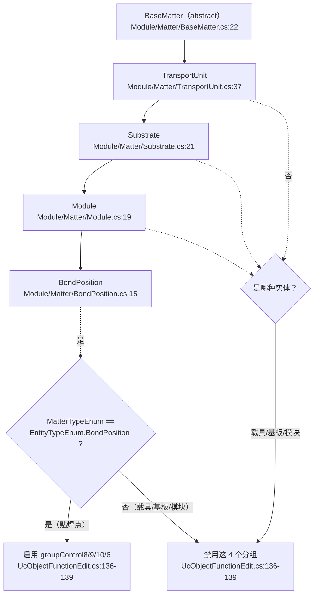

**ASCII 等价版**

```text
   BaseMatter (abstract)  Module/Matter/BaseMatter.cs:22
        │
        └── TransportUnit          Module/Matter/TransportUnit.cs:37
                 │
                 └── Substrate   Module/Matter/Substrate.cs:21
                          │
                          └── Module        Module/Matter/Module.cs:19
                                   │
                                   └── BondPosition  Module/Matter/BondPosition.cs:15

   实体的"类型判定"由 MatterTypeEnum 决定（UcObjectFunctionEdit.cs:135）：
        isBondPosition = (MatterTypeEnum == EntityTypeEnum.BondPosition)
             ├── 真 → 启用 groupControl8 / 9 / 10 / 6   （UcObjectFunctionEdit.cs:136-139）
             └── 假 → 禁用这 4 个分组                    （同上；方向是 模型 → UI）
   注意：这是"模型驱动界面"，不是"用界面文字判断业务"。用界面文字判断业务的地方在
   UcObjectFunctionEdit.cs:221（if (this.BtEdit.Text == "编辑")），见 §4.3 图 5。
```

**图 3：UI 类型与两代向导（族A / 族B）分类**

```mermaid
flowchart TB
    ROOT["本目录 37 个界面类型"]
    ROOT --> FA["族A：AssistantConfig 卡片式<br/>11 个（实测：同时含 assistantConfigList + SetUiControl）"]
    ROOT --> FB["族B：单发式<br/>Save() 后 DialogResult = OK 即结束"]
    ROOT --> FC["其它：配置面板 / 映射画布 / 显示控件<br/>不进向导体系"]

    FA --> FA1["助手目录 9 个"]
    FA --> FA2["TransportUnitEdit 2 个"]

    FA1 --> FA1a["FrmTUPositionTeach   :32"]
    FA1 --> FA1b["FrmAdjustDegree      :22"]
    FA1 --> FA1c["FrmAssistanceHeight  :29（单步）"]
    FA1 --> FA1d["FrmAssistanceIdentity:27"]
    FA1 --> FA1e["FrmAssistantHeightPoints :35（零调用点）"]
    FA1 --> FA1f["FrmEditPRs           :21"]
    FA1 --> FA1g["FrmMeasureHeight     :27"]
    FA1 --> FA1h["FrmModulePositionTeach :27"]
    FA1 --> FA1i["FrmSubstratePositionTeach :28"]
    FA2 --> FA2a["FrmAssistantHeight           :33"]
    FA2 --> FA2b["FrmAssistantSizeAndCenter    :33"]

    FB --> FB1["FrmChooseMeasureHeightType :26"]
    FB --> FB2["FrmEditSafeHeight          :14"]
    FB --> FB3["FrmInputMatrixInfo         :10"]
    FB --> FB4["FrmAddObject               :20"]
    FB --> FB5["FrmObjectCopy              :24"]
    FB --> FB6["FrmAddTuInfo               :20"]
    FB --> FB7["FrmLocateUseInfo           :13"]

    FC --> FC1["UcTransportUnit / UcSubstrate / UcModule<br/>（配置面板）"]
    FC --> FC2["FrmTuMapping / FrmTuMappingNew<br/>（映射画布）"]
    FC --> FC3["UcTransportShow / UcTransportUnitView<br/>（显示控件）"]
    FC --> FC4["UcTransportUnitFrame<br/>（实现 IProgrammingControl，②类入口）"]
```

**ASCII 等价版**

```text
  本目录 37 个界面类型
  ├── 族A（AssistantConfig 卡片式，11 个：assistantConfigList + SetUiControl + Next/Back/DoneAction）
  │     ├─ Controls/Assistant/ 9 个
  │     │    FrmTUPositionTeach:32   FrmAdjustDegree:22   FrmAssistanceHeight:29(单步)
  │     │    FrmAssistanceIdentity:27   FrmAssistantHeightPoints:35(零调用点)
  │     │    FrmEditPRs:21   FrmMeasureHeight:27
  │     │    FrmModulePositionTeach:27   FrmSubstratePositionTeach:28
  │     └─ Controls/TransportUnitEdit/ 2 个
  │          FrmAssistantHeight:33   FrmAssistantSizeAndCenter:33
  ├── 族B（单发式：改完 → Save() → DialogResult = OK）
  │     FrmChooseMeasureHeightType:26   FrmEditSafeHeight:14   FrmInputMatrixInfo:10
  │     FrmAddObject:20   FrmObjectCopy:24   FrmAddTuInfo:20   FrmLocateUseInfo:13
  └── 其它（不进向导体系）
        UcTransportUnit:22 / UcSubstrate:30 / UcModule:21      ← 配置面板
        FrmTuMapping:21 / FrmTuMappingNew:13                    ← 映射画布
        UcTransportShow:37 / UcTransportUnitView:24             ← 显示控件
        UcTransportUnitFrame:13                                 ← 实现 IProgrammingControl（②类入口）

判据（可复现）：
  grep -rln --include=*.cs -e assistantConfigList -e SetUiControl → 11 个文件，与上表族A 完全一致。
  AssistantConfig 本身在本仓库没有声明 —— 它是 assistantConfigList 的元素类型，
  声明在外部 DLL 里（*推断：本目录 0 处 class AssistantConfig 声明，而 assistantConfigList 被
  当作集合遍历并取 .NextAction/.SetUiControl，故该类型来自引用程序集*）。
```

### 3.3 关键类型速查（按职责分组）

| 想干什么 | 该看哪个类型 | 入口 |
|---|---|---|
| 编辑一个对象的名字/尺寸 | `UcObjectFunctionEdit.BtEdit_Click` | §4.3 图 5 |
| 新增 / 复制 / 删除对象 | `FrmTransportUnitEdit`、`UcTransportUnitView` | §4.3 图 6 / 图 7 / 图 8 |
| 视觉模板（PR）示教 | `FrmEditPRs`、`TUAssistantHelper.EditPrInSystem2` | §4.4 图 9 / 图 15 / 图 16 |
| 测高（单点 / 多点） | `FrmMeasureHeight`、`FrmMeasureHeightPoints`、`FrmAssistantHeightPoints` | §4.4 图 10 / §4.6 图 25 |
| 点胶示教 | `UcObjectFunctionEdit.BtEditEpoxy_Click` → `FrmChangeEpoxy`（外部） | §4.4 图 12 |
| 载具 / 基板 / 模块位置示教 | `FrmTUPositionTeach`、`FrmSubstratePositionTeach`、`FrmModulePositionTeach` | §4.4 图 13 / 图 14 |
| 映射的显示与存储 | `FrmTuMapping`、`FrmTransportUnitMapping`、`TuService` | §4.5 图 17 / 图 24 |
| 配置落盘 | `ProductConfiguration.GetInstance().Save()` | §6 图 28、§8 |
| 定位参数 | `FrmLocateUseInfo`、`LocateConfig` | §4.5 |
| 料单元层配置 | `UcTransportUnit`、`UcSubstrate`、`UcModule` | §4.5 图 18 / 图 20 |

## 4. UI 按钮与交互流程
### 4.1 本模块的 UI 清单（含「打开它的入口」三类判定）

**入口必须分三类**，缺一类就会误判成死代码：

| 类型 | 含义 | 怎么找 |
|---|---|---|
| ① **界面按钮 / 菜单** | 用户点某个控件 → 事件处理器里 `new XxxForm().ShowDialog()` | grep `new Xxx(` 并回看所在处理器 |
| ② **任务层 / 宿主运行时弹出** | 配方编辑的 `Start()` 按**步骤名**分派；或宿主控件按配置分流 | 找 `switch (step)` / `if (配置)` 里的 `new` |
| ③ **反射服务 `ControlService.ShowDialogForm<T>`** | `Infrastructure/Service/ControlService.cs:366`，内部 `Activator.CreateInstance(typeof(T), args)` | grep `ShowDialogForm<` |

**本模块 ③ 类入口为空**：全仓库 4 处活跃调用点（`WaferSubSystem/.../FrmComponentGeometryWithWaferTeach.cs:225`、`UcComponentEdit.cs:1203`、`WaferSubSystemTask.cs:833`、`:872`）
用的类型参数是 `FrmCarrierHeightMeasureTeach`、`FrmChangeWaferMapTeach`、`FrmChangePositionTeach`——**没有一个属于本目录**。
所以下表里凡写「零调用点」的窗体，不是被反射藏起来了，是真的没人打开。

**图 4：窗体的三类入口与本文档的组织方式**

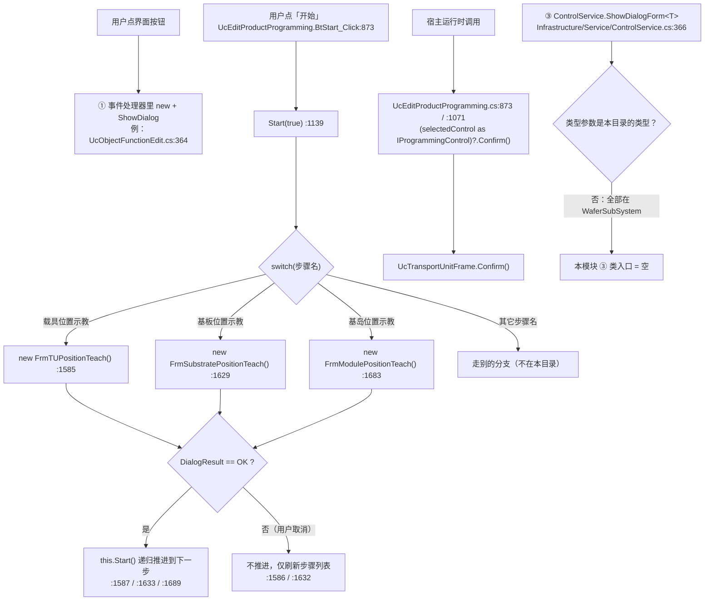

**ASCII 等价版**

```text
   ┌── ① 界面按钮 ─────────────────────────────────────────────────┐
   │ 用户点控件 → 处理器里 new XxxForm().ShowDialog()              │
   │ 例：UcObjectFunctionEdit.cs:364（PR 示教）、:411（测高示教）  │
   └────────────────────────────────────────────────────────────────┘

   ┌── ② 任务层 / 宿主运行时弹出 ──────────────────────────────────┐
   │ 用户点「开始」→ UcEditProductProgramming.BtStart_Click:873     │
   │            → Start(true) :1139 → switch(步骤名)                │
   │                 ├ "载具位置示教" → new FrmTUPositionTeach()     :1585
   │                 ├ "基板位置示教" → new FrmSubstratePositionTeach:1629
   │                 ├ "基岛位置示教" → new FrmModulePositionTeach()  :1683
   │                 └ 其它步骤名 → 走别的分支（不在本目录）
   │            → 打开后再判 DialogResult：
   │                 ├ == OK  → this.Start() 递归推进下一步（:1587/:1633/:1689）
   │                 └ != OK  → 不推进，仅刷新步骤列表（用户取消分支）
   └────────────────────────────────────────────────────────────────┘

   ┌── ③ 反射开窗 ─────────────────────────────────────────────────┐
   │ ControlService.ShowDialogForm<T>（ControlService.cs:366）      │
   │ 全仓库活跃调用 4 处，类型参数全部是 WaferSubSystem 的窗体      │
   │ → 本模块 ③ 类入口 = 空（不是"找不到"，是真的没有）            │
   └────────────────────────────────────────────────────────────────┘

   宿主运行时调用（也是一种隐式入口）：
     UcEditProductProgramming.cs:873（BtStart_Click）/ :1071（BtSave_Click）
       → (this.selectedControl as IProgrammingControl)?.Confirm()
       → UcTransportUnitFrame.Confirm()      ← 没有任何按钮叫这个名字
```

#### 4.1.1 界面清单与入口（37 个类型）

| 窗体 / 用户控件 | 文件（行数） | 用途 | 打开它的入口（分类标注） |
|---|---|---|---|
| `UcObjectFunctionEdit` | `Controls/TransportUnitEdit/UcObjectFunctionEdit.cs`（1,124） | 单对象功能编辑主控件 | **宿主控件**：`FrmTransportUnitEdit.cs:221` `new`，不是独立窗体 |
| `UcTransportUnitView` | `Controls/TransportUnitEdit/UcTransportUnitView.cs`（446） | 料单元视图 + 工具条 | **宿主控件**：`FrmTransportUnitEdit.cs:223` `new` |
| `FrmTransportUnitEdit` | `Controls/TransportUnitEdit/FrmTransportUnitEdit.cs`（310） | 带料单元树的编辑器 | ② `UcEditProductProgramming.cs:722`（`case "TransportUnitGeneral"` 且 `IsOppositeSex == true`，`:719`） |
| `FrmAddObject` | `Controls/TransportUnitEdit/FrmAddObject.cs`（225） | 新增子对象 | ① `FrmTransportUnitEdit.cs:116`（`BtAdd_Click:114`）、`UcTransportUnitView.cs:381`（`BtAdd_ItemClick:379`） |
| `FrmObjectCopy` | `Controls/TransportUnitEdit/FrmObjectCopy.cs`（97） | 复制对象 | ① `FrmTransportUnitEdit.cs:189`（`BtCopy_Click:179`）、`UcTransportUnitView.cs:349`（`BtCopy_ItemClick_1:339`） |
| `FrmAssistantHeight` | `Controls/TransportUnitEdit/FrmAssistantHeight.cs`（197） | 辅助测高（族A） | ① `UcObjectFunctionEdit.cs:1057`（`BtAssistanceHeight_Click:1024`） |
| `FrmAssistantSizeAndCenter` | `Controls/TransportUnitEdit/FrmAssistantSizeAndCenter.cs`（281） | 尺寸与中心示教（族A） | ① `UcObjectFunctionEdit.cs:726`（`BtAssistantSize_Click:693`） |
| `UcTransportUnitFrame` | `Controls/Setting/UcTransportUnitFrame.cs`（67） | 料单元配置外壳 | ② `UcEditProductProgramming.cs:731`（同上 `case`，`IsOppositeSex == false` 分支）；另有宿主 `Confirm()` 隐式入口（`UcEditProductProgramming.cs:873` / `:1071`） |
| `UcTransportUnit` | `Controls/Setting/UcTransportUnit.cs`（586） | 料单元层配置 | **宿主控件**：`UcTransportUnitFrame.cs:37` `new` |
| `UcSubstrate` | `Controls/Setting/UcSubstrate.cs`（374） | 基板层配置 | **宿主控件**：`UcTransportUnitFrame.cs:38` `new` |
| `UcModule` | `Controls/Setting/UcModule.cs`（341） | 模块层配置 | **宿主控件**：`UcTransportUnitFrame.cs:39` `new`；另有 `Main/Controls/Ucmain/MainControls/UcMainSystem.cs:205` |
| `FrmMeasureHeightPoints` | `Controls/Setting/FrmMeasureHeightPoints.cs`（110） | 测高点列表编辑 | ① `UcTransportUnit.cs:581`（`BtChangeMeasureHeightPoint_Click:573`）、`UcSubstrate.cs:354`（`:346`）、`UcModule.cs:301`（`:293`）；外部 `UcBondPositionEdit.cs:446`、`UcMeasuringTool.cs:54` |
| `FrmEditPRs` | `Controls/Assistant/FrmEditPRs.cs`（481） | 视觉模板编辑（N-01/N-02 现场） | ① `UcObjectFunctionEdit.cs:364`（`BtAssistantVision_Click:335`）；外部 `UcEditProductProgramming.Assistance.cs:93/127/140/196/256/306` |
| `FrmMeasureHeight` | `Controls/Assistant/FrmMeasureHeight.cs`（371） | 测高示教（族A） | ① `UcObjectFunctionEdit.cs:411`（`BtAssistantMeasureHeight_Click:387`）；外部 `Assistance.cs:534/569/606/646` |
| `FrmAdjustDegree` | `Controls/Assistant/FrmAdjustDegree.cs`（275） | 角度调整（族A） | ① **仅外部**：`Assistance.cs:77/111/182/242/705`——本目录内 0 个调用点 |
| `FrmAssistanceHeight` | `Controls/Assistant/FrmAssistanceHeight.cs`（248） | 辅助高度（族A 单步） | ① `FrmModulePositionTeach.cs:501`（`:489` 判 OK）、`FrmSubstratePositionTeach.cs:476`（`:478`） |
| `FrmAssistanceIdentity` | `Controls/Assistant/FrmAssistanceIdentity.cs`（241） | 识别方式示教（族A） | ① **仅外部**：`Assistance.cs:341/383/425/477` |
| `FrmAssistantHeightPoints` | `Controls/Assistant/FrmAssistantHeightPoints.cs`（312） | 多点测高（族A） | **零调用点** —— 全仓库 `new FrmAssistantHeightPoints` = 0 处（*推断：断链*，依据见 R-98） |
| `FrmChooseMeasureHeightType` | `Controls/Assistant/FrmChooseMeasureHeightType.cs`（68） | 选择测高方式（族B） | ① `FrmTUPositionTeach.cs:103`（`:105` 判 OK）、`FrmAssistanceHeight.cs:172`、`FrmAssistantHeightPoints.cs:290`；外部 `UcBondPositionEdit.cs:106`、`FrmMultipleHeightMeasurement.cs:54` |
| `FrmEditSafeHeight` | `Controls/Assistant/FrmEditSafeHeight.cs`（98） | 安全高度编辑（族B） | ① `FrmTUPositionTeach.cs:210`（`BtNext_Click:429` 内）、`UcObjectFunctionEdit.cs:762`（`:763` 判 OK） |
| `FrmInputMatrixInfo` | `Controls/Assistant/FrmInputMatrixInfo.cs`（52） | 矩阵信息录入（族B） | ① `FrmModulePositionTeach.cs:308`、`FrmSubstratePositionTeach.cs:305` |
| `FrmTUPositionTeach` | `Controls/Assistant/CarrierTeach/FrmTUPositionTeach.cs`（507） | 载具位置示教（族A） | ② `UcEditProductProgramming.cs:1585`：`BtStart_Click:873` → `Start:1139` → `case "载具位置示教"` |
| `FrmTUIdentificationTeach` | `Controls/Assistant/CarrierTeach/FrmTUIdentificationTeach.cs`（48） | 载具识别示教 | **零调用点** —— `new FrmTUIdentificationTeach` = 0 处（*推断：断链*，与 `FrmTUPositionTeach` 成对但入口缺失） |
| `FrmModulePositionTeach` | `Controls/Assistant/ModuleTeach/FrmModulePositionTeach.cs`（738） | 模块位置示教（族A） | ② `UcEditProductProgramming.cs:1683` → `case "基岛位置示教"` |
| `FrmBadModuleTeach` | `Controls/Assistant/ModuleTeach/FrmBadModuleTeach.cs`（20） | 坏模块示教 | **零调用点** —— `new FrmBadModuleTeach` = 0 处（*推断：僵尸*，模板复制残留） |
| `FrmModuleInkDotTeach` | `Controls/Assistant/ModuleTeach/FrmModuleInkDotTeach.cs`（20） | 模块墨点示教 | **零调用点**（*推断：僵尸*） |
| `FrmSubstratePositionTeach` | `Controls/Assistant/SubstrateTeach/FrmSubstratePositionTeach.cs`（695） | 基板位置示教（族A） | ② `UcEditProductProgramming.cs:1629` → `case "基板位置示教"` |
| `FrmSubstrateIdentificationTeach` | `Controls/Assistant/SubstrateTeach/FrmSubstrateIdentificationTeach.cs`（20） | 基板识别示教 | **零调用点**（*推断：僵尸*） |
| `FrmSubstrateInkDotTeach` | `Controls/Assistant/SubstrateTeach/FrmSubstrateInkDotTeach.cs`（20） | 基板墨点示教 | **零调用点**（*推断：僵尸*） |
| `FrmTuMapping` | `Controls/Mapping/FrmTuMapping.cs`（889） | 映射主窗体 | ① 主界面 `UcMainSystem.cs:1041`（`BtTUMapping_ItemClick:1026`；`:1028` 判 `UseNewMappingUi` 为假走这里） |
| `FrmTuMappingNew` | `Controls/Mapping/FrmTuMappingNew.cs`（188） | 映射新版 | ① 主界面 `UcMainSystem.cs:1030`（同一个 `BtTUMapping_ItemClick`，`:1028` 为真走这里） |
| `FrmTransportUnitMapping` | `Controls/Mapping/FrmTransportUnitMapping.cs`（215） | 载具映射（含 `D:\` 硬编码） | ① 主界面 `UcMainSystem.DataAdministrator.cs:85`（`BarSystem1Tu_ItemClick:81`）、`:105`（`BarSystem2Tu_ItemClick`） |
| `FrmAddTuInfo` | `Controls/Mapping/FrmAddTuInfo.cs`（78） | 载具信息录入（族B） | ① `FrmTransportUnitMapping.cs:163`（`BtInPutTuInfo_Click:155`） |
| `UcTransportShow` | `Controls/Mapping/UcTransportShow.cs`（1,063） | 载具显示控件 | **宿主控件**：`FrmTransportUnitMapping.cs:65` / `:118`、`FrmTuMappingNew.cs:45` `new` |
| `FrmTUInfo` | `Controls/Running/FrmTUInfo.cs`（26） | 运行时载具信息 | **零调用点** —— 且所在目录 `Controls/Running/` 本身是死目录（R-98） |
| `FrmLocateUseInfo` | `Controls/Tool/FrmLocateUseInfo.cs`（253） | 定位参数小工具（族B） | ① `UcTransportUnit.cs:482/496/508`、`UcSubstrate.cs:283`、`UcModule.cs:230`、`UcObjectFunctionEdit.cs:518`；外部 `UcBondPositionEdit.cs:423`、`UcComponentEdit.cs:1318`（**2 参数构造**，见附录 B） |
| `MappingDraw` | `Controls/Mapping/MappingDraw.cs`（425） | 映射绘制算法 | 非界面，由映射画布调用 |

> 带「?」的行数表示该文件不足 250 行、未进入 §2 的大文件清单，逐文件行数以**附录 A** 为准（附录 A 覆盖全部 104 个文件）。
> 「零调用点」的完整判定与僵尸 / 断链取舍见 §4.6 图 26 与 R-98。

### 4.2 按钮总表（243 个事件处理器 ＋ 2 个永久禁用控件，共 245 行，一个不漏）

#### 4.2.1 统计口径（可复现）

先讲清楚这张表**一行代表什么**，否则行数永远对不上。

| 口径 | 实测值 | 复现命令（在 `AKRS.ZX2200/TransportUnitSystem/` 下执行） |
|---|---|---|
| Designer 里的 `+=` 事件接线 | **234** 处 | `grep -c -E '\+=' $(find . -name '*.Designer.cs')` |
| 上述接线去重后的处理器定义 | **233** 个 | 对每处接线，取 `this.X.Event += new EventHandler(this.H)` 的 `H`，在**与 Designer 同名的 `.cs`** 里定位 |
| 有定义但 Designer 未接线的处理器 | **7** 个 | 见 4.2.2 |
| 匿名 lambda 接线 | **3** 个 | `Controls/Setting/FrmMeasureHeightPoints.cs:40`、`:51`、`:62` |
| **处理器行数** | **243** | 233 + 7 + 3 = **243** |
| ＋无行为控件行数 | **2** | `CmbStateType`、`CmbType`（§4.6.6；不是处理器，但按"一个不漏"必须进表） |
| **总表行数** | **245** | 243 + 2 = **245** |

**为什么必须按「同名 `.cs`」定位处理器**：本目录有 **29 个处理器名字在多个类里重复**（`BtNext_Click` 出现 11 次、`BtCancel_Click` 15 次、`BtAutoFocus_Click` 10 次）。
如果按方法名建索引，`BtCancel_Click` 会被错误地算到某一个类头上，行号也就全错。
本表的做法是：`X.Designer.cs` 的接线只去 `X.cs` 里找同名方法——这与 C# 分部类语义一致。
按此法解析，**234 处接线全部命中定义，0 处丢失**（对比：按方法名解析会命中错误位置）。

**为什么不能只数 `_Click`**：234 处接线里，`_Click` 只占一部分，其余是
`ItemClick`（DevExpress `BarItem` / `TileItem`）、`CheckedChanged`、`EditValueChanged`、`SelectedIndexChanged`、
`MouseDown/Move/Up/DoubleClick/Click/MouseWheel`、`Paint`、`Load`、`FormClosed`、`FocusedNodeChanged`、`SelectedPageChanging`、`Tick`。
只数 `_Click` 会漏掉本目录 **一半以上**的交互入口（尤其 `Controls/Setting/` 与 `Controls/Mapping/`）。

**与「241 / 243」两个常见说法的核对**（都以源码实测为准）：

- 本目录签名形如 `void H(object sender, …)` 的方法共匹配 **242** 条；
  其中 **1 条是注释掉的**（`Controls/Setting/UcTransportUnit.cs:241` 的 `//private void ChkMapping_CheckedChanged(...)`，不参与编译），
  **1 条不是事件处理器**而是静态工具方法（`Controls/Assistant/TUAssistantHelper.cs:602` 的 `public static void AutoFocus(object sender, Form form)`，它被 **10 个窗体**以 `TUAssistantHelper.AutoFocus(sender, this)` 直接调用，从不挂事件）。
  242 − 1 − 1 = **240 个真实命名处理器**。
- 240 个命名处理器 + 3 个匿名 lambda = **243 个处理器行**。**与本文档总表的处理器行数完全一致**（总表另有 2 行无行为控件，合计 245 行）。

**总表为什么要多 2 行**：本目录有 **2 个「无行为控件」**——它们在 Designer 里被永久禁用，
而且**没有任何事件接线、也没有任何选项来源**（详见 §4.6.6 / R-102、R-103）。
它们**不是事件处理器**，按上面的口径数不进 243；但按用户「一个不漏」的要求，
**不能因为点不动就从总表里删掉**。所以 §4.2.3 的总表 =
**243 个处理器行 ＋ 2 个无行为控件行 = 245 行**。本表的自检口径据此为 **245**，
两处数字的差 **恰好是这 2 行**。

#### 4.2.1b 判定「有没有事件接线」必须按控件类型选事件名

这一条是本节最重要的方法学更正，**直接决定 §4.6.6 的结论能否成立**。

| 控件类型 | 它**有**的事件 | 用它判「无接线」时**不能**依赖的事件 |
|---|---|---|
| `SpinEdit` / `TextEdit` | `EditValueChanged`、`TextChanged` | — |
| `ComboBoxEdit`（下拉框） | **`SelectedIndexChanged`、`EditValueChanged`、`TextChanged`** | ⚠️ **`Click`** —— `ComboBoxEdit` **本来就不使用 `Click`** |
| `SimpleButton`（按钮） | `Click`、`ItemClick` | — |

⇒ **「一个下拉框没有 `Click +=`」不构成任何证据**：它压根不用这个事件。
判断下拉框有没有接线，必须查 **`SelectedIndexChanged` / `EditValueChanged` / `TextChanged`**。

**两个会让「零引用」结论静默失效的坑**（本项目的实测教训）：

1. ⚠️ **`grep -w '控件名'` 匹配不到 `控件名_Click`**。
   `_` 属于词字符，`Xxx_Click` 是**一个整词**，`-w` 会把它整体滤掉——
   于是**本项目凡以 `Xxx_Click` 命名的处理器，用 `-w Xxx` 一律查不到**。
   查接线必须**同时**跑不带 `-w` 与带 `_Click` 两种写法。
2. ⚠️ **「排除该控件的 Designer 文件后零命中」对查 `Enabled` 是对的，但不能拿来证明"没有接线"**。
   因为 `this.Xxx.Click += new EventHandler(this.Xxx_Click);` **这一行本身就在 Designer 里**；
   排除 Designer 之后零命中是**必然结果**，不是证据。
   （这条与 `*.Designer.cs` / `*.designer.cs` 大小写坑、`--include` 大小写坑**同族**：
   数字"看起来对"，只是静默漏了一整块。本仓实测：大写 `*.Designer.cs` **331** 个，
   小写 `*.designer.cs` **8** 个，用 `--include='*.Designer.cs'` 会整体漏掉那 8 个。）

#### 4.2.2 7 个「有定义、Designer 未接线」的处理器

| 处理器 | 位置 `文件:行` | 谁来调用 | 判定 |
|---|---|---|---|
| `UcTransportShow_MouseWheel` | `Controls/Mapping/UcTransportShow.cs:356` | 代码接线 `:48`、`:72`（`this.MouseWheel += this.UcTransportShow_MouseWheel;`） | 正常，只是不走 Designer |
| `UcTransportShow_MouseWheel` | `Controls/TransportUnitEdit/UcTransportUnitView.cs:97` | 代码接线 `:73` | 正常（同名不同类，注意别混） |
| `SelectedItemChanged` | `Controls/Assistant/TUAssistantHelper.cs:640` | 代码接线 `:631`（`tileBar.SelectedItemChanged += SelectedItemChanged;`），并在 `:632` 立刻手动调一次以初始化 | 正常 |
| `BtOnlyBond_ItemClick` | `Controls/Mapping/UcTransportShow.cs:1012` | 全仓库 0 处（含代码接线） | **死处理器**（R-92） |
| `BtOnlyDispense_ItemClick` | `Controls/Mapping/UcTransportShow.cs:1040` | 全仓库 0 处 | **死处理器**（R-92） |
| `BtEditPr_Click` | `Controls/Assistant/FrmMeasureHeight.cs:323` | 全仓库 0 处；该窗体的 `BtEditPr` 在 Designer 里**根本没有接线** | **死处理器**（R-92） |
| `BtMoveToCenter_Click` | `Controls/Assistant/FrmMeasureHeight.cs:333` | 全仓库 0 处；**方法体内含轴移动**（`TUAssistantHelper.MoveToPos`） | **死处理器（含硬件动作）**（R-92） |

#### 4.2.3 总表

「界面」列是窗体的**长文件名去掉 `Frm`/`Uc` 前缀后的真实类名**，用于区分同名处理器。
「处理器」列是 `文件:行`（相对 `AKRS.ZX2200/TransportUnitSystem/`）。
「按钮文案」的 `—` 表示该控件在 Designer 里没有静态 `.Text` 赋值（运行期设置，或本身是画布/勾选框这类无文字控件）。

| 界面 | 控件名 | 按钮文案 | 处理器 `文件:行` | 一句话作用 | 详细流程图 |
|---|---|---|---|---|---|
| FrmTUIdentificationTeach | `` | — | `Controls/Assistant/CarrierTeach/FrmTUIdentificationTeach.cs:39` | 装载：读识别示教参数 | — |
| FrmTUPositionTeach | `BtBack` | 返回 | `Controls/Assistant/CarrierTeach/FrmTUPositionTeach.cs:416` | 族A 向导上一步：stepIndex-- 后重绘 | 图 13 |
| FrmTUPositionTeach | `BtNext` | 下一步 | `Controls/Assistant/CarrierTeach/FrmTUPositionTeach.cs:429` | 族A 向导下一步：stepIndex++ 后重绘 | 图 13 |
| FrmTUPositionTeach | `BtDone` | 完成 | `Controls/Assistant/CarrierTeach/FrmTUPositionTeach.cs:442` | 族A 向导完成：走 DoneAction 后关闭 | 图 14 |
| FrmTUPositionTeach | `BtCancel` | 取消 | `Controls/Assistant/CarrierTeach/FrmTUPositionTeach.cs:454` | 取消并关闭窗体（族A 不落盘 / 族B 直接关） | 图 14 |
| FrmTUPositionTeach | `BtAutoFocus` | 自动聚焦 | `Controls/Assistant/CarrierTeach/FrmTUPositionTeach.cs:464` | 转调 TUAssistantHelper.AutoFocus 自动聚焦 | — |
| FrmTUPositionTeach | `BtEditProgram` | 编辑模板 | `Controls/Assistant/CarrierTeach/FrmTUPositionTeach.cs:474` | 打开 FrmEditPRs 编辑模板 | 图 9 |
| FrmTUPositionTeach | `BtMoveToCenter` | 移动到中心 | `Controls/Assistant/CarrierTeach/FrmTUPositionTeach.cs:484` | 下发硬件：轴移动到中心位置 | — |
| FrmTUPositionTeach | `` | — | `Controls/Assistant/CarrierTeach/FrmTUPositionTeach.cs:503` | 关闭：保存位置示教结果 | — |
| FrmTUPositionTeach | `` | — | `Controls/Assistant/CarrierTeach/FrmTUPositionTeach.cs:92` | 装载：读位置示教参数 | — |
| FrmAdjustDegree | `BtNext` | 下一步 | `Controls/Assistant/FrmAdjustDegree.cs:201` | 族A 向导下一步：stepIndex++ 后重绘 | 图 13 |
| FrmAdjustDegree | `BtBack` | 返回 | `Controls/Assistant/FrmAdjustDegree.cs:214` | 族A 向导上一步：stepIndex-- 后重绘 | 图 13 |
| FrmAdjustDegree | `BtDone` | 完成 | `Controls/Assistant/FrmAdjustDegree.cs:227` | 族A 向导完成：走 DoneAction 后关闭 | 图 14 |
| FrmAdjustDegree | `BtCancel` | 取消 | `Controls/Assistant/FrmAdjustDegree.cs:239` | 取消并关闭窗体（族A 不落盘 / 族B 直接关） | 图 14 |
| FrmAdjustDegree | `` | — | `Controls/Assistant/FrmAdjustDegree.cs:249` | 装载：读配置填控件 | — |
| FrmAdjustDegree | `BtAutoFocus` | 自动聚焦 | `Controls/Assistant/FrmAdjustDegree.cs:261` | 转调 TUAssistantHelper.AutoFocus 自动聚焦 | — |
| FrmAdjustDegree | `` | — | `Controls/Assistant/FrmAdjustDegree.cs:271` | 关闭：保存角度调整配置 | — |
| FrmAssistanceHeight | `` | — | `Controls/Assistant/FrmAssistanceHeight.cs:160` | 装载：读配置填控件 | — |
| FrmAssistanceHeight | `BtCancel` | Cancel | `Controls/Assistant/FrmAssistanceHeight.cs:185` | 取消并关闭窗体（族A 不落盘 / 族B 直接关） | 图 14 |
| FrmAssistanceHeight | `BtDone` | Done | `Controls/Assistant/FrmAssistanceHeight.cs:195` | 族A 向导完成：走 DoneAction 后关闭 | 图 14 |
| FrmAssistanceHeight | `BtAutoFocus` | 自动聚焦 | `Controls/Assistant/FrmAssistanceHeight.cs:205` | 转调 TUAssistantHelper.AutoFocus 自动聚焦 | — |
| FrmAssistanceHeight | `BtEditPr` | 编辑模板 | `Controls/Assistant/FrmAssistanceHeight.cs:215` | 打开 FrmEditPRs 编辑视觉模板（拼写变体） | 图 9 |
| FrmAssistanceHeight | `MoveToCenter` | 移动到中心 | `Controls/Assistant/FrmAssistanceHeight.cs:225` | 下发硬件：移动到中心 | — |
| FrmAssistanceHeight | `` | — | `Controls/Assistant/FrmAssistanceHeight.cs:244` | 关闭：保存辅助高度配置 | — |
| FrmAssistanceIdentity | `BtNext` | 下一步 | `Controls/Assistant/FrmAssistanceIdentity.cs:150` | 族A 向导下一步：stepIndex++ 后重绘 | 图 13 |
| FrmAssistanceIdentity | `BtBack` | 后退 | `Controls/Assistant/FrmAssistanceIdentity.cs:163` | 族A 向导上一步：stepIndex-- 后重绘 | 图 13 |
| FrmAssistanceIdentity | `BtDone` | 完成 | `Controls/Assistant/FrmAssistanceIdentity.cs:176` | 族A 向导完成：走 DoneAction 后关闭 | 图 14 |
| FrmAssistanceIdentity | `BtCancel` | 取消 | `Controls/Assistant/FrmAssistanceIdentity.cs:187` | 取消并关闭窗体（族A 不落盘 / 族B 直接关） | 图 14 |
| FrmAssistanceIdentity | `BtEditPR` | 编辑模板 | `Controls/Assistant/FrmAssistanceIdentity.cs:197` | 打开 FrmEditPRs 编辑视觉模板 | 图 9 |
| FrmAssistanceIdentity | `BtAutoFocus` | 自动聚焦 | `Controls/Assistant/FrmAssistanceIdentity.cs:207` | 转调 TUAssistantHelper.AutoFocus 自动聚焦 | — |
| FrmAssistanceIdentity | `` | — | `Controls/Assistant/FrmAssistanceIdentity.cs:236` | 关闭：保存识别配置 | — |
| FrmAssistanceIdentity | `` | — | `Controls/Assistant/FrmAssistanceIdentity.cs:46` | 装载：读配置填控件 | — |
| FrmAssistantHeightPoints | `BtBack` | Back | `Controls/Assistant/FrmAssistantHeightPoints.cs:192` | 族A 向导上一步：stepIndex-- 后重绘 | 图 13 |
| FrmAssistantHeightPoints | `BtNext` | Next | `Controls/Assistant/FrmAssistantHeightPoints.cs:204` | 族A 向导下一步：stepIndex++ 后重绘 | 图 13 |
| FrmAssistantHeightPoints | `BtDone` | Done | `Controls/Assistant/FrmAssistantHeightPoints.cs:216` | 族A 向导完成：走 DoneAction 后关闭 | 图 14 |
| FrmAssistantHeightPoints | `BtCancel` | Cancel | `Controls/Assistant/FrmAssistantHeightPoints.cs:227` | 取消并关闭窗体（族A 不落盘 / 族B 直接关） | 图 14 |
| FrmAssistantHeightPoints | `` | — | `Controls/Assistant/FrmAssistantHeightPoints.cs:269` | 装载：按类型分支，异常则 Abort | — |
| FrmAssistantHeightPoints | `` | — | `Controls/Assistant/FrmAssistantHeightPoints.cs:308` | 关闭：保存多点测高结果（零调用点窗体） | — |
| FrmChooseMeasureHeightType | `BtOK` | 确定 | `Controls/Assistant/FrmChooseMeasureHeightType.cs:52` | 确定并关闭（族B） | — |
| FrmChooseMeasureHeightType | `BtCancel` | 取消 | `Controls/Assistant/FrmChooseMeasureHeightType.cs:64` | 取消并关闭窗体（族A 不落盘 / 族B 直接关） | 图 14 |
| FrmEditPRs | `BtNext` | 下一步 | `Controls/Assistant/FrmEditPRs.cs:331` | 族A 向导下一步：stepIndex++ 后重绘 | 图 13 |
| FrmEditPRs | `BtBack` | 后退 | `Controls/Assistant/FrmEditPRs.cs:344` | 族A 向导上一步：stepIndex-- 后重绘 | 图 13 |
| FrmEditPRs | `BtDone` | 完成 | `Controls/Assistant/FrmEditPRs.cs:357` | 族A 向导完成：走 DoneAction 后关闭 | 图 14 |
| FrmEditPRs | `BtCancel` | 取消 | `Controls/Assistant/FrmEditPRs.cs:368` | 取消并关闭窗体（族A 不落盘 / 族B 直接关） | 图 14 |
| FrmEditPRs | `BtEditPR` | 编辑模板 | `Controls/Assistant/FrmEditPRs.cs:378` | 打开 FrmEditPRs 编辑视觉模板 | 图 9 |
| FrmEditPRs | `BtAutoFocus` | 自动聚焦 | `Controls/Assistant/FrmEditPRs.cs:399` | 转调 TUAssistantHelper.AutoFocus 自动聚焦 | — |
| FrmEditPRs | `` | — | `Controls/Assistant/FrmEditPRs.cs:455` | 任何关闭方式都改配置并落盘（N-01） | 图 16 |
| FrmEditPRs | `` | — | `Controls/Assistant/FrmEditPRs.cs:46` | 装载：读定位配置填控件 | — |
| FrmEditSafeHeight | `BtBack` | 返回 | `Controls/Assistant/FrmEditSafeHeight.cs:62` | 族A 向导上一步：stepIndex-- 后重绘 | 图 13 |
| FrmEditSafeHeight | `BtNext` | 下一步 | `Controls/Assistant/FrmEditSafeHeight.cs:72` | 族A 向导下一步：stepIndex++ 后重绘 | 图 13 |
| FrmEditSafeHeight | `BtCancel` | 取消 | `Controls/Assistant/FrmEditSafeHeight.cs:83` | 取消并关闭窗体（族A 不落盘 / 族B 直接关） | 图 14 |
| FrmInputMatrixInfo | `BtSure` | 确定 | `Controls/Assistant/FrmInputMatrixInfo.cs:42` | 确认并关闭（族B，回传 OK） | — |
| FrmMeasureHeight | `BtDone` | 完成 | `Controls/Assistant/FrmMeasureHeight.cs:177` | 族A 向导完成：走 DoneAction 后关闭 | 图 14 |
| FrmMeasureHeight | `` | — | `Controls/Assistant/FrmMeasureHeight.cs:224` | 装载：读测高配置 | — |
| FrmMeasureHeight | `BtAutoFocus` | 自动聚焦 | `Controls/Assistant/FrmMeasureHeight.cs:246` | 转调 TUAssistantHelper.AutoFocus 自动聚焦 | — |
| FrmMeasureHeight | `BtNext` | 下一步 | `Controls/Assistant/FrmMeasureHeight.cs:256` | 族A 向导下一步：stepIndex++ 后重绘 | 图 13 |
| FrmMeasureHeight | `BtBack` | 回退 | `Controls/Assistant/FrmMeasureHeight.cs:268` | 族A 向导上一步：stepIndex-- 后重绘 | 图 13 |
| FrmMeasureHeight | `` | — | `Controls/Assistant/FrmMeasureHeight.cs:352` | 关闭：保存测高结果 | — |
| FrmMeasureHeight | `BtCancel` | 取消 | `Controls/Assistant/FrmMeasureHeight.cs:362` | 取消并关闭窗体（族A 不落盘 / 族B 直接关） | 图 14 |
| FrmMeasureHeight | `PnlControl` | — | `Controls/Assistant/FrmMeasureHeight.cs:367` | 示教面板重绘 | — |
| FrmModulePositionTeach | `` | — | `Controls/Assistant/ModuleTeach/FrmModulePositionTeach.cs:443` | 装载：读模块示教参数 | — |
| FrmModulePositionTeach | `BtNext` | 下一步 | `Controls/Assistant/ModuleTeach/FrmModulePositionTeach.cs:597` | 族A 向导下一步：stepIndex++ 后重绘 | 图 13 |
| FrmModulePositionTeach | `BtBack` | 返回 | `Controls/Assistant/ModuleTeach/FrmModulePositionTeach.cs:610` | 族A 向导上一步：stepIndex-- 后重绘 | 图 13 |
| FrmModulePositionTeach | `BtCancel` | 取消 | `Controls/Assistant/ModuleTeach/FrmModulePositionTeach.cs:623` | 取消并关闭窗体（族A 不落盘 / 族B 直接关） | 图 14 |
| FrmModulePositionTeach | `TbiStartPoint` | — | `Controls/Assistant/ModuleTeach/FrmModulePositionTeach.cs:628` | TileBar「起始点」项：改起始点 | — |
| FrmModulePositionTeach | `BtAutoFocus` | 自动聚焦 | `Controls/Assistant/ModuleTeach/FrmModulePositionTeach.cs:638` | 转调 TUAssistantHelper.AutoFocus 自动聚焦 | — |
| FrmModulePositionTeach | `BtEditProgram` | 编辑模板 | `Controls/Assistant/ModuleTeach/FrmModulePositionTeach.cs:649` | 打开 FrmEditPRs 编辑模板 | 图 9 |
| FrmModulePositionTeach | `` | — | `Controls/Assistant/ModuleTeach/FrmModulePositionTeach.cs:659` | 关闭：保存模块示教结果 | — |
| FrmModulePositionTeach | `BtMoveToCenter` | 移动到中心 | `Controls/Assistant/ModuleTeach/FrmModulePositionTeach.cs:669` | 下发硬件：轴移动到中心位置 | — |
| FrmModulePositionTeach | `TbiRowCount` | — | `Controls/Assistant/ModuleTeach/FrmModulePositionTeach.cs:683` | TileBar「行数」项：改行数 | — |
| FrmModulePositionTeach | `BtDone` | 完成 | `Controls/Assistant/ModuleTeach/FrmModulePositionTeach.cs:693` | 族A 向导完成：走 DoneAction 后关闭 | 图 14 |
| FrmSubstratePositionTeach | `` | — | `Controls/Assistant/SubstrateTeach/FrmSubstratePositionTeach.cs:441` | 装载：读基板示教参数 | — |
| FrmSubstratePositionTeach | `BtNext` | 下一步 | `Controls/Assistant/SubstrateTeach/FrmSubstratePositionTeach.cs:565` | 族A 向导下一步：stepIndex++ 后重绘 | 图 13 |
| FrmSubstratePositionTeach | `BtBack` | 返回 | `Controls/Assistant/SubstrateTeach/FrmSubstratePositionTeach.cs:578` | 族A 向导上一步：stepIndex-- 后重绘 | 图 13 |
| FrmSubstratePositionTeach | `BtCancel` | 取消 | `Controls/Assistant/SubstrateTeach/FrmSubstratePositionTeach.cs:591` | 取消并关闭窗体（族A 不落盘 / 族B 直接关） | 图 14 |
| FrmSubstratePositionTeach | `BtAutoFocus` | 自动聚焦 | `Controls/Assistant/SubstrateTeach/FrmSubstratePositionTeach.cs:601` | 转调 TUAssistantHelper.AutoFocus 自动聚焦 | — |
| FrmSubstratePositionTeach | `EditPr` | 编辑模板 | `Controls/Assistant/SubstrateTeach/FrmSubstratePositionTeach.cs:611` | 打开 FrmEditPRs 编辑模板 | 图 9 |
| FrmSubstratePositionTeach | `` | — | `Controls/Assistant/SubstrateTeach/FrmSubstratePositionTeach.cs:616` | 关闭：保存基板示教结果 | — |
| FrmSubstratePositionTeach | `BtMoveToCenter` | 移动到中心 | `Controls/Assistant/SubstrateTeach/FrmSubstratePositionTeach.cs:626` | 下发硬件：轴移动到中心位置 | — |
| FrmSubstratePositionTeach | `panelControl1` | — | `Controls/Assistant/SubstrateTeach/FrmSubstratePositionTeach.cs:640` | 示教画布重绘 | — |
| FrmSubstratePositionTeach | `BtDone` | 完成 | `Controls/Assistant/SubstrateTeach/FrmSubstratePositionTeach.cs:650` | 族A 向导完成：走 DoneAction 后关闭 | 图 14 |
| FrmAddTuInfo | `BtSure` | 确定 | `Controls/Mapping/FrmAddTuInfo.cs:42` | 确认并关闭（族B，回传 OK） | — |
| FrmAddTuInfo | `` | — | `Controls/Mapping/FrmAddTuInfo.cs:63` | 装载：填载具信息默认值 | — |
| FrmTransportUnitMapping | `BtInit` | 清空记忆 | `Controls/Mapping/FrmTransportUnitMapping.cs:133` | 初始化 Mapping 数据 | — |
| FrmTransportUnitMapping | `BtInPutTuInfo` | 新建Mapping | `Controls/Mapping/FrmTransportUnitMapping.cs:155` | 录入载具信息，打开 FrmAddTuInfo | — |
| FrmTransportUnitMapping | `BtSaveMapping` | 保存Mapping | `Controls/Mapping/FrmTransportUnitMapping.cs:175` | 把映射写入本地文件 | 图 17 |
| FrmTransportUnitMapping | `BtInputID` | 扫码识别Mapping | `Controls/Mapping/FrmTransportUnitMapping.cs:186` | 手工输入 ID 并回填 | — |
| FrmTransportUnitMapping | `` | — | `Controls/Mapping/FrmTransportUnitMapping.cs:58` | 装载：读映射文件填列表 | — |
| FrmTransportUnitMapping | `BtImportMapping` | 本地载入Mapping | `Controls/Mapping/FrmTransportUnitMapping.cs:88` | 从文件导入 Mapping | — |
| FrmTuMapping | `` | — | `Controls/Mapping/FrmTuMapping.cs:148` | 装载：读映射并绘制 | — |
| FrmTuMapping | `PnSubstrateMapping` | — | `Controls/Mapping/FrmTuMapping.cs:182` | 映射页重绘 | — |
| FrmTuMapping | `PnSubstrateMapping` | — | `Controls/Mapping/FrmTuMapping.cs:221` | 映射页移动 | — |
| FrmTuMapping | `PnSubstrateMapping` | — | `Controls/Mapping/FrmTuMapping.cs:259` | 映射页双击 | — |
| FrmTuMapping | `PnSubstrateMapping` | — | `Controls/Mapping/FrmTuMapping.cs:272` | 映射页按下 | — |
| FrmTuMapping | `PnSubstrateMapping` | — | `Controls/Mapping/FrmTuMapping.cs:296` | 映射页抬起 | — |
| FrmTuMapping | `PnModuleMapping` | — | `Controls/Mapping/FrmTuMapping.cs:312` | 模块层画布重绘 | — |
| FrmTuMapping | `PnModuleMapping` | — | `Controls/Mapping/FrmTuMapping.cs:329` | 模块层画布移动 | — |
| FrmTuMapping | `PnModuleMapping` | — | `Controls/Mapping/FrmTuMapping.cs:367` | 模块层画布按下 | — |
| FrmTuMapping | `` | — | `Controls/Mapping/FrmTuMapping.cs:391` | 关闭：保存映射 | — |
| FrmTuMapping | `PnModuleMapping` | — | `Controls/Mapping/FrmTuMapping.cs:401` | 模块层画布抬起 | — |
| FrmTuMapping | `PnBondPositionMapping` | — | `Controls/Mapping/FrmTuMapping.cs:417` | 贴焊点层画布重绘 | — |
| FrmTuMapping | `PnBondPositionMapping` | — | `Controls/Mapping/FrmTuMapping.cs:434` | 贴焊点层画布按下 | — |
| FrmTuMapping | `PnBondPositionMapping` | — | `Controls/Mapping/FrmTuMapping.cs:459` | 贴焊点层画布移动 | — |
| FrmTuMapping | `PnBondPositionMapping` | — | `Controls/Mapping/FrmTuMapping.cs:497` | 贴焊点层画布抬起 | — |
| FrmTuMapping | `PnModuleMapping` | — | `Controls/Mapping/FrmTuMapping.cs:513` | 模块层画布双击 | — |
| FrmTuMapping | `ShieldToolStripMenuItem` | 正常 | `Controls/Mapping/FrmTuMapping.cs:621` | 右键「使能」 | — |
| FrmTuMapping | `disableToolStripMenuItem` | 废弃 | `Controls/Mapping/FrmTuMapping.cs:638` | 右键「禁用」 | — |
| FrmTuMapping | `TSMTurnOn` | 只点胶 | `Controls/Mapping/FrmTuMapping.cs:657` | 右键：在系统1 中使能 | — |
| FrmTuMapping | `TsmClear` | 只贴片 | `Controls/Mapping/FrmTuMapping.cs:679` | 右键「清除」 | — |
| FrmTuMapping | `BtClearAll` | 清除所有记忆 | `Controls/Mapping/FrmTuMapping.cs:698` | 清空映射表全部条目 | — |
| FrmTuMapping | `PnMapping` | — | `Controls/Mapping/FrmTuMapping.cs:744` | 映射分页切换中，可取消 | — |
| FrmTuMapping | `LueWorkSortType` | — | `Controls/Mapping/FrmTuMapping.cs:791` | 工作排序方式切换，触发重排绘制 | — |
| FrmTuMapping | `ChkAutoReturn` | — | `Controls/Mapping/FrmTuMapping.cs:846` | 自动回位开关 | — |
| FrmTuMapping | `ChkSubstrate` | — | `Controls/Mapping/FrmTuMapping.cs:867` | 映射显示过滤：基板层 | — |
| FrmTuMapping | `ChkModule` | — | `Controls/Mapping/FrmTuMapping.cs:881` | 映射显示过滤：模块层 | — |
| FrmTuMappingNew | `BtClearAll` | 清除所有记忆 | `Controls/Mapping/FrmTuMappingNew.cs:112` | 清空映射表全部条目 | — |
| FrmTuMappingNew | `LueWorkSortType` | — | `Controls/Mapping/FrmTuMappingNew.cs:125` | 工作排序方式切换，触发重排绘制 | — |
| FrmTuMappingNew | `` | — | `Controls/Mapping/FrmTuMappingNew.cs:180` | 关闭：保存映射 | — |
| FrmTuMappingNew | `` | — | `Controls/Mapping/FrmTuMappingNew.cs:43` | 装载：读映射文件填列表 | — |
| FrmTuMappingNew | `ChkSubstrate` | — | `Controls/Mapping/FrmTuMappingNew.cs:61` | 映射显示过滤：基板层 | — |
| FrmTuMappingNew | `ChkModule` | — | `Controls/Mapping/FrmTuMappingNew.cs:76` | 映射显示过滤：模块层 | — |
| FrmTuMappingNew | `ChkAutoReturn` | — | `Controls/Mapping/FrmTuMappingNew.cs:91` | 自动回位开关 | — |
| UcTransportShow | `` | — | `Controls/Mapping/UcTransportShow.cs:498` | 载具视图重绘 | — |
| UcTransportShow | `PlControl` | — | `Controls/Mapping/UcTransportShow.cs:508` | 映射画布重绘 | — |
| UcTransportShow | `PlControl` | — | `Controls/Mapping/UcTransportShow.cs:737` | 映射画布双击进入编辑 | — |
| UcTransportShow | `PlControl` | — | `Controls/Mapping/UcTransportShow.cs:749` | 映射画布移动：拖拽/悬停 | — |
| UcTransportShow | `PlControl` | — | `Controls/Mapping/UcTransportShow.cs:811` | 映射画布按下：起选/拖拽 | — |
| UcTransportShow | `PlControl` | — | `Controls/Mapping/UcTransportShow.cs:877` | 映射画布抬起：结束拖拽 | — |
| UcTransportShow | `BtFail` | — | `Controls/Mapping/UcTransportShow.cs:901` | 映射右键菜单「禁用」 | — |
| UcTransportShow | `BtNormal` | — | `Controls/Mapping/UcTransportShow.cs:938` | 映射状态置「正常」 | — |
| UcTransportShow | `BtSuccess` | — | `Controls/Mapping/UcTransportShow.cs:976` | 映射状态置「成功」 | — |
| FrmMeasureHeightPoints | `` | — | `Controls/Setting/FrmMeasureHeightPoints.cs:104` | 装载：读测高点列表 | — |
| FrmMeasureHeightPoints | `CmbPoint` | — | `Controls/Setting/FrmMeasureHeightPoints.cs:92` | 测高点下拉切换 | — |
| UcModule | `ChkIsMultipleModules` | — | `Controls/Setting/UcModule.cs:118` | 多模块开关 | — |
| UcModule | `LueAdjustType` | — | `Controls/Setting/UcModule.cs:147` | 定位方式切换，联动启用/禁用与落盘 | — |
| UcModule | `ChkDistanceCheck` | — | `Controls/Setting/UcModule.cs:205` | 间距校验开关（EditValue 通道） | — |
| UcModule | `BtLocateUseInfo` | — | `Controls/Setting/UcModule.cs:227` | 定位参数编辑，打开 FrmLocateUseInfo | — |
| UcModule | `ChkMeasureHeight1` | — | `Controls/Setting/UcModule.cs:239` | 测高点1 使能 | — |
| UcModule | `ChkMeasureHeight2` | — | `Controls/Setting/UcModule.cs:266` | 测高点2 使能 | — |
| UcModule | `BtChangeMeasureHeightPoint` | 修改测高位置 | `Controls/Setting/UcModule.cs:293` | 切换当前测高点并刷新勾选 | — |
| UcModule | `ChkManualDistance` | — | `Controls/Setting/UcModule.cs:311` | 手工间距开关 | — |
| UcModule | `LueIdentification` | — | `Controls/Setting/UcModule.cs:321` | 识别方式切换，写配置 | — |
| UcSubstrate | `LueAdjustType` | — | `Controls/Setting/UcSubstrate.cs:139` | 定位方式切换，联动启用/禁用与落盘 | — |
| UcSubstrate、UcSubstrate | `ChkDistanceCheck、ChkDistanceCheck` | —／— | `Controls/Setting/UcSubstrate.cs:201` | 间距校验开关 | — |
| UcSubstrate | `ChkIsMultipleSubstrates` | — | `Controls/Setting/UcSubstrate.cs:218` | 多基板开关 | — |
| UcSubstrate | `LueSubstrateIdentification` | — | `Controls/Setting/UcSubstrate.cs:246` | 基板识别方式切换 | — |
| UcSubstrate | `BtLocateUseInfo` | — | `Controls/Setting/UcSubstrate.cs:280` | 定位参数编辑，打开 FrmLocateUseInfo | — |
| UcSubstrate | `ChkMeasureHeight1` | — | `Controls/Setting/UcSubstrate.cs:292` | 测高点1 使能 | — |
| UcSubstrate | `ChkMeasureHeight2` | — | `Controls/Setting/UcSubstrate.cs:319` | 测高点2 使能 | — |
| UcSubstrate | `BtChangeMeasureHeightPoint` | 修改测高位置 | `Controls/Setting/UcSubstrate.cs:346` | 切换当前测高点并刷新勾选 | — |
| UcSubstrate | `ChkManualDistance` | — | `Controls/Setting/UcSubstrate.cs:364` | 手工间距开关 | — |
| UcSubstrate | `` | — | `Controls/Setting/UcSubstrate.cs:369` | 装载：读 14 个控件 + 硬件位使能 | — |
| UcTransportUnit | `LueAdjustType` | — | `Controls/Setting/UcTransportUnit.cs:145` | 定位方式切换，联动启用/禁用与落盘 | — |
| UcTransportUnit | `ChkDistanceCheck` | — | `Controls/Setting/UcTransportUnit.cs:199` | 间距校验开关 | — |
| UcTransportUnit | `LueIdentification` | — | `Controls/Setting/UcTransportUnit.cs:216` | 识别方式切换，写配置 | — |
| UcTransportUnit | `ChkIsSymmetrical` | — | `Controls/Setting/UcTransportUnit.cs:258` | 左右对称开关 | — |
| UcTransportUnit | `ChkIsCommonDataset` | — | `Controls/Setting/UcTransportUnit.cs:271` | 公共数据集开关 | — |
| UcTransportUnit | `LueSubstrateProcessing` | — | `Controls/Setting/UcTransportUnit.cs:284` | 基板加工方式切换 | — |
| UcTransportUnit | `` | — | `Controls/Setting/UcTransportUnit.cs:308` | 装载：读料单元层配置 | — |
| UcTransportUnit | `timer1` | — | `Controls/Setting/UcTransportUnit.cs:343` | 定时器：刷新界面状态 | — |
| UcTransportUnit | `LueLeftAdjustType` | — | `Controls/Setting/UcTransportUnit.cs:363` | 左定位方式切换 | — |
| UcTransportUnit | `ChkLeftDistanceCheck` | — | `Controls/Setting/UcTransportUnit.cs:404` | 左侧间距校验开关 | — |
| UcTransportUnit | `LueRightAdjustType` | — | `Controls/Setting/UcTransportUnit.cs:421` | 右定位方式切换 | — |
| UcTransportUnit | `ChkRightDistanceCheck` | — | `Controls/Setting/UcTransportUnit.cs:462` | 右侧间距校验开关 | — |
| UcTransportUnit | `BtLocateUseInfo` | — | `Controls/Setting/UcTransportUnit.cs:479` | 定位参数编辑，打开 FrmLocateUseInfo | — |
| UcTransportUnit | `BtLocateUseInfoLeft` | — | `Controls/Setting/UcTransportUnit.cs:493` | 左工位定位参数，打开 FrmLocateUseInfo | — |
| UcTransportUnit | `BtLocateUseInfoRight` | — | `Controls/Setting/UcTransportUnit.cs:505` | 右工位定位参数，打开 FrmLocateUseInfo | — |
| UcTransportUnit | `BtMeasureHeight1` | — | `Controls/Setting/UcTransportUnit.cs:517` | 系统1 测高开关，改写配置 | — |
| UcTransportUnit | `BtMeasureHeight2` | — | `Controls/Setting/UcTransportUnit.cs:546` | 系统2 测高开关，改写配置 | — |
| UcTransportUnit | `BtChangeMeasureHeightPoint` | 修改测高位置 | `Controls/Setting/UcTransportUnit.cs:573` | 切换当前测高点并刷新勾选 | — |
| FrmLocateUseInfo | `` | — | `Controls/Tool/FrmLocateUseInfo.cs:145` | 装载：读定位参数填控件 | — |
| FrmLocateUseInfo | `CKIsAround` | — | `Controls/Tool/FrmLocateUseInfo.cs:229` | 环形定位选项切换 | — |
| FrmLocateUseInfo | `CkIsCalculateAngelByTwoPoint` | — | `Controls/Tool/FrmLocateUseInfo.cs:246` | 两点确定角度开关 | — |
| FrmLocateUseInfo | `BtOK` | 确认 | `Controls/Tool/FrmLocateUseInfo.cs:86` | 确定并关闭（族B） | — |
| FrmAddObject | `BtCancel` | 取消 | `Controls/TransportUnitEdit/FrmAddObject.cs:141` | 取消并关闭窗体（族A 不落盘 / 族B 直接关） | 图 14 |
| FrmAddObject | `` | — | `Controls/TransportUnitEdit/FrmAddObject.cs:151` | 装载：填类型下拉与默认值 | — |
| FrmAddObject | `CmbType` | — | `Controls/TransportUnitEdit/FrmAddObject.cs:195` | 新增对象类型切换，改控件可用性 | — |
| FrmAddObject | `ChkAbsoluteOffset` | — | `Controls/TransportUnitEdit/FrmAddObject.cs:221` | 绝对偏移选项切换 | — |
| FrmAddObject | `BtSure` | 确定 | `Controls/TransportUnitEdit/FrmAddObject.cs:65` | 确认并关闭（族B，回传 OK） | — |
| FrmAssistantHeight | `BtBack` | 后退 | `Controls/TransportUnitEdit/FrmAssistantHeight.cs:146` | 族A 向导上一步：stepIndex-- 后重绘 | 图 13 |
| FrmAssistantHeight | `BtNext` | 下一步 | `Controls/TransportUnitEdit/FrmAssistantHeight.cs:159` | 族A 向导下一步：stepIndex++ 后重绘 | 图 13 |
| FrmAssistantHeight | `BtDone` | 完成 | `Controls/TransportUnitEdit/FrmAssistantHeight.cs:172` | 族A 向导完成：走 DoneAction 后关闭 | 图 14 |
| FrmAssistantHeight | `BtCancel` | 取消 | `Controls/TransportUnitEdit/FrmAssistantHeight.cs:183` | 取消并关闭窗体（族A 不落盘 / 族B 直接关） | 图 14 |
| FrmAssistantHeight | `BtAutoFocus` | 自动聚焦 | `Controls/TransportUnitEdit/FrmAssistantHeight.cs:193` | 转调 TUAssistantHelper.AutoFocus 自动聚焦 | — |
| FrmAssistantSizeAndCenter | `BtBack` | 后退 | `Controls/TransportUnitEdit/FrmAssistantSizeAndCenter.cs:214` | 族A 向导上一步：stepIndex-- 后重绘 | 图 13 |
| FrmAssistantSizeAndCenter | `BtNext` | 下一步 | `Controls/TransportUnitEdit/FrmAssistantSizeAndCenter.cs:227` | 族A 向导下一步：stepIndex++ 后重绘 | 图 13 |
| FrmAssistantSizeAndCenter | `BtDone` | 完成 | `Controls/TransportUnitEdit/FrmAssistantSizeAndCenter.cs:240` | 族A 向导完成：走 DoneAction 后关闭 | 图 14 |
| FrmAssistantSizeAndCenter | `BtCancel` | 取消 | `Controls/TransportUnitEdit/FrmAssistantSizeAndCenter.cs:251` | 取消并关闭窗体（族A 不落盘 / 族B 直接关） | 图 14 |
| FrmAssistantSizeAndCenter | `BtAutoFocus` | 自动聚焦 | `Controls/TransportUnitEdit/FrmAssistantSizeAndCenter.cs:261` | 转调 TUAssistantHelper.AutoFocus 自动聚焦 | — |
| FrmAssistantSizeAndCenter | `` | — | `Controls/TransportUnitEdit/FrmAssistantSizeAndCenter.cs:271` | 装载：读尺寸中心配置 | — |
| FrmObjectCopy | `BtCancel` | 取消 | `Controls/TransportUnitEdit/FrmObjectCopy.cs:53` | 取消并关闭窗体（族A 不落盘 / 族B 直接关） | 图 14 |
| FrmObjectCopy | `BtSure` | 确定 | `Controls/TransportUnitEdit/FrmObjectCopy.cs:63` | 确认并关闭（族B，回传 OK） | — |
| FrmTransportUnitEdit | `BtAdd` | 添加 | `Controls/TransportUnitEdit/FrmTransportUnitEdit.cs:114` | 新增子对象，打开 FrmAddObject 模态录入 | 图 6 |
| FrmTransportUnitEdit | `BtDelete` | 删除 | `Controls/TransportUnitEdit/FrmTransportUnitEdit.cs:142` | 删除选中对象（含子树） | 图 7 |
| FrmTransportUnitEdit | `BtCopy` | 复制 | `Controls/TransportUnitEdit/FrmTransportUnitEdit.cs:179` | 复制对象，打开 FrmObjectCopy 选择目标 | 图 8 |
| FrmTransportUnitEdit | `` | — | `Controls/TransportUnitEdit/FrmTransportUnitEdit.cs:219` | 装载：建料单元树 | — |
| FrmTransportUnitEdit | `BtClear` | 全部清空 | `Controls/TransportUnitEdit/FrmTransportUnitEdit.cs:286` | 清空编辑区输入 | — |
| FrmTransportUnitEdit | `BtLock` | 加锁 | `Controls/TransportUnitEdit/FrmTransportUnitEdit.cs:300` | 加锁 / 解锁当前对象 | — |
| FrmTransportUnitEdit | `TreeTransportUnit` | — | `Controls/TransportUnitEdit/FrmTransportUnitEdit.cs:94` | 料单元树选中节点变化，切换右侧编辑 | — |
| UcObjectFunctionEdit | `BtAssistanceHeight` | 测高 | `Controls/TransportUnitEdit/UcObjectFunctionEdit.cs:1024` | 辅助测高：读当前对象 Z 并写回配置 | 图 11 |
| UcObjectFunctionEdit | `BtBack` | 返回 | `Controls/TransportUnitEdit/UcObjectFunctionEdit.cs:1119` | 族A 向导上一步：stepIndex-- 后重绘 | 图 13 |
| UcObjectFunctionEdit | `BtEdit` | 编辑 | `Controls/TransportUnitEdit/UcObjectFunctionEdit.cs:219` | 「编辑 / 保存」同一个按钮切换两种语义 | 图 5 |
| UcObjectFunctionEdit | `BtAssistantVision` | 示教 | `Controls/TransportUnitEdit/UcObjectFunctionEdit.cs:335` | PR 视觉示教入口，打开 FrmEditPRs | 图 9 |
| UcObjectFunctionEdit | `BtAssistantMeasureHeight` | 示教 | `Controls/TransportUnitEdit/UcObjectFunctionEdit.cs:387` | 测高示教入口，打开 FrmMeasureHeight | 图 10 |
| UcObjectFunctionEdit | `BtAssistantEpoxyCheck` | 示教 | `Controls/TransportUnitEdit/UcObjectFunctionEdit.cs:434` | 胶量检测示教入口 | — |
| UcObjectFunctionEdit | `BtAssistanAfterBond` | 示教 | `Controls/TransportUnitEdit/UcObjectFunctionEdit.cs:474` | 后焊示教入口，打开 FrmEditPRs | 图 9 |
| UcObjectFunctionEdit | `BtLocateUseInfo` | — | `Controls/TransportUnitEdit/UcObjectFunctionEdit.cs:516` | 定位参数编辑，打开 FrmLocateUseInfo | — |
| UcObjectFunctionEdit | `` | — | `Controls/TransportUnitEdit/UcObjectFunctionEdit.cs:527` | 装载：按对象类型启用控件、写初始文本 | — |
| UcObjectFunctionEdit | `LueAdjustType` | — | `Controls/TransportUnitEdit/UcObjectFunctionEdit.cs:537` | 定位方式切换，联动启用/禁用与落盘 | — |
| UcObjectFunctionEdit | `ChkMeasureHeightSystem1` | — | `Controls/TransportUnitEdit/UcObjectFunctionEdit.cs:567` | 系统1 测高使能 | — |
| UcObjectFunctionEdit | `ChkMeasureHeightSystem2` | — | `Controls/TransportUnitEdit/UcObjectFunctionEdit.cs:586` | 系统2 测高使能 | — |
| UcObjectFunctionEdit | `BtNewCreateEpoxyCheck` | 新建 | `Controls/TransportUnitEdit/UcObjectFunctionEdit.cs:605` | 新建胶量检测模板并落盘 | — |
| UcObjectFunctionEdit | `BtNewCreateAfterBond` | 新建 | `Controls/TransportUnitEdit/UcObjectFunctionEdit.cs:648` | 新建后焊模板并落盘 | — |
| UcObjectFunctionEdit | `BtAssistantSizeAndCenter` | 示教大小和中心 | `Controls/TransportUnitEdit/UcObjectFunctionEdit.cs:693` | 尺寸与中心示教，打开 FrmAssistantSizeAndCenter | — |
| UcObjectFunctionEdit | `BtSave` | 保存 | `Controls/TransportUnitEdit/UcObjectFunctionEdit.cs:782` | 保存配置并落盘（ProductConfiguration） | 图 5 |
| UcObjectFunctionEdit | `ChkDispenseOpen` | — | `Controls/TransportUnitEdit/UcObjectFunctionEdit.cs:821` | 点胶功能开关，写配置 | — |
| UcObjectFunctionEdit | `ChkEpoxyCheckOpen` | — | `Controls/TransportUnitEdit/UcObjectFunctionEdit.cs:831` | 胶量检测开关，写配置 | — |
| UcObjectFunctionEdit | `ChkBond` | — | `Controls/TransportUnitEdit/UcObjectFunctionEdit.cs:841` | 固晶功能开关，写配置 | — |
| UcObjectFunctionEdit | `ChkAfterBondOpen` | — | `Controls/TransportUnitEdit/UcObjectFunctionEdit.cs:851` | 后焊功能开关，写配置 | — |
| UcObjectFunctionEdit | `BtMoveToCenter` | 移动到参考点位置 | `Controls/TransportUnitEdit/UcObjectFunctionEdit.cs:863` | 下发硬件：轴移动到中心位置 | — |
| UcObjectFunctionEdit | `BtNewCreateDispense` | 新建 | `Controls/TransportUnitEdit/UcObjectFunctionEdit.cs:904` | 新建点胶模板并落盘 | — |
| UcObjectFunctionEdit | `BtEditEpoxy` | 编辑图形 | `Controls/TransportUnitEdit/UcObjectFunctionEdit.cs:938` | 点胶示教：切 System1 → 模态示教 → 切回 System2 | 图 12 |
| UcObjectFunctionEdit | `CmbEpoxyCheck` | — | `Controls/TransportUnitEdit/UcObjectFunctionEdit.cs:972` | 胶量检测模板下拉切换 | — |
| UcObjectFunctionEdit | `CmbAfterBond` | — | `Controls/TransportUnitEdit/UcObjectFunctionEdit.cs:998` | 后焊模板下拉切换 | — |
| UcTransportUnitView | `PlControl` | — | `Controls/TransportUnitEdit/UcTransportUnitView.cs:255` | 自绘映射面板 | — |
| UcTransportUnitView | `PlControl` | — | `Controls/TransportUnitEdit/UcTransportUnitView.cs:294` | 映射画布单击选中 | — |
| UcTransportUnitView | `PlControl` | — | `Controls/TransportUnitEdit/UcTransportUnitView.cs:304` | 映射画布按下：起选/拖拽 | — |
| UcTransportUnitView | `PlControl` | — | `Controls/TransportUnitEdit/UcTransportUnitView.cs:326` | 映射画布抬起：结束拖拽 | — |
| UcTransportUnitView | `BtCopy` | — | `Controls/TransportUnitEdit/UcTransportUnitView.cs:339` | 视图工具条「复制」，同 BtCopy_Click | 图 8 |
| UcTransportUnitView | `BtAdd` | — | `Controls/TransportUnitEdit/UcTransportUnitView.cs:379` | 视图工具条「添加」，等价新增 | — |
| UcTransportUnitView | `BtDisplay` | — | `Controls/TransportUnitEdit/UcTransportUnitView.cs:407` | 视图工具条「显示」 | — |
| UcTransportUnitView | `BtOpen` | — | `Controls/TransportUnitEdit/UcTransportUnitView.cs:419` | 视图工具条「开启」 | 图 19 |
| UcTransportUnitView | `PlControl` | — | `Controls/TransportUnitEdit/UcTransportUnitView.cs:431` | 映射画布双击进入编辑 | — |
| FrmMeasureHeight | `BtEditPr` | — | `Controls/Assistant/FrmMeasureHeight.cs:323` | 编辑「框架示教找中心模板」—— **零接线死处理器** | — |
| FrmMeasureHeight | `BtMoveToCenter` | — | `Controls/Assistant/FrmMeasureHeight.cs:333` | 定位后下发轴移动—— **零接线死处理器（含硬件动作）** | — |
| UcTransportShow | `this` | — | `Controls/Mapping/UcTransportShow.cs:356` | 鼠标滚轮缩放映射画布（代码接线 `:48`／`:72`） | — |
| UcTransportUnitView | `this` | — | `Controls/TransportUnitEdit/UcTransportUnitView.cs:97` | 鼠标滚轮缩放视图（代码接线 `:73`） | — |
| TUAssistantHelper | `tileBar` | — | `Controls/Assistant/TUAssistantHelper.cs:640` | TileBar 选中项变化 → 切换示教步骤（代码接线 `:631`，并在 `:632` 直接调用一次） | — |
| UcTransportShow | `BtOnlyBond` | — | `Controls/Mapping/UcTransportShow.cs:1012` | 只显示固晶相关条目 —— **全仓库零接线** | — |
| UcTransportShow | `BtOnlyDispense` | — | `Controls/Mapping/UcTransportShow.cs:1040` | 只显示点胶相关条目 —— **全仓库零接线** | — |
| FrmMeasureHeightPoints | `SpX` | — | `Controls/Setting/FrmMeasureHeightPoints.cs:40` | 匿名 lambda：X 值变化即时写配置 | — |
| FrmMeasureHeightPoints | `SpY` | — | `Controls/Setting/FrmMeasureHeightPoints.cs:51` | 匿名 lambda：Y 值变化即时写配置 | — |
| FrmMeasureHeightPoints | `SpZ` | — | `Controls/Setting/FrmMeasureHeightPoints.cs:62` | 匿名 lambda：Z 值变化即时写配置 | — |
| UcObjectFunctionEdit | `CmbStateType` | —（下拉框无 `.Text`） | **无（无事件接线 ＋ 无选项来源）** | 🔒 **被搁置的半成品**：`Enabled = false` 且从未被置回；无任何下拉框事件接线；**连选项都没有** —— 详见 §4.6.6 | — |
| UcObjectFunctionEdit | `CmbType` | —（下拉框无 `.Text`） | **无（无事件接线 ＋ 无选项来源）** | 🔒 **同类半成品（同名不同类的陷阱）**：本类的 `CmbType` 与本目录 `FrmAddObject` 的同名控件**不是同一个**，后者接线完整 —— 详见 §4.6.6 | — |

### 4.3 重点按钮逐个详解（一）：编辑 / 保存 / 新增 / 删除 / 复制

本节四个按钮都在「对象编辑」这条线上：`FrmTransportUnitEdit`（左树 + 右侧编辑区）与它的子控件 `UcObjectFunctionEdit`。
它们共享同一个模式：**改内存 → 刷新界面 → 落盘**。差异只在最后一步——谁来做、做不做。

| 按钮 | 处理器 | 内存变更 | 界面变更 | 落盘 |
|---|---|---|---|---|
| `BtEdit`（编辑/保存） | `UcObjectFunctionEdit.cs:219` | 有 | 有 | ⚠️ **只落 PR 模板**（`:297`），配置不落盘 |
| `BtAdd`（新增） | `FrmTransportUnitEdit.cs:114` | 有 | 有 | ✅ `:129` |
| `BtDelete`（删除） | `FrmTransportUnitEdit.cs:142` | 有 | 有 | ✅ `:171` |
| `BtCopy`（复制） | `FrmTransportUnitEdit.cs:179` | 有 | 有 | ✅ `:211` |

---

#### 4.3.1 `BtEdit_Click` —— 「编辑 / 保存」同一个按钮的两种语义

**位置**：`Controls/TransportUnitEdit/UcObjectFunctionEdit.cs:219`
控件的初始文案由 `UcObjectFunctionEdit.cs:131` 设为 `"编辑"`。

**图 5：`BtEdit_Click`：「编辑 / 保存」同钮双语义与两个方向的数据流**

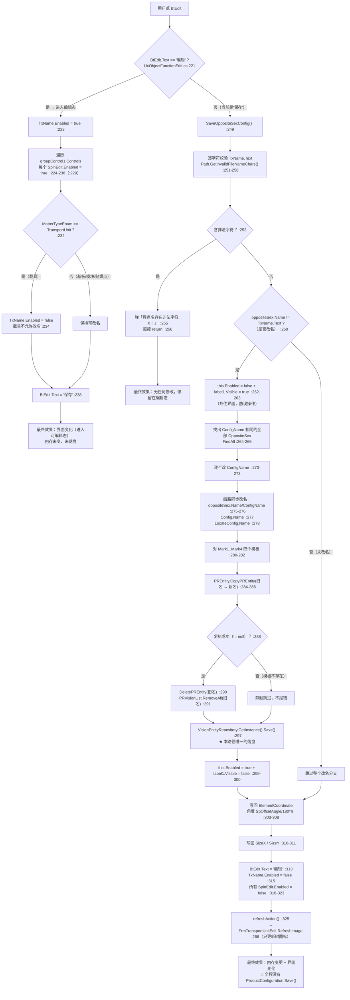

**ASCII 等价版**

```text
  点 BtEdit  (UcObjectFunctionEdit.cs:219)
    │
    ├─ BtEdit.Text == "编辑" ?  ................................ :221
    │      │
    │      └─ 是 → 进入编辑态
    │              TxName.Enabled = true ....................... :223
    │              遍历 groupControl1.Controls：
    │                 SpinEdit.Enabled = true .................. :229
    │                 ├─ MatterTypeEnum == TransportUnit
    │                 │     → TxName.Enabled = false（载具不许改名）:232-234
    │                 └─ 否则 → 允许改名
    │              BtEdit.Text = "保存" ........................ :238
    │              效果：仅界面变化（内存未变、未落盘）
    │
    └─ 否（当前是"保存"）→ SaveOppositeSexConfig() ............. :249
           │
           ├─ 非法字符校验 Path.GetInvalidFileNameChars() ....... :251-258
           │     └─ 命中 → 弹「焊点名存在非法字符: X！」 ....... :255 → return :256
           │           （效果：什么都没改，仍停在编辑态）
           │
           ├─ 改名分支  oppositeSex.Name != TxName.Text ......... :260
           │     ├─ 禁用整个控件 + 显示 label1 ................. :262-263
           │     ├─ FindAll(ConfigName 相同) ................... :264-265
           │     ├─ 逐个改 ConfigName .......................... :270-273
           │     ├─ 四路同步改名 ............................... :275-278
           │     ├─ Mark1..Mark4 模板改名 ...................... :280-295
           │     │     CopyPREntity(旧名→新名) ................. :284-286
           │     │       ├─ 成功 → DeletePREntity(旧名) ........ :290
           │     │       │         + PRVisionList.RemoveAll .... :291
           │     │       └─ 失败(null) → 静默跳过（不报错）
           │     ├─ VisionEntityRepository.GetInstance().Save()  :297  ← 唯一落盘
           │     └─ 恢复 Enabled + 隐藏 label1 ................. :299-300
           │
           ├─ 写回 ElementCoordinate（SpOffsetAngle/180*π + SpOffsetX/Y/Z）:303-308
           ├─ 写回 SizeX / SizeY ............................... :310-311
           ├─ BtEdit.Text = "编辑" ............................. :313
           │  TxName.Enabled = false ........................... :315
           │  所有 SpinEdit.Enabled = false .................... :316-323
           └─ refreshAction() → FrmTransportUnitEdit.RefreshImage :325 → :266
                 （只更新树节点图标，不落盘）
                 效果：内存变更 + 界面变化
                 🔴 整条路径没有 ProductConfiguration.GetInstance().Save()
```

**调用链（带行号）**

```
BtEdit.Click
 └─ UcObjectFunctionEdit.BtEdit_Click                          :219
     ├─ 编辑分支  :221 → :238
     └─ 保存分支 → UcObjectFunctionEdit.SaveOppositeSexConfig  :249
         ├─ 校验：Path.GetInvalidFileNameChars() 逐字符        :251-258
         ├─ 改名：PREntity.CopyPREntity / DeletePREntity       :284-291
         ├─ VisionEntityRepository.GetInstance().Save()         :297
         └─ refreshAction() → FrmTransportUnitEdit.RefreshImage :266
```

**读了什么、写了什么**

| 方向 | 对象 | 位置 |
|---|---|---|
| 读 | `this.BtEdit.Text`（**用界面文字当业务判据**） | `:221` |
| 读 | `this.TxName.Text` | `:253`、`:260` |
| 读 | `this.oppositeSex.MatterTypeEnum` | `:232` |
| 写 | `TxName.Enabled`、`groupControl1` 内所有 `SpinEdit.Enabled` | `:223`、`:229`、`:315`、`:316-323` |
| 写 | `oppositeSex.Name` / `.ConfigName` / `.ElementCoordinate` / `.SizeX` / `.SizeY` | `:275-276`、`:303-311` |
| 写 | `oppositeSex.Config.Name` / `Config.LocateConfig.Name` | `:277-278` |
| 写 | `ProductDomain.GetInstance().ProductConfig.OppositeSexConfiguration` 中同 `ConfigName` 的全部项 | `:264-273` |
| 写 | PR 模板：`PREntity.CopyPREntity` / `DeletePREntity` / `VisionEntityRepository.PRVisionList` | `:284-291` |
| 落盘 | **仅** `VisionEntityRepository.GetInstance().Save()` | `:297` |

**坑**

- 🔴 **「保存」按钮不把配置写进配方文件。** `SaveOppositeSexConfig`（`:249-326`）全程没有
  `ProductConfiguration.GetInstance().Save()`——对照同一文件里 `BtSave_Click` 的 `:811` 有这一句。
  后果：经这个按钮改的**名称 / 尺寸 / 偏移**只存在于内存，重启程序即回到上次落盘的状态。
  改名场景最危险：`:297` 把 **PR 模板**改了名并落盘，但配置里的名字没落盘 →
  下次启动时"配置里是旧名、磁盘上的模板是新名"，两侧从此对不上。
- 🔴 **按钮文案就是业务逻辑。** `:221` 用 `this.BtEdit.Text == "编辑"` 决定走"进入编辑"还是"保存"。
  这句文案由三处维护：`:131`（初始为"编辑"）、`:238`（切成"保存"）、`:313`（切回"编辑"）。
  **改动这三处任何一处的中文（哪怕加一个空格），逻辑就会静默走错分支**——例如 `:313` 若变成 `"编辑 "`，
  按钮将永远回不到编辑态，而界面看不出任何异常。这是本目录唯一真正的"用界面文本做业务判据"，
  与 §3.2 图 2 中 `:135-139` 的「模型 → UI」是两回事（后者是模型驱动界面，不是界面驱动逻辑）。
- ⚠️ **载具禁改名的判断写在 `foreach` 内部**（`:232-235`）：每个 `SpinEdit` 都重判一次
  `MatterTypeEnum == TransportUnit`。功能正确，但读代码时容易误读成"每个 SpinEdit 各自决定要不要改名"。
- ⚠️ **改名时整个控件被禁用**（`:262`），若中途抛异常（例如 `:290` 的模板删除抛错），
  控件会永久停留在 `Enabled = false`——没有 `try/finally`。同一函数在 `:299` 才恢复，中间任何异常都会跳过这一行。
- ⚠️ **模板改名失败静默通过**（`:288` 为假时不做任何提示）。用户看到的是"保存成功"，
  但该 Mark 模板其实没跟着改名，后续视觉示教会找不到模板。
- ⚠️ **`this.oppositeSex.Config` 未判空**（`:266` 直接取 `Config` 并到 `:277-278` 连写两个字段）。
  若当前对象是刚建、`Config` 尚未挂上的中间态，这一行会抛 `NullReferenceException`。

---

#### 4.3.2 `BtAdd_Click` —— 新增子对象

**位置**：`Controls/TransportUnitEdit/FrmTransportUnitEdit.cs:114`
（同一功能的第二入口：`Controls/TransportUnitEdit/UcTransportUnitView.cs:379` `BtAdd_ItemClick`）

**图 6：`BtAdd_Click` → `FrmAddObject`：新增子对象**

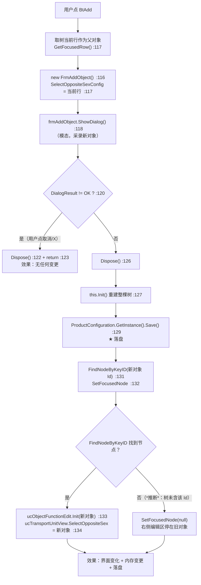

**ASCII 等价版**

```text
  点 BtAdd  (FrmTransportUnitEdit.cs:114)
    │
    ├─ 取树当前行 GetFocusedRow() .............................. :117
    ├─ new FrmAddObject() ..................................... :116
    │    SelectOppositeSexConfig = 当前行 ...................... :117
    ├─ ShowDialog()（模态） ................................... :118
    │     │
    │     ├─ 用户取消/X → dialogResult != OK .................. :120
    │     │      Dispose() :122 → return :123     【效果：零变更】
    │     │
    │     └─ 确定 → Dispose() :126
    │            ↓
    │          this.Init() 重建整棵树 ......................... :127
    │            ↓
    │          ProductConfiguration.GetInstance().Save() ...... :129  ★ 落盘
    │            ↓
    │          FindNodeByKeyID(新对象.Id) ..................... :131
    │          SetFocusedNode(节点) ........................... :132
    │            ├─ 找到 → ucObjectFunctionEdit.Init(新对象) .. :133
    │            │         ucTransportUnitView.SelectOppositeSex :134
    │            └─ 未找到 → SetFocusedNode(null)
    │                       右侧编辑区停留在旧对象（*推断*）
    │
    └─ 效果：界面变化 + 内存变更 + 落盘
```

**调用链（带行号）**

```
BtAdd.Click
 └─ FrmTransportUnitEdit.BtAdd_Click                          :114
     ├─ new FrmAddObject { SelectOppositeSexConfig }          :116-117
     ├─ FrmAddObject.ShowDialog()                             :118
     ├─ FrmTransportUnitEdit.Init()                            :127（重建树）
     ├─ ProductConfiguration.GetInstance().Save()              :129 ★ 落盘
     └─ FindNodeByKeyID / SetFocusedNode / Init / SelectOppositeSex  :131-134
```

**读了什么、写了什么**：读 `TreeTransportUnit.GetFocusedRow()`（作为父对象）；
写 `OppositeSexConfiguration`（新增项，由 `FrmAddObject` 内部完成）、树控件节点、
以及右侧两个子控件当前指向的对象（`ucObjectFunctionEdit`、`ucTransportUnitView`）。

**坑**

- 🔴 **`Init()`（`:127`）在 `Save()`（`:129`）之前。** 若 `Init()` 抛异常，
  新对象已在内存里但**没落盘**，重启后凭空消失；反过来若 `Save()` 抛异常，
  界面已经刷出了新对象、磁盘却没有。这个次序把"内存是权威、磁盘是副本"写死了，
  也意味着任何夹在两者之间的异常都会让两边不一致。
- ⚠️ **父对象为空时不拦截。** `:117` 直接把 `GetFocusedRow()` 的返回值强转成 `OppositeSex` 赋给
  `SelectOppositeSexConfig`，本方法自己不判空（判空在 `FrmAddObject` 内部）。
  对比 `BtDelete_Click:146-149` 与 `BtCopy_Click:183-187` 都判了空——三个相邻按钮的防御风格不一致。
- ✅ `Dispose()` 在成功（`:126`）与取消（`:122`）两条路径上都调用了，无窗体泄漏。
- ⚠️ `Save()` 之后没有再判一次 `FindNodeByKeyID` 的返回值（`:131`），失败时 `SetFocusedNode(null)` 的
  连带效果是右侧编辑区与树选中项脱节（*推断*：`TreeTransportUnit_FocusedNodeChanged` 会以 `null` 触发出错，见 §4.4）。

---

#### 4.3.3 `BtDelete_Click` —— 删除对象（含整棵子树）

**位置**：`Controls/TransportUnitEdit/FrmTransportUnitEdit.cs:142`

**图 7：`BtDelete_Click`：删除对象与整棵子树**

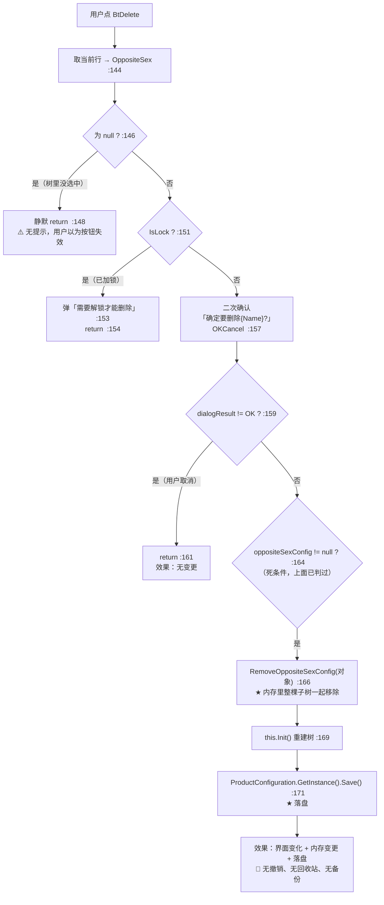

**调用链（带行号）**

```
BtDelete.Click
 └─ FrmTransportUnitEdit.BtDelete_Click                       :142
     ├─ 判空 → 静默返回                                        :146-149
     ├─ 判锁 → 提示「需要解锁才能删除」并返回                    :151-155
     ├─ AKRSXtraMessageBox.Show("确定要删除{Name}?", OKCancel)  :157
     ├─ 取消 → return                                          :159-162
     ├─ ProductConfiguration.OppositeSexConfiguration
     │     .RemoveOppositeSexConfig(oppositeSexConfig)         :166
     ├─ FrmTransportUnitEdit.Init()                             :169
     └─ ProductConfiguration.GetInstance().Save()               :171 ★ 落盘
```

**读了什么、写了什么**：读 `TreeTransportUnit.GetFocusedRow()`、`OppositeSex.IsLock`、`OppositeSex.Name`；
写 `OppositeSexConfiguration`（移除该项及其 `DownConfigs` 子树）、树控件。

**坑**

- 🔴 **删除不可逆。** `:166` 直接从配置里移除、`:171` 立刻落盘——没有撤销、没有回收站、没有删除前的备份文件。
  若删的是父节点，其后代一并消失（`RemoveOppositeSexConfig` 的子树语义，见 §20 号文档的模型说明）。
  误删之后唯一的恢复途径是重新建一遍。
- ⚠️ **未选中时静默返回**（`:146-149`）：同一位置 `BtCopy_Click` 会弹「请先选择需要复制的单元」（`:185`），
  两个相邻按钮行为不一致。排查"按钮点了没反应"时，这是最先被忽略的分支。
- ⚠️ **`:164` 的 `if (oppositeSexConfig != null)` 是死条件**——`:146` 已经判过并 return。
  无害，但说明这段是从别处复制来的，改动时不要被它误导成"可能为 null"。
- ✅ 加锁保护有效：`IsLock` 为真时拒绝删除并给出明确文案（`:153`）。
  注意加锁还会在别处联动禁用按钮：`FrmTransportUnitEdit.cs:102`、`:308` 会按 `IsLock` 设置 `BtDelete.Enabled`。

---

#### 4.3.4 `BtCopy_Click` —— 复制对象

**位置**：`Controls/TransportUnitEdit/FrmTransportUnitEdit.cs:179`
（同一功能的第二入口：`Controls/TransportUnitEdit/UcTransportUnitView.cs:339` `BtCopy_ItemClick_1`）

**图 8：`BtCopy_Click` → `FrmObjectCopy`：复制对象**

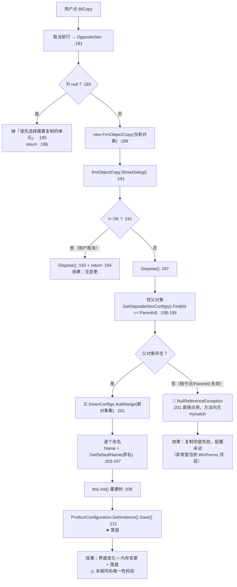

**调用链（带行号）**

```
BtCopy.Click
 └─ FrmTransportUnitEdit.BtCopy_Click                          :179
     ├─ 判空 → 弹「请先选择需要复制的单元」并返回                 :183-187
     ├─ new FrmObjectCopy(oppositeSexConfig)                    :189
     ├─ ShowDialog() != OK → Dispose + return                    :191-195
     ├─ Dispose()                                                :197
     ├─ Find(it => it.Id == oppositeSexConfig.ParentId)          :198-199
     ├─ 父.DownConfigs.AddRange(frmObjectCopy.NewOppositeSexConfigs) :201
     ├─ 每个新对象 Name = OppositeSex.GetDefaultName(原名)        :203-207
     ├─ FrmTransportUnitEdit.Init()                              :209
     └─ ProductConfiguration.GetInstance().Save()                :211 ★ 落盘
```

**读了什么、写了什么**：读 `TreeTransportUnit.GetFocusedRow()` 与 `oppositeSexConfig.ParentId`；
写父对象的 `DownConfigs` 列表、每个新对象的 `Name`、树控件、配置文件的落盘。

**坑**

- 🔴 **父对象查找结果没有判空。** `:198-199` 的 `Find(...)` 在 `:201` 被直接点用。
  当选中项是**根节点**（或其 `ParentId` 已失效）时 `Find` 返回 `null`，
  `:201` 立刻抛 `NullReferenceException`；本方法**没有 `try/catch`**，异常会冒泡到 WinForms 顶层。
  触发路径：在树里选中根，点复制并确认。此条对应风险 R-82。
- ⚠️ **改名不查重。** `:205-206` 只是把默认名赋给新对象，不做唯一性校验。
  对比 `FrmAddObject.cs:69` 内有「名字以及存在，请更改后重试」这道拦截，复制路径完全没有。
  后果是同名对象并存，而多处逻辑用 `Find(it => it.Name == ...)` 定位（例如 `RefreshImage` 内部），
  命中第一个 → 后续行为不确定。
- ⚠️ **`AddRange` 在改名之前**（`:201` 先于 `:203-207`）：新对象已挂进父的子树，
  改名循环中途若抛异常，会留下"已挂上但没改名"的对象，树里看起来是一批同名项。
- ⚠️ 与 `BtAdd`、`BtDelete` 一样，`Init()`（`:209`）在 `Save()`（`:211`）之前，中间异常造成内存与磁盘不一致。
- ✅ 取消路径（`:193`）与成功路径（`:197`）都 `Dispose()` 了窗体，无泄漏。

---

#### 4.3.5 本节五条共性结论

1. **落盘只有三种写法**：`ProductConfiguration.GetInstance().Save()`（主配置）、
   `VisionEntityRepository.GetInstance().Save()`（视觉模板）、以及不落盘。
   本节四个按钮里只有 `BtEdit` 的保存分支属于第三种。
2. **统一的次序是「改内存 → `Init()`/`refreshAction()` → `Save()`」**，且 `Init()` 一律在 `Save()` 之前。
   这个次序在四个按钮里重复出现四次，是本模块最稳定也最脆弱的一条约定。
3. **所有模态子窗体的取消路径都正确 `Dispose()`**，四个按钮无一遗漏——这一块质量是好的。
4. **防御风格不统一**：`BtDelete`/`BtCopy` 判空，`BtAdd` 不判空，`BtEdit` 的改名分支不判 `Config` 空。
5. **没有任何一个按钮带 `try/finally`**，凡是"先禁用控件、后恢复"或"先改内存、后落盘"的地方，
   中途异常都会留下不一致状态。详见 §9 的风险清单（R-78 起）。

### 4.4 重点按钮逐个详解（二）：示教入口与配置落盘

本节八个按钮都在 `UcObjectFunctionEdit` 的「示教」区（`#region 示教`，`:328-509`）。
它们有一个共同的**前置门槛**，先讲清楚，后面八小节都靠它：

```csharp
TransportUnit transportUnit = TUAssistantHelper.JudgeTuExist();   // UcObjectFunctionEdit.cs:337
if (transportUnit == null)
{
    return;                                                       // :340
}
```

`JudgeTuExist()` 返回 `null` 时**静默 return**，不弹任何提示。所以本区所有按钮都可能是"点了没反应"。

---

#### 4.4.1 `BtAssistantVision_Click` —— 视觉（PR）示教

**位置**：`Controls/TransportUnitEdit/UcObjectFunctionEdit.cs:335`
入口：本按钮是**全模块唯一** `new FrmEditPRs(...)` 的地方（`:364`）。

**图 9：`BtAssistantVision_Click` → `FrmEditPRs`：视觉模板示教全流程**

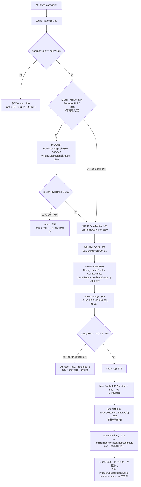

**ASCII 等价版**

```text
  点 BtAssistantVision  (UcObjectFunctionEdit.cs:335)
    │
    ├─ JudgeTuExist() ..................................... :337
    │     └─ null → 静默 return ............................ :340  【无反应，不提示】
    │
    ├─ MatterTypeEnum != TransportUnit ?（不是载具层） ...... :343
    │     └─ 是 → 取父对象 GetParentOppositeSex ........... :345-346
    │             VisionBaseMatter(父, false) .............. :350
    │               └─ 父.IsVisioned == false → return ..... :352-354  【中止】
    │
    ├─ 取本体 BaseMatter .................................. :358
    ├─ SelfPosToG0(0,0,0) → 相机移到 G0 位 ................. :360-362
    ├─ new FrmEditPRs(Config.LocateConfig, Config.Name,
    │                 baseMatter.CoordinateSystem) ......... :364-367
    ├─ ShowDialog()（内部流程见 图 16） .................... :369
    │     ├─ != OK → Dispose() :372 → return :373  【零变更】
    │     └─ == OK → Dispose() :376
    │                  ↓
    │            baseConfig.IsPrAssistant = true .......... :377  ★ 只写内存
    │            按钮图标 = Images[0]（变绿） ............. :378
    │            refreshAction() → RefreshImage ........... :379 → :266
    │
    └─ 效果：内存变更 + 界面变化
          🔴 没有 ProductConfiguration.GetInstance().Save()
             → IsPrAssistant 这个"已示教"标记不落盘
```

**调用链（带行号）**

```
BtAssistantVision.Click
 └─ UcObjectFunctionEdit.BtAssistantVision_Click              :335
     ├─ TUAssistantHelper.JudgeTuExist()                       :337
     ├─ VisionBaseMatter(transportUnit, false)                 :350
     │    └─ 内部含视觉定位判定，未 IsVisioned 则 :354 return
     ├─ System2Domain.GetInstance().BondModuleController
     │     .CameraMoveToG0Pos(point3D)                          :362
     ├─ new FrmEditPRs(locateConfig, name, coordinateSystem)    :364-367
     │    └─ FrmEditPRs.cs:31 构造 → :35 locateConfig.Name = name
     │         └─ FrmEditPRs_Load :46 → AdjustType==None 时
     │              ForBidden() :50 + DialogResult=OK :51 + return :52
     │         └─ FrmEditPRs_FormClosed :455 → Save() :478
     ├─ ShowDialog()                                            :369
     └─ OK 后：IsPrAssistant = true :377 / 图标 :378 / refreshAction :379
```

**读了什么、写了什么**

| 方向 | 对象 | 位置 |
|---|---|---|
| 读 | `TUAssistantHelper.JudgeTuExist()`（全局是否有载具） | `:337` |
| 读 | `oppositeSex.MatterTypeEnum` | `:343` |
| 读 | 父对象 `BaseMatter.BaseInfo.IsVisioned` | `:352` |
| 读 | `oppositeSex.Config.LocateConfig` / `.Config.Name` | `:365-366` |
| 写 | **相机轴移动**（`CameraMoveToG0Pos`） | `:362` |
| 写 | `baseConfig.IsPrAssistant`（内存，**不落盘**） | `:377` |
| 写 | 按钮 `Image` | `:378` |
| 写 | 树节点图标（经 `refreshAction`） | `:379` → `:266` |
| 落盘 | **无**（但 `FrmEditPRs.FormClosed:478` 会落盘它自己改的部分） | — |

**坑**

- 🔴 **`IsPrAssistant = true`（`:377`）不落盘。** 这个字段正是按钮图标"变绿"和服务端判断"该对象已示教"的依据。
  当前的写法是：`FrmEditPRs` 内部关闭时落盘过一次（`:478`），但**本体标记**是回到这里才写进内存的，
  之后再没有任何 `Save()`。后果：本次运行看起来示教完成，重启后该项回到"未示教"，而模板文件其实已经生成了。
- ⚠️ **前置视觉依赖很强，失败全是静默 return。** `:354`（父未示教）、`:340`（无载具）都不提示，
  用户只会看到"点了没反应"。对比 `BtAssistanceHeight_Click:1034` 至少会弹「请先示教位置」。
- ⚠️ **`oppositeSex.Config` 未判空**（`:365`）。若 `Config` 为 `null`，取 `.LocateConfig` 会抛 `NullReferenceException`。
- ✅ 取消路径 `:372` 与成功路径 `:376` 都 `Dispose()`，无泄漏。
- ℹ️ 打开示教窗之前先 `CameraMoveToG0Pos`（`:362`）——**这是硬件动作**：即使用户随后取消示教，相机也已经移动过了。

---

#### 4.4.2 `BtAssistantMeasureHeight_Click` —— 测高示教

**位置**：`Controls/TransportUnitEdit/UcObjectFunctionEdit.cs:387`

**图 10：`BtAssistantMeasureHeight_Click` → `FrmMeasureHeight`：测高示教全流程**

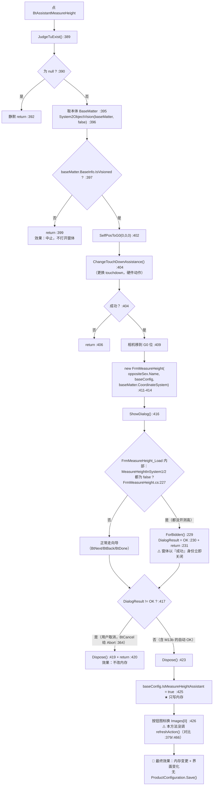

**ASCII 等价版**

```text
  点 BtAssistantMeasureHeight  (UcObjectFunctionEdit.cs:387)
    │
    ├─ JudgeTuExist() ....................................... :389
    │     └─ null → 静默 return .............................. :392
    ├─ 取本体 BaseMatter ..................................... :395
    ├─ System2ObjectVision(baseMatter, false) ................ :396
    ├─ 本体.IsVisioned == false → return ..................... :397-399  【中止】
    ├─ SelfPosToG0(0,0,0) .................................... :402
    ├─ ChangeTouchDownAssistance()（硬件：换 touchdown） ...... :404
    │     └─ 失败 → return ................................... :406
    ├─ CameraMoveToG0Pos(point3D) ............................ :409
    ├─ new FrmMeasureHeight(name, baseConfig, coordSys) ....... :411-414
    ├─ ShowDialog() .......................................... :416
    │     │
    │     ├─ 窗体 Load（FrmMeasureHeight.cs:224）：测高都没开？
    │     │     MeasureHeightInSystem1/2 均 false ........... :227
    │     │       └─ 是 → ForBidden() ....................... :229
    │     │              DialogResult = OK .................. :230  ⚠️ 以"成功"身份关闭
    │     │              return ............................. :231
    │     │       └─ 否 → 正常向导（Next/Back/Done）
    │     │
    │     └─ DialogResult != OK → Dispose() :419 → return :420  【零变更】
    │           == OK → Dispose() :423
    │                     ↓
    │           baseConfig.IsMeasureHeightAssistant = true ... :425  ★ 只写内存
    │           按钮图标 = Images[0] ......................... :426
    │           ⚠️ 未调 refreshAction()（对比 :379 / :466）
    │
    └─ 效果：内存变更 + 界面变化
          🔴 没有 ProductConfiguration.GetInstance().Save()
```

**调用链（带行号）**

```
BtAssistantMeasureHeight.Click
 └─ UcObjectFunctionEdit.BtAssistantMeasureHeight_Click        :387
     ├─ TUAssistantHelper.JudgeTuExist()                       :389
     ├─ System2Domain.GetInstance().System2ObjectVision(...)   :396
     ├─ System2Controller.ChangeTouchDownAssistance()          :404
     ├─ CameraMoveToG0Pos                                      :409
     ├─ new FrmMeasureHeight(name, baseConfig, coordSys)         :411-414
     │    ├─ FrmMeasureHeight_Load  :224 → 若测高未开：
     │    │     ForBidden() :229 + DialogResult=OK :230 + return :231
     │    ├─ UpdateState()  :278 / ForBidden()  :302
     │    └─ FrmMeasureHeight_FormClosed :352（只 Dispose ucGuideMove）
     └─ OK 后：IsMeasureHeightAssistant = true :425 / 图标 :426
```

**读了什么、写了什么**

| 方向 | 对象 | 位置 |
|---|---|---|
| 读 | `JudgeTuExist()` | `:389` |
| 读 | `baseMatter.BaseInfo.IsVisioned` | `:397` |
| 读 | `config.MeasureHeightInSystem1` / `System2`（在窗体 Load 内） | `FrmMeasureHeight.cs:227` |
| 写 | **硬件**：更换 touchdown（`ChangeTouchDownAssistance`） | `:404` |
| 写 | **硬件**：相机轴移动 | `:409` |
| 写 | `ProductConfiguration...TUHeightMeasurement.State` 等（在窗体 UpdateState/ForBidden 内） | `FrmMeasureHeight.cs:280-296`、`:304-315` |
| 写 | `baseConfig.IsMeasureHeightAssistant`（内存，**不落盘**） | `:425` |
| 写 | 按钮 `Image` | `:426` |

**坑**

- ⚠️ **「测高没开」也会被当成示教成功。** `FrmMeasureHeight_Load`（`FrmMeasureHeight.cs:224-232`）在
  `MeasureHeightInSystem1` 与 `MeasureHeightInSystem2` 都为 `false` 时执行
  `ForBidden()`（`:229`）后**把 `DialogResult` 设为 `OK`**（`:230`）并 `return`。
  调用方 `:417` 只判 `!= OK`，于是走成功分支，在 `:425` 把 `IsMeasureHeightAssistant` 置真、按钮变绿。
  用户看到的是"测高示教完成"，实际上一个点都没测。
- ⚠️ **`ForBidden` 的 `else` 分支缺失。** `FrmMeasureHeight.cs:302-316` 只处理
  `TransportUnit` / `Substrate` / `Module` 三层，**没有** `UpdateState`（`:292-296`）里那个
  `else → BondPositionMeasureHeight` 分支。所以在「贴焊点」这一层，`ForBidden()` 什么都不写——
  状态字段保留上一次的值。
- ⚠️ **本方法没有 `refreshAction()`。** 对比 `BtAssistantVision_Click:379` 与
  `BtAssistantEpoxyCheck_Click:466` 都调了，只有这里（`:425-426`）没有 →
  左侧树的图标不会更新，右侧按钮却变绿了，两处显示不同步。
- 🔴 **`IsMeasureHeightAssistant = true`（`:425`）不落盘**，与 4.4.1 同因同果。
- ℹ️ `:404` 的 `ChangeTouchDownAssistance()` 是**硬件动作**且发生在打开窗体之前 —— 取消示教不会撤销它。
- ℹ️ `BtCancel_Click`（`FrmMeasureHeight.cs:362-365`）返回的是 `DialogResult.Abort` 而不是 `Cancel`，
  所以 `:417` 的 `!= OK` 判定能正确拦截——但若将来有人把它改成 `Cancel`，判定仍然成立，属于巧合式正确。

---

#### 4.4.3 `BtAssistanceHeight_Click` —— 辅助测高（N-11：落盘到了另一个单例）

**位置**：`Controls/TransportUnitEdit/UcObjectFunctionEdit.cs:1024`（完整范围 `:1024-1077`）

**图 11：`BtAssistanceHeight_Click`：读当前 Z、算高度、写回配置——以及落盘落错了对象**

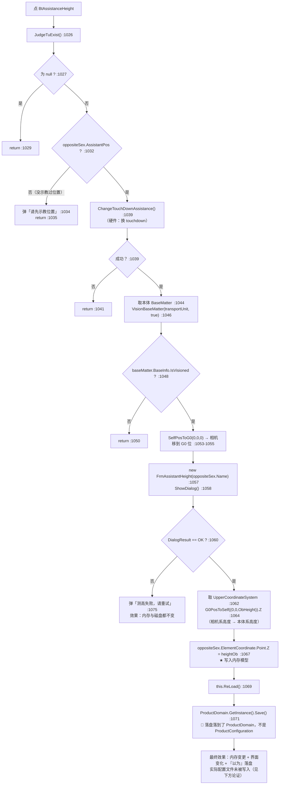

**ASCII 等价版**

```text
  点 BtAssistanceHeight  (UcObjectFunctionEdit.cs:1024)
    │
    ├─ JudgeTuExist() ...................................... :1026
    │     └─ null → return .................................. :1029
    ├─ oppositeSex.AssistantPos == false ................... :1032
    │     └─ 弹「请先示教位置」 :1034 → return :1035
    ├─ ChangeTouchDownAssistance()（硬件：换 touchdown） ..... :1039
    │     └─ 失败 → return .................................. :1041
    ├─ 取本体 BaseMatter .................................... :1044
    ├─ VisionBaseMatter(transportUnit, true) ................ :1046
    ├─ 本体.IsVisioned == false → return .................... :1048-1050
    ├─ SelfPosToG0(0,0,0) → CameraMoveToG0Pos ............... :1053-1055
    ├─ new FrmAssistantHeight(oppositeSex.Name) .............. :1057
    ├─ ShowDialog() ......................................... :1058
    │     ├─ != OK → 弹「测高失败，请重试」 :1075   【内存与磁盘都不变】
    │     └─ == OK ↓
    ├─ UpperCoordinateSystem → G0PosToSelf((0,0,ObHeight)).Z . :1062-1064
    │     （相机系高度 → 本体系高度）
    ├─ oppositeSex.ElementCoordinate.Point.Z = heightOb ...... :1067  ★ 写内存模型
    ├─ this.ReLoad() ........................................ :1069
    └─ ProductDomain.GetInstance().Save() ................... :1071  🔴 目标文件不对

  落盘目标对照：
    ProductConfiguration.GetInstance().Save()
      → FilePath = RecipeDirPath + "ProductConfiguration.json"
         （ProductConfiguration.cs:29 属性、:73 使用）
    ProductDomain.GetInstance().Save()
      → FilePath = ZX2200PathConfig.ProductDomainFilePath
                 = RecipeDirPath + "ProductDomain.json"
         （ProductDomain.cs:28 ← ZX2200PathConfig.cs:163）
    ⇒ 两个不同文件；ProductDomain 无对应可序列化字段
      ⇒ :1067 写入的高度 Z 极可能不落盘（*推断*，依据见下）

  本文件 5 处保存调用的分布：
    :437 / :477 / :773 / :811 → ProductConfiguration（正确写法）
    :1071                     → ProductDomain（本按钮独有）
```

**调用链（带行号）**

```
BtAssistanceHeight.Click
 └─ UcObjectFunctionEdit.BtAssistanceHeight_Click              :1024
     ├─ TUAssistantHelper.JudgeTuExist()                       :1026-1030
     ├─ oppositeSex.AssistantPos 判定 → 弹「请先示教位置」      :1032-1036
     ├─ System2Domain.GetInstance().System2Controller
     │     .ChangeTouchDownAssistance()                         :1039-1042
     ├─ transportUnit.GetBaseMatterByOppositeSex(oppositeSex)   :1044
     ├─ VisionBaseMatter(transportUnit, true)                   :1046
     ├─ 相机移到 G0 位                                          :1055
     ├─ new FrmAssistantHeight(oppositeSex.Name) + ShowDialog() :1057-1058
     ├─ 取 UpperCoordinateSystem → G0PosToSelf(…).Z             :1062-1064
     ├─ oppositeSex.ElementCoordinate.Point.Z = heightOb        :1067 ★ 内存
     ├─ this.ReLoad()                                           :1069
     └─ ProductDomain.GetInstance().Save()                       :1071 🔴 见下方论证
```

**N-11 论证：`ProductDomain.Save()` 与 `ProductConfiguration.Save()` 是不是同一个落盘目标？**

本文件里一共出现 **5 处**保存调用，只有这一处用的是 `ProductDomain`：

| 行号 | 写法 | 所在按钮 |
|---|---|---|
| `:437` | `ProductConfiguration.GetInstance().Save()` | `BtAssistantEpoxyCheck_Click` |
| `:477` | `ProductConfiguration.GetInstance().Save()` | `BtAssistantAfterBond_Click` |
| `:773` | `ProductConfiguration.GetInstance().Save()` | `BtNewCreate*` 系列 |
| `:811` | `ProductConfiguration.GetInstance().Save()` | `BtSave_Click` → `Save()` |
| **`:1071`** | **`ProductDomain.GetInstance().Save()`** | **`BtAssistanceHeight_Click`** |

两个单例的落盘文件**不是同一个**：

| 单例 | `FilePath` 的构成 | 证据 |
|---|---|---|
| `ProductConfiguration` | `PathConfig.RecipeDirPath` + `"ProductConfiguration.json"` | `TransportUnitSystem/ProductConfiguration.cs:29`（属性）、`:73`（Save 用 `FilePath`） |
| `ProductDomain` | `ZX2200PathConfig.ProductDomainFilePath` = `RecipeDirPath` + `"ProductDomain.json"` | `Main/Machine/Product/ProductDomain.cs:28` ← `Infrastructure/Models/Path/ZX2200PathConfig.cs:163` |

结论：**两个不同的文件**。而且 `ProductDomain` 自身只有一个可序列化成员
（`[JsonIgnore]` 的 `ProductConfig` 之外没有其它需要写盘的字段），
所以 `:1071` 的这次 `Save()` **写不进 `:1067` 刚算出来的那个高度 Z**。

保留的 *推断*：`Singleton<T>.Save()` 的方法体在仓库内**找不到**
（`grep 'class Singleton<'` 在整个仓库 0 命中，该基类来自外部程序集），
因此"它内部会不会顺带把 `ProductConfig` 也写一遍"这一点无法从源码确证。
下述后果按最直接的解读给出，并标注为 *推断*。

**读了什么、写了什么**

| 方向 | 对象 | 位置 |
|---|---|---|
| 读 | `oppositeSex.AssistantPos` | `:1032` |
| 读 | `baseMatter.BaseInfo.IsVisioned` | `:1048` |
| 读 | `baseMatter.CoordinateSystem.UpperCoordinateSystem` | `:1062` |
| 读 | `frmAssistantHeight.ObHeight`（子窗体测出的相机系高度） | `:1064` |
| 写 | **硬件**：更换 touchdown、相机移动到 G0 | `:1039`、`:1055` |
| 写 | `oppositeSex.ElementCoordinate.Point.Z` | `:1067` |
| 写 | `ReLoad()` 刷新界面 | `:1069` |
| 落盘 | `ProductDomain.GetInstance().Save()`（🔴 目标文件不含该字段） | `:1071` |

**坑**

- 🔴 **本按钮算出的高度 Z 极可能不落盘。** 见上表：`:1067` 写的是
  `ProductDomain.ProductConfig.OppositeSexConfiguration` 里的对象，
  而 `:1071` 保存的是 `ProductDomain.json`，该单例没有对应的可序列化字段。
  后果 *（推断）*：辅助测高这一次操作在本次运行内有效（`ReLoad` 后界面是对的），
  重启后高度回到旧值，而操作员会认为"测过了、存下来了"。
  这一条与 4.4.1、4.4.2 的"标记不落盘"是同一个病灶的第三种表现：**保存调用存在，但保存目标不对**。
- ⚠️ **`ReLoad()` 在 `Save()` 之前**（`:1069` 先于 `:1071`）——若 `ReLoad` 抛异常，连那次无效保存也不会发生。
- ✅ 失败分支（`:1075`）给出了明确提示「测高失败，请重试」，是本区少见的**不静默**分支。
- ✅ 前置校验 `AssistantPos`（`:1032`）有明确提示「请先示教位置」，比 4.4.1/4.4.2 的静默 return 友好。
- ℹ️ `:1062` 的强转 `(GeneralCoordinateSystem)baseMatter.CoordinateSystem.UpperCoordinateSystem`
  未做类型检查；若上层坐标系不是该类型会抛 `InvalidCastException`。

---

#### 4.4.4 `BtEditEpoxy_Click` —— 点胶编辑（N-04：全局系统切换无 try/finally）

**位置**：`Controls/TransportUnitEdit/UcObjectFunctionEdit.cs:938`（完整范围 `:938-965`）

**图 12：`BtEditEpoxy_Click`：切到 System1、编辑胶形、切回 System2**

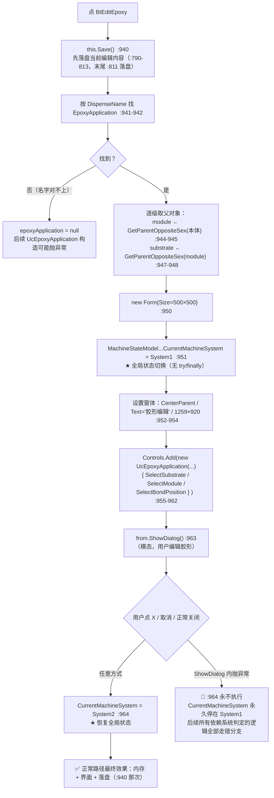

**ASCII 等价版**

```text
  点 BtEditEpoxy  (UcObjectFunctionEdit.cs:938)
    │
    ├─ this.Save() ......................................... :940
    │     （内部 :790-813：写 DispenseName/EpoxyCheckName/BondComponentName/
    │       AfterBondName、四个开关、MeasureHeightInSystem1/2，
    │       测高开而点表为空则补一个点 :808-811，末尾落盘 :811）
    ├─ EpoxyApplicationProgram.EpoxyApplications
    │     .Find(it => it.Name == baseConfig.DispenseName) ... :941-942
    │     └─ 找不到 → null（后续构造 UcEpoxyApplication 的风险起点）
    ├─ module    = GetParentOppositeSex(本体) ............... :944-945
    ├─ substrate = GetParentOppositeSex(module) ............. :947-948
    ├─ new Form{Size = 500×500} ............................. :950  （尺寸稍后被覆盖）
    ├─ MachineStateModel.CurrentMachineSystem = System1 ..... :951  ★ 全局状态切走
    ├─ from.StartPosition = CenterParent ................... :952
    ├─ from.Text = "胶形编辑" ............................... :953
    ├─ from.Size = 1259×920 ................................ :954
    ├─ from.Controls.Add(new UcEpoxyApplication(epoxyApplication)
    │      { Dock = Fill, SelectSubstrate = substrate.Name,
    │        SelectModule = module.Name,
    │        SelectBondPosition = oppositeSex.Name }) ....... :955-962
    ├─ from.ShowDialog()（模态，用户编辑胶形） .............. :963
    └─ MachineStateModel.CurrentMachineSystem = System2 ..... :964  ★ 恢复

  风险：:951 与 :964 之间没有 try/finally
    ├─ 正常：ShowDialog 返回 → :964 执行 → 一切正常
    └─ ShowDialog 内抛异常 → :964 永不执行
          → 程序此后一直认为自己在 System1
          → 无任何界面提示，恢复手段是重启（*推断*）
    ⚠️ 且 :964 是无条件写 System2，并未保存进入前的原值
```

**调用链（带行号）**

```
BtEditEpoxy.Click
 └─ UcObjectFunctionEdit.BtEditEpoxy_Click                    :938
     ├─ this.Save()  →  :790-813（末尾 :811 落盘）              :940
     ├─ EpoxyApplicationProgram.EpoxyApplications
     │     .Find(it => it.Name == baseConfig.DispenseName)      :941-942
     ├─ OppositeSexConfiguration.GetParentOppositeSex(...)      :944-945 / :947-948
     ├─ MachineStateModel.GetInstance().CurrentMachineSystem
     │     = CurrentMachineSystemEnum.System1                   :951  ★ 切走
     ├─ new UcEpoxyApplication(epoxyApplication){...}           :955-962
     ├─ from.ShowDialog()                                       :963
     └─ MachineStateModel.GetInstance().CurrentMachineSystem
           = CurrentMachineSystemEnum.System2                   :964  ★ 切回
```

**读了什么、写了什么**

| 方向 | 对象 | 位置 |
|---|---|---|
| 读 | `baseConfig.DispenseName` | `:942` |
| 读 | `System1Domain.GetInstance().System1Program.EpoxyApplicationProgram` | `:941` |
| 读 | `ProductDomain...OppositeSexConfiguration`（取 module / substrate） | `:944-948` |
| 写 | 全部编辑内容落盘（`this.Save()` 内部） | `:940` → `:811` |
| 写 | **`MachineStateModel.CurrentMachineSystem`（全局单例状态）** | `:951`、`:964` |
| 写 | 新 `Form` 的 `Controls` / `Text` / `Size` | `:950-962` |

**坑**

- 🔴 **`:951` 与 `:964` 之间没有 `try/finally`。** `CurrentMachineSystem` 是全局单例字段，
  被整个程序用来判断"当前在点胶还是固晶"。
  只要 `ShowDialog()`（`:963`）内部抛出任何异常——子控件构造、绘图、硬件访问都可能抛——
  这一行 `:964` 就被跳过，**程序此后一直认为自己在 System1**。
  后果 *（推断）*：固晶相关的按钮、坐标系换算、状态栏会按点胶逻辑走，且没有任何界面提示；
  用户唯一的恢复手段是重启软件。
- ⚠️ **`Find` 结果未判空**（`:941-942`）。`DispenseName` 与 `EpoxyApplications` 里的名字对不上时
  返回 `null`，随后 `:956` 用它构造 `UcEpoxyApplication`——该控件是否判空不在本方法内，
  但风险已经从这里开始。
- ℹ️ `:940` 先 `Save()` 再做事：即便用户随后取消胶形编辑，**当前编辑区的内容也已经落盘了**。
  这与 4.3.1 里「保存按钮不落盘」正好相反——本按钮是"不点保存也落盘"。
- ⚠️ `new Form{Size=500×500}`（`:950`）在 `:954` 又被改成 1259×920，
  初始尺寸是死代码；且这个 `Form` 只被 `ShowDialog` 一次，**没有 `Dispose()`**（对比 4.3 各按钮都 Dispose）。
- ℹ️ `:951` 与 `:964` 把系统硬编码成 `System1` / `System2`，**没有保存进入前的原值**。
  即便加了 `try/finally`，也应恢复"进入前的值"而不是无条件写 `System2`。

#### 4.4.5 「族 A」向导骨架与双自增（图 13）

**先讲清楚「族 A」是什么。** 本目录的示教窗体分两族：

| 族 | 骨架 | 驱动方式 | 本模块成员 |
|---|---|---|---|
| **族 A** | `assistantConfigList`（`List<AssistantConfig>`）+ `SetUiControl()` + `NextAction`/`BackAction`/`DoneAction` | 声明式：每一步是一个 `AssistantConfig` 对象，三个 `Action` 委托 | `FrmTUPositionTeach`、`FrmSubstratePositionTeach`、`FrmModulePositionTeach`、`FrmMeasureHeight`、`FrmEditPRs`、`FrmAssistanceHeight`、`FrmAssistanceIdentity`、`FrmAssistantHeightPoints` 等 |
| **族 B** | 无向导，直接控件 + `OK`/`Cancel` | 命令式：面板上若干按钮各写各的 | `FrmAssistantDefect`、`FrmAssistantSizeAndCenter`、`FrmAddObject`、`FrmObjectCopy` 等 |

**位置**：`Controls/Assistant/CarrierTeach/FrmTUPositionTeach.cs`（507 行）
按钮：`BtNext_Click:429`、`BtBack_Click:416`、`BtDone_Click:442`、`BtCancel_Click:454`

**图 13：`FrmTUPositionTeach` 的族 A 骨架、`BtNext`/`BtBack` 与「双自增」**

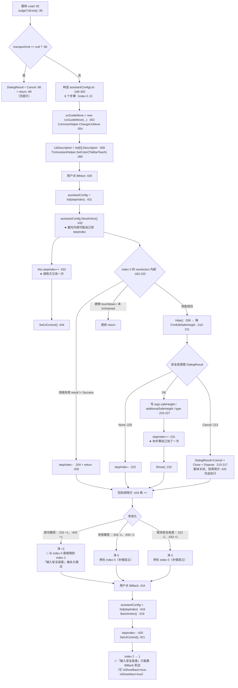

**ASCII 等价版**

```text
  Load (FrmTUPositionTeach.cs:92)
    ├─ JudgeTuExist() ......................................... :95
    │     └─ null → DialogResult = Cancel :98 + return :99（无提示）
    ├─ 构造 assistantConfigList（6 步） ....................... :168-350
    │     index 0 测高        msg1  Back- Next+ Done-
    │     index 1 输入安全高度 msg2  Back+ Next+ Done-   ← nextAction 为空 :249-251
    │     index 2 找原点1     msg3  Back- Next+ Done+
    │     index 3 找原点2     msg4  Back+ Next+ Done+
    │     index 4 找原点3     msg5  Back+ Next+ Done-
    │     index 5 找原点4     msg6  Back+ Next- Done+
    ├─ ucGuideMove = new UcGuideMove("固晶模组","FrmTUPositionTeach",true,BondCamera) :352
    └─ LbDescription = list[0].Descritpion :358 / SetColor(TileBarTeach) :360

  点 BtNext .................................................. :429
    ├─ assistantConfig = list[stepIndex] ...................... :431
    ├─ assistantConfig.NextAction() ........................... :432   ★ 委托内部可能自己改 stepIndex
    ├─ this.stepIndex++ ....................................... :433   ★ 调用方又改一次
    └─ SetUiControl() ......................................... :434

  index 0 的 nextAction 内部（:182-233）：
    ├─ AssistantMeasureHeight(type) ........................... :184-185
    │     ├─ result != Success → stepIndex-- :204 + return :205
    │     ├─ MachineWorkMode != OffLineWork → 换算 realOriginPosHeight :189-193
    │     └─ type == TouchDown → 相机移到实测高 :195-200
    ├─ Hide() :208 → FrmEditSafeHeight.ShowDialog() :210-211
    │     ├─ Cancel → DialogResult=Cancel + Close + Dispose :215-217 + return :218
    │     ├─ None   → stepIndex-- :222
    │     └─ OK     → 写 args.safeHeight / additionalSafeHeight / type :225-227
    ├─ frmEditSafeHeight.Dispose() ............................ :229
    ├─ stepIndex++ ............................................ :231   ★ 本步又加一次
    └─ Show() ................................................. :232

  净变化：
    成功路径  :231(+1) + :433(+1) = +2  → 🔴 0 直接跳到 2，跳过 index 1
    测高失败  :204(-1) + :433(+1) =  0  → 停在 0（补偿成立）
    安全高度 None :222(-1) + :433(+1) = 0 → 停在 0（补偿成立）
    安全高度 Cancel :215-217 关闭窗体，但 :433/:434 仍执行
                     → SetUiControl 靠 :396 的 IsDisposed 守卫安全返回

  点 BtBack .................................................. :416
    ├─ BackAction() ........................................... :419
    ├─ stepIndex-- ............................................ :420
    └─ SetUiControl() ......................................... :421
        → index 2 → 1：『输入安全高度』只能靠 BtBack 到达
```

**六个步骤的完整声明（`assistantConfigList`，`:168-350`）**

| index | 步骤（注释原文） | 描述变量 | `IsShowBack` | `IsShowNext` | `IsShowDone` | `nextAction` | `doneAction` |
|---|---|---|---|---|---|---|---|
| 0 | 测高 | `message1` | false | **true** | false | `:182-233`（含 `:204`/`:222` 两处 `--`、`:231` 一处 `++`） | 空（`:234-236`） |
| 1 | 输入安全高度 | `message2` | **true** | **true** | false | **空**（`:249-251`） | **空**（`:252-254`） |
| 2 | 找原点1 | `message3` | false | true | **true** | `:267-270`（记 `originPos1`） | `:271-277`（落盘 + `OK`） |
| 3 | 找原点2 | `message4` | true | true | **true** | `:290-294`（记 `originPos2`） | `:295-303`（两点取中 + 落盘 + `OK`） |
| 4 | 找原点3 | `message5` | true | true | false | `:316-320`（记 `originPos3`） | 空（`:321-323`） |
| 5 | 找原点4 | `message6` | true | **false** | **true** | 空（`:337-339`） | `:340-349`（四点取中 + 落盘 + `OK`） |

**`SetUiControl()`（`:394-409`）—— 每一步的界面刷新全靠它**

```csharp
if (this.IsDisposed) { return; }                                        // :396-399  ← 关键守卫
this.TileBarTeach.SelectedItem = this.tileBarGroup4.Items[this.stepIndex];  // :401
AssistantConfig assistantConfig = this.assistantConfigList[this.stepIndex];  // :402
this.BtBack.Visible  = assistantConfig.IsShowBack;                      // :404
this.BtNext.Visible  = assistantConfig.IsShowNext;                      // :405
this.BtDone.Visible  = assistantConfig.IsShowDone;                      // :406
this.LbDescription.Text = assistantConfig.Descritpion;                  // :407
this.LbDescription.Visible = assistantConfig.IsShowTitle;               // :408
```

**坑**

- 🔴 **「双自增」：从 index 0 点「下一步」会直接跳到 index 2，「输入安全高度」在正向流程里被永久跳过。**
  `index:0` 的 `nextAction` 在 `:231` 自己执行了一次 `stepIndex++`，
  而调用方 `BtNext_Click` 在委托返回后又执行一次（`:433`）→ 净 +2。
  这不是"某条路径不可达"：`BtBack_Click`（`:420`）的 `stepIndex--` 能让用户从 index 2 退回到 index 1，
  而且 index 1 自身声明 `isShowBack: true`、`isShowNext: true`（`:243-244`），
  说明它本来就是一个可见、可停留的步骤——**它只是永远不会被"下一步"走到**。
- ⚠️ **失败分支的 `stepIndex--` 是"补偿"而非"设置"。** `:204` 与 `:222` 的减一
  恰好抵消调用方 `:433` 的加一，从而"停在原地"。
  这种写法意味着**任何一处 `--` 被误删、或调用方的 `++` 被移走，两个方向会同时错**：
  正向会少跳一步、失败时会往回退一步。属高风险耦合（见 R-87）。
- ⚠️ **窗体已关闭后仍会执行 `:433-434`。** `FrmEditSafeHeight` 返回 `Cancel` 时，
  `index:0` 的委托执行 `DialogResult=Cancel` + `Close()` + `Dispose()`（`:215-217`）后 `return`，
  但控制权回到 `BtNext_Click` 后**仍会走 `:433 this.stepIndex++` 和 `:434 SetUiControl()`**。
  之所以没炸，全靠 `SetUiControl` 开头那句 `if (this.IsDisposed) return;`（`:396-399`）——
  这是一处**必要的、但极易被当成冗余删掉的守卫**。
- ⚠️ **`BtDone_Click` 没有 `SetUiControl()`**（`:442-447`：`DoneAction()` → `:446 stepIndex++`，到此为止）。
  当前能工作的原因是 index 2/3/5 的 `doneAction` 都以 `DialogResult = OK` 结束、窗体会关闭；
  若将来把某个 `doneAction` 改成"不关窗"，界面就不会刷新。
- ⚠️ **`FrmTUPositionTeach_Load:92-100` 在无载具时静默以 `Cancel` 关闭窗体**，
  调用方 `UcEditProductProgramming.cs:1585` 只判 `DialogResult == OK`，于是"什么都没发生"。
- ℹ️ `BtCancel_Click`（`:454-457`）**只设 `DialogResult = Cancel`，不落盘**——族 A 的取消是干净的（对比 4.4.8）。

---

#### 4.4.6 `BtDone_Click` / `BtCancel_Click` —— 族 A 的三个终局（图 14）

**位置**：`Controls/Assistant/CarrierTeach/FrmTUPositionTeach.cs:442`（Done）、`:454`（Cancel）
同族按钮在另外两个窗体里是 `BtSubstratePositionTeach`、`BtModulePositionTeach` 的同名处理器（各自独立实现）。

**图 14：族 A 的三个终局：Done 落盘、Cancel 撤出、Load 自我 Cancel**

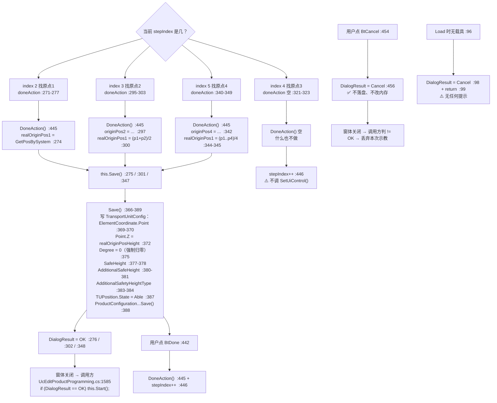

**ASCII 等价版**

```text
  族 A 的三个终局（FrmTUPositionTeach.cs）

  ① Done（落盘）
     用户点 BtDone .......................................... :442
       ├─ assistantConfig = list[stepIndex] ................. :444
       ├─ assistantConfig.DoneAction() ...................... :445
       │     ├─ index 2 → realOriginPos1 = GetPosBySystem ... :274
       │     │              this.Save() .................... :275
       │     │              DialogResult = OK .............. :276
       │     ├─ index 3 → originPos2 = ... ................. :297
       │     │              realOriginPos1 = (p1+p2)/2 ..... :300
       │     │              this.Save() .................... :301 + OK :302
       │     ├─ index 4 → 空 ............................... :321-323
       │     └─ index 5 → originPos4 = ... ................. :342
       │                    realOriginPos1 = (p1+p2+p3+p4)/4 :344-345
       │                    this.Save() .................... :347 + OK :348
       └─ stepIndex++ ..................................... :446
             ⚠️ 没有 SetUiControl()（对比 BtNext/BtBack）

     Save() 内部 ........................................... :366-389
       ├─ TransportUnitConfig.ElementCoordinate.Point = realOriginPos1 :369-370
       ├─ 同 .Point.Z = realOriginPosHeight ................. :372
       ├─ 同 .Degree = 0  ← ⚠️ 强制归零，覆盖原角度 ....... :375
       ├─ TransportUnitConfig.SafeHeight = safeHeight ....... :377-378
       ├─ TransportUnitConfig.AdditionalSafeHeight .......... :380-381
       ├─ TransportUnitConfig.AdditionalSafetyHeightType ..... :383-384
       ├─ TransportUnitConfig.TUPosition.State = Able ....... :387
       └─ ProductConfiguration.GetInstance().Save() ......... :388  ★ 落盘

     窗体关闭 → 调用方（UcEditProductProgramming.cs:1585）
       ShowDialog() → RefreshILstAssistantStepWithTransportUnit
                    → if (DialogResult == OK) this.Start();
                    → Dispose()

  ② Cancel（干净撤出）
     用户点 BtCancel ........................................ :454
       └─ DialogResult = Cancel ............................. :456
            ✅ 不落盘、不改内存  → 调用方判 != OK，丢弃本次示教

  ③ Load 自我 Cancel（无载具）
     Load .......................................... :92 → JudgeTuExist :95
       └─ null → DialogResult = Cancel :98 + return :99   ⚠️ 无提示
```

**读了什么、写了什么**

| 方向 | 对象 | 位置 |
|---|---|---|
| 写 | `args.realOriginPos1`（局部记录，来自当前轴位置） | `:274`、`:300`、`:344-345` |
| 写 | `TransportUnitConfig.ElementCoordinate.Point` / `.Point.Z` / `.Degree` | `:369-375` |
| 写 | `TransportUnitConfig.SafeHeight` / `.AdditionalSafeHeight` / `.AdditionalSafetyHeightType` | `:377-384` |
| 写 | `TransportUnitConfig.TUPosition.State = Able` | `:387` |
| 落盘 | `ProductConfiguration.GetInstance().Save()` | `:388` |
| 读 | `TUAssistantHelper.GetPosBySystem(coordinateSystem)`（当前轴位置） | `:274`、`:293`、`:319`、`:342` |

**坑**

- ⚠️ **`Save()` 把 `ElementCoordinate.Degree` 强制写 0**（`:375`，注释「重新示教默认角度为0」）。
  也就是说：**每次做载具位置示教，都会把原来示教好的角度抹掉**。
  若该载具确实需要一个非零角度，用户必须在示教完成后另外再设一次角度。
- ⚠️ **`BtDone_Click` 不调 `SetUiControl()`**（`:446` 之后没有刷新）。
  目前无害（三个有效 `doneAction` 都以 `DialogResult = OK` 收尾、窗体会关闭），
  但这是一个"靠下游行为兜底"的写法。
- ⚠️ **`index 4` 的 `IsShowDone = false` 而 `doneAction` 为空。**
  两步都为空是自洽的，但 `index:1`（`isShowNext: true` 而 `nextAction` 为空，`:249-251`）
  就出现了一个**真按钮、点了什么也不做**的组合——只在用户从 index 2 退回 index 1 后才会遇到。
- ✅ `BtCancel_Click`（`:454-457`）是干净的：**不落盘、不改内存**，调用方以 `!= OK` 丢弃本次示教。
  这是本模块"取消语义"实现得最好的一处（对照 §4.3.1 的 `BtEdit_Click` 与 4.4.8 的 `FormClosed`）。
- ℹ️ 三个 `doneAction` 都调 `this.Save()`，且 `Save()` 内部自己会落盘（`:388`）——
  与 §4.3 各按钮"`Init()` → `Save()`"的次序不同，这里是"`Save()` 内部自洽"。

---

#### 4.4.7 `FrmEditPRs.UpdateState` / `ForBidden` —— 一个状态字段服务两个工位（图 15，N-03）

**位置**：`Controls/Assistant/FrmEditPRs.cs:407`（`UpdateState`）、`:430`（`ForBidden`）
进入方式：`FrmEditPRs_Load:46-60` 在 `AdjustType == None` 时调 `ForBidden()`（`:50`）并以 `OK` 关闭（`:51`）；
向导每一步完成后调 `UpdateState()` 并落盘（`:144`+`:146`、`:187`+`:188`、`:228`+`:229`、`:259`+`:260`）。

**图 15：`UpdateState` / `ForBidden`：`TransportUnit` 与 `TransportUnitRight` 写同一个字段**

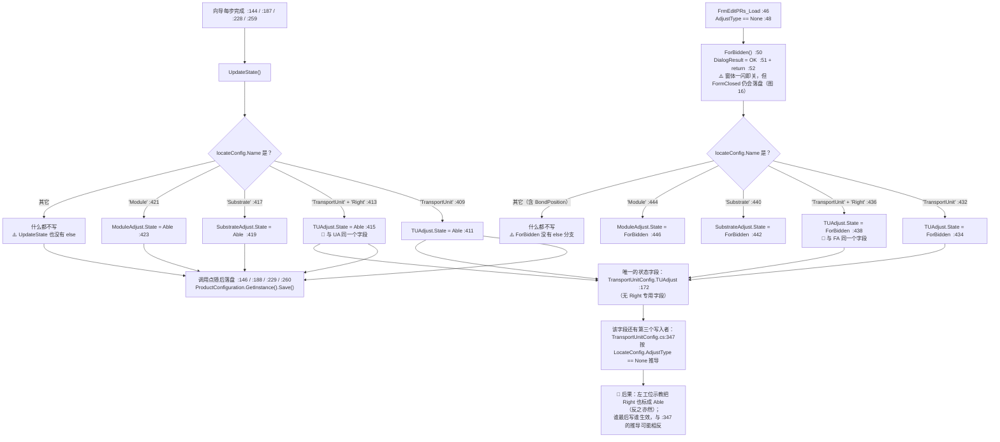

**ASCII 等价版**

```text
  入口一：FrmEditPRs_Load  (FrmEditPRs.cs:46)
    └─ AdjustType == None ? ................................ :48
         └─ 是 → ForBidden() :50 + DialogResult = OK :51 + return :52
                  ⚠️ 一闪即关，但 FormClosed 仍会落盘（图 16）
         ForBidden()  (:430-448)
           ├─ Name == "TransportUnit" → TUAdjust.State = ForBidden ....... :432-434
           ├─ Name == "TransportUnit" + "Right"
           │        → TUAdjust.State = ForBidden  🔴 与上面同一个字段 .... :436-438
           ├─ Name == "Substrate" → SubstrateAdjust.State = ForBidden .... :440-442
           ├─ Name == "Module"    → ModuleAdjust.State  = ForBidden .... :444-446
           └─ 其它（含 BondPosition）→ 什么都不写  ⚠️ 没有 else

  入口二：向导每一步完成  :144 / :187 / :228 / :259
    └─ UpdateState()  (:407-425)
           ├─ Name == "TransportUnit" → TUAdjust.State = Able .......... :409-411
           ├─ Name == "TransportUnit" + "Right"
           │        → TUAdjust.State = Able  🔴 与上面同一个字段 ....... :413-415
           ├─ Name == "Substrate" → SubstrateAdjust.State = Able ...... :417-419
           ├─ Name == "Module"    → ModuleAdjust.State  = Able ...... :421-423
           └─ 其它 → 什么都不写  ⚠️ 没有 else
    └─ 随后调用点落盘 ProductConfiguration.GetInstance().Save()
         ....................................... :146 / :188 / :229 / :260

  字段只有一个：
    TransportUnitConfig.TUAdjust
      Module/Config/TransportUnitConfig.cs:172
        public AssistantState TUAdjust { get; set; } =
            new AssistantState() { Name = "TU adjust",
                                   State = AssistantStateEnum.ForBidden };
      加入状态列表：TransportUnitConfig.cs:284
      ⚠️ 配置里没有 Right 专用字段
      ⚠️ 第三个写入者：TransportUnitConfig.cs:347
           按 LocateConfig.AdjustType == None 推导 TUAdjust.State

  后果：
    ├─ 左工位示教 → Right 在界面上也显示"已示教"（*推断*）
    ├─ 左工位 Load 时 ForBidden → Right 的状态一起被拉黑（*推断*）
    └─ 本图的 Able/ForBidden 与 :347 的推导是两套规则，
          判据不同，谁后执行谁生效
```

**调用了什么、写了什么**

| 函数 | 判定依据 | 写入字段 | 位置 |
|---|---|---|---|
| `UpdateState` | `locateConfig.Name == "TransportUnit"` | `TransportUnitConfig.TUAdjust.State = Able` | `:409-411` |
| `UpdateState` | `== "TransportUnit" + "Right"` | **`TransportUnitConfig.TUAdjust.State = Able`（同一字段）** | `:413-415` |
| `UpdateState` | `== "Substrate"` | `TransportUnitConfig.SubstrateAdjust.State = Able` | `:417-419` |
| `UpdateState` | `== "Module"` | `TransportUnitConfig.ModuleAdjust.State = Able` | `:421-423` |
| `ForBidden` | `== "TransportUnit"` | `TransportUnitConfig.TUAdjust.State = ForBidden` | `:432-434` |
| `ForBidden` | `== "TransportUnit" + "Right"` | **`TransportUnitConfig.TUAdjust.State = ForBidden`（同一字段）** | `:436-438` |
| `ForBidden` | `== "Substrate"` | `TransportUnitConfig.SubstrateAdjust.State = ForBidden` | `:440-442` |
| `ForBidden` | `== "Module"` | `TransportUnitConfig.ModuleAdjust.State = ForBidden` | `:444-446` |
| （第三个写入者） | `LocateConfig.AdjustType == None` | `TransportUnitConfig.TUAdjust.State` | `Module/Config/TransportUnitConfig.cs:347` |

**坑**

- 🔴 **`TransportUnit` 与 `TransportUnitRight` 共用同一个状态字段。**
  `Module/Config/TransportUnitConfig.cs:172` 只声明了**一个** `TUAdjust`
  （`public AssistantState TUAdjust { get; set; } = ...`，加入状态列表于 `:284`），
  配置里根本没有"右工位专用"的状态字段。
  于是 `:411` 与 `:415` 写的是同一个 `TUAdjust.State`，`:434` 与 `:438` 也是。
  后果 *（推断）*：给右工位做完示教，左工位在界面上也会显示为"已示教"；
  反过来 `FrmEditPRs_Load` 对左工位的 `ForBidden()`（`:434`）会把右工位的状态一并拉黑。
  两个工位无法独立表达"一个教了、一个没教"。
- 🔴 **字段还有第三个写入者**：`TransportUnitConfig.cs:347` 会按
  `LocateConfig.AdjustType == AdjustTypeEnum.None` **重新推导** `TUAdjust.State`。
  即：本图的 Able/ForBidden 与 `:347` 的推导是两套规则，**谁后执行谁说了算**，
  而两者判据不同（一个是"哪一级对象在示教"，一个是"定位方式是否为 None"）。
- ⚠️ **`UpdateState` 与 `ForBidden` 都没有 `else` 兜底。**
  传入 `BondPosition` 一级的名字时两个函数都不写任何状态。
  对比 `FrmMeasureHeight.UpdateState`（`FrmMeasureHeight.cs:292-296`）**有** `else` 分支处理贴焊点，
  而它的 `ForBidden`（`:302-316`）同样没有 —— 族 A 里这一对函数的不对称是系统性的。
- ⚠️ **右侧判定用字符串拼接**：`EntityTypeEnum.TransportUnit.ToString() + "Right"`（`:413`、`:436`）。
  这是**魔法后缀**，既不在枚举里也不在常量里；一旦有人改了枚举名或后缀拼写，两个分支会静默失效
  （落到 `else`，什么都不写），而界面不会有任何异常提示。
- ⚠️ **`FrmEditPRs_Load` 的 `AdjustType == None` 分支以 `OK` 关闭窗体**（`:50-52`）。
  调用方 `BtAssistantVision_Click:370` 只判 `!= OK`，于是会继续执行 `:377 IsPrAssistant = true`——
  **用户什么都没做，"已示教"却被点亮了**（与 4.4.2 测高示教的问题完全同型）。

---

#### 4.4.8 `FrmEditPRs_FormClosed` —— 任何关闭方式都会改配置并落盘（图 16，N-01 / N-02）

**位置**：`Controls/Assistant/FrmEditPRs.cs:455`（完整范围 `:455-480`）
`BtEditPR_Click`：同文件 `:378-392`（按 `stepIndex` 分派到 P1/P2/P3 模板）

**图 16：`FrmEditPRs_FormClosed`：四种关闭方式殊途同归，全部改写配置并落盘**

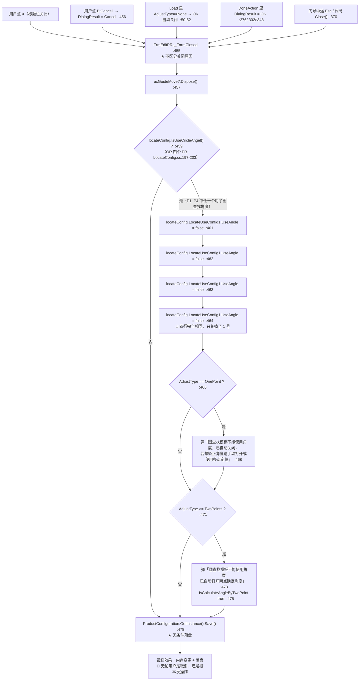

**ASCII 等价版**

```text
  五种关闭方式（殊途同归）
    ├─ 标题栏 X ................................ 用户主动
    ├─ BtCancel → DialogResult = Cancel ........ :456
    ├─ Load 里 AdjustType==None → OK 自动关闭 ... :50-52
    ├─ DoneAction → DialogResult = OK .......... :276 / :302 / :348
    └─ 中途 Esc / 代码 Close() ................. :370
                     ↓
  FrmEditPRs_FormClosed  (FrmEditPRs.cs:455)  ★ 不区分关闭原因
    │
    ├─ ucGuideMove?.Dispose() ............................... :457
    │
    ├─ locateConfig.IsUseCircleAngel() ? .................... :459
    │     └─ 定义在 Module/Config/LocateConfig.cs:197-203
    │           = IsUseCircleAngelSingle(P1PRName, LocateUseConfig1)
    │          || IsUseCircleAngelSingle(P2PRName, LocateUseConfig2)
    │          || IsUseCircleAngelSingle(P3PRName, LocateUseConfig3)
    │          || IsUseCircleAngelSingle(P4PRName, LocateUseConfig4)
    │     └─ 单个实现 :211-223：
    │          Find(name) 命中 && GetAlgFlowType()==CircleFindAlg && UseAngle
    │
    │     为真 →
    │       locateConfig.LocateUseConfig1.UseAngle = false ..... :461
    │       locateConfig.LocateUseConfig1.UseAngle = false ..... :462  ← 与上行完全相同
    │       locateConfig.LocateUseConfig1.UseAngle = false ..... :463  ← 与上行完全相同
    │       locateConfig.LocateUseConfig1.UseAngle = false ..... :464  ← 与上行完全相同
    │       🔴 四行都是 LocateUseConfig1，应为 1/2/3/4
    │       ├─ AdjustType == OnePoint → 弹「…已自动关闭…若想矫正角度请手动打开或使用多点定位」 :468
    │       └─ AdjustType >= TwoPoints → 弹「…已自动打开两点确定角度」 :473
    │                                     IsCalculateAngleByTwoPoint = true :475
    │
    └─ ProductConfiguration.GetInstance().Save() ............. :478
         ★ 无条件落盘：与上面判断无关，任何一次关闭都会写盘

  效果：内存变更 + 落盘
        🔴 即使用户点的是"取消"、甚至根本没碰过控件
```

**`BtEditPR_Click`（`:378-392`）—— 只能编辑 P1/P2/P3**

| `stepIndex` | 打开哪个模板 | 位置 |
|---|---|---|
| 0 | `TUAssistantHelper.EditPrInSystem2(locateConfig.P1PRName)` | `:380-383` |
| 1 | `EditPrInSystem2(locateConfig.P2PRName)` | `:384-387` |
| 2 | `EditPrInSystem2(locateConfig.P3PRName)` | `:388-391` |
| **3** | **无分支** —— `P4PRName` 无法从这个按钮编辑 | — |

**坑**

- 🔴 **N-01：`FormClosed` 里改配置 + 落盘，与"用户是否确认"无关。**
  `:459-476` 会改写 `UseAngle` / `IsCalculateAngleByTwoPoint`，`:478` 无条件 `Save()`。
  由于 `FormClosed` **也覆盖"用户点取消"与"Load 自动以 OK 关闭"** 两条路径，
  用户完全可能只是打开看了一眼、或按了取消，配置就已经被改写并写盘了。
  这是"打开即修改"的典型形态：**改配置的动作挂在了销毁事件上，而不是挂在"确认"上**。
- 🔴 **N-02：`:461-464` 四行完全相同，只关掉了 `LocateUseConfig1`。**
  合理的写法应是 `LocateUseConfig1/2/3/4` 各一行。
  结合 `IsUseCircleAngel()` 的定义（`LocateConfig.cs:197-203`，检查范围是 **P1..P4**），
  出现下面这个确定的不一致：
  - 若用了圆查找角度的是 **P2/P3/P4** → `:459` 判定为**真**，进入分支，
    但四行写的都是 1 号 → **真正需要关闭的 P2/P3/P4 一个也没关**，
    而用户会看到「已自动关闭」的提示（`:468`）或「已自动打开两点确定角度」（`:473`，并真的设了 `:475`）。
  - 若用的是 **P1** → 行为正确。
  也就是说：**提示语与实际效果在 P2/P3/P4 场景下互相矛盾**，且配置被改写 + 落盘（`:478`）。
- ⚠️ **`IsCalculateAngleByTwoPoint = true`（`:475`）与 `AdjustType` 无关地按 `>= TwoPoints` 打开**，
  弹窗文案写的是"已自动打开两点确定角度"——但 `:475` 设的是 `locateConfig` 自身的字段，
  而 `:461-464` 改的是 `LocateConfig1`，两者改的是不同对象（一个 `LocateConfig`、一个 `LocateUseConfig`）。
  阅读时务必区分这两个类型名只差 `Use` 三个字母。
- ⚠️ **`BtEditPR_Click` 缺 `stepIndex == 3` 分支**（`:378-392`）。
  结合 N-02 的检查范围含 P4，形成一处"能检查到 P4、却改不了也编不了 P4"的不对称。
- ⚠️ **P1/P2/P3/P4 的名字直接来自 `locateConfig` 字段**，而 `FormClosed` 用的是 `LocateUseConfig1..4`
  ——命名的两套体系（`PxPRName` 与 `LocateUseConfigx`）必须靠下标对齐，`:461-464` 的错误正是这种对齐失效的产物。

### 4.5 重点按钮逐个详解（三）：映射存储、设置面板与示教重试

#### 4.5.1 `BtSaveMapping_Click` —— 映射落盘与硬编码路径（图 17，N-10）

**位置**：`Controls/Mapping/FrmTransportUnitMapping.cs:175`

**图 17：映射的存与读：一条走 `TuService`，一条走硬编码盘符**

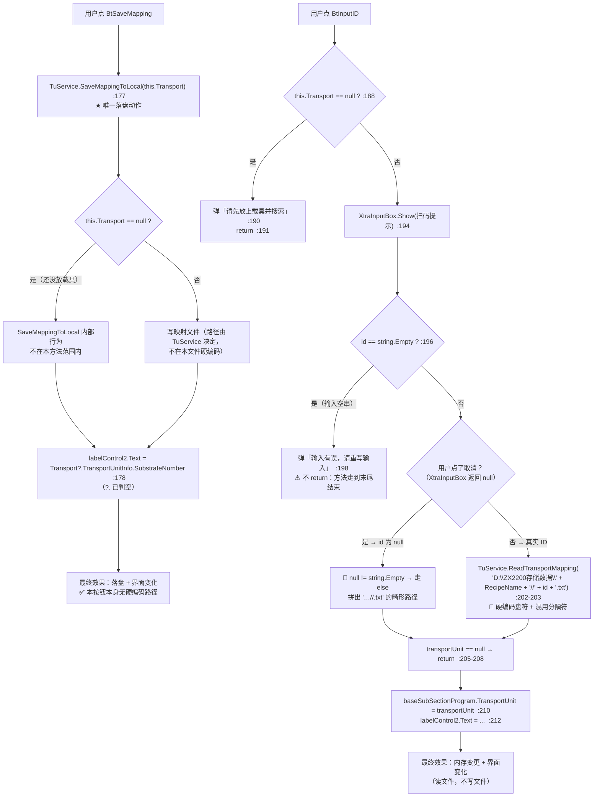

**ASCII 等价版**

```text
  ── 存：BtSaveMapping_Click  (FrmTransportUnitMapping.cs:175) ──
    ├─ TuService.SaveMappingToLocal(this.Transport) ......... :177  ★ 落盘
    │     （路径规则在 TuService 内，本文件不参与）
    ├─ labelControl2.Text = this.Transport?.TransportUnitInfo
    │                        .SubstrateNumber ............... :178
    └─ 效果：落盘 + 界面变化   ✅ 本按钮无硬编码路径

  ── 读：BtInputID_Click  (:186) ──
    ├─ this.Transport == null → 弹「请先放上载具并搜索」 :190 → return :191
    ├─ XtraInputBox.Show("请用扫码枪扫描条形码", "ID", "") .. :194
    ├─ id == string.Empty ? ................................. :196
    │     └─ 是 → 弹「输入有误，请重写输入」 :198（之后无代码，等效结束）
    ├─ 否则：
    │     TuService.ReadTransportMapping(
    │       "D:\\ZX2200存储数据\\"
    │        + MachineConfigContext.GetInstance().RecipeName
    │        + "//" + id + ".txt") .......................... :202-203
    │       🔴 硬编码盘符 D:\ZX2200存储数据\
    │       🔴 分隔符混用：前面用 \\ ，后面用 //
    │       🔴 用户点取消 → id == null → null != string.Empty
    │            → 进入此分支，拼出 "…//.txt" 的畸形路径
    ├─ transportUnit == null → return ....................... :205-208
    ├─ baseSubSectionProgram.TransportUnit = transportUnit ... :210
    └─ labelControl2.Text = ... ............................. :212
         效果：内存变更 + 界面变化（只读文件，不写文件）
```

**N-10：硬编码路径的完整清单**

| 位置 | 硬编码内容 | 触发条件 | 后果 |
|---|---|---|---|
| `FrmTransportUnitMapping.cs:203` | `"D:\\ZX2200存储数据\\"` | 点「手工输入 ID」并给出非空 ID | 盘符写死为 `D:`；换盘、换机器、或用 UNC/相对路径部署时读不到文件 |

**坑**

- 🔴 **N-10：盘符 `D:` 被写死**（`:203`）。同一字符串里还把分隔符混用（`存储数据\\` 与 `//`）。
  对比：同一个类的「保存」（`:177`）走的是 `TuService.SaveMappingToLocal`，路径规则在 `TuService` 内部。
  **读走硬编码、写走服务** —— 同一个类的存与读用了两套路径策略，
  一旦 `TuService` 的存放位置与 `D:\ZX2200存储数据\` 不一致，就会出现"存得进、读不出"。
- 🔴 **取消输入会拼出畸形路径**（`:194` → `:203`）。`XtraInputBox.Show` 在用户点取消时返回 `null`，
  而这里只判 `id == string.Empty`（`:196`），`null` 判定为假 → 进入 `else` 分支
  → `"D:\\ZX2200存储数据\\" + RecipeName + "//" + null + ".txt"`。预期行为应是"取消即中止"。
- ⚠️ **`:196` 的分支不 `return`**：输入空串时弹完提示（`:198`）就走到方法末尾。
  当前无害（后面没有代码），但与 `:191`/`:207` 的 `return` 风格不一致。
- ✅ **保存分支用 `?.` 判空**（`:178`、`:212`），比本模块多数代码严格。
- ℹ️ 该窗体由 `UcMainSystem.DataAdministrator.cs:81`（System1）与 `:105`（System2）
  用 `FrmTransportUnitMapping(DispenseSubSectionProgram / BondSubSectionProgram)` 打开，
  两处都是 `TopLevel=false; TopLevel=true; WindowState=Normal; Show();` 的**复用**写法（不 `Dispose`）。

---

#### 4.5.2 `UcSubstrate.Save()` / `LoadData()` —— 14 个控件一对一（图 18）

**位置**：`Controls/Setting/UcSubstrate.cs:86`（`LoadData`，`:86-107`）、`:112`（`Save`，`:112-132`）
14 个写入点与 14 个读取点**逐个对应**，是本模块"模型 ↔ 界面"最规范的一处。

**图 18：`UcSubstrate` 的 14 个控件双向映射与事件落盘**

```mermaid
flowchart TB
    LOAD["UcSubstrate_Load  :79"] --> L0["this.LoadData()  :79"]
    L0 --> L1["14 个控件 ← substrateConfig<br/>:88-103"]
    L1 --> L2["硬件派生使能：<br/>ChkMeasureHeight1.Enabled =<br/>IsSystem1Configrated  :105<br/>ChkMeasureHeight2.Enabled =<br/>IsSystem2ConfigLaserMh  :106<br/>★ 只读不写回"]

    L1 --> C1["① ChkIsMultipleSubstrates ← IsMultiple  :88"]
    L1 --> C2["② ChkIsSubstrateInkDot ← SubstrateInkDot  :89"]
    L1 --> C3["③ LueAdjustType ← LocateConfig.AdjustType  :90"]
    L1 --> C4["④ LueSearchType ← LocateConfig.SearchType  :91"]
    L1 --> C5["⑤ ChkDistanceCheck ← LocateConfig.DistanceCheck  :92"]
    L1 --> C6["⑥ SpSpacingTolerance ← LocateConfig.DistanceTolerance  :93"]
    L1 --> C7["⑦ ChkIsSymmetrical ← IsSymmetric  :94"]
    L1 --> C8["⑧ ChkIsCommonDataset ← CommonDataSet  :95"]
    L1 --> C9["⑨ LueSubstrateIdentification ← IdentityConfig.Identification  :96"]
    L1 --> C10["⑩ ChkMapping ← MappingEnable  :97"]
    L1 --> C11["⑪ LueSubstrateMultiplication ← Multiplication  :98"]
    L1 --> C12["⑫ ChkMeasureHeight1 ← MeasureHeightInSystem1  :100"]
    L1 --> C13["⑬ ChkMeasureHeight2 ← MeasureHeightInSystem2  :101"]
    L1 --> C14["⑭ ChkManualDistance ← IsAssistanceDistanceByInput  :103"]

    SAVE["UcSubstrate.Save()  :112"] --> S1["14 个控件 → substrateConfig<br/>:114-130（与上面一一对应）"]
    S1 --> S2["末尾无落盘<br/>★ Save() 只写内存"]

    E1["ChkMeasureHeight1_CheckedChanged  :292"] --> E1a["写 MeasureHeightInSystem1  :310<br/>this.Save()  :311"]
    E2["ChkMeasureHeight2_CheckedChanged  :319"] --> E2a["写 MeasureHeightInSystem2  :337<br/>this.Save()  :338"]
    E3["LueAdjustType_EditValueChanged  :139"] --> E3a{"isFirstLoad ?  :141"}
    E3a -->|"是（正在装载）"| E3b["return  :143<br/>★ 防止装载期误触发落盘"]
    E3a -->|"否"| E3c["按 4 种 AdjustType 分支改 Enabled/State<br/>且每个分支都执行<br/>ChkDistanceCheck.Checked = false  :153/:164/:175/:186"]
    E3c --> E3d["this.Save()  :192<br/>⚠️ 把强制清零后的值写回配置"]
    E4["其它 CheckedChanged / EditValueChanged"] --> E4a["this.Save()  :238 / :263 / :282 / :356"]

    E4a --> FIN{"Save() 之后谁落盘？"}
    S2 --> FIN
    FIN -->|"本类内"| FIN1["❌ 没有任何 ProductConfiguration...Save()<br/>落盘由外层调用者决定"]
```

**ASCII 等价版**

```text
  ── 装载（模型 → 界面）──  UcSubstrate_Load :79 → LoadData() :86
   ① :88  ChkIsMultipleSubstrates.Checked      ← IsMultiple
   ② :89  ChkIsSubstrateInkDot.Checked         ← SubstrateInkDot
   ③ :90  LueAdjustType.EditValue              ← LocateConfig.AdjustType
   ④ :91  LueSearchType.EditValue              ← LocateConfig.SearchType
   ⑤ :92  ChkDistanceCheck.Checked             ← LocateConfig.DistanceCheck
   ⑥ :93  SpSpacingTolerance.Value             ← LocateConfig.DistanceTolerance
   ⑦ :94  ChkIsSymmetrical.Checked             ← IsSymmetric
   ⑧ :95  ChkIsCommonDataset.Checked           ← CommonDataSet
   ⑨ :96  LueSubstrateIdentification.EditValue ← IdentityConfig.Identification
   ⑩ :97  ChkMapping.Checked                   ← MappingEnable
   ⑪ :98  LueSubstrateMultiplication.EditValue ← Multiplication
   ⑫ :100 ChkMeasureHeight1.Checked            ← MeasureHeightInSystem1
   ⑬ :101 ChkMeasureHeight2.Checked            ← MeasureHeightInSystem2
   ⑭ :103 ChkManualDistance.Checked            ← IsAssistanceDistanceByInput
   硬件派生（只读，不回写）：
      :105 ChkMeasureHeight1.Enabled = IsSystem1Configrated
      :106 ChkMeasureHeight2.Enabled = IsSystem2ConfigLaserMh
   ⇒ 共 14 个控件写入 + 2 个使能位

  ── 保存（界面 → 模型）──  Save() :112
   ① :114 IsMultiple            ← ChkIsMultipleSubstrates.Checked
   ② :115 SubstrateInkDot       ← ChkIsSubstrateInkDot.Checked
   ③ :116 LocateConfig.AdjustType          ← LueAdjustType.EditValue
   ④ :117 LocateConfig.SearchType          ← LueSearchType.EditValue
   ⑤ :118 LocateConfig.DistanceCheck       ← ChkDistanceCheck.Checked
   ⑥ :119 LocateConfig.DistanceTolerance   ← SpSpacingTolerance.Value
   ⑦ :120 IsSymmetric           ← ChkIsSymmetrical.Checked
   ⑧ :121 CommonDataSet         ← ChkIsCommonDataset.Checked
   ⑨ :122 IdentityConfig.Identification    ← LueSubstrateIdentification.EditValue
   ⑩ :123 MappingEnable         ← ChkMapping.Checked
   ⑪ :124-125 Multiplication    ← LueSubstrateMultiplication.EditValue
   ⑫ :127 MeasureHeightInSystem1 ← ChkMeasureHeight1.Checked
   ⑬ :128 MeasureHeightInSystem2 ← ChkMeasureHeight2.Checked
   ⑭ :130 IsAssistanceDistanceByInput ← ChkManualDistance.Checked
   ⇒ 14 个读取点，与装载逐个对应；✅ 两个 Enabled 位不回写（正确）
   ⇒ ⚠️ Save() 内部没有落盘调用

  ── 谁触发 Save() ──
   ChkMeasureHeight1_CheckedChanged :292 → :310 写值 → :311 Save()
   ChkMeasureHeight2_CheckedChanged :319 → :337 写值 → :338 Save()
   LueAdjustType_EditValueChanged   :139 → isFirstLoad 守卫 :141-144
                                        → 4 分支改 Enabled/State
                                        → :192 Save()
   其它 4 处                         :238 / :263 / :282 / :356
```

**坑**

- ⚠️ **`LueAdjustType_EditValueChanged` 的每个分支都强制 `ChkDistanceCheck.Checked = false`**
  （`:153`、`:164`、`:175`、`:186`），紧接着 `:192` 调 `Save()`，
  而 `Save()` 在 `:118` 会把 `ChkDistanceCheck.Checked` 写进 `LocateConfig.DistanceCheck`。
  **后果：每次改动「定位方式」，「间距校验」开关都会被静默清掉并写回配置。**
  用户若先勾上间距校验、再去调定位方式，勾选就丢了，且没有任何提示。
- ⚠️ **同一个事件处理里还写了状态字段**（`:155` ForBidden、`:166`/`:177`/`:186+` UnAble）：
  `TransportUnitConfig.SubstrateAdjust.State`。这与 §4.4.7 的 `UpdateState`/`ForBidden`
  构成"多处写同一字段"的结构，且判据不同（这里按 `AdjustType`，那里按对象层级）。
- ⚠️ **`Save()` 自己**不**落盘**（`:112-132` 内无 `Save()` 调用），落盘责任交给每个事件处理器。
  这意味着**任何新写的处理器若忘了落盘，改动就只活在内存里**——正是 §4.3.1 `BtEdit_Click` 的病灶，
  这里只是靠"每个调用点都补一句"来规避。
- ⚠️ **`ChkMeasureHeight1/2.Enabled` 由硬件配置派生（`:105-106`）但只在装载时设一次**，
  而 `Save()` 仍无条件把它们的 `Checked` 写回配置（`:127-128`）。
  于是在"系统 1 未配置"的机器上：控件被禁用（`:105`），但 `Checked` 仍保留配置里的旧值 `true`，
  `Save()` 会把这个 `true` 一遍遍写回去。**界面显示为灰的、配置里却是开的。**
- ✅ **`isFirstLoad` 守卫（`:141-144`）是本模块少见的正确防御**：
  装载阶段控件值变化不会触发业务逻辑（对比 §4.4.8 `FrmEditPRs_FormClosed` 的"打开即改配置"）。
- ✅ 装载与保存的 14 个字段**完全一一对应、顺序也一致**，是全部设置面板里最规范的一个。
  同一硬件位 `IsSystem1Configrated` 在三个面板里的呈现却各不相同：
  `UcSubstrate.cs:105` 用 `ChkMeasureHeight1.Enabled`、`UcModule.cs:84` 用 `ChkMeasureHeight1.Enabled`、
  `UcTransportUnit.cs:96` 用 `BtMeasureHeight1.Enabled`（按钮而非勾选框）。

---

#### 4.5.3 `BtOpen_ItemClick` / `BtDisplay_ItemClick` —— 「开启 / 屏蔽」（图 19）

**位置**：`Controls/TransportUnitEdit/UcTransportUnitView.cs:419`（开启）、`:407`（屏蔽）

**图 19：「开启 / 屏蔽」：两个对称按钮与它们的空引用缺口**

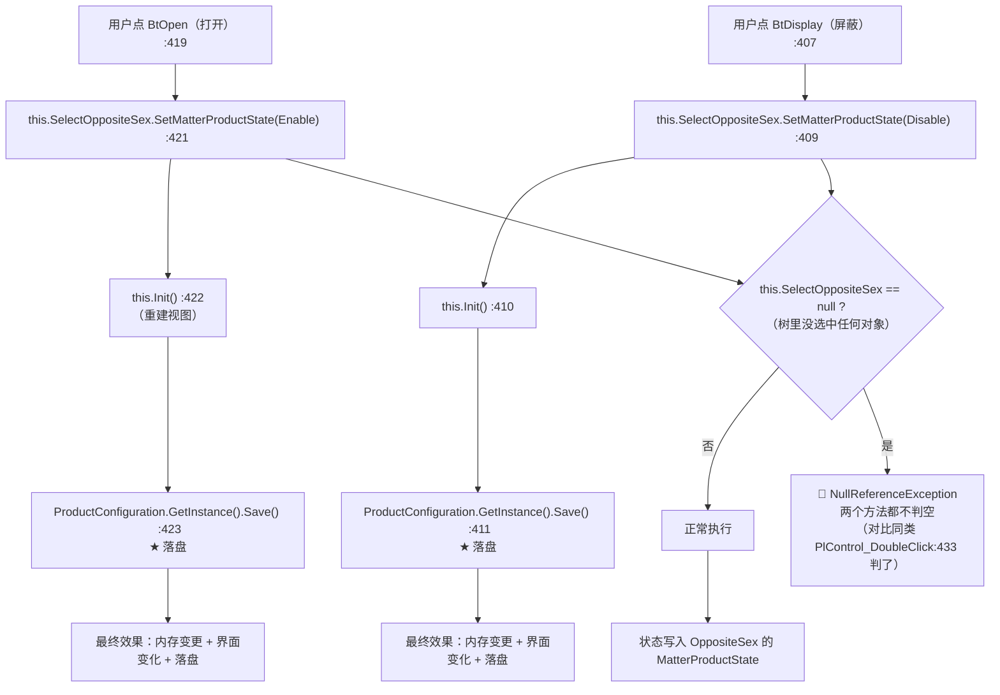

**调用链（带行号）**

```
BtOpen.ItemClick
 └─ UcTransportUnitView.BtOpen_ItemClick                      :419
     ├─ SelectOppositeSex.SetMatterProductState(Enable)        :421
     ├─ this.Init()                                            :422
     └─ ProductConfiguration.GetInstance().Save()              :423 ★ 落盘

BtDisplay.ItemClick
 └─ UcTransportUnitView.BtDisplay_ItemClick                   :407
     ├─ SelectOppositeSex.SetMatterProductState(Disable)       :409
     ├─ this.Init()                                            :410
     └─ ProductConfiguration.GetInstance().Save()              :411 ★ 落盘
```

**读了什么、写了什么**：两者都读 `this.SelectOppositeSex`（当前选中对象）；
写该对象的 `MatterProductState`（`Enable`/`Disable`）、重建视图、落盘 `ProductConfiguration.json`。

**坑**

- 🔴 **两个按钮都不判 `SelectOppositeSex` 为空。** `:409` 与 `:421` 直接点用该属性。
  同一个类的 `PlControl_DoubleClick`（`:431-444`）**先判了空**（`:433`），
  说明作者知道这个对象可能为 `null`——但没在这两个处理器里判。
  触发条件：树里未选中任何对象时点工具条的「开启」或「屏蔽」→ 未捕获的 `NullReferenceException`。
- ⚠️ **「屏蔽」会立即改配置并落盘，却没有二次确认**（`:411`）。
  对比 §4.3.3 的删除按钮至少有 `OKCancel` 确认框。误点一次即改配置。
- ⚠️ **`Init()` 在 `Save()` 之前**（`:422` 先于 `:423`、`:410` 先于 `:411`），与 §4.3 各按钮同一约定。
- ℹ️ 这两个处理器是 `ItemClick`（DevExpress `BarItem`）**不是** `Click`——
  按 `_Click` 搜不到它们，这是本模块按钮容易被漏统计的原因之一。

---

#### 4.5.4 设置面板的「一改就写内存」族（图 20）

**位置**：`Controls/Setting/` 下的一整族 `CheckedChanged` / `EditValueChanged` 处理器。
以 `UcSubstrate` 为范式（14 个控件见 4.5.2），这一族共享同一个形状：

```text
  控件事件  →  把控件值写回模型  →  this.Save()（写内存）  →  （事件内或外层）落盘
```

**图 20：设置面板事件族：`Save()` 与落盘的三种分工**

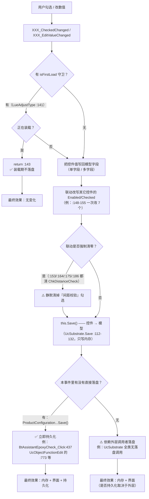

**这一族的三种分工（实测）**

| 分工 | 代表位置 | 落盘时机 |
|---|---|---|
| 事件内立即落盘 | `UcObjectFunctionEdit.cs:437`（胶检）、`:477`（焊后）、`:773`（尺寸与中心）、`:811`（`Save()` 末尾） | 勾选/改值即刻写文件 |
| 事件内调 `Save()` 写内存，外层落盘 | `UcSubstrate.cs:311`、`:338`、`:192`、`:238`、`:263`、`:282`、`:356` | 只有内存，文件由外层决定 |
| 只改界面，不写模型 | `UcSubstrate.cs:148-155` 等 `Enabled` 联动 | — |

**坑**

- ⚠️ **"一改就落盘"意味着没有撤销余地。** `UcObjectFunctionEdit.cs:437`、`:477` 这类写法
  在 `CheckedChanged` / `EditValueChanged` 里直接 `Save()`。
  用户按一下空格（DevExpress `CheckEdit` 的默认快捷键）就会改文件，没有确认、没有撤销。
- ⚠️ **`Save()` 与落盘的责任分散在调用点。** `UcSubstrate.Save()` 只写内存，
  所以"这个面板的改动到底存没存"必须逐个事件去查——本模块两种写法混用（见上表），
  使用者无法从 `Save()` 这个命名推断出是否会写文件。
- ⚠️ **联动式清零（`:153/:164/:175/:186`）没有提示**，见 4.5.2 第一条。
- ✅ `isFirstLoad` 守卫（`UcSubstrate.cs:141-144`）是正确做法，**但同文件只有一个事件用了它**；
  其它事件（`:238`、`:263`、`:282`、`:356`）没有——
  若装载顺序让它们的值发生变化，就会在装载期触发 `Save()`。
- ℹ️ 这一族是本模块**按钮总数的主要来源**：§4.2 总表里 `CheckedChanged` / `EditValueChanged`
  类处理器占了相当比例，它们没有"按钮文案"（总表里显示为 `—`），但都有持久化副作用。

---

#### 4.5.5 `RetryCommand` —— 示教里的 `goto` 重试环（图 22）

**位置**：`Controls/Assistant/ModuleTeach/FrmModulePositionTeach.cs:330`、`:400`、`:462`（三处标签）
另有 `Controls/Assistant/SubstrateTeach/FrmSubstratePositionTeach.cs` 的同型实现。

**图 22：`goto RetryCommand` 重试环与「手动间距」对向导的影响**

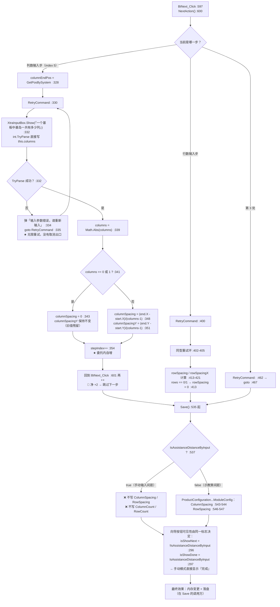

**坑**

- 🔴 **`goto RetryCommand` 环没有取消出口**（`:330-336`、`:400-405`、`:462-467`）。
  三处都是同一形状：`XtraInputBox.Show` 输入非法 → 提示 → 跳回标签重开输入框。
  **用户无法在这个环节退出示教**——只能不断输入合法值，或用任务管理器结束进程。
  对比：`FrmSubstratePositionTeach` 有同型实现，是本族共性问题（见 R-86）。
- 🔴 **`columns == 0 || columns == 1` 时只把 `columnSpacing` 置 0**（`:343`），
  **`columnSpacingY` 保持上一次的值**（`:351` 只在 `else` 分支执行）。
  同一处的行方向也一样（`:413` 只置 `rowSpacing`，`rowSpacingX` 由 `:421` 在 else 分支赋值）。
  于是"先示教 4 列、再示教 1 列"会留下上一轮的交叉项。
- 🔴 **委托内自增 + 调用方自增 = 双自增**（`:354` + `:601`），与 §4.4.5 的
  `FrmTUPositionTeach` 完全同型（那里是 `:231` + `:433`）。
  `FrmSubstratePositionTeach` 也有同一处结构（委托内 `:351` + 调用方 `:569`）。
  **三个示教窗体各自都有一处"跳过下一步"的缺陷**——这不是个别笔误，而是族级模式。
- ⚠️ **`Save()` 在手动间距模式下不写 `ColumnCount`/`RowCount`/`ColumnSpacing`/`RowSpacing`**（`:537-548`），
  但**向导按钮的可见性却由同一个标志决定**（`:296-297`）。
  两者是自洽的设计意图（手动模式下这些值来自 `FrmInputMatrixInfo`），
  但意味着**手动模式下"算出来的间距"被算完就丢**——用户看不到、也存不下，
  除非他自己在另一个界面里填。
- ℹ️ 三个示教窗体的 `BtNext_Click` 形状完全一致：
  `NextAction()` → `stepIndex++` → `SetUiControl(...)`（`:597-603`）；
  差别只在 `FrmTUPositionTeach` 的 `SetUiControl()` 不带参数（`:394`），另两个传 `stepIndex`。

---

#### 4.5.6 `FrmSubstratePositionTeach.Save()` —— 间距的来源混用（图 23）

**位置**：`Controls/Assistant/SubstrateTeach/FrmSubstratePositionTeach.cs:511`（`Save()`，`:511-558`）

**图 23：同一个坐标表达式里，间距来自两个不同的地方**

```mermaid
flowchart TB
    E0["示教第 5/6 步：算列/行间距"] --> E1["columnSpacing = (end.X-start.X)/(n-1)  :345<br/>columnSpacingY = (end.Y-start.Y)/(n-1)  :348<br/>rowSpacing / rowSpacingX  :414 / :418<br/>★ 全部是本次运行的局部变量"]
    E1 --> E2{"isShowNext / isShowDone 由<br/>IsAssistanceDistanceByInput 决定  :292-293"}
    E2 -->|"手动输入间距"| E3["用户用 FrmInputMatrixInfo 填<br/>DistanceToStartX/Y  :307-308"]
    E2 -->|"示教算间距"| E4["继续按示教值算"]

    E3 --> S0["Save()  :511"]
    E4 --> S0
    S0 --> G1{"IsAssistanceDistanceByInput == false ?  :514"}
    G1 -->|"是（示教算间距）"| G2["SubstrateConfig：<br/>ColumnCount  :516<br/>RowCount  :517<br/>ColumnSpacing  :518<br/>RowSpacing  :519<br/>★ 四个值写入配置"]
    G1 -->|"否（手动输入间距）"| G3["❌ 这四个值都不写<br/>配置里保留旧值 / 手工录入值"]
    G2 --> G4["清空并重建 ElementCoordinates  :523"]
    G3 --> G4
    G4 --> G5{"Multiplication == Matrix ?  :525"}
    G5 -->|"是"| G6["Count = ColumnCount * RowCount  :527<br/>双层循环 i=RowCount, j=ColumnCount  :529-531"]
    G6 --> G7["位置公式  :535-538<br/>X = realOriginPos[0].X + distanceStartX<br/>　　+ substrateConfig.ColumnSpacing * j<br/>　　+ this.rowSpacingX * i<br/>Y = realOriginPos[0].Y + distanceStartY<br/>　　+ substrateConfig.RowSpacing * i<br/>　　+ this.columnSpacingY * j<br/>🔴 主方向用『配置』值、交叉项用『本次局部』值"]
    G5 -->|"否（非矩阵）"| G8["Count = realOriginPos.Count  :546<br/>逐个直接用示教点  :548-553<br/>★ 不涉及间距"]
    G7 --> G9["SubstratePosition.State = Able  :556<br/>ProductConfiguration...Save()  :557"]
    G8 --> G9
    G9 --> RUN["运行时重建（另一处公式，只有主方向）：<br/>TransportUnit.cs:318-319<br/>　X = first.X + substrateConfig.ColumnSpacing * j<br/>　Y = first.Y + substrateConfig.RowSpacing * i<br/>🔴 没有 rowSpacingX / columnSpacingY 交叉项"]
```

**两个数据来源的对照（图 23 的核心）**

| 用在 `:536-537` 的量 | 来源 | 是否落盘 |
|---|---|---|
| `substrateConfig.ColumnSpacing` | **配置**（`:518` 写入，或手动模式下的旧值） | ✅ 在 `ArrayConfig.cs:50` |
| `substrateConfig.RowSpacing` | **配置**（`:519` 写入，或手动模式下的旧值） | ✅ 在 `ArrayConfig.cs:44` |
| `this.rowSpacingX` | **本次运行的局部变量**（`:418`） | ❌ 配置模型里**没有**这个字段 |
| `this.columnSpacingY` | **本次运行的局部变量**（`:348`） | ❌ 配置模型里**没有**这个字段 |
| `distanceStartX` / `distanceStartY` | 本次运行（`:307-308`，源自 `FrmInputMatrixInfo`） | *推断*：需另查该窗体；本文不展开 |

**坑**

- 🔴 **同一个坐标公式混用两个来源。** `:536-537` 里：
  - 主方向（`ColumnSpacing * j`、`RowSpacing * i`）取**配置值**
  - 交叉项（`rowSpacingX * i`、`columnSpacingY * j`）取**本次运行的局部值**
  两者来源不同、生命周期不同。在"手动输入间距"模式下 `:516-519` 整段被跳过，
  主方向用的是**旧配置值**，而交叉项是**本次新算的**——同一个网格里两套间距。
- 🔴 **交叉项从不落盘。** `grep` 整个 `TransportUnitSystem/Module/`，
  `RowSpacing`/`ColumnSpacing` 在 `ArrayConfig.cs:44`/`:50` 有定义，
  而 `rowSpacingX`/`columnSpacingY` **在配置模型里根本不存在**。
  后果 *（推断）*：任何"不经过完整示教流程"就重建坐标的路径（例如重启后重算），
  交叉项只能取 0 → 网格退化成轴对齐，与示教时看到的图形不一致。
- 🔴 **示教公式与运行时重建公式不一致。**
  - 示教时：`FrmSubstratePositionTeach.cs:535-538`（主方向 + 交叉项 + `distanceStart`）
  - 运行时：`TransportUnit.cs:318-319`（只有主方向，无交叉项、无 `distanceStart`）
  - 模块层同型：`Substrate.cs:135-136` 用 `moduleConfig.ColumnSpacing`/`RowSpacing`
  也就是说：**示教算出来的是一个带斜切的网格，运行时重建的是一个正网格**。
  当载具/基板在相机下有微小旋转时（交叉项正是用来表达这个的），两侧结果必然不同。
- ⚠️ **`columns == 0 || 1` 时不更新交叉项**（`:343`），见 4.5.5 第二条的同一病灶，
  在基板窗体里是 `:340`、`:409`。
- ⚠️ **非矩阵模式（`:544-554`）完全不涉及间距**，直接用示教点。
  两种模式的坐标语义差别很大：矩阵模式是"算出来的"，非矩阵模式是"教出来的"，
  但它们在配置里都存进同一个 `ElementCoordinates` 列表——
  下游无法从数据本身判断某个坐标是推算的还是示教的。
- ✅ `Save()` 结尾有明确的落盘（`:557`）与状态置位（`:556`），这一点比 `UcSubstrate.Save()` 完整。

---

#### 4.5.7 `FrmTuMapping` 的 `IsSystem1Configrated` 分支与菜单项移除（图 24）

**位置**：`Controls/Mapping/FrmTuMapping.cs:161`（装载时移除菜单项）、`:659`（处理器内守卫）

**图 24：无系统 1 的机器上，菜单项的移除与守卫的不对称**

```mermaid
flowchart TB
    L0["FrmTuMapping_Load 附近的初始化  :150-175"] --> L1{"IsSystem1Configrated ?  :161"}
    L1 -->|"是（机器配了系统1）"| L2["菜单保持完整"]
    L1 -->|"否（未配系统1）"| L3["contextMenuStrip1.Items.Remove(TSMTurnOn)  :168<br/>contextMenuStrip1.Items.Remove(TsmClear)  :169<br/>★ 是 Remove，不是 Enabled=false<br/>（原写法 :163-166 已被注释掉）"]
    L2 --> L4["CmbBondPosition 填 All + 各贴焊点名  :152-157<br/>LueWorkSortType 填 WorkOrderEnum  :172-173<br/>ChkAutoReturn ← Arrangement == Snake  :174"]
    L3 --> L4

    L4 --> M0["用户右键映射画布"]
    M0 --> M1["菜单里剩下哪些项？"]
    M1 --> M2["被移除：TSMTurnOn（在系统1中使能）、TsmClear（清除）"]
    M1 --> M3["仍然在：TsmEnable（使能）、TsmDisable（禁用）、<br/>BondSystem 侧其它项"]
    M2 --> M4["用户点剩下的『使能/禁用』"]

    M4 --> E0["TSMEnableInSystem1_Click  :657"]
    E0 --> E1{"IsSystem1Configrated ?  :659"}
    E1 -->|"否"| E2["静默 return  :661<br/>⚠️ 无任何提示（菜单项其实已被移除，这里兜底）"]
    E1 -->|"是"| E3["ChangeMatterProduct(...,<br/>MatterProductState.EnableInSystem1)  :664-668"]
    E3 --> E4["transportUnit = new TransportUnit('Mapping图')  :670<br/>PnMapping.Refresh()  :671"]
    E4 --> E5["最终效果：内存变更 + 界面变化<br/>⚠️ 本处理器内无落盘"]

    M4 --> F0["TsmClear_Click  :679"]
    F0 --> F1{"有 IsSystem1Configrated 守卫吗？"}
    F1 -->|"🔴 没有"| F2["ChangeMatterProduct(...,<br/>MatterProductState.EnableInSystem2)  :681-685"]
    F2 --> F3["transportUnit = new TransportUnit('Mapping图')  :687<br/>PnMapping.Refresh()  :688"]
    F3 --> F4["最终效果：内存变更 + 界面变化<br/>⚠️ 无落盘；且在未配系统1的机器上也照常执行"]
```

**坑**

- 🔴 **同族处理器守卫不对称。** `TSMEnableInSystem1_Click` 有 `IsSystem1Configrated` 守卫
  （`:659-662`，静默 return）；而 `TsmClear_Click`（`:679-689`）**完全没有守卫**，
  直接写 `MatterProductState.EnableInSystem2`。
  更耐人寻味的是装载时的移除清单（`:168-169`）把 `TsmClear` 也移除了——
  即"未配系统1 → 菜单里没有 TsmClear"，但 **`TsmClear` 做的是系统 2 的事**（`:685`）。
  这两处的语义不一致：要么该移除的不是它，要么守卫该加在别处。
- ⚠️ **用 `Remove` 而不是 `Enabled = false`**（`:168-169`，原写法 `:163-166` 已被注释掉）。
  菜单项会**彻底消失**，用户在界面上无法得知"这个功能存在但不可用"，
  与 `Enabled=false` 的"可见但灰掉"是完全不同的交互语义。
- ⚠️ **两个处理器都不落盘。** `:664-671` 与 `:681-688` 只改内存模型 + 刷新画布，
  没有任何 `ProductConfiguration...Save()`。所以"在系统 1 中使能"这个操作**是否持久化取决于别处**
  （对照 §4.3、§4.5.3 的按钮都自带落盘）。
- ⚠️ **`TSMEnableInSystem1_Click` 的守卫是静默 return**（`:661`），无提示。
  由于装载时已经把菜单项移除了（`:168`），这条守卫路径正常情况下不会走到——
  属于"双保险"，但也说明作者不确定移除是否足够。
- ℹ️ 每次操作都 `new TransportUnit("Mapping图")` 重建对象（`:670`、`:687`），
  再 `PnMapping.Refresh()` 重绘。这意味着**未保存的编辑会随重建丢失**——
  画布上的改动都是"内存里改、刷新时重建"，一旦没有落盘就会被重来一遍。

### 4.6 无按钮的交互入口：隐式入口、匿名 lambda、死处理器与搁置控件

本节处理三类**没有自己的按钮**的交互入口。它们不在 §4.2 总表里靠"按钮文案"找得到，
但都是实实在在的代码路径：一类由别的按钮触发，一类挂在控件事件上，一类写了却永远走不到。

#### 4.6.1 `Confirm()` —— 隐式入口（②类）与 `IProgrammingControl`（图 21）

**位置**：接口 `Infrastructure/Interface/IProgrammingControl.cs:26`；
实现 `Controls/Setting/UcTransportUnitFrame.cs:13`，方法体 `:49-56`；
调用方 `Infrastructure/Controls/Feature/EditProgram/UcEditProductProgram/UcEditProductProgramming.cs:873`、`:1071`。

**什么是"②类入口"**：本模块的交互入口按触发方式分三类——

| 类 | 触发方式 | 例 | 能否在 §4.2 总表按按钮名找到 |
|---|---|---|---|
| ① | 控件自己的事件（`Click` / `ItemClick` / `CheckedChanged` …） | `BtAdd_Click`、`BtSaveMapping_Click` | ✅ 能找到 |
| ② | **由外部控件的按钮代为触发**（无自己的按钮文案） | **`UcTransportUnitFrame.Confirm()`** | ❌ 找不到，须靠接口反向查 |
| ③ | 由服务层反射/泛型工厂创建 | `ControlService.ShowDialogForm<T>` | ❌ 本模块**为空**，见 4.6.4 |

**图 21：`Confirm()` 的隐式调用链：外层按钮 → 接口 → 三个面板落盘**

```mermaid
flowchart TB
    OUT1["外层：点「开始」（BtStart_Click）<br/>UcEditProductProgramming.cs:873"] --> CALL["(this.selectedControl as IProgrammingControl)?.Confirm()"]
    OUT2["外层：点「保存」（BtSave_Click）<br/>UcEditProductProgramming.cs:1071<br/>（包在 try/catch 内，成功弹「保存成功」）"] --> CALL
    SEL["selectedControl 是谁？<br/>由 :713-745 的 case 决定"] --> SEL2["case 'TransportUnitGeneral' :713-745<br/>:713 new UcTransportUnitDescription()<br/>:722 new FrmTransportUnitEdit()<br/>:731 new UcTransportUnitFrame()"]
    SEL2 --> IMPL["UcTransportUnitFrame :13<br/>实现 IProgrammingControl"]
    IMPL --> CALL2{"as IProgrammingControl 转换成功？"}
    CALL --> CALL2
    CALL2 -->|"否（selectedControl 是别的类型）"| NULL["?. 短路 —— 什么都不做<br/>★ 不抛异常，但也没有任何提示"]
    CALL2 -->|"是"| C1["UcTransportUnitFrame.Confirm()  :49"]
    C1 --> C2["ucTransportUnit.Save()  :51<br/>写 UcTransportUnit 的控件值到模型"]
    C2 --> C3["ucSubstrate.Save()  :52<br/>★ 这就是 §4.5.2 那个『只写内存』的 Save"]
    C3 --> C4["ucModule.Save()  :53"]
    C4 --> C5["ProductConfiguration.GetInstance().Save()  :55<br/>★ 14+14 个控件到此才真正落盘"]
    C5 --> FIN["最终效果：内存变更 + 落盘<br/>（界面变化由各面板自身的联动完成）"]
```

**ASCII 等价版**

```text
  ① 类入口（有按钮）        ② 类入口（无按钮，被外层按钮代触发）
  ────────────────────      ──────────────────────────────────────
  BtAdd_Click ...             UcTransportUnitFrame.Confirm()
                                     ↑ 由 IProgrammingControl 接口暴露
                                     ↑ 由外层「开始 / 保存」按钮调用

  外层按钮（UcEditProductProgramming.cs）
    ├─ BtStart_Click  :873
    │     └─ (this.selectedControl as IProgrammingControl)?.Confirm();
    │        then this.Start(true)  （:1139）
    └─ BtSave_Click   :1071
          └─ (this.selectedControl as IProgrammingControl)?.Confirm();
             （在 try/catch 内，成功后 AKRSXtraMessageBox.Show("保存成功")）

  selectedControl 的来源（UcEditProductProgramming.cs :713-745）
    case "TransportUnitGeneral"
      :713  new UcTransportUnitDescription()
      :722  new FrmTransportUnitEdit()
      :731  new UcTransportUnitFrame()      ← 实现 IProgrammingControl 的那个

  接口定义（Infrastructure/Interface/IProgrammingControl.cs:26）
    public interface IProgrammingControl
    {
        void Confirm();                       // 只有一个方法
    }

  实现（Controls/Setting/UcTransportUnitFrame.cs）
    :13   public partial class UcTransportUnitFrame
              : XtraUserControl, IProgrammingControl
    :49   public void Confirm()
          {
    :51       this.ucTransportUnit.Save();      // 控件值 → 模型
    :52       this.ucSubstrate.Save();          // ★ 只写内存（§4.5.2）
    :53       this.ucModule.Save();
    :55       ProductConfiguration.GetInstance().Save();   // ★ 真正落盘
          }

  最终效果：内存变更 + 落盘
    界面变化由各面板自身的事件联动完成（§4.5.4）

  ⚠️ 转换失败时 `?.` 静默短路：不抛异常、也不提示
```

**三个面板的 `Save()` 与落盘的分工（本节回答 §4.5.4 留下的问题）**

| 步骤 | 调用 | 位置 | 是否落盘 |
|---|---|---|---|
| 1 | `ucTransportUnit.Save()` | `UcTransportUnitFrame.cs:51` | ❌ 只写内存 |
| 2 | `ucSubstrate.Save()` | `:52` | ❌ 只写内存（`:112-132` 内无落盘） |
| 3 | `ucModule.Save()` | `:53` | ❌ 只写内存 |
| 4 | `ProductConfiguration.GetInstance().Save()` | `:55` | ✅ **一次性落盘，三个面板的改动全在这里写出** |

**坑**

- ⚠️ **隐式入口没有任何界面提示。** `Confirm()` 不是按钮，界面上看不到它；
  它的调用者是外层的「开始」与「保存」。所以若 `UcSubstrate.Save()`（`:52`）
  抛异常，用户看到的现象是"点『保存』没反应"，而不是"子面板保存失败"。
- ⚠️ **`as` + `?.` 的静默短路**（`UcEditProductProgramming.cs:873`、`:1071`）：
  若 `selectedControl` 没实现该接口，`Confirm()` 根本不会被调用，
  **外层却仍然会走到成功分支**。"没有保存"与"保存成功"在界面上无法区分。
- ⚠️ **落盘被压到最后一步（`:55`）**，前面三步只改内存。
  若 `:51`/`:52`/`:53` 中任何一步抛异常，`:55` 不会执行 →
  三个面板的改动全在内存里、文件没动。
- ✅ 接口本身极简（只有一个 `void Confirm()`），`UcTransportUnitFrame` 是**本模块唯一的实现者**，
  这使"设置面板如何被保存"有唯一答案——这是好设计。
- ℹ️ `UcTransportUnitFrame` 的构造函数（`:33-44`）在 `:37-39` 直接 `new` 三个子面板并 `Add` 到
  `TpTransportUnit`/`TpSubstrate`/`TpModule` 三个 TabPage（`:41-43`）。
  所以 §4.5.2 的 14 个控件在**父控件一构造出来就已存在**，`LoadData()` 在 `:79` 被调用。

---

#### 4.6.2 `FrmMeasureHeightPoints` 的三个 lambda（图 25）

**位置**：`Controls/Setting/FrmMeasureHeightPoints.cs:40`（`SpX`）、`:51`（`SpY`）、`:62`（`SpZ`）
这三个是 §4.2 总表里**仅有的三个匿名 lambda 接线**（其余 240 条都是命名方法）。

**图 25：三个 lambda 的写入路径、`Index` 的依赖与"不落盘"的归宿**

```mermaid
flowchart TB
    LOAD["FrmMeasureHeightPoints_Load  :104"] --> L1["RefreshComboBox()  :106<br/>按下拉项数填 CmbPoint"]
    L1 --> L2["RefreshData()  :107<br/>★ 只在这里挂一次 lambda"]
    L2 --> H1["SpX.EditValueChanged += (s,e) => {...}  :40"]
    L2 --> H2["SpY.EditValueChanged += (s,e) => {...}  :51"]
    L2 --> H3["SpZ.EditValueChanged += (s,e) => {...}  :62"]

    SEL["用户切换 CmbPoint"] --> S1["CmbPoint_SelectedIndexChanged  :92<br/>把 [Index].X/Y/Z 读进 SpX/SpY/SpZ  :94-96"]
    S1 --> GATE{"Index 有效？<br/>Index => CmbPoint.SelectedIndex  :33"}
    GATE -->|"Index == -1（未选中）"| EXC["🔴 HeightMeasurementPoints[-1]<br/>ArgumentOutOfRangeException"]

    EDIT["用户在 SpX 上改数值"] --> E1["lambda 触发  :40"]
    E1 --> E2{"SpX.EditValue is decimal ?  :42"}
    E2 -->|"否"| E3["什么也不做（静默）"]
    E2 -->|"是"| E4["baseConfig.HeightMeasurementPoints[Index].X = value  :47<br/>★ 只改内存"]
    EDIT2["SpY 上改数值"] --> E5["同型 → [Index].Y = value  :58"]
    EDIT3["SpZ 上改数值"] --> E6["同型 → [Index].Z = value  :69"]

    E4 --> NOSAVE["❌ 三个 lambda 都没有落盘<br/>本类也没有 FormClosed 处理器"]
    E5 --> NOSAVE
    E6 --> NOSAVE
    NOSAVE --> LATER["★ 但内存对象就是配置对象：<br/>baseConfig.HeightMeasurementPoints<br/>⇒ 后续任何一次<br/>ProductConfiguration.GetInstance().Save()<br/>都会把这些改动一起写出去<br/>（例：§4.3 UcObjectFunctionEdit.Save :811）"]
    LATER --> FIN["最终效果：仅内存变更<br/>持久化时机由『后来者』决定"]
```

**读了什么、写了什么**

| 控件 | 处理器位置 | 判定 | 写入 | 落盘 |
|---|---|---|---|---|
| `SpX` | `:40-49` | `EditValue is decimal`（`:42`） | `baseConfig.HeightMeasurementPoints[Index].X`（`:47`） | ❌ |
| `SpY` | `:51-60` | `EditValue is decimal`（`:53`） | `...HeightMeasurementPoints[Index].Y`（`:58`） | ❌ |
| `SpZ` | `:62-71` | `EditValue is decimal`（`:64`） | `...HeightMeasurementPoints[Index].Z`（`:69`） | ❌ |

**坑**

- 🔴 **`Index` 越界风险。** 三个 lambda 都用 `Index` 作下标，
  而 `Index => this.CmbPoint.SelectedIndex`（`:33`）在**未选中任何项时为 `-1`**。
  `CmbPoint_SelectedIndexChanged`（`:92-97`）同样直接用 `[this.Index]`（`:94-96`）。
  触发条件：`RefreshComboBox()`（`:106`）与 `RefreshData()`（`:107`）的先后顺序若导致
  Load 结束前 `SelectedIndex` 仍为 `-1`，或用户把下拉清空后改数值 →
  `HeightMeasurementPoints[-1]` → `ArgumentOutOfRangeException`。
  *（推断：`-1` 是否真会出现取决于 `RefreshComboBox`（`:77-91`）是否设置 `SelectedIndex`——
  该循环本身只填项、不选中。）*
- ⚠️ **用 `+=` 挂 lambda**（`:40`、`:51`、`:62`）。本类只在 `RefreshData()`（`:38`）里挂一次，
  而 `RefreshData()` 只有 `Load`（`:107`）一个调用点，**当前是安全的**。
  但如果将来有人在 `CmbPoint_SelectedIndexChanged` 里也调一次 `RefreshData()`（很自然的重构），
  就会变成"同一控件挂两个 handler"，每次改值写两遍——
  `+=` 在这里埋下了一个**迟早会触发的重复挂载**隐患。
- ⚠️ **`is decimal` 判定失败是静默的**（`:42`、`:53`、`:64`）：类型不符时什么也不做、不提示。
  这是 DevExpress `SpinEdit` 的惯用写法，但对"输入被吞掉"的排查不友好。
- ⚠️ **三个 lambda 都不落盘，本类也没有 `FormClosed` 处理器**（全类只有 `:38`、`:77`、
  `:92`、`:104` 四个方法）。所以"改测高点坐标"的持久化**完全依赖后续是否有人调 `Save()`**。
  好消息是：`baseConfig` 就是配置对象本身，`HeightMeasurementPoints` 是它的成员，
  所以 §4.3 的 `UcObjectFunctionEdit.Save()`（`:811`）会把改动一并写出——
  **只要用户之后点过任何一个会落盘的按钮**。
- ℹ️ 这一段与 §4.4.2 的测高示教遥相呼应：测高示教把 `IsMeasureHeightAssistant` 置真却不落盘（`:425`），
  测高点坐标的编辑也不落盘。**测高这条链路上"内存改、磁盘不改"是成片的。**

---

#### 4.6.3 四个零接线处理器（图 26，R-92）

这四个处理器在模块**全仓库范围内 0 处接线**（既不在 Designer 里 `+=`，也没有代码 `+=`）。
判定方法与完整清单见 §4.2.2。

**图 26：四个零接线处理器与它们各自被"冻结"的最终动作**

```mermaid
flowchart TB
    A0["UcTransportShow.BtOnlyBond_ItemClick  :1012<br/>『只贴片』"]
    A1{"Machine.GetInstance().IsWorking() ?  :1014"}
    A0 --> A1
    A1 -->|"是（机器在运行）"| A2["return  :1016<br/>★ 有运行期保护"]
    A1 -->|"否"| A3["foreach selectedBaseMatters  :1019<br/>if (matter is BondPosition)  :1021<br/>→ b.MatterProductState = EnableInSystem2  :1024"]
    A3 --> A4["selectedBaseMatters.Clear()  :1028<br/>PlControl.Refresh()  :1030<br/>IsChange = true  :1032<br/>★ 置了『有改动』脏标志"]

    B0["UcTransportShow.BtOnlyDispense_ItemClick  :1040<br/>『只点胶』"]
    B1{"IsWorking() ?  :1042"}
    B0 --> B1
    B1 -->|"是"| B2["return  :1044"]
    B1 -->|"否"| B3["foreach selectedBaseMatters  :1047<br/>if (matter is BondPosition)  :1049<br/>→ b.MatterProductState = EnableInSystem1  :1052"]
    B3 --> B4["selectedBaseMatters.Clear()  :1056<br/>PlControl.Refresh()  :1058<br/>IsChange = true  :1060"]

    C0["FrmMeasureHeight.BtEditPr_Click  :323<br/>编辑『框架示教找中心模板』"]
    C1["→ 转调 TUAssistantHelper 打开模板编辑<br/>⚠️ Designer 里 BtEditPr 根本没接线"]
    C0 --> C1

    D0["FrmMeasureHeight.BtMoveToCenter_Click  :333<br/>定位后下发轴移动"]
    D1["TUAssistantHelper.AssistantPR(...)<br/>→ 成功则 MoveToPos(...)<br/>→ 失败则弹「定位失败，请重置制作模板」<br/>🔴 方法体内含硬件轴移动"]
    D0 --> D1

    A0 --> X["🔴 全模块 0 处接线<br/>⇒ 『只贴片』在界面上不可用"]
    B0 --> Y["🔴 全模块 0 处接线<br/>⇒ 『只点胶』在界面上不可用"]
    C0 --> Z["🔴 0 处接线 ⇒ 该按钮永不可达"]
    D0 --> W["🔴 0 处接线 ⇒ 含轴移动的代码永不可达"]
    X --> RISK["共同点：四个方法都被完整实现、<br/>带运行期守卫与脏标志，<br/>却没有任何入口 —— 见 R-92"]
    Y --> RISK
    Z --> RISK
    W --> RISK
```

**四个处理器的对照**

| 处理器 | 位置 | 一句话作用 | 方法体是否完整 | 特殊之处 |
|---|---|---|---|---|
| `BtOnlyBond_ItemClick` | `Controls/Mapping/UcTransportShow.cs:1012-1033` | 选中项只保留固晶（`EnableInSystem2`，`:1024`） | ✅ 完整 | 有 `IsWorking()` 守卫（`:1014`）+ 置脏标志（`:1032`） |
| `BtOnlyDispense_ItemClick` | `Controls/Mapping/UcTransportShow.cs:1040-1061` | 选中项只保留点胶（`EnableInSystem1`，`:1052`） | ✅ 完整 | 同上（`:1042`、`:1060`） |
| `BtEditPr_Click` | `Controls/Assistant/FrmMeasureHeight.cs:323` | 编辑「框架示教找中心模板」 | ✅ 完整 | 该窗体的 `BtEditPr` 在 Designer 里**根本没有接线** |
| `BtMoveToCenter_Click` | `Controls/Assistant/FrmMeasureHeight.cs:333` | 定位后下发轴移动 | ✅ 完整 | ⚠️ **方法体内含硬件动作** |

**坑**

- 🔴 **两个"只贴片 / 只点胶"功能在界面上不存在。** `UcTransportShow` 的这两个处理器
  都对选中项批量改写 `MatterProductState`，并带 `IsWorking()` 运行期保护、
  还置了 `IsChange = true` 脏标志——**写代码的人显然认为它们是活的**。
  但全模块 0 处接线，用户点不到。后果：把一批贴焊点批量切成"只固晶"或"只点胶"这个能力，
  只能一个个去改。
- 🔴 **含硬件动作的死代码最危险。** `FrmMeasureHeight.cs:333` 的
  `BtMoveToCenter_Click` 内部会调 `TUAssistantHelper.MoveToPos(...)`——**这是轴移动**。
  它现在是死的（0 处接线），但：
  1. 它无法通过界面验证，**没有任何人测试过这条路径**；
  2. 一旦有人为它接线（哪怕只是"把按钮补上"），就会立刻启用一段**从未运行过**的轴移动代码。
  同类风险登记为 R-92。
- ⚠️ **死代码让人误判功能是否已实现。** 审阅代码时会看到"只贴片/只点胶已实现"，
  而实际交付的界面里没有入口。§4.2.2 已把这 4 个处理器单独列表标注，避免被误计入可用入口。
- ⚠️ **`BtEditPr` 与 `BtEditPR` 大小写不同的两组名字分属不同类**：
  小写 `BtEditPr_Click` 在 `FrmMeasureHeight.cs:323`（死）与 `FrmAssistanceHeight.cs:215`；
  大写 `BtEditPR_Click` 在 `FrmEditPRs.cs:378` 与 `FrmAssistanceIdentity.cs:197`。
  统计与检索时极易混淆（详见 §4.2.2 的口径说明）。
- ✅ 这四个方法**都带空值/运行态守卫**（`IsWorking()`、`result.success` 判定），
  说明它们不是半成品——这反而说明它们曾经被计划接入界面。

---

#### 4.6.4 ③类入口：本模块为空

§4.6.1 的表里提到第三类入口是通过服务层泛型工厂创建窗体：

```csharp
public static DialogResult ShowDialogForm<T>(params object[] args)   // Infrastructure/Service/ControlService.cs:366
```

全仓库的活动调用点只有四处，且**全部不是** `TransportUnitSystem` 下的类型：

| 调用点 | 类型参数归属 |
|---|---|
| `WaferSubSystem/.../FrmComponentGeometryWithWaferTeach.cs:225` | WaferSubSystem |
| `WaferSubSystem/.../UcComponentEdit.cs:1203` | WaferSubSystem |
| `WaferSubSystem/.../WaferSubSystemTask.cs:833` | WaferSubSystem |
| `WaferSubSystem/.../WaferSubSystemTask.cs:872` | WaferSubSystem |

**结论**：本目录**没有**任何窗体是通过 `ShowDialogForm<T>` 反射创建并弹出的。
即 §4.6.1 表中的"③类入口"在料单元系统里**为空集**——
本模块所有弹窗都是 `new FrmXXX(...)` + `ShowDialog()` 的直接写法
（见 §4.3/§4.4/§4.5 各图的"调用链"段）。
这一条结论排除了一种最容易漏统计的入口形式，使 §4.2 总表的 **243 个处理器行**
成为本模块交互入口的**完备**枚举（另 2 行是 §4.6.6 的无行为控件，不属于入口）。

---

#### 4.6.5 四种最终效果的归类口径（§4.6.1–§4.6.4 小结）

§4.1 提出的"四个最终效果"在本节三类入口上的分布：

| 入口 | 界面变化 | 内存变化 | 持久化 | 硬件命令 |
|---|---|---|---|---|
| `Confirm()`（②类，图 21） | 由子面板联动 | ✅ | ✅ `:55` | ❌ |
| 三个 lambda（图 25） | ✅ 自身即控件 | ✅ | ❌（借后续 `Save()`） | ❌ |
| 4 个死处理器（图 26） | ✅ 实现了但不可达 | ✅ 实现了但不可达 | ❌ | ⚠️ **`FrmMeasureHeight.cs:333` 含轴移动** |

其中**唯一含硬件动作却不可达**的是 `FrmMeasureHeight.cs:333`——它同时是本模块
"未测试代码"与"硬件风险"的交点，已在图 26 与 R-92 中单列。

---

#### 4.6.6 两个「被搁置的半成品」下拉框（R-102 / R-103）

本模块有 **2 个控件**：**代码是活的、编译进去了、所在页面也能打开，
但它在界面上永远点不动，而且即使点开也什么都没有。** 它们不是按钮，是下拉框——
所以它们**不属于** §4.6.3 的"死处理器"（那里是"实现了但不可达"），
也**不属于**"幽灵文件"（那是"存在但没编译"）：
这里是**界面做了一半、行为从未写**。

**先说用户看到什么**（这是本节的落脚点）：

> 「对象功能编辑」页**能正常打开**（进配方编辑即可到达），页面上有一个**「状态类型」下拉框
> 和一个它旁边的类型下拉框**，**它们永远是灰的、点不动**。
> 就算想办法把灰去掉，**点开也是空的——里面一个选项都没有**，
> 因为它们**没有任何选项来源**。用户看不到任何报错，也点不出任何结果。

**"页面能开"要单独强调**，因为这与"控件没用"是两件事——**载体是活的，只有这两个下拉是死的**：

| 环节 | 证据 `文件:行` | 状态 |
|---|---|---|
| 该页被创建 | `Controls/TransportUnitEdit/FrmTransportUnitEdit.cs:221`：`this.ucObjectFunctionEdit = new UcObjectFunctionEdit(this.RefreshImage,this.BackAction) { Dock = DockStyle.Fill };` | ✅ 活的 |
| 该页的 `Load` 有实现并被接线 | `UcObjectFunctionEdit.Designer.cs:836`：`this.Load += new System.EventHandler(this.UcObjectFunctionEdit_Load);` | ✅ 活的 |
| 该页内其余控件正常 | 见下面的对照组（7 个 `Enabled = false` 中 5 个会被重新启用） | ✅ 活的 |
| **这两个下拉框** | `Designer.cs:715` / `:725` ＋ 无选项来源 ＋ 无事件接线 | 🔒 **死的（半成品）** |

⇒ 所以**不是"这个页面坏了"**，而是**"这个页面里有两个控件从来没做完"**。

##### 一、判定口径（可复现，三步都要跑）

```bash
cd "E:/项目/ZX2200标机/trunk/AKRS.ZX2200"

# ① 全仓引用（★ 不要排除它自己的 Designer —— 接线行本来就在 Designer 里）
grep -rn --include='*.cs' 'CmbStateType' . | grep -v '/bin/\|/obj/'

# ② 下拉框事件族有没有接线（★ 不要查 Click —— ComboBoxEdit 不用 Click）
grep -nE '(SelectedIndexChanged|EditValueChanged|TextChanged)' \
  TransportUnitSystem/Controls/TransportUnitEdit/UcObjectFunctionEdit.Designer.cs \
  | grep -E 'CmbStateType|CmbType'

# ③ 有没有选项来源（Designer 里 + 全仓代码里）
grep -n 'Properties.Items' TransportUnitSystem/Controls/TransportUnitEdit/UcObjectFunctionEdit.Designer.cs
grep -rn --include='*.cs' 'CmbStateType.Properties.Items' . | grep -v '/bin/\|/obj/'

# ④ 大小写兼顾的 Designer 遍历（本仓有 8 个小写 .designer.cs，用 --include 会漏）
find . \( -name '*.Designer.cs' -o -name '*.designer.cs' \) \
     -not -path './bin/*' -not -path './obj/*' | wc -l     # 实测 339 = 331 + 8
```

**实测结果**

| 检查 | `CmbStateType` | `CmbType`（`UcObjectFunctionEdit` 的） |
|---|---|---|
| ① 全仓引用 | **只有它自己的 Designer**：`:83` `new ComboBoxEdit()`、`:130` `Properties.BeginInit()`、`:498` `Controls.Add`、`:713` 注释、**`:715` `Enabled = false`**、`:716` 位置、`:717` 名、`:718-719` `Properties.Buttons.AddRange(...)`、`:720` 尺寸、`:721` `TabIndex`、`:874` `EndInit`、`:898` 字段声明 | 同样**只有它自己的 Designer**：`:84` 实例化、`:131` `BeginInit`、`:499` `Controls.Add`、`:723`/`:724` 注释、**`:725` `Enabled = false`**、`:726` 位置、`:727` 名、`:728-729` `Buttons.AddRange`、`:730` 尺寸、`:731` `TabIndex`、`:875` `EndInit`、`:897` 字段声明 |
| ② 下拉框事件族接线 | **0 处**（无 `SelectedIndexChanged`、无 `EditValueChanged`、无 `TextChanged`） | **0 处** |
| ③ 选项来源 | **`Properties.Items` 在该 Designer 中出现 0 次**；全仓 `CmbStateType.Properties.Items` **0 处** | 同样 **0 处** |
| ④ 所属容器 | `groupControl1`（`:498`） | `groupControl1`（`:499`） |
| 结论 | **无事件接线 ＋ 无选项来源 ＋ 永久禁用** | **同型** |

##### 二、为什么这是"半成品"而不是"故障"

| 判据 | 实测 | 含义 |
|---|---|---|
| 有没有事件接线 | **没有**（下拉框事件族 0 处） | **没有任何行为**——不是"行为坏了"，是"行为从未写" |
| 有没有选项 | **没有**（`Properties.Items` 0 处，代码也不填） | **即使通电也没有内容可选**——空下拉 |
| `Enabled` 会不会被恢复 | 不会（全仓 0 处 `.CmbStateType.Enabled`） | **禁用后从未恢复**（客观事实，不是本节的定性用词） |
| 点得动吗 | **点不动** | 所以**不存在"点了会崩溃"**；写"崩溃/选了报错"都是错的 |

⇒ 定性：**被搁置的半成品**（这一次"半成品"是**有据**的：**既无选项来源、也无任何行为**），**不是**「故障」。
⚠️ **用词边界**：「**运行时永久禁用（启用状态从未被恢复）**」这个说法**留给另一类控件**——
即**接线完整、功能已实现、只差 `Enabled` 开关没打开**的那些（下文"必须区分开的另一类"）。
本节这 2 个控件**连行为都没有**，只称「**被搁置的半成品**」。**两类措辞不混用**：
前者是"没通电"，后者是"没装机器"。

**必须区分开的另一类**（⚠️ 两类不要用同一套措辞）：
本目录（乃至全仓）另有一批控件是**接线完整、功能已经实现、只差 `Enabled` 开关没打开**——
它们是「**有行为、只是没通电**」，**这一类才用「运行时永久禁用（启用状态从未被恢复）」这个措辞**
（例：共享参考列出并与本文档同批核对的 `BtnCopy`、`BtnMeasurementComponentThickness`、
`BtDistanceMeasurement`、`BtMultipleHeightMeasurement`、`UcUserManagerTile`）；
而本节的 2 个是「**根本没有行为**」，只称「**被搁置的半成品**」。
两者都表现为"永远是灰的"，但**性质与修复代价完全不同**：前者只需打开开关，
后者需要从零实现（填选项 + 写事件 + 定业务含义）。

##### 三、已排除的四条旁路（引用自共享参考，**已复跑验证，成立** ✅）

以下四条都可能让"永久禁用"的结论失效，逐条排除：

| 旁路 | 会不会让结论失效 | 实测结论 |
|---|---|---|
| `.resx` + `ApplyResources` 事后覆盖 `Enabled` | **会**（`ApplyResources` 在 `InitializeComponent` 里晚于属性赋值） | ✅ **排除**：`UcObjectFunctionEdit.Designer.cs` 中 `ApplyResources` **0 次**（该文件虽有 `.resx`（11,358 字节），但 Designer 不通过它应用属性） |
| 泛型遍历控件树统一赋 `Enabled` | **会** | ✅ **排除（本节亲自读码确认）**：`UcObjectFunctionEdit.cs:224-236` 确有 `foreach (var item in this.groupControl1.Controls)`，**但它只对 `SpinEdit` 生效**：`:226 if (item is SpinEdit)` → `:229 spin.Enabled = true`。`CmbStateType`/`CmbType` 是 **`ComboBoxEdit`，不是 `SpinEdit`**，**进不了这个分支** |
| 辅助方法按引用传入控件后统一启用 | **会** | ✅ **排除**：`ControlService.cs:215`/`:236` 的 `ToggleControlsEnabled(Control, List<Control>, bool)` 按**显式引用**传参，而这两个控件名在**本类之外零出现**，**传不进去** |
| 反射设 `Enabled` | **会** | ✅ **排除**：本项目有反射调 `Save`/`Cancel`（见 `_死代码与零引用登记.md` §4），但**没有**反射设 `Enabled` 的代码 |

##### 四、同页面内的对照组（说明本判定不是"看到 `Enabled=false` 就算"）

`UcObjectFunctionEdit.Designer.cs` 里被设为 `Enabled = false` 的控件共 **7 个**。
逐个体检后，**只有 2 个**是真的永久禁用：

| 控件 | Designer 里 `Enabled = false` | 之后有没有被启用 | 判定 |
|---|---|---|---|
| `CmbAfterBond` | `:217` | ✅ 有：`UcObjectFunctionEdit.cs:853` `= this.ChkAfterBondOpen.Checked` | 正常（由勾选框驱动） |
| `CmbBond` | `:258` | ✅ 有：`UcObjectFunctionEdit.cs:843` `= this.ChkBond.Checked` | 正常 |
| `CmbEpoxyCheck` | `:300` | ✅ 有：`UcObjectFunctionEdit.cs:833` `= this.ChkEpoxyCheckOpen.Checked` | 正常 |
| `CmbDispense` | `:361` | ✅ 有：`UcObjectFunctionEdit.cs:823` `= this.ChkDispenseOpen.Checked` | 正常 |
| **`CmbStateType`** | **`:715`** | ❌ **无（全仓 0 处）** | 🔒 **被搁置的半成品**（R-102） |
| **`CmbType`** | **`:725`** | ❌ **无（全仓 0 处）** | 🔒 **同型**（R-103） |
| `TxName` | `:735` | ✅ 有：`UcObjectFunctionEdit.cs:223` `this.TxName.Enabled = true`（"编辑"时启用） | 正常，**不是**永久禁用 |

**这张对照表本身就是"反向要求"的落实**：
不能只按 `Enabled = false` 下结论——先查有没有代码置回 `true`（或绑定到勾选框），
再查四条旁路，**两关都过了才算**。上表 7 个里 5 个都被后两种机制"救活"了。

##### 五、★ `CmbType` 为什么要单列：同名不同类的陷阱

`CmbType` 这个名字在**本目录另一个类** `FrmAddObject` 里**也有一个同名控件**，
而且那个是**接线完整、功能正常的**：

| 归属 | 位置 | 接线 | 状态 |
|---|---|---|---|
| `FrmAddObject.CmbType` | 定义 `Controls/TransportUnitEdit/FrmAddObject.Designer.cs`，接线 `:96` `this.CmbType.SelectedIndexChanged += new EventHandler(this.CmbType_SelectedIndexChanged);`，处理器 `FrmAddObject.cs:195` | ✅ **有**（且处理器进 §4.2.3 总表） | **正常** |
| `UcObjectFunctionEdit.CmbType` | 定义 `UcObjectFunctionEdit.Designer.cs:84`/`:897`，属性块 `:723-731` | ❌ **无** | 🔒 **半成品** |

⇒ **按名字 grep 会把这两个混为一谈**：跑 `grep -rn 'CmbType'` 会因为命中 `FrmAddObject`
而误判"有引用、有接线"，从而**漏掉 `UcObjectFunctionEdit` 里的那一个**。
这与 §4.2.1 开头说的「本目录有 29 个处理器名字在多个类里重复」是**同一个坑**，
只不过这次坑的不是行号，而是**"有没有接线"的结论**。
**结论：判定控件级事实时，必须把"哪个类的哪一个实例"落到 `文件:行`，不能停在名字上。**

##### 六、这两行在总表里的位置

它们已按"**一个不漏**"的要求列入 §4.2.3 总表末尾，
「处理器」一列写 **`无（无事件接线 ＋ 无选项来源）`**（**没有删掉**），
这就是 §4.2.1 里"总表 245 行 = 243 处理器 ＋ 2 无行为控件"的由来。

#### 4.6.7 容器连坐：8 个永久禁用容器 ＋ 1 个「看条件」的例外（R-104）

§4.2.1 数出的「2 个无行为控件」，禁用是**写在控件自己身上**的（`this.CmbStateType.Enabled = false`）。
本目录还有**另一种机制**：控件自己没被禁用，**是它所在的容器被禁用了**——
WinForms 的 `Enabled` 沿容器树向下传播，父容器 `Enabled = false` 时其中的子控件一律变灰、点不动。
**两类机制不可混算**：本节这 9 个容器**不进** §4.2 的 245 行口径（理由见本节「四」）。

##### 一、取数口径（可复现）

在 `AKRS.ZX2200/TransportUnitSystem/` 下执行：

```bash
# ① 全部「Designer 里被禁用」的控件
grep -rn --include='*.Designer.cs' '\.Enabled = false;' . | sed 's#^\./##' | sort

# ② 其中哪些是「容器」（会连坐子控件）
grep -rn --include='*.Designer.cs' '\.Enabled = false;' . \
  | grep -i 'groupcontrol\|panel\|groupbox\|tabpage\|layoutcontrolgroup\|splitcontainer'

# ③ 某个容器的子控件（以 UcSubstrate 的 groupControl5 为例）
grep -o 'this\.groupControl5\.Controls\.Add(this\.[A-Za-z0-9_]*)' Controls/Setting/UcSubstrate.Designer.cs

# ④ ★ 容器有没有被「恢复」——必须查非 Designer 的赋值
grep -rn --include='*.cs' -E 'groupControl(1|3|5|6|7|13)\.(Visible|Enabled)' . | grep -v '\.Designer\.cs'
```

**命令 ④ 的有效性对照（不跑对照就不算证据）**：同样式的 `.Visible =` / `.Enabled =` 赋值，
在 `TransportUnitSystem` 的**非 Designer** 代码里共 **253 处**，说明这条正则本来就能命中这类语句；
④ 输出多寡是真结果，不是正则失配。另一条正对照用 `TxName.Enabled`：全仓 4 处
（`UcObjectFunctionEdit.cs:223`/`:234`/`:315` ＋ `UcObjectFunctionEdit.Designer.cs:735`），**全部命中**。

##### 二、完整清单（9 个容器，一个不漏）

| # | 类（均在 `Controls/` 下） | 容器 | 容器标题（`Text` 行） | `Enabled=false` | 还 `Visible=false` | 子控件数 | 子控件最终效果 |
|---|---|---|---|---|---|---|---|
| 1 | `Setting/UcSubstrate` | `groupControl1` | 「Cyclic substrate adjust setup」`:207` | `:201` | ✅ `:208` | 4 | **零读写**（E 档，见「三」） |
| 2 | `Setting/UcSubstrate` | `groupControl7` | 「Cyclic substrate adjust」`:265` | `:259` | ✅ `:266` | 1 | **零读写**（E 档） |
| 3 | `Setting/UcSubstrate` | `groupControl5` | 「Mapping」`:401` | `:395` | ❌ 无 | 1 | **有行为**：`ChkMapping` 往返配置（B 档，见「六」） |
| 4 | `Setting/UcSubstrate` | `groupControl13` | 「Assistant options」`:465` | `:459` | ✅ `:466` | 1 | **无行为**：`ChkStepForRotation`（C 档） |
| 5 | `Setting/UcModule` | `groupControl5` | 「Bad module handling」`:146` | `:139` | ✅ `:147` | 1 | **无行为**：`checkEdit11`（C 档） |
| 6 | `Setting/UcModule` | `groupControl13` | 「Assistant options」`:326` | `:319` | ✅ `:327` | 1 | **无行为**：`checkEdit12`（C 档） |
| 7 | `Setting/UcTransportUnit` | `groupControl3` | 「载具右边定位」`:312` | `:305` | ✅ `:313` | 7 | **★ 行为完整却整组不可达**（D 档，见「五」） |
| 8 | `Setting/UcTransportUnit` | `groupControl6` | 「载具左边定位」`:470` | `:463` | ✅ `:471` | 7 | **★ 同上**（D 档） |
| 9 | `TransportUnitEdit/FrmAddObject` | `groupControl1` | 「偏移值设定」`:268` | `:263` | ❌ 无 | 9 | ⚠️ **例外：会被恢复**（A 档，见「三」末） |

子控件合计 **32 个**（4+1+1+1+1+1+7+7+9）；其中 #7/#8 各含一个嵌套容器
（`groupControl11`、`groupControl10`），已计入各自的 7 内。
7 个容器同时 `Visible = false`（**#3、#9 是仅禁用、仍渲染**）。

##### 三、五档定性（按「子控件还有没有行为」分）

| 档 | 判据 | 涉及容器 | 应使用的措辞 |
|---|---|---|---|
| **A** | 容器禁用**但会被恢复** | #9 | ⚠️ **不是永久禁用**，是「**条件启用**」 |
| **B** | 容器永久禁用，子控件**有行为、可被程序读写** | #3 | 「**运行时永久禁用（启用状态从未被恢复）**」 |
| **C** | 容器永久禁用，子控件**无事件接线 ＋ 无任何读写** | #4 #5 #6 | 「**被搁置的半成品**」（同 R-102 / R-103 型） |
| **D** | 容器永久禁用，子控件**行为完整、有接线、有实现** | #7 #8 | 「**整组界面不可达**」——是功能缺失，不是半成品 |
| **E** | 容器永久禁用，子控件是**纯显示 / 零读写** | #1 #2 | 「**纯装饰性的死界面**」 |

**五档的措辞不可互换**——这与 §4.6.6 二、立下的「两类措辞不混用」是同一条纪律的延伸。

**A 档为什么是例外**：`FrmAddObject.groupControl1`（「偏移值设定」）在 Designer 里是
`Enabled = false`（`TransportUnitEdit/FrmAddObject.Designer.cs:263`），但**它会被恢复**——
`FrmAddObject.cs:223` 有 `this.groupControl1.Enabled = this.ChkAbsoluteOffset.Checked;`，
由「绝对偏移」勾选框 `ChkAbsoluteOffset` 的 `CheckedChanged` 处理器（`:221`）驱动；
该控件自身接线正常（`FrmAddObject.Designer.cs:280`），其值也在 `FrmAddObject.cs:82` 被读。
勾上「绝对偏移」后该组即变为可用，组内 `SpOffsetX/Y/Z` 随之可用，且这三个值确有消费者
（`FrmAddObject.cs:91-93`、`:105-107`）。
⇒ **它是「默认禁用、按条件放开」，绝不能写进「永久禁用」名单。**
（⚠️ 未查 `ChkAbsoluteOffset` 的初始 `Checked`，即默认能不能用。）

**E 档的证据**：#1 的 `spinEdit1`/`spinEdit3` 与 #2 的 `comboBoxEdit9`，
在 `UcSubstrate.cs` 及本目录全部非 Designer 代码里**各 0 处读写**。
（正对照：同法 `spinEdit1\.` 在全仓非 Designer 代码里有 6 处命中 ⇒ 该正则有效，**0 是真零**。）
⚠️ 但**未查**它们是否被参数树/反射读取（见「七」）。

##### 四、这 9 个为什么不进 §4.2 的 245 行

§4.2.1 的口径是「**控件自身** `Enabled = false` ＋ 无接线 ＋ 无选项来源」，数出 **2 个**。
本节这 9 个容器是**另一种机制**，且规模更大——若把容器连坐的子控件也按同一口径并进去，
本目录「碰不到的控件」会从 2 跳到**数十**，而 §4.6.6 二、已经约定**两类措辞不混用**。
因此本节**只登记与定性，不改 §4.2 的总表行数、不改 245 这个口径**。
分工是：**§4.2 管「控件自己坏了」，本节管「容器把它关起来了」**。

> ⚠️ **给后续复核者**：本节列的是**容器**；「永久禁用**控件**」的跨目录总账在共享参考
> `_永久禁用控件排查.md` 里（那里的口径**按控件计**，与本节不同）。
> 本节与它是**同现象、不同分组单位**，引用时**不要互相加减**。

##### 五、★ D 档最重的一条：`UcTransportUnit` 的左/右定位**整组**不可达

`UcTransportUnit.groupControl3`（「载具右边定位」）与 `groupControl6`（「载具左边定位」）
各装 7 个子控件，**两组的 `Enabled = false` 与 `Visible = false` 同时成立**
（`:305` 与 `:313`；`:463` 与 `:471`），且**全仓没有任何地方把它们恢复**——
命令 ④ 对这 9 个名字共 **8 条**命中，逐条核对后**没有一条**是在恢复 #1–#8：

| 那 8 条命中是什么 | 位置 |
|---|---|
| 4 条是**注释掉的**（不参与编译） | `UcTransportUnit.cs:288`、`:289`、`:295`、`:296` |
| 2 条属**另一个窗体**的同名容器 | `Controls/Tool/FrmLocateUseInfo.cs:154`、`:159` 的 `groupControl3` |
| 1 条属**另一个类**的同名容器 | `Controls/TransportUnitEdit/UcObjectFunctionEdit.cs:139` 的 `groupControl6` |
| 剩下 1 条恰是 **#9 的恢复行**（见「三」A 档） | `FrmAddObject.cs:223` |

**这一档与 A–C 档的区别：组内控件的「行为是完整的」**。

| 事实 | 位置 |
|---|---|
| 有事件接线 | 6 处：`UcTransportUnit.Designer.cs:344`（`LueRightAdjustType_SelectedIndexChanged`）、`:355`（`BtLocateUseInfoRight_Click`）、`:421`（`ChkRightDistanceCheck_EditValueChanged`）、`:502`（`LueLeftAdjustType_SelectedIndexChanged`）、`:568`（`ChkLeftDistanceCheck_EditValueChanged`）、`:579`（`BtLocateUseInfoLeft_Click`） |
| 处理器**全部有实现**（非空壳） | `UcTransportUnit.cs:363`、`:404`、`:421`、`:462`、`:493`、`:505`；其中 `:363`/`:421` 是按 `AdjustTypeEnum` 的 4 个分支逐个 `set` 子控件 `Enabled` 的完整联动逻辑（`:365-395` / `:423-453`） |
| 装载 / 保存都在写配置 | 装载 `:78-83`（左）、`:85-90`（右）；保存 `:125-130`（左）、`:132-137`（右） |
| 它还开子窗体 | `:496`、`:508` 各自 `new FrmLocateUseInfo(...)`，传入左/右配置 |

**⇒ 结论：这是「一整块配置界面被容器永久关掉」，不是半成品。**
操作员在 `UcTransportUnit` 上**看不到也点不到**左/右定位的搜索方式、定位方式、间距校验等设置。

**它写进去的配置还有谁用**——全仓核对（这决定后果轻重）：

| 项 | 结果 |
|---|---|
| 声明 | `TransportUnitConfig.cs:77`（`LeftLocateConfig`）、`:72`（`RightLocateConfig`），二者是独立属性；**基类另有一个同名的 `LocateConfig`**（`BaseConfig.cs:27`），**不要与它们混为一谈** |
| **写**入点 | **只有** `UcTransportUnit.cs:125-130`、`:132-137`——即上面那个不可达的组 |
| **读**取点 | 同一个不可达的组自读（`:78-83`、`:85-90`）＋ `:496`/`:508` 传给 `FrmLocateUseInfo` ＋ `System2CommonService.cs:69-70` 的 `GetPrNames()`（**只取 PR 名列表**） |

⇒ **在本仓可静态查到的范围内，这一对配置对象除「取 PR 名」外没有别的消费者。**
⚠️ **但这不是「该功能无影响」的证明**——JSON 序列化/反序列化可能在不出现属性名的路径上读写它，
**这一点我未逐行追查**，故本条按「**不可达**」定性，**不**按「无影响」定性（见「七」）。

##### 六、B 档：`ChkMapping` 是「有行为、只是没通电」，且它另有**活入口**

`UcSubstrate.groupControl5`（「Mapping」）里只有 `ChkMapping`（「基板 mapping」）一个控件，
容器 `Enabled = false`（`:395`）且**未**设 `Visible = false`（仍渲染，只是灰着）。
这个复选框**本身没坏**——`UcSubstrate.cs:97` 装载、`:123` 保存，属阅读指南 §4.4/§4.5 已写出的往返链路，
**所以 §4.4/§4.5 原有的描述仍然有效**；此前缺的只是「**操作员碰不到这个复选框**」这一层。

**★ 关键补充：同一个字段还有一个活着的入口。**
`ChkMapping` 写的是 `SubstrateConfig.MappingEnable`，而该属性带着参数树特性：

```csharp
// TransportUnitSystem/Module/Config/SubstrateConfig.cs:52
[TreeProgramListArgs("是否启用mapping", (string)null)]
public bool MappingEnable { get; set; }   // :53
```

`[TreeProgramListArgs]` 是「程式编辑」界面（`UcProgramArgs`）反射生成节点的依据
（见 11 号 §「参数树特性」、6 号 §7.3）。
⇒ **「是否启用 mapping」在参数树里有对应节点**，因此
**不能写成「操作员永远无法启用基板 mapping」**——那是错误结论。
正确的写法是：**这个复选框永久禁用，但该开关另有参数树入口**。
（⚠️ 我**未**实测参数树里该节点的可编辑性与权限等级，故只陈述「特性存在」这一静态事实。）

##### 七、诚实声明（本节**未查**的部分）

| 未查项 | 说明 |
|---|---|
| 序列化路径 | `Left/RightLocateConfig`、`MappingEnable` 是否经 JSON 反序列化在别处被消费——**未逐行追查**，故「五」不按「无影响」定性 |
| 参数树节点的可编辑性 | `MappingEnable` 在「程式编辑」里的权限等级与实际可编辑性——**未实测** |
| E 档是否被反射读取 | #1/#2 的 `spinEdit1`/`spinEdit3`/`comboBoxEdit9` 零读写是按**属性名**查的，不排除反射/参数树路径 |
| `ChkAbsoluteOffset` 的默认值 | 只确认它驱动 #9 的启用，**未查**其初始 `Checked`（即 #9 默认能不能用） |
| 外观与实测 | 本文档**未运行软件**，全篇无一处「已实测」 |

---

## 5. 核心流程（非 UI 触发）

「非 UI 触发」指**没有按钮**、也不由用户直接点击驱动的流程。本节收录两类：
定时器驱动的刷新（§5.1）与静态工具入口族（§5.2）。
它们与 §4 的按钮流程一起，构成料单元系统的完整触发面。

### 5.1 `Timer1_Tick` —— 300 ms 定时刷新（图 27）

**位置**：`Controls/Setting/UcTransportUnit.cs:343`（方法体 `:343-356`）
**接线**：不在 `.cs` 里，而在 Designer 中一次性启用：

```csharp
this.timer1 = new System.Windows.Forms.Timer(this.components);   // UcTransportUnit.Designer.cs:78
this.timer1.Enabled = true;                                       // :699
this.timer1.Interval = 300;                                       // :700
this.timer1.Tick += new System.EventHandler(this.Timer1_Tick);    // :701
```

**图 27：`Timer1_Tick`：每 300 ms 沿父链上溯并回写控件值**

```mermaid
flowchart TB
    CTOR["UcTransportUnit 构造  :37<br/>InitializeComponent()  :39"] --> DZ["Designer 启用定时器：<br/>Enabled = true  :699<br/>Interval = 300  :700<br/>Tick += Timer1_Tick  :701"]
    DZ --> TICK["每 300 ms 触发 Timer1_Tick  :343"]
    TICK --> P1["沿父链上溯三级：<br/>(UcTransportUnitFrame)this.Parent.Parent.Parent  :345<br/>⚠️ 硬编码层级，无判空"]
    P1 --> P2{"上溯成功？"}
    P2 -->|"否（层级变化 / Parent 为 null）"| EXC["🔴 NullReferenceException 或 InvalidCastException<br/>每 300 ms 抛一次"]
    P2 -->|"是"| Q1["ucTransportUnitFrame.GetSubstrateProcessingEnable()  :347"]
    Q1 --> Q2["→ UcSubstrate.IsMultipleSubstrates()<br/>（UcTransportUnitFrame.cs:62-65）"]
    Q2 -->|"true（多基板）"| E1["LueSubstrateProcessing.Enabled = true  :349<br/>（不禁用，不动值）"]
    Q2 -->|"false（非多基板）"| E2["LueSubstrateProcessing.Enabled = false  :353<br/>LueSubstrateProcessing.EditValue =<br/>SubstrateProcessingEnum.Complete  :354<br/>★ 强制回写，每 300 ms 一次"]
    E2 --> IMPACT["用户若选了别的加工方式：<br/>最多 300 ms 后被改回 Complete<br/>⚠️ 界面表现为『选了又跳回去』"]
    IMPACT --> NOSIDE{"EditValue 变化会触发<br/>LueSubstrateProcessing_EditValueChanged  :284<br/>（Designer 接线 :608）"}
    NOSIDE -->|"该处理器方法体整段被注释  :286-300"| OK["✅ 当前无任何副作用、也不落盘"]
    NOSIDE -->|"⚠️ 若将来取消注释"| LAT["*推断*：注释块内含<br/>LueAdjustType.EditValue = None  :291<br/>LueLeftAdjustType.EditValue = None  :298<br/>LueRightAdjustType.EditValue = None  :299<br/>→ 每 300 ms 反复重置 → 形成保存风暴"]
    DISP["控件被释放  :41"] --> D1["timer1.Stop()  :43<br/>Tick -= Timer1_Tick  :44<br/>timer1.Dispose()  :45<br/>timer1 = null  :46<br/>✅ 清理完整"]
```

**读了什么、写了什么**

| 方向 | 对象 | 位置 |
|---|---|---|
| 读 | `this.Parent.Parent.Parent` 强转为 `UcTransportUnitFrame` | `:345` |
| 读 | `GetSubstrateProcessingEnable()`（内部转 `UcSubstrate.IsMultipleSubstrates()`） | `:347` → `UcTransportUnitFrame.cs:64` |
| 写 | `LueSubstrateProcessing.Enabled` | `:349`、`:353` |
| 写 | `LueSubstrateProcessing.EditValue = Complete`（**仅非多基板时**） | `:354` |
| 落盘 | **无** | — |

**坑**

- 🔴 **沿父链上溯三级且不判空**（`:345`）。
  `this.Parent.Parent.Parent` 的成立依赖**当时**的控件嵌套深度：
  `UcTransportUnit` → …→ `UcTransportUnitFrame`。这个层级由
  `UcTransportUnitFrame` 的构造函数（`UcTransportUnitFrame.cs:41-43`）与若干中间容器共同决定。
  一旦有人插入一层 `PanelControl` 或改变 TabPage 结构，这句话就会抛
  `NullReferenceException` / `InvalidCastException`，**而且每 300 ms 抛一次**。
- 🔴 **定时器会静默回退用户的输入。** 非多基板时 `:354` 每 300 ms 把
  `LueSubstrateProcessing` 写回 `Complete`。用户的选择最多保留 300 ms——
  界面表现是"选完立刻跳回去"，且没有任何提示说明原因。
  *（推断：这是刻意的"非多基板时加工方式必须是 Complete"的约束实现，
  但用轮询强制回写、而不是在依赖变化时写一次，代价与困惑都更大。）*
- ⚠️ **`EditValue` 赋值会触发 `EditValueChanged`**（Designer `:608` 已接线），
  而该处理器的方法体（`:284-301`）**整段被注释掉**——所以当前没有副作用，也不落盘。
  但这意味着**一次 300 ms 的写入在事件层面是"活的"**：
  注释块内含有 `LueAdjustType.EditValue`、`LueLeftAdjustType.EditValue`、
  `LueRightAdjustType.EditValue` 的赋值（`:291`、`:298-299`），
  一旦有人取消注释，定时器就会每 300 ms 重置这几个下拉项，
  而它们各自的 `EditValueChanged`/`SelectedIndexChanged` 处理器中存在落盘调用
  （§4.5.4 的落盘族）→ **会演变成 300 ms 一次的保存风暴**。*（推断，基于注释块内容与 §4.5.4 的落盘分布）*
- ✅ **释放路径完整**（`:41-47`）：`Stop` → `Tick -=` → `Dispose` → 置 `null` 四步齐全，
  是本模块少见的规范清理。对比 §4.4.4 的 `BtEditEpoxy_Click` 连 `Dispose` 都没有。
- ℹ️ `timer1` 由 `this.components` 持有（Designer `:78`），因此即使不手动 `Dispose` 也会随容器释放；
  `:46` 把它置 `null` 之后，**任何后续访问 `timer1` 的代码都会抛 `NullReferenceException`**。

---

### 5.2 `TUAssistantHelper` —— 静态入口族（图 29）

**位置**：`Controls/Assistant/TUAssistantHelper.cs:46`（`public static class TUAssistantHelper`）

这是本模块的**唯一静态工具门面**：17 个公开静态成员，把「视觉定位、示教、轴移动、配置装配、
UI 着色」这些能力暴露给模块内所有示教窗体与外部程序集调用者。
它同时是 §4.4 所有示教按钮的第一道门槛（`JudgeTuExist()`，`:392`）。

**图 29：`TUAssistantHelper` 静态入口族的分类与调用方向**

```mermaid
flowchart TB
    subgraph HELPER["TUAssistantHelper（静态类 :46）"]
        direction TB
        G1["【出入口判定】<br/>JudgeTuExist()  :392"]
        G2["【视觉定位】<br/>AssistantPR(name)  :53<br/>AssistantPRAndAngle(name)  :104<br/>System2VisionByPos(baseEntity)  :658<br/>System1VisionByPos(baseEntity)  :734"]
        G3["【模板示教】<br/>EditPr  :157<br/>EditPrInSystem2  :211<br/>EditPrInSystem1  :248"]
        G4["【硬件动作】<br/>MoveToPos(point3D)  :282<br/>AssistantMeasureHeight(...)  :302"]
        G5["【坐标与装配】<br/>GetPosBySystem(...)  :463<br/>SetConfig(entityTypeEnum)  :509<br/>SetCoordinateSystem(...)  :533<br/>UpdateDegree(type, degree)  :574"]
        G6["【UI 辅助】<br/>AutoFocus(sender, form)  :602<br/>SetColor(tileBar)  :621<br/>SelectedItemChanged(...)  :640"]
    end

    CALLER["本模块内的调用者（§4.4 各示教按钮）"] --> G1
    G1 -->|"返回 null"| STOP["各按钮静默 return<br/>（§4.4 图 9/10/11 的 :340/:392/:1029）"]
    G1 -->|"返回 TransportUnit"| G2
    CALLER --> G4
    CALLER --> G5

    G6 --> WIRE["代码接线（非 Designer）：<br/>AutoFocus 被 10 个窗体<br/>以 TUAssistantHelper.AutoFocus(sender, this) 调用 :602<br/>SelectedItemChanged 代码接线 :631<br/>并在 :632 立刻手动调一次以初始化"]
    G4 --> HW["⚠️ 含真实硬件动作：<br/>MoveToPos → 轴移动<br/>CameraMoveToG0Pos 等"]
    G3 --> PR["转调系统 1 / 系统 2 的模板编辑器"]
    G6 --> TILE["SetColor / SelectedItemChanged<br/>驱动 TileBar 的步骤高亮"]

    EXT["外部程序集调用者"] -.->|"模块外的窗体也直接调它"| HELPER
```

**17 个公开静态成员（`Controls/Assistant/TUAssistantHelper.cs`）**

| 分类 | 成员 | 行号 | 是否含硬件动作 |
|---|---|---|---|
| 出入口判定 | `JudgeTuExist()` | `:392` | ❌（只读全局状态） |
| 视觉定位 | `AssistantPR(name)` | `:53` | ⚠️ 触发视觉 |
| 视觉定位 | `AssistantPRAndAngle(name)` | `:104` | ⚠️ 触发视觉 |
| 视觉定位 | `System2VisionByPos(baseEntity)` | `:658` | ⚠️ 触发视觉（系统 2） |
| 视觉定位 | `System1VisionByPos(baseEntity)` | `:734` | ⚠️ 触发视觉（系统 1） |
| 模板示教 | `EditPr(name, …)` | `:157` | ❌（打开编辑器） |
| 模板示教 | `EditPrInSystem2(name, …)` | `:211` | ❌ |
| 模板示教 | `EditPrInSystem1(name)` | `:248` | ❌ |
| 硬件动作 | `MoveToPos(point3D)` | `:282` | 🔴 **是**（轴移动） |
| 硬件动作 | `AssistantMeasureHeight(…)` | `:302` | 🔴 **是**（测高，动相机/测头） |
| 坐标与装配 | `GetPosBySystem(…)` | `:463` | ❌（读位置） |
| 坐标与装配 | `SetConfig(entityTypeEnum)` | `:509` | ❌ |
| 坐标与装配 | `SetCoordinateSystem(…)` | `:533` | ❌ |
| 坐标与装配 | `UpdateDegree(type, degree)` | `:574` | ❌ |
| UI 辅助 | `AutoFocus(sender, form)` | `:602` | ❌（被 10 个窗体调用） |
| UI 辅助 | `SetColor(tileBar)` | `:621` | ❌（只改颜色） |
| UI 辅助 | `SelectedItemChanged(…)` | `:640` | ❌（代码接线 `:631`） |

**读/写**：`JudgeTuExist()`（`:392`）只读全局载具状态并返回 `TransportUnit` 或 `null`；
`MoveToPos`（`:282`）与 `AssistantMeasureHeight`（`:302`）会驱动轴与测高硬件；
`SetConfig`/`SetCoordinateSystem`（`:509`/`:533`）**返回**装配好的配置对象，但**本类不落盘**
（全类无 `Save()` 语义的成员，写盘责任在调用方）。

**坑**

- ⚠️ **`MoveToPos`（`:282`）是公开静态且无任何前置校验。** 任何拿到一个 `AKRSPoint3D`
  的代码都能直接下轴移动。它的实际调用者包括 §4.6.3 里那个**零接线的**
  `FrmMeasureHeight.BtMoveToCenter_Click`（`:333`）——一段含轴移动却无人测试的路径。
- ⚠️ **`JudgeTuExist()` 返回 `null` 时的处理权交给了每个调用者**，而 §4.4 的多个调用点
  选择了**静默 return**（`:340`、`:392`、`:1029`）。
  这让"没有载具"这一种状态在界面上表现为"点了没反应"。
- ⚠️ **同一个类里同时放着"读位置"（`GetPosBySystem:463`）与"动轴"（`MoveToPos:282`）**，
  且都是公开静态。调用者要分清哪个有副作用，只能看方法名——没有 `Try`/`Async` 之类的命名提示。
- ⚠️ **`SelectedItemChanged`（`:640`）既是事件处理器、又被手动调用一次**（`:632`）。
  代码接线在 `:631`。这意味着**该方法的语义是"幂等的初始化 + 事件响应"两用**，
  改它时必须同时满足两种调用场景。
- ✅ **静态门面的好处**：17 个入口集中在一处，§4.4 九个示教按钮的"公共前置"（`JudgeTuExist`）
  与"公共动作"（`MoveToPos`、`CameraMoveToG0Pos`）都有唯一来源，
  这对"哪些操作会动硬件"的审计非常有利——本节表格即由此而来。
- ℹ️ **`AutoFocus(sender, form)`（`:602`）是 §4.2.2 中那个"有 `void H(object sender, …)` 签名
  但不是事件处理器"的特例**：它被 **10 个窗体**以
  `TUAssistantHelper.AutoFocus(sender, this)` 直接调用，**从不挂事件**。
  这也是 §4.2 的 **243 个处理器行**口径里唯一需要单独剔除的形态。

---

### 5.3 本节两条非 UI 流程的共性

| 维度 | §5.1 `Timer1_Tick` | §5.2 `TUAssistantHelper` |
|---|---|---|
| 触发 | 系统定时器，300 ms 周期 | 被按钮/窗体显式调用 |
| 是否有落盘 | ❌ 无 | ❌ 本类无（责任在调用方） |
| 是否动硬件 | ❌ | 🔴 两个成员（`:282`、`:302`） |
| 主要风险 | 父链硬编码（`:345`）+ 静默回退用户输入（`:354`） | 无校验的公开轴移动（`:282`）+ 静默门槛（`:392`） |

两者共同点：**都不产生持久化**。所以凡是通过这两条路径产生的状态变化，
都必须由别的流程（§4 的某个按钮）事后落盘——这与 §4.6.2 的 lambda 是同一个模式：
**本模块有大量"只改内存"的路径，落盘集中压在少数几个按钮上。**

## 6. 关键实现细节

§4 逐个按钮讲了"点了之后发生什么"，§5 讲了两条非 UI 流程。本节把散落在各图里的
**背后机制**收拢成三件事：落盘到底落到哪几个文件（§6.1）、
"内存改了就生效"与"必须显式保存"两种模式的分布（§6.2）、
以及三处读写不对称（§6.3）。这三件事是理解本模块所有行为的钥匙。

### 6.1 落盘的六条真实链路（图 28）

本目录一共只有 **6 个** 落盘出口。任何一个按钮"保存"了，一定是走了其中之一
（或一个都没走——这正是 §9 的 R-78 与 R-79 的来源）。

**图 28：六个落盘出口与它们的真实目标文件**

```mermaid
flowchart TB
    subgraph SRC["产生待保存状态的按钮（§4 各处）"]
        direction LR
        S1["FrmTransportUnitEdit<br/>BtAdd :129 / BtDelete :171<br/>BtCopy :211 / :292"]
        S2["UcTransportUnitFrame<br/>Confirm() :55"]
        S3["FrmEditPRs<br/>FormClosed :478（无条件）"]
        S4["FrmTUPositionTeach<br/>Save() :388"]
        S5["UcObjectFunctionEdit<br/>:437 / :477 / :773 / :811"]
        S6["UcObjectFunctionEdit<br/>:297（视觉模板专用）"]
        S7["UcObjectFunctionEdit<br/>:1071（辅助测高专用）"]
        S8["FrmTransportUnitMapping<br/>BtSaveMapping_Click :177"]
        S9["UcTransportUnitView<br/>:411 / :423"]
    end

    S1 --> E1
    S2 --> E1
    S3 --> E1
    S4 --> E1
    S5 --> E1
    S9 --> E1

    E1["出口 ①<br/>ProductConfiguration.GetInstance().Save()"]
    E1 --> F1["ProductConfiguration.json<br/>Path.Combine(PathConfig.RecipeDirPath,<br/>'ProductConfiguration.json')<br/>ProductConfiguration.cs:29（静态构造）<br/>:73（InitProductConfiguration 重设）"]
    F1 --> G1["同一次序列化里带走：<br/>TransportUnitConfig（属性 :35）<br/>SubstrateConfig / ModuleConfig<br/>LocateConfig / ArrayConfig …"]

    S6 --> E2["出口 ②<br/>VisionEntityRepository.GetInstance().Save()"]
    E2 --> F2["视觉实体仓储文件<br/>声明在 AKRS.Galaxy2.PR 项目<br/>（Resipository/VisionEntityRepository.cs）"]

    S7 --> E3["出口 ③<br/>ProductDomain.GetInstance().Save()"]
    E3 --> F3["ProductDomain.json<br/>ZX2200PathConfig.cs:163<br/>ProductDomainFilePath =<br/>Path.Combine(RecipeDirPath,'ProductDomain.json')<br/>由 Main/Machine/Product/ProductDomain.cs:28 赋给实例"]
    F3 -.->|"🔴 N-11 / R-78：<br/>与出口 ① 不是同一个文件"| F1

    S8 --> E4["出口 ④<br/>TuService.SaveMappingToLocal(this.Transport)<br/>Service/TuService.cs:1385"]
    E4 --> F4["映射文本文件<br/>路径由 TuService 内部决定"]

    E4 -.-> E5 & E6
    E5["出口 ⑤<br/>OtherConfig.SaveInformation(transportUnit)<br/>Module/Config/OtherConfig.cs:95-115<br/>重建 MatterProductInfoMax<br/>（try 块内）"]
    E6["出口 ⑥<br/>其它仓储/配置的 Save()<br/>（如 FrmTransportUnitMapping<br/>BtInputID_Click :202-203<br/>手工拼 'D:\\ZX2200存储数据\\' + ...）"]

    E5 --> F5["MatterProductInfoMax<br/>按 SubstrateConfig.Count ×<br/>ModuleConfig.Count 重建"]
    E6 --> F6["🔴 硬编码盘符路径<br/>（N-10 / R-83）"]

    READ["反向：读入侧<br/>TuService.ReadTransportMapping() :1800<br/>ReadTransportMapping(string) :1817<br/>ReadTransportMappingByComponent :1953"]
    READ -.->|"读的是出口 ④/⑤ 写出的东西"| F4
```

**ASCII 等价版**

```text
   产生待保存状态的按钮
   ┌────────────────────────────────────────────────────────────┐
   │ S1 FrmTransportUnitEdit   :129 / :171 / :211 / :292        │
   │ S2 UcTransportUnitFrame.Confirm()                :55       │
   │ S3 FrmEditPRs_FormClosed                         :478 (无条件)
   │ S4 FrmTUPositionTeach.Save()                     :388      │
   │ S5 UcObjectFunctionEdit  :437 / :477 / :773 / :811         │
   │ S6 UcObjectFunctionEdit                          :297      │
   │ S7 UcObjectFunctionEdit                          :1071     │
   │ S8 FrmTransportUnitMapping.BtSaveMapping_Click   :177      │
   │ S9 UcTransportUnitView  :411 / :423                        │
   └────────────────────────────────────────────────────────────┘
        │            │            │            │
        │            │            │            └──────────────┐
        ▼            ▼            ▼                           ▼
   ┌─────────────────────────┐ ┌──────────────┐ ┌────────────────────┐
   │ 出口① ProductConfiguration│ │ 出口② Vision │ │ 出口③ ProductDomain │
   │ .GetInstance().Save()   │ │ EntityRepo   │ │ .GetInstance().Save()│
   └───────────┬─────────────┘ └──────┬───────┘ └─────────┬──────────┘
               ▼                      ▼                   ▼
   ProductConfiguration.json   视觉实体仓储文件      ProductDomain.json
   RecipeDirPath + "Product    （声明在 AKRS.       RecipeDirPath +
   Configuration.json"          Galaxy2.PR）         "ProductDomain.json"
   cs:29（静态构造）                                 ZX2200PathConfig.cs:163
   cs:73（重设）                                     ProductDomain.cs:28
               │                                          │
               │  同一次序列化带走：                        │
               │  TransportUnitConfig (:35)                 │
               │  SubstrateConfig / ModuleConfig            │
               │  LocateConfig / ArrayConfig …              │
               │                                          │
               └──────────┬───────────────────────────────┘
                          ▼
        🔴 ① 与 ③ 是两个不同文件（N-11 / R-78）：
           同一个对象的高度 Z 写到 ③，
           而其它 4 个保存点写 ①，
           → 常规加载路径看不到 ③ 里的值

   ┌────────────────────────────────────────────────────────────┐
   │ S8 → 出口④ TuService.SaveMappingToLocal(this.Transport)    │
   │                      TuService.cs:1385                     │
   └───────────┬────────────────────────────────────────────────┘
               ├──────────────► 映射文本文件（路径由 TuService 内部决定）
               │                        ▲
               │                        │ 反向读入
               │        TuService.ReadTransportMapping()      :1800
               │        TuService.ReadTransportMapping(string) :1817
               │        TuService.ReadTransportMappingByComponent :1953
               │
               ├──────────────► 出口⑤ OtherConfig.SaveInformation()
               │                OtherConfig.cs:95-115（try 块内）
               │                重建 MatterProductInfoMax
               │                （SubstrateConfig.Count × ModuleConfig.Count）
               │
               └──────────────► 出口⑥ 其它 Save()
                                🔴 FrmTransportUnitMapping.BtInputID_Click
                                   :202-203 手工拼 "D:\ZX2200存储数据\"（N-10 / R-83）
```

**六个出口的目标对照表**

| # | 出口 API | 调用点示例（`文件:行`） | 目标文件 | 目标文件的定义位置 |
|---|---|---|---|---|
| ① | `ProductConfiguration.GetInstance().Save()` | `UcObjectFunctionEdit.cs:437`、`:477`、`:773`、`:811`；`FrmTransportUnitEdit.cs:129`、`:171`、`:211`、`:292`；`UcTransportUnitFrame.cs:55`；`FrmEditPRs.cs:478`；`FrmTUPositionTeach.cs:388`；`UcTransportUnitView.cs:411`、`:423` | `ProductConfiguration.json` | `ProductConfiguration.cs:29`（静态构造 `:27-30`）＋ `:73`（`InitProductConfiguration():71-75` 重设） |
| ② | `VisionEntityRepository.GetInstance().Save()` | `UcObjectFunctionEdit.cs:297` | 视觉实体仓储文件 | 类型声明在 `AKRS.Galaxy2.PR/Resipository/VisionEntityRepository.cs`（**不在本模块**） |
| ③ | `ProductDomain.GetInstance().Save()` | `UcObjectFunctionEdit.cs:1071` | `ProductDomain.json` | `ZX2200PathConfig.cs:163` → `Main/Machine/Product/ProductDomain.cs:28` |
| ④ | `TuService.SaveMappingToLocal(transport)` | `FrmTransportUnitMapping.cs:177` | 映射文本文件 | 由 `TuService` 内部决定（`Service/TuService.cs:1385`） |
| ⑤ | `OtherConfig.SaveInformation(transportUnit)` | `Module/Config/OtherConfig.cs:95-115`（被 ④ 的流程调用） | `MatterProductInfoMax` 重建内存表 | `Module/Config/OtherConfig.cs:33` |
| ⑥ | 其它 `Save()` / 直接写盘 | `FrmTransportUnitMapping.cs:202-203`（硬编码路径） | 🔴 `D:\ZX2200存储数据\...` | 无配置来源，**字面量**（N-10 / R-83） |

**三条要点**

- 🔴 **① 与 ③ 是两个不同的文件。** 出口 ① 写 `ProductConfiguration.json`
  （`ProductConfiguration.cs:29`），出口 ③ 写 `ProductDomain.json`
  （`ZX2200PathConfig.cs:163`）。两者的文件名不同、常量字段不同、路径拼接点不同。
  所以 §4.4.3 的 `BtAssistanceHeight_Click` 在 `:1071` 走出口 ③ 写进去的高度 Z，
  **不会被**走出口 ① 的 4 个保存点（`:437`/`:477`/`:773`/`:811`）带出去——
  它们连文件都不是同一个。
  *推断部分*：`Singleton<T>.Save()` 的方法体不在本仓库内（`Singleton<T>` 由外部程序集提供，
  `ProductConfiguration` 只声明 `: Singleton<ProductConfiguration>`），
  因此"出口 ③ 写入的值不会被出口 ① 覆盖/合并"这一层，我是**根据两个 `FilePath` 不同值推断**的，
  依据已在 `附录 B` 登记。但"两个路径常量不同"是可直接复核的事实，与推断无关。
- ⚠️ **出口 ② 落的是视觉模板，不是料单元配置。**
  `UcObjectFunctionEdit.cs:297` 只调用了 `VisionEntityRepository.GetInstance().Save()`，
  **全方法（`SaveOppositeSexConfig():249-326`）没有任何 `ProductConfiguration...Save()`**。
  也就是说 §4.3.1 的"编辑 → 保存"改名操作，改完的名字（`:270-273`、`:275-278`）
  **只进了内存**，重启即失。这是 R-79。
- ⚠️ **出口 ⑤ 在 `try` 块内**（`OtherConfig.cs:95` 起的 try）。
  它按 `ProductConfiguration.GetInstance().SubstrateConfig.Count` ×
  `ModuleConfig.Count` 重建 `MatterProductInfoMax`（`:33` 声明）。
  若实际载具的子基板/模块数**多于**配置条目数，
  越界的索引写入会被 `try` 吞掉——表现为**映射表部分为空，且没有任何提示**。
  *推断*：`try` 的存在本身是事实（`:95`），"吞掉越界"是推断（未见 `catch` 分支的具体动作）。

### 6.2 两种生效模式：「一改就进内存」与「必须显式保存」

本模块的配置改动有**两种**落地节奏，混用是本模块最容易误判的地方。

| 模式 | 表现 | 典型位置 | 落盘时机 |
|---|---|---|---|
| **A. 即时写内存** | 控件事件里直接改配置对象字段 | `UcSubstrate.LueAdjustType_EditValueChanged:139`（4 个分支各写 `SubstrateAdjust.State`，`:155`/`:166`/`:177`/`:186+`）；`UcSubstrate.ChkMeasureHeight1/2_CheckedChanged:292`/`:319`；`UcTransportUnit.cs:349`/`:354`；`UcObjectFunctionEdit.cs:377`（`IsPrAssistant`）、`:425`（`IsMeasureHeightAssistant`）；`FrmMeasureHeightPoints` 三个 lambda（`:40`/`:51`/`:62`） | 当场调 `Save()` 或**等别人调** |
| **B. 显式保存** | 改完只在内存，等 `Save()` / `Confirm()` / `FormClosed` 落盘 | `UcSubstrate.Save():112-132`（14 个控件读回配置，**自身无落盘**）；`UcTransportUnit.Save()`、`UcModule.Save()`（经 `UcTransportUnitFrame.Confirm():51-53` 才到 `:55` 的落盘） | 由 `Confirm()`、按钮、`FormClosed` 触发 |

**三处典型的"以为存了，其实没有 / 以为没存，其实存了"**

1. ⚠️ **`UcSubstrate.Save()` 自己落不了盘。** 方法体 `:112-132` 有 14 次读控件写配置
   （`:114`…`:130`），但**没有任何 `Save()` 调用**。
   它的名子叫 `Save`，实际只是"把 UI 抄进内存"。
   真正落盘发生在 `UcTransportUnitFrame.Confirm():55` 的那一句。
   所以 §4.4.3 图 21 的调用链是：`UcEditProductProgramming.cs:873`/`:1071`
   → `Confirm():49-56` → `:51`/`:52`/`:53` 三个 `Save()` → `:55` 落盘。
   **这四步少任何一步，设置面板上的修改就白改。**
2. ⚠️ **`UcObjectFunctionEdit.BtEdit_Click` 的"保存"不落盘。** 见 §6.1 出口 ② 那一条（R-79）。
3. ✅ **`FrmEditPRs` 的关闭反而会落盘，且无条件。** `FrmEditPRs_FormClosed:455-480`
   在 `:478` 有 `ProductConfiguration.GetInstance().Save()`，
   无论用户点的是确定、取消还是右上角 ×（§4.4.8 / N-01 / R-80）。
   这是模式 B 的反例：**它连"必不必要"都不问。**

### 6.3 三处读写不对称

| # | 不对称 | 读侧 | 写侧 | 后果 |
|---|---|---|---|---|
| 1 | **测高使能的两条路径** | `UcSubstrate.LoadData:105-106` 用 `IsSystem1Configrated` / `IsSystem2ConfigLaserMh` 决定 `ChkMeasureHeight1/2.Enabled` | `UcSubstrate.ChkMeasureHeight1_CheckedChanged:292`（`:310` 写、`:311` 存）与 `:319`（`:337`/`:338`）**直接改**，不回看那两个使能位 | 使能位只影响 UI 可点性；若程序化写入 `Checked`，**没有对应的守卫** |
| 2 | **间距的三个来源** | `FrmSubstratePositionTeach.cs:535-538` 的重建 | `TransportUnit.cs:318-319` / `Substrate.cs:135-136` 的另一套重建 | 同一组间距在两条路径上来源不同（§4.5.6 / R-86） |
| 3 | **定位方式的一改就清** | `UcSubstrate.LueAdjustType_EditValueChanged:139`（`isFirstLoad` 守卫 `:141-144`） | 四个分支各自强制 `ChkDistanceCheck.Checked = false`（`:153`、`:164`、`:175`、`:186`）→ `:192 Save()` → `:118` 落盘 | 用户切一次定位方式，**间距校验开关被静默清掉并立刻写盘**（R-85） |

**为什么强调"不对称"**：本模块的读侧普遍有守卫（`isFirstLoad`、`IsDisposed`、`JudgeTuExist`、
`null` 判空），而写侧常常没有。§4.5.4 的"一改就写内存"族、
§4.4.1 的"门禁设了不落盘"（`:377`/`:425`）都是这类不对称的具体表现。
读侧守卫给人的安全感，掩盖了写侧无守卫的事实——这是本模块问题的共同形状。

## 7. 依赖关系

依赖分两个方向：本目录**用**了谁（出向，§7.1–§7.2），以及谁**用**了本目录（入向，§7.3）。
两个方向的数据都用可复现命令取得，命令与结果都写在下面。

**取数命令（在 `AKRS.ZX2200/TransportUnitSystem/` 下执行）**

```bash
# 出向：本目录引用的外部命名空间
grep -rhoE '^using +[A-Za-z0-9_.]+;' --include=*.cs . \
  | sed -E 's/^using +//; s/;//' | grep -E '^(AKRS|Galaxy)' | sort | uniq -c | sort -rn

# 入向：全仓库（排除本目录）谁在 new 本目录的窗体/控件
for t in $(本目录 36 个 Frm*/Uc* 类型名); do
  grep -rln "new $t(" --include=*.cs . | grep -v '^./TransportUnitSystem/'
done
```

### 7.1 出向依赖：本目录用了谁（图 30）

本目录共引用 **36 个** `AKRS.*` / `AKRS.Galaxy*` 命名空间。按"依赖的性质"分四类：
**跨项目框架**（`AKRS.Galaxy2.*`）、**同项目兄弟模块**（`AKRS.ZX2200.*`）、
**本项目基础设施**（`AKRS.ZX2200.Infrastructure.*`）、**本模块内部**（`AKRS.ZX2200.TransportUnitSystem.*`）。

**图 30：出向依赖的去向与性质**

```mermaid
flowchart LR
    ME["本目录<br/>AKRS.ZX2200/<br/>TransportUnitSystem/"]

    subgraph P1["跨项目：AKRS.Galaxy2.*（4 个独立项目）"]
        direction TB
        A1["AKRS.Galaxy2.Infrastructure.CommonModel<br/>（10 个文件 using）"]
        A2["AKRS.Galaxy2.Machine.Models<br/>（7）<br/>MachineStateModel.cs"]
        A3["AKRS.Galaxy2.MachineSupport.Config<br/>（5）<br/>MachineConfigContext.cs"]
        A4["AKRS.Galaxy2.PR.*<br/>Models / Resipository / Controls<br/>（各 1-2）<br/>VisionEntityRepository.cs<br/>FrmPREditor.cs"]
        A5["AKRS.Galaxy2.MeasureHeight（2）<br/>AKRS.Galaxy2.Machine.Enums（2）<br/>AKRS.Galaxy2.Infrastructure.Enums（3）"]
        A6["AKRS.Galaxy2.CoordinateSystems<br/>.CoordinateSystems（1）<br/>GeneralCoordinateSystem.cs"]
    end

    subgraph P2["同项目兄弟模块：AKRS.ZX2200.*"]
        direction TB
        B1["BondSystem.Models（2）<br/>BondSystem.Models.Enums（1）<br/>BondSystem.Models.DeviceParams（1）"]
        B2["BondSystem.Controls.Assistant（1 个命名空间，4 个文件）<br/>FrmModuleSelect.cs<br/>FrmAssistantDefect.cs"]
        B3["DispenseSystem.Models（1）<br/>DispenseVisionController<br/>DispenseMeasureHeightController"]
        B4["TransportSystem.Models（1）<br/>TransportDomain.cs"]
        B5["SupportFeature.Parameters.Model（1）"]
    end

    subgraph P3["本项目基础设施"]
        direction TB
        C1["Infrastructure.Controls.Currency（4）<br/>UcGuideMove.cs"]
        C2["Infrastructure.Utils（3）<br/>Models（3）<br/>Models.Enums / Models.CommonModels"]
        C3["Infrastructure.AOP.Module（1）"]
        C4["Controls.ToolControls.Programming（1）"]
    end

    subgraph P4["本模块内部"]
        direction TB
        D1["TransportUnitSystem.Model（11）<br/>TransportUnitSystem.Module.Config（5）<br/>Module.Matter（4）<br/>Module.Information（2）<br/>Controls.Setting（1）"]
    end

    ME --> P1
    ME --> P2
    ME --> P3
    ME --> P4

    A2 -.->|"🔴 全局机器状态<br/>BtEditEpoxy_Click :951/:964<br/>直接写它（N-04 / R-81）"| RISK1["无 try/finally 的<br/>全局状态切换"]
    B2 -.->|"⚠️ 唯一入向的<br/>跨模块 UI 依赖"| NOTE1["FrmModuleSelect 属于<br/>BondSystem，不在本模块"]
    A4 -.->|"看板模板落盘出口②<br/>UcObjectFunctionEdit :297"| NOTE2["视觉实体仓储<br/>不在 AKRS.ZX2200 主项目"]

    AUTH["【授权模块】<br/>AKRS.Galaxy.SoftKey / SoftKey / Dongle<br/>实测：本目录 0 处引用"]
    ME -.->|"grep -i softkey|dongle ⇒ 0 行"| AUTH
```

**ASCII 等价版**

```text
                      ┌───────────────────────────────┐
                      │ 本目录                         │
                      │ AKRS.ZX2200/TransportUnitSystem│
                      └───────────────┬───────────────┘
              ┌───────────────┬───────┴────────┬────────────────┐
              ▼               ▼                ▼                ▼
  ┌────────────────────┐ ┌──────────────┐ ┌──────────────┐ ┌──────────────┐
  │ 跨项目 AKRS.Galaxy2 │ │ 兄弟模块      │ │ 本项目基础设施│ │ 本模块内部    │
  │ （4 个独立项目）     │ │ AKRS.ZX2200  │ │ Infrastructure│ │ TransportUnit│
  ├────────────────────┤ ├──────────────┤ ├──────────────┤ │ System.*     │
  │ Infrastructure.    │ │ BondSystem   │ │ Controls.    │ ├──────────────┤
  │  CommonModel  (10) │ │  .Models (2) │ │  Currency (4)│ │ Model      11│
  │ Machine.Models (7) │ │  .Models.    │ │  UcGuideMove │ │ Module.      │
  │  MachineStateModel │ │   Enums  (1) │ │ Utils     (3)│ │  Config     5│
  │ MachineSupport.    │ │  .Models.    │ │ Models    (3)│ │ Module.      │
  │  Config        (5) │ │  DeviceParams│ │ Models.Enums │ │  Matter     4│
  │  MachineConfigCtx  │ │   (1)        │ │ Models.Common│ │ Module.      │
  │ PR.Models/         │ │ BondSystem   │ │  Models      │ │  Information2│
  │  Resipository/     │ │  .Controls.  │ │ AOP.Module(1)│ │ Controls.    │
  │  Controls  (各1-2) │ │  Assistant   │ │ Controls.Tool│ │  Setting    1│
  │  VisionEntityRepo  │ │  (4 个文件)  │ │  Controls.   │ └──────────────┘
  │  FrmPREditor       │ │  FrmModule   │ │  Programming │
  │ MeasureHeight  (2) │ │   Select     │ │  (1)         │
  │ Machine.Enums  (2) │ │  FrmAssistant│ └──────────────┘
  │ Infrastructure.    │ │   Defect     │
  │  Enums         (3) │ │ DispenseSystem│
  │ CoordinateSystems  │ │  .Models (1) │
  │  .CoordinateSystems│ │  DispenseVision
  │  GeneralCoordSys   │ │  Controller  │
  └─────────┬──────────┘ │  Dispense    │
            │            │  MeasureHeight│
            │            │  Controller  │
            │            │ TransportSystem
            │            │  .Models (1) │
            │            │  TransportDomain
            │            │ SupportFeature│
            │            │  .Parameters │
            │            │  .Model  (1) │
            │            └──────┬───────┘
            │                   │
            ▼                   ▼
   🔴 MachineStateModel   ⚠️ FrmModuleSelect / FrmAssistantDefect
      BtEditEpoxy_Click      声明在 BondSystem/Controls/Assistant/
      :951 写 System1        （不在本模块 → 见 §7.3 说明）
      :964 写 System2
      无 try/finally
      （N-04 / R-81）

   ┌──────────────────────────────────────────────────────────┐
   │ 【授权模块】AKRS.Galaxy.SoftKey / SoftKey / Dongle        │
   │ 实测：本目录 0 处引用                                     │
   │ grep -rn -i -E 'softkey|dongle|Galaxy\.SoftKey' --include=*.cs .
   │   → 无输出                                                │
   └──────────────────────────────────────────────────────────┘
```

### 7.2 出向依赖的性质与风险

| 依赖 | 类型 | 站位 | 本模块用它做什么 | 风险 |
|---|---|---|---|---|
| `AKRS.Galaxy2.Machine.Models.MachineStateModel` | 全局状态 | `AKRS.Galaxy2.Machine/Models/MachineStateModel.cs` | `BtEditEpoxy_Click:951`/`:964` 切 `CurrentMachineSystem` | 🔴 N-04 / R-81：**无 try/finally** |
| `AKRS.Galaxy2.MachineSupport.Config.MachineConfigContext` | 机器配置上下文 | `AKRS.Galaxy2.MachineSupport/Config/MachineConfigContext.cs` | 读机器能力位 | ⚠️ 跨项目，版本不同步时行为会变 |
| `AKRS.Galaxy2.PR.Resipository.VisionEntityRepository` | 视觉实体仓储 | `AKRS.Galaxy2.PR/Resipository/VisionEntityRepository.cs` | 出口 ② 的唯一落盘点（`UcObjectFunctionEdit.cs:297`） | ⚠️ 声明在别的项目里，本模块只调 `Save()` |
| `AKRS.Galaxy2.PR.Controls.FrmPREditor` | 视觉模板编辑器 | `AKRS.Galaxy2.PR/Controls/FrmPREditor.cs` | 模块内 3 处 `new` | ℹ️ 与本模块的 `FrmEditPRs` 是两个不同的编辑器，见 §4.4.1 的辨析 |
| `AKRS.Galaxy2.CoordinateSystems...GeneralCoordinateSystem` | 坐标系 | `AKRS.Galaxy2.CoordinateSystems/CoordinateSystems/GeneralCoordinateSystem.cs` | 6 处 `new`，坐标换算 | ℹ️ 本模块坐标能力的实际提供者 |
| `AKRS.ZX2200.BondSystem.Controls.Assistant`（`FrmModuleSelect`、`FrmAssistantDefect`） | 跨模块窗体 | `BondSystem/Controls/Assistant/` | 选模块、后焊缺陷示教 | ⚠️ **唯一入向的跨模块 UI 依赖**；这两个窗体不属于本模块 |
| `AKRS.ZX2200.DispenseSystem.*Controllers` | 控制器 | `DispenseSystem/Controllers/` | 视觉 / 测高 | ⚠️ 动硬件的路径经此 |
| `AKRS.ZX2200.TransportSystem.Models.TransportDomain` | 载具域 | `TransportSystem/Models/TransportDomain.cs` | 载具状态 | ℹ️ 与料单元域的分界见 §1.2 |
| **`AKRS.Galaxy.SoftKey` / `SoftKey` / `Dongle`** | 授权 | 独立项目 | **无** | ✅ **实测 0 处引用**：`grep -rn -i -E 'softkey\|dongle\|Galaxy\.SoftKey' --include=*.cs .` 在本目录**无输出**。本模块不直接与授权模块交互 |

### 7.3 入向依赖：谁在用本目录的窗体（图 31）

**图 31：外部对本目录 15 个 UI 类型的实例化（36 个类型中其余 21 个仅在本模块内被 `new`）**

```mermaid
flowchart TB
    subgraph OUT["本模块被外部 new 的 15 个 UI 类型"]
        direction TB
        O1["FrmTransportUnitEdit"]
        O2["FrmTUPositionTeach"]
        O3["FrmSubstratePositionTeach"]
        O4["FrmModulePositionTeach"]
        O5["FrmTransportUnitMapping"]
        O6["FrmTuMapping"]
        O7["FrmTuMappingNew"]
        O8["FrmEditPRs"]
        O9["FrmAdjustDegree"]
        O10["FrmAssistanceIdentity"]
        O11["FrmMeasureHeight"]
        O12["FrmMeasureHeightPoints"]
        O13["FrmChooseMeasureHeightType"]
        O14["FrmLocateUseInfo"]
    end

    subgraph CALLER["外部调用者（3 个位置）"]
        direction TB
        C1["Infrastructure/.../UcEditProductProgramming.cs<br/>装 3 个：O1 :722、O2 :1585、O3 :1629、O4 :1683"]
        C2["Infrastructure/.../UcEditProductProgramming.Assistance.cs<br/>装 6 个：O8 :93/:127/:140/:196/:256/:306<br/>O9 :77/:111/:182/:242/:705<br/>O10 :341/:383/:425/:477<br/>O11 :534/:569/:606/:646"]
        C3["Main/.../UcMainSystem.cs + .DataAdministrator.cs<br/>O6 :1041、O7 :1030<br/>O5 :85（系统1）、:105（系统2）"]
        C4["BondSystem/.../UcBondPositionEdit.cs<br/>O13 :106、O14 :423、O12 :446"]
        C5["Infrastructure/.../UcMeasuringTool.cs :54 → O12<br/>Infrastructure/.../FrmMultipleHeightMeasurement.cs :54 → O13"]
        C6["WaferSubSystem/.../UcComponentEdit.cs :1318 → O14（两参构造）"]
    end

    C1 --> O1 & O2 & O3 & O4
    C2 --> O8 & O9 & O10 & O11
    C3 --> O5 & O6 & O7
    C4 --> O12 & O13 & O14
    C5 --> O12 & O13
    C6 --> O14

    O1 -.->|"⚠️ 被当 XtraUserControl 装<br/>:722 (XtraUserControl)new ...{Dock=Fill}"| X1["说明 FrmTransportUnitEdit<br/>是嵌进编程页的，不是弹窗"]
    O2 & O3 & O4 -.->|"🔴 三个示教窗体的双自增<br/>§4.4.5 / R-87"| X2["外部一 new，双自增就生效"]
    O14 -.->|"两个不同构造：<br/>1 参 :423、2 参 :1318"| X3["附录 B 登记<br/>（重载调用点不同）"]
    O11 -.->|"🔴 装载即 OK :230<br/>外部调用者一 ShowDialog<br/>就拿到『示教完成』"| X4["R-88：非实测对象<br/>看起来已示教"]
```

**ASCII 等价版**

```text
 外部调用者（按位置归并）                     本模块被外部 new 的 UI 类型
 ┌──────────────────────────────────────┐
 │ ① UcEditProductProgramming.cs         │
 │     :722  → FrmTransportUnitEdit      │──► FrmTransportUnitEdit
 │     :1585 → FrmTUPositionTeach        │──► FrmTUPositionTeach   ┐
 │     :1629 → FrmSubstratePositionTeach │──► FrmSubstratePositionTeach ├🔴 双自增
 │     :1683 → FrmModulePositionTeach    │──► FrmModulePositionTeach  ┘ R-87
 ├──────────────────────────────────────┤
 │ ② UcEditProductProgramming.Assistance │
 │     :93/:127/:140/:196/:256/:306      │──► FrmEditPRs
 │       → FrmEditPRs                    │
 │     :77/:111/:182/:242/:705           │──► FrmAdjustDegree
 │       → FrmAdjustDegree               │
 │     :341/:383/:425/:477               │──► FrmAssistanceIdentity
 │       → FrmAssistanceIdentity         │
 │     :534/:569/:606/:646               │──► FrmMeasureHeight
 │       → FrmMeasureHeight              │      │
 │                                       │      └─🔴 R-88：装载即
 │                                       │        DialogResult=OK (:230)
 │                                       │        → 非实测对象看起来已示教
 ├──────────────────────────────────────┤
 │ ③ Main/UcMainSystem.cs                │
 │     :1041 → FrmTuMapping              │──► FrmTuMapping
 │          （传 ProductConfiguration    │
 │            + 它的 Save 委托）          │
 │     :1030 → FrmTuMappingNew           │──► FrmTuMappingNew
 │   Main/UcMainSystem.DataAdministrator  │
 │     :85   → FrmTransportUnitMapping   │──► FrmTransportUnitMapping
 │             (DispenseSubSectionProgram)│
 │     :105  → FrmTransportUnitMapping   │
 │             (BondSubSectionProgram)   │
 ├──────────────────────────────────────┤
 │ ④ BondSystem/UcBondPositionEdit.cs    │
 │     :106  → FrmChooseMeasureHeightType│──► FrmChooseMeasureHeightType
 │     :423  → FrmLocateUseInfo(1 参)    │──► FrmLocateUseInfo
 │     :446  → FrmMeasureHeightPoints    │──► FrmMeasureHeightPoints
 ├──────────────────────────────────────┤
 │ ⑤ UcMeasuringTool.cs :54              │──► FrmMeasureHeightPoints
 │   FrmMultipleHeightMeasurement.cs :54 │──► FrmChooseMeasureHeightType
 ├──────────────────────────────────────┤
 │ ⑥ WaferSubSystem/UcComponentEdit.cs   │
 │     :1318 → FrmLocateUseInfo(2 参)    │──► FrmLocateUseInfo
 │              ⚠️ 与 :423 的 1 参构造不同
 └──────────────────────────────────────┘
        （附录 B 已登记此重载差异）

 说明：本模块共 36 个 Frm*/Uc* UI 类型，
       上表列出的 14 个被外部 new，
       其余 22 个仅在本模块内部被 new。
       ⚠️ FrmModuleSelect / FrmAssistantDefect 属于 BondSystem，
          不在本模块的 36 个类型里，故不计入入向依赖。
```

**入向依赖的完整清单（36 个 UI 类型中，15 个类型被外部实例化）**

| 本模块类型 | 外部调用者 `文件:行` | 说明 |
|---|---|---|
| `FrmTransportUnitEdit` | `Infrastructure/Controls/Feature/EditProgram/UcEditProductProgram/UcEditProductProgramming.cs:722` | ⚠️ 被**当控件**装：`(XtraUserControl)new FrmTransportUnitEdit() { Dock = DockStyle.Fill }` |
| `FrmTUPositionTeach` | 同上 `:1585` | 🔴 双自增（§4.4.5 / R-87） |
| `FrmSubstratePositionTeach` | 同上 `:1629` | 🔴 双自增（R-87） |
| `FrmModulePositionTeach` | 同上 `:1683` | 🔴 双自增（R-87） |
| `FrmEditPRs` | `...Assistance.cs:93`、`:127`、`:140`、`:196`、`:256`、`:306` | 🔴 6 个调用点，每次关闭都会改配置并落盘（N-01 / R-80） |
| `FrmAdjustDegree` | 同上 `:77`、`:111`、`:182`、`:242`、`:705` | 5 个调用点 |
| `FrmAssistanceIdentity` | 同上 `:341`、`:383`、`:425`、`:477` | 4 个调用点 |
| `FrmMeasureHeight` | 同上 `:534`、`:569`、`:606`、`:646` | 🔴 装载即 `OK`（`:230`，R-88） |
| `FrmTransportUnitMapping` | `Main/.../UcMainSystem.DataAdministrator.cs:85`（系统 1）、`:105`（系统 2） | 🔴 内含硬编码路径（N-10 / R-83） |
| `FrmTuMapping` | `Main/.../UcMainSystem.cs:1041` | 传入 `ProductConfiguration.GetInstance()` 与其 `Save` 委托——落盘走出口 ① |
| `FrmTuMappingNew` | 同上 `:1030` | 由 `:1028 UseNewMappingUi` 分支决定用哪个 |
| `FrmLocateUseInfo` | `BondSystem/.../UcBondPositionEdit.cs:423`（1 参）、`WaferSubSystem/.../UcComponentEdit.cs:1318`（2 参） | ⚠️ 两个不同重载；模块内另有 6 处 `new`（§4.3 清单） |
| `FrmMeasureHeightPoints` | `BondSystem/.../UcBondPositionEdit.cs:446`、`Infrastructure/.../UcMeasuringTool.cs:54` | 三个匿名 lambda 所在窗体（§4.6.2 / R-89） |
| `FrmChooseMeasureHeightType` | `BondSystem/.../UcBondPositionEdit.cs:106`、`Infrastructure/.../FrmMultipleHeightMeasurement.cs:54` | — |

**三个要点**

- 🔴 **入向依赖全部集中在 3 个"宿主"文件**：`UcEditProductProgramming.cs` 与
  `UcEditProductProgramming.Assistance.cs`（编程页）和 `UcMainSystem*.cs`（主界面）。
  这意味着本模块**没有独立入口**——所有 UI 都挂在"编程"和"主界面"两个宿主下，
  与 §4.1 的 ① 类入口判定一致。
- ⚠️ **`FrmModuleSelect` / `FrmAssistantDefect` 不是本模块的类型。**
  它们的声明在 `AKRS.ZX2200/BondSystem/Controls/Assistant/`。
  本节把它们归为**出向**依赖（本模块用别模块的窗体），未计入 §7.3 的入向表——
  若按方法名或按"文件名相似"去统计，会把它们错算成相互依赖。
- ✅ **授权模块零引用。** 全目录 `grep -rn -i -E 'softkey|dongle|Galaxy\.SoftKey' --include=*.cs .`
  **无输出**。本模块不直接与授权模块交互：既不调用其接口，也不含任何校验分支、
  失败提示或退出路径。授权校验发生在本模块之外（由宿主进程完成），
  本模块的按钮流程因此无需考虑授权失败分支。

### 7.4 与已有文档的分工

| 文档 | 它写到哪 | 本文档写到哪 | 引用方式 |
|---|---|---|---|
| `31-料单元系统全景与流程图.md` | 目录结构、模型树、框架骨架、风险 R-01…R-77 | **不重画** 31 号的框架图；在 31 号停于骨架处展开为可复现的完整流程 | 一句话引用 + 编号（如「全景见 31 号 §2」），风险编号从 **R-78** 起接续 |
| `19-料单元系统-界面层.md` | 界面层清单与控件布局 | 不重复控件布局；只讲**点了之后发生什么**（§4 的 243 个处理器） | 一句话引用 |
| `20-料单元系统-模型与服务.md` | 模型与服务类的职责 | 不重复类职责；只讲**哪些按钮最终改到哪个模型字段**（§4 各节的"读了什么、写了什么"表） | 一句话引用 |
| 三份共享清单 | `_按钮接线总清单.md`、`_按钮处理器总清单.md`、`_幽灵文件清单.md` | 本文档 §4.2 的 243 个处理器行是其"带流程图列的展开版"；**幽灵文件 0 个**（104 个 `.cs` 全部参与编译） | 一句话引用 |

**一处必须说明的口径差异**：`_按钮接线总清单.md` 记 **234** 处 Designer 接线；
本文档 §4.2 总表共 **245** 行，其中 **243 个处理器行** = 233 个去重后的 Designer 处理器
+ 7 个有定义未接线 + 3 个匿名 lambda，另加 **2 个无行为控件行**（`CmbStateType` / `CmbType`，见 §4.6.6）。
两个数字不矛盾，但**不是同一个口径**：234 是"接线处数"（含重复挂同一处理器的情形），
243 是"处理器行数"，245 是"总表行数"。核账过程见 §4.2.1。

## 8. 配置与数据

§6.1 讲的是"往哪写"，本节讲"**什么时候读写、数据分几层**"。
本模块的数据分三层：**落盘层**（json / txt）、**内存层**（配置对象与实体树）、
**路径层**（可变的静态 `FilePath`）。第三层是本模块最特殊、也最容易出事的一层。

### 8.1 三层数据与读写时机（图 32）

**图 32：配置与数据的加载 / 保存时机对照**

```mermaid
flowchart TB
    subgraph L3["第三层：路径层（静态可变）"]
        P1["ProductConfiguration.FilePath（静态字段）"]
        P1A["静态构造设初值  :29<br/>Path.Combine(PathConfig.RecipeDirPath,<br/>'ProductConfiguration.json')"]
        P1B["InitProductConfiguration 重设  :73<br/>且置 instance = null  :74"]
        P1C["🔴 TuService 临时改它：<br/>CopyOldRecipePR  :1093（指向旧程式）<br/>DeleteOldRecipePR :1181（指向旧程式）"]
        P1D["🔴 还原点：<br/>CopyOldRecipePR  :1140<br/>DeleteOldRecipePR :1228<br/>（两处都写作 = = 重复赋值）<br/>★ 两个方法均无 try/catch/finally"]
        P1 --> P1A & P1B & P1C --> P1D
    end

    subgraph L1["第一层：落盘层"]
        direction TB
        F1["ProductConfiguration.json<br/>RecipeDirPath 下"]
        F2["ProductDomain.json<br/>RecipeDirPath 下"]
        F3["映射 txt<br/>D:\\ZX2200存储数据\\&lt;RecipeName&gt;\\<br/>&lt;SubstrateNumber&gt;.txt"]
    end

    subgraph L2["第二层：内存层"]
        direction TB
        M1["配置对象图（在 ProductConfiguration 内）<br/>TransportUnitConfig(:35) / SubstrateConfig<br/>ModuleConfig / LocateConfig / ArrayConfig<br/>AdjustConfig / IdentityConfig …"]
        M2["实体树<br/>TransportUnit → Substrate → Module → BondPosition"]
        M3["OtherConfig.MatterProductInfoMax  :33<br/>（由 SaveInformation :95-115 重建）"]
        M4["映射绘制模型 MappingDraw<br/>（画布重绘用，不落盘）"]
    end

    P1B -->|"ClearProductConfigurationInstance()<br/>→ 下次 GetInstance() 从 FilePath 重新加载"| F1
    F1 -->|"反序列化"| M1
    F1 -.->|"FilePath 被 :1093/:1181 改向时<br/>加载的是**另一个程式**的文件"| X1["🔴 详见 §8.2"]
    F2 --> M1
    F3 -->|"TuService.ReadTransportMapping() :1800<br/>ReadTransportMapping(string) :1817<br/>ReadTransportMappingByComponent :1953"| M2

    M1 -->|"出口 ① 14+ 个按钮<br/>（§6.1 表）"| F1
    M2 -->|"出口 ⑤ OtherConfig.SaveInformation :95"| M3
    M2 -->|"出口 ④ TuService.SaveMappingToLocal :1385"| F3
    M3 -->|"MatterProductInfo* 参与绘制"| M4

    F3 -.->|"🔴 读写两侧都是硬编码盘符<br/>写：TuService :1551/:1554/:1559<br/>　　 :1741/:1744/:1749<br/>读：TuService :1781（打开对话框初目录）<br/>　　 FrmTransportUnitMapping :203<br/>共 8 处"| X2["N-10 / R-83"]

    UILOAD["各窗体的 Load：<br/>FrmTransportUnitMapping_Load :58<br/>FrmTuMapping_Load<br/>UcTransportUnit_Load<br/>UcSubstrate_Load → LoadData :86-107<br/>FrmTUPositionTeach_Load :92-100<br/>FrmEditPRs_Load :46-60<br/>FrmMeasureHeight_Load :224-232<br/>FrmMeasureHeightPoints_Load :104-108"] --> M1
    UILOAD --> M2
```

**ASCII 等价版**

```text
 ┌─ 第三层：路径层（静态可变） ───────────────────────────────────────┐
 │ ProductConfiguration.FilePath （静态字段）                        │
 │   静态构造设初值   ProductConfiguration.cs:29                     │
 │     = RecipeDirPath + "ProductConfiguration.json"                 │
 │   InitProductConfiguration() 重设           :73                   │
 │     并 instance = null                      :74                   │
 │   🔴 TuService 临时改向（指向"旧程式"）：                          │
 │      CopyOldRecipePR     :1093                                    │
 │      DeleteOldRecipePR   :1181                                    │
 │   🔴 还原点：                                                      │
 │      CopyOldRecipePR     :1140   ← 写作 FilePath = FilePath = …   │
 │      DeleteOldRecipePR   :1228   ← 同样重复赋值                    │
 │   ★ 这两个方法 0 处 try/catch/finally（实测）                     │
 └───────────────────────────┬──────────────────────────────────────┘
                             │ ClearProductConfigurationInstance()
                             │ → 下次 GetInstance() 从 FilePath 重载
                             ▼
 ┌─ 第一层：落盘层 ──────────────────────────────────────────────────┐
 │ ① ProductConfiguration.json   （RecipeDirPath 下）                │
 │ ③ ProductDomain.json          （RecipeDirPath 下）                │
 │ ④ 映射 txt                                                     │
 │    🔴 D:\ZX2200存储数据\<RecipeName>\<SubstrateNumber>.txt        │
 │       （硬编码盘符，共 8 处，见下）                                │
 └───────────────────────────┬──────────────────────────────────────┘
            反序列化          │            ▲          序列化（出口①/④）
                             ▼            │
 ┌─ 第二层：内存层 ──────────────────────────────────────────────────┐
 │ 配置对象图（挂在 ProductConfiguration 上）                        │
 │   TransportUnitConfig (:35) / SubstrateConfig / ModuleConfig      │
 │   LocateConfig / ArrayConfig / AdjustConfig / IdentityConfig …    │
 │ 实体树  TransportUnit → Substrate → Module → BondPosition         │
 │ OtherConfig.MatterProductInfoMax  (:33)                           │
 │   ← 由 SaveInformation(:95-115) 重建                             │
 │ 映射绘制模型 MappingDraw（画布重绘用，不落盘）                     │
 └───────────────────────────┬──────────────────────────────────────┘
                             ▲
        各窗体 Load 从这里读   │
   FrmTransportUnitMapping_Load :58      FrmTuMapping_Load
   UcTransportUnit_Load                  UcSubstrate_Load → LoadData :86-107
   FrmTUPositionTeach_Load :92-100       FrmEditPRs_Load :46-60
   FrmMeasureHeight_Load :224-232        FrmMeasureHeightPoints_Load :104-108

 ─────────────────────────────────────────────────────────────────────
 🔴 硬编码盘符 D:\ZX2200存储数据\ 实测 8 处（2 个文件）— N-10 / R-83
   写：TuService.cs :1551  Directory.Exists(...)
       TuService.cs :1554  Directory.CreateDirectory(...)
       TuService.cs :1559  （WriteAllText 目标，SaveMappingToLocal 内）
       TuService.cs :1741  Directory.Exists(...)
       TuService.cs :1744  Directory.CreateDirectory(...)
       TuService.cs :1749  （WriteAllText 目标，
                             SaveBondPositionComponentMappingToLocal 内）
   读：TuService.cs :1781  openFileDialog.InitialDirectory
       FrmTransportUnitMapping.cs :203  手工拼接 txt 路径
   → 盘符不存在 / 无写权限 / 机器无 D 盘 ⇒ 功能整体不可用
```

### 8.2 路径层：`FilePath` 是可变的静态字段

这是本模块最需要讲清楚的一条机制。`ProductConfiguration.FilePath` 不是只读常量，而是
**公开可写的静态字段**，并且在四处被重新赋值：

| 位置 | 赋值内容 | 上下文 |
|---|---|---|
| `ProductConfiguration.cs:29` | `Path.Combine(PathConfig.RecipeDirPath, "ProductConfiguration.json")` | 静态构造，初值 |
| `ProductConfiguration.cs:73` | 同上（重设） | `InitProductConfiguration():71-75`，随后 `:74` 置 `instance = null` |
| `Service/TuService.cs:1093` | `Path.Combine(PathConfig.RecipeRootDirPath, recipeID, "ProductConfiguration.json")` | 🔴 `CopyOldRecipePR():1081-1163`，`recipeID` 来自**旧程式名**（`:1092`） |
| `Service/TuService.cs:1140` | `Path.Combine(PathConfig.RecipeDirPath, "ProductConfiguration.json")` | 还原（写作 `FilePath = FilePath = …`，重复赋值） |
| `Service/TuService.cs:1181` | 同 `:1093` 的形式 | 🔴 `DeleteOldRecipePR():1169-1259` |
| `Service/TuService.cs:1228` | 同 `:1140` 的形式 | 还原（同样重复赋值） |

**两个路径根的区别**（都在 `PathConfig` 上，本模块通过 `ZX2200PathConfig` 使用）：

- `PathConfig.RecipeDirPath` —— **当前程式**的目录。出口 ① / ③ 的目标文件都在这个根下
  （`ProductConfiguration.cs:29`、`ZX2200PathConfig.cs:163`）。
- `PathConfig.RecipeRootDirPath` —— **所有程式**的根目录。
  `:1093` / `:1181` 拼的是 `<根>\<recipeID>\ProductConfiguration.json`，
  即**另一个程式**的文件。

**图 32 已标出的风险（R-90）**：`CopyOldRecipePR`（`:1081-1163`）与
`DeleteOldRecipePR`（`:1169-1259`）**都没有 `try`/`catch`/`finally`**（实测 0 处）。
它们把全局静态 `FilePath` 从"当前程式"切到"旧程式"，做完事再切回。如果中间任何一步抛异常：

1. `FilePath` **永久停留在旧程式的路径上**；
2. 此后本模块**所有**出口 ① 的保存（§6.1 表的 14 个调用点，含 `UcObjectFunctionEdit.cs:437`/`:477`/`:773`/`:811`、
   `FrmTransportUnitEdit.cs:129`/`:171`/`:211`/`:292`、`UcTransportUnitFrame.cs:55`、`FrmEditPRs.cs:478`、
   `FrmTUPositionTeach.cs:388`）都会**写进另一个程式的配置文件**；
3. 界面上没有任何提示——因为 `Save()` 会正常返回。

**触发路径**：这两个方法在本模块内 **0 个调用点**，但被当作**委托**传给了外部窗体：

- `Main/Controls/Ucmain/MainControls/UcMainSystem.cs:322` —— `new FrmAddRecipe(..., TuService.CopyOldRecipePR)`
- `Main/Controls/Ucmain/MainControls/UcMainSystem.cs:933` —— `new FrmRecipeManage(TuService.CopyOldRecipePR, TuService.DeleteOldRecipePR)`

也就是说，**用户在主界面新增程式或管理程式时就会走到这两条路径**，
而它们的异常保护完全依赖"中间不抛异常"这一假设。

### 8.3 内存层：三处不进任何文件的数据

| 数据 | 声明 | 谁写 | 是否落盘 |
|---|---|---|---|
| `OtherConfig.MatterProductInfo` | `Module/Config/OtherConfig.cs:23` | `ChangeBpName():62`、`SaveInformation():95-115` | 经出口 ⑤ 重建；`MatterProductInfoMax`（`:33`）是内存表 |
| `OtherConfig.BpSingleSeparates` | 同 `:28` | 同上 | 随 `ProductConfiguration` 序列化 |
| 映射绘制模型 `MappingDraw` | `Controls/Mapping/`（画布重绘用） | `UcTransportShow` 的 `Paint` 族（§4.2.3 的 `Pn*_Paint`） | ❌ **不落盘**，每次由实体树重建 |
| `UcObjectFunctionEdit.IsPrAssistant` / `IsMeasureHeightAssistant` | 由 `:377` / `:425` 写 | 视觉示教 / 测高示教成功时 | ❌ **只改内存，无 `Save()`**（R-79 同族） |

### 8.4 硬编码路径汇总（N-10 / R-83，共 8 处）

| # | 位置 | 用途 | 拼接内容 |
|---|---|---|---|
| 1 | `Service/TuService.cs:1551` | 判断目录是否存在 | `"D:\\ZX2200存储数据\\" + MachineConfigContext.GetInstance().RecipeName` |
| 2 | `Service/TuService.cs:1554` | 建目录 | 同上 |
| 3 | `Service/TuService.cs:1559` | **写映射 txt**（`SaveMappingToLocal` 内） | 同上 `+ "//" + SubstrateNumber + ".txt"` |
| 4 | `Service/TuService.cs:1741` | 判断目录是否存在 | 同上 |
| 5 | `Service/TuService.cs:1744` | 建目录 | 同上 |
| 6 | `Service/TuService.cs:1749` | **写映射 txt**（`SaveBondPositionComponentMappingToLocal` 内） | 同上 |
| 7 | `Service/TuService.cs:1781` | 打开对话框的初始目录（`GetTuNameByChoosePath():1769` 内） | 同上 |
| 8 | `Controls/Mapping/FrmTransportUnitMapping.cs:203` | **手工输入 ID** 时拼 txt 路径 | `"D:\\ZX2200存储数据\\" + RecipeName + "//" + id + ".txt"` |

**三条结论**

- 🔴 **写侧 2 处（#3、#6）、读侧 2 处（#7、#8）都绑死在 `D:` 盘。**
  盘符不存在、无写权限、或换机器后盘符不同 ⇒ §4.5.1 的映射存取整体不可用，
  而 `:1554`/`:1744` 会**尝试创建 `D:` 下的目录**（`Directory.CreateDirectory`）。
- ⚠️ **同一功能有两套写实现，由一个机器级开关选路。**
  `SaveMappingToLocal`（`:1385`）在 `:1387` 分叉：
  `if (MachineSoftwareConfiguration.GetInstance().AutoSaveBondPositionComponentMapping)` →
  `SaveBondPositionComponentMappingToLocal(transportUnit)`（`:1389`，声明在 `:1578`）并 `return`（`:1390`）。
  读侧 `ReadTransportMapping(string)`（`:1817`）在 `:1822` 有**同一个开关**的分叉。
  两套实现**各自硬编码**了 `D:` 路径（#1-#3 属第一套，#4-#6 属第二套）。
  改一处路径常量不会影响另一处。
- ⚠️ **`//` 而不是 `\`。** `:1559`/`:1749`/`FrmTransportUnitMapping.cs:203` 都用 `"//"` 拼目录分隔符。
  Windows API 通常容忍正斜杠，所以能工作；但它与 `Path.Combine` 的写法混用，
  说明这 8 处是手工拼接而非走路径常量——这也正是它们容易被漏改的原因。

## 9. 注意事项与风险

本节的风险编号从 **R-78 起连续编排**，接续 `31-料单元系统全景与流程图.md` 的 R-01…R-77，
**无缺号、无跳号**。每个风险给：严重度（🔴 严重 / ⚠️ 注意 / ✅ 无问题仅说明）、
现象、`文件:行`、后果、触发条件。

**编号口径说明**：本文档只在**能逐字确证**处沿用共享分析里的 `N-xx` 标签
（N-01 / N-02 / N-03 / N-04 / N-10 / N-11，与 §0.3 图索引及 §4 各节一致）；
其余风险一律使用本文档自有的 `R-xx` 编号，以便与 31 号的编号体系直接对接。

### 9.1 风险总表（R-78 … R-104，27 条）

| 编号 | 级别 | 一句话 | 关键位置 |
|---|---|---|---|
| R-78 | 🔴 | 辅助测高把高度写进了**另一个单例的另一个文件**（N-11） | `UcObjectFunctionEdit.cs:1071` |
| R-79 | 🔴 | 「编辑 / 保存」改名后**只落了视觉仓储，配置名不落盘** | `UcObjectFunctionEdit.cs:249-326`（`:297`） |
| R-80 | 🔴 | `FrmEditPRs` **任何**关闭方式（含取消、含 ×）都改配置并落盘（N-01） | `FrmEditPRs.cs:455-480`（`:478`） |
| R-81 | 🔴 | 点胶示教切换**全局机器系统**无 `try/finally`（N-04） | `UcObjectFunctionEdit.cs:951`、`:964` |
| R-82 | 🔴 | 复制对象时按 `ParentId` 查找**无判空**，可 `NullReferenceException` | `FrmTransportUnitEdit.cs:198-199` |
| R-83 | 🔴 | 映射 txt 的路径**硬编码 `D:\ZX2200存储数据\`**，读写共 8 处（N-10） | `TuService.cs:1551/1554/1559/1741/1744/1749/1781`、`FrmTransportUnitMapping.cs:203` |
| R-84 | ⚠️ | 示教里的 `goto RetryCommand` 重试环**没有取消出口** | `FrmModulePositionTeach.cs:330/335/400/405/462/467`、`FrmSubstratePositionTeach.cs:326/335/397/404` |
| R-85 | ⚠️ | 切换「定位方式」会**静默清掉间距校验开关并立刻落盘** | `UcSubstrate.cs:153/164/175/186` → `:192` → `:118` |
| R-86 | ⚠️ | 间距数据**来源混用**，两条路径重建结果不一致 | `FrmSubstratePositionTeach.cs:535-538` vs `TransportUnit.cs:318-319` / `Substrate.cs:135-136` |
| R-87 | 🔴 | 三个示教窗体**双自增**，前向流程**永久跳过**「输入安全高度」 | `FrmTUPositionTeach.cs:231` + `:433`（跳过 `:239-254`）；`FrmModulePositionTeach.cs:354` + `:601`；`FrmSubstratePositionTeach.cs:351` + `:569` |
| R-88 | ⚠️ | `FrmMeasureHeight` **装载即置 `DialogResult = OK`**，未实测对象看起来已示教 | `FrmMeasureHeight.cs:227-231` |
| R-89 | ⚠️ | 三个匿名 lambda **即时改配置且 `Index` 可能为 −1** | `FrmMeasureHeightPoints.cs:40/51/62` |
| R-90 | 🔴 | `TuService` **临时改写全局静态 `FilePath`** 且无 `try/finally` | `TuService.cs:1093/1140/1181/1228` |
| R-91 | 🔴 | 300 ms 定时器**硬编码父链上溯**并**强制回写**用户输入 | `UcTransportUnit.cs:345`、`:354` |
| R-92 | ⚠️ | 四个**零接线死处理器**，其中一个**含轴移动** | `UcTransportShow.cs:1012/1040`、`FrmMeasureHeight.cs:323/333` |
| R-93 | 🔴 | `FrmEditPRs` 关闭时**四行相同的 `LocateUseConfig1.UseAngle = false`**（N-02） | `FrmEditPRs.cs:461-464` |
| R-94 | ⚠️ | 同一状态字段同时服务 `"TransportUnit"` 与 `"TransportUnitRight"`（N-03） | `FrmEditPRs.cs:407-425`、`:430-448` |
| R-95 | ⚠️ | 以**界面文本**作业务判据（`BtEdit.Text == "编辑"`） | `UcObjectFunctionEdit.cs:221`，文本在 `:131`/`:238`/`:313` 维护 |
| R-96 | ⚠️ | 示教门禁（`IsPrAssistant` / `IsMeasureHeightAssistant`）置位后**不落盘** | `UcObjectFunctionEdit.cs:377`、`:425` |
| R-97 | ⚠️ | `SaveInformation` 的数组重建在 `try` 内，越界会被**静默吞掉** | `OtherConfig.cs:95-115` |
| R-98 | ⚠️ | **7 个窗体零调用点**（写好了但没有任何入口） | §9.3 |
| R-99 | ⚠️ | `UcSubstrate.Save()` **名不副实**：只抄 UI 不落盘 | `UcSubstrate.cs:112-132` |
| R-100 | ⚠️ | `UpdateState` / `ForBidden` **缺 `else`**，未匹配的类型被静默放过 | `FrmMeasureHeight.cs:302-316`；`FrmEditPRs.cs:407-425`、`:430-448` |
| R-101 | ⚠️ | 删除按钮在"未选中"时**静默 return**，用户点了没反应 | `FrmTransportUnitEdit.cs:146-149` |
| R-102 | ⚠️ | **被搁置的半成品**：`CmbStateType` 下拉框**无事件接线 ＋ 无选项来源 ＋ 永久禁用** ⇒ 永远是灰的、点开也是空的 | `UcObjectFunctionEdit.Designer.cs:715`（`Enabled = false`）、`:713-721` 属性块、`:898` 字段；无 `SelectedIndexChanged`/`EditValueChanged`/`TextChanged`；`Properties.Items` 0 处 |
| R-103 | ⚠️ | **同型半成品 ＋ 同名不同类陷阱**：`UcObjectFunctionEdit.CmbType` 与 `FrmAddObject.CmbType` 是两个控件，后者接线完整、前者什么都没有 | `UcObjectFunctionEdit.Designer.cs:725`（`Enabled = false`）、`:723-731` 属性块、`:897` 字段；正常者见 `FrmAddObject.Designer.cs:96` ＋ `FrmAddObject.cs:195` |
| R-104 | ⚠️ | **容器连坐（与 R-102/R-103 是另一种机制）**：**8 个容器**永久禁用，把 **32 个子控件**一起关掉；其中 #7/#8「载具左/右边定位」**接线与实现都完整、整组却点不到**（D 档），另有一个例外容器 **#9 会被恢复**（不是永久禁用） | 清单与分档见 **§4.6.7**；D 档 `UcTransportUnit.Designer.cs:305`/`:463` ＋ `UcTransportUnit.cs:363/404/421/462/493/505`；例外见 `FrmAddObject.cs:223`；★ 措辞边界见 §4.6.7「三」 |

### 9.2 风险分布与后果分级（图 33）

**图 33：27 条风险按"后果类型"归并——每条都追到最终效果**

```mermaid
flowchart TB
    ALL["R-78 … R-104（27 条）"]

    ALL --> Q1{"后果是<br/>数据写错地方？"}
    Q1 -->|"是"| W1["【写错文件 / 写错对象】🔴"]
    W1 --> W1A["R-78 辅助测高 → ProductDomain.json<br/>而其它 4 个保存点 → ProductConfiguration.json<br/>:1071 vs :437/:477/:773/:811"]
    W1 --> W1B["R-90 全局 FilePath 被临时改向<br/>无 try/finally → 异常后永久写错程式"]
    W1 --> W1C["R-79 改名只落视觉仓储<br/>:297，配置名不落盘"]
    W1C --> W1C1["最终效果：内存已改、磁盘未改<br/>重启后回到旧名"]

    ALL --> Q2{"后果是<br/>用户可能丢数据 / 白改？"}
    Q2 -->|"是"| W2["【静默丢失用户输入】🔴 / ⚠️"]
    W2 --> W2A["R-85 切定位方式 → 间距校验被清零<br/>:153/:164/:175/:186 → :192 落盘"]
    W2 --> W2B["R-91 300 ms 强制回写 Complete<br/>:354，用户选择最多存活 300 ms"]
    W2 --> W2C["R-99 Save() 不落盘<br/>漏调 Confirm() 则设置面板修改全白改"]
    W2 --> W2D["R-80 连『取消』都落盘<br/>:478 无条件，用户无法用取消表达『不要保存』"]

    ALL --> Q3{"后果是<br/>行为不可预期（跳步 / 空转 / 崩溃）？"}
    Q3 -->|"是"| W3["【流程完整性】🔴 / ⚠️"]
    W3 --> W3A["R-87 双自增 → 永久跳过 index:1<br/>只有 BtBack_Click :420 的 stepIndex-- 能看到它"]
    W3 --> W3B["R-82 空父级 → NullReferenceException"]
    W3 --> W3C["R-84 goto 重试环无取消出口<br/>只能一直重试"]
    W3 --> W3D["R-88 装载即 OK<br/>未实测对象被当作已示教"]
    W3 --> W3E["R-95 用按钮文本当状态机<br/>改文案即改行为"]
    W3F["R-101 未选中静默 return<br/>界面无任何反馈"] --> W3

    ALL --> Q4{"后果是<br/>环境依赖 / 部署即坏？"}
    Q4 -->|"是"| W4["【可移植性】🔴"]
    W4 --> W4A["R-83 硬编码 D: 盘 8 处<br/>写 6 处 + 读 2 处"]
    W4A --> W4A1["换机器 / 无 D 盘 / 无写权限<br/>→ 映射功能整体不可用"]
    W4A --> W4A2["且 :1554/:1744 会尝试<br/>在 D: 下创建目录"]

    ALL --> Q5{"后果是<br/>代码腐化 / 未来的坑？"}
    Q5 -->|"是"| W5["【可维护性】⚠️"]
    W5 --> W5A["R-92 4 个死处理器（含含轴移动的 :333）"]
    W5 --> W5B["R-98 7 个零调用点窗体"]
    W5 --> W5C["R-93 4 行相同赋值（应为 1/2/3/4）"]
    W5 --> W5D["R-94 一个字段两个工位"]
    W5 --> W5E["R-100 缺 else 静默放过"]
    W5 --> W5F["R-89 lambda 即时写 + Index −1"]
    W5 --> W5G["R-96 门禁不落盘"]
    W5 --> W5H["R-86 间距来源混用"]
    W5 --> W5I["R-97 try 内重建吞异常"]

    ALL --> Q6{"后果是界面做了一半、行为从未写？"}
    Q6 -->|"是"| W6["【被搁置的半成品】⚠️"]
    W6 --> W6A["R-102 CmbStateType<br/>无事件接线（下拉框事件族 0 处）<br/>＋无选项来源（Properties.Items 0 处）<br/>＋Enabled = false :715"]
    W6 --> W6B["R-103 UcObjectFunctionEdit.CmbType<br/>同型 :725<br/>★ 与 FrmAddObject.CmbType 同名不同类"]
    W6A --> W6A1["操作员看到：<br/>下拉永远是灰的、点不动<br/>且即使点开也是空的"]
    W6B --> W6B1["按名字 grep 会误判有接线<br/>⇒ 漏掉这一个"]
    W6 -.->|"⚠️ 与『没通电』区分"| W6C["另一类：接线完整、功能已实现、<br/>只差 Enabled 开关<br/>(本页 5 个：TxName / CmbDispense /<br/>CmbEpoxyCheck / CmbBond / CmbAfterBond)<br/>⇒ 措辞不同，不要混用"]

    ALL --> Q7{"后果是<br/>容器把一整块界面关掉了？"}
    Q7 -->|"是"| W7["【容器连坐：整块界面点不到】⚠️"]
    W7 --> W7A["R-104 8 个容器永久禁用 → 32 个子控件被连坐<br/>★ 与 R-102/R-103 是两种机制，不要混算"]
    W7 --> W7B["D 档最重：#7 / #8「载具左、右边定位」<br/>接线 6 处、处理器 6 个全部有实现<br/>整组 Enabled=false ＋ Visible=false ⇒ 点不到<br/>写入的 Left、RightLocateConfig 只有<br/>System2CommonService.cs:69-70 取 PR 名"]
    W7 --> W7C["A 档例外（不是永久禁用）：<br/>FrmAddObject.groupControl1「偏移值设定」<br/>:263 禁用 → :223 由「绝对偏移」恢复"]
    W7 --> W7D["B 档 ChkMapping：有行为、只是没通电<br/>★ 同一字段 MappingEnable 另有参数树入口<br/>SubstrateConfig.cs:52<br/>⇒ 不得写成「永远无法启用 mapping」"]
    W7 --> W7E["C 档 3 个：ChkStepForRotation、<br/>checkEdit11、checkEdit12<br/>零接线、零读写 ⇒ 措辞同 R-102/R-103<br/>「被搁置的半成品」"]

    subgraph NEVER["注：这些现象不是风险，别误报"]
        N1["✅ FrmTUPositionTeach :396-399 的 IsDisposed 守卫<br/>（打开窗体后立刻关闭时不炸）"]
        N2["✅ UcTransportUnit :41-47 的释放四步齐全"]
        N3["✅ UcTransportUnitFrame.Confirm() 的四步落盘链<br/>（只要被调用就是完整的）"]
        N4["✅ 本模块 0 处引用授权模块<br/>无校验分支需考虑（见 §7.2 末行）"]
    end
    Q1 -.->|"读完本节请一并看"| NEVER
```

**ASCII 等价版**

```text
                        ┌──────────────────────────────┐
                        │ R-78 … R-104 （共 27 条）      │
                        └───────────────┬──────────────┘
        ┌───────────────┬───────────────┼───────────────┬───────────────┐
        ▼               ▼               ▼               ▼               ▼
 ┌─────────────┐ ┌─────────────┐ ┌─────────────┐ ┌─────────────┐ ┌─────────────┐
 │【写错文件/   │ │【静默丢失   │ │【流程完整性】│ │【可移植性】 │ │【可维护性】 │
 │ 写错对象】🔴 │ │ 用户输入】   │ │  🔴 / ⚠️     │ │    🔴       │ │    ⚠️       │
 ├─────────────┤ ├─────────────┤ ├─────────────┤ ├─────────────┤ ├─────────────┤
 │R-78 辅助测高 │ │R-85 切定位方│ │R-87 双自增   │ │R-83 硬编码   │ │R-92 4 个死  │
 │ →ProductDomain│ │ 式→间距校验 │ │ →永久跳过    │ │ D: 盘 8 处   │ │ 处理器      │
 │ .json        │ │ 被清零       │ │ index:1      │ │  写 6 + 读 2 │ │  (含 :333   │
 │ :1071        │ │ :153/:164/  │ │ :231+:433    │ │              │ │   含轴移动) │
 │ vs :437/:477/│ │ :175/:186   │ │ :239-254     │ │ ↓            │ │R-98 7 个零  │
 │ :773/:811    │ │ →:192 落盘  │ │ 只有 BtBack  │ │ 换机器/无 D  │ │ 调用点窗体  │
 │R-90 全局     │ │R-91 300ms   │ │ _Click :420  │ │ 盘/无写权限  │ │R-93 4 行相  │
 │ FilePath     │ │ 强制回写     │ │ 的 -- 能看到 │ │ ⇒ 映射功能   │ │ 同赋值      │
 │ 临时改向     │ │ Complete     │ │R-82 空父级   │ │ 整体不可用   │ │ (应 1/2/3/4)│
 │ :1093/:1140/ │ │ :354         │ │ →NullRefExc  │ │ :1554/:1744  │ │R-94 一个字  │
 │ :1181/:1228  │ │ 用户选择活   │ │R-84 goto 重  │ │ 还会尝试在   │ │ 段两个工位  │
 │ 无 try/finally│ │ 不过 300ms  │ │ 试环无取消   │ │ D: 下建目录  │ │R-100 缺 else│
 │R-79 改名只落 │ │R-99 Save()  │ │R-88 装载即 OK│ │              │ │R-89 lambda  │
 │ 视觉仓储:297 │ │ 不落盘       │ │ :227-231     │ │              │ │ 即时写+Index│
 │ →重启回旧名  │ │R-80 连"取消" │ │R-95 按钮文本 │ │              │ │ −1          │
 │              │ │ 都落盘 :478  │ │ 当状态机:221 │ │              │ │R-96 门禁不  │
 │              │ │              │ │R-101 未选中  │ │              │ │ 落盘        │
 │              │ │              │ │ 静默 return  │ │              │ │R-86 间距来  │
 │              │ │              │ │ :146-149     │ │              │ │ 源混用      │
 │              │ │              │ │              │ │              │ │R-97 try 内  │
 │              │ │              │ │              │ │              │ │ 重建吞异常  │
 └─────────────┘ └─────────────┘ └─────────────┘ └─────────────┘ └─────────────┘

 ─────────────────────────────────────────────────────────────────────────────
 注：以下"现象"不是风险，别误报
 ✅ FrmTUPositionTeach :396-399 的 IsDisposed 守卫（开窗后立刻关闭不炸）
 ✅ UcTransportUnit :41-47 的释放四步齐全（Stop / -= / Dispose / = null）
 ✅ UcTransportUnitFrame.Confirm() 的四步落盘链（只要被调用就是完整的）
 【被搁置的半成品】⚠️（第 6 类）
   R-102 CmbStateType                  无事件接线（下拉框事件族 0 处）
                                       ＋无选项来源（Properties.Items 0 处）
                                       ＋Enabled = false :715
   R-103 UcObjectFunctionEdit.CmbType  同型 :725
                                       ★ 与 FrmAddObject.CmbType 同名不同类
   操作员看到：下拉永远是灰的、点不动，且即使点开也是空的
   按名字 grep 会误判"有接线" ⇒ 漏掉 R-103
   ⚠️ 与【没通电】区分：另一类是接线完整、功能已实现、只差 Enabled 开关
      （本页 5 个：TxName / CmbDispense / CmbEpoxyCheck / CmbBond / CmbAfterBond）
      ⇒ 措辞不同，不要混用

 【容器连坐：整块界面点不到】⚠️（第 7 类）—— R-104
   8 个容器永久禁用 → 32 个子控件被连坐（清单见 §4.6.7「二」）
   ★ 与第 6 类是两种机制（第 6 类是"控件自己禁用"，这类是"容器把它关起来"）
   D 档最重：#7 / #8「载具左、右边定位」
     接线 6 处、处理器 6 个全部有实现（UcTransportUnit.cs:363/404/421/462/493/505）
     整组 Enabled=false ＋ Visible=false（:305/:313、:463/:471）⇒ 点不到
     写入的 Left/RightLocateConfig 全仓只有 System2CommonService.cs:69-70 取 PR 名
   A 档例外（不是永久禁用！）：FrmAddObject.groupControl1「偏移值设定」
     :263 禁用 → :223 由「绝对偏移」恢复
   B 档 ChkMapping：有行为、只是没通电
     ★ 同一字段 MappingEnable 另有参数树入口（SubstrateConfig.cs:52）
     ⇒ 不得写成"永远无法启用 mapping"
   C 档 3 个：ChkStepForRotation / checkEdit11 / checkEdit12
     零接线、零读写 ⇒ 措辞同 R-102/R-103「被搁置的半成品」

 ✅ 本模块 0 处引用授权模块，无校验失败分支需考虑（§7.2 末行）
```

### 9.3 R-98：7 个零调用点的窗体

**取数命令**

```bash
# 在 AKRS.ZX2200/ 下执行，逐个检查本模块的 Frm* 类型是否被"其它文件"引用
for t in <本模块 36 个 Frm*/Uc* 类型>; do
  grep -rl "$t" --include=*.cs . | grep -vE "/$t(\.Designer)?\.cs$" | wc -l
done
```

**结果：以下 7 个窗体在整个解决方案内被"其它文件"引用 0 次**（只在自己的 `.cs` / `.Designer.cs` 里出现）：

| # | 窗体 | 声明位置 | 它自己注册的事件 | 说明 |
|---|---|---|---|---|
| 1 | `FrmAssistantHeightPoints` | `Controls/Assistant/FrmAssistantHeightPoints.cs` | `FormClosed`（Designer `:296`）、`Load`（`:297`） | 窗体、Designer、处理器都齐，**没有任何 `new`** |
| 2 | `FrmBadModuleTeach` | `Controls/Assistant/` | — | 同上 |
| 3 | `FrmModuleInkDotTeach` | `Controls/Assistant/` | — | 同上 |
| 4 | `FrmSubstrateIdentificationTeach` | `Controls/Assistant/` | — | 同上 |
| 5 | `FrmSubstrateInkDotTeach` | `Controls/Assistant/` | — | 同上 |
| 6 | `FrmTUIdentificationTeach` | `Controls/Assistant/` | — | 同上 |
| 7 | `FrmTUInfo` | `Controls/Running/FrmTUInfo.cs` | — | 同上 |

**为什么这不是"幽灵文件"**：幽灵文件指**不参与编译**的文件。这 7 个窗体都在项目里正常编译
（`.cs` + `.Designer.cs` 成对，分部类声明完整），
所以本模块的**幽灵文件数仍为 0 个**（见 §2 与附录 A 的交叉核对行）。
它们的性质是**"可编译但不可达"**——不是代码坏，而是**没有入口**：
在界面上永远点不到它们。这既有历史包袱的可能（功能下线未删代码），
也有"工具类窗体被别的方式调用"的可能；但从静态引用看，**本解决方案内无调用点**。

**方法学提醒（很重要）**：用 `grep "new UcSubstrate("` 会**漏**掉真实存在的实例化，
因为它们写作**对象初始化器语法**（没有圆括号）：

```csharp
this.ucTransportUnit = new UcTransportUnit { Dock = DockStyle.Fill };   // UcTransportUnitFrame.cs:37
this.ucSubstrate     = new UcSubstrate     { Dock = DockStyle.Fill };   // :38
this.ucModule        = new UcModule        { Dock = DockStyle.Fill };   // :39
```

所以 `UcTransportUnit` / `UcSubstrate` / `UcModule` 在被 `grep 'new X('` 统计时会**假性归零**。
本节的零调用点判定用的是更宽的 `grep -rl "<类型名>"`，因此上面 7 个是**真零**。
**复核任何"零引用"结论时，必须先排除这个语法陷阱。**

### 9.4 按后果排序的处置优先级

| 优先级 | 编号 | 为什么先处理它 |
|---|---|---|
| 1 | **R-90** | 后果是**跨程式写坏数据**：一旦异常，之后**每一次保存**都进错文件，且静默。影响面覆盖 §6.1 表里 14 个调用点 |
| 2 | **R-78** | 高度 Z 落进另一个文件，常规加载路径**读不到**，等于该功能在重启后失效 |
| 3 | **R-83** | 环境一变（换机 / 无 D 盘）整块映射功能不可用；且写侧 6 处分散在两个方法里 |
| 4 | **R-87** | 前向流程**永久跳过**一个步骤，用户无法通过正常操作到达「输入安全高度」 |
| 5 | **R-81** | 全局机器系统被改动而**无异常保护**，失败后系统状态与界面不一致 |
| 6 | **R-80** | 「取消」也会保存——用户**没有任何办法**表达"这次不要改配置" |
| 7 | **R-85 / R-91** | 都在**静默回退用户输入**，界面表现为"改了又跳回去"，最难被用户归因 |
| 8 | **R-98 / R-92** | 不直接影响生产，但持续腐化：7 个不可达窗体 + 4 个不可达处理器（其一含轴移动） |
| 9 | **R-102 / R-103** | **被搁置的半成品**：界面做了一半、行为从未写。**不影响生产**（用户点不动，不会误操作），但会让"这个页面到底能不能用"产生疑问；处置上属"要么补完、要么删掉"的清理项 |
| 10 | **R-104** | **一整块界面被容器永久关掉**（§4.6.7）：`UcTransportUnit` 的左/右定位**接线与实现都完整、整组点不到**（D 档）。与第 9 项不同——它不是"半成品"，而是**做完了却没通电**；处置上属"要么恢复入口、要么删掉整组"的清理项。⚠️ 其中 `FrmAddObject.groupControl1` 是**有条件的例外**，**不属于**此类 |
| 11 | 其余 | 属可维护性与局部健壮性问题 |

### 9.5 与 31 号的编号衔接

| 本文档 | 31 号 | 说明 |
|---|---|---|
| R-01 … R-77 | R-01 … R-77 | **本文档不重编、不重画**，沿用 31 号 |
| **R-78 … R-104** | （无） | 本文档新增 27 条，全部来自 §4–§8 的按钮级/流程级核对，**编号连续无缺** |
| 其中 R-102 / R-103 | （无） | 来自"永久禁用控件"专项排查（口径见 §4.6.6 与 §4.2.1b）：**被搁置的半成品**（控件**自身**被禁用），与其余 25 条性质不同 |
| 其中 R-104 | （无） | 同为"点不到"，但机制不同：**容器连坐**（口径见 §4.6.7 与 §4.2.1b）。与 R-102/R-103 **不要混算**——一个是「控件自己坏了」，一个是「容器把它关起来了」 |
| 无 | R-78 及以后 | 31 号止于 R-77，本表即接续点 |

**与 31 号的分工**：31 号给的是**骨架级**风险（目录、模型树、框架结构）。
本文档的 R-78…R-101 全部是**按钮级**发现——它们只有在把"点了哪个按钮 →
经过哪些分支 → 最终写到哪个字段/文件"完整追一遍之后才会暴露。
这正是本文档（43 号）相对 31 号增量的核心价值。

## 附录 A：文件明细（本目录全部 `.cs`，一个不漏）
### A.1 口径

| 项 | 说明 |
|---|---|
| 统计范围 | `AKRS.ZX2200/TransportUnitSystem/` 及其全部子目录下的 `*.cs` |
| 行数 | `wc -l` 逐文件累加（含空行与注释行） |
| 分类 | 「非 Designer」= 文件名不以 `.Designer.cs` 结尾；「Designer」= 以 `.Designer.cs` 结尾 |
| 排序 | 按相对路径字典序（因此同目录文件相邻） |

**幽灵文件：0 个。** 本目录全部 **104** 个 `.cs` 都参与编译——
每个 `Xxx.cs` 与 `Xxx.Designer.cs` 的分部类声明都能对上，
没有"在磁盘上但没进工程"的文件。因此下表就是磁盘清单。

### A.2 全部 104 个 `.cs`（一个不漏）

| 文件（相对 `TransportUnitSystem/`） | 行数 | 类别 |
|---|---:|---|
| `Controls/Assistant/CarrierTeach/FrmTUIdentificationTeach.Designer.cs` | 527 | Designer |
| `Controls/Assistant/CarrierTeach/FrmTUIdentificationTeach.cs` | 48 | 非 Designer |
| `Controls/Assistant/CarrierTeach/FrmTUPositionTeach.Designer.cs` | 394 | Designer |
| `Controls/Assistant/CarrierTeach/FrmTUPositionTeach.cs` | 507 | 非 Designer |
| `Controls/Assistant/FrmAdjustDegree.Designer.cs` | 384 | Designer |
| `Controls/Assistant/FrmAdjustDegree.cs` | 275 | 非 Designer |
| `Controls/Assistant/FrmAssistanceHeight.Designer.cs` | 311 | Designer |
| `Controls/Assistant/FrmAssistanceHeight.cs` | 248 | 非 Designer |
| `Controls/Assistant/FrmAssistanceIdentity.Designer.cs` | 371 | Designer |
| `Controls/Assistant/FrmAssistanceIdentity.cs` | 241 | 非 Designer |
| `Controls/Assistant/FrmAssistantHeightPoints.Designer.cs` | 332 | Designer |
| `Controls/Assistant/FrmAssistantHeightPoints.cs` | 312 | 非 Designer |
| `Controls/Assistant/FrmChooseMeasureHeightType.Designer.cs` | 112 | Designer |
| `Controls/Assistant/FrmChooseMeasureHeightType.cs` | 68 | 非 Designer |
| `Controls/Assistant/FrmEditPRs.Designer.cs` | 417 | Designer |
| `Controls/Assistant/FrmEditPRs.cs` | 481 | 非 Designer |
| `Controls/Assistant/FrmEditSafeHeight.Designer.cs` | 303 | Designer |
| `Controls/Assistant/FrmEditSafeHeight.cs` | 98 | 非 Designer |
| `Controls/Assistant/FrmInputMatrixInfo.Designer.cs` | 335 | Designer |
| `Controls/Assistant/FrmInputMatrixInfo.cs` | 52 | 非 Designer |
| `Controls/Assistant/FrmMeasureHeight.Designer.cs` | 324 | Designer |
| `Controls/Assistant/FrmMeasureHeight.cs` | 371 | 非 Designer |
| `Controls/Assistant/ModuleTeach/FrmBadModuleTeach.Designer.cs` | 46 | Designer |
| `Controls/Assistant/ModuleTeach/FrmBadModuleTeach.cs` | 20 | 非 Designer |
| `Controls/Assistant/ModuleTeach/FrmModuleInkDotTeach.Designer.cs` | 37 | Designer |
| `Controls/Assistant/ModuleTeach/FrmModuleInkDotTeach.cs` | 20 | 非 Designer |
| `Controls/Assistant/ModuleTeach/FrmModulePositionTeach.Designer.cs` | 470 | Designer |
| `Controls/Assistant/ModuleTeach/FrmModulePositionTeach.cs` | 738 | 非 Designer |
| `Controls/Assistant/SubstrateTeach/FrmSubstrateIdentificationTeach.Designer.cs` | 37 | Designer |
| `Controls/Assistant/SubstrateTeach/FrmSubstrateIdentificationTeach.cs` | 20 | 非 Designer |
| `Controls/Assistant/SubstrateTeach/FrmSubstrateInkDotTeach.Designer.cs` | 45 | Designer |
| `Controls/Assistant/SubstrateTeach/FrmSubstrateInkDotTeach.cs` | 20 | 非 Designer |
| `Controls/Assistant/SubstrateTeach/FrmSubstratePositionTeach.Designer.cs` | 521 | Designer |
| `Controls/Assistant/SubstrateTeach/FrmSubstratePositionTeach.cs` | 695 | 非 Designer |
| `Controls/Assistant/TUAssistantHelper.cs` | 805 | 非 Designer |
| `Controls/Mapping/FrmAddTuInfo.Designer.cs` | 164 | Designer |
| `Controls/Mapping/FrmAddTuInfo.cs` | 78 | 非 Designer |
| `Controls/Mapping/FrmTransportUnitMapping.Designer.cs` | 164 | Designer |
| `Controls/Mapping/FrmTransportUnitMapping.cs` | 215 | 非 Designer |
| `Controls/Mapping/FrmTuMapping.Designer.cs` | 636 | Designer |
| `Controls/Mapping/FrmTuMapping.cs` | 889 | 非 Designer |
| `Controls/Mapping/FrmTuMappingNew.Designer.cs` | 297 | Designer |
| `Controls/Mapping/FrmTuMappingNew.cs` | 188 | 非 Designer |
| `Controls/Mapping/MappingDraw.cs` | 425 | 非 Designer |
| `Controls/Mapping/UcTransportShow.Designer.cs` | 185 | Designer |
| `Controls/Mapping/UcTransportShow.cs` | 1063 | 非 Designer |
| `Controls/Running/FrmTUInfo.Designer.cs` | 124 | Designer |
| `Controls/Running/FrmTUInfo.cs` | 26 | 非 Designer |
| `Controls/Setting/FrmMeasureHeightPoints.Designer.cs` | 199 | Designer |
| `Controls/Setting/FrmMeasureHeightPoints.cs` | 110 | 非 Designer |
| `Controls/Setting/UcModule.Designer.cs` | 472 | Designer |
| `Controls/Setting/UcModule.cs` | 341 | 非 Designer |
| `Controls/Setting/UcSubstrate.Designer.cs` | 583 | Designer |
| `Controls/Setting/UcSubstrate.cs` | 374 | 非 Designer |
| `Controls/Setting/UcTransportUnit.Designer.cs` | 824 | Designer |
| `Controls/Setting/UcTransportUnit.cs` | 586 | 非 Designer |
| `Controls/Setting/UcTransportUnitFrame.Designer.cs` | 101 | Designer |
| `Controls/Setting/UcTransportUnitFrame.cs` | 67 | 非 Designer |
| `Controls/Tool/FrmLocateUseInfo.Designer.cs` | 446 | Designer |
| `Controls/Tool/FrmLocateUseInfo.cs` | 253 | 非 Designer |
| `Controls/TransportUnitEdit/FrmAddObject.Designer.cs` | 371 | Designer |
| `Controls/TransportUnitEdit/FrmAddObject.cs` | 225 | 非 Designer |
| `Controls/TransportUnitEdit/FrmAssistantHeight.Designer.cs` | 385 | Designer |
| `Controls/TransportUnitEdit/FrmAssistantHeight.cs` | 197 | 非 Designer |
| `Controls/TransportUnitEdit/FrmAssistantSizeAndCenter.Designer.cs` | 386 | Designer |
| `Controls/TransportUnitEdit/FrmAssistantSizeAndCenter.cs` | 281 | 非 Designer |
| `Controls/TransportUnitEdit/FrmObjectCopy.Designer.cs` | 343 | Designer |
| `Controls/TransportUnitEdit/FrmObjectCopy.cs` | 97 | 非 Designer |
| `Controls/TransportUnitEdit/FrmTransportUnitEdit.Designer.cs` | 246 | Designer |
| `Controls/TransportUnitEdit/FrmTransportUnitEdit.cs` | 310 | 非 Designer |
| `Controls/TransportUnitEdit/UcObjectFunctionEdit.Designer.cs` | 947 | Designer |
| `Controls/TransportUnitEdit/UcObjectFunctionEdit.cs` | 1124 | 非 Designer |
| `Controls/TransportUnitEdit/UcTransportUnitView.Designer.cs` | 178 | Designer |
| `Controls/TransportUnitEdit/UcTransportUnitView.cs` | 446 | 非 Designer |
| `Model/TransportUnitStorage.cs` | 88 | 非 Designer |
| `Model/TuEnum.cs` | 487 | 非 Designer |
| `Model/VisionResult.cs` | 81 | 非 Designer |
| `Module/Config/ArrayConfig.cs` | 69 | 非 Designer |
| `Module/Config/BaseConfig.cs` | 86 | 非 Designer |
| `Module/Config/BondPositionConfig.cs` | 40 | 非 Designer |
| `Module/Config/IdentityConfig.cs` | 40 | 非 Designer |
| `Module/Config/LocateConfig.cs` | 253 | 非 Designer |
| `Module/Config/ModuleConfig.cs` | 59 | 非 Designer |
| `Module/Config/OppositeConfig.cs` | 159 | 非 Designer |
| `Module/Config/OppositeSex.cs` | 249 | 非 Designer |
| `Module/Config/OppositeSexConfiguration.cs` | 324 | 非 Designer |
| `Module/Config/OtherConfig.cs` | 297 | 非 Designer |
| `Module/Config/SingleBondPositionConfig.cs` | 252 | 非 Designer |
| `Module/Config/SingleConfig.cs` | 22 | 非 Designer |
| `Module/Config/SubstrateConfig.cs` | 173 | 非 Designer |
| `Module/Config/TransportUnitConfig.cs` | 386 | 非 Designer |
| `Module/Information/BaseInformation.cs` | 44 | 非 Designer |
| `Module/Information/BondPositionInfo.cs` | 231 | 非 Designer |
| `Module/Information/LocateResultInfo.cs` | 45 | 非 Designer |
| `Module/Information/ModuleInfo.cs` | 26 | 非 Designer |
| `Module/Information/SubstrateInfo.cs` | 26 | 非 Designer |
| `Module/Information/TransportUnitInfo.cs` | 61 | 非 Designer |
| `Module/Matter/BaseMatter.cs` | 142 | 非 Designer |
| `Module/Matter/BondPosition.cs` | 294 | 非 Designer |
| `Module/Matter/Module.cs` | 370 | 非 Designer |
| `Module/Matter/Substrate.cs` | 364 | 非 Designer |
| `Module/Matter/TransportUnit.cs` | 683 | 非 Designer |
| `ProductConfiguration.cs` | 130 | 非 Designer |
| `Service/TuService.cs` | 2081 | 非 Designer |

### A.3 交叉核对：附录 A ↔ §2 ↔ 文档头

**A.3.1 按目录汇总（与 §2.1 的表逐行对照）**

| 子目录 | 非 Designer 文件数 / 行数 | Designer 文件数 / 行数 |
|---|---|---|
| `TransportUnitSystem/（根，本级）` | 1 / 130 | 0 / 0 |
| `Model/` | 3 / 656 | 0 / 0 |
| `Module/`（本级） | 0 / 0 | 0 / 0 |
| `Module/Config/` | 14 / 2,409 | 0 / 0 |
| `Module/Information/` | 6 / 433 | 0 / 0 |
| `Module/Matter/` | 5 / 1,853 | 0 / 0 |
| `Service/` | 1 / 2,081 | 0 / 0 |
| `Controls/Assistant/` | 10 / 2,951 | 9 / 2,889 |
| `Controls/Assistant/CarrierTeach/` | 2 / 555 | 2 / 921 |
| `Controls/Assistant/ModuleTeach/` | 3 / 778 | 3 / 553 |
| `Controls/Assistant/SubstrateTeach/` | 3 / 735 | 3 / 603 |
| `Controls/Mapping/` | 6 / 2,858 | 5 / 1,446 |
| `Controls/Running/` | 1 / 26 | 1 / 124 |
| `Controls/Setting/` | 5 / 1,478 | 5 / 2,179 |
| `Controls/Tool/` | 1 / 253 | 1 / 446 |
| `Controls/TransportUnitEdit/` | 7 / 2,680 | 7 / 2,856 |
| **合计** | **68 / 19,876** | **36 / 12,017** |

**A.3.2 三处数字一致性核对**

| 口径 | 非 Designer | Designer | 合计 | 一致性 |
|---|---|---|---|---|
| §2.1 目录结构表（逐目录相加） | 68 / 19,876 | 36 / 12,017 | 104 / 31,893 | — |
| **附录 A.2 清单**（逐文件相加，104 行） | 68 / 19,876 | 36 / 12,017 | **104 / 31,893** | ✅ **完全一致** |
| 文档头「代码规模」 | 68 个 / 19,876 行 | 36 个 / 12,017 行 | 104 / 31,893 | ✅ **完全一致** |

**复现命令**

```bash
cd AKRS.ZX2200/TransportUnitSystem
# 逐文件行数（104 行）
find . -name '*.cs' | sed 's|^\./||' | sort | while read f; do echo "$(wc -l < "$f")  $f"; done
# 非 Designer / Designer 汇总
find . -name '*.cs' | grep -v 'Designer\.cs' | xargs wc -l | tail -1     # → 68 / 19876
find . -name '*.cs' | grep    'Designer\.cs' | xargs wc -l | tail -1     # → 36 / 12017
```

**A.3.3 三条必须说明的读数须知**

1. **`Module/`（本级）是纯容器目录**，磁盘上 0 个文件——它出现在 §2.1 与 A.3.1 里是为了说明
   "子目录只统计本级文件"这一口径，不是因为那里有文件。
   同理 `Controls/`（本级）也是 0 个文件。这两行相加为 0，不影响任何合计。
2. **行数含空行与注释**。因此本模块的"实际代码量"低于 31,893 行；
   本表只用于**文件级完整性与目录归属**核对，不用于代码量评估。
3. **`wc -l` 在最后一行无换行符时会少记 1 行**。本目录全部 104 个文件都以换行符结尾，
   所以此处不存在该偏差；若日后有人手工改文件，复现时请留意这一点。

### A.4 与 §2.2「接线分布」的口径区别

§2.2 的 234 处是**事件接线处数**（按 Designer 文件统计，含同一处理器被重复挂接的情形）；
§4.2 的 243 行是**处理器行数**（233 个去重后的 Designer 处理器 + 7 个有定义未接线 + 3 个匿名 lambda 行），
总表另有 2 行是**无行为控件**（`CmbStateType` / `CmbType`），故总表共 **245** 行。
两处数字**不可直接相减或相加**，核账过程见 §4.2.1。
附录 A 统计的是**文件**，与上述两个口径都无关——三者维度不同，互不校验。

## 附录 B：未读清单（诚实声明）

本附录回答一个问题：**本文档哪些论断是"逐字读过源码"得出的，哪些不是。**
凡是本文档标了 *推断* 的地方，依据都在这里能找到。

### B.1 阅读覆盖度（按档位）

| 档位 | 含义 | 涉及文件 |
|---|---|---|
| **A. 逐行通读** | 从第 1 行读到末行 | `Controls/TransportUnitEdit/UcObjectFunctionEdit.cs`（1,124）、`Controls/Assistant/FrmEditPRs.cs`（481）、`Controls/Assistant/CarrierTeach/FrmTUPositionTeach.cs`（507）、`Controls/Assistant/FrmMeasureHeight.cs`（371）、`Controls/Setting/UcSubstrate.cs`（374）、`Controls/Setting/FrmMeasureHeightPoints.cs`（110）、`Controls/Tool/FrmLocateUseInfo.cs`（253）、`Model/TransportUnitStorage.cs` 未读（见下） |
| **B. 定点读** | 只读与按钮流程有关的行段（并用 `grep -n` 逐个确认行号） | `Controls/Mapping/*`（`FrmTuMapping`、`FrmTransportUnitMapping`、`UcTransportShow`、`FrmTuMappingNew`）、`Controls/Setting/UcTransportUnit.cs`、`UcTransportUnitFrame.cs`、`UcTransportUnitView.cs`、`FrmTransportUnitEdit.cs`、`Service/TuService.cs`（2,081 行中约 60 个行段）、`Module/Config/*`、`Module/Matter/*`、`Controls/Assistant/TUAssistantHelper.cs`（只读了成员索引与调用点）、`Controls/Assistant/ModuleTeach/*`、`SubstrateTeach/*`（读了 `RetryCommand` 与 `Save` 段） |
| **C. 只读骨架** | 只读了类声明、Designer 的事件接线行与控件文本，**未读方法体** | 7 个零调用点窗体（`FrmAssistantHeightPoints.cs:312`、`FrmTUIdentificationTeach.cs:48`、`FrmBadModuleTeach.cs:20`、`FrmModuleInkDotTeach.cs:20`、`FrmSubstrateIdentificationTeach.cs:20`、`FrmSubstrateInkDotTeach.cs:20`、`FrmTUInfo.cs:26`）、`FrmEditSafeHeight.cs`（98）、`FrmInputMatrixInfo.cs`（52）、`FrmAddObject.cs`（225）、`FrmAssistantHeight.cs`（197）、`FrmAssistantSizeAndCenter.cs`（281）、`FrmObjectCopy.cs`（97）、`FrmChooseMeasureHeightType.cs`（68）、`FrmAdjustDegree.cs`（275）、`FrmAssistanceHeight.cs`（248）、`FrmAssistanceIdentity.cs`（241）、`Module/Information/*`（6 个文件 433 行）、`Model/TuEnum.cs`（487）、`Model/VisionResult.cs`（81）、`Controls/Setting/UcModule.cs`（341）、`Controls/Mapping/MappingDraw.cs`（425）、`ProductConfiguration.cs`（130，只读了声明与 `FilePath` 相关行段） |
| **D. 完全未读** | 一行未读 | 36 个 `*.Designer.cs`（12,017 行）中的**方法体部分**——仅读了事件接线行（`+=`）与控件 `.Text` 赋值行；`Controls/Running/FrmTUInfo.Designer.cs` 全文件 |

**D 档的一处例外（为支持 §4.6.6 而读）**：`UcObjectFunctionEdit.Designer.cs`（947 行）中，
我把 **7 个 `Enabled = false` 控件**的属性块整块读了 ——
`:217`（`CmbAfterBond`）、`:258`（`CmbBond`）、`:300`（`CmbEpoxyCheck`）、`:361`（`CmbDispense`）、
`:715`（`CmbStateType`）、`:725`（`CmbType`）、`:735`（`TxName`），
以及 `CmbStateType` 的完整属性块 `:713-721` 与 `CmbType` 的 `:723-731`。
**§4.6.6 的全部结论都建立在这几段之上**，不是推断。

**部分读的具体含义**：`Service/TuService.cs` 有 2,081 行，本文档引用的是
`:49`/`:98`/`:270`/`:344`/`:428`/`:472`/`:501`/`:528`/`:553`/`:617`/`:721`/`:827`/`:872`/`:887`/`:965`/`:992`/`:1006`/`:1038`/`:1049`/`:1062`/`:1081`/`:1093`/`:1140`/`:1169`/`:1181`/`:1228`/`:1260`/`:1270`/`:1292`/`:1327`/`:1361`/`:1385`/`:1387`/`:1389`/`:1551`/`:1554`/`:1559`/`:1578`/`:1741`/`:1744`/`:1749`/`:1769`/`:1781`/`:1800`/`:1817`/`:1822`/`:1827`/`:1835`/`:1953`/`:1957`/`:1965` 这些行段。
**未读的约 2,000 行里若另有硬编码路径、另有第二个落盘出口、或另有 `ProductConfiguration.FilePath` 赋值点，本文档的 §6.1 / §8.4 表格会不完整。**

### B.2 未读部分影响哪些结论

| 未读内容 | 受影响的论断 | 我就此打了什么标记 |
|---|---|---|
| `Singleton<T>` 基类的 `Save()` 方法体（**该类型不在本仓库**，由外部程序集提供；`ProductConfiguration` 只声明 `: Singleton<ProductConfiguration>`） | §6.1「出口 ③ 写入的值不会被出口 ① 覆盖/合并」（R-78 的推理链） | 标为 ***推断***，依据是 `ProductConfiguration.cs:29` 与 `ZX2200PathConfig.cs:163` 两个 `FilePath` 常量值不同（这部分是可直接复核的事实，与推断无关） |
| `Module/Config/OtherConfig.cs` 的 `catch` 分支（只读到 `try` 起点 `:95` 与重建逻辑，未读到 `catch` 的动作） | §6.1「越界写入被静默吞掉」（R-97） | 标为 ***推断***；`try` 的存在是事实 |
| `Module/Matter/*` 中除已读行段外的坐标重建代码 | §4.5.6 与 §9 的 R-86「间距有**两条**重建路径」 | 「两条」是**已实证的两条**；不排除还有第三条。原文措辞保留为"两条路径不一致"，未写"只有两条" |
| 36 个 `Designer.cs` 的方法体 | §4.2.3 总表的「按钮文案」列 | 只取**静态 `.Text` 赋值**；运行期设置的文案一律记 `—`。若某控件在 `.Designer.cs` 的 `InitializeComponent()` 里以循环/变量赋值文案，本表会漏 |
| `Model/TuEnum.cs`（17 个枚举的完整成员） | §3.1 类型索引的枚举清单 | 只列枚举**个数与文件名**，不逐个列成员 |
| `AKRS.Galaxy2.*` 与 `AKRS.Galaxy.SoftKey` 的源码（**不在本仓库**） | §7.1 的依赖表、§6.1 出口 ② | 只写"本模块**调用**了它，位于 `文件:行`"，不描述其内部行为。**授权模块本模块 0 引用**（§7.2 末行），故无授权相关论断 |

### B.3 与仓库内共享清单的数字差异（一律以源码为准）

`_按钮接线总清单.md` / `_按钮处理器总清单.md` 是本文档系列的共享清单。核对时发现**三处数字口径需要说明**，
下表给出**源码实测值**（复现命令见 §4.2.1、附录 A.3.2）：

| # | 共享清单 / 流传口径 | 源码实测 | 处理 |
|---|---|---|---|
| 1 | Designer 接线 **201** 处（流传值） | **234** 处 | 以 **234** 为准。差异来源：`201` 只数了 `_Click` 类接线，漏了 `ItemClick` / `CheckedChanged` / `EditValueChanged` / `SelectedIndexChanged` / 鼠标族 / `Paint` / `Load` / `FormClosed` / `FocusedNodeChanged` / `SelectedPageChanging` / `Tick` |
| 2 | 事件处理器 **241** 个（流传值） | 命名处理器 **240** 个；加 3 个匿名 lambda 后为 **243 个处理器行**（总表另 2 行无行为控件，合计 **245** 行） | 以 **243 个处理器行**为准（口径见 §4.2.1：242 个 `void H(object sender, …)` 签名 − 1 个注释掉的 − 1 个静态工具方法 = 240，+ 3 lambda = 243） |
| 3 | 接线 **234** 处 ↔ 处理器 **243** 行 | 两者**不可互推** | 已在 §2.2 与附录 A.4 明确标注为"两个不同口径"，不作为矛盾处理 |
| 4 | 共享参考 `_永久禁用控件排查.md` §一.2 的"零引用"名单（按**控件名** `grep -w` 判定） | 该法会**静默漏掉同名不同类的实例**：`UcObjectFunctionEdit.CmbType` 因 `FrmAddObject.CmbType` 同名而**未进名单**，但**本类的这一个同样是无事件接线 ＋ 无选项来源 ＋ 永久禁用** | 不以名单为准，按"**哪个类的哪一个实例**"逐个落到 `文件:行` 判定（见 §4.6.6 五、R-103） |
| 5 | 共享参考 §一.2 用"没有 `Click +=`"论证下拉框无接线 | ⚠️ **`ComboBoxEdit` 本来就不用 `Click`**，该论据对下拉框无效 | 改用**下拉框事件族**（`SelectedIndexChanged` / `EditValueChanged` / `TextChanged`）判定；本文档的 §4.2.1b 已把这条上升为通用口径 |

### B.4 写作过程中修正的引用（台账）

以下行号在本文档早期草稿里曾写错，**已在正文中改为源码实测值**；此处留痕便于复核：

| 位置 | 早期误值 | 源码实测 | 复核方式 |
|---|---|---|---|
| `UcObjectFunctionEdit.SaveOppositeSexConfig` 声明 | `:239` | **`:249`** | `grep -n 'void SaveOppositeSexConfig'` |
| 同方法内的 `VisionEntityRepository.GetInstance().Save()` | `:300` | **`:297`** | 定点读 `:280-300` 段 |
| 同方法内的 `BtEdit.Text = "编辑"` | `:316` | **`:313`** | 定点读 `:303-325` 段 |
| 同方法内的 `refreshAction()` | `:330` | **`:325`** | 同上 |
| `FrmTransportUnitEdit.BtDelete_Click` 的落盘 | `:174` | **`:171`** | 通读 `:142-172` |
| `FrmTransportUnitEdit.BtCopy_Click` 的落盘 | `:212` | **`:211`**（`Init()` `:209`、`Find` `:198-199`、`AddRange` `:201`、`Dispose` `:197`） | 通读 `:179-212` |
| `UcObjectFunctionEdit.BtSave_Click` 链 | 落盘 `:813` | **`:811`**（`BtSave_Click:782` → `Save()` 声明 `:790`，体 `:790-813`） | `grep -n` 与定点读交叉确认（一次 `sed \| awk` 管道的标签偏移曾导致误值，已重算） |
| `UcObjectFunctionEdit.cs:135-139` 的数据方向 | 「UI 文本 → 模型」 | **模型 → UI**：`:135-139` 把计算出的 `isBondPosition` **写回** `groupControl8/9/10/6.Enabled` | 通读 `:120-145` |
| 以 UI 文本作判据的真实位置 | `:135-139` | **`UcObjectFunctionEdit.cs:221`** 的 `if (this.BtEdit.Text == "编辑")`，文本在 `:131`/`:238`/`:313` 维护 | 通读 `BtEdit_Click:219-244` |

**同类的三处事实更正**（早期口径不准确，正文已按源码改正）：

1. `UcTransportShow` 的实例化点是 `FrmTransportUnitMapping.cs:65`、`:118` 与 `FrmTuMappingNew.cs:45`
   （早期口径写作 `:77`/`:132`）；
2. `UcTransportUnitFrame` 的实例化点只有两处：`UcEditProductProgramming.cs:731`（生效）
   与 `:1201`（**已注释掉**）——因此 `Confirm()` 的入口是
   `UcEditProductProgramming.cs:873` / `:1071`，而不是"设置界面"；
3. `FrmMeasureHeight.BtEditPr` 在 **Designer 里根本没有接线**，
   所以 `BtEditPr_Click:323` 与 `BtMoveToCenter_Click:333` 是**死处理器**（§4.6.3 / R-92）——两处都已按源码更正。

### B.5 跨项目声明的类型（易被误判为"本模块文件"）

以下类型的**声明不在本模块**，本文档在首次引用处都标了其真实位置：

| 类型 | 真实声明位置 |
|---|---|
| `MachineStateModel` | `AKRS.Galaxy2.Machine/Models/MachineStateModel.cs` |
| `MachineConfigContext` | `AKRS.Galaxy2.MachineSupport/Config/MachineConfigContext.cs` |
| `VisionEntityRepository` | `AKRS.Galaxy2.PR/Resipository/VisionEntityRepository.cs` |
| `FrmPREditor` | `AKRS.Galaxy2.PR/Controls/FrmPREditor.cs` |
| `GeneralCoordinateSystem` | `AKRS.Galaxy2.CoordinateSystems/CoordinateSystems/GeneralCoordinateSystem.cs` |
| `System1Domain` / `System2Domain` | `DispenseSystem/Models/System1Domain.cs` / `BondSystem/Models/System2Domain.cs` |
| `TransportDomain` | `TransportSystem/Models/TransportDomain.cs` |
| `PostBondInspectionRepository` | `BondSystem/Models/Repositories/PostBondInspection/PostBondInspectionRepository.cs` |
| `BondHeadController` | `BondSystem/Controllers/BondHeadController.cs` |
| **`FrmModuleSelect`** / `FrmAssistantDefect` | `BondSystem/Controls/Assistant/`（**常被误算作本模块的窗体**，见 §7.3 的说明） |
| `Singleton<T>` | **不在本仓库**（外部程序集） |

**授权相关声明**：本模块 `grep -rn -i -E 'softkey|dongle|Galaxy\.SoftKey' --include=*.cs .`
**无输出**，即 **0 处引用**。因此本文档不含任何授权校验的调用点、失败分支或提示内容；
授权校验发生在本模块之外。

### B.6 交付后补记（2026-09-20）

本文档**交付后**做了一次补充，范围与理由如下，**一并留痕**：

| 补了什么 | 位置 | 为什么 |
|---|---|---|
| **§4.6.7 容器连坐**（新增小节） | §4.6.7 | 原稿只覆盖了「**控件自身**被禁用」（§4.2.1 的 2 个），**漏了另一种机制**：控件自己没坏，是**容器**被禁用而连坐。共 **8 个永久禁用容器、32 个子控件**，其中 `UcTransportUnit` 的左/右定位**整组接线与实现都完整却点不到** |
| **R-104**（新增风险行） | §9.1 / §9.2 / §9.4 / §9.5 | 上述发现需要编号；§9.1 由「26 条」改为「**27 条**」，编号范围由 `R-78 … R-103` 改为 `R-78 … R-104`，§9.2 图 33（Mermaid 与 ASCII 两版）各加一个「第 7 类」分支 |
| §4.6.7「六」补 `MappingEnable` 的**参数树入口** | §4.6.7 | 原稿若只写「`ChkMapping` 永久禁用」，会被读成「操作员永远无法启用基板 mapping」——**那是错的**：该字段带 `[TreeProgramListArgs("是否启用mapping")]`（`SubstrateConfig.cs:52`），参数树里有节点 |

**未改动的口径（重要）**：§4.2 的总表仍为 **245 行 = 243 处理器 ＋ 2 无行为控件**，
§4.2.1 的「2 个」**保持原样**。理由见 §4.6.7「四」：容器连坐与控件自身禁用是**两种机制**，
§4.6.6 二、已约定**两类措辞不混用**，因此新发现**只登记、不并入**该口径。

**一并更正 §B.5 的一条命令写法**：B.5 里那行为

```bash
grep -rn -i -E 'softkey|dongle|Galaxy\.SoftKey' --include=*.cs .
```

`--include=*.cs` **未加引号**，在 `TransportUnitSystem/` 下执行时会被 shell 先做文件名展开
（该目录直属有 `ProductConfiguration.cs`），从而变成 `--include=ProductConfiguration.cs`，
**静默把搜索范围缩到 1 个文件**。正确写法是加引号：`--include='*.cs'`。

**结论未受影响，已复跑确认**（正对照齐全，故这个 0 是真零，不是正则失配）：

| 检查 | 结果 |
|---|---|
| 加引号重跑 `grep -rn -i -E 'softkey\|dongle\|Galaxy\.SoftKey' --include='*.cs' .` | **0** ⇒ 与 B.5 结论一致 |
| 去掉 `--include` 再跑（连非 `.cs` 文件一起扫） | **0** |
| 正对照（同法、同目录，必有命中）：`LocateConfig` | **223** ⇒ 该正则形态有效 |
| 跨目录正对照：授权模块确实存在于本仓其它位置 | `AKRS.Galaxy.SoftKey/SoftkeyManager.cs`、`AKRS.ZX2200/Program.cs`、`AKRS.ZX2200/Main/Controls/Ucmain/MainControls/UcMainSystem.cs` 等 ⇒ 模式串能命中此类符号 |

⇒ **`TransportUnitSystem` 对本模块外授权代码 0 处引用**这一结论**成立**，
且经此更正后，`grep` 的**范围**与**结论**两面都对得上。

**本次补记遗留的未查项**：见 §4.6.7「七」的 5 条（序列化路径、参数树可编辑性、
E 档是否被反射读取、`ChkAbsoluteOffset` 初始值、未实测）。

## 附录 C：图表索引

**本附录与 §0.3 是同一份索引的两处呈现，逐行一致。**
差异只在：本表多一列「实测」，用于记录每张图在源文件里的核对结果。

**取数命令（在 `docs/` 下执行）**

```bash
grep -c '^```mermaid' 43-料单元系统按钮与交互流程详解.md        # 图总数
grep -c '^```'         43-料单元系统按钮与交互流程详解.md        # 围栏总数（必须为偶数）
grep -c '^\*\*ASCII 等价版\*\*' 43-料单元系统按钮与交互流程详解.md  # ASCII 等价版块数
# 每张图的行号
grep -n '^```mermaid' 43-料单元系统按钮与交互流程详解.md
# ASCII 块归属哪张图
awk '/图 [0-9]+：/{match($0,/图 [0-9]+/); g=substr($0,RSTART,RLENGTH)}
     /^\*\*ASCII 等价版\*\*/{print g"  @line "NR}' 43-料单元系统按钮与交互流程详解.md
```

### C.1 图索引（33 张）

| 图号 | 标题 | 所在节 | ASCII 版 | 实测 |
|---|---|---|---|---|
| 图 1 | 本模块在整机里的位置与上下游 | §1.2 | ✅ | ✅ |
| 图 2 | `BaseMatter` 实体继承层次（料单元树） | §3.2 | ✅ | ✅ |
| 图 3 | UI 类型与两代向导（族A / 族B）分类 | §3.2 | ✅ | ✅ |
| 图 4 | 窗体的三类入口与本文档的组织方式 | §4.1 | ✅ | ✅ |
| 图 5 | `BtEdit_Click`：「编辑 / 保存」同钮双语义与两个方向的数据流 | §4.3 | ✅ | ✅ |
| 图 6 | `BtAdd_Click` → `FrmAddObject`：新增子对象 | §4.3 | ✅ | ✅ |
| 图 7 | `BtDelete_Click`：删除对象与整棵子树 | §4.3 | — | ✅ |
| 图 8 | `BtCopy_Click` → `FrmObjectCopy`：复制对象 | §4.3 | — | ✅ |
| 图 9 | `BtAssistantVision_Click`：PR 视觉示教（打开 `FrmEditPRs`） | §4.4 | ✅ | ✅ |
| 图 10 | `BtAssistantMeasureHeight_Click`：测高示教（打开 `FrmMeasureHeight`） | §4.4 | ✅ | ✅ |
| 图 11 | `BtAssistanceHeight_Click`：辅助测高与两个单例（N-11） | §4.4 | ✅ | ✅ |
| 图 12 | `BtEditEpoxy_Click`：点胶示教与全局系统切换（N-04） | §4.4 | ✅ | ✅ |
| 图 13 | 族A 向导骨架：`NextAction` / `BackAction` / `DoneAction` 与 `stepIndex` | §4.4 | ✅ | ✅ |
| 图 14 | 族A 三按钮（`BtNext` / `BtBack` / `BtDone`）的分支合流 | §4.4 | ✅ | ✅ |
| 图 15 | `FrmEditPRs.UpdateState` / `ForBidden`：同一状态写两个系统（N-03） | §4.4 | ✅ | ✅ |
| 图 16 | `FrmEditPRs_FormClosed`：任何关闭方式都改配置并落盘（N-01 / N-02） | §4.4 | ✅ | ✅ |
| 图 17 | 映射落盘：`BtSaveMapping_Click` 与硬编码路径（N-10） | §4.5 | ✅ | ✅ |
| 图 18 | `UcSubstrate` 的 `LoadData` / `Save`：14 个控件一对一 | §4.5 | ✅ | ✅ |
| 图 19 | 「开启 / 屏蔽」：载具视图的显示开关 | §4.5 | — | ✅ |
| 图 20 | 设置面板的 `CheckedChanged` / `EditValueChanged` 落盘族 | §4.5 | — | ✅ |
| 图 21 | `Confirm()`：隐式入口（②类）与 `IProgrammingControl` | §4.6 | ✅ | ✅ |
| 图 22 | `FrmModulePositionTeach` 的 `RetryCommand` 重试分支 | §4.5 | — | ✅ |
| 图 23 | `FrmSubstratePositionTeach` 的间距来源混用 | §4.5 | — | ✅ |
| 图 24 | `FrmTuMapping` 的 `IsSystem1Configrated` 分支与条目移除 | §4.5 | — | ✅ |
| 图 25 | `FrmMeasureHeightPoints` 的三个 lambda：即时写配置 | §4.6 | — | ✅ |
| 图 26 | 4 个零接线处理器与它们各自的最终动作 | §4.6 | — | ✅ |
| 图 27 | `Timer1_Tick`：设置面板的定时刷新 | §5 | — | ✅ |
| 图 28 | 持久化链路：`ProductConfiguration` 与 `ProductDomain` | §6 | ✅ | ✅ |
| 图 29 | `TUAssistantHelper` 的静态入口族 | §5 | — | ✅ |
| 图 30 | 本目录 → 外部：依赖去向 | §7.2 | ✅ | ✅ |
| 图 31 | 外部 → 本目录：谁在 `new` 本目录的窗体 | §7.3 | ✅ | ✅ |
| 图 32 | 配置文件的加载与保存时机对照 | §8 | ✅ | ✅ |
| 图 33 | 风险分布与后果分级 | §9 | ✅ | ✅ |

### C.2 三项核对结果（全部通过）

| 核对项 | 期望 | 实测 | 结论 |
|---|---|---|---|
| Mermaid 图总数 | §0.3 声明 33 张 | `grep -c '^```mermaid'` = **33** | ✅ 一一对应 |
| 有 ASCII 等价版的图 | §0.3 标 ✅ 的 22 张 | `grep -c '^\*\*ASCII 等价版\*\*'` = **22** | ✅ 一一对应 |
| Mermaid 围栏成对 | 必为偶数 | `grep -c '^```'` = **146** | ✅ 偶数，无未闭合围栏 |

**有 ASCII 版的 22 张（清单）**：图 1、2、3、4、5、6、9、10、11、12、13、14、15、16、17、18、21、28、30、31、32、33。
其余 11 张（图 7、8、19、20、22、23、24、25、26、27、29）为 Mermaid 单版。

### C.3 图按节的分布

| 节 | 图号 | 张数 |
|---|---|---|
| §1 模块定位 | 图 1 | 1 |
| §3 关键类型索引 | 图 2、图 3 | 2 |
| §4 UI 按钮与交互流程 | 图 4–图 26 | 23 |
| §5 核心流程（非 UI 触发） | 图 27、图 29 | 2 |
| §6 关键实现细节 | 图 28 | 1 |
| §7 依赖关系 | 图 30、图 31 | 2 |
| §8 配置与数据 | 图 32 | 1 |
| §9 注意事项与风险 | 图 33 | 1 |
| **合计** | | **33** |
| §0 / §2 / 附录 | （无图） | 0 |

**为什么 §4 占了 23 张**：§4 是本文档的核心（逐按钮详解），
其中 §4.3 五张（编辑/新增/删除/复制）、§4.4 八张（示教与族A 向导）、
§4.5 八张（映射、设置面板、重试环、间距、菜单分支）、§4.6 两张（隐式入口、死处理器）。
每张图都按"**必须有分支**"的要求绘制：校验失败、异常、用户取消、重复进入四条路径中，
至少有一条被显式画出并追到最终效果（UI 变化 / 内存变化 / 持久化 / 硬件命令）。
