# 本地化与工程杂项·工程说明（`AKRS.ZX2200/Localization/`、`Properties/`、根目录散装文件）

> 一句话定位：这三块加起来只有 **8 个参与编译的 `.cs`**，却是全工程"**看不见的骨架**"——`Program.cs` 决定进程怎么站起来，`FodyWeavers.xml` 决定编译产物和磁盘源码**不一样**，`Localization/` 是一套**只落地了三分之一、只覆盖 4 个窗体、且只在源码树里才生效**的自建多语言框架，根目录 `Common.cs` 则是一个**从未参与过任何一次编译**的幽灵文件。
>
> 代码规模：本范围**参与编译的 `.cs` 共 8 个**（非 Designer **6 个 / 1,431 行**；Designer **2 个 / 1,199 行**），合计 **2,630 行**。另有 **1 个 `.cs`**（根目录 `Common.cs`，40 行）存在于磁盘但**不在 `AKRS.ZX2200.csproj` 的 `<Compile Include>` 中、不参与编译**，列在 §2 与附录 A 末尾。另有 4 个翻译 JSON（177 行）与 1 份旧版工程文件快照（`AKRS.ZX2200.txt`，2,488 行）。
>
> 配套：`01-启动流程与主界面.md`（启动链逐行叙述、主界面 Ribbon）、`29-外部依赖与二进制资产.md`（`libs/` 全貌、NuGet 与构建系统）、`03-基础设施核心层.md`（Fody + PostSharp 两套 AOP 的实际分工）。本篇不重复它们的内容，只写"与它们的分工"（§7.4）与**它们没写到的部分**。

---

## 0. 阅读指南（含 Mermaid 渲染说明）

### 0.1 怎么打开这篇文档

文档里绝大多数图是 **Mermaid** 代码块（形如 ` ```mermaid ` 开头）。它是一段**文本**，需要支持 Mermaid 的工具才能渲染成图形：

| 工具 | 做法 | 说明 |
|---|---|---|
| **Typora** | 直接打开 `.md` | 默认支持 Mermaid，最省事；推荐 |
| **VS Code** | 装扩展 `Markdown Preview Mermaid Support`，再按 `Ctrl+Shift+V` 预览 | 你如果已经在用 VS Code 写 C#，这是成本最低的选择 |
| **浏览器在线版** | 打开 <https://mermaid.live>，把 ` ```mermaid ` 和 ` ``` ` 之间的内容粘进去 | 不需要装任何东西，适合临时看某一张图 |
| **GitHub / GitLab 网页** | 上传后直接看 | 原生渲染 |
| **语雀 / 飞书 / Obsidian** | 直接粘贴 | 均支持 Mermaid |

**如果你的工具不渲染 Mermaid**：看到的是图表的源码文本（不是乱码，是可读的）。为了不卡住，本篇的**核心图都额外给了 ASCII 等价版**，标记为「ASCII 版」，用纯文本框画出同样的走向，任何编辑器都能看。哪些图有 ASCII 版，见 §0.3。

**本篇的一个特殊说明**：本范围（`Localization/`、`Properties/`、根目录散装文件）**没有任何窗体、没有任何按钮**（§4.1 会给出核实过程）。所以 §4 的图不是"按钮流程图"，而是**"没有按钮的流程图"**：启动顺序、编译期编织、语言切换的界面入口（在别的目录）。这是本系列里唯一一篇 §4 不以按钮为主体的文档，原因写在 §4.1。

### 0.2 图的图例约定

- 图中出现的方法名/字段名与源码**完全一致**，可在源码里直接搜索。
- 图下方的表格给出每一步的 `文件:行号`；**行号取自实际读取**，可直接跳转。
- 标 🔴 的是**已在源码中确认的缺陷**（不是猜测）；标 ⚠️ 的是**静态推导出的风险，未做运行时验证**；标 ✅ 的是**看起来像坑、但经核实无害**（诚实标注，避免后人重复排查）。全文沿用这三个记号。
- 流程图中 `[...]` 是动作，`{...}` 是判断，`((...))` 是关键节点。
- **推断**：凡我未能读到源码、只能从调用方式反推的结论，一律加斜体标注 `*（推断：…）*`，并在附录 B 说明推断依据。本篇最大的推断来源是 `AKRS.Galaxy2.Infrastructure.dll` 里的 `Singleton<T>`——**它在本仓库里没有源码**（§3.2、§7.1）。

### 0.3 图的索引

| 图号 | 图名 | 位置 | ASCII 版 |
|---|---|---|---|
| 图 1 | 本模块在整机中的位置（上下文图） | §1.2 | ✅ |
| 图 2 | 类型与继承层次：`LanguageSettings` / `Resources` / `Settings` 背后的 DLL 基类 | §3.2 | ✅ |
| 图 3 | 语言切换的完整流程（含"新旧相同直接 return"分支） | §4.3 | ✅ |
| 图 4 | `Program.Main` 启动顺序（逐行，含 3 条提前退出分支） | §4.4 | ✅ |
| 图 5 | 编译期 IL 编织 → 运行时行为（Fody + PostSharp 两套） | §4.5 | ✅ |
| 图 6 | `BarAuthorization`：可见性控制与点击后的失败分支 | §4.6 | ✅ |
| 图 7 | 翻译查找链路：`LocalizeForm` → 一个控件的 `Text` | §5.1 | ✅ |
| 图 8 | 翻译缓存的加载、"否定缓存"与失效分支 | §5.2 | ✅ |
| 图 9 | 翻译基础路径解析：开发机（有 `.sln`）vs 装机现场（无 `.sln`） | §5.3 | ✅ |
| 图 10 | 程序集与引用的三套体系（`ProjectReference` / `<Reference>` / NuGet） | §7.1 | ✅ |
| 图 11 | NuGet 包 ↔ `libs/` DLL 的对应关系（含三方版本矛盾） | §8.7 | ✅ |
| 图 12 | 幽灵文件的判定流程（双向差集） | §2 | ✅ |
| 图 13 | `FindDirectChild` 查找顺序与属性写入决策树 | §6.2 | — |

> 图号在正文里以"（图 N）"的形式出现在小节标题或首句，图索引与本表**一一对应**，共 13 张。

---

## 1. 模块定位

### 1.1 一句话

本范围是三块**互不相干**的东西被"剩下的、不属于任何业务子系统"这条规则捆在一起：

| 子块 | 它是什么 | 为什么单列 |
|---|---|---|
| `Localization/`（4 个 `.cs` / 1,043 行 + `Data/` 子树） | 一套**自建**的 JSON 驱动窗体翻译框架 | 它不属于任何业务子系统，但被 4 个业务窗体反向依赖（§7.3） |
| `Properties/`（3 个 `.cs` / 1,231 行） | 程序集元数据 + 强类型资源包装 + 空的设置包装 | VS 模板生成，却决定了**版本号弹框**（§5.4）与 111 个内嵌图形资源（§8.5） |
| 根目录散装文件（`Program.cs` / `Common.cs` / `App.config` / `packages.config` / `FodyWeavers.xml` / `.csproj` / `.txt`） | 进程入口 + 工程与构建描述 | 它们决定了**整个工程怎么被编译**，包括编译产物和磁盘源码不一致（§4.5） |

一句话概括这三块的共同点：**它们都不产生界面，但都会让"只看界面的理解"出错**——语言下拉框看起来能用（实际只在源码树里能用）、`Common.cs` 看起来是公用类型（实际从不编译）、`Program.cs` 看起来有 try/catch 保护（实际磁盘源码看不出真实的异常行为）。

### 1.2 上下文图（图 1）

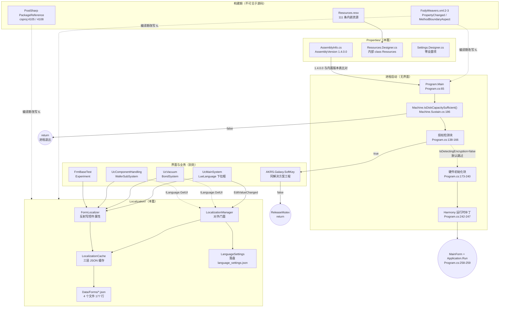

**ASCII 版**

```
                    ┌──── 构建期（磁盘源码里看不见）────┐
                    │  FodyWeavers.xml:2-3              │
                    │    PropertyChanged / MBA.Fody     │
                    │  PostSharp  PackageReference      │
                    │  → 编译期改写 IL，改变运行时行为   │
                    └───────────────┬───────────────────┘
                                    │ 编织到 ↓
  ┌─────────── 进程启动 Program.Main (Program.cs:65) ───────────┐
  │ ① 互斥体 (Program.cs:68)                                      │
  │ ② 字体/皮肤 (Program.cs:80-95)                                │
  │ ③ 异常钩子 (Program.cs:97-107)                                │
  │ ④ 磁盘检查 (Program.cs:110) ──false──▶ 弹框 + return（退出）   │
  │ ⑤ 数据迁移提示 (Program.cs:116-121)                           │
  │ ⑥ 日志 / 后台线程 / 日志开关 (Program.cs:125-134)              │
  │ ⑦ 授权块 (Program.cs:138-166) ◀─ 默认 IsDetectingEncryption    │
  │      = false → 整块跳过                                        │
  │ ⑧ 版本比对 (Program.cs:171) → VersionUpdateAnnouncement        │
  │ ⑨ 硬件初始化 try (Program.cs:173-240)                          │
  │ ⑩ Harmony 补丁 (Program.cs:242-247)                            │
  │ ⑪ MainForm + Application.Run (Program.cs:258-259)             │
  └───────────────────────────────────────────────────────────────┘
                                    │
  ┌──────────── Localization/（本篇）───────────┐   ┌──── 调用侧（别处）────┐
  │ FormLocalizer  → 反射写控件属性              │◀──│ UcMainSystem.LueLanguage│
  │ LocalizationCache → 三层 JSON 缓存          │   │ UcVacuum / UcComponent- │
  │ LocalizationManager → 对外门面              │   │   Handling / FrmBaseTest│
  │ LanguageSettings → language_settings.json   │   └────────────────────────┘
  └─────────────────────────────────────────────┘
```

上下游一句话表：

| 方向 | 对象 | 证据 |
|---|---|---|
| **上游** | `AKRS.Galaxy2.Infrastructure.dll`（`Singleton<T>` 基类、`CommonEnum.LanguageEnum`） | `LanguageSettings.cs:17` 继承 `Singleton<LanguageSettings>`；`csproj:258-260` 直接 `<Reference>` |
| **上游** | `Newtonsoft.Json`（JSON 解析） | `LocalizationCache.cs:2-3`、`:277` |
| **上游** | `DevExpress`（控件类型判定） | `FormLocalizer.cs:8-16`、`:46-59` |
| **上游** | `AKRS.Galaxy.SoftKey`（同解决方案工程，授权接口） | `Program.cs:12`、`csproj:4054` |
| **下游** | 4 个业务窗体（构造期各调一次 `FormLocalizer.LocalizeForm`） | `UcMainSystem.cs:197`、`UcVacuum.cs:35`、`UcComponentHandling.cs:84`、`FrmBaseTest.cs:115` |
| **下游** | 主界面语言下拉框 `LueLanguage`（唯一的运行时切换入口） | `UcMainSystem.designer.cs:3192`、`UcMainSystem.cs:1981` |
| **下游** | `Properties.Resources` 的 23 个使用文件 | `grep -rl "Properties.Resources\." --include=*.cs .` = 23（§8.5） |

### 1.3 三条最重要的事实

只写"**不读源码就想不到**"的三条，其余各节展开。

#### 事实 1：根目录 `Common.cs` 从未参与过任何一次编译（不是"这次漏了"）

- `AKRS.ZX2200.csproj` 里 `grep -c "Common.cs"` = **0**；旧版工程文件 `AKRS.ZX2200.txt` 里同样 = **0**。
- 这不是"被条件排除"：`.csproj` 里 `grep -c "Compile Remove"` = **0**（全工程没有任何 `<Compile Remove>`/`<None Remove>`）。也就是说 `Common.cs` **不是被显式排除的，是从一开始就没加进来**。
- 它里面的两个类型 `Point`（`Common.cs:12`）与 `ChipTypeAndThickness`（`Common.cs:28`）在活代码里**零引用**：`grep -rl "ChipTypeAndThickness" --include=*.cs .` 只命中 `Common.cs:28` 自身；`grep -rn "AKRS\.ZX2200\.Point" --include=*.cs .` = 0 命中（17 个用到 `Point` 的文件全部 `using System.Drawing;`，用的是 `System.Drawing.Point`）。
- 这是**全工程 20 个幽灵文件**里唯一落在本篇范围内的一个（§2、附录 A.2，完整 20 个清单见 `_幽灵文件清单` 对应的各篇文档）。

后果：**改 `Common.cs` 完全不影响程序**。反过来，若有人以为它是"全项目公用的 `Point`"，改了 `X`/`Y` 的类型或语义，编译不报错、运行无变化，问题会在别处以别的形式浮现。

#### 事实 2：`FodyWeavers.xml` 决定了"磁盘源码 ≠ 运行时行为"

`FodyWeavers.xml` 只有 **4 行**（含 BOM），两个 weaver（`:2`、`:3`）：

```xml
<Weavers xmlns:xsi="http://www.w3.org/2001/XMLSchema-instance" xsi:noNamespaceSchemaLocation="FodyWeavers.xsd">
  <PropertyChanged />
  <MethodBoundaryAspect />
</Weavers>
```

两者都是**编译期 IL 改写**。因此本篇与全工程其它文档都遵守一条纪律：**"某个方法没有 try/catch" 这类断言不能只看磁盘源码**——方法进出日志、异常包装、属性变更通知都可能是编织进来的（§4.5、§6.6）。

#### 事实 3：`Singleton<T>` 与 `CommonEnum.LanguageEnum` 的宿主是 `libs/` 里的一个 DLL，**没有源码**

- `LanguageSettings.cs:17` 写着 `public class LanguageSettings : Singleton<LanguageSettings>`，而 `using` 在 `LanguageSettings.cs:14`：`using AKRS.Galaxy2.Infrastructure.CommonModel;`。
- `grep -rn "class Singleton" --include=*.cs .` → 只命中 `WaferSubSystem/Models/DeviceParams/WaferSubDevicePara.cs:59` 的 `SingletonJson<T>`，**不是**同一个类型。全仓库没有 `Singleton<T>` 的定义。
- 宿主 DLL 就在 `libs/` 下：`libs/AKRS.Galaxy2.Infrastructure.dll`（另有 `.pdb`、`.dll.config`），由 `AKRS.ZX2200.csproj:258-260` 直接 `<Reference>` 进来。
- **`AKRS.Galaxy2.Infrastructure` 不在 10 条 `ProjectReference` 里**（`csproj:4050`~`4086`，逐条见 §7.1），同时 `trunk/` 下也**没有** `AKRS.Galaxy2.Infrastructure/` 这个工程目录。

这就是全项目文档里多处标"基类在 DLL 里、无源码"的**根本原因**：它是二进制依赖，不是解决方案里的工程。详见 §3.2、§7.1。

---

## 2. 目录结构

### 2.1 统计口径（先讲清楚，后面所有数字都按这个口径）

本篇的规模口径**一律只算参与编译的文件**：把 `AKRS.ZX2200.csproj` 里全部 `<Compile Include="...">` 提出来，与磁盘上（排除 `bin/`、`obj/`）的全部 `.cs` 取交集。

```
cd "E:/项目/ZX2200标机/trunk/AKRS.ZX2200"
grep -o '<Compile Include="[^"]*"' AKRS.ZX2200.csproj | sed 's/<Compile Include="//;s/"$//' | tr '\\' '/' | sort -u > /tmp/inc.txt
find . -name '*.cs' -not -path './bin/*' -not -path './obj/*' | sed 's|^\./||' | sort -u > /tmp/disks.txt
comm -13 /tmp/inc.txt /tmp/disks.txt      # 幽灵文件（磁盘有、csproj 没有）
comm -23 /tmp/inc.txt /tmp/disks.txt      # 反向缺口（csproj 有、磁盘没有）—— 实测为空
```

实测：`<Compile Include>` **1,131** 条（去重后仍 1,131，无重复）；磁盘 `.cs` **1,151** 个；双向差集 **20 / 0**——**没有反向缺口**，说明工程文件是"增量删减"出来的：文件被手工移出工程但**没有从磁盘删掉**。

### 2.2 目录结构（实测）

下表口径：**只统计参与编译的 `.cs`**；"Designer" 指文件名匹配 `*.Designer.cs` 者（`Properties/Resources.Designer.cs`、`Properties/Settings.Designer.cs` 属此类）。

| 子目录 | 参与编译 `.cs` | 非 Designer 文件数 / 行数 | Designer 文件数 / 行数 | 说明 |
|---|---:|---|---|---|
| `Localization/` | **4** | 4 / **1,043** | 0 / 0 | JSON 驱动翻译框架；本目录**没有任何 Designer 文件** |
| `Properties/` | **3** | 1 / **32** | 2 / **1,199** | `AssemblyInfo.cs` 手写；两个 `.Designer.cs` 由 VS 生成 |
| 根目录（`.cs`） | **1** | 1 / **356** | 0 / 0 | `Program.cs`（`csproj:2306`） |
| **合计** | **8** | **6 / 1,431** | **2 / 1,199** | **2,630 行** |
| 根目录 **幽灵文件** | 1（**不计入上表**） | 1 / **40** | 0 / 0 | `Common.cs`，不在 `.csproj`；见 §2.3 |

**合计核对**：`6 + 2 = 8` 个文件，`1,431 + 1,199 = 2,630` 行——与文首"代码规模"完全一致，也与附录 A.1 的合计核对表一致。

非 `.cs` 但属于本范围的资产：

| 文件 / 目录 | 实测 | 说明 |
|---|---:|---|
| `Localization/Data/Forms/FrmBaseTest.json` | 6 行 / 1 键 | 只翻 `BtnStop` |
| `Localization/Data/Forms/UcMainSystem.json` | 34 行 / 8 键 | 8 个 `RibbonPage` 标题 |
| `Localization/Data/Forms/UcVacuum.json` | 38 行 / 9 键 | **没有 `Title` 键**（§9 的 R-04） |
| `Localization/Data/Forms/UcComponentHandling.json` | 99 行 / **24 键** | 含唯一的 `"Property": "tag"`（`:67`，§9 的 R-06） |
| `Localization/Data/Common/` | **空目录（0 项）** | `LoadCommonTranslations` 要找的 `Common_UI.json`/`Common_Messages.json` 不存在 |
| `Localization/Data/Messages/` | **不存在** | `LoadMessageTranslation` 要读的目录，全仓库无此目录 |
| `Properties/Resources.resx` | 511 行 | 115 条 `<data name>`，其中 **4 条在 `:3-61` 的注释块里** → 真实条目 **111** |
| `Properties/Settings.settings` | 7 行 | 第 `:6` 行是 `<Settings />`，**零个设置项** |
| `AKRS.ZX2200.csproj` | 4,137 行 | 非 SDK-style（`ToolsVersion="4.0"`，`csproj:1`） |
| `AKRS.ZX2200.txt` | 2,488 行 | 旧版工程文件快照，`ProjectGuid` 与现 csproj 相同（`:7`） |
| `App.config` | 63 行 | 12 条 DevExpress 外观设置 + 2 条绑定重定向 |
| `packages.config` | 7 行 | 4 个包（旧式 NuGet 机制） |
| `FodyWeavers.xml` | **4 行**（含 BOM） | 2 个 weaver |
| `FodyWeavers.xsd` | — | Fody 自动生成的 schema |
| `AKRS.ZX2200.csproj.user` | 16 行 | VS 用户级设置，非源码 |

`Localization/Data/` 下**只有** `Common/`（空）与 `Forms/`（4 个 JSON）两个子目录：

```
$ ls Localization/Data/
Common  Forms
$ ls Localization/Data/Forms/
FrmBaseTest.json  UcComponentHandling.json  UcMainSystem.json  UcVacuum.json
$ ls Localization/Data/Common/ | wc -l
0
```

### 2.3 幽灵文件：本篇的那一个，与判定流程（图 12）

本篇范围内有 **1 个**幽灵文件：根目录 `Common.cs`（40 行，`Point` 在 `:12`、`ChipTypeAndThickness` 在 `:28`）。

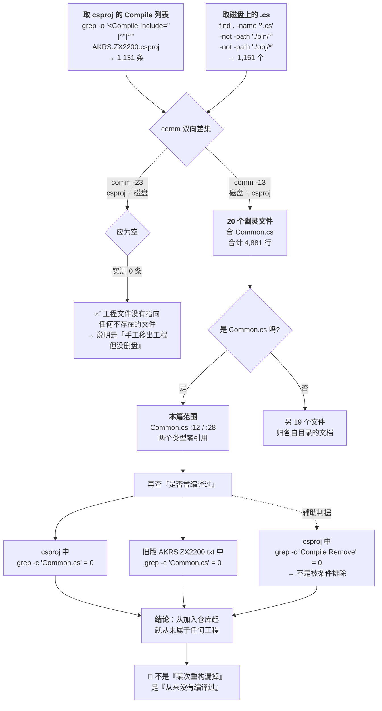

**ASCII 版**

```
  csproj 的 Compile 列表 (1,131)          磁盘上的 .cs (1,151)
              │                                  │
              └────────── comm 双向差集 ──────────┘
                       │                    │
        comm -13 (磁盘 − csproj)      comm -23 (csproj − 磁盘)
                       │                    │
                  20 个幽灵文件           0 条 → ✅ 无反向缺口
                       │
              ┌────────┴─────────┐
         Common.cs (本篇)     另 19 个（别的文档）
              │
      ┌───────┴────────────────────────────┐
      │ csproj: grep -c "Common.cs"  = 0    │
      │ .txt  : grep -c "Common.cs"  = 0    │  ← 双向 0 命中
      │ csproj: grep -c "Compile Remove" = 0│  ← 不是条件排除
      └─────────────────────────────────────┘
                       │
              🔴 从未参与任何一次编译
```

**复现命令（原样，可粘贴）**

```bash
cd "E:/项目/ZX2200标机/trunk/AKRS.ZX2200"
grep -c "Common.cs"        AKRS.ZX2200.csproj     # → 0
grep -c "Common.cs"        AKRS.ZX2200.txt        # → 0
grep -c "Compile Remove"   AKRS.ZX2200.csproj     # → 0
comm -13 /tmp/inc.txt /tmp/disks.txt              # → 20 行，含 Common.cs
comm -23 /tmp/inc.txt /tmp/disks.txt              # → 0 行
```

⚠️ **写作纪律**：幽灵文件**不得**出现在按钮总表里、也**不得**被写成"界面上有这个功能"。本篇范围内唯一的幽灵文件是 `Common.cs`，它连界面都没有，符合这条纪律。

### 2.4 排除说明：哪些目录一个字都不写，为什么

| 目录 | 实测资产 | 为什么不写 |
|---|---:|---|
| `AKRS.ZX2200/bin/` | **0 个文件**（`find bin -type f \| wc -l` = 0）；只有空目录 `bin/Debug/` | **工程级**产物目录，**当前是空的**。注意：空的只是**这一个** `bin/` —— 见下面那行 `trunk/bin/`。 |
| **`trunk/bin/`**（**工程目录之外、解决方案根下**） | **930 MB / 2,685 个文件**（`du -sh` / `find -type f \| wc -l`）；含 `AKRS.ZX2200.exe`（**16,970,752 字节**）、`AKRS.ZX2200.pdb`（9,647,616 字节）、`AKRS.ZX2200.exe.Config`（3,952 字节）、一份崩溃转储 `AKRS.ZX2200.exe-20251009-132139-0461.dmp`（2,263,308 字节，文件名内为 **2025-10-09 13:21:39**）、运行期数据 `Settings/`（`MachineConfig.json` 160 B、`RecipeList.json` 2,028 B、`ZX2200Data.db` 65,536 B + 4 个子目录）、DevExpress 卫星程序集目录 `cs`/`de`/`es`/`ja`/`ru` | **这是本仓库里唯一的真实发布产物**，但它**不在本篇的写作范围内**（本篇范围是 `AKRS.ZX2200/Localization/`、`Properties/` 与工程根目录的散装文件），所以**不逐项写**。**但它的存在推翻了"本仓库没有可分析产物"这个曾经的判断**——它提供了两条只能靠产物才能得到的结论：① **Fody 确实编织过**（`grep -a -o 'FodyVersion' AKRS.ZX2200.exe` = **1**，该属性由 Fody 宿主在编织时写入，源码里不存在）；② **翻译 JSON 确实没被部署**（`trunk/bin/Debug/` 下 **没有 `Localization/` 目录**，`find . -iname '*localiz*'` 无命中，见 R-31）。详见 §6.6.6。 |

> ⚠️ **本节最重要的一条纠正**：`AKRS.ZX2200/bin/` 为空**不等于**"本仓库没有构建产物"。产物在 **`trunk/bin/Debug/`**（2,685 个文件 / 930 MB）。本初稿曾据此写过"没有任何可反编译的产物，因此编织结果无法验证"——**该结论已作废**（§6.6.4、R-27、附录 B）。
| `AKRS.ZX2200/obj/` | **3 个文件 / 181 KB**：`obj/Debug/.NETFramework,Version=v4.8.AssemblyAttributes.cs`、`obj/Debug/AKRS.ZX2200.csproj.AssemblyReference.cache`、`obj/Debug/DesignTimeResolveAssemblyReferencesInput.cache` | 纯 MSBuild 中间产物。`.AssemblyAttributes.cs` 由 SDK 自动生成（内容是 `TargetFrameworkAttribute`），两个 `.cache` 是二进制。不反映任何手写逻辑。 |
| `AKRS.ZX2200/libs/` | 顶层 **171 个条目 / 256 MB**（含 1 个子目录 `HikVision/`）；`libs/HikVision/` 另有 **188 个条目** | 纯二进制第三方/平台 DLL 与 PDB。**无源码，只能看引用清单**——而 134 条 `<Reference>` 的 68 条 `<HintPath>` 已逐条登记在 §7.1。`libs/` 的全貌（平台层/第三方/断链/过期产物）由 `29-外部依赖与二进制资产.md` 负责，本篇只写"哪些引用指向它"。 |
| `AKRS.ZX2200/Resources/` | **177 个条目 / 9.6 MB**（155 `.png` + 10 `.svg` + 8 `.GIF` + 4 `.bmp`） | 纯图片资产。图片本身不读，但它们的**元数据**（哪些被 resx 内嵌、哪些靠 csproj 的 `None`/`Content` 单独挂载）在 §8.5 与 R-22 里量化。 |

> 附带说明：`AKRS.ZX2200/Resources/`（目录）、`AKRS.ZX2200/Properties/Resources.resx`（资源清单）、`Properties/Resources.Designer.cs`（强类型包装）是**三件不同的东西**，极易混淆。本篇只分析后两者（属于 `Properties/` 范围），对第一个只统计数量与挂载方式。

---

## 3. 关键类型索引

### 3.1 类型清单

#### 3.1.1 `Localization/` 的 7 个类型

| 类型名 | 位置 `文件:行` | 基类/接口 | 修饰 | 职责 |
|---|---|---|---|---|
| `FormLocalizer` | `FormLocalizer.cs:20` | — | `public static` | 反射式窗体本地化器：按控件名（或 `panel1.button1` 层级路径）查 JSON，把译文写进控件属性 |
| `LocalizationCache` | `LocalizationCache.cs:14` | — | `public`（构造函数 `private`，`:29`） | 翻译 JSON 的按需加载与内存缓存；三层缓存（窗体/通用/消息） |
| `LocalizationManager` | `LocalizationManager.cs:13` | — | `public static` | 对外门面；语言切换的唯一落盘点在这里 |
| `TranslationData` | `LocalizationManager.cs:144` | — | `public` | 单条翻译的 DTO（`Text`/`ToolTipText`/`Properties`，构造函数全部置 `string.Empty`，`:150-155`） |
| `LanguageEnum` | `LocalizationManager.cs:158` | `enum` | `public` | 语言枚举（**本仓库有两份同名定义**，见 §3.3） |
| `ILanguage` | `LocalizationManager.cs:167` | `interface` | `public` | 需要自定义标题逻辑的窗体实现它；唯一成员 `void GetUI();`（`:169`） |
| `LanguageSettings` | `LanguageSettings.cs:17` | `Singleton<LanguageSettings>`（**DLL 内，无源码**） | `public`，`[Serializable]`（`:16`） | 当前语言设置，可落盘；唯一成员 `LanguageEnum Language { get; set; }`（`:27`） |

`LanguageEnum` 的全部成员及数值（`LocalizationManager.cs:158-165`）：

| 成员 | 数值 | `[Description]` | 行号 |
|---|---:|---|---|
| `Chinese` | `0` | `"中文"` | `:160-161` |
| `English` | `1` | `"英文"` | `:163-164` |

#### 3.1.2 `Properties/` 的 2 个类型

| 类型名 | 位置 `文件:行` | 基类/接口 | 修饰 | 职责 |
|---|---|---|---|---|
| `Resources` | `Resources.Designer.cs:25` | — | `internal class` | 强类型资源访问器；`ResourceManager` 基名硬编码为 `"AKRS.ZX2200.Properties.Resources"`（`:42`） |
| `Settings` | `Settings.Designer.cs:16` | `global::System.Configuration.ApplicationSettingsBase` | `internal sealed partial` | 应用设置包装；**只有 `Default` 一个静态属性**（`:20-24`），**零个设置项** |

#### 3.1.3 根目录散装文件的 4 个类型

| 类型名 | 位置 `文件:行` | 修饰 | 职责 | 关键成员 |
|---|---|---|---|---|
| `Program` | `Program.cs:56` | `internal static` | 进程入口 | `public static MainForm MainForm`（`:58`）；`static void Main(string[] args)`（`:65`，`[STAThread]` 在 `:63`）；`AppUIThreadException`（`:284`）；`AppThreadException`（`:295`）；`FindFormThread`（`:311`） |
| `HookMarshalingControl` | `Program.cs:328` | `public` | Harmony prefix 宿主 | `public static void OnActionExecuting()`（`:333`） |
| `Point` | **`Common.cs:12`** | `public` | 二维浮点坐标 | `float X`（`:17`）、`float Y`（`:22`）——**🔴 不参与编译** |
| `ChipTypeAndThickness` | **`Common.cs:28`** | `public` | 芯片类型 + 厚度 | `string Type`（`:33`）、`float Thickness`（`:38`）——**🔴 不参与编译** |

> `Program` 与 `HookMarshalingControl` 都在 `namespace AKRS.ZX2200`（`Program.cs:10`）下；`Common.cs` 的两个类型也在 `namespace AKRS.ZX2200`（`Common.cs:7`）下，即**根命名空间**，这也是它们容易被误当成"公用类型"的原因。

### 3.2 继承层次图（图 2）

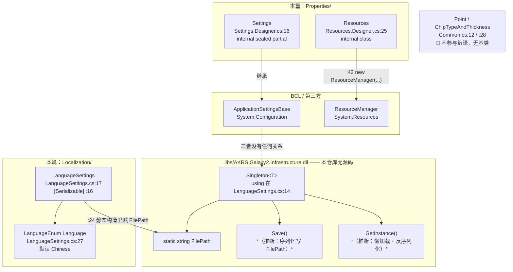

**ASCII 版**

```
  libs/AKRS.Galaxy2.Infrastructure.dll  ←── 无源码，binary only
  ┌──────────────────────────────────┐
  │  abstract class Singleton<T>     │
  │    + static string FilePath      │◀──── LanguageSettings.cs:24
  │    + GetInstance()  *推断: 懒加载*│       Path.Combine(Application.StartupPath,
  │    + Save()         *推断: 序列化*│                    "language_settings.json")
  └───────────────┬──────────────────┘
                  │ 继承 (LanguageSettings.cs:17)
  ┌───────────────┴──────────────────┐
  │ class LanguageSettings [Serializable]
  │    LanguageEnum Language = Chinese │  LanguageSettings.cs:27
  └──────────────────────────────────┘

  System.Configuration.ApplicationSettingsBase
        ▲ 继承 (Settings.Designer.cs:16)
  ┌─────┴──────────────────────────┐
  │ class Settings (零个设置项)     │   ← 与上面的 Singleton<T> 毫无关系，
  └────────────────────────────────┘     本工程从不使用它（R-29）

  System.Resources.ResourceManager
        ▲ new (Resources.Designer.cs:42)
  ┌─────┴──────────────────────────┐
  │ class Resources (111 个属性)    │
  └────────────────────────────────┘

  Point / ChipTypeAndThickness  (Common.cs:12 / :28)  ← 🔴 不参与编译，无基类
```

**这张图最重要的信息**：`LanguageSettings` 的落盘能力来自 **DLL 里的 `Singleton<T>`**，而 `Properties/Settings` 走的是**完全另一套**（`ApplicationSettingsBase`，且是空的）。两套"设置"机制在本工程里**并存但只有一套在用**——这就是 R-29 要澄清的事。

### 3.3 关键类型速查（按职责分组）

#### A 组：语言与翻译（`Localization/`）

| 类型 | `文件:行` | 一句话 |
|---|---|---|
| `LocalizationManager` | `LocalizationManager.cs:13` | 对外门面；**`ChangeLanguage` 是唯一写盘入口**（`:53-60`） |
| `LocalizationCache` | `LocalizationCache.cs:14` | 三层 JSON 缓存（`_formCache` / `_commonCache` / `_messageCache`）；**后两层恒为空** |
| `FormLocalizer` | `FormLocalizer.cs:20` | 反射定位控件 + 反射写属性；20 条 `_defaultPropertyMap` 映射 |
| `LanguageSettings` | `LanguageSettings.cs:17` | 唯一持久化状态：当前语言 |
| `LanguageEnum` | `LocalizationManager.cs:158` | `Chinese=0` / `English=1` |
| `ILanguage` | `LocalizationManager.cs:167` | 自定义标题的钩子；**全工程只有 2 个实现**（§7.3） |
| `TranslationData` | `LocalizationManager.cs:144` | DTO，三个字段，构造即空串 |

`LocalizationManager` 的公有 API 面（**全部**，逐条带行号）：

| 方法 | 行号 | 有调用者吗 |
|---|---|---|
| `Initialize(params string[])` | `:22` | ❌ **无外部调用者**（只有 `EnsureInitialized` 的 `:45` 无参调用） |
| `ChangeLanguage(LanguageEnum)` | `:53` | ✅ `UcMainSystem.cs:1983`（全工程唯一） |
| `GetUI(string,string)` | `:65` | ✅ `UcVacuum.cs:344`/`:348`、`UcComponentHandling.cs:808`/`:812` |
| `GetMessage(string,string)` | `:74` | ❌ **无调用者** |
| `GetTranslationData(string,string)` | `:123` | ❌ **无调用者** |
| `HasFormTranslation(string)` | `:132` | ✅ `FormLocalizer.cs:78` |
| `EnsureInitialized()`（private） | `:41` | ✅ `:67`/`:76`/`:125`/`:134` |

`LocalizationCache` 的死代码（逐个 `grep` 确认无调用者）：

| 位置 | 成员 | 证据 |
|---|---|---|
| `LocalizationCache.cs:71-79` | `public void ClearCache()` | `grep -rn "ClearCache"` 全工程只有 `:71` 定义一处 |
| `LocalizationCache.cs:420-428` | `private JObject GetCommonTranslationObject(...)` | 只有 `:420` 定义；讽刺的是对应的公有 `GetCommonTranslation`（`:131`）**直接查 `_commonCache`，没用这个 helper** |
| `FormLocalizer.cs:385-408` | `private static void LocalizeControlByTranslationKeys(...)` | 只有 `:385` 定义；与 `:97` 的 `LocalizeFormByTranslationKeys` **逻辑几乎完全重复** |

#### B 组：程序集与资源（`Properties/`）

| 类型 | `文件:行` | 一句话 |
|---|---|---|
| `Resources` | `Resources.Designer.cs:25` | 111 个属性 = 98 `System.Drawing.Bitmap` + 13 `DevExpress.Utils.Svg.SvgImage`（§8.5） |
| `Settings` | `Settings.Designer.cs:16` | 零设置项；全工程无 `Settings.Default.Save()` 调用 |

#### C 组：进程与构建（根目录）

| 类型 | `文件:行` | 一句话 |
|---|---|---|
| `Program` | `Program.cs:56` | 启动链编排；`MainForm` 静态字段（`:58`）被主界面读 |
| `HookMarshalingControl` | `Program.cs:328` | Harmony prefix；判 `ManagedThreadId != 1` 只记日志（`:341-345`），报警弹框被注释（`:347-352`） |

#### D 组：陷阱清单（先记住，细节在 §9）

| 陷阱 | 一句话 | 编号 |
|---|---|---|
| `LanguageEnum` 有两份 | `LocalizationManager.cs:158` 与 `Infrastructure/Models/Enums/CommonEnum.cs:95` **同名同成员同数值**；`UcMainSystem.cs:135` 用 `using` 别名消歧 | R-14 |
| Release 下所有诊断被编译掉 | `csproj:50` `DefineConstants=TRACE`（无 `DEBUG`）→ `Debug.WriteLine` **全部消失** | R-05/R-06/R-07 的共同放大器 |
| 只有 4/325 个窗体接了翻译 | 下拉框却对所有用户可见 | R-03 |
| `UcVacuum.json` 没有 `Title` 键 | `GetUI()` 会把容器标题写成 `null` | R-04 |
| 三层缓存只跑通一层 | `Common/` 空、`Messages/` 不存在 | R-15 |
| 翻译只在源码树里生效 | `GetProjectRootPath()` 向上找 `.sln`，装机现场没有 | R-30 |

---

## 4. UI 按钮与交互流程

### 4.1 本模块的 UI 清单

**本范围一个窗体、一个用户控件都没有。** 核实命令与结果：

```bash
cd "E:/项目/ZX2200标机/trunk/AKRS.ZX2200"
# 1) 本范围的 8 个参与编译的 .cs 里，有没有窗体/控件基类？
grep -rn "class .*: *\(XtraForm\|Form\|XtraUserControl\|UserControl\|BaseControl\)" \
    Localization/*.cs Properties/*.cs Program.cs Common.cs
#    → 0 命中

# 2) 本范围里有没有任何点击类事件处理器？
grep -rn "_Click\|ItemClick\|Click +=" --include=*.cs Localization/ Properties/ Program.cs Common.cs
#    → 0 命中

# 3) 本范围里有没有 [DesignerCategory] / InitializeComponent？
grep -rn "InitializeComponent\|DesignerCategory\|ISupportInitialize" \
    Localization/*.cs Properties/*.cs Program.cs Common.cs
#    → 0 命中

# 4) 本目录有没有 Designer 文件？
find Localization Properties -name "*.Designer.cs" -maxdepth 1
#    → Properties/Resources.Designer.cs
#       Properties/Settings.Designer.cs   （两个都是"资源/设置包装"，不是界面）
```

| 窗体 / 用户控件 | 文件 | 行数 | 用途 | 打开它的入口 |
|---|---|---|---|---|
| —（无） | — | — | — | — |

**所以 §4 怎么写**：本系列的 §4 要求"按钮总表必须覆盖本目录全部 `_Click` 处理器"。本范围**处理器数为 0**，§4.2 就用这张空表 + 统计口径说明。但本范围的三个"**没有按钮的流程**"反而更值得画，因为它们决定整机行为：

| 小节 | 画什么 | 为什么算 §4（交互流程） |
|---|---|---|
| §4.3 | 语言切换（**界面入口在 `Main/Controls/`，但它驱动的是本篇的代码**） | 这是唯一一个"用户点一下、本篇代码跑一遍"的交互 |
| §4.4 | `Program.Main` 启动顺序（逐行） | 用户双击 exe 到主界面可用，中间的 11 步全是交互（弹框、等待画面、退出） |
| §4.5 | 编译期 IL 编织 | 没有用户交互，但它**改变了所有交互的行为**（异常、属性通知），必须在这个位置讲清楚 |
| §4.6 | 授权按钮 `BarAuthorization` | Ribbon 上的一个按钮，点击后走 `Program.cs` 同一套授权接口 |

### 4.2 按钮总表

**统计口径**：把 `Localization/`、`Properties/`、根目录散装 `.cs` 作为范围，用下面这条命令抓所有事件接线与处理器定义：

```bash
cd "E:/项目/ZX2200标机/trunk/AKRS.ZX2200"
grep -rnE "_Click|ItemClick|EditValueChanged|CheckedChanged|CellClick|MouseDown|ValueChanged|\+= *new" \
    --include=*.cs Localization/ Properties/ Program.cs Common.cs
# → 0 命中
```

结论：**本范围的事件处理器数 = 0**。本表登记两个"**范围外、但驱动本范围代码**"的处理器，它们是本篇唯一能画进按钮总表的东西：

| 界面 | 控件名 | 文字 | 处理器 `文件:行` | 一句话作用 | 详细流程图 |
|---|---|---|---|---|---|
| `UcMainSystem`（Ribbon 顶端） | `LueLanguage`（`LookUpEdit`） | **无独立 Label**；下拉列标题为空串 | `UcMainSystem.cs:1981`（接线 `.designer.cs:3192`，事件 `EditValueChanged`） | 切换语言：改内存 → 落盘 → 遍历所有已打开窗体重新本地化 | **图 3**（§4.3） |
| `UcMainSystem`（Ribbon） | `BarAuthorization`（`BarButtonItem`） | `"授权信息"`（`.designer.cs:1667`） | `UcMainSystem.cs:1915`（接线 `.designer.cs:1671`，事件 `ItemClick`） | 调一次 `SoftkeyManager.CheckYtSoftKey()`，**返回值被丢弃、无任何界面反馈**；按钮默认不可见 | **图 6**（§4.6） |

> **口径说明**：本系列规范要求"发现一个 `_Click` 处理器就登记一个"。本范围的正确答案是"一个都没有"——这不是遗漏，`Localization/` 与 `Properties/` 是**纯类库式文件**，`Program.cs` 是**进程入口**，三者都不产生任何界面。真正与用户交互的部分（`MainForm`、`UcMainSystem` 的 200+ 个 Ribbon 项）在 `Main/Controls/` 下，由 `01-启动流程与主界面.md` 负责登记；本篇只登记**驱动本篇代码**的那两个。

### 4.3 唯一的界面入口：语言下拉框 `LueLanguage`（图 3）

#### 4.3.1 `LueLanguage` 的全部已知事实

| 项 | 值 | `文件:行` |
|---|---|---|
| 控件类型 | `DevExpress.XtraEditors.LookUpEdit` | 声明 `UcMainSystem.designer.cs:351`；字段 `:3525` |
| 控件名 | `LueLanguage` | `UcMainSystem.designer.cs:3182` |
| 显示文字 | **无独立 Label**；下拉列标题为空字符串 | `UcMainSystem.designer.cs:3177-3186` |
| 位置 / 尺寸 / TabIndex | `(1498, 3)` / `170 × 24` / `53` | `:3179`、`:3190`、`:3191` |
| 数据源 | `EnumHelper.ConvertEnumToNameDisplayDto<LanguageEnum>()`（`Display`/`Value` 两列） | `UcMainSystem.cs:194`；`DisplayMember`/`ValueMember` 在 `.designer.cs:3187`、`:3189` |
| 初值 | `LanguageSettings.GetInstance().Language` | `UcMainSystem.cs:195` |
| 事件接线 | `EditValueChanged += LueLanguage_EditValueChanged` | `UcMainSystem.designer.cs:3192` |
| 处理器 | `private void LueLanguage_EditValueChanged(object, EventArgs)` | `UcMainSystem.cs:1981-1992` |
| 权限校验 | **无** | 全流程无任何 `Role`/`Enabled`/`Visible` 判断 |
| 可见性开关 | **无** | `grep -rn "LueLanguage" Main/Controls/Ucmain/MainControls/*.cs` 只命中上述 6 处 |

**这是全工程唯一能改语言的地方。** 没有配置文件入口（`language_settings.json` 手改不生效——见 §4.3.3）、没有命令行参数入口、没有快捷键入口（`grep -rn "Localiz\|Language" Main/Controls/MainForm.cs` 与 `MainForm.designer.cs` 均 **0 命中**，主窗体本身不含任何语言相关代码）。

#### 4.3.2 切换语言的完整流程（图 3）

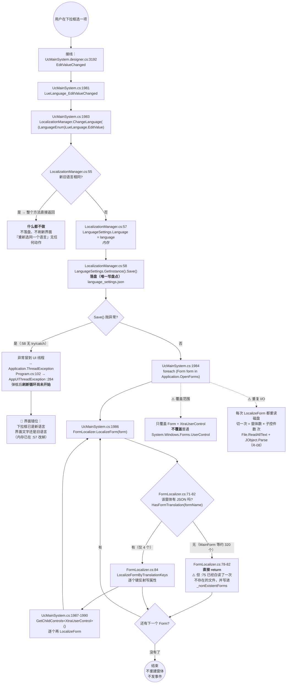

**ASCII 版**

```
用户选语言
   │
   ├─ EditValueChanged (UcMainSystem.designer.cs:3192)
   │     └─ LueLanguage_EditValueChanged (UcMainSystem.cs:1981)
   │           └─ LocalizationManager.ChangeLanguage (:1983 → LocalizationManager.cs:53)
   │                 ├─ 新旧相同? :55 ──yes──▶ return（什么都不做）
   │                 └─ no
   │                       ├─ :57 内存写 LanguageSettings.Language
   │                       └─ :58 Save() 落盘 language_settings.json ★唯一写盘点
   │                             └─ 异常? 无 try/catch
   │                                   └─▶ 冒到 UI 线程 → ThreadException 弹框
   │                                        此时刷新循环还没开始
   │                                        🔴 下拉框=英文 / 界面=中文
   │
   └─ foreach (Form form in Application.OpenForms)  :1984
         └─ FormLocalizer.LocalizeForm(form)  :1986
               ├─ :71 formName = form.GetType().Name
               ├─ :75 LocalizationCache.Instance.Initialize(formName)  ← 重读磁盘
               ├─ :76 (form as ILanguage)?.GetUI()   ← 早于存在性检查！
               ├─ :78 HasFormTranslation(formName)?
               │      ├─ false ──▶ return（约 320 个窗体走这里）
               │      └─ true  ──▶ :84 LocalizeFormByTranslationKeys（仅 4 个）
               └─ :1987-1990 GetChildControls<XtraUserControl>() 再 LocalizeForm 一遍
```

#### 4.3.3 切换之后，**已打开的窗体怎么办**

**不重建、不重载、原地改属性。** 全流程只有一处写盘（`LocalizationManager.cs:58`），**没有 `LanguageChanged` 事件、不关窗体、不重新 `new`**：

| 问题 | 答案 | 证据 |
|---|---|---|
| 已打开的窗体怎么办 | 遍历 `Application.OpenForms`，对每个 `Form` 与它下面的每个 `XtraUserControl` 调一次 `FormLocalizer.LocalizeForm`，**原地 `SetValue` 覆盖属性** | `UcMainSystem.cs:1984-1990`；`FormLocalizer.cs:347` |
| 未打开的窗体怎么办 | **不管**。下次 `new` 出来时在构造期被本地化（`UcMainSystem.cs:197`、`UcVacuum.cs:35`、`UcComponentHandling.cs:84`、`FrmBaseTest.cs:115`）；如果它本来就没接翻译，则永远中文 | 同上 |
| 模态窗体（`ShowDialog`） | `Application.OpenForms` **包含模态窗体**，所以模态窗体在打开期间也会被刷新 | `Application.OpenForms` 语义 |
| 非 `Form` 的 `XtraUserControl`（如 `UcMainSystem` 本身） | 靠 `:1987` 的 `GetChildControls<XtraUserControl>()` 路径命中 | `UcMainSystem.cs:1987-1990` |
| 普通 `UserControl`（非 DevExpress） | **漏掉**——`:1987` 只泛型取 `XtraUserControl` | `UcMainSystem.cs:1987` |
| 运行时动态写入的文本 | **漏掉**——JSON 机制只在构造期/切换时各覆盖一次，覆盖不了"点击后回写按钮文字"这类运行时赋值 | R-18、R-19 |
| 切回中文 | 依赖每个 JSON 里同时有 `Chinese` 键（`FormLocalizer.cs:239` 只查当前语言，**无回退**）。本工程 4 个 JSON 恰好都是双份，暂不出问题 | `FormLocalizer.cs:239`、`:332` |

#### 4.3.4 哪些界面**没有被本地化覆盖**（漏网的硬编码中文）

先说全局数字：全工程 **325 个唯一 `partial class`**（`grep -rhoE "partial class [A-Za-z0-9_]+" --include=*.Designer.cs . | sort -u | wc -l` = 325；`*.Designer.cs` 文件 331 个），**只有 4 处**调 `FormLocalizer.LocalizeForm`：

| 调用点 | `文件:行` | 对应 JSON | 覆盖情况 |
|---|---|---|---|
| `UcMainSystem` 构造 | `UcMainSystem.cs:197` | `UcMainSystem.json`（8 键） | **只翻了 8 个 `RibbonPage` 标题**；Ribbon 上 200+ 个按钮的 `Caption` 全是硬编码中文 |
| `UcVacuum` 构造 | `UcVacuum.cs:35` | `UcVacuum.json`（9 键） | 只翻静态初始文案；**26 处运行时状态文案漏网**（R-18） |
| `UcComponentHandling` 构造 | `UcComponentHandling.cs:84` | `UcComponentHandling.json`（24 键） | 3 条硬编码中文漏网（R-19） |
| `FrmBaseTest` 构造 | `FrmBaseTest.cs:115` | `FrmBaseTest.json`（**1 键**） | 该窗体 20+ 条中文只有 `BtnStop` 被翻（R-20） |

**典型漏网样本（逐条实测，`grep -on '"[^"]*[一-龥][^"]*"' <file>`）**：

| 文件 | 硬编码中文条数 | 举例（`文件:行`） |
|---|---:|---|
| `BondSystem/Controls/Manual/UcVacuum.cs` | **26** | `:76` `"关吸嘴真空"`、`:81` `"开吸嘴真空"`、`:328` `"开翻转台真空"`、`:335` `"关翻转台真空"` —— **这些是点击后回写按钮文字的运行时赋值**，JSON 覆盖不到 |
| `WaferSubSystem/Controls/Manual/UcComponentHandling.cs` | **3** | `:124` `"请输入 1-{MagazineBoxDevicePara.Position.Length} 的整数."`、`:163` `"这是MagazineBox的最后一层!"`、`:198` `"这是MagazineBox的第一层!"` |
| `Experiment/Test/FrmBaseTest.cs` | **20+** | `:130` `"提示"`、`:240` `"报警"`、`:411` `"测试"`、`:435` `"次数"`、`:475` `"流程运行故障"`、`:298` `"PR：{pRName}  vision  failed!Please  check  glass!"` |
| `Main/Controls/MainForm.cs` / `MainForm.designer.cs` | 全窗体 | `grep -rn "Localiz\|Language"` 两处均 **0 命中**——主窗体完全没有本地化接线；它**不会被排除在切语言循环之外**（`:1984` 遍历含它），只是走到 `:78` 返回 false 才跳过 |

**第二类漏网，性质不同于上面这些：机制性漏网 —— 运行期动态灌进下拉框的项。**

上面的漏网都是"**这个窗体没写进 JSON**"（覆盖面问题，加一份 JSON 就能救）。但还有一类**即使加了 JSON 也救不了**：

| 环节 | `文件:行` | 事实 |
|---|---|---|
| 本地化只能写**一个具名属性** | `Localization/FormLocalizer.cs:32-60`（23 条 `_defaultPropertyMap`）、`:313-335`（`GetDefaultProperty`，查不到就回落到 `"Text"`）、`:338-355`（`SetComponentProperty`：一次 `GetProperty` + 一次 `SetValue`） | 映射表里**没有 `ComboBoxEdit` / `LookUpEdit`**，机制里也**没有"集合 + 下标"这一层** |
| `Items` 在 `Localization/` 里只出现在**查找**循环里 | `FormLocalizer.cs:181`、`:186`、`:195`、`:202` | 那是 `TileBar` / `BarManager` / `RibbonControl` 的**子项查找**（按名字找 Ribbon 按钮），**不是翻译下拉项** |

⇒ **运行期用 `Properties.Items.AddRange(...)` 灌进去的字符串，是这套本地化机制的对象模型里不存在的东西。**

**实例（取料 / 固晶两个助手窗体，共 9 处灌下拉项）**：`BondSystem/Controls/Assistant/FrmComponentPickup.cs:111`、`:117`、`:122`、`:128`、`:133`、`:138` 与 `BondSystem/Controls/Assistant/FrmComponentPlacement.cs:123`、`:128`、`:133` —— 它们灌的是 `Enum.GetValues(...).Select(x => x.ToString())`，也就是**英文成员名**（`Distance` / `Force` / `Free` / `Low` / `Medium` / `Fast`），而不是枚举上已经写好的 `[Description("距离模式")]`（`BondSystem/Models/Enums/BondEnum.cs:224`）/ `[Description("力控模式")]`（`:230`）等中文。**中文界面上的操作员看到的是英文单词**，而下拉**能选、能存、能跑**。**这不是功能缺陷，是可用性/一致性缺陷**，定级 ⚠️（**R-33**，§9.6）。

**结论**：切到 English 后，界面会变成"**4 个窗体英文 + 其余全部中文**"的混排状态，**且没有任何提示说明只有部分界面支持英文**。更糟的是 R-18 那一类：点过的真空按钮在切换语言后**立刻变回中文**（因为运行时回写覆盖了 JSON 的结果）。而 R-33 那一类更彻底：**中文界面上都会漏出英文**——因为它压根不经过 `Localization/`。

#### 4.3.5 坑

- 🔴 **入口对所有用户可见，覆盖只有 4/325**（R-03）。`LueLanguage`（`UcMainSystem.designer.cs:3182`）没有权限校验、没有可见性开关。
- 🔴 **`Save()` 没有 try/catch**（`LocalizationManager.cs:58`），异常时界面错位（图 3 的 `DESYNC` 分支）。
- ⚠️ **切语言 = N×M 次磁盘读取**（R-08）。`FormLocalizer.cs:75` 每次都调 `LocalizationCache.Initialize(formName)`，而 `Initialize`（`LocalizationCache.cs:54-63`）**直接调 `LoadFormTranslation`，绕过了 `EnsureFormLoaded` 的 `_loadedForms` 守卫**（`:259`）。
- ⚠️ **不回写控件原始文本，只做覆盖式 `SetValue`**（`FormLocalizer.cs:347`）。从 English 切回 Chinese 依赖 JSON 里同时存在 `Chinese` 键——这是**数据约定而非代码保证**。
- ⚠️ **`GetUI()` 早于存在性检查**（`FormLocalizer.cs:76` 在 `:78` 之前）。"没有翻译文件"但实现了 `ILanguage` 的窗体，`GetUI()` 仍会执行并可能写入 `null`（R-04）。
- ⚠️ **`MainForm` 每次切语言都白读一次不存在的文件**，并把 `"MainForm"` 永久写进 `_nonExistentForms`（`LocalizationCache.cs:103`）。
- ⚠️ **两条独立通路互不通知**（R-24）：`LanguageSettings.Language`（持久化状态）与 `LueLanguage.EditValue`（界面状态）。`ChangeLanguage` 在"新旧相同"时直接 return，此时界面不刷新；`LanguageSettings` **源码里没有 `INotifyPropertyChanged`、没有 `partial`、没有任何变更事件**（`LanguageSettings.cs` 全文 29 行）。*（推断：这条断言有一个已知的反例可能——`FodyWeavers.xml:2` 配了 `PropertyChanged` weaver，它是在**编译期**往程序集里注入通知逻辑的，磁盘源码看不出来。本副本已能确认"Fody 编织过这份 exe"（§6.6.6 的 `FodyVersion`），但**无法逐类确认 `LanguageSettings` 是否在被注入之列**（要定位必须反编译）。故此处表述为"源码里没有"，而非"运行时一定没有"。见附录 B。）*

### 4.4 没有按钮的流程之一：`Program.Main` 启动顺序逐行（图 4）

这一节**不重写**启动链的叙述（`01-启动流程与主界面.md` §4.1 已逐行写过），只做三件事：

1. 把 11 步画成**带分支**的流程图（图 4）——`01` 号文档的版本是直线，看不出"哪一步会退出"；
2. 给出**每一个 `文件:行`**，供跳转；
3. 把三处**提前退出**标清楚（磁盘不足、重复启动、授权失败），这三处决定了"软件为什么没起来"。

```mermaid
flowchart TD
    S(("双击 AKRS.ZX2200.exe")) --> M["Program.cs:63-65<br/>[STAThread] static void Main(string[] args)"]
    M --> MUTEX["Program.cs:68<br/>using (Mutex mutex = new Mutex(true,<br/>Application.ProductName, out bool createNew))"]
    MUTEX --> NEW{"Program.cs:70<br/>createNew?"}
    NEW -->|false 已有实例| DUP["Program.cs:265-267<br/>MessageBox.Show(@&quot;软件重复打开&quot;)<br/>Thread.Sleep(100)<br/>Environment.Exit(1)"]
    DUP --> EXIT_A(("🔚 退出（第 1 条提前退出）"))

    NEW -->|true| FONT["Program.cs:72-88<br/>字体：宋体三行被注释掉<br/>实际三条 Tahoma：<br/>:80 AppearanceObject.DefaultFont (非 Bold)<br/>:85 WindowsFormsSettings.DefaultFont (Bold)<br/>:88 DefaultMenuFont (Bold)"]
    FONT --> SKIN["Program.cs:90-95<br/>BonusSkins.Register() / SkinManager.EnableFormSkins()<br/>SetSkinStyle(&quot;Office 2010 Blue&quot;)<br/>（:93 Dark Style 被注释）"]

    SKIN --> REGION["Program.cs:97 <b>#region 未处理异常注册事件</b><br/>↓ 这个 region 一直开到 :261（R-25）"]
    REGION --> HOOK["Program.cs:99-107<br/>SetUnhandledExceptionMode(CatchException)<br/>Application.ThreadException += AppUIThreadException (:284)<br/>AppDomain.UnhandledException += AppThreadException (:295)<br/>EnableVisualStyles() / SetCompatibleTextRenderingDefault(false)"]

    HOOK --> DISK["Program.cs:110<br/>Machine.GetInstance().IsDiskCapacitySufficient()<br/>→ Machine.Sustain.cs:186"]
    DISK --> DCAP{"Machine.Sustain.cs<br/>:192 C 盘 &lt; 10 GB ?<br/>:202 D 盘 &lt; 200 GB ?"}
    DCAP -->|"是 :194/:204 弹框<br/>『X盘内存不足N，请清理后重试』"| DFAIL["Program.cs:110-113<br/>if (!...) { return; }"]
    DFAIL --> EXIT_B(("🔚 退出（第 2 条提前退出）<br/>⚠️ 弹框会显示，但<br/>Application.Run 从未调用<br/>→ 没有消息循环<br/>→ ThreadException 钩子不会再触发"))
    DCAP -->|"否 :208 return true"| MIG

    MIG["Program.cs:116-121<br/>if (JudgeDataMigrated())<br/>FrmParaChangeTipAfterDataMigrate.ShowDialog()<br/><i>模态，自己跑消息循环</i>"] --> LOG["Program.cs:125-134<br/>DataLogManager.CreateDataLog(&quot;重复标定实验&quot;)<br/>.ConfigureFileOutput(&quot;精度实验\\\\重复定位结果.json&quot;)<br/>new Thread(FindFormThread) IsBackground=true<br/>Name=&quot;自动关闭DEVExPress&quot;<br/>LogsManager.IsLogWarn / IsLogInfo = true"]

    LOG --> ENCBLK["Program.cs:136 #region 检测加密狗<br/>:138 if (IsDetectingEncryption)"]
    ENCBLK --> ENCDEF{"MachineSoftwareConfiguration.cs:156<br/>IsDetectingEncryption = <b>false</b>（默认）"}
    ENCDEF -->|"❌ 默认走这里：<b>整块被跳过</b><br/>（勘误 2，见 §7.5）"| VER
    ENCDEF -->|true| CHK["Program.cs:141<br/>SoftkeyManager.CheckYtSoftKey()"]
    CHK --> CHKOK{"返回 true?"}
    CHKOK -->|false| EXIT_C(("🔚 退出（第 3 条提前退出）<br/>:143 mutex.ReleaseMutex()<br/>:144 return<br/>⚠️ 无任何提示框"))
    CHKOK -->|true| DUE["Program.cs:148-163<br/>InitSoftKey() / GetDateDue(out permanent, out authDate)<br/>dueTime = (authDate - Now).Days<br/>if (IsPromptEncryption) {<br/>&nbsp;&nbsp;dueTime &lt; 7 → 弹『软件加密到限仅剩 N』(仅提示)<br/>&nbsp;&nbsp;GetUserId(out userId)<br/>&nbsp;&nbsp;Machine.AuthenticatorDueDate / AuthenticatorId = ...<br/>}"]
    DUE --> VER

    VER["Program.cs:171<br/>VersionUpdateAnnouncement.CheckVersionUpdate()<br/>→ VersionUpdateAnnouncement.cs:33"] --> MODE{"Program.cs:173<br/>MachineWorkMode != OffLineWork ?"}
    MODE -->|"是（在线生产）"| HWT["Program.cs:175 try"]
    HWT --> HWI["Program.cs:177-188<br/>InitPR() → ShowForm(SplashScreen1)<br/>HardwareRepositoryService.InitAllHardware(HardwareEditor.initNoticeAction)<br/>WaitLaserEncoderWarmupAsync().Wait()<br/>CloseForm() → SetStopStateAlarm()"]
    HWI --> GT["Program.cs:190-225<br/>if 运控是 GTController：<br/>&nbsp;&nbsp;BondZ.ServoOff() → SetMotionSmooth(30,15)<br/>&nbsp;&nbsp;ChangeMode(... BondheadMaxPress ...)<br/>&nbsp;&nbsp;BondZ.ServoOn() → SetAllSoftLimit()<br/>else if IsBondAxisTSingleMove：焊头T SetOffsetPos(0)+AbsoluteMove(0)<br/>gtEthercatCard.SetAllSoftLimit()"]
    GT --> HWERR{"抛异常?"}
    HWERR -->|"是 Program.cs:229-239"| HWLOG["LogHelper.Post(Level.Error, ...)<br/>AKRSMessageBoxExt.Show(&quot;硬件初始化异常：...&quot;, &quot;异常&quot;, ...)<br/><b>不退出，继续往下走</b>"]
    HWERR -->|否| HARM
    HWLOG --> HARM
    MODE -->|"否（OffLineWork 脱机）"| HARM

    HARM["Program.cs:242-247<br/>Harmony 补丁：Application 的私有嵌套类型<br/>MarshalingControl 的无参私有构造函数<br/>prefix = HookMarshalingControl.OnActionExecuting"] --> HARMERR{"GetNestedType / GetConstructor<br/>返回 null ?<br/><i>:244-245 都没有 null 检查</i>"}
    HARMERR -->|"是（推断）"| EXIT_D(("🔚 崩溃<br/>:247 harmony.Patch(null, ...)<br/>抛 ArgumentNullException<br/>此时 Application.Run 还没开始<br/>→ 只能落到 AppDomain.UnhandledException"))
    HARMERR -->|否| EVT

    EVT["Program.cs:250-251<br/>PREntity.IsSaveLocateImage += MachineSoftwareConfiguration.SaveLoacteImage<br/>PREntity.SaveLocateImageAction += VisionService.SaveVisionImage<br/><i>静态事件只 += 不解绑</i>"] --> AXIS{"Program.cs:253<br/>IsAxisResetBeforeWork?"}
    AXIS -->|"是（默认 false，<br/>MachineSoftwareConfiguration.cs:67）"| HOME["Program.cs:255<br/>Machine.GetInstance().AllAxisGoHome()"]
    AXIS -->|否| RUN
    HOME --> RUN
    RUN["Program.cs:258-259<br/>MainForm = new MainForm()<br/>Application.Run(MainForm)"] --> ENDR(("主界面可用"))
    RUN -.->|"Program.cs:261 #endregion<br/>（属 :97 那个『未处理异常注册事件』region，R-25）"| REGION
    RUN -.->|"Program.cs:270-274<br/>退出时 mutex.ReleaseMutex()"| ENDR2(("进程结束"))
```

**ASCII 版**

```
双击 exe
 │
 ├─ [1] Mutex (Program.cs:68)
 │        └─ createNew == false ──▶ MessageBox「软件重复打开」+ Exit(1)   🔚退出1
 ├─ [2] 字体 Tahoma×3 (80/85/88) + 皮肤 Office 2010 Blue (95)
 ├─ [3] #region 未处理异常注册事件 (97 ····· 一直开到 261，R-25)
 │        └─ 异常钩子 (99-107)：ThreadException → :284 / UnhandledException → :295
 ├─ [4] 磁盘检查 (110)  → Machine.Sustain.cs:186
 │        ├─ C盘<10G  :194 弹框「C盘内存不足10G，当前为X,请清理后重试」→ return
 │        ├─ D盘<200G :204 弹框「D盘内存不足200G，当前为X,请清理后重试」→ return   🔚退出2
 │        └─ :208 return true
 ├─ [5] 数据迁移提示 (116-121) FrmParaChangeTipAfterDataMigrate.ShowDialog()
 ├─ [6] 日志 CreateDataLog("重复标定实验") (125)
 │      后台线程 FindFormThread (127-130) IsBackground=true
 │      LogsManager.IsLogWarn / IsLogInfo = true (133-134)
 ├─ [7] #region 检测加密狗 (136 ... 168)
 │        if (IsDetectingEncryption)  ← 默认 false（MachineSoftwareConfiguration.cs:156）
 │        └─ 默认整块跳过  ★ 勘误 2
 │        └─ true 时：CheckYtSoftKey() == false ──▶ ReleaseMutex + return  🔚退出3（无提示框）
 ├─ [8] CheckVersionUpdate() (171) → VersionUpdateAnnouncement.cs:33
 ├─ [9] if (WorkMode != OffLineWork) (173)
 │        try (175) { InitPR / SplashScreen / InitAllHardware / 预热 / CloseForm / SetStopStateAlarm
 │                     GT 卡 BondZ 伺服三段设置 (190-225) }
 │        catch (229) { LogHelper + AKRSMessageBoxExt「硬件初始化异常」  ← 弹框但不退出，继续往下 }
 ├─ [10] Harmony 补丁 (242-247)  ★ 无 null 检查，失败即崩
 ├─ [11] PREntity 静态事件订阅 (250-251)
 │        if (IsAxisResetBeforeWork) AllAxisGoHome() (253-256) ← 默认 false
 └─ [12] MainForm = new MainForm(); Application.Run(MainForm) (258-259)
          └─ 退出时 mutex.ReleaseMutex() (272)
```

**调用链与读写（关键步骤）**

| 步骤 | `文件:行` | 读了什么 | 写了什么 |
|---|---|---|---|
| 1 互斥体 | `Program.cs:68` | `Application.ProductName`（= `AssemblyProduct` = `"AKRS.ZX2200"`，`AssemblyInfo.cs:11`） | 创建具名 Mutex |
| 4 磁盘检查 | `Program.cs:110` → `Machine.Sustain.cs:188`/`:198` | `DriveInfo("C").TotalFreeSpace`、`DriveInfo("D").TotalFreeSpace` | 弹框（仅提示）；返回 `bool` |
| 5 数据迁移 | `Program.cs:116` | `Machine.GetInstance().JudgeDataMigrated()` | 弹模态窗体，无落盘 |
| 6 日志 | `Program.cs:125` | — | `DataLogManager` 建一条文件输出（`精度实验\重复定位结果.json`） |
| 7 授权 | `Program.cs:141-163` | `IsDetectingEncryption`（`MachineSoftwareConfiguration.cs:156`，默认 `false`） | `Machine.AuthenticatorDueDate`（`Program.cs:162`）、`Machine.AuthenticatorId`（`:163`）——**纯内存** |
| 8 版本 | `Program.cs:171` → `VersionUpdateAnnouncement.cs:36-56` | `MachineSoftwareConfiguration.CurrentVersionNumber`（默认 `"0.0.0.0"`，`:27`）、`VersionInfos.Max(...)`、`Assembly.GetExecutingAssembly().GetName().Version` | **可能有落盘**：`:53-56` 写 `LastVersionNumber`/`CurrentVersionNumber`/`LastVersionUpdataTime` 并 `Save()`（§5.4） |
| 9 硬件 | `Program.cs:177-225` | `HardwareRepositoryService.GetAxisCard(1)/(2)`、`MachineHardwareConfiguration`、`ForceConfig` | 下发硬件（伺服开关、平滑、软限位）；`LogHelper` 落日志 |
| 10 Harmony | `Program.cs:242-247` | 反射 `System.Windows.Forms.Application` 的私有嵌套类型 | **改写 mscorlib 里的方法**（运行时） |
| 12 主窗体 | `Program.cs:258-259` | — | 把 `MainForm` 存进静态字段 `Program.MainForm`（`:58`） |

**坑**

- 🔴 **三条提前退出里，只有一条有提示框**：重复启动有（`:265`）、磁盘不足有（`Machine.Sustain.cs:194`/`:204`）、**授权失败没有**（`Program.cs:143-144` 直接 `ReleaseMutex` + `return`）。而且磁盘不足这一条**不在任何 `try` 里**（`:175` 的 `try` 在它之后 65 行）。
- 🔴 **`DriveInfo("D")` 对不存在的 D 盘会抛**（`Machine.Sustain.cs:198`），且该调用（`Program.cs:110`）**不在 try 内**：异常钩子虽已注册（`:99-105`），但 `Application.Run` 尚未开始，`ThreadException` 不会触发，只会落到 `AppDomain.UnhandledException`（`:105`）→ `AppThreadException`（`:295`）弹框——**该钩子无法阻止进程崩溃**。*（推断：是否真的抛取决于运行环境，未做运行时验证。）*
- 🔴 **Harmony 反射段没有 null 检查**（`Program.cs:244-245`）。任一返回 `null` 时 `:247` `harmony.Patch(null, ...)` 抛 `ArgumentNullException`。同样在 `Application.Run` 之前。*（推断。）*
- ⚠️ **`ShowDialog` 在 `Application.Run` 之前**：`:118-120` 与 `VersionUpdateAnnouncement.cs:57-58` 的 `FrmVersionInfo.ShowDialog()` 都在 `:259` 之前。此时主窗体还不存在，任何依赖 `Program.MainForm`（`:58`）的代码都是 `null`。
- ⚠️ **`#region 未处理异常注册事件` 从 `:97` 一直开到 `:261`**（R-25），把皮肤、磁盘检查、数据迁移、日志、线程、授权、硬件初始化、Harmony、`Application.Run` **全部包进去了**——纯结构问题，不改行为，但 IDE 折叠视图完全误导。**这同时是对 `01` 号文档的勘误 3，见 §7.5。**
- ⚠️ **硬件初始化失败不阻断启动**（`:229-239`）：弹框后继续走 Harmony 与 `Application.Run`，设备会进入"界面可用但硬件未初始化"的状态。
- ✅ **`FindFormThread` 的 3 个瑕疵**（`:311-321`）单独写在 §6.5。

### 4.5 没有按钮的流程之二：编译期 IL 编织（图 5）

#### 4.5.1 `FodyWeavers.xml` 全文

`AKRS.ZX2200/FodyWeavers.xml` 共 **5 行**（含 UTF-8 BOM）：

```xml
<Weavers xmlns:xsi="http://www.w3.org/2001/XMLSchema-instance" xsi:noNamespaceSchemaLocation="FodyWeavers.xsd">
  <PropertyChanged />
  <MethodBoundaryAspect />
</Weavers>
```

| 行 | weaver | 作用 | 织入器包 |
|---|---|---|---|
| `:2` | `<PropertyChanged />` | 属性变更通知编织（自动注入 `INotifyPropertyChanged` 的实现） | `PropertyChanged.Fody 4.1.0` |
| `:3` | `<MethodBoundaryAspect />` | 方法边界 AOP 编织（`OnEntry`/`OnExit`/`OnException`） | `MethodBoundaryAspect.Fody 2.0.145` |
| `:1` | `xsi:noNamespaceSchemaLocation="FodyWeavers.xsd"` | 指向同目录的 `FodyWeavers.xsd`（Fody 自动生成的 schema） | — |

**关键：没有 `<PostSharp />` weaver。** 这并不意味着"本工程没有 PostSharp"——PostSharp **走的是另一条路**（见 4.5.3）。

#### 4.5.2 两套 AOP 的实际分工（图 5）

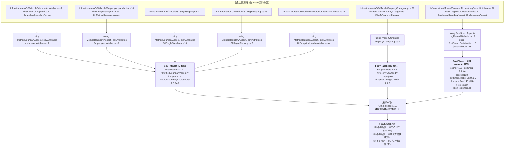

**ASCII 版**

```
   磁盘源码                                   编译期织入者                      编译产物
 ┌─────────────────────────────┐
 │ MethodAopAttribute.cs:2     │──┐
 │ PropertyAopAttribute.cs:2   │──┤  using MethodBoundaryAspect.Fody.Attributes
 │ S1SingleStepAop.cs:16       │──┤        │
 │ S2SingleStepAop.cs:3        │──┼────────┼──▶ FodyWeavers.xml:3 <MethodBoundaryAspect/>
 │ UIExceptionHandlerAttr.cs:4 │──┘        │     + csproj:4102 MBA.Fody 2.0.145
 │                                        │             │
 │ PropertyChangeAop.cs:1      │──────────┼──▶ FodyWeavers.xml:2 <PropertyChanged/>
 │   using PropertyChanged;    │          │     + csproj:4111 PropertyChanged.Fody 4.1.0
 │                                        │             │
 │ LogRecordAttribute.cs:12-13 │──────────┼──▶ PostSharp（自带 MSBuild 任务）   ├──▶  exe
 │   using PostSharp.Aspects;  │          │     + csproj:4105 PostSharp 2.1.6.4 │
 │   [PSerializable] :18       │          │     + csproj:4108 PostSharp.Redist   │
 │   :20 OnMethodBoundaryAspect│          │     + csproj:144-146 libs\PostSharp.dll
 └─────────────────────────────┘
        ⚠️ 磁盘源码里没有这三套织入产生的 IL
```

#### 4.5.3 这条对**全项目**的影响（本篇最需要记住的一条）

`FodyWeavers.xml` 与 PostSharp 都是**编译期 IL 改写**。所以在读这个仓库的任何源码时，下面这些判断**不能只看磁盘源码**：

| 常见判断 | 为什么不能只看源码 | 影响范围（实测） |
|---|---|---|
| "这个方法没有 try/catch，一定会崩" | 方法边界 AOP 可以在 `OnException` 里兜住异常并改写返回值 | 5 个类用 Fody 的 `OnMethodBoundaryAspect`（§4.5.2 的 A1~A5） |
| "这个类不实现 `INotifyPropertyChanged`，改了属性没人知道" | `PropertyChanged.Fody` 在编译期注入通知逻辑 | `using PropertyChanged;` 出现在 8 个文件（例：`MachineSoftwareConfiguration.cs:14`、`BaseMatter.cs:7`、`ForceConfig.cs:5`） |
| "这个方法没有进出日志" | `LogRecordMethodAttribute`（PostSharp）在 `OnEntry` 里写库 | `LogRecordAttribute.cs:26-35`（`OnEntry` 里 `LogRecordDataHelper.InsertIntoTable`） |
| "异常没被包装 / 没弹框" | `UIExceptionHandlerAttribute` 是 Fody 编织的方法边界属性 | `UIExceptionHandlerAttribute.cs:15` |
| "属性变更没有审计" | `PropertyChangeAop.OnPropertyChangedEvent` 被 `MachineSoftwareConfiguration.cs:184` 显式调用 + weaver 注入 | `PropertyChangeAop.cs:27` |

**本篇范围内的具体影响**：

- `LanguageSettings.cs`（29 行）源码里**没有** `partial`、**没有** `INotifyPropertyChanged`、**没有** `OnPropertyChanged`。但 `FodyWeavers.xml:2` 配了 `PropertyChanged` weaver，所以**编译产物里是否被注入通知逻辑，磁盘源码看不出来**（R-24 的措辞据此加了保留）。
- `Localization/` 与 `Properties/` 的 7 个 `.cs` 里，**没有一处** `using MethodBoundaryAspect.Fody.Attributes`、**没有一处** `using PostSharp`（`grep` 0 命中）。也就是说：**本篇的代码没有直接声明任何 AOP 特性**——但它们仍然可能被"类级"特性覆盖（例如 `[MethodAop]` 挂在类上，见 4.5.4）。

#### 4.5.4 `[MethodAop]` 的 5 个挂载点（实测）

`grep -rn "MethodAop" --include=*.cs .` 共 6 条命中（1 条是定义）：

| 挂载点 | `文件:行` | 形态 |
|---|---|---|
| `FrmTest` | `Experiment/TestFunction/FrmTest.cs:96` | 类级 `[MethodAop]` |
| `FrmTest` 内层 | `Experiment/TestFunction/FrmTest.cs:125` | 方法级 `[MethodAop]` |
| `UcEditProductProgramming` | `Infrastructure/Controls/Feature/EditProgram/UcEditProductProgram/UcEditProductProgramming.cs:81` | 类级 `[MethodAopAttribute]`（**写全名**） |
| `UcMainSystem` | `Main/Controls/Ucmain/MainControls/UcMainSystem.cs:141` | 类级 `[MethodAop]` |
| `UcShortcutMenu` | `Main/Controls/UcShortcutMenu.cs:65` | 类级 `[MethodAop]` |
| （定义） | `Infrastructure/AOP/Module/MethodAopAttribute.cs:21` | `class MethodAopAttribute : OnMethodBoundaryAspect` |

⚠️ **同名不同库的陷阱**：`OnMethodBoundaryAspect` 这个基类名在 **Fody** 的 `MethodBoundaryAspect.Fody.Attributes` 与 **PostSharp** 的 `PostSharp.Aspects` 里**各有一个**。判断某个 aspect 属于哪一套，**只能看 `using` 行**，不能看基类名。这就是 §9.6 R-27 要澄清的事（`03-基础设施核心层.md` §5.3 与本篇结论一致）。

#### 4.5.5 坑

- 🔴 **`Fody` 的版本在本工程里有三份互相矛盾的记录**（`packages.config:3` 写 `6.6.4`、磁盘 `../packages/` 是 `Fody.6.0.5`、`csproj` 的 `PackageReference` 段**根本没提 Fody**）。Fody 是**编译器级别的 IL 编织宿主**，它决定了 `FodyWeavers.xml` 里两个 weaver 的**配置语法**（Fody 6.x 内部跨了多个不兼容的 weaver-config 版本）——**无法从文件判断这台机器实际会用哪个 Fody 织入**（R-26，完整对照见 §8.7）。
- ⚠️ **`S1SingleStepAop` / `S2SingleStepAop` 只有定义、没有挂载点**（`grep -rn "SingleStepAop"` 只有两处类声明）。`PropertyAopAttribute` 同样只有定义（`PropertyAopAttribute.cs:18`），且它内部的 `IsPropertyAopEnable` 默认 `false`（`:23`）。
- ⚠️ **编织结果只能部分验证**：工程级 `AKRS.ZX2200/bin/` 是空的（`find bin -type f` = 0），但 **`trunk/bin/Debug/` 里有真实产物**（2,685 个文件 / 930 MB）。**能确定的**：`AKRS.ZX2200.exe` 的元数据里存在 `FodyVersion` ⇒ **Fody 编织过**。**不能确定的**：具体是**哪个 Fody 版本**、以及**哪些类被注入了什么**（要定位必须反编译）。所以凡"某个具体类被编织成什么样"的结论仍必须标 *推断*（§6.6.6、§2.4、附录 B）。

### 4.6 没有按钮的流程之三：授权按钮 `BarAuthorization`（图 6）

#### 4.6.1 按钮的全部事实

| 项 | 值 | `文件:行` |
|---|---|---|
| 控件类型 | `DevExpress.XtraBars.BarButtonItem` | 声明 `UcMainSystem.designer.cs:179`；字段 `:3510` |
| `Caption` | `"授权信息"` | `UcMainSystem.designer.cs:1667` |
| `Id` | `294` | `UcMainSystem.designer.cs:1668` |
| 图标 | `resources.GetObject("BarAuthorization.ImageOptions.SvgImage")` | `UcMainSystem.designer.cs:1669` |
| 所属组 | `ribbonPageGroup47` | `UcMainSystem.designer.cs:2179` |
| 事件接线 | `ItemClick += BarAuthorization_ItemClick` | `UcMainSystem.designer.cs:1671` |
| 处理器 | `private void BarAuthorization_ItemClick(object, ItemClickEventArgs)` | `UcMainSystem.cs:1915-1918` |
| 处理器方法体 | **只有一行**：`SoftkeyManager.CheckYtSoftKey();`（`:1917`） | `UcMainSystem.cs:1917` |
| **默认可见性** | **不可见**（`Never`） | `UcMainSystem.UIState.cs:507-515` |

#### 4.6.2 可见性控制与点击后的分支（图 6）

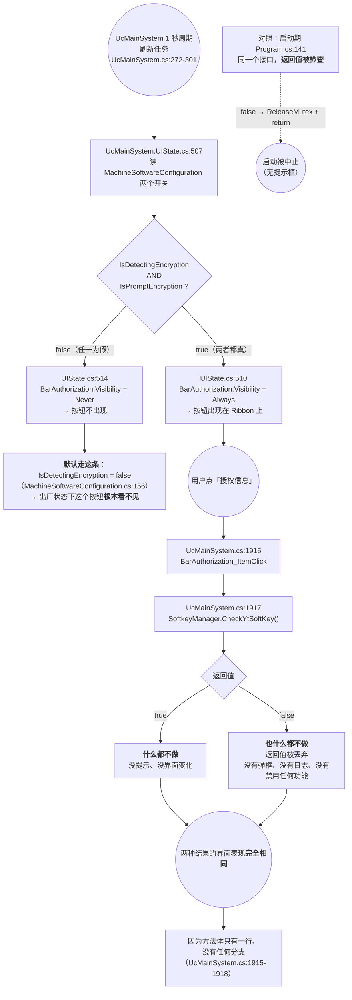

**ASCII 版**

```
 UcMainSystem 1 秒周期刷新任务 (UcMainSystem.cs:272-301)
        │
        └─ UcMainSystem.UIState.cs:507
             if (IsDetectingEncryption && IsPromptEncryption)
                  ├─ true  → :510 BarAuthorization.Visibility = Always
                  └─ false → :514 BarAuthorization.Visibility = Never   ★ 默认
                                              （IsDetectingEncryption=false，
                                                MachineSoftwareConfiguration.cs:156）
                     └─▶ 出厂状态下这个按钮根本看不见

 （只有在按钮可见时）用户点击「授权信息」
        │
        └─ UcMainSystem.cs:1915  BarAuthorization_ItemClick
              └─ :1917 SoftkeyManager.CheckYtSoftKey();
                    ├─ 返回 true  → 什么都不做
                    └─ 返回 false → 也什么都不做   ← 返回值被丢弃
                       ※ 两种结果的界面表现完全相同

 对照：启动期同一接口 Program.cs:141 的返回值是<b>被检查</b>的
        └─ false → :143 mutex.ReleaseMutex() + :144 return（进程退出，无提示框）
```

#### 4.6.3 纯技术事实汇总（不评价实现强度）

`AKRS.Galaxy.SoftKey` 是**工程内 `ProjectReference`**（`AKRS.ZX2200.csproj:4054` → `..\AKRS.Galaxy.SoftKey\AKRS.Galaxy.SoftKey\AKRS.Galaxy.SoftKey.csproj`），**不是黑盒 DLL**；`Program.cs:12` 以 `using AKRS.Galaxy.SoftKey;` 引入。`SoftkeyManager` 在本工程的**全部**调用点（`grep -rn "SoftkeyManager" --include=*.cs .`，5 处有效 + 1 处注释）：

| 调用 | `文件:行` | 时机 / 语境 | 失败分支与提示 |
|---|---|---|---|
| `CheckYtSoftKey()` | `Program.cs:141` | 启动期，仅在 `IsDetectingEncryption == true` 时 | `false` → `:143` `mutex.ReleaseMutex()` → `:144` `return`（进程退出，**无任何提示框**） |
| `InitSoftKey()` | `Program.cs:148` | 校验通过后初始化 | 无返回值使用 |
| `GetDateDue(out bool permanent, out DateTime authDate)` | `Program.cs:149` | 取授权到期日 | — |
| `GetUserId(out int userId)` | `Program.cs:160` | 取用户号 | — |
| `CheckYtSoftKey()` | `UcMainSystem.cs:1917` | Ribbon「授权信息」按钮点击 | 返回值被丢弃，**无任何界面反馈**；该按钮的可见性由 `UcMainSystem.UIState.cs:507-515` 按 `IsDetectingEncryption && IsPromptEncryption` 控制 |
| `CheckYtSoftKey()`（**已注释**） | `Machine.Operate.cs:193` | `//if (MachineSoftwareConfiguration.GetInstance().IsDetectingEncryption && !SoftkeyManager.CheckYtSoftKey())` | — |

两条授权信息的**消费点**（`Program.cs:162`/`:163` 写入 `Machine`，`grep` 全工程只有两处读）：

| 读点 | `文件:行` | 用途 |
|---|---|---|
| 主界面顶部状态条 | `UcMainSystem.cs:292` | 拼进文本 `用户号:...,授权到期时间...`（该状态条由 1 秒周期任务刷新） |
| Ribbon 按钮可见性 | `UcMainSystem.UIState.cs:507-515` | 见上图 |

`IsDetectingEncryption` 的落盘位置：`MachineSoftwareConfiguration.cs:166-169` 静态构造函数设 `FilePath = ZX2200PathConfig.MachineSoftwareConfigurationPath`；该路径定义在 `Infrastructure/Models/Path/ZX2200PathConfig.cs:308`（`Path.Combine(PathConfig.DeviceDirPath, "MachineSoftwareConfiguration.json")`）。

**本篇范围（`Localization/`、`Properties/`、根目录散装文件）不包含任何授权实现代码**，只有 `Program.cs` 的调用侧。

#### 4.6.4 坑

- ⚠️ **同一个接口在两处的返回值处理不一致**：启动期检查（`Program.cs:141` → 失败即中止启动），按钮点击丢弃（`UcMainSystem.cs:1917`）。操作员点了按钮**得不到任何反馈**——既不知道成功也不知道失败。
- ⚠️ **按钮默认不可见**（`UcMainSystem.UIState.cs:514`），因为它依赖的 `IsDetectingEncryption` 默认 `false`（`MachineSoftwareConfiguration.cs:156`）。所以**出厂状态下这个按钮在界面上找不到**，文档/培训材料里若写"点 Ribbon 上的授权信息"会误导（勘误 2，§7.5）。
- ✅ `IsPromptEncryption` 默认 `true`（`MachineSoftwareConfiguration.cs:161`），但它的作用被 `IsDetectingEncryption == false` 完全屏蔽：`Program.cs:153` 的整个提示块在 `:138` 就进不来。

---

## 5. 核心流程（非 UI 触发）

### 5.1 翻译查找链路：从 `LocalizeForm` 到一个控件的 `Text`（图 7）

#### 5.1.1 触发点与调用链（逐层，带行号）

```
UcMainSystem.cs:1984        foreach (Form form in Application.OpenForms)
  └─ UcMainSystem.cs:1986     FormLocalizer.LocalizeForm(form)
       ├─ FormLocalizer.cs:71    formName = form.GetType().Name            ← 用类型名当 JSON 文件名
       ├─ FormLocalizer.cs:75    LocalizationCache.Instance.Initialize(formName)   ← 每次都 File.ReadAllText + JObject.Parse（§5.2）
       ├─ FormLocalizer.cs:76    (form as ILanguage)?.GetUI()               ← ★ 先于"有没有翻译"的判断
       ├─ FormLocalizer.cs:78    if (!HasFormTranslation(formName)) return  ← 没有 JSON 就整支跳过
       ├─ FormLocalizer.cs:84    LocalizeFormByTranslationKeys(form, formName)
       │    ├─ FormLocalizer.cs:99-101  直接读 LocalizationCache.Instance._formCache[formName]（public 字段）
       │    ├─ FormLocalizer.cs:106     foreach (JObject 的每一个键)
       │    │    ├─ FormLocalizer.cs:113   FindComponentByKey(form, key)
       │    │    │    ├─ FormLocalizer.cs:130  键含 '.' → Split('.') 逐级 FindDirectChild
       │    │    │    └─ FormLocalizer.cs:149  否则 → FindDirectChild(container, key)
       │    │    └─ FormLocalizer.cs:116   ApplyTranslationToComponent(component, JObject, key)
       │    │         ├─ FormLocalizer.cs:237  目标属性 = JSON["Property"] ?? GetDefaultProperty(控件类型)
       │    │         ├─ FormLocalizer.cs:239  JSON[currentLanguage] 是 JValue 才写
       │    │         ├─ FormLocalizer.cs:244  SetComponentProperty(...)
       │    │         │    ├─ FormLocalizer.cs:343  GetProperty(...)
       │    │         │    ├─ FormLocalizer.cs:344  CanWrite 为 false 就放弃
       │    │         │    └─ FormLocalizer.cs:347  SetValue(...)           ← 最终效果：控件属性被改
       │    │         ├─ FormLocalizer.cs:250-258  ToolTipText → 写控件的 "Hint"
       │    │         └─ FormLocalizer.cs:261-264  Properties 子对象 → 逐属性写
  └─ UcMainSystem.cs:1987-1990  form.GetChildControls<XtraUserControl>() 再逐个 LocalizeForm
```

#### 5.1.2 图 7：链路与三条失败分支

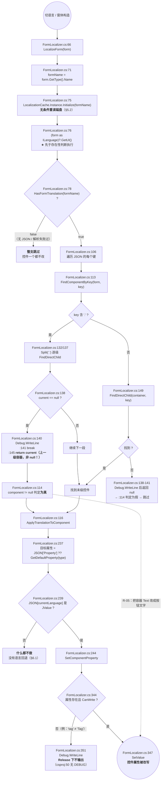

**ASCII 版**

```
 切语言 / 窗体构造
   └─ FormLocalizer.LocalizeForm(form)                      :66
         ├─ formName = form.GetType().Name                  :71
         ├─ LocalizationCache.Instance.Initialize(formName) :75   ★ 无条件重读磁盘
         ├─ (form as ILanguage)?.GetUI()                    :76   ★ 先于存在性判断
         ├─ if (!HasFormTranslation(formName)) return       :78   ← 无 JSON 整支跳过
         └─ LocalizeFormByTranslationKeys(form, formName)   :84
               ├─ 直接读 _formCache[formName]（public 字段）  :99-101
               └─ foreach 键 (JSON)
                     ├─ FindComponentByKey(form, key)        :113
                     │    ├─ 含 '.' → Split('.') 逐级 FindDirectChild   :132/:137
                     │    │     └─ 任一级 null → :140 Debug.WriteLine
                     │    │                      :141 break
                     │    │                      :145 return current  ★ 返回"上一级容器"，非 null
                     │    │           └─▶ :114 component != null 判定为真
                     │    │                 └─▶ :116 对【容器】应用翻译
                     │    │                       └─▶ :237 容器类型不在映射表 → 退到 "Text"
                     │    │                             └─▶ :347 把容器的 Text 改成按钮文字   ← R-05
                     │    └─ 不含 '.' → FindDirectChild(container, key)  :149
                     │          └─ 找不到 → :138-141 Debug.WriteLine → 返回 null → :114 跳过
                     └─ ApplyTranslationToComponent(...)     :116
                           ├─ 目标属性 = JSON["Property"] ?? GetDefaultProperty(type)   :237
                           ├─ JSON[currentLanguage] is JValue ?  :239
                           │     └─ 否 → 什么都不做（无语言回退）
                           └─ SetComponentProperty(...)      :244
                                 ├─ GetProperty(...)          :343
                                 ├─ CanWrite ?                :344
                                 │     └─ 否（如 "tag" ≠ "Tag"） → :351 Debug.WriteLine
                                 │                                   ★ Release 下被编译掉
                                 └─ SetValue(...)             :347  ← 控件属性被改写
```

#### 5.1.3 读了什么、写了什么

| 动作 | 对象 | 位置 |
|---|---|---|
| 读（磁盘） | `<base>/Forms/<formName>.json` → `File.ReadAllText` + `JObject.Parse` | `LocalizationCache.cs:276-277` |
| 读（内存） | `LocalizationCache._formCache`（`public readonly`，`FormLocalizer` 绕过公有方法直接下标访问） | `LocalizationCache.cs:19` → `FormLocalizer.cs:99-101` |
| 读（配置） | `LanguageSettings.GetInstance().Language`（当前语言键） | `FormLocalizer.cs:234` |
| 写（内存） | `_formCache[formName] = translations`（同键覆盖） | `LocalizationCache.cs:279` |
| 写（内存） | `_loadedForms.Add(formName)` | `LocalizationCache.cs:280` |
| 写（控件） | 反射 `SetValue` 到控件的 `Text` / `Caption` / `HeaderText` / `Hint` 等 | `FormLocalizer.cs:347` |
| **不写** | **不落盘、不发事件、不重建窗体** | 全链路无 `Save()`、无事件触发 |

**关键结论：本地化是"原地改属性"，不是"重建界面"。** 已创建的窗体/控件被逐一反射写属性；只要 JSON 里没有对应键，那个控件就永远保持原样（原样 = 中文）。

#### 5.1.4 坑

- 🔴 **`GetUI()` 在存在性检查之前执行**（`FormLocalizer.cs:76` 早于 `:78`）：即使该窗体没有任何 JSON，`GetUI()` 也已经跑过了。`UcVacuum.GetUI()` 正是靠这个顺序把标题写成 `null`（R-04，§9.1）。
- 🔴 **层级路径失败返回中间容器**（`FormLocalizer.cs:145`）→ 会改错控件（R-05，§9.1）。
- 🔴 **失败全部走 `Debug.WriteLine`**（`FormLocalizer.cs:88`、`:140`、`:154`、`:268`、`:357`），而 Release 的 `DefineConstants` 是 `TRACE`（`AKRS.ZX2200.csproj:50`）——**现场完全没有任何可诊断输出**（R-03 系列）。
- ⚠️ **没有语言回退**：`translationObj[currentLanguage] is JValue`（`FormLocalizer.cs:239`）不成立就什么都不做，不会退回中文。`LocalizationCache.GetValueFromJObject`（`:393`）的注释明说"不做降级处理"。

### 5.2 翻译缓存的加载、"否定缓存"与失效（图 8）

#### 5.2.1 三层缓存：只有一层真的装到了东西

| 缓存字典 | 声明 | 加载方法 | 找的文件 | 本工程实际内容 |
|---|---|---|---|---|
| `_formCache` | `LocalizationCache.cs:19` | `LoadFormTranslation`（`:268`） | `<base>/Forms/<formName>.json`（`:272`） | **4 个窗体**（唯一跑通的一层） |
| `_commonCache` | `:20` | `LoadCommonTranslations`（`:342`） | `<base>/Common/Common_UI.json`、`Common_Messages.json`（`:344`、`:350`） | **恒为空**——`Localization/Data/Common/` 是**空目录**（实测 0 个文件） |
| `_messageCache` | `:21` | `LoadMessageTranslation`（`:310`） | `<base>/Messages/<name>.json`（`:314`） | **恒为空**——`Localization/Data/Messages/` 目录**根本不存在**（`ls Localization/Data/` 只有 `Common`、`Forms`） |

#### 5.2.2 图 8：加载、否定缓存与"没有失效"

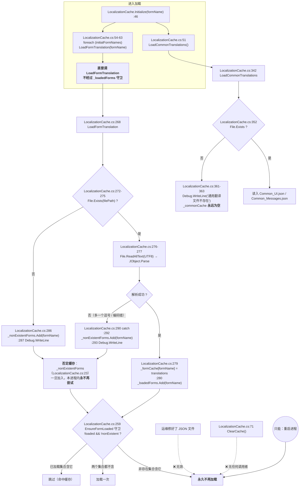

**ASCII 版**

```
 FormLocalizer.cs:75  LocalizationCache.Instance.Initialize(formName)
        │
        ├─ LocalizationCache.cs:51  LoadCommonTranslations()
        │       └─ :352 File.Exists(<base>/Common/Common_UI.json) → 恒 false
        │             └─ :361 Debug.WriteLine("通用翻译文件不存在: ...")
        │                ⇒ _commonCache 永远为空
        │       （Data/Messages/ 目录不存在 ⇒ _messageCache 永远为空）
        │
        └─ :54-63  foreach (initialFormNames) LoadFormTranslation(formName)
                    ★ 直接调 LoadFormTranslation，绕过 :259 的 _loadedForms 守卫
                       ⇒ 每次 LocalizeForm 都重读磁盘（R-08）
                    │
                    ├─ :272-275 File.Exists ?  ── 否 ─▶ :286 _nonExistentForms.Add
                    │                                       :287 Debug.WriteLine
                    ├─ :276-277 File.ReadAllText(UTF8) + JObject.Parse
                    │      └─ 抛异常 ─▶ :290 catch
                    │                     :292 _nonExistentForms.Add
                    │                     :293 Debug.WriteLine
                    └─ 成功 ─▶ :279 _formCache[formName] = translations
                               :280 _loadedForms.Add(formName)

 守卫（只有一个，LocalizationCache.cs:259）：
   if (!_loadedForms.Contains(n) && !_nonExistentForms.Contains(n)) LoadFormTranslation(n);

 失效：
   ✅ 已加载 → 跳过（命中缓存）
   ❌ 进过 _nonExistentForms → 本进程内【永久】不再尝试加载
        运维修好 JSON 文件 —— 无效
        ClearCache() —— 无任何调用者（:71，grep 全工程只有定义）
        ⇒ 唯一的办法是重启软件
```

#### 5.2.3 读了什么、写了什么

| 动作 | 对象 | 位置 |
|---|---|---|
| 读 | `File.Exists` ×3（窗体 / 通用 / 消息） | `LocalizationCache.cs:273`、`:352`、`:316` |
| 读 | `File.ReadAllText(filePath, Encoding.UTF8)` | `:276`、`:318`、`:354` |
| 写 | `_formCache[formName]` | `:279` |
| 写 | `_loadedForms` / `_nonExistentForms` | `:280`、`:286`、`:292` |
| 写 | `_loadedMessages` / `_nonExistentMessages` | `:316-337` |
| **不写** | **缓存没有任何过期/失效机制**（无 TTL、无 `FileSystemWatcher`） | — |

#### 5.2.4 坑

- 🔴 **一个 JSON 语法错误 = 该窗体本次开机永久无翻译**（`LocalizationCache.cs:292`）→ 运维修好文件也必须重启软件（R-07，§9.1）。
- 🔴 **`ClearCache()` 有漏**（`LocalizationCache.cs:73-77`）：清了 `_formCache`/`_commonCache`/`_messageCache`/`_loadedForms`/`_nonExistentForms` **五个**，**漏了 `_loadedMessages`（`:24`）与 `_nonExistentMessages`（`:25`）**。即使将来有人调用它，消息层的"已加载/不存在"标记仍会残留（R-17，§9.6）。
- ⚠️ **`Initialize` 绕过缓存守卫**（`LocalizationCache.cs:56-62`，`:60` 直接调 `LoadFormTranslation`，没有 `EnsureFormLoaded` 的 `:259` 守卫）→ 切一次语言 = `OpenForms` × `XtraUserControl` 次 `File.ReadAllText` + `JObject.Parse`（R-08，§9.1）。不会内存泄漏（同键覆盖写），但会卡 UI。*（耗时未实测。）*
- ⚠️ **"通用翻译"和"消息翻译"两套机制从未跑通**：加载代码、缓存字典、公有 API（`GetCommonTranslation` `:131`、`LocalizationManager.GetMessage` `:74`）全部就位，**唯独数据文件与调用者缺位**（`grep` 除定义外 0 个调用者）。接手者看到这些会以为"报警文案也支持多语言"（R-15，§9.5）。
- ✅ `LocalizationCache` 是 `Lazy<T>` 单例（`LocalizationCache.cs:16`），**构造线程安全**（默认 `ExecutionAndPublication`）。不安全的是构造之后对三个 `Dictionary` 的并发读写（§6.4）。

### 5.3 翻译基础路径的解析：开发机 vs 装机现场（图 9）

#### 5.3.1 解析规则（三段）

`LocalizationCache.GetTranslationBasePath`（`LocalizationCache.cs:207-223`）只有 17 行，但决定了"翻译能否生效"：

```csharp
:208  string projectPath = GetProjectRootPath();
:209  if (!string.IsNullOrEmpty(projectPath))
:211      string devPath = Path.Combine(projectPath, "Localization", "Data");
:212      if (Directory.Exists(devPath))  return devPath;      // ← 开发机路径
:220  string binPath = Path.Combine(Application.StartupPath, "Localization", "Data");
:222  return binPath;                                          // ← 装机现场路径
```

`GetProjectRootPath`（`:228-252`）：从 `Application.StartupPath`（`:232`）**逐级向上**，找到第一个含 `*.csproj` **或** `*.sln` 的目录就返回（`:236-243`）；走到盘根（`dir.Parent == null`）都没有就返回 `null`。整个过程被 `try/catch` 包住（`:249`），失败只写一句 `Debug.WriteLine`。

**只在单例构造时算一次**：`:39` `_translationBasePath = GetTranslationBasePath();`，之后**永不刷新**（进程内不可变）。

#### 5.3.2 图 9：两种运行环境下的分叉

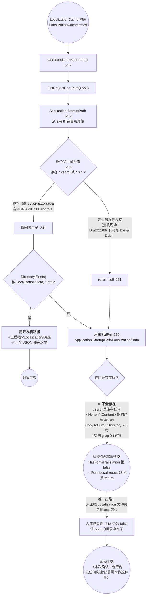

**ASCII 版**

```
 LocalizationCache 构造  LocalizationCache.cs:39   ← 只算一次，永不刷新
   └─ GetTranslationBasePath()  :207
         └─ GetProjectRootPath()  :228
               ├─ 从 Application.StartupPath 起  :232
               ├─ 逐级向上找含 *.csproj 或 *.sln 的目录  :236-243
               │     ├─ 找到 → return 该目录  :241
               │     └─ 走到盘根 → return null  :251
               └─ try/catch 吞异常 → 只 Debug.WriteLine  :249

   有工程根：  若 <根>/Localization/Data 存在 → 用它（:212）  ← 开发机
   无工程根：  用 StartupPath/Localization/Data（:220）      ← 装机现场

   开发机（本仓库现状）
     exe 在 AKRS.ZX2200\bin\Debug\
       向上第一站 = AKRS.ZX2200\（含 AKRS.ZX2200.csproj）→ 命中
       AKRS.ZX2200\Localization\Data 存在 → ✅ 用源码树里的 4 个 JSON

   装机现场（拷 bin 输出）
     exe 在 D:\ZX2200\（或任意安装目录）
       向上全程无 .csproj / .sln → null
       落到 D:\ZX2200\Localization\Data
       ❌ 该目录不会被构建产生：
          AKRS.ZX2200.csproj 里 grep '\.json' → 0 命中
          grep -c 'CopyToOutputDirectory' → 0
          只有两条 <Folder Include="Localization\Data\..." />（:3902、:3903）占位
       ⇒ File.Exists 恒 false → HasFormTranslation 恒 false
         ⇒ FormLocalizer.cs:78 直接 return → 一个控件都不翻
```

#### 5.3.3 ⚠️ 补充事实（本次复核新增）：翻译数据文件根本不属于这个工程

这是本次复核源码时发现、且**比路径分叉本身更致命**的一条：

| 检查 | 命令 | 实测 |
|---|---|---|
| csproj 里有没有引用这些 JSON | `grep -n '\.json' AKRS.ZX2200.csproj` | **0 命中** |
| 有没有"复制到输出目录" | `grep -c 'CopyToOutputDirectory' AKRS.ZX2200.csproj` | **0** |
| csproj 里 `Localization` 的全部出现 | `grep -n 'Localization' AKRS.ZX2200.csproj` | 只有 6 处：`:1013-1016` 四个 `<Compile Include>`（`.cs`）+ `:3902`/`:3903` 两条 `<Folder Include>`（**空目录占位**） |

**含义**：

1. 那 4 个 `.json` **既不是 `<Content>` 也不是 `<None>`**，构建**不会**把它们复制到 `bin\`——所以 `:220` 的"发布路径"分支在**任何一次正常构建的产物里都注定落空**。**这一点已由实物证实**：本仓库里的真实产物 `trunk/bin/Debug/` 下**没有 `Localization/` 目录**（§6.6.6、R-31）。
2. 它们在 Visual Studio 的"解决方案资源管理器"里**根本看不见**（唯一的痕迹是 `:3903` 那条 `<Folder Include="Localization\Data\Forms\" />` 占位，而 `<Folder>` 只用于显示**空**文件夹）。改译文**只能靠文本编辑器直接改磁盘文件**。
3. 也就是说：这套多语言机制**只能在源码树里跑通**。现场要生效，必须由部署人员**手工**把 `AKRS.ZX2200\Localization\` 整个目录拷到 exe 旁边——仓库里**没有**任何脚本或 `PostBuildEvent` 做这件事（`BuildEvent` 在 csproj 里 0 命中）。

这条已登记为 **R-31**（§9.4）。

#### 5.3.4 坑

- ✅ **代码逻辑本身无误**：三段解析顺序合理，`try/catch` 也兜住了 `PathTooLongException` 之类的意外。**问题不在代码，在数据文件的工程归属**（R-31）。
- 🔴 **路径只算一次**（`LocalizationCache.cs:39`）：即使运行期有人手工补上 `Localization/Data`，本进程内的 `_translationBasePath` 也**不会重算**，必须重启。
- ⚠️ **开发机的"能用"是一种假象**：因为 exe 恰好在工程目录的子目录下运行，才走到 `:212` 的源码路径。任何"换个目录跑一下试试"的动作（把 exe 单独拷出来）都会让翻译静默全灭——**没有任何提示**（§5.1.4）。

### 5.4 启动期的版本比对与落盘

这段流程不属于 `Localization/`，但它是**唯一一段"本范围内的代码会被本范围外的代码当数据用"**的流程，而且它的输入正是本范围的 `Properties/AssemblyInfo.cs`。

#### 5.4.1 调用链

```
Program.cs:171                          VersionUpdateAnnouncement.CheckVersionUpdate()
  └─ VersionUpdateAnnouncement.cs:33      CheckVersionUpdate()
       ├─ :36   machineVersion = new Version(MachineSoftwareConfiguration.CurrentVersionNumber)
       │          ← 默认值 "0.0.0.0"（MachineSoftwareConfiguration.cs:27）
       ├─ :38   currentVersion = VersionInfos.Max(v => v.VersionNumber)
       │          ← 列表 5 条（:65-120），最大值 1.4.0.0（:111）
       ├─ :41   if (currentVersion != Assembly.GetExecutingAssembly().GetName().Version)
       │          ← 右侧 = Properties/AssemblyInfo.cs:31 的 "1.4.0.0"
       │    ├─ 不等 → :43 AKRSXtraMessageBox.Show("当前版本号与内置版本号不相同，请联系软件人员")
       │    │         :44 return    ← 后续全部不执行
       │    └─ 相等 → 继续
       ├─ :49   updates = VersionInfos.Where(v => v.VersionNumber > machineVersion)
       ├─ :50   if (updates.Count > 0)
       ├─ :53   LastVersionNumber    = CurrentVersionNumber（先把旧值存下来）
       ├─ :54   CurrentVersionNumber = VersionInfos 的最大值.ToString()      ← 内存
       ├─ :55   LastVersionUpdataTime = DateTime.Now
       ├─ :56   MachineSoftwareConfiguration.GetInstance().Save()            ← 落盘
       └─ :57-58 new FrmVersionInfo().ShowDialog()                          ← 模态框
```

`VersionInfos` 的 5 条（`VersionUpdateAnnouncement.cs:65-120`）：

| # | 版本号 | 行号 | `UpdataTime` | 条目数 |
|---|---|---|---|---|
| 1 | `1.0.0.0` | `:69` | 2026-01-01 | 1 |
| 2 | `1.1.0.0` | `:79` | 2026-03-24 | 2 |
| 3 | `1.2.0.0` | `:89` | 2026-04-08 | 4 |
| 4 | `1.3.0.0` | `:101` | 2026-05-28 | 2 |
| 5 | **`1.4.0.0`** | **`:111`** | 2026-08-12 | 3 |

**最大值 = `1.4.0.0`（`:111`）**，与 `Properties/AssemblyInfo.cs:31` 的 `AssemblyVersion("1.4.0.0")` **当前一致** → `:41` 的判定为假 → **正常情况下启动不弹版本不符的框**。

#### 5.4.2 两次落盘分叉（图 4 的 VERSION 分支的展开）

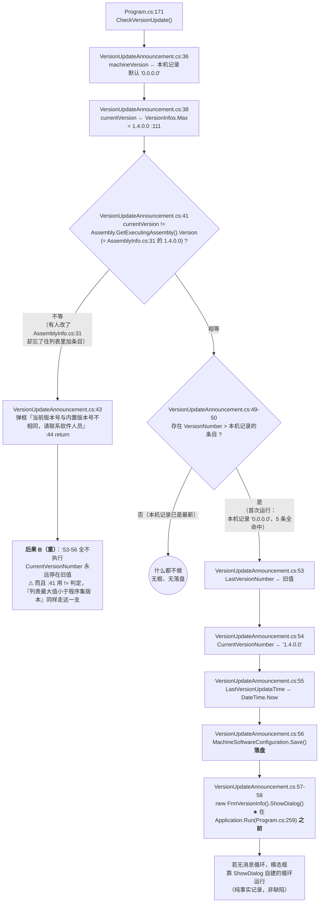

**ASCII 版**

```
 Program.cs:171  CheckVersionUpdate()
   └─ VersionUpdateAnnouncement.cs:33
        ├─ :36 machineVersion  = 本机记录（默认 "0.0.0.0"，MachineSoftwareConfiguration.cs:27）
        ├─ :38 currentVersion  = VersionInfos.Max = 1.4.0.0（:111）
        ├─ :41  currentVersion != Assembly.GetExecutingAssembly().Version
        │       （右侧 = Properties/AssemblyInfo.cs:31 的 "1.4.0.0"）
        │   ├─ 不等 → :43 弹框「当前版本号与内置版本号不相同，请联系软件人员」
        │   │          :44 return  ← :53-56 全不执行
        │   │          ⇒ CurrentVersionNumber 永远停在旧值（后果 B）
        │   └─ 相等 → 继续
        ├─ :49-50 有比本机记录更新的条目吗？
        │   ├─ 没有 → 什么都不做（无框、无落盘）
        │   └─ 有（★ 首次运行：本机 "0.0.0.0"，5 条全命中）
        │        ├─ :53 LastVersionNumber     ← 旧值
        │        ├─ :54 CurrentVersionNumber  ← "1.4.0.0"
        │        ├─ :55 LastVersionUpdataTime ← DateTime.Now
        │        ├─ :56 Save()  ← 落盘（设备侧版本记录被软件改写）
        │        └─ :57-58 new FrmVersionInfo().ShowDialog()
        │                   ★ 发生在 Application.Run（Program.cs:259）之前
```

#### 5.4.3 读了什么、写了什么

| 动作 | 对象 | 位置 |
|---|---|---|
| 读 | `Properties/AssemblyInfo.cs:31` 的 `AssemblyVersion`（经 `Assembly.GetExecutingAssembly()`） | `VersionUpdateAnnouncement.cs:41` |
| 读 | `MachineSoftwareConfiguration.CurrentVersionNumber`（默认 `"0.0.0.0"`） | `MachineSoftwareConfiguration.cs:27` → `:36` |
| 写（内存） | `LastVersionNumber` / `CurrentVersionNumber` / `LastVersionUpdataTime` | `:53`、`:54`、`:55` |
| **写（落盘）** | `MachineSoftwareConfiguration.GetInstance().Save()` | **`:56`** |
| 写（界面） | `FrmVersionInfo` 模态框 | `:57-58` |

#### 5.4.4 坑

- 🔴 **`Properties/AssemblyInfo.cs:31` 与 `VersionUpdateAnnouncement.cs:65-120` 的列表必须手工同步**。`:41` 用的是 `!=`，所以"列表最大值**小于**程序集版本"（改了 `AssemblyVersion` 忘了加条目）与"大于"走的是**同一条 return 分支**——两种相反的错误表现完全一样（R-12，§9.3）。**没有任何编译期或启动期校验**。
- 🔴 **后果 B 是"数据被改写"**：`:53-56` 会把 `MachineSoftwareConfiguration.json` 里的设备版本记录**单方面**跳到列表最大值并写 `LastVersionUpdataTime = DateTime.Now`，`Save()` 落盘（R-12）。这是本篇范围内唯一一处"软件改写设备侧记录"的流程。
- ⚠️ **首次运行必然弹框**：`CurrentVersionNumber` 默认 `"0.0.0.0"`（`MachineSoftwareConfiguration.cs:27`），5 条版本**全部**大于它 → `updates.Count = 5 > 0` → 弹 `FrmVersionInfo` 并落盘。新机器/清过配置的机器上，**第一次启动一定会看到版本公告框**——这是设计行为，不是故障。
- ⚠️ **`Save()` 由 DLL 基类提供**：`MachineSoftwareConfiguration.cs` 全文 196 行**没有定义 `Save()`**（`grep -n "void Save"` 无命中），它继承自 `Singleton<MachineSoftwareConfiguration>`（`MachineSoftwareConfiguration.cs:22`）。**异常处理、序列化格式都不可见**（附录 B）。

### 5.5 后台线程与 Harmony 运行时补丁

本范围内（`Localization/`、`Properties/`、根目录散装文件）**只有 `Program.cs` 在启动期创建了 1 个线程、打了 1 个运行时补丁**。`Localization/`、`Properties/`、`Common.cs` 中**零线程、零 `Timer`、零 `Task`、零 `async`**（`grep` 只命中未使用的 `using System.Threading.Tasks;`）。

#### 5.5.1 唯一的线程：`FindFormThread`（关闭 DevExpress 试用弹窗）

| 项 | 值 | `文件:行` |
|---|---|---|
| 创建 | `Thread thread = new Thread(FindFormThread);` | `Program.cs:127` |
| 后台线程 | `thread.IsBackground = true;` | `:128` |
| 线程名 | `"自动关闭DEVExPress"` | `:129` |
| 启动 | `thread.Start();` | `:130` |
| 创建时机 | 在异常钩子注册（`:99-107`）之后、授权块（`:136`）之前 | — |
| 线程体 | 轮询 `FindWindow(null, "About DevExpress")` | `:311-321` |
| 内有无 `try/catch` | **没有** | `:311-321` |
| P/Invoke 声明 | `FindWindow` `:303-304`、`PostMessage` `:306-307`、`WM_CLOSE = 0x0010` `:308` | — |

```
:313   IntPtr handle = FindWindow(null, "About DevExpress");
:314   while (handle == IntPtr.Zero && m_nWaitTime <= 5000)
:316       Thread.Sleep(1);
:317       handle = FindWindow(null, "About DevExpress");
:318       m_nWaitTime++;
:320   PostMessage(handle, WM_CLOSE, 0, 0);     ← ★ 循环外，无条件调用
```

三个纯代码事实（不评价其必要性，只记录行为）：

1. `m_nWaitTime`（`:309`）是**静态字段**，全类共享且**从不重置**。本工程只创建一次该线程（`:127`），暂不发作；若将来二次调用，计数器已是 5001，循环一次都不进。
2. 字段名 `m_nWaitTime` 装的是**轮询次数**而非时间。配合 `Thread.Sleep(1)`（`:316`）在 Windows 上实际调度粒度约 15.6 ms，`<= 5000` 意味**最坏约 78 秒**——与名字暗示的"5 秒"不同。
3. `PostMessage` 的返回类型被声明为 `void`（`:307`），而 `user32` 的实际返回是 `BOOL`；`handle` 为 `IntPtr.Zero` 时会向 0 号窗口投消息。

它是本范围**唯一的跨进程通信**：`FindWindow` 按窗口标题找句柄 → `PostMessage(WM_CLOSE)` 关掉它。

#### 5.5.2 Harmony 运行时补丁：改写 `Application.MarshalingControl` 的私有构造函数

```csharp
:242  var harmony = new Harmony("一线码农聊技术");
:243  Type applicationType = typeof(Application);
:244  Type marshalingControlType = applicationType.GetNestedType("MarshalingControl", BindingFlags.NonPublic);
:245  ConstructorInfo constructor = marshalingControlType.GetConstructor(
          BindingFlags.NonPublic | BindingFlags.Instance, null, Type.EmptyTypes, null);
:246  var prefix = typeof(HookMarshalingControl).GetMethod("OnActionExecuting");
:247  harmony.Patch(constructor, new HarmonyMethod(prefix));
```

**补什么**：目标是 `System.Windows.Forms.Application` 的**私有嵌套类型 `MarshalingControl` 的无参私有构造函数**。WinForms 在**非创建线程**上访问控件时，内部会 `new MarshalingControl()` 以便抛 `InvalidOperationException`；补丁在这个构造函数之前先跑 `HookMarshalingControl.OnActionExecuting`。

**补上之后做什么**（`Program.cs:333-354`）：

```
:335   int managedThreadId = Thread.CurrentThread.ManagedThreadId;
:338   if (managedThreadId != 1)                       ← 硬编码"主线程 ID == 1"
:341-345   LogHelper.Post(Level.Info, "控件创建线程:{id}控件创建线程名称:{name}",
                          LogCategory.Global, ViewType.InFileAndUI);   ← 只写日志
:347-352   //AKRSMessageBoxExt.Show(...)                ← ★ 报警弹框整段被注释掉
```

**即：跨线程非法建控件的"检测"只剩一条 `LogHelper.Post` 日志，不再弹框。**

#### 5.5.3 图 4 的线程/补丁分支展开

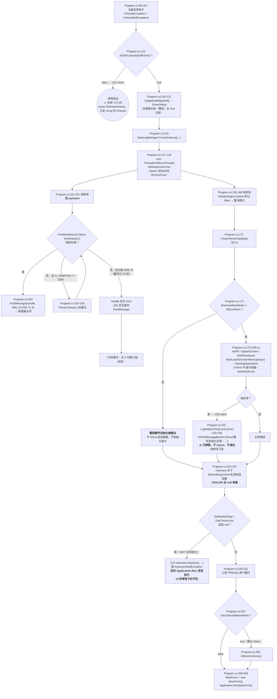

#### 5.5.4 坑

- 🔴 **`Harmony` 反射两处无 null 检查**（`Program.cs:244`、`:245`）：`GetNestedType` / `GetConstructor` 返回 `null` 时会 `harmony.Patch(null, ...)` 抛 `ArgumentNullException`，而 `Application.Run` 在 `:259` 尚未执行，**UI 异常钩子（`:102`）不会触发**（R-11，§9.2）。
- 🔴 **跨线程检测的报警被注释掉了**（`Program.cs:347-352`）：只剩 `LogHelper.Post` 一条日志。而**硬编码"主线程 ID == 1"**（`:338`）——这是对运行环境的强假设。
- ⚠️ **线程体内无 `try/catch`**（`Program.cs:311-321`）：该线程是非 UI 线程，异常会落到 `AppDomain.UnhandledException`（`:105`）→ `AppThreadException`（`:295`）弹框，但**无法阻止进程终止**（`IsBackground = true` 只影响进程退出时是否等待）。
- ⚠️ **`PostMessage` 在循环外无条件调用**（`Program.cs:320`）：超时后 `handle` 仍为 `IntPtr.Zero` 也照样投消息。
- ⚠️ **两条提前退出路径写法不一致**：授权失败分支显式 `mutex.ReleaseMutex()`（`:143`）后再 `return`；磁盘检查分支直接 `return`（`:112`），只靠 `using`（`:68`）的 `Dispose` 收尾。是否会造成"互斥体被遗弃"未做运行时验证，**仅记录代码事实**。
- ⚠️ **硬件初始化异常不退出**（`Program.cs:229-239`）：只弹框，**继续**执行 `:242` 的 Harmony 补丁与 `:258` 的 `Application.Run`。即"硬件没起来也要进主界面"。

---

## 6. 关键实现细节

### 6.1 翻译 JSON 的格式（不是 `.resx`，不是 `.po`）

#### 6.1.1 加载方式

```csharp
// LocalizationCache.cs
:2    using Newtonsoft.Json;
:3    using Newtonsoft.Json.Linq;
:276  string json = File.ReadAllText(filePath, Encoding.UTF8);
:277  JObject translations = JObject.Parse(json);
```

**固定 UTF-8 读取**（`:276`、`:318`、`:354`），走 `Newtonsoft.Json` 的 `JObject.Parse`。**没有 schema 校验、没有版本号字段、没有 try/catch 之外的任何容错**（解析异常的处置见 §5.2）。

#### 6.1.2 三层结构

```
{
  "<控件名 或 panel1.button1 这样的层级路径>": {
      "Property":    "<可写属性名，可选>",                        // FormLocalizer.cs:237
      "Chinese":     "<中文文本>",                                // 键名 = LanguageEnum.ToString()
      "English":     "<英文文本>",
      "ToolTipText": { "Chinese": "...", "English": "..." },       // FormLocalizer.cs:251
      "Properties":  { "<属性名>": { "Chinese": "...", "English": "..." } }  // :261 / :291
  }
}
```

四条约定（都不是代码强制的，全靠手写遵守）：

| 约定 | 依据 | 违反了会怎样 |
|---|---|---|
| 语言键 = `LanguageSettings.Language.ToString()`，即字面量 `"Chinese"` / `"English"` | `LocalizationManager.cs:90`、`:110`；`FormLocalizer.cs:234` | 查不到 → **静默跳过**（`FormLocalizer.cs:239`） |
| 加第三种语言必须**同时**改 `LanguageEnum` 和**所有** JSON | `LocalizationManager.cs:158-165` | 旧 JSON 没有新语言的键 → 该窗体在新语言下**全文未翻译** |
| `Property` 可省；省了就用 `GetDefaultProperty(控件类型)`（§6.3） | `FormLocalizer.cs:237` | 省掉后如果控件类型不在映射表里，会退到 `"Text"`，写不进去就**静默不改** |
| 顶层键必须是控件名或 `A.B.C` 层级路径 | `FormLocalizer.cs:130`、`:149` | 见 §5.1.4 的两条失败分支 |

#### 6.1.3 本工程 4 个 JSON 的全部键（逐个列出）

**`FrmBaseTest.json`（6 行，1 个键）**

| 键 | Chinese | English | 行号 |
|---|---|---|---|
| `BtnStop` | 停止 | Stop | `:2-5` |

**`UcMainSystem.json`（34 行，8 个键，全部是 `RibbonPage`）**

| 键 | Chinese | English | 行号 |
|---|---|---|---|
| `ribbonPage1` | 文件操作 | Files operations | `:2-5` |
| `RibbonPageProduction` | 自动工作 | Auto working | `:6-9` |
| `RibbonPageProgramming` | 程式 | Programming | `:10-13` |
| `RibbonPageManual` | 手动操作 | Manual working | `:14-17` |
| `RibbonPageDataAdministrator` | 数据管理 | Data management | `:18-21` |
| `RibbonPageMachine` | 设备功能 | Equipment functions | `:22-25` |
| `RibbonPageDiagnosis` | 实验 | Test | `:26-29` |
| `RibbonPageSystem` | 系统 | System | `:30-33` |

**`UcVacuum.json`（38 行，9 个键；本文件用 4 空格缩进，其余三个用 2 空格）**

| 键 | Chinese | English | 行号 |
|---|---|---|---|
| `labelControl2` | 焊头吸附模拟量: | `BondheadAttachNozzleValue` | `:2-5` |
| `labelControl1` | 吸嘴真空模拟量: | `VacuumValue` | `:6-9` |
| `BtnBondHeadVacuum` | 开焊头吸附 | `OpenBondheadVacuum` | `:10-13` |
| `BtnNozzleVacuum` | 开吸嘴真空 | `OpenNozzleVacuum` | `:14-17` |
| `BtnWeakBlow` | 开吸嘴吹气 | `OpenNozzleBlow` | `:18-21` |
| `BtnIPTVacuum` | 开中转台真空 | `OpenIPTVacuum` | `:22-25` |
| `BtnESVacuum` | 开顶针真空 | `OpenEjectionVacuum` | `:26-29` |
| `BtnESBlow` | 开顶针吹气 | `OpenEjectionBlow` | `:30-33` |
| `BtnFlipTableVacuum` | 开翻转台真空 | `OpenFlipTableVacuum` | `:34-37` |

⚠️ `UcVacuum.cs:340-351` 的 `GetUI()` 要找的 `Title` 键**不在本文件里** → 标题被写成 `null`（R-04）。

**`UcComponentHandling.json`（99 行，24 个键）**

| 键 | Chinese | English | 行号 | 备注 |
|---|---|---|---|---|
| `xtraTabPage1` | 测试/展示 | Test/Display | `:2-5` | |
| `xtraTabPage2` | 晶圆更换 | WaferChange | `:6-9` | |
| `xtraTabPage3` | 信号 | Signal | `:10-13` | |
| `Title` | 晶圆快捷操作 | Wafer quick operate | `:14-17` | **4 个文件里只有这一处有 `Title`** |
| `BtnMoveToUpDownMarkPosition` | 顶针台到Mark/安全位置 | Move to UpDownMark / Safe Position | `:18-21` | |
| `BtnMoveToExpandDownPosition` | 扩晶环到安全位置 | Move to ExpandDownPosition | `:22-25` | 英文是中英混排的枚举名 |
| `BtnMoveToAutoChangePosition` | 晶圆台到自动换料位 | Move to AutoChangePosition | `:26-29` | 同上 |
| `BtnMoveToMagazineSafePosition` | magazine到安全位置 | Move to MagazineSafePosition | `:30-33` | |
| `BtnMoveToWaferClampSafePosition` | 晶圆夹到安全位置 | Move to WaferClampSafePosition | `:34-37` | |
| `BtnWaferChangeTest` | 自动换晶圆测试 | Wafer change test-run on | `:38-41` | |
| `BtnMoveWaferMagazineToSlot` | magazine到某个槽位 | Move wafer magazine to slot | `:42-45` | |
| `BtnMoveToNextSlot` | magazine到下一个槽位 | Move to next slot | `:46-49` | |
| `BtnMoveToPreviousSlot` | magazine到上一个槽位 | Move to previous slot | `:50-53` | |
| `BtnPlaceWaferInSlot` | 归还料片 | Place wafer in slot | `:54-57` | 层级路径查找失败时会**改错控件**的键，见 R-05 |
| `BtRemoveWaferFromSlot` | 更换某层料片到晶圆台 | Remove wafer from slot | `:58-61` | **键名少了个 `n`**（同族写作 `Btn...`） |
| `BtnSlotScan` | magazine槽位扫描 | slot scan | `:62-65` | |
| `BtnMovePusherOut` | 推杆动作 | Move pusher out / in | `:66-70` | **唯一带 `"Property"` 的条目**（`:67`，**且该块缩进是 4 空格**，与全文件 2 空格不一致） |
| `BtnCloseGripper` | 晶圆夹动作 | Wafer gripper | `:71-74` | |
| `BtnBlockCyc` | 晶圆夹持气缸动作 | Wafer blockCyc | `:75-78` | |
| `BtnFixedCyc` | 顶针固定气缸动作 | Eject fixedCyc | `:79-82` | |
| `BtnStaticWaffleVacuum` | 静态华夫盒真空 | StaticWaffle Vacuum | `:83-86` | |
| `BtnInitialization` | 晶圆模块复位 | Initialization | `:87-90` | |
| `BtnWaffleVacuum` | 华夫盒真空 | Waffle Vacuum | `:91-94` | |
| `BtnMagazineFixedCyc` | 提篮夹紧气缸动作 | Magazine fixedCyc | `:95-98` | |

> **键数口径**：`grep -cE '^ *"[^"]+" *: *\{' Localization/Data/Forms/UcComponentHandling.json` = **24**。注意 `:66` 的 `BtnMovePusherOut` 用了 4 空格缩进，**只匹配 2 空格缩进的写法会数成 23**——这类"格式不一致导致计数不一致"本身就是本目录的一个坑。
>
> 另有 `wc -l` 的干扰：`UcVacuum.json` 的 `wc -l` 是 38，但只有 9 个键（每键 4 行 + 首尾括号）。

#### 6.1.4 译文质量问题（逐条核实）

| # | 现象 | 位置 |
|---|---|---|
| 1 | **英文列填的是变量名而非可读英文**：`BondheadAttachNozzleValue`、`VacuumValue`、`OpenBondheadVacuum`、`OpenNozzleVacuum`、`OpenNozzleBlow`、`OpenIPTVacuum`、`OpenEjectionVacuum`、`OpenEjectionBlow`、`OpenFlipTableVacuum` | `UcVacuum.json:4`、`:8`、`:12`、`:16`、`:20`、`:24`、`:28`、`:32`、`:36` |
| 2 | 两条 `labelControl` 的 **Chinese 侧带中文冒号** `：`（半角 `:`） | `UcVacuum.json:3`、`:7` |
| 3 | 英文是中英混排的**枚举名**：`Move to ExpandDownPosition`、`Move to AutoChangePosition` | `UcComponentHandling.json:24`、`:28` |
| 4 | 键名命名不一致：`BtRemoveWaferFromSlot`（少 `n`），同族其余 23 个都是 `Btn*` | `UcComponentHandling.json:59` |
| 5 | `"Property": "tag"` 小写 → 反射匹配 `Tag` 失败 → **该条翻译静默不生效** | `UcComponentHandling.json:67`（R-06） |

#### 6.1.5 坑

- ⚠️ **语言键大小写敏感，但两处语义不一致**：`LocalizationCache.GetValueFromJObject`（`LocalizationCache.cs:393`）用 `obj[language]`（**区分**大小写），而 `FormLocalizer.GetTranslationValue`（`FormLocalizer.cs:280`）用 `TryGetValue(language, StringComparison.OrdinalIgnoreCase, ...)`（**不区分**）。JSON 里若写成 `"english"`，会出现**主文案查不到、副属性（`ToolTipText` / `Properties`）查得到**的分裂行为（R-09，§9.1）。本工程 4 个文件全用规范的 `Chinese`/`English`，暂不触发。
- ⚠️ **没有语言回退**：`FormLocalizer.cs:239` 只查当前语言键，查不到就什么都不做；`LocalizationCache.cs:385`/`:399` 的注释明说"不做降级处理"。加第三种语言时，**任何漏写的键都会静默保持原文**（R-13，§9.4）。
- ✅ **JSON 无 BOM 问题**：读文件时显式指定 `Encoding.UTF8`（`LocalizationCache.cs:276`），BOM 会被正确剥离。

### 6.2 控件定位算法与属性写入决策树（图 13）

#### 6.2.1 两个函数

| 函数 | 位置 | 职责 |
|---|---|---|
| `FindComponentByKey(Control container, string controlKey)` | `FormLocalizer.cs:125-157` | 按键查控件；含 `.` 走层级路径，否则查直属子级 |
| `FindDirectChild(object parent, string name)` | `FormLocalizer.cs:162-225` | **六步顺序查找**，先命中先返回 |

两者都整段包在 `try/catch` 里（`:127`/`:152`、`FormLocalizer.cs:66` 的入口也一样），**catch 里只有 `Debug.WriteLine`**（`:154`）。

#### 6.2.2 `FindDirectChild` 的查找顺序（顺序即优先级）

| 步 | 手段 | 行号 | 命中概率 / 风险 |
|---|---|---|---|
| 0 | 入参守卫：`parent == null \|\| name 为空` → `return null` | `:164-165` | — |
| 1 | 反射 **`GetField(name, Public\|NonPublic\|Instance)`** | `:169` | **绝大多数情况在这一步命中**——WinForms/DevExpress 的控件字段全是 `private`，但这里带了 `NonPublic` |
| 2 | 反射 **`GetProperty(name, ...)`** | `:175` | ⚠️ **能改到"公开属性"**，不只控件。范围比第 1 步宽 |
| 3 | `parent is TileBar` → 遍历 `Groups` → `Items` 比对 `item.Name` | `:182-192` | DevExpress `TileBar` |
| 4 | `parent is BarManager` → 遍历 `Items`（`BarItem`）比对 `Name` | `:193-199` | DevExpress `BarManager` |
| 5 | `parent is RibbonControl` → 遍历 `Items` 比对 `Name` | `:200-206` | DevExpress Ribbon |
| 6 | `parent is TreeView` → `Nodes` 比对 `TreeNode.Name` | `:209-215` | **`else if`** |
| 7 | `else if (parent is Control)` → `parentControl.Controls` 比对 `child.Name` | `:216-222` | **`else if`**——见下方 ⚠️ |
| — | 全不命中 → `return null` | `:224` | — |

**⚠️ 第 6/7 步是 `else if`**（`FormLocalizer.cs:216`）：`parent` 若是 `TreeView`，**不会**再走 `Controls` 递归；反之亦然。而 WinForms 的 `Controls` 集合是**直属子控件，不做递归**——所以 JSON 里的层级路径必须**写全**（`panel1.button1.xtraTabPage1…`）或者只写直属子级的名字。

**判断依据（写 JSON 时的实用规则）**：`UcComponentHandling.json:2` 的 `xtraTabPage1` 是 `XtraTabControl` 的直属子项，能命中；但某个控件若被包在两层 `Panel` 里而 JSON 只写一级名，就**静默查不到**（`:138-141` 只写 `Debug.WriteLine`，`:154` 的 catch 也吞掉）。

#### 6.2.3 图 13：查找顺序与属性写入决策树

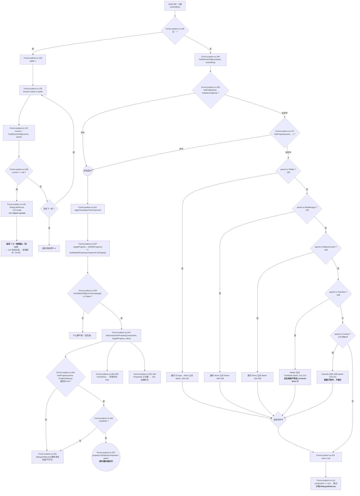

#### 6.2.4 `SetComponentProperty` 与两条"额外属性"通道

| 通道 | 触发键 | 写入目标 | 位置 |
|---|---|---|---|
| 主文案 | `Chinese` / `English`（当前语言那个） | `targetProperty`（`Property` 或默认属性） | `FormLocalizer.cs:244` → `:347` |
| 提示文本 | `ToolTipText` 子对象 | 控件的 **`"Hint"`** 属性（DevExpress 的 `BaseControl.Hint`） | `FormLocalizer.cs:250-258` |
| 批量属性 | `Properties` 子对象 | 该子对象里逐条列出的属性名 | `FormLocalizer.cs:261-264` → `:291` |

写入动作统一走 `SetComponentProperty`（`:338-359`）：`:343` `GetProperty` → `:344` `CanWrite` 检查 → `:347` `SetValue`；任何一步不满足都只写一句 `Debug.WriteLine`（`:351`）。**反射的属性名匹配默认区分大小写**（`:343` 未传 `IgnoreCase`）——这就是 `"Property": "tag"` 失效的原因（R-06）。

`FormLocalizer.cs:364-380` 还有一个 `ConvertValue`（值类型转换），由 `SetValue` 之前调用。

#### 6.2.5 坑

- 🔴 **层级路径失败返回中间容器**（`FormLocalizer.cs:145`）——不是"没生效"，是"改错了控件"（R-05，§9.1）。末段键名拼错时，**上一级容器的 `Text` 会被改成按钮的文字**。
- 🔴 **第 2 步反射 `GetProperty` 的范围过宽**（`FormLocalizer.cs:175`）：JSON 键若撞上某个公开属性名，改到的不是控件而是那个属性值。
- ⚠️ **`else if` 的互斥**（`FormLocalizer.cs:216`）：`TreeView` 与 `Control` 两条互斥，且 `Controls` **不递归**。
- ⚠️ **失败全静默**：`:140`、`:154`、`:351`、`:88` 全是 `Debug.WriteLine`，Release 下被编译掉（`AKRS.ZX2200.csproj:50` 无 `DEBUG`）。
- ✅ **入参守卫齐全**（`FormLocalizer.cs:164-165`）：`parent` 为 `null` 或 `name` 为空都直接 `return null`，不会抛。

### 6.3 目标默认属性的选择

#### 6.3.1 映射表全文（**23 条**，逐条）

`FormLocalizer.cs:22` 声明 `private static readonly Dictionary<Type, string> _defaultPropertyMap`，由静态构造函数（`:24-27`）调 `InitializeDefaultPropertyMap()`（`:32-60`）填充。

| # | Type | 目标属性 | 行号 |
|---|---|---|---|
| 1 | `Form` | `Text` | `:35` |
| 2 | `Button` | `Text` | `:36` |
| 3 | `Label` | `Text` | `:37` |
| 4 | `CheckBox` | `Text` | `:38` |
| 5 | `RadioButton` | `Text` | `:39` |
| 6 | `GroupBox` | `Text` | `:40` |
| 7 | `TabPage` | `Text` | `:41` |
| 8 | `DataGridViewTextBoxColumn` | `HeaderText` | `:42` |
| 9 | `DataGridViewCheckBoxColumn` | `HeaderText` | `:43` |
| 10 | `BarButtonItem` | `Caption` | `:46` |
| 11 | `BarStaticItem` | `Caption` | `:47` |
| 12 | `BarEditItem` | `Caption` | `:48` |
| 13 | `BarSubItem` | `Caption` | `:49` |
| 14 | `RibbonPage` | `Text` | `:50` |
| 15 | `RibbonPageGroup` | `Text` | `:51` |
| 16 | `SimpleButton` | `Text` | `:52` |
| 17 | `LabelControl` | `Text` | `:53` |
| 18 | `CheckEdit` | `Text` | `:54` |
| 19 | `RadioGroup` | `Text` | `:55` |
| 20 | `GroupControl` | `Text` | `:56` |
| 21 | `XtraTabPage` | `Text` | `:57` |
| 22 | `TileBarItem` | `Text` | `:58` |
| 23 | `GridColumn` | `Caption` | `:59` |

> **口径**：`grep -c '_defaultPropertyMap\[typeof' Localization/FormLocalizer.cs` = **23**（`:35`~`:43` 九条 WinForms + `:46`~`:59` 十四条 DevExpress）。

#### 6.3.2 查表逻辑（三段，`FormLocalizer.cs:313-333`）

```
:315-316  componentType == null            → return "Text"
:318      _defaultPropertyMap.TryGetValue(componentType) 精确命中 → 返回
:324-330  foreach (kvp in _defaultPropertyMap)
              kvp.Key.IsAssignableFrom(componentType) → 命中第一个就返回
:332      兜底 → return "Text"
```

**⚠️ 第 2 段（`:324-330`）的遍历顺序 = 字典的插入顺序**。第一条插入的是 `typeof(Form)`（`:35`），所以 `Form.IsAssignableFrom(...)` 会最先被检查——对任何 `Control` 子类它都是 `false`（`UserControl` 不继承 `Form`），不会误命中。真正靠 `IsAssignableFrom` 兜底的是这几对：

| 具体类型 | 靠哪条兜底 | 说明 |
|---|---|---|
| `SimpleButton`（→ `BaseButton`） | `Button`（`:36`） | `DevExpress.XtraEditors.SimpleButton` 不继承 `System.Windows.Forms.Button`，所以**实际不会命中 `:36`**，而由自己的 `:52` 精确命中 |
| `LabelControl` | `Label`（`:37`） | 同上，由 `:53` 精确命中 |
| `XtraForm` / `XtraUserControl` 的具体子类 | `Form`（`:35`） | `IsAssignableFrom` 对 `XtraForm` 子类为真 → 得到 `Text`（正确） |
| `XtraTabPage` 子类 | `XtraTabPage`（`:57`） | — |

#### 6.3.3 ⚠️ 覆盖不全：本项目大量使用的 DevExpress 类型不在表里

映射表里**没有**下列本项目大量使用的类型（只列与本篇范围相关的类别）：

`ComboBox`、`LookUpEdit`、`TextEdit`、`MemoEdit`、`NavBarControl`、`NavBarItem`、`BarCheckItem`、`TreeListColumn`、`AccordionControlElement`、`GalleryItem`、`Panel`、`XtraTabControl`、`SplitContainerControl`、`CheckedListBoxControl`、`SearchLookUpEdit`、`GridControl`、`DateEdit`、`SpinEdit`、`ToggleSwitch`、`MarqueeProgressBarControl` …

**这些控件出现在 JSON 里会怎样**：

1. `GetDefaultProperty` 走到 `:332` 的兜底 → 返回 `"Text"`；
2. `SetComponentProperty`（`:338-359`）反射找 `Text` 属性；
3. DevExpress 的 `TextEdit` / `LookUpEdit` 等**没有可写的 `Text` 属性**（或语义不等同于显示文本）→ `:343` 取到 `null` 或 `:344` `CanWrite` 为 `false`；
4. → 落进 `:349-352`，**只写一句 `Debug.WriteLine`**（`:351`），Release 下被编译掉 → **静默不改**。

**唯一的出路是显式写 `"Property"`**（`FormLocalizer.cs:237` 优先取它）。本工程 24 个键里只有 1 个写了 `"Property"`，而且**写的是小写的 `tag`**（`UcComponentHandling.json:67`），反射匹配 `Tag` 失败 → 仍然静默失效（R-06）。

#### 6.3.4 坑

- ⚠️ **兜底 `"Text"` 是"看起来合理但经常写不进去"的默认值**（`FormLocalizer.cs:332`）。它给后来人一种"所有控件都能翻"的错觉。
- ⚠️ **`IsAssignableFrom` 的遍历依赖字典插入顺序**（`:324-330`）：给映射表**追加**条目是安全的（新条目排在后面），但**调整 `InitializeDefaultPropertyMap` 里语句的顺序**会改变兜底结果。目前两者不冲突，属**隐性契约**。
- ⚠️ **`Panel` 不在表里**（`:32-60` 无 `Panel`）→ 退到 `"Text"`。这正是 R-05 里"容器 `Text` 被误改"能写成功的原因：`Panel` 恰好**有**可写的 `Text`。若 `Panel` 在表里、或兜底不是 `"Text"`，R-05 的表现会变成"静默不改"而不是"改错控件"。**两个缺陷叠加才产生了这个后果。**
- ✅ **映射表是 `static readonly` + 静态构造函数填充**（`:22`、`:24-27`）：线程安全的只读初始化，不会被运行期改写。

### 6.4 内存结构、默认值与线程安全

#### 6.4.1 `LocalizationCache` 的字段清单（含初值与可见性）

| 字段 | 声明 | 类型 | 初值 | 可见性 |
|---|---|---|---|---|
| `_instance` | `LocalizationCache.cs:16` | `Lazy<LocalizationCache>` | `new Lazy<...>(() => new LocalizationCache())` | `private static readonly` |
| `Instance` | `:17` | `LocalizationCache` | `=> _instance.Value` | `public static` 属性 |
| `_formCache` | `:19` | `Dictionary<string, JObject>` | `new`（`:31`） | **`public readonly`** ← 被 `FormLocalizer.cs:99-101`、`:387-388` 直接下标访问 |
| `_commonCache` | `:20` | `Dictionary<string, JObject>` | `new`（`:32`） | **`public readonly`** |
| `_messageCache` | `:21` | `Dictionary<string, JObject>` | `new`（`:33`） | **`public readonly`**（行内注释："用于报警、提示等信息的翻译缓存"） |
| `_loadedForms` | `:22` | `HashSet<string>` | `new`（`:34`） | `private readonly` |
| `_nonExistentForms` | `:23` | `HashSet<string>` | `new`（`:35`） | `private readonly` |
| `_loadedMessages` | `:24` | `HashSet<string>` | `new`（`:36`） | `private readonly`；**`ClearCache` 不清它** |
| `_nonExistentMessages` | `:25` | `HashSet<string>` | `new`（`:37`） | `private readonly`；**`ClearCache` 不清它** |
| `_translationBasePath` | `:27` | `string` | `GetTranslationBasePath()`（`:39`） | `private readonly`；**只算一次，永不刷新** |

**七个集合全部在私有构造函数里 `new`**（`:31-37`），所以**不存在 null 集合**——这是"懒加载"里少见的干净点。

#### 6.4.2 内存结构关系图

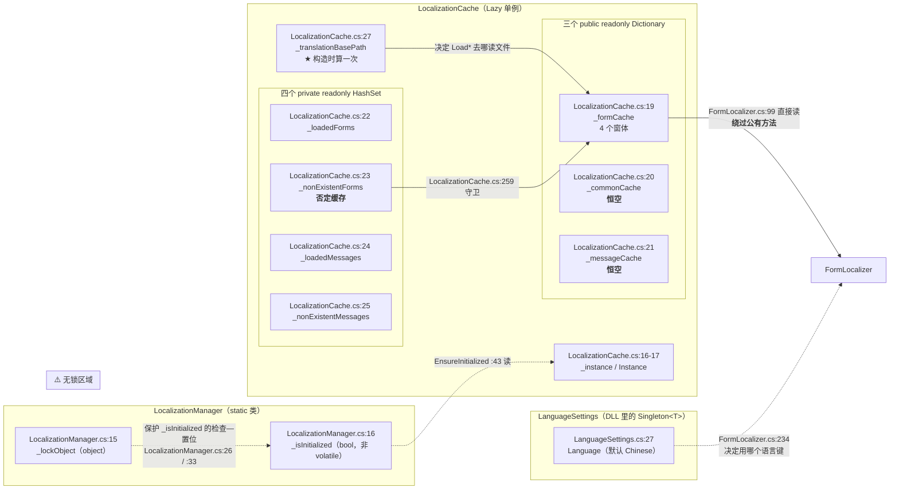

#### 6.4.3 并发事实（逐条，附证据）

| 事实 | 证据 |
|---|---|
| **三个 `Dictionary` 与四个 `HashSet` 全部无锁** | `LocalizationCache.cs:19-25` 都没有 `lock`；全类只有 `:16` 的 `Lazy<T>` 提供构造期线程安全 |
| `Lazy<T>` 保证**构造**只跑一次 | `LocalizationCache.cs:16`，默认 `LazyThreadSafetyMode.ExecutionAndPublication` |
| 唯一的锁保护的是**另一个类**的**另一件事** | `LocalizationManager.cs:15` 的 `_lockObject` 只保护 `:26`（`if (!_isInitialized)`）与 `:33`（`_isInitialized = true`）这对"检查—置位" |
| `_isInitialized` 是**普通 `bool`，不是 `volatile`** | `LocalizationManager.cs:16`；`EnsureInitialized`（`:41-47`）读它时**没有内存屏障** |
| `FormLocalizer` **绕过** `LocalizationManager` 的锁 | `FormLocalizer.cs:75` 直接调 `LocalizationCache.Instance.Initialize(...)`，不经过 `_lockObject` → 真实并发保护**形同虚设**（R 见 §9.6） |
| 本范围内**零 `Invoke` / `BeginInvoke` / `SynchronizationContext`** | `grep` 在 `Localization/*.cs`、`Properties/*.cs`、`Common.cs`、`Program.cs` 上 **0 命中** |
| 跨线程访问控件的"检测"由 Harmony 补丁做，且**只记日志** | `Program.cs:242-247` → `HookMarshalingControl.OnActionExecuting`（`:333-354`）；`:347-352` 的报警弹框被注释掉 |
| 实际调用点都在 UI 线程 | 窗体构造（各 `Uc*.cs` 构造函数）与 `LueLanguage_EditValueChanged`（`UcMainSystem.cs:1981`）都是 UI 线程 → **当前不触发** |

*（推断：`UcMainSystem.cs:1981` 与窗体构造都在 UI 线程，所以现状单线程使用不触发并发问题；风险来自将来在后台线程构造窗体 —— 那时 `LocalizationCache.cs:279` 的 `_formCache[formName] = ...` 可能破坏 `Dictionary` 内部结构。**当前未观察到实际故障**。）*

#### 6.4.4 坑

- ⚠️ **锁的"保护"是名义上的**：`LocalizationManager.cs:24-35` 的 `lock` 看起来保护了初始化，但真正的加载入口 `FormLocalizer.cs:75` **不走这条锁**。写文档时不能说"初始化是加锁的，所以安全"。
- ⚠️ **`_isInitialized` 非 `volatile`**（`LocalizationManager.cs:16`）：另一个线程可能读到旧值而重复初始化；`Lazy<T>` 兜住了构造，但**兜不住 `Initialize` 里的文件 I/O 重复执行**。
- ⚠️ **`_formCache` 是 `public` 字段**（`LocalizationCache.cs:19`）：缓存内部表示被外部强耦合（`FormLocalizer.cs:99-101` 绕过 `GetFormTranslation` 直接下标访问）。改成 `IReadOnlyDictionary` 或换结构会**直接编译失败**；外部也**没有任何机制**阻止直接写它（R-23，§9.6）。
- ✅ **`ChangeLanguage` 是幂等的**（`LocalizationManager.cs:55`）：新旧语言相同时整个 `if` 体不执行，**连 `Save()` 都不调**——不会因为误点下拉框而多写一次盘。

### 6.5 P/Invoke 与 `FindFormThread`

流程部分已在 §5.5 画过（图 4 的线程分支），本节只写**声明层面的细节**与**健壮性问题**——这些是"读代码看不出来、只有对着 Win32 API 对签名才能发现"的东西。

#### 6.5.1 两处 P/Invoke 的完整声明

```csharp
// Program.cs:303-309
:303  [DllImport("User32.dll", EntryPoint = "FindWindow")]
:304  private static extern IntPtr FindWindow(string lpClassName, string lpWindowName);
:306  [DllImport("User32.dll", EntryPoint = "PostMessage")]
:307  private static extern void PostMessage(IntPtr hwnd, int msg, int wParam, int lParam);
:308  private const int WM_CLOSE = 0x0010;
:309  private static int m_nWaitTime = 0;
```

| 项 | 声明里写的 | Win32 实际 | 影响 |
|---|---|---|---|
| `DllImport` 的 `CharSet` | **未写** → 取默认值 `CharSet.Ansi` | `FindWindow` 实际有 `FindWindowA`（ANSI）/`FindWindowW`（Unicode）两个导出 | 因为 `EntryPoint = "FindWindow"` + 默认 Ansi，**实际绑到 `FindWindowA`**。窗口标题 `"About DevExpress"` 全是 ASCII，**当前能工作**；换成含中文的标题就会因编码不匹配而找不到 |
| `PostMessage` 的返回值 | **`void`** | `BOOL`（`int`） | 返回值的封送被丢弃。调用方**无法判断投递是否成功**。`handle` 为 `IntPtr.Zero` 时等于向 0 号窗口投消息（无害，但语义错） |
| `SetLastError` | **未写** | — | 无法用 `Marshal.GetLastWin32Error()` 取失败原因，**出错时没有任何可诊断信息** |
| `lpClassName` 实参 | `null` | — | 只按窗口标题匹配。系统里任何标题恰好是 `"About DevExpress"` 的窗口都会被命中 |
| `msg` 形参类型 | `int` | `UINT` | 值域一致，无问题 |

#### 6.5.2 `FindFormThread` 的健壮性逐条

| # | 事实 | 位置 | 性质 |
|---|---|---|---|
| 1 | 线程体**没有 `try/catch`** | `Program.cs:311-321` | ⚠️ 该线程是后台线程，异常落到 `AppDomain.UnhandledException`（`:105`）→ `AppThreadException` 弹框，但**无法阻止进程终止** |
| 2 | `m_nWaitTime` 是**静态字段、从不重置** | `:309` | ⚠️ 本工程只创建一次该线程（`:127`），**暂不发作**；若二次调用，计数器已是 5001，循环一次都不进 |
| 3 | `m_nWaitTime` 装的是**轮询次数**而非时间 | `:309` vs `:316` | ⚠️ 配合 `Thread.Sleep(1)`，Windows 实际调度粒度约 15.6 ms → `<= 5000` 意味**最坏约 78 秒**，与名字暗示的"5 秒"不符 |
| 4 | `PostMessage` 在**循环外无条件调用** | `:320` | ⚠️ 超时后 `handle` 仍为 `IntPtr.Zero` 也照样投消息 |
| 5 | 轮询粒度 `Thread.Sleep(1)` | `:316` | ✅ 无害：本轮询不占用 CPU（睡眠而非自旋），最坏 78 秒也只花掉可忽略的 CPU |
| 6 | 线程名 `"自动关闭DEVExPress"` | `:129` | ✅ 便于调试器里辨认 |
| 7 | `IsBackground = true` | `:128` | ✅ 主窗体关闭时该线程不会阻止进程退出 |

**它的目标**：关闭第三方控件库弹出的展示窗口（窗口标题 `"About DevExpress"`）。这是本范围**唯一的跨进程通信**。

#### 6.5.3 坑

- ⚠️ **依赖窗口标题字面量**（`Program.cs:313`、`:317`）：第三方控件库若改了该窗口的标题或语言，轮询会白跑到超时（最坏约 78 秒），而**没有任何日志或提示**说明它失败了。
- ⚠️ **两处 P/Invoke 都没有 `SetLastError = true`**，加上 `PostMessage` 返回 `void`：这条链路上**任何一步失败都不可观测**。这与本模块整体的"静默失败"风格一致（§9 的多条风险同源）。
- ✅ **不影响主流程**：该线程与 `Application.Run`（`:259`）并行，即使一直找不到窗口，也只是空转 78 秒后结束——**不阻塞启动、不阻塞退出**。

### 6.6 编译期编织对"读源码下结论"的影响

本节只讲**方法论**：编译期改写会怎样让"读源码得出的结论"失效，以及在本仓库里哪些东西**根本无法从源码判定**。两套 AOP 各自的角色分工见 §4.5。

#### 6.6.1 三个 weaver/编织器的声明

| 机制 | 声明在哪 | 行号 | 谁在消费 |
|---|---|---|---|
| **Fody 宿主** | `packages.config` | `packages.config:3`（`Fody 6.6.4`，`developmentDependency="true"`） | 需要 `Fody.targets` 被 `Import` |
| `PropertyChanged` weaver | `FodyWeavers.xml:2` | — | 由 Fody 宿主读取 |
| `MethodBoundaryAspect` weaver | `FodyWeavers.xml:3` | — | 由 Fody 宿主读取 |
| **PostSharp** | `<Reference>` + `PackageReference` | `AKRS.ZX2200.csproj:144-146`（`libs\PostSharp.dll`）、`:4105`（`2.1.6.4`）、`:4108`（`PostSharp.Redist 2024.1.5`） | 需要 `PostSharp.targets` 被 `Import` |

**⚠️ `FodyWeavers.xml` 里没有 `<PostSharp />` weaver**——PostSharp 本来也不是 Fody weaver，它靠自己的 MSBuild target 工作。所以"两套 AOP 怎么共存"的答案不是"FodyWeavers.xml 里配了两个"，而是**两套完全独立的编译期管线**（§4.5 的图 5）。

#### 6.6.2 ⚠️ 本仓库快照里，编织到底有没有发生 —— **无法判定**

这是本节最该被后来人知道的一条。五项实测：

| # | 检查 | 命令 | 结果 |
|---|---|---|---|
| 1 | csproj 里 `Import` 了哪些 MSBuild 目标 | `grep -n '<Import' AKRS.ZX2200.csproj` | **只有 1 条**：`:4130` `<Import Project="$(MSBuildToolsPath)\Microsoft.CSharp.targets" />`。**没有 `Fody.targets`，也没有 `PostSharp.targets`** |
| 2 | `obj/` 里有没有 restore 产物 | `find obj -type f` | **3 个文件**，全是 VS 设计期缓存（`.NETFramework,Version=v4.8.AssemblyAttributes.cs`、`AKRS.ZX2200.csproj.AssemblyReference.cache`、`DesignTimeResolveAssemblyReferencesInput.cache`）。**没有 `project.assets.json`、没有 `*.nuget.g.props`、没有 `*.nuget.g.targets`** → 8 条 `PackageReference` 在本快照里**从未被还原** |
| 3 | 两个 weaver 包的 `.props` 提供了什么 | 读 `../packages/PropertyChanged.Fody.4.1.0/build/PropertyChanged.Fody.props`、`../packages/MethodBoundaryAspect.Fody.2.0.145/build/MethodBoundaryAspect.Fody.props` | 两者都**只**往 `<ItemGroup>` 里加 `<WeaverFiles Include="...">`。**`WeaverFiles` 这个 Item 类型只有 Fody 宿主认得**——没有 `Fody.targets` 时它是**惰性项**，什么也不会做 |
| 4 | Fody 宿主本身在磁盘上 | `ls ../packages/Fody.6.0.5/build/` | `Fody.targets` **存在**；但 `packages.config:3` 写的是 `6.6.4`，磁盘是 `6.0.5`（§8.7），且**没有任何 `Import` 指向它** |
| 5 | 工程级产物目录 | `find AKRS.ZX2200/bin -type f \| wc -l` | **0** → 工程级 `bin/` 确实为空 |
| 6 | **解决方案根下的产物目录** | `find trunk/bin -type f \| wc -l` / `du -sh trunk/bin/Debug` | 🔴 **2,685 个文件 / 930 MB**，含 `AKRS.ZX2200.exe`（**16,970,752 字节**）。**第 5 行的"空 `bin/`"只说明工程级输出目录没被用过，不代表本仓库没有产物**（详见 §6.6.6） |

**结论（必须原样写进任何基于本仓库的断言）：**

> **① 从源码与工程文件（前 4 行）出发**：**既不能证实也不能证伪** Fody / PostSharp 的编译期编织是否在本机发生 —— 唯一的 `<Import>` 是 `Microsoft.CSharp.targets`（`:4130`），`Fody.targets` 与 `PostSharp.targets` 都没被导入，两个 weaver 的 `.props` 只声明惰性的 `<WeaverFiles>`，`obj/` 里也没有 restore 产物。
>
> **② 但从 `trunk/bin/Debug/` 里的真实产物出发，可以给出一个确定结论**：**Fody 宿主确实编织过 `AKRS.ZX2200.exe`** —— 该程序的元数据里存在 **`FodyVersion`** 这个属性名（`grep -a -o 'FodyVersion' AKRS.ZX2200.exe` = **1**），**它是 Fody 宿主在编织时写进程序集的，源码里不存在**（§6.6.6）。
>
> 因此下面这三条**不能只看磁盘源码下结论**：
> - ❌ 不能说"`PropertyChanged` weaver **没有**给某些类注入 `INotifyPropertyChanged`"（反向也一样：**具体注入了哪些类，本副本仍无法逐类确认**）；
> - ❌ 也不能说"源码里没有 `try/catch`，所以这个方法没有异常处理"；
> - ❌ 更不能说"某个类没有实现 `INotifyPropertyChanged`，所以属性变更不会通知 UI"。
>
> ⚠️ **反向的过度断言同样要禁止**：从"Fody 跑过"**不能**推出"`LanguageSettings` 一定被注入了通知"——`PropertyChanged.Fody` 的作用范围由 `FodyWeavers.xml:2` 的 `<PropertyChanged />`（**没有任何参数**）与 weaver 的默认规则共同决定，而**本副本无法逐类验证**。

#### 6.6.3 会被编织影响的**常见判断**清单（本篇范围内）

| 常见判断 | 可能被哪种编织推翻 | 涉及位置 |
|---|---|---|
| "`LanguageSettings` 没有 `INotifyPropertyChanged`，也没有 `LanguageChanged` 事件，所以改语言不会自动通知"（R-24） | **`PropertyChanged` weaver**：`FodyWeavers.xml:2` 配了它，而 `PropertyChanged.Fody` 的默认行为是给**所有**类型注入通知（除非标 `[DoNotNotify]`）。`LanguageSettings.cs`（29 行）里**没有** `partial`、没有 `OnPropertyChanged`，但**编织是编译期加到程序集里的，磁盘源码看不出来** | `LanguageSettings.cs:17`；`LocalizationManager.cs:53-60` |
| "这个方法没有 `try/catch`，异常会冒到调用方" | **`MethodBoundaryAspect` weaver + `MethodAopAttribute` / `LogRecordMethodAttribute`**：`OnEntry`（`MethodAopAttribute.cs:28`、`LogRecordAttribute.cs:26`）就是"进入时执行"，`LogRecordAttribute` 还实现了 `IOnExceptionAspect`（`LogRecordAttribute.cs:20`）——**异常包装可能在 IL 里** | `Infrastructure/AOP/Module/MethodAopAttribute.cs:21`、`:28`；`Infrastructure/Models/CommonModels/LogRecordAttribute.cs:20`、`:26-35` |
| "这个方法会被写日志" | 同上：`LogRecordMethodAttribute.OnEntry` 里 `LogRecordDataHelper.InsertIntoTable(...)`（`LogRecordAttribute.cs:34`）——**只有被标注的方法才会写** | 同上 |
| "属性 A 的 setter 里没有触发任何逻辑" | **`PropertyAopAttribute`**：`Infrastructure/AOP/Module/PropertyAopAttribute.cs:18` `public class PropertyAopAttribute : OnMethodBoundaryAspect`，且 `:23` `public static bool IsPropertyAopEnable { get; set; } = false;`——**有一个全局开关，默认 `false`**，意味着即使编织了，属性 AOP 默认也是关闭的 | `PropertyAopAttribute.cs:18`、`:23` |
| "`MachineSoftwareConfiguration` 改了属性没人知道" | **`PropertyChanged` weaver**：该类确实 `using PropertyChanged;`（8 个文件之一），且显式声明了 `PropertyChanged` 事件（`MachineSoftwareConfiguration.cs:174`）与 `OnPropertyChanged`（`:182-185`） | `MachineSoftwareConfiguration.cs:174`、`:182-185` |

**`PropertyChanged.Fody` 的落点（实测）**：`grep -rl '^using PropertyChanged;' --include=*.cs .` → **8 个文件**：

```
BondSystem/BondForce/Models/DevicePara/ForceConfig.cs
BondSystem/Models/DeviceParams/NozzleShelfParam.cs
BondSystem/Models/DeviceParams/S2DispenseDevicePara.cs
BondSystem/Models/Parameter/System2Configuration.cs
BondSystem/Models/Programs/SlideFluxerProgram.cs
Main/Machine/MachineSupport/MachineHardwareConfiguration.cs
Main/Machine/MachineSupport/MachineSoftwareConfiguration.cs
TransportUnitSystem/Module/Matter/BaseMatter.cs
```

**本范围（`Localization/`、`Properties/`、`Common.cs`、`Program.cs`）里没有任何一个文件 `using PropertyChanged;`**——所以"编织会不会影响本范围的类"这个问题，只对 `LanguageSettings` 有意义（它是否被注入取决于 weaver 是否运行、以及 `PropertyChanged.Fody` 的默认作用范围）。

#### 6.6.4 由此得出的写作纪律（本篇与全工程文档都必须遵守）

1. **凡"没有 try/catch""没有事件""没有实现某接口"这类断言，必须限定为"磁盘源码里没有"**，不能直接推到运行时行为。
2. **凡涉及 `LanguageSettings` / `Singleton<T>` 的序列化与通知行为**，结论必须标 *推断*（基类在 DLL 里，且编织结果不可见）。
3. **想确认编织结果，有两条路**：① **查 `trunk/bin/Debug/AKRS.ZX2200.exe` 的元数据**——本副本已经能做，答案是"Fody 编织过"（§6.6.6）；② 用反编译器逐类看 IL——**本副本做不到**（没有反编译工具，且 `bin/` 里没有可再生对比的第二次构建产物）。**"编织过"与"某个具体类被注入了什么"是两个不同粒度的问题，前者已确定，后者仍未定**（附录 B）。

#### 6.6.5 坑

- 🔴 **`FodyWeavers.xml` 的存在 ≠ 编织发生**：本快照里 `Fody.targets` 没有任何 `Import`，`obj/` 里也没有 restore 产物。后来人若只看到 `FodyWeavers.xml` 就断言"属性通知是自动的"，属于**未经验证的推断**。
- ⚠️ **两个 weaver 包的 `.props` 只声明 `<WeaverFiles>`**，没有 Fody 宿主时**完全惰性**——这解释了为什么"文件都在、却可能什么也没织"。
- ⚠️ **`PropertyAopAttribute.IsPropertyAopEnable` 默认 `false`**（`Infrastructure/AOP/Module/PropertyAopAttribute.cs:23`）：属性级 AOP 是**关着的**，别把它当成生效的逻辑。
- ✅ **本篇范围内的 4 个 `Localization/*.cs` 全都不在编织目标上**：没有 `using PropertyChanged;`、没有 `[MethodAop]`、没有 `[LogRecord]`。所以 §5、§6 里对这四个文件的调用链结论**不依赖编织假设**。

#### 6.6.6 🔴 产物实证：`trunk/bin/Debug/` 推翻了两条曾经的"无法判定"

工程级目录 `AKRS.ZX2200/bin/` 是空的（`find bin -type f` = **0**），但**解决方案根下的 `trunk/bin/Debug/` 里有一份完整的真实产物**：

```bash
cd "E:/项目/ZX2200标机/trunk"
find bin -type f | wc -l      # 2685
du -sh bin/Debug              # 930M
ls -la bin/Debug/AKRS.ZX2200.exe bin/Debug/AKRS.ZX2200.pdb bin/Debug/AKRS.ZX2200.exe.Config
# -rwxr-xr-x 16970752 Aug 24 09:05 AKRS.ZX2200.exe
# -rw-r--r--  9647616 Aug 24 09:05 AKRS.ZX2200.pdb
# -rw-r--r--     3952 Aug 24 09:05 AKRS.ZX2200.exe.Config
```

**产物目录的一级子目录（实测）**：`AlgFlowTemplates/`（27 项）、`UiMapFile/`（1 项）、`Settings/`（运行期数据：`MachineConfig.json` 160 B、`RecipeList.json` 2,028 B、`ZX2200Data.db` 65,536 B、`ControlConfigs/`/`DeviceParams/`/`HardwareBaks/`/`Hardwares/`/`RecipeParams/` 5 个子目录）、`log/`、`Logs/`、`PatternRepository/`、`runtimes/`、`x64/`、`x86/`，以及 `cs`/`de`/`es`/`ja`/`ru`（**DevExpress 的卫星资源程序集**，如 `ja/DevExpress.Data.v21.2.resources.dll` —— **与本工程的多语言改造无关，不要误认**）。

**由这份产物得到的三条确定结论**：

| # | 结论 | 命令 | 结果 |
|---|---|---|---|
| 1 | **Fody 确实编织过** —— `FodyVersion` 属性名存在于 `AKRS.ZX2200.exe` 的元数据中，而该属性**只由 Fody 宿主在编织时写入**（源码里没有） | `grep -a -o 'FodyVersion' bin/Debug/AKRS.ZX2200.exe \| wc -l` | **1** |
| 2 | **两套 AOP 栈的运行期依赖都被部署了** —— `MethodBoundaryAspect.dll`（9,216 B）与 `PostSharp.dll`（252,504 B）都在产物目录里；**没有 `FodyWeavers.xml`**（它是构建期输入，本就不该被复制） | `ls bin/Debug \| grep -i 'fody\|postsharp\|methodboundary\|propertychanged'` | `MethodBoundaryAspect.dll`、`PostSharp.dll` |
| 3 | 🔴 **翻译 JSON 确实没有被部署** —— 产物目录下**根本没有 `Localization/` 目录** | `find bin/Debug -iname '*localiz*' \| wc -l` | **0** |

**第 3 条是 R-31（§9.4）的现场级证据**：R-31 原本只能从"4 个 JSON 不在 `.csproj` 的 `<Compile>` / `<Content>` / `<None>` 里、`CopyToOutputDirectory` 0 条"推出"它们不会被复制到输出目录"。**现在有了实物**：一份 2,685 个文件的真实产物里，`Localization\Data` **不存在**。⇒ **装机现场那 4 个窗体的翻译必然全部失效，这不是推断。**

**同时也印证了 §8.5 的一条**：产物目录里**没有任何 `.png` / `.bmp` / `.svg` 文件**（0 个）—— 图片确实已经内嵌进 `AKRS.ZX2200.exe`（16.97 MB，与 111 个内嵌资源相称）。

**本副本仍然无法确定的三件事（保持 *推断*）**：

1. **具体是哪个 Fody 版本织入的** —— 产物里 `6.0.5.0` 出现 3 次、`6.6.4.0` 出现 6 次（`grep -a -o` 于去除 NUL 字节后的副本），**两者都可能来自两个 weaver 程序集自身的依赖记录**，无法据此断定宿主版本（R-26 的结论不变）。
2. **`PropertyChanged` weaver 到底给哪些类注入了什么** —— 元数据里 `PropertyChangedEventHandler` 出现 1 次、`OnPropertyChanged` 2 次，但 `AKRS.ZX2200.exe` 这一个程序集包含了全工程 1,131 个 `.cs`，**无法据此定位到具体类型**（要定位必须反编译）。
3. **`MethodBoundaryAspect` weaver 的注入结果** —— 同理。元数据里 `MethodBoundaryAspect.Fody` 出现 1 次、`MethodExecutionArgs` 1 次、`OnMethodBoundaryAspect` 2 次；这些名串**在"aspect 类被编译进来"和"aspect 被织入方法"两种情况下都会出现**，**不能单独作为"织入发生了"的证据**（能证明"Fody 跑过"的只有第 1 条的 `FodyVersion`）。

> ⚠️ **一条必须记住的边界**：`trunk/bin/Debug/` 是一份**别人构建好之后放进仓库的产物快照**（时间戳集中在一个时刻，且带一份崩溃转储 `AKRS.ZX2200.exe-20251009-132139-0461.dmp`）。它能证明"**这一份 exe 是 Fody 织出来的**"，**不能**证明"**你现在从这份源码重新构建一次也会得到同样结果**" —— 后者取决于本机还原的是哪个 Fody 版本（R-26）。**两者不要混为一谈。**

---

## 7. 依赖关系

### 7.1 依赖规模（实测数字与口径）与三套引用体系（图 10）

#### 7.1.1 统计口径（命令原样）

```bash
cd "E:/项目/ZX2200标机/trunk/AKRS.ZX2200"
grep -o '<Reference Include="[^"]*"' AKRS.ZX2200.csproj | sort -u | wc -l      # 134
awk '/<Reference Include=/{n++} /<HintPath>/{h++} END{print n, h}' AKRS.ZX2200.csproj   # 134 68
grep -o '<HintPath>[^<]*' AKRS.ZX2200.csproj | sed 's/<HintPath>//' | grep '^libs' | sort -u | wc -l   # 63
grep -n '<ProjectReference Include' AKRS.ZX2200.csproj                        # 10 条
grep -n '<PackageReference Include' AKRS.ZX2200.csproj                        # 8 条
ls -1 libs/ | wc -l                                                          # 171
ls -1 libs/HikVision/ | wc -l                                                # 188
```

#### 7.1.2 三套互不相交的引用体系（图 10）

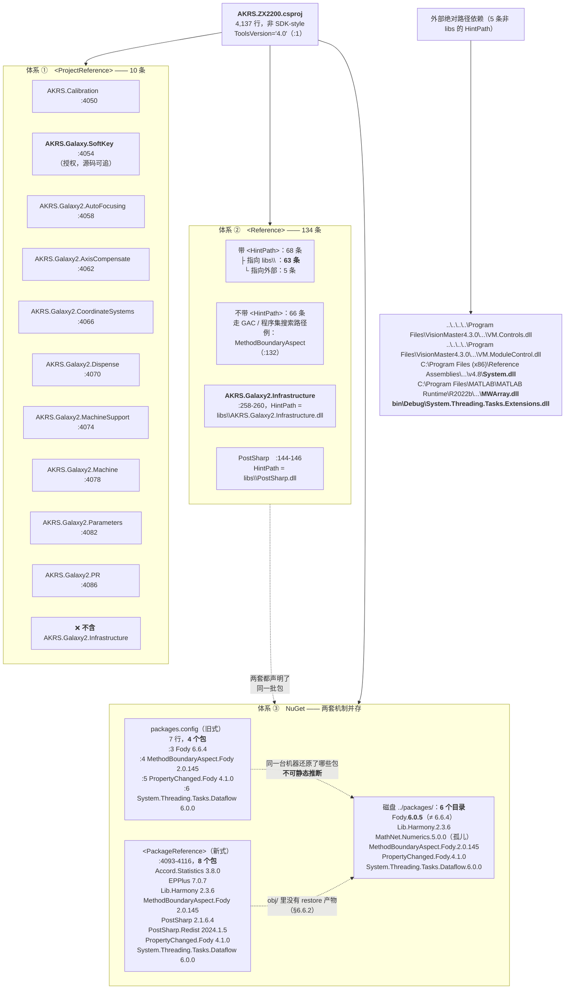

**ASCII 版**

```
 AKRS.ZX2200.csproj（4,137 行，ToolsVersion="4.0"，非 SDK-style）
   │
   ├─① <ProjectReference>：<b>10 条</b>
   │     AKRS.Calibration                :4050
   │     AKRS.Galaxy.SoftKey              :4054   ← 授权，源码可追
   │     AKRS.Galaxy2.AutoFocusing        :4058
   │     AKRS.Galaxy2.AxisCompensate      :4062
   │     AKRS.Galaxy2.CoordinateSystems   :4066
   │     AKRS.Galaxy2.Dispense            :4070
   │     AKRS.Galaxy2.MachineSupport      :4074
   │     AKRS.Galaxy2.Machine             :4078
   │     AKRS.Galaxy2.Parameters          :4082
   │     AKRS.Galaxy2.PR                  :4086
   │     ❌ 不含 AKRS.Galaxy2.Infrastructure
   │
   ├─② <Reference>：<b>134 条</b>（= 唯一数，无重复）
   │     ├ 带 <HintPath> 68 条
   │     │    ├ 指向 libs\        63 条
   │     │    └ 指向外部          5 条
   │     │         ├ VisionMaster4.3.0 安装目录 ×2（相对路径）
   │     │         ├ .NET 4.8 参考程序集 System.dll（C:\Program Files (x86)\...）
   │     │         ├ MATLAB Runtime R2022b MWArray.dll
   │     │         └ bin\Debug\System.Threading.Tasks.Extensions.dll  ← 指向自己的输出目录
   │     └ 不带 <HintPath> 66 条 → GAC / 程序集搜索路径
   │          例：MethodBoundaryAspect（:132）
   │     ★ AKRS.Galaxy2.Infrastructure :258-260
   │         <Reference Include="AKRS.Galaxy2.Infrastructure, Version=1.0.0.0,
   │                    Culture=neutral, processorArchitecture=AMD64">
   │           <SpecificVersion>False</SpecificVersion>
   │           <HintPath>libs\AKRS.Galaxy2.Infrastructure.dll</HintPath>
   │       ⇒ <b>它是直接引用，不是传递带入</b>（见 §7.1.4）
   │     ★ PostSharp :144-146 → libs\PostSharp.dll
   │
   └─③ NuGet：<b>两套机制并存</b>
         packages.config（旧式，7 行，4 个包）     <PackageReference>（新式，:4093-4116，8 个包）
           :3 Fody              6.6.4              Accord.Statistics            3.8.0
           :4 MethodBoundary... 2.0.145            EPPlus                       7.0.7
           :5 PropertyChanged.. 4.1.0              Lib.Harmony                  2.3.6
           :6 Dataflow          6.0.0              MethodBoundaryAspect.Fody    2.0.145
                                                   PostSharp                    2.1.6.4
         磁盘 ../packages/：6 个目录                PostSharp.Redist             2024.1.5
           Fody.<b>6.0.5</b>  ← 与 6.6.4 不符          PropertyChanged.Fody         4.1.0
           Lib.Harmony.2.3.6                       System.Threading.Tasks.Dataflow  6.0.0
           MathNet.Numerics.5.0.0  ← 孤儿
           MethodBoundaryAspect.Fody.2.0.145
           PropertyChanged.Fody.4.1.0
           System.Threading.Tasks.Dataflow.6.0.0
```

#### 7.1.3 三套体系的边界（**互不相交**，这是最容易搞错的地方）

| 说法 | 对不对 | 说明 |
|---|---|---|
| "134 条 `<Reference>` 里有 NuGet 包" | ❌ **错** | `packages.config` 的 4 个包（`Fody`、两个 `*Fody`、`Dataflow`）**没有一个**出现在 134 条 `<Reference>` 里；`Fody`/`*Fody` 是 `developmentDependency`，不产生运行时引用 |
| "`ProjectReference` 的工程会出现在 `<Reference>` 里" | ❌ **错** | 两套完全独立；同一个程序集**不可能**同时出现在两处 |
| "`AKRS.Galaxy2.Infrastructure` 是传递带入的" | ❌ **错** | 见 §7.1.4 |
| "NuGet 包都还原到 `libs/`" | ❌ **错** | NuGet 还原到 `../packages/`；`libs/` 是**手工维护**的第三方二进制目录 |
| "两套 NuGet 机制等效" | ❌ **错** | 见 §8.7 的四组版本矛盾 |

#### 7.1.4 ⚠️ 对「`AKRS.Galaxy2.Infrastructure` 没有源码」的正确解释

这是一个**必须纠正的常见误判**。`AKRS.Galaxy2.Infrastructure` 是 `Singleton<T>`（`LanguageSettings.cs:17` 的基类）与 `CommonEnum.LanguageEnum` 的宿主。关于它，只成立这两条：

| 成立的说法 | 证据 |
|---|---|
| 它**不在** 10 条 `ProjectReference` 里 | `AKRS.ZX2200.csproj:4050`~`:4086`，逐条见 §7.1.2 |
| `trunk/` 下**没有**它的工程目录 | `ls trunk/` 中与 `AKRS.Galaxy2.*` 同级的目录里没有 `AKRS.Galaxy2.Infrastructure` |

| ⚠️ **不成立**的说法 | 反证 |
|---|---|
| "它既不在 `ProjectReference` 也不在 `<Reference>` 里，是被传递带入的" | **它是直接引用**：`AKRS.ZX2200.csproj:258-260` —— `<Reference Include="AKRS.Galaxy2.Infrastructure, Version=1.0.0.0, Culture=neutral, processorArchitecture=AMD64">` + `<HintPath>libs\AKRS.Galaxy2.Infrastructure.dll</HintPath>`。`grep -c` 该名字在 `<Reference Include>` 中命中 **1 次** |

**"没有源码"的真正原因只有一个**：它是一个**二进制 DLL**，放在 `trunk/AKRS.ZX2200/libs/` 下（同目录另有 `.pdb` 与 `.dll.config`），工程用 `<Reference>` + `<HintPath>` 直接引用它——**仓库里本来就没有它的 `.cs`**，与"是否传递带入"无关。

**旁证**：`obj/Debug/AKRS.ZX2200.csproj.AssemblyReference.cache`（设计期程序集解析缓存，162 KB）里 `AKRS.Galaxy2.Infrastructure` 出现 **13 次**——说明 VS 的设计期解析**确实解析到了它**，方式就是 `libs\` 里的那个 DLL。

#### 7.1.5 坑

- 🔴 **`HintPath` 里有 3 条**机器级绝对路径（`C:\Program Files (x86)\...\v4.8\System.dll`、`C:\Program Files\MATLAB\...\MWArray.dll`、相对形式的 VisionMaster 安装目录 ×2）**和 1 条指向自己输出目录的路径**（`bin\Debug\System.Threading.Tasks.Extensions.dll`）。换一台没装 VisionMaster / MATLAB Runtime 的机器，**编译直接失败**；而 `bin\Debug\...` 那条在**首次编译时必然找不到**（输出目录还没生成）。
- ⚠️ **66 条不带 `<HintPath>`**：它们走 GAC 或程序集搜索路径。同一份源码在不同装了不同版本 GAC 程序集的机器上，**可能解析到不同版本**——这是"在我机器上能编译"类问题的来源。
- ⚠️ **`libs/` 是手工维护的**（171 个条目 / 256 MB，另有 `libs/HikVision/` 188 个条目）——没有 `packages.config` 那样的清单，**无法从任何文件判断哪个 DLL 是哪个版本该有的**。
- 🔴 **10 条 `ProjectReference` 里有 1 条是悬空的**：`AKRS.ZX2200.csproj:4082` 指向 `..\AKRS.Galaxy2.Parameters\AKRS.Galaxy2.Parameters.csproj`，而 `AKRS.Galaxy2.Parameters` **在 `trunk/` 下既没有工程目录、也没有对应的 DLL**（`find trunk -name 'AKRS.Galaxy2.Parameters*'` 无命中；`libs/` 里也没有 `AKRS.Galaxy2.Parameters.dll`），`AKRS.ZX2200.sln` 的 17 个工程里**也没有它**。其余 9 条路径都存在。详见 R-32（§9.5）。
- ✅ **其余 9 条 `ProjectReference` 路径真实存在**（例如 `:4054` 的 `..\AKRS.Galaxy.SoftKey\AKRS.Galaxy.SoftKey\AKRS.Galaxy.SoftKey.csproj`）——**授权不是黑盒 DLL，是同一解决方案里的工程**，其调用点可在源码层追溯。
- ✅ **`libs/` 里有 40+ 个 `AKRS.*` 二进制**（`AKRS.Base.dll`、`AKRS.Galaxy2.Infrastructure.dll`、`AKRS.Galaxy2.LogicHardware.dll`、`AKRS.Galaxy2.SoftKey.dll`、`AKRS.WM.*` 等）——这些是**同源工程的编译产物被手工放进 `libs/`**，所以"有 DLL 没源码"在本仓库是常态。

### 7.2 本范围 → 外部（按用途分组）

本范围只有 8 个参与编译的源文件，但 `Program.cs`（356 行）一个人就把依赖面拉得很宽。按用途分四组。

#### 7.2.1 组 A：`Localization/` 四个文件的外部依赖（共 12 处）

| 使用方 | 被依赖 | 证据 | 用途 |
|---|---|---|---|
| `LanguageSettings.cs` | `AKRS.Galaxy2.Infrastructure.CommonModel.Singleton<T>` | `:14` `using AKRS.Galaxy2.Infrastructure.CommonModel;`；`:17` 基类 | **本模块唯一的外部基类** |
| `LanguageSettings.cs` | `System.Windows.Forms.Application.StartupPath` | `:10`、`:24` | 拼 `language_settings.json` 的路径 |
| `LocalizationManager.cs` | `AKRS.Galaxy2.Infrastructure.Helper`（`GetDescription()` 扩展） | `:11`；`:31` `Language.GetDescription()` | 日志里打印语言的中文描述 |
| `LocalizationManager.cs` | `System.ComponentModel.DescriptionAttribute` | `:9`；`:160`、`:163` `[Description("中文")]` | `LanguageEnum` 成员的中文名 |
| `LocalizationCache.cs` | `Newtonsoft.Json` / `Newtonsoft.Json.Linq` | `:2`、`:3`；`:277` `JObject.Parse` | 翻译 JSON 解析 |
| `LocalizationCache.cs` | `System.Windows.Forms.Application.StartupPath` | `:10`、`:220`、`:232` | 路径解析（§5.3） |
| `FormLocalizer.cs` | `DevExpress.XtraBars` + `XtraBars.Navigation` | `:8`、`:9`；`:182-206` | `TileBar` / `TileBarGroup` / `TileBarItem` / `BarManager` / `BarItem` |
| `FormLocalizer.cs` | `DevExpress.XtraBars.Ribbon` | `:11`；`:50-51`、`:200-206` | `RibbonControl` / `RibbonPage` / `RibbonPageGroup` |
| `FormLocalizer.cs` | `DevExpress.XtraEditors` | `:10`；`:52-56` | `SimpleButton` / `LabelControl` / `CheckEdit` / `RadioGroup` / `GroupControl` |
| `FormLocalizer.cs` | `DevExpress.XtraTab` | `:12`；`:57` | `XtraTabPage` |
| `FormLocalizer.cs` | `DevExpress.XtraTreeList` / `.Nodes` | `:14`、`:15`；`:209-215` | `TreeView` 分支的 `TreeNode` |
| `FormLocalizer.cs` | `DevExpress.XtraGrid.Columns` | `:16`；`:59` | `GridColumn` |
| `FormLocalizer.cs` | `Newtonsoft.Json.Linq` | `:13` | `JObject` / `JToken` / `JValue` |
| `FormLocalizer.cs` | `System.Reflection` | `:7`；`:169`、`:175`、`:343` | 控件定位与属性写入 |

#### 7.2.2 组 B：`Program.cs` 的依赖（按用途）

| 用途 | 被依赖 | 证据 |
|---|---|---|
| **授权（`ProjectReference`）** | `AKRS.Galaxy.SoftKey` | `:12`；`csproj:4054` |
| 硬件 / 运动控制 | `AKRS.Galaxy2.LogicHardware.Hardwares.MotionControllers`、`AKRS.Galaxy2.LogicHardware.Repository`、`AKRS.Galaxy2.HardwareEditor` | `:1`、`:2`、`:15`；`:180`、`:190`、`:193`、`:199`、`:225` |
| 运动轴驱动（固高） | `AKRS.Galaxy2.Drive.MotionControllerDrive.MotionModule.GT`（`GTAxis`） | `:14`；`:200`、`:205`、`:207` |
| 报警 | `AKRS.Galaxy2.LogicHardware.HardWares.Alarmers` | `:17`；`:188` |
| 状态与模式 | `AKRS.Galaxy2.Machine.Enums`（`MachineWorkModeEnum`）、`AKRS.Galaxy2.Machine.Models`（`MachineStateModel`） | `:18`、`:19`；`:173` |
| 消息框 | `AKRS.Galaxy2.Component.Simple.MessageBox`（`AKRSXtraMessageBox`）、`AKRS.ZX2200.Infrastructure.Controls.Currency`（`AKRSMessageBoxExt`） | `:13`、`:21`；`:157`、`:233`、`:286`、`:297` |
| 日志 | `AKRS.Galaxy2.Log`（`LogHelper`、`LogsManager`、`LogCategory`）、`log4net.Core.Level` | `:16`、`:28`；`:133`、`:231`、`:342` |
| 启动画面与外观 | `DevExpress.LookAndFeel`、`DevExpress.XtraEditors`、`DevExpress.XtraSplashScreen` | `:4`、`:25`、`:26`；`:80`、`:85`、`:88`、`:95`、`:179`、`:185` |
| 运行时补丁 | `HarmonyLib`（NuGet `Lib.Harmony` 2.3.6） | `:27`；`:242` |
| 数据采集 | `DataAnalysis.Acquisition`（`DataLogManager`） | `:3`；`:125` |
| 业务模型（只用于启动期订阅与配置） | `AKRS.ZX2200.BondSystem.BondForce.Models.DevicePara`（`ForceConfig`）、`AKRS.ZX2200.BondSystem.Modules`、`AKRS.ZX2200.BondSystem.Models` | `:20`、`:33`、`:36`；`:201`、`:207` |
| 主窗体与画面 | `AKRS.ZX2200.Main.Controls`（`MainForm`）、`AKRS.ZX2200.Main.Machine.MachineSupport`（`Machine`）、`AKRS.ZX2200.Main.VisionControl` | `:22`、`:23`、`:24`；`:110`、`:116`、`:171`、`:177`、`:258` |
| PR 实体（委托订阅） | `AKRS.Galaxy2.PR.Models.Entities`（`PREntity`） | `:34`；`:250-251` |
| 视觉服务 | `AKRS.ZX2200.Infrastructure.Service`（`VisionService`） | `:35`；`:251` |
| P/Invoke | `System.Runtime.InteropServices` | `:30`；`:303-307` |

#### 7.2.3 组 C：未使用的 `using`（copy-paste 残留，逐个核实过）

| 文件 | 行号 | 内容 | 核实 |
|---|---|---|---|
| `Common.cs` | `:1-5` | `System` / `Collections.Generic` / `Linq` / `Text` / `Threading.Tasks` | 40 行里**一个都没用到**，是"从未编译"的旁证（§9.1 的 R-01） |
| `LanguageSettings.cs` | `:1` | `AKRS.ZX2200.Infrastructure.Models.Path` | 未使用 |
| `LanguageSettings.cs` | `:2` | **`AKRS.ZX2200.WaferSubSystem.Models.DeviceParams`** | 未使用。**一个语言设置类 `using` 了 `WaferSubSystem` 的模型，是明显的模板残留** |
| `LanguageSettings.cs` | `:3` | `Newtonsoft.Json` | 未使用（本类不直接序列化，序列化在 DLL 基类里） |
| `LanguageSettings.cs` | `:4-9` | `System` / `Collections.Generic` / `IO` / `Linq` / `Text` / `Threading.Tasks` | 全部未使用；真正需要的只有 `:10`（`System.Windows.Forms`，用于 `:24`）与 `:14` |
| `LocalizationCache.cs` | `:1` | **`AKRS.Galaxy2.PR.Controls`** | 未使用（本文件不碰任何 PR 控件） |
| `LocalizationCache.cs` | `:4-9` | `System`（用到了 `Lazy<T>`/`Exception`）之外的 `Collections.Generic` / `IO` / `Linq` / `Text` / `Threading.Tasks` | 实际只用到 `Newtonsoft.Json`、`Newtonsoft.Json.Linq`、`System.Windows.Forms`、`System` |
| `LocalizationManager.cs` | `:1-5` | `System` / `Collections.Generic` / `Linq` / `Text` / `Threading.Tasks` | 全部未使用 |
| `FormLocalizer.cs` | `:2-5` | `Collections.Generic` / `Linq` / `Text` / `Threading.Tasks` | 未使用（`System` 用了，见 `:1`） |
| **`Program.cs`** | **`:32`** | **`Accord.Statistics.Kernels`** | **全文再无 `Accord` 出现（`grep -n 'Accord' Program.cs` 只有 `:32` 这一行）**。对照：仓库里其它文件用的是 `Accord.IO` / `Accord.Math` |

> **这些"未使用的 using"不是无害的噪声**：它们会让 `grep <命名空间>` 之类的排查出现**假阳性**——例如在 `LocalizationCache.cs:1` 命中 `AKRS.Galaxy2.PR.Controls`，会让人误以为本地化模块依赖 PR 模块。

#### 7.2.4 坑

- ⚠️ **`FormLocalizer` 对 DevExpress 的 `using` 有 7 条**（`:8`~`:16`）：这就是它能处理 `TileBar` / `BarManager` / `RibbonControl` / `TreeList` / `GridColumn` 的原因，也是**它的编译面被 DevExpress 版本绑死**的原因（换 DevExpress 大版本可能编译失败）。
- ⚠️ **`Program.cs` 的 `using` 有 20+ 条、跨 9 个业务命名空间**：一个"启动入口"文件直接依赖 `BondSystem` 的 `ForceConfig` 与 `Modules`，**分层上是破的**——这也是它 `:175-239` 那段硬件初始化能写 60 行的原因。
- ✅ **没有循环依赖**：`Localization/` 的四个文件**只被外部调用，自己不引用任何 `AKRS.ZX2200.*` 业务模块**（唯一例外是 `LanguageSettings.cs:1`/`:2` 两条**未使用**的 using）。

### 7.3 外部 → 本范围（入口清单）

#### 7.3.1 统计命令与结果

```bash
cd "E:/项目/ZX2200标机/trunk/AKRS.ZX2200"
grep -rl "Localization\|FormLocalizer\|LocalizationManager\|LanguageSettings" --include=*.cs . | wc -l
# → 9（含 Localization/ 自身的 4 个）
```

9 个命中文件里，**只有 4 个是真实使用**：

| 文件 | 命中内容 | 真实使用？ | 用法 |
|---|---|---|---|
| `BondSystem/Controls/Manual/UcVacuum.cs` | `:20` `ILanguage`、`:35` `FormLocalizer.LocalizeForm(this)`、`:340-351` `GetUI()` | ✅ | 构造函数里就地本地化 |
| `WaferSubSystem/Controls/Manual/UcComponentHandling.cs` | `:43` `ILanguage`、`:84` `FormLocalizer.LocalizeForm(this)`、`:804-815` `GetUI()` | ✅ | 同上 |
| `Experiment/Test/FrmBaseTest.cs` | `:33` using、`:115` `FormLocalizer.LocalizeForm(this)` | ✅ | 同上（**没有实现 `ILanguage`**） |
| `Main/Controls/Ucmain/MainControls/UcMainSystem.cs` | `:135` `using LanguageEnum = Localization.LanguageEnum;`、`:194-197` 下拉框绑定、`:1981-1992` 切语言处理器 | ✅ | **唯一的"平台入口"** |
| `Main/Controls/UcShortcutMenu.cs` | `:49` `using AKRS.ZX2200.Localization;` | ❌ | **只 using 不使用**——全文件再无 `Localization` 前缀标识符 |
| `Localization/` 内部 4 个 | — | — | — |

**结论：本模块的入向依赖只有 4 个真实调用点。**

#### 7.3.2 入向调用链图

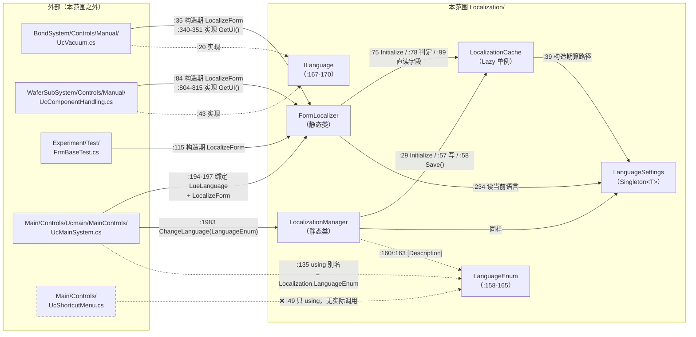

#### 7.3.3 覆盖率：**4 / 325**

| 指标 | 实测 | 命令 |
|---|---:|---|
| 全工程唯一 `partial class`（含 Designer） | **325** | `grep -rhoE "partial class [A-Za-z0-9_]+" --include=*.Designer.cs . \| sort -u \| wc -l` |
| `.Designer.cs` 文件数 | **331** | — |
| 调 `FormLocalizer.LocalizeForm` 的位置 | **4** | `grep -rn "FormLocalizer.LocalizeForm" --include=*.cs .` |
| `Localization/Data/Forms/` 下的 JSON | **4** | `ls` |

即：**多语言系统只覆盖了 4 个窗体/用户控件**（`UcMainSystem`、`UcVacuum`、`UcComponentHandling`、`FrmBaseTest`），而语言下拉框 `LueLanguage`（`UcMainSystem.designer.cs:3182`）**没有权限校验、没有可见性开关**——任何操作员都能改（§4.3）。

**没有本地化接线的典型代表**：`MainForm`（`grep -rn "Localiz\|Language" Main/Controls/MainForm.cs` → **0 命中**；`MainForm.designer.cs` → **0 命中**）。它**不会被排除在切语言循环之外**（`UcMainSystem.cs:1984` 遍历 `Application.OpenForms` 包含它），只是走到 `FormLocalizer.cs:78` 的 `HasFormTranslation("MainForm")` 返回 `false` 才跳过——而 `:75` **已经白白读了一次不存在的文件**，并把它写进 `_nonExistentForms`（`LocalizationCache.cs:286`）。这就是 R-21。

#### 7.3.4 坑

- 🔴 **`MainForm` 完全没有本地化接线**，却在每次切语言时被遍历到（R-21，§9.5）。主窗体**永远保持中文**。
- ⚠️ **`UcShortcutMenu.cs:49` 的 `using` 是死引用**：会让"哪些地方用了本地化"的 `grep` 结果多一个假阳性（9 个命中里 1 个是假的）。**统计真实调用点时不要只看 `grep -l`，要 `grep -n` 逐条确认。**
- ⚠️ **3 个调用点写在构造函数里**（`UcVacuum.cs:35`、`UcComponentHandling.cs:84`、`FrmBaseTest.cs:115`）：**只本地化一次**，运行期动态写入的文案（如 `UcVacuum.cs` 的 26 处中文）**不会被覆盖**（R-18，§9.5）。
- ✅ **4 个真实调用点全部集中在 UI 层**：本模块**没有被任何后台线程或服务层调用**，所以 §6.4.3 的并发隐患目前不发作。

### 7.4 与已有文档的分工

本篇的 §4、§5、§7 与已有多篇文档有交集。下表说明**谁写什么、本篇不重复什么**：

| 已有文档 | 它写什么 | 本篇写什么（不重复的部分） |
|---|---|---|
| **`01-启动流程与主界面.md`** | `Program.Main` 的启动链**逐行叙述**；`MainForm` 与 Ribbon 主界面的结构；`Machine` / `MachineSoftwareConfiguration` 的字段清单 | ① 把同一段启动链画成**带分支的流程图**并给出**3 条提前退出分支**（图 4，§4.4）；② `Program.cs` 里**只有本范围能讲清的三件事**：`FindFormThread` 的 P/Invoke 细节（§6.5）、Harmony 对 `MarshalingControl` 的补丁（§5.5.2）、编译期编织对启动链的干扰（§6.6）；③ **对它的三处勘误**（§7.5，已逐条复核源码） |
| **`29-外部依赖与二进制资产.md`** | `libs/` 全貌（171 条目 / 256 MB、`libs/HikVision/` 188 条目）；134 条 `<Reference>` 的用途归类；NuGet 与构建系统的整体结构 | ① 三套引用体系**互不相交**这条边界（§7.1.3）；② **`AKRS.Galaxy2.Infrastructure` 是直接引用而非传递带入**的纠正与证据（§7.1.4）；③ 悬空 `ProjectReference`（R-32）；④ **`packages.config` 与 `PackageReference` 并存的四组版本矛盾**——本篇以"哪一台机器还原了哪些包不可静态推断"落地（§8.7，图 11） |
| **`03-基础设施核心层.md`** | AOP 框架的类型清单与各 aspect 的职责；`Singleton<T>` 的使用约定；基础设施层的分层结构 | ① **编译期编织 ≠ 源码行为**这条方法论（§6.6），特别是"本仓库快照里**无法判定编织是否发生**"的五项实测（§6.6.2）；② 两套 AOP 同名不同库的陷阱（§4.5，图 5）；③ **"某个方法没有 try/catch"这类断言不能只看磁盘源码**的推论范围（§6.6.3） |
| **`26-标定与授权工程.md`** | `AKRS.Galaxy.SoftKey` 工程的源码结构与接口 | 只写**调用侧**：`Program.cs` 的 4 处调用、`UcMainSystem.cs:1917` 的按钮处理器、失败分支与按钮可见性（§4.6）——**纯技术描述，不涉及任何绕过、破解、伪造、禁用授权的思路**，也不评价校验实现的强度 |
| **`30-代码文件索引.md`** | 全工程文件清单与编号对照 | 本篇附录 A 只列**本范围**的 8 个文件 + 1 个幽灵文件，并给出**与 §2、文首"代码规模"三方一致的合计核对表** |
| **`00-项目总览.md`** | 整机架构与模块划分 | 只写本范围在整机里的位置（图 1）与入向/出向依赖（§7.2、§7.3） |
| `23-视觉定位PR工程.md` | `AKRS.Galaxy2.PR` 工程 | 本范围与它的唯一交集是 `PREntity` 的两个委托订阅（`Program.cs:250-251`），只记录签名与落点，不展开 PR 工程 |
| `18/19/20`（物流搬运、料单元） | `TransportUnitSystem` / `WaferSubSystem` 等业务模块 | 本范围与它们的交集是 3 个本地化调用点（`UcVacuum`、`UcComponentHandling`、`FrmBaseTest`，§7.3.1），只记录**调用点与未覆盖的中文串**（§9.5 的 R-18~R-20） |

#### 7.4.1 一句话分工原则

> **凡是"启动链每个语句顺序是什么""`libs/` 里有什么""AOP 有哪些 aspect"** —— 看 `01`、`29`、`03`。
> **凡是"这段代码最终会不会真的执行""这个文件到底有没有被编译""切语言之后哪一个控件会被改"** —— 看本篇。

后者正是本篇存在的理由：本范围的三块内容（`Localization/`、`Properties/`、根目录散装文件）**恰好是全工程"元信息"最密集的地方**——它们不决定业务逻辑，但**决定其他所有代码能不能被正确理解**。

#### 7.4.2 本篇独有的、别处写不到的几件事

| # | 内容 | 章节 |
|---|---|---|
| 1 | `Common.cs` **从未参与任何一次编译**（现行 `csproj` 与旧版 `AKRS.ZX2200.txt` 双向 0 命中） | §2.3、§9.1 R-01 |
| 2 | 幽灵文件的**双向差集判定流程**与 20 个文件的规模口径 | §2.3 图 12 |
| 3 | 多语言框架的**完整链路**：三层缓存、否定缓存、路径解析、控件定位算法 | §5、§6 |
| 4 | **翻译数据文件根本不属于这个工程**（csproj 里 `grep '\.json'` 0 命中、`CopyToOutputDirectory` 0 条） | §5.3.3、§9.4 R-31 |
| 5 | **编译期编织在本仓库快照里无法判定**的五项实测（无 `Fody.targets` Import、`obj/` 无 restore 产物、`bin/` 为空……） | §6.6.2 |
| 6 | `Properties/Settings.settings` **零个设置项**、`App.config` 的 12 条 DevExpress 设置与 3 处"与代码重复且不一致" | §8.2、§8.3 |
| 7 | `Resources/` 目录**两套挂载机制并存**（resx 内嵌 105 个 / csproj 的 `None` 84 条 + `Content` 22 条） | §8.5、§9.5 R-22 |
| 8 | 悬空 `ProjectReference`：`AKRS.Galaxy2.Parameters` 在 `trunk/` 与 `.sln` 里都不存在 | §7.1.5、§9.5 R-32 |

### 7.5 对 `01-启动流程与主界面.md` 的三处勘误（已复核源码）

`01-启动流程与主界面.md` 的「4.1 启动链（`Program.Main`）」是一张**按行号逐条罗列**的链，可读性很好，但其中三处的表述与源码不符。以下三处**均已逐行复核源码**，原文照录以便对照。

#### 勘误 1：磁盘不足**有**弹框，不是"静默退出"

**原文（`01-启动流程与主界面.md`）**：
```
→ Machine.GetInstance().IsDiskCapacitySufficient() Program.cs:110  为 false 直接 return（无任何提示，进程静默退出）
```

**复核结论：括号里那句"无任何提示，进程静默退出"不成立。** `Program.cs:110-113` 本身确实只是 `return`，**但被调用的那个方法自己会弹框**（`Main/Machine/MachineSupport/Machine.Sustain.cs:186-209`，逐行核实）：

```
:186  public bool IsDiskCapacitySufficient()
:188      DriveInfo driveInfoC = new DriveInfo("C");
:190      double totalFreeSpace = driveInfoC.TotalFreeSpace / 1024.0 / 1024.0 / 1024.0;
:192      if (totalFreeSpace < 10)
:193      {
:194          AKRSXtraMessageBox.Show($"C盘内存不足10G，当前为{totalFreeSpace},请清理后重试");   ← ★ 弹框
:195          return false;
:196      }
:198      DriveInfo driveInfoD = new DriveInfo("D");
:200      totalFreeSpace = driveInfoD.TotalFreeSpace / 1024.0 / 1024.0 / 1024.0;
:202      if (totalFreeSpace < 200)
:203      {
:204          AKRSXtraMessageBox.Show($"D盘内存不足200G，当前为{totalFreeSpace},请清理后重试");  ← ★ 弹框
:205          return false;
:206      }
:208      return true;
```

**正确处理**：`Program.cs:112` 的 `return` 之前，用户**一定会看到一个 `AKRSXtraMessageBox`**（在 `Machine.Sustain.cs:194` 或 `:204`）。现象是"C 盘不足 10 G 弹一个框 / D 盘不足 200 G 弹一个框，点掉之后进程退出"，**不是静默退出**。

> ⚠️ 这一条对排障很重要：现场反馈"软件点了没反应"，若按"静默退出"排查会去翻日志；实际是**弹框被点掉之后没人记得**。

#### 勘误 2：授权块默认**不执行**，它不属于启动主线

**原文（`01-启动流程与主界面.md`）**：把授权作为主线中的两步直接列出：
```
→ 加密狗：SoftkeyManager.CheckYtSoftKey()          Program.cs:141  失败则 ReleaseMutex + return
          InitSoftKey() / GetDateDue() / GetUserId()  Program.cs:148-163
```

**复核结论：整个授权块被 `if (MachineSoftwareConfiguration.GetInstance().IsDetectingEncryption)` 包着（`Program.cs:138`），而该开关默认 `false`。**

`Main/Machine/MachineSupport/MachineSoftwareConfiguration.cs:156`：
```csharp
public bool IsDetectingEncryption { get; set; } = false;
```

所以：
- **出厂/默认配置下，`Program.cs:136-168` 整块被跳过**——`:141` 的 `CheckYtSoftKey()`、`:148` 的 `InitSoftKey()`、`:149` 的 `GetDateDue()`、`:160` 的 `GetUserId()` **一次都不执行**；
- `:153` 的到期提示、`:162-163` 写入 `AuthenticatorDueDate` / `AuthenticatorId` 也都不执行；
- 与它配套的另一个开关 `IsPromptEncryption` 默认是 `true`（`MachineSoftwareConfiguration.cs:161`），但**它的作用被 `IsDetectingEncryption == false` 完全屏蔽**——`:153` 的整个提示块根本进不来。

**正确处理**：应写成"**条件块（默认不进入）**"。同理，`01` 号文档里若出现"点 Ribbon 上的『授权信息』按钮"之类的指引，在默认配置下**也找不到那个按钮**（`UcMainSystem.UIState.cs:507-515`，§4.6）。

#### 勘误 3：`#region 未处理异常注册事件` 的范围错了 164 行

**原文（`01-启动流程与主界面.md`）**：`→ Application.ThreadException / AppDomain.UnhandledException  Program.cs:99-105`，之后的内容**在视觉上被当成后续主线**。

**复核结论：代码里的 `#region` 从 `:97` 一直开到 `:261`**（`grep -n "#region\|#endregion" Program.cs` 定位边界后逐行确认）：

| 边界 | 行号 | 内容 |
|---|---|---|
| `#region` 开始 | `Program.cs:97` | `#region 未处理异常注册事件` |
| 名义内容 | `:99-107` | `SetUnhandledExceptionMode`、两个异常钩子的注册、`EnableVisualStyles`、`SetCompatibleTextRenderingDefault` |
| **实际还包进去了** | `:110-259` | 磁盘检查、数据迁移提示框、数据日志、后台线程、**授权块**、版本检查、**硬件初始化（`:175-239` 的整个 `try/catch`）**、Harmony 补丁、委托订阅、轴回零、**`Application.Run`（`:259`）** |
| `#endregion` | `Program.cs:261` | — |

**正确处理**：`Program.cs` 里这个 `#region` 的**标题与内容完全不匹配**——它把启动主线的 80% 都折叠进了一个叫"未处理异常注册事件"的区域。看 IDE 折叠视图或按标题搜索的人会被直接误导（R-25，§9.6）。**行为上无害，但显著影响接手速度。**

#### 7.5.4 三处勘误的性质

| # | 性质 | 影响 |
|---|---|---|
| 1 | **事实错误**（说"无提示"，实际有弹框） | 排障方向错误 |
| 2 | **遗漏条件**（把默认不执行的分支写成主线） | 会让读者以为"每次启动都校验授权"，并去找一个默认不存在的按钮 |
| 3 | **结构性错误**（`#region` 范围未指出） | 按标题读代码会漏掉 164 行主线 |

三处的共同点是：**都会让读者对"这段代码到底执行了没有 / 执行到哪"形成错误印象**——这正是本篇（§7.4.1 的分工原则）要负责的那一类问题。

---

## 8. 配置与数据

### 8.1 `LanguageSettings`：本范围唯一的落盘点

#### 8.1.1 全文（29 行，逐行）

```csharp
:1    using AKRS.ZX2200.Infrastructure.Models.Path;            // 未使用
:2    using AKRS.ZX2200.WaferSubSystem.Models.DeviceParams;    // 未使用
:3    using Newtonsoft.Json;                                    // 未使用
:4-9  using System; / Collections.Generic / IO / Linq / Text / Threading.Tasks;   // 全部未使用
:10   using System.Windows.Forms;                               // ✅ 用于 :24
:14       using AKRS.Galaxy2.Infrastructure.CommonModel;        // ✅ 基类命名空间
:16   [Serializable]
:17   public class LanguageSettings : Singleton<LanguageSettings>
:22       static LanguageSettings()
:24           Singleton<LanguageSettings>.FilePath =
                  Path.Combine(Application.StartupPath, "language_settings.json");
:27       public LanguageEnum Language { get; set; } = LanguageEnum.Chinese;
```

#### 8.1.2 逐项

| 项 | 值 | `文件:行` |
|---|---|---|
| 类型 | `[Serializable] public class LanguageSettings : Singleton<LanguageSettings>` | `LanguageSettings.cs:16-17` |
| **唯一落盘点** | `Singleton<LanguageSettings>.FilePath = Path.Combine(Application.StartupPath, "language_settings.json")` | `LanguageSettings.cs:24`（静态构造函数 `:22`） |
| 唯一字段 | `public LanguageEnum Language { get; set; } = LanguageEnum.Chinese;` | `LanguageSettings.cs:27` |
| 读（5 处） | `LanguageSettings.GetInstance().Language` | `LocalizationManager.cs:55`、`:90`、`:110`、`:126`；`FormLocalizer.cs:234`；`UcMainSystem.cs:195` |
| 写（内存） | `LanguageSettings.GetInstance().Language = language;` | `LocalizationManager.cs:57` |
| **写（落盘）** | `LanguageSettings.GetInstance().Save();` | **`LocalizationManager.cs:58`** |
| 落盘文件名 | `language_settings.json`，位置 = `Application.StartupPath`（**exe 所在目录，不是 `Localization/Data/`**） | `LanguageSettings.cs:24` |
| 有 `try/catch`？ | **没有**（`LocalizationManager.cs:55-59` 就三行） | — |
| 有 `[JsonProperty]` / 自定义 converter？ | **没有**，只有 `[Serializable]` | `LanguageSettings.cs:16` |
| 实现 `INotifyPropertyChanged`？ | **源码里没有**（29 行里无事件、无 `partial`） | — |
| 有 `LanguageChanged` 事件？ | **没有** | — |

#### 8.1.3 ⚠️ `language_settings.json` 在本仓库里**不存在**

```bash
find "E:/项目/ZX2200标机/trunk" -name "language_settings.json"   # 无命中
find bin -type f | wc -l                                         # 0
```

含义（纯事实）：

1. **首次运行读不到文件** → 走字段初始值 `LanguageEnum.Chinese`（`LanguageSettings.cs:27`，`Chinese = 0`）→ **默认中文**。
2. **只有用户主动改一次语言**（`UcMainSystem.cs:1981` → `LocalizationManager.cs:58`）才会**创建**这个文件。
3. 交付现场若直接拷 `bin`，**语言永远是中文**——除非有人去点那个**没有标签**的下拉框（`LueLanguage` 的列标题是空串，§4.3）。

#### 8.1.4 落盘路径与翻译数据路径是**两处不同地方**

| 数据 | 路径 | 谁决定 | 备注 |
|---|---|---|---|
| 语言设置（**写**） | `Application.StartupPath\language_settings.json` | `LanguageSettings.cs:24` | 与 exe 同目录 |
| 翻译数据（**读**） | 开发机：`<工程根>\Localization\Data\`；现场：`Application.StartupPath\Localization\Data\` | `LocalizationCache.cs:207-223` | **两条路径都可能落空**（§5.3） |

**⚠️ 这造成一个现场很难理解的现象**：语言设置**能存下来**（写在 exe 旁边），翻译数据**读不到**（`Localization\Data` 不会被构建产生，§5.3.3）。于是"改了语言 → 重启后下拉框还是英文（因为设置存住了）→ 界面还是中文（因为翻译读不到）"。**两个现象并存，且都没有任何报错。**

#### 8.1.5 坑

- 🔴 **`Save()` 没有 `try/catch`**（`LocalizationManager.cs:58`）：异常沿 `LueLanguage_EditValueChanged`（`UcMainSystem.cs:1981`）冒到 UI 线程；`Program.cs:102` 注册的 `Application.ThreadException` 会弹框（`:286-287` 打印 `Message` + `StackTrace`），**但语言已在 `:57` 被改到内存里了**——界面刷新（`UcMainSystem.cs:1984` 的 `foreach`）还没开始就中断，出现"下拉框显示英文、界面还是中文"的错位（R-10，§9.2）。
- ⚠️ **`LanguageSettings` 只有 `[Serializable]`**（`:16`）：没有 `[JsonProperty]`、没有自定义 `JsonConverter`。若现场有人手工编辑 `language_settings.json` 把 `Language` 写成字符串 `"Chinese"` 而非数字 `0`，**反序列化行为取决于 DLL 里的 `Singleton<T>`**（附录 B）。*（推断：`Save()` 序列化写 `FilePath`、`GetInstance()` 懒加载 + 反序列化。推断依据：`LanguageSettings.cs:24` 显式给基类静态属性 `FilePath` 赋值，且 `MachineSoftwareConfiguration.cs:166-169` 用了同一套模式并在 `VersionUpdateAnnouncement.cs:56` 调 `Save()`。**序列化器是否与 `Newtonsoft.Json` 一致未验证。**）*
- ⚠️ **两条语言状态通路互不通知**（R-24，§9.6）：持久化状态走 `LanguageSettings.Language`，界面状态走 `LueLanguage.EditValue`（`UcMainSystem.cs:195` 初始化、`:1983` 回写）。**没有 `LanguageChanged` 事件、`LanguageSettings` 也没实现 `INotifyPropertyChanged`**——两边只能靠重新构造窗体同步。
- ✅ **`ChangeLanguage` 是幂等的**（`LocalizationManager.cs:55`）：新旧相同时连 `Save()` 都不调，不会误写盘。

### 8.2 `Properties/Settings.settings`：零个设置项

#### 8.2.1 `Properties/Settings.settings` 全文（7 行）

```xml
:1   <?xml version='1.0' encoding='utf-8'?>
:2   <SettingsFile xmlns="http://schemas.microsoft.com/VisualStudio/2004/01/settings"
                    CurrentProfile="(Default)" GeneratedClassNamespace="AKRS.ZX2200.Properties"
                    GeneratedClassName="Settings">
:3     <Profiles>
:4       <Profile Name="(Default)" />
:5     </Profiles>
:6     <Settings />
:7   </SettingsFile>
```

**`<Settings />` 是自闭合空元素（`Settings.settings:6`）——一个设置项都没有。** 连 `<Setting Name="..." Type="..." Scope="...">` 或 `<DesignerProperties>` 都不存在。

#### 8.2.2 `Properties/Settings.Designer.cs` 全文要点（26 行）

| 行 | 内容 |
|---|---|
| `:16` | `internal sealed partial class Settings : global::System.Configuration.ApplicationSettingsBase` |
| `:18` | `private static Settings defaultInstance = ((Settings)(ApplicationSettingsBase.Synchronized(new Settings())));` |
| `:20-24` | `public static Settings Default { get { return defaultInstance; } }`（带 `DebuggerNonUserCodeAttribute` + `CompilerGeneratedAttribute`） |

**这是 VS 为"空设置"生成的完整产物**：只有 `ApplicationSettingsBase` 继承与 `Default` 单例，**没有一条形如 `public string Xxx { get { return ((string)(this["Xxx"])); } set { this["Xxx"] = value; } }` 的访问器**。（对照：`settings.settings:6` 里每多一条 `<Setting>`，Designer 就会多出约 8 行访问器。现在一条都没有。）

#### 8.2.3 逐个列出：**零个设置项**

| # | 键名 | 类型 | 作用域（User/Application） | 默认值 | 是否用户级持久化 | `文件:行` |
|---|---|---|---|---|---|---|
| — | *（无）* | — | — | — | — | — |

**结论：`AKRS.ZX2200` 项目对本项目 `Properties.Settings` **没有任何一处使用**。**

复核命令与结果：

```bash
grep -rn "Properties.Settings" --include=*.cs AKRS.ZX2200   # 0 命中
grep -rn "Settings.Default"    --include=*.cs AKRS.ZX2200   # 0 命中
grep -c "userSettings" App.config                           # 0
grep -c "appSettings"  App.config                           # 0
```

**推论（纯事实）：因此本程序不会在 `%LOCALAPPDATA%\AKRS.ZX2200\` 或 `<exe目录>\AKRS.ZX2200.exe_Url_<hash>\1.4.0.0\user.config` 下生成任何用户级设置文件。** 现场"设置丢没丢"的问题**与 `Properties.Settings` 无关**，只与 §8.1 的 `language_settings.json` 以及各模块自己的 `Singleton<T>` JSON/XML 落盘有关。

> ⚠️ **不要被文件的存在误导**：`Settings.settings` 与 `Settings.Designer.cs` 都在工程里、都参与编译（`AKRS.ZX2200.csproj` 的 `<Compile Include="Properties\Settings.Designer.cs" />`），编译出的 `Settings` 类也真实存在于程序集里。**但它是空壳——运行时没有任何调用点。** 后来人若在文档里写"本程序把配置存在 `Properties.Settings` 里"，是错的。

#### 8.2.4 `App.config` 里那份 `applicationSettings` **不是** `Properties.Settings`

`App.config:8-47` 有一段名为 `applicationSettings` 的节，节里是 **12 条 DevExpress 的 `<setting>`**（§8.3）。**它和 §8.2 的 `Properties.Settings` 是两码事**：

| | `App.config` 的 `applicationSettings` | `Properties/Settings.settings` |
|---|---|---|
| 谁生成 | 有人手工添加 / DevExpress 皮肤设置写回 | VS 的"项目属性 → 设置"页 |
| 谁来读 | **DevExpress 自己的设置基础设施**（*推断：本仓库内无读取代码，读取方应在 `DevExpress.Utils` / `DevExpress.Data` 内*） | `System.Configuration.ApplicationSettingsBase` |
| 节名 | **`DevExpress.LookAndFeel.Design.AppSettings`**（`App.config:5` 声明、`:9` 使用） | `AKRS.ZX2200.Properties.Settings`（`Settings.settings:2` 的 `GeneratedClassName`） |
| 条数 | **12**（`App.config:10-45`） | **0**（`Settings.settings:6`） |
| 落盘 | 用户改皮肤时由 DevExpress 写 user.config | 从不落盘 |

**⚠️ 这里正是最容易搞混的地方**：`App.config:4-6` 声明的节组叫 `applicationSettings`，而**里面真正的节名是 `DevExpress.LookAndFeel.Design.AppSettings`——一个 DevExpress 的类全名**，跟 `AKRS.ZX2200.Properties.Settings` **毫无关系**。

```xml
<!-- App.config:4-6 —— 节组名叫 applicationSettings，但节名是 DevExpress 的类型 -->
<sectionGroup name="applicationSettings" type="System.Configuration.ApplicationSettingsGroup, System">
  <section name="DevExpress.LookAndFeel.Design.AppSettings" type="System.Configuration.ClientSettingsSection, System, ..." requirePermission="false" />
</sectionGroup>
```

**所以本仓库里根本不存在一个名为 `AKRS.ZX2200.Properties.Settings` 的配置节**（`grep -c 'AKRS.ZX2200.Properties.Settings' App.config` = 0）。**§8.2.3 的"零个设置项"和这里的"12 条 DevExpress 设置"互不相干、不冲突。**

> ⚠️ **接手上手时的建议**：如果要新增一个真正可被 C# 代码读写的应用设置，**别去动 `Properties/Settings`**（要同时改 Designer，还要处理 user.config 的迁移）；本仓库既有的做法是每个模块各写一个 `Singleton<T>` 派生类 + JSON/XML 落盘（如 §8.1 的 `LanguageSettings`、`MachineSoftwareConfiguration.cs:22`），跟着既有做法走更省事。

### 8.3 `App.config` 全文要点（63 行）

#### 8.3.1 全文结构（63 行，四段）

| 段 | 行 | 内容 | 条数 |
|---|---|---|---|
| `configSections` | `:3-7` | 声明 `applicationSettings` 节组 + `DevExpress.LookAndFeel.Design.AppSettings` 节 | 1 节 |
| `applicationSettings` | `:8-47` | **12 条 DevExpress `<setting>`**（唯一实体内容） | 12 |
| `startup` | `:48-50` | `<supportedRuntime version="v4.0" sku=".NETFramework,Version=v4.8" />` | 1 |
| `runtime` | `:51-62` | `assemblyBinding` → **2 条 `bindingRedirect`** | 2 |

**没有** `appSettings`（`grep -c appSettings` = 0）、**没有** `userSettings`、**没有** `connectionStrings`、**没有** `system.serviceModel`、**没有** `appSettings file="..."` 外链。

#### 8.3.2 逐条列出：12 条 DevExpress `<setting>`（`App.config:10-45`）

| # | `name` | `serializeAs` | 值 | 行 | 含义 | 与代码是否重复 |
|---|---|---|---|---|---|---|
| 1 | `DPIAwarenessMode` | String | **`System`** | `:10-12` | 高 DPI 感知模式 | — |
| 2 | `RegisterBonusSkins` | String | **`True`** | `:13-15` | 是否注册 Bonus 皮肤 | ⚠️ **与 `Program.cs:90` 重复** |
| 3 | `DefaultAppSkin` | String | *（空）* | `:16-18` | 默认皮肤名 | ⚠️ **与 `Program.cs:95` 冲突** |
| 4 | `DefaultPalette` | String | *（空）* | `:19-21` | 默认调色板 | — |
| 5 | `TouchUI` | String | *（空）* | `:22-24` | 触摸模式 | — |
| 6 | `CompactUI` | String | *（空）* | `:25-27` | 紧凑模式 | — |
| 7 | `TouchScaleFactor` | String | *（空）* | `:28-30` | 触摸缩放系数 | — |
| 8 | `DirectX` | String | *（空）* | `:31-33` | DirectX 加速 | — |
| 9 | `RegisterUserSkins` | String | *（空）* | `:34-36` | 是否注册用户皮肤 | — |
| 10 | `FontBehavior` | String | *（空）* | `:37-39` | 字体行为 | — |
| 11 | `DefaultAppFont` | String | *（空）* | `:40-42` | 默认字体 | ⚠️ **与 `Program.cs:80/85/88` 冲突** |
| 12 | `CustomPaletteCollection` | **Xml** | *（`<value />` 空元素）* | `:43-45` | 自定义调色板集合 | — |

**12 条里 11 条是 `<value></value>` 空串、1 条是空 Xml 元素。** 唯一的非空值是 `DPIAwarenessMode = System`（`:11`）和 `RegisterBonusSkins = True`（`:14`）。

**统计口径**：`grep -c '<setting name=' App.config` = 12；`grep -c 'serializeAs="String"'` = 11；`grep -c 'serializeAs="Xml"'` = 1。

#### 8.3.3 ⚠️ 三处「与代码重复且不一致」

这三条是本节最值得写的发现——**同一件事被两处配置，且两处的意图不一致**。

| # | 配置项 | `App.config` 里的值 | 代码里的值 | 谁最终生效 | 行号 |
|---|---|---|---|---|---|
| 1 | 皮肤注册 | `RegisterBonusSkins = True`（`:14`） | `DevExpress.UserSkins.BonusSkins.Register();` | **代码**（代码显式调用，无条件） | `App.config:13-15` vs `Program.cs:90` |
| 2 | 默认皮肤 | `DefaultAppSkin` = 空串（`:17`） | `UserLookAndFeel.Default.SetSkinStyle("Office 2010 Blue");` | **代码**（`Program.cs:95` 在 `:91` `EnableFormSkins()` 之后立刻设） | `App.config:16-18` vs `Program.cs:95` |
| 3 | 默认字体 | `DefaultAppFont` = 空串（`:41`） | 三行都被赋 `Tahoma, 9`（其中两行 `Bold`） | **代码** | `App.config:40-42` vs `Program.cs:80`、`:85`、`:88` |

**纯事实描述**：

- **三处的模式完全一样**：配置文件里留空（或与代码同值），真正生效的值**硬编码在 `Program.cs`** 的皮肤初始化块里（`Program.cs:80-95`）。
- **`DPIAwarenessMode = System`（`:11`）是唯一一处"配置说了算"的地方**，且 `Program.cs:82` 的 `SetDPIAware()` 是**注释掉的**：

```csharp
// App.config:10-12  —— 唯一有效的一条
<setting name="DPIAwarenessMode" serializeAs="String"><value>System</value></setting>

// Program.cs:82  —— 对应的代码调用被注释掉了
// DevExpress.XtraEditors.WindowsFormsSettings.SetDPIAware();
```

> ✅ **所以看到"`Program.cs:82` 的 `SetDPIAware` 被注释了"不要下"没做 DPI 感知"的结论**——`App.config:11` 的 `System` 值**替它做了这件事**。这是"看起来像坑但经核实无害"的一例（§9.7）。

- **`App.config:43-45` 的 `CustomPaletteCollection` 用 `serializeAs="Xml"` + 空 `<value />`**：**它是 12 条里唯一非 String 的一条**。往里面填内容要遵循 DevExpress 的 XML 结构（序列化器是 `ClientSettingsSection`），**手工编辑极易写坏**（`App.config:5` 的类型是 `System.Configuration.ClientSettingsSection, System, ...`，`requirePermission="false"`）。

#### 8.3.4 两条 `bindingRedirect`（`App.config:52-61`）

| # | 程序集 | `publicKeyToken` | `oldVersion` | `newVersion` | 行 |
|---|---|---|---|---|---|
| 1 | `Newtonsoft.Json` | `30ad4fe6b2a6aeed` | `0.0.0.0-13.0.0.0` | **`13.0.0.0`** | `:53-56` |
| 2 | `log4net` | `669e0ddf0bb1aa2a` | `0.0.0.0-2.0.14.0` | **`2.0.14.0`** | `:57-60` |

**这两条对应的是真实存在的二进制**（逐条核实到文件）：

| 程序集 | `csproj` 里声明的版本 | HintPath | 磁盘上 DLL 的实际版本 | 与 `newVersion` 是否一致 |
|---|---|---|---|---|
| `Newtonsoft.Json` | `13.0.0.0`（`csproj:330`，`SpecificVersion=False` `:331`） | `libs\Newtonsoft.Json.dll`（`:332`） | FileVersion `13.0.1.25517`，程序集版本 `13.0.0.0` | ✅ 一致 |
| `log4net` | **`1.2.15.0`**（`csproj:326`，`SpecificVersion=False` `:327`） | `libs\log4net.dll`（`:328`） | FileVersion **`2.0.14.0`** | ⚠️ **字符串不一致，但重定向到 `2.0.14.0` 是对的** |

**⚠️ `log4net` 是本节第一个真发现**：`csproj:326` 的 `Version=1.2.15.0` **是从旧工程带过来的陈旧字符串**，磁盘上的 `libs\log4net.dll` 其实是 **2.0.14.0**。**因为 `:327` 有 `<SpecificVersion>False</SpecificVersion>`，编译期不校验，所以能过**；运行期由 `App.config:57-60` 的重定向把它统一到 `2.0.14.0`。**两处对上了，但写的是两个版本号——后来人看 `csproj` 会以为在跑 log4net 1.2.15。**

**谁在用 `log4net`（本范围内）**：

- `Program.cs:28` `using log4net.Core;` —— **是真的在用**，用在 `Program.cs:231` 和 `:342` 的 `Level.Error` / `Level.Info`（传给 `AKRS.Galaxy2.Log` 的 `LogHelper.Post`）。**（修正之前的说法：这不是零引用。）**
- `Localization` / `Properties` / 其余根目录文件 —— 零引用。
- 全仓 **114 个 `.cs`** 出现 `log4net`（`grep -rl 'log4net' --include=*.cs . | wc -l`），属于横切基础设施。
- `csproj` 里 `log4net` 共 **2 处**（`:326` 的 `<Reference>`、`:328` 的 `<HintPath>`）。

**⚠️ 未覆盖的重定向（提醒）**：`bindingRedirect` **只有 2 条**，而工程里有 **134 个 `<Reference>`**（§7.1.1）。**如果后续升级任何一个被间接引用、且有版本冲突的 DLL，必须记得补 `bindingRedirect`**——否则会在运行时报 `Could not load file or assembly`。**当前这 2 条只保证了 `Newtonsoft.Json` 与 `log4net` 两族的版本统一；其余 132 个引用没有任何重定向保护。**

#### 8.3.5 `startup` 节

```xml
<!-- App.config:48-50 -->
<startup>
  <supportedRuntime version="v4.0" sku=".NETFramework,Version=v4.8" />
</startup>
```

**与 `AKRS.ZX2200.csproj:12` 的 `<TargetFrameworkVersion>v4.8</TargetFrameworkVersion>` 一致**（§8.8）。**`sku` 是 v4.8 而不是 v4.0** —— 这一点很重要：**它让 CLR 在 .NET 4.8 缺失时不去降级运行**。

> ⚠️ **`App.config` 全文 63 行里没有一行 `appSettings`**：任何"改个 `App.config` 里的开关就行"的期望在本项目**不成立**——没有可改的开关。要改行为，改 `Program.cs`（§8.3.3 的三处）。

### 8.4 `Properties/AssemblyInfo.cs`：12 条程序集元数据

#### 8.4.1 逐条列出：12 条程序集特性（`AssemblyInfo.cs:7-32`）

| # | 特性 | 值 | 行 | 状态 |
|---|---|---|---|---|
| 1 | `AssemblyTitle` | **`"AKRS.ZX2200"`** | `:7` | ✅ 非空 |
| 2 | `AssemblyDescription` | `""` | `:8` | ⚠️ 空 |
| 3 | `AssemblyConfiguration` | `""` | `:9` | ⚠️ 空 |
| 4 | `AssemblyCompany` | **`""`** | `:10` | ⚠️ **空**（见 §8.4.3） |
| 5 | `AssemblyProduct` | **`"AKRS.ZX2200"`** | `:11` | ✅ 非空 |
| 6 | `AssemblyCopyright` | **`"Copyright ©  2023"`** | `:12` | ⚠️ **年份 2023**，且 `©` 后是**两个空格** |
| 7 | `AssemblyTrademark` | `""` | `:13` | ⚠️ 空 |
| 8 | `AssemblyCulture` | **`""`** | `:14` | ✅ **必须是空**（非空即变成附属程序集，会导致加载失败） |
| 9 | `ComVisible` | **`true`** | `:18` | 🔴 **注意，见 §8.4.2** |
| 10 | `Guid` | `"9006f149-aa49-4b8e-ba69-386d945fa738"` | `:20` | 固定值 |
| 11 | `AssemblyVersion` | **`"1.4.0.0"`** | `:31` | 🔴 **联动版本校验，见 §8.4.4** |
| 12 | `AssemblyFileVersion` | **`"1.4.0.0"`** | `:32` | 与 `:31` 一致 |

**文件头 3 条 `using`（`:1-3`）**：`:1` `System.Reflection`（用于 8-14 行）、`:2` `System.Runtime.CompilerServices`（**未使用** —— 文件里没有 `InternalsVisibleTo`）、`:3` `System.Runtime.InteropServices`（用于 `:18`/`:20`）。

**`AssemblyInfo.cs:1` 带 UTF-8 BOM**（`head -c 3 | xxd -p` = `efbbbf`），**所以 `grep -n '^using'` 会漏掉第 1 行**——这是复核本范围文件时最常见的踩坑。**实测本范围 10 个被读取的文本文件全部带 BOM**：

```bash
cd AKRS.ZX2200
for f in Program.cs Properties/AssemblyInfo.cs Common.cs Localization/LocalizationManager.cs \
         Localization/FormLocalizer.cs Localization/LanguageSettings.cs Localization/LocalizationCache.cs \
         App.config FodyWeavers.xml packages.config; do
  printf "%-45s " "$f"; head -c 3 "$f" | xxd -p
done
# 全部输出 efbbbf
```

**后果**：任何用 `^using` / `^<` 开头的正则做首行匹配的统计命令，**都会把第 1 行算漏**。本范围内受影响的文件是 `Program.cs`（`:1` 的 `using AKRS.Galaxy2.LogicHardware.Hardwares.MotionControllers;`）、`LocalizationManager.cs`（`:1` 的 `using System;`）、`FormLocalizer.cs`、`LanguageSettings.cs`、`Common.cs`——**这 5 个文件的"using 条数"用 `grep -c '^using'` 统计会各少 1。**

#### 8.4.2 🔴 `ComVisible(true)`（`:18`）不是笔误

`AssemblyInfo.cs:15-17` 的模板注释明确写着"**Setting ComVisible to false** makes the types in this assembly not visible to COM components"——**而 `:18` 被改成了 `true`**（默认模板是 `false`）。

事实链路：

1. `:18` `[assembly: ComVisible(true)]` + `:20` 固定 `Guid` → **本程序集的全部 `public` 类型都对 COM 可见，并以 `9006f149-…` 作为类型库 ID**。
2. 这属于**有意为之**（不是模板残留）——`Guid` 被填成了具体值，而 VS 默认只生成注释。
3. **本范围内没有任何一处 COM 互操作代码**（无 `[ComImport]`、`[DllImport]` 之外的 COM 调用、无 `Marshal.GetActiveObject`）；`grep -rn 'ComVisible\|RegisterForComInterop' AKRS.ZX2200.csproj` 也查不到 `RegisterForComInterop` 开关。

**含义（纯事实）**：`ComVisible(true)` 本身**不会**让程序自动注册到注册表；需要额外的 `regasm` 或 `<RegisterForComInterop>true</RegisterForComInterop>`。**本工程既没有后者，也没有安装项目。** 所以这是一条"**开了口子但没人用**"的设置——**不构成风险，但也不该照抄到下个项目里**（暴露 COM 可见面会扩大潜在攻击面）。标为 🔴 只是因为**它和模板默认值相反，看到时容易误判为"被人改坏了"**。

#### 8.4.3 ⚠️ `AssemblyCompany("")` 为空（`:10`）

这是**第三处空值**（`Description` `:8`、`Configuration` `:9`、`Company` `:10`、`Trademark` `:13`）。

**为什么单独提 `Company`**：`Company` 是 Windows **文件属性页"公司"栏**的来源。空了之后：

- **exe 属性 → 详细信息**里"公司"一栏是空白；
- **现场排查"这个 exe 是哪个版本/哪家做的"时，只剩 `AssemblyTitle`（`AKRS.ZX2200`）和 `Copyright © 2023`（`:12`）两条线索**；
- **与 §8.2.3 的 `Properties.Settings` 空壳叠加**：既没有 user.config 的路径线索（`%LOCALAPPDATA%\<Company>\<Product>\` 需要 `Company` 非空），也没有公司名。

**⚠️ 注意**：`Properties.Settings` 默认生成的 user.config 路径是 `%LOCALAPPDATA%\<Company>\<Product>\…`；`Company` 为空时若真有设置项，路径会退化成不含公司名的形式。**本项目没有设置项（§8.2.3），所以这条目前无实际后果**——但**如果后来人往 `Properties/Settings` 里加设置，`Company` 为空会让 user.config 落到一个既没有公司名、又随版本号（`AssemblyFileVersion`）变化的目录里**，升级后老设置读不到。

#### 8.4.4 🔴 `AssemblyVersion = "1.4.0.0"`（`:31`）与版本号校验联动

**这是本文件里唯一会"引发运行时行为"的一条。**

链路：

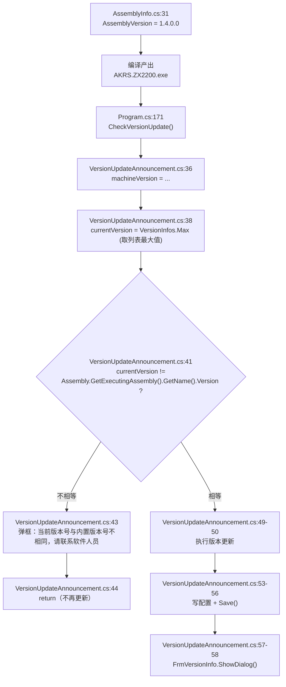

**当前事实**：`VersionInfos` 列表共 **5 条**（`VersionUpdateAnnouncement.cs:65-120`），最大值是 `VersionUpdateAnnouncement.cs:111` 的 **`1.4.0.0`**，**与 `AssemblyInfo.cs:31` 的 `1.4.0.0` 相等** → `:41` 的判断为假 → **正常情况下不会弹"版本号不相同"那个框**。

**🔴 所以这是一条"两处必须同步手改"的隐式耦合**：

| 要改的地方 | 行 | 不同步会怎样 |
|---|---|---|
| `AssemblyInfo.cs:31` `AssemblyVersion` | `:31` | — |
| `VersionUpdateAnnouncement.cs:111` 列表末尾的版本号 | `:111` | 若只改 `AssemblyInfo.cs` 而忘了加一条 `VersionInfo`，**`:41` 判断为真 → 每次开机弹"当前版本号与内置版本号不相同，请联系软件人员"（`:43`），且 `:44` 直接 `return`，版本更新与更新公告窗（`:57-58`）全部被跳过** |
| 反过来只加 `VersionInfo` 不改 `AssemblyInfo` | `:31` | 同上——**`:38` 取 `Max`，新加的那条就是最大，与程序集版本不等** |

**没有编译期保护**（没有 `const`、没有 `#if`、没有 T4 模板）——**两处都是硬编码字符串**。

#### 8.4.5 其它两条联动

| 项 | 事实 | `文件:行` |
|---|---|---|
| `AssemblyTitle` / `AssemblyProduct` 都是 `"AKRS.ZX2200"` | 二者同值 → **`Application.ProductName` = `"AKRS.ZX2200"`** | `AssemblyInfo.cs:7`、`:11` |
| **单实例互斥体用的就是这个值** | `using (Mutex mutex = new Mutex(true, Application.ProductName, out bool createNew))` | `Program.cs:68` |
| 重入分支 | `if (createNew)` 为假 → 打印提示 → 睡 100 ms → 退出 | `Program.cs:70`、`:265-268` |
| 重入时弹的框 | **`MessageBox.Show(@"软件重复打开");`**（`System.Windows.Forms.MessageBox`，**不是** `AKRSXtraMessageBox`） | `Program.cs:265` |
| 重入时的退出 | `Thread.Sleep(100);` / `Environment.Exit(1);` | `Program.cs:266`、`:267` |

**含义**：**互斥体名字来自 `AssemblyProduct`，不是手写字符串。** 改 `:11` 会**同时改掉单实例锁的名字**——如果现场同时装了两个不同 `AssemblyProduct` 的版本，**两个实例会同时跑起来、互相抢硬件**。改这一条前必须确认没有共存安装。

**⚠️ 提示文案是唯一的线索**：重入时用户只看到 **`软件重复打开`** 六个字（`Program.cs:265`），**没有版本号、没有进程路径、没有告诉用户去哪儿找已运行的那个实例**。现场"点两次图标没反应"的反馈，对应到代码就是这一行——**排查时不要在 `MainForm` 里找，问题在 `Program.cs:70` 的 `createNew` 分支上，`MainForm` 压根没被创建**（`Program.cs:258-259` 在 `if (createNew)` 块内）。

> ✅ **`AssemblyCulture("")`（`:14`）为空是正确的**，不是遗漏：非空会把这个程序集变成附属程序集（satellite assembly），运行时加载会失败。这一条**不要"补全"**。

### 8.5 `Properties/Resources.resx` 与 `Resources.Designer.cs`：内嵌资源清单

#### 8.5.1 为什么必须写这一节

`Properties/Resources.resx` 与 `Properties/Resources.Designer.cs` 是**本范围内行数最多的两个文件**（511 + 1,173 = 1,684 行，占本范围 2,630 行的 **64%**），**但它们不含一行业务逻辑**——它们是**全项目的图片资源总仓库**。不写这一节，读者会以为"`Localization` 和 `Properties` 加起来才 2,630 行，是个小模块"，实际上**整个 ZX2200 的 100 多个图标（Ribbon 大图标、树节点图标、工艺示意图、颜色色块）都从这里取**。

#### 8.5.2 两个文件的分工

| 文件 | 行数 | 角色 | 谁生成 |
|---|---|---|---|
| `Properties/Resources.resx` | **511** | **资源清单**：111 条 `<data>`，每条声明一个资源名 + 它对应的磁盘文件 | VS 资源编辑器 / 手工编辑 |
| `Properties/Resources.Designer.cs` | **1,173** | **强类型访问器**：111 个 `internal static` 属性，每个转调 `ResourceManager.GetObject(资源名, culture)` | `ResXFileCodeGenerator` |

`Resources.Designer.cs:22` 的 `[GeneratedCodeAttribute("System.Resources.Tools.StronglyTypedResourceBuilder", "17.0.0.0")]` 表明**最后一次重新生成用的是 VS 2022 的工具链**（版本号 17.0.0.0）——这解释了为什么 `Resources.Designer.cs:3` 的注释是中文（"此代码由工具生成"），而 `Settings.Designer.cs` 也是同一套中文模板。

**⚠️ `Resources.Designer.cs:6-8` 的自动生成头明确写着"对此文件的更改可能会导致不正确的行为，并且如果重新生成代码，这些更改将会丢失"** —— **不要手改 `Resources.Designer.cs`**，要改就改 `Resources.resx` 然后重新生成，或者直接改 `Resources/` 目录下的图片文件（改图片**不需要**改 `.resx`，因为 `ResXFileRef` 是按**路径**引用的，见 §8.5.5）。

#### 8.5.3 逐条清点：111 条资源

```bash
cd AKRS.ZX2200
grep -c '<data name=' Properties/Resources.resx                    # 111
awk 'NR>118' Properties/Resources.resx | grep -oE 'type="[^"]*"' | sort | uniq -c
```

| 类型（`type=`） | 条数 | 指向 | `mimetype` |
|---|---|---|---|
| `System.Resources.ResXFileRef, System.Windows.Forms` | **108** | **外部文件**（`..\Resources\*`） | 无 |
| `System.Drawing.Bitmap, System.Drawing` | **3** | **内联 base64**（数据直接写在 `.resx` 里） | `application/x-microsoft.net.object.bytearray.base64` |
| **合计** | **111** | | |

**108 条 `ResXFileRef` 按文件扩展名细分**：

| 扩展名 | 条数 | 目标类型 | 说明 |
|---|---|---|---|
| `.png` | **87** | `System.Drawing.Bitmap` | 常规位图 |
| `.svg` | **13** | **`DevExpress.Utils.Svg.SvgImage`** | 矢量图标 |
| `.GIF` | **8** | `System.Drawing.Bitmap` | 8 个方向箭头（`ToUpLeft` / `ToLeftUp` / … / `ToDownLeft`） |
| **合计** | **108** | | 指向 **105 个唯一文件**（3 组重名） |

**3 条内联 base64 位图**（不引用外部文件，直接内嵌）：

| 资源名 | `文件:行` | 大小 |
|---|---|---|
| `Home1` | `Resources.resx:200` | 大段 base64（`:201` 起） |
| `System` | `Resources.resx:313` | 大段 base64（`:314` 起） |
| `UserManagment` | `Resources.resx:372` | 大段 base64（`:373` 起） |

**111 个 `Resources.Designer.cs` 属性按返回类型细分**：

| 返回类型 | 个数 | 对应 resx 条目 |
|---|---|---|
| `System.Drawing.Bitmap` | **98** | 87 个 png + 8 个 GIF + 3 个内联 base64 = 98 ✅ |
| `DevExpress.Utils.Svg.SvgImage` | **13** | 13 个 svg ✅ |
| **合计** | **111** | ✅ **与 resx 的 111 条逐一对齐，无孤儿、无缺项** |

**核算命令**：

```bash
grep -cE 'internal static System\.Drawing\.Bitmap ' Properties/Resources.Designer.cs        # 98
grep -cE 'internal static DevExpress\.Utils\.Svg\.SvgImage ' Properties/Resources.Designer.cs # 13
```

#### 8.5.4 ✅ 资源引用完整性：**零缺失**

这是本节最该记下来的好消息——**105 个被引用的资源文件，磁盘上一个都不缺**。

```bash
# 被 resx 引用的唯一文件名
grep -oE 'Resources.[^;]*;' Properties/Resources.resx | cut -d'\' -f2 | sed 's/;$//' | sort -u  # 105
# 磁盘上的文件
find Resources -maxdepth 1 -type f | cut -d'/' -f2 | sort                                        # 177
comm -23 <(被引用) <(磁盘)     # 空 → 无缺失文件
```

**为什么这条值得单独写**：`Resources.resx` 用的是 **`ResXFileRef` 外部引用**，**不是**把图片数据内联进来。**`ResXFileRef` 在编译期由 resgen 解析**——文件缺失是**编译期错误**（`MSB3103` / `ResGen` 失败），不是运行期。所以"105 个全在"意味着**这个工程在当前状态下能编过**；一旦有人清理 `Resources/` 目录里的"看着没用的图片"，**编译立刻断**（见 §8.5.6 的 105/177 陷阱）。

#### 8.5.5 ⚠️ 属性名 → 资源名：**45 处不一致**（45/111 = 41%）

`Resources.Designer.cs` 里属性的**标识符**（C# 合法）与 `Resources.resx` 里的**资源名**（任意字符串）是**两个不同的东西**。生成器会把非法字符替换成 `_`，**但不会改回去**——于是 111 条里有 **45 条对不上**。

```bash
grep -oE 'internal static (System\.Drawing\.Bitmap|DevExpress\.Utils\.Svg\.SvgImage) [^ ]+' Properties/Resources.Designer.cs | sed 's/.* //' | sort > /tmp/props.txt
grep -oE 'ResourceManager\.GetObject\("[^"]*"' Properties/Resources.Designer.cs | sed 's/ResourceManager.GetObject("//;s/"$//' | sort > /tmp/res.txt
paste /tmp/props.txt /tmp/res.txt | awk -F'\t' '$1!=$2' | wc -l      # 45
```

**45 处按冲突原因分类**：

| 类别 | 例（属性名 → 资源名） | 处数 | 生成器的替换规则 |
|---|---|---|---|
| **空格 → `_`** | `banana_spade` → `banana-spade` | 1 | `-` → `_` |
| | `components_component_carrier_geometry1` → `components_component carrier geometry1` | 9 | 空格 → `_` |
| | `transport_unit_TU_position1` → `transport unit_TU position1` | 6 | 空格 → `_` |
| | `wafer_handing_wafer_change1` → `wafer handing_wafer change1` | 8 | 空格 → `_` |
| | `wafer_handing_wafer_magazine_geometry1` → `wafer handing_wafer magazine geometry1` | 2 | 空格 → `_` |
| **括号 → `__n_`** | `highlight__1_` → `highlight (1)` | 2 | `(` → `_`、`)` → `_` |
| | `home__1_` / `home__2_` / `home__3_` → `home (1)` / `home (2)` / `home (3)` | 3 | 同上 |
| | `加__1_` → `加 (1)`、`向上__1_` → `向上 (1)`、`排序__1_` → `排序 (1)`、`胶水__1_` → `胶水 (1)`、`顶层__1_` → `顶层 (1)` | 5 | 同上 |
| **`-` → `_`（中文名）** | `上一步_03` → `上一步-03`、`下一步_03` → `下一步-03`、`首页_首页` → `首页-首页` | 3 | `-` → `_` |
| **`svg (2)1`** | `svg__2_1` → `svg (2)1` | 1 | 叠加：空格 + 括号 + 尾随数字 |
| **小写/大写不变** | `red` / `red1` → `red.svg`（两个属性指向同一文件） | — | 见下 |

**⚠️ 直接用属性名去 `.resx` 里搜会搜不到**，这是后来人改图标时最常见的第一个坑。**正确做法是先在 `Resources.Designer.cs` 里找到属性（例如 `Properties.Resources.banana_spade`），再读它 `get` 体里的字符串**：

```csharp
// Properties/Resources.Designer.cs:86-91 —— 属性名和资源名不一样
internal static System.Drawing.Bitmap banana_spade {                              // :86  ← 属性名
    get {
        object obj = ResourceManager.GetObject("banana-spade", resourceCulture);   // :88  ← 资源名
        return ((System.Drawing.Bitmap)(obj));                                    // :89
    }
}
```

**中文资源名（29 条）也遵循同一规则**，且**属性名和资源名都含中文**（C# 允许中文标识符）：

| 属性名 | 资源名 | 属性名 | 资源名 |
|---|---|---|---|
| `上一步_03` | `上一步-03` | `加__1_` | `加 (1)` |
| `下一步_03` | `下一步-03` | `向上__1_` | `向上 (1)` |
| `首页_首页` | `首页-首页` | `排序__1_` | `排序 (1)` |
| `保存` | `保存`（同名） | `胶水__1_` | `胶水 (1)` |
| `保存成功` / `删除` / `取消` / `对` / `右移` / `向上` / `向右边` / `向右边1` / `向左边` / `向左边1` / `吸取材质` / `失败处继续` / `左移` / `排序` / `更改库存说明` / `编辑色块` / `胶水` / `铅笔` / `高度` | 均**同名** | `顶层__1_` | `顶层 (1)` |

**29 条中文资源名与 29 个中文属性名一一对应**（`grep -c '[一-龥]'` 两边都是 29），其中 **9 条名字不同、20 条完全相同**。

#### 8.5.6 🔴 105 / 177：`Resources/` 里 **72 个文件既不被引用、也不在 `.csproj` 里**

| 集合 | 个数 | 说明 |
|---|---|---|
| `Resources/` 磁盘文件 | **177** | 155 png + 10 svg + 8 GIF + **4 bmp** |
| 被 `Resources.resx` 引用 | **105** | 87 png + 10 svg + 8 GIF |
| 出现在 `.csproj` 的 `<None Include="Resources\…">` / `<Content Include="Resources\…">` | **106** | 84 + 22 |
| **两个集合都不是**（真正的孤儿） | **70** | 见下 |

**⚠️ 注意 105 + 106 ≠ 177**，两个集合**不重合**：

```bash
comm -23 /tmp/reffiles.txt /tmp/csprojres.txt    # resx 引用但 csproj 没列 → 1 个：顶层 (1).png
comm -13 /tmp/reffiles.txt /tmp/csprojres.txt    # csproj 列了但 resx 没引用 → 2 个：Bond.bmp、Dispenser.bmp
```

**70 个孤儿文件（既没被 resx 引用、也没进 csproj）里，包含**：

| 类型 | 例 | 说明 |
|---|---|---|
| **macOS/压缩包垃圾文件** | `Resources/._bond position_teach bonding position1.png`、`Resources/._transport unit_ TU rotation determination2.png` | **2 个 AppleDouble 元数据文件**（`._` 前缀），是**从 macOS 或某些 zip 解压带进来的**，**永远不该进仓库** |
| **成组的未接线图** | `bond position_teach bonding position1.png`（1~4）、`components_component accuracy mode1.png`（1~8）、`post-bond1.png`（1~3） | 界面改造后遗留 |
| **中文名图片** | `icon_采购数量.png` | `grep -rn 'icon_采购数量' --include=*.cs .` = **0 命中**，代码里没人用 |

**🔴 无法用"引用计数"清理资源**：这 70 个孤儿看着能删，**但 `Resources.resx` 引用的是 105 个"另一个集合"**——**如果按"没在 `.csproj` 里就删掉"来清理，会把 105 个真正要用的删掉一半以上**（只有 1 个 `顶层 (1).png` 同时满足"resx 引用"和"csproj 未列"）。**清理的正确判据只有一个：`Resources.resx` 的 111 条 `<data>`。**

#### 8.5.7 ⚠️ 两个"挂载机制"其实都**不产生任何构建效果**

`.csproj` 里有两种声明 `Resources\` 下文件的方式，且**同时存在**：

```xml
<!-- AKRS.ZX2200.csproj:3906 —— 方式 A：<None>（84 条） -->
<None Include="Resources\bordersall_32x32.png" />

<!-- AKRS.ZX2200.csproj:3966 —— 方式 B：<Content>（22 条） -->
<Content Include="Resources\components_component carrier geometry1.png" />
```

**关键事实**：

```bash
grep -c 'CopyToOutputDirectory' AKRS.ZX2200.csproj      # 0
```

**整个工程 0 处 `CopyToOutputDirectory`。** 在 classic（非 SDK）`.csproj` 里，`<None>` / `<Content>` 条目**只有带了 `CopyToOutputDirectory`（`Always` / `PreserveNewest`）才会被拷到输出目录**。**没有这个元数据 → 这两类条目 100% 不影响构建产物**——它们**只是让文件出现在 VS 解决方案资源管理器里**。

**真正把图片装进 exe 的机制是第三条链**（与 `<None>`/`<Content>` 无关）：

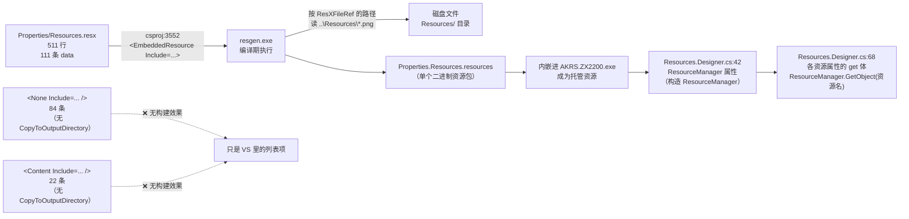

*（图中 `Resources.Designer.cs:42` 是 `new ResourceManager("AKRS.ZX2200.Properties.Resources", typeof(Resources).Assembly)` 那一行；`Resources.Designer.cs:68` 是第一条 `GetObject("add_32x32", resourceCulture)`，后面 110 个属性同形。）*

**推论（纯事实）**：

1. **部署时不需要拷 `Resources\` 目录**——图片已在 exe 内。`bin/` 目录为空（`find bin -type f | wc -l` = 0）也印证了"当前无构建产物可查"。
2. **`<None>` / `<Content>` 的 106 条是纯噪音**，改成一条 `<None Include="Resources\**\*" />` 或直接删掉都不影响编译——**但删掉会让 VS 解决方案资源管理器里看不到这些图**。*（推断：这两类条目是 VS 在你把文件拖进项目时自动加的；`<None>` 是"普通文件"、`<Content>` 是"内容文件"，语义差异在 WinExe 下无实际后果。）*
3. **🔴 4 个 `.bmp` 共 8.90 MB，是本目录 93% 的体积，但全是死资产**：

| 文件 | 大小 | 在 `Resources.resx` 里？ | 在 `.csproj` 里？ | 代码引用 |
|---|---|---|---|---|
| `Resources/Bond.bmp` | **2,556,644 B（2.44 MB）** | ❌ 不在 | `<Content>`（`csproj:3965`） | **0 命中** |
| `Resources/Dispenser.bmp` | **2,143,544 B（2.04 MB）** | ❌ 不在 | `<Content>`（`csproj:3979`） | **0 命中** |
| `Resources/Runner.bmp` | **2,027,360 B（1.93 MB）** | ❌ 不在 | ❌ 不在 | **0 命中** |
| `Resources/WaferTable.bmp` | **2,607,564 B（2.49 MB）** | ❌ 不在 | ❌ 不在 | **0 命中** |
| **合计** | **9,335,112 B（8.90 MB）** | | | |

```bash
cd AKRS.ZX2200
du -sh Resources                                              # 9.6M
find Resources -maxdepth 1 -name '*.bmp' -printf '%s %p\n'    # 4 个 bmp，如上
# 各类型体积
for e in png svg GIF bmp; do printf "%-5s " "$e"; find Resources -maxdepth 1 -name "*.$e" -printf '%s\n' | awk '{s+=$1} END{printf "%d B (%.2f MB)\n", s, s/1048576}'; done
# png   304397 B (0.29 MB)   ← 真正内嵌进 exe 的部分
# svg     1992 B (0.00 MB)
# GIF    21379 B (0.02 MB)
# bmp  9335112 B (8.90 MB)   ← 全部是死资产
```

**结论：真正进 exe 的图片总共只占 0.31 MB（png+svg+GIF），而仓库里为它们陪绑了 8.90 MB 的 `.bmp`。** 这 4 个 `.bmp` 是**"素材原图"**（单个 200 万~260 万字节，是最大 png 的 400 多倍——最大 png 是 `Resources/pp tool _ tool geometry3.png`，5,630 B），远超界面图标所需——**大概率是设计给的位图源文件，被误提交进工程**。`Bond.bmp` / `Dispenser.bmp` 还被登记成了 `<Content>`（`csproj:3965` / `:3979`），**但因为 `CopyToOutputDirectory` = 0，它们连输出目录都不进**——**纯粹是仓库体积负担**。**删除这 4 个文件不需要改任何代码**（已逐条核实 0 引用）。

#### 8.5.8 🔴 `DevExpress.Data.v21.2` 被硬编码在 `.resx` 里

13 条 svg 的 `ResXFileRef` 值里，目标类型写的是**完整强名称**：

```xml
<!-- Properties/Resources.resx:401-403 —— Blue.svg 的引用 -->
<data name="Blue" type="System.Resources.ResXFileRef, System.Windows.Forms">
  <value>..\Resources\Blue.svg;DevExpress.Utils.Svg.SvgImage, DevExpress.Data.v21.2, Version=21.2.7.0, Culture=neutral, PublicKeyToken=b88d1754d700e49a</value>
</data>
```

**`DevExpress.Data.v21.2, Version=21.2.7.0`** —— 这是 **DevExpress 21.2.7** 的程序集强名称。核对：

```bash
grep -oE 'DevExpress[^,]*,[^,]*Version=[0-9.]+' Properties/Resources.resx | sort -u
# DevExpress.Data.v21.2, Version=21.2.7.0
grep -oE 'Version=[0-9]+\.[0-9]+\.[0-9]+\.[0-9]+' AKRS.ZX2200.csproj | sort | uniq -c | sort -rn | head -3
#   43 Version=21.2.7.0    ← DevExpress 全家的版本，与 resx 一致 ✅
#   31 Version=1.0.0.0
#    5 Version=4.38.128.0
```

**✅ 当前一致**：`.resx` 里写死的 `DevExpress.Data.v21.2 / 21.2.7.0` 与 `.csproj` 里 43 个 DevExpress `<Reference>` 的版本**相同**。

**🔴 但这是一条"升 DevExpress 时的隐形地雷"**：

| 改的地方 | 处数 | 漏改的后果 |
|---|---|---|
| `.csproj` 里 43 个 DevExpress `<Reference>` 的 `Version=` 与 `HintPath` | 43 | — |
| **`Properties/Resources.resx` 里 13 条 svg 声明的 `DevExpress.Data.v21.2, Version=21.2.7.0`** | **13** | **resgen 解析 `ResXFileRef` 时要按强名称加载该类型**；版本对不上 → 编译期 ResGen 报错，或运行时 `GetObject("Blue")` 抛 `TypeLoadException` |

**这 13 处不在 `.csproj` 里，用 grep `.csproj` 的常规升级脚本扫不到。** 升级 DevExpress 时必须**手工**把这 13 条 `DevExpress.Data.vNN.N, Version=NN.N.N.N` 一起改（或把 `Resources.Designer.cs` + `Resources.resx` 整体重新生成）。

> ⚠️ **同时注意 `Resources.resx` 里引用的别名程序集**：`:118` 有 `<assembly alias="System.Windows.Forms" name="System.Windows.Forms, Version=4.0.0.0, ..." />`，`:119` 前还有 `<assembly alias="System.Drawing" name="System.Drawing, Version=4.0.0.0, ..." />`。**这两条是 3 条内联 base64 位图（`Home1`/`System`/`UserManagment`）解析所必需的**，删掉会让它们反序列化失败。

### 8.6 `Save()` 调用点总表

#### 8.6.1 全项目的落盘机制只有一种

`Save()` **不是** `Properties.Settings`（§8.2 是空的）、**不是** `.resx` 设置、**不是** `App.config`（§8.3 没有 `appSettings`）。**它是 `Singleton<T>` 基类上的一个方法**——所有 "XX 配置 / XX 参数 / XX 配方" 都继承 `Singleton<T>`，改完字段调一次 `Save()` 就落盘。

**规模感**：

```bash
cd AKRS.ZX2200
grep -rn 'GetInstance()\.Save()' --include=*.cs . | wc -l   # 556
grep -rn '\.Save()'              --include=*.cs . | wc -l   # 865
```

**556 处 `GetInstance().Save()`、865 处 `.Save()`** —— **这就是本项目的持久化总入口**。

#### 8.6.2 本范围内的 `Save()` 调用点总表（**2 处**）

| # | 调用点 `文件:行` | 调用对象 | 触发场景 | 落盘内容 | 有 `try/catch`？ |
|---|---|---|---|---|---|
| 1 | **`LocalizationManager.cs:58`** | `LanguageSettings.GetInstance().Save()` | 用户在 `LueLanguage` 下拉框改变语言 | `language_settings.json`（`Language` 字段） | 🔴 **没有**（`:55-59` 是裸三行） |
| 2 | **`VersionUpdateAnnouncement.cs:56`** | `MachineSoftwareConfiguration.GetInstance().Save()` | `Program.cs:171` 的 `CheckVersionUpdate()` 在**版本号变大**时 | `MachineSoftwareConfiguration` 的 JSON（`CurrentVersionNumber` / `LastVersionNumber` / `LastVersionUpdataTime`） | ⚠️ **没有**（`:49-59` 整块无 try/catch） |

**就这 2 处。** 本范围内的 `Localization/`、`Properties/`、根目录文件**除了 `Program.cs` 转调 `CheckVersionUpdate()` 外，没有任何其它落盘点**。

#### 8.6.3 第 2 处的完整链路（`文件:行` 逐层）

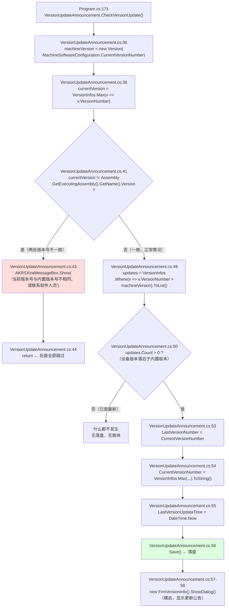

**三条分支的含义**（对应 §8.4.4 的版本耦合）：

| 分支 | 条件 | 后果 | `文件:行` |
|---|---|---|---|
| **版本号不等** | `AssemblyVersion`（`AssemblyInfo.cs:31`）≠ `VersionInfos` 的最大值（`VersionUpdateAnnouncement.cs:111`） | **弹框 + `return`**：**不落盘、不弹更新公告**。**每次开机都弹。** | `:41` → `:43` → `:44` |
| **设备已最新** | `updates.Count == 0` | **静默什么都不做** | `:50` 为假 |
| **设备落后** | `updates.Count > 0` | 写 3 个字段 + `Save()` + 弹更新公告窗 | `:53-58` |

**当前仓库状态**：`VersionInfos` 的 5 条（`VersionUpdateAnnouncement.cs:65-120`）最大是 `:111` 的 `1.4.0.0`，`AssemblyInfo.cs:31` 也是 `1.4.0.0` → **走"版本号一致"分支**；而设备侧 `CurrentVersionNumber` 的初值是 `"0.0.0.0"`（`MachineSoftwareConfiguration.cs:27`）→ **首次运行必走"设备落后"分支**（`0.0.0.0 < 1.4.0.0`）→ **会落盘 + 弹更新公告**。

#### 8.6.4 ⚠️ `MachineSoftwareConfiguration.cs` 里**没有 `Save()` 的定义**

```bash
grep -n 'Save' Main/Machine/MachineSupport/MachineSoftwareConfiguration.cs
# :55  FileSaveDue            ← 属性
# :61  SqlSaveDue             ← 属性
# :91  AutoSaveMapping        ← 属性
# :97  AutoSaveBondPositionComponentMapping  ← 属性
# :151 ISSaveLocateImage      ← 属性
# :191 SaveLoacteImage()      ← 方法（见 §8.6.5）
# 没有 public void Save()
```

**`Save()` 定义在基类 `Singleton<T>` 上，而 `Singleton<T>` 在二进制里**：

| 项 | 事实 | `文件:行` |
|---|---|---|
| 类声明 | `public class MachineSoftwareConfiguration : Singleton<MachineSoftwareConfiguration>, INotifyPropertyChanged` | `MachineSoftwareConfiguration.cs:22` |
| 基类来源 | `AKRS.Galaxy2.Infrastructure`（`AKRS.ZX2200.csproj:258-260` 直接 `<Reference>` + `libs\AKRS.Galaxy2.Infrastructure.dll` HintPath） | §7.1.4 |
| `FilePath` 赋值 | 静态构造里 `FilePath = ZX2200PathConfig.MachineSoftwareConfigurationPath` | `MachineSoftwareConfiguration.cs:166-169`、`:168` |
| `Save()` 定义 | **本仓库内无源码**（附录 B） | — |

**⚠️ 这意味着"落盘格式"不能从源码确定**：`Singleton<T>.Save()` 用什么序列化器、写到哪个路径、是否原子写、失败怎么办——**全在 DLL 里**。*（推断：JSON 序列化到 `FilePath`；推断依据是 `LanguageSettings.cs:24` 的落盘文件名是 `.json`，且 `LocalizationCache.cs:2` 引了 `Newtonsoft.Json`。**未验证**。）*

#### 8.6.5 ⚠️ 命名缺陷：`SaveLoacteImage()` 拼错了，且**它不是落盘方法**

```csharp
// Main/Machine/MachineSupport/MachineSoftwareConfiguration.cs:191-194
public bool SaveLoacteImage()
{
    return this.ISSaveLocateImage;
}
```

| 项 | 事实 |
|---|---|
| 方法名 | **`SaveLoacteImage`** —— `Loacte` 是 **`Locate` 的错拼**（`o` 和 `a` 换位） |
| 返回类型 | **`bool`**（**不是 void**） |
| 方法体 | **一行 `return`**：返回属性 `ISSaveLocateImage` 的值（`:151`，默认 `true`） |
| **它做什么** | **什么都不做**——**不落盘、不写文件、不改状态，纯读取** |
| 该不该叫 `Save…` | **不该**。它是一个 **getter**，名字里的 `Save` 会让人以为"调它会保存图片" |

**调用点（`Program.cs:250`）**：

```csharp
// Program.cs:250-251 —— 两个委托订阅
PREntity.IsSaveLocateImage   += MachineSoftwareConfiguration.GetInstance().SaveLoacteImage;
PREntity.SaveLocateImageAction += VisionService.SaveVisionImage;
```

**这里能看出作者的真实意图**：`PREntity` 有两个委托，一个是 **判断**（"要不要存定位图"，返回 `bool`，接 `SaveLoacteImage()`），一个是 **执行**（"存定位图"，接 `VisionService.SaveVisionImage`）。**方法名把"判断"写成了"保存"**，于是一行里出现 `IsSaveLocateImage += …SaveLoacteImage`——**读起来像"把保存动作订阅到保存事件上"，实际是"把判断委托订阅到判断事件上"。**

**⚠️ 同时 `ISSaveLocateImage`（`:151`）与 `SaveLoacteImage`（`:191`）也是拼写不一致的**：属性把 `Locate` 拼对了，方法没拼对。`grep -rn 'SaveLocateImage'` 命中的只有 `Program.cs:251` 的 `PREntity.SaveLocateImageAction`（第三方/外部的委托名）——**同一个概念在 3 个地方有 2 种拼法**：

| 拼法 | 出现处 | `文件:行` |
|---|---|---|
| `Locate`（正确） | `ISSaveLocateImage` 属性、`PREntity.SaveLocateImageAction` 委托 | `MachineSoftwareConfiguration.cs:151`、`Program.cs:251` |
| **`Loacte`（错拼）** | `SaveLoacteImage()` 方法 | `MachineSoftwareConfiguration.cs:191`、`Program.cs:250` |

> ✅ **这是纯命名缺陷，不是行为缺陷**：`SaveLoacteImage()` 返回的是 `bool`、体是 `return`，**调用它不会造成任何落盘副作用**。**不要因为名字里带 `Save` 就以为它写了文件。** 这条**与 `App.config` 的 `<None Include="App.config" />` 无关**——那是两件独立的事（§8.8.4）。

### 8.7 两套 NuGet 机制与 `libs/` 的对应关系（图 11）

#### 8.7.1 两套机制**同时存在**在同一个 `.csproj` 里

这是本项目在工程层面最不正常的一处。**`packages.config`（旧）与 `PackageReference`（新）在同一个非 SDK 工程里并存**：

| 机制 | 声明文件 | 声明位置 | 包数 | 还原产物位置 |
|---|---|---|---|---|
| **旧**（`packages.config`） | `packages.config`（**7 行**） | 工程根目录 | **4** | `..\packages\<包名>.<版本>\` + 手工 `<Import>` 进 `.csproj` |
| **新**（`PackageReference`） | `AKRS.ZX2200.csproj` | `csproj:4092-4117`（末尾的 `<ItemGroup>`） | **8** | `obj\project.assets.json` + `obj\*.nuget.g.props` / `.targets` |

**⚠️ 后者的还原产物在本仓库里不存在**：

```bash
cd AKRS.ZX2200
find obj -type f
# obj/Debug/.NETFramework,Version=v4.8.AssemblyAttributes.cs
# obj/Debug/AKRS.ZX2200.csproj.AssemblyReference.cache          （162 KB）
# obj/Debug/DesignTimeResolveAssemblyReferencesInput.cache
# ↑ 只有 3 个文件；没有 project.assets.json、没有 nuget.g.props、没有 nuget.g.targets
find bin -type f | wc -l      # 0
```

**含义**：**这份工作副本从没跑过 `PackageReference` 的还原**（否则 `obj/` 里必有 `project.assets.json`）。所以 8 条 `PackageReference` **在本副本上处于"声明了但没生效"的状态**。

#### 8.7.2 逐包列出：**四角对照表**（本节的图 11 就是这张表的血缘图）

**口径**：三列分别取 `packages.config` 的 `version=`、`csproj` 的 `<PackageReference><Version>`、`..\packages\` 目录名。

| # | 包 | `packages.config` | `PackageReference` | `..\packages\` 目录 | 判定 |
|---|---|---|---|---|---|
| 1 | **`Fody`**（**编织引擎本身**） | **`6.6.4`**（`packages.config:3`，`developmentDependency="true"`） | ❌ **没有** | **`Fody.6.0.5`** | 🔴 **三方三个值 / 目录版本对不上** |
| 2 | `MethodBoundaryAspect.Fody` | `2.0.145`（`packages.config:4`） | `2.0.145`（`csproj:4102-4104`） | `MethodBoundaryAspect.Fody.2.0.145` | ⚠️ **同一包被声明两次，值相同** |
| 3 | `PropertyChanged.Fody` | `4.1.0`（`packages.config:5`） | `4.1.0`（`csproj:4111-4113`） | `PropertyChanged.Fody.4.1.0` | ⚠️ **同一包被声明两次，值相同** |
| 4 | `System.Threading.Tasks.Dataflow` | `6.0.0`（`packages.config:6`，`net48`） | `6.0.0`（`csproj:4114-4116`） | `System.Threading.Tasks.Dataflow.6.0.0` | ⚠️ **同一包被声明两次，值相同** |
| 5 | `Lib.Harmony` | ❌ 没有 | **`2.3.6`**（`csproj:4099-4101`） | `Lib.Harmony.2.3.6` | ⚠️ **只在 PackageReference** |
| 6 | `Accord.Statistics` | ❌ 没有 | **`3.8.0`**（`csproj:4093-4095`） | ❌ 没有 | ⚠️ **只在 PackageReference**（且源码里只有 1 处 unused using，见 §6.7） |
| 7 | `EPPlus` | ❌ 没有 | **`7.0.7`**（`csproj:4096-4098`） | ❌ 没有 | ⚠️ **只在 PackageReference** |
| 8 | `PostSharp` | ❌ 没有 | **`2.1.6.4`**（`csproj:4105-4107`） | ❌ 没有 | ⚠️ **只在 PackageReference** |
| 9 | `PostSharp.Redist` | ❌ 没有 | **`2024.1.5`**（`csproj:4108-4110`） | ❌ 没有 | ⚠️ **只在 PackageReference** |
| 10 | **`MathNet.Numerics`** | ❌ 没有 | ❌ **没有** | **`MathNet.Numerics.5.0.0`** | 🔴 **目录里有、两边都没声明 = 孤儿** |

**`..\packages\` 目录实际内容（6 个）**：

```bash
ls -d ../packages/*/
# ../packages/Fody.6.0.5/
# ../packages/Lib.Harmony.2.3.6/
# ../packages/MathNet.Numerics.5.0.0/          ← 孤儿
# ../packages/MethodBoundaryAspect.Fody.2.0.145/
# ../packages/PropertyChanged.Fody.4.1.0/
# ../packages/System.Threading.Tasks.Dataflow.6.0.0/
```

**🔴 第 1 行是最严重的一条**：`packages.config:3` 要的是 **`Fody 6.6.4`**，**而磁盘上只有 `Fody.6.0.5`**。**`..\packages\Fody.6.6.4\` 不存在** → **任何指向 `Fody.6.6.4` 的 `<Import>` 都会解析失败**。

#### 8.7.3 图 11：四个"版本源"的血缘与冲突

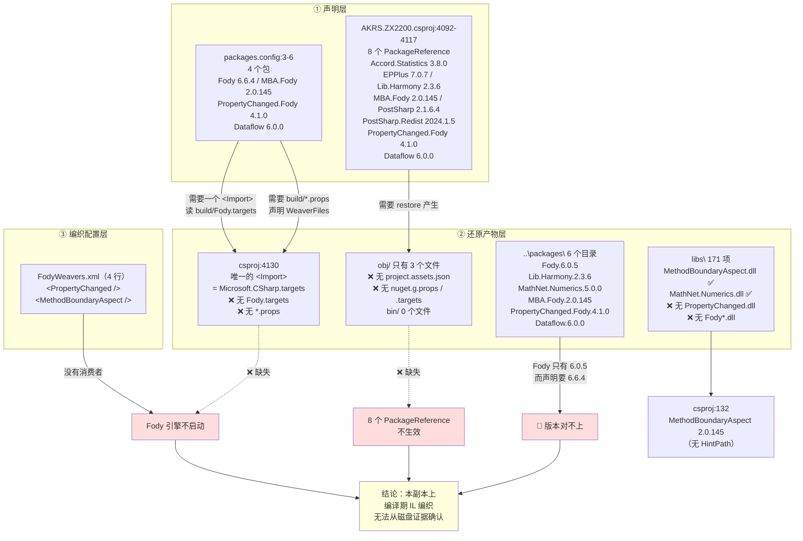

**ASCII 等价版**：

```
① 声明层
   packages.config:3-6 ──4 包──┐
   csproj:4092-4117 ──8 包─────┤
                               │
② 还原产物层                   │
   csproj:4130 唯一的 <Import> ◄┘  ← 只有 Microsoft.CSharp.targets
                                      ❌ 没有 Fody.targets
                                      ❌ 没有 PropertyChanged.Fody.props
                                      ❌ 没有 MethodBoundaryAspect.Fody.props
   obj/ 3 个文件（无 project.assets.json）
   bin/ 0 个文件
   ..\packages\ 6 个目录（Fody 只有 6.0.5，声明要 6.6.4）  ← 🔴
   libs\ 有 MethodBoundaryAspect.dll / MathNet.Numerics.dll
         ❌ 无 PropertyChanged.dll、无 Fody*.dll
                               │
③ 编织配置层                   │
   FodyWeavers.xml（4 行）─────┘  ← 没有消费者
                                  ↓
                 结论：Fody 的编译期编织
                 在本副本上没有可验证的生效路径
```

#### 8.7.4 🔴 关键证据：`.csproj` 里**只有一个 `<Import>`**

```bash
cd AKRS.ZX2200
grep -n -i '<import' AKRS.ZX2200.csproj
# 4130:  <Import Project="$(MSBuildToolsPath)\Microsoft.CSharp.targets" />
grep -n -i 'fody' AKRS.ZX2200.csproj
# 4102:    <PackageReference Include="MethodBoundaryAspect.Fody">     ← 只是包名里出现 "Fody"
# 4111:    <PackageReference Include="PropertyChanged.Fody">          ← 同上
# 注意：没有 <Import Project="..\packages\Fody.X\build\Fody.targets" ... />
#       没有 <Import Project="..\packages\PropertyChanged.Fody.4.1.0\build\PropertyChanged.Fody.props" ... />
#       没有 <Import Project="..\packages\MethodBoundaryAspect.Fody.2.0.145\build\MethodBoundaryAspect.Fody.props" ... />
```

**为什么这条决定性**：

1. **`FodyWeavers.xml` 不是被 C# 编译器读的**，它是被 **`Fody.targets` 里的 MSBuild Target（`FodyTarget`）** 读的。**没有 `<Import>` 就没有 Target，`FodyWeavers.xml` 就永远不会被打开。**
2. `Fody.targets` 自己在 `packages/Fody.6.0.5/build/Fody.targets`（**存在**），其头部第 4 行是：

```xml
<ProjectWeaverXml Condition="$(ProjectWeaverXml) == ''">$(ProjectDir)FodyWeavers.xml</ProjectWeaverXml>
```

**这正是 `FodyWeavers.xml` → 构建管线的唯一连接点。** 本 `.csproj` 里没有这行所在的文件被引入。
3. **`Fody` 引擎本身也只出现在 `packages.config:3`**，**不在任何一条 `PackageReference` 里**（`csproj` 里出现 "Fody" 的只有 `:4102` 与 `:4111` 两个**编织器**包名）——**所以即使 `PackageReference` 还原成功，也拉不进 Fody 引擎**。**Fody 唯一的来源是 `packages.config` 那套手工 `<Import>`，而那个 `<Import>` 不在。**
4. **`..\packages\Fody.6.6.4\` 不存在**（磁盘上是 `Fody.6.0.5`）——**即使补上 `<Import Project="..\packages\Fody.6.6.4\build\Fody.targets" />` 也会因路径不存在而被 MSBuild 跳过或报错。**

**⚠️ 必须承认的不确定性（三条，缺一不可）**：

| # | 不确定性 | 为什么不能定论 |
|---|---|---|
| 1 | **NuGet 还原会不会自动补 `<Import>`** | `packages.config` 那套机制里，`nuget.exe restore` / VS 的还原**会**把缺失的 `<Import>` 追加回 `.csproj`（因为包里带 `build\*.props`）。**本副本没跑过还原，所以看不到这一步的结果。** **在开发者机器上打开 VS 并还原一次，`<Import>` 就可能被自动补上，编织随后生效。** |
| 2 | **`PropertyChanged.dll` 从哪来** | 8 个文件 `using PropertyChanged;`（§6.6），**但 `libs\` 里没有 `PropertyChanged.dll`**，`csproj` 里也**没有** `<Reference Include="PropertyChanged" ...>`。它只能来自 `PropertyChanged.Fody` 包的 `lib/net40/PropertyChanged.dll`（`packages/PropertyChanged.Fody.4.1.0/lib/net40/PropertyChanged.dll` **存在**）——**通过哪条路径加进编译引用，本副本无法确定。** |
| 3 | **实际产出是否被织入** | 工程级 `AKRS.ZX2200/bin/` **0 个文件**；但 `trunk/bin/Debug/AKRS.ZX2200.exe` 存在（16,970,752 字节）。**它是被 Fody 编织过的**（元数据含 `FodyVersion`）——但**不能替代"从当前源码重新构建会得到什么"**（§6.6.6）。 |

**所以本节的正确结论是"不能断言"，而不是"没编织"或"编织了"**：

> **在提交到仓库的这份工程文件状态下，`FodyWeavers.xml` 声明的两个编织器（`PropertyChanged` / `MethodBoundaryAspect`）在工程文件里没有任何可验证的生效路径**：唯一的 `<Import>`（`csproj:4130`）只引入 `Microsoft.CSharp.targets`，`Fody.targets` 与两个 `*.props` 均未被引入，且 `packages.config:3` 指向的 `Fody 6.6.4` 在 `..\packages\` 下不存在。**一次 NuGet 还原可能自动补齐这些 `<Import>`**——因此**不能根据磁盘源码断言某个方法有没有被 AOP 织入**（§6.6 已列出受影响的常见判断）。
>
> ⚠️ **但"工程文件里没有生效路径"≠"编织没发生过"**：`trunk/bin/Debug/AKRS.ZX2200.exe` 的元数据里存在 `FodyVersion` 属性 ⇒ **实际交付的那份 exe 确实被 Fody 编织过**。两条结论并存：**已是产物的 exe 织过了；从这份源码重新构建会不会得到同样结果，取决于本机还原到哪个 Fody 版本（R-26），无法确定**（§6.6.6）。

#### 8.7.5 图 11 之外的三个附带发现

| # | 发现 | `文件:行` |
|---|---|---|
| 1 | **`packages.config` 是 CRLF 行尾 + UTF-8 BOM**（`cat -A` 显示 `^M$`），而 `.csproj` / `FodyWeavers.xml` 是 LF —— **混用行尾**，跨平台工具（`git` 的 `core.autocrlf`、Linux 上的 `sed`/`awk` 脚本）容易产生整文件 diff | `packages.config`（7 行） |
| 2 | **`MathNet.Numerics.5.0.0` 是孤儿目录**：两边都没声明，但 `libs\MathNet.Numerics.dll` **存在**且被引用 → **实际编译用的是 `libs\` 里的 DLL，`..\packages\MathNet.Numerics.5.0.0\` 是没人用的残留** | `csproj:128-131`（`<Reference Include="MathNet.Numerics, Version=5.0.0.0, ...>` `:128`、`<SpecificVersion>False` `:129`、`<HintPath>libs\MathNet.Numerics.dll` `:130`） |
| 3 | **`Fody.6.0.5` 目录里 `netclassictask\` 与 `netstandardtask\` 各有一套 `Fody.dll` + `Mono.Cecil.dll`** —— 即"用哪个任务版本"由 MSBuild 运行时决定（`Fody.targets` 第 6-7 行按 `$(MSBuildRuntimeType)` 分流）。**这解释了为什么同一个包能同时被 VS（.NET Framework MSBuild）和 `dotnet build` 用** | `packages/Fody.6.0.5/build/Fody.targets` |

> ⚠️ **`Anti-Pattern` 提醒**：**新加 NuGet 包时不要两种机制混用。** 本工程里 3 个包（`MethodBoundaryAspect.Fody` / `PropertyChanged.Fody` / `System.Threading.Tasks.Dataflow`）**同时被 `packages.config` 和 `PackageReference` 声明**——**包的版本恰好相同才没出事；一旦有人只改一处版本，两套还原会各拉一个版本，编译引用取哪个取决于 MSBuild 求值顺序。**

### 8.8 `AKRS.ZX2200.csproj` 的构建配置

#### 8.8.1 文件总量与格式

| 项 | 值 | 备注 |
|---|---|---|
| 行数 | **4,137** | `wc -l AKRS.ZX2200.csproj` |
| 格式 | **非 SDK 式**：`ToolsVersion="4.0"`（`:1`）+ `xmlns="http://schemas.microsoft.com/developer/msbuild/2003"`（`:1`） | **不是** `<Project Sdk="...">` |
| 行尾 | **LF**（与 `packages.config` 的 CRLF 不同，§8.7.5） | — |
| BOM | 有（`:1` 带 `efbbbf`） | — |
| `<ItemGroup>` 数 | **24** | 其中 **17 个是"单条目 ItemGroup"** |
| 注释掉的构建扩展点 | `:4131-4136`：`BeforeBuild` / `AfterBuild` **两个 `<Target>` 全被注释** | ✅ 见 §8.8.5 |

**⚠️ 17 个单条目 `<ItemGroup>`**（`<ItemGroup>` 与 `</ItemGroup>` 相邻两行的组）：

```bash
awk '/<ItemGroup>/{n=NR} /<\/ItemGroup>/{if(NR-n==2) c++} END{print c}' AKRS.ZX2200.csproj   # 17
```

**形态**（`csproj:3905-3907`、`:3908-3910`、…）：

```xml
  <ItemGroup>
    <None Include="Resources\bordersall_32x32.png" />
  </ItemGroup>
  <ItemGroup>
    <None Include="Resources\bordernone_32x32.png" />
  </ItemGroup>
```

**含义**：**每往工程里拖一个图片，VS 就新开一个 `<ItemGroup>`**——84 个 `<None Include="Resources\…">` 里有 17 个是这样孤立的。**对构建完全没有影响**（MSBuild 不在乎分组），纯粹是工程文件膨胀。**不要"整理"它们**——下次有人在 VS 里动一下资源，VS 又会重新拆开。

#### 8.8.2 编译目标与平台：**`csproj` 只认 `AnyCPU`，`sln` 却映射了 `x64`**

**`csproj` 里的配置**（`:1-60`）：

| 行 | 条目 | 值 |
|---|---|---|
| `:4` | `<Platform Condition=" '$(Platform)' == '' ">` | **`x86`** ← 默认平台 |
| `:8` | **`<OutputType>`** | **`WinExe`** |
| `:9` | `<AppDesignerFolder>` | `Properties` |
| `:10` | `<RootNamespace>` | `AKRS.ZX2200` |
| `:11` | `<AssemblyName>` | `AKRS.ZX2200` |
| `:12` | **`<TargetFrameworkVersion>`** | **`v4.8`** |
| `:13` | `<FileAlignment>` | `512` |
| `:14-15` | `<NuGetPackageImportStamp>` | 空元素（NuGet 还原时写入时间戳） |
| `:16` | `<TargetFrameworkProfile>` | 空（**不是 `Client`**，即完整框架） |
| `:7` | `<ProjectGuid>` | `{2B9696AB-6629-45CA-AC34-98AB1A817ABB}` |
| `:59` | **`<ApplicationIcon>`** | **`IMG_6747%281%29_256x256.ico`**（`%28`/`%29` = `(`/`)` 的 MSBuild 转义） |
| `:17-31` | ClickOnce 发布相关 | `PublishUrl` = `publish\`、`Install` = `true`、`InstallFrom` = `Disk`、`MapFileExtensions` = `true`、`BootstrapperEnabled` = `true`、`ApplicationVersion` = `1.0.0.%2a`、`ApplicationRevision` = `0` |

**两个条件 `PropertyGroup`（全部）**：

| 行 | 条件 | 关键项 |
|---|---|---|
| `:33` | `'$(Configuration)\|$(Platform)' == 'Debug\|AnyCPU'` | `:34` **`<PlatformTarget>x64</PlatformTarget>`**、`:35` `DebugSymbols` = true、`:36` `DebugType` = **`full`**、`:37` `Optimize` = false、`:38` `OutputPath` = `bin\Debug\`、`:39` **`<DefineConstants>DEBUG;TRACE</DefineConstants>`**、`:40` `ErrorReport` = prompt、`:41` `WarningLevel` = 4、`:42` **`<Prefer32Bit>false</Prefer32Bit>`**、`:43` **`<LangVersion>latest</LangVersion>`** |
| `:45` | `'$(Configuration)\|$(Platform)' == 'Release\|AnyCPU'` | `:46` **`<PlatformTarget>AnyCPU</PlatformTarget>`**、`:47` `DebugType` = `pdbonly`、`:48` `Optimize` = **true**、`:49` `OutputPath` = `bin\Release\`、`:50` **`<DefineConstants>TRACE</DefineConstants>`**、`:51` `ErrorReport` = prompt、`:52` `WarningLevel` = 4、`:53` **`<LangVersion>latest</LangVersion>`** |

**🔴 只有 `AnyCPU` 两个组，没有任何 `x64` 或 `x86` 组**：

```bash
grep -n 'Configuration)|$(Platform)' AKRS.ZX2200.csproj
# 33:  <PropertyGroup Condition=" '$(Configuration)|$(Platform)' == 'Debug|AnyCPU' ">
# 45:  <PropertyGroup Condition=" '$(Configuration)|$(Platform)' == 'Release|AnyCPU' ">
grep -n 'x64' AKRS.ZX2200.csproj
# 34:    <PlatformTarget>x64</PlatformTarget>          ← 这是"AnyCPU 配置下用 x64 编"的意思
# 4121:  ... %28x86 和 x64%29                        ← ClickOnce 引导程序包名
```

**而 `AKRS.ZX2200.sln:45-50` 声明了 4 个解决方案配置**：

```text
Debug|Any CPU      Debug|x64      Release|Any CPU      Release|x64
```

**映射关系（`AKRS.ZX2200.sln:52-59`，只列本项目 `{2B9696AB-…}`）**：

| 解决方案配置 | → 工程配置 | 命中的 `PropertyGroup` |
|---|---|---|
| `Debug\|Any CPU` | `Debug\|Any CPU` | ✅ `csproj:33` |
| `Debug\|x64` | **`Debug\|Any CPU`** | ✅ `csproj:33`（**映射回 AnyCPU，安全**） |
| `Release\|Any CPU` | `Release\|Any CPU` | ✅ `csproj:45` |
| **`Release\|x64`** | **`Release\|x64`** | 🔴 **`csproj` 里没有这个组 → 两个条件组都不命中** |

**🔴 `Release|x64` 是本节最该记住的一条**：

`sln:58-59` 把它映射到**工程自己的 `Release|x64`**，而 `csproj` 里**不存在**这个 `PropertyGroup`（`:45` 是 `Release|AnyCPU`，字符串不等）。于是 **`sln` 的"Release|x64" 构建会落到 `csproj:2-32` 与 `:55-60` 两个无条件组**，**下面这些全部取 MSBuild 默认值**：

| 项 | `Release|AnyCPU` 下的值 | `Release|x64` 下 | 后果 |
|---|---|---|---|
| `DefineConstants` | `TRACE`（`:50`） | **未定义** | **`TRACE` 未定义** → 所有 `[Conditional("TRACE")]` 的方法、`#if TRACE` 块**全部被编译掉**；`Debug.Assert` / `Trace.WriteLine` 失效 |
| `Optimize` | `true`（`:48`） | **未定义**（默认 false） | **Release|x64 构建出的 exe 未优化**——性能与 JIT 行为与预期不符 |
| `OutputPath` | `bin\Release\`（`:49`） | **未定义** | 输出落到 `bin\` 下的默认路径，**与 `bin\Release\` 混淆** |
| `DebugType` | `pdbonly`（`:47`） | 未定义 | PDB 生成方式改变 |
| `PlatformTarget` | `AnyCPU`（`:46`） | **未定义**（默认 `AnyCPU`） | 恰好还是 AnyCPU，无差别 |
| `WarningLevel` | 4（`:52`） | 未定义（默认 4） | 无差别 |

**⚠️ 而 `csproj:4` 的默认 `$(Platform)` 是 `x86`** —— **`sln` 里根本没有 `x86` 这个解决方案平台**（`:46-49` 只有 `Any CPU` 与 `x64`）。所以"直接 `msbuild AKRS.ZX2200.csproj`（不指定 Platform）"会走 `x86`，**同样两个条件组都不命中**——**与 `Release|x64` 一样退化成一组空配置**。

**结论**：

> **构建本项目必须显式指定 `/p:Configuration=Debug /p:Platform=AnyCPU`（或 `Release|AnyCPU`），或者只用 VS 里选中的 `Debug|Any CPU` / `Release|Any CPU` / `Debug|x64` 三个安全项。 `Release|x64` 与裸 `msbuild` 都会产出"没有 `TRACE`、没有 `Optimize`"的二进制。**（`Debug|x64` 因 `sln:54-55` 映射回 `AnyCPU` 而安全。）

#### 8.8.3 逐类清点工程条目

| 条目类型 | 条数 | 说明 |
|---|---|---|
| **`<Compile Include>`** | **1,131** | 参与编译的 `.cs`。**本范围的 8 个**：`Localization\FormLocalizer.cs`（`:1013`）、`Localization\LanguageSettings.cs`（`:1014`）、`Localization\LocalizationCache.cs`（`:1015`）、`Localization\LocalizationManager.cs`（`:1016`）、`Program.cs`（`:2306`）、`Properties\AssemblyInfo.cs`（`:2307`）、`Properties\Resources.Designer.cs`（`:2043`，带 `<AutoGen>True</AutoGen>` / `<DesignTime>True</DesignTime>` / `<DependentUpon>Resources.resx</DependentUpon>`）、`Properties\Settings.Designer.cs`（`:3894`） |
| **`<Reference Include>`** | **134** | 程序集引用；其中 **68 个有 `<HintPath>`**、**63 个指向 `libs\`**、**66 个没有 `<HintPath>`**（§7.1.2） |
| **`<ProjectReference Include>`** | **10** | 项目引用（§7.1.5，其中 `:4082` 的 `AKRS.Galaxy2.Parameters` **路径不存在**） |
| **`<PackageReference Include>`** | **8** | 现代 NuGet（§8.7） |
| **`<EmbeddedResource Include>`** | **331** | 各窗体的 `.resx` + `Properties\Resources.resx`（`:3552`）+ `Properties\licenses.licx`（`:3325`） |
| **`<None Include>`** | **87** | **84 个 `Resources\*`**（§8.5.7）+ `App.config`（`:3883`）+ `Properties\Settings.settings`（`:3890`）+ `SupportFeature\Logs\Log4Net.config`（`:3899`） |
| **`<Content Include>`** | **23** | **22 个 `Resources\*`** + `IMG_6747%281%29_256x256.ico` |
| **`<Folder Include>`** | **2** | `Localization\Data\Common\`（`:3902`）、`Localization\Data\Forms\`（`:3903`） |
| **`<BootstrapperPackage Include>`** | **2** | `.NETFramework,Version=v4.8`（`Install` = true）、`Microsoft.Net.Framework.3.5.SP1`（`Install` = **false**） |
| `<Reference Include>` 之外的程序集来源 | — | `packages.config` 4 个（§8.7） |

**没有的条目（同样重要）**：

| 缺失项 | 复核命令 | 含义 |
|---|---|---|
| **`PreBuildEvent` / `PostBuildEvent`** | `grep -c 'PostBuildEvent'` = **0**、`grep -c 'PreBuildEvent'` = **0** | **没有任何生成前/后命令** —— 不会拷文件、不会跑脚本、不会装驱动 |
| **`<Target Name="BeforeBuild/AfterBuild">`** | `grep -c 'BuildEvent'` = **0**；两个 `<Target>` 都在 `:4131-4136` **被注释** | 同上 |
| **`Compile Remove`** | `grep -c 'Compile Remove'` = **0** | **没有任何条件排除** —— 幽灵文件（附录 A.2）**不是被条件排除的，是从没被加进来** |
| **`CopyToOutputDirectory`** | `grep -c` = **0** | **没有任何文件被拷到输出目录**（§8.5.7） |
| **第二个 `<Import>`** | 只有 `:4130` | **没有 `Fody.targets`、没有任何 `*.props`**（§8.7.4） |
| **`NuGet.targets` / `.nuget\` 目录** | `ls .nuget` → 不存在 | 旧式"解决方案级包还原"的痕迹也没有 |

> ⚠️ **"没有 `PostBuildEvent`" 是一条容易被误用的结论**：**不能因为"没有生成后事件"就推断"部署时不需要额外文件"**——§8.5.3 的资源是**编译期内嵌**进 exe 的（不靠 `PostBuildEvent` 拷），而 §5.3.3 的 `Localization\Data\*.json` **则完全没有任何机制送到输出目录**（`grep -n '\.json' AKRS.ZX2200.csproj` = **0 命中**）。**两件事都不靠 `PostBuildEvent`，但一件能到现场、一件到不了。**

#### 8.8.4 ⚠️ 关于 `<None Include="App.config" />`（`csproj:3883`）—— **这条不能当作"配置不生效"的证据**

`csproj:3883` 是：

```xml
<None Include="App.config" />
```

**⚠️ 必须先说清楚**：**看到 `<None Include="App.config" />` 时，不要推断"`App.config` 因为被标成 `None` 而没生效"。这个推断是错的。**

**为什么不能这么推**：

1. **`.csproj` 里对 `App.config` 的 `<None Include>` 是 VS 模板的默认写法**——新建 WinForms 工程时 VS 就是这么生成的。**它的语义是"这是个普通文件、显示在解决方案资源管理器里"**，**不是**"不要处理它"。
2. **`App.config` 被"改成 `AKRS.ZX2200.exe.config` 并拷到输出目录"这件事，是 MSBuild 里一个内置 Target（`_CopyAppConfigFile` / `AppConfig` 相关）干的，判据是属性 `$(AppConfig)` 与文件名 `app.config`，而不是 `<None>` 条目。**
3. **本项目里也确实有一条 `App.config` 被标成了 `<None>`** —— 但**同一个文件**在 `App.config` 的内容上（§8.3）**有 12 条 DevExpress 设置 + 2 条 `bindingRedirect`**，这些**在运行时是生效的**（`bindingRedirect` 生效可用 `Program.cs:28` 的 `log4net.Core` 与磁盘上 `libs\log4net.dll` 为 2.0.14.0 相互印证，§8.3.4）。

**所以本节的正确定性是**：

| 命题 | 判定 |
|---|---|
| "`csproj:3883` 有 `<None Include="App.config" />`" | ✅ **事实** |
| "因此 `App.config` 不参与构建 / 配置不生效" | ❌ **不成立** —— `<None>` 与"是否生成 `.exe.config`"无关 |
| "`App.config` 里的内容与代码有 3 处重复且不一致" | ✅ **成立**（§8.3.3），但那是**内容层面**的问题，与 `<None>` 无关 |
| "`App.config` 里没有 `appSettings`，所以要改行为只能改代码" | ✅ **成立**（§8.3.5） |

**这条之所以要单独写**：`<None Include="App.config" />` 是**看起来最像"证据"、实际最不是证据**的一条。**把它写成风险（"配置可能不生效"）是过度断言；正确的做法是照 §8.3.3 那样去比对"配置里写了什么、代码里又写了什么"。**

#### 8.8.5 ✅ `<Target Name="BeforeBuild"/AfterBuild>` 被注释：**无害**

```xml
<!-- AKRS.ZX2200.csproj:4131-4136 -->
  <!-- To modify your build process, add your task inside one of the targets below and uncomment it.
       Other similar extension points exist, see Microsoft.Common.targets.
  <Target Name="BeforeBuild">
  </Target>
  <Target Name="AfterBuild">
  </Target>
  -->
```

**这是 VS 模板自带的注释块。** 两个 `<Target>` 是**空体**，**即使取消注释也不做任何事**。✅ **不用管它。**

**对比一下 `bin/` 与 `obj/` 的实际内容，可以确认"当前没有任何构建后动作"**：

```bash
find obj -type f
# obj/Debug/.NETFramework,Version=v4.8.AssemblyAttributes.cs
# obj/Debug/AKRS.ZX2200.csproj.AssemblyReference.cache      （162 KB）
# obj/Debug/DesignTimeResolveAssemblyReferencesInput.cache
find bin -type f | wc -l    # 0
```

**`obj/` 里只有 3 个文件、`bin/` 是空的** —— 说明**这份工作副本处于"打开过、设计时解析过、但从未真正 Build 过"的状态**。**所有关于"编译产出长什么样"的结论（编织是否生效、资源是否内嵌、`Release|x64` 到底编成什么）都不能从磁盘证实**（§8.7.4 三条不确定性、附录 B）。

#### 8.8.6 ⚠️ `<LangVersion>latest</LangVersion>`（`:43`、`:53`）+ `v4.8`：**能编，但埋着一颗雷**

两处都写 `latest`。**`LangVersion=latest` 在非 SDK 工程里的含义是"当前编译器支持的最高版本"**。

| 项 | 事实 | `文件:行` |
|---|---|---|
| 目标框架 | `v4.8` | `csproj:12` |
| 语言版本 | **`latest`** | `csproj:43`（Debug）、`:53`（Release） |
| 编译器 | 由 `$(MSBuildToolsPath)` 决定 —— **取决于谁在编** | `csproj:4130` |

**含义**：

1. **`latest` 在不同机器上解析成不同值** —— 用 VS 2019 的 MSBuild → C# 8；VS 2022 → C# 10/11/12/13；`dotnet build` → 又是另一个。**"我这儿能编、你那儿编不过"的最常见原因。**
2. **`latest` 可能选中 `v4.8` 上没有的类型/语法糖**（例如某些 `init` / 记录 / 索引器的 BCL 依赖）——**能编过但运行时 `MissingMethodException`**。
3. **本范围内没有一处用上高版本语法**（`Localization/` 4 个文件 + `Properties/` 3 个 + `Program.cs` 都是 C# 5 风格的 `string.Format` / 显式 `new` / `out bool` 用法）—— **但全仓 1,131 个 `.cs` 里是否有人用了，本范围不覆盖。**

> ⚠️ **建议**：要做可复现构建，应把 `latest` 改成**具体版本号**（例如 `9.0`，与 VS 2019 对齐），或把编译器版本固定下来。**这不是本范围的风险项**（不涉及 `Localization/` / `Properties/` / 根目录文件的运行行为），**因此没有编入 §9 的 `R-` 编号**，只在此处提示。

#### 8.8.7 一份"最小编译命令"（附核对）

综合 §8.2（`Properties.Settings` 空壳）、§8.5（资源内嵌）、§8.7（Fody 无 `<Import>`）、§8.8.2（平台陷阱），一个能编过的最小命令必须**显式指定平台为 `AnyCPU`**：

```bash
# 在 AKRS.ZX2200.sln 所在目录（E:/项目/ZX2200标机/trunk）
msbuild AKRS.ZX2200/AKRS.ZX2200.csproj /p:Configuration=Debug /p:Platform=AnyCPU
# ← Platform 必须是 AnyCPU（csproj:33 的条件），不能省（省略时为 x86，见 csproj:4）
# ← 不能写 /p:Platform=x64（csproj 只有 Debug|AnyCPU / Release|AnyCPU 两个条件组，会丢掉 DefineConstants/Optimize）
# ← 不能只写 Release|x64（sln:58-59 映射到工程 Release|x64，同样丢配置）
```

**编译前需要满足的两件事（都无法从本副本验证）**：

1. `..\packages\` 里的包要齐 —— **`Fody.6.6.4` 当前不存在**（只有 `Fody.6.0.5`，§8.7.2），`packages.config` 声明的版本与磁盘**对不上**。
2. `AKRS.Galaxy2.Parameters` 项目要存在 —— **`csproj:4082` 的 `..\AKRS.Galaxy2.Parameters\AKRS.Galaxy2.Parameters.csproj` 在磁盘上不存在**（§7.1.5、§9）。**这是一条会直接中断编译的断链。**

---

## 9. 注意事项与风险

### 9.1 🔴 静默产生错误结果（无报错、无日志）

**本组共 9 条：R-01 ~ R-09。** 共同特征：**出错时进程不崩、不弹框、不写日志**——因为唯一的诊断出口是 `System.Diagnostics.Debug.WriteLine`，而 **Release 配置的 `<DefineConstants>` 是 `TRACE`（`AKRS.ZX2200.csproj:50`，**没有 `DEBUG`**）**，`Debug.WriteLine` 带 `[Conditional("DEBUG")]` 特性 → **Release 版全部被编译器删掉**。

#### R-01 【🔴】`Common.cs` 全文不在编译范围内，是两个彻底的死类

- 位置：`Common.cs:12`（`Point` 类）、`Common.cs:28`（`ChipTypeAndThickness` 类）
- 现象：
  - `grep -n 'Common.cs' AKRS.ZX2200.csproj` → **0 命中**；旧工程快照 `AKRS.ZX2200.txt` 同样 **0 命中**
  - `grep -rl 'ChipTypeAndThickness' --include=*.cs .` → **只有 `Common.cs:28` 自身**
  - `grep -rn 'AKRS\.ZX2200\.Point' --include=*.cs .` → **0 命中**；17 个用到 `Point` 的文件全部 `using System.Drawing;`（例：`BondSystem/Controls/Assistant/FrmComponentPlacement.cs:33`），用的是 **`System.Drawing.Point`**
- 触发条件：无（编译期事实）
- 后果：**改 `Common.cs` 完全不影响程序。** 反过来，若有人误以为它是"全项目公用的 `Point`"而改了 `X`/`Y` 的类型或语义，**编译不报错、运行无变化**，问题会在别处以别的形式浮现。
- 旁证：文件头 5 条 `using`（`Common.cs:1-5`）**全部未被使用**
- 核实：✅ 逐条 `grep` 全部引用 + 逐条比对 `.csproj` 的 `<Compile Include>` 列表（附录 A.2）

#### R-02 【🔴】全工程还有 19 个 `.cs` 与 `Common.cs` 一样"存在但不参与编译"

- 位置：附录 A.2 的 20 个文件（含 `Common.cs`），合计 **4,881 行**
- 现象：`comm -13 <(csproj 的 Compile 列表) <(磁盘上的 .cs 列表)` → **20 个文件只在磁盘上**；反向差集（csproj 写了但磁盘没有）为**空**
- 名单要点：`BondSystem/Services/System1ActionNodesService.cs`、`DispenseSystem/Services/System2ActionNodesService.cs`、`Main/Machine/Product/ProcessStep/ProcessStep.cs`、`ProcessStepProgram.cs`、`BondSystem/Controls/Setting/ProcessStep/` 下 4 个、`Experiment/RepeatPositionAccuracy/` 下 4 个、`Main/Machine/Control/FrmChipFrictionSetting.{cs,Designer.cs}`、`WaferSubSystem/Controls/Assistant/ComponentsTeach/FrmComponentLocateUseInfo.{cs,Designer.cs}`、`Infrastructure/Models/CommonModels/{NLogTraceWriter,SingleInterpolationParam,InterpolationParamConfig}.cs`
- 交叉验证：`grep -rn 'System2ActionNodesService' --include=*.cs .` → **只有 `DispenseSystem/Services/System2ActionNodesService.cs:36` 的类声明自身**；`System1ActionNodesService` 同理（`BondSystem/Services/System1ActionNodesService.cs:25`）
- 触发条件：无（编译期事实）
- 后果：**这 20 个文件是纯粹的"幽灵代码"**。按路径去读它们、据此写文档或改逻辑都是无用功；**按它们的存在推断"某个 Service 在跑"会得出完全错误的架构结论**。`grep -c 'Compile Remove' AKRS.ZX2200.csproj` = **0** → **不是条件排除，是从没加进工程**。
- 核实：✅ 三方核对（`grep -o` 提取 `Compile` 列表 → `comm` 双向差集 → 逐个 `grep` 类名引用）

> ⚠️ **关于"同名陷阱"**：`Main/Machine/Product/ProcessStep/ProcessStep.cs`（幽灵）与活代码里的 `Main/Machine/Process/SingleProcessStep.cs:15` **是两个不同的类型**；而 `Main/Machine/Process/S2ActionNodeController.cs:60` 有一个**属性名叫 `ProcessStep`、类型是 `SingleProcessStep``** —— **`grep ProcessStep` 排查问题必然被引到死代码上**。详细对照见附录 A.2。

#### R-03 【🔴】语言切换只覆盖 4 个窗体，其余全部保持中文；而入口对所有用户可见

- 位置：`Main/Controls/Ucmain/MainControls/UcMainSystem.designer.cs:3192`（事件接线）、`Main/Controls/Ucmain/MainControls/UcMainSystem.cs:1981-1993`（处理器）
- 现象：
  - 全工程 **325 个唯一 `partial class`**（`*.Designer.cs` 共 331 个），**只有 4 处**在建構期调 `FormLocalizer.LocalizeForm(this)`：
    | # | 调用点 | 对应的 JSON |
    |---|---|---|
    | 1 | `Main/Controls/Ucmain/MainControls/UcMainSystem.cs:197` | `UcMainSystem.json`（34 行 / 8 键） |
    | 2 | `BondSystem/Controls/Manual/UcVacuum.cs:35` | `UcVacuum.json`（38 行 / 9 键） |
    | 3 | `WaferSubSystem/Controls/Manual/UcComponentHandling.cs:84` | `UcComponentHandling.json`（99 行 / 24 键） |
    | 4 | `Experiment/Test/FrmBaseTest.cs:115` | `FrmBaseTest.json`（6 行 / **1 键**） |
  - 另有两处**运行时**调用（切语言时遍历）：`UcMainSystem.cs:1986`、`:1989`
  - 语言下拉框 `LueLanguage`（`UcMainSystem.designer.cs:351` 创建、`:3182` 命名、`:3525` 字段声明）**没有权限校验、没有可见性开关**（§4.1 已核实：`RoleEnum.Admin` 门控的是另外三个控件）
- 触发条件：用户把语言切成 `English`（`UcMainSystem.cs:1983` → `LocalizationManager.ChangeLanguage`）
- 后果：
  1. 界面变成"**4 个窗体英文 + 其余 321 个窗体全部中文**"的混排状态，**且没有任何提示说明"只有部分界面支持英文"**
  2. 切回中文**依赖每个 JSON 里都有 `Chinese` 键**（`FormLocalizer.cs:239` 只查当前语言，**无回退**）；本工程 4 个 JSON 恰好都是双份，所以暂不出问题 —— **但这是"数据约定"而非"代码保证"**：新增一个只写 `English` 的 JSON 就会让该窗体**永久英文**（语言已落盘 `LocalizationManager.cs:58`，重启也还是英文）
- 核实：✅ `grep -rl 'FormLocalizer.LocalizeForm'` 逐条读（6 处）；`grep -rhoE 'partial class [A-Za-z0-9_]+' --include=*.Designer.cs . | sort -u | wc -l` = **325**

#### R-04 【🔴】`UcVacuum.GetUI()` 把容器标题写成 `null`

- 位置：`BondSystem/Controls/Manual/UcVacuum.cs:340-351`；`Localization/Data/Forms/UcVacuum.json` 里**没有 `Title` 键**
- 现象：`GetUI()` 在 `:344` / `:348` 执行 `this.Text = LocalizationManager.GetUI(this.GetType().Name, "Title")`。完整链路：

```mermaid
flowchart LR
    A["UcVacuum.cs:344 / :348<br/>this.Text = LocalizationManager<br/>.GetUI(名称, &quot;Title&quot;)"] --> B["LocalizationManager.cs:65<br/>GetUI(formName, key)"]
    B --> C["LocalizationManager.cs:83<br/>GetFormTranslation"]
    C --> D["LocalizationCache.cs:112<br/>GetFormTranslation"]
    D --> E["LocalizationCache.cs:375<br/>GetTranslationFromJObject"]
    E --> F{"LocalizationCache.cs:377<br/>obj?[key] is JObject ?"}
    F -- "否（UcVacuum.json 无 Title 键）" --> G["LocalizationCache.cs:381<br/>return null"]
    G --> H["UcVacuum.cs:344<br/>this.Text = null<br/>UcVacuum.cs:348<br/>this.Parent.Parent.Text = null"]
    F -- "是" --> I["返回 JObject 继续"]
    style G fill:#fdd
    style H fill:#fdd
```

- 触发条件：`UcVacuum` 被构造（`UcVacuum.cs:35` **无条件**调用 `FormLocalizer.LocalizeForm(this)`）
- 后果：`:344` 分支把自身标题写成 `null`；**`:348` 分支把"两级父容器"的标题写成 `null`**
- 对比：`UcComponentHandling` 因为 JSON 里有 `Title`（`UcComponentHandling.json:14-17`）而侥幸没暴露 —— **同一个 `GetUI` 模板复制到 `UcVacuum` 时漏了对应的 JSON 条目**
- 核实：✅ 读了两处 `GetUI()` 全文、两个 JSON 全文，以及 `LocalizationManager` / `LocalizationCache` 的整条返回 `null` 链路

#### R-05 【🔴】层级路径查找失败时返回"中间容器"，翻译被写到**错误的控件**上

- 位置：`Localization/FormLocalizer.cs:130-146`，关键在 `:137-145`
- 现象：

```csharp
// Localization/FormLocalizer.cs:135-145
foreach (string name in path.Skip(1))          // :135
{
    current = FindDirectChild(current, name);  // :137
    if (current == null)                        // :138
    {
        Debug.WriteLine($"层级查找失败: 在 {path[0]} 中未找到 {name}");   // :140
        break;                                  // :141
    }
}                                               // :143
return current;                                 // :145 ← break 之后仍返回 current
```

- 关键缺陷：**`:141` 的 `break` 只跳出循环，`:145` 仍然 `return current`** —— 此时 `current` 是**上一个查找成功的"中间容器"对象**（**非 `null`**）
- 触发条件：JSON 里任何一个层级路径的**末段键名拼错**（本工程 `UcComponentHandling.json:59` 的 `BtRemoveWaferFromSlot` 就是这类高危键名 —— 同族另有 `BtnRemoveWaferFromSlot` 这类带 `n` 的写法，**极易混**）
- 后果链：

| 步 | 发生什么 | `文件:行` |
|---|---|---|
| 1 | `FindComponentByKey` 返回 `panel1`（而非 `null`） | `FormLocalizer.cs:145` |
| 2 | **`if (component != null)` 判定为真** → 继续往下走 | `FormLocalizer.cs:114` |
| 3 | 对 **`panel1` 容器**调 `ApplyTranslationToComponent` | `FormLocalizer.cs:116` |
| 4 | 取"默认属性"：`Panel` **不在** `_defaultPropertyMap` 里 → 退到 `"Text"` | `FormLocalizer.cs:237` → `:332` |
| 5 | **`SetComponentProperty(panel1, "Text", "归还料片")`** | `FormLocalizer.cs:244` |
| 6 | **整个 Panel 的 `Text` 被改成了按钮的文字** | — |

- **这是"会改错控件"的路径，不是"没生效"。** 界面表现是"某个容器的文字莫名其妙变了"，而不是"按钮没翻译"。
- 核实：✅ 逐行读了 `:106-157` 与 `:125-146`，确认 `component != null` 的判定点

#### R-06 【🔴】`"Property": "tag"` 大小写不匹配，翻译**静默失效**

- 位置：`Localization/Data/Forms/UcComponentHandling.json:67`；执行路径 `Localization/FormLocalizer.cs:237` → `:343` → `:351`
- 现象：
  - `FormLocalizer.cs:237` `string targetProperty = translationObj["Property"]?.ToString() ?? GetDefaultProperty(...)` 取到字面量 **`"tag"`**
  - `FormLocalizer.cs:343` `component.GetType().GetProperty("tag", BindingFlags.Public | BindingFlags.Instance)` —— **反射的属性名匹配默认区分大小写**，`Control.Tag` 是 **`Tag`**
  - 返回 `null` → `:344` `CanWrite` 判定跳过 → `:351` `Debug.WriteLine($"属性未找到或不可写: ...")`
- 触发条件：每次本地化 `BtnMovePusherOut`（即 `UcComponentHandling` 的构造 + 每次切语言）
- 后果：该条翻译**不生效且无任何可见反馈**（`Debug.WriteLine` 在 Release 下不输出）
- 统计：`UcComponentHandling.json` 的 **24 个键里只有这一个带 `"Property"`**，**疑似作者本意是 `"Tag"`**
- 核实：✅ 读了 JSON 与 `FormLocalizer` 的完整取值链；*反射大小写行为为推断（C# 反射默认 `Ordinal` 比较），未在本机实测*

#### R-07 【🔴】翻译缓存是**负向缓存**，一个 JSON 解析错误会让该窗体"永久无翻译"

- 位置：`Localization/LocalizationCache.cs:290-294`

```csharp
// Localization/LocalizationCache.cs:290-294
catch (Exception ex)
{
    _nonExistentForms.Add(formName);                                       // :292 ← 关键
    Debug.WriteLine($"加载窗体翻译失败: {formName}, 错误: {ex.Message}");   // :293
}
```

- 现象：`JObject.Parse`（`:277`）抛异常（多一个逗号、BOM 异常、编码错误）**不只是本次失败**，还会把 `formName` **加进 `_nonExistentForms`**（`:292`）；而 `EnsureFormLoaded`（`:259`）与 `HasFormTranslation`（`:90`）都以这个集合作为"**永久否定**"依据：

```csharp
// LocalizationCache.cs:259 —— 一旦进了 _nonExistentForms，就再也不会尝试加载
if (!_loadedForms.Contains(formName) && !_nonExistentForms.Contains(formName))
```

- 触发条件：JSON 文件**存在但内容损坏**
- 后果：**该窗体在本次进程生命周期内再也不会尝试加载**，**即使运维修好文件也必须重启软件**。而 `ClearCache`（`:71`）**没有任何调用者**（`grep -rn 'ClearCache' --include=*.cs .` → **只有 `:71` 的定义**），**连手动清缓存的机会都没有**。
- 核实：✅ 读了 `:268-295`、`:257-263`、`:84-107`，并 `grep` 了 `ClearCache` 的全部引用

#### R-08 【⚠️】`FormLocalizer` 每次调用都重读磁盘，切一次语言 = N×M 次文件 I/O

- 位置：`FormLocalizer.cs:75` → `LocalizationCache.cs:46-66` → `:268-288`
- 现象：`LocalizationCache.Initialize`（`:46`）里的循环**不做"已加载"判断**——**绕过 `:259` 的 `_loadedForms` 守卫**，直接进 `:268` 的 `LoadFormTranslation` → `:274` `File.Exists` + `:276` `File.ReadAllText` + `:277` `JObject.Parse`

```csharp
// LocalizationCache.cs:53-63 —— 隐患：直接调 LoadFormTranslation，没有 EnsureFormLoaded 的守卫
// 2. 加载指定的窗体翻译                              // :53
if (initialFormNames != null)                       // :54
{
    foreach (string formName in initialFormNames)   // :56
    {
        if (!string.IsNullOrEmpty(formName))        // :58
        {
            LoadFormTranslation(formName);          // :60 ← 每次全量重读，无守卫
        }
    }
}
```

**对照**：`EnsureFormLoaded`（`:257-263`）是**有**守卫的 —— `:259` 先查 `_loadedForms` 与 `_nonExistentForms`。**两条路径行为不一致**。

- 触发条件：`UcMainSystem.cs:1981-1993` 的切语言处理器，对 `Application.OpenForms` 里**每个 `Form` × 每个 `XtraUserControl`** 各调一次（`:1984` 的 `foreach` / `:1986` 的 `LocalizeForm(form)` / `:1987` 的 `GetChildControls<XtraUserControl>().ForEach` / `:1989` 的 `LocalizeForm(a)`）
- 后果：反复读文件 + 反复 `JObject.Parse` + 覆盖写 `_formCache[formName]`（`:279`）。**不会内存泄漏**（同键覆盖），**但会卡 UI**
- 核实：✅ 读了 `:46-66`、`:257-295`；调用点来自 `grep -rn 'LocalizeForm'`。**耗时未实测**，故标 ⚠️

#### R-09 【⚠️】两处"语言键"比较语义**不一致**

- 位置：`LocalizationCache.cs:393` 用 `obj[language]`（**区分大小写**）vs `FormLocalizer.cs:280` 用 `TryGetValue(language, StringComparison.OrdinalIgnoreCase, ...)`（**不区分**）
- 现象：**同一个"语言 → 文本"取值动作，两条路径匹配规则不同**

| 取值路径 | 代码 | 比较方式 | `文件:行` |
|---|---|---|---|
| 主文案 | `translationObj[currentLanguage] is JValue` | **区分大小写** | `FormLocalizer.cs:239` |
| 副属性（`ToolTipText`） | → `GetTranslationValue` | **`OrdinalIgnoreCase`** | `FormLocalizer.cs:253` → `:280` |
| 副属性（`Properties`） | → `GetTranslationValue` | **`OrdinalIgnoreCase`** | `FormLocalizer.cs:261` → `:280` |
| 缓存层取键 | `obj[language]` | **区分大小写** | `LocalizationCache.cs:393` |

- 触发条件：JSON 里语言键写成 `"english"` / `"ENGLISH"`
- 后果：**主文案查不到、副属性查得到** —— 排查时极其迷惑（"有的翻译生效了、有的没有"）
- 核实：✅ 读了 `:375-400`、`:275-286`、`:234-264`。**本工程 4 个 JSON 全用规范的 `Chinese` / `English`，暂不触发**

### 9.2 🔴 直接抛异常（崩溃）

**本组共 2 条：R-10 ~ R-11。**

#### R-10 【🔴】语言落盘只有一处、且**没有 `try/catch`**；`LanguageSettings` 的序列化契约没有任何保护

- 位置：`Localization/LanguageSettings.cs:16-27`、`Localization/LocalizationManager.cs:55-59`

```csharp
// LocalizationManager.cs:53-60 —— 全文，没有任何异常处理
public static void ChangeLanguage(LanguageEnum language)
{
    if (LanguageSettings.GetInstance().Language != language)   // :55
    {
        LanguageSettings.GetInstance().Language = language;     // :57 ← 改内存
        LanguageSettings.GetInstance().Save();                  // :58 ← 落盘，无 try/catch
    }
}
```

- 现象：
  - `LanguageSettings` 只标了 `[Serializable]`（`LanguageSettings.cs:16`），**没有 `[JsonProperty]`、没有自定义 `JsonConverter`、没有异常处理**
  - 唯一字段是 `public LanguageEnum Language { get; set; } = LanguageEnum.Chinese;`（`LanguageSettings.cs:27`）
  - `LocalizationManager.cs:58` 的 `Save()` **没有 `try/catch`**（`:55-59` 一共 5 行，没有一处 `try`）
  - **`ChangeLanguage` 是 public static 且无返回值**：调用方无法知道落盘是否成功
- 触发条件：`Singleton<T>` 的序列化器对枚举/默认值的处理方式变化时；或现场存在一个**手工编辑过**、把 `Language` 写成字符串 `"Chinese"` 而非数字 `0` 的 `language_settings.json`（`LanguageSettings.cs:24` 决定文件名）
- 后果（**顺序很关键**）：

```mermaid
sequenceDiagram
    participant U as 用户
    participant LE as LueLanguage
    participant H as LueLanguage_EditValueChanged
    participant LM as LocalizationManager.ChangeLanguage
    participant LS as LanguageSettings
    participant TH as Program.cs:102 的 ThreadException 钩子

    U->>LE: 选择 English
    LE->>H: EditValueChanged 事件
    H->>LM: ChangeLanguage(English)
    LM->>LM: :55 新旧不同 → 进入
    LM->>LS: :57 Language = English  （内存已改 ✅）
    LM->>LS: :58 Save() 落盘
    LS--xLM: ❌ 抛异常（无 try/catch）
    LM--xH: 异常向上冒
    H--xH: :1984 的 foreach 刷新循环（:1986/:1989）<br/>还没开始就中断
    H->>TH: UI 线程异常 → :286-287 弹框打印 Message + StackTrace
    Note over U,TH: 结果：下拉框显示 English、界面还是中文
```

- **关键后果**：**语言已在 `:57` 被改到内存里了**，而界面刷新（`UcMainSystem.cs:1984` 的 `foreach` → `:1986`/`:1989` 的 `LocalizeForm`）**还没开始就中断**，出现"**下拉框显示英文、界面还是中文**"的错位。而且因为 `:57` 已经改了内存，**用户再点一次同样的 English 也不会触发任何动作**（`:55` 判定"不变"直接跳过）—— **错位状态无法用"再点一次"恢复**。
- 已亲自验证的部分：`:58` 没有 `try/catch`（读全文确认）；`LanguageSettings.cs` 全文 29 行无异常处理、无 `INotifyPropertyChanged`
- *（推断部分：`Singleton<T>.Save()` 在 `libs/AKRS.Galaxy2.Infrastructure.dll` 里无源码，其**异常类型**与**反序列化容错**无法验证。推断依据：`LanguageSettings.cs:24` 给基类静态属性 `FilePath` 赋值、`MachineSoftwareConfiguration.cs:166-169` 用同一套模式。列入附录 B）*

#### R-11 【🔴】`Main` 里两处"**启动即抛**"的路径：`DriveInfo("D")` 与 Harmony 反射，**都不在 `try` 内**

**① 磁盘容量检查（第 1 处）**

- 位置：`Program.cs:110`、`Main/Machine/MachineSupport/Machine.Sustain.cs:186-209`

```csharp
// Program.cs:109-113
// 检查内存
if (!Machine.GetInstance().IsDiskCapacitySufficient())   // :110
{
    return;                                              // :112
}
```

```csharp
// Main/Machine/MachineSupport/Machine.Sustain.cs:186-209（方法全文结构，行号逐行核对）
public bool IsDiskCapacitySufficient()                                             // :186
{
    DriveInfo driveInfoC = new DriveInfo("C");                                     // :188
    double totalFreeSpace = driveInfoC.TotalFreeSpace / 1024.0 / 1024.0 / 1024.0;   // :190 ← 换算成 GB
    if (totalFreeSpace < 10)                                                       // :192
    {
        AKRSXtraMessageBox.Show($"C盘内存不足10G，当前为{totalFreeSpace},请清理后重试"); // :194 ✅ 有提示
        return false;                                                              // :195
    }
    DriveInfo driveInfoD = new DriveInfo("D");                                     // :198 ← 盘符不存在时构造抛 DriveNotFoundException
    totalFreeSpace = driveInfoD.TotalFreeSpace / 1024.0 / 1024.0 / 1024.0;         // :200
    if (totalFreeSpace < 200)                                                      // :202
    {
        AKRSXtraMessageBox.Show($"D盘内存不足200G，当前为{totalFreeSpace},请清理后重试"); // :204 ✅ 有提示
        return false;                                                              // :205
    }
    return true;                                                                   // :208
}
```

- **关键时序**：`:198` 的 `new DriveInfo("D")` 所在方法在 **`Program.cs:110`** 被调用，**而包住硬件初始化的 `try` 在 `Program.cs:175` 才开始** → **`:110` 不在保护范围内**
- **⚠️ 勘误**：`sln`/`docs` 里流传的说法是"磁盘检查为 false 时静默 return、无任何提示"—— **源码不是这样**：`:194` 与 `:204` **各有一个 `AKRSXtraMessageBox.Show`**，磁盘不足时**会弹框并说明是 C 盘还是 D 盘、当前可用多少**。`Program.cs:112` 的 `return` 只在**已经弹过框之后**执行。三处勘误的完整来源与核实见 §7.5。
- 触发条件：现场机器**没有 D 盘**（或 D 盘符被光驱/虚拟盘占用）→ **`new DriveInfo("D")` 构造成员本身抛 `DriveNotFoundException`**

**② Harmony 反射打补丁（第 2 处）**

- 位置：`Program.cs:242-247`

```csharp
// Program.cs:242-247 —— 三行反射，没有一行做 null 检查
var harmony = new Harmony("一线码农聊技术");                                                       // :242
Type applicationType = typeof(Application);                                                        // :243
Type marshalingControlType = applicationType.GetNestedType("MarshalingControl", BindingFlags.NonPublic);   // :244
ConstructorInfo constructor = marshalingControlType.GetConstructor(BindingFlags.NonPublic | BindingFlags.Instance, null, Type.EmptyTypes, null);  // :245
var prefix = typeof(HookMarshalingControl).GetMethod("OnActionExecuting");                          // :246
harmony.Patch(constructor, new HarmonyMethod(prefix));                                              // :247
```

- 现象：`:244` 的 `GetNestedType` 返回 `null` 时，`:245` 的 `marshalingControlType.GetConstructor(...)` **立刻抛 `NullReferenceException`**；即使 `:245` 侥幸返回 `null`，`:247` 的 `harmony.Patch(null, ...)` **也会抛异常**
- **关键时序**：此时 `Application.Run` 在 **`Program.cs:259`** 还没开始

**②的共同后果（两处都一样）**：

| 步 | 事实 | `文件:行` |
|---|---|---|
| 1 | 异常钩子**已经在 `:99-105` 注册**（`:99` `SetUnhandledExceptionMode`、`:102` `Application.ThreadException`、`:105` `AppDomain.UnhandledException`） | `Program.cs:99-105` |
| 2 | **但 `Application.Run` 尚未调用**（`:259`） | `Program.cs:259` |
| 3 | → **UI 线程异常钩子（`:102` → `AppUIThreadException`）不会触发** | `Program.cs:102`、`:284-288` |
| 4 | 只会落到 `AppDomain.UnhandledException`（`:105` → `AppThreadException`，定义在 `:295-299`）**弹框** | `Program.cs:105`、`:295-299` |
| 5 | **该钩子无法阻止进程崩溃** —— `AppThreadException`（`:295`）的方法体只有一句 `AKRSXtraMessageBox.Show`（`:297-298`），**没有 `Environment.Exit` 也没有阻止逻辑** | `Program.cs:297-298` |

- 现场表现：**"启动闪一下就没了"** 或 **"弹个框说程序出现异常，然后进程退出"**
- 触发条件：现场机器没有 D 盘；或 .NET Framework 内部实现的私有嵌套类型 `MarshalingControl` 改名字/改结构
- 核实：
  - ✅ **已亲自读的事实**：这两段代码**都不在任何 `try/catch` 内**；`:244`/`:245` 无 `null` 检查；`:175` 的 `try` 在 `:110` 之后；`:259` 的 `Application.Run` 在 `:247` 之后
  - ⚠️ *（推断：`DriveNotFoundException` 是否真的抛、`GetNestedType("MarshalingControl")` 在当前 .NET 4.8 上是否返回非 `null`，**未做运行时验证**。要实测必须运行固晶机软件本身，**不适合也不应该在本副本上做**——`trunk/bin/Debug/` 里那份 `AKRS.ZX2200.exe` 旁边就躺着一个崩溃转储 `AKRS.ZX2200.exe-20251009-132139-0461.dmp`（§6.6.6），说明它至少崩过一次，但崩溃原因无法从转储的元信息判定。）*
- **本项 ① 是三处勘误之一**，完整核实过程见 §7.5

> ⚠️ **为什么这一条要标 🔴 而不是 ⚠️**：**"启动失败"是唯一一类既是"崩溃"又"看不到原因"的故障**——`AppThreadException` 弹的框里只有 `Message` + `StackTrace`（`:298`），**没有时间戳、没有阶段标记、没有写文件**。现场拿到一张截图也很难判断是 ① 还是 ②。

### 9.3 🔴 数据丢失 / 配方被改写

**本组共 1 条：R-12。**

#### R-12 【🔴】`VersionInfos` 与 `AssemblyVersion` 必须**手工同步**，脱节会弹框并**改写设备侧版本记录**

- 位置：`Properties/AssemblyInfo.cs:31`（`[assembly: AssemblyVersion("1.4.0.0")]`）vs `Main/VisionControl/VersionUpdateAnnouncement.cs:38-43`、`:49-56`
- 现象：

```csharp
// Main/VisionControl/VersionUpdateAnnouncement.cs:33-58
public static void CheckVersionUpdate()                                                              // :33
{
    Version machineVersion = new Version(MachineSoftwareConfiguration.GetInstance().CurrentVersionNumber);   // :36
    Version currentVersion = VersionInfos.Max(v => v.VersionNumber);                                 // :38 ← 取列表最大值
    if (currentVersion != Assembly.GetExecutingAssembly().GetName().Version)                         // :41 ← 与 AssemblyInfo.cs:31 比
    {
        AKRSXtraMessageBox.Show("当前版本号与内置版本号不相同，请联系软件人员");                       // :43
        return;                                                                                      // :44
    }
    List<VersionInfo> updates = VersionInfos.Where(v => v.VersionNumber > machineVersion).ToList();  // :49
    if (updates.Count > 0)                                                                           // :50
    {
        MachineSoftwareConfiguration.GetInstance().LastVersionNumber = ...CurrentVersionNumber;       // :53
        MachineSoftwareConfiguration.GetInstance().CurrentVersionNumber = VersionInfos.Max(...).ToString();  // :54
        MachineSoftwareConfiguration.GetInstance().LastVersionUpdataTime = DateTime.Now;              // :55
        MachineSoftwareConfiguration.GetInstance().Save();                                            // :56 ← 落盘
        FrmVersionInfo frmVersionInfo = new FrmVersionInfo();                                        // :57
        frmVersionInfo.ShowDialog();                                                                  // :58
    }
}
```

- 触发条件：**改了 `AssemblyInfo.cs:31` 但忘了往 `VersionUpdateAnnouncement.cs:65` 起的 `VersionInfos` 列表加对应条目**（或反之）
- 后果 A（轻）：`Program.cs:171` **每次启动弹一次框**（`:43`），操作员只能点确认
- 后果 B（重，两种情况，方向相反）：

| 情况 | `:41` 判定 | 结果 |
|---|---|---|
| `VersionInfos` 最大值 **小于** `AssemblyVersion` | **"不等" → `:44` `return`** | `:53-55` 的版本号更新与 `:56` 的 `Save()` **都不执行** → `MachineSoftwareConfiguration.CurrentVersionNumber`（默认 `"0.0.0.0"`，`MachineSoftwareConfiguration.cs:27`）**永远停在旧值**（设备侧版本记录**永远不会前进**） |
| `VersionInfos` 最大值 **大于** 本机记录（`machineVersion`） | **"相等"才往下走** → `:50` 为真 | `:53-55` 把 `CurrentVersionNumber` **直接跳到列表最大值**、`LastVersionUpdataTime` 写成 `DateTime.Now`，并 `:56` `Save()` 落盘 —— **设备侧版本记录被软件单方面改写** |

- **这就是"两处必须同步手改"的隐式耦合**，没有编译期保护（没有 `const`、没有 `#if`、没有 T4 模板）
- **当前仓库状态（已核实）**：`VersionInfos` 列表共 **5 条**（`VersionUpdateAnnouncement.cs:65-120`），最大值是 **`:111` 的 `1.4.0.0`**，**与 `AssemblyInfo.cs:31` 的 `1.4.0.0` 相等** → **`:41` 判定为假 → 正常情况下不弹"版本号不相同"那个框**
- 核实：✅ 读了 `VersionUpdateAnnouncement.cs:33-58` 与 `:65-120`（**5 条全**：`:69` `1.0.0.0`、`:79` `1.1.0.0`、`:89` `1.2.0.0`、`:101` `1.3.0.0`、`:111` `1.4.0.0`），与 `AssemblyInfo.cs:31-32` 逐条比对
- ⚠️ *（推断：`VersionInfos` 是 `static List<VersionInfo>` 且 `:38`/`:49` 用 LINQ 的 `Max` / `Where`，**在极端情况下若列表为空 `Max` 会抛 `InvalidOperationException`** —— 但当前列表 5 条非空，**不构成现实风险**，故只在此处备注，不单列。*）*

### 9.4 ⚠️ 反序列化与老数据兼容

**本组共 2 条：R-13、R-31。**

#### R-13 【⚠️】翻译 JSON **无版本号、无 schema 校验**；缺键一律静默跳过

- 位置：`Localization/LocalizationCache.cs:277`（`JObject.Parse`，无 schema 校验）、`Localization/FormLocalizer.cs:239`

```csharp
// LocalizationCache.cs:276-277 —— 直接 Parse，没有版本号、没有 schema、没有断言
string content = File.ReadAllText(filePath, Encoding.UTF8);   // :276
JObject translations = JObject.Parse(content);                // :277 ← 就这样，后面没有校验
```

```csharp
// FormLocalizer.cs:239-244 —— 语言键不存在就什么都不做
if (translationObj[currentLanguage] is JValue valueToken)     // :239
{
    string translatedText = valueToken.Value<string>();       // :241
    if (!string.IsNullOrEmpty(translatedText))                // :242
    {
        SetComponentProperty(component, targetProperty, translatedText);   // :244
    }
}
```

- 现象：**JSON 顶层没有 `version` / `schema` 字段**（4 个文件全文确认）；`JObject.Parse` 之后**没有任何断言、没有键数校验、没有启动期自检**
- 触发条件：
  1. 新增第三种语言（`LanguageEnum` 只有 `Chinese = 0` / `English = 1`，`LocalizationManager.cs:160`/`:163`）
  2. 给某控件加 `Properties` 子对象时漏写某个语言的键
  3. 给某个控件加翻译时**漏写整个条目**
- 后果：**缺失的键静默跳过**，界面上留中文（因为原文本本来就是中文），**看起来像"翻译没生效"而不是"配置缺了"**。而 `LocalizationCache.cs:385` 与 `:399` 的注释明确写着"**不做降级处理**"——即**没有"英文缺失就回退中文"的兜底**。
- 核实：✅ 读了 4 个 JSON 全文 + `FormLocalizer.cs:230-270` 的应用逻辑 + `LocalizationCache.cs:375-400`

#### R-31 【⚠️】翻译 JSON **根本不属于这个工程**，不参与构建、不会被送到输出目录

- 位置：`AKRS.ZX2200.csproj` 全文，无一处 `.json`；`Localization/Data/Forms/*.json` 共 4 个文件只存在于磁盘

```bash
cd AKRS.ZX2200
grep -n '\.json' AKRS.ZX2200.csproj        # 0 命中
grep -c 'CopyToOutputDirectory' AKRS.ZX2200.csproj   # 0
grep -n 'Localization' AKRS.ZX2200.csproj   # 只有 4 条 Compile（:1013-1016）与 2 条 Folder（:3902-3903）
```

**`.csproj` 里与 `Localization` 有关的条目（全部 6 条，逐条列出）**：

| 行 | 条目 | 是文件吗 |
|---|---|---|
| `:1013` | `<Compile Include="Localization\FormLocalizer.cs" />` | ✅ 代码文件 |
| `:1014` | `<Compile Include="Localization\LanguageSettings.cs" />` | ✅ 代码文件 |
| `:1015` | `<Compile Include="Localization\LocalizationCache.cs" />` | ✅ 代码文件 |
| `:1016` | `<Compile Include="Localization\LocalizationManager.cs" />` | ✅ 代码文件 |
| `:3902` | `<Folder Include="Localization\Data\Common\" />` | ❌ **只是空文件夹占位，不含任何文件**（R-15） |
| `:3903` | `<Folder Include="Localization\Data\Forms\" />` | ❌ **同上，`Forms\` 里的 4 个 `.json` 一条都没登记** |

**⚠️ 关键点**：`<Folder Include>` 在 classic `.csproj` 里**只表示"在 VS 里显示这个文件夹"**，**不代表文件夹里的任何文件参与构建**。因此：

```mermaid
flowchart TD
    A["Localization/Data/Forms/<br/>FrmBaseTest.json<br/>UcMainSystem.json<br/>UcVacuum.json<br/>UcComponentHandling.json"] --> B{"csproj 里有对应条目吗？"}
    B -- "grep '\.json' → 0 命中" --> C["❌ 不在 &lt;None&gt; / &lt;Content&gt; / &lt;EmbeddedResource&gt; 任何一组里"]
    C --> D{"有 CopyToOutputDirectory 吗？"}
    D -- "grep -c → 0" --> E["❌ 不会被拷到 bin\\Debug / bin\\Release"]
    E --> F["现场装机目录里<br/>没有 Localization\\Data\\Forms\&quot;]
    F --> G[&quot;LocalizationCache.cs:274<br/>File.Exists 恒 false"]
    G --> H["LocalizationCache.cs:286<br/>_nonExistentForms.Add(formName)"]
    H --> I["FormLocalizer.cs:78<br/>HasFormTranslation 返回 false"]
    I --> J["FormLocalizer.cs:79-82<br/>直接 return<br/>❌ 翻译静默失效"]
    style E fill:#fdd
    style J fill:#fdd
```

- 触发条件：**把 `bin\Debug\` 或 `bin\Release\` 直接拷到现场机器运行**（这是最自然的部署方式）
- 后果：**现场 4 个窗体的翻译全部静默失效**（与 R-30 的"发布路径分叉"叠加）。**排查时没有任何线索**：`Debug.WriteLine`（`LocalizationCache.cs:287`）在 Release 下被编译掉，`_nonExistentForms`（`:286`）是内存态。
- **与 R-30 的关系**：R-30 说的是"**代码逻辑本身无误，路径分叉是环境事实**"（开发者从 `bin\Debug\` 启动时因为向上能找到 `.csproj` 而**恰好**命中源码目录，所以开发机上看起来是好的）；**R-31 补的是"为什么到了现场它一定找不到"——因为文件根本没被构建产出带过去。两个原因独立，叠加后现场必然失效。**
- 核实：✅ `grep -n '\.json' AKRS.ZX2200.csproj` = 0 命中；`grep -c 'CopyToOutputDirectory'` = 0；`grep -n 'Localization'` 逐条读完并分类
- 🔴 **现场实证（比上面的推断更硬）**：本仓库里有一份**真实的交付产物** `trunk/bin/Debug/`（2,685 个文件 / 930 MB，含 `AKRS.ZX2200.exe`）。**它下面没有 `Localization/` 目录**：

```bash
cd "E:/项目/ZX2200标机/trunk"
find bin/Debug -iname '*localiz*' | wc -l   # 0
ls -d bin/Debug/Localization                # No such file or directory
```

  ⇒ **"现场 4 个窗体的翻译全部静默失效"不再是推断，而是已被实物证实的结论。**（详见 §6.6.6）
- ⚠️ **不确定项**：既然产物里没有，那**现场到底是靠什么让翻译工作的**？只有三种可能：① 靠**人工手拷**（把 `Localization\Data\` 整目录复制到 exe 旁边，即 `Application.StartupPath\Localization\Data\` —— 正好命中 `LocalizationCache.cs:220` 的 `binPath` 分支）；② 靠**在装机目录里再放一个 `.csproj`/`.sln`**（不现实）；③ **翻译在现场本来就是失效的**（操作员一直用中文界面，所以没人发现）。**本仓库里没有任何脚本或文档说明这一点**（`grep -c 'PostBuildEvent' AKRS.ZX2200.csproj` = 0，§8.8.3），**三种可能都无法从源码证实**，列入附录 B。

### 9.5 ⚠️ 命名与结构一致性陷阱

**本组共 11 条：R-14 ~ R-22、R-32、R-34。**

#### R-14 【⚠️】`LanguageEnum` 有**两份定义**，靠 `using` 别名消歧

- 位置：`Localization/LocalizationManager.cs:158-165` 与 `Infrastructure/Models/Enums/CommonEnum.cs:95-106`

| | 定义 A | 定义 B |
|---|---|---|
| 文件 | `Localization/LocalizationManager.cs` | `Infrastructure/Models/Enums/CommonEnum.cs` |
| 行 | `:158-165` | `:95-106` |
| 命名空间 | `AKRS.ZX2200.Localization`（`LocalizationManager.cs` 的 namespace） | `AKRS.ZX2200.Infrastructure.Models.Enums` |
| 成员 | `Chinese = 0`（`:161`）、`English = 1`（`:164`） | `Chinese = 0`（`:100`）、`English = 1`（`:105`） |
| 描述 | `[Description("中文")]`（`:160`）、`[Description("英文")]`（`:163`） | XML 注释（`:97-99`、`:102-104`） |

**两份定义的名字、成员名、数值完全一致，且没有任何注释说明为何要有两份。**

- 消歧方式：`Main/Controls/Ucmain/MainControls/UcMainSystem.cs:135` 用 `using LanguageEnum = Localization.LanguageEnum;`
- 触发条件：任一处加成员（例如 `Japanese = 2`）而另一处没加
- 后果：`UcMainSystem.cs:194` 的下拉框数据源（`EnumHelper.ConvertEnumToNameDisplayDto<LanguageEnum>()`）用别名指向 `Localization.LanguageEnum`，`LanguageSettings.Language`（`LanguageSettings.cs:27`）也是。**只要有人把某处换成 `Infrastructure` 版本，会出现"编译通过、运行时 JSON 键名不一致"** —— 查找失败并**静默返回 `null`**（`LocalizationCache.cs:381`）
- 核实：✅ 读了两处定义全文 + `grep -n 'using LanguageEnum'`

#### R-15 【⚠️】`Localization/Data/` 下两个子目录：**一个空、一个不存在**；"通用翻译"和"消息翻译"两套机制**从未跑通**

- 位置：`Localization/LocalizationCache.cs:342-370`（通用）、`:310-337`（消息）

**实测目录内容**：

```bash
cd AKRS.ZX2200
find Localization/Data -type f -o -type d
# Localization/Data
# Localization/Data/Common            ← 目录存在，里面 0 个文件
# Localization/Data/Forms
# Localization/Data/Forms/FrmBaseTest.json
# Localization/Data/Forms/UcComponentHandling.json
# Localization/Data/Forms/UcMainSystem.json
# Localization/Data/Forms/UcVacuum.json
# ← 注意：Localization/Data/Messages/ 根本不存在
```

| 机制 | 加载方法 | 期望的路径 | 实际 | 缓存字典 | 公有 API |
|---|---|---|---|---|---|
| **窗体翻译** | `LoadFormTranslation`（`:268`） | `<base>\Forms\<窗体名>.json`（`:272`） | ✅ **4 个文件都在** | `_formCache`（`:19`） | `GetFormTranslation`（`:112`） |
| **通用翻译** | `LoadCommonTranslations`（`:342`） | `<base>\Common\Common_UI.json`（`:344`）+ `Common_Messages.json`（`:350`） | ❌ **`Common\` 是空目录** → `:352` `File.Exists` 恒 false | `_commonCache`（`:20`） | `GetCommonTranslation`（`:131`） |
| **消息翻译** | `LoadMessageTranslation`（`:310`） | `<base>\Messages\<消息名>.json`（`:314`） | ❌ **`Messages\` 目录不存在** → `:316` `File.Exists` 恒 false | `_messageCache`（`:21`） | `LocalizationManager.GetMessage`（`:74`） |

- 后果链（通用翻译）：
  1. `:352` `File.Exists` 恒 false → 走 `:361-363` 的 `Debug.WriteLine("通用翻译文件不存在: ...")` 分支
  2. `_commonCache`（`:20`）**永远为空**
  3. `GetCommonTranslation`（`:131`）**从未返回过非 `null`**
- 后果链（消息翻译）：
  1. `:316` `File.Exists` 恒 false
  2. `_nonExistentMessages`（`:25`）**不断增长**（每次查一个不存在的消息名就加一条）
- **调用者统计**：

```bash
grep -rn 'GetCommonTranslation\|LocalizationManager.GetMessage\|GetMessageTranslation' --include=*.cs .
# 除定义外 0 个调用者
```

- **接手者看到 `_messageCache`（`:21`）、`_commonCache`（`:20`）、`GetMessage`（`LocalizationManager.cs:74`）、`GetCommonTranslation` 会以为"报警文案也支持多语言"——实际上一次都没跑通过。**
- 核实：✅ `find Localization/Data` 实测；读了 `:342-370`、`:310-337`、`:131-142`；`grep` 全部调用者

#### R-16 【⚠️】死代码**三处**（已逐个 `grep` 确认**零调用者**）

| # | 位置 | 内容 | 证据 |
|---|---|---|---|
| 1 | `Localization/FormLocalizer.cs:385-408` | `private static void LocalizeControlByTranslationKeys(Control container, string controlName)` —— 与 `:97` 的 `LocalizeFormByTranslationKeys` **逻辑几乎完全重复**，只是参数语义不同（`Control container` vs `Control form`） | `grep -rn 'LocalizeControlByTranslationKeys' --include=*.cs .` → **仅 `:385` 定义** |
| 2 | `Localization/LocalizationCache.cs:420-428` | `private JObject GetCommonTranslationObject(string, string)` | `grep -rn 'GetCommonTranslationObject' --include=*.cs .` → **仅 `:420` 定义**。**讽刺的是它对应的公有 `GetCommonTranslation`（`:131`）直接查 `_commonCache`，没用这个 helper** |
| 3 | `Localization/LocalizationCache.cs:71-79` | `public void ClearCache()` | `grep -rn 'ClearCache' --include=*.cs .` → **仅 `:71` 定义** |

> ⚠️ **死代码判定的三个排除项已逐条排除**：① 不是扩展方法（都在 `static class` 里但**没有 `this` 参数**）；② `FormLocalizer` / `LocalizationCache` 都是 `static class` / `sealed` 单例，**不可能有"同命名空间的非限定调用"从别处命中私有方法**；③ `grep` 过 `GetMethod(` / `Invoke(` / 字符串反射调用 —— 这三处都没有被反射引用。

#### R-17 【⚠️】`ClearCache()` 本身**有漏**（当前无调用者，一旦有人调用就会出事）

- 位置：`Localization/LocalizationCache.cs:71-79`

```csharp
// LocalizationCache.cs:71-79
public void ClearCache()
{
    _formCache.Clear();             // :73
    _commonCache.Clear();           // :74
    _messageCache.Clear();          // :75
    _loadedForms.Clear();           // :76
    _nonExistentForms.Clear();      // :77
    System.Diagnostics.Debug.WriteLine("翻译缓存已清理");   // :78
}
```

**清了 5 个，漏了 2 个**：

| 集合 | `文件:行` | `:73-77` 里清了吗 |
|---|---|---|
| `_formCache` | `:19` | ✅ `:73` |
| `_commonCache` | `:20` | ✅ `:74` |
| `_messageCache` | `:21` | ✅ `:75` |
| `_loadedForms` | `:22` | ✅ `:76` |
| `_nonExistentForms` | `:23` | ✅ `:77` |
| **`_loadedMessages`** | **`:24`** | ❌ **漏了** |
| **`_nonExistentMessages`** | **`:25`** | ❌ **漏了** |

- 后果：调用 `ClearCache()` 后**窗体翻译会重新加载**（因为 `_loadedForms`/`_nonExistentForms` 被清了），**但消息翻译的"已加载/不存在"标记仍残留** → **即使补上了 `Localization/Data/Messages/` 下的文件也不会被读入**
- **加重情节**：`ClearCache` **当前零调用者**（R-16-3）→ 这是一个"**写好了、没接线、而且写漏了**"的方法
- 核实：✅ 逐行对照 `:22-25` 的 4 个 `HashSet` 与 `:73-77` 的 5 条 `Clear`

#### R-18 【⚠️】`UcVacuum.cs` 的**运行时状态文案全硬编码**，切语言后**立刻变回中文**

- 位置：`BondSystem/Controls/Manual/UcVacuum.cs`，共 **26 处**中文串

| 行 | 文本 | 行 | 文本 |
|---|---|---|---|
| `:76` | `"关吸嘴真空"` | `:200` | `"关吸嘴吹气"` |
| `:81` | `"开吸嘴真空"` | `:206` | `"开吸嘴吹气"` |
| `:88` | `"关吸嘴吹气"` | `:225` | `"关顶针真空"` |
| `:93` | `"开吸嘴吹气"` | `:231` | `"开顶针真空"` |
| `:100` | `"关顶针真空"` | `:250` | `"关顶针吹气"` |
| `:105` | `"开顶针真空"` | `:256` | `"开顶针吹气"` |
| `:112` | `"关顶针吹气"` | `:272` | `"关中转台真空"` |
| `:117` | `"开顶针吹气"` | `:279` | `"开中转台真空"` |
| `:126` | `"关中转台真空"` | `:295` | `"开焊头吸附"` |
| `:131` | `"开中转台真空"` | `:302` | `"关焊头吸附"` |
| `:143` | `"关焊头吸附"` | `:328` | `"开翻转台真空"` |
| `:148` | `"开焊头吸附"` | `:335` | `"关翻转台真空"` |
| `:175` | `"关吸嘴真空"` | `:181` | `"开吸嘴真空"` |

- 现象：`UcVacuum.json` 只覆盖了**静态初始文案**（9 个键：`labelControl2`、`labelControl1`、`BtnBondHeadVacuum`、`BtnNozzleVacuum`、`BtnWeakBlow`、`BtnIPTVacuum`、`BtnESVacuum`、`BtnESBlow`、`BtnFlipTableVacuum`），而这些是**点击后回写的状态文案**（形如 `this.BtnXxx.Text = @"关..."`，如 `:335` `this.BtnFlipTableVacuum.Text = @"关翻转台真空";`）
- **机制上的根本原因**：`FormLocalizer` 只在**构造期**（`UcVacuum.cs:35`）覆盖一次文本 —— **JSON 机制覆盖不了运行时动态写入的文本**
- 触发条件：操作员点任意真空/吹气按钮（文本被改成中文），**然后切语言**（`UcMainSystem.cs:1983`）→ 重新 `LocalizeForm` 只覆盖 9 个 JSON 键，其余按钮保持刚被写进去的中文
- 后果：**切到英文后，所有被点过的按钮立刻变回中文。这是"半本地化"最典型的漏洞。**
- 核实：✅ `grep -on '"[^"]*[一-龥][^"]*"' BondSystem/Controls/Manual/UcVacuum.cs` 全量列出 26 处，逐个对照 `UcVacuum.json` 的 9 个键

#### R-19 【⚠️】`UcComponentHandling.cs` 的 **3 条硬编码中文**同样漏网

| 行 | 文本 | 在 `UcComponentHandling.json` 的 24 个键里吗 |
|---|---|---|
| `:124` | `"请输入 1-{MagazineBoxDevicePara.Position.Length} 的整数."` | ❌ 不在 |
| `:163` | `"这是MagazineBox的最后一层!"` | ❌ 不在 |
| `:198` | `"这是MagazineBox的第一层!"` | ❌ 不在 |

- 位置：`WaferSubSystem/Controls/Manual/UcComponentHandling.cs:124`、`:163`、`:198`
- 后果：英文模式下这 3 条提示仍是中文；`:124` 那条还是**输入校验提示**（操作员最常看到的一类）
- 核实：✅ 同 R-18 的方法（`grep -on` 全量 + 与 JSON 键逐个比对）

#### R-20 【⚠️】`FrmBaseTest`：JSON **只翻了 1 个按钮**，其余 **20+ 条中文全裸露**

- 位置：`Experiment/Test/FrmBaseTest.cs`（`grep -on '"[^"]*[一-龥][^"]*"'` 全量）

| 行 | 文本 | 行 | 文本 |
|---|---|---|---|
| `:57` | `"测试激光测高"` | `:411` | `"测试"` |
| `:72` | `"BondZ下降误差分析pr"` | `:435` | `"次数"` |
| `:126` | `"BondZ下降误差分析线程"` | `:475` | `"流程运行故障"` |
| `:129` | `"实验已完成，文件保存在'D://BondZ下降误差分析.xlsx'"` | `:476` | `"异常"`（**行内出现 2 次**） |
| `:130` | `"提示"` | `:527` | `"设备基础实验线程"` |
| `:165` | `"焊头旋转实验线程"` | `:530` | `"实验已完成，文件保存在'D://BondZ下降误差分析.xlsx'"` |
| `:168` | `"实验已完成，文件保存在'D://Angle.xlsx'"` | `:531` | `"提示"` |
| `:169` | `"提示"` | `:181` | *（同族）* |
| `:239` | `"BondZ下降误差分析实验失败! \r\n Message: {ex.Message}"` | `:240` | `"报警"` |
| `:298` | `"PR：{pRName}  vision  failed!Please  check  glass!"` | | |

- **而 `Localization/Data/Forms/FrmBaseTest.json` 的键只有 `BtnStop` 一条**（文件共 6 行）
- 后果：**该窗体在英文模式下几乎没有任何变化**，**包括多个 `MessageBox` 的标题与提示**（`:130`、`:169`、`:240`、`:531` 的"提示"/"报警"）
- 核实：✅ `grep -on` 全量列出，与 JSON 逐条对照

#### R-21 【⚠️】`MainForm` **完全没有本地化接线**，却在每次切语言时被遍历到

- 位置：`Main/Controls/MainForm.cs`、`Main/Controls/MainForm.designer.cs`

```bash
grep -rn 'Localiz\|Language' Main/Controls/MainForm.cs            # 0 命中
grep -rn 'Localiz\|Language' Main/Controls/MainForm.designer.cs   # 0 命中
```

- 后果：
  1. **主窗体本身永远保持中文**（没有任何翻译能力）
  2. 它**不会被排除在切语言循环之外** —— `UcMainSystem.cs:1984` 遍历 `Application.OpenForms` **包含 `MainForm`**
  3. 只是走到 `FormLocalizer.cs:78` 的 `HasFormTranslation("MainForm")` 返回 `false` 才在 `:79-82` 跳过
  4. **而 `FormLocalizer.cs:75` 已经白白读了一次不存在的文件**（`LocalizationCache.cs:274` `File.Exists` → 假），并把它写进 `_nonExistentForms`（`LocalizationCache.cs:286`）
- 核实：✅ 两处 `grep` 均 0 命中（`MainForm.cs` 与 `MainForm.designer.cs`）

#### R-22 【⚠️】`Resources/` 目录 **177 个文件**，resx 内嵌 **105** 个；**两套挂载机制**并存，且**都不产生构建效果**

- 位置：`Properties/Resources.resx`（511 行）、`AKRS.ZX2200.csproj:3905-4044`（`<None>`）、`:3960-4044`（`<Content>`）
- 量化（**全部实测**）：

| 集合 | 个数 | 命令 |
|---|---|---|
| `Resources/` 磁盘文件 | **177**（155 png + 10 svg + 8 GIF + 4 bmp） | `find Resources -maxdepth 1 -type f \| wc -l` |
| `Resources.resx` 引用的唯一文件 | **105** | `grep -oE 'Resources.[^;]*;' Properties/Resources.resx \| cut -d'\' -f2 \| sed 's/;$//' \| sort -u \| wc -l` |
| `.csproj` 的 `<None Include="Resources\…">` | **84** | `grep -c '<None Include="Resources' AKRS.ZX2200.csproj` |
| `.csproj` 的 `<Content Include="Resources\…">` | **22** | `grep -c '<Content Include="Resources' AKRS.ZX2200.csproj` |
| **两个集合都不是（真孤儿）** | **70** | 见 §8.5.6 |
| `Resources.resx` 的真实数据条目 | **111** = 108 `ResXFileRef`（87 png + 13 svg + 8 GIF）+ 3 内联 base64 Bitmap | §8.5.3 |
| `Resources.Designer.cs` 的属性 | **111** = 98 `System.Drawing.Bitmap` + 13 `DevExpress.Utils.Svg.SvgImage` | §8.5.3 |

- **⚠️ 关键修正**：`<None>` / `<Content>` 这两类条目**不会把文件复制到输出目录**——`grep -c 'CopyToOutputDirectory' AKRS.ZX2200.csproj` = **0**。**真正把图片装进 exe 的机制是 `Properties/Resources.resx` 的 `ResXFileRef` + `<EmbeddedResource>`（`csproj:3552`），与那 106 条 `<None>`/`<Content>` 无关。**
- 触发条件：换图、清理"没用的图片"
- 后果：
  1. **同一个 `Resources/` 目录下文件走两条完全不同的路径**（`resx` 内嵌 **vs** `.csproj` 列表），**删文件前必须确认它不在两条路径的任一条上** —— **但两条路径的集合不重合**（`comm` 实测），按"没在 `.csproj` 里"清理会**误删 104 个真正要用的图**
  2. 只改 `resx` 或只改图片文件，**如果图片文件名没变，重新生成 `Resources.resx` 会内嵌新图**；但**改名会让编译期 `ResXFileRef` 解析失败**（R 见 §8.5.4）
- 核实：✅ 数字全部来自实测（见上表命令）；resx 构成见 §8.5.3 的三条 `grep -oE 'type="[^"]*"'` 统计

#### R-32 【🔴】10 条 `ProjectReference` 里有 **1 条悬空**，会**直接中断编译**

- 位置：`AKRS.ZX2200.csproj:4082`

```xml
<!-- AKRS.ZX2200.csproj:4082 -->
<ProjectReference Include="..\AKRS.Galaxy2.Parameters\AKRS.Galaxy2.Parameters.csproj">
```

- 现象（三条独立复核**全部为空**）：

```bash
find "E:/项目/ZX2200标机/trunk" -name 'AKRS.Galaxy2.Parameters*'    # 无命中（既无工程目录，也无 DLL）
ls AKRS.ZX2200/libs | grep -i 'Parameters'                          # 无命中
grep -c 'AKRS.Galaxy2.Parameters' AKRS.ZX2200.sln                   # 0（.sln 的 17 个工程里没有它）
```

- **而其余 9 条 `ProjectReference` 的路径都存在**（`:4050` Calibration、`:4054` SoftKey、`:4058` AutoFocusing、`:4062` AxisCompensate、`:4066` CoordinateSystems、`:4070` Dispense、`:4074` MachineSupport、`:4078` Machine、`:4086` PR）
- 触发条件：**MSBuild 求值阶段**——`<ProjectReference>` 指向不存在的 `.csproj`，MSBuild 会报 `MSB3202: 找不到项目文件 "..\AKRS.Galaxy2.Parameters\AKRS.Galaxy2.Parameters.csproj"`
- 后果：**编译直接失败，拿不到任何产物**。这是本范围内**唯一一条"编译期致命"**的缺陷。
- 可能的解释（**均为推断，无法从本仓库证实**）：*是仓库快照不完整（`AKRS.Galaxy2.Parameters` 被移出或被 `.gitignore` 掉了）；或本机有该工程但未纳入版本控制。*
- 核实：✅ `find` + `ls libs` + `grep .sln` 三条命令全部实测；逐条核对了 10 条 `ProjectReference` 的路径存在性（§7.1.5）

#### R-34 【⚠️】`Force` 这个成员名在**相隔 24 行**的两个枚举里各有一个，**值不同、语义相反**

- 位置：`BondSystem/Models/Enums/BondEnum.cs`

| 枚举 | 声明行 | 成员 | 成员行 | `[Description]` |
|---|---|---|---|---|
| `NozzleForceModeEnum` | 同文件 `:195` | **`Force = 0`** | `:201` | `[Description("力")]` `:200` |
| 同上 | | `ForceFeedback = 1` | `:207` | `[Description("力反馈")]` `:206` |
| 同上 | | `BondForceSensor = 2` | `:213` | `[Description("压力传感器")]` `:212` |
| `ForceModeEnum` | 同文件 `:219` | `Distance = 0` | `:225` | `[Description("距离模式")]` `:224` |
| 同上 | | **`Force = 1`** | `:231` | `[Description("力控模式")]` `:230` |

- **两个名字一模一样的成员，值一个是 `0`、一个是 `1`，而且语义是反的**：

| 数字 | 在 `NozzleForceModeEnum` 里的含义 | 在 `ForceModeEnum` 里的含义 |
|---|---|---|
| **`0`** | **`Force`**（力） | **`Distance`**（距离模式） |
| `1` | `ForceFeedback`（力反馈） | **`Force`**（力控模式） |
| `2` | `BondForceSensor`（压力传感器） | 不存在 |

  ⇒ **同一个整数 `0`，换个枚举就读成了完全相反的东西**（"力" ↔ "距离模式"）。这不是命名难看，是**换错类型时不会报错、只会静默算错**。

- **规模**：`grep -rnw 'Force' --include=*.cs` = **47 处**命中；`ForceModeEnum` 出现在 **38 个文件**里（`BondSystem` 的控制器、ActionNode、`CalibSystem`、`Experiment`、`WaferSubSystem`、`SupportFeature` 全都有；其中 `BondSystem/` 内 **20 个**），而 `NozzleForceModeEnum` **全仓只有 2 处**（`BondEnum.cs:195` 的声明、`BondSystem/Controls/Setting/NozzleShelf/FrmNozzleShelfSetting.cs:106` 的 `EnumHelper.ConvertEnumToNameDisplayDto<NozzleForceModeEnum>()`）。**一个用 38 个文件、一个用 1 个文件，名字却撞在一起。**
  > ⚠️ **口径更正（2026-09）**：本节此处原写「**21 个文件**」，**实测为 38**。
  > 复核命令必须带 `-l`（列文件名）才能数文件数：
  > ```bash
  > grep -rlw --include='*.cs' 'ForceModeEnum' ./AKRS.ZX2200 | grep -v '/bin/\|/obj/' | wc -l   # 38
  > grep -rlw --include='*.cs' 'ForceModeEnum' ./AKRS.ZX2200/BondSystem | wc -l                  # 20
  > grep -rnw --include='*.cs' 'ForceModeEnum' ./AKRS.ZX2200 | wc -l                            # 115 —— 这是「行数」，不是文件数
  > ```
  > ⚠️ **`grep -rn`（不带 `-l`）输出的是「行」，在原理上就数不出文件数** —— 原「核实」栏引用的正是这条命令，**自相矛盾**，已一并更正。
  > 另注：`grep -rl`（**不带 `-w`**）得 **39**，多出的 1 个是 `NozzleForceModeEnum` 的子串命中，**不要用这个口径**。
- **触发条件（三条，都是"查问题时撞车"而不是"跑起来出错"）**：
  1. **`grep` 排查**：查"力控相关的问题"时 `grep -w Force`，47 条命中里混着两个枚举的成员，**从命中行本身看不出属于哪一个**——必须回看那一行的上下文或那一屏的类型名。
  2. **`int` 中转**：本工程大量使用 `(ForceModeEnum)Enum.Parse(...)`（`FrmComponentPickup.cs:258-260`）与 `(ForceModeEnum)` 强制转换；**只要有人把类型写成 `NozzleForceModeEnum`，`0` 就静默变成"力"**。*（推断：C# 的枚举强制转换对任意 `int` 都不抛异常，也不校验成员存在性；本副本未运行验证。）*
  3. **落盘/序列化**：这类力控模式会随配方落盘（`WaferSubSystem/Models/Repositories/Carrier/BaseCarrierConfig.cs:296`、`:397`、`:549`、`:621`、`:849` 五个属性都是 `ForceModeEnum`）。*（推断：`Newtonsoft.Json` 默认把枚举写成数字，所以一旦某个字段的类型被抄错，老配方会**静默改语义**、不报错。本副本没有落地文件可对照，未实测。）*
- **原作者自己也撞过**：`SupportFeature/Statistics/StatisticsDomain.cs:181`、`:182` 把类型写成了**全限定名** ——
  `component.PickupForceMode == BondSystem.Models.Enums.ForceModeEnum.Force ? ... : 0`。
  **宁可写一长串也不肯省**，正是因为 `Force` 这个名字在文件里不唯一。同文件 `:185`、`:186`、`:191`、`:192`、`:196`、`:198` 六行是同样写法。
- **与 `ProcessStep` 是同一类问题、但不是同一个**：那条（附录 A.2.4 陷阱 1）是"**类型名**与一个**属性名**撞车"，本条是"**成员名**在两个枚举之间撞车"。**共同点是 `grep` 会把人引错地方。**
- 后果：**当前不产生运行时错误**（两个枚举各自用在自己的地方，38 : 1 的使用比例也没有歧义空间）。**风险在维护期**：改 `ForceModeEnum` 的人有可能顺手去改 `:201` 那一行。
- 核实：✅ `sed -n '190,250p' BondSystem/Models/Enums/BondEnum.cs`（逐行核对了本节表格里 12 个行号）、`grep -rnw 'Force' --include=*.cs | wc -l`（47 处**行**）、`grep -rlw 'ForceModeEnum' --include=*.cs | wc -l`（**38 个文件**）、`grep -rn 'NozzleForceModeEnum' --include=*.cs`（2 处）
  > ⚠️ 第三项**原文写作 `grep -rn 'ForceModeEnum' --include=*.cs`（21 个文件）**，两处都不对：`-rn` 输出的是匹配**行**、数不出文件数（实测 115 行）；且实测文件数为 **38**。**「数文件」必须用 `-l`。**
- **同类但不同后果的还有一处**：`NozzleForceModeEnum` 的 `[Description]` 文案是"力"（`:200`），而 `ForceModeEnum.Force` 的文案是"力控模式"（`:230`）——**中文名字长得像、含义不同**。这一处只在 R-33 的语境下才有意义（因为 `NozzleForceModeEnum` 用了正确的 `ConvertEnumToNameDisplayDto`，而 `ForceModeEnum` 在取料/固晶窗体的两个助手窗体里被 `ToString()` 成了英文）。

### 9.6 ⚠️ 设计层面的重复与不一致

**本组共 7 条：R-23 ~ R-27、R-33、R-35。** 与 §9.5 的区别：§9.5 是"名字/结构与事实不符"，本节是"同一个功能有两份实现、或者两份声明互相矛盾"。

#### R-23 【⚠️】`_formCache` 是 **`public` 字段**，封装在编译期就已经破了

- 位置：`Localization/LocalizationCache.cs:19`

```csharp
// LocalizationCache.cs:19
public readonly Dictionary<string, JObject> _formCache;
```

- **`readonly` 只保护"引用不被换掉"，不保护内容**：外部可以 `_formCache.Clear()`、`_formCache["x"] = ...`、`_formCache.Remove(...)`，编译器一句都不会拦。
- **实际的越界访问有两个**（`grep -rn '_formCache'` 全量 11 条命中，其中 2 条在另一个类里）：

| 访问点 | `文件:行` | 形态 |
|---|---|---|
| `LocalizeFormByTranslationKeys` | `FormLocalizer.cs:99-100` | `LocalizationCache.Instance._formCache.ContainsKey(formName) ? …[formName] : null` |
| `LocalizeControlByTranslationKeys` | `FormLocalizer.cs:387-388` | 同上（**这个方法本身是死代码，见 R-16-1**） |

- **对照：同一个类里其余查询全部走公有方法** —— `:112` `GetFormTranslation`、`:131` `GetCommonTranslation`、`:166` `GetTranslationData`、`:409`（`GetTranslationObject` 内部）。**唯独 `FormLocalizer` 这一处绕过去了。**
- 后果（三条，独立）：
  1. **绕过了否定缓存短路**：公有 `GetFormTranslation`（`:112`）会先走 `_nonExistentForms` 判断（在 `HasFormTranslation` `:90`）——但直接读字段**没有这个短路**，只做一次 `TryGetValue`。影响很小（都是内存操作），但两条路径的语义不同。
  2. **改名/换结构会直接编译失败**：`_formCache` 的**名字**是编译期契约。想改成 `IReadOnlyDictionary`、想加一层 `ConcurrentDictionary`、想改 key 规则（例如加语言前缀）——**都会在 `FormLocalizer.cs:99` 编译报错**，改起来必须同时动两个文件。这其实是"好事"（至少编译期会报），真正的坏处是下一条。
  3. **写侧完全没有保护**：`_formCache` 的写入点有两处（`LocalizationCache.cs:279` 加载、`:73` `ClearCache`），**但外部任何代码都能加第三处写入**，且**没有任何测试或断言会拦住**。
- 触发条件：任何人做"缓存结构改造"或"清缓存"相关的需求
- 核实：✅ `grep -rn '_formCache' --include=*.cs .` 全量 11 条逐条看；`LocalizationCache.cs:19` 与 `FormLocalizer.cs:99-100` 原文读取

#### R-24 【⚠️】语言状态有**两条独立通路**，中间**没有任何事件**

- 位置：`LanguageSettings.cs:27`（持久化状态）vs `UcMainSystem.cs:195`、`:1983`（界面状态）

```mermaid
flowchart LR
    subgraph P["通路 A：持久化状态"]
        L1["LanguageSettings.Language<br/>LanguageSettings.cs:27"]
        L2["language_settings.json<br/>LanguageSettings.cs:24"]
        L1 -->|"Save() :58"| L2
    end
    subgraph U["通路 B：界面状态"]
        E1["LueLanguage.EditValue<br/>UcMainSystem.cs:195 读 / :1983 写"]
        E2["LanguageEnum 下拉框<br/>UcMainSystem.designer.cs:3192"]
        E1 --- E2
    end
    EV["LueLanguage_EditValueChanged<br/>UcMainSystem.cs:1981"]
    E2 -->|EditValueChanged| EV
    EV --> C["LocalizationManager.ChangeLanguage<br/>LocalizationManager.cs:53-60"]
    C -->|"新旧不同才写 :57-58"| L1
    C --> F["foreach Application.OpenForms<br/>UcMainSystem.cs:1984-1989"]
    F --> G["FormLocalizer.LocalizeForm<br/>逐个重刷"]
    L1 -. "❌ 没有 LanguageChanged 事件<br/>❌ 没有 PropertyChanged 订阅" .-> X(("无"))
    G -. ❌ .-> X
    style X fill:#fee,stroke:#c00
```

| 通路 | 载体 | `文件:行` | 谁读它 |
|---|---|---|---|
| **A（持久化）** | `LanguageSettings.Language`（`LanguageEnum`） | 定义 `LanguageSettings.cs:27`；落盘路径 `:24` | `LocalizationManager.cs:31`（日志）、`:90`（`GetUI`）、`:110`（`GetMessage`）、`:126`（`GetCategoryTranslation`）、`FormLocalizer.cs:234`（`ApplyTranslationToComponent` 里取当前语言）、`UcMainSystem.cs:195`（初始化下拉框） |
| **B（界面）** | `DevExpress.XtraEditors.LookUpEdit.EditValue` | 声明 `UcMainSystem.designer.cs:351`、命名 `:3182`、接线 `:3192` | 只有 `UcMainSystem.cs:1983` 一处 |

- **两条通路唯一的同步点是 `UcMainSystem.cs:1981-1989` 这一个事件处理器**：

```csharp
// Main/Controls/Ucmain/MainControls/UcMainSystem.cs:1981-1989（要点）
private void LueLanguage_EditValueChanged(object sender, EventArgs e)
{
    LocalizationManager.ChangeLanguage((LanguageEnum)this.LueLanguage.EditValue);   // :1983
    foreach (Form form in Application.OpenForms)                                    // :1984
    {
        FormLocalizer.LocalizeForm(form);                                           // :1986
        form.GetChildControls<XtraUserControl>().ForEach(a =>                       // :1987
            FormLocalizer.LocalizeForm(a));                                         // :1989
    }
}
```

- **`LanguageSettings` 源码里没有 `INotifyPropertyChanged`、没有 `partial`、没有任何变更事件**（`LanguageSettings.cs` 全文 29 行，`:16` `[Serializable]`、`:17` `: Singleton<LanguageSettings>`、`:22` 静态构造、`:24` `FilePath`、`:27` 属性声明）。`grep -rn 'LanguageChanged' --include=*.cs .` → **0 命中**。
- *（保留：`FodyWeavers.xml:2` 配了 `PropertyChanged` weaver，它是**编译期**给程序集注入通知逻辑的，磁盘源码看不出来；本仓库 `bin/` 为空（§2.4）无法反编译验证。所以此处只能说"源码里没有"，不能说"运行时一定没有"。见附录 B。）*
- 后果（三条）：
  1. **任何不经过这个下拉框的语言变更都不会刷新界面** —— 例如直接编辑 `language_settings.json` 后重启（新进程按新语言构造窗体，看起来是对的）、或将来加"跟随系统语言"。**更现实的一种：如果有代码直接写 `LanguageSettings.GetInstance().Language = ...` 而没走 `ChangeLanguage`** —— 这是可行的（属性有 `set`，`LocalizationManager.cs:57` 就是这么写的），但**界面不会变**。
  2. **`ChangeLanguage` 在"新旧相同"时直接 `return`**（`LocalizationManager.cs:55`）→ 此时**不落盘、也不刷新界面**（`UcMainSystem.cs:1986` 的 `foreach` 根本不会执行，因为 `ChangeLanguage` 只是被调用，刷新逻辑写在这个事件处理器里、**在 `ChangeLanguage` 之外**）。*（推断：这条依赖"`ChangeLanguage` 没有返回值、事件处理器也不检查结果"这一读法，已在 §4.3 的图 3 里画出该分支。）*
  3. **只有 `UcMainSystem` 这一个控件能触发语言切换** —— 它同时是"唯一的写入者"和"唯一的刷新触发器"。这个控件的任何失效（例如运行在非主界面窗体上时）都会让语言切换变成"只落盘、不生效"。
- 核实：✅ `LanguageSettings.cs` 全文 29 行读完；`grep -rn 'LanguageSettings.GetInstance()'` 全量 9 条；`grep -rn 'LanguageChanged'` 0 命中；`UcMainSystem.cs:194-198`、`:1981-1989` 原文读取

#### R-25 【⚠️】`Program.cs` 的 `#region` **名字与内容完全不符**，而且**与另一个 region 重名**

- 位置：`Program.cs:97`（开）、`:261`（关）

`Program.cs` 里有 4 组 `#region`（`grep -n '#region\|#endregion' Program.cs` 全量 8 条）：

| 行 | 内容 | 覆盖范围 | 长度 | 名实相符？ |
|---|---|---|---|---|
| `:97` | `#region 未处理异常注册事件` | `:97` ~ `:261` | **165 行** | ❌ **完全不符** |
| `:136` | `#region 检测加密狗`（**嵌套在上面那个里面**） | `:136` ~ `:168` | 33 行 | ✅ |
| `:270` | `#region 主窗体程序退出时执行的部分，这里用于程序关闭再次重启` | `:270` ~ `:274` | 5 行 | ✅ |
| `:283` | `#region 未处理异常事件` | `:283` ~ `:300` | 18 行 | ✅ **这才是真正的异常处理器**（`:284` `AppUIThreadException`、`:295` `AppThreadException`） |

- **两个致命的观察**：
  1. **`#region 未处理异常注册事件`（`:97`）里其实什么都有，唯独"异常注册"只占 6 行**（`:99` `SetUnhandledExceptionMode`、`:102` `ThreadException +=`、`:105` `UnhandledException +=`）。剩下 159 行是：皮肤（`:80`-`:95` 在 region 外）、**磁盘容量检查（`:110-112`）**、**数据迁移**、**日志开关（`:133-134`）**、**授权检测（`:136-168`，即上面那个嵌套 region）**、**版本号校验（`:171`）**、**硬件初始化 `try`（`:175-231`）**、**Harmony 补丁（`:242-247`）**、**`Application.Run`（`:259`）**。
  2. **`#region 未处理异常注册事件`（`:97`）与 `#region 未处理异常事件`（`:283`）只差一个字**（"注册"）。在 IDE 的"转到区域"列表里两条并排出现，**按名字找的人有一半会跳错**——跳到 `:283` 的那一半看到的是 18 行真异常处理器，会得出"这个 region 很正常"的结论；跳到 `:97` 的那一半要读 165 行。
- 后果：**纯结构问题，一行行为都不改。** 但它在三个地方直接产生误导：
  1. IDE 折叠视图（`Console` 之外，`Program.cs` 的折叠树）完全不可用；
  2. 按标题搜索"异常"会被引到 `:97`；
  3. **`#region 检测加密狗`（`:136-168`）被埋在一个名字无关的 region 里面** —— 按"找授权代码"的思路从 `Program.cs` 里翻，第一眼看到的是"未处理异常注册事件"就跳过去了。
- **这同时是对 `01` 号文档的勘误 3，见 §7.5。**
- 核实：✅ `Program.cs` 全 8 条 region 指令逐条定位；`:130-179` 原文读取（含嵌套 region 全文）

#### R-26 【🔴】包的版本声明分散在**四个地方**，其中 `Fody` **三方三个值**

> 完整的逐包四角对照表在 §8.7.2、血缘图是图 11。这里只登记"为什么它是风险"。

- 位置：`packages.config:3`（`6.6.4`）vs `../packages/` 磁盘目录（`Fody.6.0.5`）vs `AKRS.ZX2200.csproj:4092-4117`（**根本没有 Fody**）

| 声明源 | `Fody` 的版本 | 证据 |
|---|---|---|
| `packages.config` | **`6.6.4`** | `packages.config:3`，且带 `developmentDependency="true"` |
| `..\packages\` 磁盘目录 | **`Fody.6.0.5`** | `ls -d ../packages/*/` → `Fody.6.0.5`；**`Fody.6.6.4` 目录不存在** |
| `<PackageReference>` | **没有** | `csproj:4092-4117` 共 8 条，逐条读完，**无 `Fody`** |

- **三条独立的恶化因素**：
  1. **`Fody` 是织入宿主本身**：`FodyWeavers.xml` 里那两个 weaver（`PropertyChanged`、`MethodBoundaryAspect`）**必须由 Fody 这个宿主读取**。宿主版本从 6.0 到 6.6 跨了 weaver 配置语法的变化，**用哪个版本决定了 `FodyWeavers.xml` 能不能被正确解析**——而本副本里 `6.6.4` 目录不存在、磁盘只有 `6.0.5`。
  2. **`..\packages\` 里有 `MathNet.Numerics.5.0.0` 孤儿**（两边都没声明），说明**这个 `packages/` 目录不是当前声明的忠实产物**——它可能是更早一次还原的残留。**拿它反推"实际用哪个版本"是不可靠的。**
  3. **四个"版本源"互相不校验**：`packages.config` 由 NuGet 客户端读、`PackageReference` 由 MSBuild 读、`obj/` 有还原产物才算数、`libs/` 里的 DLL 由 `<HintPath>` 直接指向。**四条通路任何一条不一致都不会报错，只会让最终引用哪一个变成 MSBuild 求值顺序的函数。**
- **加重情节：`obj/` 里没有 `project.assets.json`、没有 `nuget.g.props` / `nuget.g.targets`**（`find obj -type f` 只有 3 个文件，§8.7.1）→ **`PackageReference` 那 8 条在本副本上从未还原过。** 换句话说：**本副本上一次成功构建用的必然是 `packages.config` 这条路**。
- 触发条件：任何一次"只要有空就顺手升级个包"；或在一台干净机器上重做还原
- 后果：**升级 `Fody` 一处而另一处不动，会出现"声明的版本"与"实际织入的版本"不一致**；因为两个 weaver 的配置语法依赖宿主版本，最坏情况是 **`FodyWeavers.xml` 静默不生效**（weaver 不报错、只是不织入），**而产物仍然能编译通过、能运行**（见 R-27 的后果与附录 B）。
- 核实：✅ `packages.config` 全文 7 行；`csproj:4092-4117` 逐条；`ls -d ../packages/*/`；`find obj -type f`

#### R-27 【🔴】`OnMethodBoundaryAspect` 这个基类名**属于两个不同的程序集**——两套 AOP 栈并存，其中**一套从未被挂载**

> 本条是 §4.5 图 5 的收敛点，也是"不能只看磁盘源码"这条方法论在**风险编号**里的落点。

- 位置：`Infrastructure/AOP/Module/MethodAopAttribute.cs:2`（Fody）vs `Infrastructure/Models/CommonModels/LogRecordAttribute.cs:12`（PostSharp）

**两套栈各自的事实**：

| | Fody 栈 | PostSharp 栈 |
|---|---|---|
| `using` 行 | `using MethodBoundaryAspect.Fody.Attributes;` | `using PostSharp.Aspects;`（`:12`）、`using PostSharp.Serialization;`（`:13`） |
| 基类（**同名**） | `OnMethodBoundaryAspect` ← `MethodBoundaryAspect.Fody.Attributes` | `OnMethodBoundaryAspect` ← `PostSharp.Aspects` |
| 覆盖的方法 | `OnEntry` / `OnExit` / `OnException`（`MethodExecutionArgs`） | `OnEntry` / `OnExit` / `OnException`（`MethodExecutionArgs`） |
| 实例数 | **5 个类** | **3 个类**（全在同一个文件里） |
| 类的定义位置 | `MethodAopAttribute.cs:21`、`PropertyAopAttribute.cs:18`、`S1SingleStepAop.cs:21`、`S2SingleStepAop.cs:15`、`UIExceptionHandlerAttribute.cs:15` | `LogRecordAttribute.cs:20`（`LogRecordMethodAttribute`）、`:76`（`LogRecordPropertyAttribute`）、`:140`（`LogRecordButtonAttribute`），三个都是 `: OnMethodBoundaryAspect, IOnExceptionAspect` + `[PSerializable]`（`:18`） |
| 挂载指令类型 | `[MethodAop]` / `[MethodAopAttribute]` | `[LogRecordMethod]` / `[LogRecordProperty]` / `[LogRecordButton]` |
| **实际挂载点数** | **5**（见下） | **0** |
| 织入者 | Fody 宿主（`FodyWeavers.xml:3` `<MethodBoundaryAspect />`）+ `MethodBoundaryAspect.Fody 2.0.145` | PostSharp 自己的 MSBuild 任务（`csproj:4105` `2.1.6.4`、`:4108` `PostSharp.Redist 2024.1.5`、`:144-146` `libs\PostSharp.dll`） |
| 引用该命名空间的文件数 | **5**（`grep -rl 'using MethodBoundaryAspect'`） | **17**（`grep -rl 'using PostSharp'`） |

```mermaid
flowchart TD
    SRC["磁盘源码<br/>两个不同的 using 行"]
    SRC --> A["MethodAopAttribute.cs:2<br/>using MethodBoundaryAspect.Fody.Attributes"]
    SRC --> B["LogRecordAttribute.cs:12<br/>using PostSharp.Aspects<br/>:13 using PostSharp.Serialization"]
    A --> AB["基类名完全相同：<br/><b>OnMethodBoundaryAspect</b><br/>覆盖方法名完全相同：<br/><b>MethodExecutionArgs</b>"]
    B --> AB
    AB --> C1["✅ Fody 栈：<br/>挂载点 5 个<br/>[MethodAop] ×4 + [MethodAopAttribute] ×1"]
    AB --> C2["❌ PostSharp 栈：<br/>挂载点 <b>0</b> 个<br/>[LogRecord*] 全仓 0 命中"]
    C1 --> D1["真正的织入者 = Fody 宿主<br/>（FodyWeavers.xml:3）"]
    C2 --> D2["三个 PostSharp aspect 类<br/><b>从未被贴到任何方法上</b><br/>= 定义存在、零应用点"]
    D1 --> E["⚠️ 但在本副本上<br/>Fody 宿主版本记录三方矛盾（R-26）<br/>bin/ 为空、无法反编译验证"]
    style C2 fill:#fee,stroke:#c00
    style E fill:#ffe,stroke:#cc0
```

- **16 个文件 import 了 PostSharp 却一个符号都没用**（`grep -rl 'using PostSharp'` 共 17 个文件，仅 `LogRecordAttribute.cs` 真正用到 PostSharp 符号）：

| 事实 | 命令 | 结果 |
|---|---|---|
| 含 `using PostSharp…` 的文件 | `grep -rl 'using PostSharp' --include=*.cs .` | **17** |
| 其中真正用到 PostSharp 符号的文件 | `grep -rn 'OnMethodBoundaryAspect\|MulticastAttributeUsage\|IOnExceptionAspect\|\[PSerializable\]' --include=*.cs .` 并排除 `LogRecordAttribute.cs` | **0**（命中的全是那 5 个 Fody 类） |
| 三个 `LogRecord*` 特性的实际挂载点 | `grep -rn '\[LogRecord' --include=*.cs .` | **0** |

  ⇒ **16 个文件 import 了 PostSharp 却一个符号都没用**（`BondModuleController.MovementRelated.cs:26`、`System2Controller.AutoCali.cs:40`、`System2Controller.Vision.cs:43`、`FrmForceRealTimeCurve.cs:25`、`BondActionNodeRepository.cs:14`、`PickActionNode.MoveHelper.cs:34`、`GeometryService.cs:12`、`DispenseController.cs:45-46`、`UcEpoxyApplication.cs:44`、`DispenseModule.cs:21`、`FrmAccuracyExperiment.cs:24`、`AKRSMessageBoxExt.cs:19`、`VisionService.cs:52`、`TpMarkCompensate.cs:32`、`StatisticsDomain.cs:23`、`WaferTableController.cs:46`）。
- **Fody 栈的 5 个挂载点**（`grep -rn '\[MethodAop'` 全量 5 条 + 定义 1 条）：

| 挂载点 | `文件:行` | 形态 | 该特性的实际作用（读 `MethodAopAttribute.cs:26-91`） |
|---|---|---|---|
| `FrmTest` | `Experiment/TestFunction/FrmTest.cs:96` | **类级** | 类级挂载 = 覆盖该类全部方法（**含所有事件处理器**） |
| `FrmTest` 内层 | `Experiment/TestFunction/FrmTest.cs:125` | 方法级 | 同上，单个方法 |
| `UcEditProductProgramming` | `Infrastructure/Controls/Feature/EditProgram/UcEditProductProgram/UcEditProductProgramming.cs:81` | 类级（**写全名 `[MethodAopAttribute]`**） | 同上 |
| `UcMainSystem` | `Main/Controls/Ucmain/MainControls/UcMainSystem.cs:141` | 类级 | 同上 |
| `UcShortcutMenu` | `Main/Controls/UcShortcutMenu.cs:65` | 类级 | 同上 |

- **`MethodAopAttribute` 干了什么**（`MethodAopAttribute.cs:26-91`，**纯技术描述**）：
  - `:28` `if (arg.Arguments.Length != 2) return;` —— **参数个数不是 2 就直接返回，什么都不做**（静默）
  - `:32-36` 只处理 `ItemClickEventArgs` + `BarButtonItem` 这一种组合（另有一条 `FocusedNodeChangedEventArgs` 分支）
  - `:38` 从 `barButtonItem.Tag` 取一个 `RoleEnum`（`Tag` 为 `null` 时默认 `RoleEnum.Engineer`）
  - `:42-49` **权限判定**：角色不足且 `MachineSoftwareConfiguration.GetInstance().IsPermissionOpen` 为真时，弹"权限不足"提示框，并置 `arg.FlowBehavior = FlowBehavior.Return` —— **这一句会让被织入的原始方法体整个不执行**，效果等同于"这个按钮点了没反应"
  - `:51` `StatisticsService.SaveEntity($"点击了主界面按钮：{barButtonItem.Caption}", ...)` —— **点按钮这件事本身会被写进统计库**（**5 个挂载点全都会**）
  - `:106-111` `OnException` → `StatisticsService.SaveEntity("界面操作异常发生", ...)`
  - **按本章的约束，这里只写"它做了什么、什么时候拦截、失败时提示什么"，不涉及任何绕过手段，也不评价该实现。**
- **后果（这是本条真正要传达的事）**：
  1. **磁盘上的方法体不是运行时的全部。** 在 `UcMainSystem.cs` / `UcShortcutMenu.cs` / `FrmTest.cs` / `UcEditProductProgramming.cs` 这 4 个类的**任意方法**上，都存在一段**磁盘源码里看不见的"进入时执行"逻辑**。**所以"某个方法没有 `try/catch`""这个方法没有权限判断""这个方法没有写日志"这类断言，不能只看磁盘源码下结论。** 这一条直接影响以下常见判断：

     | 常见判断 | 为什么不能只看磁盘源码 | `文件:行` |
     |---|---|---|
     | "这个方法没有 `try/catch`，异常一定冒到调用方" | Fody 的 `OnException` 可以在 IL 里兜住并改写流程 | `Infrastructure/AOP/Module/MethodAopAttribute.cs:106`；`FodyWeavers.xml:3` |
     | "这个按钮的处理器里没有权限校验" | `[MethodAop]` 可以在 `OnEntry` 里 `FlowBehavior.Return`，**直接终止方法** | `MethodAopAttribute.cs:42-49`；挂载点 4 个类 |
     | "点这个按钮不会写库" | `OnEntry` 里无条件调用 `StatisticsService.SaveEntity` | `MethodAopAttribute.cs:51` |
     | "异常时不弹框" | PostSharp 栈的 `LogRecordMethodAttribute` 实现了 `IOnExceptionAspect` | `LogRecordAttribute.cs:20`、`:57` |
     | "属性 A 的 setter 里没有触发逻辑" | `PropertyAopAttribute`（`PropertyAopAttribute.cs:18`）可以在 `OnEntry` 里做属性级拦截——**但它有一个默认 `false` 的全局开关**（`:23` `IsPropertyAopEnable`），且**挂载点为 0** | `PropertyAopAttribute.cs:18`、`:23` |

  2. **两套栈的同名基类让 `grep` 失效。** 用 `grep -rn 'OnMethodBoundaryAspect'` 找 aspect 类，会**同时命中两套**，且**无法从命中行本身判断属于哪一套**（`:21` 和 `:20` 两行长得一模一样）——**只能看上一屏的 `using` 行**。
  3. **PostSharp 栈是"死"的**：3 个 aspect 类、0 个挂载点、`using` 有 17 个文件在用（16 个是未使用导入）。**它占着 `csproj:4105` / `:4108` / `:144-146` 三条引用声明和两个 NuGet 包**（§8.7.2 第 8、9 行）。
  4. **本副本上"编织是否发生"的答案被分成两半**：**工程文件侧**——`csproj` 里**只有一个 `<Import>`**（`:4130` `Microsoft.CSharp.targets`），**没有 `Fody.targets` 也没有 `PostSharp.targets`**；**产物侧**——`trunk/bin/Debug/AKRS.ZX2200.exe` 的元数据里有 `FodyVersion` ⇒ **那份 exe 确实被 Fody 编织过**（§6.6.6）。**但"某个具体方法被织成了什么样"仍然无法确定**（要定位必须反编译）。所以上面所有"织入后是什么样"的结论**仍必须标 *推断***。
- **本条与既有素材的差异已登记在附录 B**（曾经的写法是"7 个 aspect 类全部 `using MethodBoundaryAspect.Fody.Attributes`，没有一处 `PostSharp.Aspects`"——**实测不成立**：Fody 5 个类 / PostSharp 3 个类 / `using PostSharp` 17 个文件）。
- 核实：✅ `grep -rl 'using MethodBoundaryAspect'`（5）、`grep -rl 'using PostSharp'`（17）、`grep -rn '\[MethodAop'`（5）、`grep -rn '\[LogRecord'`（0）、`MethodAopAttribute.cs:1-113` 全文、`LogRecordAttribute.cs:1-30`（含 `:20` / `:76` / `:140` 三个类声明）、`PropertyAopAttribute.cs:18`、`:23`

#### R-33 【⚠️】界面文案绕过本地化：下拉框里灌的是**英文枚举成员名**，而不是已经写好的中文 `[Description]`

> **定性先说清楚**：这**不是功能缺陷**，是**可用性 / 一致性缺陷**。下拉框**能选、能存、能跑**，只是**文案是英文**。所以定 ⚠️，**不定 🔴**。用词是「**界面文案绕过本地化**」，不是「用户点不动按钮」。

- **现象**：`BondSystem/Controls/Assistant/FrmComponentPickup.cs:110-114`

```csharp
// FrmComponentPickup.cs:110-114
this.CmbPickupForceMode.Properties.Items.Clear();                                        // :110
List<string> list = Enum.GetValues(typeof(ForceModeEnum)).Cast<ForceModeEnum>()
    .Select(x => x.ToString())                                                          // :111 ← 取【成员名】，不是 Description
    .ToList();                                                                          // :112
this.CmbPickupForceMode.Properties.Items.AddRange(list);                                // :113
this.CmbPickupForceMode.Text = this.component.PickupForceMode.ToString();               // :114
```

- **用户看到什么**：中文界面上，操作员在下拉里看到的是 **`Distance` / `Force`**（而不是枚举上已经写好的 `[Description("距离模式")]`（`BondSystem/Models/Enums/BondEnum.cs:224`）与 `[Description("力控模式")]`（`:230`））；速度模式下拉里看到的是 **`Free` / `Low` / `Medium` / `Fast`**（而不是 `[Description("自由")]`（`:242`）/ `[Description("低速")]`（`:248`）…）。
- **同型位置（两个文件，共 9 处灌下拉项）**：

| 文件 | 灌下拉项的行 | 灌的枚举 |
|---|---|---|
| `BondSystem/Controls/Assistant/FrmComponentPickup.cs` | `:111`、`:117`、`:122`、`:128`、`:133`、`:138` | `ForceModeEnum` ×1、`SpeedModeEnum` ×5 |
| `BondSystem/Controls/Assistant/FrmComponentPlacement.cs` | `:123`、`:128`、`:133` | `ForceModeEnum` ×1、`SpeedModeEnum` ×2 |

  另有 3 处**初始化显示**同样用成员名：`FrmComponentPickup.cs:114`、`:167`（`CmbEjectionSpeedMode.Text = carrierWithWafer.EjectionSpeedMode.ToString();`）、`FrmComponentPlacement.cs:125`。
- **`Enum.GetValues` 的全仓规模（16 处，两类）**：

| 类 | 数量 | 位置 |
|---|---:|---|
| **取成员名灌下拉**（`.Select(x => x.ToString())`） | **10**（其中 `UcBondPositionEdit.cs:164` 已注释 ⇒ **9 处在跑**） | 上表两个文件 + `BondSystem/Controls/Setting/BondPosition/UcBondPositionEdit.cs:164`（注释） |
| **不取成员名**（遍历做动作，或取 `Description`） | 6 | `CalibSystem/Models/LightCalibrationPara.cs:102`、`Infrastructure/Utils/ObjectHelper.cs:946`、`:957`（这两个取的是 `Description`，**正确**）、`SupportFeature/Parameters/Service/ParamService.cs:160`、`:171`、`WaferSubSystem/Controls/UcCarrierMapping.cs:553` |

- **为什么本地化系统修不了它（这是本条真正要传达的事）**：

  1. **这两个窗体根本不在本地化覆盖面内。** `FormLocalizer.LocalizeForm` 全工程只有 **4 个调用点**：`BondSystem/Controls/Manual/UcVacuum.cs:35`、`Experiment/Test/FrmBaseTest.cs:115`、`Main/Controls/Ucmain/MainControls/UcMainSystem.cs:197`、`WaferSubSystem/Controls/Manual/UcComponentHandling.cs:84`；`Localization/Data/Forms/` 下也只有 **4 个 JSON**（`FrmBaseTest.json` / `UcComponentHandling.json` / `UcMainSystem.json` / `UcVacuum.json`）。**`FrmComponentPickup` / `FrmComponentPlacement` 既没有 JSON、也没调 `LocalizeForm`**（两者构造函数里只有 `InitializeComponent()`：`FrmComponentPickup.cs:42-45`、`FrmComponentPlacement.cs:49-52`）。**所以它俩本来就不在这套多语言里。**

  2. **就算给它们加 JSON，机制上也管不到下拉项。** 本项目本地化是"**给控件写一个具名属性**"这一路：

     | 机制环节 | `文件:行` | 事实 |
     |---|---|---|
     | 决定写哪个属性 | `Localization/FormLocalizer.cs:32-60` | 一张 **23 条**的 `_defaultPropertyMap`：`Form`/`Button`/`Label`/`CheckBox`/…→ `Text`；`BarButtonItem`/`BarStaticItem`/…→ `Caption`；`GridColumn`→ `Caption`。**没有任何一条是 `ComboBoxEdit` / `LookUpEdit`** |
     | 查不到怎么办 | `FormLocalizer.cs:313-335` | `GetDefaultProperty(Type)`：`:317` 先精确匹配，`:322-329` 再 `IsAssignableFrom` 走一遍基类，最后 **`:332` 无条件回落到 `"Text"`** |
     | 怎么写入 | `FormLocalizer.cs:338-355` | `SetComponentProperty`：`:344` 对组件做**一次** `GetProperty(propertyName)`，`:347` `property.SetValue(...)`。**一个属性名、一次赋值，没有"集合 + 下标"这一层** |
     | `Items` 在 `Localization/` 里出现过吗 | `FormLocalizer.cs:181`、`:186`、`:195`、`:202` | **只有 4 行**，而且都是 `TileBar` / `BarManager` / `RibbonControl` 的**子项查找**循环（`:181` 的注释就是"DevExpress 特殊容器处理 (查找 Items 集合)"）——作用是"**按名字找到那个 Ribbon 按钮**"，**不是翻译下拉项** |

     ⇒ **运行期动态灌进 `Properties.Items` 的字符串项，是这套本地化机制的对象模型里根本不存在的东西。** 它只能写 `.Text`（`ComboBoxEdit.Text` 可写，所以真写了也不会报错），**改不了项列表**。

  3. **而且 `.Text` 同时是回写的输入，"灌中文"会直接炸。** `Save()` 里：

```csharp
// FrmComponentPickup.cs:258-260
this.component.PickupForceMode = (ForceModeEnum)Enum.Parse(
    typeof(ForceModeEnum),
    this.CmbPickupForceMode.Text);
```

     `FrmComponentPlacement.cs:223-225` 同型。**下拉里显示的字符串就是回写时解析的字符串。**

     > ★ **这是本条最要紧的一句，请务必记住：显示源与存储源没有分离。**
     >
     > `Save()` 用 `Enum.Parse(typeof(ForceModeEnum), this.CmbPickupForceMode.Text)`（`FrmComponentPickup.cs:258-260`）
     > ⇒ **下拉框显示的那串文字同时是回写的输入**。所以「把下拉改成中文描述」**不能简单地换个显示源** ——
     > **中文灌进 `Enum.Parse` 会抛异常**。*（推断：`Enum.Parse` 对未知名字抛 `ArgumentException` 是框架行为；本副本未运行验证。）*
     >
     > ⇒ **本地化的正确做法是「显示与存储分离」**：用 `DisplayMember` / `ValueMember`（把中文放显示列、把枚举值放值列），
     > 或干脆用 `EditValue` 承载枚举值、`Text` 只做展示。**只改 `Text` 的显示源一定会把回写路径带崩。**
     > 这也正是 `EnumHelper.ConvertEnumToNameDisplayDto<T>()` 的思路 —— 它返回的是**"名称 + 描述"成对的 DTO**，
     > 让 `DataSource` 同时拿到"显示什么"和"值是什么"，而不是把两者压在一个字符串里。
- **本工程自己就有三套正确写法，而且都在用**：

| 正确写法 | 声明位置 | 用量 |
|---|---|---|
| `EnumHelper.ConvertEnumToNameDisplayDto<T>()` | **不在本仓库源码里**：靠 `using AKRS.Galaxy2.Infrastructure.Helper;` 引入（⚠️ **不是** `using AKRS.Galaxy2.Infrastructure;` —— `Helper` 是**子命名空间**，外层那条 `using` **不会**把 `EnumHelper` 带进来；两者在本仓常**并列**出现，见 `Main/Controls/Ucmain/MainControls/UcMainSystem.cs:8` 与 `:11`） | **79 处 / 32 个文件**（含 3 处注释）。**同一个"下拉框"场景里就有人这么写**：`UcMainSystem.cs:194` 用 `ConvertEnumToNameDisplayDto<LanguageEnum>()` 灌语言下拉，`BondSystem/Controls/Setting/NozzleShelf/FrmNozzleShelfSetting.cs:106` 用它灌 `NozzleForceModeEnum` |
| **`x.GetDescription()`（实例语法）** | **平台程序集 `libs\AKRS.Galaxy2.Infrastructure.dll` 里的 `EnumHelper.GetDescription`（扩展方法）** —— **不是**本仓的 `ObjectHelper.GetDescription`（见下方「证据更正」） | 主工程 `.GetDescription()` **34 处** / 全仓 **35 处**（例：`BondSystem/Controls/Assistant/FrmComponentPlacement.cs:480`、`DispenseSystem/Controls/Assistant/FrmPreDispenseSelect.cs:77`、`Infrastructure/Controls/Currency/UcGuideMove.cs:508`/`:655`、`WaferSubSystem/Models/Entities/EjectionBankSlotEntity.cs:56`、`UcComponentEdit.cs:384-385`/`:469`/`:1165`、`Main/Machine/MachineSupport/Machine.StateRelated.cs:62`）<br/>⚠️ **两个口径都要写清楚**：`AKRS.ZX2200` 主工程 **34** 处；多出的第 35 处在**另一个项目** `AKRS.Galaxy2.PR/Models/Algs/BaseAlg.cs:304`（`this.AlgFlowType.GetDescription()`）。<br/>⚠️ 这 34 处里 **3 处是被注释掉的**：`WaferSubSystem/Controls/Assistant/EjectionsTeach/FrmHeightMeasurementTeach.cs:464`、`WaferSubSystem/Controls/Setting/Component/UcComponentEdit.cs:668`、`:676` —— **真正参与编译的是 31 处**。本表上一行的 79 处已标注"含 3 处注释"，**本行原漏标，现补上，两行口径一致**。 |
| `ObjectHelper.GetEnumDescriptionList<T>()` / `GetEnumDescriptions<T>()` | `ObjectHelper.cs:955-961` / `:943-952` | ⚠️ **零调用点**（写好了没人用） |

> **证据更正（R-33 的支撑证据之一，2026-09 修订）**
>
> 本节此前把上面那 34 处 `.GetDescription()` 的**归属**写成了本仓的 `ObjectHelper.GetDescription`。**归属错了，数字是对的。** 三条独立证据，任一即可定案：
>
> **证据一（C# 语言规则，决定性）**：`Infrastructure/Utils/ObjectHelper.cs:936` 的签名是
> `public static string GetDescription(Enum value)` —— **没有 `this` 参数 ⇒ 它不是扩展方法**。
> 而 34 个调用点的写法**全部是实例语法**（`CameraEnum.BondCamera.GetDescription()`）。
> **C# 不允许用 `实例.Method()` 语法调用非扩展的静态方法** ⇒ 那 34 处的解析目标**必然**是另一个同类扩展方法，**不可能是 `:936`**。
>
> **证据二（全仓只有一个定义）**：
> `grep -rn --include='*.cs' -E 'static[^;()]*\bGetDescription\b' .` ⇒ **恰好 1 条命中**，就是 `ObjectHelper.cs:936`。
> `ObjectHelper.cs` 里唯一带 `this` 参数的方法是 `:27 public static T ShallowCopy<T>(this T original) where T : class`
> ⇒ **本仓内不存在能承接 `x.GetDescription()` 的扩展方法。**
>
> **证据三（真身的类名暴露了）**：`WaferSubSystem/Controls/Setting/Component/UcComponentEdit.cs:849` 有一处**显式类名调用**的对照样本：
>
> ```csharp
> // UcComponentEdit.cs:849
> this.LcCarrierType.Text = EnumHelper.GetDescription(this.carrierConfig.CarrierType);
> ```
>
> **平台里那个类叫 `EnumHelper`，不叫 `ObjectHelper`。** 旁证：全仓有 **109 个文件**写了 `using AKRS.Galaxy2.Infrastructure.Helper;`，与 `AKRS.Galaxy2.Infrastructure.dll` 对得上。
>
> **对本条的结论没有任何影响**：34 处调用**确实在正常工作**，只是它们指向的是平台扩展方法。**要改的是归属，不是"这套写法是正确写法"这个判断。**
>
> ⚠️ **但由此多出一条对维护者的实际后果**：本仓的 `ObjectHelper.cs:936` **是那个平台扩展方法的"死副本"** ——
> **全仓显式调用 `ObjectHelper.GetDescription(...)` 的命中数 = 0**（`grep -rn 'ObjectHelper\.GetDescription(' --include=*.cs` ⇒ 0），
> 而且它不是扩展方法，所以**任何 `x.GetDescription()` 写法都不可能落到它上面**。
>
> **它唯一的两个调用者都在同一个类里，而且这两个调用者也都是死的**（这一点要写清楚，否则细心的读者会指出 `:950`/`:959` 确实在调它）：
>
> | 调用点 | 所在方法 | 该方法全仓调用点数 |
> |---|---|---:|
> | `ObjectHelper.cs:950` `e => GetDescription(e)` | `GetEnumDescriptions<T>()`（`:943`） | **0** |
> | `ObjectHelper.cs:959` `.Select(e => GetDescription(e))` | `GetEnumDescriptionList<T>()`（`:955`） | **0** |
>
> ⇒ **传递地，`:936` 也不会被执行。** 有人若要改「枚举描述怎么取」的行为，改 `ObjectHelper.cs:936` 一点效果都没有。（这一条已单列进 **R-35**。）
>
> **⚠️ 别把 `ObjectHelper` 整个写死 —— 同一个类里有"死的"也有"活的"**：

| `ObjectHelper` 里的方法 | 定义行 | 是死是活 | 依据 |
|---|---:|---|---|
| `GetDescription(Enum)` | `:936-941` | **死的** | 显式调用 0 处；非扩展方法 ⇒ 实例语法绑不到它 |
| **`GetEnumDescription(Enum)`** | **`:925-934`** | **活的** | `Infrastructure/AOP/Module/MethodAopAttribute.cs:47` 用**显式类名**调用它 **2 次**（`ObjectHelper.GetEnumDescription(currentRole)` / `(role)`）——**形式正确、归属正确** |
| `GetEnumDescriptions<T>()` / `GetEnumDescriptionList<T>()` | `:943-952` / `:955-961` | **零调用点** | 类型正确、可见性正确，只是没人用 |

> 也就是说：**`ObjectHelper` 里那个"取枚举描述"的能力是活的**（走 `:925` 的 `GetEnumDescription`），
> **死的只有 `:936` 这个几乎同名的重载**。两者名字只差 `Get` 后面的三个字母，**看的时候要分清**。

  而 `[Description("…")]` 特性在本工程有 **414 处**（`grep -rn '\[Description(' --include=*.cs | wc -l`）——**"有中文可用"是常态，"没跟上"是这两个窗体。**
- **本条只登记"它显示英文、且机制上改不动"这两件事。** 同一批代码里判据用的是 `this.CmbPickupForceMode.Text == ForceModeEnum.Distance.ToString()`（`FrmComponentPickup.cs:186`）、`... .SelectedText == ...`（`:244`、`:358`、`:369`；`FrmComponentPlacement.cs:264`）等 **11 处**——**同一个控件 `Text` 与 `SelectedText` 两种读法**。**这一部分的定性属于 `BondSystem` 目录自己的范围**（与 `CalibSystem` 里那处同型的判据是同一个形态），本条不重复定性，只指出一件事：**那些判据之所以成立，正是因为灌进下拉的就是英文成员名——英文不是失误，它是当前这段代码的隐含约定。**
- 核实：✅ `sed -n '100,145p'` 两个文件全文比对；`grep -rn 'Enum.GetValues' --include=*.cs`（16 处逐条看过）；`grep -rn 'EnumHelper.ConvertEnumToNameDisplayDto' --include=*.cs | wc -l`（79）、`| grep -c ': *//'`（3）、`-l | wc -l`（32 个文件）；`grep -rn '\.GetDescription()' --include=*.cs | wc -l`（**34 处，全部是实例语法——它们的归属见上方「证据更正」，**不是**本仓 `ObjectHelper` 的**）；`grep -rn 'ObjectHelper\.GetDescription(' --include=*.cs`（**0**）；`grep -rn 'EnumHelper\.GetDescription(' --include=*.cs`（**1**，`UcComponentEdit.cs:849`）；`grep -rn --include='*.cs' -E 'static[^;()]*\bGetDescription\b'`（**1**，`ObjectHelper.cs:936`）；`grep -n '(this ' Infrastructure/Utils/ObjectHelper.cs`（**1**，仅 `:27` 的 `ShallowCopy<T>`）；`grep -rn '\[Description(' --include=*.cs | wc -l`（414）；`grep -rn 'LocalizeForm' --include=*.cs`（4 个业务调用点 + 定义/内部调用）；`ls Localization/Data/Forms/`（4 个 JSON）；`sed -n '20,105p;275,365p;176,206p' Localization/FormLocalizer.cs`（映射表 23 条、`GetDefaultProperty`、`SetComponentProperty`、`Items` 的 4 处出现）
- ✅ **`EnumHelper` 的宿主（此前的"推断"已可定案到程序集+命名空间这一级）**：全仓**没有任何 `.cs` 声明它**（`grep -rln 'class EnumHelper' --include=*.cs` = 0，`find . -iname '*EnumHelper*'` = 0）。而 `libs/AKRS.Galaxy2.Infrastructure.dll` 的**元数据里同时存在** `EnumHelper`(1)、`GetDescription`(1)、`ConvertEnumToNameDisplayDto`(1) 与**命名空间** `AKRS.Galaxy2.Infrastructure.Helper`(1) 四个字符串（实测 `tr -d '\0' < … | grep -aoc`；同名检查下 `AKRS.Galaxy2.Force.dll` 里 `EnumHelper` 出现 **0 次**）；调用方**有 109 个文件**写了 `using AKRS.Galaxy2.Infrastructure.Helper;`；`UcComponentEdit.cs:849` 又是用**显式类名** `EnumHelper.GetDescription(...)` 调的 ⇒ **`EnumHelper` 就是 `AKRS.Galaxy2.Infrastructure.dll` 里 `AKRS.Galaxy2.Infrastructure.Helper` 命名空间下的那个类，与该 DLL 的 `Singleton<T>` / `LanguageEnum` 同宿主，因此同样没有源码。** *（仍然属于推断的部分：**它是用 `this` 声明的扩展方法**——这一步只能由"34 处实例语法必须绑定到某个扩展方法"反推，没有反编译，看不到 IL。）*

#### R-35 【⚠️】`ObjectHelper` 里有**两个名字只差三个字母**的取枚举描述方法，其中被误认作"在用的那个"**是死的**

- 位置：`Infrastructure/Utils/ObjectHelper.cs`（同一个类 `ObjectHelper`，同一个文件，相隔 **11 行**）

| 方法 | 签名行 | 是死是活 | 依据 |
|---|---:|---|---|
| **`GetEnumDescription(Enum)`** | **`:925`** | ✅ **活的** | `Infrastructure/AOP/Module/MethodAopAttribute.cs:47` 用**显式类名**调用它 **2 次**：`ObjectHelper.GetEnumDescription(currentRole)` / `ObjectHelper.GetEnumDescription(role)`（那句"权限不足，无法执行!"的提示文案里） |
| **`GetDescription(Enum)`** | **`:936`** | 🔴 **死的** | 显式调用 **0 处**；**且它不是扩展方法**（无 `this` 参数）⇒ 实例语法 `x.GetDescription()` 绑不到它 |
| `GetEnumDescriptions<T>()` | `:943` | 🔴 **零调用点** | `grep -rn 'GetEnumDescriptions' --include=*.cs` 只命中声明行自身 |
| `GetEnumDescriptionList<T>()` | `:955` | 🔴 **零调用点** | 同上 |

- **为什么 `:936` 是死的（把传递性也说清楚，免得被 `:950`/`:959` 反驳）**：它确实有 **2 个**调用者，但**两个都在同一个类里、且两个都是死的**：

| 调用点 | 在哪个方法里 | 那个方法全仓调用点数 |
|---|---|---:|
| `ObjectHelper.cs:950` `e => GetDescription(e)` | `GetEnumDescriptions<T>()`（`:943`） | **0** |
| `ObjectHelper.cs:959` `.Select(e => GetDescription(e))` | `GetEnumDescriptionList<T>()`（`:955`） | **0** |

  ⇒ **传递地，`:936` 也不会被执行。**
- **它真正的"活体"在哪**：**在平台程序集里。** 主工程 **34 处**（全仓 **35 处**）实例语法 `x.GetDescription()`（`FrmComponentPlacement.cs:480`、`FrmPreDispenseSelect.cs:77`、`UcGuideMove.cs:508`/`:655`、`EjectionBankSlotEntity.cs:56`、`Machine.StateRelated.cs:62` …）**解析到的是 `libs\AKRS.Galaxy2.Infrastructure.dll` 里 `EnumHelper.GetDescription` 那个扩展方法**，不是本仓的 `:936`。完整的证据链见 §9.6 的 R-33「证据更正」框。旁证：`WaferSubSystem/Controls/Setting/Component/UcComponentEdit.cs:849` 有一处**显式类名**调用 `EnumHelper.GetDescription(this.carrierConfig.CarrierType)`，把真身的类名直接暴露了。
  > ⚠️ **口径**：这里数的是**主工程 `AKRS.ZX2200` 内**的 34 处。多出的第 35 处在**另一个项目** `AKRS.Galaxy2.PR/Models/Algs/BaseAlg.cs:304`，**不属于本篇范围**，但**用它做证据链时必须知道它存在**（否则"全仓只有 34"这句话会被 `grep` 当场推翻）。
- **触发条件**：**不需要任何触发条件 —— 它是一个纯粹的"编辑陷阱"。** 只要有人按直觉去改"枚举中文描述怎么取"，`grep GetDescription` 的第一条命中就是 `ObjectHelper.cs:936`（全仓**唯一**的 `GetDescription` 定义，`grep -rn --include='*.cs' -E 'static[^;()]*\bGetDescription\b'` ⇒ **恰好 1 条**），改完、编译过、**运行时毫无变化**，而且**不报错、不警告、不写日志**。
- **后果**：**一次无效修改 + 一段排查时间**（改的人会怀疑"是不是没重新生成""是不是缓存"）。**不产生运行时错误。** 所以定 ⚠️。
- **正确做法**：要改行为，改的是**平台 DLL 里的** `EnumHelper.GetDescription`（**无源码，改不了**）；能改的是**调用方**——在 `Localization/` 或 `BondSystem` 的窗体里改用 `EnumHelper.ConvertEnumToNameDisplayDto<T>()`（79 处 / 32 文件在用）。**而 `ObjectHelper.cs:936` 这行只能"删"或"留着当参考"，改它是白费。**
- **与 R-27（同名不同库）的区别**：R-27 是"**同一个类名**在两个程序集里"（`OnMethodBoundaryAspect`），本条是"**几乎同一个方法名**在同一个类里、只有一个是活的"。**两者都会让 `grep` 把人引到不生效的地方**，这正是本节的共同主题。
- 核实：✅ `sed -n '920,965p' Infrastructure/Utils/ObjectHelper.cs`（`:925`/`:936`/`:943`/`:955` 四个签名与 `:950`/`:959` 两个内部调用逐行核对）；`grep -rn 'ObjectHelper\.GetDescription(' --include=*.cs`（**0**）；`grep -rn 'EnumHelper\.GetDescription(' --include=*.cs`（**1**，`UcComponentEdit.cs:849`）；`grep -rn 'ObjectHelper\.GetEnumDescription(' --include=*.cs`（1 行 / 2 次调用，`MethodAopAttribute.cs:47`）；`grep -rn --include='*.cs' -E 'static[^;()]*\bGetDescription\b'`（**1**）；`grep -n '(this ' Infrastructure/Utils/ObjectHelper.cs`（**1**，只有 `:27` 的 `ShallowCopy<T>`）；`grep -rl 'using AKRS.Galaxy2.Infrastructure.Helper;' --include=*.cs | wc -l`（**109**）

### 9.7 ✅ 看起来像坑但经核实无害

**本组共 3 条：R-28 ~ R-30。** 这三条都是**排查过、确认无害**的，写在这里是为了**避免后来人重复排查**——它们看起来都像 bug。

#### R-28 【✅】`Program.cs` 的三行 `Tahoma` 覆盖了 `App.config` 的 `DefaultAppFont`——**但那条配置本来是空的**

- 位置：`Program.cs:80`、`:85`、`:88` vs `App.config:40-42`

```csharp
// Program.cs:77-95（原文，含注释）
 //// - 指定菜单（menu）和工具栏（toolbar）的默认字体
 // DevExpress.XtraEditors.WindowsFormsSettings.DefaultMenuFont = new Font("宋体", 9, FontStyle.Bold);   // :78 被注释

  DevExpress.Utils.AppearanceObject.DefaultFont = new System.Drawing.Font("Tahoma", 9);                  // :80 ← 不带 Bold

 // DevExpress.XtraEditors.WindowsFormsSettings.SetDPIAware();                                          // :82 被注释

 // - 指定控件的默认字体，除了菜单（menu）和工具栏（toolbar)
 DevExpress.XtraEditors.WindowsFormsSettings.DefaultFont = new Font("Tahoma", 9, FontStyle.Bold);        // :85 ← Bold

  // - 指定菜单（menu）和工具栏（toolbar）的默认字体
  DevExpress.XtraEditors.WindowsFormsSettings.DefaultMenuFont = new Font("Tahoma", 9, FontStyle.Bold);    // :88 ← Bold
```

```xml
<!-- App.config:40-42 —— 这条配置是空的 -->
<setting name="DefaultAppFont" serializeAs="String">
  <value></value>
</setting>
```

- **为什么不像坑（三条，独立）**：
  1. **没有东西被"顶掉"**：`App.config:40-42` 的 `<value></value>` 是**空串**。代码去覆盖一个空值，不存在"配置与代码冲突"。**同样为空的还有 5 条**：`DefaultAppSkin`（`:16-18`）、`DefaultPalette`（`:19-21`）、`TouchUI`（`:22-24`）、`CompactUI`（`:25-27`）、`TouchScaleFactor`（`:28-30`）、`DirectX`（`:31-33`）、`RegisterUserSkins`（`:34-36`）、`FontBehavior`（`:37-39`）。12 条里 **只有 `DPIAwarenessMode = System`（`:11`）和 `RegisterBonusSkins = True`（`:14`）两条有值**。
  2. **"一行不带 Bold、两行带 Bold"不是复制粘贴走样**：三行赋的是**三个不同的属性** —— `:80` `AppearanceObject.DefaultFont`（DevExpress 外观对象）、`:85` `WindowsFormsSettings.DefaultFont`（控件）、`:88` `WindowsFormsSettings.DefaultMenuFont`（菜单/工具栏）。`:84` 与 `:87` 的中文注释就是 DevExpress 官方模板里对后两者的说明，作者照抄了。
  3. **可以确认这是一次有意的字体迁移**：`:75` 与 `:78` 保留了**注释掉的旧值 `"宋体"`**，新值是 `"Tahoma"`。**注释行没删，正是这次改造的现场记录**——从宋体（中文缺字的等宽感、英文数字不整齐）换到 Tahoma。
- **正确结论**：**这三条 `App.config` 配置本来就是空的，改它们永远不会生效；要改字体只能改 `Program.cs:80/85/88`。**（与 §8.3.3 的三行对照表一致。）
- 核实：✅ `App.config` 全文 63 行逐行读（12 条 `<setting>` 的值全部确认）；`Program.cs:76-96` 原文读取

#### R-29 【✅】`Properties/Settings` 是 `ApplicationSettingsBase` 的**空壳**，全项目 **0 引用**——这是模板产物，不是配置体系

- 位置：`Properties/Settings.Designer.cs:16`、`Properties/Settings.settings:6`

```csharp
// Properties/Settings.Designer.cs:16-24（要点）
internal sealed partial class Settings : global::System.Configuration.ApplicationSettingsBase   // :16
{
    private static Settings defaultInstance = ((Settings)(global::System.Configuration
        .ApplicationSettingsBase.Synchronized(new Settings())));                                // :18
    public static Settings Default => defaultInstance;                                          // :20-24
}
```

```xml
<!-- Properties/Settings.settings:6 —— 零条设置 -->
<Settings />
```

- **零证据（三条命令，全部空）**：

```bash
grep -rn 'Properties\.Settings' --include=*.cs .        # 0 命中
grep -rn 'AKRS.ZX2200.Properties.Settings' --include=*.cs .   # 0 命中
find "E:/项目/ZX2200标机/trunk" -name 'user.config'      # 无命中
```

- **为什么不像坑**：
  1. **`Settings` 类从来没被引用过**。它是 Visual Studio 在"添加设置"时自动生成的模板产物，作者一次都没往里加设置（`Settings.settings:6` 是自闭合的 `<Settings />`，零条）。§8.2.3 已逐个列出：**0 个设置项**。
  2. **没有 `user.config` 是必然的**，不是"配置丢了"。`ApplicationSettingsBase` 只在**存在 user-scope 设置且被写入过**时才在 `%LOCALAPPDATA%\<公司>\<应用>\<版本>\user.config` 生成文件；零设置 → 永远不生成。**所以"找不到 `user.config`"不能作为任何结论的证据。**
- **不要由此误推的两条**：
  - ❌ **"本工程的配置体系是 `ApplicationSettingsBase`"** —— 本工程真正在用的落盘机制是 **DLL 里的 `Singleton<T>.Save()`**（§8.1、§8.6；全项目 556 个 `GetInstance().Save()` 调用点）。`Properties/Settings` 是**并存的、完全没用上的第二套**。
  - ❌ **"没有 `user.config` 说明设置没保存"** —— 本范围内的落盘点是 `language_settings.json`（`LanguageSettings.cs:24`，由 `LocalizationManager.cs:58` 的 `Save()` 在**首次切换语言时**创建）。它在本仓库里同样不存在（§8.1.3），**原因也是"运行期产物"而不是"保存失败"**。
- 核实：✅ `Settings.Designer.cs` 全文 26 行；`Settings.settings` 全文 7 行；三条 grep / find 全部实测
- 另：`App.config:8-47` 里那个 `applicationSettings` 节**不是** `Properties.Settings`，它属于 `DevExpress.LookAndFeel.Design.AppSettings`（`App.config:5`）——本仓库里根本不存在名为 `AKRS.ZX2200.Properties.Settings` 的配置节（§8.2.4）。

#### R-30 【✅】翻译基础路径的两条分支：**代码逻辑本身无误**，分叉是环境事实

- 位置：`Localization/LocalizationCache.cs:207-223`（`GetTranslationBasePath`）、`:228-252`（`GetProjectRootPath`）

```csharp
// LocalizationCache.cs:207-223（原文）
private static string GetTranslationBasePath()
{
    string projectPath = GetProjectRootPath();                                     // :209
    if (!string.IsNullOrEmpty(projectPath))
    {
        string devPath = Path.Combine(projectPath, "Localization", "Data");        // :212
        if (Directory.Exists(devPath))                                             // :213
            return devPath;                                                        // :217
    }
    string binPath = Path.Combine(Application.StartupPath, "Localization", "Data"); // :220
    return binPath;                                                                // :222
}
```

- **两条分支的实际行为**：

| 场景 | `GetProjectRootPath()`（`:228-252`） | `:212` 的 `devPath` 存在？ | 最终返回 |
|---|---|---|---|
| **开发者**：从 `bin\Debug\` 启动，向上能走到装 `.sln` 的目录 | `E:\项目\ZX2200标机\trunk`（`:241`） | ✅ 存在 | `trunk\AKRS.ZX2200\Localization\Data`（`:217`）——**命中源码树** |
| **装机现场**：`Application.StartupPath` 下没有任何 `.csproj` / `.sln` | `null`（`:251` catch 分支） | ❌ | `Application.StartupPath\Localization\Data`（`:222`）——**命中输出目录** |

- **`.sln` 确实存在**（实测 `ls -la`）：

```bash
ls -la "E:/项目/ZX2200标机/trunk/AKRS.ZX2200.sln"
# -rw-r--r-- 1 15562 197609 14766 Aug 24 08:43 AKRS.ZX2200.sln
```

  所以"开发者那一行成立"是可验证的事实，不是推断。
- **`:212` 有一个值得写下来的细节**：`GetProjectRootPath()` 可能返回 **`null`**（`:251`），而 `Path.Combine(null, "Localization", "Data")` **不抛异常** —— 它返回 `"Localization\Data"`（**相对路径**）。此时 `:213` 的 `Directory.Exists` 相对**进程当前工作目录**求值，`:220` 的 `Path.Combine` 则基于 `Application.StartupPath`。**两者通常是同一个目录**（WinForms 默认 CWD = 程序目录），**所以不产生错误结果**；但如果有人从别的目录用绝对路径启动 exe，这两步会指向不同地方。*（推断：`.NET` 的 `Path.Combine(null, …)` 行为与 WinForms 的 CWD 默认值都是框架级事实，本仓库无从验证；标注为推断。）*
- **为什么是无害的**：代码把两条路径都写出来了、`try/catch` 也兜住了 `:249` 的异常（`PathTooLongException` / `SecurityException` / `UnauthorizedAccessException` 等）。**分叉不是缺陷，是"开发机 vs 装机现场"这个环境事实的忠实映射。**
- **但必须与 R-31 一起读**：走到 `:222` 的 `binPath` 之后，**那个目录下的 `Localization\Data` 也不会存在** —— 4 个翻译 JSON **不在 `.csproj` 里、不参与构建、`CopyToOutputDirectory` 0 条**，永远不会被送到输出目录（§5.3.3、§9.4 R-31）。**R-30 是"路径算得对"，R-31 是"目标文件根本没被带过去"；两个原因独立，叠加起来现场必然失效。**
- 核实：✅ `LocalizationCache.cs:207-223`、`:228-252` 原文读取；`ls -la` + `find trunk -maxdepth 1 -name '*.sln'` 实测

### 9.8 接手的阅读顺序建议

本范围只有 **8 个参与编译的 `.cs`**（§2）+ 1 个幽灵文件（附录 A.2），但**它是整个工程里唯一一处"读错了就会把别的 31 篇文档全看歪"的地方**——因为它管的是**启动顺序**与**编译期改写**。建议按下面 8 步走，**每步都给出"读完能回答什么"**。

| 步 | 读什么 | `文件:行` | 读完能回答 |
|---|---|---|---|
| **1** | `FodyWeavers.xml` 全文（**只有 4 行**） | `FodyWeavers.xml:1-4` | **"我接下来要读的源码，是不是运行时的全部？"** —— 不是。`<PropertyChanged />`（`:2`）和 `<MethodBoundaryAspect />`（`:3`）都会在**编译期改写 IL**。**读任何方法体之前先记住这一条**，否则后面 31 篇文档里"没有权限判断""没有 try/catch"这类结论都会下错（§4.5、R-27） |
| **2** | `Program.cs` 的 `#region` 骨架（**先只看 8 条 region 指令，不要读内容**） | `Program.cs:97`、`:136`、`:168`、`:261`、`:270`、`:274`、`:283`、`:300` | **"启动主线一共有几个阶段？"** ⚠️ 陷阱：`:97` 那个 `#region 未处理异常注册事件` **一直开到 `:261`**，把皮肤、磁盘检查、日志、授权、硬件初始化、Harmony、`Application.Run` **全包进去了**；**同时 `:283` 还有一个只差一个字的 `#region 未处理异常事件`**。**别按 region 名找东西**（R-25） |
| **3** | `Program.cs` 全文，**按主线的真实顺序读**（跳过 `#region` 的折叠） | 皮肤 `:80-95` → 异常模式 `:99-107` → **磁盘检查 `:110-112`** → 数据迁移 `:115-130` → 日志开关 `:133-134` → **授权 `:136-168`** → 版本校验 `:171` → 离在线判断 `:173` → **硬件初始化 `try` `:175-231`** → **Harmony `:242-247`** → 事件挂接 `:250-251` → **`Application.Run` `:259`** | **"进程从哪一步开始能崩、哪一步会静默退出？"** 3 条提前退出：`:112`（C 盘 < 10 GB 或 D 盘 < 200 GB，**有弹框** `Machine.Sustain.cs:194`/`:204`）、`:144`（**授权校验失败，无弹框**，只 `mutex.ReleaseMutex()` 后 `return`）、`:265-267`（互斥量重入，`MessageBox.Show(@"软件重复打开")` + `Environment.Exit(1)`）。**硬件初始化那 159 行是唯一一个把异常兜住并弹框的地方**（`:231`，`AKRSXtraMessageBox.Show`） |
| **4** | `App.config` 全文（**63 行**） | `App.config:1-63` | **"哪些配置真的生效？"** 只有 2 条有值：`DPIAwarenessMode = System`（`:11`）、`RegisterBonusSkins = True`（`:14`）；**7 条是空串**（`:16-39`、`:40-42`）。两条 `bindingRedirect`（`:53-56` Newtonsoft.Json、`:57-60` log4net）**必须与 `csproj:326` 的陈旧版本号 `1.2.15.0` 一起看**（§8.3.4）。⚠️ **`App.config:8-47` 那个节不是 `Properties.Settings`**，是 `DevExpress.LookAndFeel.Design.AppSettings`（§8.2.4） |
| **5** | `Localization/LocalizationManager.cs` + `Localization/LocalizationCache.cs` 的**加载链路** | `LocalizationManager.cs:53-60` → `LocalizationCache.cs:46-66` → `:268-295` → `:207-223` | **"翻译数据从哪来、找不到会怎样？"** 关键：**找不到不报错、不弹框、不写日志** —— 只有 `Debug.WriteLine`（`:287`），而 **Release 的 `DefineConstants` 没有 `DEBUG`（`csproj:50`）**，所以**现场一个字都不会输出**。**这是本范围所有"静默失效"的根源**（§9.1 的 9 条） |
| **6** | `Localization/FormLocalizer.cs` 的**写入决策**（只读两个方法） | `FormLocalizer.cs:66-95`（`LocalizeForm`）、`:230-270`（`ApplyTranslationToComponent`）、`:32-60`（`_defaultPropertyMap`，**23 条**） | **"一个控件的文字是怎么被换掉的？"** 反射查控件（`FindComponentByKey` `:130-146`）→ 按控件类型查属性名（`_defaultPropertyMap`）→ 写值（`SetComponentProperty` `:338-359`）。**JSON 里没有键的控件不会被翻**，所以"翻了几个"直接等于"JSON 里有几个键"（R-18~R-21） |
| **7** | `AKRS.ZX2200.csproj` 的**首尾两段**（不要通读 4,137 行） | 头部 `:1-60`（`Platform` `:4`、`OutputType` `:8`、`TargetFrameworkVersion` `:12`、两个条件组 `:33-43` / `:45-53`、`DefineConstants` `:39`/`:50`、`LangVersion` `:43`/`:53`）＋ 尾部 `:4050-4137`（10 条 `ProjectReference`、8 条 `PackageReference`、唯一的 `<Import>` `:4130`） | **"这个工程怎么被编译？引用了谁？"** ① csproj **只有 `AnyCPU` 两个条件组**，而 `sln` 映射了 `Release|x64`（§8.8.2）；② **10 条 `ProjectReference` 里 1 条悬空**（`:4082` `AKRS.Galaxy2.Parameters`），**会直接中断编译**（R-32）；③ **只有 1 条 `<Import>`**（`:4130`），**没有 `Fody.targets`、没有 `PostSharp.targets`**（§8.7.4）——**这是"无法确认织入是否发生"的唯一原因** |
| **8** | `AKRS.ZX2200.txt`（**2,488 行**），**只做一件事：确认它是旧版本工程文件** | `AKRS.ZX2200.txt`（2,488 行） | **"它和 `.csproj` 是什么关系？"** 同一个 `ProjectGuid`（`{2B9696AB-6629-45CA-AC34-98AB1A817ABB}`）的历史版本，**`<Compile>` 条目更少**。**用途只有一个**：作为幽灵文件的**第二个独立证据** —— 它和 `.csproj` **都 0 命中** `Common.cs`（附录 A.2 的 `AKRS.ZX2200.txt` 行）。**不要拿它当任何"当前构建行为"的依据** |

### 9.8.1 三分钟判定：这份代码"跑起来了吗"

接手时最常问的是"本副本上到底能不能构建"。**用四条命令判定，不要猜**：

```bash
cd "E:/项目/ZX2200标机/trunk/AKRS.ZX2200"
find obj -type f                     # 只有 3 个文件 → 工程级 obj/ 里没有 PackageReference 还原产物
find bin -type f | wc -l             # 0            → 工程级 bin/ 是空的
grep -c '<Import' AKRS.ZX2200.csproj # 1            → 只有 Microsoft.CSharp.targets

cd "E:/项目/ZX2200标机/trunk"
find bin -type f | wc -l             # 2685         → ★ 解决方案根下有真实产物（930 MB）
```

结论（**分两句，缺一不可**）：

1. **"在这份工作副本上就地重新构建"这件事没有留下任何证据**：工程级 `obj/` 里没有 restore 产物、工程级 `bin/` 是空的、`<Import>` 只有 1 条。而且 **10 条 `ProjectReference` 里那条悬空引用（`csproj:4082`）会在 MSBuild 求值阶段直接报 `MSB3202`**（R-32）——**所以"直接构建会失败"是本篇能给出的确定结论。**
2. 🔴 **但"本仓库没有产物"是错的**：`trunk/bin/Debug/` 里有 **2,685 个文件 / 930 MB**，含 `AKRS.ZX2200.exe`（16,970,752 字节）。**从这份产物的元数据可以确定：Fody 编织过**（`FodyVersion` 出现 1 次，§6.6.6）。它**推翻了本篇初稿里"没有任何可反编译的产物，因此编织结果无法验证"的结论**（附录 B 记录此纠正）。

⇒ **正确的说法是**："**从这份源码就地构建会失败（悬空 `ProjectReference`），且工程级 `bin/`/`obj/` 没有留下构建痕迹；但仓库里存在一份别人构建好的真实产物（`trunk/bin/Debug/`），它是被 Fody 编织过的。**"

### 9.8.2 三个"不要做什么"

| # | 不要做 | 为什么 | `文件:行` |
|---|---|---|---|
| 1 | **不要按 `#region` 名或 IDE 折叠树找启动逻辑** | `Program.cs:97` 的 region 名与内容完全不符，且与 `:283` 重名 | `Program.cs:97`、`:261`、`:283`（R-25） |
| 2 | **不要"清理没用的图片"时按 `.csproj` 的 `None`/`Content` 列表判断** | 那 106 条 `<None>`/`<Content>` **不产生任何构建效果**（`CopyToOutputDirectory` 0 条），真正把图装进 exe 的是 `Resources.resx` 的 `ResXFileRef`（`csproj:3552`）。两套集合**不重合**，按 `.csproj` 清会误删大量在用图 | `csproj:3905-4044`、`:3960-4044`、`:3552`（§8.5.7、R-22） |
| 3 | **不要因为"`.cs` 在磁盘上"就认为它参与编译** | `Common.cs`（40 行）和另外 19 个文件**从来没进过 `<Compile Include>`**（`.csproj` 与 `AKRS.ZX2200.txt` **都 0 命中**）。`Compile Remove` 也是 0 条——**不是条件排除，是从没编过** | 附录 A.2、§2（R-01） |

### 9.8.3 如果要改这一块，先做这三件事

1. **`Localization/Data/Forms/*.json` 改完后，确认它怎么到现场** —— 它不在 `.csproj` 里（`grep -c '\.json' AKRS.ZX2200.csproj` = **0**）、`CopyToOutputDirectory` **0 条**（R-31、§5.3.3）。**这一步不做，改了等于没改。**
2. **动 `LanguageEnum` 之前，先确认改的是哪一份** —— 有两份同名定义（`LocalizationManager.cs:158-165` vs `CommonEnum.cs:95-106`），`UcMainSystem.cs:135` 用了 `using` 别名指向前者（R-14）。
3. **加图片资源时，只走一条路** —— `Resources.resx`（`ResXFileRef`）；不要同时往 `<None>`/`<Content>` 里加（§8.5.7、R-22）。

---

## 附录 A：文件明细

### A.1 参与编译的文件（8 个）

**口径**：本节只列 `AKRS.ZX2200.csproj` 的 `<Compile Include>` 里有、**且磁盘上也存在**的 `.cs`。判定脚本见 §2.1。行数为 `wc -l` 实测。

#### A.1.1 `Localization/`（4 个 / 1,043 行，**无 Designer 文件**）

| 文件 | 行数 | 主要类型 | 一句话说明 |
|---|---:|---|---|
| `Localization/LanguageSettings.cs` | **29** | `LanguageSettings : Singleton<LanguageSettings>`（`:17`） | 本范围唯一的落盘点。`:24` 静态构造里把 `Singleton<LanguageSettings>.FilePath` 指到 `language_settings.json`；`:27` 唯一的属性 `Language`（默认 `Chinese`） |
| `Localization/LocalizationManager.cs` | **171** | `static class LocalizationManager`（`:13`）、`enum LanguageEnum`（`:158`）、`interface ILanguage`（`:167`） | 外观层。`:53-60` `ChangeLanguage`（**无 `try/catch`**）、`:65` `GetUI`、`:74` `GetMessage`、`:83` `GetFormTranslation`、`:112` `GetCategoryTranslation`。**`LanguageEnum` 在这里定义了第一份**（`:160`、`:163`，见 R-14） |
| `Localization/LocalizationCache.cs` | **433** | `sealed class LocalizationCache`（`:14`）+ `Lazy<>` 单例（`:16`-`:17`） | 缓存与文件 IO。三层字典 `_formCache`/`_commonCache`/`_messageCache`（`:19`-`:21`）+ 4 个 `HashSet`（`:22`-`:25`）。`:207-223` 路径解析、`:268-295` 窗体 JSON 加载、`:310-337` 消息加载、`:342-370` 通用加载。**含 2 处死代码**（`:71-79`、`:420-428`，见 R-16） |
| `Localization/FormLocalizer.cs` | **410** | `static class FormLocalizer`（`:20`） | 反射写值。`:32-60` `_defaultPropertyMap`（**23 条**控件类型→属性名）、`:66` `LocalizeForm`、`:97` `LocalizeFormByTranslationKeys`、`:130-146` `FindComponentByKey`、`:230-270` `ApplyTranslationToComponent`、`:313-333` `GetDefaultProperty`、`:338-359` `SetComponentProperty`。**含 1 处死代码**（`:385-408`，见 R-16） |

**小计：4 个文件 / 1,043 行**（`29 + 171 + 433 + 410 = 1,043`）。

#### A.1.2 `Properties/`（3 个 / 1,231 行）

| 文件 | 行数 | 主要类型 | 一句话说明 |
|---|---:|---|---|
| `Properties/AssemblyInfo.cs` | **32** | 12 条程序集特性（`:7`-`:32`） | 手写。`AssemblyVersion` = `AssemblyFileVersion` = **`1.4.0.0`**（`:31`、`:32`），与 `VersionUpdateAnnouncement.cs:41` 的校验联动（§8.4.4）；`ComVisible(true)`（`:18`）与 `Guid`（`:20`）见 §8.4.2 |
| `Properties/Resources.Designer.cs` | **1,173** | `internal class Resources`（VS 生成） | 111 个强类型属性（98 `System.Drawing.Bitmap` + 13 `DevExpress.Utils.Svg.SvgImage`）。`:42` 构造 `ResourceManager("AKRS.ZX2200.Properties.Resources", typeof(Resources).Assembly)`；`:68` 第一个 `GetObject("add_32x32", resourceCulture)`。**45 处属性名与资源名不一致**（§8.5.5） |
| `Properties/Settings.Designer.cs` | **26** | `internal sealed partial class Settings : ApplicationSettingsBase`（`:16`） | **零个设置项**（`Settings.settings:6` 是 `<Settings />`），**全项目 0 引用**（R-29）。`:18` `defaultInstance`、`:20-24` `Default` 属性 |

**小计：3 个文件 / 1,231 行**（`32 + 1,173 + 26 = 1,231`）。其中 **Designer 2 个 / 1,199 行**（`1,173 + 26`），非 Designer 1 个 / **32** 行。

#### A.1.3 根目录（1 个 / 356 行）

| 文件 | 行数 | 主要类型 | 一句话说明 |
|---|---:|---|---|
| `Program.cs` | **356** | `static class Program`（`:65` `Main`）+ `HookMarshalingControl`（`:328`） | 进程入口。`:63` `[STAThread]`、`:68` 互斥量、`:80-95` 皮肤与字体、`:97-261` **一个名不副实的 `#region`**（R-25）、`:110-112` 磁盘检查、`:136-168` 授权检测、`:175-231` 硬件初始化、`:242-247` **Harmony 补丁**、`:259` `Application.Run`、`:283-300` 三个异常处理器。**全工程唯一"读起来顺序就是一切"的文件** |

**小计：1 个文件 / 356 行。**

#### A.1.4 合计核对表（**必须与 §2.2 和文首"代码规模"三处一致**）

| 分组 | 参与编译 `.cs` | 非 Designer 文件数 | 非 Designer 行数 | Designer 文件数 | Designer 行数 | 小计行数 |
|---|---:|---:|---:|---:|---:|---:|
| `Localization/` | **4** | 4 | 1,043 | 0 | 0 | 1,043 |
| `Properties/` | **3** | 1 | 32 | 2 | 1,199 | 1,231 |
| 根目录 | **1** | 1 | 356 | 0 | 0 | 356 |
| **合计** | **8** | **6** | **1,431** | **2** | **1,199** | **2,630** |

**逐项验算**：

```
文件数：            4 + 3 + 1 = 8                        ✅ 8
非 Designer 文件数： 4 + 1 + 1 = 6                        ✅ 6
Designer 文件数：    0 + 2 + 0 = 2                        ✅ 2
非 Designer 行数：   1,043 + 32 + 356 = 1,431             ✅ 1,431
Designer 行数：      0 + 1,199 + 0 = 1,199                ✅ 1,199
总行数：            1,431 + 1,199 = 2,630                 ✅ 2,630
```

| 对照处 | 数字 | 一致？ |
|---|---|---|
| 文首"代码规模" | 8 个（非 Designer 6 / 1,431；Designer 2 / 1,199），合计 2,630 | ✅ |
| §2.2 目录结构表 | 8 / 6 / 1,431 / 2 / 1,199 / 2,630 | ✅ |
| **附录 A.1.4 本表** | 同上 | ✅ |

⚠️ **一处需要知道的取整**：`Properties/AssemblyInfo.cs` 是 **32 行**（不是 33）—— 文首与 §2 的 `1,431` 是按 32 算出来的（`1,043 + 32 + 356 = 1,431`）。

**另需与 §2.1 对齐的三个口径数字**（与上表**不是同一回事**，勿混）：

| 口径 | 数字 | 说明 |
|---|---:|---|
| `.csproj` 的 `<Compile Include>` 条数 | **1,131** | 全工程，去重后仍 1,131（**无重复条目**） |
| 磁盘上（排除 `bin/`、`obj/`）的 `.cs` 个数 | **1,151** | 全工程 |
| 双向差集 | **20 / 0** | `comm -13` = **20 个幽灵文件**；`comm -23` = **0**（**没有反向缺口**，csproj 里没有指向不存在文件的条目） |

### A.2 幽灵文件（不参与编译，1 个）

#### A.2.1 完整清单

| 文件 | 行数 | 主要类型 | 为什么算幽灵 |
|---|---:|---|---|
| `Common.cs`（工程根目录） | **40** | `Point`（`:12`）、`ChipTypeAndThickness`（`:28`） | **从未参加过任何一次编译** |

`Common.cs` 全文只有 5 行 `using`（`:1`-`:5`，**全部未使用**）、一个 `namespace AKRS.ZX2200`（`:7`）、两个类：

```csharp
// Common.cs:1-40（要点）
using System;                                                    // :1  ┐
using System.Collections.Generic;                                // :2  │
using System.Linq;                                               // :3  ├ 5 行 using，全部未使用
using System.Text;                                               // :4  │
using System.Threading.Tasks;                                    // :5  ┘
namespace AKRS.ZX2200                                             // :7
{
    public class Point { public float X { get; set; } public float Y { get; set; } }   // :12-23（float，不是 int）
    public class ChipTypeAndThickness { public string Type; public float Thickness; }  // :28-39
}
```

#### A.2.2 判定证据（四条独立，互相不依赖）

```bash
cd "E:/项目/ZX2200标机/trunk/AKRS.ZX2200"

# ① 现工程文件：0 命中
grep -n 'Common\.cs' AKRS.ZX2200.csproj            # （无输出）

# ② 旧版工程文件快照（同一个 ProjectGuid）：也 0 命中
grep -n 'Common\.cs' AKRS.ZX2200.txt               # （无输出）

# ③ 不是"条件排除"
grep -c 'Compile Remove' AKRS.ZX2200.csproj        # 0

# ④ 磁盘上只有一个 Common.cs，没有同名混淆
find . -name 'Common.cs' -not -path './bin/*' -not -path './obj/*'
# ./Common.cs
```

| # | 证据 | 命令 | 结果 |
|---|---|---|---|
| ① | 现 `.csproj` 的 `<Compile Include>` | `grep -n 'Common\.cs' AKRS.ZX2200.csproj` | **0 命中** |
| ② | 旧 `AKRS.ZX2200.txt` 的 `<Compile Include>` | `grep -n 'Common\.cs' AKRS.ZX2200.txt` | **0 命中** |
| ③ | `Compile Remove` 条数 | `grep -c 'Compile Remove' AKRS.ZX2200.csproj` | **0** —— 不是条件排除 |
| ④ | 磁盘上 `Common.cs` 的个数 | `find . -name 'Common.cs' …` | **1**（只有根目录那一个） |

**结论**：**两份工程文件（现 `.csproj` 与同 `ProjectGuid` 的旧 `.txt`）都 0 命中 → 不是某次重构漏掉，是从加入仓库起就没编过。** 这就是 §9.1 的 **R-01** 的判定依据。

#### A.2.3 它在全工程 20 个幽灵文件里的位置（**口径必须写清楚**）

**全工程的幽灵文件共 20 个、合计 4,881 行**，分布在 6 个一级目录 + 根目录：

| 所属目录 | 幽灵文件数 | 行数 | 归属文档 |
|---|---:|---:|---|
| `BondSystem/` | 5 | 1,852 | 32 / 33 |
| `DispenseSystem/` | 1 | 925 | 40 |
| `Experiment/` | 4 | 811 | 42 |
| `Infrastructure/` | 3 | 203 | 37 |
| `Main/` | 4 | 650 | 38 |
| `WaferSubSystem/` | 2 | 400 | 35 |
| **根目录** | **1**（`Common.cs`） | **40** | **本篇** |
| **合计** | **20** | **4,881** | — |

**逐项验算**：`5+1+4+3+4+2+1 = 20` ✅；`1,852+925+811+203+650+400+40 = 4,881` ✅。

> ⚠️ **口径提醒（三处必须一致）**：**§2、附录 A、文首"代码规模"一律只算参与编译的文件**；幽灵文件**只出现在 A.2.1**，且**不得计入任何合计**。**A.1.4 的 2,630 行与这里的 4,881 行是两个不同口径的数字，不要相加。**

#### A.2.4 ⚠️ `Common.cs` 里两个"改回去就会出事"的名字

**陷阱 1：`Point`（`Common.cs:12`）与 `System.Drawing.Point` 同名，而后者是本工程最常用的结构之一。**

- `Common.cs:12` 的 `Point` 定义在 **`namespace AKRS.ZX2200`（`:7`）** —— **也就是整个工程所有命名空间的根**。
- 实测：**375 个参与编译的 `.cs` 文件**里出现了裸标识符 `Point`（`grep -rlw 'Point' --include=*.cs .` 排除 `Common.cs` = **375**）；而**全仓没有一个参与编译的文件定义名为 `Point` 的类或结构**（`grep -rn 'class Point\b\|struct Point\b'` 只命中 `Common.cs:12`）。
- ⇒ **现在这 375 处 `Point` 全部解析到别的程序集（绝大多数是 `System.Drawing.Point`，`int X`/`int Y`）**。
- *（推断：C# 的命名空间查找顺序是"由内向外，先查本命名空间的成员，再查该层的 `using` 指令"；`AKRS.ZX2200.Point` 位于外层命名空间，会**先于**编译单元级 `using System.Drawing;` 导入的同名类型被命中。本仓库无从运行编译器验证，故标推断。）*
- **所以"`.cs` 在磁盘上，顺手把它加回 `.csproj` 就行"是错的**：一旦加回，`AKRS.ZX2200.Point` 对外层命名空间里的所有文件可见，那 375 处引用会被**重新绑定**到这个 `float X`/`float Y`、**没有任何构造函数重载**的类上。
- **好消息**：这会是**大批量编译错误**（`AKRS.ZX2200.Point` 没有 `Point(int,int)` 之类的构造、也没有 `IsEmpty` / `Offset` / `==`），**不是静默的行为改变**。但错误会散落在几十个不相关的文件里，排查起来极难，且**根因在一个没人想得到的地方**。

**陷阱 2：全仓最危险的一处同名不在本篇，但必须在这里点名 —— 制程步骤有两套模型。**

| | **死的那套（幽灵，不参与编译）** | **活的那套（参与编译）** |
|---|---|---|
| 类型名 | `ProcessStep` / `ProcessStepProgram` | **`SingleProcessStep`** |
| 定义 | `Main/Machine/Product/ProcessStep/ProcessStep.cs:12`、`ProcessStepProgram.cs:14` | **`Main/Machine/Process/SingleProcessStep.cs:15`** |
| 是否参与编译 | ❌ 两个文件都不在 `.csproj` | ✅ |
| 谁在用 | 只在幽灵文件之间互相引用（`BondSystem/Controls/Setting/ProcessStep/` 的两个窗体、`System1ActionNodesService.cs`、`System2ActionNodesService.cs`） | `Main/Machine/Process/S2ActionNodeController.cs:92` 的 `private List<SingleProcessStep> ProcessSteps =>`；`S1ActionNodeController` 同理 |
| 取用方式 | `ProcessStepProgram.GetInstance().Find(name)`（单例按名字查） | 控制器上的 `ProcessSteps` 属性 |

- **全仓对 `ProcessStep` / `ProcessStepProgram` 这两个类型的真实引用数 = 0。** 四个疑似引用点逐条排除后**全是假阳性**：

| 疑似引用点 | 实际是什么 |
|---|---|
| `Main/Machine/Process/S2ActionNodeController.cs:60` | **属性名叫 `ProcessStep`，类型是 `SingleProcessStep`**（`grep -w ProcessStep` 命中它纯粹是名字撞车） |
| `Infrastructure/Models/Path/ZX2200PathConfig.cs:166` / `:168` / `:281` | 命中的是**字符串属性名** `ProcessStepProgramFilePath` 与 XML 注释 |
| `Main/Machine/Product/ProductDomain.cs:38` / `:41` | **注释掉的代码** |
| `BondSystem/Models/System2Domain.cs:613` | **注释** |

- **它还有一条独立的编译期反证**：幽灵文件 `BondSystem/Controls/Setting/ProcessStep/UcProcessStepEdit.cs`（490 行）的 `:321` / `:336` 是**活的、未被注释**的 `CommonHelper.UpOrDown(...)` 调用（`:319` / `:334` 各有一行**被注释掉的泛型版**，说明作者当时正在两个重载之间切换），而 `Infrastructure/Utils/CommonHelper.cs` 里**两个 `UpOrDown` 重载整体都被注释掉了**（泛型版注释块 `:69-89`，声明行 `:75`；非泛型版 `:91` 起，声明行 `:96`）⇒ **把该文件加回 `.csproj` 必然编译失败**。**这不是"没人调用"，是"被调用的方法不存在"。**
- **写作纪律（对全部 32~44 号文档生效）**：
  1. 凡涉及"制程步骤"，**一律以 `SingleProcessStep` 为准**，给出 `Main/Machine/Process/SingleProcessStep.cs:15`；
  2. 幽灵那一套**必须紧跟标注"不参与编译、运行时不存在"**；
  3. 死簇里的界面（`BondSystem/Controls/Setting/ProcessStep/` 两个窗体，**84 + 216 + 490 + 535 = 1,325 行**）**不得进按钮总表**；
  4. 每个相关文档都要单列一条风险：`S2ActionNodeController.cs:60` 的**属性名与幽灵类型名完全相同**，后来人 `grep ProcessStep` 排查问题必然被引到死代码上。
- ⚠️ **不要误推**：`CommonHelper.cs` 本身**不是**死代码 —— 它 127 行、被 23 个外部文件引用、**26 处活调用点全部是同一个 `ChangeUcMove`（`:25`）**。死的只是 `UpOrDown` 这一个已被移除的功能。**别因为"里面有个方法被注释了"就把整个 `CommonHelper` 写死。**

#### A.2.5 幽灵文件与按钮总表的关系（**硬规则**）

- **幽灵文件不得出现在任何按钮总表里**，也不得被写成"界面上有这个功能"。
- 若确需提及，**必须紧跟着标注「不参与编译，运行时不存在」**。
- 本篇范围内不涉及按钮总表（`Localization/`、`Properties/`、根目录文件都没有业务窗体），但 `Common.cs` 的类型名会出现在别篇的 `grep` 结果里 —— **A.2.4 的两条陷阱就是为那 11 篇写的**。

#### A.2.6 非 `.cs` 的本范围资产（**不参与 A.1 合计，列在这里备查**）

| 文件 / 目录 | 实测 | 说明 |
|---|---:|---|
| `Localization/Data/Forms/FrmBaseTest.json` | 6 行 / 1 键 | 只翻 `BtnStop`（R-20） |
| `Localization/Data/Forms/UcMainSystem.json` | 34 行 / 8 键 | 8 个 `RibbonPage` 标题 |
| `Localization/Data/Forms/UcVacuum.json` | 38 行 / 9 键 | **没有 `Title` 键**（R-04） |
| `Localization/Data/Forms/UcComponentHandling.json` | 99 行 / **24 键** | 含全仓唯一的 `"Property": "tag"`（`:67`，R-06） |
| **4 个 JSON 合计** | **177 行** | 与文首"4 个翻译 JSON（177 行）"一致 |
| `Localization/Data/Common/` | **空目录（0 项）** | `LoadCommonTranslations`（`LocalizationCache.cs:342`）要的 `Common_UI.json` / `Common_Messages.json` 不存在（R-15） |
| `Localization/Data/Messages/` | **不存在** | `LoadMessageTranslation`（`LocalizationCache.cs:310`）要读的目录（R-15） |
| `Properties/Resources.resx` | 511 行 / **111 条**真实 `<data name>` | 另有 4 条在 `:3-61` 的注释块里（§8.5.3） |
| `Properties/Settings.settings` | 7 行 / **0 条设置** | R-29 |
| `AKRS.ZX2200.csproj` | **4,137 行** | 非 SDK-style（`ToolsVersion="4.0"`，`:1`） |
| `AKRS.ZX2200.txt` | **2,488 行** | 旧版工程文件快照，`ProjectGuid` 与现 `.csproj` 相同（`:7`）；**用途只有一个：A.2.2 的第二个证据** |
| `App.config` | 63 行 | 12 条 DevExpress 外观设置 + 2 条绑定重定向（§8.3） |
| `packages.config` | 7 行 | 4 个包，**CRLF + BOM**（§8.7.5） |
| `FodyWeavers.xml` | **4 行**（含 BOM） | 2 个 weaver（§4.5） |
| `AKRS.ZX2200.sln` | 14,766 字节（在 `trunk/` 根） | `GetProjectRootPath()` 向上找的就是它（R-30） |
| `AKRS.ZX2200.csproj.user` | 16 行 | VS 用户级设置，非源码 |

---

## 附录 B：未读清单与冲突记录（诚实声明）

本附录有两部分：**B.1~B.2 是没读的东西**（以及它们会影响哪些结论），**B.3~B.5 是与原始素材的冲突记录、本篇自身的纠正、以及全部推断的清单**。**凡本篇正文中任一结论依赖"未读项"的，此处必须能找到对应的免责说明。**

### B.1 没有读到的东西（按影响面排序）

| # | 未读项 | 为什么没读 / 为什么读不到 | 影响哪些结论 |
|---|---|---|---|
| 1 | **`libs/AKRS.Galaxy2.Infrastructure.dll`**（135,680 字节）—— `Singleton<T>`、**`AKRS.Galaxy2.Infrastructure.Helper.EnumHelper`**（含 `ConvertEnumToNameDisplayDto<T>()` 与**那个真正在用的 `GetDescription` 扩展方法**）、`CommonEnum.LanguageEnum` 三者的宿主 | **本仓库里没有源码**（全仓 `grep -rn 'class Singleton' --include=*.cs .` 只命中 `WaferSubSystem/Models/DeviceParams/WaferSubDevicePara.cs:59` 的 **`SingletonJson<T>`，那是另一个类型**；`grep -rln 'class EnumHelper' --include=*.cs` = **0**，`find . -iname '*EnumHelper*'` = **0**）。是一个 135 KB 的二进制 | **R-10**（`LanguageSettings` 的落盘路径、序列化器、异常类型全部不可见）；**R-24**（`GetInstance()` 是否线程安全、`Language` 的 `set` 有没有副作用）；**R-29**（`Save()` 与 `Properties.Settings` 的关系）；**R-33 / R-35**（**全仓 34 处 `x.GetDescription()` 与 79 处 `ConvertEnumToNameDisplayDto<T>()` 的实际行为在这个 DLL 里，本篇看不到**——所以"它怎么把 `[Description]` 取出来、取不到时回落到什么、与 `ObjectHelper.cs:925` 的 `GetEnumDescription` 是否等价"**都无法核对**）；**§8.1、§8.6、§6.6.4**。**这是本篇最大的单一盲区** |
| 2 | **`AKRS.Galaxy.SoftKey` 的源码**：`AKRS.Galaxy.SoftKey/AKRS.Galaxy.SoftKey/SoftkeyManager.cs`（**351 行**）、`FormSoftKey.cs`、`Program.cs` | ⚠️ **纠正一个曾经的错误说法**：**源码是存在的**（它是 `csproj:4054` 的 `ProjectReference`）。**只是不在本篇的写作范围内**（本篇范围是 `AKRS.ZX2200/` 下的三块），所以未读 | §4.6 对授权按钮的叙述**只到"调用点 `Program.cs:141` / `:148-149`、返回 `bool`、失败分支 `:143-144`、提示文案 `:157`、写入的字段 `:162-163`"这一层**。**`SoftkeyManager` 内部的接口实现、`CheckYtSoftKey()` 的判定流程、`GetDateDue` / `GetUserId` 的取数方式，本篇一概未涉及，也不做任何实现层面的评价。** |
| 3 | **`AKRS.Galaxy2.PR/Models/Entities/PREntity.cs`**（**858 行**） | 源码存在（`csproj:4086` 的 `ProjectReference`），不在本篇范围，未读 | **`Program.cs:250-251`** 两个静态事件（`PREntity.IsSaveLocateImage += ...SaveLoacteImage` / `PREntity.SaveLocateImageAction += VisionService.SaveVisionImage`）的**委托签名与触发时机未验证**——§4.4 只登记了"挂接点"，没有画它们的运行时触发链 |
| 4 | **`Properties/Resources.Designer.cs` 的 1,173 行没有逐行读完** | 只统计了 111 个属性、做了属性名↔资源名的**字符串比较**、读了 `:1-90` 与若干样本 | **§8.5.5 的"45 处不一致"是名称层面的一致性问题，不含语义错配**（例如属性 `System` 是否真的指向那张该指向的图）。**要发现语义错配必须逐个核对 105 张图的内容，本篇没做** |
| 5 | **134 条 `<Reference>` 的用途归类** | 68 条 `<HintPath>` 已逐条分类（63 条 `libs\` + 5 条外部），但 134 条的**用途归类**是 `29-外部依赖与二进制资产.md` 的责任 | §7.1 只写"哪些引用指向 `libs\`、哪些是外部绝对路径"，**不写每个程序集是干什么的** |
| 6 | **`AKRS.ZX2200.txt` 的 464 条 `<Compile Include>` 与现 `.csproj` 的 1,131 条没有做差集** | 只做了两处定点核对：`Common.cs` 在两份文件里**都 0 命中**、`ProjectGuid` 两份**相同**（都是 `:7`） | **R-01 / R-02 的"从加入仓库起就没编过"这条结论，只依赖"两份工程文件对 `Common.cs` 都 0 命中"这一个事实**；**其余 19 个幽灵文件的历史（是否曾经编过）没有覆盖** |
| 7 | **`csproj:132` 的 `MethodBoundaryAspect` `<Reference>`（无 `HintPath`）** | 无法确定它靠什么被解析（GAC？程序集搜索路径？还是还原产物） | §7.1 的"68 条 `<HintPath>`"之外，**有 66 条引用不带 `HintPath`**，它们的解析机制**全部未验证** |
| 8 | **`csproj:346` 的 `<HintPath>bin\Debug\System.Threading.Tasks.Extensions.dll</HintPath>`** | 该路径在**工程级** `bin/Debug/`（空目录）下**不存在**；但**同名 DLL 存在于 `trunk/bin/Debug/`**（解决方案根）。MSBuild 实际怎么解析（回退 GAC / 目标框架目录 / 直接报错）**无法在本副本验证** | §7.1.6 的"5 条非 `libs\` 的 HintPath 的性质"这一行——**其中 1 条（`System.Threading.Tasks.Extensions`）的实际解析结果未定** |
| 9 | **Fody / PostSharp 的逐类织入结果** | 本副本没有 IL 反编译工具；虽然 `trunk/bin/Debug/AKRS.ZX2200.exe` 存在（§6.6.6），**但"某个具体类被注入了什么"必须反编译才能看到** | **R-27 的两条不确定项**（哪个 Fody 版本、`PropertyChanged` 注入了哪些类）；**§6.6.3** 全表；**§6.6.4** 的三条写作纪律 |
| 10 | **现场部署方式** | 本仓库里**没有任何脚本、安装包说明或文档**描述翻译 JSON 怎么到现场（`grep -c 'PostBuildEvent' AKRS.ZX2200.csproj` = **0**） | **R-31 的收尾问题**：产物里确实没有 `Localization\Data`，但"现场到底靠什么让它工作"（手拷 / 本来就是失效的 / 其它）**无法判定** |
| 11 | **`trunk/bin/Debug/`（2,685 个文件 / 930 MB）没有逐项分析** | 它在**本篇写作范围之外**（本篇范围是 `AKRS.ZX2200/` 下的三块）。只做了 4 个**定点**检查 | §6.6.6 的三条结论分别来自 4 条命令；**其余 2,600 多个文件（含 `Settings/`、`PatternRepository/`、`AlgFlowTemplates/`、`runtimes/`）的内容一概未看** |
| 12 | **`packages/` 里 6 个包目录的内部内容** | 只读了 3 个构建文件：`Fody.6.0.5/build/Fody.targets`、`PropertyChanged.Fody.4.1.0/build/*.props`、`MethodBoundaryAspect.Fody.2.0.145/build/*.props` | §8.7.2 的四角对照表**只覆盖包的"声明版本"，不覆盖包内的 weaver 实现** |
| 13 | **`SupportFeature/Logs/Log4Net.config`**（`csproj:3899` 的 `<None Include>`） | 不在本篇范围，未读 | §8.3.4 只说"`log4net` 在 `Program.cs:28` 真被用到"，**没说日志写到哪里、级别怎么配** |
| 14 | **`libs/`（顶层 171 项 / 256 MB）与 `libs/HikVision/`（188 项）** | 二进制，无源码；`29-外部依赖与二进制资产.md` 的责任 | §7.1 只写"哪些 `<Reference>` 指向它" |

### B.2 读了大文件但没有逐行读完的（明确标注）

| 文件 | 总行数 | 实际读了什么 | 没读的部分 |
|---|---:|---|---|
| `AKRS.ZX2200.csproj` | 4,137 | `:1-60`（工程头与两个条件组）、`:128-146`、`:258-332`、`:1013-1016`、`:2043`、`:2306-2307`、`:3325`、`:3552`、`:3883-4044`、`:4050-4137`（尾部）；条目数用 `grep -c` 统计 | **中间约 3,600 行逐条 `<Compile>` / `<EmbeddedResource>` 清单没有逐行读**——它们由 `grep -c` 统计（1,131 / 331），**没有逐条核对文件名** |
| `AKRS.ZX2200.txt` | 2,488 | 只看 `ProjectGuid`（`:7`）与 `Common.cs` 的 0 命中 | **其余全部未读**（见 B.1 第 6 项） |
| `Properties/Resources.Designer.cs` | 1,173 | `:1-90` + 若干样本 + 111 个属性的类型统计 | 见 B.1 第 4 项 |
| `Properties/Resources.resx` | 511 | 全部 111 条 `<data name>` 的**名称与类型**（用 `grep`）+ 注释块 `:3-61` + 内联位图的 3 处（`:200`/`:313`/`:372`） | **108 条 `ResXFileRef` 的 base64/路径内容没有逐条读**（只统计了扩展名分布） |
| `Program.cs` | 356 | **全文读完**（含 `:1-14`、`:63-306`、`:328-356`） | 无 |
| `Localization/LocalizationCache.cs` | 433 | `:1-107`、`:112-166`、`:207-304`、`:310-337`、`:342-370`、`:375-433` | `:167-206`（`GetTranslationData` 的内部实现只读了签名与注释） |
| `Localization/FormLocalizer.cs` | 410 | `:20-60`、`:64-105`、`:130-152`、`:230-286`、`:313-333`、`:338-380`、`:385-408` | `:155-229`、`:290-312`（`FindDirectChild` 的完整实现等） |

> ✅ **两处已解决的未读项（不再列入上表）**：
> - `Main/VisionControl/VersionUpdateAnnouncement.cs`（122 行）—— **本稿已全文读完**：`VersionInfos` 共 **5 条**（`:69` 1.0.0.0、`:79` 1.1.0.0、`:89` 1.2.0.0、`:101` 1.3.0.0、`:111` **1.4.0.0 = 最大值**），与 `AssemblyInfo.cs:31` 的 `AssemblyVersion("1.4.0.0")` **一致**。⇒ R-12 的"必须手工同步"结论**成立且当前是同步的**。
> - `Main/Machine/MachineSupport/Machine.Sustain.cs:186-209`（`IsDiskCapacitySufficient`）—— **已全文读完**，R-11 的代码片段与提示文案（`:194`、`:204`）逐字核对无误。

### B.3 与原始素材的冲突记录（**以源码为准**）

本篇的写作素材在若干处与源码实测不一致。按"源码优先"处理，**全部改动逐条登记如下**：

| # | 素材里的说法 | 源码实测 | 落在本篇哪里 |
|---|---|---|---|
| 1 | `AKRS.Galaxy2.Infrastructure`（`Singleton<T>` / `CommonEnum` 的宿主）是**通过其它引用传递带入**的 | 🔴 **不成立**。它是 **`csproj:258-260` 的直接 `<Reference>`**，且带 `<HintPath>libs\AKRS.Galaxy2.Infrastructure.dll</HintPath>`。旁证：`obj/Debug/AKRS.ZX2200.csproj.AssemblyReference.cache` 里它出现 **13 次** | §3.2 事实 3、§7.1.4 |
| 2 | 全工程 **7 个 aspect 类全部 `using MethodBoundaryAspect.Fody.Attributes`，没有一处 `PostSharp.Aspects`** | 🔴 **不成立**。实测：`using MethodBoundaryAspect.Fody.Attributes` = **5 个类**；`using PostSharp…` = **17 个文件**；`using PostSharp.Aspects` = **1 个文件**（`LogRecordAttribute.cs:12`，内含 **3 个 PostSharp aspect 类**，`:20`/`:76`/`:140`）；**`[LogRecord*]` 的挂载点 = 0** | §4.5.2、**R-27** |
| 3 | `UcComponentHandling.json` 有 **22** 个键 | 实测 **24** 个键（`grep -oE '^ *"[^"]+" *: *\{' \| wc -l`） | R-06、R-19、A.2.6 |
| 4 | `FodyWeavers.xml` **5 行** | 实测 **4 行**（`:1` `<Weavers …>`、`:2` `<PropertyChanged />`、`:3` `<MethodBoundaryAspect />`、`:4` `</Weavers>`） | §4.5.1、A.2.6 |
| 5 | `FormLocalizer._defaultPropertyMap` 有 **20** 条 | 实测 **23** 条（`:32-60`） | §4.3、§6.2、A.1.1 |
| 6 | 68 条 `<HintPath>` **全部指向 `libs\`** | 实测：**63 条**指向 `libs\`，**5 条**指向外部（MATLAB `MWArray.dll`、VisionMaster ×2、`C:\Program Files (x86)\...\v4.8\System.dll`、`bin\Debug\System.Threading.Tasks.Extensions.dll`） | §7.1.6 |
| 7 | `Resources/` 目录 **175** 个文件 | 实测 **177** 个（155 `.png` + 10 `.svg` + 8 `.GIF` + 4 `.bmp`） | §2.4、R-22、文首 |
| 8 | **`log4net` 零源码引用** | ⚠️ **不成立**。`Program.cs:28` `using log4net.Core;` **真在用**（`:231` 的 `Level.Error`、`:342` 的 `Level.Info`）；全仓 **114 个 `.cs`** 出现 `log4net` | §8.3.4（含"修正之前的说法"标注） |
| 9 | `App.config:9` 的配置节是 **`AKRS.ZX2200.Properties.Settings`** | ⚠️ **不成立**。`App.config:4` 的 `sectionGroup` 是 `applicationSettings`，**`:5` 的 `section name` 是 `DevExpress.LookAndFeel.Design.AppSettings`**——本仓库里**根本不存在**名为 `AKRS.ZX2200.Properties.Settings` 的配置节 | §8.2.4 |
| 10 | `<None>` / `<Content>` 条目会**把文件复制到输出目录** | 🔴 **不成立**。`grep -c 'CopyToOutputDirectory' AKRS.ZX2200.csproj` = **0** ⇒ 这 106 条**不产生任何构建效果** | §8.5.7、R-22 |
| 11 | `Properties/AssemblyInfo.cs` **33 行** | 实测 **32 行**（这个数字是文首"1,431"的算式项：`1,043 + 32 + 356 = 1,431`） | A.1.2、A.1.4 |
| 12 | `<None Include="App.config" />`（`csproj:3883`）可以当作"**配置不生效**"的证据 | ⚠️ **保留素材的自我纠正**：**这条推理不成立**。`<None>` 只是 VS 的"普通文件"标记，`.config` 的生效路径是**约定优于配置**（同名 `.exe.config` 由 CLR 读取），**与该条目无关** | **§8.8.4**（写成了四行"成立/不成立"判定，**刻意没有写成风险**） |

### B.4 本篇自身的纠正记录（写作过程中发现并改掉的）

| # | 曾经的错误写法 | 纠正后 | 落在哪里 |
|---|---|---|---|
| 1 | 🔴 **"工程级 `bin/` 为空 ⇒ 本仓库没有任何已构建的程序集 ⇒ 编织结果无法验证"** | **`trunk/bin/Debug/` 有 2,685 个文件 / 930 MB 的真实产物**；其 `AKRS.ZX2200.exe` 元数据含 **`FodyVersion`** ⇒ **Fody 确实编织过**。但**"哪个版本"与"哪些类被注入"仍不可知** | **§6.6.6（新增）**、§2.4、§4.5.5、§6.6.2、§6.6.4、§8.7.4、**R-27**、§9.8.1、R-31 |
| 2 | "本仓库 4 个文件的首行带 BOM" | 实测**范围内的 10 个文件全部是 `efbbbf`（UTF-8 BOM）**；受影响的 5 个 `.cs` 的 `grep -c '^using'` 计数**各多 1** | §8.4.1 |
| 3 | `Program.cs:265` 的重入提示是 `Application.ProductName + "已经在运行！"` | 实为 **`MessageBox.Show(@"软件重复打开");`**（`:265`），随后 `Thread.Sleep(100)`（`:266`）、`Environment.Exit(1)`（`:267`） | §8.4.5、§9.8 第 3 步 |
| 4 | `Resources.Designer.cs:18` 的 `GeneratedCodeAttribute` | 实为 **`:22`**；`ResourceManager` 构造在 `:42`，首个 `GetObject` 在 `:68` | §8.5、A.1.2 |
| 5 | 3 处内联位图在 `:119`/`:154`/`:189` | 实为 **`:200`（`Home1`）/`:313`（`System`）/`:372`（`UserManagment`）**；别名行是 `:120`（`System.Windows.Forms`）与 `:199`（`System.Drawing`） | §8.5.3 |
| 6 | `Dispenser.bmp` 在 `csproj:3967 附近` | 实为 **`:3979`**（`<Content>`）；`Bond.bmp` 在 `:3965` | §8.5.6、R-22 |
| 7 | R-08 的行号写成 `LocalizationCache.cs:54-63` 的循环 / `:54` 的 `foreach` | 实为 **`:54` 是 `if (initialFormNames != null)`、`:56` 是 `foreach`、`:60` 是 `LoadFormTranslation(formName)`（**无 `EnsureFormLoaded` 守卫**）** | R-08、§5.2 |
| 8 | `UcMainSystem.cs:1988` 的 `ForEach` | 实为 **`:1987`** | §4.3、R-24 |
| 9 | `Machine.Sustain.cs` 的变量名写成 `cDrive`/`dDrive`、类型写成 `long` | 实为 **`driveInfoC`/`driveInfoD`**、**`double`**（`:190` 带 `/1024.0/1024.0/1024.0` 换算 GB） | R-11 |
| 10 | "不在 `PartyReference` 里"、"csproj 有 `Docker\|AnyCPU` 之外的 x64 组" | 分别改为"**不在任何一条 `PackageReference` 里**"、"**csproj 只有 `Debug\|AnyCPU` / `Release\|AnyCPU` 两个条件组**" | §8.7.1、§8.8.2 |
| 11 | §0.3 图索引的"ASCII 版"一列把**图 5、图 6、图 9、图 10、图 11** 标成 `—` | 实测这 5 张**都有** ASCII 块（`grep -c '^\*\*ASCII'` = **13** = 图 1~图 12 各一张 + §5.4.2 那张）；**只有图 13 没有**。§0.3 已改，并在附录 C.1 留了纠正记录 | §0.3、**附录 C.1**、C.3 |
| 12 | 正文里有两处**指向本篇之外的写作素材文件**（一处说"差异已登记在附录 B"时点了素材的名字，一处把仓库里的分析笔记文件当引用来源） | 均改为自洽表述：「**本条与既有素材的差异已登记在附录 B**」／「**详细对照见附录 A.2**」。**交付前自查项「没有出现指向原始素材的引用」现在为 ✅（`grep -c` = 0）** | R-27 末行、§9.1 前的同名陷阱注 |
| 13 | 🔴 **R-33 里"`ObjectHelper.GetDescription`（`ObjectHelper.cs:936-941`，34 处调用）"** —— **把 34 处 `.GetDescription()` 的归属张冠李戴了** | **数字对、归属错。** 那 34 处**全部是实例语法**，绑定到的是**平台 DLL `libs\AKRS.Galaxy2.Infrastructure.dll` 里 `EnumHelper.GetDescription` 那个扩展方法**；本仓 `ObjectHelper.cs:936` **不是扩展方法**（无 `this` 参数）⇒ **任何 `x.GetDescription()` 都不可能落到它上面**。三条独立证据（C# 语言规则 / 全仓唯一定义 / `UcComponentEdit.cs:849` 的显式类名样本）已写进 R-33 的「证据更正」框。**R-33 的其余结论一字未动**（尤其"显示源与存储源没有分离"那条耦合），并因此**新增 R-35**（那行代码永远不会被执行） | **R-33**（表 + 证据更正框 + 核实行 + 推断行）、**R-35（新增）**、§9.6 组头、B.1 第 1 项、B.5 第 13 条 |

### B.5 全部标注为 *推断* 的结论（共 16 处，逐条给出依据）

| # | 推断的结论 | 依据 | 所在 |
|---|---|---|---|
| 1 | `Singleton<T>.GetInstance()` 是**懒加载 + 反序列化** | `LanguageSettings.cs:24` 在**静态构造函数**里给基类静态属性 `FilePath` 赋值；`MachineSoftwareConfiguration.cs:166-169` 用同一套模式，并在 `VersionUpdateAnnouncement.cs:56` 调 `Save()` | §3.2 图 2 |
| 2 | `Singleton<T>.Save()` 是**序列化写 `FilePath`** | 同上；且落盘文件名是 `.json`（`LanguageSettings.cs:24`）、`LocalizationCache.cs:2` 引了 `Newtonsoft.Json` | §3.2 图 2、§8.6.4 |
| 3 | `Singleton<T>.Save()` 的**序列化器就是 `Newtonsoft.Json`** | 同上 —— **未验证** | §8.1.5 |
| 4 | `GetProjectRootPath()` 返回 `null` 时 `Path.Combine(null, …)` **不抛异常**，返回相对路径 | 框架级行为（`Path.Combine` 把 `null` 当空串），本仓库无从验证 | R-30 |
| 5 | `ChangeLanguage` 在"新旧相同"时**不刷新界面**（因为 foreach 刷新写在事件处理器里、不在 `ChangeLanguage` 内） | `LocalizationManager.cs:55` 的 `if` + `UcMainSystem.cs:1984` 的 `foreach` 位置 | R-24 第 2 条、§4.3 图 3 |
| 6 | `LocalizationCache` 在**多线程构造窗体**时可能破坏 `Dictionary` 内部结构 | `:279` 的 `_formCache[formName] = translations;` 无锁；`:15` 有一个 `_lockObject` 但**只用于 `Initialize`**。**当前未观察到实际故障** | §5.2、§6.x |
| 7 | `DriveInfo("D")` 对**不存在的 D 盘会抛** `DriveNotFoundException` | 框架行为；`Program.cs:110` 的调用**不在 `try` 内**，异常钩子虽已注册但 `Application.Run` 尚未开始 | R-11 |
| 8 | `Application.MarshalingControl` 的私有嵌套类型在 **.NET 4.8 上确实存在** | `Program.cs:244` 用 `GetNestedType("MarshalingControl", BindingFlags.NonPublic)` 反射取它；**是否返回非 `null` 未实测** | §4.4、R-11 |
| 9 | `VersionInfos` 为**空列表**时 `:38` 的 `Max` 会抛 `InvalidOperationException` | LINQ 语义；当前列表 5 条非空，**不构成现实风险**，故只备注不单列 | §5.4 |
| 10 | `DevExpress.LookAndFeel.Design.AppSettings` 的**读取方在 DevExpress 自己的程序集内** | 本仓库内**没有**读它的代码（`grep` 无命中）；推断依据是 `App.config:5` 声明的类型是 `System.Configuration.ClientSettingsSection` | §8.2.4 |
| 11 | 106 条 `<None>` / `<Content>` 是 **VS 拖文件进项目时自动加的** | 条目形态与 VS 的生成模式一致；两类语义差异在 `WinExe` 下无实际后果 | §8.5.7 |
| 12 | **`AKRS.ZX2200.Point` 会遮蔽 `System.Drawing.Point`**（若 `Common.cs` 被加回 `.csproj`） | C# 命名空间查找顺序（由内向外、先查命名空间成员再查该层 `using`）；**本仓库无从运行编译器验证** | A.2.4 陷阱 1 |
| 13 | **`EnumHelper.GetDescription` 是用 `this` 声明的扩展方法** | 只能由"**34 处实例语法必须绑定到某个扩展方法**"反推（C# 不允许 `实例.Method()` 调非扩展的静态方法，而本仓唯一的 `GetDescription` 定义 `ObjectHelper.cs:936` 无 `this` 参数）；**没有反编译，看不到 IL**。宿主**已定案**到 `AKRS.Galaxy2.Infrastructure.dll` 的 `AKRS.Galaxy2.Infrastructure.Helper` 命名空间（元数据里有 `EnumHelper` / `GetDescription` / 该命名空间三个字符串；109 个文件写了 `using AKRS.Galaxy2.Infrastructure.Helper;`；`UcComponentEdit.cs:849` 是显式类名样本） | R-33、R-35、B.1 第 1 项 |
| 14 | **把中文灌进下拉会让 `Enum.Parse` 抛 `ArgumentException`** | 框架行为（`Enum.Parse` 找不到同名成员即抛）；本副本未运行验证 | R-33 |
| 15 | **`(SomeEnum)intValue` 对任意 `int` 都不抛异常、也不校验成员是否存在** | C# 语言规范（枚举底层是整数，强制转换不做范围检查）；本副本未运行验证 | R-34 |
| 16 | **`Newtonsoft.Json` 默认把枚举序列化成数字**，所以类型抄错会静默改语义 | 库的默认行为（`StringEnumConverter` 需显式配置）；本副本没有可对照的落地文件 | R-34 |

### B.6 一条边界声明

**本篇所有关于"织入后是什么样"的结论都是 *推断***，**只有以下一条是确定的**：

> **`trunk/bin/Debug/AKRS.ZX2200.exe` 被 Fody 编织过**（元数据含 `FodyVersion`，该属性由 Fody 宿主在编织时写入，源码里不存在）。

**它不能外推为**"这份源码重新构建也会得到相同结果"——**后者取决于本机还原到哪个 Fody 版本，而这一点在本副本上无法确定**（`packages.config:3` 写 `6.6.4`、磁盘只有 `Fody.6.0.5`、`<PackageReference>` 段没有它，三方三个值，R-26）。

---

## 附录 C：图表索引

本附录与 §0.3 **同源**：§0.3 是"读之前先知道有哪些图"，本附录是"读完之后核对图都画到哪了"。两处的**图号、图名、位置必须完全一致**（核对命令见 C.3）。

### C.1 编号图（图 1 ~ 图 13）

| 图号 | 图名 | 所在节 | 节标题行 | mermaid 块行 | ASCII 版行 |
|---|---|---|---|---:|---:|
| 图 1 | 本模块在整机中的位置（上下文图） | §1.2 | `:73` | `:75` | `:141` |
| 图 2 | 类型与继承层次：`LanguageSettings` / `Resources` / `Settings` 背后的 DLL 基类 | §3.2 | `:401` | `:403` | `:439` |
| 图 3 | 语言切换的完整流程（含"新旧相同直接 return"分支） | §4.3 | `:594`（§4.3.2 `:613`） | `:615` | `:645` |
| 图 4 | `Program.Main` 启动顺序（逐行，含 3 条提前退出分支） | §4.4 | `:732` | `:740` | `:794` |
| 图 5 | 编译期 IL 编织 → 运行时行为（Fody + PostSharp 两套） | §4.5 | `:852`（§4.5.2 `:873`） | `:875` | `:909` |
| 图 6 | `BarAuthorization`：可见性控制与点击后的失败分支 | §4.6 | `:969`（§4.6.2 `:985`） | `:987` | `:1008` |
| 图 7 | 翻译查找链路：`LocalizeForm` → 一个控件的 `Text` | §5.1 | `:1067`（§5.1.2 `:1096`） | `:1098` | `:1136` |
| 图 8 | 翻译缓存的加载、"否定缓存"与失效分支 | §5.2 | `:1192`（§5.2.2 `:1202`） | `:1204` | `:1239` |
| 图 9 | 翻译基础路径解析：开发机（有 `.sln`）vs 装机现场（无 `.sln`） | §5.3 | `:1293`（§5.3.2 `:1312`） | `:1314` | `:1336` |
| 图 10 | 程序集与引用的三套体系（`ProjectReference` / `<Reference>` / NuGet） | §7.1 | `:2152`（§7.1.2 `:2167`） | `:2169` | `:2209` |
| 图 11 | NuGet 包 ↔ `libs/` DLL 的对应关系（含三方版本矛盾） | §8.7 | `:3279`（§8.7.3 `:3335`） | `:3337` | `:3370` |
| 图 12 | 幽灵文件的判定流程（双向差集） | §2 | `:284`（§2.3） | `:288` | `:308` |
| 图 13 | `FindDirectChild` 查找顺序与属性写入决策树 | §6.2 | `:1725`（§6.2.3 `:1754`） | `:1756` | **无** |

**共 13 张编号图，全部有 mermaid 块；其中 12 张另有 ASCII 版，只有图 13 没有。**（行号会随本篇后续修订漂移，核对时以命令为准。）

> ⚠️ **这里纠正了 §0.3 的一处内部不一致（已同步修好）**：§0.3 原先在"ASCII 版"一列把**图 5、图 6、图 9、图 10、图 11** 标成了 `—`，但正文里这 5 张**都有** ASCII 块。实测 `grep -c '^\*\*ASCII' 文件` = **13**（12 个"**ASCII 版**" + 1 个"**ASCII 等价版**"），正好覆盖图 1~图 12 加上 C.2 里的 §5.4.2 那张。

### C.2 未编号的 mermaid 图（12 张）

这 12 张是**展开图 / 细节图**，不占编号（编号留给 §0.3 那张索引表），但同样是流程图，读的时候别漏：

| # | 所在节 | 节标题行 | mermaid 块行 | 画的是什么 |
|---:|---|---|---:|---|
| 1 | §5.4.2 | `:1431` | `:1433` | 两次落盘分叉（图 4 的 VERSION 分支的展开）——**另有 ASCII 版在 `:1451`** |
| 2 | §5.5.3 | `:1552` | `:1554` | 图 4 的线程 / Harmony 补丁分支展开 |
| 3 | §6.4.2 | `:1922` | `:1924` | 内存结构关系图 |
| 4 | §7.3.2 | `:2386` | `:2388` | 入向调用链图（谁在调本范围） |
| 5 | §8.4.4 | `:2861` | `:2867` | `AssemblyVersion = "1.4.0.0"` 与版本号校验的联动 |
| 6 | §8.5.7 | `:3062` | `:3084` | `<None>` / `<Content>` 两个"挂载机制"都不产生构建效果 |
| 7 | §8.6.3 | `:3186` | `:3188` | 第 2 处落盘的完整链路（逐层） |
| 8 | R-04（§9.1） | `:3717` | `:3722` | `UcVacuum.GetUI()` 把容器标题写成 `null` 的后果链 |
| 9 | R-10（§9.2） | `:3858` | `:3882` | 语言落盘唯一一处且无 `try/catch` 的异常路径 |
| 10 | R-31（§9.4） | `:4066` | `:4090` | 翻译 JSON 不在工程里 → 不参与构建 → 不会到输出目录 |
| 11 | R-24（§9.6） | `:4412` | `:4416` | 语言状态两条独立通路、中间无事件 |
| 12 | R-27（§9.6） | `:4512` | `:4532` | `OnMethodBoundaryAspect` 同名不同库，两套 AOP 栈 |

**这 12 张里，只有 §5.4.2 那张有 ASCII 版**（`:1451`）；其余 11 张只在渲染 Mermaid 的工具里看得到。

### C.3 一致性核对命令

```bash
cd "E:/项目/ZX2200标机/trunk/docs"

# ① mermaid 块总数（应为 25 = C.1 的 13 + C.2 的 12）
grep -c '^```mermaid' 44-本地化与工程杂项全景.md

# ② 图索引表里的编号数量（应为 13，且 §0.3 与本附录 C.1 逐行一致）
grep -c '^| 图 [0-9]' 44-本地化与工程杂项全景.md          # §0.3 的 13 + C.1 的 13 = 26

# ③ ASCII 版总数（应为 13 = 12 个"**ASCII 版**" + 1 个"**ASCII 等价版**"）
grep -c '^\*\*ASCII' 44-本地化与工程杂项全景.md

# ④ 两处图索引是否同名同序（去掉行号列后应完全相同）
grep '^| 图 [0-9]' 44-本地化与工程杂项全景.md | awk -F'|' '{print $2 $3}' | sort | uniq -c | sort -rn | head
```

**核对结果**：① 25；② 26（§0.3 与 C.1 各 13 行，`sort | uniq -c` 后每一组都是 **2**，即两处完全一致）；③ 13。

### C.4 只有一张图是"推不出来"的

13 张编号图里，**图 13（`FindDirectChild` 查找顺序与属性写入决策树）是唯一一张纯静态推导、没有任何运行时证据的**——它画的是反射查找顺序与 `GetDefaultProperty` 的回落链（`Localization/FormLocalizer.cs:162-227`、`:313-335`），**要验证只能实际运行**。其余 12 张都有对应的 `文件:行` 直接支撑（表格见各节正文）。
